# 《针灸腧穴通考》(上册) — 手太阴肺经穴  · （一）中府 Zhōngfǔ LU1 出《黄帝明堂经》~（十一）少商 Shàoshāng LU11 出《灵枢》

> 분할본 3/25. 원서: 黄龙祥·黄幼民 编著, 《针灸腧穴通考——〈中华针灸穴典〉研究》(上册), 人民卫生出版社, 2011. 원서 스캔 OCR 판독본을 챗봇 검색용으로 나눈 것이며, 본문과 쪽 표시 〔p.PDF쪽 (인쇄 쪽)〕는 원본 그대로이다.

## 一、手太阴肺经穴 

### 概说 

较之马王堆出土的帛书《足臂十一脉灸经》和《阴阳十一脉灸经》，传世的《灵枢·经脉》手太阴经脉的循行发生了较大的变化，按理说，一条经脉的循行发生了变化，标本脉，以及所属的经穴部位与主治病症都应当随之而变。然而这些变化有些是自觉的，有些是不自觉的，于是表现出经穴定位变化与经脉循行的不同步，穴位层次解剖、刺法与穴位定位变化的不同步。这样就引起了许多新的混乱，又由于人们一直没有意识到引起混乱的根源，后人或是对于这些混乱没有意识，或是在试图消除这些混乱时乱上加乱，造成了更多、更大的错讹。

#### 【经脉与经穴】 

#### 经脉循行与病候 

手太阴之脉起于中焦。下络大肠，还循胃口，上膈属肺，从肺系横出腋下，下循臑内，行少阴、心主之前，下肘中，循臂内上骨下廉，入寸口，上鱼，循鱼际，出大指之端；其支者，从腕后直出次指内廉，出其端。（《灵枢·经脉》）

臂巨阴脉，在于手掌中，出内阴两骨之间，上骨下廉，筋之上，出臂内阴，入心中。是动则病心滂滂如痛，缺盆痛，甚则交两手而战，此为臂厥，是臂巨阴脉主治。其所产病：胸痛，脘痛，心痛，四末痛，瘕，为五病。（《阴阳十一脉灸经》）

臂太阴脉，循筋上廉以凑臑内，出腋内廉，之心。其病：心痛，心烦而噫。诸病此物者，皆灸臂太阴脉。（《足臂十一脉灸经》）

《阴阳十一脉灸经》所载之“所产病”，产，即“生”，《灵枢·经脉》正作“所生病”。早期经脉病候直接移植于腕踝部脉口的脉诊病候，即所谓“是动”病。后来随着经络学说的广泛运用于临床，人们将临床常见病症按经脉归类，这类病多为体表部位的痛、肿、痿、痹等症（《足臂十一脉灸经》所载病候即属此类经脉病候），实际上它与“是动”病有本质的区别。后来人们可能不能区分这两类不同性质的病候，而将此二者合为一体。《阴阳十一脉灸经》即反映了这两类病症开始综合的早期形式，这时我们可以看到，两类病症中的重复的内容以及两类病症的截然不同的排列方式都基本上保持各自的旧貌而未作统一处理。

通过考察发现：手太阴“是动”病描述的是一组冠心病心绞痛症状。认识到这一点，再回过头来考察两种出土文献所载之“是动”病本义，疑虑便涣然冰释。《阴阳十一脉灸经》所载之手太阴脉“是动”病，所谓“心滂滂如痛”即心痛伴有剧烈心悸动（即所谓“脉不通，烦则心下鼓”）；“缺盆痛”即心痛牵引胸骨上切迹处咽喉痛（所谓“心痛引喉”是也）；对于“甚则交两手而战”一句历来最为费解。其中“而战”，《灵枢·经脉》作“而瞀”，同篇注曰“瞀，音務”；《针灸甲乙经》注作“音務，又音茂”，《黄帝内经明堂》残卷作“務”，如列缺穴主治“寒厥交两手而務”，杨上善《黄帝内经明堂》注曰：“两手逆冷故交之以望暖，此为臂厥也”。而《阴阳十一脉灸经》的表述“甚则交两手而战”，可理解为寒战。这的确也是心梗的常见症状。但心梗病人还有一个常见症状，即恐惧感（所谓“厥气上则恐”）。因此，心梗发作时，病人两手相交（于胸口）而战栗，与疼痛、寒冷、恐惧等因素均有关。

〔p.112 (인쇄 92)〕

明白了出土文献所载之手太阴、手少阴“是动”病描述的是“心痹”的两组症状后，不仅对于手太阴“是动”病，而且对《黄帝明堂经》手太阴经穴主治，都能有更深刻的理解。

由于在《内经》时代，手太阴脉与肺、手少阴脉与心的关系最终被确立（三部九候诊脉法明确以手少阴脉候心，手太阴脉候肺），因而出土文献中手太阴脉“是动”病在《灵枢·经脉》变成：

是动则病肺胀满膨膨而喘咳，缺盆中痛，甚则交两手而瞀，此为臂厥。

可见，《阴阳十一脉灸经》手太阴脉“是动”病症“心滂滂如痛”在《灵枢·经脉》中被改作“肺胀满膨膨而喘咳”，这一改动使之与《阴阳十一脉灸经》原文之义迥异，也使得原本密切相关的一组症状变成3个独立的症状，遮蔽了“是动”病的初始意义。然而这种经脉病候的变化在《黄帝明堂经》手太阴经穴主治中尚未体现。三本书中关于手太阴脉是动病候与经脉穴主治的对比见表2-1。

**表 2-1　手太阴脉是动病候与经脉穴主治的相关性**

| 《阴阳十一脉灸经》是动病候 | 《灵枢·经脉》是动病候 | 《黄帝明堂经》经脉穴主治 |
|---|---|---|
| 是动则病心滂滂如痛，缺盆痛，甚则交两手而战，此为臂厥。 | 是动则病肺胀满膨膨而喘咳，缺盆中痛，甚则交两手而瞀，此为臂厥。 | 经渠：心痛欲呕，胸中彭彭然，甚则交两手務。咳上气喘。太渊：心痛胀满彭彭，臂厥。胸痛，缺盆中相引痛。喘不得息。尺泽：心膨膨痛。 |

可见《黄帝明堂经》手太阴经穴主治尚未出现“肺胀满膨膨”字样，这也提示《灵枢·经脉》尚未对汉代的针灸临床与文献产生明显的影响。

比较研究还发现：《足臂十一脉灸经》手太阴脉病候与《难经》所载心之病候见于《灵枢·经脉》“手心主病候”。

**所属经穴**：少商　鱼际　太渊　经渠　列缺　孔最　尺泽　侠白　天府　中府　云门

#### 【归经与起止穴】 

《针灸甲乙经》手太阴及臂凡一十八穴：少商、鱼际、太渊、经渠、列缺、孔最、尺泽、侠白、天府；

六朝《产经》将《针灸甲乙经》全部9穴正式归入“手太阴脉”；

唐代《黄帝内经明堂》在此基础上增加“中府”一穴，凡10穴；

唐代《千金要方》、《千金翼方》在《针灸甲乙经》9穴基础上增加“臑会”一穴；

宋代《铜人腧穴针灸图经》在《黄帝内经明堂》10穴外，增加“云门”一穴，至此手太阴经全部11穴齐备。

〔p.113 (인쇄 93)〕

关于手太阴经究竟始于云门，还是中府，后人认识并不统一。宋代针灸腧穴经典《铜人腧穴针灸图经》将全部354穴归经，并明确“手太阴肺经络起于少商穴，终于中府穴”，此后的腧穴专书及相关铜人图、明堂图皆从之。而金元《标幽赋》则言“穴起云门，抵期门而最后”，于是明清某些医家主张手太阴经穴起于云门。出现这样的分歧，主要还是由于对经穴连线与经脉体表循行线这两种不同性质概念的混淆所致。当腧穴归经统一后，经穴连线画法应当是越简单、越自然，越容易被接受。按照这个标准，手太阴经穴连线——特别是像《铜人腧穴针灸图经》12条经穴连线皆自下而上向心性流注的表达方式，应当是从少商画至云门。之所以形成“从少商至中府”的连接法，原因有两个：第一，《黄帝明堂经》载云门穴为“足太阴脉气所发”，至宋代才明确归入手太阴肺经穴；第二，人们混淆了经穴连线与经脉体表循行线这两种不同性质的线。需要特别指出的是，经穴连线，特别是那些不呈一条直线或弧线排列的经穴的连接法，本身就有不同的选择，历史上也出现过多种不同的连接法，其中影响较大的有三类：第一类以《铜人腧穴针灸图经》、《圣济总录》为代表；第二类以《十四经发挥》为代表；第三类以《医经小学》及铜人图、明中期“十四经步穴歌”为代表。值得注意的是，在中国由于普遍接受了元代《十四经发挥》的排列法，第三种排列法渐渐不为人所知。然而在世界卫生组织正式颁布国际标准针灸穴名之前，国外针灸文献中经穴的排序却更多采用第三种方案。

此外，手太阴之络穴列缺，其位置更偏于手阳明经分野，当其归入经穴之列后，手太阴经穴连线在此就出现了明显的曲折。而今人不明原委，多将经穴连线与经脉循行线混为一谈，照着这种经穴图，按图索骥去寻找经脉的结构。

#### 【经穴定位与主治】 

手太阴脉、手少阴脉“是动”病、相关联的内脏及其循行分布均经历了一个漫长的潜移默化的“互易”演变过程。经脉循行与病候的变化又影响相关经穴的定位与主治的变化，而经脉与经穴之间的这种互动是不同步的。既然《灵枢·经脉》手太阴经脉已较原先马王堆汉墓出土的帛书中的同名脉移向上臂桡侧，病候也从原先心的病候变为肺的病候，那么上臂手太阴经穴（天府、侠白）及肘中尺泽的部位与主治都应当做相应调整。然而尺泽的定位至唐代开始调整，天府、侠白二穴的部位直到20世纪60年代才明确修订。照理说，对于这些改变了部位的经穴主治，应当根据临床实践，结合经脉病候，做相应的调整，可是人们尚未自觉地意识到这一点。

《灵枢》及《黄帝明堂经》手太阴上臂穴天府、侠白、尺泽定位均以动脉为基准，位置相当于今之手少阴经穴的位置。其中关于“天府”、“侠白”二穴的定位，古代腧穴文献长期保留着经脉循行路线演变前的定位描述，表现出明显的滞后，与经脉学说的发展不同步。而与此不同的是，“尺泽”穴很早就表现出顺应经脉循行变化的经穴定位变化，最晚在隋唐时期流行的别本《明堂经》中，对于本穴的定位即不再以动脉为标志，至金元窦太师针灸更明确将本穴定于“大筋外”。早期针灸学教材，不明此中变故，既将上述3穴定于上臂桡侧，复言可触及动脉搏动，可谓自相矛盾。

需要特别注意的是，在中国统编教材出版之前，中国以及日本、韩国关于上肢的骨度折量寸不一致，因此有些腧穴定位，单从文字表述上，看不出差异，而实际上考虑到骨度的因素，则相同的表述有不同的定位。经实际考察发现，这些差异是无意识的——所有的人都认为彼此的定位是相同的，只是完全没有意识到彼此依据的骨度不同！详见本书总论“腧穴定位与骨度系统”。

〔p.114 (인쇄 94)〕

以往对于“是动”病、“所生病”与经脉循行三者关系的研究提示：是动病的变化引起经脉循行的变化，而循行的变化又会引起所生病的改变。另一方面，经脉循行的变化也会引起经穴定位的变化。手太阴肺经上臂穴定位的古今演变正好提供了这样的实例。

#### 【脉口病候、经脉是动病候与经脉穴主治】 

手太阴标脉：腋下动脉（天府穴、侠白穴所在）。

手太阴本脉：寸口脉（经渠穴、太渊穴所在）。

“手太阴”穴：经渠、太渊。

“手太阴”穴部位与相应的脉口、原穴部位非常一致。这表明早期的诊脉、刺脉部位演变为腧穴后，原先的脉名便成为穴名。此处后作为经脉的起点，此穴便为经脉的第一穴——原（源）穴。

由于原本盛行的标本脉法自汉代以后逐渐失传，十二标本作为这一脉法的遗迹也很少在临床应用，因此手太阴标脉（天府脉）位置的调整也就失去了意义。于是手太阴经脉循行变了，病候变了，而其标脉的位置与主病却依旧，占用了手少阴标脉的位置。

由于早期的经脉病候直接来源于手足腕踝部的脉口部诊脉病候，对于这些病候，又直接于脉口处刺灸治疗，故这些部位便成为固定的腧穴——“经脉穴”，其名称与相应的经脉名相同。后来这些“经脉穴”又大多演变为相应经脉的“原”穴和（或）“输”穴。这样《黄帝明堂经》所载之“原”、“输”穴的主治病症中自然包含了不同时期经脉病候“是动”病的内容。从表2-1的对照可见，手太阴“经脉穴”——经渠、太渊穴主治与《灵枢·经脉》手太阴脉“是动”病相合，甚至连文字特征也相同。而手太阴合穴“尺泽”的主治却明显带有《阴阳十一脉灸经》的特点。

#### 【诊络病候、络脉病候与络穴主治】 

　1. 手太阴之别，名曰列缺，起于腕上分间，并太阴之经直入掌中，散入于鱼际，其病实则手锐掌热，虚则欠㰦，小便遗数，取之去腕半寸，别走阳明也。（《灵枢·经脉》）

　2. 列缺，手太阴络，去腕上一寸半，别走阳明者。虚则肘臂肩背寒栗，少气不足以息；实则肩背热痛。（《黄帝明堂经》）

需要特别指出的是，络脉学说与经脉学说原本是出自不同流派，但在唐代腧穴归经时，将络穴也一并归入相应的经穴之中，后人画经穴图，将经穴用线条相连，为了牵就原本就不在经脉循行线上的络穴，经穴连线出现了明显的曲折，也由此导致了不同的人基于不同的理解而有不同的连接法，这为后来的经穴编号，乃至于腧穴定位的确定造成了不少麻烦，人们却一直没有意识到其症结所在。

手太阴络脉病候与手太阴诊络病候相同，而《黄帝明堂经》所载之手太阴络穴的主治病症，除了原诊络病候外，又有新的记载，反

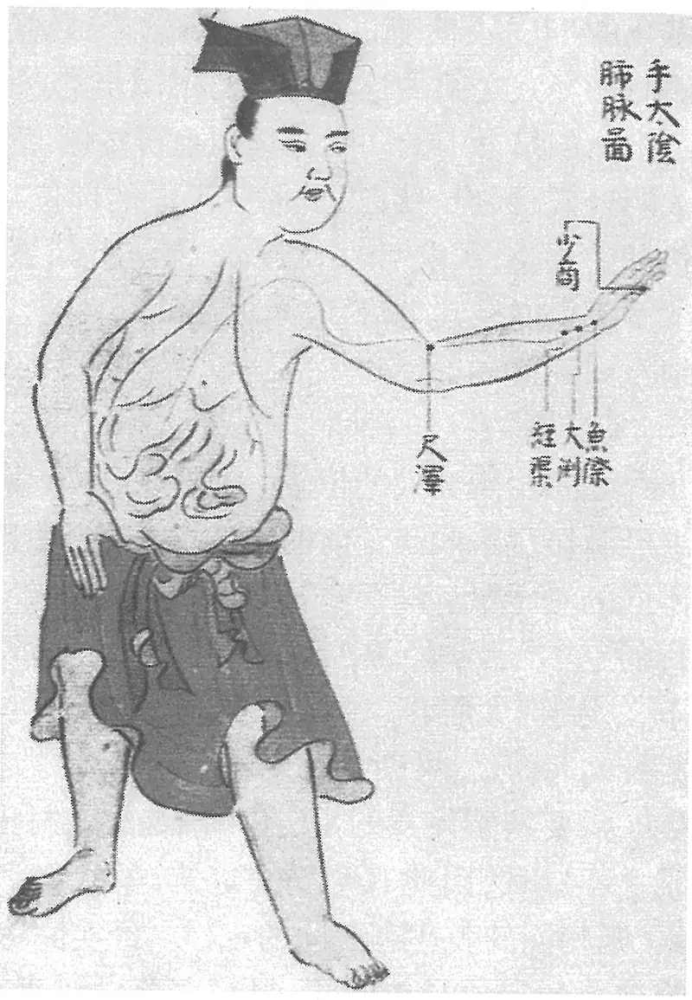

**图 2-1　《环中图》手太阴肺脉图**

〔p.115 (인쇄 95)〕

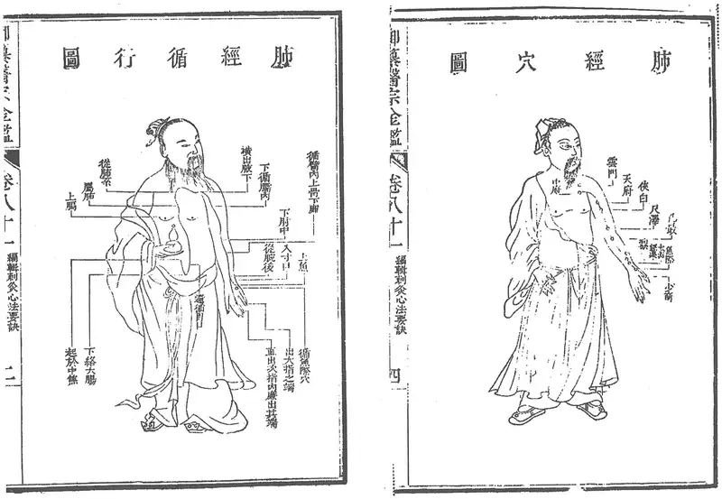

**图 2-2　《医宗金鉴》手太阴肺经脉、经穴分图**

〔p.116 (인쇄 96)〕

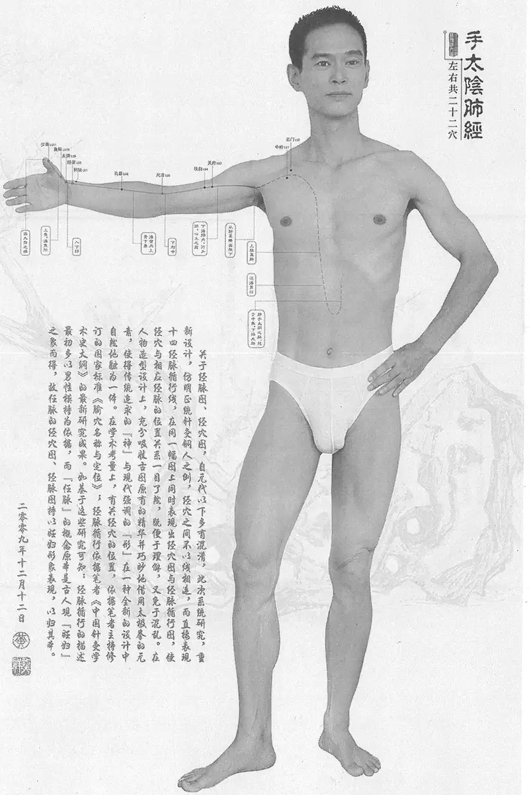

**图 2-3　黄龙祥编手太阴肺经脉、经穴合图**

〔p.117 (인쇄 97)〕

映了由诊络病候到络脉病候，最后再到络穴主治病候的发展过程，这也是今天考察经脉学说形成过程的一个“活化石”。

### （一）中府 Zhōngfǔ LU1 出《黄帝明堂经》 

> **(1) 중부(中府) Zhōngfǔ (LU1) — 『황제명당경(黃帝明堂經)』에 처음 보임**

问题1：名“中府”穴者有几，如何鉴别？

> 문제 1: “중부”라는 이름을 가진 혈은 몇 개이며, 어떻게 구별하는가?

问题2：中府与云门上下相距仅一寸，而主治前者侧重在胸、肺，后者重在肩、臂，何也？

> 문제 2: 중부와 운문(雲門)은 위아래로 1촌밖에 떨어져 있지 않은데, 주치는 앞의 것이 가슴·폐에 치우치고 뒤의 것이 어깨·팔에 치우치는 까닭은 무엇인가?

#### 【提要索隐】 

> **【요점 정리(提要索隱)】**

**穴名**：一名膺中俞。

> **혈명**: 일명 응중수(膺中兪).

**部位**：在胸部，横平第1肋间隙，锁骨下窝外侧，前正中线旁开6寸。

> **부위**: 가슴 부위로, 제1늑간(肋間)과 수평이고 쇄골하와(鎖骨下窩) 바깥쪽이며, 앞정중선에서 옆으로 6촌 되는 곳이다.

**归经**：本穴为“手足太阴之会”，但因其为肺之募穴，故历代文献（除《外台秘要》外）均归之于手太阴肺经。

> **귀경**: 이 혈은 “수족태음의 교회혈[手足太陰之會]”이지만 폐의 모혈(募穴)이므로, 역대 문헌은（『외대비요(外臺秘要)』를 제외하고）모두 수태음폐경(手太陰肺經)에 귀속시켰다.

**适应症**：主治胸、肺部病症。常用于咳嗽、气喘、胸痛、胸满；肩背痛。

> **적응증**: 가슴·폐 부위 병증을 주치한다. 해수(咳嗽)·기천(氣喘)·흉통(胸痛)·흉만(胸滿)과 견배통(肩背痛)에 흔히 쓴다.

**针刺操作**：向外斜刺或平刺0.5~0.8寸。不可向内侧直刺过深。治疗肩背、上肢病时，可参照新穴肩内髃及臂丛喙突下刺激点的刺法。

> **자침 조작**: 바깥쪽으로 사자(斜刺) 또는 평자(平刺)하여 0.5~0.8촌 찌른다. 안쪽을 향해 직자(直刺)로 너무 깊이 찔러서는 안 된다. 어깨·등과 상지의 병을 치료할 때는 신혈(新穴) 견내우(肩內髃)와 상완신경총(上腕神經叢) 오훼돌기(烏喙突起) 아래 자극점(刺激點)의 자법을 참고할 수 있다.

#### 【名实考】 

> **【이름과 실체 고증(名實考)】**

以“中府”为名的腧穴有二，不得相混。“九曲中府”更与本穴无涉，明代高武不察而混作一穴。1957年南京《针灸学》教材载本穴别名多达4个，经考皆系间接抄自日本文献，其中真正算得上别名者只有“膺中俞”一个。

> “중부”라는 이름의 수혈(腧穴)은 둘이니 서로 혼동해서는 안 된다. “구곡중부(九曲中府)”는 더더욱 이 혈과 관계가 없는데, 명대의 고무(高武)가 살피지 못하고 한 혈로 뒤섞었다. 1957년 난징(南京) 『침구학[鍼灸學]』 교재는 이 혈의 별명을 4개나 실었으나, 고증해 보면 모두 일본 문헌에서 간접적으로 베껴 온 것이고, 그중 진정한 별명이라 할 만한 것은 “응중수” 하나뿐이다.

　1. 经穴中府　手太阴经穴，在云门下一寸，乳上三肋间陷者中。

> 1. 경혈(經穴) 중부　수태음경의 혈로, 운문 아래 1촌, 젖 위 세 번째 늑간의 오목한 곳에 있다.

　　(1) 中府者，杨上善注：府，聚也。脾肺二气聚于此穴，故曰中府，肺募也。募，犹盛也。肺之盛气近出此穴也。一名膺中输。杨上善注：膺，胸也。输，肺输也，胸气归此，故谓之输。在云门下一寸，乳上三肋间，动脉应手陷者中。（《黄帝内经明堂》）

> (1) 중부. 양상선(楊上善)의 주(注): 부(府)는 모인다는 뜻이다. 비와 폐 두 기가 이 혈에 모이므로 중부라 하며, 폐의 모혈이다. 모(募)는 성(盛)하다는 뜻과 같다. 폐의 성한 기가 이 혈 가까이로 나온다. 일명 응중수(膺中輸)라 한다. 양상선의 주: 응(膺)은 가슴이다. 수(輸)는 폐의 수혈이니, 가슴의 기가 이곳으로 돌아오므로 수라 한다. 운문 아래 1촌, 젖 위 세 번째 늑간, 동맥이 손에 닿는 오목한 곳에 있다.（『황제내경명당(黃帝內經明堂)』）

　　(2) 刺膺中陷中肺，为喘逆仰息。杨上善注曰：一名中府，肺募也。（《医心方》卷二）

> (2) 응중(膺中)의 오목한 곳을 찌르다가 폐를 맞히면 숨이 치밀어 고개를 젖히고 숨쉬게 된다. 양상선은 주에서 “일명 중부이며, 폐의 모혈이다”라고 하였다.（『의심방(醫心方)』 권2）

　　(3) 中府，一名膺俞。（《针灸聚英》卷一）

> (3) 중부는 일명 응수(膺兪)이다.（『침구취영(鍼灸聚英)』 권1）

　　(4) 中府云者，以此穴为本经聚气之府也。（《经穴解》）

> (4) 중부라 한 것은 이 혈을 본경(本經)의 기가 모이는 부(府)로 여겼기 때문이다.（『경혈해(經穴解)』）

　　(5) 别名　膺中俞、肺募、府中俞、膺俞。（1957年南京《针灸学》）

> (5) 별명　응중수·폐모(肺募)·부중수(府中兪)·응수.（1957년 난징 『침구학』）

　2. 奇穴中府　乳上二肋间，上直瞳子。

> 2. 기혈(奇穴) 중부　젖 위 두 번째 늑간으로, 위로 눈동자와 일직선이 되는 곳이다.

　　(1) 杨上善注：有本云广狭与瞳子相当。（《黄帝内经明堂》）

> (1) 양상선의 주: 어떤 본에는 “너비가 눈동자와 맞먹는다”고 하였다.（『황제내경명당』）

　　(2) 肺募，在两乳上第二肋间宛宛中，悬绳取之，当瞳子是。（《千金要方》卷五、《外台秘要》）

> (2) 폐모는 양쪽 젖 위 두 번째 늑간의 오목한 곳에 있으니, 줄을 늘어뜨려 취하며 눈동자와 맞닿는 곳이 이 혈이다.（『천금요방(千金要方)』 권5, 『외대비요』）

**按**：此二说同出一源。“广狭与瞳子相当”是指中府穴距中线的距离与瞳孔距中线的距离相当。

> **안(按)**: 이 두 설은 같은 근원에서 나왔다. “너비가 눈동자와 맞먹는다”는 것은 중부혈이 정중선에서 떨어진 거리가 동공이 정중선에서 떨어진 거리와 맞먹는다는 뜻이다.

　3. 九曲中府　乳下三寸，再向后二寸。

> 3. 구곡중부　젖 아래 3촌에서 다시 뒤로 2촌 되는 곳이다.

九曲中府，在旁廷注市下三寸，刺入五分，灸三十壮。主恶风邪气遁尸，内有瘀血。（《千金要方》卷三十）

> 구곡중부는 방정(旁廷)·주시(注市) 아래 3촌에 있다. 5푼 찌르고 뜸 30장을 뜬다. 오풍(惡風)·사기(邪氣)·둔시(遁尸)와 속에 어혈이 있는 것을 주치한다.（『천금요방』 권30）

**文献分析**：《内经》所谓“膺俞”虽也可特指“膺中俞”，但也用作胸部腧穴的统称。《针灸聚英》将“膺俞”作为中府穴的别名，此出《素问·水热穴论》王冰注：“膺俞者，膺中俞也，正名中府”。但《素问·气穴论》又曰“膺俞十二穴”，王冰注曰“谓云门、中府、周荣、胸乡、天溪、食窦，左右则十二穴也”。这里的“膺俞”显然是指膺部腧穴，与经文“胸俞十二穴”、“藏俞五十穴”、“府俞七十二穴”义理相同。《灵枢·五邪》又有“膺中外俞”，或以为与“膺中俞”同义，即中府穴，但初唐杨上善则曰“膺中外输，肺输也”，马莳注曰“当取膺中外腧云门、中府等穴以刺之”，则又与王冰注“膺俞”同义。“肺募”是指中府穴属于特定穴募穴中的一个，而不是别名。故能够确认为中府穴别名的只有“膺中俞”一名。

> **문헌 분석**: 『내경(內經)』의 이른바 “응수”는 “응중수”를 특정해 가리킬 수도 있지만, 가슴 부위 수혈의 통칭으로도 쓰인다. 『침구취영』이 “응수”를 중부혈의 별명으로 삼은 것은 『소문(素問)』 「수열혈론(水熱穴論)」의 왕빙(王冰) 주 “응수는 응중수이니, 정식 이름은 중부이다”에서 나왔다. 그러나 『소문』 「기혈론(氣穴論)」에서는 또 “응수 12혈”이라 하였고, 왕빙은 주에서 “운문·중부·주영(周榮)·흉향(胸鄕)·천계(天谿)·식두(食竇)를 말하니, 좌우로 12혈이다”라고 하였다. 여기의 “응수”는 분명히 가슴 부위의 수혈을 가리키며, 경문의 “흉수(胸兪) 12혈”·“장수(藏兪) 50혈”·“부수(府兪) 72혈”과 이치가 같다. 『영추(靈樞)』 「오사(五邪)」에도 “응중외수(膺中外兪)”가 있어서 어떤 이는 “응중수”와 같은 뜻, 곧 중부혈로 보지만, 초당(初唐)의 양상선은 “응중외수는 폐의 수혈이다”라고 하였고, 마시(馬蒔)는 주에서 “응중외수인 운문·중부 등의 혈을 취해 찔러야 한다”고 하였으니, 이는 또 왕빙 주의 “응수”와 뜻이 같다. “폐모”는 중부혈이 특정혈 가운데 모혈의 하나에 속한다는 뜻이지 별명이 아니다. 그러므로 중부혈의 별명으로 확인할 수 있는 것은 “응중수” 하나뿐이다.

〔p.118 (인쇄 98)〕

至于杨上善所引别家“明堂”之文定位与《黄帝明堂经》出入很大，当是“同名异穴”。值得注意的是，《千金要方》所载“九曲中府”定位、主治均与手太阴经穴中府大不同，别是一穴，明代高武不察而致与中府穴相混。

> 양상선이 인용한 다른 계통 “명당”의 글은 위치가 『황제명당경』과 차이가 커서 “동명이혈(同名異穴)”로 보아야 한다. 주목할 점은, 『천금요방』에 실린 “구곡중부”는 위치·주치가 모두 수태음경의 경혈 중부와 크게 달라 별개의 혈인데, 명대의 고무가 살피지 못하여 중부혈과 뒤섞게 되었다는 것이다.

#### 相关穴及刺激点 

> **관련 혈과 자극점(相關穴及刺激點)**

　1. 肩内髃　位于胸部上外方，肩胛骨喙突内侧凹陷下一寸六分，再向外开五分之陷中。主治肩臂痛。针3~5分，灸3~7壮。（《针灸经外奇穴图谱》）

> 1. 견내우　가슴 부위 바깥 위쪽, 견갑골 오훼돌기 안쪽 오목한 곳에서 아래로 1촌 6푼, 다시 바깥으로 5푼 벌어진 오목한 곳에 있다. 견비통(肩臂痛)을 주치한다. 침 3~5푼, 뜸 3~7장.（『침구경외기혈도보[鍼灸經外奇穴圖譜]』）

　2. 臂丛喙突下刺激点　位于肩胛骨喙突直下1.5~2.5cm处。针尖稍向外倾斜，朝肩胛颈方向进针，针尖达胸小肌与肩胛下腔，病人可出现异感，即为刺中的表现。（《实用神经干电刺激疗法》）

> 2. 상완신경총 오훼돌기 아래 자극점　견갑골 오훼돌기 바로 아래 1.5~2.5cm 되는 곳에 있다. 침 끝을 조금 바깥으로 기울여 견갑경(肩胛頸) 쪽으로 진침하여, 침 끝이 소흉근(小胸筋)과 견갑하강(肩胛下腔)에 이르면 환자에게 이상감각이 나타날 수 있는데, 이것이 제대로 찔렀다는 표시이다.（『실용 신경간 전기자극요법[實用神經幹電刺激療法]』）

#### 【定位】 

> **【위치(定位)】**

**部位**：在胸部，横平第1肋间隙，锁骨下窝外侧，前正中线旁开6寸（图2-4）。

> **부위**: 가슴 부위로, 제1늑간과 수평이고 쇄골하와 바깥쪽이며, 앞정중선에서 옆으로 6촌 되는 곳이다（그림 2-4）.

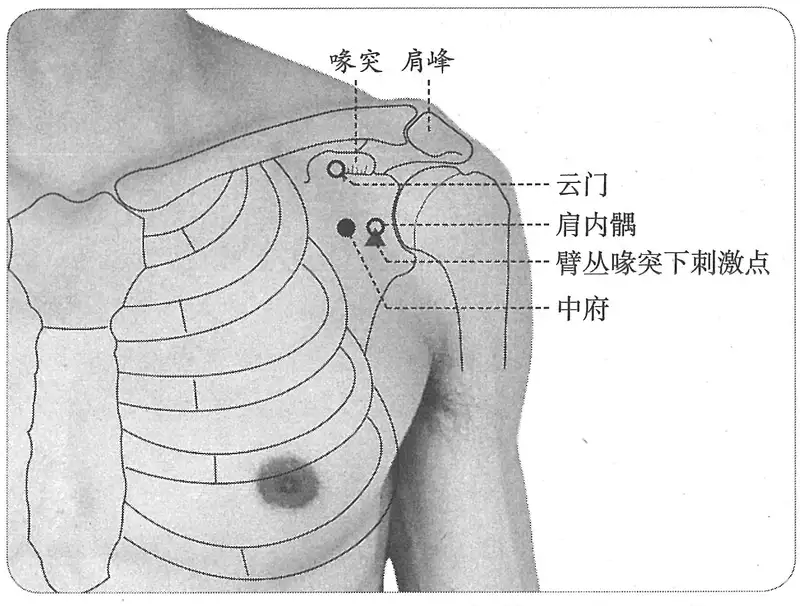

**图 2-4　中府穴与相关穴及刺激点**

> **그림 2-4**　중부혈과 관련 혈 및 자극점

**取穴**：仰卧或正坐，先在胸壁外上部定云门穴，在云门穴下1寸，横平第1肋间隙处取穴。

> **취혈**: 바로 눕거나 바로 앉은 자세에서, 먼저 가슴벽 바깥 위쪽에서 운문혈을 정하고, 운문혈 아래 1촌, 제1늑간과 수평인 곳에서 취혈한다.

#### 相关解剖学基础 

> **관련 해부학적 기초(相關解剖學基礎)**

腋动脉（锁骨下动脉）体表触诊：在云门之外下，平第1肋间隙处，可以触及腋动脉的搏动，但搏动不如云门穴处明显。

> 액와동맥(腋窩動脈)（쇄골하동맥(鎖骨下動脈)）의 체표 촉진: 운문의 바깥 아래, 제1늑간과 수평인 곳에서 액와동맥의 박동을 만질 수 있으나, 박동은 운문혈 자리만큼 뚜렷하지 않다.

　1. 《黄帝明堂经》佚文

> 1. 『황제명당경』 일문(佚文)

　　(1) 在云门下一寸，乳上三肋间陷者中，动脉应手，仰而取之。（《针灸甲乙经》卷三）

> (1) 운문 아래 1촌, 젖 위 세 번째 늑간의 오목한 곳에 있으며, 동맥이 손에 닿는다. 고개를 젖히고 취한다.（『침구갑을경(鍼灸甲乙經)』 권3）

　　(2) 在云门下一寸，乳上三肋间，动脉应手陷者中。（《黄帝内经明堂》、《医心方》）

> (2) 운문 아래 1촌, 젖 위 세 번째 늑간, 동맥이 손에 닿는 오목한 곳에 있다.（『황제내경명당』, 『의심방』）

　　(3) 在云门下一寸，一云一寸六分，乳上三肋间，动脉应手陷中。（《千金要方》卷二十九、《外台秘要》）

> (3) 운문 아래 1촌—일설에는 1촌 6푼—, 젖 위 세 번째 늑간, 동맥이 손에 닿는 오목한 곳에 있다.（『천금요방』 권29, 『외대비요』）

**按**：以上诸《黄帝明堂经》佚文，内容相同，文字以《黄帝内经明堂》为是。《千金要方》、《外台秘要》“一云一寸六分”出于宋人校注。未经宋人校改的《孙真人千金方》无此注。要之，本穴定位，以肋间为准，不拘于分寸。

> **안(按)**: 이상의 여러 『황제명당경』 일문은 내용이 같으며, 글자는 『황제내경명당』이 옳다. 『천금요방』·『외대비요』의 “일설에는 1촌 6푼”은 송대 사람의 교주(校注)에서 나온 것이다. 송대 사람의 교정을 거치지 않은 『손진인천금방(孫眞人千金方)』에는 이 주가 없다. 요컨대 이 혈의 위치는 늑간을 기준으로 하며, 촌수에 얽매이지 않는다.

〔p.119 (인쇄 99)〕

　2. 在云门下一寸六分，乳上三肋间，动脉应手。（《太平圣惠方·明堂》）

> 2. 운문 아래 1촌 6푼, 젖 위 세 번째 늑간에 있으며, 동맥이 손에 닿는다.（『태평성혜방(太平聖惠方)』 「명당(明堂)」）

　3. 在云门下一寸，乳上三肋间，动脉应手。（《铜人腧穴针灸图经》卷上、《十四经发挥》）

> 3. 운문 아래 1촌, 젖 위 세 번째 늑간에 있으며, 동맥이 손에 닿는다.（『동인수혈침구도경(銅人腧穴鍼灸圖經)』 권상, 『십사경발휘(十四經發揮)』）

　4. 在云门下一寸，乳上三肋间。去膺中行各六寸，递相去寸六分。（《针灸资生经》卷一）

> 4. 운문 아래 1촌, 젖 위 세 번째 늑간에 있다. 가슴 정중선에서 각각 6촌 떨어져 있으며, 차례로 서로 1촌 6푼씩 떨어져 있다.（『침구자생경(鍼灸資生經)』 권1）

　5. 云门下一寸，乳上三肋间，动脉应手陷中，去中行六寸。（《针灸聚英》卷一）

> 5. 운문 아래 1촌, 젖 위 세 번째 늑간, 동맥이 손에 닿는 오목한 곳으로, 정중선에서 6촌 떨어져 있다.（『침구취영』 권1）

　6. 云门下一寸六分，乳上三肋间，动脉应手陷中，去胸中行各六寸。（《针灸大成》卷六）

> 6. 운문 아래 1촌 6푼, 젖 위 세 번째 늑간, 동맥이 손에 닿는 오목한 곳으로, 가슴 정중선에서 각각 6촌 떨어져 있다.（『침구대성(鍼灸大成)』 권6）

　7. 在云门下一寸，夹任脉华盖穴两旁各六寸，居乳上三肋间，动脉应手。（《针方六集》卷一）

> 7. 운문 아래 1촌, 임맥(任脈) 화개혈(華蓋穴)을 끼고 양옆으로 각각 6촌, 젖 위 세 번째 늑간에 있으며, 동맥이 손에 닿는다.（『침방육집(鍼方六集)』 권1）

　8. 云门下约一寸，当华盖穴外六寸处。（《针灸十四经穴位考订》）

> 8. 운문 아래 약 1촌, 화개혈 바깥 6촌 되는 곳이다.（『침구 십사경 혈위 고정[鍼灸十四經穴位考訂]』）

　9. 统编针灸学教材

> 9. 통편(統編) 침구학 교재

　　(1) 部位：在云门下一肋，乳上三肋动脉应手陷中，去胸中行六寸。取穴：仰卧，自乳头外二寸，向上按取三支肋骨与第四肋骨之间是穴位，与任脉的华盖穴平，相去六寸，若自锁骨向下按当第一肋与第二肋之间。（1957年南京《针灸学》）

> (1) 부위: 운문 아래 한 늑골, 젖 위 세 번째 늑간의 동맥이 손에 닿는 오목한 곳에 있으며, 가슴 정중선에서 6촌 떨어져 있다. 취혈: 바로 누워 젖꼭지 바깥 2촌에서 위로 눌러 가며 세 번째 늑골과 네 번째 늑골 사이를 취하면 혈자리이다. 임맥의 화개혈과 수평이며 서로 6촌 떨어져 있고, 쇄골에서 아래로 눌러 가면 제1늑골과 제2늑골 사이에 해당한다.（1957년 난징 『침구학』）

**按**：锁骨外侧下缘触不到第一肋，锁骨内侧下缘可触及第一肋软骨，锁骨后上方可触及第一肋骨体——真肋。

> **안(按)**: 쇄골 바깥쪽 아래 가장자리에서는 제1늑골이 만져지지 않고, 쇄골 안쪽 아래 가장자리에서는 제1늑연골이 만져지며, 쇄골 뒤 위쪽에서는 제1늑골의 몸통, 곧 참늑골[眞肋]이 만져진다.

　　(2) 部位：胸前臂之外上方，云门下一肋，距任脉六寸。取穴：仰卧，自乳头向上倒数第三肋间隙旁开二寸，即任脉华盖穴旁开六寸处陷中取之。（1版《针灸学讲义》）

> (2) 부위: 가슴 앞 팔 쪽[胸前臂]의 바깥 위쪽, 운문 아래 한 늑골, 임맥에서 6촌 떨어진 곳. 취혈: 바로 누워 젖꼭지에서 위로 거꾸로 세어 세 번째 늑간에서 옆으로 2촌, 곧 임맥 화개혈에서 옆으로 6촌 되는 곳의 오목한 데서 취한다.（1판 『침구학강의[鍼灸學講義]』） 〔역주: 원서의 「胸前臂」는 같은 계열 교재 인용(「胸前壁」)으로 보아 「壁」의 오식으로 보인다.〕

　　(3) 在云门手太阴经下一寸，乳上三肋间陷者中，动脉应手，仰而取之。取穴：在胸前壁之外上部，第一肋间隙外侧，距任脉胸骨正中线六寸。（2版《针灸学讲义》）

> (3) 운문(수태음경) 아래 1촌, 젖 위 세 번째 늑간의 오목한 곳에 있으며, 동맥이 손에 닿는다. 고개를 젖히고 취한다. 취혈: 가슴 앞벽의 바깥 위쪽, 제1늑간 바깥쪽으로, 임맥(흉골 정중선)에서 6촌 떨어진 곳이다.（2판 『침구학강의』）

　　(4) 胸前壁外上方，前正中线旁开6寸，平第1肋间隙处。（4~7版《针灸学》、《中国针灸学》）

> (4) 가슴 앞벽의 바깥 위쪽, 앞정중선에서 옆으로 6촌, 제1늑간과 수평인 곳.（4~7판 『침구학』, 『중국침구학[中國鍼灸學]』）

**文献分析**：本穴定位，历代文献相同，以云门穴确定横向距离，以乳上三肋（即第一肋间隙）确定纵向距离，以动脉搏动点为参照点。至于距云门穴的距离有“一寸”与“一寸六分”两说，后者系据胸部骨度折量寸折算而来，定穴仍以骨性标志为准。

> **문헌 분석**: 이 혈의 위치는 역대 문헌이 같다. 운문혈로 가로 거리를 정하고, 젖 위 세 번째 늑간（곧 제1늑간）으로 세로 거리를 정하며, 동맥 박동점을 참조점으로 삼는다. 운문혈과의 거리에 “1촌”과 “1촌 6푼” 두 설이 있는 것은, 뒤의 것이 가슴 부위 골도(骨度) 절량촌(折量寸)에 따라 환산한 것이기 때문이며, 혈을 정할 때는 여전히 뼈 표지를 기준으로 한다.

#### 【类属】 

> **【분류(類屬)】**

手太阴肺经穴；肺募穴。

> 수태음폐경의 혈; 폐의 모혈.

**脉气所发：**

> **맥기가 나오는 곳[脈氣所發]:**

　1. 肺募也……手太阴之会。（《针灸甲乙经》卷三）

> 1. 폐의 모혈이며……수태음의 교회혈이다.（『침구갑을경』 권3）

　2. 肺募也……手足太阴之会。（《黄帝内经明堂》、《素问·刺热》王冰注、《素问·水热穴论》王冰注）

> 2. 폐의 모혈이며……수족태음의 교회혈이다.（『황제내경명당』, 『소문』 「자열(刺熱)」 왕빙 주, 『소문』 「수열혈론」 왕빙 주）

　3. 足太阴之会。（《外台秘要》卷三十九、《铜人腧穴针灸图经》卷中）

> 3. 족태음의 교회혈이다.（『외대비요』 권39, 『동인수혈침구도경』 권중）

**按**：既言“之会”，则至少为两条经脉交会，可知《针灸甲乙经》“手太阴之会”、《外台秘要》“足太阴之会”前有脱字，《素问》林亿新校正引《针灸甲乙经》正作“手足太阴之会”，可证，故现存“明堂”佚文，当以《黄帝内经明堂》及王冰注传本为据。

> **안(按)**: “교회혈”이라 했다면 적어도 두 경맥이 만나는 것이니, 『침구갑을경』의 “수태음의 교회혈”과 『외대비요』의 “족태음의 교회혈”은 앞에 글자가 빠졌음을 알 수 있다. 『소문』의 임억(林億) 신교정(新校正)이 인용한 『침구갑을경』에 바로 “수족태음의 교회혈”로 되어 있어 이를 증명할 수 있다. 그러므로 현존하는 “명당” 일문은 『황제내경명당』과 왕빙 주의 전본(傳本)을 근거로 삼는 것이 옳다.

**归经：**

> **귀경:**

　1. 手太阴肺经。（《黄帝内经明堂》、《铜人腧穴针灸图经》卷上）

> 1. 수태음폐경.（『황제내경명당』, 『동인수혈침구도경』 권상）

　2. 足太阴脾经。（《外台秘要》卷三十九）

> 2. 족태음비경(足太陰脾經).（『외대비요』 권39）

**按**：本穴为肺之募穴，归于手太阴肺经的依据更充分。王焘编《外台秘要》“明堂”篇时，主要是依线归经，且不同分部的同一条经穴的排列方向也不接续，严格来说不能算作“腧穴归经”。

> **안(按)**: 이 혈은 폐의 모혈이므로 수태음폐경에 귀속시키는 근거가 더 충분하다. 왕도(王燾)가 『외대비요』 「명당」 편을 엮을 때는 주로 선(線)에 따라 경에 귀속시켰고, 부위가 다른 같은 경의 혈들은 배열 방향도 이어지지 않으므로, 엄밀히 말하면 “수혈 귀경”이라 할 수 없다.

#### 【适应症】 

> **【적응증(適應症)】**

主治胸、肺部病症。常用于咳嗽、气喘、胸痛、胸满；肩痛。

> 가슴·폐 부위 병증을 주치한다. 해수·기천·흉통·흉만과 어깨 통증에 흔히 쓴다.

**备选适应症**：乳痈。

> **보조 적응증**: 유옹(乳癰).

〔p.120 (인쇄 100)〕

　1. 大杼、膺俞、缺盆、背俞，此八者以泻胸中之热。（《素问·水热穴论》、《针灸甲乙经》）

> 1. 대저(大杼)·응수·결분(缺盆)·배수(背兪), 이 여덟 혈로 가슴 속의 열을 사(瀉)한다.（『소문』 「수열혈론」, 『침구갑을경』）

**按**：王冰注曰：“膺俞者，膺中俞也，正名中府”。杨上善《黄帝内经太素》注同。

> **안(按)**: 왕빙은 주에서 “응수는 응중수이니, 정식 이름은 중부이다”라고 하였다. 양상선의 『황제내경태소(黃帝內經太素)』 주도 같다.

　2. 主肺系急，咳，胸中痛，恶寒，胸满悒悒然，善呕食，胸中热，喘逆，逆气相追逐，多浊唾，不得息，肩背风汗出，面腹肿，鬲中不下食；喉痹。肩息肺胀，皮肤骨痛，寒热，烦满。（《黄帝内经明堂》）

> 2. 폐계(肺系)가 당기고, 기침하며, 가슴 속이 아프고, 오한(惡寒)이 나며, 가슴이 그득하여 답답하고[胸滿悒悒然], 먹은 것을 잘 토하며, 가슴 속이 뜨겁고, 숨이 치밀며, 거스르는 기가 서로 뒤쫓고, 탁한 침이 많으며, 숨을 쉬지 못하고, 어깨와 등에 바람을 맞은 듯 땀이 나며[肩背風汗出], 얼굴과 배가 붓고, 격중(鬲中)으로 음식이 내려가지 않는 것; 후비(喉痹). 어깨를 들썩이며 숨쉬고[肩息] 폐창(肺脹)이 있으며, 피부와 뼈가 아프고, 한열(寒熱)이 나며, 번만(煩滿)한 것을 주치한다.（『황제내경명당』）

**按**：鬲中，又作“隔中”，古病名，属噎膈病，《针灸甲乙经》本即注有“食噎”二字（混成正文）。《灵枢·邪气藏府病形》曰：“隔中，食饮入而还出”；《灵枢·本藏》曰：“肝大则逼胃迫咽，迫咽则苦隔中”；《灵枢·上膈》又曰：“气为上膈者，食饮入而还出”。

> **안(按)**: 격중(鬲中)은 “격중(隔中)”으로도 쓰는 옛 병명으로 열격(噎膈)병에 속하며, 『침구갑을경』에는 본래 “식열(食噎)” 두 글자가 주로 달려 있다（본문에 섞여 들어갔다）. 『영추』 「사기장부병형(邪氣藏府病形)」에서 “격중은 음식이 들어갔다가 도로 나온다”고 하였고, 『영추』 「본장(本藏)」에서 “간이 크면 위를 압박하고 인후를 핍박하며, 인후를 핍박하면 격중으로 괴롭다”고 하였으며, 『영추』 「상격(上膈)」에서는 또 “기로 인한 상격은 음식이 들어갔다가 도로 나온다”고 하였다.

　3. 治肺系急，胸中痛悚悚，胆热，呕逆上气，咳唾浊涕，肩背痛，风汗出，腹胀，食不下，喉痹，肩息，肤骨痛，寒热。（《铜人腧穴针灸图经》卷中）

> 3. 폐계가 당기고, 가슴 속이 오싹하게 아프며[胸中痛悚悚], 담열(膽熱)이 있고, 구역하며 기가 치밀고, 기침하며 탁한 콧물 같은 가래를 뱉고, 어깨와 등이 아프며, 바람을 맞은 듯 땀이 나고, 배가 불러 오르며, 음식이 내려가지 않고, 후비, 견식, 피부와 뼈가 아프며, 한열이 나는 것을 치료한다.（『동인수혈침구도경』 권중）

　4. 窦太师针灸遗存

> 4. 두태사(竇太師) 침구 유존(遺存)

　　(1) 治妇人乳痈吹乳，泻之立效。（《窦太师针经》）

> (1) 부인의 유옹과 취유(吹乳)를 치료하니, 사하면 곧바로 효과가 있다.（『두태사침경(竇太師鍼經)』）

　　(2) 妇人乳痈。（《针方六集》卷五）

> (2) 부인의 유옹.（『침방육집』 권5）

　　(3) 治妇人吹乳，甚验。（《循经考穴编》上）

> (3) 부인의 취유를 치료하는 데 매우 효험이 있다.（『순경고혈편(循經考穴編)』 상）

　5. 飞尸遁疰，瘿瘤。（《针灸聚英》卷一、《古今医统》、《针灸大成》）

> 5. 비시둔주(飛尸遁疰), 영류(癭瘤).（『침구취영』 권1, 『고금의통(古今醫統)』, 『침구대성』）

**按**：“飞尸遁疰”，系高武误录《针灸资生经》经外奇穴“九曲中府”的主治病症；“瘿瘤”为天府穴主治症，此处疑为高武误录。

> **안(按)**: “비시둔주”는 고무가 『침구자생경』의 경외기혈 “구곡중부”의 주치 병증을 잘못 옮겨 적은 것이다. “영류”는 천부혈(天府穴)의 주치증이니, 여기서도 고무가 잘못 옮겨 적은 것으로 의심된다.

　6. 统编针灸学教材

> 6. 통편 침구학 교재

　　(1) 咳嗽，喘急，肺胀满，胸痛，肩背痛。（1957年南京《针灸学》，2版《针灸学讲义》，4、5、6版《针灸学》）

> (1) 해수, 천급(喘急), 폐창만(肺脹滿), 흉통, 견배통.（1957년 난징 『침구학』, 2판 『침구학강의』, 4·5·6판 『침구학』）

　　(2) 咳嗽，气喘，肺胀满，胸胁痛，肩背痛。（1版《针灸学讲义》）

> (2) 해수, 기천, 폐창만, 흉협통(胸脇痛), 견배통.（1판 『침구학강의』）

　　(3) 咳嗽，气喘，胸满痛等肺部病证；肩背痛。（7版《针灸学》）

> (3) 해수, 기천, 흉만통(胸滿痛) 등 폐 부위 병증; 견배통.（7판 『침구학』）

　　(4) 咳嗽，气喘，胸部胀满，胸痛，肩背痛。（《中国针灸学》）

> (4) 해수, 기천, 가슴 부위 창만(脹滿), 흉통, 견배통.（『중국침구학』）

**文献分析**：关于本穴主治腧穴文献与治疗文献吻合度很高，均主治肺、胸部病症，这与本穴的属性“肺之募穴”是吻合的。《黄帝内经明堂》所述主治病症包括“肺系急”、“邪在肺”两组症状，此以肺之募治肺系之疾。其中“肺胀”，《灵枢·胀论》曰：“肺胀者，虚满而喘咳”。《金匮要略》曰：“上气喘而躁者，属肺胀”；又曰：“肺胀咳而上气，烦躁而喘，脉浮者，心下有水，小青龙加石膏汤主之”。可知肺胀的特点为：胀满喘咳。《黄帝明堂经》言“肺胀”者凡三见，除本穴外，还见于“肺俞”、“少商”二穴。“邪在肺”症状详见“附：临床应用举例”项下《灵枢》原文。《灵枢》原文作“皮肤痛”，而《黄帝明堂经》中衍出一“骨”字，《千金要方》转录时又作“皮肉骨痛”，疑是“膚”字上下分拆所致。值得注意的是金元时期关于本穴主治的一个突出变化，即窦太师针灸谓本穴治“乳痈”，且谓之“甚验”、“立效”，特补录于“备考”项下，有待现代针灸临床上进一步验证。

> **문헌 분석**: 이 혈의 주치에 관해서는 수혈 문헌과 치료 문헌이 매우 잘 맞아떨어져 모두 폐·가슴 부위 병증을 주치하니, 이는 이 혈의 속성인 “폐의 모혈”과 부합한다. 『황제내경명당』에 서술된 주치 병증에는 “폐계가 당김[肺系急]”과 “사기가 폐에 있음[邪在肺]”의 두 무리 증상이 들어 있는데, 이는 폐의 모혈로 폐계의 병을 치료한 것이다. 그중 “폐창”에 대해서는 『영추』 「창론(脹論)」에서 “폐창은 허하게 그득하며 숨차고 기침한다”고 하였다. 『금궤요략(金匱要略)』에서는 “상기(上氣)로 숨차면서 조급한 것은 폐창에 속한다”고 하였고, 또 “폐창으로 기침하며 기가 치밀고, 번조하며 숨차고, 맥이 부(浮)한 것은 심하(心下)에 수기가 있는 것이니, 소청룡가석고탕(小靑龍加石膏湯)으로 주치한다”고 하였다. 이로써 폐창의 특징이 창만하고 숨차며 기침하는 것임을 알 수 있다. 『황제명당경』에서 “폐창”을 말한 곳은 모두 세 군데로, 이 혈 외에 “폐수(肺兪)”·“소상(少商)” 두 혈에도 보인다. “사기가 폐에 있음”의 증상은 “부: 임상 응용 예” 항 아래의 『영추』 원문에 자세하다. 『영추』 원문은 “피부통(皮膚痛)”으로 되어 있는데 『황제명당경』에는 “골(骨)” 자 하나가 더 들어갔고, 『천금요방』이 옮겨 실을 때는 또 “피육골통(皮肉骨痛)”으로 되었으니, “부(膚)” 자가 위아래로 쪼개져서 생긴 것으로 의심된다. 주목할 점은 금원(金元) 시기 이 혈의 주치에 두드러진 변화가 하나 있었다는 것이다. 곧 두태사의 침구서에서 이 혈이 “유옹”을 치료한다고 하며 “매우 효험이 있다”·“곧바로 효과가 있다”고 하였으므로, 특별히 “비고(備考)” 항 아래에 보충해 실어 두고 현대 침구 임상에서 더 검증되기를 기다린다.

关于本穴的主治特点，《素问》一段经文值得玩味：“大杼、膺俞、缺盆、背俞，此八者，以泻胸中之热也；云门、髃骨、委中、髓空，此八者，以泻四支之热也”。中府与云门上下仅相距一寸，一主胸中之疾，一主上肢之疾，何也？从现代“穴区带疗法”来看，虽然云门与中府上下仅相距一寸，但云门穴归属于上肢1区，而中府穴归于胸前区，主治重点自有不同；再从这两个穴的局部解剖特征来看，肌肉起止点疗法中的云门点为肩胛下肌损伤、肩周炎等肩臂部病症的主要刺激点；最后从新穴的实践来看，治疗肩臂痛的新穴如“向农”等皆紧邻云门穴，因此现代针灸临床，特别是新疗法，治疗肩臂部病症更多是取云门穴，而不是中府穴。《黄帝明堂经》载本穴主治均为胸、肺部病症，至《铜人腧穴针灸图经》将原本描述肺病之“肩背风汗出”改作“肩背痛，风汗出”，从而使得本穴主治从悉主胸中、肺脏之疾，变成兼治肢体病症。了解了这一演变过程以及该穴处的解剖特征，就可以用本穴针对性地治疗胸、肺之疾。

> 이 혈의 주치 특징에 관해서는 『소문』의 경문 한 단락을 음미해 볼 만하다. “대저·응수·결분·배수, 이 여덟 혈은 가슴 속의 열을 사하고, 운문·우골(髃骨)·위중(委中)·수공(髓空), 이 여덟 혈은 사지의 열을 사한다.” 중부와 운문은 위아래로 1촌밖에 떨어져 있지 않은데, 하나는 가슴 속의 병을, 하나는 상지의 병을 주치하는 것은 어째서인가? 현대의 “혈구대(穴區帶) 요법”으로 보면, 운문과 중부는 위아래로 1촌밖에 떨어져 있지 않지만 운문혈은 상지 1구에 속하고 중부혈은 흉전구(胸前區)에 속하므로 주치의 중점이 저절로 다르다. 다음으로 두 혈의 국소 해부 특징으로 보면, 근육 기시·정지점 요법에서 운문점은 견갑하근(肩胛下筋) 손상·견주염(肩周炎) 등 어깨·팔 부위 병증의 주된 자극점이다. 끝으로 신혈의 실천으로 보면, “향농(向農)” 등 어깨·팔 통증을 치료하는 신혈은 모두 운문혈에 바짝 붙어 있다. 그래서 현대 침구 임상, 특히 새로운 요법에서는 어깨·팔 부위 병증을 치료할 때 중부혈보다 운문혈을 더 많이 취한다. 『황제명당경』에 실린 이 혈의 주치는 모두 가슴·폐 부위 병증인데, 『동인수혈침구도경』에 이르러 본래 폐병을 묘사하던 “어깨와 등에 바람을 맞은 듯 땀이 남[肩背風汗出]”을 “어깨와 등이 아프고, 바람을 맞은 듯 땀이 남[肩背痛，風汗出]”으로 고침으로써, 이 혈의 주치가 오로지 가슴 속과 폐장의 병을 주치하던 데서 지체의 병증도 겸하여 치료하는 것으로 바뀌었다. 이 변천 과정과 이 혈 자리의 해부 특징을 이해하면, 이 혈로 가슴·폐의 병을 겨냥해 치료할 수 있다.

〔p.121 (인쇄 101)〕

#### 附：临床应用举例 

> **부: 임상 응용 예(臨床應用擧例)**

　1. 胸、肺部病症

> 1. 가슴·폐 부위 병증

　　(1) 邪在肺，则病皮肤痛，寒热，上气喘，汗出，咳动肩背。取之膺中外腧，背三节五藏一本作五椎又五节之旁，以手疾按之，快然，乃刺之，取之缺盆中以越之。（《灵枢·五邪》）

> (1) 사기가 폐에 있으면 피부가 아프고, 한열이 나며, 기가 치밀어 숨차고, 땀이 나며, 기침하면 어깨와 등이 울린다. 응중외수(膺中外腧)와 등의 셋째 마디[三節]·오장(五藏)〔어떤 본에는 「5추(五椎)」로, 또 「5절(五節)」로 되어 있다〕 곁을 취하되, 손으로 빠르게 눌러 시원해지면 곧 찌르고, 결분 가운데를 취하여 사기를 흩어 낸다[越之].（『영추』 「오사」）

**按**：膺中外腧，杨上善注作肺的背俞穴——肺俞；马莳注作云门、中府等穴。

> **안(按)**: 응중외수를 양상선은 주에서 폐의 배수혈(背兪穴)인 폐수로 보았고, 마시는 주에서 운문·중부 등의 혈로 보았다.

　　(2) 主奔豚上下，腹中与腰相引痛，灸中府百壮。（《千金要方》卷十七、《千金翼方》）

> (2) 분돈(奔豚)이 오르내리고 배 속과 허리가 서로 당기며 아픈 것을 주치하니, 중부에 뜸 100장을 뜬다.（『천금요방』 권17, 『천금익방(千金翼方)』）

　　(3) 上气，咳逆，短气，气满食不下，灸肺募五十壮。（《千金要方》卷十八、《千金翼方》）

> (3) 상기·해역(咳逆)·단기(短氣)로 기가 그득하여 음식이 내려가지 않으면 폐모에 뜸 50장을 뜬다.（『천금요방』 권18, 『천금익방』）

　　(4) 转筋在两臂及胸中者，灸手掌白肉际七壮，又灸膻中、中府、巨阙、胃管、尺泽。（《千金要方》卷二十、《千金翼方》）

> (4) 전근(轉筋)이 양팔과 가슴 속에 있으면 손바닥 백육제(白肉際)에 뜸 7장을 뜨고, 또 단중(膻中)·중부·거궐(巨闕)·위관(胃管)·척택(尺澤)에 뜸을 뜬다.（『천금요방』 권20, 『천금익방』）

　　(5) 治卒哕，灸膻中、中府、胃管各数十壮。（《千金翼方》卷二十七）

> (5) 갑작스러운 딸꾹질[卒噦]을 치료하니, 단중·중부·위관에 각각 뜸 수십 장을 뜬다.（『천금익방』 권27）

**按**：《灵枢·口问》曰：“肺主为哕，取手太阴、足少阴”，此方取中府治哕，乃承《灵枢》之意以治肺也。

> **안(按)**: 『영추』 「구문(口問)」에서 “폐는 딸꾹질[噦]을 주관하니, 수태음과 족소음을 취한다”고 하였다. 이 처방에서 중부를 취해 딸꾹질을 치료한 것은 『영추』의 뜻을 이어 폐를 치료한 것이다.

　　(6) 肺寒、胸膈胀，时吐酸，逆气上攻，食已作饱，困倦无力，口中如含冰雪，此名冷劳，又名膏肓病，乃冷物伤肺，反服凉药损其肺气，灸中府二穴各二百壮。（《扁鹊心书》卷上）

> (6) 폐가 차고 흉격이 창만하며, 때때로 신물을 토하고, 역기가 위로 치밀며, 먹고 나면 배가 그득하고, 피곤하여 힘이 없으며, 입 안이 얼음과 눈을 머금은 듯한 것을 냉로(冷勞)라 하고 고황병(膏肓病)이라고도 한다. 찬 음식이 폐를 상했는데 도리어 서늘한 약을 먹어 폐기를 손상한 것이니, 양쪽 중부혈에 각각 뜸 200장을 뜬다.（『편작심서(扁鵲心書)』 권상）

　　(7) 治伤寒，胸中热不已：大杼、风门、中府、缺盆。（《针经摘英集》）

> (7) 상한(傷寒)으로 가슴 속의 열이 그치지 않는 것을 치료한다: 대저·풍문(風門)·중부·결분.（『침경적영집(鍼經摘英集)』）

**按**：此方源于《素问·水热穴论》，只是将原方中“背俞”理解为“风门”。

> **안(按)**: 이 처방은 『소문』 「수열혈론」에서 나왔으며, 다만 원방의 “배수”를 “풍문”으로 이해했을 뿐이다.

　2. 身体烦热，针中府。又灸绝骨五十壮。（《千金翼方》卷二十七）

> 2. 몸이 번열(煩熱)하면 중부에 침을 놓는다. 또 절골(絶骨)에 뜸 50장을 뜬다.（『천금익방』 권27）

**按**：身热虽有“五心烦热”之症，但此处取中府穴，还是针对其中的“胸中烦热”之症。

> **안(按)**: 몸의 열에는 “오심번열(五心煩熱)”의 증상도 있지만, 여기서 중부혈을 취한 것은 그중 “가슴 속 번열”의 증상을 겨냥한 것이다.

#### 【操作】 

> **【조작(操作)】**

向外斜刺或平刺0.5~0.8寸。不可向内侧直刺过深。治疗肩背、上肢病时，可参照新穴肩内髃及臂丛喙突下刺激点的刺法。

> 바깥쪽으로 사자 또는 평자하여 0.5~0.8촌 찌른다. 안쪽을 향해 직자로 너무 깊이 찔러서는 안 된다. 어깨·등과 상지의 병을 치료할 때는 신혈 견내우와 상완신경총 오훼돌기 아래 자극점의 자법을 참고할 수 있다.

　1. 刺膺中陷中肺，为喘逆仰息。（《素问·刺禁论》）

> 1. 응중의 오목한 곳을 찌르다가 폐를 맞히면 숨이 치밀어 고개를 젖히고 숨쉬게 된다.（『소문』 「자금론(刺禁論)」）

　2. 刺入三分，留五呼，灸五壮。（《黄帝内经明堂》）

> 2. 3푼 찌르고 5호흡 동안 유침하며, 뜸 5장을 뜬다.（『황제내경명당』）

　3. 刺入一分，沿皮向外一寸半，灸二七壮。（《窦太师针经》）

> 3. 1푼 찌른 뒤 피부를 따라 바깥쪽으로 1촌 반 나아가며, 뜸 14장을 뜬다.（『두태사침경』）

　4. 统编针灸学教材

> 4. 통편 침구학 교재

　　(1) 针三至五分，不可深刺，灸三至七壮。（1957年南京《针灸学》、1版《针灸学讲义》）

> (1) 침은 3~5푼 놓되 깊이 찔러서는 안 되며, 뜸 3~7장을 뜬다.（1957년 난징 『침구학』, 1판 『침구학강의』）

　　(2) 直刺3~5分；艾条灸3~5分钟，艾炷灸3~5壮。（2版《针灸学讲义》）

> (2) 직자 3~5푼; 애조구(艾條灸) 3~5분, 애주구(艾炷灸) 3~5장.（2판 『침구학강의』）

　　(3) 向外斜刺或平刺0.5~0.8寸。不可向内侧深刺，以免伤及肺脏。（4、5、6、7版《针灸学》、《中国针灸学》）

> (3) 바깥쪽으로 사자 또는 평자하여 0.5~0.8촌 찌른다. 폐장(肺臟)을 손상하지 않도록 안쪽을 향해 깊이 찔러서는 안 된다.（4·5·6·7판 『침구학』, 『중국침구학』）

　5. 斜刺，向外上方进针，深0.5~1寸。感应：酸胀向前胸及上肢放散。灸3~5壮；温灸5~10分钟。（上海《针灸学》）

> 5. 사자하되 바깥 위쪽을 향해 진침하며, 깊이는 0.5~1촌이다. 감응: 시큰하고 뻐근한 느낌[酸脹]이 앞가슴과 상지로 퍼진다. 뜸 3~5장; 온구(溫灸) 5~10분.（상하이(上海) 『침구학』）

**文献分析**：古代文献中以《窦太师针经》记载较具体：“刺入一分，沿皮向外一寸半，灸二七壮”。如果向外刺得较深，而不是沿皮刺，刺入一寸半时，针尖可达腋窝，此时不宜大幅提插，以免损伤重要的神经和血管。

> **문헌 분석**: 고대 문헌 가운데는 『두태사침경』의 기록이 비교적 구체적이다. “1푼 찌른 뒤 피부를 따라 바깥쪽으로 1촌 반 나아가며, 뜸 14장을 뜬다.” 피부를 따라 찌르지 않고 바깥쪽으로 비교적 깊이 찔러 1촌 반에 이르면 침 끝이 액와(腋窩)에 닿을 수 있으므로, 이때는 중요한 신경과 혈관을 손상하지 않도록 크게 제삽(提插)해서는 안 된다.

#### 刺法及主治的解剖学基础 

> **자법과 주치의 해부학적 기초(刺法及主治的解剖學基礎)**

胸膜腔的体表投影：两侧胸膜腔上界高出于胸廓上口，最高处可高出锁骨内侧上2~3cm，因此颈外侧下三角可损伤胸膜顶而产生张力性气胸。从锁骨内侧1/3上方2~3cm处开始，向下作一直线，经胸锁关节后方，在第2胸肋关节水平向中线靠拢并垂直下行，至右第6胸肋关节，此为右侧胸膜前界。左胸膜前界上段和右侧相同，至第4胸肋关节处转向外下，距胸骨侧缘2.5cm处下行至第6肋软骨中点，此为左侧胸膜前界。胸膜下界锁骨中线平第8肋，腋中线平第10肋，肩中线平11肋，后正中线平第12胸椎棘突。

> 흉막강(胸膜腔)의 체표 투영: 양쪽 흉막강의 상계(上界)는 흉곽 상구(上口)보다 높이 솟아 있어, 가장 높은 곳은 쇄골 안쪽보다 2~3cm 위까지 올라온다. 그러므로 경외측하삼각(頸外側下三角)에서는 흉막정(胸膜頂)을 손상해 긴장성 기흉을 일으킬 수 있다. 쇄골 안쪽 1/3 위쪽 2~3cm 되는 곳에서 시작해 아래로 직선을 긋되, 흉쇄관절 뒤쪽을 지나 제2흉늑관절 높이에서 정중선 쪽으로 다가가 수직으로 내려가서 오른쪽 제6흉늑관절에 이르는데, 이것이 오른쪽 흉막의 앞경계이다. 왼쪽 흉막 앞경계의 위 구간은 오른쪽과 같으나, 제4흉늑관절에서 바깥 아래로 꺾여 흉골 가장자리에서 2.5cm 떨어진 곳을 따라 내려가 제6늑연골 중점에 이르니, 이것이 왼쪽 흉막의 앞경계이다. 흉막 하계는 쇄골중선에서 제8늑골, 액와중선에서 제10늑골, 어깨중선[肩中線]에서 제11늑골, 후정중선에서 제12흉추 극돌기와 수평이다. 〔역주: 원서의 「肩中线」은 흉막 하계 기준선으로 보아 「肩胛线」(견갑선)의 오식으로 보인다.〕

〔p.122 (인쇄 102)〕

本穴向外上方斜刺时，针体穿过皮肤、皮下组织、深筋膜，经胸大肌的外侧部分进入胸小肌内，一般深刺超过1寸时即进入腋窝内。进入腋窝后，针体内下方依次是腋动脉、静脉以及臂丛的内侧束。针刺时勿反复、大幅度地提插。治疗肺的病症可向外上方斜刺进针0.5~1寸；治疗胸、肩背病症，可针尖直对病所横刺，进针1~1.5寸，使针感向胸、肩、背部放散。

> 이 혈에 바깥 위쪽으로 사자할 때 침체는 피부·피하조직·심근막(深筋膜)을 뚫고 대흉근(大胸筋)의 바깥 부분을 지나 소흉근 안으로 들어가며, 대체로 1촌 넘게 깊이 찌르면 액와 안으로 들어간다. 액와에 들어가면 침체의 안쪽 아래에는 차례로 액와동맥·액와정맥과 상완신경총의 내측다발[內側束]이 있다. 자침할 때 되풀이하여 크게 제삽하지 않는다. 폐의 병증을 치료할 때는 바깥 위쪽으로 0.5~1촌 사자하여 진침할 수 있고, 가슴·어깨·등의 병증을 치료할 때는 침 끝을 병소 쪽으로 곧장 향하게 하여 횡자(橫刺)로 1~1.5촌 진침해 침감(鍼感)이 가슴·어깨·등으로 퍼지게 할 수 있다.

### （二）云门 Yúnmén LU2 出《黄帝明堂经》 

问题1：本穴是确定胸部横寸的基准穴，它的位置将影响整个胸部穴的定位的准确性。在汉代《黄帝明堂经》中是一个应用很广的重要穴位，而在现代针灸临床上却应用很少，针灸学教材于常用穴中也多不收录，是什么造成该穴在古今临床上地位的巨大差异？而在按摩疗法以及肌肉起止点疗法、神经刺激疗法等新兴疗法中，云门穴却颇受重用，这又是为什么？

问题2：云门与中府上下相距仅一寸，同属于胸部穴，而取穴法为“举臂取之”，与肩臂穴取穴法同，与胸部穴取穴法不同，何也？

问题3：2006年颁布的国标《腧穴名称与定位》对本穴的定位描述有修改，为何修改？据何而改？

问题4：《黄帝明堂经》载本穴主治“肩痛不可举，引缺盆。脉代不至寸口，四逆，脉鼓不通”，是什么病？《内经》的“解结”针法如何理解，如何应用？

问题5：《素问·水热穴论》曰“云门、髃骨、委中、髓空，此八者，以泻四支之热也”，一般而言上病下取者多，下病上取者，此其一例，如何理解？

#### 【提要索隐】 

**部位**：在胸部，锁骨下窝凹陷中，肩胛骨喙突内缘，前正中线旁开6寸。

**国标修订**：1990年版国标《经穴部位》：在胸壁的外上方，肩胛骨喙突上方，锁骨下窝凹陷处，距前正中线6寸。2006年修订版国标《腧穴名称与定位》：在胸部，锁骨下窝凹陷中，肩胛骨喙突内缘，前正中线旁开6寸。

**按**：1990年版国标《经穴部位》将云门定于“喙突上方”，在制定国际标准过程中，有的专家也主张将其定于“喙突上缘”。然而表面解剖学与影像解剖学实验的结果表明正确的位置应是“喙突内缘”。此外，针灸学教材关于本穴的定位忽略了一个非常重要的条件——“动脉应手”（《黄帝明堂经》）。锁骨之下，喙突内侧，正是腋动脉的体表触诊点，是以据此进行了订正。另外有文献谓“喙突上缘”乃经外奇穴“琵琶”穴处。进一步的调查发现：之所以出现这样的分歧，并非专家对本穴的定位存在分歧，而是在将传统解剖用语转换为现代解剖学术语时出了差错！

**归经**：唐代杨上善注《明堂经》及《外台秘要·明堂》均将云门归入足太阴经穴，宋代《铜人腧穴针灸图经》将该穴归入手太阴经，宋以后腧穴书多从之。

**适应症**：主治胸、肺部病症。常用于咳嗽、气喘、胸满、胸痛；肩背痛。

**备选适应症**：喉痹；无脉症。

**针刺操作**：向外斜刺0.5~0.8寸，不可向内深刺。

〔p.123 (인쇄 103)〕

#### 【名实考】 

云门穴的穴名虽早见于《素问·水热穴论》，然而对于该穴部位、主治、刺灸法的完整记述则始于《黄帝明堂经》。至于《太平圣惠方·针经》引《山眺经》之“云门”别是一穴，不得相混。

关于本穴定位，《黄帝明堂经》谓“在巨骨下”，这里的“巨骨”是指骨名，相当于锁骨，勿与穴名“巨骨”相混。

　1. 云门、髃骨、委中、髓空，此八者，以泻四支之热也。（《素问·水热穴论》）

　2. 云门，在巨骨下，气户两旁各二寸陷者中，动脉应手，足太阴脉气所发。举臂取之。（《黄帝明堂经》）

　3. 杨上善注云，巨骨，谓横畔大骨也。（转引自《医心方》卷二）

　4. 穴名云门者。天之气为云，肺为五脏之华盖，而居五脏之上，有天之象焉，其所出者，有云之象焉；自肺经而上行至此穴，为本经最高之所，将离胸而入臂之内，必有窍以通于臂，有门之象焉，故曰云门。（《经穴解》）

#### 同名异穴之“云门” 

云门，《山眺经》云：在人迎下第二骨间，相去二寸三分。（《太平圣惠方·针经》）

**按**：此定位盖与中府穴下杨上善所引之别说同出一源，应视为“同名异穴”。

#### 相关穴及刺激点 

　1. 向农　位于肩胛骨喙突下缘处，即云门穴的稍外下方。主治肩痛、冻结肩、扭伤。针一寸至一寸五分，针感局部酸、胀。（《针灸经外奇穴图谱（续集）》

　2. 琵琶　锁骨外侧段前缘，喙突上缘之凹陷中，在“巨骨”穴的前面下方。（《针灸经外奇穴图谱》）

　3. 肩俞　位于肩部，肩峰关节与肩胛骨喙突内侧凹陷连线中点，即肩髃穴与云门穴中间。主治肩臂痛不举。针3~7分，灸3~5壮。（《针灸经外奇穴图谱》）

　4. 相关刺激点　①肌肉起止点疗法中之肩胛下肌前刺点与云门穴相当，主治肩胛下肌损伤；②浮针疗法中肩周炎P1点与云门穴相当，用于肩周炎的诊断与治疗；③注射疗法中喙突滑囊注射点与云门穴相当，主治喙突滑囊炎、喙肱韧带炎、肱二头肌短头肌腱炎、肩部冲击综合征；④在神经刺激疗法和神经阻滞疗法中，臂丛神经刺激点的常用进针点与云门穴相当。主治臂丛神经损伤。

**按**：以上不同疗法在主治病症上的共同特点是：治疗局部和上肢病症，而上肢的病症须是由于穴区所在的臂丛或血管的病变所致；而在刺激层次上则根据病变的层次决定刺激的层次：病在肉刺肌肉，病在肌腱、滑囊则刺筋；病在神经刺神经。这与《内经》所说的病在皮治皮，病在脉刺脉，在肉刺肉，在筋刺筋，在骨刺骨的针刺原则是相同的。

#### 【定位】 

**部位**：在胸部，锁骨下窝凹陷中，肩胛骨喙突内缘，前正中线旁开6寸（图2-5）。

**取穴**：在体表触摸喙突尖后，即在其内侧定穴。

#### 相关解剖学基础 

　　(1) 在锁骨外侧1/3下方，胸大肌外侧缘及三角肌内侧缘组成一明显三角形窝，称锁骨下窝，又称三角肌胸肌三角（deltopectoral triangle）。三角肌胸肌三角凹陷处正当喙突内缘，其内下方有通往上肢的大血管——腋动脉。

　　(2) 三角肌胸肌三角体表显示技法：技法一，两手叉腰，适当用力收缩胸大肌、三角肌，即可在体表显现三角肌胸肌三角。技法二，两臂半屈位，两手用力相抵，使得胸大肌、三角肌同

〔p.124 (인쇄 104)〕

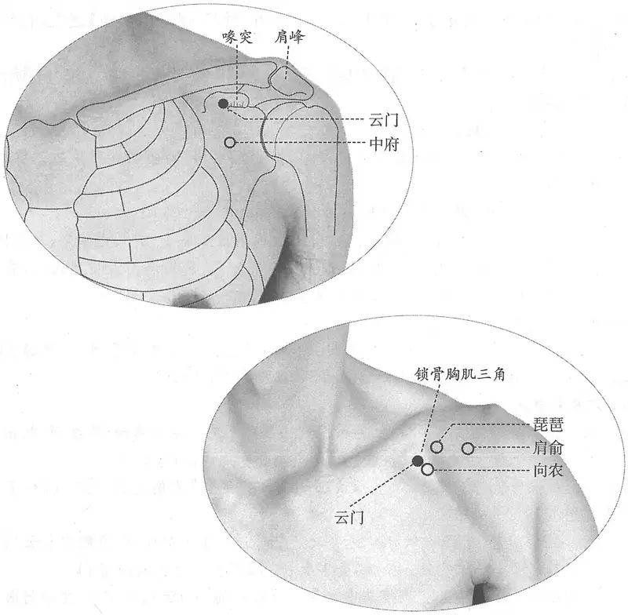

**图 2-5　云门穴与相关穴图**

时收缩，从而也可以在体表清楚地显示出三角肌胸肌三角。

　　(3) 喙突尖的体表触诊技法：喙突起自肩胛骨外侧角附近，向上并稍弯向前外方。当臂下垂时，它几乎指向前方。在三角肌胸肌三角窝的外侧中部摸到喙突尖。如为胖人，喙突在两上肢下垂时不易触及，可于上臂外展并后伸时摸到。

　1. 《黄帝明堂经》佚文

　　(1) 在巨骨下，气户两旁各二寸陷者中，动脉应手。举臂取之。（《针灸甲乙经》卷三、《千金要方》、《千金翼方》、《医心方》、《太平圣惠方·针经》、《铜人腧穴针灸图经》、《十四经发挥》）

　　(2) 在巨骨下，胸中行两旁相去同身寸之六寸，动脉应手，举臂取之。（《素问·刺热》王冰注）

　　(3) 在巨骨下，气户两旁各二寸陷者中，横去旋机旁六寸。（《医心方》卷九）

　2. 在巨骨下，夹气户旁各二寸陷中。去膺中行各六寸，递相去寸六分。（《针灸资生经》卷一）

　3. 巨骨下，夹气户旁二寸陷中，动脉应手，举臂取之，去胸中行任脉两旁相去各六

〔p.125 (인쇄 105)〕

寸。（《针灸聚英》卷一）

　4. 在巨骨下二骨间，夹任脉璇玑穴两旁各六寸，动脉应手，举臂取之。（《针方六集》卷一）

**按**：此欲调和《黄帝明堂经》与《山眺经》二说，但此二说实不可调和，置于一处，难以自洽。

　5. 锁骨下外端陷中，约当璇玑外六寸处。（《针灸十四经穴位考订》）

　6. 统编针灸学教材

　　(1) 在巨骨下夹气户旁开二寸陷中。取穴：正坐或仰卧，适当锁骨下窝外端，与璇玑相去六寸处取之。（1957年南京《针灸学》）

　　(2) 锁骨外端下面凹陷中，距任脉六寸。取穴：仰卧，在中府穴之上相隔一肋，与任脉璇玑穴相平处陷中取之。（1版《针灸学讲义》）

　　(3) 在巨骨下，气户足阳明经两旁各二寸陷者中。取穴：在中府上方，锁骨外端下方，当胸肌三角之外侧凹陷中取穴，距任脉六寸。（2版《针灸学讲义》）

　　(4) 前正中线旁开6寸，锁骨下缘。（4版《针灸学》）

　　(5) 胸前壁外上方，距前正中线旁开6寸，当锁骨外端下缘凹陷中取穴。（5版《针灸学》）

　　(6) 在胸前壁的外上方，肩胛骨喙突上方，锁骨下窝凹陷处，距前正中线6寸。（6、7版《针灸学》）

　　(7) 在锁骨外端下方凹陷中，距任脉六寸。（《中国针灸学》）

**文献分析**：关于本穴定位，多依据《黄帝明堂经》，然而在将古代文献的描述转换为现代解剖学术语的过程中出现了不相吻合的现象。古代文献所述本穴部位有两个明显的解剖学标志：第一，在巨骨下胸中行旁6寸凹陷中，而胸外侧的明显凹陷即三角肌胸肌三角。第二个非常重要的条件是“动脉应手”，这一点可以通过表面解剖学的方法加以检验。本穴定位，古代文献均遵从《黄帝明堂经》之说。明代《针方六集》以《黄帝明堂经》之文理解《山眺经》之意，欲调和二说，然而现实是此二说不可调和——因二者非同一穴。另外本穴与喙突和锁骨的关系是：处于喙突的内侧（而不是上方），锁骨的外侧（而不是外端），针灸学教材的描述欠准确。例如“锁骨外端”是指锁骨肩峰端（在肩部而不在胸部），与本穴的位置相差甚远，因此只能说锁骨外侧，不可说“外端”；此外，胸肋未及本穴之外，因此说“在中府穴之上相隔一肋”也不正确；“肩胛骨喙突上方，锁骨下窝凹陷处”所指非同一个部位，此系1990年版国家标准《经穴部位》之误，正确说法是“喙突内侧”。针灸学教材关于本穴的定位忽略了一个非常重要的条件——“动脉应手”。锁骨之下，喙突内侧，正是腋动脉的体表触诊点。这一方面说明古人手指触觉非常灵敏，另一方面也可检验今天定位是否正确。进一步研究还发现，在半举臂条件下，不仅锁骨之下，喙突内侧的凹陷可以清晰显现，而且脉动也更明显，说明古人的观察非常仔细、准确。因此，本穴古代文献“举臂取之”的取穴法是符合解剖学原理的。

#### 【类属】 

手太阴肺经穴。宋以前文献中关于本穴的脉气所发有三说，归经有两种。

**脉气所发：**

　1. 足太阴脉气所发。（《黄帝明堂经》、《外台秘要》、《医心方》、《素问·水热穴论》王冰注、《太平圣惠方·针经》）

　2. 手太阴脉气所发。（《素问·气穴论》王冰注、《素问·刺热》王冰注）

　3. 太阴脉气所发。（《针灸甲乙经》卷三、《铜人腧穴针灸图经》卷中）

〔p.126 (인쇄 106)〕

**归经：**

　1. 足太阴经。（《黄帝明堂经》、《外台秘要》、《医心方》、《太平圣惠方·针经》）

　2. 手太阴经。（《铜人腧穴针灸图经》卷上）

**按**：云门穴，杨上善注《黄帝明堂经》及《外台秘要·明堂》、《太平圣惠方》均作“足太阴脉气所发”，王冰注《素问·水热穴论》云门穴谓“足太阴脉气所发”，新校正[^20-1]曰“《甲乙经》同”，则各种《黄帝明堂经》传本皆同。然而王冰注《气穴论》篇、《刺热》篇云门穴并作“手太阴”，所以前后不一者，盖因《黄帝明堂经》载云门穴部位“在巨骨下气户两旁各二寸陷者中，动脉应手，足太阴脉气所发”，王冰未能详察，将应属上读之“手”字误属下读。《铜人腧穴针灸图经》从王冰注《气穴论》篇、《刺热》篇之说，将该穴归入手太阴经，但卷中仍作“太阴脉气所发”，与传世本《针灸甲乙经》同。从腧穴部位看，云门穴正在脾经线上，归入足太阴经穴似无不可。宋以后腧穴书多从《铜人腧穴针灸图经》之说。如果归入脾经，那么肺经、脾经穴在胸部的连线就很难画，这也是本穴归经变化的因素之一。

#### 【适应症】 

主治胸、肺部病症。常用于咳嗽、气喘、胸满、胸痛；肩臂痛。

**备选适应症**：喉痹；无脉症。

　1. 云门、髃骨、委中、髓空，此八者，以泻四支之热也。（《素问·水热穴论》）

　2. 主暴心腹痛，疝积时发，上冲心。咳逆，喘不得息，坐不得卧，呼吸气索咽不得，胸中热。喉痹，胸中暴逆，先取冲脉，后取三里、云门皆泻之。肩痛不可举，引缺盆。脉代不至寸口，四逆，脉鼓不通。（《黄帝明堂经》）

**按**：《黄帝明堂经》所记载本穴主治特点表现出一种“气上冲逆”的症候：心疝上冲、胸中暴逆、脉鼓不通。值得注意的是，对于“脉代不至寸口”的治疗，临床一般多取经渠、太渊、太溪等下部动脉穴，而这里则取上部之动脉穴（腋动脉的体表触诊点）“云门”，机理详见下文。

　3. 呕逆气上，胸胁彻背痛。（《太平圣惠方·针经》）

　4. 治喉痹，胸中烦满，气上冲心，咳喘不得息，胸胁短气，肩痛不得举臂。（《铜人腧穴针灸图经》卷中）

　5. 治胸膈满闷，两胁疼，泻补。（《窦太师针经》、《针方六集》）

　6. 瘿气。（《针灸聚英》卷一、《古今医统》、《针灸大成》、《针方六集》）

**按**：此条主治症系高武从《针灸资生经》转引《千金要方》灸云门穴方主治症。

　7. 统编针灸学教材

　　(1) 咳逆，喘不得息，胸胁背痛，肩痛，胸中烦满。（1957年南京《针灸学》）

　　(2) 咳嗽，喘不得息，胸胁痛，肩痛，胸中烦满。（1版《针灸学讲义》）

　　(3) 咳嗽，气喘，胸中热，胸痛，肩背痛，胸中烦满。（2版《针灸学讲义》、4版《针灸学》）

　　(4) 咳嗽，气喘，胸痛，肩痛。（5版《针灸学》）

　　(5) 咳嗽，气喘，胸痛，肩关节内侧痛。（6版《针灸学》）

　　(6) 咳嗽，气喘，胸痛等肺部病证；肩背痛。（7版《针灸学》）

　　(7) 咳嗽，气喘，胸中烦满，胸痛，肩臂痛。（《中国针灸学》）

**文献分析**：本穴主治，古代腧穴文献皆与《黄帝明堂经》一脉相承。其中《太平圣惠方》所载主治不能排除引自《山眺经》之奇穴“云门”主治。从《素问》经穴看，更加强调了本穴治疗上肢病的作用，《黄帝明堂经》则有更为详细的描述。现代肌肉起止点疗法等新兴针灸疗法对本穴的应用也集中于肩臂部病症。从腧穴文献与治疗文献的记载比较来看，吻合度很高，均主治胸、肺部病症。而《黄帝明堂经》最早记载的治疗肩臂部病症（类似胸廓上口综合征），由于一直没有得到正确理解而未被重视，但现代新发现的与本穴相关的穴位，以及相关新疗法的应用，均提示了云门穴在治疗这类病症上的重要意义，且作用机制明确，应引起针灸临床的足够重视。至明代《针灸聚英》增“瘿气”一症，系从《针灸资生经》转录《千金要方》针灸方主治，而此方凡两见，一主瘿，一无瘿，尚不能确定云门是否确有此效，故暂不收录于主治项下。又《黄帝明堂经》所记载的本穴主治表现出一种“气上冲逆”的症候，针灸学教材在总结本穴主治时，没能体现出这一特点。

[^20-1]: 本书所有“新校正”，均指宋代高保衡、林亿等人在王冰《素问》注本基础上的新校正。

〔p.127 (인쇄 107)〕

#### 附：临床应用举例 

　1. 上气，胸满，短气，咳逆，灸云门五十壮。（《千金要方》卷十八、《千金翼方》）

　2. 瘿，上气，胸满，灸云门五十壮。（《千金要方》卷二十四、《千金翼方》）

　3. 灸咳嗽法，又方灸云门。（《医心方》卷九）

#### 【操作】 

①斜刺：向胸壁外侧斜刺0.5~1寸，使针感向胸胁部放散，治疗咳嗽、胸痛；②斜刺：针尖直对病所，进针1寸，得气后用提插补泻手法，配合间歇捻针，使针感向肩关节周围放散，治疗肩关节内侧痛。不可向内侧深刺，以免刺伤胸膜和肺脏。

　1. 刺入七分，灸五壮，刺太深令人逆息。（《黄帝明堂经》）

　2. 禁不可刺。（《千金翼方》卷二十八）

　3. 通灸，禁针。（《太平圣惠方·针经》）

　4. 《甲乙经》云灸五壮，针入三分，刺深使人气逆，故不宜深刺。（《铜人腧穴针灸图经》卷中）

　5. 窦太师针灸遗存

　　(1) 针入一分，沿皮向外一寸半，禁灸。（《窦太师针经》）

　　(2) 针入一分，沿皮向外一寸五分。（《循经考穴编》上）

　6. 针入二分，若深刺，令人气逆，可灸五壮。（《医学纲目》卷八）

　7. 禁针，灸五壮。（《医学入门》卷一）

　8. 针三分，灸五壮。（《针灸十四经穴位考订》）

　9. 统编针灸学教材

　　(1) 针三至五寸深刺则令人气短促，灸三至七壮。（1957年南京《针灸学》）

　　(2) 针三至五分，不宜深刺，灸三至七壮。（1版《针灸学讲义》）

　　(3) 直刺3-5分，艾条灸3-7分钟。（2版《针灸学讲义》）

　　(4) 向外斜刺或平刺0.5~0.8寸。（4版《针灸学》）

　　(5) 向外斜刺0.5~0.8寸，不可向内侧深刺，以免伤及肺脏。（5、6、7版《针灸学》、《中国针灸学》）

**按**：古代文献中以《窦太师针经》记载较具体，现代临床多从之。要之，不可向内侧直刺过深，以免刺伤胸膜和肺脏，造成气胸。

#### 刺法及主治的解剖学基础 

本穴下方紧邻胸膜与肺脏，若针向内侧深刺，可刺入胸腔内，损伤胸膜和肺，导致气胸。故针刺云门穴时，进针点应在喙突的内侧缘，并稍离开锁骨下缘。针的方向应垂直向后或稍偏向外侧，严禁向内侧深刺。

古代文献所载云门穴主治主要是胸、肺部病症和肩臂部病症。现代针灸临床，特别是肌肉刺法等新兴疗法以及按摩法，更多应用本穴治疗肩臂部病症。对此《黄帝明堂经》有详细的描述：“肩痛不可举，引缺盆。脉代不至寸口，四逆，脉鼓不通”。本穴主治胸、肺病症与作用于胸神经、肌肉有关，此处有三角肌的前束、胸大肌上部、喙锁韧带、喙突，而肩臂部病症与臂丛神经和锁骨下动脉的功能障碍有关，臂丛神经及锁骨下动脉正从该穴内侧穿过。臂丛和锁骨下动脉在胸廓上口和肩胛骨喙突胸小肌附着部之间受到压迫可引起胸廓出口综合征。1959年上海第一医学院《常用经穴解剖学定位》从本穴针刺臂丛外侧束，麻感向手指放射，用于治疗肩臂痛、雷诺氏病，疗效显著。

〔p.128 (인쇄 108)〕

从肌肉方面来看，斜角肌与第一肋构成胸廓出口。腋动脉（锁骨下动脉）和臂丛神经经前、中斜角肌走行于第一肋和锁骨之间。相关部位：肩上方和肩胛骨内侧下方，下臂前下方、前臂桡侧下方至拇指和手指，特别是食指。

胸小肌：臂丛正好从胸小肌的喙突连接处的下方通过，胸小肌紧张可累及神经，引起上臂麻木，特别是抬高上臂时。相关部位：沿上臂掌侧面直至最后三个手指。

云门穴处有三角肌的前束、胸大肌上部、喙锁韧带、喙突，臂丛及锁骨下动脉正从该穴内侧穿过。如果此处的软组织损伤压迫臂丛或动脉、静脉，即可出现肩臂疼痛、桡动脉搏动减弱甚至消失、上肢发凉等症状，牵拉患侧上肢并将头颈向对侧推移时，症状明显或加重，锁骨上方可触得搏动及震颤，有时可听得杂音，有压痛，压迫时症状加重。即所谓臂丛下部综合征、胸廓上口综合征。对于此病症，《内经》记载了一种“解结”针法：“一经上实下虚而不通者，此必有横络盛加于大经，令之不通，视而泻之，此所谓解结也。”（《灵枢·刺节真邪》）

本穴与中府相距仅一寸，但本穴主治更偏重于上肢病症。肩痛不可举，可以取的穴很多，而“痛引缺盆”才是云门的适应症。寸口无脉，上肢寒凉，且云门穴上方脉动甚者（脉鼓不通），才是云门穴的最佳适应症。可见古人的观察是多么的细微与准确！出现这样一组症状，通过针刺或按摩云门穴可有效地治疗。因此，《黄帝明堂经》不仅是世界上对上述综合征的最早描述，同时也是世界上最早的对此症的有效治疗报道。可惜这些十分典型而准确描述的症状被后世忽略了。

躯干部上、下端的穴位能治疗上、下肢的疾病，是由于躯干上、下端体节的前外侧分别外移迁出参与组成上、下肢，这些穴位与上肢或下肢是由同节和邻节神经节段相联系。问题是，数千年前，没有神经解剖学知识的古人是如何认识到这一规律的？

### （三）天府 Tiānfǔ LU3 出《灵枢》、《素问》 

问题1：天府既是脉名，又是穴名，如何辨识？

问题2：本穴古代定位在上臂内侧“动脉中”，现代定于肱二头肌外侧，日本定于内外侧之间，为何有这些不同变化？

问题3：本穴定位变了，解剖层次与主治病症、刺法却未随之而变，对于这种名实分离的现象，为什么几十年来学术界尚未清醒地意识到？

#### 【提要索隐】 

《内经》中之“天府”更多的是用作脉名，由于针灸“诊-疗”一体的特征，“天府”由诊病之脉变为治病之穴，原先的诊脉病候也即成为腧穴的主治病症，这是一个典型的由脉到穴的演变实例。

**部位**：在臂前区，腋前纹头下3寸，肱二头肌桡侧缘处。**按**：今之天府已非古之天府。

**适应症**：主治鼻部、肺部病症。常用于鼻衄；咳嗽，气喘；瘿气；上臂痛。**新增**：目疾；肺痨。

〔p.129 (인쇄 109)〕

**备选适应症**：紫白癜风。

**针刺操作**：直刺0.5~1寸。

#### 【名实考】 

本穴的名称、部位，均见于《灵枢》、《素问》，而对于该穴部位、主治、刺灸法的完整记述则始于《黄帝明堂经》。“天府”穴名源于“天府”脉名。《内经》中“天府”之名多指诊脉部位名，而现代的天府穴定位已经发生了很大的改变，但主治、部位描述、穴区层次解剖等所依据的却基本还是古典文献，这种名实严重不合的现象，长期以来还没有被学术界认识到。

　1. 天府脉　在腋内下脉动处。

　　(1) 腋内动脉，手太阴也，名曰天府。（《灵枢·本输》）

　　(2) 腋下动脉，臂太阴也，名曰天府。（《灵枢·寒热病》）

　　(3) 病本于肺。天府绝，死不治。（《素问·至真要大论》）

　2. 天府穴　古代定于腋下三寸，臂臑内廉动脉中。现代定于腋前纹头下3寸，肱二头肌桡侧缘处。需要注意的是，古代文献关于本穴部位描述中“臂臑”是指部位名，而不是穴名。

　　(1) 天府二穴……大禁二十五，在天府下五寸。凡三百六十五穴，针之所由行也。（《素问·气穴论》）

　　(2) 天府，杨上善注肺为上盖，为府藏之天，肺气归于此穴，故谓之天府。在腋下三寸，臂臑内廉动脉，手太阴脉气所发。注曰：臑，在肩下肘上。动之脉，手太阴脉所动也。（《黄帝内经明堂》）

　　(3) 穴名天府者，本经之脉初离胸而入臂，为本经诸穴最高之处，故曰天焉；曰府者，以统本经之气，而由臂下肘，灌注于本经诸穴也。（《经穴解》）

**文献分析**：关于本穴名称，《灵枢·寒热病》曰：“颈侧之动脉人迎。人迎，足阳明也，在婴筋之前。婴筋之后，手阳明也，名曰扶突。次脉，足少阳脉也，名曰天牖。次脉，足太阳也，名曰天柱。腋下动脉，臂太阴也，名曰天府。阳明头痛，胸满不得息，取之人迎。暴瘖气鞕，取扶突与舌本出血。暴聋气蒙，耳目不明，取天牖。暴挛痫眩，足不任身，取天柱。暴瘅内逆，肝肺相搏，血溢鼻口，取天府。此为天牖五部。”同样的内容又见于《本输》篇，可见“天府”乃天牖五部之一，与肺经、肺脏之高无涉，杨上善、岳含珍之解皆未得其真。

一般而言，由脉演变而来的穴，在部位与主治上是统一的，而对“天府”而言，其脉与穴是分离的，随着脉与穴部位的分离，二者所主病症也渐渐发生改变。《内经》及《黄帝明堂经》所载之“天府”主治多为天府脉的诊疗病症。

日本针灸学教材关于本穴的定位，经过了一个从最初定位在上臂屈面尺侧，到尺、桡侧之间，到现在的桡侧的演变过程。有意思的是，最先用现代解剖学术语，将天府穴（以及侠白穴）定于“肱二头肌外侧缘”的也是日本针灸书。中国针灸教材一开始就将本穴定于肱二头肌桡侧，然而半个多世纪过去了，针灸界仍未建立起本穴部位、层次解剖、主治、刺法相统一的穴位单元，原因是学术界尚未意识到本穴存在着严重的名实分离的现象。

#### 【定位】 

**部位**：在臂前区，腋前纹头下3寸，肱二头肌桡侧缘处。（图2-6）

**取穴**：坐位，微屈肘，在腋前纹头与尺泽连线的上1/3与下2/3交点的高度，于肱二头肌桡侧缘处取穴。

　1. 在腋下三寸，臂臑内廉动脉。（《黄帝内经明堂》、《十四经发挥》卷中）

〔p.130 (인쇄 110)〕

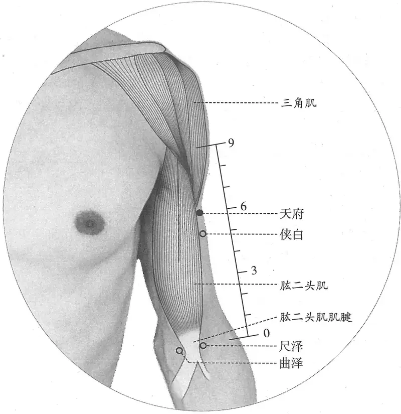

**图 2-6　天府穴图**

（图中的标尺单位为同身寸。本书后同）

　2. 在两腋下三寸宛宛中是穴。（《太平圣惠方·针经》）

　3. 在腋下三寸，臂内廉。（《铜人腧穴针灸图经》卷上及卷下“穴腧都数”）

　4. 在腋下三寸，肘腕上五寸。（《窦太师针经》）

　5. 简易取穴法

　　(1) 在腋下三寸动脉中，以鼻取之。（《铜人腧穴针灸图经》卷下、《圣济总录》、《针灸资生经》、《针灸集书》、《针灸聚英》、《古今医统》、《医学入门》）

**按**：“以鼻取之”法见《外台秘要》卷三，宋以后文献也有具体说明。

　　(2) 又法：以伸手直，用鼻尖点到处是穴。又法：以直与奶相平是穴。（《窦太师针经》、《针方六集》、《循经考穴编》）

　　(3) 腋下三寸，肘腕上五寸动脉中，用鼻尖点墨，到处是穴。（《针灸大成》卷六、《针灸易学》）

　　(4) 在臂臑内廉，腋下三寸，动脉陷中，以鼻取之。（《类经图翼》卷六、《医宗金鉴·刺灸心法要诀》、《针灸逢源》）

　6. 腋下三寸，臂之内侧直对尺泽。（《针灸十四经穴位考订》）

　7. 针灸铜人及铜人图天府穴定位

　　(1) 上臂屈面桡侧：明正统铜人、明嘉靖铜人、光绪铜人、明清明堂图；朝鲜古代铜人、日本东京博物馆铜人。

〔p.131 (인쇄 111)〕

　　(2) 上臂屈面尺侧：《针灸捷径》、明成化史素铜人图、明弘治丘濬铜人图、明太医院铜人图、《经穴指掌图》。

　8. 统编针灸学教材

　　(1) 部位：在上臂部腋下三寸。取穴：以手下垂靠着胸部侧边，手掌向前，当腋窝横纹之前端，与尺泽穴成一直线，在腋横纹下行三寸处取之。（1957年南京《针灸学》）

　　(2) 部位：腋下三寸臑内廉动脉中。取穴：垂臂手掌向前，当腋横纹前端与尺泽穴呈直线的上三分之一，适与乳头相平处取之。（1版《针灸学讲义》）

　　(3) 部位：腋下三寸臑内廉动脉中。取穴：在上臂内侧，尺泽手太阴经上方，肱二头肌桡侧，当腋纹头至肘横纹尺泽连线的上1/3折点取穴。（2版《针灸学讲义》）

　　(4) 腋前皱襞上端向外的水平线下3寸，肱二头肌外缘。（4、5、6版《针灸学》）

　　(5) 肱二头肌桡侧缘，腋前纹头下3寸处。（7版《针灸学》）

　　(6) 上臂内侧，腋纹头下三寸，当肱二头肌桡侧。（《中国针灸学》）

**文献分析**：古代文献对于本穴定位的描述明确作“臂臑内廉动脉中”，早期的针灸学教材也同。而已知上臂肱动脉沿上臂尺侧肱二头肌内侧沟下行，此处已相当于今之手少阴经穴分布区域（手太阴脉与手少阴脉在上臂循行部位有一个漫长的互易过程）。关于本穴部位的文字描述，虽然古代文献均采用《黄帝明堂经》之说“腋下三寸，臂臑内廉动脉中”，但是在明正统仿宋针灸铜人上，本穴连同其下方的“侠白”、“尺泽”均标注于上臂屈面桡侧，且除明代太医院所修之铜人图、明代施沛《经穴指掌图》外，其他传世中国古代针灸铜人、铜人图、明堂图，上臂手太阴经穴均标于桡侧。再根据《铜人腧穴针灸图经》新增的另一取穴法“以鼻取之”（后世文献有更为具体的说明——“以伸手直，用鼻尖点到处是穴”），也可看出天府穴定于臂桡侧。这些都说明最晚在北宋天圣年间针灸腧穴国家标准制订者们已根据手太阴经脉的循行分布，将上臂手太阴经穴定于臂屈面桡侧。只是由于表面解剖学知识的缺乏，没有意识到臂屈面桡侧已经不能触及到动脉搏动，因而在定位描述中仍保留了“动脉中”三字。基于此，经穴定位的国家标准及WHO标准，均定天府于上臂桡侧，不再以动脉定位，与《灵枢·经脉》手三阴在上臂的分布相合。另需注意的是，《黄帝明堂经》本穴定位“臂臑内廉动脉中”之“臂臑”非指臂臑穴，而是指上臂这一部位，如《黄帝内经太素·经筋》“循臂阴入腋下……”，杨上善注曰：“臂臑内为臂阴也”。

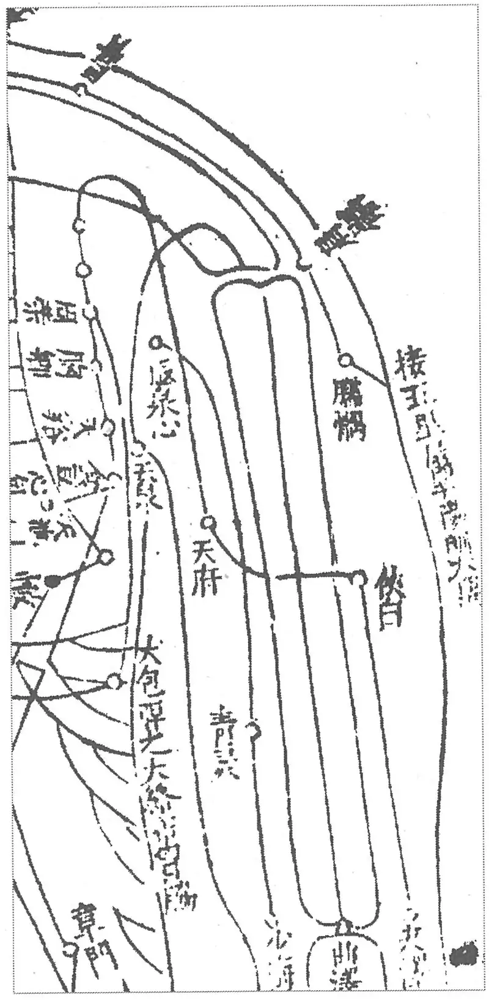

**图 2-7　明　施沛《经穴指掌图》天府、侠白、尺泽穴定位**

《窦太师针经》“肘腕上五寸”系将本穴与“侠白”穴定位相混。

另需说明的是，《铜人腧穴针灸图经》所载之简易取穴法原文见《外台秘要》卷三引《深师方》灸方：“又疗脉浮大，鼻中燥，如此必去血鼻衄方。灸两臂中脉取止。取臂脉法，以鼻嗅

〔p.132 (인쇄 112)〕

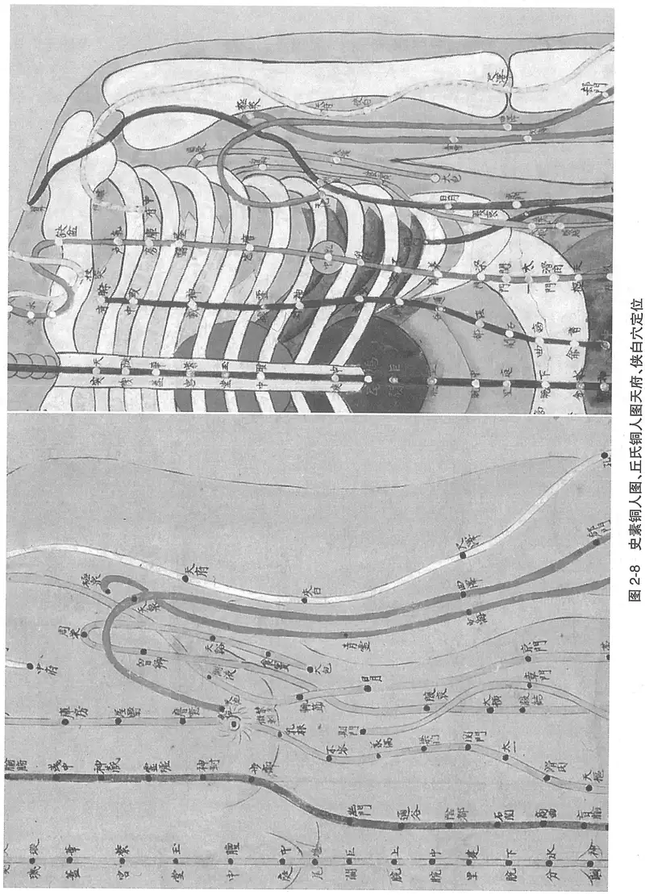

**图 2-8　史素铜人图、丘氏铜人图天府、侠白穴定位**

〔p.133 (인쇄 113)〕

臂，点其鼻所著处是穴，两臂皆尔。”这里所谓“臂脉”，并未谓明言“天府”，作为一种灸方书所述之临床简易取穴法仅供参考，定位仍当以《黄帝明堂经》为准。

#### 【类属】 

手太阴肺经穴。

手太阴脉气所发。（《黄帝内经明堂》）

#### 【适应症】 

主治鼻部、肺部病症。常用于鼻衄；咳嗽、气喘；瘿瘤；上臂痛。

**备选适应症**：紫白癜风。

　1. 暴瘅内逆，肝肺相搏，血溢鼻口，取天府。（《灵枢·寒热病》、《针灸甲乙经》、《黄帝内经太素》）

　2. 主咳，上气不得息，暴瘅内逆，肝肺相搏，鼻口出血，此胃大输。身胀，逆息不得卧。风汗出，身肿，喘喝多唾，恍惚善忘，嗜卧不觉。（《黄帝内经明堂》）

**按**：“胸中膨膨然，甚则交两手而瞀”系手太阴经“是动”病，可见于心绞痛发作。

　3. 主卒中恶风邪气，飞尸恶注，鬼语遁尸。（《千金要方》卷三十）

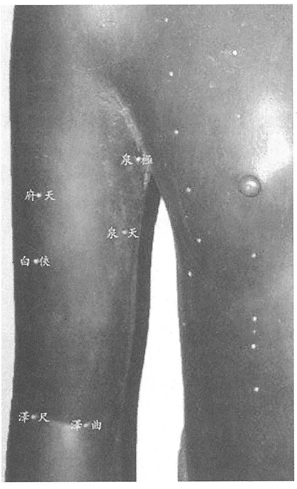

**图 2-9　明正统铜人天府、侠白穴定位**

**按**：《千金要方》此条主治病症出自一佚名“明堂”，即《黄帝明堂经》之外的另一家“明堂”类著作，特别是《千金要方》、《千金翼方》还记载了天府治疗相关病症的灸方，说明其有明确的临床依据。宋代《铜人腧穴针灸图经》录其说，宋以后针灸书多从之。

　4. 头眩目瞑，远视䀮䀮。（《太平圣惠方·针经》）

　5. 治逆气喘不得息，目眩，远视䀮䀮，卒中恶，鬼疰，不得安卧。禁不可灸，使人逆气。今附：刺鼻衄血不止。（《铜人腧穴针灸图经》卷下）

　6. 窦太师针灸遗存

　　(1) 治一切眼目红肿，去翳去星，瘰疬，紫白癜风，看症补泻。（《窦太师针经》）

　　(2) 主气目红肿，翳障，吐衄，瘿瘤，瘰疬。（《针方六集》卷五）

　　(3) 一云：紫白癜风宜灸七壮。（《循经考穴编》上）

　7. 主臑痛。（《循经考穴编》上）

　8. 主瘿气。（《针灸聚英》卷一、《古今医统》、《针灸大成》、《针方六集》、《类经图翼》）

**按**：此条主治系高武从《针灸资生经》转录《千金要方》灸方主治。

　9. 统编针灸学教材

　　(1) 气喘、鼻衄、臑痛。（1957年南京《针灸学》、1版《针灸学讲义》）

　　(2) 气喘、鼻衄、瘿气，上臂内侧痛。（2版《针灸学讲义》，4、6版《针灸学》）

　　(3) 气喘、鼻衄、瘿气，臑痛。（5版《针灸学》）

　　(4) 咳嗽、气喘、鼻衄等肺系病证，瘿气，上臂痛。（7版《针灸学》）

　　(5) 气喘，鼻衄，上臂内侧痛。（《中国针灸学》）

**文献分析**：《黄帝明堂经》所载本穴主治以肺、胸、口鼻病症为主，根据腧穴主治的一般规律，肘以上腧穴主治局部病症。然“天府”为手太阴标脉处（也是常用的诊脉部位），故主手太阴脉候。初唐《千金要方》辑录的佚名氏“明堂”则突出了本穴治疗肺痨的作用，并且于当时有明确的临床应用，宋代《铜人腧穴针灸图经》遂在本穴下增补此症。另外，宋代《太平圣惠方》、窦太师针灸及影响极广的针灸方专书《针灸集成》均表明该穴有治疗目疾的作用。然而这两个主治病症皆源出于宋以前文献，难以判断所述之天府穴位于上臂外侧还是内侧，故暂不补录。

〔p.134 (인쇄 114)〕

教材以肺部病症为主，而这些病症主要是基于“臂臑内廉动脉中”这一特定部位的针灸效应总结的，既然本穴的现代定位与古代不同，其主治病症也就不能承袭早期古代文献，而应当主要参考较晚期的文献。因此，此次修订突出本穴治疗鼻部及上臂局部病症的作用，而将原先主治肺部病症的作用置于次要位置。

#### 附：临床应用举例 

　1. 悲泣鬼语，灸天府五十壮。（《千金要方》卷十四、《千金翼方》）

　2. 瘿，恶气，灸天府五十壮，又灸胸堂百壮。（《千金要方》卷二十四、《千金翼方》）

　3. 身重嗜眠不自觉，灸天府五十壮，针入三分，补之。（《千金翼方》卷二十七）

　4. 又疗脉浮大，鼻中燥，如此必去血鼻衄方：灸两臂中脉取止。取臂脉法：以鼻嗅臂，点其鼻所著处是穴，两臂皆尔。（《外台秘要》卷三）

　5. 思噎，灸天府。（《太平圣惠方·明堂》）

　6. 睛内障，太阳、合谷、临泣、睛明、光明、风池、天府。问曰：此证从何而得？用此法针之不效，何也？答曰：怒气伤肝，血不就舍，肾水枯竭，血气耗散，初患时不能节，将恣意房室，用心过多，故得证者难治，可刺后穴：太阳、合谷、临泣、睛明、光明、风池、天府。（《针灸集成》第十二方）

#### 【操作】 

直刺0.5~1寸。

　1. 禁不可灸，令人逆气。刺入四分，留三呼。（《黄帝内经明堂》）

　2. 针入四分，留七呼，灸二七壮，不除，灸至一百壮罢。（《太平圣惠方·针经》）

　3. 针三分，灸七壮。（《窦太师针经》）

　4. 针四分，禁灸。《明堂》灸五壮。（《针灸十四经穴位考订》）

**按**：此处所说“明堂”是指《西方子明堂灸经》。

　5. 统编针灸学教材

　　(1) 以手平举，针三至五分。（1957年南京《针灸学》）

　　(2) 直刺3~5分。（1、2版《针灸学讲义》）

　　(3) 直刺0.5~1寸。（4、5、6、7版《中国针灸学》）

**文献分析**：古代文献所言“禁灸”是针对位于大脉中的“天府”而言，现代的定位已不在脉中，加之今之临床多用艾条间接灸，不存在安全问题。

### （四）侠白 Xiábái LU4 出《黄帝明堂经》 

问题1：侠白穴之“侠”字，读xia，还是jia？穴名的规范写法是“侠白”，还是“夹白”？

问题2：本穴定位古代较早文献定在上臂内侧“动脉中”，而宋以后铜人及铜人图、明堂图有定于上臂外侧者，中国现代教材皆定于外侧，日本教材定于内外侧之间，为何有如此之变？

〔p.135 (인쇄 115)〕

问题3：本穴主治，《黄帝明堂经》描述为“心痛，咳，干呕，烦满”，所述何病？

#### 【提要索隐】 

**穴名**：宋以后针灸文献有作“夹白”、“挟白”。

**部位**：在臂前区，腋前纹头下4寸，肱二头肌桡侧缘处。**按**：本穴定位，古今不同。

**适应症**：主治胸、肺部病症。常用于心痛、干呕、烦满；咳嗽，气喘；上臂痛。

**针刺操作**：直刺0.5~1寸。

#### 【名实考】 

侠白，“侠”与“夹”字通，读作jia，早期文献中，“夹”字多写作“侠”，例如“马刀侠瘿”（《灵枢·经脉》），“补天柱经侠颈”（《灵枢·口问》），“阳明主肉，其脉侠鼻络于目”（《素问·热论》），“刺项已下侠脊者”（《素问·疟论》），“寒气客于侠脊之脉”（《素问·举痛论》）。宋以后针灸文献可见写作“夹白”、“挟白”。足见“侠白”之“侠”字音义俱为“夹”，国际标准《标准针灸穴名》此穴下注音为“xiabai”，而当“侠”读作xia时，只有仗义、重义的义项，与本穴“侠肺两箱”不相涉，故本穴名注音应改作“jiabai”。另外，足少阳胆经“侠溪”之“侠”也当读作“夹”（jia）。

需要特别注意的是，手太阴脉与手少阴脉在上臂循行部位有一个漫长的互易过程，由于这种经脉循行的演变，使现代针灸学教材对于本穴的定位作出相应的修订，但主治病症及刺灸法内容却未作相应的调整，没有形成一个统一的整体。

　1. 侠白白，肺色也。此穴在臂，侠肺两箱，故名侠白。在天府下，去肘五寸动脉，手太阴别动脉，谓手太阴脉动此穴也。别者，有正别之别，即经别也；有别走者，即十五络也。诸脉类此也。（《黄帝内经明堂》）

　2. 穴名侠白者，白者金也。此穴在臑腋处，故曰侠白。（《经穴解》）

#### 相关穴及刺激点 

下侠白　位于上臂屈侧桡侧缘，平齐腋前皱襞下六寸。侠白下2寸。主治风湿性心脏病，心动过速。针0.5~1.0寸。（《针灸经外奇穴图谱（续集）》）

#### 【定位】 

**部位**：在臂前区，腋前纹头下4寸，肱二头肌桡侧缘处（图2-10）。

**取穴**：天府穴下1寸，肱二头肌桡侧缘处取穴。

　1. 在天府下，去肘五寸动脉。（《黄帝内经明堂》、《铜人腧穴针灸图经》卷下、《针灸资圣经》、《十四经发挥》、《医学纲目》、《针灸聚英》、《针方六集》、《类经图翼》）

　2. 天府下，去肘上五寸。（《太平圣惠方·明堂》、《铜人腧穴针灸图经》卷上）

　3. 穴在天府下一寸，去肘五寸。广注云：外面些动脉中。（《循经考穴编》上）

　4. 尺泽上五寸。（《针灸十四经穴位考订》）

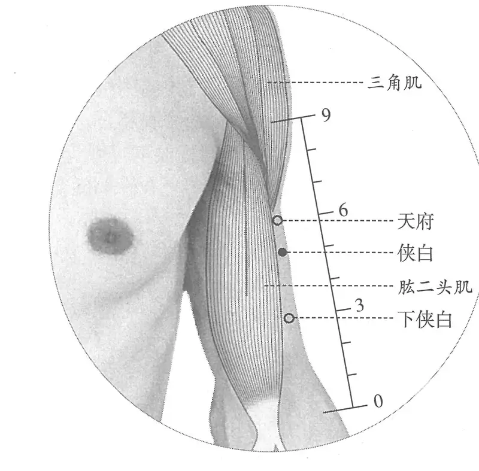

**图 2-10　侠白穴与相关穴图**

〔p.136 (인쇄 116)〕

　5. 针灸铜人及铜人图侠白穴定位

　　(1) 上臂屈面桡侧：明正统铜人、明嘉靖铜人、光绪铜人、《经穴指掌图》、明清明堂图；韩国德寿宫古代铜人、日本东京博物馆铜人

　　(2) 上臂屈面尺侧：《针灸捷径》、明成化史素铜人图、明弘治丘濬铜人图、明太医院铜人图

　6. 统编针灸学教材

　　(1) 部位：天府下一寸，肘上五寸。取穴：从尺泽穴直上行五寸，重按有动脉处是穴位。《寿世保元》取穴法：以乳头点墨两手伸直夹之，染墨处是穴。（1957年南京《针灸学》）

　　(2) 部位：天府穴下一寸。取穴：从尺泽穴直上五寸取之，重按有动脉应手。（1版《针灸学讲义》）

**按**：按如今之定位，无论如何重按，也不会触及动脉搏动，此为受古代定位的影响。

　　(3) 部位：在天府下，去肘五寸。取穴：在肱二头肌桡侧，天府下一寸取之。（2版《针灸学讲义》）

　　(4) 天府穴下1寸，肘横纹上5寸。（4、5版《针灸学》）

　　(5) 在臂内侧面，肱二头肌桡侧缘，腋前纹头下4寸，或肘横纹上5寸处。（6、7版《针灸学》）

　　(6) 在上臂内侧，天府下一寸，当肱二头肌桡侧。（《中国针灸学》）

**文献分析**：古代文献对于本穴定位的描述明确作“在天府下，去肘五寸动脉中”，而已知上臂肱动脉沿上臂内尺侧肱二头肌内侧沟下行，此处已相当于今之手少阴经穴分布区域。关于本穴部位的文字描述，虽然古代文献均采用《黄帝明堂经》之说“在天府下，去肘五寸动脉中”，但是在明正统仿宋针灸铜人上，“天府”、“侠白”、“尺泽”均标于臂屈面桡侧，且除明代太医院所修之铜人图、明代施沛《经穴指掌图》外，其他传世中国古代针灸铜人、铜人图、明堂图，上臂手太阴经穴均标于桡侧（图2-7~2-9）。这说明最晚在北宋天圣年间针灸腧穴国家标准制订者们已经将本穴定位在臂屈面桡侧。只是由于当时人们表面解剖学知识的缺乏，没有意识到臂屈面桡侧已经不能触及到动脉搏动，因此在定位描述中仍保留了“动脉中”三字。早期针灸学教材，不明此中变故，既将本穴定于上臂桡侧，复言可触及动脉搏动，好似刻舟求剑。基于此，制定新版国家标准时定侠白穴于上臂桡侧，不再以动脉定位，与《灵枢·经脉》手三阴在上臂的分布相合。

虽然历代文献对本穴距肘横纹的尺寸无分歧，皆为“五寸”，但对于距天府的距离，由于所规定的上臂折量寸有作9寸者，有作1尺者，而日本江户时期以下针灸书作1尺者为多，故本穴距天府的距离即为“二寸”。这种取穴法也影响到中国民国时期的针灸书及针灸挂图的定位。例如1933年包天白《最新考正经脉经穴挂图》、1947年赵尔康《中华针灸学》等也将本穴定位于天府下二寸，去肘五寸。

#### 【类属】 

手太阴肺经穴。

手太阴别。（《黄帝内经明堂》）

**按**：这里以“侠白”穴为手太阴之别，一般称“别”多为络脉处，犹如足太阳络穴，于飞扬穴外，另有“委阳”之别络穴。而“侠白”部位在“动脉”中，故该穴仍可能由手太阴标脉“天府脉”演变而来。

#### 【适应症】 

主治胸、肺部及局部病症。常用于上臂痛；心痛、干呕、烦满；咳嗽，气喘。

　1. 主心痛，咳，干呕，烦满。（《黄帝内经明堂》）

〔p.137 (인쇄 117)〕

**按**：《黄帝明堂经》曰“膻中，主胸痹心痛，烦满，咳逆上气，唾喘，短气不得息”，则知此处侠白主治症多为“胸痹心痛”的一组症状，这是《黄帝明堂经》手太阴经穴主治的特征性心痛，例如手太阴原穴太渊治“心痛咳逆烦闷不得卧”，经渠治“喘逆心痛欲呕”。同样性质的疼痛还见于《黄帝明堂经》所载之膻中及心之募、俞穴主治中。

　2. 治心痛，干呕，烦满。（《铜人腧穴针灸图经》卷下）

　3. 主心痛短气。（《针灸聚英》卷一、《古今医统》、《针灸大成》、《针方六集》、《类经图翼》、《循经考穴编》）

**按**：此系高武从《针灸资生经》转录《千金要方》“期门、长强、天突、侠白、中冲主心痛短气”条。而《千金要方》此条主治非抄自侠白穴主治原文。

　4. 紫白癜风。（《循经考穴编》上）

　5. 统编针灸学教材

　　(1) 咳逆，烦满，心痛，短气，干呕。（1957年南京《针灸学》）

　　(2) 咳嗽，短气，烦满，心痛，呕吐。（1版《针灸学讲义》）

　　(3) 咳嗽，短气，胸满，烦满，上臂内侧痛。（2版《针灸学讲义》）

　　(4) 咳嗽，短气，干呕，烦满，上臂内侧痛。（4版、5版、6版《针灸学》）

　　(5) ①咳嗽、气喘等肺系病证；②干呕；③上臂痛。（7版《针灸学》）

　　(6) 咳嗽，胸闷烦满，上臂内侧痛。（《中国针灸学》）

**文献分析**：本穴主治偏于心，特别是《黄帝明堂经》所载之主治，酷似《足臂十一脉灸经》所载手太阴经的病候（心痛，心烦而噫）。早期手太阴经与心相联系——入心中，其体表循行部位近于现代的手厥阴经，而本穴“侠白”相当于处在今之手少阴经循行处，故其主治病症也以心的病症为主。一般而言，腧穴部位变了，其主治病症也会随之而变，而本穴主治的这种变化直到1964年的第2版《针灸学讲义》才较清楚地表现出来。原教材本穴的主治以肺部病症为主，而这些病症主要是基于“臂臑内廉动脉中”这一特定部位的针灸效应总结而出的，既然本穴的现代定位与古代不同，其主治病症也就不能承袭早期古代文献。因此，此次修订突出本穴治疗上臂局部的病症，而将原先主治的肺部病症置于次要位置。从《黄帝明堂经》记载的本穴主治病症看，侠白穴在当时应当有较广的临床应用，而从传世针灸文献考察，该穴的临床应用很少，而且与《黄帝明堂经》记载的主治症偏离较大。这种变化可能与其定位的古今演变有关。

#### 【操作】 

直刺0.5~1寸。

　1. 刺入四分，灸五壮。（《黄帝明堂经》）

　2. 针入三分，可灸五壮。（《铜人腧穴针灸图经》卷下、《针灸十四经穴位考订》）

　3. 统编针灸学教材

　　(1) 将手平举，针三至五分，灸三至七壮。（1957年南京《针灸学》）

　　(2) 直刺三至五分。（1版《针灸学讲义》）

　　(3) 直刺3~5分，艾条灸3~7分钟。（2版《针灸学讲义》）

　　(4) 直刺0.5~1寸。（4、5、6、7版《针灸学》、《中国针灸学》）

〔p.138 (인쇄 118)〕

### （五）尺泽 Chǐzé LU5 出《灵枢》 

问题1：本穴定位从初唐就开始变化，至金元时已经与《内经》、“明堂”时代的“曲泽”穴的位置发生了互易，然而直到今天，这两个穴依然是“你中有我”，“我中有你”，没有最终完成脱胎换骨的整体转换，原因何在？

问题2：本穴治遗尿有特效吗？

#### 【提要索隐】 

需要注意的是，尺泽，既是穴名，也是脉名，且尺泽脉曾明确用作诊脉部位。

**穴名**：一名鬼受。

**部位**：在肘区，肘横纹上，肱二头肌腱桡侧缘凹陷中。**按**：本穴定位，古今不同。

**适应症**：主治肺部、咽部病症。常用于咳嗽，气喘，胸满，咳血，咽喉肿痛，上肢痛；小儿惊风；干呕，泄泻。

**针刺操作**：直刺0.5~1.2寸，或点刺出血。

#### 【名实考】 

尺泽，一名鬼受。古今文献有作“一名鬼堂”，非是。《千金翼方》卷二十七载治疗癫邪针方系辑录《千金要方》文献，其“尺泽主之”下“一名鬼堂”不见于《千金要方》原文，且与下文上星穴别名相重，有误，不从。以往中外针灸书皆据《千金翼方》将“鬼堂”作为本穴别名，非。还需要注意的是，勿将《脉经》中论脉位之“尺泽”与本穴混同。

宋以前文献以及宋以后引宋以前针灸方中“肘中动脉”即指本穴。

本穴定位，《黄帝明堂经》定于“肘中动脉”，而唐以前别家“明堂”有定于“肘屈大横纹中”，如果上处的“中”理解为“中间”，则位于肱二头肌腱桡侧，此处不能触及动脉搏动，故该文献文字描述已不再提“动脉”。至金元窦太师针灸已经明确将本穴定于“大筋外”——肱二头肌腱桡侧。中国针灸教材的定位同此说，故今之“尺泽”已非宋以前之“尺泽”，然而教材中却不时又见到古之“尺泽”影子。日本针灸教学参考书《针灸医学》仍循中国早期文献，将尺泽定于肱二头肌尺侧。尺泽穴的定位变化与手太阴经脉循行演变相关。参见“天府”、“侠白”穴提要。

　1. 入于尺泽，尺泽，肘中之动脉也，为合，手太阴经也。（《灵枢·本输》）

　2. 尺泽绝，死不治。（《素问·至真要大论》）

　3. 第十针直鼻上入发际一寸，名鬼堂，火针七锃锃三下。即上星穴也；邪病四肢重痛诸杂候，尺泽主之。尺中动脉，一名鬼受。（《千金要方》卷十四）

　4. 邪病，四肢重痛，诸杂候，尺泽主之。一名鬼堂；尺中动脉名鬼受；第十次下针，入发际直鼻上一寸，火针七锃，锃三下名鬼堂。（《千金翼方》卷二十七）

　5. 从鱼际至高骨，却行一寸，其中名曰寸口。从寸至尺，名曰尺泽，故曰尺寸。（《脉经》卷一）

　6. 入于尺泽，尺泽者，水也。在肘中约上动脉。手太阴脉之所入也，为合。（《黄帝明堂经》）

　7. 水出井泉，流注行已，便入于海。十二经脉出四肢已，流注而行，至此入五藏海。泽，谓陂泽，水钟处也。尺，谓从此向腕有尺也。一尺之中，脉注此处，流动而下，与水义同，故名尺泽。手三阴脉亦至此肘中作泽，一名作海，称皆以水名脉也。流行至此肘中，留动处之也。（《黄帝内经明堂》杨上善注）

　8. 穴名尺泽者，在肘而知尺，从腕上至此而长有尺也。肺经此穴，所入为合水，水之所

〔p.139 (인쇄 119)〕

聚为泽，故曰尺泽。（《经穴解》）

#### 【定位】 

**部位**：在肘区，肘横纹上，肱二头肌腱桡侧缘凹陷中（图2-11）。

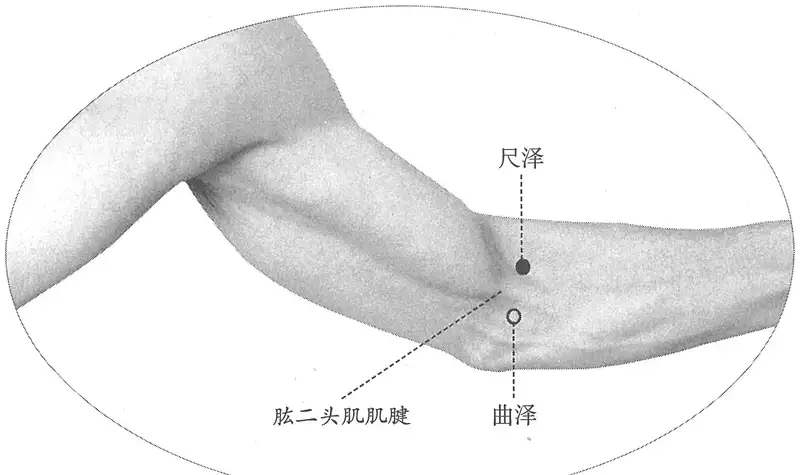

**图 2-11　尺泽穴图**

**取穴**：手掌向上，肘部微弯曲，在肘横纹上，肱二头肌腱桡侧缘凹陷中取穴。

　1. 肘中之动脉也。（《灵枢·本输》、《黄帝内经太素》）

　2. 在肘中约上动脉。（《黄帝内经明堂》、《铜人腧穴针灸图经》卷下）

　3. 有本云在肘屈大横纹中。（《黄帝内经明堂》、《医心方》卷二）

　4. 甄权云在臂屈横文中两筋骨罅陷者宛宛中。（《外台秘要》卷三十九、《太平圣惠方·明堂》、《针灸资生经》、《针灸玉龙经》、《针灸集书》、《针灸聚英》、《古今医统》、《针灸大成》、《类经图翼》、《循经考穴编》、《医宗金鉴·刺灸心法要诀》）

　5. 在腕后肘中横文。（《千金要方》卷十七、《铜人腧穴针灸图经》卷上）

　6. 在肘内廉大文中，动脉应手。（《素问·至真要大论》王冰注、《素问亡篇·刺法论》）

　7. 窦太师针灸佚存

　　(1) 在肘中大筋外陷中。（《针灸玉龙歌》注）

　　(2) 曲泽在肘横纹筋里，与尺泽穴对。筋外尺泽穴，筋内曲泽穴。（《针灸玉龙歌》注）

　　(3) 在手肘腕中横纹大筋外宛宛中。（《窦太师针经》）

　　(4) 在手肘腕中，大筋外，小筋内陷中。（《医经会元·玉龙歌》注）

　8. 在肘中约纹上动脉。广注：当微偏些，筋骨罅中。（《循经考穴编》上）

　9. 肘弯内，横纹上凹陷中，偏拇指侧。（《针灸十四经穴位考订》）

　10. 统编针灸学教材

　　(1) 部位：肘窝横纹中。取穴：手臂斜伸，手掌向上，前臂略向上，使肘少屈，从肘窝横纹中央二筋之间，稍偏桡侧，即二头肌腱之外侧，膊桡骨肌之内缘取之。（1957年南京《针灸学》）

　　(2) 部位：肘窝横纹中。取穴：屈肘，于大筋外侧陷中取之。（1版《针灸学讲义》）

　　(3) 部位：在肘中约纹上动脉。取穴：在肘横纹中，肱二头肌腱桡侧，取时微屈肘。（2版《针灸学讲义》）

〔p.140 (인쇄 120)〕

　　(4) 肘横纹中，肱二头肌腱桡侧缘。（4、5、6、7版《针灸学》）

　　(5) 微屈肘，肘横纹上，肱二头肌腱桡侧。（《中国针灸学》）

**文献分析**：本穴部位，宋以前文献多作“肘中动脉”，但是在明正统仿宋针灸铜人上，“尺泽”标于肘窝桡侧，且除明代太医院所修之铜人图、明代施沛《经穴指掌图》外，其他传世中国古代针灸铜人、铜人图、明堂图，本穴均标于桡侧。这说明最晚在北宋天圣年间针灸腧穴国家标准制订者们已将本穴定于肘中桡侧。只是由于表面解剖学知识的缺乏，没有意识到此处已经不能触及到动脉搏动，因而在定位描述中仍保留了“动脉”二字。至金元窦太师则明言本穴“在肘中大筋外陷中”、“筋外尺泽穴，筋内曲泽穴”，并不再言“动脉”。今之定位即从此说。

日本泽田派“尺泽”穴取法更靠近桡侧（见《针灸治疗基础学》），这种定穴法更多是考虑上肢肺经穴连线的流畅性——在肘部不出现一个向尺侧的屈折。

#### 【类属】 

手太阴肺经穴。五输穴之合穴。

　1. 肺出于少商……入于尺泽，尺泽，肘中之动脉也，为合，手太阴经也。（《灵枢·本输》）

　2. 手太阴脉之所入也，为合。（《针灸甲乙经》卷三）

　3. 入于尺泽，为合水也。（《黄帝内经明堂》）

#### 【适应症】 

主治肺部、咽部病症。常用于咳嗽，气喘，胸满，咳血，咽喉肿痛，上肢痛；小儿惊风；干呕，泄泻。

　1. 主心膨膨痛，肘痛，喉痹，咳逆上气，舌干胁痛，心烦满。肩背寒，心乱，少气不足以息。腹胀，喘，振栗。瘛疭，手不伸。脱肉唾浊，气隔善呕，鼓颔不得汗，烦急身痛，目吻纵衄，左窒刺右，右窒刺左。两胁下痛，泄上下出，胸满短气，不得汗，补手太阴以出其汗。癫疾，手臂不得上头。（《黄帝内经明堂》）

**按**：以上病症中“喉痹，咳逆上气，舌干胁痛，肩背寒，少气不足以息”皆系《素问·藏气法时论》所谓“肺病者”症状；“心膨膨痛，心烦满，咳、呕”为手太阴经穴所治疗的典型心痛症状；此外还包括了“癫痫”症状。“气鬲”，《史记·扁鹊仓公传》：“气鬲病，病使人烦懑，食不下，时呕沫。”

　2. 实则肩背热痛，汗不出，四肢暴肿；虚则肩背寒，短气，心烦，癫疾呕沫。（《外台秘要》卷三十九）

**按**：此系《针灸甲乙经》“列缺”穴主治，王焘误录于此。

　3. 主癫病不可向，手臂不得上头。（《太平圣惠方·明堂》）

　4. 治风痹肘挛，手臂不得举，喉痹，上气，舌干，咳嗽唾浊，四肢暴肿，臂寒，短气。（《铜人腧穴针灸图经》卷下）

**按**：“风痹肘挛，手臂不得举”，《黄帝明堂经》原主治“手不伸”、“手臂不得上头”，均作为癫痫病的一个症状，而不是痹病的症状，《铜人腧穴针灸图经》作者理解欠妥。所录“四肢暴肿，臂寒，短气”等症系传王焘之误。

　5. 窦太师针灸遗存

　　(1) 尺泽去肘疼筋紧。（《通玄指要赋》）

　　(2) 两手拘挛筋骨痛，举动艰难疾可增。若是曲池针泻动，更医尺泽便堪行。（《针灸玉龙歌》）

　　(3) 两手拘挛，肘后筋紧不能开，先补□多；腰痛宜泻之。（《窦太师针经》）

　6. 主肩背痛，汗出中风，小便数而欠，溺色变，卒遗矢无度。臂寒短气，心痛，肺胀膨膨，

〔p.141 (인쇄 121)〕

缺盆中痛，心烦闷乱，少气不足以息。（《针灸聚英》卷一、《古今医统》、《类经图翼》）

**按**：以上病症为手太阴肺经经脉病候，高武将肺经病候分别归于相应的“原穴”与“合穴”中，故列手太阴经经脉病候于合穴“尺泽”。此系高武对《难经》“母子补泻”原则的一种理解，而非来自临床实践经验的总结。

　7. 针灸歌赋主治　肘疼挛急。（《席弘赋》、《肘后歌》）

　8. 统编针灸学教材

　　(1) 咳逆唾浊，劳热喘满，喘气，胸满喉痹，胸胁胀满，肘臂挛痛，小儿惊风，遗尿。（1957年南京《针灸学》、1版《针灸学讲义》）

　　(2) 咳嗽，咳血，肺痨，潮热，气喘，咽喉肿痛，胸部胀满，小儿惊风，肘臂挛痛，乳痈。（2版《针灸学讲义》、4版《针灸学》）

　　(3) 咳嗽，气喘，咳血，潮热，咽喉肿痛，胸部胀满，小儿惊风，吐泻，肘臂挛痛。（5、6版《针灸学》）

　　(4) ①咳嗽，气喘，咯血，咽喉肿痛等肺系实热性病证；②肘臂挛痛；③急性吐泻、中暑、小儿惊风等急症。（7版《针灸学》）

　　(5) 咳嗽，咳血，潮热，气喘，咽喉肿痛，胸部胀满，小儿惊风，肘臂挛痛，乳痈。（《中国针灸学》）

**文献分析**：《黄帝明堂经》记载的本穴主治主要包括肺系病症、癫痫、呕吐、手肘病症、心痛，而古今临床应用集中体现在前四个方面。“心痛”的主治之所以淡出，与手太阴肺经病候的演变密切相关。此外，窦太师针灸佚文之一的《窦太师针经》载本穴治“腰痛”，并有相关的临床应用，待考。古代针灸方主治的病症集中于肺、胸部病症，肘臂病症，痫瘛，现代统编针灸学教材归纳的主治症也与之吻合，然古代临床应用较广的“呕哕”却不见于教材，有待临床检验。针灸歌赋所载之主治多从窦太师针灸概括。教材中关于“乳痈”的主治未详所出，也未见现代临床应用相关报道（仅见的应用于乳痈的治疗，系配合药物外用，难以判定其真实作用），故暂不收录。教材关于“遗尿”的主治则源于明代高武的理解，且除1版教材外，其他教材皆未收录，今不录之。

#### 附：临床应用举例 

　1. 肺、胸部病症

　　(1) 唾血，时寒时热，泻鱼际，补尺泽。（《黄帝明堂经》）

　　(2) 喉肿，胸胁支满，灸尺泽百壮。（《千金要方》卷六）

　　(3) 转筋在两臂及胸中者，灸手掌白肉际七壮，又灸膻中、中府、巨阙、胃管、尺泽，并治筋拘，头足皆愈。（《千金翼方》卷二十七）

　　(4) 气短不语，灸大椎随年壮。又灸肺俞百壮。又灸肝俞百壮。又灸尺泽百壮……（《千金翼方》卷二十七）

　　(5) 肺积名息奔，在右肋下：尺泽、章门、足三里。（《针灸集要·盘石金直刺秘传》）

　　(6) 肺心痛，卧若伏龟：太渊、尺泽、上腕、膻中。（《针灸集要·盘石金直刺秘传》）

　　(7) 治热劳上气喘满，腰背强痛：刺肺俞二穴，次针尺泽二穴。（《针经摘英集》）

　　(8) 吐血定喘补尺泽。（《灵光赋》）

　　(9) 咳嗽、哮喘急性发作、急性胃肠炎、不明原因发热、咽喉肿痛：均单取尺泽穴针刺治疗。［针灸临床杂志，1999，15（9）：56-57］

〔p.142 (인쇄 122)〕

　2. 臂肘病症

　　(1) 邪病，四肢重痛诸杂候，尺泽主之。（《千金要方》卷十四、《千金翼方》）

　　(2) 筋急不和难举对，穴法从来尺泽真。（《针灸玉龙歌》）

　　(3) 两手拘挛真个疼，曲池外关要升阳，复使气上即使下，尺泽中诸气下康。（《琼瑶神书》卷二）

　　(4) 肱骨外上髁炎：尺泽配压痛点，针刺尺泽穴使针尖向压痛点方向透刺。［河北中医，1994，16（2）：22］

　3. 惊痫

　　(1) 范汪方治五癫方……又方灸尺泽穴，在肘中动脉。（《医心方》卷三）

　　(2) 小儿缓惊风，灸尺泽各一壮，在肘中横纹约上动脉中，炷如小麦大。（《太平圣惠方·明堂》）

　　(3) 慢惊者，缓缓搐搦，身体温和，面色淡黄，或睡露睛，兼之大便青色，宜灸腕骨、尺泽。（《灸法秘传》）

　4. 呕哕

　　(1) 胞中有大疝瘕积聚，与阴相引而痛，苦涌泄上下出，补尺泽、太溪、手阳明、寸口，皆补之。（《针灸甲乙经》卷八）

　　(2) 葛氏治卒干呕不息方：灸两腕后两筋中一夫名间使，各七壮。灸心主、尺泽亦佳。（《肘后备急方》上卷、《千金要方》、《千金翼方》）

**按**：心主，古穴名，指大陵穴。

　　(3) 治卒哕，灸膻中、中府、胃管各数十壮，灸尺泽、巨阙各七壮。（《千金翼方》卷二十七）

　　(4) 呕吐上气，灸尺泽，在肘中，不三则七。（《千金翼方》卷二十七）

　　(5) 呕逆：中脘、尺泽。（《医学纲目》卷二十二）

　5. 腰痛

　　(1) 五种腰痛：泻尺泽，立效；未愈，昆仑。（《针灸集要·盘石金直刺秘传》）

　　(2) 腰闪挫气痛：尺泽忌灸、委中、人中、阳陵泉、束骨、昆仑、下窌。（《医学纲目》卷二十八）

　　(3) 五种腰痛，先针尺泽，后针清冷渊。（《针灸集书》卷上）

　　(4) 挫闪腰胁痛：尺泽、委中、人中。（《针灸大成》卷九）

　　(5) 腰间闪挫泻人中，尺泽先将气下冲，肾俞泻先刮先后，委中气下血流通。（《琼瑶神书》卷二）

　6. 其他病症

　　(1) 五脏一切疟，灸尺泽七壮。（《千金要方》卷十、《千金翼方》、《圣济总录》）

　　(2) 汗有自盗之分，不可以不知也。盖自汗为阳虚，不因劳动而自出也。盗汗为阴虚，睡而汗出，醒而收也。灸其尺泽，可以奏功。设未效者，膈俞灸之必然全愈。（《灸法秘传》）

#### 【操作】 

直刺0.5~1.2寸，或点刺出血。

　1. 刺入三分，留三呼，灸三壮。（《黄帝明堂经》）

　2. 甄权云不宜灸。（《外台秘要》卷三十九）

　3. 刺可同身寸之三分，留三呼，动气至，而急出之。（《素问亡篇·刺法论》）

〔p.143 (인쇄 123)〕

　4. 针入三分，可灸五壮。（《铜人腧穴针灸图经》卷下）

　5. 用手如弓，方可下针。先补后泻，针半寸，禁灸。（《窦太师针经》）

　6. 针三分，不可针深，灸五壮。（《神应经》）

　7. 刺三分，或三棱针出血，禁灸。（《医宗金鉴·刺灸心法要诀》）

　8. 针三分，灸五壮。甄权云：不宜灸。（《针灸十四经穴位考订》）

　9. 统编针灸学教材

　　(1) 针三至五分。（1957年南京《针灸学》、1版《针灸学讲义》）

　　(2) 直刺5~7分，艾条灸3~7分钟。（2版《针灸学讲义》）

　　(3) 直刺0.8~1.2寸。（4版《针灸学》）

　　(4) 直刺0.8~1.2寸，或点刺出血；可灸。（5、6、7版《针灸学》）

　　(5) 直刺0.5~1.0寸。（《中国针灸学》）

　10. 直刺0.5~1寸。感应：局部酸胀，或有麻电感往前臂放散。温灸5~10分钟。（上海《针灸学》）

### （六）孔最 Kǒngzuì LU6 出《黄帝明堂经》 

问题：孔最治痔的记载从何而来？有无可靠的临床实践基础？

#### 【提要索隐】 

**穴名**：孔最，又写作“孔冣”。

**部位**：在前臂前区，腕掌侧远端横纹上7寸，尺泽与太渊连线上。

**按**：明代文献有将本穴定位与列缺穴相混者，需注意辨识。

**适应症**：主治肺部、咽部病症。常用于发热无汗；咳嗽，气喘，咳血，咽喉肿痛；肘臂痛。

**针刺操作**：直刺0.5~1寸。

#### 【名实考】 

本穴名称，《黄帝内经明堂》、《黄帝内经太素》、《太平圣惠方·明堂》均作“孔冣”（“最”之异体字）。本穴定位，除日本泽田氏取孔最穴明言与传统取穴法不同外，在古今中外文献中，还可见一些定位文字描述虽相同，但由于前臂的骨度折量寸不同，实际定位存在明显分歧的情况。

　1. 传统经穴孔最

　　(1) 孔冣，孔者，空穴也。手太阴脉，诸脉中胜此之空穴，居此脉之郄，故曰孔最之也。手太阴郄，在腕上七寸。郄者，郄曲也。谓太阴之脉至此曲折也。腕，掌后之节也。专金，金九，水之父母，西方金位，数当于九，故曰专金金九。金生水，故曰父母也。（《黄帝内经明堂》杨上善注）

　　(2) 孔，窍也；最，高也。舒手而侧取，穴无高于此者，故曰孔最。且此穴又为过臂入肘之初穴，乃所以通上下之窍也。（《经穴解》）

　2. 日本泽田氏孔最　尺泽穴下二寸。（《针灸真髓》）

#### 【定位】 

**部位**：在前臂前区，腕掌侧远端横纹上7寸，尺泽与太渊连线上（图2-12）。

**取穴**：伸臂仰掌，在尺泽与太渊穴连线的中点上1寸处。

　1. 在腕上七寸。（《黄帝内经明堂》、《太平圣惠方·针经》、《铜人腧穴针灸图经》、《圣济总录》、《针灸资生经》、《十四经发挥》、《医学纲目》、《针灸聚英》、《古今医统》、《医

〔p.144 (인쇄 124)〕

学入门》、《针方六集》、《类经图翼》、《医宗金鉴·刺灸心法要诀》、《针灸逢源》）

　2. 在腕上七寸陷者宛宛中。（《太平圣惠方·明堂》）

　3. 在侧腕上七寸

　　(1) 在腕上七寸，上骨以近骨边宛宛中。（《针灸集书》卷下）

　　(2) 去腕上七寸，侧取之。（《针灸大成》卷六、《针灸易学》）

　　(3) 在腕侧上七寸。广注：去太渊七寸外面些。（《循经考穴编》上）

　4. 统编针灸学教材

　　(1) 部位：在腕后桡侧上七寸。取穴：手臂前伸，手掌向上，从尺泽穴对太渊穴，直线下行五寸五分处取之。（1957年南京《针灸学》）

　　(2) 部位：前臂内拇指侧，去腕七寸。取穴：伸臂仰掌，从太渊穴向尺泽穴线上取之。（1版《针灸学讲义》）

　　(3) 部位：去腕七寸。取穴：在前臂掌侧，当肘横纹尺泽与腕横纹太渊连线上，自腕横纹直上七寸取之。（2版《针灸学讲义》）

　　(4) 在尺泽与太渊穴的连线上，腕横纹上7寸。（4、5、7版《针灸学》）

　　(5) 在前臂掌面桡侧，当尺泽与太渊连线上，腕横纹上7寸。（6版《针灸学》、《中国针灸学》）

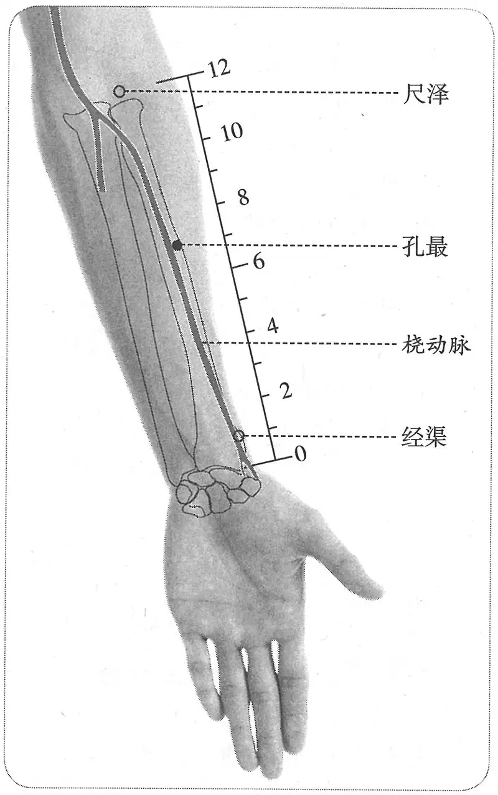

**图 2-12　孔最穴图**

**文献分析**：《针灸集书》谓本穴“上骨以近骨边宛宛中”，《针灸大成》补充“侧取穴”取法，这些内容实为手太阴络穴“列缺”的取穴，可能是混淆了此二穴的位置关系所致。本穴定位，仍以《黄帝明堂经》、《铜人腧穴针灸图经》为准。

需要指出的是，本穴定位，仅从文字上看，似乎没什么分歧，但考虑到不同时代的文献所采用的前臂折量寸不同，就会发现前臂部经穴定位，文同而实不同。本穴就是非常典型的例子，表面上看，教材的定位都是腕横纹上7寸，但1957年南京《针灸学》却注明了本穴距尺泽穴的距离“五寸五分”，显然该书采用的前臂部骨度为12.5寸，其他各版教材采用的是12寸，包天白《最新考正经脉经穴挂图》、承淡安《中国针灸学》用10寸。古代文献大多不标明各部的骨度折量寸，但已知明代《古今医统》采用的也是10寸。这样一来，虽然古今文献关于本穴的定位描述均为“去腕七寸”，由于各自采用的骨度寸不同，故定出的穴位并不在同一位置上。

#### 【类属】 

手太阴肺经穴；手太阴经郄穴。

手太阴郄……专金金九，水之父母。（《黄帝内经明堂》）

#### 【适应症】 

主治肺部、咽部病症。常用于发热无汗；咳嗽，气喘，咳血，咽喉肿痛；肘臂痛。

　1. 可以出汗。头痛，振寒，臂厥，热，汗不出。（《黄帝内经明堂》）

〔p.145 (인쇄 125)〕

**按**：“头痛，振寒，发热，汗不出”，此为伤寒表实证的典型症状。《灵枢·热病》所记载的热病发汗、止汗的经穴皆为手、足太阴经穴。

　2. 吐血失喑，肿痛恶血。（《太平圣惠方·针经》）

　3. 肘臂厥痛，屈伸难，手不及头，指不握也。（《太平圣惠方·明堂》）

　4. 治热病汗不出。此穴可灸三壮，即汗出。咳逆，臂厥痛。（《铜人腧穴针灸图经》卷下）

　5. 吐血失音，咽肿痛，头痛。（《针灸聚英》卷一、《古今医统》、《针灸大成》、《针方六集》、《类经图翼》、《循经考穴编》）

**按**：此从《太平圣惠方·针经》之说演变而来。

　6. 统编针灸学教材

　　(1) 咳逆，吐血，头痛，咽肿失音，肘臂厥痛，手指不能屈伸，热病汗不出。（1957年南京《针灸学》）

　　(2) 咳嗽，吐血，头痛，咽痛，失音，肘臂厥痛，手指不能屈伸，热病汗不出，痔痛。（1版《针灸学讲义》）

　　(3) 咳嗽，气喘，咳血，咽喉肿痛，失音，肘臂冷痛、不能屈伸。（2版《针灸学讲义》）

　　(4) 咳嗽，气喘，咳血，咽喉肿痛，肘臂挛痛，痔疾。（4、5、6版《针灸学》）

　　(5) 咯血，咳嗽，气喘，咽喉肿痛等肺系实热性病证；肘臂挛痛。（7版《针灸学》）

　　(6) 咳嗽，胸痛，气喘，咳血，咽喉肿痛，肘臂挛痛。（《中国针灸学》）

**文献分析**：本穴的主治症变化较大，从《黄帝明堂经》的伤寒表实证，到《太平圣惠方·针经》的内伤，再到《太平圣惠方·明堂》的局部病症。《黄帝明堂经》强调本穴可以出汗，故主治“头痛，振寒，发热，汗不出”伤寒表实证的典型症状。《太平圣惠方》“吐血失喑，肿痛恶血”或系《灵枢·经筋》所述“手太阴之筋……甚成息贲，胁急吐血”，息贲而发肺痈可见“吐血失喑，肿痛恶血”。明代高武将此处“肿痛”理解为“咽肿痛”（盖受前一症“失喑”影响）。

#### 附：孔最治痔溯源 

关于孔最治痔的记载，在中国古代文献只查到一条，列于下。

孔最，能发汗退热，《集成》云“灸之则汗出”。肺喉肘臂等处之病，皆与手太阴经脏有关。对于痔疾，如痔痛、痔出血等亦主之者，也当与列缺、尺泽等穴能主下腹及前阴诸病之义相同。（《金针梅花诗钞》）

此书虽系周树冬晚清作品，但直到1982年才由其孙周楣声教授整理补注后出版，即便上述文字出自周树冬先生之笔，现代中国针灸教材孔最穴下所主痔疾的记载也不可能出自此文献。经考察是出自日本文献，较早的报道见于日本泽田先生的临床经验集《针灸真髓》，该书于1941年，由其弟子代田文志整理出版，中文版出版于1958年。据泽田先生的经验，“孔最”定于尺泽穴下二寸。原文列出于下。

孔最，在前臂前面桡侧，尺泽下二寸，与手三里隔肌相对，是泽田先生的独创穴。此为痔疾要穴，能治痔痛。

治痔用孔最最有效。孔最在普通书上说去腕七寸，但应在近尺泽处取穴，即尺泽下同身寸二寸处之陷中，此处很有效，如依普通取法则不见效。孔最是肺经，肺络于大肠，所以治痔见效。

孔最的取穴法，是泽田先生所独创的，和一般书上所记的不同。与先生稍近的，是松元四郎平氏所著的《孔最类聚》中的说法，据此书说：“孔最在尺泽下三寸。”但这个三寸是以尺泽到太渊作一尺二寸计算的[^21-1]。

〔p.146 (인쇄 126)〕

——《针灸真髓》

这里明确说，孔最按传统取穴法则无效，说明中国针灸学教材中记述的“孔最”治痔疾无效。那么如何判定中国针灸学教材中关于孔最治“痔疾”记载是直接或间接来自日本泽田氏用穴经验，而不是中国针灸医生临床实践经验的总结呢？在1958年北京中医学校编写的内部教材《针灸学讲义》查得如下说明：“本间祥白：孔最治喀血、痔出血，代田文志：孔最治痔痛”（第37页）。这里所引“代田文志”即引自《针灸真髓》；“本间祥白”是指《经络治疗讲话》，著于1950年，中文版出版于1957年，书中第53页载孔最穴主治“喀血、痔出血”。由于该书引录泽田先生孔最穴主治经验时，未注明其特定的定位，之后中国的《针灸学讲义》又间接地从《经络治疗讲话》引录“孔最治痔出血”的说法，混淆了日本泽田氏“孔最”与中国传统经穴“孔最”的定位差异，遂成为后来中国针灸教材关于“孔最治痔”以讹传讹的根源。

中国张效林治疗痔疾的用穴经验则是，在尺泽与太渊连线上，用拇指按压寻找变色、凹陷或显示有指纹的点。发现最常出现的反应点有两处：其一在尺泽下3寸（称作“痔疮阿是1”），另一在太渊上3寸（称作“痔疮阿是2”）[^22-2]。均与通行的孔最穴相差很大，实际上是另一新穴，将此穴的主治归入“孔最”，欠妥。

曾用孔最治痔的针灸医生可能会困惑不解：如果说孔最穴治痔乃“张冠李戴”的讹传，可为什么有用之有效的临床报道呢？第一，用孔最治痔，往往还配其他穴；第二，刺法上多用长时间强刺激，在这种条件下，穴位的效应已经不表现为特异性。这与远端取穴治腰痛的情形相似：强刺激并配合患者主动或被动的活动，结果发现可治腰痛的“腰痛点”到处都是，也确实有效——只不过不是特效而已。

#### 附：临床应用举例 

　1. 痔疮术后痛，针刺孔最、合谷穴，直刺1寸，均用泻法，大幅度用力捻转提插，反复3次，30分钟后摇大针孔出针。［中医药研究，1997（4）：37］

　2. 鼻衄，取双侧孔最为主穴，配曲池、足三里、血海针刺。［河南中医药学刊，2002，17（5）：44-45］

#### 【操作】 

直刺0.5~1寸。

　1. 刺入三分，灸五壮。（《黄帝明堂经》）

　2. 针入三分，灸之亦得。（《太平圣惠方·针经》）

　3. 灸三壮。（《太平圣惠方·明堂》）

　4. 针五分，灸五壮。（《针灸十四经穴位考订》）

　5. 统编针灸学教材

　　(1) 针三至七分，灸三至七壮。（1957年南京《针灸学》、1版《针灸学讲义》）

　　(2) 直刺5~7分，艾条灸3~7分钟。（2版《针灸学讲义》）

　　(3) 直刺0.5~1寸。（4、5、7版《针灸学》、《中国针灸学》）

　　(4) 直刺0.5~1.2寸；可灸。（6版《针灸学》）

[^21-1]: 松元四郎平书中，将尺泽至太渊定为一尺，且其书名为《针灸孔穴类聚》，而不是《孔最类聚》。一句引文两处错误，不知是《针灸真髓》原书有误，还是译者的错误。

[^22-2]: 张效林.上肢穴注治疗痔核疗效观察[J].新中医，1991(8):33-34

〔p.147 (인쇄 127)〕

　6. 直刺1~1.5寸。感应：局部酸胀有时向前臂扩散。灸3~7壮；温灸5~15分钟。（上海《针灸学》）

### （七）列缺 Lièquē LU7 出《灵枢》 

问题1：2006年版国家标准关于本穴定位，为何增加“拇长展肌腱沟的凹陷”这一骨性标志，据何而增？

问题2：“列缺，一名童玄”从何而来？

#### 【提要索隐】 

**穴名**：本穴源出于手太阴络脉，络穴与络脉同名。古代文献或作“裂缺”。

**部位**：在前臂，腕掌侧远端横纹上1.5寸，拇短伸肌腱与拇长展肌腱之间，拇长展肌腱沟的凹陷中。

**国标修订**：1990年版国标：在前臂桡侧缘，桡骨茎突上方，腕横纹上1.5寸，当肱桡肌与拇长展肌腱之间。2006年修订版：在前臂，腕掌侧远端横纹上1.5寸，拇短伸肌腱与拇长展肌腱之间，拇长展肌腱沟的凹陷中。

**按**：“拇短伸肌腱”与“拇长展肌腱”在人体难以显现或触及，而相应的骨性标志“拇长展肌腱沟”较易触及，且早在初唐甄权《针经》就明确以此标志定本穴，故修订版国标特增加此标志，以便于取穴。

**适应症**：主治肺部、咽部及头项病症。常用于治咳嗽，气喘；半身不遂、口眼㖞斜，手腕无力或疼痛；头痛、颈项强痛；齿痛。

**备选适应症**：惊痫；遗尿。

**针刺操作**：沿拇长展肌腱沟向肘侧或腕侧斜刺或平刺。

#### 【名实考】 

列缺，《千金要方》卷十九作“裂缺”（按：“裂”同“列”）。又《古今医统》谓“一名童玄”，经考系将“龙玄”误作本穴。以往中外针灸书皆以此作为“列缺”穴的别名，非是。需要注意的是，“列缺”既是络脉名，又是络穴名。络穴即络脉的诊脉处，也多是络脉的起始处。

本穴定位，唐以前皆从《黄帝明堂经》以折量取穴，但缺少横向距离的描述，自甄权《针经》采用体表解剖标志定穴，定位更加明确，然现存诸传本所载甄权《针经》佚文不一致，实验的结果支持《太平圣惠方》“一寸五分”说。针灸学教材对于本穴的定位偏重于简便取穴法的表述，而部位的表述欠明确，今基于文献分析的结果，用标准解剖学术语对于本穴的部位进行规范化表述。

　1. 列缺，手太阴之络，去腕上一寸五分，别走阳明者。（《黄帝明堂经》）

　2. 手太阴之别，名曰列缺，起于腕上分间，并太阴之经直入掌中，散入于鱼际。其病实则手锐掌热，虚则欠㰦，小便遗数，取之去腕半寸，别走阳明也。（《灵枢·经脉》）

　3. 列缺列，行列也。此别走络，分别大经，所以称缺也。列之缺经之上，故曰列缺之也，手太阴络，去腕上一寸半，别走阳明者。（《黄帝内经明堂》杨上善注）

　4. 《针经》曰支而横者为络。此手太阴之络别走阳明者也，穴名列缺。（五卷本《铜人腧穴针灸图经》卷一）

　5. 手腕后高骨缝间列缺是也。内为手太阴肺经，外为手阳明大肠经，列缺穴交两经之中。（《针经指南》）

　6. 穴名列缺者，以此穴同经渠、太渊三穴，并列于寸口，而此穴独通于手阳明，而为手太阴之络，有缺焉，以通于阳明，故曰列缺。《内经》云：手太阴之别，名曰列缺。八法中，此穴又通任脉。（《经穴解》）

〔p.148 (인쇄 128)〕

　7. 别名　童玄、腕劳。（1957年南京《针灸学》）

**按**：此传自日本教材，“腕劳”是列缺穴的主治，作为穴位的别名，未详所出，疑有误。韩国针灸学教材不辨原委，又从中国针灸教材重复了日本教材的错误。

#### 列缺、龙渊、童玄、龙玄、龙虎穴辨 

龙渊是专治牙痛的奇穴，见于《窦太师针经》，是窦太师针灸中的常用穴。龙渊，又写作龙囦，一名龙玄。“龙”，古代文献也写作“竜”，与“童”字相近，故明代徐春甫误作“童玄”，而同时期的太医吴嘉言又写作“龙虎”。四名皆为一穴，而与列缺穴不同。

　1. 列缺二穴，一名童玄，在手太阴肺经与阳明经相连，叉手取穴，中手尽处，看其浮脉丫叉之间，灸七壮，痛立止，永不再发。（《古今医统》卷六十四）

　2. 龙渊二穴，在手侧腕交叉紫脉上。灸七壮。治牙齿疼，泻。又名龙玄穴。（《窦太师针经》）

　3. 龙囦二穴，又名龙玄，在手侧腕上，交叉紫脉上是穴。灸七壮。治牙齿疼痛，泻。（《针方六集》卷一）

　4. 龙虎二穴，在手腕侧腕上交叉紫脉中。灸七壮。治满口牙疼。（吴嘉言《医经会元·针灸原枢》卷九）

**按**：从第1、2、3条文献来看，《古今医统》编者显然是将本穴与“龙玄”相混，今人不辨，将“童玄”当作列缺穴的别名。需要指出的是，由于“列缺”与“龙玄”穴部位很相近，将此二穴相混的还不止徐春甫一人，在传世本《窦太师针经》中也可看到整理校注者的误注，详见【适应症】项下的“文献分析”。

#### 【定位】 

**部位**：在前臂，腕掌侧远端横纹上1.5寸，拇短伸肌腱与拇长展肌腱之间，拇长展肌腱沟的凹陷中（图2-13）。

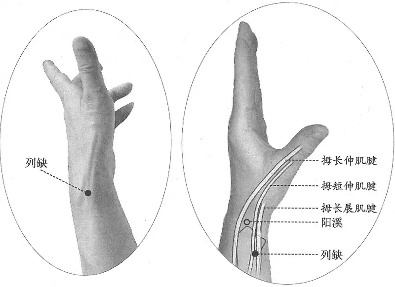

**图 2-13　列缺穴图**

〔p.149 (인쇄 129)〕

**取穴**：①侧掌，在桡骨茎突的上方，腕横纹上1.5寸处；②以病人左右两手虎口交叉，一手食指押在另一手的桡骨茎突上，当食指尖到达之处即是。

**解剖学基础**：腕侧上一寸五分处，拇短伸肌腱和拇长展肌腱多不能于体表显现，也不易触及，而拇长展肌腱沟多能触及，因此这一较明显的骨性标志应作为本穴部位描述的必要标志。

　1. 《灵枢》传本

　　(1) 去腕半寸。（《灵枢·经脉》）

**按**：“半寸”系“寸半”之倒文。

　　(2) 去腕一寸半。（《脉经》、《黄帝内经太素》）

　2. 去腕上一寸半。（《黄帝内经明堂》）

　3. 在腕后一寸五分。（《铜人腧穴针灸图经》卷上及卷下“穴腧都数”）

　4. 甄权《针经》佚文

　　(1) 甄权云：腕后臂侧三寸交叉头，两筋骨罅宛宛中是也。（《外台秘要》卷三十九）

　　(2) 去腕侧上一寸半，交叉头，两筋两骨罅宛宛中。（《太平圣惠方·针经》）

　　(3) 在腕上一寸，筋骨罅间宛宛中。（《太平圣惠方·明堂》）

　　(4) 去腕侧上一寸五分，以手交叉，头指末筋骨罅中。（《铜人腧穴针灸图经》卷下、《圣济总录》、《针灸资生经》、《十四经发挥》、《医学纲目》、《针灸集书》、《针灸聚英》、《医统大全》、《医学入门》、《针灸大成》、《类经图翼》、《循经考穴编》、《医宗金鉴·刺灸心法要诀》、《针灸易学》、《针灸逢源》）

　　(5) 在手腕后一寸半。两手相叉指头尽处，筋骨罅间取之是。（《针经指南·定八穴所在》）

　5. 窦太师针灸遗存

　　(1) 在大指直上叉手中指尽处是穴。（《针灸玉龙歌》注）

　　(2) 在手去腕一寸半，用手交叉，指头点到处是穴，筋骨罅中。（《窦太师针经》、《针方六集》）

　　(3) 在手腕侧上去腕一寸五分，以手交叉，取食指尖点到处筋骨罅间。（《循经考穴编》上）

　6. 腕后转手侧一寸五分，无名指交尽是穴。（《针灸集成》）

　7. 腕后一寸五分，桡骨头后缘两筋间。（《针灸十四经穴位考订》）

　8. 统编针灸学教材

　　(1) 部位：在腕后桡侧上一寸五分。取穴：教患者以两手之拇指食指张开，两虎口接合成交叉形，右手食指押在左手桡骨茎突上部，食指尖到达之处筋骨陷中是穴，按定下针。（1957年南京《针灸学》）

　　(2) 部位：拇指侧腕上一寸五分。取穴：以患者两手虎口交叉，食指着于腕侧上，指尖所到处筋骨陷中取之。（1版《针灸学讲义》）

　　(3) 部位：去腕上一寸五分。取穴：在桡骨茎突的上方，腕横纹上一寸五分。取穴时两手虎口交叉，当食指尖端到达的凹陷中是穴。（2版《针灸学讲义》）

　　(4) 桡骨茎突上方，腕横纹上1.5寸。简便取穴法：两虎口交叉，一手食指按在桡骨茎突上，指尖下凹陷中是穴。（4、5、7版《针灸学》）

　　(5) 在前臂桡侧缘，桡骨茎突上方，腕横纹上1.5寸。当肱桡肌与拇长展肌腱之间。（6版《针灸学》）

〔p.150 (인쇄 130)〕

　　(6) 桡骨茎突上方，腕横纹上一寸五分，或两手虎口交叉，一手食指按在桡骨茎突上，指尖下凹陷中是穴。（《中国针灸学》）

**文献分析**：本穴定位，唐以前以折量取穴，自甄权《针经》采用体表解剖标志定穴后，定位更加明确，然现存诸传本所载甄权《针经》佚文不一致。最早引用甄权《针经》佚文的《外台秘要》引作“腕后臂侧三寸”；《太平圣惠方》一作“一寸五分”，一作“一寸”。至于交叉之手指，有作“头指”、“食指”、“中指”、“无名指”之不同。通过对明确的解剖标志的实验检验可知：手腕桡侧上“两筋”为“拇短伸肌腱”和“拇长展肌腱”，“骨罅”为拇长展肌腱沟，此处无论以何指交叉均不及腕后“三寸”，而以食指交叉则与“一寸半”相合，故当以《太平圣惠方》引文为是。《铜人腧穴针灸图经》所谓“头指末”是指交叉时在上方的四指中的第一指，即食指。本穴的横向距离，《太平圣惠方》引甄权之文表述最为明确，作“两筋骨罅宛宛中”。手腕桡侧上“两筋”，为“拇短伸肌腱”和“拇长展肌腱”，“骨罅”为拇长展肌腱沟，此处正与“腕上一寸五分”相当，故可转用标准解剖学术语描述该穴的部位。

#### 【类属】 

手太阴肺经穴；络穴；八脉交会穴之一。

　1. 手太阴络……别走阳明者。（《黄帝内经明堂》）

　2. 肺出少商为井……过于列缺为源。（《千金要方》卷二十九）

　3. 通任脉，别走阳明。（《针灸玉龙经》）

　4. 列缺二穴，手太阴肺之经……合照海。（《针经指南》）

**按**：阴经无原穴，而《千金要方》将阴经络穴列为原穴，亦别为一说。

#### 【适应症】 

主治肺部、局部及头项病症。常用于咳嗽、气喘；半身不遂、口眼㖞斜，手腕无力或疼痛；头痛、颈项强痛；齿痛。

**备选适应症**：惊痫；遗尿。

　1. 《灵枢》传本

　　(1) 实则手锐掌热；虚则欠㰦，小便遗数。（《灵枢·经脉》、《脉经》）

　　(2) 手锐掌热。（《黄帝内经太素·十五络脉》）

**按**：此两种说法都有疑问，前一种与络脉的循行部位不合，后一种与络脉病候的常规格式“实则……虚则……”不合。因此，《黄帝明堂经》手太阴络穴列缺主治中未载此条病症，可能并非该书编者的疏漏。

　2. 主疟寒甚热，痫惊而有见者，并取阳明络。寒热咳唾沫，掌中热，虚则肘臂肩背寒栗，少气不足以息，寒厥交两手而瞀，吻口沫，实则肩背热痛，汗出。暴四肢肿，身湿，摇时寒热，饥则烦，饱则面变，口噤不开，恶风泣出。善忘，四肢逆厥，善笑。热病先手臂痛，身热，瘛白。瘛，唇口聚，鼻张，目下汗出如转珠，两乳下三寸坚，胁下满悸。（《黄帝内经明堂》）

**按**：此处所述主要为手太阴络脉病候和两组不同类型的小儿惊痫症状。

　3. 寒热，胸背急，喉痹，咳上气，喘，掌中热，数欠，汗出。善忘，四肢逆厥，善笑，溺白，列缺主之。（《针灸甲乙经》卷八）

　4. 甄权《针经》佚文

　　(1) 治猥退风，偏风，半身不遂。（《千金翼方》卷二十六）

　　(2) 偏风，口㖞，半身不遂，腕劳。（《外台秘要》卷三十九、《太平圣惠方·针经》）

　5. 主腕劳肘臂痛，及痎疟，面色不定。（《太平圣惠方·明堂》）

　6. 疗偏风口㖞，手腕无力，半身不随，咳嗽，掌中热，口噤不开，寒疟，呕沫，善笑纵唇口，

〔p.151 (인쇄 131)〕

健忘。（《铜人腧穴针灸图经》卷下）

　7. 窦太师针灸遗存

　　(1) 治咳嗽寒痰先补后泻；偏正头风单泻；眼泪先补后泻。（《针灸原枢·玉龙歌》注）

　　(2) 治嗽喘，寒补，热泻。头疼重如石，泻。又治牙疼，吐血，偏正头风，看虚实补泻。（《窦太师针经》）

　　(3) 嗽喘，头重如石，牙疼，偏正头风。（《针方六集》卷五）

　　(4) 喘嗽，偏正头风症。（《循经考穴编》上）

　8. 主溺血，精出，阴茎痛。（《针灸聚英》卷一、《针灸大成》、《针方六集》）

**按**：此条主治系高武从《针灸资生经》转引《千金要方》灸方主治，原文详见“附：临床应用举例”。

　9. 针灸歌赋主治　咳嗽；项强；偏头痛。（《通玄指要赋》、《针灸玉龙歌》、《四总穴歌》、《肘后歌》、《灵光赋》）

　10. 统编针灸学教材

　　(1) 偏正头痛，咳逆，咽肿，半身不遂，口眼㖞斜，口噤不开，手肘痛。（1957年南京《针灸学》）

　　(2) 偏正头痛，咳嗽，咽肿，半身不遂，口眼㖞斜，口噤不开，手肘痛，小便黄赤，频数和不利。（1版《针灸学讲义》）

　　(3) 头痛，咳嗽气喘，咽喉肿痛，半身不遂，口眼㖞斜，牙关紧闭，齿痛，手腕无力。（2版《针灸学讲义》）

　　(4) 头痛，项强，咳嗽，气喘，咽喉肿痛，口眼㖞斜，齿痛，手腕无力。（4版《针灸学》）

　　(5) 伤风，头痛，项强，咳嗽，气喘，咽喉肿痛，口眼㖞斜，齿痛。（5版《针灸学》）

　　(6) 咳嗽，气喘，咽喉痛，半身不遂，口眼㖞斜，偏头痛，颈强痛，牙痛。（6版《针灸学》）

　　(7) 咳嗽，气喘，咽喉肿痛等肺系病证，头痛，齿痛，颈强痛，口眼㖞斜。（7版《针灸学》）

　　(8) 偏正头痛，项强，咳嗽，气喘，咽喉肿痛，口眼歪斜，齿痛，手腕疼痛无力。（《中国针灸学》）

**文献分析**：《黄帝明堂经》记载的本穴主治主要是手太阴络脉病候和小儿惊痫；甄权《针经》则新增加了“偏风”而致的腕部症状；至金元窦太师又增加了“牙痛、头痛”，后世将列缺穴的作用部位定于头项盖源于此。《黄帝明堂经》载本穴主治“四肢暴肿，身湿，摇时寒热，饥则烦，饱则面色变”（又见于大都穴主治），见于《灵枢·癫狂》针灸方，原文作“风逆暴四肢肿，身漯漯，唏然时寒，饥则烦，饱则善变，取手太阴表里，足少阴、阳明之经，肉清取荥，骨清取井、经也。”从症状看，更接近足太阴病候，故归于脾经络穴“大都”更合适。值得注意的是，所载之“虚则肩背寒栗，少气不足以息，寒厥交两手而瞀，为口沫出，实则肩背热痛，汗出”，与《灵枢·经脉》手太阴经脉病候相近，而与手太阴络脉病候不同，这与络脉病候为络穴所主的一般规律不符。可能关于手太阴络脉病候，当时有不同的学说流行，其中一种由传世本《灵枢》传承，另一种则被《黄帝明堂经》引录。

针灸歌赋概括的主治大多裁自窦太师针灸，也反映了本穴主治的重点。

另外，本穴的主治古今针灸治疗文献中载录较多，本穴主治“惊痫”和前阴病症见于《黄帝明堂经》，宋以后腧穴文献没有收录此条，暂且附存备考。

关于窦太师针灸所载列缺治牙疼，还不能排除受龙渊（龙玄）穴的影响：

列缺二穴，在手去腕一寸半，用手交叉，指头点到处是穴，筋骨罅中。针入一分，沿皮向前透大渊穴一寸半，灸二七壮。治嗽喘，寒补，热泻。头疼重如石，泻。又治牙疼，吐血，偏正头风，看虚实补泻。（《窦太师针经》）

〔p.152 (인쇄 132)〕

龙渊二穴，在手侧腕交叉紫脉上。灸七壮。治牙齿疼，泻。又名龙玄穴。（《窦太师针经》）

**按**：龙渊穴首见于《窦太师针经》，取穴法与列缺近似，列缺穴下所主之牙痛，作“又治牙疼，吐血，偏正头风，看虚实补泻”，另一抄本作“并治牙痛疼”，根据该传本的体例，“又治”、“并治”以下文字系后人附注的可能性极大，而另一抄本附注的内容与奇穴“龙渊”主治相同。

#### 附：临床应用举例 

　1. 咳嗽

　　(1) 伤风、暴咳嗽、吐痰涎：泻列缺、膻中。（《针灸集要·盘石金直刺秘传》）

　　(2) 伤寒，咳嗽，寒痰：少商、列缺泻。（《针灸集要·盘石金直刺秘传》）

　　(3) 红痰咳嗽病传深，提补百劳灸共针，肺俞提从按刮弹，补从列缺艾加临，仍将三里取气下，脾俞补来提用心，中脘盘盘膏肓灸，四花提补妙中寻。（《琼瑶神书》卷二）

　　(4) 咳嗽呕吐治无因，大便闭涩又难通，诸方求药难痊疴，公孙列缺效神功。（《琼瑶神书》卷三）

　　(5) 咳嗽：合谷穴、列缺穴针灸疗法。［浙江中医学院学报，1984，8（1）：56］

　2. 头项五官病症

　　(1) 两颊红肿生疮：合谷、列缺、地仓、颊车。问曰：此证缘何而得？答曰：血气上壅，痰滞中焦，肿而不散，故口内两颊红肿生疮，如不早治，恐难治也。复刺后穴：人中、承浆、三里、金津、玉液。（《针灸集成》）

　　(2) 如头痛先刺列缺，后泻太渊。（《针灸集书》卷上）

　　(3) 牙疼内外关列缺，又觅公孙照海中。（《琼瑶神书》卷三）

　　(4) 喉闭肿痛气不通，照海列缺用金针。（《琼瑶神书》卷三）

　　(5) 列缺头疼及偏正，重泻太渊无不应。（《席弘赋》）

　　(6) 枕神经痛：风池穴、列缺穴。［中医杂志，1984，25（1）：6］

　　(7) 鼻衄：列缺穴针刺。［上海针灸杂志，1987，6（4）：42］

　　(8) 偏头痛：双侧列缺穴，针尖呈30度，快速进针，列缺穴为横刺，提插捻转轻刺激。［湖南中医药导报，1997，3（2/3）：102］

　　(9) 血管性头痛：取患侧列缺穴，针尖向肘部方向，与皮肤呈15度角刺入皮下，放平针身。［上海针灸杂志，1999，18（3）：47］

　　(10) 颈性眩晕：取双侧列缺穴，逆角向肘部方向斜刺入0.5~1寸。［针灸临床杂志，1999，15（5）：44］

　3. 偏风手臂障碍

　　(1) 风口㖞，灸列缺二穴。患左灸右，患右灸左。（《圣济总录》卷一百九十三）

　　(2) 手臂麻痹不仁：肩髃、曲池、手上廉、合谷。问曰：此证缘何而得？答曰：皆因寒热相搏，气血凝滞，故如此也，复刺后穴：肩井、列缺。（《针灸集成》第二十九方）

　　(3) 中风偏瘫：大椎穴、列缺穴针刺为主治疗。［山东中医杂志，1987（4）：17］

　4. 惊痫

　　(1) 肺疟者，令人心寒，寒甚热，热间善惊，如有所见者，刺手太阴阳明。（《素问·刺疟论》）

　　(2) 小儿惊痫，如有见者，列缺主之，并取阳明络。（《针灸甲乙经》卷十二）

　　(3) 或患伤寒热未休，牙关风壅药难投，项强反张目直视，金针用意列缺求。（《肘后歌》）

〔p.153 (인쇄 133)〕

　5. 前阴、膀胱病症

　　(1) 男子阴中疼痛，尿血精出，灸列缺五十壮。（《千金要方》卷十九、《千金翼方》）

　　(2) 术后尿潴留、尿路感染、急慢性肠炎、水肿：取列缺、偏历为主穴治疗。［中国针灸，1998（10）：602］

　　(3) 排尿困难：取百会穴和双侧列缺穴。百会穴向后平刺0.8寸，快速捻转针柄，使针体来回快速旋转200次/分左右，列缺穴，逆肺经的方向平刺1.5寸，行平补平泻手法。［中国针灸，1999（11）：680］

　　(4) 遗精：取单侧列缺穴，逆经脉循行方向平刺入穴位，以局部产生酸麻胀感为度。［中医药信息，2001，18（4）：44］

　6. 其他病症

　　(1) 健忘：列缺、心俞、神门。问曰：其证缘何而得？答曰：忧愁思虑，内连于心，外感其情，或痰涎灌注心窍，七情所感，故如此也。复刺后穴：中脘、三里。（《针灸集成》第六十方）

　　(2) 胁肋痛时频声唤，列缺内关用金针。（《琼瑶神书》卷三）

　　(3) 气刺两乳求太渊，未应之时针列缺。（《席弘赋》）

　　(4) 呃逆：列缺穴、膻中穴针刺。［江西中医药，1986（2）：36］

　　(5) 虚寒性痛经：针刺双侧列缺穴。［北京中医药大学学报，1994，17（1）：32］

#### 【操作】 

沿拇长展肌腱沟向肘侧或腕侧斜刺或平刺。

　1. 刺入三分，留三呼，灸五壮。（《黄帝明堂经》）

　2. 针列缺入三分，留三呼，泻五吸，亦可灸之，日七壮至一百，总至三百壮。（《千金翼方》卷二十六）

　3. 针入三分，留三呼，泻五吸。灸亦得，日灸七壮。若患偏风，灸至一百。若患腕劳，灸至七七。慎热食、酒、面、生冷。（《太平圣惠方·针经》）

　4. 灸三壮。（《太平圣惠方·明堂》）

　5. 针入二分，留三呼，泻五吸即可。灸七壮。（《铜人腧穴针灸图经》卷下）

　6. 针入一分，沿皮向前透大渊穴一寸半，灸二七壮。（《窦太师针经》）

　7. 针入三分，横针向臂，泻之。（《针灸玉龙歌》注）

　8. 凡治偏头风症，针头向上一寸五分；痰饮咳嗽，卧针沿皮向下，透太渊。（《循经考穴编》上）

　9. 统编针灸学教材

　　(1) 针二至三分，针尖向肘部微斜刺入，灸三至七壮。（1957年南京《针灸学》、1版《针灸学讲义》）

　　(2) 直刺5~7分，艾条灸3~7分钟。（2版《针灸学讲义》）

　　(3) 向上斜刺0.3~0.5寸。（4、5版《针灸学》、《中国针灸学》）

　　(4) 向上或向下斜刺0.3~0.8寸；可灸。（6版《针灸学》）

　　(5) 向上斜刺0.5~0.8寸。（7版《针灸学》）

　10. ①斜刺，向肘关节方向，进针0.5~1寸。感应：局部酸胀，并向肘关节扩散。②治狭窄性腱鞘炎时，可针尖向外，进针0.5~1寸。感应：局部酸胀。3~5壮；温灸，5~15分钟。（上海《针灸学》）

〔p.154 (인쇄 134)〕

### （八）经渠 Jīngqú LU8 出《灵枢》 

问题1：《素问·刺禁论》“刺臂太阴脉，出血多立死”，系刺何穴？

问题2：《黄帝明堂经》记载的一组症状“胸中膨膨然，甚则交两手而瞀，暴瘅内逆；臂内廉痛，喘逆，心痛欲呕”，究竟是什么病？

#### 【提要索隐】 

经渠与太渊二穴同出于手太阴脉口，本是一穴，古名曰“手太阴”，其主治病症为手太阴脉的“是动”病。在《黄帝内经》中“手太阴”已演化为“经渠”、“太渊”二穴，主治病症也略有不同侧重。

**穴名**：本穴同太渊穴同出于手太阴脉口——寸口脉，相当于古穴名“手太阴”穴。

**部位**：在前臂前区，腕掌侧远端横纹上1寸，桡骨茎突与桡动脉之间。

**国标修订**：1990年版国标：在前臂掌面桡侧，桡骨茎突与桡动脉之间凹陷处，腕横纹上1寸。2006年修订版：在前臂前区，腕掌侧远端横纹上1寸，桡骨茎突与桡动脉之间。

**按**：本穴与太渊穴定位均用“桡骨茎突”作标志，难以区别。建议本穴定位改作“腕掌侧远端横纹上1寸，桡动脉桡侧凹陷中。”

**适应症**：主治肺心部、咽部病症。常用于咳嗽，气喘，胸痛；咽喉肿痛；手腕痛或无力。

**备选适应症**：心痛欲呕伴上肢内侧痛。

**针刺操作**：直刺0.3~0.5寸。不宜大幅度反复提插，避免损伤桡动脉。

#### 【名实考】 

经渠，与太渊穴一道，古并称“手太阴”。

　1. 行于经渠，经渠，寸口中也，动而不居，为经。（《灵枢·本输》）

　2. 刺臂太阴脉，出血多立死。（《素问·刺禁论》）

　3. 寸口者，脉之大会，手太阴之动脉也。（《脉经》卷一）

　4. 手太阴者，寸口也。（《千金翼方》卷二十五）

　5. 肺胀气抢胁下热痛，又刺手太阴出血，主肺热气上咳嗽，寸口是也。（《千金翼方》卷二十七）

　6. 经，谓十二经脉也。渠，谓沟渠。谓十二经脉血气流于此穴，故曰经渠也。（《黄帝内经明堂》杨上善注）

　7. 穴名经渠者，渠乃盛水之所，本经至此而大见关脉，如水之有渠，故曰经渠。（《经穴解》）

**按**：对于《素问·刺禁论》“臂太阴脉”、“足少阴脉”这类名称，以往人们总是习惯地理解为经脉名，而刺其脉任一点或任一穴又怎会皆出现“出血多立死”的后果呢？再者该篇所述禁刺之处多为具体的部位名或脉名（这些部位或脉后来多作为相应的经穴），此处忽然出现两条经脉名，也实在说不通，于是有人以为此“事属偶然，恐为错人”。其实这里的“臂太阴脉”是脉口名，即寸口脉，后来演变为经渠、太渊穴，而不是经脉名。

#### 【定位】 

**部位**：在前臂前区，腕掌侧远端横纹上方1寸，桡骨茎突与桡动脉之间（图2-14）。

**取穴**：太渊上1寸，约当腕掌侧近端横纹中。

　1. 经渠，寸口中也。（《灵枢·本输》）

　2. 在寸口陷者中。（《黄帝内经明堂》、《太平圣惠方·针经》、《铜人腧穴针灸图经》卷下、《圣济总录》、《针灸资生经》、《针经节要》、《十四经发挥》、《针灸集书》、《针灸聚英》、《古今医统》、《针方六集》、《类经图翼》）

〔p.155 (인쇄 135)〕

　3. 在两手寸口脉陷者中，动脉应手。（《素问亡篇·刺法论》注、《神应经》、《循经考穴编》、《针灸逢源》）

　4. 在寸口脉中。（《铜人腧穴针灸图经》卷上）

　5. 在寸口陷中。（《铜人腧穴针灸图经》卷下“穴腧都数”）

　6. 寸口下近关上脉中。（《医学入门》卷一）

　7. 寸口动脉陷中。（《针灸大成》卷六、《针灸易学》）

　8. 腕后五分，寸口处。（《针灸十四经穴位考订》）

　9. 统编针灸学教材

　　(1) 部位：在桡骨茎突起之内侧。取穴：手侧伸，拇指与掌心向上，从腕部横纹上行一寸部位，当医者以三指按脉时中指所着之处取之。（1957年南京《针灸学》）

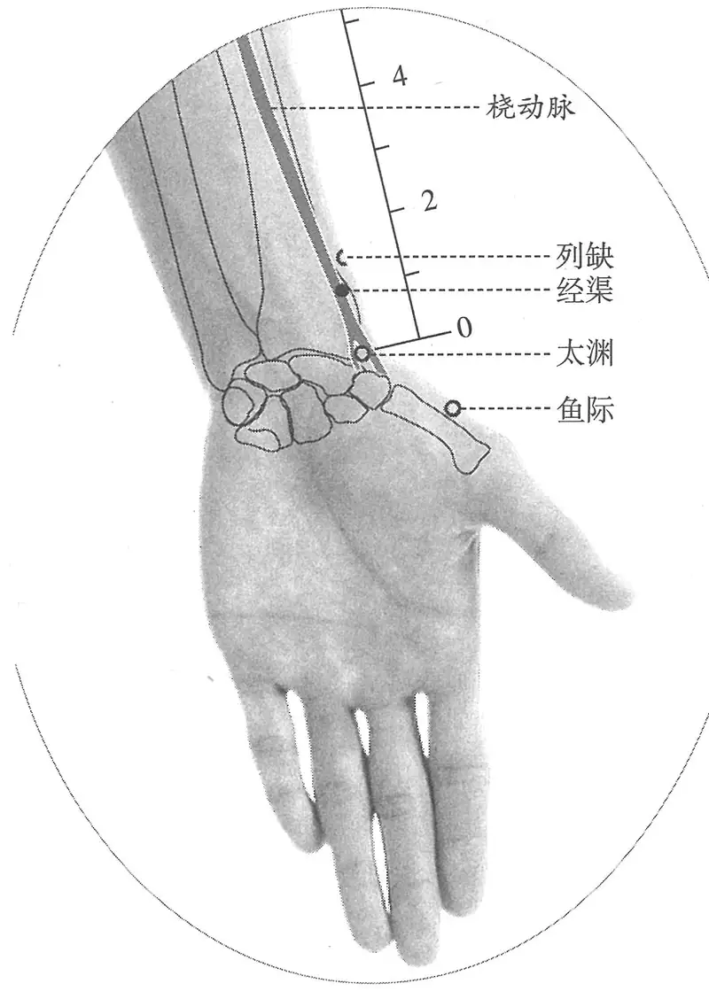

**图 2-14　经渠穴图**

　　(2) 部位：拇指侧腕上高骨之内缘。取穴：仰掌，从拇指侧腕横纹上一寸陷中取之，约当诊脉的寸关之间。（1版《针灸学讲义》）

　　(3) 部位：在寸口陷者中。取穴：仰掌，在桡骨茎突内侧腕横纹上一寸，当桡动脉（寸口）桡侧凹陷中取。（2版《针灸学讲义》）

　　(4) 桡骨茎突内侧缘，腕横纹上1寸。（4版《针灸学》）

　　(5) 在桡骨茎突起之内侧。取穴：手侧伸，拇指与掌心向上，从腕部横纹上行一寸部位，当桡骨茎突内侧，腕横纹上1寸，桡动脉桡侧凹陷中。（5版《针灸学》）

　　(6) 在前臂掌面桡侧，桡骨茎突与桡动脉之间凹陷处，腕横纹上1寸。（6版《针灸学》）

　　(7) 桡骨茎突与桡动脉之间凹陷处，腕横纹上1寸。（7版《针灸学》）

　　(8) 腕横纹上一寸，在桡动脉桡侧凹陷中。（《中国针灸学》）

**文献分析**：由于本穴为手太阴经的“经脉穴”，源出于手太阴寸口脉，故古代文献的定位直言“寸口中”，现代针灸经穴定位则规定了具体的折量尺寸——腕横纹上一寸。

#### 【类属】 

手太阴肺经穴；五输穴之经穴。

　1. 行于经渠，经渠，寸口中也，动而不居，为经……手太阴经也。（《灵枢·本输》）

　2. 手太阴脉之所行也，为经。（《针灸甲乙经》卷三）

　3. 行于经渠，为经金也。（《黄帝内经明堂》）

#### 【适应症】 

主治肺心部、咽部病症。常用于咳嗽，气喘，胸痛；咽喉肿痛；手腕痛或无力。

**备选适应症**：心痛欲呕伴上肢内侧痛。

　1. 《黄帝明堂经》佚文

〔p.156 (인쇄 136)〕

　　(1) 主寒热，胸背急痛，喉中鸣，咳，上气，喘，掌中热，数欠，汗出。胸中彭彭，甚则交两手務，暴瘅内逆，先取天府，此谓之大输。臂内廉痛，喘逆，心痛欲呕。（《黄帝内经明堂》）

**按**：“咳上气，喘，胸中膨膨然，甚则交两手而務”为手太阴经“是动”病候，是谓臂厥。“暴瘅内逆”是病机，其结果是“口鼻出血”的症状；“心痛欲呕”是手太阴经穴治疗心痛的典型症状。

　　(2) 胸中膨膨然，甚则交两手而務，暴痹喘逆，刺经渠及天府，此谓之大俞。（《针灸甲乙经》卷八）

　　(3) 经渠、阳池、合谷……解溪主热病汗不出。（《千金要方》卷三十）

　　(4) 疟，寒热，胸背急，胸中彭彭然，甚即交两手如瞀，为暴痹，喘逆，喉痹，掌中热，咳逆上气，喘息数欠，热病汗不出，心痛人欲呕。（《外台秘要》卷三十九）

**按**：由于《针灸甲乙经》传本中脱“刺经渠”三字，其主治混入下一穴“列缺”中，王焘于是又据其他《明堂经》传本补录经渠主治，但由于不明《千金要方》的特殊体例，辑录有误，因而出现与杨上善《黄帝内经明堂》不尽一致的现象。主要差异在于《黄帝内经明堂》作“汗出”，王焘据《千金要方》作“热病汗不出”。

　2. 主疟寒热，胸背急，胸中膨膨痛，喉痹，掌中热。生嗽逆上气，喘数，久热病汗不出，暴痹喘逆，心痛欲呕。（《太平圣惠方·针经》）

　3. 治疟寒热，胸背拘急，胸满膨膨，喉痹，掌中热，咳嗽上气，数欠，热病汗不出，暴痹喘逆，心痛，呕吐。（《铜人腧穴针灸图经》卷下）

　4. 治手腕无力痛，补；痹气喘急，泻；手腕痛，手掌心热，生疮，宜泻之。（《窦太师针经》）

　5. 主手腕疼痛，咳嗽喘促，补之能回六脉。（《循经考穴编》上）

　6. 统编针灸学教材

　　(1) 咳嗽上气，喉痹，胸背拘急，手腕痛，热病汗不出。（1957年南京《针灸学》、1版《针灸学讲义》）

　　(2) 咳嗽，气喘，咽喉肿痛，胸痛，热病汗不出，掌中热，手腕痛。（2版《针灸学讲义》）

　　(3) 咳嗽，气喘，胸痛，咽喉肿痛，手腕痛。（4、6版《针灸学》）

　　(4) 咳嗽，气喘，咽喉肿痛等肺系病证，手腕痛。（7版《针灸学》）

　　(5) 咳嗽，气喘，发热，胸痛，咽喉肿痛，手腕痛。（《中国针灸学》）

**文献分析**：本穴同太渊穴同出于手太阴脉口，最初的主治病症也是由相应脉诊病候归纳而来，应主治手太阴病候中的“是动”病，由于汉以前，手太阴经脉病候以心病为主，而《灵枢·经脉》则以肺病为主，这两种学说在《黄帝明堂经》经渠穴主治中均有所体现。其中《黄帝明堂经》所描述的“寒热，咳嗽，气喘，喉中痰鸣，汗出”等表现，类似哮喘、慢性支气管炎等的急性发作期；“臂内廉痛，喘逆，心痛欲呕”则似心绞痛（中医谓之“胸痹”）发作时的症状，值得临床进一步检验。可能受手太阴经脉病候变化的影响，宋以后文献不再记述“心痛”的主治。金元以前文献中本穴的作用部位主要在于肺、心、咽，而自金元窦太师开始重视本穴治疗局部和邻近部位的作用，同时期治疗文献主治病症也与之相应。

#### 附：临床应用举例 

　1. 手臂病症

　　(1) 手臂风冷痛：肩井、曲池、三里、下廉。问曰：此证缘何而得？答曰：盖因寒邪之气流入经络，夜睡凉枕或竹簟金漆登上冷处，睡着不知，湿气入内，故如此也。复刺后穴：三里、经渠、上廉。（《针灸集成》第三十方）

　　(2) 臂内廉痛：经渠一分，忌灸，灵道一分，卧针，向前三分、少海五分。（《医学纲目》卷十二）

〔p.157 (인쇄 137)〕

　2. 肺部病症

　　(1) 刺手太阴出血，主肺热气上，咳嗽，寸口是也。（《千金翼方》卷二十七）

**按**：“手太阴”古穴名，相当于太渊、经渠所在之寸口脉处。又《素问·刺禁论》曰：“刺臂太阴脉，出血多立死。”现代针灸临床，对于动脉处的穴位一般不用粗针刺血。

　　(2) 肝咳，刺足太冲；心咳，刺手神门；脾咳，刺足太白；肺咳，刺手太泉；肾咳，刺足大溪；胆咳，刺阳陵泉；厥阴咳，刺手太阴。（《千金翼方》卷二十七）

　3. 汗证

　　(1) 治伤寒交汗不出，刺足少阳经风池二穴、侠溪二穴，次手太阴经鱼际二穴，次经渠二穴，次足阳明经内庭二穴，应时汗出。（《针经摘英集》）

　　(2) （鱼际）一传此穴兼经渠、通里，可治汗不出者，便得淋漓，更兼三间、三里，便得汗至遍身。（《类经图翼》卷六）

　4. 落枕，针刺经渠、列缺穴治疗。［针灸临床杂志，2000，16（9）：46］

#### 【操作】 

直刺0.3~0.5寸。不宜大幅度反复提插，避免损伤桡动脉。

　1. 刺入三分，留三呼，不可灸，伤人神明。（《黄帝内经明堂》）

　2. 针入二分，留三呼，不可灸，灸即伤人神。（《太平圣惠方·针经》）

　3. 刺入三分，禁灸。（《窦太师针经》）

　4. 针向太渊穴。（《针灸玉龙经》）

　5. 统编针灸学教材

　　(1) 直针下二分。（1957年南京《针灸学》）

　　(2) 针二分，进针时注意避开动脉。（1版《针灸学讲义》）

　　(3) 直刺1~2分。（2版《针灸学讲义》）

　　(4) 避开桡动脉，直刺0.3~0.5寸。（4、5、7版《针灸学》）

　　(5) 直刺0.3~0.5寸；可灸。（6版《针灸学》）

　　(6) 避开桡动脉，直刺0.1~0.3寸。（《中国针灸学》）

**文献分析**：《素问·刺禁论》曰：“刺臂太阴脉，出血多立死。”而《千金翼方》却有“刺手太阴出血，主肺热气上咳嗽，寸口是也”的记载，二者所言针刺部位相同，而所用之针具及所刺中之脉当有不同。前者针具粗，刺中桡动脉，故“出血多”；后者或针具较细，或刺中静脉，故出血而已，可达泄实热之效。要之，本穴不可以粗针（特别是三棱针）大幅度提插直刺桡动脉。

#### 附：实验观察 

关于本穴的刺法，现代针灸文献一般都要求进针时避开桡动脉，其他古代文献以动脉为基准定位腧穴，现代文献也都强调针刺时要避开动脉。为此，我在本人及妻子身上用30号针灸针直接刺向表浅的桡动脉、股动脉、胫前动脉、胫后动脉，针入后，可见针柄随动脉的搏动而摆动。虽不能确认每一针都刺入动脉管壁，但于腹股沟处刺粗大的股动脉时，刺入管壁的概率应当较大。实验结果：未见大出血，针感比针其他动脉处更强（特别是桡动脉、足背动脉、胫后动脉等四肢腕踝部较细的动脉处）。分析：笔者使用的针较细，而动脉管壁较厚，收缩力较强，从而可防止大的出血；由于神经与动脉伴行，针刺动脉处，刺激到神经的概率远较其他处高，表现为针感较强。另外，实际针灸临床对于某些特定的病症常采用“洞刺”法，直刺动脉。无脉症的治疗也多刺动脉穴。但切记不可用粗针贯穿动脉，特别是深部粗大动脉。

〔p.158 (인쇄 138)〕

### （九）太渊 Tàiyuān LU9 出《灵枢》 

问题1：太渊穴与太渊脉关系如何？

问题2：“太渊”为何又作“太泉”或“太渕”？

问题3：为什么本穴定位，宋以前文献皆未提及“动脉”，金元以下直至现代针灸学教材却均将动脉搏动作为定位的标志，而最新的国标又删除“动脉”字样？

#### 【提要索隐】 

经渠与太渊二穴同出于手太阴脉口，本是一穴，古穴名曰“手太阴”，其主治病症是手太阴脉的“是动”病。在《黄帝内经》中“手太阴”已演化为“经渠”、“太渊”二穴，至《黄帝明堂经》，此二穴主治病症已略有侧重。

**穴名**：又写作“大渕”。唐代避李渊名讳改作“大泉”、“太泉”，后人有不识或误作“天泉”者。

**部位**：在腕前区，桡骨茎突与舟状骨之间，拇长展肌腱尺侧凹陷中。

**国标修订**：1990年版国标：在腕掌侧横纹桡侧，桡动脉搏动处。2006年修订版：在腕前区，桡骨茎突与舟状骨之间，拇长展肌腱尺侧凹陷中。

**按**：人体测量学研究结果表明：桡动脉在桡骨茎突尖端以下弯向桡侧的占44.8%，以上弯向桡侧的占15.5%，而在桡骨茎突尖端水平处弯向桡侧的占27.6%。可知，桡动脉在腕横纹的水平多已移至拇长展肌腱桡侧，因此根据国家标准对于太渊穴的定位，于拇长展肌腱尺侧很难触及桡动脉的搏动。这可能也是关于本穴的定位，早期文献不以“动脉”为标志的重要因素。新修版国家标准也因此去掉“桡动脉搏动处”6字。

**适应症**：主治肺部、咽部病症。常用于咳嗽，气喘，咳血，咽喉肿痛；手腕痛或无力；无脉证。

**按**：本穴源出于“手太阴”，早期主治病症与手太阴经脉“是动”病同，《黄帝明堂经》所载本穴主治包括了《阴阳十一脉灸经》及《足臂十一脉灸经》的全部肺经病候。

**针刺操作**：直刺0.3~0.5寸。

#### 【名实考】 

一名太泉，一名鬼心（《千金要方》）。《黄帝内经明堂》、《黄帝内经太素》作“大泉”，《千金翼方》作“太泉”，皆因唐代避李渊名讳改；《医心方》太渊作“大渕”（按：“渕”与“渊”同）。又“太”、“大”古通用，故又作“大泉”（如《黄帝内经明堂》注文），或有不识大泉而误作“天泉”穴者。需要特别注意的是，不可将“太渊”脉与“太渊”穴相混，前者是指整个寸口脉，用作诊脉部位，如《素问·气交变大论》所谓“太渊绝者，死不治”；而“太渊”作为穴名，是指位于寸口脉远端的穴位。这涉及到不同历史时期“腧穴”概念的不同内涵。汉以前包括“太渊”、“经渠”在内的寸口脉总为一穴，统称为“手太阴”，其主治与当时的手太阴经脉“是动”病相同。参见总论及“颔厌”、“瘈脉”穴下提要。

本穴定位，宋以前文献皆未提及“动脉”，而金元以下直至现代针灸学教材均将动脉搏动作为定位的标志。有学者发现，根据现代的定位，在太渊穴处不能触及动脉搏动，于是根据日本针灸铜人的定位，提出太渊穴的正确位置应在远端腕横纹上五分处。在针灸定位的标准化研究中，我们必须做出选择：要保留“动脉”标志，就应同时接受“腕横纹上五分”的修订意见；要尊重经典本义，就应删除“动脉”二字。

　1. 肺……注于太渊，太渊鱼后一寸陷者中也，为腧。（《灵枢·本输》）

　2. 太渊绝者，死不治。（《素问·气交变大论》）

　3. 脉会太渊。（《难经·四十五难》）

〔p.159 (인쇄 139)〕

　4. 少商初出为井，可谓小泉。鱼际停澹，此中涌注，故曰大泉之也。（《黄帝内经明堂》杨上善注）

　5. 第四针掌后横纹，名鬼心，入肉半寸。即太渊穴也。（《千金要方》卷十四）

　6. 大泉，此即太渊也。避唐祖名当时改之，今存此名不改正，恐后人将为别是一穴也。（《千金要方》卷二十九注）

　7. 大泉二穴，在手掌后陷者中，又名太渊。（《西方子明堂灸经》卷二）

**按**：文中“小泉”、“大泉”中之“泉”本作“渊”，皆避唐讳而改。

　8. 穴名太渊者，以肺之经自中府至此，乃大聚之所，有渊之象焉。《难经》曰：脉会太渊。疏曰：脉病治此。平旦寅时，宗气、荣气二气从此始，故曰寸口脉之大要会。十二经皆有动脉，而独以此动脉诊病人之生死者，以为脉之大聚会也。（《经穴解》）

#### 【定位】 

**部位**：在腕前区，桡骨茎突与舟状骨之间，拇长展肌腱尺侧凹陷中（图2-15）。

**取穴**：在腕掌侧远端横纹桡侧，桡动脉搏动处。

**按**：手三阴经的输穴均位于腕掌侧横纹上，远侧腕掌侧横纹桡侧端，拇长展肌腱尺侧为太渊穴；远侧腕掌侧横纹尺侧端，尺侧腕屈肌腱的桡侧为神门穴；远侧腕掌侧横纹中，掌长肌腱与桡侧腕屈肌腱之间为大陵穴。

#### 相关解剖学基础 

　　(1) 桡动脉走行：桡动脉经前臂的桡侧向下行到达腕部。在桡侧腕屈肌腱与桡骨前缘下部之间的间隙内可摸到桡动脉的搏动。然后桡动脉继续向远侧越过膨大的桡骨下端的前缘，向后通过拇长展肌和拇短伸肌腱的深面进入解剖学“鼻烟窝”。在“鼻烟窝”处也可摸到桡动脉的搏动。

　　(2) 桡动脉体表触诊实验：在桡骨茎突前缘凸起骨面搏动最明显，离开此点分别向近端和远端搏动越来越弱。在较瘦的受试者身上，从此点向远端触诊，可明显感知脉管向桡侧偏离，约在此点与腕远端横纹连线中点稍下处已经移到拇短伸肌腱之下，越过此点，便可在拇长伸肌腱与拇短伸肌腱之间的“鼻烟窝”中触及桡动脉的搏动。因而，在大多数受试者中，于远端腕横纹水平，拇长展肌腱的尺侧不能触及桡动脉。现代解剖学研究发现，桡动脉在前臂下段的分布存在一定比例的变异，而对于寸口脉诊极为重视的古代中医很早就发现并记录了这一现象。

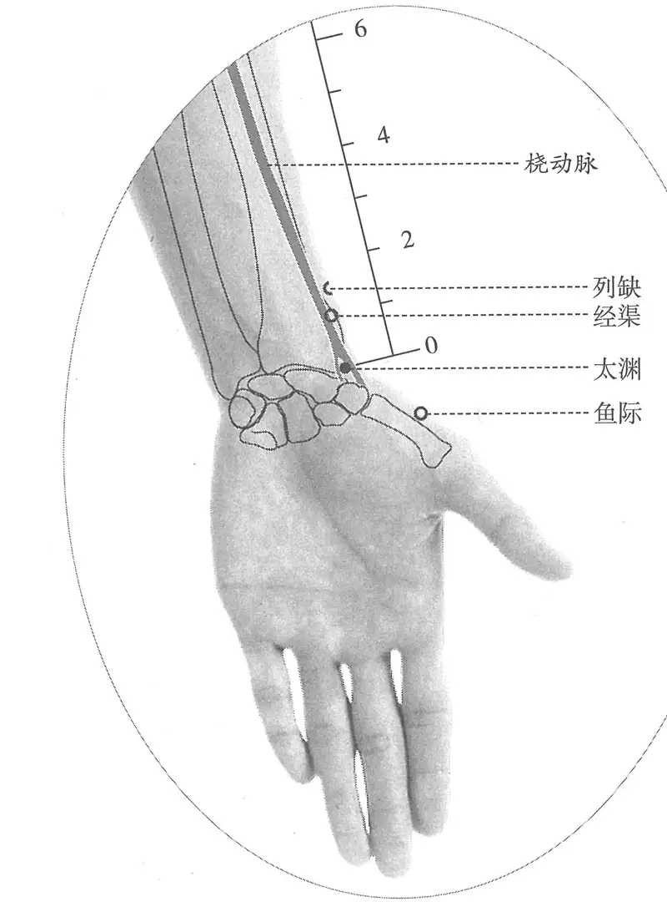

**图 2-15　太渊穴图**

〔p.160 (인쇄 140)〕

#### 附：反关脉 

《古今医统》曰：“人或有寸关尺三部脉不见，自列缺至阳溪见者，俗谓反关脉。”吴崑《方考脉语》曰：“有一手反关者，有两手反关者。此得于有生之初已然，非为病也。”

　1. 太渊，鱼后一寸陷者中也，为输。（《灵枢·本输》）

　2. 在手掌后陷者中。（《黄帝内经明堂》、《铜人腧穴针灸图经》、《圣济总录》、《针灸资生经》、《针经节要》、《针灸玉龙经》、《十四经发挥》、《针灸集书》、《针灸聚英》、《古今医统》、《类经图翼》、《循经考穴编》、《医宗金鉴·刺灸心法要诀》）

　3. 在手中掌后横纹头陷者中。（《太平圣惠方·明堂》、《针灸资生经》、《针灸玉龙经》、《针灸集书》）

　4. 窦太师针灸遗存

　　(1) 在手掌后内侧陷中。（《窦太师针经》）

　　(2) 在掌后寸口头陷中。（《针方六集》卷一）

　　(3) 掌后内侧横纹头陷中。（《循经考穴编》上）

**按**：(1)(2)条文的意义相同。

　5. 太渊在掌后陷中动脉，即所谓寸口者，脉之大会也。（《难经本义》）

**按**：滑寿此言实为“太渊”脉，不可与“太渊”穴混同。

　6. 在掌后内侧横纹头动脉。（《神应经》、《针灸大成》、《针灸易学》、《针灸逢源》）

　7. 寸口前横纹上陷中。（《针灸十四经穴位考订》）

　8. 统编针灸学教材

　　(1) 腕之桡侧横纹头，按其陷凹中有动脉处是穴位，适当经渠穴直下部。（1957年南京《针灸学》、1、2版《针灸学讲义》）

　　(2) 掌后腕横纹桡侧端，桡动脉桡侧凹陷中。（4、5、6、7版《针灸学》、《中国针灸学》）

**文献分析**：关于本穴的定位，早期文献只言“掌后”，不很明确。至《太平圣惠方》增加一个定穴标志“横纹头”，而腕掌侧横纹有二三条不等，未明言哪一条。明代《针灸秘法全书》曰：“取掌后三俞者，太渊、大陵、神门，乃三阴经血所注止之处，曰俞者，皆有坎陷则止，在仰掌三纹之后，以手按之，有陷处乃是，然三穴相近如列雁行略无参差，若无高骨无陷，即非穴也。”如是则知系指远端横纹。又明以下直至现代针灸学教材对于本穴的定位都增加了“动脉搏动”这一体表标志，这一变动是否合理，需要大体解剖学知识和表面解剖学实验加以判定。而古代文献已有桡动脉触诊实验的记载：“阳溪，一名中魁（穴在腕侧上两筋陷中）。广注：虎口后腕侧上两筋罅间，与太渊相并，直对食指本节，骨尖有动脉”（《循经考穴编》）。这里既明言在食指本节（第2掌骨底）有动脉搏动，那么与此点相隔一筋（拇短伸肌腱）的太渊穴处自然不能触及动脉搏动。之所以后人在本穴定位中加入“动脉”二字，盖因为太渊是寸口脉的寸部，千百年都在此摸脉，怎么可能摸不到脉动呢？可是人们忽略了寸脉有一个食指的宽度。如果增加“动脉”的条件，那么现行的太渊穴定位就要修订。在国际标准《经穴定位》制定过程中，在讨论太渊穴定位时，就有专家提出定于“腕横纹上5分”以满足“动脉应手”的条件。

#### 【类属】 

手太阴肺经穴；五输穴之输穴；十二原穴之一；八会穴之脉会。

　1. 阳中之少阴，肺也，其原出于太渊，太渊二。（《灵枢·九针十二原》）

　2. 太渊，鱼后一寸陷者中也，为输……手太阴经也。（《灵枢·本输》）

　3. 手太阴脉之所注也，为输。（《针灸甲乙经》卷三）

〔p.161 (인쇄 141)〕

　4. 注于太渊，为输土也。（《黄帝内经明堂》）

　5. 肺之源，出于太渊，在掌后大筋一寸五分间陷者中，手太阴之所过。（《素问亡篇·刺法论》）

**按**：阴经以输代原，而《刺法论》篇阴经另设原穴。

　6. 脉会太渊。（《难经·四十五难》）

#### 【适应症】 

主治肺部、咽部病症。常用于咳嗽，气喘，咳血，咽喉肿痛；手腕痛或无力；无脉证。

　1. 主痹逆气，寒厥急热，烦心，善唾，哕噫，胸满嗷呼，胃气上痹逆气，心痛胀满彭彭。臂厥，肩膺胸痛，妒乳。目中白眼青，转筋，掌中热，乍寒乍热，缺盆中相引痛，数欠，喘不得息，臂内廉痛，上膈，饮已烦满。病温身热，五日以上汗不出，留针一时取之，未满五日禁不可刺。痎疟，咳逆，心闷不得卧，胸满，喘务，背痛。唾血，振寒，干嗌。狂言。口僻，引而下之。（《黄帝内经明堂》）

**按**：以上本穴主治包含了：第一，《阴阳十一脉灸经》及《足臂十一脉灸经》的全部肺经病候；第二，肺部病症；第三，热病；第四，面瘫；第五，乳痈。

　2. 治胸痹逆气，寒厥，善哕呕，饮水咳嗽，烦怨不得卧，肺胀满膨膨，臂内廉痛，目生白翳，眼眦赤筋，缺盆中引痛，掌中热，数欠，喘不得息，噫气上逆，心痛唾血，振寒咽干，狂言，口僻。（《铜人腧穴针灸图经》卷下）

　3. 窦太师针灸遗存

　　(1) 治牙红肿，泻；头风眩晕，补；久嗽不愈，先补后泻。又治疟疾寒热，并手臂风湿，跌损疼痛，悉皆治疗。孕妇不可针。（《窦太师针经》）

　　(2) 头风面肿痛，牙疼，泻之，肺气胀满，灸二七壮。（《循经考穴编》上）

　　(3) 太渊治偏正头风，牙疼，先补后泻；手腕冷风病，先泻后补。（《医经会元·玉龙歌》注）

　　(4) 太渊二穴治牙痛，胸满之证。（《琼瑶神书》卷三）

　4. 肺胀彭彭，肩背痛寒，尿色变，卒遗矢无度。（《针灸聚英》卷一、《针灸大成》）

**按**：以上病症录自手太阴经病候，参见“尺泽”穴按语。

　5. 针灸歌赋主治：咳嗽（《针灸玉龙歌》）；乳痈（《灵光赋》、《席弘赋》）。

　6. 统编针灸学教材

　　(1) 治喘息，咳血，目痛生翳，喉干咽肿，缺盆中引痛，臂内廉痛，肩痛引胸，心痛脉涩。（1版《针灸学讲义》）

　　(2) 治气喘，咳嗽，咳血，目痛生翳，咽干，喉肿痛，缺盆中痛，胸膺满痛，上臂内廉痛。（2版《针灸学讲义》）

　　(3) 治咳嗽，气喘，咳血，咽喉肿痛，胸痛，腕臂痛。（4版《针灸学》）

　　(4) 治咳嗽，气喘，咳血，胸痛，咽喉肿痛，腕臂痛，无脉症。（5、6版《针灸学》）

　　(5) ①咳嗽，气喘等肺系病证；②无脉症；③腕臂痛。（7版《针灸学》）

　　(6) 治咳嗽，气喘，咳血，咽喉肿痛，胸痛，心悸，腕臂痛。（《中国针灸学》）

**文献分析**：十二原穴皆由十二原脉演变而来，其最初的主治病症即由相应脉诊病候归纳而来。关于“太渊”的主治病症，《黄帝明堂经》记载的“口僻”、“妒乳”，后世文献未载录，而从元代《窦太师针经》始，出现了主治“牙痛”，后世也有明确的临床应用，然而还不能排除将专治牙疼的经外穴“龙渊”混为“太渊”的可能性。此外，1、2版教材所载之“目痛生翳”，之后的教材未收录，有待进一步验证。

〔p.162 (인쇄 142)〕

#### 附：临床应用举例 

　1. 肺、鼻部病症

　　(1) 肺胀气抢胁下热痛……又刺手太阴出血，主肺热气上咳嗽，寸口是也。（《千金翼方》卷二十七）

　　(2) 肺咳，刺手太泉。（《千金翼方》卷二十七）

**按**：“太泉”即太渊，此乃唐人避讳所致。

　　(3) 又刺手太阴出血，主肺热气上咳嗽，寸口是也。（《千金翼方·针灸》卷二十七）

**按**：“手太阴”古穴名，相当于太渊、经渠所在之寸口脉处。

　　(4) 咳嗽喘急及寒痰，须从列缺用针看。太渊亦泻肺家疾，此穴仍宜灸更安。（《针灸玉龙歌》）

　　(5) 腠理不密咳嗽频，鼻流清涕气昏沉，喷嚏须针风门穴，咳嗽还当灸太渊。（《针灸玉龙歌》）

　　(6) 鼻窒不闻香臭：迎香、上星、五处、禾髎。问曰：此症缘何而得？针数穴皆不效。答曰：皆因伤寒不解，毒气冲脑，或生鼻痔，脑中大热，故得此症。复刺后穴：水沟、风府、百劳、太渊。（《针灸大成》卷九）

　　(7) 哮证：太渊，定喘。配穴：风寒加风池、风门，用泻法；风热加大椎、合谷，用泻法；肺虚加膻中、偏历，用补法；肾虚加肾俞、太溪，用补法。［北京中医，1988(2)：39-41］

　2. 心病

　　(1) 厥心痛，卧若徒居，心痛间，动作痛益甚，色不变，肺心痛也，取之鱼际与太渊。（《灵枢·厥病》）

　　(2) 肺心痛，卧若伏龟：太渊、尺泽五壮、上脘、膻中。（《针灸集要·杂穴治诸病秘法》）

　　(3) 心脏早搏：针刺左太渊穴，斜刺0.3寸，针尖的方向指向身体近侧，亦可配合针刺膻中穴，膻中穴向下平刺，捻转30秒。［中国针灸，1999(5)：269］

　3. 牙痛

　　(1) 上片牙疼，吕细、人中、太渊；下片牙疼，合谷、龙渊足内踝前，起大骨下陷中。入三火三，刺不见血。问曰：牙疼之证，缘何而得？答曰：皆因肾经气虚败，上盛下虚，阴阳不升降，又因风毒灌注，故得此证，复刺后穴：肾俞、三间、二间。（《针灸集成》第二十五方）

**按**：龙渊，又名龙玄。经外穴，在手侧腕交叉紫脉上。专治牙疼。见《窦太师针经》，此注作足少阴“然谷”穴别名，大误。

　　(2) 上片牙痛及牙关紧急不开：太渊二穴、颊车二穴、合谷二穴、吕细二穴。（《针灸大全》卷四）

　　(3) 牙齿疼痛：列缺、人中、颊车、吕细、太渊、合谷。（《针灸大成》卷五）

　4. 其他病症

　　(1) 热病而汗且出及脉顺可汗者，取之鱼际、太渊、大都、太白，泻之则热去，补之则汗出。汗出太甚，取内踝上横脉以止之。（《灵枢·热病》）

　　(2) 右手关前寸口阳绝者，无大肠脉也。若少气，心下有水气，立秋节即咳。刺手太阴经治阴，在鱼际间即太渊穴也。（《脉经》卷二）

〔p.163 (인쇄 143)〕

　　(3) 伤寒，邪在三阴内不得交通，故为腹痛，手足之经皆会于腹，随经取之……如脉弦而腹痛，过在足厥阴肝，手太阴肺，刺太冲、太渊、大陵。（《洁古云岐针法》）

　　(4) 肩痛在肩上，按之至痛酸半体者是也，甚者令人身热恶寒，当灸太渊穴三七壮，便毒流通而自愈也。（《痈疽神秘灸经》）

　　(5) 如头痛先刺列缺，后泻太渊。（《针灸集书》卷上）

　　(6) 伤寒过经期门愈，气刺两乳求太渊。（《灵光赋》）

　　(7) 气刺两乳求太渊，未应之时泻列缺。列缺头痛及偏正，重泻太渊无不应。五般肘痛寻尺泽，太渊针后却收功。（《席弘赋》）

　　(8) 鼻衄：迎香穴、太渊穴中强刺激为主，留针20分钟。针一次而愈。［四川中医，1988，6(4)：29］

　　(9) 中风失语：取太渊、太溪配上廉泉、足三里。用轻捻徐入的刺法。［中国针灸，1999(5)：287］

#### 【操作】 

直刺0.3~0.5寸。

　1. 刺入二分，留二呼，灸三壮。（《黄帝明堂经》）

　2. 以手按穴，入同身寸之三分，留三呼，动气至，而徐徐出针，以手扪穴。（《素问亡篇·刺法论》）

　3. 直针入三分，灸三七壮。孕妇不可针。（《窦太师针经》）

　4. 灸七壮，不宜用针。（《针方六集》卷一）

　5. 一法云横针入五分，禁灸。（《循经考穴编》上）

　6. 统编针灸学教材

　　(1) 针三分，灸七壮。（1957年南京《针灸学》、1版《针灸学讲义》）

　　(2) 直刺2~3分；艾条灸3分钟，艾炷灸3壮。（2版《针灸学讲义》）

　　(3) 直刺0.5~1寸。（4、5版《针灸学》）

　　(4) 直刺0.5~1寸；可灸。（6版《针灸学》）

　　(5) 避开桡动脉，直刺0.3~0.5寸。（7版《针灸学》）

　　(6) 避开桡动脉，直刺0.2~0.3寸。可灸。（《中国针灸学》）

　7. 直刺，从掌侧面向背侧面，深0.3~0.5寸。感应：局部酸胀。1~3壮；温灸3~5分钟。（上海《针灸学》）

### （十）鱼际 Yújì LU10 出《灵枢》 

问题：鱼际的定位古文献只说在“散脉中”，现代的定位描述何时确定？如何确定？

#### 【提要索隐】 

**穴名**：鱼际既是穴位名，又是部位名。

**部位**：在手外侧，第1掌骨桡侧中点赤白肉际处。

**适应症**：主治肺部、咽部病症。常用于咳嗽、咳血，咽干，咽喉肿痛；发热，头痛。乳痈。

**针刺操作**：直刺0.5~0.8寸。

#### 【名实考】 

在早期，鱼际部血络既是诊病处，亦是治病处——穴位。需要注意以下两点：其一，鱼际既是穴位名，又是部位名。作为部位名，拇指掌指关节后的隆起肌肉统谓之“鱼际”；其二，1957年南京《针灸学》将前一穴“太渊”的别名“太泉”、“鬼心”列于本穴下，这一明显的错误系沿袭日本文献，韩国针灸学教材又从中国教材再次重复了这一极其明显的错误。

〔p.164 (인쇄 144)〕

与其他诊络刺络部位一样，本穴最初也不是一个局限的点，而是一个有一定范围的面，故《黄帝明堂经》描述本穴的部位为“散脉中”。至《循经考穴编》增加“约居横纹后一寸”加以限定，1957年《针灸学》则进一步明确表述为“在第1掌骨之间”。可见这类腧穴定位经历了一个从区域到点，描述由相对模糊到逐步精确的过程。

　1. 鱼络血者，手阳明病。（《灵枢·邪气藏府病形》）

　2. 胃中寒，手鱼之络多青矣；胃中有热，鱼际络赤……凡刺寒热者皆多血络，必间日而一取之，血尽而止，乃调其虚实”。（《灵枢·经脉》）

　3. 鱼上白肉有青血脉者，胃中有寒。（《灵枢·论疾诊尺》）

　4. 溜于鱼际，鱼际者，手鱼也，为荥。（《灵枢·本输》）

　5. 大指本节后，象彼鱼形，故以鱼名之。赤白肉畔，故曰鱼际也。（《黄帝内经明堂》杨上善注）

　6. 鱼谓手大指之后也。以其处如鱼之形，故曰鱼。鱼际，谓手鱼之际，有穴居此，故名曰鱼际也。（五卷本《铜人腧穴针灸图经》卷一）

　7. 掌骨前肥肉际为鱼际穴。曰鱼者，谓掌骨之前，大指本节之后，其肥肉隆起处，统谓之鱼也。（《素问要旨论》）

　8. 鱼际在大指下。高起之白肉际为荥火。有如鱼腹。因以名之。（《黄帝内经灵枢集注》）

　9. 曰鱼者，谓掌骨之前，大指本节之后，其肥肉隆起处，统谓之鱼也。（《循经考穴编》上）

　10. 大指本节后白肉，通为鱼腹，此穴在其际，际者，界也，乃赤白之界也，故曰鱼际。（《经穴解》）

**文献分析**：鱼际既是穴名，更是部位名，不了解这一点，便无法理解早期文献。例如《脉经》卷一曰：“从鱼际至高骨，却行一寸，其中名曰寸口”，“从关至鱼际是寸口内，阳之所治也”；卷二“刺手太阴经治阴。在鱼际间”；卷四“脉来过寸入鱼际者，遗尿”。其中“鱼际”皆系部位名。所谓鱼际，指鱼腹赤白肉际也。凡鱼腹四边，皆可谓鱼际。《千金要方》卷二十八论之更详：“问曰：何为三部脉？答曰：寸、关、尺也。凡人修短不同，其形各异，有尺寸分三关之法，从肘腕中横纹至掌鱼际后纹，却而十分之而入取九分，是谓尺。从鱼际后纹却还度取十分之一，则是寸。寸十分之而入取九分之中，则寸口也。此处其骨自高，故云：阴得尺内有一寸，阳得寸内九分，从寸口入却行六分为关分，从关分又入六分为尺分。又曰：从鱼际至高骨却行一寸，其中名曰寸口。”掌鱼际后纹后0.1寸是谓寸，则知《脉经》所谓“在鱼际间”之手太阴穴为“太渊”，切不可理解为“鱼际”穴。

#### 相关穴及刺激点 

　1. 鱼腹　位于手掌鱼际部，第一掌骨掌侧之中点（鱼际穴内前方）。主治支气管喘息，肺结核，肠结核。针三至五分，针感麻、酸、胀至指尖。灸三至七壮。（《针灸经外奇穴图谱（续集）》）

**按**：此穴的定位已见于《类经图翼》：一法取手掌中大指根稍前肉鱼间近内侧大纹半指许，外与手阳明合谷相对处，按之极酸者是穴。

　2. 扁桃体　位于手掌鱼际部，第一掌骨尺侧中点鱼腹穴的尺侧。主治扁桃体炎，喉炎。针三至五分，针感酸、麻至拇指。（《针灸经外奇穴图谱（续集）》）

〔p.165 (인쇄 145)〕

#### 【定位】 

**部位**：在手外侧，第1掌骨桡侧中点赤白肉际处（图2-16）。

**取穴**：仰掌，在第1掌骨掌侧中部，赤白肉际取穴。

　1. 在手大指本节后内侧散脉。（《黄帝内经明堂》、《太平圣惠方·针经》、《铜人腧穴针灸图经》、《针灸资生经》）

　2. 在大指本节后内侧前脉中。（《十四经发挥》卷一）

　3. 大指本节后内侧陷中；又云散脉中。（《针灸聚英》卷一）

　4. 本节后白肉际

　　(1) 在大指本节后白肉际。（《神应经》）

　　(2) 大指本节后，内侧白肉际陷中。又云散脉中。（《针灸大成》卷六）

　　(3) 在手大指本节后内侧陷中。又云散脉中白肉际。（《类经图翼》卷六、《医宗金鉴·刺灸心法要诀》）

　5. 腕横纹远端一寸

　　(1) 气口在手鱼际之后一寸。（五卷本《铜人腧穴针灸图经》卷一）

　　(2) 广注：约居横纹后一寸。（《循经考穴编》上）

　6. 大指本节后掌骨约二分之一处，白肉际。（《针灸十四经穴位考订》）

　7. 统编针灸学教材

　　(1) 部位：在手大拇指本节后散脉里。取穴：第一掌骨中间之掌侧，赤白肉际处取之。（1957年南京《针灸学》）

　　(2) 部位：拇指本节后。取穴：从手大指本节后内侧，赤白肉际取之。（1版《针灸学讲义》）

　　(3) 部位：在手大指本节后内侧散脉中。取穴：仰掌，在第一掌骨掌侧中部，赤白肉际取穴。（2版《针灸学讲义》）

　　(4) 第一掌骨中点，赤白肉际处。（4、5版《针灸学》）

　　(5) 在手拇指本节（第1掌指关节）后凹陷处，约当第1掌骨中点桡侧，赤白肉际处。（6版《针灸学》）

　　(6) 第一掌骨中点桡侧，赤白肉际处。（7版《针灸学》、《中国针灸学》）

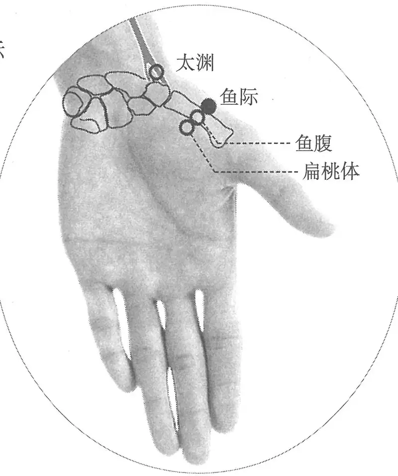

**图 2-16　鱼际穴与相关穴图**

**文献分析**：关于本穴部位，明以前文献多定位于手大指本节后内侧散脉中，但唐代杨上善已注明在“赤白肉畔”，明代《神应经》则于定位描述中加上了“白肉际”字样，对于在赤白肉际的具体部位，有二说：第一，在腕横纹后一寸；第二，第1掌骨的二分之一处。二说文异而位同。本穴的定位描述中术语“本节”是包含掌骨头、掌指关节和近节指骨底构成的结节包，与二间、三间定位相仿，大指本节较其他手指本节大，“本节后”约当第1掌骨中点。其实，早期文献描述的本穴定位不是一个局限的点，而是偏于第一掌骨内侧的表浅静脉。早期对于络脉间、动脉处的穴位（瘛脉、悬颅、冲阳穴等）都表现出这样的特点，这些穴位自《黄帝明堂经》开始已逐渐演变成固定的部位。然若遇实热证，大鱼际处静脉充盛者，需刺血治疗时，可取最充盛之脉刺之，而不必拘于几寸几分。

〔p.166 (인쇄 146)〕

#### 【类属】 

手太阴肺经穴；五输穴之荥穴。

　1. 溜于鱼际，鱼际者，手鱼也，为荥……手太阴经也。（《灵枢·本输》）

　2. 手太阴脉之所流也，为荥。（《针灸甲乙经》卷三）

　3. 流于鱼际，为荥火也。（《黄帝内经明堂》）

　4. 手三阴诸络之会。（《针方六集》卷一）

#### 【适应症】 

主治肺部、咽部病症。常用于咳嗽、咳血，咽干，咽喉肿痛；发热，头痛。**新增**：乳痈。

　1. 主虚热，洒淅起毛，恶风，舌上黄，身热，争则喘咳，痹走胸膺背，不得息，头痛不堪，汗出而寒杨上善注：有本作“汗不出”之也，及阳明出血。寒厥及热烦心，少气不足以息，阴湿，肠痛食噎，肘挛支满，喉中焦渴。痓，上气。热病振慄鼓颔，腹满，阴萎。厥痛，卧若徒居，心痛间，动作痛益，色不变，肺心痛。咳引尻，尿出，虚也；鬲中，食饮呕，身热汗出，数唾涎下，肩背寒热，脱色，目泣出，皆虚也，补之。唾血，时热，泻鱼际，补尺泽。短气心痹，悲怒逆气，恐，狂易。胃逆，霍乱逆气。（《黄帝内经明堂》）

**按**：“及阳明出血”前，《针灸甲乙经》传本有“刺鱼际”三字，与《素问·刺热》相合，当据补。

　2. 治洒淅恶风寒，虚热，舌上黄，身热头痛，咳嗽，汗不出，痹走胸背，痛不得息，目眩，烦心少气，腹痛不下食，肘挛，支满，喉中干燥，寒栗鼓颔，咳引尻痛溺出，呕血心痹，悲恐。（《铜人腧穴针灸图经》卷下）

　3. 窦太师针灸遗存

　　(1) 热，泻；五指麻木，补。（《窦太师针经》）

　　(2) 如指肿，棱针出血甚妙。（《循经考穴编》上）

　4. 一传齿痛不能食饮，左患灸左，右患灸右，男三女四。（《类经图翼》卷六）

　5. 主治牙齿痛，疟疾初起先觉发寒，伤寒汗不出等证。（《医宗金鉴·刺灸心法要诀》）

　6. 统编针灸学教材

　　(1) 咳嗽吐血，喉痛咽肿，胸背痛，肘挛，心痹，身热头痛。（1957年南京《针灸学》）

　　(2) 咳嗽吐血，喉痛，咽肿，胸背痛，肘挛，身热头痛，掌心热。（1版《针灸学讲义》）

　　(3) 咳嗽，咳血，咽喉肿痛，发热，失音不语，肘挛，掌心热。（2版《针灸学讲义》）

　　(4) 咳嗽，咳血，咽喉肿痛，失音，发热。（4、5版《针灸学》）

　　(5) 咳嗽，咳血，发热，咽喉肿痛，失音，乳痈，掌中热。（6版《针灸学》）

　　(6) 咳嗽、咯血、咽干、咽喉肿痛、失音等肺系热性病证；小儿疳积。（7版《针灸学》）

　　(7) 咳嗽，咳血，咽喉肿痛，失音，发热，掌中热。（《中国针灸学》）

**文献分析**：《黄帝明堂经》载本穴主治突出了“肺热病”、“肺心痛”等肺的病症，以及“身热”、“热烦心”、“时寒时热”等寒热证，虚实皆取之。值得注意的是，还有“咳引尻，尿出”、“阴萎”等肾、膀胱病症。金元窦太师则突出本穴对热病与局部病症的主治。统编针灸学教材则突出了本穴对于咽部病症的治疗，这一点与本穴古今针灸临床实际应用相符，且与本穴尺侧的“扁桃体”穴主治相印证。又《黄帝明堂经》以“太渊”治疗“妒乳”，而《千金要方》、《千金翼方》所载唐以前文献却多处强调以“鱼际”治妒乳症，现代针灸临床也有类似应用，现代针灸学教材第6版《针灸学》已有收录，今从之。第7版教材“小儿疳积”未详所出，也未见现代临床应用报道，暂不收录。

〔p.167 (인쇄 147)〕

此外，《灵枢》常以鱼际络诊胃中寒、胃中热，根据针灸穴位诊疗一体的特点，针灸鱼际也应当能治疗胃寒与胃热之症。有待临床进一步观察。

#### 附：临床应用举例 

　1. 肺部病症

　　(1) 厥心痛，卧若徒居，心痛间，动作痛益甚，色不变，肺心痛也，取之鱼际与太渊。（《灵枢·厥病》）

　　(2) 咳引尻痛：选准鱼际穴，每次只刺一侧穴位，刺时针尖向掌心斜刺，深度为5~8分，用提插捻转手法，留针20~30分钟，每隔5分钟行针1次。［陕西中医，1988，9(10)：472］

　2. 汗证

　　(1) 热病而汗且出及脉顺可汗者，取之鱼际、太渊、大都、太白。泻之热去，补之则汗出。（《灵枢·热病》）

　　(2) 鱼际：一传此穴兼经渠、通里，可治汗不出者，便得淋漓，更兼三间、三里，便得汗至遍身。（《类经图翼》卷六）

　3. 咽部病症

　　(1) 中风不语刺心经，四关四穴见浮沉，次日涌泉如捻去，肺经穴上鱼际针，针刺此穴声音出，三里升阳气下寻，太冲二穴取血出，气血通畅免劳心。（《琼瑶神书》）

　　(2) 急性扁桃体炎：取鱼际、液门穴，用提插泻法，得气后留针20分钟，每日一次。［中国针灸，1994(增刊)：249］

　　(3) 喉喑：鱼际隔蒜泥敷贴。［中国针灸，2001，21(10)：592］

　　(4) 咽炎：透天凉手法针刺鱼际穴。［中国针灸，2002，22(5)：324］

　4. 乳房病症

　　(1) 产后宜勤挤乳，不宜令汁蓄积，蓄积不去，便结不复出，恶汁于内，引热温壮结坚，牵掣痛，大渴引饮，乳急痛，手不得近，成妒乳，非痈也。急灸两手鱼际各二七壮，断痈状也。（《千金要方》卷二十三、《千金翼方》卷二十八、《医心方》卷二十一）

　　(2) 乳腺增生：取双侧鱼际穴，迎随补泻手法，针尖朝向上肢方向进针，再用捻转强刺激手法行针，使自觉乳房部胀，行气后在针上加温灸器。［辽宁中医杂志，2000，27(6)：274］

　5. 其他病症

　　(1) 渴饮病，兼身体疼痛，灸隐白二穴……鱼际二穴。（《圣济总录·针灸门》）

　　(2) 眼痛久不愈：鱼际灸七壮。（《医学纲目》卷十三）

#### 【操作】 

直刺0.5~0.8寸。

　1. 刺手鱼腹内陷为肿。（《素问·刺禁论》）

　2. 刺入二分，留三呼，灸三壮。（《黄帝内经明堂》）

　3. 针三分。（《针灸玉龙经》）

　4. 针入二分，沿皮向□，热，泻；五指麻木，补。（《窦太师针经》）

　5. 针入二分，禁灸。（《医学入门》卷一）

　6. 针入一分，沿皮向外一寸五分。如指肿，棱针出血甚妙。禁灸。（《循经考穴编》上）

〔p.168 (인쇄 148)〕

　7. 针二分，唯牙痛可灸，余证禁灸。（《医宗金鉴·刺灸心法要诀》）

　8. 统编针灸学教材

　　(1) 针三至五分，灸三至五壮。（1957年南京《针灸学》、1版《针灸学讲义》）

　　(2) 直刺5~7分，艾条灸3~5分钟。（2版《针灸学讲义》）

　　(3) 直刺0.5~0.8寸。（4、5版《针灸学》）

　　(4) 直刺0.5~1寸；可灸。（6版《针灸学》）

　　(5) 直刺0.5~0.8寸。治小儿疳积可用割治法。（7版《针灸学》）

　　(6) 直刺0.5~0.8寸；可灸。（《中国针灸学》）

　9. 直刺0.5~1寸。感应：局部酸胀。灸3壮；温灸1~3分钟。（上海《针灸学》）

### （十一）少商 Shàoshāng LU11 出《灵枢》 

问题1：为什么《黄帝内经》所载之十二井穴中，只有手足太阴经之井穴定于指（趾）旁？又为什么之后的《黄帝明堂经》将除手厥阴经、手太阳经井穴之外的其余井穴皆移至指（趾）旁？

问题2：《黄帝明堂经》关于本穴定位描述之“去爪甲角如韭叶”如何理解？

#### 【提要索隐】 

要正确理解古典文献中关于井穴的定位描述，除了综合分析文字资料外，还要注重对针灸铜人，特别是明正统仿宋针灸铜人的考察。

**穴名**：一名鬼信。

**部位**：在手指，拇指末节桡侧，指甲根角侧上方0.1寸（指寸）。

**国标修订**：1990年版国标：在手拇指末节桡侧，距指甲角0.1寸（指寸）。2006年修订版：在手指，拇指末节桡侧，指甲根角侧上方0.1寸（指寸）。

**按**：1990年版国标的定位表述“距指甲角0.1寸”，常引起不同的理解，故2006年修订时补充了更明确的信息。

**适应症**：主治咽部、鼻部、肺部病症。常用于咽喉肿痛，咳嗽，气喘；鼻衄；小儿惊风；癫狂；手指挛痛。

**针刺操作**：直刺0.1寸。热结喉闭等实热证，宜用三棱针点刺出血。

#### 【名实考】 

《千金要方》所载之“鬼信”穴，与本穴相当，可视为本穴的别名。

关于十二井穴的定位，古代文献的描述不够明确，因而现代人的理解也不一致，有将“爪甲角旁”理解为甲根及甲侧缘的皮肤——甲廓形成的钝角旁；有理解为角上方；有理解为指甲的后缘嵌入皮内的部分——甲根旁。朝鲜仁祖时太医许任更明确将甲根的位置定于与远端指（趾）节横纹头相平处，而该处也别是一穴。关于爪甲角，杨上善以及《千金要方》已有明确定义，古代灸爪甲角也要求“半在甲上，半在肉上”，窦太师关于井穴的刺法，多要求针入一分，再沿皮向后三分，另外《内经》有关井穴的刺法等诸多确凿证据，皆不支持古代朝鲜医官对井穴定位的理解。从古人的本义看，一般不会以一个肉眼不见，且难以触知的标志定穴，因而将“爪甲角”理解为沿甲廓形成的角较合理，既曰“角旁”，理解为“侧方”与“上方”都不准确，只能理解为“侧”与“上”之间——角平分线方向。对现存针灸铜人的考察结果，也支持这一判断。

　1. 肺出于少商，少商者，手大指端内侧也，为井木。（《灵枢·本输》）

〔p.169 (인쇄 149)〕

　2. 肺出少商手太阴脉，归于肺。肺主于秋，脉之所起，故谓之少商也。为井，木也太古人家未有井时，泉源出水之处，则称为井，故井者出水之处也。五藏六府十二经脉，以上下行，出于四末，故第一穴所出之处譬之为井。五藏之脉是阴，生于阳地，终于阴地，故井出为木，荥流为火，输注为土，经行为金，合入为水。六府为阳，生于阴地，终于阳地，故井出为金，荥流为水，输注为木，所过为原，原者，三焦总有六府阳气也。经行为火，合入为土也。五藏之井，皆出于木。木，少阳相生，至水为合也。足厥阴者，玉英之阴，在于中焦，起手太阴也。在手大指端内侧，去爪甲角如韭叶爪甲有四角，此取内侧上角也。韭叶有大小，正取非大非小，阔二分许，以量中度之人，若大小以意量也。（《黄帝内经明堂》卷一）

　3. 穴名少商者，商者，金也。肺为阴金，大肠为阳金，阳大而阴小，故为少商。（《经穴解》）

　4. 百邪所病，针有十三穴，凡针先从鬼宫起，次针鬼信……第二针手大指爪甲下，名鬼信，入肉三分。（《千金要方》卷十四）

需要指出的是，在《黄帝内经》中关于井穴的定位除手足太阴经之井少商、隐白穴外，均定于手指端。原文摘录于下。

#### 手少阳之井关冲穴 

　1. 三焦者，上合手少阳，出于关冲，关冲者，手小指次指之端也，为井金。（《灵枢·本输》）

　2. 喉痹舌卷，口中干，烦心心痛，臂内廉痛，不可及头，取手小指次指爪甲下，去端如韭叶。（《灵枢·热病》）

　3. 耳聋，取手小指次指爪甲上与肉交者，先取手，后取足。（《灵枢·厥病》）

　4. 三焦上合手少阳，出于关冲，关冲者，金也。在手小指之端，去爪甲角如韭叶，手少阳脉之所出也，为井。（《黄帝明堂经》）

#### 足太阳之井至阴穴 

　1. 膀胱出于至阴，至阴者，足小指之端也，为井金。（《灵枢·本输》）

　2. 邪客于足太阳之络，令人头项肩痛，刺足小指爪甲上，与肉交者各一痏，立已。（《素问·缪刺论》）

　3. 委中以下至足小指傍各六俞。（《素问·气府论》）

#### 手太阳之井少泽穴 

　1. 手太阳小肠者，上合手太阳，出于少泽，少泽，小指之端也，为井金。（《灵枢·本输》）

　2. 手太阳脉气所发者三十六穴……肘以下至手小指次指本各六俞。（《素问·气府论》）

　3. 小肠上合手太阳，出于少泽，少泽者，金也，一名少吉。在手小指之端，去爪甲下一分陷者中。（《黄帝明堂经》）

#### 心厥阴之井中冲穴 

心主出中冲，中冲者，木也。在手中指之端，去爪甲如韭叶陷者中，手心主脉之所出也，为井。（《黄帝明堂经》）

现代文献中井穴，除中冲穴外，均依《黄帝明堂经》定于指甲角旁，而《内经》所载之井穴则另以“十宣”名之，归于奇穴类。

《内经》中定于指（趾）尖的井穴之所以在《黄帝明堂经》中开始向指（趾）旁移位，主要是受经脉循行，特别是十二经脉如环无端循环流注的影响。在早期经脉循行的起点（或止点）不至指（趾）端，井穴的定位不受影响，及至经脉循行延伸至指（趾）端，特别是手小指和足大趾需要容纳两条经脉的走行，相关的经穴只好从中央向两旁移位。这种演变早在《素问》中已见端倪（《气府论》篇已曰“委中以下至足小指旁各六俞”），直到《黄帝明堂经》仍未最后完成（手厥阴经和手太阳经井穴仍在指尖，而未移至指旁）。通过以上分析，可以看出：井穴定位的这种变化主要不是基于临床实践的经验，而是为了理论假说的自洽。因此，有必要在临床上进一步观察：井穴的治疗病症，究竟是取指（趾）尖的疗效好，还是指（趾）旁的疗效好，或者二穴疗效相当？

〔p.170 (인쇄 150)〕

#### 关于“爪甲角”的参考文献 

　1. 治卒中邪魅恍惚振噤之方　灸鼻下人中，及两手足大指爪甲本。令艾丸半在爪上，半在肉上。（《补辑肘后方》卷上）

　2. 杨上善曰　爪甲有四角，此取内侧上角也。韭叶有大小，正取非大非小阔二分许量中度之人。若大小以意量之也。（《黄帝内经明堂》卷一）

　3. 小便数而少且难用力辄失精者，令其人舒两手合掌并两大指令齐急逼之，令两爪甲相近，以一炷灸两爪甲本肉际，肉际方后自然有角，令炷当角中，小侵入爪上，此两指共用一炷也。亦灸脚大指，与手同法，各三炷而已，经三日又灸之。（《千金要方》卷二十一）

**按**：此处对于“爪甲角”的描述明白无疑。

　4. 小儿雀目，夜不见物，灸手大指甲后一寸，内廉横纹头白肉际各一壮，炷如小麦大。（《太平圣惠方·明堂》）

　5. 少商二穴，《铜》曰在手大指端内侧，去爪甲角如韭叶。所谓韭叶有大小，而俗取爪甲距肉如丝，而不察爪甲角距肉三分许，与第一节横纹头相直。手足指端，悉皆仿此。（朝鲜仁祖二十二年许任《针灸经验方》）

**按**：这里可以清楚看出“爪甲角”被理解为入肉之甲根，与《太平圣惠方》灸小儿雀目穴相重。

#### 【定位】 

**部位**：在手指，拇指末节桡侧，指甲根角侧上方0.1寸（指寸）（图2-17）。

**取穴**：拇指桡侧指甲根角向外侧上方（即沿角平分线方向）0.1寸。相当于沿爪甲桡侧画一垂线与爪甲基底缘水准线交点处取穴。

　1. 手大指端内侧也。（《灵枢·本输》、《黄帝内经太素》）

　2. 《黄帝明堂经》佚文

　　(1) 在手大指端内侧，去爪甲如韭叶。（《针灸甲乙经》卷三）

　　(2) 在手大指端内侧，去爪甲角如韭叶。（《黄帝内经明堂》卷一、《千金要方》、《千金翼方》、《外台秘要》、《素问》王冰注、《医心方》、《太平圣惠方·明堂》、《素问亡篇·刺法论》、《铜人腧穴针灸图经》、《圣济总录》、《神应经》、《医学入门》、《针灸大成》、《针方六集》、《针灸易学》、《针灸逢源》）

　3. 甄权《针经》佚文

　　(1) 甄权云：在手大拇指甲外畔当角韭叶，白肉际宛宛中是也。（《外台秘要》卷三十九）

　　(2) 在手大指端内侧，去爪甲角如韭叶白肉际宛宛中是也。（《太平圣惠方·针经》、《针灸资生经》、《十四经发挥》、《针灸集书》、《针灸聚英》、《古今医统》、《类经图翼》、《循经考穴编》、《医宗金鉴·刺灸心法要诀》）

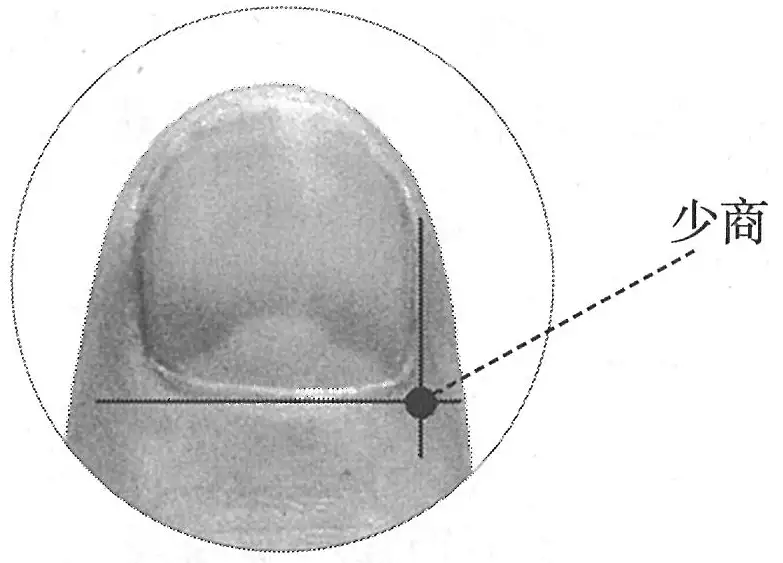

**图 2-17　少商穴图**

〔p.171 (인쇄 151)〕

　　(3) 在大指端内侧去爪甲如韭叶大，与爪甲根齐白肉际宛宛中。（《针灸玉龙经》）

**按**：《黄帝明堂经》本穴部位“手大指端内侧”，而《外台秘要》、甄权《针经》作“外侧”，这与取穴的姿势有关。前者取穴体位：掌心向内，拇指向前内；而后者为：掌心向前，拇指向外。

　4. 大指端内侧远食指侧去爪甲角一分许。（《针灸十四经穴位考订》）

　5. 统编针灸学教材

　　(1) 部位：在大拇指桡侧，去爪甲角一分许。取穴：在拇指桡侧距爪甲角后一分许取穴。（1957年南京《针灸学》）

　　(2) 部位：手大指端内侧。取穴：大指内侧去爪甲角约一分许，赤白肉际取之。（1版《针灸学讲义》）

　　(3) 部位：在手大指端内侧，去爪甲角如韭叶。取穴：在拇指桡侧距爪甲角后一分许取穴。（2版《针灸学讲义》）

　　(4) 拇指桡侧指甲角旁约0.1寸。（4、5、6、7版《针灸学》）

　　(5) 拇指桡侧指甲角后一分许。（《中国针灸学》）

**文献分析**：关于少商穴的定位，自《黄帝明堂经》以下的古代文献只说“去爪甲角如韭叶”，唐代杨上善曰“爪甲有四角，此取内侧上角也”，但未明言“旁去”还是“上去”爪甲角。故现代文献或作“爪甲角旁”，或作“爪甲角后”。按《肘后方》治喉痹曰“刺手父指爪甲后半分”，再考明正统仿宋针灸铜人少商穴正在爪甲角上约一分略偏桡侧处，明嘉靖、清光绪官修铜人及日本、韩国古代官修铜人井穴定位规律皆如是。因此，将古代文献“爪甲角旁”理解为距角的侧上方（沿角平分线方向）。此外，井穴的定位，古代文献以“韭叶”比量，古人也很早察觉到用“韭叶”比量定位过于粗略，故初唐杨上善注曰：“韭叶有大小，正取非大非小阔二分许量中度之人。若大小以意量之也”。张志聪曰：“古离爪甲如韭，今如米许”。今则参照《黄帝明堂经》手太阳经井穴少泽定位，统一定为“距爪甲角一分”。故综合文献与针灸铜人，少商穴定位于拇指桡侧爪甲根角侧上方0.1寸处，具体取穴为：沿爪甲尺侧画一直线与爪甲基底缘水平线交点处。

#### 【类属】 

手太阴肺经穴；五输穴之井穴。

　1. 肺出于少商，少商者，手大指端内侧也，为井木……手太阴经也。（《灵枢·本输》）

　2. 手太阴脉之所出也，为井。（《针灸甲乙经》卷三）

　3. 肺出少商，为井木也。（《黄帝内经明堂》）

#### 【适应症】 

主治咽部、鼻部、肺部病症。常用于咽喉肿痛，咳嗽，气喘；鼻衄；小儿惊风；癫狂；手指挛痛。

　1. 主疟，寒厥及热烦心，善哕，心满而汗出，刺出血，立已。寒濯濯，寒热，手臂不仁，唾沫，唇干引饮，手腕挛，指支，肺胀上气，耳中生风，咳喘逆，指痹，臂痛，呕吐，饮食不下彭彭。热病象疟，振慄鼓颔，腹胀，俾睨，喉中哏哏。（《黄帝内经明堂》）

**按**：《灵枢·胀论》：“肺胀者，虚满而喘咳”；又《金匮要略·肺痿肺痈欬嗽上气病脉证治第七》曰“上气喘而躁者，属肺胀”，则上文“肺胀上气，咳喘逆”中之“耳中生风”当是另一病症，该病症在《素问·缪刺论》取商阳穴治之：“邪客于手阳明之络，令人耳聋，时不闻音，刺手大指次指爪甲上去端如韭叶各一痏，立闻，不已，刺中指爪甲上与肉交者立闻，其不时闻者，不可刺也。耳中生风者，亦刺之如此数，左刺右，右刺左”。

　2. 少商主耳前痛。（《千金要方》卷三十、《外台秘要》）

**按**：《千金要方·孔穴主对法》卷三十所录腧穴主治主要据《黄帝明堂经》传本改编，此条主治与《黄帝明堂经》出入较大，疑有误。

〔p.172 (인쇄 152)〕

　3. 不能食，腹中气满，吃食无味。刺出血，以宣诸脏热腠也。（《太平圣惠方·针经》）

　4. 癫狂，小儿胎痫，奶痫，惊痫。（《太平圣惠方·明堂》）

　5. 治烦心善哕，心下满，汗出而寒，咳逆，痎疟，振寒，腹满，唾沫，唇干引饮，不下膨膨，手挛指痛，寒栗鼓颔，喉中鸣。以三棱针刺之微出血，泄诸脏热凑。唐刺史成君绰忽腮颔肿大如升，喉中闭塞，水粒不下三日，甄权针之立愈。（《铜人腧穴针灸图经》卷下）

**按**：《千金翼方》卷二十六小序曰“深州刺史成君绰忽患颈肿如数升，喉中闭塞，水粒不下已三日矣。以状告余，余屈（甄）权救之，针其右手次指之端如食顷，气息即通，明日饮啖如故”，此条症治被王惟一归于手大指少商穴下。

　6. 窦太师针灸遗存

　　(1) 喉中一切乳蛾等证。（《窦太师针经》）

　　(2) 乳蛾之症更希奇，急用金针病可医，若使迟延难整治，少商出血始相宜。（《针灸玉龙歌》）

　　(3) 乳蛾之证针次医，急用金针提泻治，若还迟滞人难救，少商出血要伸提。（《琼瑶神书》卷二）

　7. 统编针灸学教材

　　(1) 咳逆，中风昏迷，鼻衄，喉痹咽肿，声哑，颔肿，重舌，手指挛痛，泄诸脏热等。（1957年南京《针灸学》）

　　(2) 咳嗽气逆，中风昏迷，鼻衄，咽肿，喉痹，颔肿，重舌，手指挛痛身热。（1版《针灸学讲义》）

　　(3) 咳嗽，气喘，咽喉肿痛，鼻衄，重舌，手指挛痛，热痛，中风昏迷，癫狂。（2版《针灸学讲义》）

　　(4) 咽喉肿痛，咳嗽，鼻衄，发热，昏迷，癫狂。（4、5版《针灸学》）

　　(5) 咽喉肿痛，中风昏迷，中暑呕吐，小儿惊风，癫狂，咳嗽，鼻衄。（6版《针灸学》）

　　(6) 咽喉肿痛，鼻衄，高热、昏迷等肺系实热证。癫狂。（7版《针灸学》）

　　(7) 咽喉肿痛，咳嗽，气喘，鼻衄，发热，昏厥，癫狂，拇指挛痛。（《中国针灸学》）

**文献分析**：《黄帝明堂经》载本穴主治重在热病和肺部病症，宋以后则偏于咽喉部病症，其次是“小儿惊痫”。至于“高热神昏”是十二井穴的共性主治，非本穴的特有主治。自《铜人腧穴针灸图经》转载甄权针治喉痹验案始，古今临床应用最多为“咽喉肿痛”（不仅见于针灸专书，而且广泛见于其他医书，乃至史书），其次是“小儿惊痫”。

#### 附：临床应用举例 

　1. 喉痹咽痛

　　(1) 喉痺，水浆不入，七八日则杀人，随病人左右以刀锋刺父指爪甲后半分，令血出即愈。（《肘后方》中卷）

　　(2) 治喉痹方：以绳缠手大指刺出血一大豆以上，瘥，小指亦佳。（《千金翼方》卷十一）

　　(3) 针急喉闭：于大指外边指甲下根齐针之，不问男女左右，只用人家常使针针之令血出即效。如大段危急，两手大指都针之，其效甚妙。（《医说》卷二）

　　(4) 喉闭，刺少阳手足井，并刺少商及足太阴井。（《素问病机气宜保命集》卷下）

〔p.173 (인쇄 153)〕

　　(5) 治颔肿如升，喉中闭塞，水粒不下，以三棱针刺手太阴经少商二穴，微出血，泄诸阳脏热凑；兼刺手大指背头节上，以三棱针挑刺三针，出血佳；次针手太阳经阳谷二穴，而愈。（《针经摘英集》）

　　(6) 伤寒，腮颊肿大如升：刺少商、合谷、委中出血，灸天突，泻足三里。（《针灸集要·盘石金直刺秘传》）

　　(7) 颊肿如升，咽喉闭塞，水粒不下：刺少商，灸天突，泻液门、合谷。（《针灸集要·盘石金直刺秘传》）

　　(8) 乳蛾：少商、委中。缠喉风：少商灸。（《针灸集要·盘石金直刺秘传》）

　　(9) 喉痹乳蛾：少商针入一分，卧针向后三分、照海、太冲。（《医学纲目》卷十五）

　　(10) 乳蛾之证少商知，出血急用好施宜，假若外关气不至，三里升阳便自为，再取十指都出血，病效安危在用机，复取太冲并二穴，出血不改死不医。（《琼瑶神书》卷二）

　　(11) 咽喉肿痛：取双侧少商穴，用三棱针点刺出血。［针灸临床杂志，1999，15(2)：32-33］

　　(12) 咽炎：少商穴点刺出血。［针灸临床杂志，2000，16(12)：29］

　　(13) 扁桃体炎：取少商、商阳二穴三棱针点刺出血。［中医外科杂志，2001，10(6)：21］

　　(14) 痉挛性喉炎：取双刺少商穴，用三棱针针刺出血。［中国民间疗法，2001，9(7)：19-20］

　2. 肺部、鼻部病症

　　(1) 少商二穴主哕，各灸三壮，炷如小麦大。（《圣济总录·治哕灸法》卷一百九十二）

　　(2) 伤寒咳嗽寒痰：少商、列缺泻。（《针灸玉龙经·盘石金直刺秘传》）

　　(3) 肺风满面赤疮暴生者：少商、委中泻。（《针灸玉龙经·盘石金直刺秘传》）

　　(4) 肺经风落，满面生疮：暴者刺少商、委中出血，年久者更泻合谷。（《针灸集要·盘石金直刺秘传》）

　　(5) 鼻中生疮：少商出血。（《针灸玉龙经·盘石金直刺秘传》）

　　(6) 鼻衄：合谷穴、少商穴针刺疗法。［中西医结合杂志，1987(7)：440］

　　(7) 支气管哮喘：取双侧少商穴，用艾炷直接灸。［中国针灸，1995(5)：3-4］

　　(8) 鼻出血：用雀啄法或回旋法灸少商穴。［上海针灸杂志，2002，21(4)：47］

　3. 伤寒热证

　　(1) 凡遇伤寒，不问阴阳二症，用三棱针刺少商，宣诸藏府热腠，有血者可疗，无血者不治。当用意取穴无不验也。（《针灸集要·盘石金直刺秘传》）

　　(2) 高热：取少商穴用三棱针点刺出血。［吉林中医药，2000，9(2)：44］

　4. 其他病症

　　(1) 灸小便数而少且难，用力辄失精，此方万验也，令其人舒两手合掌并两大指，令其急逼之，令两爪甲相近，以一炷灸两爪甲本肉际际方后自然有角，令两角中小侵入爪上，此两指共当一炷也。（《千金翼方》卷二十八）

　　(2) 华佗治精魅鬼神所淫，癫邪狂厥，诸般符药不效者，用细索并两手大指缚之，灸三炷，每炷着四处，半在肉上，半在甲上，一处不着则不验。灸之当作鬼神语，诘问其略，即解脱之令去，其人遂苏。依图取法。男女同法少商。（《备急灸法》）

　　(3) 太仓公、孙真人救自缢死法云：如妇人札足者，只灸两手大指上二穴少商。（《备急灸法》）

〔p.174 (인쇄 154)〕

　　(4) 婴幼儿腹泻：针刺少商、大敦穴。［中国民间疗法，1998(4)：11］

　　(5) 癔症瘫：针刺少商、隐白穴。［贵州中医学院学报，1999，21(4)：29-30］

#### 【操作】 

直刺0.1寸。热结喉闭等实热证，宜用三棱针点刺出血。

　1. 刺入一分，留一呼，灸一壮。（《黄帝内经明堂》）

　2. 禁不宜灸。（《外台秘要》卷三十九）

　3. 刺可入同身寸之一分，留三呼。灸三壮。（《素问》王冰注）

　4. 刺入一分，留三呼，泻五吸，宜针不宜灸，以三棱针刺之，令出血。（《太平圣惠方·针经》）

　5. 刺可同身寸之一分，留二呼，而急出之。（《素问亡篇·刺法论》）

　6. 以三棱针刺之微出血。（《铜人腧穴针灸图经》卷下）

　7. 窦太师针灸遗存

　　(1) 针入一分，沿皮向后三分泻之，三棱针出血。（《针灸玉龙歌》注、《窦太师针经》）

　　(2) 刺一分，沿皮卧针向上三分，以宣泄藏热。或棱针出血亦妙。禁灸。唯癫痫可灸七壮。（《循经考穴编》上）

　　(3) 针一分，沿皮向外三分。治咽喉塞闭不和以三棱针出血。泄诸藏热毒。（《窦太师秘传》）

　8. 刺少商穴法，穴在手大指内侧，去爪甲，针如韭叶，刺入二分许，以手自臂勒至刺处，出血即消。（《口齿类要·喉痹》）

　9. 针一分，宜用锋针出血，禁灸。（《针灸大成》卷八）

　10. 针一分，灸三壮。《大成》禁灸。（《针灸十四经穴位考订》）

　11. 统编针灸学教材

　　(1) 针一分，针尖略向上方，凡中风暴起或咽喉急性肿胀，以三棱针刺入半分，立即出针使之出血，有退热开窍之效。（1957年南京《针灸学》）

　　(2) 针一分，针尖略向上方。凡猝中或咽喉急性肿胀，以三棱针点刺血。（1版《针灸学讲义》）

　　(3) 斜刺1分，或三棱针点刺出血。附注：治疗癫狂，鼻衄，可用小艾炷灸3~5壮。（2版《针灸学讲义》）

　　(4) 浅刺0.1寸，或点刺出血。（4、5、7版《针灸学》、《中国针灸学》）

　　(5) 直刺0.1寸，或向腕平刺0.2~0.3寸，或用三棱针点刺出血；可灸。（6版《针灸学》）

　12. ①向上斜刺0.1寸。感应：局部疼痛。②点刺，放血。温灸3~7壮；温灸1~3分钟。（上海《针灸学》）

**文献分析**：古今文献记载的井穴刺法有两种，一种为常规的毫针刺法，并行补泻之法，另一种是刺血法。辅助方法又分两种：一是用绳带于穴上方结扎以阻止血液回流，以便于刺血，二是用手由臂向手指处推捋使血聚于手端，以便于刺血。

### 延伸阅读 

　1. 黄龙祥.中国针灸学术史大纲[M].北京：华夏出版社，2001.

　2. 黄龙祥.新编重绘十四经脉经穴图[M].北京：中国中医药出版社，2010.

〔p.175 (인쇄 155)〕

　3. 黄龙祥.心经、肺经“是动”病新解——解读经络学说的新证据[J].中国中医基础医学杂志，2005，11(11)：814-816.

　4. 李方正.上臂部手太阴肺经循行辨[J].南京中医学院学报，1985(4)：61.

　5. 李锄.针灸穴名标准化刍议[J].上海中医药杂志，1984(4)：40-42.

　6. 朱敬.人迎、经渠等穴的定位针刺[J].针灸临床杂志，1997，13(2)：35.

　7. 杨光，李萍.井穴位置源流考析[J].北京中医，1988(2)：42.

　8. 王宏亮.穴起云门非中府之管见[J].湖北中医杂志，1983(5)：56.

〔p.176 (인쇄 156)〕

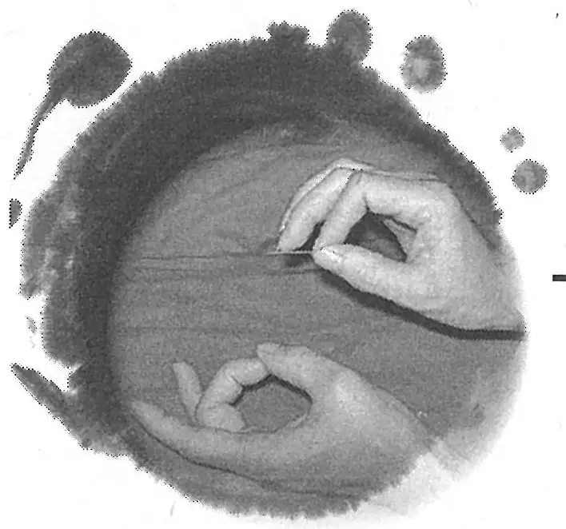

