# 《针灸腧穴通考》(上册) — 手阳明大肠经穴 (1/2) · （一）商阳 Shāngyáng LI1 出《灵枢》~（十）手三里 Shǒusānlǐ LI10 出《黄帝明堂经》

> 분할본 4/25. 원서: 黄龙祥·黄幼民 编著, 《针灸腧穴通考——〈中华针灸穴典〉研究》(上册), 人民卫生出版社, 2011. 원서 스캔 OCR 판독본을 챗봇 검색용으로 나눈 것이며, 본문과 쪽 표시 〔p.PDF쪽 (인쇄 쪽)〕는 원본 그대로이다.

## 二、手阳明大肠经穴 

### 概说 

手阳明经的经脉循行、病候以及腧穴归经、经穴定位的古代文献记载变化不大。然而后人对古代文献的理解有所不同，古代分歧较大的是肘髎穴的定位，现代分歧较大的则是迎香穴的定位；在穴名方面，手三里、手五里，宋以前文献径称“三里”、“五里”，与足阳明经的“三里”、足厥阴经的“五里”同名，这样在从针灸治疗文献（针灸方）归纳经穴主治时，很容易造成手足同名穴相混的错误。另外，“禾髎”穴与足少阳经的“和髎”穴也容易造成混淆。

#### 【经脉与经穴】 

#### 经脉循行与病候 

大肠手阳明之脉，起于大指次指之端，循指上廉，出合谷两骨之间，上入两筋之中，循臂上廉，入肘外廉，上臑外前廉，上肩，出髃骨之前廉，上出于柱骨之会上，下入缺盆络肺，下膈属大肠；其支者，从缺盆上颈贯颊，入下齿中，还出挟口，交人中，左之右，右之左，上挟鼻孔。是动则病齿痛颈肿。是主津液所生病者，目黄口干，鼽衄，喉痹，肩前臑痛，大指次指痛不用。气有余则当脉所过者热肿，虚则寒栗不复。（《灵枢·经脉》）

齿脉：起于次指与大指上，出臂上廉，入肘中，乘臑，穿颊，入齿中，夹鼻。是动则病齿痛，䪼肿，是齿脉主治。其所产病：齿痛，䪼肿，目黄，口干，臑痛，为五病。（《阴阳十一脉灸经》）

臂阳明脉：出中指间，循骨上廉，出臑□□上，凑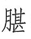(朏)，之口。其病：病齿痛，□□□□。诸病此物者，皆灸阳明脉。（《足臂十一脉灸经》）

**按**：《灵枢·经脉》“入下齿中”，《阴阳十一脉灸经》相应的循行只是“入齿中”而不分上下，实则包括上下齿。《灵枢·寒热病》谓“臂阳明有入鼽遍齿”；手阳明络也“遍齿”，并可证。《灵枢·经脉》编者之所以改成“入下齿中”，乃为阳明脉“环颜”而设，故十二脉中只有阳明脉左右相交。又因为在《经脉》篇中手足阳明脉循行方向相反，则自下而上之手阳明脉自然入下齿而交于上；自上而下的足阳明脉则入上齿而交于下。

《灵枢》在帛书经脉篇的基础上，引入经别的内容，使6条阳经也得以行于体内与相关六腑相联系；同时为实现十二经脉的循环流注，人为地增加了一些分支以便经脉依次交接，并使6条经脉改变了循行方向。但《灵枢》却忘记了对“经”、“别”，“直”、“支”加以调整，未能形成统一的体例，顺应上述这些变化，从而使得通篇文字前后关系混乱，难以理解。关于《灵枢·经脉》手阳明大肠经循行的经、别、直、支正确关系应如下作：

大肠手阳明之脉，起于大指次指之端，循指上廉，出合谷两骨之间，上入两筋之中，循臂上廉，入肘外廉，上臑外前廉，上肩，出髃骨之前廉，上出于柱骨之会上；［其别者］，下入缺盆络肺，下膈属大肠；其直者，从缺盆上颈贯颊，入下齿中，还出夹口，交人中，左之右，右之左，上夹鼻孔。

〔p.177 (인쇄 157)〕

**按**：关于手阳明经“是动”病，《经脉》篇“颈肿”，《至真要大论》篇及该篇新校正引《针灸甲乙经》手阳明病候均作“䪼肿”，与帛书经脉篇、《黄帝内经太素·经脉连环》、《脉经》卷六第八相合，是。

**所属经穴**：商阳　二间　三间　合谷　阳溪　偏历　温溜　下廉　上廉　手三里　曲池　肘髎　手五里　臂臑　肩髃　巨骨　天鼎　扶突　口禾髎　迎香

#### 【归经与起止穴】 

《针灸甲乙经》手阳明及臂凡二十八穴：商阳、二间、三间、合谷、阳溪、偏历、温溜、下廉、上廉、三里、曲池、肘髎、五里、臂臑；

六朝《产经》将《针灸甲乙经》此十四穴正式归入“手阳明大肠脉”；

唐代《千金要方》、《千金翼方》在此十四穴的基础上，又增加六穴：肩髎、秉风、肩井、天髎、肩髃、巨骨；

《外台秘要》归入“大肠人”的经穴，除包括《针灸甲乙经》全部十四穴外，另归入如下九穴：臑会，肩髎、肩髃、巨骨、扶突、天鼎、禾髎、水沟、兑端；

宋代《铜人腧穴针灸图经》厘定为二十穴：商阳、二间、三间、合谷、阳溪、偏历、温溜、下廉、上廉、三里、曲池、肘髎、五里、臂臑、肩髃、巨骨、天鼎、扶突、禾髎、迎香。

值得探讨的是，臑会穴，《黄帝明堂经》曰“手阳明之络”，按络穴归属于同名经穴的规律，应如《外台秘要》归入手阳明经（考证详见“手少阳经穴”篇），然宋代《铜人腧穴针灸图经》卷上始将之归入手少阳经，宋以后文献从之。

大迎穴，《灵枢》、《素问》皆属之于手阳明经穴，而汉代以后均归之于足阳明经穴。

唐代王焘之所以将水沟、兑端、龈交（督脉）3穴、肩髎（三焦经）归入手阳明经，可能是受手阳明经脉循行路线的影响。另将迎香穴归入胃经。

#### 【经穴定位与主治】 

手阳明经经穴定位的古代文献记载变化不大。然而后人对古代文献的理解有所不同，古代分歧较大的是肘髎穴的定位，现代分歧较大的则是迎香穴的定位。值得注意的是，手阳明经前臂部经穴的定位，在《黄帝明堂经》多采用解剖标志法，然而由于相关文献及经验的失传，后人难以理解这些文字的意义，只好采用骨度折量的方法定位。

#### 【脉口病候、经脉是动病候与经脉穴主治】 

手阳明标脉：大迎脉（大迎穴所在）。

手阳明本脉：阳溪脉（阳溪穴、合谷穴所在）。

“手阳明”穴：阳溪、合谷。

“手阳明”穴部位与相应的脉口、原穴部位非常一致。这表明早期的诊脉、刺脉部位演变为腧穴后，原先的脉名便成为穴名。此处后作为经脉的起点，此穴便为经脉的第一穴——原（源）穴。在早期文献还能清楚地看出，上下之标本脉不仅用于诊病，而且也是重要的针灸治疗部位：

耳聋，刺手阳明，不已，刺其通脉出耳前者；齿龋，刺手阳明，不已，刺其脉入齿中立已。（《素问·缪刺论》）

颔痛，刺手阳明与颔之盛脉出血。（《灵枢·杂病》）

齐中大夫病龋齿，臣意灸其左手阳明脉。（《史记·仓公传》）

〔p.178 (인쇄 158)〕

以上3方主治症均为手阳明经“是动”病，其前2方取穴原则相同，即先取手阳明脉口（“合谷”至“阳溪”穴脉动处），后取面部手阳明之标脉处。因一、二方同为手阳明“是动”病症，故取穴也完全相同（“脉入齿中”与“颔之盛脉”均指面颊部大迎动脉）。

对于这类针方中的“手阳明”，以往人们都想当然地理解为沿上肢、躯干、颜面前部分布的整个手阳明经脉，以至于对《内经》及其他古籍中类似针灸方皆不能正确诠释而运用于临床。其实上文中两处“手阳明”均指手腕部的“手阳明脉口”，“脉入齿中”、“颔之盛脉”即面颊部的脉动处——大迎脉。《黄帝明堂经》所集汉以前文献“大迎”主治症中正有“下牙痛，颊肿”二症，与手阳明“是动”病完全吻合。

历代文献之手阳明经循行及穴位分布见图2-18~图2-21。

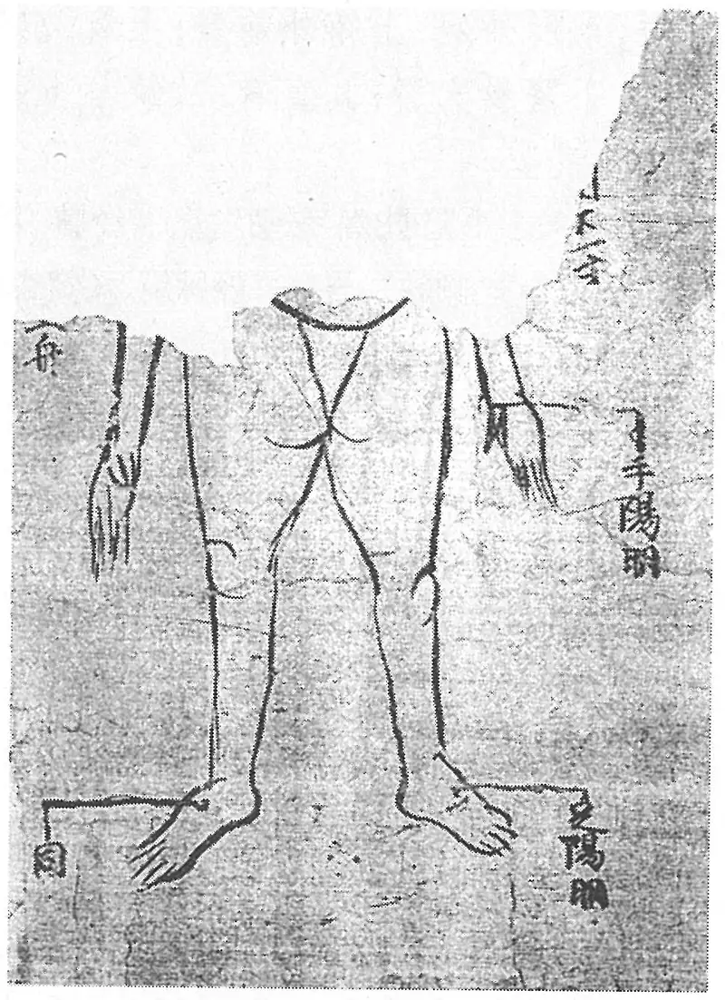

**图 2-18　敦煌卷子“手阳明”穴图之一**

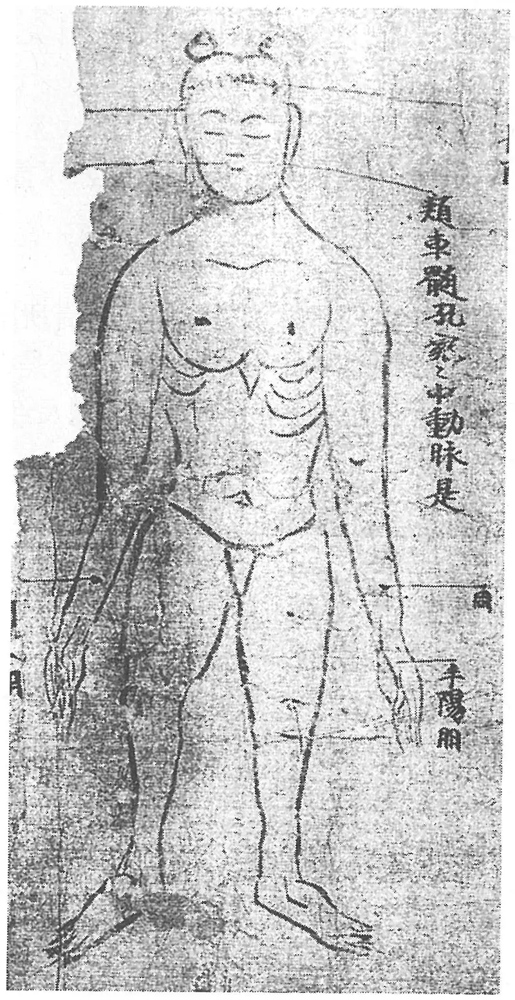

**图 2-19　敦煌卷子“手阳明”穴图之二**

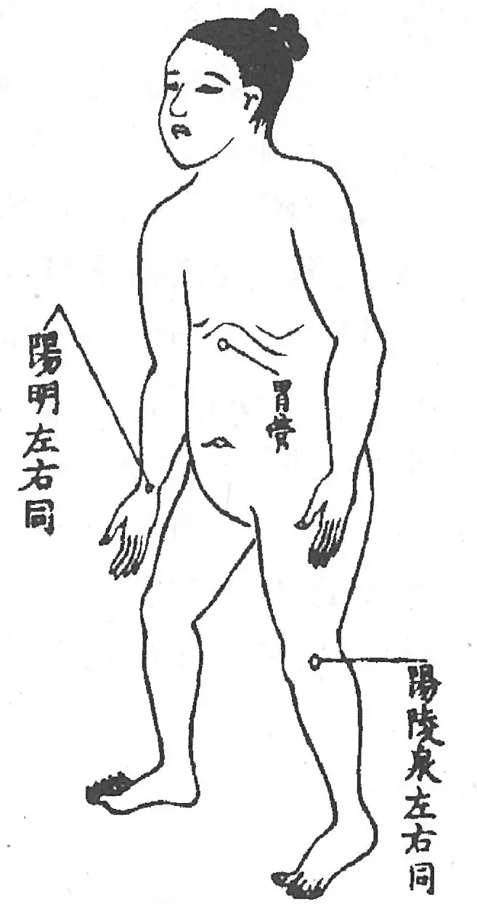

**图 2-20　《黄帝虾蟆经》“手阳明”穴图之一**

〔p.179 (인쇄 159)〕

由于早期的经脉病候直接来源于手足腕踝部的脉口部诊脉病候，对于这些病候，又直接于脉口处刺灸治疗，故这些部位便成为固定的腧穴——“经脉穴”，其名称与相应的经脉名相同。后来这些“经脉穴”又大多演变为相应的“原”穴和（或）“输”穴。这样《黄帝明堂经》所载之“原”、“输”穴的主治病症中必然包含了不同时期经脉病候“是动”病的内容。关于手阳明脉是动病候与经脉穴主治的文献对比，参见表2-2。

**表 2-2　手阳明脉是动病候与经脉穴主治病候的对比**

| 《阴阳十一脉灸经》是动病候 | 《灵枢·经脉》是动病候 | 《黄帝明堂经》经脉穴主治 |
|---|---|---|
| 齿痛，䪼肿。 | 齿痛，颈肿。 | 合谷：龋齿痛，面肿。阳溪：齿痛，喉痹。 |

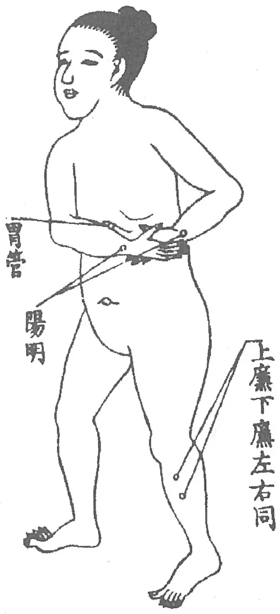

**图 2-21　《黄帝虾蟆经》“手阳明”穴图之二**

从上表对照可见，“手阳明”穴——合谷、阳溪穴主治病症兼具了《阴阳十一脉灸经》和《灵枢·经脉》的特征，可以明显看出从诊脉病候与经脉病候转化而来的痕迹。

#### 【诊络病候、络脉病候与络穴主治】 

　1. 手阳明之别，名曰偏历，去腕三寸，别入太阴；其别者，上循臂，乘肩髃，上曲颊偏齿；其别者，入耳合于宗脉。实则龋聋，虚则齿寒痹隔，取之所别也。（《灵枢·经脉》）

　2. 偏历，手阳明络，在腕后三寸，别走太阴者。实则聋龋，虚则痹鬲。（《黄帝明堂经》）

《黄帝明堂经》载手阳明络穴“偏历”主治病候完整包含了《灵枢·经脉》手阳明络脉的诊络病候，且较之又有发展，可以十分清楚地看出二者的源流脉络。

《黄帝明堂经》汇集了包括《内经》在内的汉以前针灸腧穴文献，其中记有一些不见于传世本《内经》的络穴内容，手阳明络穴除偏历外，所载之臑会穴也明显带有“络穴”的特征：“臑会，在臂前廉，去肩头三寸，手阳明之络。”

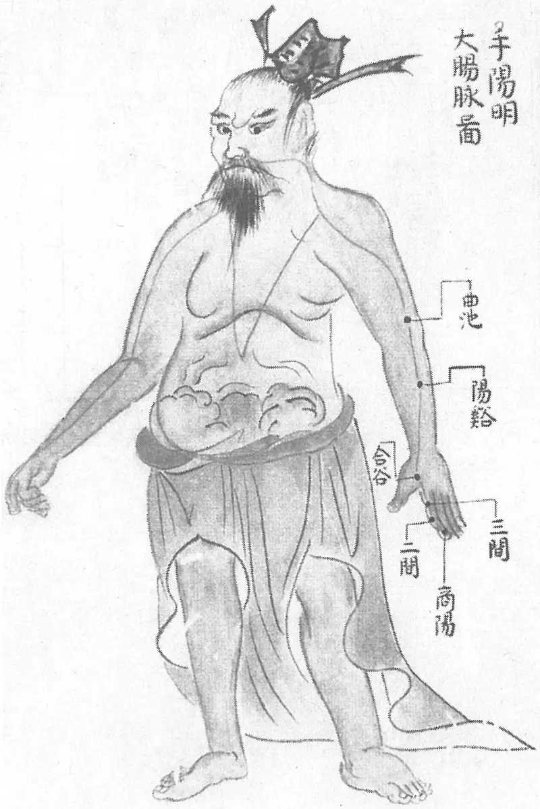

**图 2-22　《环中图》手阳明大肠脉图**

〔p.180 (인쇄 160)〕

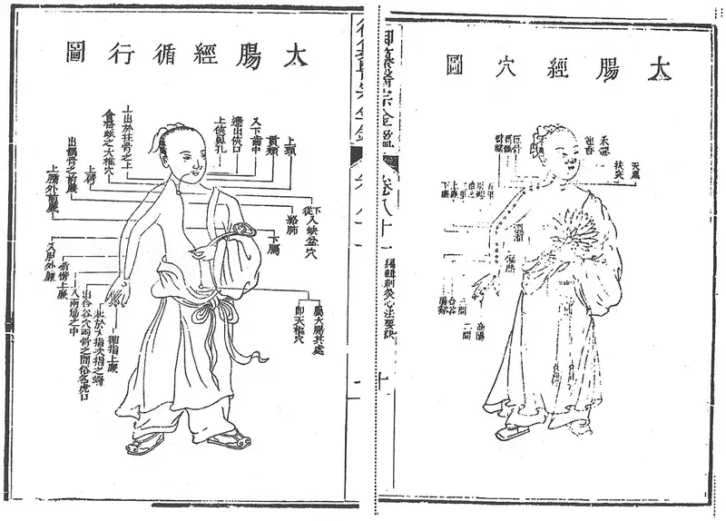

**图 2-23　《医宗金鉴》手阳明大肠经脉、经穴分图**

〔p.181 (인쇄 161)〕

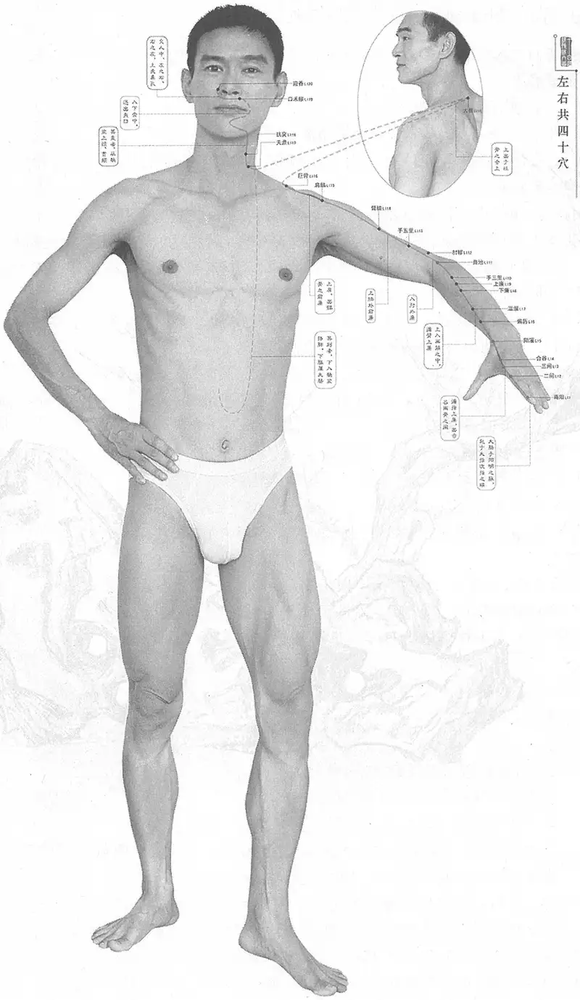

**图 2-24　黄龙祥编手阳明大肠经脉、经穴合图**

〔p.182 (인쇄 162)〕

### （一）商阳 Shāngyáng LI1 出《灵枢》 

问题：商阳穴的定位发生了怎样的变化？变化的原因是什么？

#### 【提要索隐】 

**穴名**：一名绝阳；一名而明。

**部位**：在手指，食指末节桡侧，指甲根角侧上方0.1寸（指寸）。

**适应症**：主治口齿、咽喉部病症。常用于咽喉肿痛，颊肿，齿痛；耳鸣，耳聋；发热无汗，神昏；手指麻木或肿痛。

**针刺操作**：浅刺0.1寸，或点刺出血。

#### 【名实考】 

在早期文献，特别是针灸治疗文献中常常直接用部位名“大指次指端”，而不提穴名。关于本穴的定位，《灵枢》、《素问》均作“大指次指端”，至《黄帝明堂经》增加“内侧爪甲角”局限定位，汉以后皆从之。

　1. 大肠上合手阳明，出于商阳，商阳，大指次指之端也，为井金。（《灵枢·本输》）

　2. 邪客于手阳明之络，令人气满胸中，喘息而支胠，胸中热，刺手大指次指爪甲上，去端如韭叶，各一痏，左取右，右取左，如食顷已。（《素问·缪刺论》）

　3. 邪客于手阳明之络，令人耳聋，时不闻音，刺手大指次指爪甲上去端如韭叶各一痏，立闻。（《素问·缪刺论》）

　4. 大肠上合手阳明，出于商阳，商阳者金也，一名绝阳，在手大指次指内侧去爪甲角如韭叶，手阳明脉之所出也，为井。（《黄帝明堂经》）

　5. 一名而明。（《黄帝内经太素·气府》、《医心方》卷二）

　6. 商者，金也。手阳明为金之表，故曰商阳。（《经穴解》）

#### 【定位】 

**部位**：在手指，食指末节桡侧，指甲根角侧上方0.1寸（指寸）（图2-25）。

**取穴**：食指桡侧指甲根角侧上方（即沿角平分线方向）0.1寸。相当于沿爪甲桡侧画一直线与爪甲基底缘水平线交点处取穴。

　1. 大指次指之端也。（《灵枢·本输》）

　2. 《黄帝明堂经》佚文

　　(1) 在手大指次指内侧，去爪甲如韭叶。（《针灸甲乙经》卷三、《太平圣惠方·明堂》、《神应经》、《类经图翼》、《针灸易学》、《针灸逢源》）

　　(2) 在手大指次指内侧，去爪甲角如韭叶。（《千金要方》卷二十九、《黄帝内经太素》杨上善注、《千金翼方》、《外台秘要》、《素问》王冰注、《医心方》、《铜人腧穴针灸图经》、《圣济总录》、《针灸资生经》、《针经节要》、《十四经发挥》、《针灸聚英》、《古今医统》、《医学入门》、《针灸大成》）

　3. 在手食指内侧，去爪角如韭叶许。（《循经考穴编》上）

　4. 食指内侧近拇指侧去爪甲角一分许。（《针灸十四经穴位考订》）

　5. 统编针灸学教材

　　(1) 部位：手食指之内侧。取穴：食指桡侧取爪甲约一分许，当赤白肉际取之。（1957

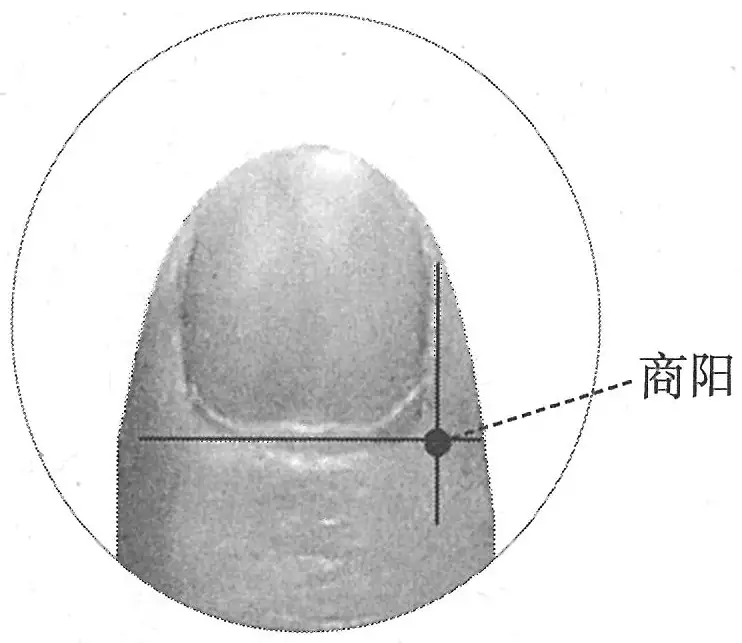

**图 2-25　商阳穴图**

〔p.183 (인쇄 163)〕

年南京《针灸学》）

　　(2) 部位：手食指端之内侧部。取穴：食指桡侧取爪甲约一分许，当赤白肉际取之。（1版《针灸学讲义》）

　　(3) 部位：在手大指次指内侧，去爪甲如韭叶。取穴：在食指桡侧距爪甲角后一分许取穴。（2版《针灸学讲义》）

　　(4) 食指桡侧指甲角旁约0.1寸。（4、5版《针灸学》）

　　(5) 在手食指末节桡侧，距指甲角0.1寸。（6、7版《针灸学》）

　　(6) 食指桡侧指甲角后一分许。（《中国针灸学》）

**文献分析**：本穴定位，自《黄帝明堂经》以下文献未见分歧，关于对“去爪甲角”的理解，以及“如韭叶”宽度的折算，详见“少商”穴分析。

在《黄帝内经》中，井穴多定位于指（趾）尖，而不是两旁，考证详见手太阴经“少商”穴。

#### 【类属】 

手阳明大肠经穴；五输穴之井穴；手阳明所根。

　1. 大肠上合手阳明，出于商阳，商阳大指次指之端也，为井金。（《灵枢·本输》）

　2. 手阳明脉之所出也，为井。（《黄帝明堂经》）

　3. 手阳明根于商阳，溜于合谷，注于阳溪，入于扶突、偏历也。（《灵枢·根结》）

#### 【适应症】 

主治口齿、咽喉部病症。常用于咽喉肿痛，颊肿，齿痛；耳鸣，耳聋；发热无汗、神昏；手指麻木或肿痛。

　1. 主热病汗不出。热疟口干。臂瘛引口中，恶寒，䪼肿，肩痛引缺盆。青盲。耳中生风，耳鸣，耳聋时不闻。下齿痛。喉痹。（《黄帝明堂经》）

**按**：以上“下齿痛，恶寒”，三间穴主治作“齿龋痛，恶清”，此乃手阳明大肠经穴主治齿痛的特异症状，与《灵枢·杂病》所谓“齿痛，不恶清饮，取足阳明；恶清饮，取手阳明”的取穴原则相合；《素问·刺热》曰：“热病始手臂痛者，刺手阳明、太阴而汗出止”，提示《黄帝明堂经》所谓“热病汗不出”症可先有或伴有手臂部症状；“齿痛，䪼肿，喉痹，目疾，口干，肩痛”均为手阳明经的典型病候；“耳聋时不闻”主治见于《素问·缪刺论》：“邪客于手阳明之络，令人耳聋，时不闻音，刺手大指次指爪甲上去端如韭叶各一痏，立闻”。

　2. 气满胸中，喘息支胁。（《外台秘要》卷三十九）

**按**：此条出自《素问·缪刺》，王焘未详其所出，归于《明堂经》腧穴主治。

　3. 治胸中气满，喘咳支肿，热病汗不出，耳鸣耳聋，寒热痎疟，口干，颐颔肿，齿痛恶寒，肩背急相引缺盆痛，目青盲。（《铜人腧穴针灸图经》卷下）

　4. 窦太师针灸遗存

　　(1) 五指无力，补；指红肿，宜泻。（《窦太师针经》）

　　(2) 指麻木。（《循经考穴编》上）

　5. 统编针灸学教材

　　(1) 青盲，耳鸣，耳聋，齿痛，喉痹，颔肿，肩背急引缺盆痛，手指麻木，热病汗不出，疟疾，中风昏迷。（1957年南京《针灸学》、1版《针灸学讲义》）

　　(2) 耳聋，齿痛，咽喉肿痛，颔肿，青盲，手指麻木，热病汗不出，中风昏迷。（2版《针灸学讲义》、4、5版《针灸学》）

　　(3) 咽喉肿痛，耳鸣，耳聋，中风昏迷，热病无汗，下齿痛，青盲。（6版《针灸学》）

　　(4) ①齿痛，咽喉肿痛等五官疾患；②热病、昏迷等热证、急症。（7版《针灸学》）

　　(5) 齿痛，咽喉肿痛，颔肿，手指麻木，热病汗不出，昏迷。（《中国针灸学》）

〔p.184 (인쇄 164)〕

**文献分析**：《黄帝明堂经》所载本穴主治包括面、齿、喉、肩等手阳明经部位病症，以及热病、耳聋、口干等症，皆有所本。后世临床应用则集中在咽喉肿痛上。

#### 附：临床应用举例 

　1. 咽喉病症

　　(1) 时有深州刺使成君绰，忽患颈肿如数升，喉中闭塞，水粒不下已三日矣。以状告余，余屈权救之，针其右手次指之端如食顷，气息即通，明日饮啖如故。（《千金翼方》卷二十六）

　　(2) 淡白喉痈：针少商、商阳，出其紫血。（《喉科指掌》）

　　(3) 大红喉痈：急针少商、商阳，或针患上肿处出恶血。（《喉科指掌》）

　　(4) 咽喉肿痛：少商、商阳、关冲。三棱针点刺出血。［上海中医药杂志，1981(6)：24］

　　(5) 咽喉肿痛：商阳、少商，用三棱针放血；合谷针刺。［中国针灸，1984，4(5)：20］

　　(6) 急性扁桃体炎：取少商、商阳二穴三棱针点刺放血数滴。［针灸临床杂志，2000，16(9)：33-34］

　　(7) 慢性扁桃体炎：少商、商阳二穴三棱针点刺放血。［中医外治杂志，2001，10(6)：21-22］

　2. 耳、齿病症

　　(1) 邪客于手阳明之络，令人耳聋时不闻音，刺手大指次指爪甲上，去端如韭叶各一痏，立闻。（《素问·缪刺论》）

　　(2) 缪传引上齿，齿唇寒痛，视其手背脉血者去之，足阳明中指爪甲上一痏，手大指次指爪甲上各一痏，立已，左取右，右取左。（《素问·缪刺论》）

　3. 肺与大肠病症

　　(1) 邪客于手阳明之络，令人气满胸中，喘息而支胠，胸中热，刺手大指次指爪甲上，去端如韭叶各一痏，左取右，右取左，如食顷已。（《素问·缪刺论》）

　　(2) 百日咳：少商、商阳，点刺出血。［中医杂志，1982，23(8)：41］

　　(3) 便秘：商阳穴三棱针快速点刺令其出血。［中国针灸，1998(4)：218］

　4. 中风呃逆、目赤肿痛、风热咳嗽、牙龈肿痛，商阳穴点刺放血。［江西中医药，1997，28(6)：44］

#### 【操作】 

浅刺0.1寸，或点刺出血。

　1. 刺入一分，留一呼，灸三壮。（《黄帝明堂经》）

　2. 可灸三壮，右取左，左取右，如食顷立已。针入一分，留一呼。（《铜人腧穴针灸图经》卷下）

　3. 窦太师针灸遗存

　　(1) 针入二分，沿皮向后三分。五指无力，补；指红肿，宜泻。可灸三壮。（《窦太师针经》）

　　(2) 窦氏针入一分，更沿皮向后三分。（《针方六集》卷一）

　　(3) 灸三壮，刺一分，沿皮向外三分。（《循经考穴编》上）

　4. 针入一分，禁灸。（《医学入门》卷一）

　5. 统编针灸学教材

　　(1) 针一分，针尖略向上方，出血法如少商。（1957年南京《针灸学》、1版《针灸学讲义》）

〔p.185 (인쇄 165)〕

　　(2) 斜刺1分，三棱针点刺出血。（2版《针灸学讲义》）

　　(3) 浅刺0.1寸，或点刺出血。（4、5、6、7版《针灸学》、《中国针灸学》）

**文献分析**：井穴一般多刺入一分，或点刺出血。值得注意的是，窦太师刺井穴，刺入一分，沿皮向后三分，且根据病之虚实行补泻之法。

### （二）二间 Èrjiān LI2 出《灵枢》 

#### 【提要索隐】 

**穴名**：一名间谷。

**部位**：在手指，第2掌指关节桡侧远端赤白肉际处。

**国标修订**：1990年版国标：微握拳，在手食指本节（第2掌指关节）前，桡侧凹陷处。2006年修订版：在手指，第2掌指关节桡侧远端赤白肉际处。

**按**：2006年版国标采用现代解剖学术语系统描述腧穴的定位，故作如上修订。

**适应症**：主治口齿、鼻、咽部病症。常用于齿痛，视物不清，鼻衄，咽喉肿痛，口眼㖞斜；热病；肩痛。

**针刺操作**：直刺0.2~0.3寸。

#### 【名实考】 

“二间”，见于《灵枢》，其别名“间谷”的命名与《黄帝内经》所载穴位的另一概念“谿谷”系统有关。

　1. 大肠上合手阳明……溜于本节之前二间，为荥。（《灵枢·本输》）

　2. 流于二间，二间者，水也，一名间谷。在手大指次指本节前内侧陷者中，手阳明脉之所流也，为荥。（《黄帝明堂经》）

　3. 间者，穴也，气脉流通之称也，以前有三间，故此曰二间。（《经穴解》）

　4. 别名　周谷。（1957年南京《针灸学》）

**按**：“周谷”系“间谷”形误，此乃传日本针灸教材《针灸医学全书》（经穴学）之误。

#### 【定位】 

**部位**：在手指，第2掌指关节桡侧远端赤白肉际处（图2-26）。

**取穴**：微握拳，在手食指本节（第2掌指关节）前，桡侧凹陷处取穴。

　1. 本节之前。（《灵枢·本输》）

　2. 在手大指次指本节前，内侧陷者中。（《黄帝明堂经》、《太平圣惠方·针经》、《铜人腧穴针灸图经》、《圣济总录》、《针灸资生经》、《针经节要》、《十四经发挥》、《神应经》、《针灸集书》、《针灸聚英》、《古今医统》、《针灸大成》、《针方六集》、《类经图翼》、《医宗金鉴·刺灸心法要诀》、《针灸易学》、《针灸逢源》）

　3. 在手大指次指本节前陷者中。（《太平圣惠方·明堂》）

　4. 在食指本节前内侧横纹尖陷中。（《循经考穴编》上）

　5. 食指内侧本节前陷中。（《针灸十四经穴位考订》）

　6. 统编针灸学教材

　　(1) 部位：食指本节前桡侧横纹尖陷中。取穴：手指卷屈，当食指本节之前陷中赤白肉际取之。（1957年南京《针灸学》）

〔p.186 (인쇄 166)〕

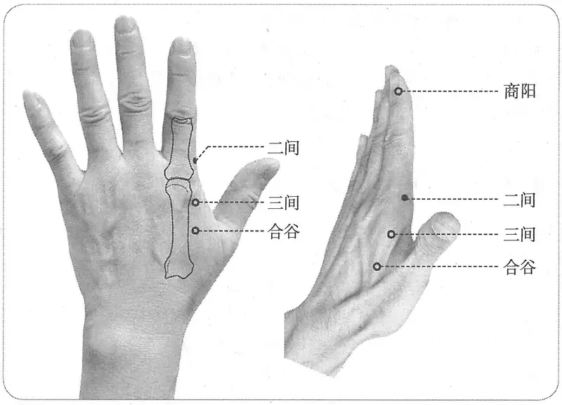

**图 2-26　二间穴图**

　　(2) 部位：在食指本节前内侧陷中。取穴：握拳，于本节之前横纹头陷中赤白肉际处取之。（1版《针灸学讲义》）

　　(3) 部位：在第二掌指关节前桡侧陷中，握拳取之。取穴：在第二掌指关节前桡侧陷中，握拳取之。（2版《针灸学讲义》）

　　(4) 握拳，当食指桡侧掌指关节前凹陷中。（4、5版《针灸学》）

　　(5) 微握拳，在手食指本节第2掌指关节前，桡侧凹陷处。（6版《针灸学》）

　　(6) 微握拳，当食指桡侧，第2掌指关节前凹陷中。（7版《针灸学》）

　　(7) 微握拳，当第二掌指关节前桡侧赤白肉际中。（《中国针灸学》）

**文献分析**：本穴定位，古代文献描述明确，定位于食指本节（第2掌指关节）前内侧凹陷处。至清代《循经考穴编》新增一个定位标志——食指近端横纹桡侧端。经实际比量，此点略偏前，故自2版教材始不再以此体表标志定穴。

#### 【类属】 

手阳明大肠经穴；五输穴之荥穴。

大肠上合手阳明……溜于本节之前二间，为荥。（《灵枢·本输》）

手阳明脉之所流也，为荥。（《黄帝明堂经》）

#### 【适应症】 

主治口齿、鼻、咽部病症。常用于齿痛，视物不清，鼻衄，咽喉肿痛，口眼㖞斜；热病；肩痛。

　1. 主多卧善唾，肩髃痛寒，鼻鼽赤，多血，浸淫起面，身热，喉痹如哽，目眦伤，忽振寒，肩疼。口㖞，齿痛。（《黄帝明堂经》）

**按**：上述病症除“多卧善唾”外，皆系手阳明经病候。

　2. 主喉痹咽肿，多卧善唾，鼻鼽衄，及口眼斜。（《太平圣惠方·明堂》）

　3. 治喉痹，颔肿，肩背痛，振寒，鼻鼽衄血，多惊，口㖞。（《铜人腧穴针灸图经》卷下）

**按**：“多惊”见于《黄帝明堂经》“三间”穴主治，疑王惟一误录三间穴主治于此。

　4. 目黄，口干；急食不通，伤寒水结。（《针灸聚英》卷一、《古今医统》、《针灸大成》、《针

〔p.187 (인쇄 167)〕

方六集》）

**按**：“目黄，口干”为大肠经病候，高武认为“大肠穴，于卯时泻二间穴”，故列大肠病候于此。“急食不通，伤寒水结”系误录《针经摘英集》“三间”穴针方，又重出于“三间”穴下。

　5. 窦太师针灸遗存

　　(1) 二间治目昏不见，先补后泻；牙痛，泻之。（《窦太师针经》）

　　(2) 治目昏，先补后泻；又治牙痛颔肿。（《循经考穴编》上）

　　(3) 眼目昏，先泻后补；眼红肿，羞明，单泻；冷泪，详证虚实补泻。（《针灸玉龙歌》注）

　6. 主牙疾、眼疾。（《医学入门》卷一）

　7. 针灸歌赋主治：目昏（《通玄指要赋》）；牙痛（《针灸玉龙歌》、《灵光赋》）。

　8. 统编针灸学教材

　　(1) 目昏，鼽衄，齿痛，口㖞，颔肿，喉痹，肩臂痛。（1957年南京《针灸学》、1版《针灸学讲义》）

　　(2) 目昏，鼻衄，齿痛，口㖞，颔肿，咽喉肿痛，热病。（2版《针灸学讲义》）

　　(3) 目昏，鼻衄，齿痛，口㖞，咽喉肿痛，热病。（4、5版《针灸学》）

　　(4) 齿痛，咽喉肿痛，口眼㖞斜，目痛，热病。（6版《针灸学》）

　　(5) 鼻衄，齿痛等五官疾患，热病。（7版《针灸学》）

　　(6) 目昏，鼻衄，齿痛，咽喉肿痛，热病。（《中国针灸学》）

**文献分析**：《黄帝明堂经》载本穴主治包括喉、口齿、鼻、目、肩等手阳明经循行部位病症，以及“身热”、“多卧善唾”之症，而后世临床应用主要集中于目疾与齿疾。本穴主治与三间穴相近，当互参。《医学入门》直接以病症部位概括腧穴主治的体例，值得借鉴。

#### 附：临床应用举例 

　1. 目疾

　　(1) 目昏不见，二间宜取。（《通玄指要赋》）

　　(2) 风沿眼红肿涩烂：睛明、合谷、二间、三里。问曰：此证从何而得？答曰：醉饱行房，血气凝滞，用手扯摸，贼风乘时串入，故得此证。刺之不效，复刺后穴：睛明、三里。（《针灸集成》第十四方）

　　(3) 羞明怕日：合谷、攒竹、行间、二间、睛明、小骨空。问曰：此证从何而得？答曰：皆因暴痛，未可在路迎风串入眼中，血不就舍，肝不藏血，风毒贯入，观灯光冷泪自出，见日影则疾涩痛疼难开，复刺后穴：睛明、行间。（《针灸集成》第十五方）

　　(4) 麦粒肿：双侧二间穴，针灸疗法、艾炷灸。［四川中医，1988，6(9)：封四］

　2. 牙痛

　　(1) 牙疼阵阵痛相煎，针灸还须觅二间。（《针灸玉龙歌》）

　　(2) 牙齿肿痛并咽痹，二间阳溪疾怎逃。（《灵光赋》）

#### 【操作】 

直刺0.2~0.3寸。

　1. 刺入三分，留六呼，灸三壮。（《黄帝明堂经》）

　2. 窦太师针灸遗存

　　(1) 刺入一分，沿皮向后三分。（《窦太师针经》）

　　(2) 针一分，沿皮向后三分，灸三壮。看虚实补泻。（《针灸玉龙歌》注）

〔p.188 (인쇄 168)〕

　　(3) 刺三分，灸三壮，沿皮向后三分。（《循经考穴编》上）

　3. 针二分，灸三壮。（《针灸十四经穴位考订》）

　4. 统编针灸学教材

　　(1) 针二至三分，灸三壮。（1957年南京《针灸学》、1版《针灸学讲义》）

　　(2) 直刺2~3分，艾条灸3分钟。（2版《针灸学讲义》）

　　(3) 直刺0.2~0.3寸。（4、5、7版《针灸学》、《中国针灸学》）

　　(4) 直刺0.2~0.4寸，可灸。（6版《针灸学》）

### （三）三间 Sānjiān LI3 出《灵枢》 

#### 【提要索隐】 

**穴名**：一名少谷。

**部位**：在手背，第2掌指关节桡侧近端凹陷中。

**适应症**：主治口齿部、目部、咽部病症。常用于目痛，齿痛，咽喉肿痛；肩痛，手背及手指肿痛；胸满，发热气喘。牙拔除术针麻用穴。

**针刺操作**：直刺0.3~0.5寸。

#### 【名实考】 

一名少谷。其别名“少谷”，与二间的别名“间谷”，命名方式均与穴位另一概念“谿谷”系统有关。1957年南京《针灸学》别名项下另载有“小谷”一名，因“少”、“小”二字，古文献中常通用，故本穴别名仍只“少谷”一名。

　1. 大肠上合手阳明，出于商阳……注于本节之后三间，为腧。（《灵枢·本输》）

　2. 注于三间，三间者，木也，一名少谷。在手大指次指本后内侧陷者中，手阳明脉之所注也，为输。（《黄帝明堂经》）

　3. 三间者，以二间而得名也。（《经穴解》）

　4. 别名　少谷、小谷。（1957年南京《针灸学》）

#### 【定位】 

**部位**：在手背，第2掌指关节桡侧近端凹陷中（图2-27）。

**取穴**：微握拳，在手食指关节（第2掌指关节）后，桡侧凹陷处取穴。

　1. 本节之后。（《灵枢·本输》）

　2. 在手大指次指本节后，内侧陷者中。（《黄帝明堂经》、《太平圣惠方·针经》、《铜人腧穴针灸图经》、《圣济总录》、《针灸资生经》、《十四经发挥》、《神应经》、《针灸聚英》、《古今医统》、《医学入门》、《针灸大成》、《针方六集》、《类经图翼》、《医宗金鉴·刺灸心法要诀》、《针灸易学》、《针灸逢源》）

　3. 在虎口第二指节下一寸。（《千金翼方》卷二十六）

　4. 在大指次指第三节后内侧，捻拳横纹头中。（《针灸玉龙经》）

　5. 在食指本节后内侧陷者中。广注，约去二分许陷中。（《循经考穴编》上）

　6. 食指内侧本节后陷中。（《针灸十四经穴位考订》）

　7. 统编针灸学教材

　　(1) 部位：食指本节后桡侧陷中。取穴：食指之桡侧，本节之后陷中，握拳取之。（1957年南京《针灸学》）

　　(2) 部位：食指本节内侧陷中。取穴：握拳，侧置，于本节之后掌骨内缘陷中取之。

〔p.189 (인쇄 169)〕

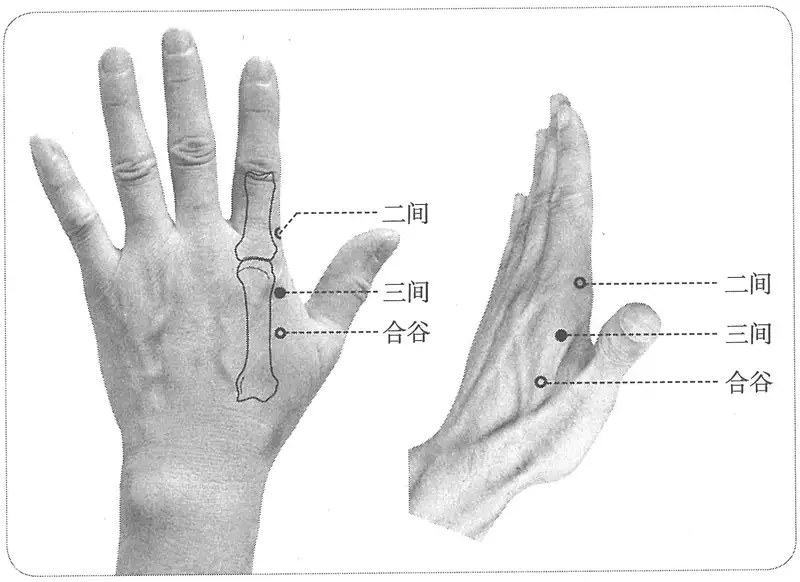

**图 2-27　三间穴图**

（1版《针灸学讲义》）

　　(3) 部位：在手大指次指本节后，内侧陷者中。取穴：在食指桡侧第二掌骨小头之后方，握拳取之。（2版《针灸学讲义》）

　　(4) 握拳，当第二掌骨小头桡侧后凹陷中。（4、5版《针灸学》）

　　(5) 微握拳，在手食指本节第2掌指关节后，桡侧凹陷处。（6版《针灸学》）

　　(6) 微握拳，在食指桡侧，第2掌指关节后凹陷处。（7版《针灸学》）

　　(7) 微握拳，当第二掌骨小头后桡侧凹陷中。（《中国针灸学》）

**文献分析**：古今文献关于本穴定位有三说：一为手大指次指本节后，内侧陷者中；二是在虎口第二指节下一寸；三是在大指次指第三节后内侧，捻拳横纹头中。其中第二说“虎口第二指”应指第二掌骨，其下一寸定三间，位置略偏后；第三说“大指次指第三节后内侧，捻拳横纹头中”，如果此处“横纹头”是指食指近端横纹，则系二间穴定位标志。若系指掌横纹头，则约对掌指关节处，定位也偏前。故现代本穴定位取第一说。

#### 【类属】 

手阳明大肠经穴；五输穴之输穴。

　1. 大肠上合手阳明，出于商阳……注于本节之后三间，为腧。（《灵枢·本输》）

　2. 手阳明脉之所注也，为输。（《黄帝明堂经》）

#### 【适应症】 

主治口齿部、目部、咽部病症。常用于目痛，齿痛，咽喉肿痛；肩痛，手背及手指肿痛；胸满，发热气喘。牙拔除术针麻用穴。

　1. 主痎疟。寒热，唇口干，身热喘息，目急痛，善惊。多卧善唾，胸满，肠鸣。齿龋痛，恶清。喉痹，咽肿如哽。肩痛。（《黄帝明堂经》）

**按**：以上“齿龋痛，恶清”主治与《灵枢·杂病》所谓“齿痛，不恶清饮，取足阳明；恶清饮，取手阳明”的取穴原则相合；“痎疟。寒热，唇口干”，《素问·刺疟》谓手阳明所主之疟的特点为“疟，先手臂发者，先刺手少阴、阳明十指间”；又“疟方欲寒，刺手阳明太阴、足阳明太阴”；《灵枢·杂病》曰：“疟不渴，间日而作，取足阳明；渴而日作，取手阳明。”可见，手阳明疟的发病特点是“疟从手臂起，疟而口渴”。又“喉痹，咽肿如哽。齿龋痛，多卧善唾，肩痛，身热”等症均与二间穴主治相同。

〔p.190 (인쇄 170)〕

　2. 治喉痹咽中如鲠，齿龋痛，嗜卧，胸满，肠鸣洞泄，寒疟，唇焦口干，气喘，目眦急痛。（《铜人腧穴针灸图经》卷下）

　3. 窦太师针灸遗存

　　(1) 三间治目昏不见，先补后泻；牙疼，泻之。又治手背红肿，宜三棱针出血。（《窦太师针经》）

　　(2) 手指手背肿痛。（《循经考穴编》上）

　4. 急食不通，身寒结水。（《针灸聚英》卷一、《针灸大成》、《针方六集》）

**按**：此辑自《针经摘英集》“三间、承山”针方。详见“附：临床应用举例”。

　5. 主下牙疼。（《医学入门》卷一）

　6. 统编针灸学教材

　　(1) 目昏，急痛，下齿痛，喉痹咽塞，手指手背红肿。（1957年南京《针灸学》）

　　(2) 目眦急痛，下齿痛，喉痹咽塞，手指、手背红肿。（1版《针灸学讲义》）

　　(3) 目痛，齿痛，咽喉肿痛，手指手背红肿，身热，胸满肠鸣。（2版《针灸学讲义》）

　　(4) 齿痛，目痛，咽喉肿痛，身热，胸满肠鸣。（4、5版《针灸学》）

　　(5) 咽喉肿痛，齿痛，身热，腹胀肠鸣。（6版《针灸学》）

　　(6) 齿痛，咽喉肿痛等五官疾患，腹胀、肠鸣等肠腑病证，嗜睡。（7版《针灸学》）

　　(7) 齿痛，目痛，咽喉肿痛，手指及手背红肿。（《中国针灸学》）

**文献分析**：《黄帝明堂经》载本穴主治包括喉、口齿、目、肩等手阳明经部位病症，以及“身热而喘”、“胸满肠鸣”等肺、大肠病症，而后世临床应用主要集中于齿疾，其次是目疾与局部病症。本穴主治与二间穴相近，当互参。

#### 附：临床应用举例 

　1. 凡灸疟者，必先问其病之所先发者先灸之，从头项发者，于未发前预灸大椎尖头，渐灸，过时止；从腰脊发者，灸肾输百壮；从手臂发者灸三间。（《千金要方》卷十、《千金翼方》）

　2. 治急食不通并伤寒水结，刺手阳明经三间二穴，下针至合谷穴，三补三泻，候腹中通出针。次取足太阳经承山二穴，在腨肠下分肉之间陷中，针入七分，泻之。（《针经摘英集》）

　3. 下牙痛，灸龙玄、三间，泻合谷。（《针灸集要·盘石金直刺秘传》）

　4. 上片牙疼，吕细、人中、太渊；下片牙疼：合谷、龙渊足内踝前，起大骨下陷中。入三火三，刺不见血。问曰：牙疼之证，缘何而得？答曰：皆因肾经气虚败，上盛下虚，阴阳不升降，又因风毒灌注，故得此证，复刺后穴：肾俞、三间、二间。（《针灸集成》第二十五方）

**按**：龙渊，即上方之“龙玄”穴，在手侧腕上，交叉紫脉上，专治牙痛，见于《窦太师针经》。注者不识，而以为足少阴肾经“然谷”穴别名，大误。

　5. 针鼻衄法，针药不效，三二日不止者，用细线子系大拇指本节，其线子紧系定，其衄立止，后可针合谷、三间。（《医方类聚》卷七十九）

　6. 更有三间肾俞妙，善除肩背消风劳。（《席弘赋》）

　7. 三叉神经痛，合谷、三间穴，重用灸法治疗。［江苏中医杂志，1986，7(5)：33］

　8. 小儿外感咳嗽，取穴双侧三间穴，毫针直刺，稍捻转，不提插。［中医研究，1997，10(4)：47］

〔p.191 (인쇄 171)〕

**文献分析**：古今临床应用的重点在于齿疾、肺与大肠病症、肩部病症，与腧穴文献所载本穴的主治基本相应。

#### 【操作】 

直刺0.3~0.5寸。

　1. 刺入三分，留三呼，灸三壮。（《黄帝明堂经》）

　2. 针入一分，沿皮向后三分。治目昏不见，先补后泻；牙疼，泻之。又治手背红肿，宜三棱针出血。（《窦太师针经》）

　3. 针一分，沿皮向后透合谷穴。孕妇勿用。（《针灸玉龙歌》注）

　4. 统编针灸学教材

　　(1) 针三至七分，灸三至五壮，治五指尽痛时，针入一寸五分，名曰透掌针法。（1957年南京《针灸学》、1版《针灸学讲义》）

　　(2) 直刺3~5分，艾条灸3~7分钟。（2版《针灸学讲义》）

　　(3) 直刺0.5~0.8寸。（4、5版《针灸学》、《中国针灸学》）

　　(4) 直刺0.3~0.5寸。（6、7版《针灸学》）

**文献分析**：古代文献中，窦太师针灸承唐代甄权《针经》遗风，根据不同的病证采用不同的针法，颇切于临床实用，教材中只有1957年南京《针灸学》表现出这一特点，但该教材其他穴以及后来的教材都没能遵循这一原则，一方面是由于古今各家临床经验总结不够，另一方面则是在这方面的临床研究本身存在欠缺。

### （四）合谷 Hégǔ LI4 出《灵枢》 

问题：合谷穴的定位有哪些变化？

#### 【提要索隐】 

**穴名**：一名虎口。

**部位**：在手背，第2掌骨桡侧的中点处。

**国标修订**：1990年版国标：在手背，第1、2掌骨间，当第二掌骨桡侧的中点处。2006年修订版：在手背，第2掌骨桡侧的中点处。

**按**：笔者认为还是保留旧国标中“第1、2掌骨间”句为宜。

**适应症**：主治口面部、咽部病症。常用于齿痛，目赤肿痛，鼻衄，咽喉肿痛，口眼㖞斜，口噤，头痛，耳聋；中风失语、上肢不遂；恶寒发热，无汗，多汗；癫狂；痛经，闭经，难产。亦作为牙拔除术、甲状腺手术等多种口面五官及颈部手术针刺麻醉的常用穴。

**针刺操作**：直刺0.5~1.0寸。治疗癫狂等精神疾病，可向劳宫穴方向透刺，强刺激。

#### 【名实考】 

合谷，一名虎口。《琼瑶神书》多作“合骨”，古代针灸文献中，穴名“谷”与“骨”混用之例较常见。又宋以前文献所载之古穴名“手阳明”，亦多指此穴，如《太平圣惠方》卷五十五明言“手阳明二穴，在手大指虎口曲纹头”。因为本穴（古代定位）及阳溪穴处皆可触及脉动，古代并可用作诊脉处，故并称作“手阳明”穴，犹如“寸口脉”处的“太渊”、“经渠”穴并称作“手太阴”穴一样。现代针灸教材本穴定于第2掌骨桡侧的中点处，位置较古代文献描述偏远端和尺侧，类似的理解并非始于现代，三百多年前的朝鲜《针灸经验方》所批评的正是当时医家此类不规范取合谷穴的情形。与古代定位相同或相近的取穴法仍在临床上应用，然今人因不明其源流，而冠以不同的穴名，视为不同的穴位。早在20世纪50年代末，上海第一医学院第一附属医院通过临床观察提示：依据古代文献取合谷穴，比按现行教材的定位取穴，临床疗效要好。但这一意见没有被后来的针灸教材采用。合谷作为“四总穴”之一，主治病症的范围比一般穴要宽得多，除去针法、刺法的因素外，应当有多个体表进针点，或者在同一进针点下有较宽的刺激域，根据不同的病症选择不同的进针点，或者选择不同的针尖方向与深度。

〔p.192 (인쇄 172)〕

　1. 大肠上合手阳明……过于合谷，合谷，在大指岐骨之间，为原。（《灵枢·本输》）

　2. 过于合谷，一名虎口。在手大指岐骨间，手阳明脉之所过也，为原。（《黄帝明堂经》）

　3. 手阳明之所过，合谷穴也。在手大指次指间，手阳明之原也。（《素问亡篇·刺法论》）

　4. 合谷者，言肺之经，由此而下行及于商阳，大肠之经，又由此而上臂也，故曰合谷。（《经穴解》）

**按**：此说似牵强。《黄帝明堂经》谓二间为“间谷”，三间穴为“少谷”，本穴为“合谷”，是早期穴位概念“谿谷”学说的遗存。

　5. 紧唇，灸虎口，男左女右。（《千金要方》卷六、《千金翼方》）

**文献分析**：古代针灸文献，特别是宋以前文献中之穴名“虎口”系合谷穴别名，今人不辨，将此条文献归入奇穴“虎口”穴下。

#### 古今文献对“合谷”穴定位的不同理解 

　1. 合谷二穴　《铜》曰：在手大指、次指岐骨间陷中。而俗折度阳明经之所属，妄从食指偏取陷中，不察岐骨间陷中。（朝鲜仁祖二十二年许任《针灸经验方》）

　2. 合谷穴部位　手背部，第一、第二掌骨结合部前凹陷中。（1977年日本竹之内诊佐夫《针灸医学》）

　3. 合谷穴　前臂旋前，肘关节半屈，手背面第一、二掌骨之间，在第二掌骨桡侧缘近侧1/3与远侧2/3交界处。进针方向：针尖偏向第二掌骨方向，与掌背侧面成80度角。此是上一医附一医院临床经验，其疗效胜于旧法。（1959年上海第一医学院《常用经穴解剖学定位》）

#### 相关穴及刺激点 

　1. 上合谷（鼻痛点）　在第1、2掌骨基底的前方凹陷处。主治同合谷穴，重在牙痛、鼻痛的治疗。直刺得气后，针退至皮下，再沿第2掌骨掌侧向尺侧斜刺1.5-2寸，针感可至上肢乃至面部。（《针灸经外奇穴图谱（续集）》）

　2. 虎边　合谷穴下，第2掌指关节后约1寸半。主治癫痫、癔病，精神分裂症。向后溪方向刺入2-3寸，针感（酸胀感）可放散到头部。（《针灸经外奇穴图谱（续集）》）

**按**：上合谷（鼻痛点），相当于古代合谷穴处，与合谷穴实为一穴，主治也相同，用作“合谷穴之副穴”；虎边穴，与现代针灸教材合谷穴定位相当，但刺法不同。

#### 【定位】 

**部位**：在手背，第2掌骨桡侧的中点处（图2-28）。

**取穴**：在第1、2掌骨之间，约当第2掌骨之中点处取之。

　1. 在大指岐骨之间。（《灵枢·本输》、《黄帝内经太素·本输》）

　2. 《黄帝明堂经》佚文

　　(1) 在手大指次指间。（《针灸甲乙经》卷三）

　　(2) 在手大指岐骨间。（未校本《新雕千金方》卷二十九、《千金翼方》、《外台秘要》、《医心方》、《素问》王冰注、《铜人腧穴针灸图经》卷上及卷下“穴腧都数”）

　　(3) 在手大指、次指岐骨间。（宋校本《千金要方》卷二十九、《铜人腧穴针灸图经》卷

〔p.193 (인쇄 173)〕

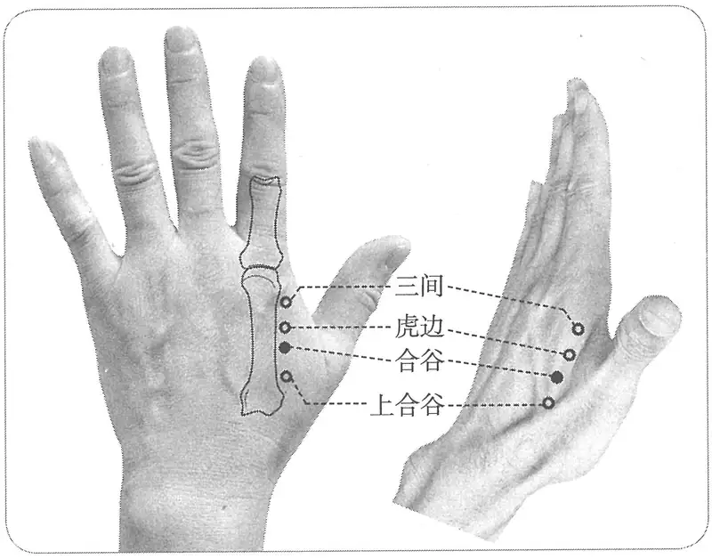

**图 2-28　合谷穴与相关穴图**

下、《圣济总录》、《针灸资生经》、《针灸玉龙经》、《十四经发挥》、《医学入门》、《琼瑶神书》、《神应经》、《针灸集书》、《针灸聚英》、《古今医统》、《针灸大成》、《类经图翼》、《医宗金鉴·刺灸心法要诀》、《针灸易学》、《针灸逢源》）

　3. 在手大指虎口两骨间陷中。（《千金翼方》卷二十六、《针灸资生经》、《针灸集书》）

　4. 手阳明二穴，在手大指虎口曲纹头。（《太平圣惠方》卷五十五）

　5. 在手大指两骨罅间宛宛中。（《太平圣惠方·明堂》）

　6. 窦太师针灸佚文

　　(1) 在手大指次指两岐骨间动脉。（《窦太师针经》）

　　(2) 在手大指次指岐骨缝中，脉应手。（《针灸玉龙歌》注）

　　(3) 两指岐骨，两指合缝悬五分，动脉应手。（《医经会元·玉龙歌》注）

　7. 在虎口岐骨间陷中。广注宜并二指，取纹尽高肉上，须捏拳下针。（《循经考穴编》上）

　8. 针灸方腧穴定位

　　(1) 在虎口后纵纹头，立指取之宛宛中。（《千金翼方》卷二十六）

　　(2) 在手大指、次指两骨间陷者中。（《太平圣惠方·明堂》）

　　(3) 手大指、次指间后一寸五分陷者中。（《太平圣惠方·明堂》）

　9. 大、食二指本节后岐骨第一、二掌骨间陷中。（《针灸十四经穴位考订》）

　10. 统编针灸学教材

　　(1) 部位：在手虎口，岐骨间陷中。取穴：以手平伸，拇食二指伸张，视其岐骨前即第一第二掌骨间现微陷凹处取之。（1957年南京《针灸学》）

　　(2) 部位：手虎口岐骨间。取穴：将拇食二指伸张，视其岐骨前凹陷处取之。又一取法，患者一手拇、食指张开，以另一手拇指第一节横纹沿虎口边缘下按，拇指尖尽处是穴。（1版《针灸学讲义》）

　　(3) 部位：在手大指次指间。取穴：在第一、第二掌骨之间，约当第二掌骨桡侧之中点取穴。或以一手的拇指指骨关节横纹，放在另一手的拇食指之间的指蹼缘上，当拇指尖尽处是穴。（2版《针灸学讲义》）

〔p.194 (인쇄 174)〕

　　(4) 手背，第一、二掌骨之间，约平第二掌骨中点处。（4、5版《针灸学》）

　　(5) 在手背，第1、第2掌骨间，当第2掌骨桡侧的中点处。（6、7版《针灸学》、《中国针灸学》）

**文献分析**：早期（特别是汉以前）以动脉或络脉定位的穴，多不是一个局限、固定的点，合谷穴定位的分歧正是这一特点的遗存。从古代文献“手大指两骨罅间宛宛中”、“手大指、次指间后一寸五分陷者”以及窦太师针灸“手大指次指两岐骨间动脉”、“在手大指次指岐骨缝中，脉应手”、“两指岐骨，两指合缝悬五分，动脉应手”等描述来看，本穴位置应靠近第1、2掌骨底交叉的骨缝中。此处也正是桡动脉的手背触诊点。《素问·三部九候论》曰：“中部地，手阳明也”，王冰注曰：“谓大肠脉也。在手大指次指岐骨间，合谷之分，动应于手也。”可见合谷穴是手阳明脉的诊脉部位，可触及脉动。从1955年承淡安《中国针灸学》一直到第1版统编针灸学教材均采用这种定位法，而从1964年2版《针灸学讲义》此穴的定位开始向远端桡侧偏移。这种修改与既往文献有如下不合：第一，此处已不能触及动脉搏动；第二，修改后的穴位与手阳明大肠经循行不合。1959年上海第一医学院第一附属医院通过临床实践也提示：靠近第一、二掌骨底交叉处取穴临床疗效较好，具体取穴法如下：“前臂旋前，肘关节半屈，手背面第一、二掌骨之间，在第二掌骨桡侧缘近侧1/3与远侧2/3交界处。进针方向：针尖偏向第二掌骨方向，与掌背侧面成80度角。此是上一医附一医院临床经验，其疗效胜于旧法”（《常用经穴解剖学定位》）。可见，1955年承淡安《中国针灸学》及1964年之前的针灸学教材与古代文献更吻合，也可避免与有关奇穴的混淆。

#### 【类属】 

手阳明大肠经穴；原穴；手阳明所溜。

　1. 大肠上合手阳明……过于合谷，合谷，在大指岐骨之间，为原。（《灵枢·本输》）

　2. 手阳明脉之所过也，为原。（《黄帝明堂经》）

　3. 大肠之源，合谷穴也。（《素问亡篇·刺法论》）

　4. 手阳明根于商阳，溜于合谷，注于阳溪，入于扶突、偏历也。（《灵枢·根结》）

#### 【适应症】 

主治口面部、咽部病症。常用于齿痛，目赤肿痛，鼻衄，咽喉肿痛，口眼㖞斜，口噤，头痛，耳聋；中风失语、上肢不遂；恶寒发热，无汗，多汗；癫狂；痛经，闭经，难产。亦作为牙拔除术、甲状腺手术等多种口面五官及颈部手术针刺麻醉常用穴。

　1. 主鼻鼽衄，热病汗不出，瞒目，目痛瞑，头痛，龋齿痛。痎疟。寒热。痱，痿，臂腕不用，唇吻不收。狂易。喑不能言，口噤不开聋，耳中不通。喉痹。面肿。（《黄帝明堂经》）

　2. 耳聋飕飕然如蝉鸣。（《千金翼方》卷二十六）

　3. 主痎疟，寒热病汗不出，目不明，生白翳，皮肤痂疥，遍身风疹。（《太平圣惠方·明堂》）

　4. 疗寒热疟，鼻鼽衄，热病汗不出，目视不明，头痛齿龋，喉痹，痿臂，面肿，唇吻不收，喑不能言，口噤不开。（《铜人腧穴针灸图经》卷下）

　5. 窦太师针灸遗存

　　(1) 治目暗，咽喉肿痛，脾寒及牙耳头疼，面肿，皆治。量虚实补泻，泻多补少。伤寒无汗则补，有汗则泻，女人有孕者，切不可针灸。（《窦太师针经》）

　　(2) 伤寒无汗，补合谷，泻复溜即汗；汗多，补复溜，泻合谷即止。凡一切头面诸证及中风不语，口眼㖞斜，狂邪癫厥，头风目疾，无不治之。（《循经考穴编》上）

　　(3) 治头痛，感寒热症。妊妇禁针。（《窦太师秘传》）

　6. 此穴解表发汗大妙。（《针经摘英集》）

　7. 腰脊内引痛，小儿单乳蛾。（《针灸聚英》卷一、《古今医统》、《针灸大成》）

〔p.195 (인쇄 175)〕

**按**：“腰脊内引痛”主治症摘自《针经摘英集》，原方作“治腰脊内引痛，不得屈伸，近上痛者，刺手阳明经合谷二穴……”详见“附：临床应用举例”。

　8. 主治阳明热郁，翳障赤肿。大抵目疾多宜灸此穴，永不再发也。（《古今医统》卷六十一）

　9. 针灸歌赋主治　眼疾（《通玄指要赋》、《席弘赋》）；头面病症（《针灸玉龙歌》、《四总穴歌》）；多汗（《针灸玉龙歌》）；头痛、牙痛（《杂病十一穴歌》）；肩臂痛（《杂病十一穴歌》、《席弘赋》）；咳嗽（《席弘赋》）。

　10. 统编针灸学教材

　　(1) 头痛，目翳，鼻衄，耳聋，齿痛，面肿，喉痹，指挛臂痛，中风，口噤不开，口眼㖞斜，热病汗不出，多汗，经闭。（1957年南京《针灸学》、1版《针灸学讲义》）

　　(2) 头痛，目赤肿痛，鼻衄，鼻渊，齿痛，耳聋，面肿，疔疮，咽喉肿痛，咳嗽，指挛臂痛，牙关紧闭，口眼㖞斜，热病无汗，多汗，经闭，滞产，腹痛，便秘，痢疾，小儿惊风，瘾疹，痄腮。（2版《针灸学讲义》）

　　(3) 头痛，目赤肿痛，鼽衄，齿痛，耳聋，面肿，咽喉肿痛，牙关紧闭，口眼㖞斜，热病无汗，多汗，腹痛，便闭，经闭，滞产，痄腮。（4版《针灸学》）

　　(4) 头痛，目赤肿痛，鼻衄，齿痛，牙关紧闭，口眼㖞斜，耳聋，痄腮，咽喉肿痛，热病无汗，多汗，腹痛，便闭，经闭，滞产。（5版《针灸学》）

　　(5) 头痛，齿痛，目赤肿痛，咽喉肿痛，失音，口眼㖞斜，半身不遂，痄腮，疔疮，经闭，腹痛，牙关紧闭，小儿惊风，鼻衄，耳鸣耳聋，发热恶寒，多汗，无汗，瘾疹，疟疾。（6版《针灸学》）

　　(6) ①头痛、目赤肿痛、齿痛、鼻衄、口眼歪斜、耳聋等头面五官诸疾；②发热恶寒等外感病证，热病无汗或多汗；③经闭、滞产等妇产科病证。（7版《针灸学》）

　　(7) 头痛，颈项痛，目赤肿痛，鼻衄，鼻塞，鼻渊，齿痛，耳聋，面肿，咽喉肿痛，痄腮，牙关紧闭，口眼㖞斜，热病无汗，多汗，腹痛，痢疾，便秘，闭经，滞产，小儿惊风，上肢疼痛，痿痹。（《中国针灸学》）

**文献分析**：《黄帝明堂经》载本穴主治除手阳明经病候外，还有“痱，痿”病及狂病。“耳聋”一般属于手足少阳经病候，手阳明与足少阳经穴所主之耳聋的特点是“聋而不痛者，取足少阳；聋而痛者，取手阳明”（《灵枢·杂病》）。后世临床应用多集中于口面部病症，其次是咽喉部病症、妇科病症和中风失音症。古代腧穴文献多谓孕妇禁刺合谷，这也从反面说明本穴有较强的下胎作用，故现代针灸学教材自2版起增补“滞产”一症。

#### 附：临床应用举例 

　1. 口面五官病症

　　(1) 紧唇，灸虎口，男左女右。（《千金要方》卷六、《千金翼方》）

　　(2) 小儿疳眼，灸合谷二穴各一壮，炷如小麦大。（《太平圣惠方·明堂》）

　　(3) 小儿二三岁，忽发两眼大小眦俱赤，灸手大指次指间后一寸五分虎口陷者中，各三壮，炷如小麦大。（《太平圣惠方·明堂》）

　　(4) 风，失音不语，灸合谷穴，一名虎口。在手大指次指两骨间。（《圣济总录》卷一百九十二）

　　(5) 治眼疼不可忍：刺足少阳经风池二穴、手阳明合谷二穴立愈。（《针经摘英集》）

　　(6) 治偏正头痛，刺手少阳经丝竹空二穴……次针足少阳经风池二穴……次针手阳明经合谷二穴，在手大指岐骨间陷中。随患人咳嗽一声下针，刺五分，内捻针，令病人吸气三口；次外捻针，呼气三口；次又内捻针，吸气五口，令人觉针下一道痛如线，上至头为度，长呼一口气出针。（《针经摘英集》）

〔p.196 (인쇄 176)〕

　　(7) 治牙疼，刺手阳明经合谷二穴，在手大指次指岐骨间陷中。针入三分。次阳明经内庭二穴……（《针经摘英集》）

　　(8) 眼痛则合谷以推之。（《通玄指要赋》）

　　(9) 若遇头面诸般疾，一针合谷妙通神。（《针灸玉龙歌》）

　　(10) 曲池与合谷，头面病可彻。（《千金十一穴歌》）

　　(11) 睛明治眼未效时，合谷光明安可缺。（《席弘赋》）

　　(12) 口噤眼合药不下，合谷一针效甚奇。（《肘后歌》）

　　(13) 口风头晕面赤，不欲人言：攒竹泻、三里泻。未愈泻合谷、风池。（《针灸玉龙经·盘石金直刺秘传》）

　　(14) 下牙痛：灸龙玄、三间，泻合谷。（《针灸集要·盘石金直刺秘传》）

　　(15) 中风暴失音，或言语蹇者：先针合谷，次针风府，俱泻之。（《针灸集要·盘石金直刺秘传》）

　　(16) 上下齿痛：泻合谷、两足外踝尖上，左痛灸右，右痛灸左，男女皆同。（《针灸集要·盘石金直刺秘传》）

　　(17) 伤寒耳鸣：泻合谷、听会、足三里。（《针灸集要·盘石金直刺秘传》）

　　(18) 耳聋气闭无闻，盖肾经虚败，攻于两耳，闭塞虚鸣如锣声，如蝉鸣，如热报叫：泻合谷、足三里。（《针灸集要·盘石金直刺秘传》）

　　(19) 耳内脓出，或生珠气，痒不可当：刺合谷泻之，次灸听会。如前症虚，灸肾俞立效。（《针灸集要·盘石金直刺秘传》）

　　(20) 合谷穴，穴法口授，治牙关不开，则阳陵穴应针，各刺一刺出血，入二分，关窍即开。又有一证潮热者，有作寒者，于合谷穴用针，左转发寒，右转发热。（《世医得效方》卷十七）

　　(21) 流行性腮腺炎：合谷穴、少商穴针刺放血治疗。[中国针灸，1987，7(2)：14]

　　(22) 面肌痉挛：风池穴，合谷穴温针疗法。[中国针灸，1988，8(5)：22]

　2. 咽喉病症

　　(1) 治双、单乳蛾：少商出血，合谷、委中、行间，俱泻。（《针灸集要·盘石金直刺秘传》）

　　(2) 急缠喉风：刺少商，灸天突、合谷、中渚，俱泻。（《针灸集要·盘石金直刺秘传》）

　　(3) 喉咙闭塞，饮食艰难：刺少泽、合谷、中渚、委中出血；未愈，泻中冲。（《针灸集要·盘石金直刺秘传》）

　3. 妇产病症

　　(1) 产后脉绝不还，针合谷入三分，急补之，又主胎上抢心。（《千金翼方》卷二十六）

　　(2) 徐文伯针刺堕胎：泻足太阴，补手阳明，胎便应针而落。（《南史·张融传第二十二》）

　　(3) 徐文伯针刺堕胎：泻足三阴交，补手阳明合谷，应针而落。（《铜人腧穴针灸图经》卷下）

**按**：此方出于《南史·张融传第二十二》。宋以后医书引用此方多作“泻三阴交，补合谷”。

〔p.197 (인쇄 177)〕

　　(4) 妇人经脉不调：补合谷，泻三阴交，灸血海。（《针灸集要·盘石金直刺秘传》）

　　(5) 妇人气痛：灸合谷，泻三阴交。（《针灸集要·盘石金直刺秘传》）

　　(6) 急性乳腺炎：合谷穴、肩井穴，针刺治疗。[上海针灸杂志，1986(1)：16]

　　(7) 经行吐衄：合谷穴、曲池穴针刺采用泻法。[江西中医药，1987(3)：31]

　　(8) 乳腺增生：合谷穴，屋翳穴针刺治疗。[中医杂志：英文版，1988，8(3)：157-160]

　　(9) 妇女无排卵症：合谷、三阴交左右各取一穴针刺，根据辨证分型分别施以补泻手法。[现代中西医结合杂志，2001，10(2)：173]

　　(10) 经迟：取双侧合谷穴，于月经前3~5天，采用平补平泻法针刺之，连针3~5针。[上海针灸杂志，2001，20(5)：44]

　　(11) 崩漏：取双侧合谷穴，双侧三阴交穴，毫针刺用补法。难产：针补双侧合谷穴、泻双侧三阴交穴，有加强宫缩催产作用。[四川中医，2002，20(7)：75-76]

　4. 头痛

　　(1) 烦热头痛，针虎口入三分。（《千金翼方》卷二十六）

　　(2) 中风后头痛如破：灸百会，仍用三棱针四旁刺之出血，泻合谷、攒竹。（《针灸集要·盘石金直刺秘传》）

　　(3) 猝暴中风，头痛，夹脑风，头面四肢浮肿，胸膈痰涎，浑身燥痒，皮肤瘾疹，耳鸣眩晕：泻合谷、曲池。头疼不止：更泻风池。（《针灸集要·盘石金直刺秘传》）

　　(4) 偏头风，燥热不可忍，鼻孔燥，一眼赤，一耳聋鸣声哼哼：泻合谷、解溪。（《针灸集要·盘石金直刺秘传》）

　　(5) 头风，满面疼痛，项强不得回顾：泻合谷，刺承浆、委中出血。（《针灸集要·盘石金直刺秘传》）

　　(6) 头痛：合谷穴、中封穴针刺。[成都中医学院学报，1986(1)：45]

　5. 伤寒病症

　　(1) 治急食不通并伤寒水结，刺手阳明经三间二穴，下针至合谷穴，三补三泻，候腹中通出针。次取足太阳经承山二穴，在腨肠下分肉之间陷中，针入七分，泻之。（《针经摘英集》）

　　(2) 治伤寒在表，发热恶寒，头项痛，腰脊强，无汗，尺寸脉俱浮，宜刺手阳明经合谷二穴，依前法刺之，候遍体汗出，即出针。此穴解表发汗，大妙。（《针经摘英集》）

　　(3) 伤寒不论阴阳，日过不汗：补合谷，泻复溜在足内踝上二寸，沿皮顺骨下半寸；汗出：补复溜，泻合谷，刺委中血出；少愈，更泻合谷。（《针灸集要·盘石金直刺秘传》）

　　(4) 伤寒无汗泻复溜，汗出多时合谷收。（《针灸玉龙歌》）

　　(5) 伤寒六脉不应手者：泻合谷，补复溜。（《针灸集要·盘石金直刺秘传》）

　　(6) 伤寒痞结胁积痛，宜用期门见深功，当汗不汗合谷泻，自汗发黄复溜凭。飞虎一穴通痞气，祛风引气使安宁。（《肘后歌》）

　6. 痛证

　　(1) 有贵人手中指挛，已而无名指、小指亦挛，医为灸肩髃、曲池、支沟而愈。支沟在腕后三寸。或灸风疾，多有不灸支沟，只灸合谷云。（《针灸资生经》卷五）

　　(2) 治腰脊内引痛，不得屈伸，近上痛者，刺手阳明经合谷二穴。（《针经摘英集》）

　　(3) 手挛背急不能握物：刺合谷，痛则泻之，麻则补之。（《针灸集要·盘石金直刺秘传》）

〔p.198 (인쇄 178)〕

　　(4) 手连肩脊痛难忍，合谷针时要太冲。曲池两手不如意，合谷下针宜仔细。（《席弘赋》）

　　(5) 周身疼痛：合谷穴、血海穴针刺治愈。[上海针灸杂志，1987，6(2)：11]

　　(6) 急性腰扭伤：合谷、后溪穴，针刺后溪透合谷，配合腰部活动。[针刺临床杂志，1998，14(11)：39]

**文献分析**：古今临床应用偏重于头面五官、咽喉、妇科病症，以及中风、热病、手臂病症，与腧穴文献所载本穴主治相吻合。

#### 【操作】 

直刺0.5~1.0寸。治疗癫狂等精神疾病，可向劳宫穴方向透刺，强刺激。

　1. 刺入三分，留六呼，灸三壮。（《黄帝明堂经》）

　2. 宜针入四分，留三呼，五吸。忌灸，慎洗手，凡针手足，皆三日勿洗也。（《千金翼方》）

　3. 今附若妇人妊娠不可刺之，损胎气。（《铜人腧穴针灸图经》卷下）

　4. 刺入三分，留三呼，次进针至五分，留三呼，后退一分，留一呼，徐徐出针，以手扪之其穴。（《素问亡篇·刺法论》）

　5. 窦太师针灸遗存

　　(1) 针入五分，灸二七壮。女人有孕者，切不可针灸。（《窦太师针经》）

　　(2) 窦氏：刺入五分。孕娠禁针此穴。一云：可泻不可补，补即下胎。（《针方六集》卷一）

　　(3) 直针一寸，可灸五壮。妊妇不可针，针则宜泻不宜补，补即堕胎。（《循经考穴编》上）

　6. 针五分，灸三壮。孕妇禁针。（《针灸十四经穴位考订》）

　7. 统编针灸学教材

　　(1) 针三至七分，灸三至七壮。孕妇忌针灸。（1957年南京《针灸学》、1版《针灸学讲义》）

　　(2) 直刺5~8分，艾条灸3~7分钟。（2版《针灸学讲义》）

　　(3) 直刺0.5~1寸。（4、5、6版《针灸学》）

　　(4) 直刺0.5~1寸，针刺时手呈半握拳状。孕妇不宜针。（7版《针灸学》）

　　(5) 直刺0.5~1.0寸。可灸。孕妇禁针灸。（《中国针灸学》）

　8. ①直刺0.5~1寸。感应：局部酸胀。②治手指拘挛或肌肉瘫痪时，透向劳宫或后溪，进针2~3寸。感应：手掌麻胀及向指端放散。③斜刺，治头面部疾病时，沿掌骨骨膜刺入，进针1~1.5寸。感应：酸胀感可向上扩散，有时可至肩、肘。灸3壮；温灸5~15分钟。有习惯性流产史的孕妇不宜针刺。（上海《针灸学》）

### （五）阳溪 Yángxī LI5 出《灵枢》 

问题1：本穴与“手阳明”穴关系如何？

问题2：本穴与“河口”穴关系如何？

问题3：本穴一名中魁，《针灸大全》针灸方“中满不快，翻胃吐食：中脘一穴、太白二穴、中魁二穴”中的“中魁二穴”是否就是“阳溪”穴？如何鉴别？

#### 【提要索隐】 

**穴名**：一名中魁；又名河口。

〔p.199 (인쇄 179)〕

**部位**：在腕区，腕背侧远端横纹桡侧，桡骨茎突远端，解剖学“鼻烟窝”凹陷中。

**按**：手拇指充分外展和后伸时，手背外侧部拇长伸肌腱与拇短伸肌腱之间形成一明显的凹陷——解剖学“鼻烟窝”，其最凹陷处即本穴。

**国标修订**：1990年版国标：在腕背横纹桡侧，手拇指向上翘起时，当拇长伸肌腱与拇短伸肌腱之间的凹陷中。2006年修订版：在腕区，腕背侧远端横纹桡侧，桡骨茎突远端，解剖学“鼻烟窝”凹陷中。

**按**：1990年版国标“手拇指向上翘起时”属于取穴法内容，不应出现于部位的规范描述中；“当拇长伸肌腱与拇短伸肌腱之间的凹陷”有专门的解剖学术语——解剖学“鼻烟窝”，可以直接采用。因此，2006年版国标修订时，将取穴法内容置于注文中，正文直接采用规范的解剖学术语表述，而不对术语本身加以说明。

**适应症**：主治口齿部、目部、咽部病症。常用于目赤肿痛，齿痛，咽喉肿痛；头痛，耳聋、耳鸣；手腕肿痛或无力。

**备选适应症**：癫狂，惊痫。

**针刺操作**：直刺0.5~0.8寸。避免损伤桡动脉。

#### 【名实考】 

阳谿，又名“河口”。阳谿，宋以后写作“阳溪”，现代汉语以“溪”为正字，以谿为异体。《素问·气穴论》曰：“帝曰：善。愿闻谿谷之会也。岐伯曰：肉之大会为谷，肉之小会为谿，肉分之间，谿谷之会，以行荣卫，以会大气。”需要注意的是，宋以前文献所载之古穴名“手阳明”，亦多指此穴。因为本穴及合谷穴处皆可触及脉动，古代并可用作诊脉处，故并称作“手阳明”穴，犹如“寸口脉”处的“太渊”、“经渠”穴并称作“手太阴”穴一样。

“阳谷”与“阳谿”字形相近，古医籍中有混淆之例，应注意鉴别。

　1. 异名同穴考

　　(1) 大肠上合手阳明……行于阳溪，阳溪在两筋间陷者中也，为经。（《灵枢·本输》）

　　(2) 行于阳溪，阳溪者，火也，一名中魁。在腕中上侧两筋间陷者中，手阳明脉之所行也，为经。（《黄帝明堂经》）

　　(3) 狂走癫痫，灸季肋端三十壮，或灸河口五十壮。穴在腕后陷中动脉是。（《千金要方》卷十四）

　　(4) 狂走惊痫，灸河口五十壮，在手腕后陷中动脉，此与阳明同也。（《千金翼方》卷二十七）

　　(5) 腕之中横直有三穴，小肠经有阳谷，三焦经有阳池，大肠经为阳溪，此取乎水行之义，以三穴皆自手腕而上行于臂之所也。气血遇关节之所，必稍聚而后行，故以谷、池、溪名之。阳者，以阳明经也。三穴皆以阳称，总为阳经也。（《经穴解》）

**按**：《千金翼方》明言“河口”穴与“阳明”为异名同穴，也即“阳溪”穴，今人不察，以“河口”别是一穴，归入奇穴类。

　2. 同名异穴“中魁”辨

需要注意的是，“中魁”也用作奇穴名，早在明初已见混淆，例如《针灸大全》载有“中魁”穴针灸方二首如下：

　　(1) 中满不快，翻胃吐食：中脘一穴、太白二穴、中魁二穴一名阳溪。

　　(2) 呕吐痰涎，眩晕不已：丰隆二穴、中魁二穴、膻中一穴。

以上第一首方“中魁”穴已明确注有“一名阳溪”字样，读者可能连想都不想就会当作“阳溪”穴看待。而实际上这二首方中的“中魁”并非阳溪穴的别名，而是另一穴的名称，此穴首见于元代窦太师针灸，原文如下：

〔p.200 (인쇄 180)〕

　　(3) 中魁二穴，在手中指二节尖。灸七壮，禁针。治番胃吐食，补之；心疼，泻之。（《窦太师针经》）

**按**：《针灸大全》此处所载针灸方恰好与窦氏相关，故用窦氏之穴。而注者不识，误作“阳溪”穴别名，日本针灸书也常将奇穴“中魁”与经穴“中魁”相混，今人更难辨真伪。特附辨于此，引以为戒。

鉴别方法：由于经穴“中魁”与奇穴“中魁”的主治病症明显不同，因此对于针灸方中“中魁”的鉴别可以根据主治病症加以判定。

#### “阳谷”与“阳谿”混淆例 

阳谷，一云：在腕上侧两筋间陷者中。（《外台秘要》卷三十九）

**按**：此系将手阳明大肠经“阳溪”穴定位与阳谷穴相混。

#### 相关穴及刺激点 

新阳溪　位于阳溪穴外后侧。取穴：将手腕侧立，大拇指向上翘起，伸拇长、短肌腱即显突起而形成三角形陷凹，新阳溪穴位于此三角形的外底角，伸拇长肌腱内缘处。进针1.5~2.5厘米，当有针感后，接电针2，通锯齿波形脉冲电流，调节适当强度，诱导麻醉15~20分钟，即可开始手术，术终去针。（《针灸经外奇穴图谱（续集）》）

#### 【定位】 

**部位**：在腕区，腕背侧远端横纹桡侧，桡骨茎突远端，解剖学“鼻烟窝”凹陷中（图2-29）。

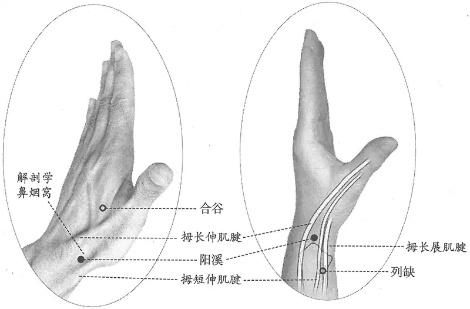

**图 2-29　阳溪穴图**

**取穴**：手拇指充分外展和后伸时，手背外侧部拇长伸肌腱与拇短伸肌腱之间形成一明显的凹陷——解剖学“鼻烟窝”，其最凹陷处即本穴。

　1. 在两筋间陷者中也。（《灵枢·本输》、《黄帝内经太素·本输》）

　2. 在腕中上侧两筋间陷者中。（《黄帝明堂经》、《铜人腧穴针灸图经》、《圣济总录》、《针灸资生经》、《针灸玉龙经》、《十四经发挥》、《神应经》、《针灸集书》、《针灸聚英》、《古今医统》、《医学入门》、《针灸大成》、《针方六集》、《类经图翼》、《循经考穴编》、《针灸易学》、《针灸逢源》）

〔p.201 (인쇄 181)〕

　3. 广注虎口后，腕侧上两筋罅间，与太渊相并，直对食指本节，骨间有动脉。（《循经考穴编》上）

　4. 从合谷穴循行手腕中上侧两筋间陷中，张大指、次指取之。（《医宗金鉴·刺灸心法要诀》）

　5. 针灸方腧穴定位

　　(1) 一云在合谷上三寸。（《千金翼方》卷二十六）

　　(2) （河口）在手腕后陷中动脉。此与阳明同。（《千金要方》卷十四、《千金翼方》卷二十七）

**按**：本穴及合谷穴处皆可触及脉动，古代并可用作诊脉处，故并称作“手阳明”穴。

　6. 腕上桡骨头之前方，两筋间陷中，直对合谷。（《针灸十四经穴位考订》）

　7. 统编针灸学教材

　　(1) 部位：在手腕上侧横纹前，两筋间陷中。取穴：以手掌侧置，拇食两指伸直，拇指向上翘起，当岐骨即第一第二掌骨之后方现深凹处取之。（1957年南京《针灸学》）

　　(2) 部位：腕关节拇指侧两筋间。取穴：手掌侧置，拇指翘起，当岐骨后相隔一筋的凹陷中取之。（1版《针灸学讲义》）

　　(3) 部位：在腕中上侧两筋间陷者中。取穴：在腕关节桡侧凹陷部，取穴时大拇指向上翘起，当拇长、短伸肌腱之间陷凹中取穴。（2版《针灸学讲义》）

　　(4) 腕背横纹桡侧端，拇短伸肌腱与拇长伸肌腱之间的凹陷中。（4、5、7版《针灸学》）

　　(5) 在腕背横纹桡侧，手拇趾向上翘起时，当拇短伸肌腱和拇长伸肌腱之间的凹陷中。（6版《针灸学》）

　　(6) 在腕关节桡侧，拇趾向上翘起时，当拇短伸肌腱和拇长伸肌腱之间的凹陷中。（《中国针灸学》）

**文献分析**：本穴的部位“腕中上侧两筋间陷中”为桡动脉在腕背处的触诊点，故《千金要方》载录之佚名氏“明堂”增有“动脉”二字，《循经考穴编》更明言“骨间有动脉”，皆说明古人的触诊经验很准确。古代关于本穴的定位描述很明确，《医宗金鉴·刺灸心法要诀》更说明了较为具体的从体表显示拇长、短伸肌腱的方法——张大指、次指取之，说明古代针灸医家积累了丰富的、实用的表面解剖学的经验。

#### 【类属】 

手阳明大肠经穴；五输穴之经穴；手阳明所注。

　1. 大肠上合手阳明……行于阳溪，阳溪在两筋间陷者中也，为经。（《灵枢·本输》）

　2. 手阳明脉之所行也，为经。（《黄帝明堂经》）

　3. 手阳明根于商阳，溜于合谷，注于阳溪，入于扶突、偏历也。（《灵枢·根结》）

#### 【适应症】 

主治口齿部、目部、咽部病症。常用于目赤肿痛，齿痛，咽喉肿痛；头痛，耳聋、耳鸣；手腕肿痛或无力。

**备选适应症**：癫狂，惊痫。

　1. 主热病烦心，瞒目，目痛泣出，厥头痛，胸满不得息。热病，肠澼，臑肘臂痛，虚则气膈满，肩不举，吐舌，戾颈，妄言。疟寒甚。寒热。癫疾。狂言，善笑见鬼，取之阳谿及手足阳明、太阳。痂疥。耳聋鸣。喉痹。齿痛惊掣。（《黄帝明堂经》）

　2. 治狂言喜笑见鬼，热病烦心，目风赤烂有翳，厥逆头痛，胸满不得息，寒热疟疾，喉痹，耳鸣，齿痛，惊掣，肘臂不举，痂疥。（《铜人腧穴针灸图经》卷下）

〔p.202 (인쇄 182)〕

　3. 窦太师针灸遗存

　　(1) 治手背红肿疼，泻；五指拘挛，手腕无力，补。手阳明脉所行为经。（《窦太师针经》）

　　(2) 治手腕疼肿，宜泻之；无力，宜补之。又主五指拘挛，腕疼彻肘，惊狂呕沫，厥逆头痛，目赤目翳。（《循经考穴编》上）

　4. 统编针灸学教材

　　(1) 头痛，目赤生翳，耳鸣，耳聋，喉痹，手腕痛，牙痛。（1957年南京《针灸学》、1版《针灸学讲义》）

　　(2) 头痛，耳鸣，耳聋，齿痛，咽喉肿痛，目赤肿痛，目翳，手腕痛。（2版《针灸学讲义》）

　　(3) 头痛，目赤肿痛，耳聋，耳鸣，齿痛，咽喉肿痛，手腕痛。（4、5版《针灸学》）

　　(4) 头痛，耳鸣耳聋，咽喉肿痛，腕臂痛，齿痛。（6版《针灸学》）

　　(5) ①手腕痛；②头痛、目赤肿痛、耳聋等头面五官疾患。（7版《针灸学》）

　　(6) 头痛，目赤肿痛，齿痛，咽喉肿痛，手腕痛。（《中国针灸学》）

**文献分析**：《黄帝明堂经》所载主治除手阳明经病候外，还涉及癫狂和胸部病症及肠澼，其中“狂言，善笑见鬼，取之阳溪及手足阳明、太阳”见于《灵枢·癫狂》针灸方“狂者多食，善见鬼神，善笑而不发于外者，得之有所大喜，治之取足太阴、太阳、阳明，后取手太阴、太阳、阳明。”相应的主治症还见于《黄帝明堂经》足太阴经“商丘”和足阳明“丰隆”穴。又阳溪位于早期手阳明诊脉部位——手阳明脉口，《素问·三部九候》谓手阳明脉“候胸中之气”；又《素问·五脏生成》曰：“咳嗽上气，厥在胸中，过在手阳明、太阴。”故阳溪穴又主胸中之疾“胸满不得息”。而后世文献多集中于口齿部、目部、咽部病症。然癫狂、惊痫之主治除见于《黄帝明堂经》，也见于《铜人腧穴针灸图经》，且有明确的临床应用，各版教材未录，今附存备考。

#### 附：临床应用举例 

　1. 狂言，善笑见鬼，取之阳溪及手足阳明、太阴。（《针灸甲乙经》卷十一）

**按**：此方见《灵枢·癫狂》，原方治之取“足太阴、太阳、阳明，后取手太阴、太阳、阳明”，《黄帝明堂经》将此症归入“手阳明”穴阳溪主症中，则“手足阳明”当作“足阳明”，“太阴”之前当有“手足”二字。

　2. 狂走，惊痫，灸河口五十壮。穴在手腕后陷中动脉是，此与阳明同也。（《千金翼方》卷二十七）

**按**：此方中“河口”为阳溪穴别名；“阳明”即“手阳明”穴，包括手阳明脉口的合谷、阳溪穴，此处指阳溪穴。

　3. 牙齿肿痛并咽痹，二间阳溪疾怎逃。（《席弘赋》）

#### 【操作】 

直刺0.5~0.8寸。避免损伤桡动脉。

　1. 刺入三分，留七呼，灸三壮。（《黄帝明堂经》）

　2. 妊妇不可刺，刺之损胎。（《针灸集书》卷上）

　3. 针三分，灸五壮。（《针灸十四经穴位考订》）

　4. 统编针灸学教材

　　(1) 针三至四分，灸三至五壮。（1957年南京《针灸学》、1版《针灸学讲义》）

　　(2) 直刺5~7分，艾条灸3~5分钟。（2版《针灸学讲义》）

　　(3) 直刺0.5~0.8寸。（4、5、6、7版《针灸学》）

　　(4) 直刺0.3~0.5寸。可灸。（《中国针灸学》）

　5. 直刺0.3~1寸。感应：局部酸胀。灸3壮；温灸10~15分钟。（上海《针灸学》）

〔p.203 (인쇄 183)〕

### （六）偏历 Piānlì LI6 出《灵枢》 

#### 【提要索隐】 

**部位**：在前臂，腕背侧远端横纹上3寸，阳溪与曲池连线上。

**国标修订**：1990年版国标：屈肘，在前臂背面桡侧，当阳溪与曲池连线上，腕横纹上3寸。2006年修订版：在前臂，腕背侧远端横纹上3寸，阳溪与曲池连线上。

**按**：腕背横纹不止一条，古代文献所说“腕横纹”指最靠近手指端的横纹。此外，“屈肘”属于取穴法内容，不应出现在“部位”描述文字中。

**适应症**：主治口齿部、耳部、咽部病症。常用于齿痛，鼻衄，咽喉肿痛，耳鸣，耳聋；水肿，小便不利；疔疮；手背酸痛或无力。

**针刺操作**：直刺或斜刺0.5~0.8寸。

#### 【名实考】 

“偏历”之脉与“偏历”穴名均见于《灵枢》，偏历穴的完整内容则见于《黄帝明堂经》。

　1. “偏历”脉

　　(1) 手阳明之别，名曰偏历，去腕三寸，别入太阴。（《灵枢·经脉》）

　　(2) 手阳明之别，名曰偏历。杨上善注曰：手阳明经上偏出此络，经历手臂，别走太阴，故曰偏历也。（《黄帝内经太素·十五络脉》）

　2. 偏历穴

　　(1) 手阳明根于商阳，溜于合谷，注于阳溪，入于扶突、偏历也。（《灵枢·根结》）

　　(2) 偏历，手阳明络，在腕后三寸，别走太阴者。（《黄帝明堂经》）

　　(3) 手阳明之别偏历，去腕三寸，别入太阴。其别者，上循臂，乘肩髃，上曲颊偏齿，以穴在臂外侧之上廉，故曰偏，而交于手太阴。亦在臂内之上廉，亦当曰偏，言此络历于二经也。（《经穴解》）

**文献分析**：“偏历”既是手阳明络脉名，也是手阳明络穴名，二者在早期是统一的，而在后来经穴定位标准化的过程中，二者渐渐有了差异：络脉是相对的、动态的、因人因时而异的，《内经》对此有非常明确的说明：

凡此十五络者，实则必见，虚则必下，视之不见，求之上下，人经不同，络脉异所。杨上善注曰：盛则血满脉中，故必见。虚则脉中少血，故必下。脉下难见，故上下求之。人之禀气得身，百体不可一者，岂有经络而得同乎？故须上下求之，方得见也。（《黄帝内经太素·十五络》）

而络穴的部位却变成固定的。这样的变化一方面是不断标准化的结果，另一方面络穴从早期的刺血——血针，渐渐变为调气——气针，也是一个重要因素。其实，即使今天，如果络穴用于刺血，仍应按《内经》取络脉法。

#### 【定位】 

**部位**：在前臂，腕背侧远端横纹上3寸，阳溪与曲池连线上（图2-30）。

**取穴**：于阳溪至曲池连线的下1/4与上3/4的交点处取穴。

　1. 去腕三寸。（《灵枢·经脉》）

　2. 在腕后三寸。（《黄帝明堂经》、《太平圣惠方·明堂》、《铜人腧穴针灸图经》卷下、《针灸资生经》、《针灸玉龙经》、《针灸集书》、《医学入门》、《针方六集》、《类经图翼》、《针灸逢源》）

〔p.204 (인쇄 184)〕

　3. 在腕中后三寸。（《铜人腧穴针灸图经》卷上及卷下“穴腧都数”、《十四经发挥》、《医学纲目》、《针灸聚英》、《古今医统》、《针灸大成》、《针灸易学》）

　4. 在腕侧后三寸。广注阳溪斜上。一法列缺后一寸五分。（《循经考穴编》上）

　5. 从阳溪穴上行手腕后上侧三寸。（《医宗金鉴·刺灸心法要诀》）

　6. 阳溪上约三寸稍向外。（《针灸十四经穴位考订》）

　7. 统编针灸学教材

　　(1) 部位：在腕侧后三寸，以两手交叉中指尽处是之穴。取穴：以手肘屈置，在阳溪与曲池穴对直线，上行三寸，微偏外面，稍有陷凹之处是穴位。（1957年南京《针灸学》）

　　(2) 部位：阳溪穴后三寸。取穴：肺经列缺穴上一寸五分，略偏外侧取之。（1版《针灸学讲义》）

　　(3) 部位：在腕后三寸。取穴：侧腕屈肘，位于阳溪与曲池连线上，阳溪上三寸。取穴时两虎口交叉，当中指尖到达处之桡骨外侧凹陷中是穴。（2版《针灸学讲义》）

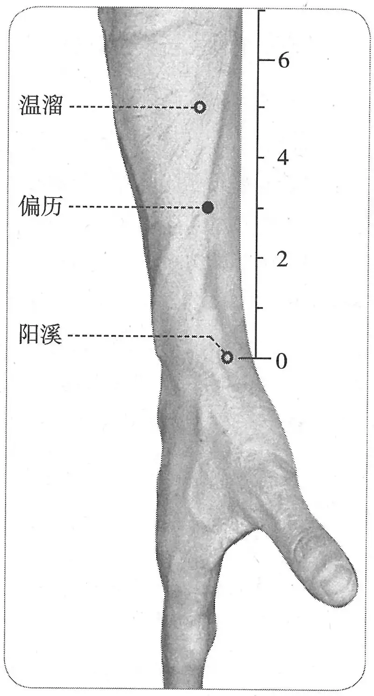

**图 2-30　偏历穴图**

　　(4) 在阳溪穴与曲池穴的连线上，阳溪穴上3寸处。（4、5版《针灸学》）

　　(5) 曲肘，在前臂背面桡侧，当阳溪与曲池穴连线上，腕横纹上3寸。（6版《针灸学》）

　　(6) 曲肘，在阳溪穴与曲池穴连线上，腕横纹上3寸处。（7版《针灸学》）

　　(7) 侧腕曲肘，在阳溪与曲池的连线上，阳溪上3寸处。（《中国针灸学》）

**文献分析**：教材所述之取穴法“以两手交叉中指尽处是之穴”，原文见于明代《十四经合参》注，系将列缺穴取穴混入者也。此书在中国久不传，中国针灸教材乃从日本针灸教材间接传此一说。

#### 【类属】 

手阳明大肠经穴；络穴；手阳明所入。

　1. 手阳明之别，名曰偏历，去腕三寸，别入太阴。（《灵枢·经脉》）

　2. 手阳明络……别走太阴者。（《黄帝明堂经》）

　3. 手阳明根于商阳，溜于合谷，注于阳溪，入于扶突、偏历也。（《灵枢·根结》）

#### 【适应症】 

主治口齿部、耳部、咽部病症。常用于齿痛，鼻衄，咽喉肿痛，耳鸣，耳聋；水肿，小便不利；疔疮；手背酸痛或无力。

　1. 主风疟，汗不出，寒热。癫疾多言，耳鸣，口僻，颊肿，实则聋，喉痹不能言，齿龋痛，鼻鼽衄，虚则痹鬲。瞒目，目䀮䀮。耳鸣。（《黄帝明堂经》）

**按**：《灵枢·杂病》曰：“喉痹不能言，取足阳明；能言，取手阳明”，而此处以手阳明大肠经穴主“喉痹不能言”，二者有不同。

　2. 疟久不愈，主手不及头，臂膊肘腕酸痛难屈伸。（《太平圣惠方·明堂》）

　3. 治寒热疟，风汗不出，目视䀮䀮，癫疾多言，耳鸣口㖞，齿龋，喉痹嗌干，鼻鼽衄血。（《铜人腧穴针灸图经》卷下）

　4. 治手臂无力，补；肿痛，泻。（《窦太师针经》）

〔p.205 (인쇄 185)〕

　5. 主小便不利。（《针方六集》卷五）

　6. 专主小便不利，肠鸣浮肿，水鼓等证。（《循经考穴编》上）

　7. 统编针灸学教材

　　(1) 目不明，鼻鼽衄，耳鸣，耳聋，喉痹，肩、膊、肘、腕酸痛，水蛊。（1957年南京《针灸学》、1版《针灸学讲义》）

　　(2) 鼻衄，目赤，耳聋，耳鸣，手臂酸痛，喉痛，水肿。（2版《针灸学讲义》、《中国针灸学》）

　　(3) 目赤，耳鸣，鼻衄，手臂酸痛，喉痛，水肿。（4、5版《针灸学》）

　　(4) 耳鸣，耳聋，目赤，鼻衄，喉痛，手臂酸痛。（6版《针灸学》）

　　(5) 耳鸣，鼻衄等五官疾患，手臂酸痛，腹部胀满，水肿。（7版《针灸学》）

**文献分析**：本穴主治古今文献记载变化不大，均源出于手阳明之络的病候，主治口齿部、耳部、咽部病症。

#### 附：临床应用举例 

　1. 手阳明之别，名曰偏历……实则龋聋，虚则齿寒痹隔，取之所别也。（《灵枢·经脉》、《黄帝内经太素·十五络脉》）

　2. 刺偏历利小便，医大人水蛊。（《标幽赋》）

　3. 颧疔之发，发于当面颧上，其色白，其头陷，如鼻有黑气者不治，治法当灸偏历二七壮。（《痈疽神秘灸经》）

　4. 术后尿潴留，取穴列缺、偏历、三阴交、足三里、中极，上述穴位针刺得气后行平补平泻手法。水肿，取穴列缺、偏历、足三里、水分、委阳、三阴交均采用泻法，留针30分钟，10天为一个疗程。[中国针灸，1998(10)：602]

#### 【操作】 

直刺或斜刺0.5~0.8寸。

　1. 刺入三分，留七呼，灸三壮。（《黄帝明堂经》）

　2. 灸五壮。（《太平圣惠方·明堂》）

　3. 窦太师针灸遗存

　　(1) 针入一分，沿皮针透列缺穴一寸半，灸七壮。（《窦太师针经》）

　　(2) 窦氏：刺入一分，沿皮向前一寸半，透列缺穴，灸七壮。（《针方六集》卷一）

　　(3) 一法：刺入一分，沿皮向外一寸。（《循经考穴编》上）

　4. 统编针灸学教材

　　(1) 针三至四分，灸三至七壮。（1957年南京《针灸学》、1版《针灸学讲义》）

　　(2) 斜刺3~4分，艾条灸3~7分钟。（2版《针灸学讲义》）

　　(3) 直刺或斜刺0.5~0.8寸。（4、5、7版《针灸学》、《中国针灸学》）

　　(4) 直刺0.3~0.5寸，斜刺1寸；可灸。（6版《针灸学》）

### （七）温溜 Wēnliū LI7 出《黄帝明堂经》 

问题1：古典文献关于本穴定位作“少士五寸，大士六寸”，如何将此古代尺量法等效转换为折量法？

问题2：“手逆注”穴与本穴关系如何？

〔p.206 (인쇄 186)〕

#### 【提要索隐】 

**穴名**：温溜，也写作“温留”。一名蛇头，一名逆注。

**部位**：在前臂，腕背侧远端横纹上5寸，阳溪与曲池连线上。

**国标修订**：1990年版国标：屈肘，在前臂背面桡侧，当阳溪与曲池连线上，腕横纹上5寸。2006年修订版：在前臂，腕背侧远端横纹上5寸，阳溪与曲池连线上。

**按**：腕背横纹不止一条，古代文献所说“腕横纹”指最靠近手指端的横纹。此外，“屈肘”属于取穴法内容，不应出现在“部位”描述文字中。故2006年版国标作如上调整。

**适应症**：主治口面部、咽部病症。常用于头痛，面肿，咽喉肿痛；肠鸣，腹痛；肩背痛。

**备选适应症**：癫狂，癫痫。

**针刺操作**：直刺0.5~1寸。

#### 【名实考】 

温溜，一名逆注，一名蛇头。今人不识“手逆注”为温溜穴别名，加上现代温溜穴定位取“五寸”说，更难辨其原委，故今人将原本是同一穴的两个不同穴名，当作两个不同的穴，并将“手逆注”归入奇穴类。“温溜”，宋以前文献如《千金要方》、《千金翼方》、《外台秘要》、《医心方》、《太平圣惠方》、《铜人腧穴针灸图经》均作“温留”，通行本《针灸甲乙经》“温溜”与“温留”并见，其“溜”字应是后人所改。别名“蛇头”之“蛇”字，《针灸资生经》、《针灸聚英》、《古今医统》、《针灸大成》作“池”，《针灸大全》作“地”，皆系“蛇”的异体字“虵”之讹误。按：古文献中“它”与“也”互用之例不少，对于中医最熟悉的要数“华佗”与“华他”的异文，1957年南京《针灸学》将上述文献中错字“池头”作为本穴的别名，失于详察也。

　1. 温留，一名逆注，一名蛇头，手阳明郄。在腕后少士五寸，大士六寸。（《黄帝明堂经》）

　2. 狂痫哭泣，灸手逆注三十壮。穴在左右手腕后六寸。（《千金要方》卷十四、《千金翼方》）

　3. 穴名温溜者，以其出经火之后，故为温溜。温溜者，脉之细流也。（《经穴解》）

　4. 别名　池头。（1957年南京《针灸学》）

#### 【定位】 

**部位**：在前臂，腕背侧远端横纹上5寸，阳溪与曲池连线上（图2-31）。

**取穴**：侧腕屈肘，用力握拳，绷紧肌肉，于肘横纹与腕横纹连线中点的稍远侧，桡侧腕长伸肌锐端（如蛇头样隆起）内下处取穴。

　1. 在腕后，少士五寸，大士六寸。（《黄帝明堂经》、《十四经发挥》、《医学纲目》、《针方六集》、《类经图翼》）

　2. 在腕后五寸。（《针灸甲乙经》卷十一、《医学入门》、《针灸聚英·步穴歌》、《古今医统·步穴歌》、《黄帝内经灵枢注证发微》、《针方六集·分寸歌》、《循经考穴编》）

　3. 在手腕后六寸。（《千金要方》卷十四、《千金翼方》）

　4. 在腕后五寸、六寸间动脉中是穴。（《太平圣惠方·明堂》、《针灸聚英》、《古今医统》、《针灸大成》、

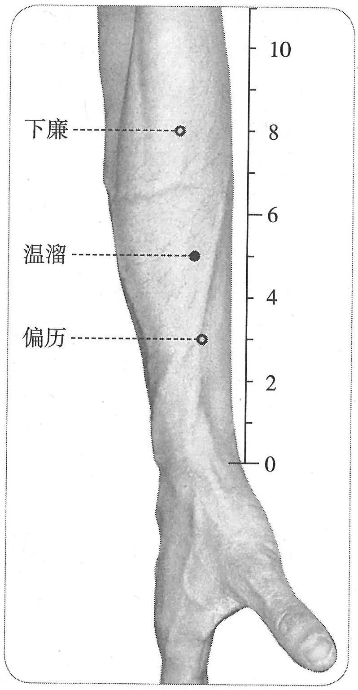

**图 2-31　温溜穴图**

〔p.207 (인쇄 187)〕

《类经图翼》、《循经考穴编》、《针灸易学》、《针灸逢源》）

　5. 在腕后，大士五寸，小士六寸。（《铜人腧穴针灸图经》卷上、卷下）

　6. 腕后五寸半。（《针灸问对》）

　7. 一法偏历后二寸。（《循经考穴编》上）

　8. 从偏历穴上行三寸。（《医宗金鉴·刺灸心法要诀》）

　9. 偏历上三寸。（《针灸十四经穴位考订》）

　10. 统编针灸学教材

　　(1) 部位：在腕后五寸处。取穴：以肘屈置，从阳溪与曲池之中当骨陷凹处，试以手指握拳，前臂部用力，即有肌肉隆起如蛇头之形，在其下端取之。（1957年南京《针灸学》）

　　(2) 部位：阳溪穴后五寸。取穴：屈肘横肱立拳，用力握拳，适当臂前肌肉隆起如蛇头形之下端取之。（1版《针灸学讲义》）

　　(3) 部位：在腕后，少士五寸，大士六寸。取穴：侧拳屈肘，在阳溪上五寸，当阳溪与阳池的连线上取穴。（2版《针灸学讲义》）

　　(4) 在阳溪穴与曲池穴的连线上，阳溪穴上5寸处。（4、5版《针灸学》）

　　(5) 曲肘，在前臂背面桡侧，当阳溪与曲池穴连线上，腕横纹上5寸。（6、7版《针灸学》）

　　(6) 侧腕曲肘，在阳溪与曲池的连线上，阳溪上五寸处。（《中国针灸学》）

**文献分析**：此穴距腕横纹的距离，古代有三说，一说五寸，一说六寸，一说五六寸间。此穴取法分大人、小人，这是古代“尺量取穴法”的遗存。至于《铜人腧穴针灸图经》所述，颠倒了大人、小人的尺寸，不足取。至《太平圣惠方》则言“五寸六寸间动脉中”，而此处不能触及动脉；《针灸问对》因此折中作“五寸半”。其实，《黄帝明堂经》对于前臂手阳明穴，多以一条肌肉为标志取之，只要确定了这条肌肉，直接以肌性标志定穴更为准确。三里穴作“按之肉起锐肉之端”；下廉穴作“怒辅齐锐肉”，本穴则一名“蛇头”。根据这些特征，可判定当前臂紧张（怒辅）时，外侧的锐肉正是桡侧腕长伸肌。该肌约于腕后五寸处移行为肌腱，尖如蛇头状。可见，“腕后五寸”或“五寸半”更合理。由于采用同身折量，则不必再分“大人”、“小人”。

#### 【类属】 

手阳明大肠经穴；郄穴。手阳明郄。（《黄帝明堂经》）

#### 【适应症】 

主治口面部、咽部病症。常用于头痛，面肿，咽喉肿痛；肠鸣，腹痛；肩背痛。

**备选适应症**：癫狂，癫痫。

　1. 主伤寒，寒热头痛，哕衄，肩不举。疟，面赤肿。肠鸣而痛。癫疾吐舌，鼓颔，狂言见鬼。狂仆。口齿痛。喉痹不能言。（《黄帝明堂经》）

**按**：汉以前“癫疾”或指狂疾，或谓小儿痫病，此处“癫疾吐舌，鼓颔”，盖指后者。《黄帝明堂经》天井穴主治作“癫疾吐舌，沫出，羊鸣，戾颈”，其中“戾颈”一症也见于“阳溪”、“强间”穴主治。

　2. 治口㖞，肠鸣腹痛，伤寒身热，头痛哕逆，肩不得举，癫疾吐涎，狂言见鬼，喉痹，面虚肿。（《铜人腧穴针灸图经》卷下）

　3. 伤寒，哕逆噫，膈中气闭，寒。吐涎末，风逆四肢肿。（《针灸聚英》卷一、《古今医统》、《针灸大成》）

**按**：“伤寒，哕逆噫，膈中气闭，寒”一句，《针灸资生经》卷三原文作“温溜治伤寒哕逆。噫哕，膈中气闭寒（塞），灸腋下聚毛……”这是两段文字，前一条录自《铜人腧穴针灸图经》，后一条录自《千金要方》。高武断句失误，将第二条“腋下聚毛”（相当于“极泉穴”）主治症“噫哕，膈中气闭寒”也归入“温溜”穴中。“风逆四肢肿”系丰隆穴主治症。

〔p.208 (인쇄 188)〕

　4. 统编针灸学教材

　　(1) 头痛，面肿，口舌肿痛，喉痹，肩臂酸痛，肠鸣腹痛，疔痈也有良效。（1957年南京《针灸学》）

　　(2) 头痛，面肿，口舌肿痛，喉痹，肩背酸痛，肠鸣腹痛。（1版《针灸学讲义》）

　　(3) 头痛，面肿，口舌肿痛，咽喉肿痛，肩背酸痛。（2版《针灸学讲义》）

　　(4) 头痛，面肿，口舌、咽喉肿痛，肠鸣腹痛，疔疮。（4版《针灸学》）

　　(5) 头痛，面肿，咽喉肿痛，疔疮，肩背酸痛，肠鸣腹痛。（5版《针灸学》）

　　(6) 头痛，面肿，咽喉肿痛，肩背酸痛，疔疮，吐舌，肠鸣腹痛。（6版《针灸学》）

　　(7) ①急性肠鸣、腹痛等肠腑病证；②疔疮；③头痛、面肿、咽喉肿痛等头面病证；④肩背酸痛。（7版《针灸学》）

　　(8) 头痛，面肿，咽喉肿痛，肠鸣，腹痛，肘臂酸痛。（《中国针灸学》）

**文献分析**：本穴主治现代教材集中于口面部、咽部病症。而古代文献所载之癫狂、热病未收录。今考“癫狂，癫痫”见《黄帝明堂经》、《铜人腧穴针灸图经》、《循经考穴编》，且有古代临床应用，故附存备考。

#### 附：临床应用举例 

　1. 狂痫哭泣，灸手逆注三十壮，穴在左右手腕后六寸。（《千金要方》卷十四、《千金翼方》）

**按**：“逆注”，温溜穴别名。

　2. 漏肩风，上举困难取温溜、上廉；后伸肩痛取肩贞、臑俞；前伸肩痛取阳池、清冷渊。采用缪刺法。[江苏中医，1988，9(2)：24]

#### 【操作】 

直刺0.5~1寸。

　1. 刺入三分，灸三壮。（《黄帝明堂经》）

　2. 针入五分，可灸三壮。（《医学纲目》卷八）

　3. 刺三分，灸七壮。（《循经考穴编》上）

　4. 统编针灸学教材

　　(1) 针三至五分，灸三至七壮。（1957年南京《针灸学》、1版《针灸学讲义》）

　　(2) 直刺3~5分，艾条灸3~7分钟。（2版《针灸学讲义》）

　　(3) 直刺0.5~1寸。（4、5、7版《针灸学》）

　　(4) 直刺0.5~1寸。可灸。（6版《针灸学》、《中国针灸学》）

### （八）下廉 Xiàlián LI8 出《黄帝明堂经》 

问题1：名“下廉”者有二，足阳明经、手阳明经各一，如何辨识？

问题2：本穴定位文字中“怒辅齐锐肉，其分外邪”中之“锐肉”相当于哪条肌肉，如何在体表显现？

#### 【提要索隐】 

《针灸聚英》将足阳明“下廉”穴主治混入本穴中，后世文献乃至现代针灸学教材多传其误。

〔p.209 (인쇄 189)〕

**穴名**：一作“手下廉”。

**部位**：在前臂，肘横纹下4寸，阳溪与曲池连线上。

**适应症**：主治局部病症。常用于肘臂肿痛或拘急；眩晕，目痛；小便黄。

**针刺操作**：直刺0.5~1寸。

#### 【名实考】 

本穴名称，宋以前文献作“下廉”，与足阳明经“下廉”同名，宋代《圣济总录》改作“手下廉”，以别于足阳明经“下廉”穴，但后世文献未采用，仍沿用古称“下廉”。古代腧穴文献（除《针灸甲乙经》、《千金要方》、《针灸资生经》等少数文献外）因其穴下多注有定位文字，因而不存在辨识困难，而在针灸方中多不注明腧穴的部位，往往难以辨识。

确定本穴定位的关键在于正确理解《黄帝明堂经》“怒辅齐锐肉，其分外邪”中的术语“怒辅”、“锐肉”。所谓“怒辅”是指隆起前臂外辅（前臂桡侧）肌肉；所谓“锐肉”即在怒辅状态下前臂桡侧缘呈现的远端呈尖锐状的一条肌肉。后人因不识这两个关键术语，或改作“恐辅”，或作“辅”，或直接采用折量取穴，皆失古义。

　1. 下廉，在辅骨下，去上廉一寸，怒辅齐兑肉，其分外邪。（《黄帝明堂经》）

　2. 手下廉二穴，在辅骨下去手上廉一寸，辅兑肉，其分外斜。（《圣济总录》卷一九一）

　3. 廉者，棱隅之称。穴在臂廉隅之下，故曰下廉。（《经穴解》）

#### 【定位】 

**部位**：在前臂，肘横纹下4寸，阳溪与曲池连线上（图2-32）。

**取穴**：侧腕屈肘，在阳溪与曲池连线的上1/3与下2/3的交点处，上廉下1寸处取穴。

　1. 在辅骨下，去上廉一寸，怒辅齐锐肉，其分外邪。（《黄帝明堂经》）

　2. 在辅骨下，去上廉一寸。（《千金要方》卷二十九、《千金翼方》、《医心方》、《铜人腧穴针灸图经》卷上及卷下“穴腧都数”、《针灸资生经》、《十四经发挥》、《医学纲目》、《针灸集书》、《针灸聚英》、《古今医统》、《针灸大成》、《针灸易学》）

　3. 在辅骨下，去上廉一寸，辅兑肉，其分外斜。（《铜人腧穴针灸图经》卷下）

　4. 曲池前五寸，锐肉分外斜。（《医学入门》卷一）

　5. 在辅骨下，去上廉穴一寸，辅锐肉分外斜缝中。（《针方六集》卷一）

　6. 广注曲池前来四寸，屈肘取之，若直取合五寸。（《循经考穴编》上）

　7. 从温溜穴上行二寸五分，辅锐肉分，下廉穴也。从下廉上行一寸，上廉穴也。（《医宗金鉴·刺灸心法要诀》、《针灸逢源》）

　8. 曲池下四寸。（《针灸十四经穴位考订》）

　9. 统编针灸学教材

　　(1) 部位：曲池穴下四寸。取穴：温溜之上三寸五分，分肉之间取之。（1957年南京《针

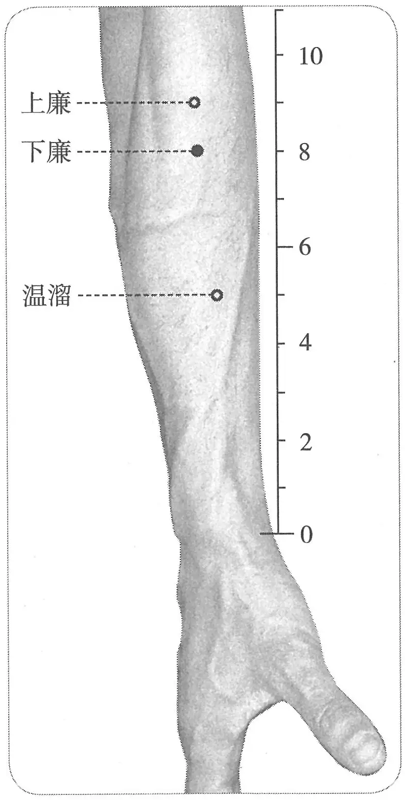

**图 2-32　下廉穴图**

〔p.210 (인쇄 190)〕

灸学》）

　　(2) 部位：曲池穴下四寸。取穴：屈肘横肱立拳，当曲池穴与温溜穴成直线处取之。（1版《针灸学讲义》）

　　(3) 部位：在辅骨下，去上廉一寸。取穴：当曲池下四寸取穴。（2版《针灸学讲义》）

　　(4) 在阳溪穴与曲池穴的连线上，曲池穴下4寸处。（4、5版《针灸学》、《中国针灸学》）

　　(5) 在前臂背面桡侧，当阳溪与曲池穴连线上，肘横纹下4寸。（6版《针灸学》）

　　(6) 在阳溪穴与曲池穴的连线上，肘横纹下4寸处。（7版《针灸学》）

**文献分析**：本穴定位的关键在于正确理解《黄帝明堂经》“怒辅齐锐肉，其分外邪”句中的表面解剖术语“怒辅”、“锐肉”。《灵枢·本输》曰“曲池，在肘外辅骨陷者中，屈臂而得之”，可知“辅”指肘外辅骨所处的前臂外侧，而“怒辅”即使该处的肌肉紧张（常用的方法即用力握拳），此时隆起一条呈梭形的肌肉——桡侧腕长伸肌，即“锐肉”。而“其分外邪”则说明本穴位于“锐肉”的内缘（如采用标准解剖姿式，则为“前缘”），即桡侧腕长伸肌与肱桡肌之间。综合《黄帝明堂经》温溜、上廉、三里诸穴定位文字可使本穴定位更加明确，原文见下。

三里，在曲池下二寸，按之肉起兑肉之端。

上廉，在三里下一寸，其分抵阳明之会外邪。

温留，一名逆注，一名蛇头，手阳明郄。在腕后少士五寸，大士六寸。

下廉，在辅骨下，去上廉一寸，怒辅齐兑肉其分外邪。

根据《黄帝明堂经》的描述可对该肌的特征作如下概括：

　1. 此肌在前臂外侧，且当前臂用力时呈现出锐形肌肉；

　2. 此肌斜行；

　3. 在前臂中段偏下位置此肌呈现蛇头样形状。

如果有足够多的表面解剖学经验，不难发现前臂外侧肌群中最符合这3条特征的肌肉是桡侧腕长伸肌。当屈肘于旋前正中位时，用力握拳，在桡侧清晰显示的第一条肌肉即桡侧腕长伸肌，肘下二寸处自然呈现一凹陷，使得外形上表现出从肘向腕走行的上宽下窄的梭形，约在前臂中段偏下处为肌梭的尖，颇似蛇头，即为温溜穴处。实验表明，《黄帝明堂经》在三里、上廉、下廉、温溜4穴中描述的肌肉即桡侧腕长伸肌，由此可见，本穴以及“肘外辅”的其他手阳明大肠经穴，采用表面解剖标志定位非常准确。

由于不能正确理解本穴定位的解剖术语，因此本穴定位的文字描述在传承过程中出现了许多讹传，例如现行本《针灸甲乙经》作“恐辅”，《铜人腧穴针灸图经》作“辅”，更多的文献则是直接删去“怒辅齐锐肉，其分外邪”一句，皆不得要领，臆测古义也。

关于不同骨度折量系统对于腧穴定位的影响，在此穴例中体现得十分突出，尽管本穴距曲池穴四寸，但由于前臂的长度有折作“十寸”者、“十一寸半”者，“十二寸半”者，故有“温溜上二寸半”、“温溜上三寸半”、“腕后六寸”之不同。至于《针灸大全》“曲池穴前五寸”，盖将“三里”穴误作“曲池下三寸”（此说盖受《针灸资生经》手三里穴下王执中按语影响）。《循经考穴编》“屈肘”、“直取”之别盖出于折中。而《针方六集》所谓“辅锐肉分外斜缝中”，定位稍嫌偏外。

今人由于不熟悉相关的表面解剖学知识，也难辨真伪，只得采用经穴连线的方式定穴。笔者建议今后的国家标准和国际标准修订时能够采用体表解剖标志定位，以恢复古典针灸腧穴定位的本义。

#### 【类属】 

手阳明大肠经穴。

〔p.211 (인쇄 191)〕

#### 【适应症】 

主治局部病症。常用于肘臂肿痛或挛急；眩晕，目痛；小便黄。

　1. 主溺黄。眼痛。（《黄帝明堂经》）

　2. 治头风，臂肘痛，溺黄。（《铜人腧穴针灸图经》卷下）

　3. 窦太师针灸遗存

　　(1) 治肘骨疼，泻；两筋拘挛，先泻后补。（《窦太师针经》）

　　(2) 肘辅骨肿疼，泻之。（《循经考穴编》上）

　4. 下廉，主飧泄，劳瘵，小腹满，小便黄，便血，狂言，偏风，热风，冷痹不遂，风湿痹，小肠气不足，面无颜色，痃癖，腹痛若刀刺不可忍，飧泄，腹胁痛满，狂走，夹脐痛，食不化，喘息不能行，唇干涎出，乳痈。（《针灸聚英》卷一、《针灸大成》、《针方六集》）

**按**：上述《针灸聚英》“手下廉”主治症中“飧泄、小腹满、狂言、唇干涎出、乳痈”系《铜人腧穴针灸图经》“足下廉”主治症；“飧泄……喘息不能行”见于《铜人腧穴针灸图经》“足上廉”主治症；“小肠气……不可忍”系误录自《针灸资生经·肾虚》卷三，原文作“下廉疗小肠气不足，面无颜色，灸小肠气痃癖，气发时腹痛若刀刺不可忍者，并妇女本藏气血癖，走疰刺痛，或坐卧不得，或大小便不通，可思饮食，于左右脚下第二指第一节曲纹中心各灸十壮”，其中“小肠气不足，面无颜色”系录自《太平圣惠方·针经》足阳明“巨虚下廉”，其余病症，为奇穴所主，更与手阳明经穴“下廉”不相干。《针灸聚英》之后的针灸书均沿袭了高氏这一错误。

　5. 主肠鸣，气走注痛。（《医学入门》卷一）

**按**：此条主治乃误录《铜人腧穴针灸图经》“上廉”穴主治。

　6. 统编针灸学教材

　　(1) 脑风头痛，眩晕，眼痛，肘臂痛，夹脐痛，食不化，便血。（1957年南京《针灸学》）

　　(2) 头风，眩晕，眼痛，肘臂痛，夹脐痛，食不化，便血。（1版《针灸学讲义》）

　　(3) 头风，眩晕，目痛，肘臂痛，腹痛，食物不化。（2、4版《针灸学》）

　　(4) 头痛，眩晕，目痛，肘臂痛，腹胀，腹痛。（5、7版《针灸学》）

　　(5) 头痛，眩晕，肘臂痛，半身不遂，腹痛，腹胀，目痛。（6版《针灸学》）

　　(6) 腹痛，肠鸣，肘臂痛，上肢不遂。（《中国针灸学》）

**文献分析**：本穴主治，宋以前文献记载很简单，至明代《针灸聚英》增入大量主治，经考均系误解前代文献所致，明以后针灸文献多沿袭其误。《医学入门》所载乃误录《铜人腧穴针灸图经》“上廉”穴主治。教材中“夹脐痛，食不化，便血”，“腹痛”也皆系沿袭高武《针灸聚英》之误，今去之。

#### 【操作】 

直刺0.5~1寸。

　1. 刺入五分，留五呼，灸三壮。（《黄帝明堂经》）

　2. 针入三分，灸三壮。（《医学入门》卷一）

　3. 针五分，灸二七壮。（《窦太师针经》）

　4. 刺三分，留三呼，灸七壮。（《循经考穴编》上）

　5. 针五分，灸五壮。（《针灸十四经穴位考订》）

　6. 统编针灸学教材

　　(1) 针三至五分，灸三至七壮。（1957年南京《针灸学》、1版《针灸学讲义》）

　　(2) 直刺5~7分，艾条灸3~7分钟。（2版《针灸学讲义》）

　　(3) 直刺0.5~1寸。（4、5、7版《针灸学》）

　　(4) 直刺0.5~1寸。可灸。（6版《针灸学》、《中国针灸学》）

〔p.212 (인쇄 192)〕

### （九）上廉 Shànglián LI9 出《黄帝明堂经》 

#### 【提要索隐】 

《针灸聚英》将足阳明经“上廉”穴主治混入本穴中，后世文献多传其误。

**穴名**：一名“手上廉”。

**部位**：在前臂，肘横纹下3寸，阳溪与曲池连线上。

**适应症**：主治局部病症。常用于肩臂酸痛或麻木；头痛。

**针刺操作**：直刺0.5~1寸。

#### 【名实考】 

本穴名称，宋以前文献作“上廉”，与足阳明经“上廉”同名，《圣济总录》作“手上廉”，以别于足阳明经“上廉”穴，但后世文献未采用，仍沿用古称“上廉”。古代腧穴文献（除《针灸甲乙经》、《千金要方》、《针灸资生经》等少数文献外）因其穴下多注有定位文字，因而不存在辨识困难，而在针灸方中多不注明腧穴的部位，往往难以辨识。

　1. 上廉，在三里下一寸，其分抵阳明之会外邪。（《黄帝明堂经》）

　2. 手上廉二穴，在手三里下一寸，其分独抵阳明之会外斜。（《圣济总录》卷一九一）

　3. 此穴在廉内之最高处，故曰独抵阳明之会，以在廉之上，故曰上廉。（《经穴解》）

#### 同名异穴“上廉”辨 

上廉……主小便黄赤，肠鸣，胸痛，偏风，半身不遂，骨髓冷，手足不仁，喘息，大肠气，脑风头痛。（《针灸聚英》卷一、《针灸大成》）

**按**：以上主治症中只有“小便黄赤、肠鸣、脑风头痛”系《铜人腧穴针灸图经》手阳明大肠经穴“上廉”主治症；“偏风，半身不遂，喘息”系《铜人腧穴针灸图经》足阳明“上廉”穴主治症，“骨髓冷”症见于《针灸资生经·虚损》卷二及卷四的“骨疼”，原文作“骨髓冷疼，灸上廉七十壮《千》”，而《千金要方》卷十九原文作“骨髓冷疼痛，灸上廉七十壮。三里下三寸是穴”，可见，此“上廉”仍是足阳明经穴。“大肠气”并非病症，此系高武误抄《针灸资生经·少气》卷四“上廉治脏气（《明》云大肠气）不足”，完整的文字应是“大肠气不足”，见《太平圣惠方·针经》。《针灸聚英》之后的针灸书多沿袭了高氏这一错误。同时其他针灸古籍在对这组手足穴的辨识上也一再出现新的错误。

#### 【定位】 

**部位**：在前臂，肘横纹下3寸，阳溪与曲池连线上（图2-33）。

**取穴**：侧腕屈肘，在阳溪与曲池连线上，手三里穴下1寸处取穴。

　1. 在三里下一寸，其分抵阳明之会外邪。（《黄帝明堂经》、《圣济总录》、《针灸资生经》、《类经图翼》、《针灸逢源》）

　2. 在三里下一寸。（《千金要方》卷二十九、《千金翼方》、《外台秘要》、《医心方》、《铜人腧穴针灸图经》卷上、《十四经发挥》）

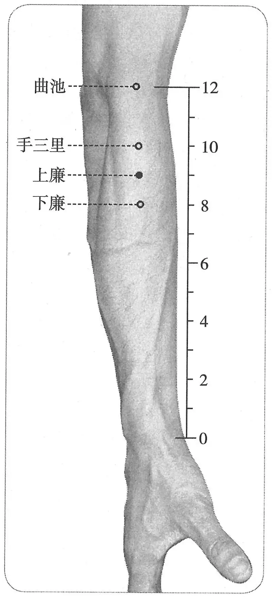

**图 2-33　上廉穴图**

〔p.213 (인쇄 193)〕

　3. 在三里下一寸，其分独抵阳明之会外斜。（《铜人腧穴针灸图经》卷下）

　4. 穴在三里下一寸。广注：曲池下三寸，屈肘取之，若直取合四寸，其分独抵阳明之会。（《循经考穴编》上）

　5. 曲池下三寸。（《针灸十四经穴位考订》）

　6. 统编针灸学教材

　　(1) 部位：曲池穴下三寸。取穴：屈肘侧量，曲池下三寸取之。（1957年南京《针灸学》）

　　(2) 部位：曲池穴下三寸。取穴：屈肘横肱立拳，当曲池穴与温溜穴成直线处取之。（1版《针灸学讲义》）

　　(3) 部位：在三里下一寸。取穴：当曲池下三寸取穴。（2版《针灸学讲义》）

　　(4) 在阳溪穴与曲池穴的连线上，曲池穴下3寸处。（4、5版《针灸学》、《中国针灸学》）

　　(5) 在前臂背面桡侧，当阳溪与曲池穴连线上，肘横纹下3寸。（6、7版《针灸学》）

**文献分析**：见“下廉”穴。

#### 【类属】 

手阳明大肠经穴。

其分抵阳明之会外邪。（《黄帝明堂经》）

#### 【适应症】 

主治局部病症。常用于肩臂痛或麻木；头痛。

　1. 主小便黄，肠鸣相追逐。（《黄帝明堂经》）

**按**：上廉穴不是五输穴，也不是特定穴，据四肢部腧穴的主治规律，其主治应以局部病症为主，可是这里却主治腹部小肠之病变，盖有误，疑系《黄帝明堂经》编者将下肢足阳明“巨虚上廉”之主治误归入手阳明同名穴下。

　2. 治脑风头痛，小便难黄赤，肠鸣气走疰痛。（《铜人腧穴针灸图经》卷下）

　3. 窦太师针灸遗存

　　(1) 治臂膊跛痛，麻木不仁，补泻。（《窦太师针经》）

　　(2) 治臂膊偏痛。（《针方六集》卷五、《循经考穴编》）

　4. 上廉……主小便黄赤，肠鸣，胸痛，偏风，半身不遂，骨髓冷，手足不仁，喘息，大肠气，脑风头痛。（《针灸聚英》卷一、《针灸大成》）

**按**：以上主治症中除“小便黄赤，肠鸣，脑风头痛”外，皆系误录。

　5. 主泻胃中之热，与气冲、三里、巨虚下廉治同。（《类经图翼》卷六）

**按**：此条主治辑自《素问·水热穴论》，原文作：“气冲、三里、巨虚上下廉，此八者以泻胃中之热也。”其中“巨虚上下廉”是指足阳明经“巨虚上廉”、“巨虚下廉”二穴，张介宾未能识别而将此条分别辑入足阳明上、下巨虚二穴及手阳明“上廉”、“下廉”二穴。

　6. 统编针灸学教材

　　(1) 脑风头痛，肩膊酸痛，偏风，手足不仁，肠鸣腹痛。（1957年南京《针灸学》）

　　(2) 头风，肩膊酸痛，半身不遂，肠鸣腹痛。（1版《针灸学讲义》）

　　(3) 肩膊酸痛，上肢不遂，手臂麻木，肠鸣腹痛。（2版《针灸学讲义》、《中国针灸学》）

　　(4) 头痛，肩膊酸痛，半身不遂，手臂麻木，肠鸣腹痛。（4、5版《针灸学》）

　　(5) 头痛，半身不遂，肩膊酸痛麻木，腹痛，肠鸣，腹泻。（6版《针灸学》）

　　(6) ①肘臂痛、半身不遂、手臂麻木等上肢病证；②头痛；③肠鸣腹痛。（7版《针灸学》）

**文献分析**：明代《针灸聚英》所增入的大量主治，经考均系误解前代文献所致，明以后针灸文献多沿袭其误。《类经图翼》所记也系误录《素问》足阳明“上廉”穴主治。针灸教材中“半身不遂，偏风”等症也系沿袭高武之误，今去之。

〔p.214 (인쇄 194)〕

#### 附：临床应用举例 

　1. 主骨蒸及痃癖气等灸方　两肩井、上廉、下廉，灸七壮。（《医心方》卷十三）

**按**：难以判断此方中“上廉”是手上廉，还是足上廉。

　2. 手臂麻痹不仁，肩髃、曲池、手上廉、合谷。问曰：此证缘何而得？答曰：皆因寒热相搏，气血凝滞，故如此也，复刺后穴：肩井、列缺。（《针灸集成》第二十九方）

　3. 手背生疮红肿疼痛，阳池、上廉、曲池、液门、中渚、合谷，问曰：此证从何而得？答曰：气血壅滞，皮肤瘙痒，用热汤泡洗而红肿，如此久而不治，变成手背疮。复刺后穴：上廉、阳池。（《针灸集成》第三十四方）

#### 【操作】 

直刺0.5~1寸。

　1. 刺入五分，灸三壮。（《黄帝明堂经》）

　2. 针入五分，可灸五壮。（《铜人腧穴针灸图经》卷下）

　3. 针入五分，灸七壮。（《窦太师针经》）

　4. 统编针灸学教材

　　(1) 针五至八分，灸三至七壮。（1957年南京《针灸学》、1版《针灸学讲义》）

　　(2) 直刺5~7分，艾条灸3~7分钟。（2版《针灸学讲义》）

　　(3) 直刺0.5~1寸。（4、5、7版《针灸学》、《中国针灸学》）

　　(4) 直刺0.8~1寸；可灸。（6版《针灸学》）

### （十）手三里 Shǒusānlǐ LI10 出《黄帝明堂经》 

问题1：本穴定位“在曲池下二寸，按之肉起兑肉之端”中之“兑肉”相当于哪条肌肉？如何使之在体显现？

问题2：“手三里”与“足三里”在宋以前文献中皆称“三里”，如何辨识？

#### 【提要索隐】 

《针灸聚英》将足三里穴主治混作本穴主治，后世腧穴文献多沿袭其误。

**部位**：在前臂，肘横纹下2寸，曲池与阳溪连线上。

**适应症**：主治局部病症。常用于肘臂痛或不遂，肩背痛；齿痛，颊肿；腰痛。

**针刺操作**：直刺0.8~1.2寸。

#### 【名实考】 

宋以前文献作“三里”，与足阳明经“三里”同名，宋代《太平圣惠方》有“一名手三里”的记载。现行本《针灸甲乙经》作“手三里”者，系宋以后人所改。宋以后以“手三里”为正名，以与“足三里”相区别。

本穴定位，《黄帝明堂经》作“在曲池下二寸，按之肉起兑肉之端”，是指前臂伸面外侧的桡侧腕长伸肌，当用力握拳（怒辅）时，在体表呈现为梭形，其梭形下端（相当于肌肉与肌腱移行处）形似蛇头者为温溜穴，梭形上端（当该肌变窄且下陷处）用力按之极酸痛处即本穴所在，也即所谓“按之肉起兑肉之端”处。正确理解了古典本义，本穴定位仍应采用解剖标志定位。

　1. 三里，在曲池下二寸，按之肉起兑肉之端。（《黄帝明堂经》）

　2. 三里二穴，一名手三里，在曲池下二寸。（《太平圣惠方·明堂》）

　3. 三里二穴，在曲池下三寸手阳明穴云二寸，按之肉起，兑肉之端。灸三壮，针二分。《明》云：一名手三里，在曲池下二寸。王执中按：三里有二，有手三里，有足三里，此手三里也。故

〔p.215 (인쇄 195)〕

《明堂》云：一名手三里是也。（《针灸资生经》卷一）

　4. 足阳明经之在膝下也，有三里、上廉、下廉之穴，手阳明之在肘下也，亦有三里、上廉、下廉之穴，阳明同而经之性异。一与足太阴为表里，土也；一与手太阴为表里，金也。经之性不同，而何以穴之名同？岂以阳明之经为气血俱多之经，而胃与大肠所受水谷，独异与他腑乎？（《经穴解》）

　5. 别名　上三里、鬼邪。（1957年南京《针灸学》）

**按**：日本针灸教材将足三里穴称作“下三里”，手三里穴作“上三里”；鬼邪一名出自《千金要方》卷十四，系足阳明之“三里”，日本针灸书因不能辨别，将“鬼邪”之名分别归于手三里与足三里二穴的别名。中国《针灸学》教材又传日本教材之误。

#### 【定位】 

**部位**：在前臂，肘横纹下2寸，曲池与阳溪连线上（图2-34）。

**取穴**：侧腕屈肘，在阳溪与曲池连线上，曲池穴下2寸处取穴。

　1. 在曲池下二寸，按之肉起，兑肉之端。（《黄帝明堂经》、《太平圣惠方·明堂》、《铜人腧穴针灸图经》卷下、《圣济总录》、《十四经发挥》、《医学纲目》、《针灸集书》、《针灸聚英》、《古今医统》、《针灸大成》、《针方六集》、《类经图翼》、《医宗金鉴·刺灸心法要诀》、《针灸易学》、《针灸逢源》）

　2. 《铜人腧穴针灸图经》佚文

　　(1) 在曲池下二寸。（《铜人腧穴针灸图经》卷上及卷下“穴腧都数”）

　　(2) 在曲池下三寸手阳明穴云二寸，按之肉起锐肉之端。《铜人》云：三里在曲池下三寸。《明堂》乃云：二寸，在手阳明穴亦云二寸。恐《铜人》本误二字作三字也。（《针灸资生经》卷一）

**按**：今检各本《铜人腧穴针灸图经》卷上（即王执中所说“手阳明穴”篇）及卷下、据北宋本《铜人腧穴针灸图经》的《圣济总录》均作“曲池下二寸”，未详王执中所据何本。

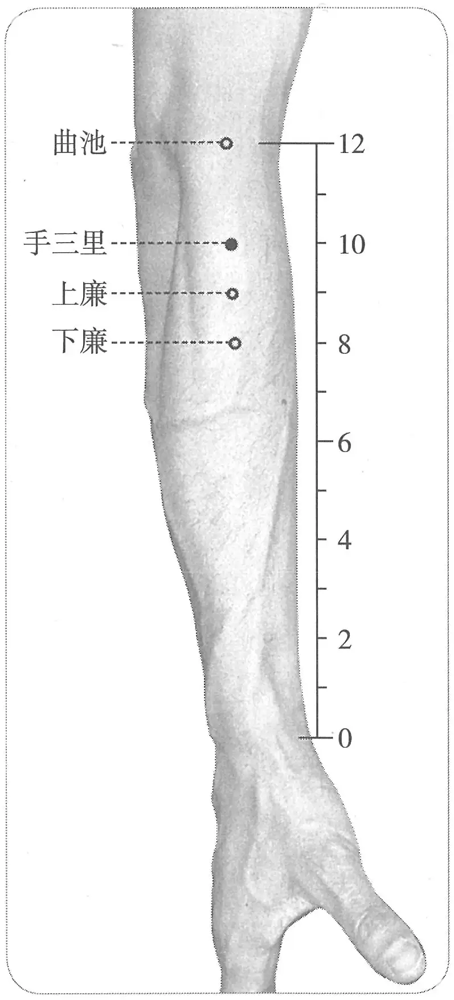

**图 2-34　手三里穴图**

　　(3) 在曲池下三寸，按之肉起锐肉端。（《神应经》）

　　(4) 在曲池下二寸。广注：屈肘取，若直取合三寸，按之肉起，锐肉之端是。（《循经考穴编》上）

　3. 曲池下二寸。（《针灸十四经穴位考订》）

　4. 统编针灸学教材

　　(1) 部位：曲池下二寸。取穴：屈肘侧置，曲池下二寸取之。（1957年南京《针灸学》）

　　(2) 部位：曲池下二寸。取穴：屈肘横肱立拳，当曲池穴与温溜穴成直线处取之。（1版《针灸学讲义》）

　　(3) 部位：曲池下二寸。取穴：当下廉与曲池连线之中点取穴。（2版《针灸学讲义》）

　　(4) 在阳溪穴与曲池穴的连线上，曲池穴下2寸处。（4、5版《针灸学》、《中国针灸学》）

〔p.216 (인쇄 196)〕

　　(5) 在前臂背面桡侧，当阳溪与曲池穴连线上，肘横纹下2寸。（6版《针灸学》）

　　(6) 在阳溪穴与曲池穴连线上，肘横纹下2寸处。（7版《针灸学》）

**文献分析**：本穴定位，《黄帝明堂经》曰“在曲池下二寸，按之肉起兑肉之端”，由于文字很简略，加上针灸取穴的表面解剖学经验与文献的失传，后人难以理解。所谓“按之肉起”是指虎口张开按于硬物（如桌面或地面等），使前臂伸面外侧的桡侧腕长伸肌收缩，在体表呈现为一梭形肌肉，其梭形近端（当该肌变窄且下陷处）用力按之极痠痛处即本穴所在。其实更简单、更有效的方法是采用下廉穴的取穴方法“怒辅”，也即教材所谓“屈肘横肱立拳”。正确理解了古典本义，本穴定位仍应采用解剖标志定位。至于《针灸资生经》引《铜人腧穴针灸图经》“曲池下三寸”说，不见于传世各本《铜人腧穴针灸图经》，恐有误。《循经考穴编》注文欲以“屈肘”、“伸肘”调和分歧，颇牵强。

#### 【类属】 

手阳明大肠经穴。

#### 【适应症】 

主治局部病症。常用于肘臂痛或不遂，肩背痛；齿痛，颊肿；腰痛。

　1. 主腹䐜，肘寒，腰痛不得卧。（《黄帝明堂经》）

**按**：手三里穴不是五输穴，也不是特定穴，其主治应以局部病症为主，可是这里却主治腹部病变，盖有误，疑系《黄帝明堂经》编者将下肢足阳明“三里”之主治误归入手阳明同名穴下。《铜人腧穴针灸图经》皆不收录，可从。

　2. 齿痛，颊肿。（《外台秘要》卷三十九）

**按**：此系辑自手阳明大肠经“是动”病。

　3. 主肘臂酸重屈伸难。秦丞祖《明堂》云：主五劳虚乏，四肢羸瘦也。（《太平圣惠方·明堂》）

**按**：《太平圣惠方·明堂》足部“三里”穴下引华佗云：“主五劳羸瘦，七伤虚乏”，则上条引秦丞祖《明堂》文字当系足三里主治。

　4. 治手臂不仁，肘挛不伸，齿痛，颊颔肿，瘰疬。（《铜人腧穴针灸图经》卷下）

　5. 窦太师针灸遗存

　　(1) 手三里，肩背痛针此穴极应。（《窦太师针经》）

　　(2) 主臂膊疼痛，冷风麻痹。（《循经考穴编》上）

　6. 治霍乱，遗矢，失音，口风口僻，手足不随。（《针灸聚英》卷一、《古今医统》、《针灸大成》、《针方六集》）

**按**：此系从《针灸资生经》误录足三里穴主治。后世腧穴文献多沿袭其误。

　7. 针灸歌赋主治　肩背病症。（《通玄指要赋》、《席弘赋》）

　8. 统编针灸学教材

　　(1) 齿痛，颊颔肿，肩膊疼痛，冷风麻痹，中风口噼，半身不遂，霍乱，遗矢。（1957年南京《针灸学》）

　　(2) 齿痛，颊颔肿，肘挛不伸，手臂麻木不仁，中风口噼，半身不遂，急性吐泻。（1版《针灸学讲义》）

　　(3) 齿痛，颊颔肿，肩膊疼痛，上肢不遂，腹痛吐泻。（2版《针灸学讲义》）

　　(4) 齿痛颊肿，上肢不遂，腰背痛，腹痛，腹泻。（4版《针灸学》）

　　(5) 齿痛颊肿，上肢不遂，腹痛，腹泻。（5版《针灸学》）

　　(6) 肘臂疼痛，上肢瘫痪麻木，腹痛，腹泻，腹胀，齿痛，失音。（6版《针灸学》）

　　(7) ①手臂无力、上肢不遂等上肢病证；②腹痛，腹泻；③齿痛，颊肿。（7版《针灸学》）

〔p.217 (인쇄 197)〕

　　(8) 腹痛，腹泻，齿痛，颊肿，上肢不遂，肩背疼痛。（《中国针灸学》）

**文献分析**：古代文献，特别是明代《针灸聚英》多将足三里穴主治混作本穴主治，后世腧穴文献多沿袭其误。古今临床应用皆集中于局部病症，其次为齿疾。

#### 附：临床应用举例 

　1. 肩臂病症

　　(1) 四肢风痛：曲池、风市、外关、阳陵泉、三阴交、手三里。（《针灸大成》卷五）

　　(2) 中风半身瘫痪，疼痛麻木，不遂：针合谷、手三里、曲池、肩井、环跳、血海、阳陵泉、阴陵泉、足三里、绝骨、居髎。（《针灸集要·盘石金直刺秘传》）

　　(3) 中风半身不遂：合谷、绝骨、手三里、曲池、昆仑、肩髃、肩井、三里、上廉、委中。问曰：此证针后再发，何也？答曰：针不及分寸，补泻不明，不分虚实，其疾再发，可针前后，必须穴要得中，知深浅，明补泻，分虚实，无不效也。复刺后穴：曲池、手三里、合谷、肩髃、足三里、绝骨、昆仑、肩井，不宜泻，不许灸。（《针灸集成》第三方）

　　(4) 十指拘挛两手筋紧不开：手三里、曲池、尺泽、合谷、肩髃、阳池、中渚、少商。问曰：此证从何而得？答曰：皆因湿处睡卧，暑月夜行，风露相搏，或醉酒行房，行房之处露天而睡故也。复刺后穴：肩髃、中渚、少商、手三里。（《针灸集成》第三十三方）

　　(5) 《撮》臂膊疼痛：肩髃、手三里、外关。（《医学纲目》卷十二）

　　(6) 肩背患，责肘前之三里。（《通玄指要赋》）

　　(7) 肩上痛连脐不休，手中三里便须求。（《席弘赋》）

　　(8) 中风后肌力减退：选患侧手三里、伏兔二穴，进针后分别向内外两侧斜刺，最后依阳明经方向斜刺，每个方向均以平补平泻手法，捻转提插1分钟。[广东医学，1997，18(8)：553]

　2. 牙痛，灸吕细、手三里。（《针灸集要·盘石金直刺秘传》）

#### 【操作】 

直刺0.8~1.2寸。

　1. 刺入三分，灸三壮。（《黄帝明堂经》）

　2. 灸二壮。（《太平圣惠方·明堂》）

　3. 针入五分，灸三壮。（《医学入门》卷一）

　4. 窦太师针灸遗存

　　(1) 针入二寸半。不可轻易灸之，灸则恐伤经络。（《窦太师针经》）

　　(2) 窦氏：刺入二寸半。或曰：此穴为诸络会，不可轻灸。（《针方六集》卷一）

　5. 沿骨直针一寸。灸五壮。（《循经考穴编》上）

　6. 针五分，灸五壮。（《针灸十四经穴位考订》）

　7. 统编针灸学教材

　　(1) 针五至七分，灸三至七壮。（1957年南京《针灸学》、1版《针灸学讲义》）

　　(2) 直刺5~8分，艾条灸3~7分钟。（2版《针灸学讲义》）

　　(3) 直刺0.8~1.2寸。（4、5、7版《针灸学》）

　　(4) 直刺0.8~1.2寸。可灸。（6版《针灸学》、《中国针灸学》）

　8. 直刺1~2寸。感应：局部酸胀，有时可扩散至前臂。灸3~7壮；温灸5~20分钟。（上海《针灸学》）

〔p.218 (인쇄 198)〕

