# 《针灸腧穴通考》(上册) — 手阳明大肠经穴 (2/2) · （十一）曲池 Qūchí LI11 出《灵枢》~（二十）迎香 Yíngxiāng LI20 出《黄帝明堂经》

> 분할본 5/25. 원서: 黄龙祥·黄幼民 编著, 《针灸腧穴通考——〈中华针灸穴典〉研究》(上册), 人民卫生出版社, 2011. 원서 스캔 OCR 판독본을 챗봇 검색용으로 나눈 것이며, 본문과 쪽 표시 〔p.PDF쪽 (인쇄 쪽)〕는 원본 그대로이다.

## 二、手阳明大肠经穴 (계속)

### （十一）曲池 Qūchí LI11 出《灵枢》 

> **(11) 곡지(曲池) Qūchí (LI11) — 『영추(靈樞)』에 처음 보임**

#### 【提要索隐】 

> **【요점 정리(提要索隱)】**

**部位**：在肘区，尺泽与肱骨外上髁连线的中点处。

> **부위**: 팔꿈치 부위에 있으며, 척택(尺澤)과 상완골 외측상과(上腕骨外側上顆)를 잇는 선의 중점이다.

**适应症**：主治口齿部、咽部病症，是治疗皮肤病症的要穴。常用于手臂痛，上肢不遂；瘾疹，湿疹，瘰疬；咽喉肿痛，齿痛，目疾；热病，狂，痫。

> **적응증**: 입과 이[口齒] 부위·인후 부위의 병증을 주치하며, 피부 병증을 치료하는 요혈(要穴)이다. 팔의 통증, 상지불수(上肢不遂); 은진(癮疹), 습진, 나력(瘰癧); 인후종통(咽喉腫痛), 치통, 눈병; 열병, 광증(狂證), 간증(癎證)에 흔히 쓴다.

**针刺操作**：直刺0.8~1.5寸，可灸。

> **자침 조작**: 직자(直刺) 0.8~1.5촌, 뜸을 뜰 수 있다.

#### 【名实考】 

> **【이름과 실체 고증(名實考)】**

一名鬼臣，出自《千金要方》卷十四，原无指明穴名，《千金翼方》引录时作“阳泽，一名鬼臣”，未详所据，恐有误。另《千金翼方》引《千金要方》另一首灸方穴“冲阳”加有注文“在肘外屈横纹外头”，也不明所出，故“阳泽”、“冲阳”今不作为曲池穴的别名。今人不识，以此“冲阳”为别是一穴，归入“奇穴”类。

> 다른 이름은 귀신(鬼臣)으로 『천금요방(千金要方)』 권14에 나오는데, 원래는 혈명을 밝히지 않았다. 『천금익방(千金翼方)』이 이를 옮겨 실으면서 "양택(陽澤), 일명 귀신"이라 하였으나 근거를 알 수 없고 잘못인 듯하다. 또 『천금익방』은 『천금요방』의 다른 뜸 처방 한 수에 나오는 혈 "충양(衝陽)"을 인용하면서 "팔꿈치 바깥쪽 굽힌 가로금의 바깥 끝에 있다"라는 주문(注文)을 덧붙였는데, 이 역시 출처가 분명하지 않다. 그러므로 "양택"·"충양"은 지금 곡지혈의 별명으로 삼지 않는다. 요즘 사람들은 이를 알지 못하고 이 "충양"을 별개의 혈로 여겨 "기혈(奇穴)" 부류에 넣었다.

　1. 大肠上合手阳明……入于曲池，在肘外辅骨陷者中，屈臂而得之，为合，手阳明也。（《灵枢·本输》）

> 1. 대장은 위로 수양명(手陽明)에 합한다…… 곡지로 들어가니, 팔꿈치 바깥쪽 보골(輔骨)의 오목한 가운데에 있으며 팔을 굽혀 취한다. 합혈(合穴)이며 수양명이다.（『영추』 「본수(本輸)」）

　2. 入于曲池，曲池者土也，在肘外辅屈肘曲骨之中，手阳明脉之所入也，为合，以手按胸取之。（《黄帝明堂经》）

> 2. 곡지로 들어가니, 곡지는 토(土)이다. 팔꿈치 바깥쪽 보골, 팔꿈치를 굽혔을 때 굽은 뼈의 가운데에 있으며, 수양명맥이 들어가는 곳이다. 합혈이며, 손으로 가슴을 누르게 하고 취한다.（『황제명당경(黃帝明堂經)』）

　3. 曲池者，在肘外辅曲骨之中也，屈肘而得之，为合，手阳明经也。（《黄帝内经太素·本输》）

> 3. 곡지는 팔꿈치 바깥쪽 보골의 굽은 뼈 가운데에 있으며, 팔꿈치를 굽혀 취한다. 합혈이며 수양명경이다.（『황제내경태소(黃帝內經太素)』 「본수」）

　4. 第十二针尺泽横纹外头接白肉际，名鬼臣，火针七锃，锃三下。即曲池穴也。（《千金要方》卷十四）

> 4. 열두 번째 침은 척택 가로금의 바깥 끝이 백육제(白肉際)에 닿는 곳에 놓으니, 이름은 귀신이다. 화침(火鍼)으로 일곱 번 지지되[七鋥] 한 번에 세 번씩 한다. 곧 곡지혈이다.（『천금요방』 권14）

　5. 阳泽，一名鬼臣……第十二次下针，尺泽横纹中内外两纹头接白肉际七锃，锃三下，名鬼臣，此名曲池。（《千金翼方》卷二十七）

> 5. 양택은 일명 귀신이다…… 열두 번째로 침을 놓는 곳은 척택 가로금 가운데 안팎 두 금의 끝이 백육제에 닿는 곳으로, 일곱 번 지지되 한 번에 세 번씩 한다. 이름은 귀신이며, 이것을 곡지라 한다.（『천금익방』 권27）

　6. 瘿劳气，灸冲阳，随年壮。（《千金要方》卷二十四）

> 6. 영로기(癭勞氣)에는 충양에 나이 수만큼[隨年壯] 뜸을 뜬다.（『천금요방』 권24）

　7. 瘿，恶气，灸胸膛百壮。又，灸天府五十壮。又，灸大椎，横三间寸灸之。又，灸冲阳，随年壮，在肘外屈横纹外头。宋人注曰：据此是曲池穴，冲阳在足趺上五寸。（《千金翼方》卷二十八）

> 7. 영(癭)과 악기(惡氣)에는 흉당(胸膛)에 뜸 100장을 뜬다. 또 천부(天府)에 50장을 뜬다. 또 대추(大椎)에 뜨되, 가로로 세 간촌(間寸)을 띄워 뜬다. 또 충양에 나이 수만큼 뜨는데, 팔꿈치 바깥쪽 굽힌 가로금의 바깥 끝에 있다. 송나라 사람이 주를 달아 말하였다. "이에 따르면 이것은 곡지혈이다. 충양은 발등 위 5촌에 있다."（『천금익방』 권28）

　8. 刺手阳明之所入，曲池穴也。在肘外辅屈肘两骨之间陷中，手阳明之合。（《素问亡篇·刺法论》）

> 8. 수양명이 들어가는 곳을 찌르니, 곡지혈이다. 팔꿈치 바깥쪽 보골, 팔꿈치를 굽혔을 때 두 뼈 사이의 오목한 가운데에 있으며, 수양명의 합혈이다.（『소문(素問)』 망편(亡篇) 「자법론(刺法論)」）

　9. 此穴在肘臂屈伸之际，而本经气脉过之，故名曲池。（《经穴解》）

> 9. 이 혈은 팔꿈치와 팔이 굽혔다 펴지는 자리에 있고 본경의 기맥이 그곳을 지나므로 곡지라 이름하였다.（『경혈해(經穴解)』）

　10. 别名　鬼臣、阳泽。（1957年南京《针灸学》）

> 10. 별명 귀신·양택.（1957년 난징(南京) 『침구학[鍼灸學]』）

#### 相关穴及刺激点 

> **관련 혈과 자극점(相關穴及刺激點)**

　1. 泽田　曲池穴下1寸，主治发热，牛皮癣，过敏性鼻炎。针1~1.5寸，针感麻、酸至腕。（《针灸经外奇穴图谱（续集）》）

> 1. 택전(澤田) 곡지혈 아래 1촌. 발열, 우피선(牛皮癬), 알레르기성 비염을 주치한다. 침 1~1.5촌, 침감(鍼感)은 저리고 시큰한 느낌이 손목까지 이른다.（『침구경외기혈도보 속집[鍼灸經外奇穴圖譜（續集）]』）

　2. 上曲池　曲池穴上1.5寸，主治荨麻疹、皮肤瘙痒，瘫痪。针直透对侧皮下，针感麻、酸至手指。（《针灸经外奇穴图谱（续集）》）

> 2. 상곡지(上曲池) 곡지혈 위 1.5촌. 두드러기[蕁麻疹]·피부 소양증, 탄탄(癱瘓)을 주치한다. 침을 곧장 반대쪽 피하까지 꿰뚫어 찌르며, 침감은 저리고 시큰한 느낌이 손가락까지 이른다.（『침구경외기혈도보 속집[鍼灸經外奇穴圖譜（續集）]』）

**按**：根据所描述的针法来看，实际上是刺激尺神经。之所以选桡侧而不从尺侧，恐怕是因为治疗荨麻疹的曲池穴在桡侧的缘故。按照西医的认识，从不同的体表穿刺点刺激或者阻滞相同的神经，其作用是相同的。如果从尺侧刺入直接刺激尺神经同样有效的话，是不是操作起来更为方便？

> **안(按)**: 기술된 침법으로 보면 실제로는 척골신경(尺骨神經)을 자극하는 것이다. 척측(尺側)이 아니라 요측(橈側)을 택한 까닭은 아마 두드러기를 치료하는 곡지혈이 요측에 있기 때문일 것이다. 서양의학의 이해로는, 서로 다른 체표 천자점에서 같은 신경을 자극하거나 차단하면 그 작용은 같다. 척측으로 찔러 척골신경을 직접 자극해도 똑같이 효과가 있다면, 그편이 조작하기에 더 편하지 않겠는가?

#### 【定位】 

> **【위치(定位)】**

**部位**：在肘区，尺泽与肱骨外上髁连线的中点处（图2-35）。

> **부위**: 팔꿈치 부위에 있으며, 척택과 상완골 외측상과를 잇는 선의 중점이다（그림 2-35）.

**取穴**：90°屈肘，肘横纹外侧端外凹陷中；极度屈肘，肘横纹桡侧端凹陷中。

> **취혈**: 팔꿈치를 90° 굽히면 팔꿈치 가로금 바깥쪽 끝의 바깥 오목한 곳에 있고, 팔꿈치를 끝까지 굽히면 팔꿈치 가로금 요측 끝의 오목한 곳에 있다.

〔p.219 (인쇄 199)〕

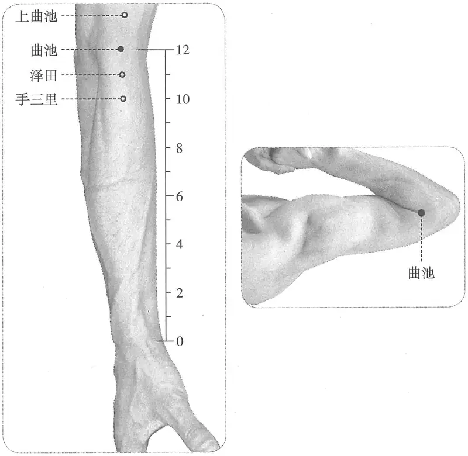

**图 2-35　曲池穴与相关穴图**

> **그림 2-35** 곡지혈과 관련 혈

　1. 《灵枢》传本

> 1. 『영추』 전본(傳本)

　　(1) 在肘外辅骨陷者中，屈臂而得之。（《灵枢·本输》）

> (1) 팔꿈치 바깥쪽 보골의 오목한 가운데에 있으며, 팔을 굽혀 취한다.（『영추』 「본수」）

　　(2) 在肘外辅曲骨之中也，屈肘而得之。（《黄帝内经太素·本输》）

> (2) 팔꿈치 바깥쪽 보골의 굽은 뼈 가운데에 있으며, 팔꿈치를 굽혀 취한다.（『황제내경태소』 「본수」）

　2. 《黄帝明堂经》佚文

> 2. 『황제명당경』 일문(佚文)

　　(1) 在肘外辅骨肘骨之中……以手按胸取之。（《针灸甲乙经》卷三）

> (1) 팔꿈치 바깥쪽 보골과 주골(肘骨)의 가운데에 있다…… 손으로 가슴을 누르게 하고 취한다.（『침구갑을경(鍼灸甲乙經)』 권3）

　　(2) 在肘外辅屈肘两骨之中……以手拱胸取之。（《素问·气穴论》王冰注）

> (2) 팔꿈치 바깥쪽 보골, 팔꿈치를 굽혔을 때 두 뼈의 가운데에 있다…… 두 손을 맞잡아 가슴 앞에 모으게[拱胸] 하고 취한다.（『소문』 「기혈론(氣穴論)」 왕빙(王冰)의 주）

　　(3) 在肘外辅屈肘曲骨之中。（《千金翼方》卷二十六、《外台秘要》、《医心方》）

> (3) 팔꿈치 바깥쪽 보골, 팔꿈치를 굽혔을 때 굽은 뼈의 가운데에 있다.（『천금익방』 권26, 『외대비요(外臺秘要)』, 『의심방(醫心方)』）

**按**：“两骨”，《素问·痹论》王冰注作“曲骨”无误，宋代《圣济总录》引《针灸甲乙经》也无误。今人根据错误的文字，解作“辅骨”，并据此认为此处是指桡骨头与肱骨外上髁接合处。

> **안(按)**: "두 뼈[兩骨]"는 『소문』 「비론(痺論)」 왕빙의 주에는 "굽은 뼈[曲骨]"로 되어 있어 잘못이 없고, 송대 『성제총록(聖濟總錄)』이 『침구갑을경』을 인용한 것도 잘못이 없다. 요즘 사람들은 잘못된 글자에 근거해 이를 "보골"로 풀이하고, 이를 근거로 이곳이 요골두(橈骨頭)와 상완골 외측상과가 맞닿는 곳을 가리킨다고 여긴다.

　3. 甄权《针经》佚文

> 3. 견권(甄權) 『침경(鍼經)』 일문

　　(1) 一云在肘上横文中。（《千金翼方》卷二十六注）

> (1) 일설에는 팔꿈치 위 가로금 가운데에 있다고 한다.（『천금익방』 권26 주）

　　(2) 在肘外辅骨，曲肘横纹头，宛宛中陷者是……以手拱胸取之，外畔交头即是穴。（《太平圣惠方·针经》、《针灸玉龙经》、《针灸大成》、《针方六集》、《医宗金鉴·刺灸心法要诀》、《针灸易学》、《针灸逢源》）

> (2) 팔꿈치 바깥쪽 보골, 팔꿈치를 굽혔을 때 생기는 가로금 끝의 움푹 꺼진 곳이 이것이다…… 두 손을 맞잡아 가슴 앞에 모으게 하고 취하는데, 바깥 가장자리 금이 끝나는 곳이 바로 혈이다.（『태평성혜방(太平聖惠方)』 「침경(鍼經)」, 『침구옥룡경(鍼灸玉龍經)』, 『침구대성(鍼灸大成)』, 『침방육집(鍼方六集)』, 『의종금감(醫宗金鑑)』 「자구심법요결(刺灸心法要訣)」, 『침구역학(鍼灸易學)』, 『침구봉원(鍼灸逢源)』）

　　(3) 在肘外转屈肘曲骨之中纹头陷者。（《太平圣惠方·明堂》、《医学入门》）

> (3) 팔꿈치 바깥쪽으로 돌려[外轉] 팔꿈치를 굽혔을 때 굽은 뼈 가운데 가로금 끝의 오목한 곳에 있다.（『태평성혜방』 「명당(明堂)」, 『의학입문(醫學入門)』）

　　(4) 在肘外辅骨屈肘曲骨之中，以手拱胸取之。（《铜人腧穴针灸图经》卷下、《圣济总录》、《针灸资生经》、《针经节要》、《十四经发挥》、《针灸集书》、《针灸聚英》、《古今医统》、《类经图翼》、《循经考穴编》、《医宗金鉴·刺灸心法要诀》）

> (4) 팔꿈치 바깥쪽 보골, 팔꿈치를 굽혔을 때 굽은 뼈의 가운데에 있으며, 두 손을 맞잡아 가슴 앞에 모으게 하고 취한다.（『동인수혈침구도경(銅人腧穴鍼灸圖經)』 권하, 『성제총록』, 『침구자생경(鍼灸資生經)』, 『침경절요(鍼經節要)』, 『십사경발휘(十四經發揮)』, 『침구집서(鍼灸集書)』, 『침구취영(鍼灸聚英)』, 『고금의통(古今醫統)』, 『유경도익(類經圖翼)』, 『순경고혈편(循經考穴編)』, 『의종금감』 「자구심법요결」）

〔p.220 (인쇄 200)〕

　4. 针灸方腧穴定位

> 4. 침구방(鍼灸方)의 수혈(腧穴) 위치

　　(1) 在两肘外曲头陷者中，屈肘取之是。（《千金要方》卷八、《千金翼方》）

> (1) 양 팔꿈치 바깥쪽 굽은 끝의 오목한 가운데에 있으며, 팔꿈치를 굽혀 취하는 곳이 이것이다.（『천금요방』 권8, 『천금익방』）

　　(2) 横纹外头接白肉际。（《千金要方》卷十四）

> (2) 가로금 바깥 끝이 백육제에 닿는 곳.（『천금요방』 권14）

　　(3) 在肘外屈横文外头。（《千金翼方》卷二十八）

> (3) 팔꿈치 바깥쪽 굽힌 가로금의 바깥 끝에 있다.（『천금익방』 권28）

　5. 曲肘横纹头陷中，去肘关节约一横指。（《针灸十四经穴位考订》）

> 5. 팔꿈치를 굽혔을 때 가로금 끝의 오목한 가운데로, 팔꿈치 관절에서 약 한 손가락 너비 떨어져 있다.（『침구 십사경 혈위 고정[鍼灸十四經穴位考訂]』）

　6. 统编针灸学教材

> 6. 통편(統編) 침구학 교재

　　(1) 部位：在肘外辅骨，曲肘横纹头陷中。取穴：两臂曲肘作拱手式，在肘窝横纹端近肘关节部取之。（1957年南京《针灸学》）

> (1) 부위: 팔꿈치 바깥쪽 보골, 팔꿈치를 굽혔을 때 가로금 끝의 오목한 가운데에 있다. 취혈: 두 팔꿈치를 굽혀 두 손을 맞잡은 자세를 하고, 주와(肘窩) 가로금 끝의 팔꿈치 관절에 가까운 곳에서 취한다.（1957년 난징 『침구학』）

　　(2) 部位：肘部外辅骨内，肘窝横纹头陷中。取穴：屈肘横肱立拳取之。（1版《针灸学讲义》）

> (2) 부위: 팔꿈치 부위 바깥쪽 보골 안쪽, 주와 가로금 끝의 오목한 가운데. 취혈: 팔꿈치를 굽혀 위팔을 가로로 두고 주먹을 세운 채 취한다.（1판 『침구학강의[鍼灸學講義]』）

　　(3) 部位：在肘外辅骨肘骨之中。取穴：屈肘时，当肘横纹外端凹陷处，当尺泽手太阴经与肱骨外上髁之中点，屈肘取之。（2版《针灸学讲义》）

> (3) 부위: 팔꿈치 바깥쪽 보골과 주골의 가운데에 있다. 취혈: 팔꿈치를 굽혔을 때 팔꿈치 가로금 바깥 끝의 오목한 곳, 곧 수태음경 척택과 상완골 외측상과의 중점에 해당하며, 팔꿈치를 굽혀 취한다.（2판 『침구학강의』）

　　(4) 曲肘，当肘横纹外短凹陷中。（4版《针灸学》）

> (4) 팔꿈치를 굽혔을 때 팔꿈치 가로금 바깥 끝[外短]의 오목한 가운데에 해당한다.（4판 『침구학』） 〔역주: 원서의 「外短」은 앞뒤 인용(「外端」)으로 보아 「外端」(바깥 끝)의 오식으로 보인다.〕

　　(5) 曲肘，成直角，当肘横纹外端与肱骨外上髁连线的中点。（5、7版《针灸学》）

> (5) 팔꿈치를 직각으로 굽혔을 때 팔꿈치 가로금 바깥 끝과 상완골 외측상과를 잇는 선의 중점에 해당한다.（5·7판 『침구학』）

　　(6) 在肘横纹外侧端，曲肘时当尺泽与肱骨外上髁连线中点。（6版《针灸学》）

> (6) 팔꿈치 가로금 바깥쪽 끝에 있으며, 팔꿈치를 굽혔을 때 척택과 상완골 외측상과를 잇는 선의 중점에 해당한다.（6판 『침구학』）

　　(7) 曲肘，当肘横纹外短凹陷处，当尺泽与肱骨外上髁连线中点。（《中国针灸学》）

> (7) 팔꿈치를 굽혔을 때 팔꿈치 가로금 바깥 끝[外短]의 오목한 곳, 곧 척택과 상완골 외측상과를 잇는 선의 중점에 해당한다.（『중국침구학[中國鍼灸學]』） 〔역주: 원서의 「外短」은 「外端」의 오식으로 보인다.〕

**文献分析**：古代文献关于本穴的定位，一以骨性标志定位“肘外辅屈肘曲骨之中”，一以肌性标志定位“屈肘横纹头”，所定部位可相同。需要注意的是，肘横纹的长短，取决于屈肘的程度，90°屈肘时，本穴位于肘横纹外侧端外凹陷中；极度屈肘当，则位于肘横纹桡侧端凹陷中。古代文献关于本穴定位的骨性标志明确，且定位容易，当准以两骨间定位的太冲、巨骨等穴，直接以骨性标志取穴。

> **문헌 분석**: 이 혈의 위치에 관한 고대 문헌은 한편으로는 골성 표지로 "팔꿈치 바깥쪽 보골, 팔꿈치를 굽혔을 때 굽은 뼈의 가운데"라고 정하고, 한편으로는 근성(肌性) 표지로 "팔꿈치를 굽혔을 때 가로금의 끝"이라고 정하는데, 정한 부위는 같을 수 있다. 주의할 점은 팔꿈치 가로금의 길이가 팔꿈치를 굽힌 정도에 달려 있다는 것이다. 팔꿈치를 90° 굽히면 이 혈은 팔꿈치 가로금 바깥쪽 끝의 바깥 오목한 곳에 있고, 팔꿈치를 끝까지 굽히면 팔꿈치 가로금 요측 끝의 오목한 곳에 있다. 고대 문헌에서 이 혈의 위치를 정하는 골성 표지는 분명하고 위치를 정하기도 쉬우므로, 두 뼈 사이로 위치를 정하는 태충(太衝)·거골(巨骨) 등의 혈에 준하여 골성 표지로 직접 취혈해야 한다.

#### 【类属】 

> **【분류(類屬)】**

手阳明大肠经穴；五输穴之合穴。

> 수양명대장경(手陽明大腸經)의 혈; 오수혈(五輸穴) 가운데 합혈.

大肠上合手阳明……入于曲池，在肘外辅骨陷者中，屈臂而得之，为合，手阳明也。（《灵枢·本输》）

> 대장은 위로 수양명에 합한다…… 곡지로 들어가니, 팔꿈치 바깥쪽 보골의 오목한 가운데에 있으며 팔을 굽혀 취한다. 합혈이며 수양명이다.（『영추』 「본수」）

手阳明脉之所入也，为合。（《黄帝明堂经》）

> 수양명맥이 들어가는 곳이며, 합혈이다.（『황제명당경』）

#### 【适应症】 

> **【적응증(適應症)】**

主治口齿部、咽部病症，是治疗皮肤病症的要穴。常用于手臂痛，上肢不遂；瘾疹，湿疹，瘰疬；咽喉肿痛，齿痛，目疾；热病，狂，痫。

> 입과 이 부위·인후 부위의 병증을 주치하며, 피부 병증을 치료하는 요혈이다. 팔의 통증, 상지불수; 은진, 습진, 나력; 인후종통, 치통, 눈병; 열병, 광증, 간증에 흔히 쓴다.

　1. 主伤寒余热不尽。胸中满，耳前痛，齿痛，目赤痛，颈肿，寒热，渴饮辄汗出，不饮则皮干热。肩肘中痛，难屈伸，手不可举，腕重急。目不明，腕急，身热，惊狂，躄痿痹，瘛疭。癫疾吐舌。喉痹不能言。（《黄帝明堂经》）

> 1. 상한(傷寒)에 여열(餘熱)이 다 가시지 않은 것을 주치한다. 가슴속이 그득함, 귀 앞의 통증, 치통, 눈이 붉고 아픔, 목이 부음, 한열(寒熱), 갈증이 나서 물을 마시면 곧 땀이 나고 마시지 않으면 피부가 마르고 뜨거움. 어깨와 팔꿈치 가운데가 아파 굽혔다 펴기 어렵고, 손을 들 수 없으며, 손목이 무겁고 당김. 눈이 밝지 않음, 손목이 당김, 몸에 열이 남, 놀라 미쳐 날뜀[驚狂], 벽위비(躄痿痺), 계종(瘛瘲). 전질(癲疾)로 혀를 내미는 것. 후비(喉痺)로 말을 하지 못하는 것.（『황제명당경』）

　2. 疗偏风半身不遂，刺风疹，疼痛冷缓，捉物不得，挽弓不开，屈伸难，瘾胗风，臂肘细而无力。（《太平圣惠方·针经》）

> 2. 편풍(偏風)으로 인한 반신불수, 자풍진(刺風疹), 아프고 차며 늘어져 물건을 잡지 못하고 활을 당겨 벌리지 못하며 굽혔다 펴기 어려운 것, 은진풍(癮胗風), 팔과 팔꿈치가 가늘어지고 힘이 없는 것을 치료한다.（『태평성혜방』 「침경」）

　3. 疗肘中痛屈难伸，手不得举，秦丞祖《明堂》云：主大人偏身风癞，皮肤痂疥。（《太平圣惠方·明堂》）

> 3. 팔꿈치 가운데가 아파 굽히면 펴기 어렵고 손을 들지 못하는 것을 치료한다. 진승조(秦丞祖)의 『명당(明堂)』에서는 "어른의 온몸에 생긴 풍라(風癩)와 피부의 가피(痂疥)를 주치한다"라고 하였다.（『태평성혜방』 「명당」）

　4. 治肘中痛，偏风半身不遂，刺风瘾疹，喉痹不能言，胸中烦满，筋缓捉物不得，挽弓不开，屈伸难，风臂肘细而无力，伤寒余热不尽，皮肤干燥。（《铜人腧穴针灸图经》卷下）

> 4. 팔꿈치 가운데의 통증, 편풍으로 인한 반신불수, 자풍은진(刺風癮疹), 후비로 말을 하지 못하는 것, 가슴속이 번만(煩滿)한 것, 힘줄이 늘어져 물건을 잡지 못하는 것, 활을 당겨 벌리지 못하는 것, 굽혔다 펴기 어려운 것, 풍으로 팔과 팔꿈치가 가늘어지고 힘이 없는 것, 상한에 여열이 다 가시지 않은 것, 피부 건조를 치료한다.（『동인수혈침구도경』 권하）

　5. 窦太师针灸遗存

> 5. 두태사(竇太師) 침구 유존(遺存)

　　(1) 治半身不遂，手臂酸疼，拘挛不开，先泻后补；两手拘挛，先补后泻。（《窦太师针经》）

> (1) 반신불수, 팔이 시큰거리고 아프며 구련(拘攣)되어 펴지지 않는 것을 치료하는데, 먼저 사(瀉)하고 뒤에 보(補)한다. 두 손이 구련된 것은 먼저 보하고 뒤에 사한다.（『두태사침경(竇太師鍼經)』）

　　(2) 两手拘挛，筋紧不开，先泻后补；筋脉拘挛，先补；手握不伸，单补。（《针方六集·玉龙歌》注）

> (2) 두 손이 구련되고 힘줄이 당겨 펴지지 않으면 먼저 사하고 뒤에 보한다. 근맥(筋脈)이 구련되면 먼저 보한다. 손을 쥐고 펴지 못하면 보하기만 한다.（『침방육집』 「옥룡가(玉龍歌)」 주）

〔p.221 (인쇄 201)〕

　6. 妇人经脉不通。（《针灸聚英》、《古今医统》、《针灸大成》、《循经考穴编》）

> 6. 부인의 경맥이 통하지 않는 것.（『침구취영』, 『고금의통』, 『침구대성』, 『순경고혈편』）

**按**：此辑自《针经摘英集》“曲池、支沟、三里、三阴交”针方。

> **안(按)**: 이것은 『침경적영집(鍼經摘英集)』의 "곡지·지구(支溝)·삼리(三里)·삼음교(三陰交)" 침방에서 뽑아 모은 것이다.

　7. 治手肘臂膊疼、半身不遂、肘细无力屈伸、虚劳发热、胸前烦满。（《神农针灸经》）

> 7. 손·팔꿈치·팔·어깻죽지의 통증, 반신불수, 팔꿈치가 가늘어지고 힘이 없어 굽혔다 펴지 못하는 것, 허로(虛勞) 발열, 가슴 앞이 번만한 것을 치료한다.（『신농침구경(神農鍼灸經)』）

　8. 针灸歌赋主治：肘挛痛。（《标幽赋》、《针灸玉龙歌》、《通玄指要赋》、《席弘赋》）；腰前挛急。（《肘后歌》）；头面病。（《千金十一穴歌》）

> 8. 침구 가부(歌賦)의 주치: 팔꿈치가 구련되고 아픈 것.（「표유부(標幽賦)」, 「침구옥룡가(鍼灸玉龍歌)」, 「통현지요부(通玄指要賦)」, 「석홍부(席弘賦)」）; 허리 앞이 당기고 켕기는 것.（「주후가(肘後歌)」）; 머리와 얼굴의 병.（「천금십일혈가(千金十一穴歌)」） 〔역주: 원서의 「腰前」은 「주후가(肘後歌)」 원구 「腰背若患挛急风」으로 보아 「腰背」의 오식으로 보인다.〕

　9. 统编针灸学教材

> 9. 통편 침구학 교재

　　(1) 喉痹，手臂肿痛，肘中痛，肘细无力，半身不遂，伤寒余热不退，月经不通，瘰疬。（1957年南京《针灸学》）

> (1) 후비, 팔이 붓고 아픈 것, 팔꿈치 가운데의 통증, 팔꿈치가 가늘어지고 힘이 없는 것, 반신불수, 상한에 여열이 물러가지 않는 것, 월경불통(月經不通), 나력.（1957년 난징 『침구학』）

　　(2) 喉痹，手臂肿痛，肘中痛，肘细无力，半身不遂，伤寒余热不尽，月经不通，瘰疬，瘾疹。（1版《针灸学讲义》）

> (2) 후비, 팔이 붓고 아픈 것, 팔꿈치 가운데의 통증, 팔꿈치가 가늘어지고 힘이 없는 것, 반신불수, 상한에 여열이 다 가시지 않은 것, 월경불통, 나력, 은진.（1판 『침구학강의』）

　　(3) 咽喉肿痛，手臂肿痛，手肘无力，上肢不遂，月经不调，瘰疬，瘾疹，丹毒，腹痛吐泻，痢疾，热病。（2版《针灸学讲义》）

> (3) 인후종통, 팔이 붓고 아픈 것, 손과 팔꿈치에 힘이 없는 것, 상지불수, 월경부조(月經不調), 나력, 은진, 단독(丹毒), 복통과 토사(吐瀉), 이질(痢疾), 열병.（2판 『침구학강의』）

　　(4) 咽喉肿痛，齿痛，目赤痛，瘰疬，瘾疹，上肢不遂，腹痛吐泻，热病，癫狂。（4版《针灸学》）

> (4) 인후종통, 치통, 눈이 붉고 아픈 것, 나력, 은진, 상지불수, 복통과 토사, 열병, 전광(癲狂).（4판 『침구학』）

　　(5) 咽喉肿痛，齿痛，目赤痛，瘰疬，瘾疹，热病，上肢不遂，手臂肿痛，腹痛吐泻，高血压，癫狂。（5版《针灸学》）

> (5) 인후종통, 치통, 눈이 붉고 아픈 것, 나력, 은진, 열병, 상지불수, 팔이 붓고 아픈 것, 복통과 토사, 고혈압, 전광.（5판 『침구학』）

　　(6) 热病，半身不遂，风疹，手臂肿痛无力，咽喉肿痛，齿痛，目赤痛，腹痛吐泻，痢疾，高血压，瘰疬，癫狂。（6版《针灸学》）

> (6) 열병, 반신불수, 풍진(風疹), 팔이 붓고 아프며 힘이 없는 것, 인후종통, 치통, 눈이 붉고 아픈 것, 복통과 토사, 이질, 고혈압, 나력, 전광.（6판 『침구학』）

　　(7) ①手臂肿痛、上肢不遂等上肢病证；②热病；③高血压；④癫狂；⑤腹痛、吐泻等肠胃病证；⑥咽喉肿痛，齿痛，目赤痛等五官热性病证；⑦瘾疹、湿疹、瘰疬等皮、外科疾患。（7版《针灸学》）

> (7) ① 팔이 붓고 아픈 것·상지불수 등 상지 병증; ② 열병; ③ 고혈압; ④ 전광; ⑤ 복통·토사 등 위장 병증; ⑥ 인후종통, 치통, 눈이 붉고 아픈 것 등 오관(五官)의 열성 병증; ⑦ 은진·습진·나력 등 피부과·외과 질환.（7판 『침구학』）

　　(8) 咽喉肿痛，齿痛，目赤痛，瘰疬，风疹，上肢不遂，腹痛吐泻，热病。（《中国针灸学》）

> (8) 인후종통, 치통, 눈이 붉고 아픈 것, 나력, 풍진, 상지불수, 복통과 토사, 열병.（『중국침구학』）

**文献分析**：《黄帝明堂经》载本穴主治包括手阳明经病候，癫痫、热病以及肘臂局部病症。秦丞祖《明堂》及初唐甄权增补皮肤病症，后世临床应用以肘臂局部病症和与风邪有关的皮肤病症、外科病症为主。现代针灸学教材所录之“腹痛吐泻”未见古代腧穴文献记载，也未见古今临床应用，疑是前一穴“手三里”的主治错入；“月经不调”原为“曲池、支沟、三里、三阴交”针方主治，不能判定系曲池的主要治疗作用，故自第4版教材之后不再收录，今从之。

> **문헌 분석**: 『황제명당경』에 실린 이 혈의 주치에는 수양명경의 병후(病候), 전간(癲癎), 열병 및 팔꿈치·팔의 국소 병증이 들어 있다. 진승조의 『명당』과 초당(初唐)의 견권이 피부 병증을 보충하였고, 후세의 임상 응용은 팔꿈치·팔의 국소 병증과 풍사(風邪)와 관련된 피부 병증·외과 병증이 위주이다. 현대 침구학 교재에 실린 "복통과 토사"는 고대 수혈 문헌에 기재된 것을 볼 수 없고 고금의 임상 응용에서도 보이지 않으니, 앞 혈인 "수삼리(手三里)"의 주치가 잘못 들어간 것으로 의심된다. "월경부조"는 원래 "곡지·지구·삼리·삼음교" 침방의 주치로서 곡지의 주된 치료 작용이라고 판정할 수 없으므로 제4판 교재 이후로는 더 이상 수록하지 않았는데, 여기서도 이를 따른다.

自第4版始增加有“癫狂”一症，可能与以下因素有关：

> 제4판부터 "전광"이라는 증상 하나가 더해졌는데, 다음 요인과 관련이 있을 수 있다.

第一，1957年第4期《中医杂志》载有关于“屈阳委”（与曲池穴异名同穴）治疗精神病的报道。

> 첫째, 1957년 제4기 『중의잡지(中醫雜誌)』에 "굴양위(屈陽委)"（곡지혈과 이름은 다르나 같은 혈）로 정신병을 치료한 보고가 실렸다.

第二，《千金要方》卷十四治疗躁狂精神之十三鬼穴中的第十二穴即“曲池”穴。

> 둘째, 『천금요방』 권14에서 조광(躁狂) 등 정신 질환을 치료하는 십삼귀혈(十三鬼穴) 가운데 열두 번째 혈이 바로 "곡지"혈이다.

第三，最早的《黄帝明堂经》曲池穴主治中就有“身热，惊狂”的记载。

> 셋째, 가장 이른 『황제명당경』의 곡지혈 주치에 이미 "몸에 열이 나고 놀라 미쳐 날뛴다"라는 기재가 있다.

#### 附：临床应用举例 

> **부: 임상 응용 예(臨床應用擧例)**

　1. 中风病症

> 1. 중풍 병증

　　(1) 甄权治偏风，服防风汤觉好更进一剂，即一度针，九剂九针即差，灸亦得：针风池一穴、肩髃一穴、曲池一穴、支沟一穴、五枢一穴、阳陵泉一穴、巨虚下廉一穴。凡针七穴即差。（《千金要方》卷八）

> (1) 견권은 편풍을 치료할 때, 방풍탕(防風湯)을 복용하여 나아지는 느낌이 들면 한 제를 더 먹이고 그때마다 한 차례 침을 놓아 아홉 제에 아홉 번 침을 놓으면 곧 나았으며, 뜸을 떠도 된다. 풍지(風池) 1혈, 견우(肩髃) 1혈, 곡지 1혈, 지구 1혈, 오추(五樞) 1혈, 양릉천(陽陵泉) 1혈, 거허하렴(巨虛下廉) 1혈에 침을 놓는다. 모두 일곱 혈에 침을 놓으면 곧 낫는다.（『천금요방』 권8）

　　(2) 治猥退风，偏风，半身不随法：又针曲池入七分，得气即泻，然后补之。大宜灸，日十壮，至百壮止。十日更报，不少至二百壮。（《千金翼方》卷二十六）

> (2) 외퇴풍(猥退風)·편풍·반신불수를 치료하는 법: 또 곡지에 침을 7푼 넣어 득기(得氣)하면 곧 사하고 그 뒤에 보한다. 뜸이 매우 알맞으니, 하루 10장씩 떠서 100장에 이르면 멈춘다. 열흘 뒤 다시 뜨되[更報] 적어도 200장까지는 뜬다.（『천금익방』 권26）

〔p.222 (인쇄 202)〕

　　(3) 忽中风，语言謇塞，半身不遂，宜于七处一齐下火，灸三壮。如风在左灸右，在右灸左：一百会、二耳前发际、三肩井、四风市、五三里、六绝骨、七曲池。右件七穴，神效极多，不能具录，无不获愈。（《太平圣惠方·明堂》）

> (3) 갑자기 중풍이 되어 말이 어눌하고 막히며[語言謇塞] 반신불수가 되면 일곱 곳에 한꺼번에 불을 붙여 3장씩 떠야 한다. 풍이 왼쪽에 있으면 오른쪽에 뜨고, 오른쪽에 있으면 왼쪽에 뜬다. 첫째 백회(百會), 둘째 귀 앞 발제(髮際), 셋째 견정(肩井), 넷째 풍시(風市), 다섯째 삼리, 여섯째 절골(絶骨), 일곱째 곡지이다. 위 일곱 혈은 신효를 본 예가 매우 많아 다 적을 수 없으며, 낫지 않은 경우가 없다.（『태평성혜방』 「명당」）

　　(4) 中风后发狂：泻曲池二穴。（《针灸集要·盘石金直刺秘传》）

> (4) 중풍 뒤 발광(發狂): 곡지 두 혈을 사한다.（『침구집요(鍼灸集要)』 「반석금직자비전(盤石金直刺秘傳)」）

　　(5) 猝暴中风，头痛，夹脑风，头面四肢浮肿，胸膈痰涎，浑身燥痒，皮肤瘾疹，耳鸣眩晕：泻合谷、曲池。头疼不止：更泻风池。（《针灸集要·盘石金直刺秘传》）

> (5) 갑작스러운 중풍, 두통, 협뇌풍(夾腦風), 머리·얼굴·사지의 부종, 흉격(胸膈)의 담연(痰涎), 온몸이 마르고 가려움, 피부 은진, 이명과 현훈: 합곡(合谷)·곡지를 사한다. 두통이 그치지 않으면 다시 풍지를 사한다.（『침구집요』 「반석금직자비전」）

　　(6) 天吊风手足牵拽：先针曲池，次泻足三里。（《针灸集要·盘石金直刺秘传》）

> (6) 천조풍(天弔風)으로 손발이 당기고 끌리는 것: 먼저 곡지에 침을 놓고, 다음에 족삼리(足三里)를 사한다.（『침구집요』 「반석금직자비전」）

　　(7) 灸中风风邪入脐以致手足不遂等疾，百会一穴，在头顶中央旋毛陷中可容豆许；发际二穴，在两耳前；肩髃二穴，在肩端两骨间陷者宛宛中，举臂取之；曲池二穴，在肘外辅屈肘曲骨中，以手拱胸取之横纹。（《乾坤生意》下卷）

> (7) 중풍으로 풍사가 배꼽에 들어가 손발을 쓰지 못하게 된 등의 병에 뜸을 뜬다. 백회 1혈은 정수리 한가운데 가마[旋毛]의 오목한 곳, 콩 하나가 들어갈 만한 곳에 있다. 발제 2혈은 양 귀 앞에 있다. 견우 2혈은 어깨 끝 두 뼈 사이의 움푹 꺼진 곳에 있으며, 팔을 들어 취한다. 곡지 2혈은 팔꿈치 바깥쪽 보골, 팔꿈치를 굽혔을 때 굽은 뼈 가운데에 있으며, 두 손을 맞잡아 가슴 앞에 모으게 하고 가로금에서 취한다.（『건곤생의(乾坤生意)』 하권）

　2. 疮疡风疹

> 2. 창양(瘡瘍)과 풍진

　　(1) 举体痛痒如虫吃，痒而搔之，皮便脱落作疮，灸曲池二穴随年壮，发即灸之，神良。（《千金要方》卷二十二、《备急灸法》）

> (1) 온몸이 벌레가 갉아 먹는 듯 아프고 가려우며, 가려워 긁으면 피부가 곧 벗겨져 헐게 되는 경우에는 곡지 두 혈에 나이 수만큼 뜸을 뜨는데, 도지면 곧바로 뜬다. 신통하게 잘 듣는다.（『천금요방』 권22, 『비급구법(備急灸法)』）

　　(2) 瘾疹，灸曲池二穴，随年壮，神良。（《千金翼方》卷二十八、《备急灸法》）

> (2) 은진에는 곡지 두 혈에 나이 수만큼 뜸을 뜬다. 신통하게 잘 듣는다.（『천금익방』 권28, 『비급구법』）

　　(3) 风瘙，身体瘾疹，灸曲池二穴……各灸三壮。（《圣济总录》卷一百九十三）

> (3) 풍소(風瘙)로 몸에 은진이 난 경우, 곡지 두 혈에 뜸을 뜬다…… 각각 3장씩 뜬다.（『성제총록』 권193）

　　(4) 中毒风，偏身麻痒如虫啮，极爪之皮肤随手脱落：先灸曲池，更泻委中出血妙。（《针灸集要·盘石金直刺秘传》）

> (4) 중독풍(中毒風)으로 온몸이 저리고 벌레가 무는 듯 가려우며, 심하게 긁으면 피부가 손을 따라 벗겨지는 경우: 먼저 곡지에 뜸을 뜨고, 다시 위중(委中)을 사하여 피를 내면 묘하게 듣는다.（『침구집요』 「반석금직자비전」）

　　(5) 急性荨麻疹：曲池穴、血海穴。[中国针灸，1985，5(3)：21]

> (5) 급성 두드러기: 곡지혈·혈해(血海)혈. [중국침구(中國鍼灸), 1985, 5(3): 21]

　　(6) 痤疮：合谷穴、曲池穴。[新中医，1986，18(5)：36~37]

> (6) 좌창(痤瘡): 합곡혈·곡지혈. [신중의(新中醫), 1986, 18(5): 36~37]

　　(7) 头癣：曲池穴、然谷穴。[中医杂志，1987，28(8)：51]

> (7) 두부백선[頭癬]: 곡지혈·연곡(然谷)혈. [중의잡지(中醫雜誌), 1987, 28(8): 51]

　　(8) 过敏性紫癜：曲池穴、血海穴。[江苏中医杂志，1987，8(5)：22]

> (8) 알레르기성 자반증[過敏性紫癜]: 곡지혈·혈해혈. [강소중의잡지(江蘇中醫雜誌), 1987, 8(5): 22]

　　(9) 慢性肾功能衰竭并发瘙痒症：曲池穴、血海穴、足三里穴针灸疗法。[上海针灸杂志，1985(1)：36]

> (9) 만성 신부전에 병발한 소양증: 곡지혈·혈해혈·족삼리혈 침구 요법. [상해침구잡지(上海鍼灸雜誌), 1985(1): 36]

　　(10) 发背痈疽：肩井、曲池、委中。（《针灸集成》第五十七方）

> (10) 발배(發背)·옹저(癰疽): 견정·곡지·위중.（『침구집성(鍼灸集成)』 제57방）

　　(11) 灸瘰疬法：取肩尖肘尖骨缝交接处各一穴，即手阳明经肩髃、曲池二穴也，各灸七壮，在左灸左，在右灸右，左右俱病者俱灸之。余常用之甚效，薛氏以曲池云肘髎，似亦未的也。（《景岳全书》卷四十七）

> (11) 나력에 뜸뜨는 법: 어깨 끝[肩尖]과 팔꿈치 끝[肘尖]의 뼈 틈이 맞닿는 곳에서 각각 한 혈씩 취하니, 곧 수양명경의 견우·곡지 두 혈이다. 각각 7장씩 뜨는데, 왼쪽에 있으면 왼쪽에, 오른쪽에 있으면 오른쪽에 뜨고, 좌우 모두 병들었으면 모두 뜬다. 나는 늘 이를 써서 매우 효과를 보았다. 설씨(薛氏)가 곡지를 주료(肘髎)라 한 것도 정확하지 않은 듯하다.（『경악전서(景岳全書)』 권47）

　　(12) 复发性口疮：曲池穴、足三里穴。[上海中医药杂志，1985(8)：34]

> (12) 재발성 구창(口瘡): 곡지혈·족삼리혈. [상해중의약잡지(上海中醫藥雜誌), 1985(8): 34]

　3. 外感病症

> 3. 외감 병증

　　(1) 伤风，浑身发热，或拘急：泻曲池、承山、委中出血。（《针灸集要·盘石金直刺秘传》）

> (1) 상풍(傷風)으로 온몸에 열이 나거나 구급(拘急)한 경우: 곡지·승산(承山)을 사하고, 위중에서 피를 낸다.（『침구집요』 「반석금직자비전」）

　　(2) 伤寒，寒战不已：曲池补、关元灸，针补。（《针灸玉龙经·盘石金直刺秘传》）

> (2) 상한으로 오한전율[寒戰]이 그치지 않는 경우: 곡지는 보하고, 관원(關元)은 뜸을 뜨고 침으로 보한다.（『침구옥룡경』 「반석금직자비전」）

　　(3) 感冒：大椎穴、曲池穴针灸疗法。[广西中医药，1987，10(4)：37~38]

> (3) 감기: 대추혈·곡지혈 침구 요법. [광서중의약(廣西中醫藥), 1987, 10(4): 37~38]

　4. 小儿病症

> 4. 소아 병증

　　(1) 小儿泄泻：曲池穴、三阴交穴。[河南中医，1984(1)：29]

> (1) 소아 설사: 곡지혈·삼음교혈. [하남중의(河南中醫), 1984(1): 29]

　　(2) 儿童多动症：内关穴、曲池穴、太冲穴。[新中医，1985，17(1)：29~30]

> (2) 아동 과잉행동장애[兒童多動症]: 내관(內關)혈·곡지혈·태충혈. [신중의, 1985, 17(1): 29~30]

　　(3) 小儿麻痹：大椎穴、曲池穴。[中国针灸，1986，6(6)：1~3]

> (3) 소아마비: 대추혈·곡지혈. [중국침구, 1986, 6(6): 1~3]

　　(4) 惊厥：提插刺激针刺曲池穴。[新疆中医药，1988(4)：26]

> (4) 경궐(驚厥): 곡지혈에 침을 놓아 제삽(提揷)으로 자극한다. [신강중의약(新疆中醫藥), 1988(4): 26]

　5. 肢体病症

> 5. 지체(肢體) 병증

　　(1) 肩井曲池，甄权刺臂痛而复射。（《标幽赋》）

> (1) 견정과 곡지는, 견권이 찔러 팔 통증을 고쳐 다시 활을 쏘게 하였다.（「표유부」）

〔p.223 (인쇄 203)〕

　　(2) 但见若两肘之拘挛，仗曲池而平扫。（《通玄指要赋》）

> (2) 양 팔꿈치가 구련된 것을 보거든 곡지에 의지해 말끔히 쓸어 낸다.（「통현지요부」）

　　(3) 两肘拘挛筋骨痛，举动艰难疾可憎，若是曲池针泻动，更医尺泽便堪行。筋急不和难举对，穴法从来尺泽真，若遇头面诸般疾，一针合谷妙通神。（《针灸玉龙歌》）

> (3) 양 팔꿈치가 구련되고 근골이 아파, 들고 움직이기 어려우니 병이 얄밉도다. 곡지에 침을 놓아 사하여 움직이게 하고, 다시 척택을 다스리면 곧 움직일 수 있다. 힘줄이 당기고 조화롭지 않아 들어 올리기 어려우면, 혈법(穴法)은 예로부터 척택이 참되다. 머리와 얼굴의 온갖 병을 만나면, 합곡에 한 침 놓으면 신통하게 듣는다.（「침구옥룡가」）

　　(4) 两肘拘拳，刺曲池，疼泻麻补。（《针灸集要·盘石金直刺秘传》）

> (4) 양 팔꿈치가 구련되어 오그라들면 곡지를 찌르되, 아프면 사하고 저리면 보한다.（『침구집요』 「반석금직자비전」）

　　(5) 治绕踝风，刺手阳明经，曲池二穴。（《针经摘英集》）

> (5) 요과풍(繞踝風)을 치료할 때는 수양명경의 곡지 두 혈을 찌른다.（『침경적영집』）

　　(6) 治臂膊疼痛不可忍，刺曲池穴，得气，先泻后补之。灸亦良，可灸三壮。治妇人经脉不通，刺手阳明经曲池二穴，手少阳经支沟二穴，足阳明经三里二穴，足太阴经三阴交二穴。如经脉壅塞不通者，泻之立通；如经脉虚耗不行者，补之，经脉益盛即通行矣。（《针经摘英集》）

> (6) 팔과 어깻죽지의 통증을 참을 수 없는 것을 치료할 때는 곡지혈을 찔러 득기하면 먼저 사하고 뒤에 보한다. 뜸도 좋으니 3장을 뜰 수 있다. 부인의 경맥이 통하지 않는 것을 치료할 때는 수양명경 곡지 두 혈, 수소양경 지구 두 혈, 족양명경 삼리 두 혈, 족태음경 삼음교 두 혈을 찌른다. 경맥이 막혀 통하지 않는 경우에는 사하면 곧 통하고, 경맥이 허모(虛耗)하여 돌지 않는 경우에는 보하여 경맥이 더욱 왕성해지면 곧 통하여 돈다.（『침경적영집』）

　　(7) 手臂肿痛不可忍：泻曲池、合谷、中渚。（《针灸集要·盘石金直刺秘传》）

> (7) 팔이 붓고 아파 참을 수 없는 경우: 곡지·합곡·중저(中渚)를 사한다.（『침구집요』 「반석금직자비전」）

　　(8) 两腿麻木：泻曲池，补髋骨、阳辅。（《针灸集要·盘石金直刺秘传》）

> (8) 두 다리가 저리고 감각이 둔한 경우: 곡지를 사하고, 관골(髖骨)·양보(陽輔)를 보한다.（『침구집요』 「반석금직자비전」）

　　(9) 腰胯疼痛，转侧难，痛则补曲池、泻环跳；麻木则泻曲池、补环跳。（《针灸玉龙经·盘石金直刺秘传》）

> (9) 허리와 사타구니가 아파 몸을 돌리기 어려운 경우, 아프면 곡지를 보하고 환도(環跳)를 사하며, 저리고 감각이 둔하면 곡지를 사하고 환도를 보한다.（『침구옥룡경』 「반석금직자비전」）

　　(10) 脚步难行：曲池、承山，痛则针太冲。（《针灸玉龙经·盘石金直刺秘传》）

> (10) 걷기 어려운 경우: 곡지·승산, 아프면 태충에 침을 놓는다.（『침구옥룡경』 「반석금직자비전」）

　　(11) 手臂麻痹不仁：肩髃、曲池、手上廉、合谷。问曰：此证缘何而得？答曰：皆因寒热相搏，气血凝滞，放如此也，复刺后穴：肩井、列缺。（《针灸集成》第二十九方）

> (11) 팔이 마비되어 감각이 없는 경우[麻痺不仁]: 견우·곡지·수상렴(手上廉)·합곡. 물었다. "이 증은 무엇 때문에 생깁니까?" 답하였다. "모두 한과 열이 서로 부딪쳐 기혈이 엉겨 막혔기 때문에 이렇게 된 것이다." 다시 다음 혈을 찌른다: 견정·열결(列缺).（『침구집성』 제29방） 〔역주: 원서의 「放如此也」는 같은 꼴의 문답(「故如此也」)으로 보아 「故」의 오식으로 보인다.〕

　　(12) 手臂风冷痛：肩井、曲池、三里、下廉。问曰：此证缘何而得？答曰：盖因寒邪之气流入经络，夜睡凉枕或竹簟金漆登上冷处，睡着不知，湿气入内，故如此也。复刺后穴：三里、经渠、上廉。（《针灸集成》第三十方）

> (12) 팔이 풍랭(風冷)으로 아픈 경우: 견정·곡지·삼리·하렴(下廉). 물었다. "이 증은 무엇 때문에 생깁니까?" 답하였다. "대개 한사(寒邪)의 기가 경락에 흘러든 것이다. 밤에 찬 베개를 베고 자거나, 대자리나 옻칠한 걸상[金漆登] 같은 찬 곳 위에서 잠들어 알지 못하는 사이에 습기가 안으로 들어가 이렇게 된 것이다." 다시 다음 혈을 찌른다: 삼리·경거(經渠)·상렴(上廉).（『침구집성』 제30방）

　　(13) 手臂红肿痛：五里、中渚、曲池、通里。问曰：此证从何而得？答曰：气壅滞不散，关节闭塞，经不通，故如此也。复刺后穴：合谷、尺泽。（《针灸集成》第三十一方）

> (13) 팔이 벌겋게 붓고 아픈 경우: 오리(五里)·중저·곡지·통리(通里). 물었다. "이 증은 어디서 생깁니까?" 답하였다. "기가 막혀 흩어지지 않고 관절이 닫혀 막혀 경맥이 통하지 않기 때문에 이렇게 된 것이다." 다시 다음 혈을 찌른다: 합곡·척택.（『침구집성』 제31방）

　　(14) 曲池两手不如意，合谷下针宜仔细。（《席弘赋》）

> (14) 두 손이 뜻대로 움직이지 않으면 곡지를 쓰고, 합곡에 침을 놓을 때는 세심해야 한다.（「석홍부」）

　　(15) 血痹：曲池、风池穴针刺治疗。[四川中医，1986，4(2)：40]

> (15) 혈비(血痺): 곡지·풍지혈 침자 치료. [사천중의(四川中醫), 1986, 4(2): 40]

　　(16) 风湿性舞蹈病：内关穴、曲池穴。[福建中医药，1986，17(6)：11]

> (16) 류머티즘성 무도병: 내관혈·곡지혈. [복건중의약(福建中醫藥), 1986, 17(6): 11]

　　(17) 肩周炎：肩髃穴、曲池穴。[四川中医，1987，5(7)：44]

> (17) 견관절 주위염[肩周炎]: 견우혈·곡지혈. [사천중의, 1987, 5(7): 44]

　　(18) 下肢痹痛：取双侧曲池穴，快速进针后运用刮柄法。[浙江中医杂志，2000(3)：127]

> (18) 하지 비통(痺痛): 양쪽 곡지혈을 취해 빠르게 진침한 뒤 괄병법(刮柄法)을 쓴다. [절강중의잡지(浙江中醫雜誌), 2000(3): 127]

　6. 其他病症

> 6. 기타 병증

　　(1) 曲池与合谷，头面病可彻。（《千金十一穴歌》）

> (1) 곡지와 합곡으로 머리와 얼굴의 병을 말끔히 낫게 할 수 있다.（「천금십일혈가」）

　　(2) 腰背若患挛急风，曲池一寸五分攻。（《肘后歌》）

> (2) 허리와 등이 당기고 켕기는 풍을 앓으면 곡지에 1촌 5푼을 찔러 다스린다.（「주후가」）

#### 【操作】 

> **【조작(操作)】**

直刺0.8~1.5寸，可灸。

> 직자 0.8~1.5촌, 뜸을 뜰 수 있다.

　1. 刺入五分，留七呼，灸三壮。（《黄帝明堂经》）

> 1. 5푼 찔러 넣고 7호흡 동안 유침하며, 뜸 3장.（『황제명당경』）

　2. 针入七分，得气即泻，然后补之；灸亦大良，日灸七壮，至一（二）百壮，且停十余日，更下火，还至二百壮罢，亦可从一至七，减至五也，但令断风抽气而已。忌如常法。（《太平圣惠方·明堂》）

> 2. 침을 7푼 넣어 득기하면 곧 사하고 그 뒤에 보한다. 뜸도 매우 좋으니, 하루 7장씩 떠서 100（200）장에 이르면 일단 열흘 남짓 멈추었다가 다시 불을 붙여 또 200장까지 뜨고 그친다. 1장부터 7장까지 뜨다가 5장으로 줄여도 되니, 다만 풍을 끊고 기를 뽑아낼[斷風抽氣] 따름이다. 금기는 보통의 법과 같다.（『태평성혜방』 「명당」）

　3. 刺可同身寸之一寸五分，留七呼，动气应手至而急出之。（《素问亡篇·刺法论》）

> 3. 동신촌(同身寸)으로 1촌 5푼을 찌를 수 있고, 7호흡 동안 유침하며, 동기(動氣)가 손에 응하여 이르면 재빨리 뺀다.（『소문』 망편 「자법론」）

　4. 窦太师针灸遗存

> 4. 두태사 침구 유존

　　(1) 针入二寸半，灸三七壮。（《窦太师针经》）

> (1) 침을 2촌 반 넣고, 뜸 21장[三七壯].（『두태사침경』）

　　(2) 窦氏刺入二寸半，灸二七壮。（《针方六集》卷一）

> (2) 두씨(竇氏)는 2촌 반 찔러 넣고, 뜸 14장[二七壯].（『침방육집』 권1）

　5. 直刺一寸，得气，先泻后补，灸五壮。（《循经考穴编》上）

> 5. 직자 1촌, 득기하면 먼저 사하고 뒤에 보하며, 뜸 5장.（『순경고혈편』 상）

〔p.224 (인쇄 204)〕

　6. 针七分，灸三壮。（《针灸十四经穴位考订》）

> 6. 침 7푼, 뜸 3장.（『침구 십사경 혈위 고정』）

　7. 统编针灸学教材

> 7. 통편 침구학 교재

　　(1) 针八分至一寸五分，灸三至七壮。（1957年南京《针灸学》、1版《针灸学讲义》）

> (1) 침 8푼~1촌 5푼, 뜸 3~7장.（1957년 난징 『침구학』, 1판 『침구학강의』）

　　(2) 直刺8~15分，艾条灸3~7分钟。（2版《针灸学讲义》）

> (2) 직자 8~15푼, 애조구(艾條灸) 3~7분.（2판 『침구학강의』）

　　(3) 直刺1~1.5寸。（4、5、7版《针灸学》）

> (3) 직자 1~1.5촌.（4·5·7판 『침구학』）

　　(4) 直刺1~1.5寸。可灸。（6版《针灸学》、《中国针灸学》）

> (4) 직자 1~1.5촌. 뜸을 뜰 수 있다.（6판 『침구학』, 『중국침구학』）

　8. ①直刺，透少海，深2~2.5寸。感应：局部酸胀，有时可有触电感上至肩部，下至手指。②直刺，微斜向远端，深1.5~2.5寸。感应：找到得气感应后，用大幅度捻针救下，可向前臂扩散，有时可扩散至肩部。③屈肘，直刺，治上肢瘫痪时，略斜向肘关节曲面，深0.5~1寸。感应：麻电感放散至指端。灸3~7壮；温灸5~20分钟。（上海《针灸学》）

> 8. ① 직자하여 소해(少海)까지 투자(透刺)하며, 깊이 2~2.5촌. 감응: 국소가 시큰하고 뻐근하며, 때로 전기가 통하는 듯한 느낌이 위로 어깨까지, 아래로 손가락까지 이를 수 있다. ② 직자하되 원위부 쪽으로 약간 비스듬히, 깊이 1.5~2.5촌. 감응: 득기 감응을 찾은 뒤 큰 폭으로 염침(捻鍼)하면[?] 아래팔로 퍼질 수 있고, 때로 어깨까지 퍼질 수 있다. ③ 팔꿈치를 굽히고 직자하는데, 상지 탄탄을 치료할 때는 팔꿈치 관절 굽힘면 쪽으로 약간 비스듬히, 깊이 0.5~1촌. 감응: 저리고 전기가 통하는 듯한 느낌이 손가락 끝까지 퍼진다. 뜸 3~7장; 온구(溫灸) 5~20분.（상하이(上海) 『침구학[鍼灸學]』）

### （十二）肘髎 Zhǒuliáo LI12 出《黄帝明堂经》 

问题：本穴定位“在肘大骨外廉陷者中”，如何理解？与少海、小海、曲池穴的位置关系如何？

#### 【提要索隐】 

**穴名**：肘髎，宋以前文献多作“肘窌”、“肘聊”。

**部位**：在肘区，肱骨外上髁上缘，髁上嵴的前缘。

**按**：屈肘，在肱骨外上髁之上呈一锐利骨嵴前凹陷处取穴。

**适应症**：主治局部病症。常用于肘臂痛、麻木、挛急。

**针刺操作**：直刺0.5~1寸。

#### 【名实考】 

“肘髎”之“髎”，《针灸甲乙经》、《千金要方》、《千金翼方》作“窌”；《外台秘要》、《医心方》作“扇”；《太平圣惠方》作“聊”（即“窷”）。从字义上看，在《黄帝明堂经》所有髎穴中，只有居髎一穴，作“髎”字是，其余俱当作“窌”。自宋代《铜人腧穴针灸图经》将诸窌穴统一作“髎”，然直至元末《十四经发挥》仍拟改回作“窌”字。

关于本穴定位有三种：第一，肱骨外上髁后缘；第二，肱骨前缘；第三，肱骨边缘。其中第一种更合《黄帝明堂经》的本义，中国早期针灸书及图多采用此说，现代统一为第二说。

　1. 肘窌，在肘大骨外廉陷者中。（《黄帝明堂经》）

　2. 窌，《广韵》力嘲切，深空之貌，即穴隙之谓也，江西席横家针灸书中，诸髎字皆作窌，岂髎窌声相近而然，今悉拟改定，虽然，所改有不尽者，亦不必苦求之也。（《十四经发挥》）

　3. 以本经脉气之初上肘也，而穴在其上，故名肘髎以志之。（《经穴解》）

　4. 别名　肘尖。（1957年南京《针灸学》）

**按**：此别名系间接录自日本教材，云出自《外科枢要》。“肘尖”归入奇穴类，用作本穴别名，不妥。

#### 相关穴及刺激点 

肘俞　位于肘关节后面，鹰嘴突起与桡骨小头间之凹陷中，为治疗肘关节病最重要而不可缺之俞穴，余常用之而见其伟效，故名为“肘俞”。（日·玉森贞助《针灸秘开》）

**按**：此穴被《针灸孔穴及其疗法便览》收录时，未注明出处。其实这是《黄帝明堂经》所载“肘髎”穴的本来位置，玉森贞助先生这是对中国针灸医生几千年前经验的再发现。

〔p.225 (인쇄 205)〕

#### 【定位】 

**部位**：在肘区，肱骨外上髁上缘，髁上嵴的前缘（图2-36）。

**取穴**：曲肘，于肱骨外上髁的上方，曲池外上方一寸，肱骨边缘取穴。

#### 相关解剖学基础 

　　(1) 肱骨外侧髁上嵴体表触诊技法：肱骨外侧髁上嵴——一个像刀峰一样薄而锐的骨嵴，直接位于外上髁上方的皮下，与内侧髁上嵴相比更明显。此嵴向近侧端与肱骨外侧缘延续，很容易触诊。

　　(2) 肱骨外上髁体表触诊技法：在肘伸直时难以摸清，当肘半屈时较易定位。因此，肘外侧穴均采用屈肘（以手拱胸）体位取穴，可以观察到内上髁与鹰嘴、外上髁的位置关系。

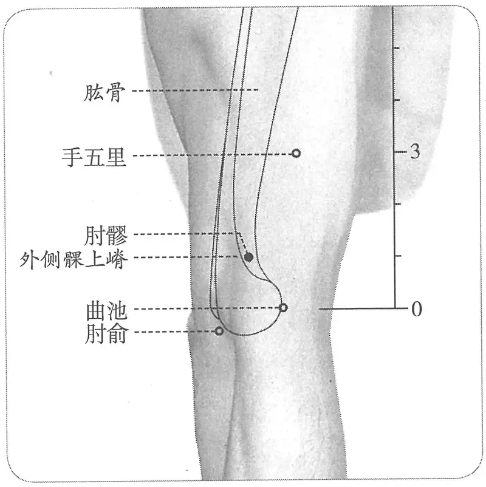

**图2-36　肘髎穴与相关穴图**

　1. 在肘大骨外廉陷者中。（《黄帝明堂经》、《太平圣惠方·明堂》、《铜人腧穴针灸图经》、《圣济总录》、《针灸资生经》、《十四经发挥》、《医学纲目》、《针灸集书》、《针灸聚英》、《古今医统》、《针灸大成》、《类经图翼》、《医宗金鉴·刺灸心法要诀》、《针灸易学》、《针灸逢源》）

　2. 窦太师针灸遗存

　　(1) 在曲池穴横纹尖向出二寸，大骨外廉陷中，用手拱胸取之。（《窦太师针经》）

　　(2) 在曲池横纹头上，向外二寸，大骨外廉陷中，手拱胸取之。（《针方六集》卷一）

　3. 广注肘大骨外廉、就骨略上一二分陷中。一法曲池外一寸罅中……按肘髎当在曲池斜外些，若五里又向里矣。（《循经考穴编》上）

　4. 在肘大骨外廉陷中，与天井并肩而相去一寸四分。（《大本琼瑶神书》、《类经图翼》）

　5. 肘大骨外廉近大筋陷中。（《医学入门》卷一）

　6. 针灸铜人及铜人图

　　(1) 正统铜人、嘉靖铜人：在曲池上外斜一寸、横直天井。

　　(2) 韩国德寿宫铜人、明成化丘氏铜人图：与曲池、五里呈鼎足状——大骨外廉。

　　(3) 光绪铜人、明太医院铜人图、《经穴指掌图》：本穴与曲池、五里在一直线上。

　　(4) 承淡安《重绘人体经穴图》：在曲池、五里之间，略斜向尺侧。

　　(5) 原北京中医学院1965年《针灸经穴挂图》：与曲池、五里呈一等腰三角形，基本与天井穴横平，在肱骨外上髁的内缘陷中，与正统铜人、嘉靖铜人同。

　7. 曲池之外上方约一寸处，大骨外廉陷中。（《针灸十四经穴位考订》）

　8. 统编针灸学教材

　　(1) 部位：在前上膊之下端，肘大骨外廉陷中。取穴：屈肘从曲池穴向外斜上约一寸，当肘关节上侧之处取之。（1957年南京《针灸学》）

　　(2) 部位：曲池穴外上一寸。取穴：屈肘横肱于大骨外廉取之。（1版《针灸学讲义》）

　　(3) 部位：在肘大骨外廉陷者中。取穴：以肘屈置，于肱骨外上髁的上方，曲池外上方一寸，肱骨边缘取穴。（2版《针灸学讲义》）

〔p.226 (인쇄 206)〕

　　(4) 曲肘，曲池穴外上方1寸，肱骨边缘。（4、5、7版《针灸学》）

　　(5) 在臂外侧，曲肘，曲池上方1寸，当肱骨边缘处。（6版《针灸学》）

　　(6) 曲肘时在肱骨外上髁的上方，曲池外上方约1寸，当肱骨内侧缘处。（《中国针灸学》）

**文献分析**：本穴定位的文献记载无分歧，而对于文献的理解存在较大差异。本穴名“肘髎”，所谓“髎”指骨空陷处，定于肱骨外上髁后缘凹陷处正合此意。故曰“肘髎，在曲池横纹头上，向外二寸，大骨外廉陷中，手拱胸取之”（《针方六集》）。“肘髎，在肘大骨外廉陷中，与天井并肩而相去一寸四分”（《大本琼瑶神书》、《类经图翼》）。“小海在肘大骨外去肘端五分，内与少海隔一小肘尖，外与肘髎隔一大肘尖，相去不远，又当知肘髎在曲肘外，曲池在曲肘里，以骨为界”；“内外曲肘二海相对，内曲肘间曰少海，外曲肘间则曰小海。外曲肘间又有二穴相对，小海去肘端五分，肘髎在曲肘外廉陷中相去寸半许”（《针灸秘法全书》）。

以上文献以明代《针灸秘法全书》注解最明确，也更符合《黄帝明堂经》的本义，再从肘关节部腧穴的毗邻关系看，肘关节处的腧穴主要以肘横纹、肱二头肌肌腱和肱骨内外侧髁为标志定位。在肘关节屈侧面，肱二头肌腱两侧凹陷各有一穴，内侧为曲泽，外侧为尺泽；肱骨内侧髁前后缘凹陷也各有一穴，前缘为少海，后缘尺神经沟内为小海；肱骨外侧髁前缘凹陷为曲池，后缘凹陷为肘髎，排列非常有规律。而肘髎与天井穴的关系为：天井在三头肌肌腱的尺侧，肘髎在肌腱的桡侧，二穴相隔一粗大的肌腱。现代将肘髎穴定于曲池的外上方髁上缘髁上嵴处，这种对应关系便不再完整了，而且也完全失去了“凹陷”的特征，徒有“肘髎”之名而无其实了。然而从明正统仿宋针灸铜人上肘髎穴已被标于曲池穴外上方（图2-37），说明宋代官修的针灸腧穴定位标准已作如是理解。《中国针灸学》则言“肱骨内侧缘处”。自第4版《针灸学》，只统言“肱骨边缘”，不言“内”、“外”，1990年版国家标准《经穴部位》同。2006年修订版国家标准定于“髁上嵴的前缘”，实际位置已在肱骨外上髁的内上方（“肘大骨内廉”，而不是古典文献所说的“外廉”）。这种变化更多地是考虑了经脉循行的路径，与上臂手太阴经穴尺泽、侠白、天府定位变化的因素相同。在现代针灸学教材中，1959年原北京中医学院编的《简明针灸学》将本穴明确定于骨外侧凹陷中，与曲池、五里二穴形成鼎足关系，具体取穴法如下：“在肘大骨外廉陷中，与天井相平，当曲池上二寸是五里穴，于两穴正中向外越一骨取穴，肘髎与曲池、五里三穴位如鼎足”。然而，之后的

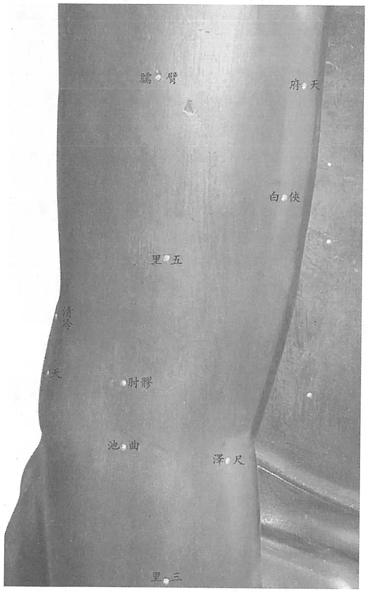

**图2-37　明正统仿宋针灸铜人肘髎穴定位**

〔p.227 (인쇄 207)〕

针灸学教材没有采用这一取穴法，日本人另于原肘髎穴位置另立一穴名曰“肘俞”，主治肘关节病，中国将又将此穴归入“奇穴”，于是《黄帝明堂经》之“肘髎”便名存实亡了。

#### 【类属】 

手阳明大肠经穴。

**归经**：手阳明大肠经。（《产经》、《外台秘要》卷三十九、《铜人腧穴针灸图经》卷上）

#### 【适应症】 

主治局部病症。常用于肘臂痛、麻木、挛急。

　1. 主肩肘节酸重痹痛，不可屈伸。（《黄帝明堂经》）

　2. 主肩臂酸重，不可屈伸，痹麻不仁。（《太平圣惠方·明堂》）

　3. 治肘节风痹，臂痛不可举，屈伸挛急。（《铜人腧穴针灸图经》卷下）

　4. 治肘尖痛，泻；手腕无力，补。（《窦太师针经》）

　5. 主风劳嗜卧，肩重腋急。（《针灸聚英》卷一）

**按**：“风劳嗜卧”系下一穴“五里”的主治病症，高武辑录有误，后世腧穴文献多沿其误，现代针灸学教材除第6版外，皆未受此影响。

　6. 统编针灸学教材

　　(1) 肘臂痛，挛急，麻木不仁。（1957年南京《针灸学》、1版《针灸学讲义》）

　　(2) 肘臂痛，挛急，麻木，肘节风痹。（2版《针灸学讲义》）

　　(3) 肩臂肘酸痛，麻木，挛急。（4、5版《针灸学》、《中国针灸学》）

　　(4) 肘臂部酸痛，麻木，挛急和嗜卧。（6版《针灸学》）

　　(5) 肘臂部疼痛，麻木，挛急等局部病证。（7版《针灸学》）

**文献分析**：本穴主治以局部病症为主，古今文献一致，腧穴与治疗文献记载也相吻合。《黄帝明堂经》本穴主治肘关节病，日本玉森贞助将肘俞穴（实即《黄帝明堂经》之肘髎）用作治疗肘关节病最重要的穴。本穴的现代定位较古代偏桡侧，因而治疗作用也有不同，现代临床应用不广。

#### 【操作】 

直刺0.5~1寸。

　1. 刺入四分，灸三壮。（《黄帝明堂经》）

　2. 灸五壮。（《太平圣惠方·明堂》）

　3. 可灸三壮，针入三分。（《铜人腧穴针灸图经》卷下）

　4. 窦太师针灸遗存

　　(1) 针入一寸半，灸二七壮。（《窦太师针经》、《针方六集》卷一）

　　(2) 一云：可针寸半，灸七壮。（《循经考穴编》上）

　5. 统编针灸学教材

　　(1) 针五至八分，灸三至七壮。（1957年南京《针灸学》、1版《针灸学讲义》）

　　(2) 直刺3~5分，艾条灸3~7分钟。（2版《针灸学讲义》）

　　(3) 直刺0.5~1寸。（4、5、7版《针灸学》）

　　(4) 直刺0.5~1寸；可灸。（6版《针灸学》、《中国针灸学》）

　6. 斜刺，沿肱骨前缘，进针1~1.5寸。感应：局部酸胀。灸3壮；温灸5~10分钟。（上海《针灸学》）

### （十三）手五里 Shǒuwǔlǐ LI13 出《黄帝明堂经》 

问题1：“肘上三寸行向里大脉中央”中之“大脉”如何理解？

问题2：本穴一直是手阳明经穴，为什么从古到今，从中国到日本，皆有主张将本穴归入手太阴经者？

〔p.228 (인쇄 208)〕

问题3：本穴的现代定位距动脉甚远，为何针灸教材却强调刺本穴须“避开动脉”？

#### 【提要索隐】 

在宋以前文献中，本穴名“五里”，而“五里”也常用作脉名，现代针灸学教材每有将二者混同，而致困惑不解。

**穴名**：宋以前文献名“五里”，一作“臂五里”。

**部位**：在臂部，肘横纹上3寸，曲池与肩髃连线上。

**适应症**：主治局部病症。常用于肘臂痛；瘰疬。

**备选适应症**：疟疾。

**针刺操作**：直刺0.5~1寸。

#### 【名实考】 

宋以前文献作“五里”（传世本《针灸甲乙经》有作“手五里”者，系宋以后人所改），与足厥阴肝经穴“五里”同名。至宋代《圣济总录》将本穴名改作“臂五里”，以别于足厥阴肝经穴“五里”。宋代王执中也认为手部五里穴“当为手五里也”。《内经》中以“一里”为一寸，本穴位于天府下五寸，故曰“五里”，与足厥阴经“五里”穴同名。

《内经》中之“五里”为脉名，行于手太阴脉分野，脉动应手，诊五脏气；《黄帝明堂经》之“五里”为穴名，在肘上三寸，手阳明脉气所发。一般而言，由脉演生之穴，多与脉相合，亦有脉、穴分离者，此即一例。长期以来，人们多将五里之穴与五里之脉相混，将五里穴归入手太阴经，刺法中也强调“避开动脉”。

　1. 阴尺动脉在五里，五腧之禁也。（《灵枢·本输》）

　2. 夺阴者死，言取尺之五里五往者也。（《灵枢·小针解》）

　3. 迎之五里，中道而上，五至而已，五注而藏之气尽矣，故五五二十五而竭其俞矣。（《灵枢·玉版》

　4. 大禁二十五，在天府下五寸，王冰注曰：谓五里穴也。所以谓之大禁者，谓其禁不可刺也。《针经》曰：“迎之五里，中道而上，五至而已，五注而藏之气尽矣，故五五二十五而竭其俞矣。盖谓此也。”又曰：“五里者，尺泽之后五里。”与此文同。（《素问·气穴论》王冰注）

**按**：王冰引《针经》经文“五里者，尺泽之后五里”，不见于传世本《灵枢》。

　5. 五里，在肘上三寸，行向里大脉中央，手阳明脉气所发。（《黄帝明堂经》）

　6. 臂五里二穴，在肘上三寸行向里大脉中央。（《圣济总录》）

　7. 五里二穴，在肘上三寸，行向里大脉中央。灸十壮，禁针。王执中按：五里有二，其一在足厥阴肝经部，与此穴为二，此当为手五里也。《素问》所谓在天府下者，指此五里也。注云：尺泽之后五里，亦指此五里也。（《针灸资生经》卷一）

**按**：五里穴在肘上三寸，五里之脉则行向臂内侧。

　8. 肝之经有五里，在阴股之上，大肠之经有五里，在肘之上，名义不可解。（《经穴解》）

　9. 别名　手之五里、尺之五间。（1957年南京《针灸学》）

**按**：尺之五间，未详所出，疑为“尺之五里”之误。

#### 【定位】 

**部位**：在臂部，肘横纹上3寸，曲池与肩髃连线上（图2-38）。

**取穴**：以肘屈置，于曲池与肩髃连线上，当曲池上三寸处取穴。

　1. 《黄帝明堂经》佚文

　　(1) 在肘上三寸，行向里大脉中央。（《针灸甲乙经》卷三、《千金要方》、《千金翼方》、《外台秘要》、《铜人腧穴针灸图经》、《圣济总录》、《针灸资生经》、《十四经发挥》、《医学纲目》、《针灸集书》、《针灸聚英》、《古今医统》、《针灸大成》、《针方六集》、《类经图翼》、《循经考穴编》、《医宗金鉴·刺灸心法要诀》、《针灸易学》、《针灸逢源》）

〔p.229 (인쇄 209)〕

　　(2) 在肘上三寸半。（《医心方》卷二）

**按**：《黄帝内经太素》杨上善引《明堂经》曰“明堂云五里在肘上三寸，行向里大脉中央”，可证《医心方》“三寸半”系“三寸”之误。

　2. 大筋中央寻五里，肘上三寸行向里。（《针灸大全》卷五、《黄帝内经灵枢注证发微》）

**按**：大筋中央，三多斋本作“大脉中央”，是。因为《针灸大全》此歌诀是依据《针灸资生经》经穴定位编写，应与后者的定位描述相合。

　3. 肘上三寸，向里大筋中央。（《医学入门》卷一）

　4. 广注　当在肘斜上二寸五分，以手拱胸取之。（《循经考穴编》上）

　5. 曲池上三寸微向内行。（《针灸十四经穴位考订》）

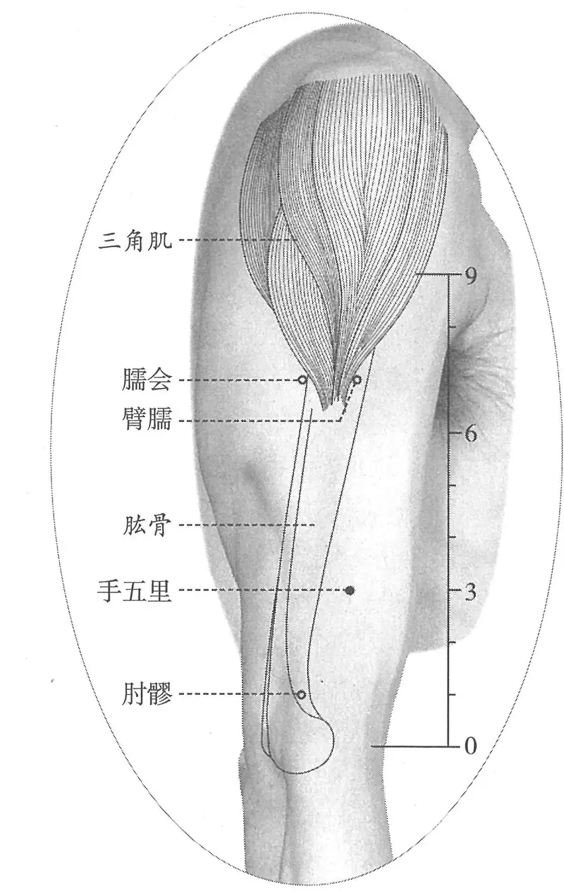

**图2-38　手五里穴图**

　6. 统编针灸学教材

　　(1) 部位：在肘上三寸，行向里大筋中央。取穴：屈肘侧置，从曲池与肩髃成直线，由曲池直上三寸取之。（1957年南京《针灸学》）

　　(2) 部位：曲池穴上三寸。取穴：屈肘横肱，从曲池穴与肩髃穴成直线处取之。（1版《针灸学讲义》）

　　(3) 部位：在肘上三寸。取穴：以肘屈置，于曲池与肩髃连线上，当曲池上三寸取穴。（2版《针灸学讲义》）

　　(4) 在曲池穴与肩髃穴的连线上，曲池穴上3寸处。（4、5、7版《针灸学》）

　　(5) 在臂外侧，当曲池与肩髃连线上，曲池上3寸处。（6版《针灸学》）

　　(6) 在肱骨外上髁上方，曲池与肩髃的连线上，曲池上三寸处。（《中国针灸学》）

**文献分析**：《黄帝明堂经》谓本穴“肘上三寸行向里大脉中央”，如何理解此“大脉”？《灵枢·本输》曰：“阴尺动脉在五里，五腧之禁也。”杨上善注曰：“阳为寸，故阴为尺。阴尺之中五藏动脉在肘上五里，五输大脉之上，《明堂》云：‘五里在肘上三寸，手阳明脉气所发，行向里大脉中央，禁不可刺，灸十壮。左取右，右取左。’大脉，五藏大脉，气输也。故禁刺不禁灸也”。杨上善注《小针解》篇“夺阴者死，言取尺之五里五往者也”曰：“五里在肘上不在尺中，而言尺之五里者，寸为阳，尺为阴也。阴尺动脉动于五里，故曰取尺五里也。五往者五泻也。”又注《气穴论》篇“大禁二十五在天府下五寸”曰：“三百六十五穴中有大禁者五里穴也，在臂天府以下五寸，五五廿五往泻此穴气，气尽而死，故为大禁也。”可见，杨上善将此“大脉”理解为动脉，且与“天府”同属一脉。而肘上表浅之大动脉行于肱二头肌内侧沟（较之“大筋中央”还要靠里），与手阳明经相隔“手太阴”、“手厥阴”两条经。此说难以理解，故明代医家将《针灸大全》“大脉中央”改作“大筋中央”，现代针灸学教材也受其影响。而所谓“大筋中央”即肱二头肌肌腹中央，乃手厥阴经行处，与手阳明经仍然相隔很远。这里首先要澄清一个问题：不能将“穴”与“脉”混同。由于在早期“穴”与“脉”的关系十分紧密，概念内涵也相同，而当经脉学说、络脉学说形成后，二者内涵发生明显变化，《黄帝明堂经》编者在总结汉以前腧穴时，难免会将这些不同内涵的内容不加分别地辑录，最典型的例子如“委阳，三焦下辅俞也。在足太阳之前，少阳之后，出于腘中外廉两筋间，扶承下六寸，此足太阳之别络也。”这里将络穴与络脉的文字不加说明地辑于一处，引起了后世的许多误解（详见本书引论），同样的例子也见于手阳明经“下廉”和本穴。作为穴位，五里“在肘上三寸”，作为脉，则向里行至大脉。现代将此穴仍定位于上臂的手阳明经线上，而针灸学教材在刺灸法下仍强调“避开动脉”，可见杨上善观点的影响仍然存在于人们的潜意识中。

〔p.230 (인쇄 210)〕

#### 【类属】 

手阳明大肠经穴。

手阳明脉气所发。（《黄帝明堂经》）

**按**：关于本穴的归经，有不同意见，如日本《挨穴资蒙》（1835年）等文献将本穴归入手太阴经。这是由于没有分清“脉”与“穴”的关系。

#### 【适应症】 

主治局部病症。常用于肘臂痛；瘰疬。

**备选适应症**：疟疾。

　1. 主痎疟，心下胀满痛，上气。寒热，颈疬适，咳，呼吸难。嗜卧，四肢不欲动摇，身体黄。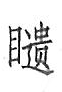目，目䀮䀮，少气。（《黄帝明堂经》）

**按**：“嗜卧，四肢不欲动摇，身体黄”与天井穴主治症“嗜卧怠惰不欲动，身常湿湿”、三阳络穴主治“嗜卧，身体不能动摇，大温（一本作湿）内伤不足”相似。又据《伤寒论》阳明中风证“阳明中风，脉弦浮大而短气，腹都满，胁下及心痛，久按之气不通，鼻干不得汗，嗜卧，一身及目悉黄，小便难，有潮热，时时哕，耳前后肿。刺之小差，外不解。病过十日，脉续浮者，与小柴胡汤”，则上条主治中的“少气，心下胀满痛，上气”等症均属于同一组病症。

　2. 主风劳，惊恐，久吐血，肘不欲举，风痫。（《外台秘要》卷三十九）

　3. 治风劳，惊恐，吐血，肘臂痛，嗜卧，四肢不得动摇，寒热瘰疬，咳嗽，目视䀮䀮，痎疟，心下胀满。（《铜人腧穴针灸图经》卷下）

　4. 主一切风湿肿滞，臂膊疼痛不举。（《循经考穴编》上）

　5. 统编针灸学教材

　　(1) 肘臂疼痛不举，瘰疬。（1957年南京《针灸学》、1版《针灸学讲义》、4、5版《针灸学》）

　　(2) 肘臂挛痛、疼痛，瘰疬。（2版《针灸学讲义》、6版《针灸学》）

　　(3) 肘臂挛痛，瘰疬。（7版《针灸学》、《中国针灸学》）

**文献分析**：《黄帝明堂经》载本穴主治包括嗜卧，瘰疬和目疾，后世临床应用集中在肘臂局部病症和瘰疬。

#### 附：临床应用举例 

　1. 一切瘰疬……又灸五里、人迎各三十壮。（《千金要方》卷二十三）

　2. 盗汗，阴都、五里、间使。（《医学纲目》卷十七）

#### 【操作】 

直刺0.5~1寸。

〔p.231 (인쇄 211)〕

　1. 禁不可刺，灸十壮。左取右，右取左。（《黄帝明堂经》）

　2. 可灸十壮，禁不可针。（《铜人腧穴针灸图经》卷下）

　3. 窦太师针灸遗存

　　(1) 灸二七壮，禁针，不宜灸多。（《窦太师针经》）

　　(2) 灸七壮，不可针。（《窦太师秘传》）

　　(3) 禁针，灸三壮。（《琼瑶神书》）

　4. 禁针。灸七壮。（《针灸十四经穴位考订》）

　5. 统编针灸学教材

　　(1) 灸七至十五壮。（1957年南京《针灸学》、1版《针灸学讲义》）

　　(2) 艾条灸5~10分钟。（2版《针灸学讲义》）

　　(3) 避开动脉，直刺0.5~1寸。（4、5、7版《针灸学》、《中国针灸学》）

　　(4) 直刺0.8~1寸；可灸。（6版《针灸学》）

**文献分析**：古代文献所说“禁针”当是针对“五里”之脉而言。而根据教材对本穴的定位，已经离动脉甚远，谈不上“避开动脉”，所以言此，乃是将“五里”穴与“五里”脉相混同。

### （十四）臂臑 Bìnào LI14 出《黄帝明堂经》 

问题1：臂臑与天府如何结下不解之缘？

问题2：臂臑治目疾的临床报道从何而来？

#### 【提要索隐】 

“臂臑”，既是部位名，也是穴名。唐代《千金翼方》将“天府”取穴法注作“臂臑”，致使后世对于此二穴多有混淆而不自知。

**穴名**：一名颈（头）冲；一名臂脑。

**部位**：在臂部，曲池上7寸，三角肌前缘处。

**适应症**：主治局部病症。常用于肩臂痛、活动受限；瘰疬。心脏手术针麻用穴。

**备选主治症**：眼病。

**针刺操作**：直刺0.8~1.5寸。

#### 【名实考】 

本穴在肩前上臂䐃肉端，因名“臂臑”。“臂臑”之名见《素问·至真要大论》，《灵枢·经脉》作“臑臂”，义同，均指部位名，而非穴名。《外台秘要》卷三引《深师方》灸方载有“取臂脉法”内容（相关内容又见于敦煌卷子佚名灸方）：“又疗脉浮大，鼻中燥，如此必去血鼻衄方。灸两臂中脉取止。取臂脉法，以鼻嗅臂，点其鼻所著处是穴，两臂皆尔。”这里虽没有指明穴名，但根据主治病症及“取臂脉”的提示，符合天府穴的特征，故宋代王惟一编订《铜人腧穴针灸图经》时，特于天府穴下增加了相关的取穴法内容。而在《千金要方》提到相关取穴法内容时注明的具体的穴名“头冲”，至《千金翼方》又另注有“一名臂臑”四字，加上《黄帝明堂经》天府穴定位文字作“在腋下三寸，臂臑内廉动脉中”（这里的“臂臑”是部位名，而不是穴名），这样“臂臑”和“天府”这两个原本分属不同经的不同穴位便不知不觉地被混淆了。

关于臂臑之“臑”的读音，《灵枢·痈疽》有两个注音：臑，奴到切，又音儒。《素问》注音也有两个：人朱切、奴到切。《医心方》卷二明确说明了这两个注音使用的不同场合：表示臂节之义时，读“奴到反”；表示煮热之义时，读“如之反”。明代马莳《黄帝内经素问注证发微·气穴论》也明确注曰：“臑，奴到反。”现代穴名标准从之，近来有人提出不同的意见[^23-1]。

〔p.232 (인쇄 212)〕

　1. 臂臑，在肘上七寸䐃肉端，手阳明络会。（《黄帝明堂经》）

　2. 臂臑，在肘上七寸。杨上善注曰：肩下肘上䐃肉高处谓之臑也，䐃肉在臂，故曰臂臑。（《黄帝内经明堂》，转引自《医家千字文》）

　3. 杨上善注　肩前臂上䐃肉名臑。（《黄帝内经太素·痈疽》）

　4. 臑，谓肩肘之间也。（五卷本《铜人腧穴针灸图经》卷一）

　5. 肘之里肉曰臑，此穴在肘臑相交之处，故曰臂臑。（《经穴解》）

　6. 头冲（一作颈冲），头冲在伸两手直向前，令臂着头对鼻所注处灸之，各随年壮。（《千金要方》卷二十四）

　7. 颈冲在两伸手直向前，令臂着头对鼻所住处，一名臂臑，灸随年壮。（《千金翼方》卷二十八）

**“臂臑”、“臑俞”相混例**

寒热，颈疬适，肩臂不可举，臂臑俞主之。（《针灸甲乙经》卷八第一）

**按**：《针灸甲乙经》卷三无“臂臑俞”之名，根据本条病症在原篇中的位置，若作“臑俞主之”，则与《针灸甲乙经》取穴体例不合，今人则改作“臂臑、臑俞主之”，仍与其取穴体例不合。《医心方》中，此症乃“臂臑”所主，与《针灸甲乙经》取穴体例正合。那么《针灸甲乙经》中此症“臂臑”穴后，何以多一“俞”字？盖因古人误将上文中“臂臑”之“臂”字属上读，剩“臑”字不成穴，遂补一“俞”字。今《针灸甲乙经》中，“肩痛不可举”又误作“肩臂不可举”，则此下“臂”字只能属下读，而成为“臂臑俞”，今人以其不成穴，而臆改作“臂臑、臑俞主之”。

#### 相关穴及刺激点 

见明穴　位于上臂外上方，三角肌后缘，三角肌止点后上五分处。主治眼病，上肢麻痹、瘫痪。针向上斜刺2~3寸。（《针灸经外奇穴图谱（续集）》）

#### 【定位】 

**部位**：在臂部，曲池上7寸，三角肌前缘处（图2-39）。

**取穴**：曲池与肩髃连线上，肩髃下3寸，三角肌前下缘取穴。

　1. 在肘上七寸，䐃肉端。（《黄帝明堂经》、《铜人腧穴针灸图经》卷下、《圣济总录》、《十四经发挥》、《医学纲目》、《针方六集》）

　2. 在肘上七寸。（《铜人腧穴针灸图经》卷上及卷下“穴腧都数”）

　3. 甄权《针经》佚文

　　(1) 在肩髃下一夫，两筋两骨罅陷者宛宛中是也。……其穴平手取之，不得拏

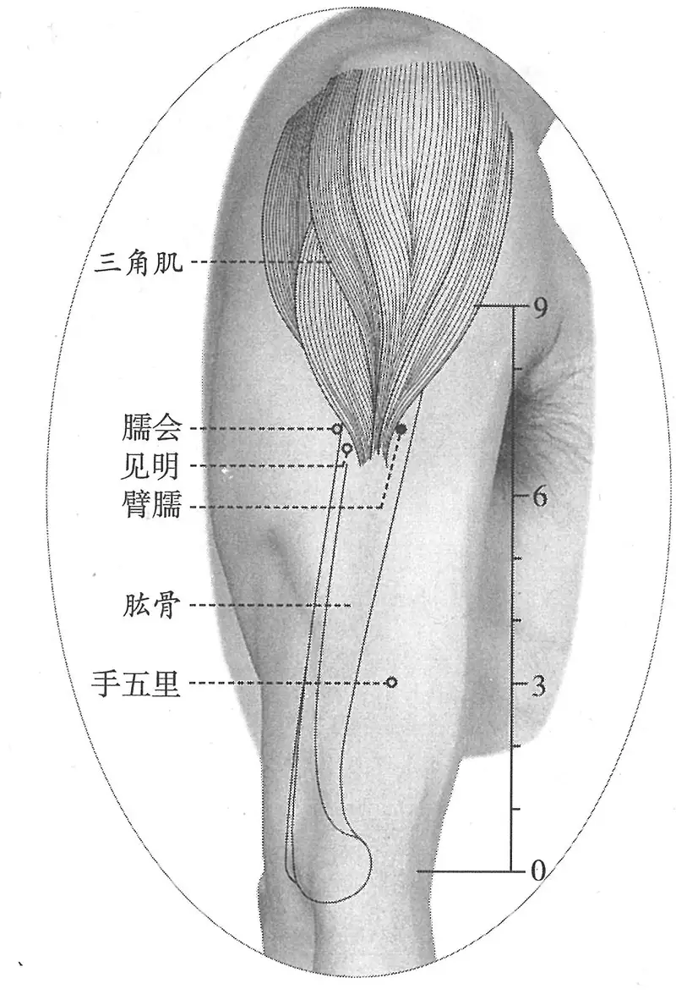

**图2-39　臂臑穴与相关穴图**

[^23-1]: 张德英，李文丽．关于穴位名称中“臑”的读音．中国针灸[J]，2006，28(8)：609-610

〔p.233 (인쇄 213)〕

手令急，其穴即闭。（《太平圣惠方·针经》、《针灸资生经》、《针灸集书》）

　　(2) 在肘上七寸䐃肉端，肩髃下一寸，两筋两骨罅陷宛宛中，平手取之。（《针灸聚英》、《古今医统》、《医学入门》、《针灸大成》、《类经图翼》、《医宗金鉴·刺灸心法要诀》、《针灸易学》、《针灸逢源》）

　　(3) 在肘上七寸䐃肉端。广注：合居肩髃下一寸，䐃端斜缝，两筋骨罅间，举臂平肩有凹，不得努力，努即穴闭……按臂臑较五里又向外，当从肩髃两筋间取之。（《循经考穴编》上）

**按**：以上后两条文献均将《太平圣惠方》“肩髃下一夫”误作“肩髃下一寸”。

　4. 头冲，在伸两手直向前，令臂著头对鼻所注处。一名臂臑。（《千金要方》卷二十四、《千金翼方》）

**按**：相似的取穴法又见于“天府”穴。

　5. 曲池上七寸。（《针灸十四经穴位考订》）

　6. 统编针灸学教材

　　(1) 部位：肘上七寸，䐃肉端。取穴：屈肘侧置，从曲池直上七寸对肩髃穴，当三角肌停止部取之。（1957年南京《针灸学》）

　　(2) 部位：曲池穴上七寸。取穴：屈肘横肱于曲池穴与肩髃穴线上䐃肉端取之。（1版《针灸学讲义》）

　　(3) 部位：肘上七寸，䐃肉端。取穴：垂臂屈肘，在肱骨外侧三角肌下端，当曲池与肩髃的连线上取穴。（2版《针灸学讲义》）

　　(4) 在曲池穴与肩髃穴的连线上，曲池穴上7寸，当三角肌下端。（4、5版《针灸学》）

　　(5) 在臂外侧，三角肌止点处，当曲池与肩髃连线上，曲池上7寸。（6版《针灸学》）

　　(6) 在曲池穴与肩髃穴连线上，曲池穴上7寸，三角肌止点处。（7版《针灸学》）

　　(7) 在曲池穴与肩髃穴的连线上，曲池上7寸，当肱骨外侧，当三角肌下端的上方。（《中国针灸学》）

**文献分析**：《黄帝明堂经》谓本穴“在肘上七寸，䐃肉端”，杨上善注曰：“䐃肉，谓分肉块也”（转引自《医心方》卷二）；又曰：“䐃，臑等块肉也”（《黄帝内经太素·十二水》杨上善注）；“肩前臂上䐃肉名臑”（《黄帝内经太素·痈疽》）。据以上可知“䐃肉端”即指肩下三角肌下端，故本穴定位采用表面解剖标志表述为“在臂部，曲池（LI11）上7寸，三角肌前缘处”。后世医家或不详“䐃肉端”之义，别以折量分寸定位，不及《黄帝明堂经》表述精当。《太平圣惠方》引甄权文作“在肩髃下一夫，两筋两骨罅陷者宛宛中是也……其穴平手取之，不得拏手令急，其穴即闭”，疑“两筋两骨”前脱“肩髃”二字，因为以下文字乃肩髃穴取穴内容。后人不辨，皆传其误。

关于此穴的折量定位，《黄帝明堂经》从下往上数作“肘上七寸”，而《太平圣惠方》引甄权《针经》则从上往下数作“肩髃下一夫”，由于二者关于上臂的折量尺寸不明确，而难以比较二说之异同。但既言明体表解剖标志“䐃肉端”，则当以此为准定穴。日本江户时期以下针灸文献多依此，将肩髃到曲池的骨度折作“一尺”，中国在统编针灸学教材之前，针灸书如承淡安《中国针灸学》、《针灸十四经穴位考订》等亦循此说。

#### 【类属】 

手阳明大肠经穴。

　1. 手阳明络会。（《黄帝明堂经》、《外台秘要》）

　2. 手阳明络。（《铜人腧穴针灸图经》卷下）

〔p.234 (인쇄 214)〕

　3. 手阳明络，手足太阳、阳维之会。（《针灸聚英》卷一）

　4. 归经　手阳明大肠经。（《产经》、《外台秘要》卷三十九、《铜人腧穴针灸图经》卷上）

#### 【适应症】 

主治局部病症。常用于肩臂痛、活动受限；瘰疬。心脏手术针麻用穴。

**备选主治症**：眼病。

　1. 主寒热，颈疬适，肩痛不可举。（《外台秘要》卷三十九、《医心方》）

**按**：疬适，即瘰疬。

　2. 劳瘿，臂细无力，手不得上头。（《太平圣惠方·针经》）

　3. 治寒热，颈项拘急，瘰疬，肩背痛不得举。（《铜人腧穴针灸图经》卷下）

**按**：此条主治系从《黄帝明堂经》原文翻译而来，其“颈疬适”即瘰疬，译为“颈项拘急，瘰疬”，欠妥。

　4. 统编针灸学教材

　　(1) 项强，臂痛不举，瘰疬。（1957年南京《针灸学》、1版《针灸学讲义》）

　　(2) 肘臂疼痛不举，颈项拘急，瘰疬。（2版《针灸学讲义》、《中国针灸学》）

　　(3) 肩臂痛，颈项拘急，瘰疬，目疾。（4、5、6版《针灸学》）

　　(4) 肩臂疼痛不遂，颈项拘挛等肩、颈项病证，瘰疬，目疾。（7版《针灸学》）

**文献分析**：本穴主治，古今腧穴文献记载一致，均集中于肩臂病症及瘰疬，并与古今针灸临床应用相吻合。值得注意的是本穴主治眼病的记载。第4、5、6、7版针灸教材皆录有“目疾”一症，老中医临床也有类似经验，一些新兴疗法如有效点疗法、穴区带疗法也有应用。在此之前，1959年《常用经穴解剖学定位》谓本穴主治肩臂酸痛，眼部疾患，同年出版的《民间灵验便方》（第二集）记有详细的临床应用。1961年《针灸学中级讲义》载本穴主治作“颈项拘急，臂痛，瘰疬，目疾”，而相同编写人员编纂、同一年出版的高等教材《针灸学讲义》却独不见“目疾”一症，令人费解。

关于臂臑穴主治，经考察，相关记载又见于《常用新医疗法手册》，名曰“见明”，主治眼病，刺法也相同。那么当代应用臂臑穴治目疾的经验从何而来呢？下述“临床应用举例”前3首方的取穴原本皆系取天府穴法，主治病症也均系天府穴主治。金元窦太师以天府“治一切目疾”，而《千金翼方》谓此取穴法为“臂臑”，后世取臂臑穴治眼疾是否直接或间接源于此，有待进一步考察。更重要的是从临床上进行如下观察以助判断：以臂臑穴治目疾是否有效？与天府穴相比，有效的程度是否相当或更高？

有意思的是，第2、3版针灸学教材臑会穴主治中也有“目疾”一症，同样所出不详，不知是否受上述“天府”穴与“臂臑”混淆的连带影响，还是“臂臑”穴主治的错入？

#### 附：临床应用举例 

　1. 诸瘿……又灸头冲一作颈冲。头冲在两伸手直向前，令臂着头对鼻所住处灸之各随年壮。（《千金要方》卷二十四）

　2. 灸瘿法　灸……又颈冲在两伸手直向前，令臂著头对鼻所住处，一名臂臑，灸随年壮。（《千金翼方》卷二十八）

**按**：以上取穴法内容一般理解为取天府穴法，《千金要方》卷二十四、《千金翼方》也明确载有“瘿，恶气，灸天府五十壮”灸方。但这里《千金翼方》却注明“一名臂臑”字样，不明何人所注，也不详有何依据。若以此取法为“臂臑”，则至少应当说明“手臂侧平举向鼻”取之。

　3. 合眼中翳方……又方：灸两膊上大脉，以病人抬手，当孔血点脉处。（敦煌卷子医方P3930）

**按**：“孔血”当作“孔穴”，即鼻孔。此方所取穴即天府穴。《外台秘要·天行衄血方四首》卷三载“取臂脉法：以鼻嗅臂，点其鼻尖所著处是穴，两臂皆尔”，与此方取法同。

〔p.235 (인쇄 215)〕

　4. 主穴臂臑，配穴太阳、睛明、阳白、大陵、光明、肝俞，治急性结膜炎。[四川中医，1985，3(8)：31]

　5. 肩胛上神经卡压综合征，取秉风、臂臑穴，两穴均不可深刺，进针得气后作提插捻转，再留针30分钟。[浙江中医杂志，2001(9)：392]

#### 【操作】 

直刺0.8~1.5寸。

　1. 刺入三分，灸三壮。（《黄帝明堂经》）

　2. 宜灸不宜针，日灸七壮，至一百壮……若针，不得过三五分，过多恐恶。慎冷食滑菜盐醋冷浆水等。（《太平圣惠方·针经》）

　3. 针入五分，灸三壮。（《医学入门》卷一）

　4. 灸七壮。针三分，不宜深。（《针灸逢源》）

　5. 统编针灸学教材

　　(1) 针三至五分，不宜深刺，灸七壮。（1957年南京《针灸学》）

　　(2) 针三至五分，灸七壮。（1版《针灸学讲义》）

　　(3) 直刺或向上斜刺5~7分，艾条灸5~10分钟。（2版《针灸学讲义》）

　　(4) 直刺或向上斜刺0.8~1.5寸。（4、5、7版《针灸学》）

　　(5) 直刺或向上斜刺0.8~1.5寸；可灸。（6版《针灸学》、《中国针灸学》）

　6. ①直刺0.5~1寸；也可向肱骨前后缘透刺，进针1~1.5寸。感应：局部酸胀。②斜刺，治眼病时向上透入三角肌中，深1~2寸。感应：局部酸胀。灸3~7壮；温灸5~15分钟。（上海《针灸学》）

### （十五）肩髃 Jiānyú LI15 出《黄帝明堂经》 

问题：古代文献关于本穴取穴要求“举臂取之”，其解剖学基础如何？

#### 【提要索隐】 

**部位**：在三角肌区，肩峰外侧缘前端与肱骨大结节两骨间凹陷中。

**适应症**：主治局部病症。常用于上肢不遂，肩臂痛；风疹。

**针刺操作**：直刺0.8~1.5寸。

#### 【名实考】 

一名扁骨；一名髃骨；一名中肩井。

肩髃，既是部位名，也是穴名。作为部位，是指肩端高骨，即肩角也。《灵枢》多次出现“肩髃”一词，但从上下文考，当指部位名，而非穴名。本穴从其部位而得名。

关于本穴定位，《素问·骨空论》有灸“举臂肩上陷者”，王冰注作“肩髃穴也”。《千金翼方》、《太平圣惠方》取穴肩髃穴正是“平手取之”。说明古人很早就掌握了显示肩峰前外侧凹陷的方法。现代人体测量学上“肩峰点”恰好相当于“肩髃”穴的位置，其确定肩峰点的方法与中医几千年前的方法完全相同。

　1. 上肩出髃前廉，杨上善注曰：髃，音隅，角也，两肩端高骨即肩角也。（《黄帝内经太素·经脉连环》

　2. 杨上善注曰：肩端之骨名肩髃。（《黄帝内经太素·经筋》）

　3. 云门、髃骨、委中、髓空，此八者，以泻四肢之热也。王冰注：验今《明堂》、《中诰图经》不载髃骨穴，寻其穴以泻四肢之热，恐是肩髃穴，穴在肩端两骨间。（《素问·水热穴论》王冰注）

〔p.236 (인쇄 216)〕

**按**：元代《针经摘英集》引此方时，将“髃骨”一穴直接写作“肩髃”。

　4. 肩髃，在肩端两骨间，手阳明、𫏋脉之会。（《黄帝明堂经》）

　5. 扁骨二穴，在肩端上两骨间陷者中。（《太平圣惠方·明堂》）

**按**：这是对肩峰外形特征的形象描述。

　6. 肩髃，在肩端两骨间。脉极篇云：在肩外头近后，以手按之，有解宛宛中。《外台》名扁骨。（《千金要方》卷二十九）

　7. 肩髃之名扁骨，见于《外台》。（《针灸资生经》卷二）

**按**：传世本《外台秘要》未见“扁骨”一名，而见于《太平圣惠方》。

　8. 《千》云肩头正中两骨间，一名中肩井；《外台》名扁骨。（《针灸资生经》卷一）

**按**：传世本及未经宋人校本《千金要方》、《千金翼方》均未见“中肩井”之名。

　9. 髃骨，谓肩髃之骨也，故肩髃穴在此髃骨之端，故亦名髃骨。（五卷本《铜人腧穴针灸图经》）

　10. 此穴正在肩端上，故曰肩髃。（《经穴解》）

　11. 别名　肩尖、肩骨、中肩井、偏骨、髃骨。（1957年南京《针灸学》）

**文献分析**：《针灸学》所载之别名间接引自日本教材，其中“肩尖”云出《外科枢要》，实则定位与本穴有差异；“肩骨”未详所出。故本穴别名只录“扁骨”、“中肩井”、“髃骨”三者。

**相关穴与刺激点**

　1. 肩髎　在三角肌区，肩峰角与肱骨大结节两骨间凹陷中。主治肩痛、活动受限。直刺1~1.5寸。

　2. 髃前　位于肩部，肩胛骨喙突外上方陷中。在肩髃穴斜上前约1寸陷中。主治上臂神经痛、手不能高举。针5~8分，得气时局部有酸胀感。灸3~7壮。（《针灸经外奇穴图谱》）

　3. 内肩髃　位于肩部，肩峰向内1寸近肩胛骨之肩胛冈。在肩髃穴向内平开1寸，当肩胛内侧处。主治肩关节炎，半身不遂。针5~8分。灸3~7壮。（《针灸经外奇穴图谱》）

　4. 前肩髃　位于肩部，肩峰向内1寸处。在肩髃穴向内平开1寸处。主治肩关节痛。针6~8分，得气时麻酸感觉至局部。灸3~7壮。（《针灸经外奇穴图谱》）

　5. 肩尖　位于肩部，肩锁关节之凹陷中。在肩髃穴内上方。主治瘰、囊痛、三角肌麻痹、肩关节运动障碍、上臂麻痹或疼痛。（《针灸经外奇穴图谱》）

　6. 肩俞　位于肩部，肩峰关节与肩胛骨喙突内侧凹陷连线中点。取穴：在肩髃与云门穴中间。主治肩臂痛不举。针2~7分。灸3~5壮。（《针灸经外奇穴图谱》）

　7. 肩内俞　位于肩前部，肩峰与肩胛骨喙突内侧凹陷连线之中点下一寸。主治肩臂痛不举。针3~7分。灸3~5壮。（《针灸经外奇穴图谱》）

　8. 肩内陵　位于肩部腋前皱襞之上方肩锁关节内侧凹陷与腋前皱襞连线之中点。巨骨穴与腋前皱襞连线之间。主治上臂内侧痛。针3~5分；得气时局部有酸麻感觉。灸5~7壮。（《针灸经外奇穴图谱》）

　9. 年府　锁骨肩峰端前下方。主治肩痛。针3~5分，针感局部胀。灸3~5壮。（《针灸经外奇穴图谱（续集）》）

　10. 治瘫1　位于肩部，肩锁关节，锁骨头下方凹陷处。在肩髃穴之前内侧。主治瘫痪。针5分~1寸。针感局部胀、麻。灸3~5壮。（《针灸经外奇穴图谱（续集）》）

〔p.237 (인쇄 217)〕

　11. 腋神经刺激点三角肌点（中点）　位于肩峰与三角肌止点连线的中点。主治上肢瘫痪抬肩障碍，举臂障碍。直刺2.0~3.0cm。（《实用神经干电刺激疗法》）

**按**：上述髃前与肩俞，前肩髃与内肩髃，肩尖与巨骨，年府与治瘫1四组穴，根据其定位描述，并在人体实际点取，实为4对相同的穴，之所以演变为4组不同的穴，皆因所出不同，穴名各异，而后人不加考辨地直接引录所致。

#### 【定位】 

**部位**：在三角肌区，肩峰外侧缘前端与肱骨大结节两骨间凹陷中（图2-40）。

**取穴**：屈臂外展，肩峰外侧缘前后端呈现两个凹陷，前一个较深凹陷即为本穴，后一个凹陷为肩髎穴。

#### 相关解剖学基础 

肩峰的结构与相关术语：肩峰（acromion）为肩胛冈外侧端的扁平突起，几乎以直角（略大于90°）从肩胛冈外侧端突向前，有上下两面及内外两缘。上面粗糙凸隆，向后上略偏外方，为三角肌的附着处。下面光滑凹陷，向前下略偏内方。内侧缘较短，其前端有一向内上方的卵圆形关节面，称为肩峰关节面（articular facet of acromion），其与锁骨的肩峰关节面形成关节。外侧缘肥厚而凸隆，肩峰肩胛冈嵴的下缘与肩峰的外侧缘在肩峰角acromial angle）处相续。肩峰内外二缘均移行于肩胛冈的游离缘。

**按**：需要特别指出的是，国内外针灸学教材对于肩关节处腧穴的定位，使用的肩峰部分的解剖学术语大多不准确，故未能准确地表明相关腧穴的正确位置。

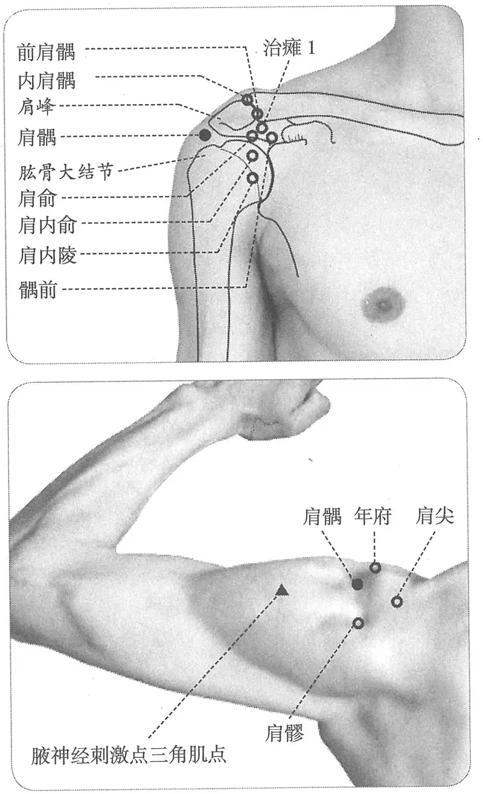

**图2-40　肩髃穴与相关穴及刺激点**

　1. 在肩端两骨间。（《黄帝明堂经》、《铜人腧穴针灸图经》卷上）

　2. 甄权《针经》佚文

　　(1) 在膊骨头陷中，平手取之。（《千金翼方》卷二十六）

　　(2) 在膊骨头肩端两骨间陷者宛宛中是也，平手取其穴。（《太平圣惠方·针经》、《针灸资生经》）

　　(3) 在肩端两骨间陷者宛宛中，举臂取之。（《铜人腧穴针灸图经》卷中、《圣济总录》、《十四经发挥》、《神应经》、《针灸聚英》、《古今医统》、《医学入门》、《针灸大成》、《针方六集》、《类经图翼》、《循经考穴编》、《医宗金鉴·刺灸心法要诀》、《针灸易学》、《针灸逢源》）

　　(4) 膊骨端上两骨罅间，举臂平肩陷中一云当微前些。下直对曲肘缝尖。须搁臂纵手，或转手插腰。（《循经考穴编》上）

〔p.238 (인쇄 218)〕

　3. 在肩端凸骨间陷宛宛中，举臂取之。（《医学纲目》卷八）

　4. 针灸方腧穴定位

　　(1) 穴在两肩头正中两骨间陷者中是。（《千金要方》卷八、《外台秘要》）

　　(2) 在肩外头近后，以手按之有解宛宛中。（《千金要方》卷十三、《千金翼方》）

　5. 肩端骨下筋间，举臂有空处。（《针灸十四经穴位考订》）

　6. 统编针灸学教材

　　(1) 部位：肩端两骨间陷中，举臂有空。取穴：以手臂平举，于肩端之上膊骨与锁骨外端之关节间空陷中央取之。（1957年南京《针灸学》）

**按**：“肩端之上膊骨与锁骨外端之关节间”，这种表述不好理解，如果是指“肩锁关节”，则太偏向内后方。此乃间接受日本《高等针灸学讲义》的影响。

　　(2) 部位：肩端两骨间陷中。取穴：举臂时，肩部出现前后两个凹陷，于前一凹陷中取之。（1版《针灸学讲义》）

　　(3) 部位：在肩端两骨间。取穴：在肩峰与肱骨大结节间，三角肌上部中央。上臂外展至水平位时，当肩峰锁骨关节外部出现二个凹陷，在前方小凹陷中取之。（2版《针灸学讲义》）

　　(4) 三角肌上部，肩峰与肱骨大结节之间，上臂外展平举时肩前呈现凹陷处。（4版《针灸学》）

　　(5) 肩峰端下缘，当肩峰与肱骨大结节之间，三角肌上部中央。肩平举时，肩部出现两个凹陷，前方的凹陷中。（5版《针灸学》）

　　(6) 在肩部，三角肌上，肩外展或向前平伸时，当肩峰前下方凹陷处。（6版《针灸学》）

　　(7) 肩峰端下缘，当肩峰与肱骨大结节之间，三角肌上部中央。臂外展或平举时，肩部出现两个凹陷，当肩峰前下方凹陷中。（7版《针灸学》）

　　(8) 肩峰前下方，三角肌的上部，上臂外展平举时、肩前呈现凹陷处。（《中国针灸学》）

**文献分析**：关于“肩髃”、“肩髎”穴的部位，古今文献均无分歧，自古以来对于这两个穴的定位都是直接以这两个体表凹陷描述，直到第一版国家标准文本《经穴部位》仍然如此：

肩髃：在肩部，三角肌上，臂外展，或向前平伸时，当肩峰前下方凹陷处。

肩髎：在肩部，肩髃后方，当臂外展时，于肩峰后下方呈现凹陷处。

然而这样的描述实际上是具体的取穴技法，而不是有关腧穴部位的规范定义，作为临床取穴没有问题，但作为一种国家标准或国际标准的文本，必须对这两个凹陷给出解剖学的描述。然而令人遗憾的是，肩部这两个对于针灸学非常重要的凹陷却并没有引起解剖学家的重视，迄今没有关于这两个凹陷的解剖学描述。

对肩部这两个凹陷的研究方法理应是：首先通过表面解剖学的方法探明这两个凹陷与覆盖肩关节的三角肌三个肌束之间的位置关系，并通过影像学的方法考查肌性标志与骨性标志的对应关系。

　1. 表面解剖学实验　通过表面解剖学的方法实验发现，当肩外展时，前一个凹陷（肩髃）恰好相当于三角肌肩峰束（又称“中束”）与三角肌锁骨束（又称“前束”）之间，而后一个凹陷（肩髎）则位于三角肌肩峰束与肩胛束（后束）之间。于是，在国际标准草案第一稿中，对于“肩髃”、“肩髎”二穴位置作如下表述：

〔p.239 (인쇄 219)〕

肩髃：在肩峰外侧缘，三角肌前束与三角肌中束附着点之间的凹陷处。

肩髎：在肩峰外侧缘，三角肌后束与三角肌中束附着点之间的凹陷处。

应当说这是一个非常规范的解剖学表达，然而很快就出现了新的问题：第一，在某些肌肉不发达的被检查者，肩外展时不能清楚地显现出两个凹陷；第二，古典文献对于肩部这两个穴的位置是用骨性标志描述的，应当优先采用骨性标志定位。因此，需要进一步考察肩部的这两个凹陷与深层的骨性标志的位置关系。表面触诊的结果表明：三角肌前束与三角肌中束所形成的前一个凹陷位于肩峰外侧缘的前端，即人体测量学上的“肩峰点”；三角肌后束与三角肌中束所形成的后一个凹陷恰好在肩峰角前。随后将表面解剖学实验结果进行了影像学的检验。

　2. 影像学实验　令被检查者肩外展，显现肩部的两个凹陷，用两个小金属片贴在凹陷中，然后保持相同的体位，在直接数字放射成像系统（Direct Digital Radiography Machine）下拍摄。

结果：前一个凹陷位于肩峰外侧缘的前端（正相当于现代人体测量学上的“肩峰点”），后一个凹陷在肩峰外侧缘的后端（正当肩峰角前），与表面解剖学实验结果完全吻合（图2-41）。

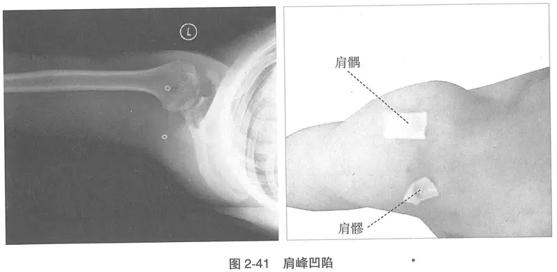

**图2-41　肩峰凹陷**

于是最终的国际标准《经穴部位》草案将肩髃、肩髎穴的定位描述改为：

肩髃（LI15）　在三角肌区，肩峰外侧缘前端与肱骨大结节两骨间凹陷中。

注：屈臂外展，肩峰外侧缘前后端呈现两个凹陷，前一较深凹陷即本穴，后一凹陷为肩髎（TE14）。

肩髎（TE14）　在三角肌区，肩峰角与肱骨大结节两骨间凹陷中。

注：屈臂外展时，肩峰外侧缘前后端呈现两个凹陷，前一较深凹陷为肩髃（LI15），后一凹陷即本穴。垂肩时，肩髃（LI15）后约1寸。

这样的表述，既符合现代解剖学的规范，又符合古典针灸文献的本义。

#### 【类属】 

手阳明大肠经穴。

**脉气所发**：手阳明、𫏋脉之会。（《黄帝明堂经》、《外台秘要》）

**归经**：手阳明大肠经。（《千金要方》卷二十九、《铜人腧穴针灸图经》卷上）

#### 【适应症】 

主治局部病症。常用于上肢不遂，肩臂痛；风疹。

〔p.240 (인쇄 220)〕

　1. 主肩中热，指痹臂痛。（《黄帝明堂经》）

　2. 主偏风，半身不遂。热风，头风，刺风，手不得向头，捉物不得，挽弓不开，臂冷酸疼无力。（《千金翼方》卷二十六）

　3. 主疗偏风，半身不遂，热风，胗风，胸俯仰风，刺风，风虚，手不得向头，捉物不得，挽弓不开，臂细无力酸疼，臂冷而缓。患刺风者，百日刺筋，百日刺骨，方可得瘳。灸亦得，然不及针。还以平手取其穴。日灸七壮，增至二七壮，以瘥为度。若灸偏风不随，可至二百壮。若更多灸，恐手臂细。若刺风、瘫风、瘰风病，当其火灸，所以不畏细也。（《太平圣惠方·针经》）

　4. 疗偏风半身不遂，热风瘾疹，手臂挛急，捉物不得，挽弓不开，臂细无力，筋骨酸疼。（《铜人腧穴针灸图经》卷中）

　5. 窦太师针灸遗存

　　(1) 肩柱骨肩端红肿疼，泻；半身不遂瘫痪，泻补；手臂冷酸痛，补之。（《窦太师针经》）

　　(2) 主若肩膊肿疼，泻之，冷风痛痹，先补后泻。（《循经考穴编》上）

　　(3) 若手背红肿痛，泻之；寒湿麻木，补之。（《针灸玉龙歌》注）

　6. 诸瘿气。（《针灸聚英》卷一、《古今医统》、《针灸大成》）

**按**：“诸瘿气”系从《针灸资生经》转录《千金要方》灸方，原文作“诸瘿：灸肩髃左右相对宛宛处。男左十八壮，右十七壮；女右十八壮，左十七壮。或再三取瘥止。（《千金要方》卷二十四）”，其中“左右相对”，《千金翼方》作“左右厢”，指肩髃两边穴点。

　7. 统编针灸学教材

　　(1) 肩臂痛，半身不遂，瘾疹。（1957年南京《针灸学》、1版《针灸学讲义》）

　　(2) 肩臂痛，上肢不遂，风热瘾疹，瘰疬。（2版《针灸学讲义》、《中国针灸学》）

　　(3) 肩臂挛痛不遂，齿痛，风热瘾疹，瘰疬。（4版《针灸学》）

　　(4) 肩臂挛痛不遂，瘾疹，瘰疬。（5版《针灸学》）

　　(5) 肩臂疼痛，半身不遂，手臂挛痛，瘾疹，瘰疬。（6版《针灸学》）

　　(6) 肩臂挛痛、上肢不遂等肩、上肢病证，瘾疹。（7版《针灸学》）

**文献分析**：本穴主治古今腧穴文献一致，均集中于上肢肩臂病症，并与古代针灸临床应用情况相符。针灸学教材所录“瘰疬”一症系沿袭明代高武之误，今去之。4版《针灸学》所录的“齿痛”，经考察，肩髃穴治牙痛见于《世医得效方》，系录自《医说》灸牙疼法：“随左右所患，肩尖微近后骨缝中，小举臂取之，当骨解缝中，灸五壮”。所谓“肩尖”应指肩部最高点——肩锁关节，则据其所描述部位，更接近于巨骨与肩髎穴之间，故肩髃穴治牙痛的说法属于对《世医得效方》理解有误所致。《医说》载穴未言穴名，而相同部位的穴在明初《奇效良方》名曰“肩柱骨”，但不主牙痛。此后《针灸孔穴及其疗法便览》又于“肩柱骨”穴下（见于《窦太师针经》，位于肩髃穴内上方）明确列入“齿神经痛”主治，4版教材盖承其误，今皆不录。

#### 附：临床应用举例 

　1. 肩臂病症

　　(1) 云门、髃骨、委中、髓空，此八者，以泻四肢之热也。（《素问·水热穴论》）

　　(2) 甄权治库狄钦患偏风不得挽弓：针肩髃一穴即得挽弓。（《千金要方》卷八、《铜人腧穴针灸图经》、《圣济总录》、《针灸聚英》、《针灸大成》）

　　(3) 凡颜色焦枯，劳气失精，肩背痛，手不得上头，灸肩髃百壮。（《千金要方》卷十三、《千金翼方》）

〔p.241 (인쇄 221)〕

　　(4) 治臂膊疼痛不可忍，刺足少阳经肩井穴、手阳明经肩髃穴，次曲池穴，得气先泻后补之，灸亦大良，可灸三壮。（《针经摘英集》）

　　(5) 治伤寒四肢热不已，泻手太阴经云门二穴，次针手阳明经肩髃二穴，次太阳经委中二穴，次督脉腰俞一穴……（《针经摘英集》）

　　(6) 臂膊红肿，肢节疼痛：肘髎二穴、肩髃二穴、腕骨二穴。（《针灸大全》卷四）

　　(7) 中风半身不遂：合谷、绝骨、手三里、曲池、昆仑、肩髃、肩井、三里、上廉、委中。问曰：此证针后再发，何也？答曰：针不及分寸，补泻不明，不分虚实，其痰再发，可针前后，必须穴要得中，知深浅，明补泻，分虚实，无不效也。复刺后穴：曲池、手三里、合谷、肩髃、足三里、绝骨、昆仑、肩井，不宜泻，不许灸。（《针灸集成》第三方）

　　(8) 手臂麻痹不仁：肩髃、曲池、手上廉、合谷。问曰：此证缘何而得？答曰：皆因寒热相搏，气血凝滞，故如此也，复刺后穴：肩井、列缺。（《针灸集成》第二十九方）

　　(9) 十指拘挛两手筋紧不开：手三里、曲池、尺泽、合谷、肩髃、阳池、中渚、少商。问曰：此证从何而得？答曰：皆因湿处睡卧，暑月夜行，风露相搏，或醉酒行房，行房之处露天而睡故也。复刺后穴：肩髃、中渚、少商、手三里。（《针灸集成》第三十三方）

　2. 其他病症

　　(1) 灸寒热之法……举臂肩上陷者灸之。（《素问·骨空论》）

　　(2) 治齿疼：灸肩髃七壮，随左右。又法：灸耳垂下牙尽骨上三壮。（《世医得效方》卷十七）

**按**：此方出自《医说》灸牙疼法“随左右所患，肩尖微近后骨缝中，小举臂取之，当骨解缝中，灸五壮。”实际所描述的部位非肩髃穴，为《世医得效方》理解有误。

　　(3) 乳痈之发，其症不一，有发生于乳上曰乳气，乳左曰侵囊，乳右曰乳疽，乳下曰乳岩，当乳头所发曰乳毒，俱当灸足三里并肩髃各七壮，滞散而痊也。（《痈疽神秘灸经》）

#### 【操作】 

直刺0.8~1.5寸。本穴与肩髎、肩前合称“肩三针”，是治疗肩周炎的常用配穴。针肩髃可采用“合谷刺法”，先直刺，得气后，将针提至皮下，再分别向肩髎、肩前二穴透刺。臂不能举者的肩髃、肩髎穴针刺法：令患者自然垂臂，可沿肩峰外侧缘与肱骨头之间针刺。

　1. 刺入六分，留六呼，灸三壮。（《黄帝明堂经》）

　2. 针入八分，留三呼，泻五吸……慎酒肉、五辛、热食、浆水。（《千金翼方》卷二十六）

　3. 针入八分，留三呼，泻五吸。灸亦得，然不及针，还以平手取其穴，日灸七壮，增至二七壮，以瘥为度。若灸偏风不随，可至二百。若更多灸，恐手臂细。（《太平圣惠方·针经》）

　4. 可灸七壮至二七壮，以瘥为度。若灸偏风不遂，七七壮止，不宜多灸，恐手臂细。若风病，筋骨无力，久不瘥，当灸不畏细也。（《铜人腧穴针灸图经》卷中）

　5. 窦太师针灸遗存

　　(1) 直针入二寸半，灸二七壮。（《窦太师针经》、《针方六集》）

　　(2) 针二寸半。若手背红肿痛，泻之；寒湿麻木，补之。（《针灸玉龙歌》注）

　6. 病在左则灸右，病在右则灸左，候风气轻减为度。（《乾坤生意》）

　7. 针六分，灸七壮。（《针灸十四经穴位考订》）

〔p.242 (인쇄 222)〕

　8. 统编针灸学教材

　　(1) 针六分至一寸五分，灸七至七七壮。（1957年南京《针灸学》、1版《针灸学讲义》）

　　(2) 直刺6~12分，艾条灸5~10分钟。（2版《针灸学讲义》）

　　(3) 直刺或斜刺0.8~1.5寸。（4版《针灸学》）

　　(4) 直刺或向下斜刺0.8~1.5寸。（5版《针灸学》）

　　(5) 直刺或向下斜刺0.8~1.5寸；可灸。（6版《针灸学》）

　　(6) 直刺或向下斜刺0.8~1.5寸。肩周炎宜向肩关节直刺，上肢不遂宜向三角肌方向斜刺。（7版《针灸学》）

　　(7) 直刺或斜刺0.8~1.5寸。可灸。（《中国针灸学》）

　9. ①直刺，抬臂，向极泉进针，深2~3寸。治冈上肌肌腱炎时，垂臂，沿肩峰与肱骨大结节之间水平方向，深0.7~1寸。感应：局部酸胀，有时可向前臂扩散。②斜刺，治肩关节周围炎时，向肩内陵、肩髎、三角肌等方向分别透刺，进针2~3寸。感应：酸胀感扩散至肩关节周围，或有麻电感往臂部放散。③横刺，上肢外展牵制时，可向三角肌方向透刺，深2~3寸。感应：臂部酸胀。灸3~5壮；温灸5~15分钟。（上海《针灸学》）

### （十六）巨骨 Jùgǔ LI16 出《黄帝明堂经》 

问题1：“巨骨”作为骨名是指何骨？

问题2：“巨骨”作为穴名，共有几穴？出于何处？

#### 【提要索隐】 

**穴名**：有同名奇穴“巨骨”，后人不识，多有混淆。

**部位**：在肩胛区，锁骨肩峰端与肩胛冈之间凹陷中。

**归经**：《素问·气府论》将本穴归入“手太阳脉气所发者三十六穴”中，《黄帝明堂经》谓“手阳明、𫏋脉之会”，后世文献均将其归于手阳明大肠经。

**适应症**：主治局部病症。常用于肩背痛、活动受限。

**针刺操作**：直刺0.5~0.7寸。不可深刺，以免刺入胸腔。

#### 【名实考】 

“巨骨”既是穴名，又是部位名。其部位名，在《黄帝明堂经》是指锁骨，而在《太平圣惠方·针经》则指剑突（古称“鸠尾骨”、“心蔽骨”）；穴名“巨骨”也有二，除手阳明经穴“巨骨”外，《太平圣惠方》卷九十九载有同名“巨骨”穴，乃奇穴，在鸠尾穴稍上方，明代《针灸聚英》将其与本穴相混，后世文献多沿其误。

　1. 巨骨穴各一。王冰注曰：巨骨，穴名也。在肩端上行两叉骨间陷者中。手阳明、𫏋脉二经之会。（《素问·气府论》）

　2. 巨骨，在肩端上行两叉骨间陷者中，手阳明、𫏋脉之会。（《黄帝明堂经》）

　3. 巨骨一穴，在心蔽骨头是穴。（《太平圣惠方·针经》）

　4. 鸠尾一穴，在臆前巨骨下五分是穴。（《太平圣惠方·针经》）

　5. 此穴在肩端之里两叉骨缝中，《内经》倒悬针法，各穴无有，此针法奇甚。（《经穴解》）

**文献分析**：《太平圣惠方·针经》所载之“巨骨”穴在鸠尾骨下，因该书将“鸠尾骨”称作“巨骨”，故位于其下的穴名曰“巨骨”，恰与手阳明经“巨骨”同名，王执中对这两个“巨骨”大惑不解：“《明》云：巨骨一穴，在心脾骨头……《铜人》云：巨骨一穴，在肩端上两叉骨间。《明堂下经》亦同。但《明堂上经》云：巨骨一穴，在心脾骨头。不特‘一穴’字不同，而穴在心脾骨头亦异，岂其所谓一穴在心脾头者，非巨骨耶。不然，即是误写‘二’字作‘一’字。肩胛为心脾也，此亦智者之一失也。”

〔p.243 (인쇄 223)〕

#### 【定位】 

**部位**：在肩胛区，锁骨肩峰端与肩胛冈之间凹陷中（图2-42）。

**取穴**：冈上窝外端两骨间凹陷中。

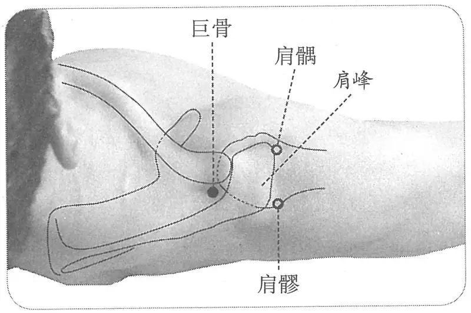

**图2-42　巨骨穴图**

　1. 在肩端上行两叉骨间陷者中。（《黄帝明堂经》、《太平圣惠方·明堂》、《铜人腧穴针灸图经》、《圣济总录》、《针灸资生经》、《十四经发挥》、《医学纲目》、《针灸聚英》、《古今医统》、《医学入门》、《针灸大成》、《针方六集》、《类经图翼》、《循经考穴编》、《医宗金鉴·刺灸心法要诀》、《针灸易学》）

　2. 在肩隅上两骨陷中。（《黄帝虾蟆经》）

　3. 广注约肩髃上一寸许。（《循经考穴编》上）

　4. 肩端上行，锁骨与胛骨相连处陷中。（《针灸十四经穴位考订》）

　5. 统编针灸学教材

　　(1) 部位：肩端锁骨与肱骨骨罅间陷中，即自肩髃穴向上，斜向内些，肩关节之前，两叉骨下陷中。取穴：从锁骨外端之上缘、与肱骨头相接之处陷中取之。（1957年南京《针灸学》）

　　(2) 部位：肩上后侧叉骨间。取穴：于肩端上行，两叉骨之间陷中取之。（1版《针灸学讲义》）

　　(3) 部位：在肩端上行两叉骨间陷者中。取穴：在肩端上，锁骨肩峰端与肩胛岗之间凹陷部取穴。（2版《针灸学讲义》）

　　(4) 锁骨肩峰端与肩胛冈之间凹陷中。（4、5、7版《针灸学》）

　　(5) 在肩上部，当锁骨肩峰端与肩胛冈之间凹陷处。（6版《针灸学》、《中国针灸学》）

**文献分析**：《太平圣惠方·针经》载有同名“巨骨”穴，乃奇穴，在鸠尾穴稍上方。王执中编《针灸资生经》时指出了不同文献记载的“巨骨”穴定位的矛盾。明代高武编《针灸聚英》时，未察王氏此注，而误将奇穴“巨骨”与本穴相混，后世文献多沿其误。

#### 【类属】 

手阳明大肠经穴。

**脉气所发**：手阳明、𫏋脉之会。（《黄帝明堂经》、《外台秘要》）

**归经**：手阳明大肠经。（《外台秘要》卷三十九、《铜人腧穴针灸图经》卷上）

#### 【适应症】 

主治局部病症。常用于肩背痛、活动受限。

　1. 主肩背痹痛，臂不举，血瘀肩中，不能动摇。（《黄帝明堂经》）

　2. 主肩中痛，不能动摇。（《太平圣惠方·明堂》）

　3. 治背髆痛，胸中有瘀血，肩臂不得屈伸而痛。（《铜人腧穴针灸图经》卷中）

**按**：对照《黄帝明堂经》原文，知《铜人腧穴针灸图经》“胸中”（繁体）系“肩中”之形误。

　4. 主惊痫，破心吐血。（《针灸聚英》卷一、《针灸大成》）

**按**：“惊痫，破心吐血”见于宋代《针灸资生经·惊痫》卷四，原文录自《太平圣惠方》所载奇穴“巨骨”（相当于“鸠尾”穴稍上方）主治症，高武编《针灸聚英》时因无法判定而误归于手阳明经“巨骨”穴中。后世腧穴文献多沿其误。

〔p.244 (인쇄 224)〕

　5. 统编针灸学教材

　　(1) 背膊痛，肩臂痛不得屈伸，瘿气，瘰疬。（1957年南京《针灸学》、1版《针灸学讲义》）

　　(2) 肩背、手臂痛不得屈伸，瘰疬，瘿气。（2版《针灸学讲义》）

　　(3) 肩臂痛不得屈身，瘰疬，瘿气。（4、5版《针灸学》）

　　(4) 肩背及上臂疼痛，伸展及抬举不便和瘰疬，瘿气。（6版《针灸学》）

　　(5) 肩臂挛痛、臂不举等局部病证；瘰疬，瘿气。（7版《针灸学》）

　　(6) 肩臂疼痛，抬举不利，肩背痛。（《中国针灸学》）

**文献分析**：腧穴文献所载之本穴主治皆出于《黄帝明堂经》，均主治肩背局部病症，古今临床应用也相合。现代针灸学教材中“瘰疬，瘿气”二症未详所出，也未见古今临床应用报道，今去之。

#### 【操作】 

直刺0.5~0.7寸。不可深刺，以免刺入胸腔。治疗肩周炎，上肢不遂，可向肩峰横刺0.8~1.2寸。

　1. 刺入一寸五分，灸五壮。（《黄帝明堂经》）

　2. 灸一壮。（《太平圣惠方·明堂》）

　3. 刺可入同身寸之一寸半，若灸者可灸三壮。（《素问·气府论》王冰注）

　4. 《铜人》：灸五壮，针一寸半。《明堂》：灸三壮至七壮。《素注》：禁针，针则倒悬一食顷乃得下针，针四分，泻之勿补，针出，始得正卧。《明下》：灸三壮。（《针灸聚英》卷一）

**按**：《针灸聚英》此段引自《针灸资生经》的文字有误，“素注”二字为衍文，“禁针”以下内容为《太平圣惠方·针经》奇穴“巨骨”刺法，与本穴无关。明清针灸文献或传其误，现代针灸教材未受此影响。

　5. 针六分，灸五壮。（《针灸十四经穴位考订》）

　6. 统编针灸学教材

　　(1) 针四至七分，灸七至十五壮。（1957年南京《针灸学》、1版《针灸学讲义》）

　　(2) 直刺5~7分，艾条灸5~10分钟。（2版《针灸学讲义》）

　　(3) 直刺0.5~1寸。（4版《针灸学》）

　　(4) 直刺，微斜向外下方，进针0.5~1寸。（5版《针灸学》）

　　(5) 直刺0.4~0.6寸，不可深刺，以免刺入胸腔造成气胸；可灸。（6版《针灸学》）

　　(6) 直刺，微斜向外下方，进针0.5~1寸。直刺不可过深，以免刺入胸腔造成气胸。（7版《针灸学》）

　　(7) 直刺0.5~0.7寸；可灸。（《中国针灸学》）

　7. 直刺，微斜向外下方，进针1~1.5寸。感应：肩关节周围酸胀。灸3~7壮；温灸5~20分钟。（上海《针灸学》）

### （十七）天鼎 Tiāndǐng LI17 出《黄帝明堂经》 

问题：本穴与扶突古今临床皆用于治疗呃逆，其机制如何？如何应用？

#### 【提要索隐】 

传世古代文献关于本穴定位文字错乱较严重。

**穴名**：天鼎，一作天顶。

**部位**：在颈部，横平环状软骨，胸锁乳突肌后缘。

〔p.245 (인쇄 225)〕

**适应症**：主治咽喉部病症。常用于咽喉肿痛，失音，呃逆。全喉截除术针麻用穴。

**备选适应症**：瘰疬，瘿气。

**针刺操作**：直刺0.3~0.5寸。

#### 【名实考】 

天鼎，《太平圣惠方》作“天顶”，盖同音借代。本穴定位，古代文献错误出现较早，现存《黄帝明堂经》佚文已见有三种异文，正确的文字为：在颈缺盆上，直扶突，气舍后一寸五分。

　1. 天鼎，在颈缺盆上，直扶突，气舍后一寸五分，手阳明脉气所发。（《黄帝明堂经》）

　2. 天顶二穴，在项缺盆，直扶突，气舍后一寸陷者中。（《太平圣惠方·明堂》）

　3. 凡各经穴在颈者，多以天名之，言自指高处部分，如天然，与天窗、天容相去斜直如鼎足，故曰天鼎。乃扶突斜后一寸，非正后一寸也。（《经穴解》）

#### 相关穴及刺激点 

　1. 膈神经刺激点　胸锁乳突肌胸骨头与锁骨头之间，锁骨上2.5cm。有以下两种针刺方法：①头转向对侧，直刺2.0~3.0cm。②头转向对侧，在胸锁乳突肌的锁骨头外侧缘，距锁骨2.5~3.0cm处进针，用左手拇指、食指相对捏住并上提胸锁乳突肌，右手持针沿胸锁乳突肌和前斜角肌的肌间沟平行刺入，针尖达内侧手指间深层，深度2.5~3.0cm。治疗膈肌痉挛，膈神经麻痹，呼吸停止急救，肝痛，胃痛。（《实用神经干刺激疗法》）

　2. 臂丛刺激点肌间沟刺激点　胸锁乳突肌后方，平环状软骨水平，前斜角肌和中斜角肌之间的凹陷。取仰卧位，头稍偏向对侧，手臂贴体旁，手尽量下垂。针尖向内下方（对侧足跟方向），进针2.0~3.0cm。治疗上肢瘫痪、麻木、疼痛、震颤、臂丛神经痛。（《实用神经干刺激疗法》）

#### 【定位】 

**部位**：在颈部，横平环状软骨，胸锁乳突肌后缘（图2-43）。

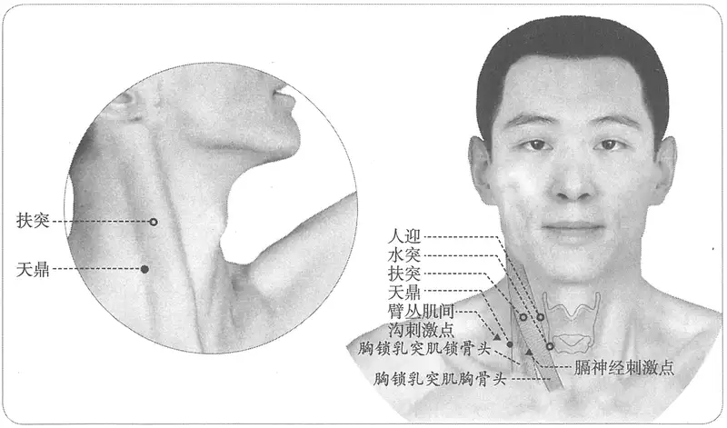

**图2-43　天鼎穴与相关刺激点**

〔p.246 (인쇄 226)〕

**取穴**：扶突穴直下，横平水突穴，在胸锁乳突肌后缘取穴。

**相关穴毗邻关系**：在环状软骨水平，沿胸锁乳突肌前缘，定水突；水突外侧，胸锁乳突肌后缘，为天鼎穴；上方于甲状软骨上缘水平（喉结），胸锁乳突肌前后缘之间为扶突穴。

　1. 《黄帝明堂经》佚文

　　(1) 在缺盆上，直扶突，气舍后一寸五分。（《针灸甲乙经》卷三、《千金翼方》、《外台秘要》、《医心方》）

　　(2) 在颈缺盆，直扶突，曲颊下一寸人迎后。（《千金要方》卷二十九）

　　(3) 在颈缺盆，上直扶突，气舍后同身寸之半。（《素问·气府论》王冰注）

　2. 在项缺盆，直扶突，气舍后一寸陷者中。（《太平圣惠方·明堂》）

　3. 在颈缺盆，直扶突后一寸。（《铜人腧穴针灸图经》卷上、卷中、《圣济总录》、《针灸资生经》、《针灸聚英》、《古今医统》、《针灸大成》）

　4. 在颈缺盆，直扶突后。（《铜人腧穴针灸图经》卷下“穴腧都数”）

　5. 侧颈，直缺盆，扶突后一寸。（《医学入门》卷一上）

　6. 广注扶突后寸半，合人迎后三寸。一法：径取结喉旁开四寸五分。（《循经考穴编》上）

　7. 从巨骨穴循颈，缺盆上直行，扶突下一寸。（《医宗金鉴·刺灸心法要诀》）

　8. 扶突下一寸。（《针灸十四经穴位考订》）

　9. 统编针灸学教材

　　(1) 部位：缺盆直上，扶突穴下一寸。取穴：正坐，按取喉节中央，向颈侧移约一寸五分，有颈动脉跳动处为人迎穴，依此为据点再向侧方移至胸锁乳突肌，直人迎后一寸五分为扶突，由扶突再下一寸即天鼎穴，与缺盆直对，与气舍相隔一肌取之。（1957年南京《针灸学》）

　　(2) 部位：胃经缺盆穴直上，扶突穴下一寸。取穴：先定结喉旁胃经人迎穴，人迎穴之后取扶突穴，天鼎穴即在扶突穴之下取之。（1版《针灸学讲义》）

　　(3) 部位：在缺盆上，直扶突，气舍后一寸五分。取穴：正坐仰靠，在颈侧部扶突下两横指，当胸锁乳突肌的后缘取穴。（2版《针灸学讲义》）

　　(4) 扶突穴下1寸，胸锁乳突肌后缘。（4、5版《针灸学》）

　　(5) 在颈外侧部，胸锁乳突肌后缘，当喉结旁，扶突穴与缺盆连线中点。（6版《针灸学》）

　　(6) 在胸锁乳突肌后缘，扶突穴直下1寸。（7版《针灸学》）

　　(7) 在颈外侧部，扶突下一寸，当胸锁乳突肌后缘。（《中国针灸学》）

**文献分析**：本穴定位，古代文献文字错乱较严重，现存《黄帝明堂经》佚文已见有三种异文，其中《千金要方》卷二十九文字系“扶突”穴定位内容的错入，《素问》王冰注之“半寸”显系“寸半”之误倒，则知《针灸甲乙经》文字仍保存《黄帝明堂经》原文。至《太平圣惠方》又作“气舍后一寸”，《铜人腧穴针灸图经》抄录时漏抄了“气舍”二字，与前文连成“扶突后一寸”，后人知其显误，而改作“扶突下一寸”，现代针灸学教材多从之。但如果本穴在扶突穴下一寸，则《黄帝明堂经》不会说“气舍后”，而会说“水突后”，可能正是基于这种疑虑，1957年南京《针灸学》教材采用了一种模糊的折中说法“由扶突再下一寸即天鼎穴，与缺盆直对，与气舍相隔一肌取之”（其实扶突直下不能与缺盆穴直对），第2版教材则明确依据了《黄帝明堂经》的原义，但后来的教材均未采用，可能是受经穴连线的干扰。

#### 【类属】 

手阳明大肠经穴。

〔p.247 (인쇄 227)〕

手阳明脉气所发。（《黄帝明堂经》）

#### 【适应症】 

主治咽喉部病症。常用于咽喉肿痛，失音，呃逆。全喉截除术针麻用穴。

**备选适应症**：瘰疬，瘿气。

　1. 主暴喑气哽，喉痹咽肿不得息，饮食不下。（《黄帝明堂经》）

**按**：“暴喑气哽”，《灵枢·寒热病》取扶突与舌本（风府穴别名）穴，此三穴主治当参详。

　2. 主喉中鸣。（《太平圣惠方·明堂》）

　3. 治暴喑气哽，喉痹，咽肿不得息，饮食不下，喉中鸣。（《铜人腧穴针灸图经》卷中）

　4. 喘息不食。（《医学入门》卷一上）

　5. 主项瘿。（《针方六集》卷五）

　6. 统编针灸学教材

　　(1) 喉痹，嗌肿，暴瘖气梗。（1957年南京《针灸学》、1版《针灸学讲义》）

　　(2) 咽喉肿痛，暴喑，气梗，瘰疬，瘿气。（2版《针灸学讲义》、4、5、7版《针灸学》）

　　(3) 咽喉肿痛，暴喑，气梗，梅核气，瘰疬。（6版《针灸学》）

　　(4) 暴喑，咽喉肿痛，瘰疬，气瘿。（《中国针灸学》）

**文献分析**：本穴主治，古代腧穴文献记载一致，均集中于咽喉部病症。现代针灸学教材中“瘰疬，气瘿”二症出于非源头文献明代《针方六集》，或是对“暴喑气哽”的误解，古今临床应用尚未见类似报道，故暂不收录，附存备考。本穴的现代临床应用集中于呃逆，其次是失音，与《黄帝明堂经》所载主治相合。

#### 附：临床应用举例 

　1. 中风后偏瘫，环跳穴、天鼎穴针灸疗法。[吉林中医药，1985(5)：21]

　2. 上肢麻木、半身不遂、尺神经炎，取天鼎、合谷、支正、小海穴等。[中国针灸，1994(1)：41-42]

　3. 根型颈椎病、偏瘫，取患侧天鼎、合谷用小提插手法得气使针感传至病区。[中国针灸，1994(增刊)：345-346]

　4. 失音，取穴天鼎穴、间使穴，虚证可加照海、太溪、鱼际；实证可加二间、合谷、太冲、通里。针刺。[湖北中医杂志，1996(4)：50]

　5. 肩周炎，取患侧天鼎穴，常规针刺，使针感传至相应疼痛区域。[按摩与导引，1997(5)：26]

　6. 膈肌痉挛，取双侧天鼎穴，取左侧天鼎穴头向右转，取右侧天鼎穴头向左转。[中国针灸，1999(1)：39]

　7. 呃逆，左右交替针刺天鼎穴。[中国针灸，2001，21(5)：294]

#### 【操作】 

直刺0.3~0.5寸。

　1. 刺入四分，灸三壮。（《黄帝明堂经》）

　2. 灸七壮。（《太平圣惠方·明堂》）

　3. 可灸三壮，针入三分。（《铜人腧穴针灸图经》卷中）

　4. 统编针灸学教材

　　(1) 针三至五分，灸三至五壮。（1957年南京《针灸学》、1版《针灸学讲义》）

　　(2) 直刺3~5分，艾条灸3~5分钟。（2版《针灸学讲义》）

　　(3) 直刺0.5~0.8寸。（4、5、7版《针灸学》）

　　(4) 直刺0.3~0.5寸；可灸。（6版《针灸学》、《中国针灸学》）

〔p.248 (인쇄 228)〕

**刺法及主治的解剖学基础**：本穴紧邻膈神经体表刺激点，现代医学认为，呃逆乃由膈肌痉挛而致，本穴治疗呃逆有效，应与膈神经有关。现代临床报道，不管是有文献记载的扶突、天鼎，还是无记载的人迎，只要针尖刺激到膈神经，就能止呃。因此，针刺本穴止呃，可以借鉴膈神经刺激的方法。同时现代医学证明呃逆是一种神经反射性动作，其反射弧经过第3、4脊髓颈节，受延髓呼吸中枢控制，各种原因刺激反射弧，都会使相关神经，特别是迷走神经的正常兴奋与抑制发生失调，当异常兴奋占优势则引起呃逆，针刺可调整迷走神经的兴奋与抑制，使其恢复正常的生理状态，则呃逆可止。这应是临床上许多穴位都能止呃的另一途径。

### （十八）扶突 Fútū LI18 出《灵枢》 

#### 【提要索隐】 

**穴名**：一名水穴。

**部位**：在胸锁乳突肌区，横平喉结，胸锁乳突肌前、后缘中间。

**适应症**：主治咽喉部病症。常用于咽喉肿痛，失音，呃逆；咳嗽，气喘；瘿瘤。甲状腺、全喉截除术等颈部手术的针麻常用穴。

**针刺操作**：直刺0.5~0.8寸。不宜向内侧深刺、大幅度捻转、提插。

#### 【名实考】 

扶突，与人迎、天牖、天柱、天府四穴，在《灵枢·寒热病》一并被称作“天牖五部”（《黄帝内经太素·寒热杂说》作“大俞五部”，《黄帝明堂经》作“大输”），其中“扶突”是五穴中唯一穴名中未冠以“天”字的穴位。更详细的文字又见于《灵枢·本输》共记有九穴，但由于历代注家大多没能读懂这篇文字，因此在经穴的定位与归经上出现了长期的错误而不自知。

　1. 缺盆之中，任脉也，名曰天突，一；次任脉侧之动脉，足阳明也，名曰人迎，二；次脉手阳明也，名曰扶突，三；次脉手太阳也，名曰天窗，四；次脉足少阳也，名曰天容，五；次脉手少阳也，名曰天牖，六；次脉足太阳也，名曰天柱，七；次脉颈中央之脉，督脉也，名曰风府。腋内动脉，手太阴也，名曰天府。腋下三寸，手心主也，名曰天池……足阳明挟喉之动脉也，其腧在膺中。手阳明次在其腧外，不（下）至曲颊一寸。手太阳当曲颊。足少阳在耳下曲颊之后。手少阳出耳后，上加完骨之上。足太阳挟项大筋之中发际。（《灵枢·本输》）

**按**：《本输》这两段文字，前一段述脉、穴位次，后一段述具体的经穴定位。根据杨上善《黄帝内经太素·经脉标本》注及王冰《素问·病能论》注，这些脉是诊脉部位，也曾是经脉“标”的部位，这些部位均以“天”字命名（人迎又名“天五会”，亦有“天”字），很可能曾作为三部脉诊法的“天”部。其中“天府”、“天池”、“天五会”三脉在《卫气》篇中仍为相应经脉之标部，没有变化。

　2. 暴瘖气鞕，取扶突与舌本出血。（《灵枢·寒热病》）

**按**：“舌本”是与“扶突”并列的穴名——风府穴别名，后世《内经》注家及针灸家均将“舌本出血”误解为一个症状，归入扶突穴主治项下。

　3. 扶突二穴。（《素问·气穴论》）

　4. 扶突，一名水穴。在曲颊下一寸，人迎后，手阳明脉气所发，仰而取之。（《黄帝明堂经》）

　5. 突者，通气之名，在任经之在喉者有天突，在胃经之在于其旁者有水突，以咽水谷而有名也。水突之旁，又在其后者，则曰扶突，乃以水突、天突而得名也。（《经穴解》）

〔p.249 (인쇄 229)〕

#### 相关穴及刺激点 

颈横神经刺激点　胸锁乳突肌中央，与其后缘中点下1cm相平处。主治咳嗽，哮喘，声音嘶哑，颈前区和甲状腺手术麻醉。刺法：直刺1.0cm，针感向颈前部放散。（《实用神经干电刺激疗法》）

#### 【定位】 

**部位**：在胸锁乳突肌区，横平喉结，胸锁乳突肌前、后缘中间（图2-44）。

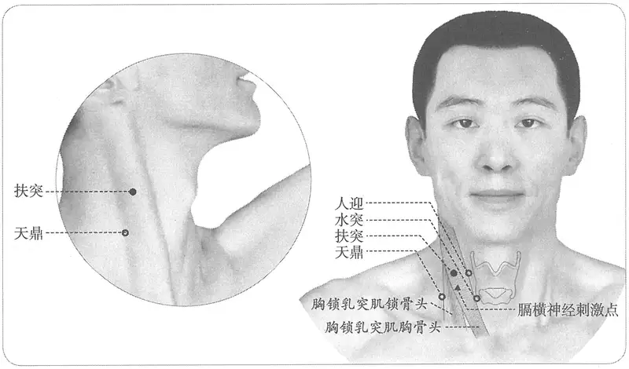

**图2-44　扶突穴与相关刺激点**

**取穴**：正坐仰靠，在颈侧部人迎后约二横指，当胸锁乳突肌的胸骨头与锁骨头之间，与结喉平高处取穴。

**相关穴毗邻关系**：于喉结水平，胸锁乳突肌前缘为人迎，后缘为天窗，前后缘中间为扶突。

#### 相关解剖学基础 

　　(1) 胸锁乳突肌的体表显示技法：技法一，深吸气，抬高胸部，憋住气，即可使胸锁乳突骨清楚地在体表显现；技法二，额头施压，单手或双手在额头部施加一个阻力，颈部抗阻力前屈，这时可清楚显现胸锁乳突肌；技法三，卧位抬头仰卧，然后抬头，控制住，即可在体表看到明显的胸锁乳突肌；技法四，颈侧屈并轻微地向同侧前屈，则更易于显示胸锁乳突肌的锁骨头，如果个别被检查者在这些动作下还不能清楚显示或触及胸锁乳突肌，则在做上述动作时施加适当的阻力，可明显提高显示度或感知度。

　　(2) 甲状软骨体表触诊技法：甲状软骨位于舌骨和环状软骨之间，是最大的喉软骨，男子可在颈部中线上见有一个向前的角状凸起——喉结。另外还可触到甲状软骨板上缘和甲状软骨切迹。在女性常常见不到，但多能在舌骨下方摸到。

　1. 不（下）至曲颊一寸。（《灵枢·本输》）

　2. 《黄帝明堂经》佚文

　　(1) 在曲颊下一寸，人迎后。（《黄帝内经太素·经脉根结》杨上善注、《千金翼方》、《外台秘要》、《素问·气府论》王冰注、《医心方》）

〔p.250 (인쇄 230)〕

　　(2) 在人迎后一寸五分。（《针灸甲乙经》卷三、明刊本《外台秘要》、《铜人腧穴针灸图经》卷中）

　　(3) 在气舍后一寸半。（《千金要方》卷二十九、《铜人腧穴针灸图经》卷上）

**按**：未经宋人校刊本作“人迎后一寸半”。

　3. 在气舍后一寸五分，仰天鼎而取之。（《铜人腧穴针灸图经》卷下“穴腧都数”）

　4. 气舍后一寸五分，在颈当曲颊下一寸，人迎后一寸五分，仰而取之。（《针灸聚英》卷一、《古今医统》、《针灸大成》）

　5. 曲颊下一寸，仰而取之。（《医学入门》卷一上）

　6. 穴在人迎在结喉旁开一寸五分后一寸五分凌德行先生穴法歌中改后字为外字，甚觉明快。一法径取结喉旁开三寸。《素注》云颈当曲颊下一寸。又云气舍后一寸五分，似非是。（《循经考穴编》上）

　7. 统编针灸学教材

　　(1) 部位：在人迎后一寸五分。取穴：由天鼎上行一寸取之。（1957年南京《针灸学》）

　　(2) 部位：天鼎穴之上一寸。取穴：胃经人迎穴向后一寸五分取之。（1版《针灸学讲义》）

　　(3) 部位：在人迎后一寸五分。取穴：正坐仰靠，在颈侧部人迎后约二横指，当胸锁乳突肌的胸骨头与锁骨头之间，与结喉平高处取穴。（2版《针灸学讲义》）

　　(4) 喉结旁开3寸。（4版《针灸学》）

　　(5) 喉结旁开3寸，当胸锁乳突肌的胸骨头与锁骨头之间。（5、7版《针灸学》）

　　(6) 在颈外侧部，喉结旁，当胸锁乳突肌的前后缘之间。（6版《针灸学》）

　　(7) 在颈侧部，约与喉结平高，当胸锁乳突肌的胸骨头与锁骨头之间。（《中国针灸学》）

**文献分析**：本穴定位，《灵枢》作“曲颊下一寸”已经是一个明确的定位，《黄帝明堂经》又增加“人迎后”一个坐标点，使定位更加明确，至宋代《铜人腧穴针灸图经》于“人迎后”又增“一寸五分”四字，反成蛇足，难以定位——“人迎后一寸五分”，与“曲颊直下一寸”很难正好重合为一点。古代文献关于本穴的定位的混乱主要发生在宋代，宋校本《千金要方》于扶突穴下误录天鼎穴部位，天鼎穴下又误录扶突穴部位，出现了连环错误。由于宋代校书官不熟悉针灸，未能及时发现这些错误，后人不明原委又用错误的文本改宋以前的经典，例如现行本《针灸甲乙经》并明刊本《外台秘要》关于本穴的定位均作“在人迎后一寸五分”，而宋本《外台秘要》仍作“曲颊下一寸，人迎后”，可知现行本《针灸甲乙经》及明本《外台秘要》为宋以后人所改。以至于人们难定是非，只得将正确的和错误的说法混在一起，使得颈部穴的位置关系混乱不堪。

关于人迎、扶突、天窗、天容四穴的位置关系，《灵枢·本输》曰：“足阳明也，名曰人迎，二。次脉手阳明也，名曰扶突，三。次脉手太阳也，名曰天窗，四。次脉足少阳也，名曰天容……足阳明挟喉之动脉也，其腧在膺中。手阳明次在其腧外，不（下）至曲颊一寸。手太阳当曲颊。足少阳在耳下曲颊之后”。则人迎、扶突、天窗3穴的垂直距离（纵坐标上位置）均与喉结平，天容与下颌角相平；水平距离（横坐标位置）则天窗上直曲颊（下颌角），扶突在曲颊（下颌角）前一寸，天容在曲颊（下颌角）后一寸（由于后世将“天容”穴归入手太阳经，则此4穴间的位置关系也随之改变）。由于下颌角在女性体表显示不甚明显（男性多呈直角、外翻，女性多呈钝角、内翻），加之其位置随着颈部的屈伸角度的变化而改变，临床上比量不大方便，因此现代针灸临床改用颈部最明显的肌性标志胸锁乳突肌定穴。那么，为检验这种参照物的变换是否会影响相关穴的定位，我们设计了以下的实验。

〔p.251 (인쇄 231)〕

第一步，人迎穴的坐标转换。

已知颈动脉的体表触诊点在甲状软骨上缘外侧，胸锁乳突肌前缘处，而古典文献谓人迎穴“在颈大脉动应手夹结喉旁”，由此可知该穴的位置在胸锁乳突肌的前缘。

第二步，扶突、天窗、天容穴的坐标转换。

令被检者头部的角度符合法兰克福平面（Frankfurt平面）要求，分别在自然放松状态下和充分显示肌肉的状态下，进行如下实验：①经下颌角引一条与颈部纵轴平行的线；②经喉结引一条与此线垂直的线。结果表明：二线相交处在胸锁乳突肌的后缘，证明天窗穴的坐标转换是完全等值的。由此可知，位于天窗（胸锁乳突肌后缘）和人迎（胸锁乳突肌前缘）之间的扶突穴位于胸锁乳突肌肌腹中间。在下颌角之后的天容穴，正当胸锁乳突肌的前缘。

第三步，天牖、水突、天鼎穴的坐标转换。

天牖在天容后，完骨（乳突）下，则知其在胸锁乳突肌的后缘；水突穴在人迎穴下，则知其在胸锁乳突肌的前缘；由于胸锁乳突肌由耳后乳突部自外上方向内下方斜行，因此位于扶突穴（胸锁乳突肌肌腹中）之下的天鼎穴就落在了胸锁乳突肌的后缘。

整个实验结果证明，以上颈部7穴定位，在变换描述坐标之后，位置没有发生改变，说明这样的转换是等值的。

#### 【类属】 

手阳明大肠经穴；手阳明所入。

　1. 手阳明脉气所发。（《黄帝明堂经》）

　2. 手阳明根于商阳，溜于合谷，注于阳溪，入于扶突、偏历也。（《灵枢·根结》）

#### 【适应症】 

主治咽喉部病症。常用于咽喉肿痛，失音，呃逆；咳嗽，气喘；瘿瘤。甲状腺、全喉截除术等颈部手术的针麻常用穴。

　1. 主咳逆上气，咽中鸣，喝喝喘息。暴悟，喑，气哽与舌本出血。（《黄帝明堂经》）

　2. 治咳多唾，上气，咽引喘息，喉中如水鸡鸣。（《铜人腧穴针灸图经》卷中）

　3. 主咽嗌不利。若刺瘿肿，可横针一寸五分。（《循经考穴编》上）

　4. 统编针灸学教材

　　(1) 咳嗽喘急，喉鸣，咽嗌不利，暴瘖，气梗。（1957年南京《针灸学》）

　　(2) 咳嗽喘气，喉中痰鸣，咽嗌不利，暴喑。（1版《针灸学讲义》）

　　(3) 咳嗽，气喘，咽喉肿痛，暴喑，瘰疬，瘿气。（2版《针灸学讲义》、4、5、6版《针灸学》）

　　(4) 咽喉肿痛、暴喑等咽喉病证；瘿气，瘰疬；咳嗽，气喘；颈部手术针麻用穴。（7版《针灸学》）

　　(5) 暴喑，咽喉肿痛，瘰疬，气瘿。（《中国针灸学》）

**文献分析**：本穴主治，古今文献记载一致。值得注意的是，《灵枢·寒热病》云：“暴喑气鞕，取扶突与舌本出血”，《黄帝内经太素·寒热杂说》卷二十六同。杨上善注云：“舌本，一名风府，在项入发际一寸督脉上。”显然，《灵枢》原方中“扶突”、“舌本”各是一穴，而《黄帝明堂经》编者在引录此方时，误将“舌本出血”作为一个症状归入“扶突”穴主治症中，后世文献多沿袭此误。

关于本穴治疗暴哑失音，有两条重要而常被人们忽略的旁证：

　1. 脑后哑门穴不可伤，伤即令人哑。宜针人中、扶突二穴，可二分。（《圣济总录》卷一九四）

〔p.252 (인쇄 232)〕

　2. 风府一穴，在哑门上入发际一寸五分。针只可下一寸以下，过度即令人哑。宜针人中、扶突救之。（《圣济总录》卷一九四）

#### 附：临床应用举例 

　1. 暴喑气哽，取扶突与舌本出血。（《灵枢·寒热病》）

**按**：气哽，《黄帝内经太素》作“气鲠”。杨上善注曰：“暴瘖气鲠，取此手足之阳明扶突之穴出血得已。气在咽中如鱼鲠之状，故曰气鲠。舌本一名风府，在项人发际一寸督脉上。”可知，《灵枢》此方之暴喑气哽症，取扶突与风府二穴，而《黄帝明堂经》编者未解此义，误将“舌本出血”作为一个主治症归入“扶突”穴下。

　2. 风火牙痛，针刺患侧扶突穴，得气后用泻法或补法。[武警医学，1994，5(5)：294]

　3. 臂丛神经痛，主穴取扶突，配以曲池、肩髃、外关、合谷。向颈椎方向进针，令针感沿肩臂向指尖放射3次。[针灸临床杂志，1997，13(2)：33]

　4. 顽固性呃逆，取扶突穴水平方向刺向颈椎，有触电样针感向肩或向手放射时留针半小时。[吉林中医药，1999(5)：47]

#### 【操作】 

直刺0.5~0.8寸。不宜向内侧深刺、大幅度的捻转、提插。

　1. 刺入四分，灸三壮。（《黄帝明堂经》）

　2. 可灸三壮，针入三分。（《铜人腧穴针灸图经》卷中）

　3. 统编针灸学教材

　　(1) 针三至五分，灸三至五壮。（1957年南京《针灸学》、1版《针灸学讲义》）

　　(2) 直刺3~5分，艾条灸3~5分钟。（2版《针灸学讲义》）

　　(3) 直刺0.5~0.8寸。（4、5、6版《针灸学》）

　　(4) 直刺0.5~0.8寸。注意避开颈动脉，不可过深。一般不使用电针，以免引起迷走神经反应。（7版《针灸学》）

　　(5) 直刺0.3~0.5寸。可灸。（《中国针灸学》）

　4. 直刺0.5~1寸。感应：咽喉部发胀、发紧。灸1~3壮；温灸5~10分钟。（上海《针灸学》）

**刺法及主治的解剖学基础**：在胸锁乳突肌深面，有颈3~5神经的前支通过，共同构成膈神经的运动和感觉纤维，针刺扶突穴可直接刺激到膈神经而改变膈肌运动，这是针扶突止呃的解剖学基础之一。另外，在胸锁乳突肌深面有颈襻、颈动脉鞘。鞘内颈总动脉居于前内侧，颈内静脉居于后外侧，迷走神经在前两者之间的后方。若针刺过深，有可能刺到上述血管，造成颈部血肿。若刺到迷走神经，则可能发生迷走神经张力反应，影响心跳和呼吸，出现“晕针”现象。

### （十九）口禾髎 Kǒuhéliáo LI19 出《黄帝明堂经》 

#### 【提要索隐】 

**穴名**：古代文献作“禾髎”，与耳部足少阳经的“和髎”的读音相同，写法相近，不易区分，如宋初的《太平圣惠方》已将“和髎”穴的内容误写作“禾髎”。今于穴名前加一“口”字以别之。一名䪼；一名长频。

**部位**：在面部，横平人中沟上1/3与下2/3交点，鼻孔外缘直下。

**按**：本穴定位以水沟穴为基准点，而古今对于《黄帝明堂经》关于水沟穴的定位“在鼻柱下人中”有不同理解，而作不同定位，因而禾髎穴的定位也随之而变。

**适应症**：主治鼻部、口部病症。常用于鼻塞、鼻衄；口眼㖞斜，口噤。

〔p.253 (인쇄 233)〕

**针刺操作**：直刺0.3~0.5寸。不宜灸。

#### 【名实考】 

本穴，《黄帝明堂经》谓“一名䪼”，《铜人腧穴针灸图经》谓“一名长频”。可见这里的“频”字应是指鼻部附近的某部位名称，或者与䪼属同义、近义词，然辞书未见此义。查《太平圣惠方·针经》“巨窌”穴主治有“鼻频（音准）上肿”一症，可证“频”必是鼻部或鼻旁某部位名。又《铜人腧穴针灸图经》巨髎穴下正好抄录了《太平圣惠方》的主治症，但却径作“鼻䪼上肿”，可见《铜人腧穴针灸图经》编者认为“频”与“䪼”是同义字。五卷本《铜人腧穴针灸图经》卷一曰：“䪼，谓准之秀骨也”。本穴与鼻紧邻，故一名䪼，一名长频。

禾髎，《医心方》注曰“一本作禾聊”，《太平圣惠方》正作“禾聊”。1957年南京《针灸学》所载诸别名系间接录自日本针灸教材，经考皆不属于本穴别名。

关于本穴的定位，古今文献描述无分歧，但因本穴定位是以水沟穴为标志，而对于水沟穴定位的古典文献，今人，特别是中国学者与日本学者之间有不同理解，这样禾髎穴的定位也随之衍生出两种不同的定位。

　1. 禾窌，一名䪼。在直鼻孔下，夹水沟旁五分，手阳明脉气所发。（《黄帝明堂经》）

　2. 禾髎，一名长频。（《铜人腧穴针灸图经》卷上）

　3. 䪼，谓准之秀骨也。（五卷本《铜人腧穴针灸图经》卷一）

　4. 此穴在鼻孔旁，所以闻五谷之香气者，此穴近之，故曰禾髎。（《经穴解》）

　5. 别名　长频、长颊、长髎、长颊、长䪼。（1957年南京《针灸学》）

**按**：此处别名皆间接录自日本教材，其中“长颊”云出《针灸聚英》，中国明刊本无误，日本刊本误；“长髎”云出《针灸大全》，系“长频”之形误，《针灸大全》的另一传本《针灸全书》无误；“长颊”见清·顺治重修本《针灸大成》，系“长频”之形误，吴文炳《针灸大成》本无误。

**“禾髎”与“和髎”相混例**

　1. 禾窌，在耳前兑发下动脉，手足少阳、手太阳之会。（通行本《针灸甲乙经》卷三）

　2. 迎香，在和窌上一寸，鼻孔旁。（《千金要方》卷二十九）

　3. 迎香二穴，在和窌上一寸，鼻下孔旁是穴。（《太平圣惠方·针经》）

　4. 和窌二穴，在鼻孔下，夹水沟旁五分是穴。手阳明脉气所发。（《太平圣惠方·针经》）

　5. 禾髎耳前兑发从。（《针灸问对》）

**按**：《针灸资生经》注曰：“禾髎二穴在鼻孔下夹水沟旁五分；《明堂下经》作禾窌（窌即髎也），《上经》乃作和窌，皆云在鼻孔下夹水沟旁五分，则是一穴也。而《铜人》手少阳穴复有和窌二穴在耳前兑（《素问》作锐）发陷中，其穴相去远矣，恐《明堂上经》误写‘禾’字作‘和’字也（今以诸经校勘禾髎穴者是）。”

#### 相关穴及刺激点 

　1. 水沟　在面部，人中沟的上1/3与中1/3交点处。常用于一切神昏之急救；主治水肿，消渴；口角㖞斜、流涎，口噤；鼻塞、鼻衄等；癫，狂，痫；腰脊强痛。针向上斜刺0.3~0.5寸。（见本书“督脉穴”）

　2. 鼻流　位于鼻底前鼻孔部，鼻中隔与鼻翼之间点。在禾髎穴之上方，正对鼻孔之中间。主治鼻炎、鼻流浊涕、鼻塞、嗅觉减退、咀嚼肌痉挛、面神经麻痹或痉挛、中风。针2~3分，局部有痛痒感。（《针灸经外奇穴图谱》）

#### 【定位】 

**部位**：在面部，横平人中沟上1/3与下2/3交点，鼻孔外缘直下（图2-45）。

**取穴**：鼻翼与上唇之间，水沟旁开0.5寸取之。

　1. 在直鼻孔下，夹水沟旁五分。（《黄帝明堂经》、《太平圣惠方·针经》、《铜人腧穴针灸图经》、《圣济总录》、《针灸资生经》、《十四经发挥》、《医学纲目》、《针灸聚英》、《古今医统》、《医学入门》、《针灸大成》、《类经图翼》、《医宗金鉴·刺灸心法要诀》、《针灸易学》、《针灸逢源》）

〔p.254 (인쇄 234)〕

　2. 鼻孔下三分是人中穴，两旁各开五分即此穴也。（《针方六集》卷一）

　3. 人中旁五分，鼻翼与上唇之间。（《针灸十四经穴位考订》）

　4. 统编针灸学教材

　　(1) 部位：在鼻孔下夹水沟旁五分。取穴：鼻翼与上唇之间，水沟旁五分取之。（1957年南京《针灸学》）

　　(2) 部位：水沟旁五分。取穴：在鼻孔下夹水沟旁取之。（1版《针灸学讲义》）

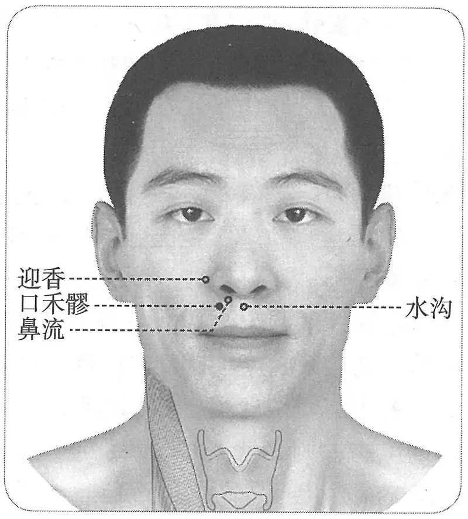

**图2-45　口禾髎穴与相关穴图**

　　(3) 部位：在直鼻孔下，夹水沟旁五分。取穴：在鼻孔外缘直下，与上唇连线上1/3与中1/3的交界点取穴。（2版《针灸学讲义》）

　　(4) 水沟穴旁开0.5寸。（4版《针灸学》）

　　(5) 水沟旁0.5寸，当鼻孔外缘直下，与水沟穴相平处取穴。（5版《针灸学》）

　　(6) 在上唇部，鼻孔外缘直下，平水沟穴。（6版《针灸学》）

　　(7) 在上唇部，水沟穴旁0.5寸，当鼻孔外缘直下。（7版《针灸学》）

　　(8) 鼻孔外缘直下，水沟旁开五分。（《中国针灸学》）

**文献分析**：关于本穴定位的文字描述，古今一致，然本穴定位的基准穴水沟的定位，古今存在分歧，因而间接地造成本穴定位的分歧。关于水沟穴定位的考证，详见该穴的“文献分析”部分。

#### 【类属】 

手阳明大肠经穴。

手阳明脉气所发。（《黄帝明堂经》）

#### 【适应症】 

主治鼻部、口部病症。常用于鼻塞、鼻衄；口眼㖞斜，口噤。

　1. 主鼻窒口僻，清涕出，不可止，鼽衄有痈。（《黄帝明堂经》）

　2. 口噤不可开。（《外台秘要》卷三十九）

　3. 主尸厥。（《太平圣惠方·明堂》）

　4. 治鼻衄血不止，鼻洞涕生疮，口噤不开。（《铜人腧穴针灸图经》卷中）

　5. 口眼㖞斜，口唇吻肿。（《窦太师针经》、《针方六集》）

　6. 统编针灸学教材

　　(1) 鼻鼽衄，鼻疮息肉。（1957年南京《针灸学》）

　　(2) 鼻鼽衄，口噤，鼻疮。（1版《针灸学讲义》）

　　(3) 鼻衄，鼻塞，息肉，口㖞，口噤不开。（2版《针灸学讲义》）

　　(4) 鼻塞，鼽衄，口㖞，口噤。（4、5、7版《针灸学》）

　　(5) 口㖞，鼻塞不通，鼻衄。（6版《针灸学》、《中国针灸学》）

**文献分析**：关于本穴的主治，古今文献一致，均集中于鼻部、口部病症。本穴主治应与督脉穴水沟、奇穴鼻流参看。

〔p.255 (인쇄 235)〕

#### 附：临床应用举例 

　1. 两鼻鼽衄针禾窌，鼻窒不闻迎香间。（《灵光赋》）

　2. 鼻窒不闻香臭，迎香、上星、五处、禾髎。问曰：此症缘何而得？针数穴皆不效。答曰：皆因伤寒不解，毒气冲脑，或生鼻痔，脑中大热，故得此症。复刺后穴：水沟、风府、百劳、太渊。（《针灸大成》卷九）

#### 【操作】 

直刺0.3~0.5寸。不宜灸。

　1. 刺入三分。（《针灸甲乙经》卷三）

　2. 灸三壮。（《医心方》卷二）

　3. 针入二分。（《太平圣惠方·针经》）

　4. 针入一分，禁灸。（《医学入门》卷一上）

　5. 统编针灸学教材

　　(1) 针三分。（1957年南京《针灸学》、1版《针灸学讲义》）

　　(2) 斜刺2~3分。（2版《针灸学讲义》）

　　(3) 直刺或斜刺0.3~0.5寸。（4、5、7版《针灸学》）

　　(4) 直刺0.3~0.5寸；不宜灸。（6版《针灸学》）

　　(5) 斜刺0.2~0.3寸。（《中国针灸学》）

　6. 向内横刺0.3~0.5寸。感应：局部痛感。（上海《针灸学》）

### （二十）迎香 Yíngxiāng LI20 出《黄帝明堂经》 

问题1：名“迎香”穴者有二，如何辨识？

问题2：关于本穴定位的分歧的焦点在哪里？

问题3：迎香穴治疗胆道蛔虫症的经验从何而来？

#### 【提要索隐】 

迎香穴与鼻翼位置关系的参照点，古典文献未明确，因而后人有不同理解。而巨髎穴定位明确，同时此二穴的位置关系明确，由此可根据上述已知条件设计人体测量实验，加以判别。

**穴名**：一名冲阳，与足阳明经的原穴名称相同。另外，经外奇穴中有名“（内）迎香”者，今人多有不识。

**部位**：在面部，鼻翼外缘中点旁，鼻唇沟中。

**适应症**：主治鼻部、口面部病症。常用于鼻渊，鼻衄；口眼㖞斜，面痒、面肿。

**针刺操作**：斜刺或平刺。

#### 【名实考】 

名“迎香”之穴有二，一出自汉代《黄帝明堂经》，一出自元代《窦太师针经》，后人不识，多有混淆。关于本穴定位，《黄帝明堂经》谓“在禾窌上，鼻下孔旁”，《窦太师针经》又增加鼻唇沟的体表标志。现代的理解主要有两种：一是鼻翼点旁，一是鼻下孔旁。其实，迎香问题的关键是后来定位于“鼻唇沟中”（见正统铜人及窦太师针灸）。《针灸甲乙经》的定位显然在巨髎内侧，具体为口禾髎之上、巨髎之内（偏下）。如果沿用“鼻唇沟中”这一体表标志定位，则以鼻翼点旁为妥。

　1. 经穴迎香　一名冲阳，在鼻孔旁。

〔p.256 (인쇄 236)〕

　　(1) 迎香，一名冲阳。在禾窌上，鼻下孔旁，手足阳明之会。（《黄帝明堂经》）

　　(2) 不闻香臭从何治，须向迎香穴内攻。（《针灸玉龙歌》）

　　(3) 一名冲阳，在鼻下孔旁五分，当约口纹。手足阳明之会。（《针方六集》卷一）

　　(4) 迎香以鼻闻香臭而得名也。（《经穴解》）

　2. 奇穴迎香　又名内迎香，在鼻孔内。

　　(1) 迎香二穴：在鼻内是穴。治眼红痛，用芦叶或箬叶削尖，鼻内搐动出血即效。（《窦太师针经》乙抄本）

　　(2) 内迎香：在鼻孔内。用芦叶或箬叶作卷搐之，血出为好。（《针灸玉龙歌》注）

　　(3) 内迎香二穴，在鼻孔中。治目热暴痛，用芦管子搐出恶血，效。（《奇效良方》卷五十五）

　　(4) 而奇穴者，则又旁通于正穴之外，以随时疗症者也。而其数维何？吾尝考之《图经》，而知其七十有九焉，以鼻孔则有迎香。（《针灸大成·穴有奇正策》卷三）

**文献分析**：以上两“迎香”，定位及主治均不同，显然是两个不同的穴，杨继洲也明言，鼻孔部有奇穴“迎香”。后人为区别，将后一个“迎香”称作“内迎香”，然而在古代针灸方中却仍径作“迎香”，具体阅览文献时可通过主治及刺灸法进行辨别。

　3. 目暴赤肿疼痛，攒竹二穴、合谷二穴、迎香二穴。（《针灸大全》卷四）

　4. 鼻流浊涕臭，名曰鼻渊，曲差二穴、上星一穴、百会一穴、风门二穴、迎香二穴。（《针灸大全》卷四）

　5. 鼻塞不知香臭，迎香二穴、上星一穴、风门二穴。（《针灸大全》卷四）

　6. 赤眼肿痛，迎香出血，立愈。甚者更泻太冲。（《医学入门》卷一）

**按**：《针灸大全》所载3首针灸方，没有注明刺灸法，可从主治判定，第一首方中“迎香”为奇穴“内迎香”，第二、三首方中“迎香”为经穴；而《医学入门》针方既列有主治，又注明了刺法，一目了然可判定为“内迎香”。用同样的方法可以判定以下针灸歌赋中之“迎香”均为“内迎香”。

　7. 赤眼迎香出血奇，临泣太冲合谷侣，耳聋临泣与金门，合谷针后听人语。（《医学入门》卷一下）

　8. 心血炎上两眼红，迎香穴内刺为通，若将毒血搐出后，目内清凉始见功。（《针灸大成·玉龙歌》卷三）

#### 相关穴及刺激点 

　1. 上迎香　位于鼻根两侧，眼内眦下五分处。位于睛明穴旁下五分鼻侧。主治过敏性鼻炎、鼻息肉、萎缩性鼻炎、鼻窦炎、肥大性鼻炎、烂弦、眼充风泪出。针3~5分。（《针灸经外奇穴图谱》）

　2. 内眦点（面神经刺激点上唇方肌点之一）　眼眶下缘外3/4与内1/4交点直下，平鼻翼外缘中点处。向鼻根方向斜刺1.0~1.5cm。主治面神经麻痹口角㖞斜。（《神经干刺激疗法》）

　3. 鼻环　位于面鼻部，鼻翼向外最隆突之点，与面部相接之纹中间，即迎香穴微内方。主治酒齄鼻、疖疮、颜面组织炎。针二分，稍出血即可。（《针灸经外奇穴图谱》）

　4. 鼻通　位于面鼻部，鼻骨下凹陷中，鼻唇沟上端尽处，即迎香穴上内方。主治鼻炎，鼻塞，鼻部疖疮。针向内上方斜刺三至六分，针感鼻内发酸。（《针灸经外奇穴图谱（续集）》）

　5. 治鼻1　位于面鼻部，鼻翼向外最隆突之点，旁开三分，即迎香穴内侧二分。主治慢

〔p.257 (인쇄 237)〕

性鼻炎，过敏性鼻炎。针向内侧平行前进至梨状孔，越过其边缘，再向上进针至下鼻甲前端粘膜下。（《针灸经外奇穴图谱（续集）》）

#### 【定位】 

**部位**：在面部，鼻翼外缘中点旁，鼻唇沟中（图2-46）。

**取穴**：鼻唇沟（nasolabial sulcus）不明显个体的替代取穴法有以下两种。

方法一：可以用黑眼仁内侧垂线与鼻翼点水平线的交点处取迎香穴。

方法二：可以经鼻翼旁、口角旁口轮匝肌边缘点作一略带弧度的弧线，此线即可相当于鼻唇沟的走行。

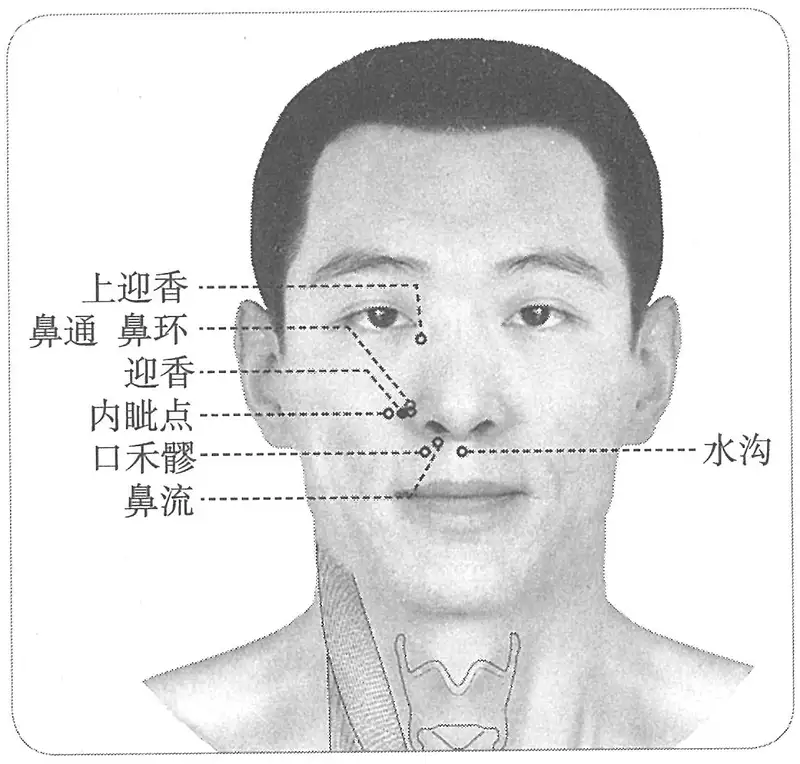

**图 2-46　迎香穴与相关穴图**

　1. 在禾窌上，鼻下孔旁。（《针灸甲乙经》卷三、《铜人腧穴针灸图经》卷上）

　2. 在禾窌上一寸，鼻孔旁。（《千金要方》卷二十九）

　3. 在禾窌上一寸，鼻下孔旁是穴。（《太平圣惠方·针经》）

　4. 在禾髎上一寸，鼻孔旁五分。（《铜人腧穴针灸图经》卷中）

　5. 在禾髎上，鼻孔旁五分。（《铜人腧穴针灸图经》卷下“穴腧都数”）

**按**：明正统仿宋针灸铜人的迎香穴标于鼻旁鼻唇沟中。

　6. 窦氏针灸遗存

　　(1) 在鼻孔旁五分斜缝中。（《窦太师针经》、《循经考穴编》）

　　(2) 在鼻下孔旁五分，当约口纹。（《针方六集》卷一）

　　(3) 在鼻孔旁五分直缝中。（《针灸玉龙歌》注）

　7. 禾髎斜上一寸，鼻洼外五分。（《针灸十四经穴位考订》）

　8. 统编针灸学教材

　　(1) 部位：在禾髎上，鼻孔旁。取穴：患者正视从睛明直下，鼻孔两旁五分取之。（1957年南京《针灸学》）

　　(2) 部位：禾髎上一寸，鼻孔旁五分。取穴：鼻翼沟根外端，鼻唇沟陷中取之。（1版《针灸学讲义》）

　　(3) 部位：在禾髎上，鼻下孔。取穴：在与鼻翼外缘中点平齐的鼻唇沟里取之。（2版《针灸学讲义》）

　　(4) 鼻翼旁0.5寸，鼻唇沟中。（4版《针灸学》）

　　(5) 鼻翼外缘中点，旁开0.5寸，当鼻唇沟中。（5、7版《针灸学》）

　　(6) 在鼻翼外缘中点旁，当鼻唇沟中。（6版《针灸学》）

　　(7) 在与鼻翼外缘中点平齐的鼻唇沟里取之。（《中国针灸学》）

**文献分析**：关于迎香穴的纵向距离，目前有两种不同的意见，第一种是横平鼻翼点，第二种是横平鼻翼下缘。究竟哪一种意见更合理，单靠古典文献研究难以判别。然而，根据古典文献的记载，有一点是非常明确的，即迎香与巨髎穴的位置关系是：迎香在巨髎穴的内侧，根据这一已知条件，我们设计了如下的判决性实验（三地共计310例），根据以上两种不同的定位，在人体标定迎香、巨髎的位置，然后测量二穴的位置关系是否能满足已知条件。结果：如果横平鼻翼下缘取穴，在18.3%的人群中，迎香与巨髎穴或者完全重合，或者位置关系颠倒，对于这些人，就根本无法确定迎香穴的位置。另有三分之一的人虽然迎香在巨髎的内侧，但距离不足3mm，使得迎香与巨髎很难区别。这就反证了另一种意见，即将迎香定于鼻翼点水平更合理。

〔p.258 (인쇄 238)〕

#### 【类属】 

手阳明大肠经穴。

**脉气所发**：手、足阳明之会。（《黄帝明堂经》）

**归经：**

　1. 足阳明经。（《外台秘要》卷三十九）

　2. 手阳明经。（《铜人腧穴针灸图经》卷上）

#### 【适应症】 

主治鼻部、口面部病症。常用于鼻渊，鼻衄；口眼㖞斜，面痒、面肿。

　1. 鼻鼽不利，窒洞气塞，㖞僻多洟，鼽衄有痈。（《黄帝明堂经》）

　2. 主鼻息不闻香臭，偏风面痒及面浮肿，风叶叶动状如虫行，或在唇痛。（《太平圣惠方·针经》）

　3. 治鼻有息肉不闻香臭，衄血，偏风口㖞，面痒浮肿，风动叶叶，状如虫行，或唇肿痛。（《铜人腧穴针灸图经》卷中）

　4. 窦太师针灸遗存

　　(1) 治鼻塞不闻香臭，生息肉，鼻流清涕，泻；浊涕名鼻渊，灸七壮，看症补泻。（《窦太师针经》）

　　(2) 治鼻塞不闻香臭，宜泻；鼻内生息肉，宜泻。（《大本琼瑶神书》）

　　(3) 主鼽衄，鼻渊息肉，不闻香臭，面风痒如虫行，并宜单泻，口眼㖞斜，可灸三壮。（《循经考穴编》上）

　5. 主眼目赤肿。（《医学入门》卷一上）

　6. 统编针灸学教材

　　(1) 鼻塞，息肉，鼽衄，口眼㖞斜，面痒浮肿，多涕不闻香臭。（1957年南京《针灸学》）

　　(2) 鼻塞多涕，鼽衄不闻香臭，口眼㖞斜，面痒浮肿。（1版《针灸学讲义》）

　　(3) 鼻塞不闻香臭，鼻衄，鼻渊，口眼㖞斜，面痒，浮肿。（2版《针灸学讲义》、《中国针灸学》）

　　(4) 鼻塞，鼽衄，口㖞，面痒，胆道蛔虫症。（4、5版《针灸学》）

　　(5) 鼻塞不通，口㖞，鼻衄，面痒，鼻息肉。（6版《针灸学》）

　　(6) 鼻塞，鼽衄，口㖞，胆道蛔虫症。（7版《针灸学》）

**文献分析**：《医学入门》所载本穴主治，系将“内迎香”主治混入；本穴的古今临床应用集中于鼻部及口面部病症，与《黄帝明堂经》所载主治相合。关于本穴与四白治疗胆道蛔虫症，虽见有现代临床报道，但采用的是迎香透四白穴的强刺激透刺法，不符合《中华人民共和国针灸穴典》要求的常规刺激的规定，不清楚四白透迎香，或者其他穴位组合的强刺激透刺法是否也有相同或更好的疗效，故暂不列入主治项下。

#### 迎香治胆道蛔虫的经验考源 

关于“迎香治胆道蛔虫的经验”的记载，大量见于20世纪60年代末至70年代新医疗法类书中，且多明确注有“新针疗法”或“新医疗法”字样，带有明显的那个特定时代的印迹。而对该经验用穴较完整的临床观察出自遵义医学院，该项研究始于1965年，但该成果于1970年发表时，针刺取穴中还没有提及“迎香”或“四白”[^24-1]，直到1971年发表时才明确提到“病重者迎香透四白”[^25-2]。

〔p.259 (인쇄 239)〕

有人分析该经验的形成或受明代《百症赋》的启发曰“面上虫行有验，迎香可取”，或者将此处的“面上虫行”理解成了面部的蛔虫斑。然而这里的“面上虫行”是说面痒如虫行，历代腧穴文献描述的非常清楚，与胆道蛔虫实不相干。

也有解剖学者试图为迎香、四白治疗胆道蛔虫提供解剖学依据，其认为面部的迎香、四白穴能治疗胆道蛔虫的机制是针刺此二穴所引起的神经冲动，经三叉神经上颌神经的感觉纤维传到三叉神经脊束核的上颌节段内，影响孤束核的胆道节段，再传到迷走神经背核的胆道节段，发出反射经迷走神经引起奥迪括约肌放松和胆道蠕动增加而驱出蛔虫，治愈疾病。这一观点的遗留问题是，三叉神经相关的穴位何其多，为什么偏偏只是迎香、四白，而不是其他穴？

#### 附：临床应用举例 

　1. 鼻部病症

　　(1) 鼻窒无闻，迎香可引。（《通玄指要赋》）

　　(2) 不闻香臭从何治，须向迎香穴内攻。（《针灸玉龙歌》）

　　(3) 头风鼻塞等症：灸上星；少愈，灸前顶，次迎香穴。（《针灸集要·盘石金直刺秘传》）

　　(4) 鼻塞不闻香臭：灸神庭，刺迎香泻之。（《针灸集要·盘石金直刺秘传》）

　　(5) 脑寒鼻出臭秽：上星、合谷、曲差。问曰：此证缘何而得？答曰：皆因鼻衄不止，用药吹入脑，伤损脑户，毒气攻上，故鼻流臭也。复刺后穴：人中、迎香。（《针灸集成》第十九方）

　　(6) 鼻衄不止：合谷、百会、上星。问曰：此证缘何而得？答曰：血气上壅，阴阳不能升降，血不宿肝，心主血，肝纳血，故气血不顺也。血盛而妄行于口，针前穴未效，复刺后穴：迎香、人中、印堂。（《针灸集成》第二十方）

　　(7) 两鼻鼽衄针禾窌，鼻窒不闻迎香间。（《灵光赋》）

　　(8) 鼻衄：迎香穴、太渊穴，针灸疗法。［四川中医，1988，6（4）：29］

　　(9) 特发性嗅觉功能障碍：取上迎香穴，直刺3~5分。［中医药研究，1998，14（6）：41］

　　(10) 鼻窒：取穴迎香、鼻通、印堂。肺虚邪滞证加风池、足三里、合谷，气滞血瘀证加合谷、三阴交、风池。针刺迎香透鼻通穴。［上海针灸杂志，2002，21（5）：41］

　2. 其他病症

　　(1) 耳聋气痞听会针，迎香穴泻功如神。（《席弘赋》）

　　(2) 胆道蛔虫症：针刺迎香透四白穴。［中医研究，1994，7（4）：43-44］

　　(3) 面部蚁行感：取双侧迎香穴用泻法，直刺0.1~0.2寸，使患者感到局部酸困感，不留针，出针后不挤压针眼。［中国针灸，1994（5）：56］

　　(4) 快速心律失常：取双侧迎香穴，提插捻转数次。［中国针灸，1996（5）：21-22］

#### 【操作】 

斜刺或平刺。

[^24-1]: 遵义医学院附属医院．中西医结合治疗胆道蛔虫症经验［J］．科技简报·医药卫生部分，1970（9）：36-37

[^25-2]: 遵义医学院急腹症研究组．中西医结合治疗胆道蛔虫病71例胆道蛔虫病的诊断和临床分型［M］．见北京中医学院编《新医疗法资料汇编》（内部资料），1971：201-203

〔p.260 (인쇄 240)〕

　1. 刺入三分。（《针灸甲乙经》卷三）

　2. 刺入三分，灸三壮。（《医心方》卷二）

　3. 针入三分，得气即泻……刺或在唇痛，卒风，泻讫更留三呼。宜针不宜灸。（《太平圣惠方·针经》）

　4. 针入三分，留三呼，不宜灸。（《铜人腧穴针灸图经》卷中）

　5. 针入一分。（《窦太师针经》）

　6. 直针一分，沿皮向后上三分，泻多补少，禁灸。（《针灸玉龙歌》注）

　7. 一法捻起鼻头针向鼻三分……并宜单泻。口眼㖞斜，可灸三壮，左取右，右取左。（《循经考穴编》上）

　8. 统编针灸学教材

　　(1) 针三分。（1957年南京《针灸学》、1、2版《针灸学讲义》）

　　(2) 斜刺或平刺0.3~0.5寸。（4、5版《针灸学》）

　　(3) 直刺或向上斜刺0.2~0.5寸；不宜灸。（6版《针灸学》）

　　(4) 略向内上方斜刺或平刺0.3~0.5寸。（7版《针灸学》）

　　(5) 斜刺或横刺0.3~0.5寸。（《中国针灸学》）

　9. 横刺，治胆道蛔虫症时，针尖透向四白，深0.5~1寸。治鼻病时针尖透向鼻通，深0.5~0.8寸。感应：局部胀痛、流泪，有时扩散至鼻部。（上海《针灸学》）

**刺法及主治的解剖学基础**：上颌神经终支出眶下孔前或后分为四支：下睑支、鼻外支、鼻内支、上唇支。治疗鼻病，须向内上方鼻部针刺，针感至鼻部为佳；治疗面瘫，可参照“内眦点”的刺法，向鼻根方向斜刺，或顺口轮匝肌纤维方向平刺。

### 延伸阅读 

　1. 黄龙祥，黄幼民．元代珍稀针灸三种［M］．北京：人民卫生出版社，2008.

　2. 黄龙祥．中国针灸学术史大纲［M］．北京：华夏出版社，2001：209-234.

　3. 黄龙祥．新编重绘十四经脉经穴图［M］．北京：中国中医药出版社，2010.

　4. 张登部．臂臑穴对眼科疾患的疗效［J］．山东医药，1975（3）：41.

　5. 林六梅．介绍臂臑穴在眼科上的应用［J］．中医杂志，1955（5）：29-30.

　6. 沈世绩．臂臑穴对球结膜下注射所致眼痛即刻镇痛24例观察［J］．中国针灸，1996（2）：15-16.

　7. 马玉琛，隋建成，刘安才．针刺迎香治疗快速心律失常68例疗效观察［J］．中国针灸，1996（5）：21-22.

〔p.261 (인쇄 241)〕

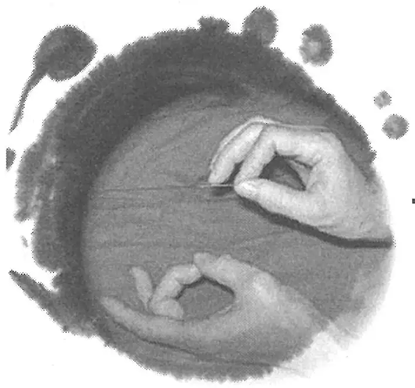

