# 《针灸腧穴通考》(上册) — 足阳明胃经穴 (1/3) · （一）承泣 Chéngqì ST1 出《黄帝明堂经》~（十八）乳根 Rūgēn ST18 出《黄帝明堂经》

> 분할본 6/25. 원서: 黄龙祥·黄幼民 编著, 《针灸腧穴通考——〈中华针灸穴典〉研究》(上册), 人民卫生出版社, 2011. 원서 스캔 OCR 판독본을 챗봇 검색용으로 나눈 것이며, 본문과 쪽 표시 〔p.PDF쪽 (인쇄 쪽)〕는 원본 그대로이다.

## 三、足阳明胃经穴 

### 概说 

足阳明经的经脉循行、病候以及腧穴归经的古代文献记载变化不大，然而足阳明经穴的起止与连接自宋以后却有两种明显不同的观点。在经穴定位方面，由于后人对《黄帝明堂经》“髀关”穴的定位描述不理解，故改用骨度折量定穴，但因采用了与《灵枢·骨度》不同的骨度折量系统，从而使该穴的位置较之《黄帝明堂经》的描述差之甚远。同样，出于对骨度折量系统的不同理解，虽然“丰隆”的定位，古代文献文字描述无分歧，然而实际的定位在不同时代不同医家间分歧很大。在定位方面分歧最大、影响最深的是下腹部足阳明经穴的纵向尺寸，分歧的原因依然是出于对不同骨度折量系统的误解，只是千百年来人们一直没有意识到问题的症结，因而始终找不到解决问题的正确方法。在穴名方面，足三里、上巨虚、下巨虚，宋以前文献径称“三里”、“上廉”、“下廉”，与手阳明经的“三里”、“上廉”、“下廉”同名，后人在归纳经穴主治时，由于不能正确辨识，出现了不少同名穴相混的错误。

#### 【经脉与经穴】 

#### 经脉循行与病候 

胃足阳明之脉，起于鼻之交頞中，旁纳一本作约字太阳之脉，下循鼻外，入上齿中，还出挟口环唇，下交承浆，却循颐后下廉，出大迎，循颊车，上耳前，过客主人，循发际，至额颅；其支者，从大迎前下人迎，循喉咙，入缺盆，下膈属胃络脾；其直者，从缺盆下乳内廉，下挟脐，入气街中；其支者，起于胃口，下循腹里，下至气街中而合，以下髀关，抵伏兔，下膝膑中，下循胫外廉，下足跗，入中指内间；其支者，下廉三寸而别，下入中指外间；其支者，别跗上，入大指间，出其端。是动则病洒洒振寒，善呻数欠，颜黑，病至则恶人与火，闻木声则惕然而惊，心欲动，独闭户塞牖而处，甚则欲上高而歌，弃衣而走，贲响腹胀，是为骭厥。是主血所生病者，狂疟，温淫汗出，鼽衄，口㖞唇胗，颈肿，喉痹，大腹水肿，膝膑肿痛，循膺、乳、气街、股、伏兔、骭外廉、足跗上皆痛，中指不用。气盛则身以前皆热，其有余于胃，则消谷善饥，溺色黄。气不足则身以前皆寒栗，胃中寒则胀满。（《灵枢·经脉》）

阳明脉系于骭骨外廉，循骭而上，穿髌，出鱼股之廉，上穿乳，穿颊，出目外廉，环颜。是动则病：洒洒病寒，喜伸，数吹，颜黑，病肿，病至则恶人与火，闻木音则惕然惊，心惕，欲独闭户牖而处，病甚则欲登高而歌，弃衣而走，此为骭蹷，是阳明脉主治。其所产病：跗上痹，膝跳，肠痛，腹外肿，心与胠痛，乳痛，颔颈痛，鼻鼽，颜痛，为十病。（《阴阳十一脉灸经》）

〔p.262 (인쇄 242)〕

足阳明脉循胻中，上贯膝中，出股，夹少腹，上出乳内廉，出嗌，夹口，以上之鼻。其病：病足中指废，胻痛，膝中肿，腹肿，乳内廉痛，□外肿，頄痛，鼽衄。数热汗出，脞（脧）瘦，颜寒。诸病此物者，皆灸阳明脉。（《足臂十一脉灸经》）

**按**：《灵枢·经脉》“循颊车，上耳前，过客主人，循发际，至额颅”一段循行显然是对《阴阳十一脉灸经》“环颜”的诠释，故《灵枢》此句前当加“其支者”三字。又由于《灵枢》在帛书经脉篇内容的基础上，引入经别的内容，使6条阳经也得以行于体内与相关六腑相联系，同时为实现十二经脉的循环流注，人为地增加一些分支以便于经脉依次交接，并使6条经脉改变了循行方向。但却忘记了对“经”、“别”，“直”、“支”加以的调整，未能形成统一的体例，顺应上述这些变化，因而使得通篇文字前后关系混乱，难以理解。关于《灵枢·经脉》足阳明胃经循行的经、别、直、支正确关系应如下作：

胃足阳明之脉，起于鼻交頞中，旁纳太阳之脉，下循鼻外，入上齿中，还出夹口环唇，下交承浆，却循颐后下廉，出大迎。其支者，从大迎循颊车，上耳前，过客主人，循发际，至额颅；其支（直）者，从大迎前下人迎，循喉咙，入缺盆；其别者，从缺盆下膈属胃络脾；其直者，从缺盆下乳内廉，下夹脐，入气街中；其支者，起于胃口，下循腹里，下至气街中而合；其直者，从气街以下髀关，抵伏兔，下膝髌中，下循胫外廉，下足跗，入中指内间；其支者，下膝三寸而别，以下入中指外间。

**所属经穴**：厉兑　内庭　陷谷　冲阳　解溪　丰隆　下巨虚　条口　上巨虚　足三里　犊鼻　梁丘　阴市　伏兔　髀关　气冲　归来　水道　大巨　外陵　天枢　滑肉门　太乙　关门　梁门　承满　不容　乳根　乳中　膺窗　屋翳　库房　气户　缺盆　气舍　水突　人迎　大迎　地仓　巨髎　四白　承泣　颊车　下关　头维

#### 【归经与起止穴演变】 

《针灸甲乙经》足阳明及股凡三十穴：厉兑、内庭、陷谷、冲阳、解溪、丰隆、巨虚下廉、条口、巨虚上廉、三里、犊鼻、梁丘、阴市、伏兔、髀关。

唐代《千金要方》、《千金翼方》将此十五穴正式归入“足阳明胃经”穴。

六朝《产经》“足阳明胃脉”穴除包括此十五穴外，又增入“曲尺”一穴（图2-47）。

唐代《外台秘要》又增加三十二穴：承泣、四白、迎香、巨髎、地仓、承浆、颊车、大迎、上关、下关、耳门、人迎、水突、气舍、气户、库房、屋翳、膺窗、乳中、乳根、不容、承满、梁门、关门、太乙、滑肉门、天枢、外陵、大巨、水道、归来、气冲。

宋代《铜人腧穴针灸图经》厘定为四十五穴：厉兑、内庭、陷谷、冲阳、解溪、丰隆、巨虚下廉、条口、巨虚上廉、三里、犊鼻、梁丘、阴市、伏兔、髀关、气冲、归来、水道、大巨、外陵、天枢、滑肉门、太乙、关门、梁门、承满、不容、乳根、乳中、膺窗、屋翳、库房、气户、缺盆、气舍、水突、人迎、大迎、地仓、巨髎、四白、承泣、颊车、下关、头维。

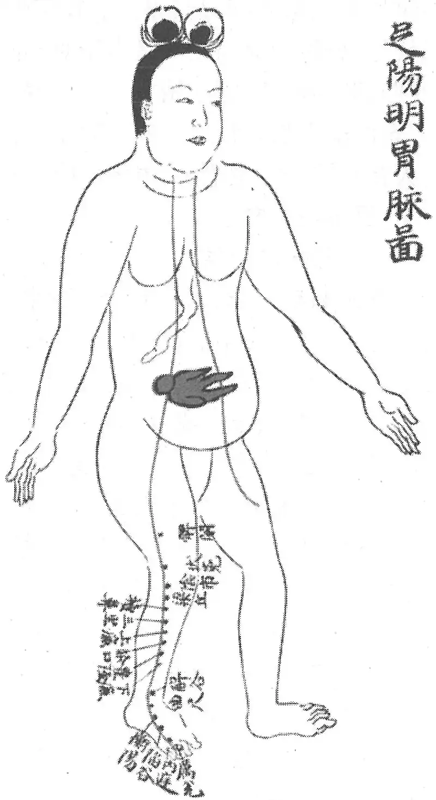

**图 2-47　《产经》足阳明胃脉图**

足阳明腧穴归经虽然分歧不大，但经穴起止与连接次序自宋以后一直存在着两种明显不同的方法，各有依据，且皆长时间广泛流行。分歧的根源在于：将经穴连线与经脉体表循行线混为一谈。对于针灸铜人及铜人图而言，如果一条经穴线出现两条并行的线，除非穴位旁添加编号，否则读者如何读得懂？可能正是由于这个因素，尽管自明初倡导《十四经发挥》后，足阳明经穴起于承泣说大行于世，但针灸铜人及铜人图，甚至直到民国时承淡安的《人体经穴图》，依然采用的是起于头维的单线连接画法。

〔p.263 (인쇄 243)〕

现今采用的是《十四经发挥》的连接法，而《铜人腧穴针灸图经》起于头维的连接法在古代很盛行，除了对铜人图的画法影响很大外，对明代“十四经步穴歌”的影响也很大。《铜人腧穴针灸图经》、《针灸大成》、《大本琼瑶神书》以及《医经小学》、《针灸问对》、《医学统宗》、《针方六集》、《经穴指掌图》等书的“步穴歌”、针灸铜人及铜人图的“经穴起止歌”中，足阳明经穴皆起自头维。

#### 【经穴定位与主治】 

腹部骨度分寸，《灵枢·骨度》曰“天枢以下至横骨长六寸半”，而《黄帝明堂经》下腹部第二侧行相应部位的腧穴间距尺寸累计达8寸。无独有偶，《黄帝内经太素·气府》中这段长度也为8寸。但腹部中行任脉、第一侧行肾经、第三侧行脾经相应区段腧穴尺寸累计分别为5寸、4.5寸、5寸。关于下腹部4条经穴的横向位置关系，千百年来古今医家众说不一。

其实，这个问题很简单。《黄帝明堂经》所载腧穴不是同时，或同一医家发现的，不同部位腧穴的度量尺度不一定相同。下腹部中行穴按5寸定穴，而第二侧行足阳明经穴按8寸定穴，如今要将按不同骨度分寸描述的腧穴定位统一按5寸的骨度描述，应当做相应的转换调整，例如水道穴距脐“八分之五”，折算相当于“五分之三”；大巨穴相应转换为1.25寸（保留小数点后1位则为1.3寸）；归来穴为4.5寸；气冲为5寸。虽然早在中国第一具针灸铜人点穴时已经意识到腹部腧穴定位的折量值是相对的，但在现存的古今针灸铜人及相关铜人图、明堂图中，能正确、彻底地理解并按严格的比例关系在模型中反映出来的，只有现藏于韩国德寿宫的针灸铜人一种（图2-48）。

至于足阳明经腹部经穴横向距离的变化主要受腹部肾经穴定位变化的影响，详见足少阴肾经穴“概说”。

足阳明经“犊鼻”穴定位经历了一个漫长的演变过程，渐渐与经外奇穴的“外膝眼”合而为一了。《黄帝明堂经》载犊鼻穴“在膝髌下，胻上夹解大筋中”，而早在初唐时，犊鼻穴已渐渐与外膝眼穴相混。例如《三家脚气论》谓犊鼻穴“在膝盖上外角宛宛中是”（《外台秘要》卷二十注曰：一云膝下），《千

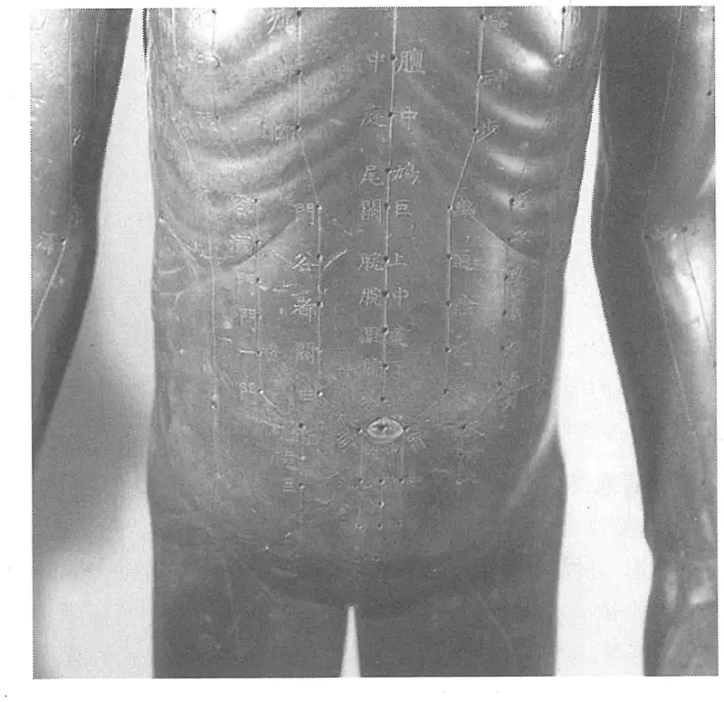

**图 2-48　韩国德寿宫针灸铜人**

〔p.264 (인쇄 244)〕

金翼方》中也见有类似记载。但这一定位法长期未被后世医家普遍接受，现藏日本国立博物馆一具约200年前的针灸铜人上“犊鼻”与“膝目”仍作为两个不同的腧穴清楚地标注。明代《医学入门》谓犊鼻“在膝头眼外侧大筋陷中”。又《类经图翼》将《千金要方》卷七及《千金翼方》卷二十六载犊鼻定位法内容作为“一法”附于《黄帝明堂经》犊鼻穴原定位法下。至清代官修医典《医宗金鉴》则明言“犊鼻即膝眼处也”。今则以外膝眼穴与犊鼻穴等同。原《黄帝明堂经》载之“犊鼻”穴遂名存实亡。由于国际针灸穴名标准中，内、外膝眼被分别分配了“内膝眼”和“膝眼”两个独立的穴名和编号，后者与经穴“犊鼻”的现代定位完全相同，因此在2006年颁布的新修版国家标准《腧穴名称与定位》中，删除了与经穴相重复的“膝眼”穴。

丰隆穴定位，古代文献记载无分歧，然而出于对不同的骨度折量系统的不同理解，使得此穴的实际定位出现许多分歧。

《灵枢·骨度》曰“膝以下至外踝长一尺六寸”，而《黄帝明堂经》相应部位间腧穴尺寸累计至少为一尺七寸：三里，膝下三寸；巨虚上廉，三里下三寸，即膝下六寸；巨虚下廉，上廉下三寸，即膝下九寸；丰隆：外踝上八寸，下廉胻外廉。

若按“丰隆”穴与“巨虚下廉”穴平齐，九寸加上八寸则一尺七寸；若按《医心方》载杨上善注本《明堂经》之说，“丰隆”在“巨虚下廉”之下，则总长度超出一尺七寸。因此《黄帝明堂经》取下肢穴时，膝至外踝的基准尺度至少为一尺七寸，显然与《骨度》篇的尺度不同。后人不知其中变故，为将《黄帝明堂经》定穴尺寸牵就于《灵枢·骨度》，想出多种方法处理“丰隆”穴的定位，或定于“巨虚下廉”上一寸（国标《经穴部位》）；或定于上巨虚穴外侧（朱琏《新针灸学》、马继兴《针灸治疗刺激点解剖位置参考图》）；或上巨虚上外侧（《经穴指掌图》）；《针灸甲乙经》、《千金要方》、《外台秘要》、《医心方》、《铜人腧穴针灸图经》排在下巨虚穴下，与《医心方》所录之《黄帝内经明堂》传本相合，“正统铜人”定于下巨虚外下方一寸；丘濬铜人图在下巨虚下一寸；而载于六朝时期《产经》中的“十脉图”丰隆穴排在“条口”与“下廉”之间。

#### 【脉口病候、经脉是动病候与经脉穴主治】 

足阳明标脉：两颊动脉（巨髎穴所在）。

足阳明本脉：冲阳脉（冲阳穴所在）。

“足阳明”穴：冲阳。

关于足阳明经脉的“是动”病（源出于足阳明脉口的诊断病候）与“足阳明”穴（冲阳）主治的比较见表2-3。

**表 2-3　足阳明脉是动病候与经脉穴主治的相关性**

| 《阴阳十一脉灸经》是动病候 | 《灵枢·经脉》是动病候 | 《黄帝明堂经》经脉穴主治 |
|---|---|---|
| 洒洒病寒，喜伸，数吹，颜黑，病肿，病至则恶人与火，闻木音则惕然惊，心惕，欲独闭户牖而处，病甚则欲登高而歌，弃衣而走，此为骭蹷，是阳明脉主治。 | 是动则病洒洒振寒，善呻数欠颜黑，病至则恶人与火，闻木声则惕然而惊，心欲动，独闭户塞牖而处，甚则欲上高而歌，弃衣而走，贲响腹胀，是为骭厥。 | 冲阳穴主治：“振寒而欠，狂妄而行，登高而歌，弃衣而走”；内庭穴主治：“善伸数欠，恶人与木音，振寒”。 |

〔p.265 (인쇄 245)〕

从上表对照可见，“足阳明”穴——冲阳穴主治病症包含了《阴阳十一脉灸经》和《灵枢·经脉》的足阳明经脉“是动”病，而且用字特征也如出一辙，可以明显看出从诊脉病候演为经脉病候的痕迹，也反映出早期针灸诊疗一体的特征。

#### 【诊络病候、络脉病候与络穴主治】 

足阳明之别，名曰丰隆，去踝八寸，别走太阴；其别者，循胫骨外廉，上络头项，合诸经之气，下络喉嗌。其病气逆则喉痹卒喑，实则狂巅，虚则足不收，胫枯，取之所别也。（《灵枢·经脉》）

丰隆，足阳明络也。在外踝上八寸，下廉胻外廉陷者中，别走太阴者。刺入三分，灸三壮。主厥头痛，面浮肿，烦心，狂见鬼，善笑不休，发于外，有所大喜，喉痹不能言。四肢肿，身湿。厥逆，足暴凊，胸痛如刺，腹若刀切之，闷不能食，大小便涩难。（《黄帝明堂经》）

《黄帝明堂经》载足阳明络穴主治未见十五络脉病候特有的“虚则……实则……”句式，应是现存《黄帝明堂经》佚文不全的缘故。

除了足阳明之络外，《素问》还记载了一条胃络“胃之大络，名曰虚里，贯膈络肺，出于左乳下，其动应衣，脉宗气也。盛喘数绝者，则病在中；结而横，有积矣；绝不至曰死。乳之下其动应衣，宗气泄也”（《素问·平人气象》）。

胃之大络，与脾之大络性质相同，均为脏腑之络，然受“十五”这一特定数字的限制，而不能入于“十五络脉”。值得注意的是，胃之大络“出于左乳下”而不像其他络脉左右对称分布，原因很简单，一般只在左乳下才能触及或视见跳动（心尖搏动），故曰“出于左乳下”，又由于此处脉动较别处明显而有力，故以此处诊脉之宗气（即脉动之原动力）。

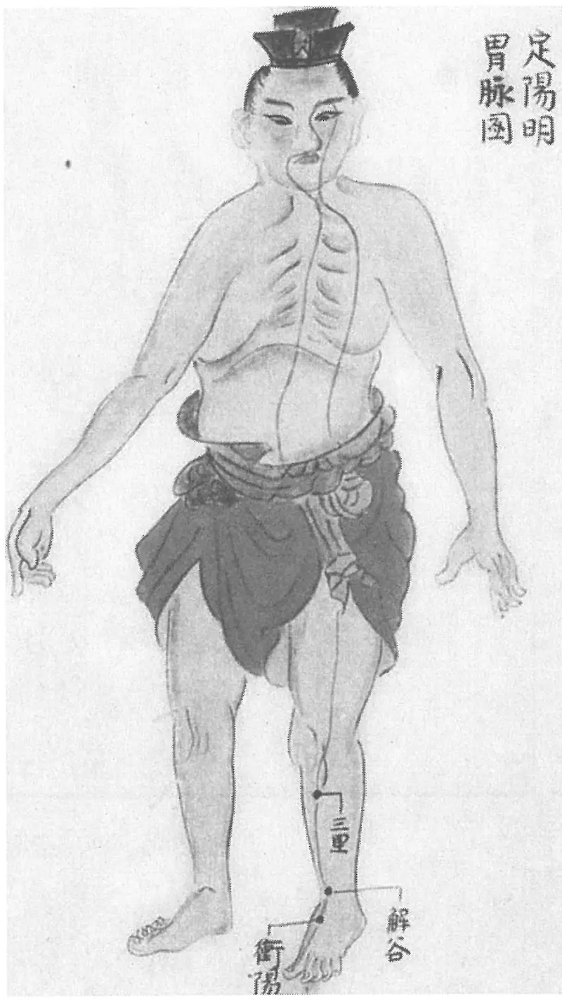

**图 2-49　《环中图》足阳明胃脉图**

〔p.266 (인쇄 246)〕

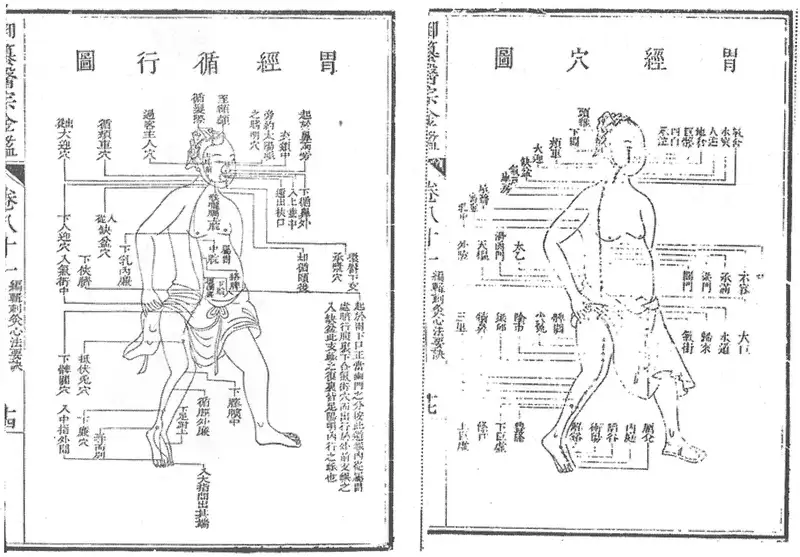

**图 2-50　《医宗金鉴》足阳明胃经脉、经穴分图**

〔p.267 (인쇄 247)〕

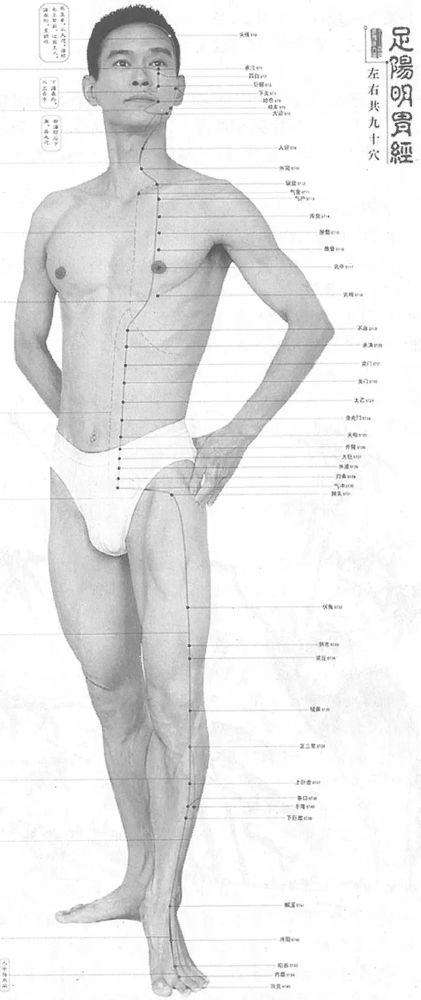

**图 2-51　黄龙祥编足阳明胃经脉、经穴合图**

〔p.268 (인쇄 248)〕

### （一）承泣 Chéngqì ST1 出《黄帝明堂经》 

问题1：足阳明经穴起于承泣，还是头维？

问题2：本穴究竟是禁针，还是禁灸？

#### 【提要索隐】 

足阳明经穴起止与连接次序自宋以后一直存在着两种明显不同的方法，各有依据，且皆长时间内广泛流行。现代采用的是《十四经发挥》起于承泣的连接法，而《铜人腧穴针灸图经》起于头维的连接法也很盛行，特别是对铜人图的画法以及明代十四经步穴歌的影响很大。

**穴名**：一名鼷穴（一作“谿穴”），一名面窌。

**部位**：在面部，眼球与眶下缘之间，瞳孔直下。

**适应症**：主治目疾。常用于目赤肿痛，流泪，夜盲，近视；眼睑瞤动，口眼㖞斜。斜视矫正术、青光眼手术针麻用穴。

**针刺操作**：拇指扣住眼球下缘，刺手紧靠眶下缘缓慢直刺0.3~1.0寸，不宜提插及大幅度捻转，针刺宜略朝内上方。不宜灸。

#### 【名实考】 

口之下名“承浆”，目之下谓“承泣”。一名鼷穴，一名面窌；一名谿穴。

关于本穴的定位，古代文献作“在目下七分”，关键问题在于对“目下”的理解，这里的“目下”是指眼裂下缘，而不是眼中心——瞳仁之下。现代采用解剖标志定位，而不拘于几寸几分。

　1. 目下各一。王冰注曰：谓承泣二穴也。（《素问·气府论》）

　2. 承泣，一名鼷穴，一名面窌。在目下七分，直目瞳子，阳𫏋、任脉、足阳明之会。（《针灸甲乙经》卷三）

　3. 承泣，一名谿穴，一名面窌。（《外台秘要》卷三十九）

　4. 穴在目下为泣之所至，故曰承泣。（《经穴解》）

#### 相关穴及刺激点 

　1. 健明　眼内眦角下外约四分，或眶下缘内1/4与外3/4交界处，眶下缘内方，即睛明穴下四分稍外处。主治白内障，视神经萎缩，视网膜炎，视网膜色素变性，夜盲，泪囊炎，斜视（外斜），角度白斑，斑翳，云翳，角膜葡萄肿。沿眶缘向眶尖针刺1寸~1.5寸，针感麻木或触电感。禁灸。（《针灸经外奇穴图谱（续集）》）

　2. 健明1　位于眶下缘内方，眶下缘内3/8与外5/8交界处，即承泣穴与健明穴之间。紧贴眶下进针。主治角膜葡萄肿，角膜白斑，白内障，视神经萎缩，青光眼，结膜炎，泪囊炎。针法：患者头后仰，针尖斜向内下刺1~1.5寸深。针感：眼后麻胀，维持时间长，时有放电感。出针后压迫针眼1~2分钟，防止出血。（《针灸经外奇穴图谱（续集）》）

　3. 健明2　位于眶下缘内方，眶下缘内5/8与外3/8交界处，即承泣穴与球后穴之间。主治角膜白斑，视神经萎缩，视网膜脉络膜炎，夜盲，角膜溃疡，泪囊炎，白内障。沿眶缘向眶尖针刺1寸~1.5寸，针感麻木或触电感。禁灸。（《针灸经外奇穴图谱（续集）》）

　4. 球后（睫状神经节刺激点）　位于面部眶下缘外1/4与内3/4交界处，即承泣穴微外上方。主治视神经萎缩、视神经炎。沿眶下缘进针，从外下斜向内上，朝视神经孔方向刺，可达4至5分深，得气时整个眼球有胀感。（《针灸经外奇穴图谱》）

〔p.269 (인쇄 249)〕

　5. 睫状神经节刺激点　位于眼眶下缘1/4与内3/4交接处。沿眼眶下壁向后稍向内上方针刺3.0~4.0cm。主治结膜炎、角膜炎、视网膜炎、视神经萎缩、近视。（《实用神经干电刺激疗法》）

　6. 面神经刺激点眼轮匝肌点　位于睑部，眼睑正中央，上、下眼睑各一点；眶部，眼眶上缘中点上0.5cm和眼眶下缘中点下0.5cm处各一点。刺法：睑部平刺0.5~0.8cm，眶部平刺1.0~1.5cm，切勿伤及眼球。主治面神经麻痹眼睑闭合障碍、眼睑痉挛。（《实用神经干电刺激疗法》）

**按**：上述健明三穴与承泣穴虽然体表进针点不同，但针刺方向及深度相同，这样针尖到达的位置亦应相同，故治疗的病症也相同，如此可视为同一穴的不同进针点。

又治疗面瘫是本穴的主治症之一，已知面瘫主要是由面神经、面肌（特别是表情肌）的障碍导致，因此针本穴治面瘫，可采用眼轮匝肌点的刺法。

#### 【定位】 

**部位**：在面部，眼球与眶下缘之间，瞳孔直下（图2-52）。

**取穴**：正坐，两目平视，瞳孔直下，当眼球与眶下缘之间取穴。

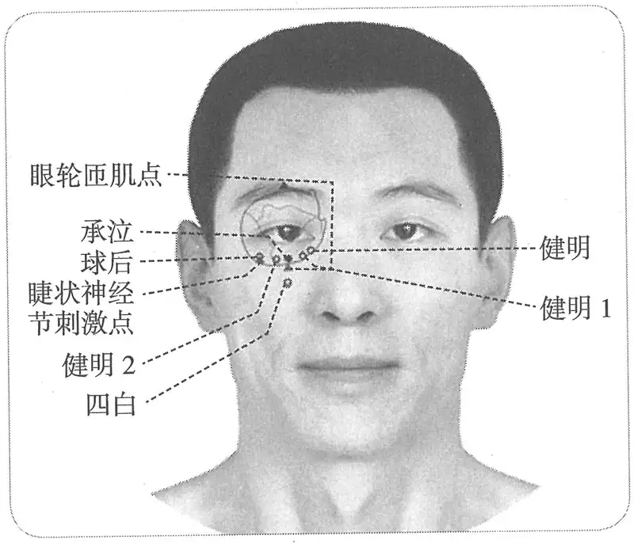

**图 2-52　承泣穴与相关穴及刺激点**

　1. 在目下七分，直目瞳子。（《黄帝明堂经》、《铜人腧穴针灸图经》卷上及卷下“穴腧都数”、《十四经发挥》、《医学入门》、《针方六集》）

　2. 在目下七分眶骨中，当瞳子直下陷中。（《千金翼方》卷二十六、《铜人腧穴针灸图经》卷中、《圣济总录》、《针灸资生经》、《医学纲目》、《针灸集书》、《针灸聚英》、《古今医统》、《针灸大成》、《类经图翼》、《循经考穴编》、《针灸逢源》）

　3. 甄权云在眼下八分。（《外台秘要》卷三十九）

　4. 在目下七分直瞳子陷中是穴。（《太平圣惠方·针经》卷九十九）

　5. 在目下七分，目下胞陷中，上直瞳子，正视取之。（《医宗金鉴·刺灸心法要诀》）

　6. 目下七分，直对瞳孔。（《针灸十四经穴位考订》）

　7. 统编针灸学教材

　　(1) 部位：在目下七分，直目瞳子。取穴：正视从瞳孔直下，当下眼睑半月缘正中，靠骨边取之。（1957年南京《针灸学》）

　　(2) 部位：目下七分。取穴：两目直视，瞳孔直下七分，下眼眶的上缘。正视，于下眼眶边缘直对瞳子处取之。（1版《针灸学讲义》）

　　(3) 部位：在目下七分，直目瞳子。取穴：位于眼球与眶下缘之间，取穴时正视当瞳孔直下。（2版《针灸学讲义》）

　　(4) 目正视，瞳孔直下，当眶下缘与眼球之间。（4、5、6、7版《针灸学》、《中国针灸学》）

**文献分析**：历代文献除《外台秘要》引甄权之文作“眼下八分”外，均作“目下七分”。至唐代《千金翼方》进一步说明在“眶骨中”，清代《医宗金鉴·刺灸心法要诀》曰“目下胞陷中”，均指眼球与眶下缘之间陷中，定位明确。考《千金翼方》、《太平圣惠方》引甄权《针经》文字仍作“在目下七分”，《外台秘要》引甄权之文未详所出，后世文献也未采用。总之，本穴解剖标志定位明确且简单，可不拘于折量分寸。

〔p.270 (인쇄 250)〕

#### 【类属】 

本穴虽系阳𫏋、任脉、足阳明三脉之会，但自《素问·气府论》以下皆归入足阳明胃经穴。

**脉气所发**：阳𫏋、任脉、足阳明之会。（《黄帝明堂经》）

**归经**：足阳明胃经。（《外台秘要》卷三十九、《铜人腧穴针灸图经》卷上）

#### 【适应症】 

主治目疾。常用于目赤肿痛，流泪，夜盲，近视；眼睑瞤动，口眼㖞斜。斜视矫正术、青光眼手术针麻用穴。

　1. 主目不明，泪出，目眩瞢，瞳子痒，远视䀮䀮，昏夜无见，目瞤动与项口参相引，㖞僻，口不能言。（《黄帝明堂经》）

　2. 视眼㖞不正，面动叶叶然，眼赤痛，冷热泪，目睑赤。（《千金翼方》卷二十七、《太平圣惠方·针经》）

　3. 治口眼㖞斜，目瞤面叶叶动，牵口眼，目视䀮䀮，冷泪，眼眦赤痛。（《铜人腧穴针灸图经》卷中）

　4. 治耳鸣，耳聋。（《针灸聚英》卷一、《针灸大成》、《针方六集》）

**按**：此条主治，未详所出，疑有误。教材没有采用，极是。

　5. 统编针灸学教材

　　(1) 目不明，泪出，昏夜无见，远视，口眼㖞斜，目瞤动。（1957年南京《针灸学》）

　　(2) 泪出，雀目，远视时模糊不清，口眼㖞斜，眼睑瞤动。（1版《针灸学讲义》）

　　(3) 目赤肿痛，流泪，夜盲，口眼㖞斜，眼睑瞤动。（2版《针灸学讲义》、4、5版《针灸学》、《中国针灸学》）

　　(4) 眼睑瞤动，目赤肿痛，夜盲，口眼㖞斜，迎风流泪。（6版《针灸学》）

　　(5) 眼睑瞤动、目赤肿痛、夜盲、近视等目疾；口眼歪斜，面肌痉挛。（7版《针灸学》）

**文献分析**：古今腧穴文献所记载的本穴主治病症与临床实际应用非常一致，都集中在目疾以及面瘫或面肌痉挛两方面。除本穴外，沿眶下缘由内至外有健明、健明1、健明2、球后等新穴，主治各种目疾。这也从另一方面提示，位于眶下缘中间的承泣，其作用部位重点在于目，其治疗面肌痉挛或面瘫也是当伴随目部症状时（“目瞤动与项口参相引”、“目之斜，灸以承泣；口之㖞，灸以地仓”）才是最佳适应症，而且在具体刺激上，宜参照眼轮匝肌点的刺激。由此可见，本穴的作用部位集中在目部。针麻眼科手术常用本穴，也说明这一点。

#### 附：临床应用举例 

　1. 证口眼㖞斜是经非窍辨，一长吏病此，命予疗之。目之斜，灸以承泣；口之㖞，灸以地仓，俱效。苟不效者，当灸人迎。夫气虚风入而为偏，上不得出，下不得泄，真气为气邪所陷，故宜灸。（《儒门事亲》卷二）

**按**：从这一针灸医案不难看出，取承泣穴治疗面瘫的特异指征是伴有眼部症状。这从一个侧面提示，承泣的作用部位集中于眼部。

　2. 面瘫眼球外突，太阳、承泣、四白。［江苏中医药，1983，4（6）：13］

　3. 病毒性角膜炎，承泣穴、合谷穴、睛明穴、太阳穴。［中华理疗杂志，1987（4）：220-222］

　4. 皮质盲，取穴1组，太冲、光明、头足临泣、三阴交、公孙、风池、瞳子髎；2组，承泣、合谷、足三里、攒竹、睛明、肝俞；3组，太阳、球后、内睛明、头针视区。3组交替使用，补虚泻实，邻近取穴捻转10分钟，不留针；循经取穴用平刺法，留针30分钟，眼区针不

〔p.271 (인쇄 251)〕

提插捻转。［上海针灸杂志，1988，7（1）：38］

#### 【操作】 

拇指扣住眼球下缘，刺手紧靠眶下缘缓慢直刺0.3~1.0寸。不宜提插及大幅度捻转，针刺宜略朝内上方。不宜灸。

　1. 刺入三分，不可灸。（《黄帝明堂经》）

　2. 入二分半，得气即泻，忌灸。（《千金翼方》卷二十七）

　3. 甄权云在眼下八分，禁不宜灸，无问多少，三日以后，眼下大如拳，息肉长桃许大，至一二十日即定；百日都不见物，或如升大。（《外台秘要》卷三十九）

　4. 针入四分半，得气即泻，特不宜久，若灸无问多少，三日以后，眼下大如拳，息肉日加长如桃许大，至三十日定都不见物，妨或如五升许大。（《太平圣惠方·针经》）

　5. 禁不宜针，针之令人目乌色，可灸三壮，炷如大麦，忌如常法。（《铜人腧穴针灸图经》卷中）

　6. 只可针三分，深即令人目陷，陷即不治。（《圣济总录》卷一九一）

　7. 禁针，针之令人目乌色，可灸三壮，炷如大麦。忌同。《铜人》云此穴可灸三壮。禁针，针之令人目乌色。《明堂》乃云针入四分半，特不宜灸，灸后眼下大如拳。二家必各有所据，未知其孰是，不针不灸可也。（《针灸资生经》卷一）

　8. 或问睛明、迎香、承泣、丝竹空，皆禁灸何也？曰四穴近目，目畏火，故禁灸也。（《针灸聚英·附辨》卷四）

　9. 禁用针灸。（《医学入门》卷一、《循经考穴编》）

　10. 禁针，禁灸。（《针灸十四经穴位考订》）

　11. 统编针灸学教材

　　(1) 医书皆言禁针灸，针之则目珠乌色。近十年来试针之，其效至佳，与睛明同，针用三十号微针，深入三、四分，留针半分钟，灸则未试。（1957年南京《针灸学》）

　　(2) 针四分，不宜灸。（1版《针灸学讲义》）

　　(3) 沿眶下缘直刺3~4分，不作捻转。（2版《针灸学讲义》）

　　(4) 以左手拇指向上轻推眼球，紧靠眶缘缓慢直刺0.5~1.5寸。（4版《针灸学》）

　　(5) 以左手拇指向上轻推眼球，紧靠眶缘缓慢直刺0.5~1.5寸，不宜提插，以防刺破血管引起血肿。（5版《针灸学》）

　　(6) 紧靠眶下缘直刺0.3~0.7寸；不宜灸。针刺时，应缓慢进针，不宜提插，以防刺破血管，引起眶内出血。（6版《针灸学》）

　　(7) 以左手拇指向上轻推眼球，紧靠眶缘缓慢直刺0.5~1.5寸，不宜提插，以防刺破血管引起血肿。出针时稍加按压，以防出血。（7版《针灸学》）

　　(8) 以左手拇指向上轻推眼球，紧靠眶下缘缓慢直刺0.3~0.7寸，不作大幅度捻转。（《中国针灸学》）

　12. 直刺，嘱病人眼向上看，固定眼球，针尖沿眼眶下壁缓慢刺入，深1~1.5寸。治疗近视时，可横刺，透向内眦角处。感应：局部酸胀，有时流泪。（上海《针灸学》）

**文献分析**：《黄帝明堂经》与甄权《针经》均谓本穴可针，不可灸，至《铜人腧穴针灸图经》改作可灸，不可针。这一改动，不能排除误改的可能性，而且几乎全文抄录《铜人腧穴针灸图经》针灸腧穴内容、同为北宋官修医书的《圣济总录》却并不认可这一改动，仍然采用《黄帝明堂经》之说。对于古代文献的这种分歧，现代医家采用实验的方法加以判定，结果表明：只要选择合适的针具、掌握正确的操作方法，此穴可刺且疗效显著。而因穴近目，故灸疗不便。

〔p.272 (인쇄 252)〕

承泣穴两旁沿眶下缘有健明、健明1、健明2、球后等新穴，其刺法多由眶下壁向眶尖刺0.5~1.5寸，针感麻胀，时有放电感。治疗眼病时，可借鉴；治疗面瘫伴眼肌障碍时，宜借鉴眼轮匝肌点刺法。

**刺法及主治的解剖学基础**：眶下沟内有眶下神经、眶下动脉、眶下静脉，若针尖贴近眶下壁刺入0.5寸以上时即有刺入眶下沟的危险。若刺破眶下动、静脉，出血会较严重。因此，深刺时针尖不可贴近眶下壁，应略朝眶尖方向。行上述针法时，应严格控制针刺深度，以免刺入颅腔以及损伤视神经、眼动脉；留针期间不可提插捻转，出针时应轻轻按压针孔片刻，以防出血。

面瘫主要表现为肌肉，特别是表情肌的障碍，眼轮匝肌位于眼眶周围，呈椭圆形。其于眶部紧贴眶部骨膜，睑部位于眼睑皮下。起自睑内侧韧带及其邻近的骨面，肌肉呈弓形向外，分别在外眦部止于皮肤及睑外侧韧带。眼轮匝肌由面神经支配，于睑部使眼睑闭合，眶部向下可牵动眉，向上则牵引颊部皮肤。眼轮匝肌具有闭眼和眨眼的作用。故针刺本穴宜顺着眼轮匝肌肌纤维的方向斜刺、平刺。

### （二）四白 Sìbái ST2 出《黄帝明堂经》 

问题：本穴部位，《黄帝明堂经》只说“目下一寸”，后世医家有理解为“目珠下一寸”、“目眶下一寸”的，这种理解是否正确？

#### 【提要索隐】 

**部位**：在面部，眶下孔处。

**国标修订**：1990年版国标：在面部，瞳孔直下，当眶下孔凹陷处。2006年修订版：在面部，眶下孔处。

**按**：“瞳孔直下”与“当眶下孔凹陷”，义重，且可能在较大人群中出现两点不相重合的情况，故2006年版国标加以修订。

**适应症**：主治目疾、面部病症。常用于目翳，目赤痛痒，流泪；口眼㖞斜，眼睑瞤动，面肌抽搐；头痛，眩晕。牙拔除术、唇裂整复术、上颌窦等口面部手术的针麻用穴。

**针刺操作**：进针方向略朝向外上方，直刺0.2~0.3寸。进针宜缓，不宜深刺，避免反复提插或捻转。不宜灸。

#### 【名实考】 

“四白”，以部位言有“唇四白”，临床发现针入眶下孔时，针感放散至上唇。本穴用于唇裂整复术的针麻用穴，也是基于这一原理。

关于本穴的定位，《黄帝明堂经》曰：“在目下一寸”，此处“目下”是指眼裂下缘，而不是眼中心——瞳仁之下。古代文献记载的取穴方法有两种，其一为骨度分寸法，其二为体表标志法。根据腧穴定位标准化的优先法则，国标采取体表标志——眶下孔定位法。

　1. 面鼽骨空各一，王冰注曰：谓四白穴也。在目下同身寸之一寸。（《素问·气府论》）

　2. 四白，在目下一寸。足阳明脉气所发。（《黄帝明堂经》）

　3. 四白，谓唇四际之白色肉也。（《素问·六节藏象论》王冰注）

　4. 四面皆白，此穴在中，故曰四白。（《经穴解》）

#### 相关穴及刺激点 

眶下神经刺激点：眶下孔处。可按以下方法确定：①自眼眶外缘至上唇中点做一连线，再经直视瞳孔做一垂线，两线交点即为针刺点。②眼眶下缘中点下0.8cm稍内方凹陷处。③在前正中线将鼻子的全长分为三等份，在其中、下1/3处旁开2.5~3.0cm处。④鼻翼外下缘与外眼角连线的中点。⑤两目正视，瞳孔垂直线下，眶下缘下0.8cm。⑥眶上切迹与第二前磨牙连线，在此线的轨迹上，眶下缘下0.8cm。⑦眶下缘下0.8cm，鼻中线旁开3cm处。刺法：针向后上方，微微偏外侧刺入1.0~1.5cm，刺入眶下孔内。刺中眶下神经，局部有酸胀或触电感，有时放射至上颌牙齿。适应症：三叉神经第二支痛、面神经麻痹、视力减退、上牙痛、面肌痉挛、胆绞痛。（《实用神经干电刺激疗法》）

〔p.273 (인쇄 253)〕

#### 【定位】 

**部位**：在面部，眶下孔处（图2-53）。

**取穴**：正坐或仰卧，两眼平视，当瞳孔直下，眶下缘下方，当眶下孔处。

**相关解剖学基础**：眶下孔位于犬齿窝内，从皮表可扪及，于瞳孔和唇角连线上的眶下嵴下方可触及一凹陷，即眶下孔。眶下孔开口向前、下、稍向内侧偏斜，是眶下管的外口。眶下孔处神经分布表浅，按之酸痛明显，若为切迹则酸痛感更加明显，可供取穴之参考。

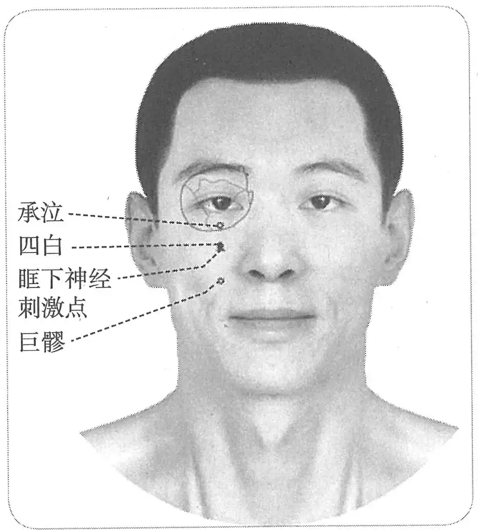

**图 2-53　四白穴与相关刺激点**

　1. 目下一寸

　　(1) 面鼽骨空各一。王冰注曰：谓四白穴也。在目下同身寸之一寸。（《素问·气府论》）

　　(2) 在目下一寸，向頄骨颧空。（《针灸甲乙经》卷三）

**按**：“向頄骨颧空”五字，其他各传本《黄帝明堂经》皆无，当系唐以后人据王冰注所添补。其中“向”系“面”之误，“颧”字系“頄”字的附注。明蓝格抄本作“向頄骨（頄音颧）空”，明建阳刊本《医学纲目》引宋本《针灸甲乙经》正作“面頄骨空”无误。

　　(3) 在目下一寸。（《千金要方》卷二十九、《千金翼方》、《外台秘要》、《素问·气府论》王冰注、《医心方》、《太平圣惠方·针经》、《铜人腧穴针灸图经》卷中、《圣济总录》、《针灸资生经》、《十四经发挥》、《针灸集书》、《针灸聚英》、《古今医统》、《医学入门》、《针灸大成》、《针方六集》、《类经图翼》、《循经考穴编》）

　　(4) 在目下一寸，直目瞳子。（《铜人腧穴针灸图经》卷上及卷下“穴腧都数”）

　　(5) 在目珠下一寸。（《窦太师针经》）

　　(6) 目眶下一寸，面鼽骨空。（《针灸集成》）

　　(7) 在目珠下一寸，向颧空，令病人正视取之。（《针方六集》）

　　(8) 从承泣直下三分，颧空骨内，亦直瞳子取之。（《医宗金鉴·刺灸心法要诀》）

　2. 在目下二寸。（《医学纲目》卷八）

**按**：《医学纲目》腧穴多抄自《铜人腧穴针灸图经》，此作“二寸”，则该穴位置与巨髎太近，显系笔误。

　3. 承泣下三分。（《针灸十四经穴位考订》）

　4. 统编针灸学教材

　　(1) 部位：目下一寸直对瞳子。取穴：正视从瞳子直下当下眼窝孔取之。（1957年南京《针灸学》）

〔p.274 (인쇄 254)〕

　　(2) 部位：目下一寸。取穴：在承泣穴下三分，于颧骨孔处取之。（1版《针灸学讲义》）

　　(3) 部位：目下一寸。取穴：在眶下孔凹陷部，正对瞳孔。（2版《针灸学讲义》）

　　(4) 目正视，瞳孔直下，当眶下孔凹陷中。（4、5、7版《针灸学》）

　　(5) 在面部瞳孔直下，当眶下孔凹陷处。（6版《针灸学》）

　　(6) 在承泣下方，当眶下孔凹陷中。（《中国针灸学》）

**文献分析**：关于本穴的定位，宋以前文献均从《黄帝明堂经》，定于目下一寸，至宋代《铜人腧穴针灸图经》增加一横坐标位置“直目瞳子”，定位更明确。至于对“目下一寸”起始点的理解，不同文献有不同。通过对《黄帝明堂经》腧穴定位术语的系统分析可知，凡言某物之“上”系指该物上缘（或上界）之上，凡言某物之下系指该物下缘（或下界）之下。故“目下一寸”当理解为眼裂下缘下一寸（即所谓“在目珠下一寸”）。除了骨度折量分寸定位外，《素问》王冰注还提供了体表骨性标志定位法，宋以后文献多从之。根据腧穴定位标准化的优先法则，国标采取体表标志定位法，故本穴的定位描述修订如下：“在面部，眶下孔处”。人体测量数据：眶下孔至眶下缘的垂直距离，男性8.33mm，女性7.86mm。由此可见，本穴采用体表标志定位更宜。

#### 【类属】 

足阳明胃经穴。

足阳明脉气所发。（《黄帝明堂经》）

#### 【适应症】 

主治目疾、面部病症。常用于目翳，目赤痛痒，流泪；口眼㖞斜，眼睑瞤动，面肌抽搐；头痛，眩晕。牙拔除术、唇裂整复术、上颌窦等口面部手术的针麻用穴。

　1. 主目痛，口僻，泪出，目不明。（《黄帝明堂经》）

　2. 头痛目眩，目眴不止。（《太平圣惠方·针经》）

　3. 治头痛目眩，眼生白翳，微风目瞤动不息。（《铜人腧穴针灸图经》卷中）

　4. 主目赤痛，僻泪不明，目痒，目肤翳，口眼㖞斜，不能言。（《针灸聚英》卷一、《针灸大成》）

**按**：此条主治系高武从《针灸资生经》转录《千金要方·孔穴主对法》条文。“僻泪不明”症，《针灸资生经·目痛》作“僻戾，目不明”。

　5. 统编针灸学教材

　　(1) 目赤痛痒、目翳、口眼㖞斜、眼睑瞤动、头痛、眩晕。（1957年南京《针灸学》、1、2、4、5版《针灸学》）

　　(2) 目赤痛痒、目翳、眼睑瞤动、迎风流泪、头面疼痛、口眼㖞斜。（6版《针灸学》）

　　(3) ①目赤痛痒、眼睑瞤动、目翳等目疾；②口眼㖞斜、三叉神经痛、面肌痉挛等面部病证；③头痛，眩晕。（7版《针灸学》）

　　(4) 目赤痛痒，口眼歪斜，眼睑瞤动，面痛。（《中国针灸学》）

**文献分析**：古今腧穴文献所记载的本穴主治病症与临床实际应用非常一致，都集中在目疾和面瘫或面肌痉挛两方面。

#### 附：临床应用举例 

　1. 目疾

　　(1) 目中生膜：睛明、太阳、合谷、四白、光明。问曰：已上穴法刺之不效，何也？答曰：此证受病既深，未可一时便能针愈，须是三次针之方可效。复刺后穴：睛明、合谷、四白。（《针灸集成》第十方、《针灸大成》卷九）

　　(2) 眼红肿疼痛：睛明、合谷、四白、临泣。问曰：此证从何而得？答曰：或因伤寒未解，却有房室之事，上盛下虚，气血上壅，或头风不早治，则血灌瞳人，或暴赤肿痛，或因怒气伤肝，心火炎上，故不散，及妇人产后怒气所伤，产暇未满房事，触毒心肝二经，饮食不节，饥饱醉劳，皆有此证也。证非一时可疗，渐而为之，无不效也。复刺后穴：风池、行间、期门、太阳。（《针灸集成》第十七方、《针灸大成》卷九）

〔p.275 (인쇄 255)〕

　　(3) 风沿眼红涩烂：睛明、四白、合谷、临泣、二间。问曰：针之不效，何也？答曰：醉饱行房，血气凝滞，痒而不散，用手揩摸，贼风乘时串入，故得此症。刺前不效，复刺后穴：三里、光明。（《针灸大成》卷九）

　　(4) 青少年近视眼：四白穴埋针。［中国针灸，1987（2）：18］

　　(5) 角膜溃疡：针刺主穴：四白、睛明。配穴：曲池、合谷。双眼患病取双侧穴位，单眼患病取本侧穴位。［中西医结合眼科杂志，1994（4）：244-245］

　2. 面瘫

　　(1) 面神经麻痹：四白穴、阳白穴、攒竹穴针灸疗法。［中医函授通讯，1987（1）：43-44］

　　(2) 周围性面瘫：阳白穴、太阳穴、四白穴针刺治疗。［上海针灸杂志，1988，7（1）：44-45］

#### 【操作】 

进针方向略朝向外上方，直刺0.2~0.3寸。进针宜缓，不宜深刺，避免反复提插或捻转。治疗面瘫，可用透刺法。不宜灸。

　1. 刺入三分，灸七壮。（《黄帝明堂经》）

　2. 可灸七壮，针入三分，凡用针稳审方得下针，若针深即令人目乌色。（《铜人腧穴针灸图经》卷中）

　3. 针入一分，禁灸。（《窦太师针经》）

　4. 针入三分，禁灸。（《医学入门》卷一）

　5. 近古禁不宜灸。（《针方六集》卷一）

　6. 宜向颧骨空处，不可深，深则目黑。（《循经考穴编》上）

　7. 统编针灸学教材

　　(1) 针二至三分，过深则眼珠成青黄色，其理尚不明，灸五壮为最多。（1957年南京《针灸学》）

　　(2) 针二至三分，针尖角度向颧骨孔处，不宜深刺。（1版《针灸学讲义》）

　　(3) 直刺2~3分，不可深刺。（2版《针灸学讲义》）

　　(4) 直刺或向上斜刺0.3~0.5寸。不可深刺，以防刺伤眼球。（4版《针灸学》）

　　(5) 直刺或斜刺0.3~0.5寸不可深刺。（5版《针灸学》）

　　(6) 直刺0.2~0.4寸，不宜灸。（6版《针灸学》）

　　(7) 直刺或微向上斜刺0.3~0.5寸，不可深刺，以免伤及眼球，不可过度提插捻转。（7版《针灸学》）

　　(8) 直刺0.2~0.3寸，不可深刺。（《中国针灸学》）

　8. ①直刺，0.3~0.8寸；横刺，0.8~1寸。感应：局部酸胀。②治疗三叉神经痛时，可斜刺从下向外上，进针0.3~0.6寸，刺入眶下孔。感应：可有麻电感放散至上唇部。（上海《针灸学》）

**文献分析**：虽然早在唐代，王冰就注明本穴在颧骨孔（即眶下孔）处，而具体到刺法，直到清初《循经考穴编》才明确提出刺向“颧骨空处”；现代文献中以1974年上海《针灸学》描述最为详细。

**刺法及主治的解剖学基础**：眶下孔的开口朝向前下内方，呈卵圆形，纵径平均5mm，横径平均3mm，有眶下血管和神经穿行。虽然眶下孔至眶下缘的垂直距离的具体数值不同的文献报道略有不同，但共同的一点是：女性的距离略小于男性（中国解剖学会的测量结果：男性8.33mm，女性7.86mm）。由于眶下孔的开口朝向前下内方，故针尖略朝向外上方顺势缓慢进针为宜，当针下出现落空感，即表明针尖已经进入眶下孔，此时患者出现放射至上唇的异感。针入眶下孔不宜超过1cm。若针刺过深，有可能经眶下孔入眶下管，而眶下动、静脉在眶下管内，若被刺伤，会造成出血。这说明古人的观察和经验是可信的。

〔p.276 (인쇄 256)〕

### （三）巨髎 Jùliáo ST3 出《黄帝明堂经》 

问题：“巨髎”与“居髎”音近，给口头交流带来不便，如何解决？

#### 【提要索隐】 

**部位**：在面部，横平鼻翼下缘，瞳孔直下。

**国标修订**：1990年版国标：在面部，瞳孔直下，平鼻翼下缘处，当鼻唇沟外侧。2006年修订版：在面部，横平鼻翼下缘，瞳孔直下。

**按**：1990年版国标加上“当鼻唇沟外侧”，不仅未详文献依据，而且鼻唇沟的个体差异较大，故2006年版国标不再用此标志定穴。

**适应症**：主治目疾、面部病症。常用于青盲，视物不清，目翳，眼睑瞤动，口眼㖞斜，面肿等。

**针刺操作**：直刺0.3~0.5寸。

#### 【名实考】 

巨髎，巨者，大也；髎者，孔穴也。穴处面部大孔处，故曰“巨髎”。《千金翼方》作“臣窌”，形误。

“巨髎”与“禾髎”字形相近，针灸古籍中有相混之例。

“巨髎”与“居髎”同音，给国际交流带来不便，建议：本穴改作“口巨髎”。

《太平圣惠方》将本穴定位与手阳明穴“禾髎”相混，明代高武不识此误，将此说与《黄帝明堂经》文字相调和，不伦不类。现代针灸学教材关于本穴定位未受此误影响。

　1. 巨窌，在夹鼻旁八分，直瞳子，𫏋脉、足阳明、任脉之会。（《黄帝明堂经》）

　2. 巨者，大也；髎者，穴之称也。此穴正在颧下空软处最宽，故曰巨髎。然必细按有小动脉应手，方是穴处。（《经穴解》）

#### “巨髎”与“禾髎”相混例 

巨髎二穴，在鼻孔下，夹水沟旁八分是穴。（《太平圣惠方·针经》）

**按**：此系与禾髎穴定位相混。《铜人腧穴针灸图经》受此误影响，改变了其邻近的迎香穴的定位，从而使得此二穴的位置关系发生了变化。

#### 相关穴及刺激点 

以下几个刺激点均主治面神经麻痹，口角㖞斜。

　1. 颧肌点　眼眶外缘直下，与上唇缘中点相平处。针向耳尖方向斜刺1.0~1.5cm。（《实用神经干电刺激疗法》）

　2. 内眦点　眼眶下缘外3/4与内1/4交点直下，平鼻翼外缘中点处。针向鼻根方向斜刺1.0~1.5cm。（《实用神经干电刺激疗法》）

　3. 眶下点（面神经刺激点上唇方肌点之一）　眼眶下缘中点直下，与鼻翼下缘相平处。针向眼眶下缘中点方向斜刺1.0~1.5cm。（《实用神经干电刺激疗法》）

　4. 颧点　眼眶下缘内3/4与外1/4交点直下，平人中沟中点处。针向眼眶外缘方向斜刺

〔p.277 (인쇄 257)〕

1.0~1.5cm。（《实用神经干电刺激疗法》）

#### 【定位】 

**部位**：在面部，横平鼻翼下缘，瞳孔直下（图2-54）。

**取穴**：两目平视，瞳孔垂线与鼻翼下缘水平线的交点处。

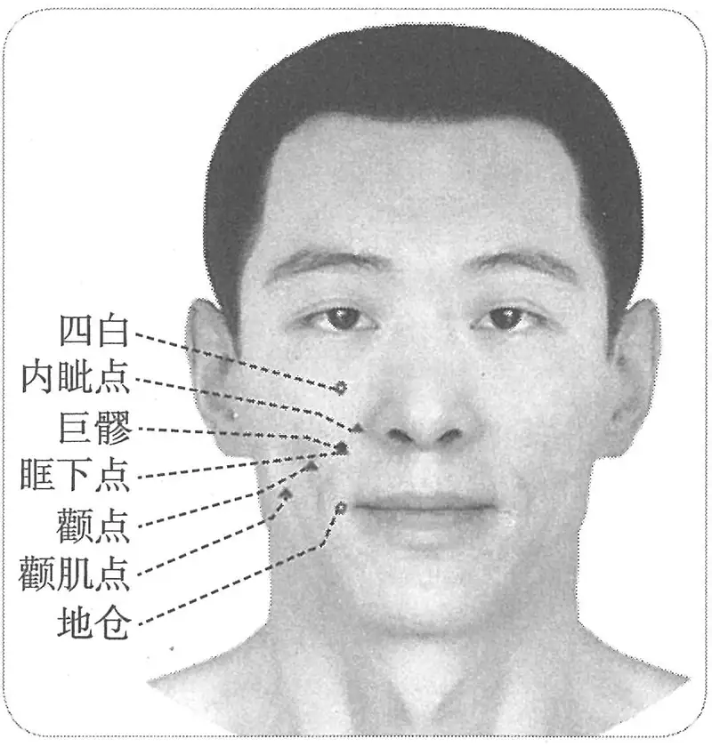

**图 2-54　巨髎穴与相关刺激点**

　1. 在夹鼻旁八分，直瞳子。（《黄帝明堂经》、《铜人腧穴针灸图经》卷上及卷下）

　2. 在鼻孔下，夹水沟旁八分是穴。（《太平圣惠方·针经》）

**按**：此系与禾髎穴定位相混。

　3. 在夹鼻孔旁八分，直瞳子。（《铜人腧穴针灸图经》卷中、《圣济总录》、《针灸资生经》、《十四经发挥》、《医学纲目》、《针灸集书》、《医学入门》、《针方六集》、《类经图翼》、《循经考穴编》、《医宗金鉴·刺灸心法要诀》、《针灸逢源》）

　4. 夹鼻孔旁八分，直目瞳子。《明》云巨髎在鼻孔下夹水沟旁八分。（《针灸资生经》第一）

　5. 夹鼻孔旁八分，直瞳子，平水沟。（《针灸聚英》卷一、《古今医统》、《针灸大成》）

**按**：《针灸资生经》于巨髎穴平列《铜人腧穴针灸图经》与《太平圣惠方》二说，且未断是非，高武编《针灸聚英》时，则综合二说，自相矛盾。

　6. 鼻孔旁八分，与水沟平，直对瞳孔。（《针灸十四经穴位考订》）

　7. 统编针灸学教材

　　(1) 部位：鼻孔旁目下，直对瞳子。取穴：正视从鼻孔旁眼睛下，与瞳子成直线之处取之。（1957年南京《针灸学》）

　　(2) 部位：鼻孔旁八分。取穴：从四白穴直下，于鼻翼根旁开直瞳子取之。（1版《针灸学讲义》）

　　(3) 部位：在侠鼻孔旁八分，直瞳子。取穴：在四白穴直下方，与鼻翼下缘平齐，相当于鼻唇沟的外侧取之。（2版《针灸学讲义》）

　　(4) 目正视，瞳孔直下，平鼻翼下缘处。（4、5、7版《针灸学》）

　　(5) 在面部瞳孔直下，平鼻翼下缘处，当鼻唇沟外侧。（6版《针灸学》）

　　(6) 在四白直下方，平鼻翼下缘处，当鼻唇沟外侧。（《中国针灸学》）

**文献分析**：本穴定位，《黄帝明堂经》作“夹鼻旁八分，直瞳子”，手阳明经穴“迎香”定位为“在禾窌上，鼻下孔旁”，“禾髎”穴为“在直鼻孔下，夹水沟旁五分”。据此三穴的上下位置关系推导如下：巨髎在鼻孔上，禾髎在鼻孔下，迎香平鼻孔。而现代的定位却是：迎香在上，巨髎居中，禾髎在下（明正统仿宋针灸铜人此三穴的水平位置关系正如是）。之所以有这样的变化，可能与宋代文献中此三穴的定位文字错乱有关。先是《太平圣惠方》将禾髎穴定位文字混入巨髎穴中作“在鼻孔下，夹水沟旁八分”，《铜人腧穴针灸图经》受此干扰于卷中将巨髎穴定位原文“夹鼻旁八分”改作“夹鼻孔旁八分”（卷上、卷下均未改），迎香穴定位改作“在禾髎上一寸，鼻孔旁五分”（而卷上、卷下均未改），这样一来此二穴水平高度就在不知不觉中被颠倒了。

#### 【类属】 

足阳明胃经穴。

〔p.278 (인쇄 258)〕

　1. 𫏋脉、足阳明之会。（《针灸甲乙经》卷三、《外台秘要》、《太平圣惠方·针经》、《铜人腧穴针灸图经》卷中）

　2. 阳𫏋脉、任脉之会。（《黄帝内经太素·任脉》杨上善注、《医心方》）

　3. 归经　足阳明胃经。（《外台秘要》卷三十九、《铜人腧穴针灸图经》卷上）

#### 【适应症】 

主治目疾、面部病症。常用于青盲，视物不清，目翳；眼睑瞤动，口眼㖞斜，面肿等。

　1. 主面目恶风寒，目中淫肤白膜。瘛疭，口僻，䪼肿臃痛，招摇视瞻。青盲无所见，远视䀮䀮。（《黄帝明堂经》）

　2. 鼻频音准上肿。（《太平圣惠方·针经》）

　3. 治青盲目无所见，远视䀮䀮，白翳覆瞳子，面风寒，鼻䪼上肿壅痛，瘛疭口㖞。（《铜人腧穴针灸图经》卷中）

　4. 主脚气膝肿。（《针灸聚英》卷一、《古今医统》、《针灸大成》、《针方六集》）

**按**：此条主治不见于《针灸资生经》、《针灸摘英集》，未详所出，疑有误。

　5. 统编针灸学教材

　　(1) 绿内障，泪出，口眼㖞斜，眼睑瞤动，鼻衄，齿痛，颔肿，唇颊肿。（1957年南京《针灸学》）

　　(2) 口眼㖞斜，眼睑瞤动，迎风流泪，鼻衄，齿痛，颔肿，唇颊肿。（1版《针灸学讲义》）

　　(3) 口眼㖞斜，眼睑瞤动，鼻衄，齿痛，唇颊肿。（2版《针灸学讲义》、4、5版《针灸学》、《中国针灸学》）

　　(4) 口眼㖞斜，眼睑瞤动，鼻衄，齿痛，面痛。（6版《针灸学》）

　　(5) 口角歪斜，鼻衄，齿痛，唇颊肿等局部五官病证。（7版《针灸学》）

**文献分析**：明代《针灸聚英》经穴条文系辑自《针灸资生经》、《针经摘英集》，今检所载本穴主治“脚气膝肿”不见于上述二书，疑有误。针灸学教材中“鼻衄，齿痛”症未详所出，也未见临床应用，疑是“禾髎”穴主治误入于此。

#### 附：临床应用举例 

　1. 面赤颊热，恶风寒，颔痛，攒竹、玉枕灸三壮，妙、巨髎灸五壮。（《医学纲目》卷二十五）

　2. 庚辰岁过扬，大尹黄缜庵公，昔在京朝夕相与，情谊甚笃，进谒留疑，不忍分袂，言及三郎患面部疾，数载不愈，甚忧之……今承相顾，知公善针，疾愈有期矣。予针巨髎、合谷等穴，更灸三里，徐徐调之而愈。（《针灸大成》卷九）

#### 【操作】 

直刺0.3~0.5寸。

　1. 刺入三分。（《黄帝明堂经》）

　2. 针入三分，得气即泻。灸亦良，灸七壮止。（《太平圣惠方·针经》）

　3. 针三分，灸五壮。（《针灸十四经穴位考订》）

　4. 统编针灸学教材

　　(1) 针三至四分，灸五壮。（1957年南京《针灸学》）

　　(2) 针三至四分，灸三壮。（1版《针灸学讲义》）

　　(3) 刺3~4分，艾条灸3~5分钟。（2版《针灸学讲义》）

　　(4) 斜刺或平刺0.3~0.5寸。（4、5、7版《针灸学》、《中国针灸学》）

　　(5) 直刺0.3~0.6寸；可灸。（6版《针灸学》）

〔p.279 (인쇄 259)〕

### （四）地仓 Dìcāng ST4 出《黄帝明堂经》 

问题：地仓微动之脉，似有似无，时有时无，如何触及？

#### 【提要索隐】 

**穴名**：地仓，一名胃维。

**部位**：在面部，口角旁开0.4寸（指寸）。

**国标修订**：1990年版国标：在面部，口角外侧，上直瞳孔。2006年修订版：在面部，口角旁开0.4寸（指寸）。

**按**：由于口角的宽度会因人而异，过瞳孔的垂线可能正好与口角相交，甚至可能落在口角的内侧。因此新版国标本穴定位不再以瞳孔作为定位标志。

**适应症**：主治口面部病症。常用于口眼㖞斜、语言謇涩、口角流涎等以口部症状为主的面瘫病症。

**备选适应症**：三叉神经痛。

**针刺操作**：斜刺或平刺。治面瘫可透颊车穴。

#### 【名实考】 

胃为太仓，三部脉法中两颊之脉为“地”，本穴位于口旁，故曰地仓，又名胃维。宋以前文献有写作“地苍”，乃同音借代。传世本《针灸甲乙经》另载一别名“会维”，而唐代《外台秘要》引《针灸甲乙经》之文仍作“胃维”。今《针灸甲乙经》一书宋本不传，现存版本错讹较多，不能排除音近致误的可能，故暂不将“会维”列入本穴别名。

关于本穴定位，唐代甄权增加了一脉动取穴标志，并说此脉似有似无，时有时无。实验的结果表明，古人的观察非常精细，触诊此脉的确需要一定的技巧（详见后文）。

　1. 地仓，一名胃维。夹口旁四分如近下是，𫏋脉、手足阳明之会。（《黄帝明堂经》）

　2. 地苍二穴。（《太平圣惠方·针经》）

　3. 地仓，一名会维。（《针灸甲乙经》卷三）

　4. 此穴在面最下，故有地之称。以本经为仓廪之官，乃饮食所入，故曰地仓。（《经穴解》）

#### 相关穴及刺激点 

面神经刺激点颊肌点：位于眼眶外缘直下平口角处。主治面神经麻痹口角㖞斜，咀嚼时口内夹食，吮吸障碍。针向耳垂方向斜刺1.5~2.5cm。（《实用神经干电刺激疗法》）

#### 【定位】 

**部位**：在面部，口角旁开0.4寸（指寸）（图2-55）。

**取穴**：在口角外侧，巨髎穴直下取之。

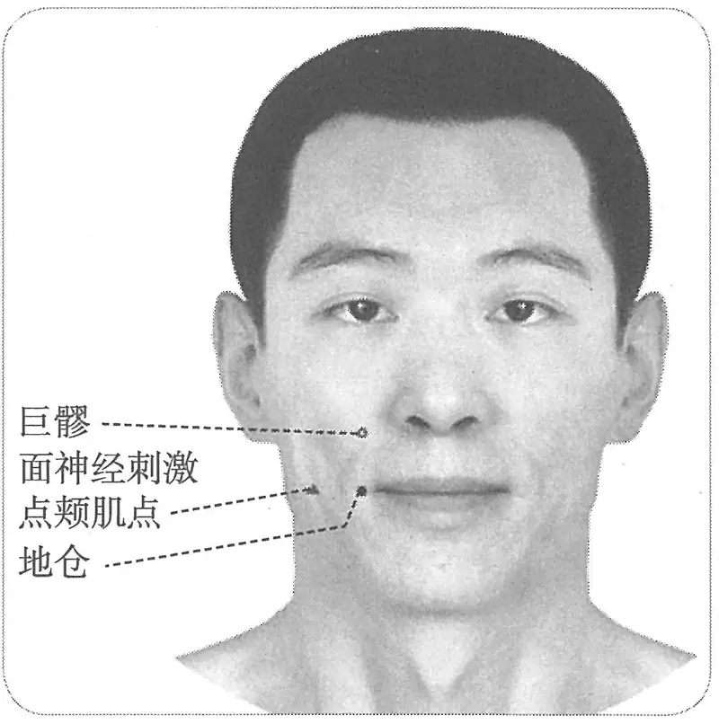

**图 2-55　地仓穴与相关刺激点**

　1. 《黄帝明堂经》佚文

　　(1) 夹口旁四分，如近下是。（《针灸甲乙经》卷三、《外台秘要》）

　　(2) 夹口旁四分。（《千金要方》卷二十九、《千金翼方》、《医心方》、《铜人腧穴针灸图经》卷上及卷下“穴腧都数”）

　2. 一云在口角一韭叶近下动脉。（《千金翼方》卷二十六）

　3. 甄权《针经》佚文

　　(1) 在夹口旁四分外，如近下有脉微动者是也。大患风者，其脉亦有动时，亦有不动时。（《太平圣惠方·针经》）

〔p.280 (인쇄 260)〕

　　(2) 夹口吻旁四分外，如近下有脉微微动。若久患风，其脉亦有不动者。（《铜人腧穴针灸图经》卷中）

　4. 窦太师针灸遗存

　　(1) 在夹口吻旁四分，直缝中，外如近下有脉微动。（《窦太师针经》）

　　(2) 在口角旁四分斜缝中是穴。（《窦太师秘传》）

　　(3) 夹口旁四分，直缝中，如近下是穴，有脉微动。（《针方六集》卷一）

　　(4) 广注：口角旁四分直缝中。（《循经考穴编》上）

　　(5) 在口吻傍四分斜口透缝中。《医经会元·玉龙歌》

　5. 在口吻旁五分。针缝中是，令笑而取之。（《针灸捷径》）

　6. 口角旁四分。（《针灸十四经穴位考订》）

　7. 统编针灸学教材

　　(1) 部位：夹口旁四分。取穴：从口角之侧，旁四分取之。（1957年南京《针灸学》）

　　(2) 部位：口角旁四分。取穴：巨髎穴之下，口角之旁取之。（1版《针灸学讲义》）

　　(3) 部位：夹口旁四分。取穴：在口角外侧，巨髎直下方取之。（2版《针灸学讲义》）

　　(4) 口角旁0.4寸。（4版《针灸学》）

　　(5) 口角旁0.4寸，巨髎穴直下取之。（5版《针灸学》）

　　(6) 在面部，口角外侧，上直对瞳孔。（6版《针灸学》）

　　(7) 口角旁约0.4寸，上直对瞳孔。（7版《针灸学》）。

　　(8) 口角外侧，巨髎直下。（《中国针灸学》）

**文献分析**：本穴定位，古今文献均谓“在口角旁四分”，至唐代甄权又增加“脉动”的标志，传世本《针灸甲乙经》“如近下”可能为甄权之后人所添加。实验的结果表明：在距离唇的游离缘约0.4寸稍下方的黏膜面上可摸到下唇动脉（labial artery）的搏动。触诊的技巧：可将一手指放入口腔内作为支撑面，拇指放在皮肤表面，较易触及脉动。

金元窦太师针灸又增加了“鼻唇沟”这一取穴标志，之后《针灸捷径》还增补了具体的取穴法“笑而取之”，目的也在于使鼻唇沟更明显。然而鼻唇沟个体差异较大，在部分个体，地仓穴并不正当鼻唇沟，或此处不见明显的鼻唇沟，故不宜用作取穴的通用标志。

#### 【类属】 

足阳明胃经穴。

　1. 𫏋脉、手足阳明之会。（《黄帝明堂经》）

　2. 𫏋脉、足阳明之交会。（《铜人腧穴针灸图经》卷上）

　3. 𫏋脉、手阳明之交会。（《太平圣惠方·针经》、《铜人腧穴针灸图经》卷中）

　4. 归经　足阳明胃经。（《外台秘要》卷三十九、《铜人腧穴针灸图经》卷上）

#### 【适应症】 

主治口面部病症。常用于口眼㖞斜、语言謇涩、口角流涎等以口部症状为主的面瘫病症。

**备选适应症**：三叉神经痛。

　1. 主口缓不收，不能言语，手足痿躄不能行。（《黄帝明堂经》）

**按**：《黄帝明堂经》载腧穴主治，其口面部穴治四肢部病症者极少，此即一例。或许此条主治辑自某治疗偏风方，本穴主治“口缓不收，不能言语”，其“手足痿躄不能行”当另有配穴所主，或正因此，甄权《针经》本穴下未载相关主治症。

　2. 主疗大患风者，其脉亦有动时，亦有不动时。偏风口㖞，不得饮水浆，食漏落，脉瞤动。

〔p.281 (인쇄 261)〕

（《太平圣惠方·针经》）

**按**：以上描述均系“偏风口㖞”（面瘫）的症状。

　3. 治偏风口㖞，目不得闭，失喑不语，饮食不收，水浆漏落，眼瞤动不止。（《铜人腧穴针灸图经》卷中）

　4. 主瞳子痒，远视䀮䀮，昏夜无见。（《针灸聚英》卷一、《古今医统》、《针灸大成》）

**按**：此系高武将《针灸资生经》卷六“目上视”篇“地仓”穴下一条“承泣”穴主治误录于此。

　5. 主治牙关不开，齿痛颊肿。（《类经图翼》卷六、《医宗金鉴·刺灸心法要诀》）

**按**：“牙关不开，齿痛颊肿”系颊车穴主治，张景岳误录于本穴下。

　6. 针灸歌赋主治　口眼㖞斜（《针灸玉龙歌》、《杂病穴法歌》）；流涎（《灵光赋》）。

　7. 统编针灸学教材

　　(1) 眼睑瞤动，昏夜无见，口眼㖞斜，唇疹流涎。（1957年南京《针灸学》、1版《针灸学讲义》）

　　(2) 口角㖞斜，流涎，眼睑瞤动。（2版《针灸学讲义》、4、5版《针灸学》、《中国针灸学》）

　　(3) 口眼㖞斜，口角瞤动，齿痛，流泪，唇缓不收。（6版《针灸学》）

　　(4) 口角歪斜，流涎，三叉神经痛等面局部病证。（7版《针灸学》）

**文献分析**：古今文献所载本穴主治与临床应用皆集中于面瘫。可见高武对本穴主治的概括“地仓治口㖞”是很到位的。《儒门事亲》所谓“目之斜，灸以承泣；口之㖞，灸以地仓”亦如出一辙。

第6版教材“齿痛”症乃传《类经图翼》之误，不列入主治项；7版教材“三叉神经痛”虽见有现代临床报道，而数量尚少，附存备考。

#### 附：临床应用举例 

　1. 口面部病症

　　(1) 灸风中脉，口眼㖞斜，其状㖞向右者，谓左边脉中风而缓，宜灸左，㖞左灸右，炷如麦粒，各二七壮，频灸取尽风气。听会、颊车、地仓各二穴。（《针灸资生经》卷六）

　　(2) 证口眼㖞斜是经非窍辨：一长吏病此，命予疗之。目之斜，灸以承泣；口之㖞，灸以地仓，俱效。苟不效者，当灸人迎。夫气虚风入而为偏，上不得出，下不得泄，真气为气邪所陷，故宜灸。（《儒门事亲》卷二）

　　(3) 风入耳，口眼歪斜，随左右灸地仓穴五十壮，或二七壮。（《扁鹊心书》卷上）

　　(4) 治中风口眼㖞邪：刺足少阳经听会二穴，在耳前陷中，上关下一寸，动脉宛宛中，张口得之。次足阳明经颊车二穴、地仓二穴，夹口吻旁四分，外如近下有脉微微动，𫏋脉、手足阳明之交会。左取右，右取左，宜频针灸，以取尽风气，口眼正为度。针入四分。（《针经摘英集》）

　　(5) 口眼㖞斜最可嗟，地仓妙穴连颊车，㖞左泻右依师正，㖞右泻左莫令斜。（《针灸玉龙歌》）

　　(6) 中风口眼歪斜：针人中，灸七壮；次针地仓、颊车。㖞左灸右，㖞右灸左，先灸后针。无病处补之，有病处泻。（《针灸集要·盘石金直刺秘传》）

　　(7) 两颊红肿生疮：合谷、列缺、地仓、颊车。问曰：此证缘何而得？答曰：血气上壅，痰滞中焦，肿而不散，故口内两颊红肿生疮，如不早治，恐难治也。复刺后穴：人中、承浆、三里、金津、玉液。（《针灸集成》第二十三方）

　　(8) 齿风连腮胀痛：颊车、地仓、合谷。问曰：此证用前穴针效，或一月、半月，再发，何也？答曰：必是有犯禁忌，房事不节，饮食过多，痰饮复生，证再作矣。再刺已上穴法，复刺后穴无不效。㖞左，泻左补右；㖞右，补左泻右。（《针灸集成》第七十二方）。

〔p.282 (인쇄 262)〕

　　(9) 口眼㖞斜，中风：地仓、颊车、人中、合谷。问曰：此症用前穴针效，一月或半月复发，何也？答曰：必是不禁房荣，不节饮食，复刺后穴，无不效也，听会、承浆、翳风。（《针灸大成》卷九）

　　(10) 口眼㖞斜：颊车、合谷、地仓、人中。问曰：此症从何而得？答曰：醉后卧睡当风，贼风串入经络，痰饮流注，或因怒气伤肝，房事不节，故得此症。复刺后穴：承浆、百会、地仓、瞳子髎。（《针灸大成》卷九）

　　(11) 灸中风口眼㖞斜：听会、颊车、地仓。凡㖞向右者，宜灸左㖞陷中二七壮；凡㖞向左者，宜灸右㖞陷中二七壮，艾炷如麦粒大。频频灸之，取尽风气，口眼正为度。（《乾坤生意》下卷）

　　(12) 吐血定喘补尺泽，地仓能止口流涎。（《灵光赋》）

　　(13) 顽固性三叉神经痛：地仓穴、颊车穴、太阳穴针灸疗法。［上海针灸杂志，1984（2）：23］

　　(14) 不自主咀嚼：地仓穴、合谷穴针灸治疗。［江苏中医杂志，1987，8（1）：27］

　　(15) 流涎：针刺地仓治疗。［中国针灸，1993，13（3）：25-26］

　　(16) 面神经麻痹：取主穴地仓、颊车，配合谷、下关、迎香。取地仓穴，进针斜刺透颊车穴（在面瘫侧），配合谷、下关、迎香强刺激。轻者3次，重者5~7次。［中国针灸，1996（增刊）：57］

　2. 虫在脏腑食肌肉，须要神针刺地仓。（《肘后歌》）

#### 【操作】 

斜刺或平刺。治面瘫可透刺颊车穴。

　1. 刺入三分。（《针灸甲乙经》卷三）

　2. 灸三壮。（《外台秘要》卷三十九）

　3. 患左针右，患右针左，针入三分留五呼，得气即泻，灸亦得，可日灸二七壮，重者灸七七壮，其艾炷大小，壮如粗钗脚大，灸炷若大，口转㖞，可灸承浆七七壮，慎猪羊肉面热食房事。（《太平圣惠方·针经》、《铜人腧穴针灸图经》卷中）

　4. 窦太师针灸遗存

　　(1) 针入一分，沿皮透颊车穴，灸七壮或二七壮。（《窦太师针经》）

　　(2) 针入一分，沿皮向上一寸透颊车穴，灸七壮。（《窦太师秘传》）

　　(3) 针入一分，沿皮斜向上透颊车。（《针方六集》卷一）

　5. 左取右，右取左，宜频针灸，以取尽风气，口眼正为度。针入四分。（《针灸摘英集》）

　6. 针三分，灸五壮。（《针灸十四经穴位考订》）

　7. 统编针灸学教材

　　(1) 针三至七分，针尖斜向颊车穴，灸三至七壮。（1957年南京《针灸学》、1版《针灸学讲义》）

　　(2) 针尖斜向颊车，针3~7分，艾炷灸3~7壮。（2版《针灸学讲义》）

　　(3) 斜刺或平刺0.5~0.8寸。（4、5版《针灸学》）

　　(4) 向颊车方向平刺0.5~1.5寸；可灸。（6版《针灸学》）

　　(5) 斜刺或平刺0.5~0.8寸。可向颊车穴透刺。（7版《针灸学》）

　　(6) 横刺，针尖向颊车。刺1.0~1.5寸。可灸。（《中国针灸学》）

〔p.283 (인쇄 263)〕

　8. 横刺，治面瘫时，可透向颊车穴，深1.5~2.5寸。治三叉神经痛时，可透向迎香穴，深1~2寸。感应：局部或半侧面部酸、胀痛。温灸5分钟。（上海《针灸学》）

**文献分析**：《太平圣惠方》“左取右，右取左”刺法现多用于面瘫初起，《窦太师针经》刺法仍是现代治疗面瘫的常规刺法。

### （五）大迎 Dàyíng ST5 出《黄帝明堂经》 

#### 【提要索隐】 

**穴名**：一名髓孔。

**部位**：在面部，下颌角前方，咬肌附着部的前缘凹陷，面动脉搏动处。

**归经**：足阳明胃经。

**按**：本穴在《灵枢》归于手阳明，在《素问》则于手阳明、足阳明脉下两出之，王冰也随文附注，宋以后文献均将本穴归于足阳明胃经。

**适应症**：主治口面部病症。常用于口眼㖞斜，面肌抽搐，口噤；面肿，齿痛。

**针刺操作**：斜刺或平刺。勿损伤面动脉。

#### 【名实考】 

一名髓孔（《黄帝明堂经》），《素问》也明言“大迎骨孔”。

需要注意的是，大迎既是穴名，又是脉名。杨上善还以“大迎”为三部九候脉中候口齿气的两颊之动脉。《灵枢》中云“大迎”一词颇多，然难以判定究竟是穴名，还是部位名，或是脉名。

　1. 大迎骨空各一，王冰注曰：大迎，穴名也。在曲颔前同身寸之一寸三分骨陷者中动脉。（《素问·气府论》）

　2. 或骨空在口下当两肩。王冰注曰：谓大迎穴也。（《素问·骨空论》）

　3. 臂阳明有入鼽遍齿者，名曰大迎，下齿龋取之。（《灵枢·寒热病》）

**按**：此指大迎脉，大迎穴者在曲颔前脉动处。

　4. 上部天，两额之动脉也；上部地，两颊之动脉也；上部人，耳前之动脉也。上部之天，两额足少阳、阳明二脉之动，候头角气。上部之地，两颊足阳明在大迎中动，候口齿气。（《黄帝内经太素·死生诊候》卷十四）

　5. 大迎，一名髓孔。在曲颔前一寸二分骨陷者中动脉，足阳明脉气所发。（《黄帝明堂经》）

　6. 此穴在颊车之前，有迎物而嚼之之象。在颈为人迎，乃迎物而吞之象。颈为人迎，此为大迎以别之。（《经穴解》）

#### 【定位】 

**部位**：在面部，下颌角前方，咬肌附着部的前缘凹陷，面动脉搏动处（图2-56）。

**取穴**：正坐或仰卧，闭口鼓气时，在下颌角前下方即出现一沟形凹陷，按之有动脉搏动处取穴。

#### 相关解剖学基础 

面动脉（facial artery）体表触诊点：面动脉的搏动可在动脉越过下颌骨体下缘与咬肌前

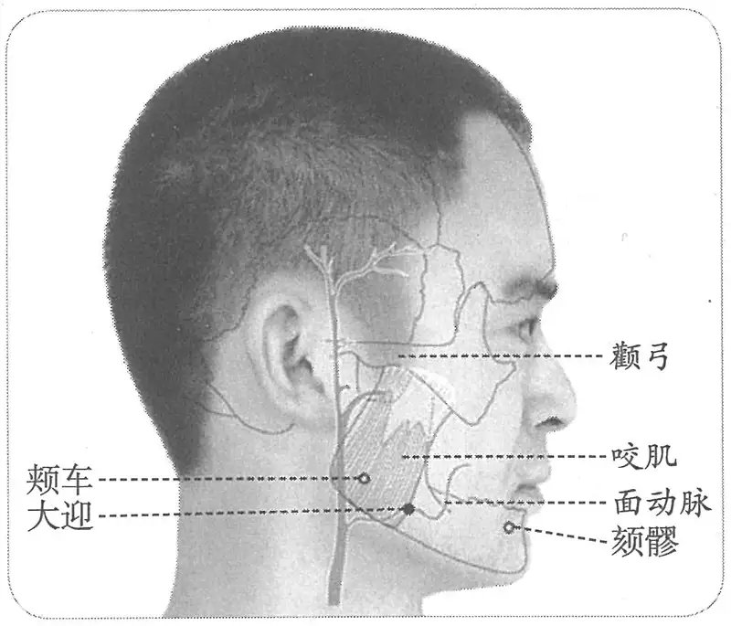

**图 2-56　大迎穴图**

〔p.284 (인쇄 264)〕

缘相交处摸到，此处大约距下颌角前方1横指，以二指轻按，重按则无。

　1. 《黄帝明堂经》佚文

　　(1) 曲颔前一寸三分骨陷者中动脉。（《针灸甲乙经》卷三、《素问·气穴论》、《铜人腧穴针灸图经》卷上、下、《十四经发挥》、《医学纲目》、《针灸集书》、《针灸聚英》、《古今医统》、《医学入门》、《针灸大成》、《针方六集》、《类经图翼》、《循经考穴编》、《医宗金鉴·刺灸心法要诀》）

　　(2) 在曲颔前一寸二分骨陷中动脉。（《黄帝内经太素》卷八杨上善注、《千金要方》、《千金翼方》、《外台秘要》、《医心方》、《铜人腧穴针灸图经》卷中、《圣济总录》、《针灸资生经》、《针灸易学》、《针灸逢源》）

　2. 在曲颔前一寸五分，骨陷中细脉。又以口下当两肩是穴。（《黄帝内经灵枢注证发微·寒热病》）

　3. 曲颔前一寸三分骨陷中动脉。（《黄帝内经素问注证发微·气穴论》）

**按**：马莳《灵枢》注文“一寸五分”系“一寸三分”形误，注《素问》者无误。“以口下当两肩是穴”系出自《素问·骨空论》“或骨空在口下当两肩”王冰注。

　4. 在曲颔前一寸三分骨陷间动脉。广注：其脉甚动与人迎同。一法以口下当两肩，穴居腮颐骨间，合耳下一寸五分。（《循经考穴编》上）

　5. 曲颔前一寸三分，鼓颐则下腭边际有凹陷之处。（《针灸十四经穴位考订》）

　6. 统编针灸学教材

　　(1) 部位：曲颊前一寸三分，骨陷中动脉应手。取穴：从下腭隅沿下腭骨之前缘，距颐前一寸三分之处，试闭口唇，使两腮鼓起，在下腭骨边缘现出一沟形，按之有动脉应手之处取之。（1957年南京《针灸学》）

　　(2) 部位：曲颊前一寸三分。取穴：鼓起两腮，在下颌骨边缘出现一沟形，按之有动脉应手处是穴。（1版《针灸学讲义》）

　　(3) 部位：在曲颔前一寸三分，骨陷者中动脉。取穴：在下颌角前凹陷部，咬肌附着部前缘；闭口鼓气时，即出现一沟形凹陷，即于凹陷之下端取之。（2版《针灸学讲义》）

　　(4) 下颌角前1.3寸骨陷中。（4版《针灸学》）

　　(5) 下颌角前1.3寸凹陷中，咬肌附着部的前缘，闭口鼓气时即出现一沟形凹陷，即于凹陷下端取之。（5版《针灸学》、《中国针灸学》）

　　(6) 在下颌角前方，咬肌附着部的前缘，当面动脉搏动脉处。（6版《针灸学》）

　　(7) 下颌角前下方约1.3寸，咬肌附着部前缘，当闭口鼓气时，下颌角前下方出现一沟形的凹陷中取穴。（7版《针灸学》）

**文献分析**：本穴定位，现存《黄帝明堂经》佚文有“一寸二分”与“一寸三分”二说，《铜人腧穴针灸图经》卷中作“一寸二分”，卷上、卷下作“一寸三分”。要之，本穴定位当以体表标志“脉动”为据，不拘于折量分寸。

#### 【类属】 

足阳明胃经穴。

足阳明脉气所发。（《黄帝明堂经》）

**按**：《灵枢·寒热病》曰：“臂阳明有入鼽遍齿者，名曰大迎，下齿龋取之”。又《素问·气府论》“手阳明脉气所发穴”中也载有“大迎骨空各一痏”，则知本穴在汉以前也属于手阳明脉气所发。日本《挨穴资蒙》（1835年）将本穴归人手阳明经穴扶突与禾髎之间。

#### 【适应症】 

主治口面部病症。常用于口眼㖞斜，面肌抽搐，口噤；面肿，齿痛。

〔p.285 (인쇄 265)〕

　1. 主寒热，颈瘰疬。癫疾互引，口㖞，喘悸。痓，口噤。厥，口僻，失欠，下牙痛，颊肿，恶寒，口不收，舌不能言，不得嚼。（《黄帝明堂经》）

　2. 治寒热颈痛，瘰疬，口㖞，齿龋痛，数欠气，风痓口噤，牙疼，颊颔肿，恶寒，舌强不能言。针入三分，留七呼，可灸三壮。今附：风壅面浮肿，目不得闭，唇吻瞤动不止。当针之，顿愈。（《铜人腧穴针灸图经》卷中）

**按**：《铜人腧穴针灸图经》对于前代文献的理解与处理有两处欠妥之处：其一，《黄帝明堂经》“失欠”指下颌关节脱臼，不能理解为打呵欠；其二，既有“牙疼”症，复加“齿龋痛”，从体例上不够规范。然而，新增之一条主治症“风壅面浮肿，目不得闭，唇吻瞤动不止”（见于面神经麻痹和面肌痉挛）值得重视。

　3. 统编针灸学教材

　　(1) 口噤不开，口㖞，唇吻瞤动，舌强颊肿，牙痛，面浮肿。（1957年南京《针灸学》、1版《针灸学讲义》）

　　(2) 牙关紧闭，口㖞，颊肿，齿痛，面肿，牙关脱臼。（2版《针灸学讲义》）

　　(3) 口眼㖞斜，口噤，颊肿，齿痛。（4、5版《针灸学》）

　　(4) 牙关紧闭，齿痛，口㖞，颊肿，面肿，面痛，唇吻瞤动。（6版《针灸学》）

　　(5) 口角歪斜，颊肿，齿痛等局部病证。（7版《针灸学》）

　　(6) 口眼歪斜，牙关紧闭，颊肿，面痛，齿痛。（《中国针灸学》）

**文献分析**：《黄帝明堂经》所载之主治涉及多种病症，但不外乎口齿部与颈部病症。《素问·三部九候》曰：“上部地，两颊之动脉，以候口齿之气”。根据针灸诊疗一体的特点，也可知足阳明两颊动脉大迎穴主治口齿之疾。然“大迎”在面，“人迎”在颈，则“颈瘰疬”一症，人迎主之更切。此二穴名极相近，不能排除互混的可能性。各版教材将此症归入“人迎”穴主治，不无道理。又《灵枢·癫狂》曰“癫疾始作而引口啼呼喘悸者，候之手阳明、太阳，左强者攻其右，右强者攻其左，血变而止”，明言取“手阳明”穴治之，而大迎穴今属足阳明穴。考《灵枢·寒热病》曰：“臂阳明有入鼽遍齿者，名曰大迎，下齿龋取之”；又《素问·气府论》手阳明脉气所发穴中载有“大迎骨空各一痏”，则知本穴在汉以前也属于手阳明脉气所发。值得注意的是，本穴主治既有牙关紧闭，又有牙关脱臼。关于针灸治疗牙关脱臼，除本穴外，其他穴在古代文献中也有明确记载（见“下关”穴适应症的“文献分析”），而现代针灸教材除第2版教材提到“牙关脱臼”，其余各版均未收录此症。可能是由于现代很少人因为这种病症去针灸科就诊，针灸医生没有机会对此进行大量的临床检验导致的。

#### 附：临床应用举例 

　1. 臂阳明有入鼽遍齿者，名曰大迎，下龋齿取之。臂恶寒补之，不恶寒泻之。（《灵枢·寒热病》）

　2. 癫疾始作而引口啼呼喘悸者，候之手阳明、太阳，左强者攻其右，右强者攻其左，血变而止。（《灵枢·癫狂》）

**按**：《针灸甲乙经》引《黄帝明堂经》文作“癫疾互引，口㖞，喘悸者，大迎主之，及取阳明、太阴，候手足变血而止”，当出自此方。

　3. 饥不能食，饮食不下，呕而雷鸣，大迎、中极、食窦。又法：期门、章门。（《医学纲目》卷二十一）

　4. 面瘫，四白至地仓、大迎、颊车等穴处络刺治疗。［四川中医，1985，3（11）：23］

#### 【操作】 

斜刺或平刺。勿损伤面动脉。

　1. 刺入三分，留七呼，灸三壮。（《黄帝明堂经》）

〔p.286 (인쇄 266)〕

　2. 统编针灸学教材

　　(1) 针三分，灸三壮。（1957年南京《针灸学》、1版《针灸学讲义》）

　　(2) 避开动脉，斜向颊车针3分；艾条灸3~5分钟。（2版《针灸学讲义》）

　　(3) 避开动脉，斜刺或平刺0.3~0.5寸。（4、5、7版《针灸学》、《中国针灸学》）

　　(4) 直刺0.2~0.4寸；可灸。（6版《针灸学》）

### （六）颊车 Jiáchē ST6 出《黄帝明堂经》 

#### 【提要索隐】 

**穴名**：一名机关；一名曲牙。

**部位**：在面部，下颌角前上方一横指（中指）。

**国标修订**：1990年版国标：在面颊部，下颌角前上方约一横指（中指），当咀嚼时咬肌隆起，按之凹陷处。2006年修订版：在面部，下颌角前上方一横指（中指）。注：沿下颌角角平分线上一横指，闭口咬紧牙时咬肌隆起，放松时按之有凹陷处。

**按**：1990年版国标“下颌角前上方”定位不明确，而“当咀嚼时咬肌隆起，按之凹陷处”则属于取穴法内容，故2006年版国标将此取穴法内容置于注文，另对“前上方”做一明确说明。这样既符合标准文本的规范性要求，又增加标准的实用性。

**适应症**：主治牙齿及面部病症。常用于牙关开合不利、疼痛，颊肿，齿痛，口眼㖞斜。牙拔除术（下颌牙）针麻用穴。

**针刺操作**：直刺0.3~0.5寸。

#### 【名实考】 

“颊车”之名见于《灵枢》，是指部位，而非穴名。作为穴名在《素问》作“曲牙”，《千金要方》又作“机关”。颊车作为部位名，又名“牙车”，是指下颌骨。1957年南京《针灸学》另载有“鬼床”、“鬼林”二别名。经考，鬼床穴与本穴定位不同；“鬼林”之“林”字系“牀”（床的异体字）字之讹误。

　1. 循眼系入络脑，出颔下客主人，循牙车合阳明，杨上善注曰：复循眼系，络脑两箱，出于颔下。颔，谓牙车骨，属頄骨之下也。（《黄帝内经太素·脉行同异》卷九）

　2. 颊车者，下牙床骨也。总载诸齿，能咀食物，故名颊车。（《医宗金鉴·刺灸心法要诀》）

　3. 曲牙二穴。王冰注曰：颊车穴也。（《素问·气穴论》注）

　4. 耳下牙车之后各一。王冰注曰颊车二穴。（《素问·气府论》注）

　5. 中风口噤不得开，灸机关《千金翼》名颊车二穴。穴在耳下八分小近前。（《千金要方》卷八）

**按**：《千金翼方》卷二十六云：“凡卒中风口噤不开，灸机关二穴五壮即愈。一云：随年为壮，僻者逐左右灸之。”《千金翼方》同篇又曰：“凡卒中风，口噤不得开，灸颊车二穴。穴在耳下八分小近前。灸五壮，即得语。又随年壮，口僻左右灸之。”足证“机关”即足阳明颊车穴，张景岳不识而将“机关”归于“奇俞”类，明以后文献皆传其误。

　6. 颊车，一名机关，一名曲牙。（《针灸聚英》卷一）

　7. 上下齿之动有车象，以在颊之侧，故曰颊车。（《经穴解》）

　8. 别名　机关、曲牙、鬼床、鬼林。（1957年南京《针灸学》）

**按**：鬼床穴见于《千金要方》：“第七针耳前发际宛宛中，耳垂下五分，名鬼床。”《千金翼方》作“耳前发际宛宛中，名鬼床。”其定位与颊车穴有较大出入，不能视为同一穴。而“鬼林”之“林”字系“牀”（床的异体字）字之讹误，皆不能作为本穴的别名。1957年南京《针灸学》乃传日本教材之误。

〔p.287 (인쇄 267)〕

#### 【定位】 

**部位**：在面部，下颌角前上方一横指（中指）（图2-57）。

**取穴**：沿下颌角角平分线上一横指，闭口咬紧牙时咬肌隆起，放松时按之有凹陷处。

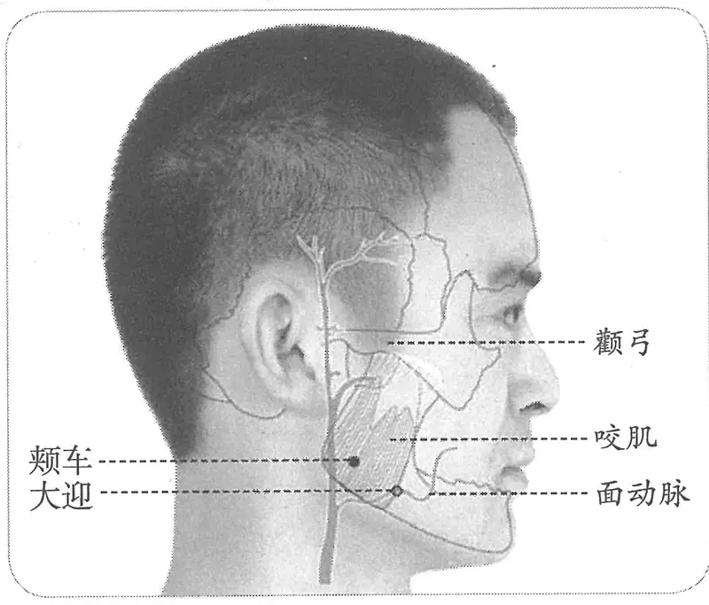

**图 2-57　颊车穴图**

　1. 耳下牙车之后各一。王冰注曰：谓颊车穴也。（《素问·气府论》）

　2. 《黄帝明堂经》佚文

　　(1) 在耳下曲颊端陷者中，开口有孔。（《针灸甲乙经》卷三、《素问·气府论》王冰注、《医心方》、《圣济总录》、《针灸资生经》、《十四经发挥》、《针灸集成》、《针灸集书》）

　　(2) 在耳下曲颊端陷者中。（《千金要方》卷二十九、《千金翼方》、《外台秘要》、《铜人腧穴针灸图经》）

　3. 在耳下二韭叶宛宛中。侧卧张口取之。（《千金翼方》卷二十六、《太平圣惠方·明堂》）

　4. 窦太师针灸遗存

　　(1) 耳坠珠下三分陷中。（《窦太师针经》、《针灸玉龙歌》注）

　　(2) 在耳垂下三分，曲颊端陷中，张口取之。（《针方六集》卷一）

　　(3) 在耳坠下三分，曲颊端陷中开口有空。（《大本琼瑶神书》）

　5. 在耳下曲颊近前陷中，开口有空。（《医学纲目》卷八、《针灸聚英》、《古今医统》、《类经图翼》）

　6. 在耳下八分，近前曲颊端上陷中，侧卧开口有空。（《神应经》、《针灸大成》、《循经考穴编》）

　7. 针灸方腧穴定位

　　(1) 穴在耳下八分小近前。（《千金翼方》卷二十六）

　　(2) 穴在耳下曲颊端陷中。（《千金翼方》卷二十六）

　　(3) 在耳下曲颊骨后。（《太平圣惠方·明堂》）

　8. 耳下方约一寸，微斜向前，按之微有陷凹之处。（《针灸十四经穴位考订》）

　9. 统编针灸学教材

　　(1) 部位：耳下曲颊端陷中。取穴：在耳垂下曲颊上端近前按取陷中，试以指按压之，口乃大张，其按压处即现陷孔。如上下齿用力咬紧，按处立即弹起。令患者张口取之。（1957年南京《针灸学》）

　　(2) 部位：耳下曲颊端陷中。取穴：以指按曲颊稍前上方陷中取之，如将牙齿用力咬紧则按处立即弹起，压之深部有痠感。（1版《针灸学讲义》）

　　(3) 部位：在耳下曲颊端陷者中，开口有孔。取穴：在下颌角的前上方，咬肌附着部，上下齿咬紧时出现肌肉隆起，压之有凹陷处取之。（2版《针灸学讲义》）

　　(4) 下颌角前上方一横指凹陷中，咀嚼时咬肌隆起处。（4、5版《针灸学》）

　　(5) 在面颊部，下颌角前上方约一横指（中指），当咀嚼时咬肌隆起，按之凹陷处。（6版《针灸学》）

〔p.288 (인쇄 268)〕

　　(6) 在下颌角前上方约1横指，按之凹陷处，当咀嚼时咬肌隆起最高点处。（7版《针灸学》）

　　(7) 在下颌角前上方一横指，咬肌附着部，咀嚼时咬肌隆起处。（《中国针灸学》）

**文献分析**：历代文献记载基本一致，认为本穴在耳下曲颊端陷者中，开口有孔，此说初出《黄帝明堂经》，《千金要方》等书从之。即指本穴取穴法：张口时，在下颌角稍前上方的凹陷中。所谓“耳下”是指“耳前下”，《千金翼方》已指明“穴在耳下八分小近前”。此处正当咬肌附着部，咀嚼时隆起，张口时按之呈现凹陷，即所谓开口有孔。

#### 【类属】 

足阳明胃经穴。

阳明脉气所发。（《黄帝明堂经》）

#### 【适应症】 

主治牙齿及面部病症。常用于牙关开合不利、疼痛，颊肿，齿痛；口眼㖞斜。牙拔除术（下颌牙）针麻用穴。

　1. 主颊车骨痛，齿不可以嚼，颊肿口急。（《黄帝明堂经》）

　2. 主牙车不开、口噤不言，及牙疼不得食、牙颊肿。（《千金翼方》卷二十六、《太平圣惠方·针经》）

　3. 治牙关不开，口噤不语，失喑，牙车疼痛，颔颊肿，颈强不得回顾。（《铜人腧穴针灸图经》卷中）

**按**：《千金翼方》、《太平圣惠方》引甄权之文所谓“口噤不言”是指张口困难而难以言语，非指中风后失喑，王惟一的理解不准确。统编针灸学教材除第1版，其余各版均不载此症，是正确的做法。

　4. 窦太师针灸遗存

　　(1) 治口㖞……专治牙疼。（《窦太师针经》）

　　(2) 治口眼歪斜左，补右泻左；㖞斜右，补左泻右。（《大本琼瑶神书》）

　　(3) 治口眼歪斜等症。（《窦太师秘传》）

　5. 主落架风。（《医学入门》卷一、《医宗金鉴·刺灸心法要诀》）

**按**：落架风，又称“落颊风”，《医宗金鉴·刺灸心法要诀》注曰：“落颊风者，下颏脱落也。”

　6. 统编针灸学教材

　　(1) 口眼㖞斜，失音，颊肿，牙痛项强，中风口噤。（1957年南京《针灸学》、1版《针灸学讲义》）

　　(2) 口眼㖞斜，颊肿，齿痛，牙关紧闭，失音不语，颈项强痛。（2版《针灸学讲义》）

　　(3) 口㖞，齿痛，颊肿，面肿，口噤不语。（4、5版《针灸学》）

　　(4) 口眼㖞斜、颊肿、齿痛、牙关紧闭、面肌痉挛。（6版《针灸学》）

　　(5) 齿痛，牙关不利、颊肿、口角歪斜等局部病证。（7版《针灸学》）

　　(6) 口眼歪斜，齿痛，颊肿，面肿，痄腮，牙关紧闭。（《中国针灸学》）

**文献分析**：本穴主治与下关穴基本相同。不论从古代腧穴文献记载的腧穴主治，还是从本穴古今针灸临床应用情况来看，本穴的治疗作用主要体现在颞颌关节功能紊乱或关节脱位。古代文献所描述的本穴主治“颊肿口急，颊车骨痛，齿不可以嚼”实际上是颞颌关节功能紊乱或关节脱位所致的常见症状。而从窦太师针灸开始重视本穴治疗面瘫、牙痛的作用，同时期的针灸治疗文献可见有较多的这方面的记载，针灸学教材从之。

#### 附：临床应用举例 

　1. 颞颌关节病症

　　(1) 卒中风，口噤不得开，灸机关二穴，穴在耳下八分小近前，灸五壮即得。又灸随年壮，僻者逐僻左右灸之。（《千金要方》卷八）

〔p.289 (인쇄 269)〕

**按**：机关二穴，《千金翼方》卷二十六作“颊车二穴”。

　　(2) 小儿噤，舌强唇痉，嗍奶不得……灸承浆……次灸颊车二穴各七壮……炷如雀屎大。（《太平圣惠方·明堂》）

　　(3) 治中风口噤，牙关不开：水沟、颊车。（《针经摘英集》）

　　(4) 中风口禁不开：颊车、人中、百会、承浆、合谷俱宜泻。问曰：此症前穴不效，何也？答曰：此皆风痰灌注，气血错乱，阴阳不升降，致有此病，复刺后穴：廉泉、人中。（《针灸大成》卷九）

　　(5) 牙关脱臼：颊车、百会、承浆、合谷。（《针灸大成》卷九）

　　(6) 颞颌关节功能紊乱：颊车穴、下关穴药罐治疗。［上海针灸杂志，1987，6（3）：29］

　2. 口面部病症

　　(1) 中风口眼歪斜：针人中，灸七壮；次针地仓、颊车。左灸右，右灸左，先灸后针。无病处补之，有病处泻之。（《针灸集要·盘石金直刺秘传》）

　　(2) 治中风口眼㖞邪：听会、上关、颊车、地仓。（《针经摘英集》）

　　(3) 中风口眼致㖞斜，须疗地仓连颊车。（《针灸玉龙歌》）

　　(4) 两颊红肿生疮：合谷、列缺、地仓、颊车。问曰：此证缘何而得？答曰：血气上壅，痰滞中焦，肿而不散，故口内两颊红肿生疮，如不早治，恐难治也。（《针灸集成》第二十三方）

　　(5) 中风口眼㖞斜：地仓、合谷、承浆、人中、颊车、翳风、听会。问曰：此证用前穴针效，或一月、半月，再发，何也？答曰：必是有犯禁忌，房事不节，饮食过多，痰饮复生，证再作矣。再刺已。上穴法复刺后穴无不效。㖞左，泻左补右；㖞右，补左泻右。（《针灸集成》第二方、《针灸大成》卷九）

　　(6) 灸中风口眼㖞斜：听会二穴、颊车二穴、地仓二穴。凡㖞向右者，宜灸左㖞陷中二七壮；凡㖞向左者，宜灸右㖞陷中二七壮，艾炷如麦粒大。频频灸之取尽风气，口眼正为度。（《乾坤生意》下卷）

　　(7) 流行性腮腺炎：颊车穴、翳风穴针刺治疗。［安徽中医学院学报，1987（4）：48］

　　(8) 面神经麻痹：取主穴地仓、颊车，配合谷、下关、迎香。取地仓穴，进针斜刺透颊车穴（在面瘫侧），配合谷、下关、迎香强刺激。轻者3次，重者5~7次。［中国针灸，1996（增刊）：57］

　3. 牙病

　　(1) 齿风连腮胀痛：颊车、地仓、合谷。此人因疝气并服热药，遂成此疾。经五年，无医可□。但吐痰一块，即为痛起，日夜二三百阵作，遂针此穴，立效。（《针灸集成》第七十二方）

　　(2) 牙齿肿痛：吕细、颊车、龙玄、合谷。（《针灸大成》卷九）

　　(3) 下片牙疼：合谷、龙玄、承浆、颊车。问曰：牙疼之症，缘何而得？答曰：皆因肾经虚败，上盛下虚，阴阳不升降，故得此症。复刺后穴：肾俞、三间、二间。（《针灸大成》卷九）

　　(4) 五指不伸中渚取，颊车可灸牙齿愈。（《灵光赋》）

　　(5) 化脓性牙周炎：合谷穴、颊车穴、内庭穴，针灸疗法。［上海针灸杂志，1987，6（3）：47］

#### 【操作】 

直刺0.3~0.5寸。

〔p.290 (인쇄 270)〕

　1. 刺入三分，灸三壮。（《黄帝明堂经》）

　2. 侧卧张口取之，针入四分，得气即泻，不补，宜灸日七壮至七七壮即止。（《千金翼方》卷二十六）

　3. 其穴侧卧开口取之，针入四分，得气即泻，灸亦良，日可灸七壮至七七壮止，炷如大麦大，慎如常法。（《铜人腧穴针灸图经》卷中）

　4. 窦太师针灸遗存

　　(1) 针入一分，沿皮向地仓穴。治口㖞。㖞左，泻左补左；㖞右，泻右补右。㖞左灸右，㖞右灸左。（《窦太师针经》）

　　(2) 针入一分，沿皮向下透地仓穴，灸二七壮。（《窦太师秘传》）

　　(3) 入一分，沿皮向下透地仓。治口眼歪斜左，补右泻左，㖞斜右，补左泻右，可灸二七壮。（《大本琼瑶神书》）

　　(4) 沿皮向下透地仓一寸半，灸二七壮。（《针灸玉龙歌》注）

　5. 凌氏刺一分，沿皮向下透地仓。牙疼泻之。（《循经考穴编》上）

　6. 统编针灸学教材

　　(1) 针四分，灸三至七壮。（1957年南京《针灸学》）

　　(2) 针四分，针尖斜向地仓穴，灸三至七壮。（1版《针灸学讲义》）

　　(3) 直刺3~5分，或向地仓方向斜刺；艾灸3~7壮。（2版《针灸学讲义》）

　　(4) 直刺0.3~0.5寸，平刺0.5~1寸。（4、5版《针灸学》）

　　(5) 直刺0.3~0.5寸，或向地仓方向斜刺1~1.5寸；可灸。（6、7版《针灸学》、《中国针灸学》）

　7. ①直刺，深0.5寸。感应：局部酸胀。②横刺，治疗面瘫时可透地仓穴，进针2~3寸。感应：局部酸胀，并向周围扩散。③治疗咬肌痉挛时，针尖向上。④治疗上、下牙痛时，针尖向上齿或向下齿。5~10分钟。（上海《针灸学》）

**刺法及主治的解剖学基础**：当代针灸临床针刺深度变化总的趋势是越来越深，而面部穴治疗面瘫的针刺深度的变化趋势是倾向于浅刺、透刺。与之相关的解剖学基础为：第一，面神经从茎乳孔出颅后，其主干进入位于皮肤下浅层的腮腺，再呈放射状地分布到面部的表情肌，位置极其表浅，故除了正当茎乳孔处的翳风穴采用直刺外，其他穴多选择透刺，以尽可能多地刺激到相关神经。第二，面瘫的目不能闭、鼻唇沟变浅、口角下陷等症，皆属于相关肌肉的问题。这些表情肌本身都较薄且位置较浅，实验表明，顺着肌纤维的方向透刺能够有效恢复肌肉的功能。治疗面瘫的常用面部穴有翳风、地仓、攒竹、下关等，除翳风、下关直刺外，其他穴多选择透刺或平刺。

### （七）下关 Xiàguān ST7 出《黄帝明堂经》 

#### 【提要索隐】 

**部位**：在面部，颧弓下缘中央与下颌切迹之间凹陷中。

**国标修订**：1990年版国标：在面部耳前方，当颧弓与下颌切迹所形成的凹陷中。2006年修订版：在面部，颧弓下缘中央与下颌切迹之间凹陷中。

**按**：因颧弓与下颌切迹所形成的凹陷较大，故新版国标做了进一步的限定。

**适应症**：主治牙齿、面部、耳部病症。常用于下颌关节脱位，面肿，齿痛；耳聋，耳鸣；口眼㖞斜。

〔p.291 (인쇄 271)〕

**按**：本穴与上关穴一上一下，在主治上既表现出明显的共性，也表现出作用部位的上下差异。例如二者同为耳前颞颌关节部穴，故同主耳疾、口面部病症以及颞颌关节的功能障碍。而关节上方的上关穴倾向主治上牙病症，关节下方的下关穴则倾向主治下牙病症。

**针刺操作**：直刺0.5~1.2寸。

#### 【名实考】 

本穴的名称与刺法已见于《灵枢》与《素问》。本穴不论是在命名、定位，还是在主治方面，都与上关穴密切相关，然而此二穴一个归入足阳明胃经，一个归入足少阳胆经，使人们渐渐忽视了它们之间的密切联系。

　1. 刺上关者，呿不能欠；刺下关者，欠不能呿。（《灵枢·本输》）

　2. 藏俞五十穴，府俞七十二穴，热俞五十九穴，水俞五十七穴，头上五行，行五，五五二十五穴……下关二穴……（《素问·气穴论》）

　3. 足少阳脉气所发者六十二穴……客主人各一，耳后陷中各一，下关各一……（《素问·气府论》）

　4. 下关，在客主人下，耳前动脉下空下廉，合口有孔，张口即闭，足阳明、少阳之会。（《黄帝明堂经》）

　5. 客主人为上关，此穴正在其下，故曰下关。（《经穴解》）

#### 相关穴及刺激点 

　1. 治鼻3　位于颧部，颧骨体与颧骨弓交界下缘处。主治慢性鼻炎，过敏性鼻炎。针法：与皮肤表面垂直刺入2寸至2.5寸。（《针灸经外奇穴图谱（续集）》）

　2. 蝶腭　位于颧骨部，颏骨弓下缘凹陷前一寸处。主治三叉神经痛。针法：进针后向后上方斜刺二寸，针感局部烧灼、痛热。（《针灸经外奇穴图谱（续集）》）

　3. 下颌神经刺激点　颧弓下方，下颌切迹中点。刺法：基本上是垂直进针，针尖向对侧的外耳门，呈85°向下后方直刺4.0~4.5cm。针刺深度因头的宽窄而异，约为两侧下颌关节结节间距的1/3。当刺中下颌神经时，病人有触电感，或下唇、下颌牙齿等处有麻、痛感。主治三叉神经第三支痛，下牙痛，耳聋，失眠，精神病。（《实用神经干电刺激疗法》）

　4. 上颌神经刺激点　下颌切迹上，近髁突前缘处。于下颌切迹中间，颧弓下缘下方1.0cm，外耳门前方3cm处进针。刺法：向前上方，与冠状面呈115°，即对着对侧眼球方向缓慢进针，深度约5.5cm。刺中上颌神经时，其分布区（上唇、鼻、上牙等）有发麻或疼痛感。主治三叉神经第二支痛，上牙痛。（《实用神经干电刺激疗法》）

　5. 阻滞上颌神经干或翼腭神经节阻滞　进针方向应对准健侧（对侧）的额骨颧突较为安全。如果阻滞重点是上牙槽后支，向前、向内45°角接近平刺即可（针尖不要太高）。（《疼痛·阻滞与解剖》）

#### 【定位】 

**部位**：在面部，颧弓下缘中央与下颌切迹之间凹陷中（图2-58）。

**取穴**：正坐或侧卧，闭口，在耳屏前约一横指处，当颧弓下缘中央的凹陷中取穴。此处闭口有空，张口则闭。

**相关穴毗邻关系**：下关、耳门、听宫、听会4穴均以下颌骨髁突前后的凹陷定位。4穴的位置关系为：下关在髁突前的较大的半月形凹陷中，需要注意的是当张口时，髁突会向前移动而堵上原先的凹陷，因此取下关穴时要闭口；耳门、听宫、听会3穴均从上而下分列在髁突

〔p.292 (인쇄 272)〕

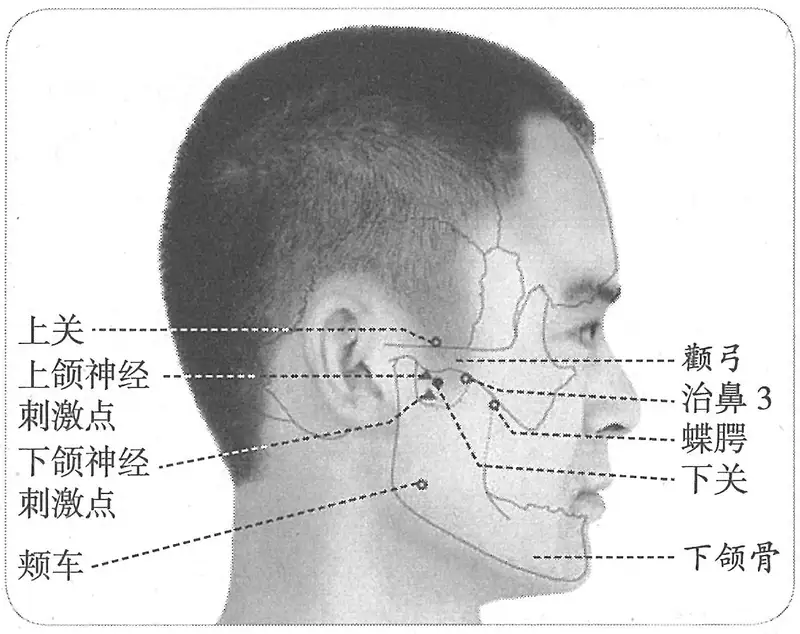

**图 2-58　下关穴与相关穴及刺激点**

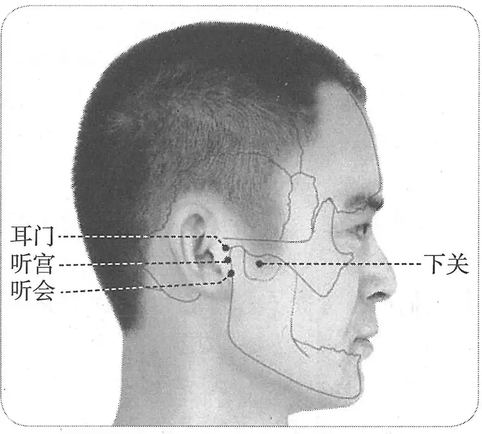

**图 2-59　下关、耳门、听宫、听会穴的毗邻关系**

后的很小的凹陷中，当张口时，髁突向前移动，显现出较大的凹陷，因此取髁突后的这3个穴，要张口取之。（图2-59）

#### 相关解剖学基础 

　1. 下颌骨髁突的体表定位　取准这4个穴的关键在于下颌骨髁突的体表定位以及颞颌关节开合时髁突的位置变化规律。髁突在耳屏前可以摸到，当张口和闭口时，可感觉到颞下颌关节运动。张口时髁突向前下降，指尖可以放入空出的窝内。在正常下颌开闭运动时，可触到髁突前后滑动。

　2. 下关穴与翼腭的关系　“翼腭窝”是连接中枢脑和面部五官的通路和桥梁，其内在一些重要的神经和内脏神经节，对面部五官的生理功能调节起到重要的作用。如翼腭神经节，主管泪腺、鼻腔黏膜腺的分泌；面神经的鼓索支主管舌的味觉等。下关穴正处在翼腭窝的位置（下关针刺至蝶腭神经节深度为49.9mm左右），所以能通过针刺下关穴，直接或间接地刺激到窝内的一些重要的神经和内脏神经节，达到调整其功能的效果。

　1. 在客主人下，耳前动脉下空下廉，合口有孔，张口即闭。（《黄帝明堂经》、《铜人腧穴针灸图经》卷中、《圣济总录》、《针灸资生经》、《十四经发挥》、《医学纲目》、《针灸聚英》、《古今医统》、《医学入门》、《针灸大成》、《针方六集》、《类经图翼》、《循经考穴编》、《针灸易学》）

　2. 在上关下，合口有空。（《铜人腧穴针灸图经》卷上）

　3. 在耳前下廉，合口有空，张口而合也。（《铜人腧穴针灸图经》卷下“穴腧都数”）

　4. 在耳门下一寸宛宛中，动脉际是也。（《千金翼方》卷二十六）

　5. 耳前颧骨桥之下，合口有空，开口则闭。（《针灸十四经穴位考订》）

　6. 统编针灸学教材

　　(1) 部位：在客主人下，耳前动脉下空下廉，合口有孔，张口即闭。取穴：以指按压耳珠之前约七、八分处，当颧骨弓之下端有一凹陷，合口有孔，张口则闭，应合口取之。（1957年南京《针灸学》）

　　(2) 部位：当颧骨弓之下凹陷中，耳前动脉下廉。取穴：侧卧闭口取之，开口则穴闭住。（1版《针灸学讲义》）

　　(3) 部位：在客主人下，耳前动脉下空下廉，合口有孔，张口即闭。取穴：在颧弓下缘凹陷中，当下颌骨髁状突之前方，闭口取之。（2版《针灸学讲义》）

〔p.293 (인쇄 273)〕

　　(4) 颧弓与下颌切迹之间的凹陷中。合口有孔，张口即闭。（4版《针灸学》）

　　(5) 颧弓下缘，下颌骨髁状突之前方，切迹之间凹陷中。合口有孔，张口即闭。（5版《针灸学》）

　　(6) 在面部耳前方，当颧弓与下颌切迹所形成的凹陷中。（6版《针灸学》）

　　(7) 在耳屏前，下颌骨髁状突前方，当颧弓与下颌切迹所形成的凹陷中。合口有孔，张口即闭，宜闭口取穴。（7版《针灸学》）

　　(8) 颧弓下缘，下颌骨髁状突之前方凹陷处，闭口取穴。（《中国针灸学》）

#### 【类属】 

足阳明胃经穴。本穴的脉气所发，自《黄帝明堂经》以下无分歧，皆归入足阳明经，而《黄帝明堂经》之前的《素问》却将本穴及上关二穴均归入“足少阳脉气所发”。今则上关入“足少阳经”，下关归“足阳明经”，使得人们渐渐淡忘了这两个穴位的密切关联。

**脉气所发**：足阳明、少阳之会。（《黄帝明堂经》）

**归经**：足阳明胃经。（《外台秘要》卷三十九、《铜人腧穴针灸图经》卷上）

#### 【适应症】 

主治牙齿、面部、耳部病症。常用于下颌关节脱位，面肿，齿痛；耳聋，耳鸣；口眼㖞斜。

　1. 主口僻。耳聋鸣。失欠，下齿龋，下牙痛，颐肿。痓。恶风寒不可以嚼。（《黄帝明堂经》）

　2. 疗聤耳有脓汁出，偏风口目㖞，牙车脱臼。（《铜人腧穴针灸图经》卷中）

**按**：《外台秘要》卷三十九此穴下有禁忌症作“耳中有干底、聤耳有脓，不可灸之”，王惟一将此禁忌症作为主治症误录本穴中，并将此穴误作禁灸穴。

　3. 目眩。（《针灸聚英》卷一、《针方六集》）

　4. 统编针灸学教材

　　(1) 耳鸣，聤耳，口眼㖞斜，牙痛，牙关脱臼。（1957年南京《针灸学》、1版《针灸学讲义》）

　　(2) 耳聋，耳鸣，聤耳，口眼㖞斜，齿痛，眩晕，牙关开合不利。（2版《针灸学讲义》）

　　(3) 耳聋，耳鸣，聤耳，齿痛，口噤，口眼㖞斜。（4、5版《针灸学》）

　　(4) 牙关紧闭、下颌疼痛、口㖞、面痛、齿痛、耳鸣、耳聋。（6版《针灸学》）

　　(5) 牙关不利、三叉神经痛、齿痛、口眼歪斜等面口病证，耳聋、耳鸣、聤耳等耳疾。（7版《针灸学》）

　　(6) 耳聋，耳鸣，聤耳，齿痛，口眼歪斜，面痛，牙关开合不利。（《中国针灸学》）

**文献分析**：本穴与上关穴一上一下，在主治上既表现出明显的共性，也表现出作用部位的上下差异。例如二者同为耳前颞颌关节部穴，故同主耳疾、口面部病症以及颞颌关节的功能障碍。而关节上方的上关穴主治上牙病症，关节上方的下关穴则主治下牙病症。针灸教材所载本穴主治症“聤耳”系沿袭《铜人腧穴针灸图经》之误，今去之。

关于本穴主治，值得注意的是，治疗下颌关节脱臼，不仅古代文献上有明确记载，直到民国时期还可见这类的医案，而针灸教材除了1957年《针灸学》和1959年《常用经穴解剖学定位》之外，皆不再列此主治症，其重要的原因是如今人们极少会为这种病症去针灸科就诊，久而久之，针灸医生难有实践的机会，故针灸教材即便记载这样的主治，临床上也失去了实际意义。

#### 附：临床应用举例 

　1. 颞颌关节痹，下关，温针治疗。［河北中医，1987，9（3）：25］

〔p.294 (인쇄 274)〕

　2. 面痛，主穴下关，辅穴合谷。深刺紧提慢按手法。［江苏中医，1989，10（2）：18］

　3. 牙痛，下关、颊车、合谷。［针灸学报，1990，6（2）：42］

　4. 三叉神经痛，独刺下关治疗。［中国针灸，1999（10）：613］

　5. 周围性面瘫，自制药艾盘灸下关、翳风穴治疗。［中医外治杂志，2001，10（2）：21］

#### 【操作】 

直刺0.5~1.2寸。

　1. 刺入三分，留七呼，灸三壮。耳中有干擿抵不可灸。（《黄帝明堂经》）

　2. 头维……下关……右二十四处，禁不可灸，大忌。（《千金翼方》卷二十八）

　3. 又上关不得深，下关不得久留针。问曰：上关何以不得深？下关何以不得久留针？答曰：上关若深，令人得欠不得呿，目随针瞶；下关不得久留针者，得呿不得欠，牙关急。是故上关不得深，下关不得久留针。（《太平圣惠方·针经》）

　4. 针入四分，得气即泻。禁不可灸。牙龈肿处，张口以三棱针出脓血，多含盐汤，即不畏风。慎如前法。（《铜人腧穴针灸图经》卷中）

　5. 统编针灸学教材

　　(1) 针三分。（1957年南京《针灸学》、1版《针灸学讲义》）

　　(2) 直刺3~5分，艾条灸3~5分钟。（2版《针灸学讲义》）

　　(3) 直刺0.5~1寸。（4、5版《针灸学》）

　　(4) 直刺0.5~1.2寸；可灸。（6版《针灸学》）

　　(5) 直刺0.5~1寸。留针时不可作张口动作，以免折针。（7版《针灸学》）

　　(6) 直刺0.3~0.5寸。可灸（《中国针灸学》）。

　6. ①直刺，治疗三叉神经痛时，略向下，深1.5寸。感应：周围酸胀，或麻电感放射至下齿槽。②斜刺，治疗下颌关节炎时，可向前、后，斜刺进针0.8~1寸。感应：酸胀扩散至整个颞颌关节。③横刺，治疗牙痛时，沿下颌骨外向上齿（口角方向）、下齿（颊车穴方向），进针1.5~2寸。感应：扩散至上、下齿。④治耳病时，可斜刺向后，深1.5寸。感应：酸胀可扩散至耳区。⑤治咬肌痉挛时，斜刺向下，深约1.5~2寸。感应：局部酸胀。（上海《针灸学》）

**文献分析**：在1974年上海《针灸学》之前，关于本穴的刺法还只是直刺一种，在针刺深度上，现代针灸教材较古代文献变化也不大，因而主治病症古今变化也不大，主要集中于口齿、耳病症。而本穴恰好是上颌神经、下颌神经、翼腭神经节阻滞的穿刺点，基于现代神经解剖学知识，神经阻滞对于穿刺方向与深度的描述非常明确，由于针刺的方向与方式超出了传统针刺的范畴，所治疗病症也与传统记载有所不同。这些新方法很快被现代针灸临床医生所借鉴，他们在与下关穴相同或相近的体表部位，通过不同的刺法，以治疗不同的病症，并为不同的刺法冠以不同的穴名——产生了一系列“新穴”。实际上这仅属于老穴新用。目前这些新的刺法与主治病症还没有被写入针灸学教材，理论的进展明显滞后于实践的发展。

《黄帝明堂经》谓“耳中有干擿抵不可灸”，可能是认为灸后耳耵聍会更加干结。而《外台秘要》谓“聤耳有脓，不可灸之”，未详何故，有待临床验证。

**刺法及主治的解剖学基础**：现代针灸临床发现：如果在出现面瘫的同时，还有味觉异常、流泪、流涎等表现，表明不单纯是面神经核损伤的问题，需添加“下关”一穴，针刺方向朝向前上方，即眶下裂方向，刺0.8~1寸，令患者眼鼻特别是鼻腔有强烈的酸胀感，对诸如味觉异常、流泪、流涎等症状疗效明确。下关在治疗面部疾病方面有非常特殊的作用，目前人们对于其特殊性的认识更多的还是受现代解剖学以及神经阻滞疗法的启示。由于下关穴正处在翼腭窝的位置，而“翼腭窝”位于颞下窝的内侧，为上颌骨体、蝶骨翼突和腭骨之间的间隙，其向前经眶下裂可通眼眶，向后经圆孔通颅内，向内经蝶腭孔通鼻腔，向下经腭大孔通口腔。由此可见，“翼腭窝”是连接中枢脑和面部五官的通路和桥梁，其内存在一些重要的神经和内脏神经节，对面部五官的生理功能调节起到重要的作用，如翼腭神经节等，主管泪腺、鼻腔黏膜腺的分泌；面神经的鼓索支主管舌的味觉等。所以可以通过针刺下关穴，直接或间接地刺激到窝内的一些重要的神经和内脏神经节，达到调整其功能的效果。另外，下关穴在针刺时还要注意两点：其一就是方向和深度，当下关穴的针刺方向朝向前上方，即眶下裂方向（主治过敏性鼻炎、三叉神经痛和面瘫之味觉异常、流泪、流涎等），深度不宜超过1.2寸，特别是面颅骨较小的患者，深度太深，针尖会通过眶下裂进入眼眶，而对应的眼球部位正当眼球赤道部，眼球赤道区域是整个眼球壁最薄弱的地方，若速度太快，极易刺破眼球，引起严重后果；当下关穴的针刺方向朝向前下方时，超过一定深度（约0.6寸），会刺进口腔，引起疼痛等不适感；如果针尖略向后，可刺及耳颞神经，麻胀针感可至耳前、颞部，有时有鼓膜向外鼓胀感。其二是针刺的手法，当针刺的深度超过0.5寸时，要少提插，可以多捻转，因为这里正是面颊部翼静脉丛的位置，反复提插会刺破翼静脉丛，引起出血，虽然外观上可能不明显，但局部会有胀痛或咀嚼困难等不适感。

〔p.295 (인쇄 275)〕

### （八）头维 Tóuwéi ST8 出《黄帝明堂经》 

#### 【提要索隐】 

关于足阳明胃经穴的起始，古代主要有两种不同的观点，一种始于承泣，一种始于头维。分歧的根源在于，将经穴连线与经脉体表循行线混为一谈。对于针灸铜人及铜人图而言，如果一条经穴线出现两条并行的线，除非穴位旁添加编号，否则读者很难读懂。可能正是由于这个因素，尽管自明初倡导《十四经发挥》后，足阳明经穴起于承泣说已大行于世，但针灸铜人及铜人图，甚至直到民国时承淡安的《人体经穴图》，依然采用的是起于头维的单线连接画法。

**穴名**：一名维角；一名玄角；一名头缝。

**部位**：在头部，额角发际直上0.5寸，头正中线旁开4.5寸。

**归经**：足阳明胃经。**按**：宋以前文献本穴归经不统一。

**适应症**：主治目疾、头面部病症。常用于头痛；目痛，流泪，视物不清，眼睑瞤动。

**针刺操作**：平刺。

#### 【名实考】 

在宋以前文献中，关于本穴的名称有多种，但随着文献的散佚，这些名称大多不为今人所知，以至于半个多世纪前收录穴位别名最多的1957年南京《针灸学》对于本穴也仅收录了一个别名，而这个唯一的别名“颡大”，经考证还不是穴名。

本穴的定位，从文字描述来看，没有分歧，而实际上由于前头部基准穴“神庭”定位的变化，本穴的定位也随之改变。

　1. 维角者，人眼精之所，心通神为明者也。此则头维也。（《医心方》卷二引《曹氏灸经》）

　2. 玄角，在额两角发际。（敦煌卷子佚名灸方：S.6168、S.6262）

　3. 头维，在额角发际，夹本神两旁各一寸五分，足少阳、阳明之会。（《黄帝明堂经》）

　4. 头缝二穴，在额角发尖处。（《针灸大全》卷四）

　5. 此乃本经之脉上行，由大迎而上，所行皆手、足少阳面侧部分，而上维于额角后，横折至督经之神庭而终。此穴乃本经曲折环维之所，故曰头维。（《经穴解》）

〔p.296 (인쇄 276)〕

　6. 别名　颡大。（1957年南京《针灸学》）

**按**：此别名间接引自日本教材，云出自马莳的《黄帝内经灵枢注证发微》，查得原文如下：“太阳根于至阴，结于命门。命门者，目也。阳明根于厉兑，结于颡大。颡大者，钳耳也。马莳注曰：结于颡大。颡大者，钳耳也，谓头维穴也”。从经文可见，这里足三阳经所结皆为部位，而不是穴位，故马莳注解难以凭据，对此杨上善曰：“阳明脾腑之脉，在太阴表前，从足指厉兑，上行聚于颡上额颅。颡，额也，苏荡反”。进一步提示：“颡大”实为部位名，而不是穴名，不能作为本穴的别名。

#### 【定位】 

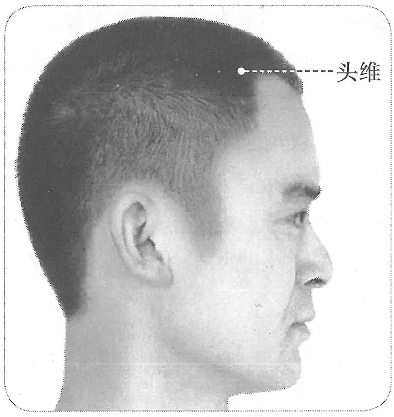

**图 2-60　头维穴图**

**部位**：在头部，额角发际直上0.5寸，头正中线旁开4.5寸（图2-60）。

**取穴**：正坐，在鬓发前缘直上额角发际上0.5寸，距神庭穴4.5寸处取穴。

　1. 在额角发际，夹本神两旁，各一寸五分。（《黄帝明堂经》）

　2. 在额角发际上五分

　　(1) 在额角发际夹本神两旁，各一寸五分。（《铜人腧穴针灸图经》卷上及卷下、《大本琼瑶神书》、《医学入门》）

　　(2) 在额角入发际，本神旁一寸五分。（《铜人腧穴针灸图经》卷中、《圣济总录》、《针灸资生经》、《医学纲目》、《循经考穴编》）

**按**：此条文字描述本身与第一条无差异，读不出“发际上五分”的意思，然而《铜人腧穴针灸图经》定本穴以“本神”为基准，而后者又是以“神庭”为基准，因“神庭”定于发际上五分，故明正统仿宋针灸铜人头维也标于发际之上。

　　(3) 在额角发际，本神旁一寸五分，神庭旁四寸五分。（《十四经发挥》卷中、《针灸聚英》、《古今医统》、《针灸大成》、《针方六集》、《类经图翼》、《医宗金鉴·刺灸心法要诀》、《针灸易学》、《针灸逢源》）

　　(4) 额角入发际，去神庭穴旁四寸五分。（《针灸十四经穴位考订》）

　3. 统编针灸学教材

　　(1) 部位：在额角入发际，本神旁一寸五分。取穴：正坐，从眉心直上发际五分为据点，向外侧平行横开约四寸五分处，或是耳边之发鬓尖直上与发际上五分横开平行线之接合处取之。（1957年南京《针灸学》）

　　(2) 部位：额角发际内。取穴：从督脉神庭穴旁开四寸五分取之。（1版《针灸学讲义》）

　　(3) 部位：在额角发际，神庭旁四寸五分。取穴：在鬓发前缘直上入发际五分取之。（2版《针灸学讲义》）

　　(4) 额角发际直上0.5寸。（4、5版《针灸学》）

　　(5) 在头侧部，当额角发际上0.5寸，头正中线旁4.5寸。（6、7版《针灸学》）

　　(6) 鬓角直上，入发五分，神庭旁四寸五分。（《中国针灸学》）

**文献分析**：头维穴本身的定位描述古今文献无分歧，其定位的改变是随基准穴神庭位置的变化而变，详见神庭穴“文献分析”。

〔p.297 (인쇄 277)〕

#### 【类属】 

足阳明胃经穴。

**脉气所发：**

　1. 足少阳、阳维之会。（《针灸甲乙经》卷三）

　2. 足少阳、阳明之会。（《素问·气府论》王冰注、《医心方》）

**归经：**

　1. 足少阳经。（《外台秘要》卷三十九）

　2. 足阳明经。（《黄帝内经太素》杨上善注、《素问》王冰注、《铜人腧穴针灸图经》卷上）

**按**：本穴为“足少阳、阳明之会”，后世归经不统一。唐代《外台秘要》将之归入足少阳经，王冰注《素问》及《铜人腧穴针灸图经》卷上将之归入“足阳明经”，宋以后针灸书多从《铜人腧穴针灸图经》之说，将之归入足阳明经。

#### 【适应症】 

主治目疾、头面部病症。常用于头痛；目痛，流泪，视物不清，眼睑瞤动。

　1. 寒热，头痛如破，目痛如脱，喘逆，烦满，呕吐，流汗难言。（《黄帝明堂经》）

**按**：“寒热，头痛如破”可见于疟病初发时（《素问·疟论》）；“目痛如脱，喘逆，烦满”为肺胀的典型症状（《金匮要略》）。

　2. 头偏痛，目视物不明。今附：治微风，眼睑瞤动不止，风泪出。（《铜人腧穴针灸图经》卷中）

　3. 窦太师针灸遗存

　　(1) 治偏正头风痛，眼赤烂不止，风沿泪出。（《窦太师针经》）

　　(2) 治偏正头风痛，先补后泻，泻多，禁灸。（《大本琼瑶神书》）

　　(3) 主额角疼痛，泻；眩晕，补。（《针灸玉龙歌》注）

　4. 统编针灸学教材

　　(1) 头痛如破，目痛如脱、泪出、不明。（1957年南京《针灸学》）

　　(2) 头痛，目痛，眼睑瞤动，泪出不明。（1版《针灸学讲义》）

　　(3) 头痛，目眩，目痛，流泪，视物不明，眼睑瞤动。（2版《针灸学讲义》、6版《针灸学》）

　　(4) 头痛，目眩，目痛，流泪，眼睑瞤动。（4、5版《针灸学》）

　　(5) 头痛、目眩、目痛等头目病证。（7版《针灸学》）

　　(6) 头痛，目眩，目痛，流泪。（《中国针灸学》）

**文献分析**：本穴主治，古今文献记载皆集中于头痛、目疾。需要注意的是，《铜人腧穴针灸图经》的记载与宋以前文献偏离较大。今考《铜人腧穴针灸图经》归纳与新增之主治病症均与四白穴的主治相同，似不能排除宋人在整理过程中将二穴相混的可能性。宋以后文献包括现代针灸学教材所载头维穴主治多受《铜人腧穴针灸图经》影响。教材中“目眩”症盖从《铜人腧穴针灸图经》“目视物不明”而来，此二症似不同义，今仍用原词。本穴配其他穴虽也能治不同部位的头痛，但不论从古代腧穴文献，还是从古今针灸治疗文献记载来看，都以治偏头痛为主。故从《铜人腧穴针灸图经》之说，仍作“偏头痛”，以突出其主要作用部位。

#### 附：临床应用举例 

　1. 眉目疼痛不能当，攒竹沿皮刺不妨，若是目疼亦同治，刺入头维疾自康。（《针灸玉龙歌》）

　2. 高血压性眩晕，头维穴，点刺放血治疗。［中医杂志，1988，29（9）：655］

#### 【操作】 

平刺。

　1. 刺入五分，禁不可灸。（《黄帝明堂经》）

〔p.298 (인쇄 278)〕

　2. 针入三分，禁不可灸。（《铜人腧穴针灸图经》卷中）

　3. 窦太师针灸遗存

　　(1) 针入一分，沿皮向下一寸半，灸七壮。（《窦太师针经》）

　　(2) 沿皮向下透至悬颅。疼痛泻，眩晕补。灸二七壮。（《针灸玉龙歌》注）

　　(3) 入一分，沿皮向下寸半，可灸七壮。（《大本琼瑶神书》）

　4. 刺三分，沿皮向下，禁灸。（《类经图翼》卷六）

　5. 统编针灸学教材

　　(1) 针五至七分，针尖沿皮向下方。（1957年南京《针灸学》）

　　(2) 针五分至七分，针尖沿皮向后下方刺。（1版《针灸学讲义》）

　　(3) 针尖沿皮向下或向后，针5~10分。（2版《针灸学讲义》）

　　(4) 平刺0.5~1寸。（4、5、7版《针灸学》、《中国针灸学》）

　　(5) 向后平刺0.5~1.0寸；不宜灸。（6版《针灸学》）

　6. 横刺，从前向后，沿皮透刺，深0.8~1.5寸。感应：痛胀向周围扩散。（上海《针灸学》）

### （九）人迎 Rényíng ST9 出《灵枢》 

#### 【提要索隐】 

**穴名**：一名天五会。

**部位**：在颈部，横平喉结，胸锁乳突肌前缘，颈总动脉搏动处。

**适应症**：主治肺部、局部病症。常用于气喘，头痛、眩晕；咽喉肿痛，瘰疬，瘿瘤；高血压。

**针刺操作**：直刺0.2~0.4寸。不宜刺向外侧及深刺。

#### 【名实考】 

人迎既是穴名，又是脉名。人迎寸口诊是《内经》时代盛行的一种诊脉法，因此传世本《灵枢》、《素问》中的“人迎”大多是脉名，而不是穴名，不过人迎脉与人迎穴在部位上是相合的。

关于本穴定位，《黄帝明堂经》以颈动脉和结喉为取穴标志，《灵枢》则以婴筋（胸锁乳突肌）为标志。现代本穴定位采用《黄帝明堂经》说法，然而《灵枢》以肌肉为标志取穴的方法却为确定本穴与相毗邻的扶突、天窗等穴的位置关系提供了重要线索。

　1. 足阳明也，名曰人迎。足阳明，夹喉之动脉也。（《灵枢·本输》）

　2. 颈侧之动脉人迎。人迎，足阳明也，在婴筋之前。（《灵枢·寒热病》

　3. 足阳明脉气所发者六十八穴，额颅发际傍各三，面鼽骨空各一，大迎之骨空各一，人迎各一……《素问·气府论》）

　4. 杨上善曰胃者水谷之海，五脏六腑皆悉禀之，别起一道之气合于阳明，故阳明得在经脉中长动，在结喉两箱，名曰人迎，五脏六腑脉气并出其中。（《黄帝内经太素·脉行同异》）

　5. 人迎，一名天五会。在颈大脉动应手，夹结喉旁，以候五脏气，足阳明脉气所发。（《黄帝明堂经》）

　6. 人迎二穴，一名五会。（《铜人腧穴针灸图经》卷中）

**按**：此处作“五会”，似有误，疑应为“天五会”。《灵枢·本输》曰：“缺盆之中，任脉也，名曰天突，一。次任脉侧之动脉，足阳明也，名曰人迎，二。次脉手阳明也，名曰扶突，三。次脉手太阳也，名曰天窗，四。次脉足少阳也，名曰天容，五。次脉手少阳也，名曰天牖，六。次脉足太阳也，名曰天柱，七。次脉颈中央之脉，督脉也，名曰风府。腋内动脉，手太阴也，名曰天府。腋下三寸，手心主也，名曰天池。”颈项部八脉之穴名，多冠以“天”字，则足阳明之人迎作“天五会”，与《灵枢》命名规律相合，义长。

〔p.299 (인쇄 279)〕

　7. 此穴古以结喉两旁为气口、人迎，至晋王叔和以左右手为人迎、气口，今则此道绝矣。解见前大迎穴下。（《经穴解》）

#### “天五会”与“地五会”穴辨 

　1. 《天星秘诀》云耳鸣腰痛先此，后耳门及三里。（《类经图翼》卷六·人迎穴）

　2. 《天星秘诀》云耳内蝉鸣先五会，次针耳门三里内。（《类经图翼》卷八·地五会穴）

**按**：《天星秘诀》中“五会”是指足少阳经“地五会”穴，张介宾无法辨识，而将此方分别归于“地五会”与“天五会”（即人迎穴）二穴下。

#### 【定位】 

**部位**：在颈部，横平喉结，胸锁乳突肌前缘，颈总动脉搏动处（图2-61）。

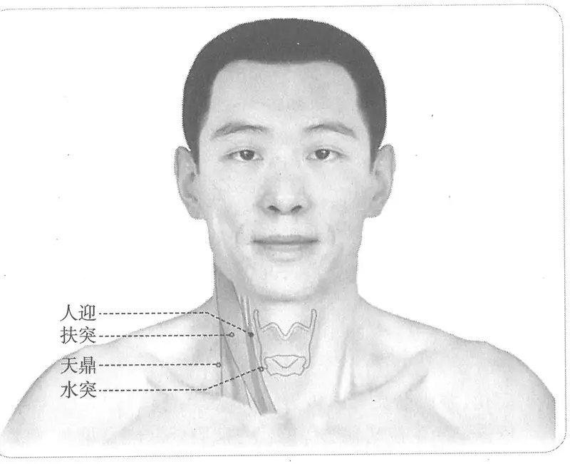

**图 2-61　人迎穴图**

**取穴**：平结喉旁，当颈总动脉之后，胸锁乳突肌前缘取之。

**相关穴毗邻关系**：本穴与扶突、天窗二穴的关系为，胸锁乳突肌前缘处为人迎，后缘为天窗，中间为扶突。

#### 相关解剖学基础 

　1. 胸锁乳突肌的体表显示技法

技法一：深吸气，抬高胸部，憋住气，即可使胸锁乳突骨清楚地在体表显现。

技法二：单手或双手在额头部施加一个阻力，颈部抗阻力前屈，这时可清楚显现胸锁乳突肌。

技法三：仰卧，然后抬头，控制住，即可在体表看到明显的胸锁乳突肌。

技法四：轻微地向同侧前屈，则更易于显示胸锁乳突肌的锁骨头，如果个别被检查者在这些动作下还不能清楚显示或触及胸锁乳突肌，则可在做上述动作时施加适当的阻力，可明显提高显示度或感知度。

　2. 颈动脉搏动诊脉点　该动脉的触摸点在颈总动脉的分叉处：甲状软骨上缘水平稍外侧，胸锁乳突肌前缘。对于较瘦的被检者，还可清楚地触及动脉的管壁。

〔p.300 (인쇄 280)〕

　3. 甲状软骨体表触诊技法　甲状软骨位于舌骨和环状软骨之间，是最大的喉软骨，男子可在颈部中线上见有一个向前的角状凸起——喉结。另外还可触到甲状软骨板上缘和甲状软骨切迹。在女性常常见不到，但多能在舌骨下方摸到。

　1. 在颈大脉动应手，夹结喉旁，以候五脏气。（《黄帝明堂经》、《铜人腧穴针灸图经》卷下“穴腧都数”、《针灸资生经》）

　2. 在颈大脉动应手，夹结喉一寸五分。（《铜人腧穴针灸图经》卷上、《十四经发挥》、《医学纲目》、《针灸集书》、《针灸聚英》、《古今医统》、《医学入门》、《针灸大成》、《针方六集》、《类经图翼》、《循经考穴编》、《医宗金鉴·刺灸心法要诀》、《针灸易学》、《针灸逢源》）

　3. 在颈大脉，动脉应手，夹结喉傍，仰而取之。（《铜人腧穴针灸图经》卷中、《针灸易学》）

　4. 去结喉旁一寸五分。（《针灸十四经穴位考订》）

　5. 统编针灸学教材

　　(1) 部位：颈部结喉旁一寸五分。取穴：从结喉旁一寸五分之处，有动脉应手之所，避开动脉取之。（1957年南京《针灸学》）

　　(2) 部位：颈部结喉旁一寸五分。取穴：于结喉旁动脉应手处取之。（1版《针灸学讲义》）

　　(3) 部位：在颈大脉动应手，夹结喉。取穴：平结喉旁，当颈总动脉之后，胸锁乳突肌前缘取之。（2版《针灸学讲义》）

　　(4) 喉结旁开1.5寸。（4版《针灸学》）

　　(5) 喉结旁1.5寸，当颈总动脉之后，胸锁乳突肌的前缘。（5、7版《针灸学》）

　　(6) 在颈部喉结旁，当胸锁乳突肌的前缘，颈总动脉搏动处。（6版《针灸学》、《中国针灸学》）

**文献分析**：本穴定位，宋以前文献以体表解剖标志定，自《铜人腧穴针灸图经》卷上，补以骨度折量分寸，今依据腧穴定位文献选择的优先法则，综合《灵枢》、《针灸甲乙经》之说，仍以体表解剖标志定位。

#### 【类属】 

足阳明胃经穴。

足阳明脉气所发。（《黄帝明堂经》）

足阳明、少阳之会。（《针灸聚英》卷一）

#### 【适应症】 

主治肺部、局部病症。常用于气喘；头痛、眩晕；咽喉肿痛；瘰疬，瘿瘤。高血压。

　1. 主阳逆霍乱头痛，胸满呼吸喘喝，穷诎窘不得息。（《黄帝明堂经》）

**按**：“霍乱”除了乱于肠胃而以暴吐利为特点外，还“言其病挥霍之间，便致撩乱也”，故暴头痛，头痛如破，也谓之“霍乱”（详见《诸病源候论》）。

　2. 治吐逆霍乱，胸满喘呼不得息，项气闷肿，食不下。（《铜人腧穴针灸图经》卷中）。

**按**：王惟一将《黄帝明堂经》原文“阳逆霍乱”理解为“吐逆霍乱”，非是。

　3. 主咽喉痈肿，瘰疬。（《针灸聚英》、《针灸大成》、《针方六集》）

**按**：“咽喉痈肿”系从《针灸资生经》转录《铜人腧穴针灸图经》主治，《针灸资生经》原文作“咽喉痈肿（见咳逆上气）”，查该篇可知，此条主治为“水突”穴所主；“瘰疬”系从《针灸资生经》辑录《千金要方》（原方见“附：临床应用举例”），因此，这两条主治归于人迎穴下都欠妥。

　4. 统编针灸学教材

〔p.301 (인쇄 281)〕

　　(1) 咽喉痛肿，胸满，咳嗽气喘，颈肿，瘰疬。（1957年南京《针灸学》、1版《针灸学讲义》）

　　(2) 咽喉肿痛，喘息，瘿气，瘰疬，项肿气闷，饮食难下。（2版《针灸学讲义》）

　　(3) 咽喉肿痛，喘息，瘰疬，瘿气。（4版《针灸学》）

　　(4) 咽喉肿痛，气喘，瘰疬，瘿气，高血压。（5版《针灸学》）

　　(5) 咽喉肿痛、高血压、头痛、瘰疬、饮食不下、胸满气喘。（6版《针灸学》）

　　(6) ①瘿气，瘰疬；②咽喉肿痛；③高血压；④气喘。（7版《针灸学》）

　　(7) 咽喉肿痛，喘息，气瘿，头晕，面赤。（《中国针灸学》）

**文献分析**：《铜人腧穴针灸图经》以前的腧穴文献，特别是《灵枢》与《黄帝明堂经》所描述的本穴主治都体现出这样一个特征——气上冲逆。《灵枢·卫气失常》曰：“卫气之留于腹中，搐积不行，苑蕴不得常所，使人支胁胃中满，喘呼逆息者，何以去之？伯高曰：其气积于胸中者，上取之；积于腹中者，下取之；上下皆满者，旁取之。黄帝曰：取之奈何？伯高对曰：积于上，泻人迎、天突、喉中。”从《黄帝明堂经》所载之“天突”主治来看，也明显反映出这一特点。现行针灸学教材似未突出“人迎”穴治气上冲逆的这一主治特点。

#### 附：临床应用举例 

　1. 颔痛，刺足阳明曲周动脉见血，立已；不已，按人迎于经，立已。（《灵枢·杂病》）

　2. 阳迎头痛，胸满不得息，取之人迎。（《灵枢·寒热病》）

　3. 喘呼逆息，气积于上，泻人迎、天突、喉中。（《灵枢·卫气失常》）

　4. 一切瘰疬，又灸五里、人迎各三十壮。（《千金要方》卷二十三）

　5. 证口眼㖞斜是经非窍辨　一长吏病此，命予疗之。目之斜，灸以承泣；口之㖞，灸以地仓，俱效。苟不效者，当灸人迎。夫气虚风入而为偏，上不得出，下不得泄，真气为气邪所陷，故宜灸。（《儒门事亲》卷二）

**按**：本则医案提示，面瘫可由阳气内陷而生，如遇此证，则在取承泣、地仓等主治面瘫要穴时，还须配合调气之人迎穴。

　6. 单纯性甲状腺肿，人迎穴针刺治疗。［中国针灸，1988，8（1）：14］

　7. 三叉神经痛，针刺人迎穴治疗。［浙江中西医结合杂志，1999，9（2）：138］

　8. 顽固性呃逆，针刺人迎穴。［河北中医，2000，22（8）：615］

　9. 高血压病，主穴人迎双；副穴合谷、太冲、曲池、足三里；配穴肝火亢盛者加行间，肝肾阴虚者加复溜，痰湿盛者加丰隆。［天津中医，2000，17（2）：30］

#### 【操作】 

直刺0.2~0.4寸。不宜刺向外侧及深刺。

　1. 禁不可灸，刺入四分，过深不幸杀人。（《针灸甲乙经》卷三）。

　2. 禁不可灸，灸之不幸杀人。一云有病可灸三壮。（《外台秘要》卷三十九）。

　3. 禁用针灸。（《医学入门》卷一）

　4. 针三分，禁灸。针不可深，针时须避开颈间动脉。《铜人》禁针。（《针灸十四经穴位考订》）

　5. 统编针灸学教材

　　(1) 针三分，不可深刺。（1957年南京《针灸学》、1版《针灸学讲义》）

　　(2) 避开动脉直刺1~3分。（2版《针灸学讲义》）

　　(3) 避开颈总动脉，直刺0.3~0.8寸。禁灸。（4、5、7版《针灸学》）

　　(4) 避开颈总动脉直刺0.2~0.4寸；不宜灸。（6版《针灸学》）

　　(5) 避开颈总动脉，直刺0.3~0.5寸。（《中国针灸学》）

〔p.302 (인쇄 282)〕

　6. 直刺或斜刺0.5~1寸。感应：局部胀痛，向肩部放散。禁灸。针刺不宜过深，避开动脉取之。（上海《针灸学》）

**刺法及主治的解剖学基础**：本穴下有一重要结构即颈动脉窦，在颈动脉的深层，伴随动脉的有迷走神经。若针刺不当，如不避开颈总动脉，则针刺深度超过0.5寸，即可刺中颈总动脉，或刺中颈动脉窦，引起血压异常波动；若已经避开动脉，但针刺深度达0.6~0.8寸，则极易刺中迷走神经，超过1寸则易刺中交感干，会严重影响心血管系统功能，甚至危及生命。但有临床报道，刺及动脉壁，或刺人动脉中而不刺穿，有突出的调节心血管系统的功能。

胸锁乳突肌的主要功能是稳定、旋转和弯曲头部和颈部，它也是许多引起各种头痛的激发点的常见部位。相关联部位为锁骨头、耳内、耳后。这可能是《黄帝明堂经》所载胸锁乳突肌周围穴位（人迎、天窗、天容、天牖）主治头痛与耳部病症的机制之一。

现代用本穴治高血压、呃逆、癫痫，主要是受现代医学有关病理认识的影响，特别是日本学者代田文誌20世纪50年代总结的“人迎洞刺法”，促进了对本穴主治症的研究。

### （十）水突 Shuǐtū ST10 出《黄帝明堂经》 

#### 【提要索隐】 

古代文献关于本穴定位的描述，因与扶突、人迎等穴相混而造成连环错误。

**穴名**：一名水门。

**部位**：在颈部，横平环状软骨，胸锁乳突肌前缘。

**国标修订**：1990年版国标：在颈部，胸锁乳突肌的前缘，当人迎与气舍连线的中点。2006年修订版：在颈部，横平环状软骨，胸锁乳突肌前缘。

**按**：作为标准文本的正文，不能采用“以穴定穴”这种以未知定义未知的表述方式，因此2006年版国标没有采用“人迎与气舍连线的中点”这种不规范的表述体例。

**适应症**：主治肺部、咽喉部病症。常用于咳嗽，气喘；咽喉肿痛。

**针刺操作**：针刺0.3~0.5寸。不宜向内侧深刺。

#### 【名实考】 

水突，一名水门。日本针灸教材又作“一名水天”，非是。

关于本穴定位，宋校本《千金要方》误将“扶突”穴文字注于其间，现代针灸学教材未受其误导。

　1. 水突，一名水门。在颈大筋前，直人迎下，气舍上，足阳明脉气所发。（《黄帝明堂经》）

　2. 一本云水突在曲颊下一寸近后。（《千金要方》卷二十九注）

**按**：此系《黄帝明堂经》扶突穴定位，因扶突一名“水穴”，而与本穴相混也。未经宋人校改本《孙真人千金方》无此注文。

　3. 突者，通气处也。此穴在颈之前，乃水之所由入，故曰水突。（《经穴解》）

　4. 别名　水天。（1957年南京《针灸学》）

**按**：此间接引自日本教材，云出自《针灸甲乙经》。今查传世各本《针灸甲乙经》均作“水门”。

#### 相关穴及刺激点 

喉返神经刺激点：喉结下一横指，环状软骨两旁。主治哑症，失音，失语，声带麻痹，咽炎。刺法：呈75度向后稍向侧刺入2.0cm。（《实用神经干刺激疗法》）

#### 【定位】 

**部位**：在颈部，横平环状软骨，胸锁乳突肌前缘（图2-62）。

〔p.303 (인쇄 283)〕

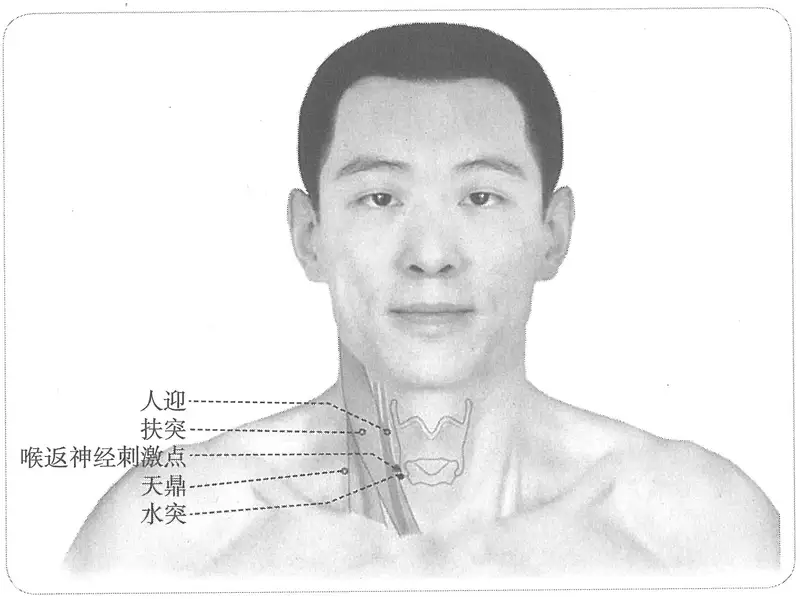

**图 2-62　水突穴与相关刺激点**

**取穴**：正坐仰靠，胸锁乳突肌的前缘，横平环状软骨下缘，当人迎与气舍穴连线的中点处。

**相关穴毗邻关系**：在环状软骨水平，于沿胸锁乳突肌前缘，定水突；水突外侧，胸锁乳突肌后缘，为天鼎穴，上方于甲状软骨上缘水平（喉结），胸锁乳突肌前后缘之间为扶突穴。

#### 相关解剖学基础 

环状软骨体表触诊技法：环状软骨位于喉软骨的最下方，在甲状软骨下方的骨性突起即环状软骨，与第6颈椎体在同一水平面。

　1. 在颈大筋前，直人迎下，气舍上。（《黄帝明堂经》、《铜人腧穴针灸图经》、《圣济总录》、《针灸资生经》、《十四经发挥》、《医学纲目》、《针灸聚英》、《古今医统》、《医学入门》、《针灸大成》、《循经考穴编》、《针灸易学》）

　2. 一本云水突在曲颊下一寸近后。（《千金要方》卷二十九注）

**按**：此系“扶突”穴部位。

　3. 直人迎下，气舍上，二穴之中。（《医学入门》卷一）

　4. 在颈大筋前，直人迎下，气舍上，夹喉咙旁一寸五分。（《针方六集》卷一）

**按**：“夹喉咙旁一寸五分”，此与人迎穴部位相混。

　5. 在颈大筋前，直人迎下，夹气舍上，内贴气喉。（《类经图翼》卷六、《医宗金鉴·刺灸心法要诀》、《针灸逢源》）

　6. 统编针灸学教材

　　(1) 部位：穴在人迎下，气舍上。取穴：从人迎穴与气舍穴之中间取之。（1957年南京《针灸学》）

　　(2) 部位：大筋前，人迎穴下，气舍穴上。取穴：从人迎与气舍二穴之间取之。（1版《针灸学讲义》）

　　(3) 部位：在颈大筋前，直人迎下，气舍上。取穴：在人迎与气舍之间，当胸锁乳突肌前缘。（2版《针灸学讲义》）

　　(4) 人迎穴至气舍穴连线的中点。（4版《针灸学》）

〔p.304 (인쇄 284)〕

　　(5) 人迎穴至气舍穴连线的中点，当胸锁乳突肌前缘。（5版《针灸学》、《中国针灸学》）

　　(6) 在颈部胸锁乳突肌的前缘，当人迎与气舍连线的中点。（6、7版《针灸学》）

**文献分析**：古代文献关于本穴定位的分歧多由宋校本《千金要方》的错乱引起。该书将水突穴定位文字误注于扶突穴处，扶突穴下误录天鼎穴部位，天鼎穴下误录扶突穴部位，出现了连环错误。至明代《针方六集》于水突穴下又混入人迎穴定位的文字。

#### 【类属】 

足阳明胃经穴。

足阳明脉气所发。（《黄帝明堂经》）

#### 【适应症】 

主治肺部、咽喉部病症。常用于咳嗽，气喘；咽喉肿痛。

　1. 咳逆，上气。咽喉痈肿，呼吸短气，喘息不通。（《黄帝明堂经》）

**按**：从相邻穴“天鼎”主治“暴喑气哽，喉痹咽肿不得息，饮食不下”和天突穴主治“颈有大气，喉痹，咽中干急不得息，喉中鸣”来看，上文中的“呼吸短气，喘息不通”系咽喉痈肿的伴随症状。

　2. 治咳逆上气，咽喉痈肿，呼吸短气，喘息不得。（《铜人腧穴针灸图经》卷中）

　3. 治噎食，翻胃。（《针方六集》卷五）

　4. 统编针灸学教材

　　(1) 咽喉痈肿，咳逆上气，气喘不能平卧。（1957年南京《针灸学》、1版《针灸学讲义》）

　　(2) 咽喉肿痛，咳嗽气逆，喘息不安。（2版《针灸学讲义》、4、5、7版《针灸学》、《中国针灸学》）

　　(3) 咳逆上气，喘息不得卧，咽喉肿痛，呃逆，瘰疬，瘿瘤。（6版《针灸学》）

**文献分析**：本穴主治，古今文献记载一致，均集中于肺部、咽喉部病症。第6版教材“呃逆，瘰疬，瘿瘤”三项主治症不见于古代文献，疑为下一穴“气舍”主治混录于此，今删之。

#### 附：临床应用举例 

　1. 声带疾患，人迎穴、水突穴针刺治疗。［中国针灸，1987（1）：18］

　2. 嗓音疾病，人迎穴、水突穴，针刺治疗。［中国针灸，1988，8（2）：12-13］

　3. 梅核气，人迎、水突，针刺治疗。［陕西中医，1991，12（11）：512］

　4. 偏头痛，针刺水突穴。［中国针灸，2001，21（10）：599-600］

#### 【操作】 

针刺0.3~0.5寸。不宜向内侧深刺。

　1. 刺入一寸，灸三壮。（《黄帝明堂经》）

　2. 刺入四分，灸三壮。（《医心方》卷二）

　3. 针入三分，可灸三壮。（《铜人腧穴针灸图经》卷中）

　4. 统编针灸学教材

　　(1) 针三至四分，灸三至五壮。（1957年南京《针灸学》、1版《针灸学讲义》）

　　(2) 直刺3~5分，艾条灸3~5分钟。（2版《针灸学讲义》）

　　(3) 直刺0.3~0.8寸。（4、5、7版《针灸学》）

　　(4) 直刺0.3~0.5寸；可灸。（6版《针灸学》、《中国针灸学》）

**文献分析**：近来有人针刺水突时，应用针刺手段刺激星状交感神经节，可使交感神经对颅内外血管的收缩与舒张功能的调节趋于平衡，从而达到治疗偏头痛的目的[^26-1]。这说明腧穴的主治范围，在很大程度上取决于针刺的方向、深度和刺激量。

[^26-1]: 黄庆文，王瑞霞．针刺水突穴治疗偏头痛临床研究［J］．中国针灸，2001，21（10）：599-600

〔p.305 (인쇄 285)〕

### （十一）气舍 Qìshě ST11 出《黄帝明堂经》 

#### 【提要索隐】 

**部位**：在颈前部，锁骨上小窝，锁骨胸骨端上缘，胸锁乳突肌胸骨头与锁骨头中间的凹陷中。

**适应症**：主治肺部、局部病症。常用于咳嗽，气喘；咽喉肿痛，瘿瘤，瘰疬，颈项强痛。全喉截除术针麻用穴。

**针刺操作**：直刺0.3~0.5寸。不宜深刺、强刺激。

#### 【名实考】 

明代《针灸聚英》神阙穴别名为“气舍”，与本穴同名，后人又于《外台秘要》脐中穴下添加“神阙，一名气舍”六字。但从目前掌握的资料来看，神阙穴的这个别名并没有出现在针灸方中，因此还不存在与本穴混同的情况。

关于本穴的部位，明代《针方六集》先是将人迎穴定位文字“夹喉咙旁一寸五分”混入“水突”穴下，受此误影响，下一穴“气舍”也作“夹天突陷中一寸五分”。胸锁乳突肌的走行是由后上向前下，因此人迎、水突、气舍三穴不会在一条垂直线上。

　1. 气舍，在颈，直人迎，夹天突陷者中，足阳明脉气所发。（《黄帝明堂经》）

　2. 在颈，直人迎下，夹天突陷中一寸五分。（《针方六集》卷一）

　3. 此穴为气上下往来之所，故曰气舍。（《经穴解》）

#### 相关穴及刺激点 

　1. 颈交感神经干刺激点　位于胸锁关节上1横指，气管外缘向外旁开1横指，胸锁乳突肌内缘，第7颈椎横突的腹面。主治脑供血不足，偏头痛，雷诺现象，自主神经功能紊乱，免疫功能紊乱。（《实用神经干电刺激疗法》）

　2. 臂丛5　位于肩部，锁骨上缘中点处。主治小儿麻痹后遗症。针法：针尖向外下方斜刺五至六分，针感麻、酸至手。（《针灸经外奇穴图谱（续集）》）

　3. 颈臂　位于颈部，锁骨上缘，锁骨上窝中央至锁骨内侧端之中点。主治臂麻、臂神经痛、肩臂风湿症、手及臂肌肉萎缩等症。针法：一般约进针2寸许。稍一捻动，手指即有触电样或酸麻感觉。如果感觉转向胸背，可另换方向刺进，以感觉到手指为止。（《针灸经外奇穴图谱》）

#### 【定位】 

**部位**：在颈前部，锁骨上小窝，锁骨胸骨端上缘，胸锁乳突肌胸骨头与锁骨头中间的凹陷中（图2-63）。

**取穴**：头转向另一侧以显露胸锁乳突肌，在锁骨内侧上缘，可看到胸锁乳突肌的胸骨头与锁骨头，在两肌头之间的凹陷中取穴。

　1. 《黄帝明堂经》佚文

　　(1) 在颈，直人迎下，夹天突陷者中。（《针灸甲乙经》卷三、《铜人腧穴针灸图经》卷上、《圣济总录》、《针灸资生经》、《十四经发挥》、《医学纲目》、《针灸聚英》、《古今医统》、《医学入门》、《针灸大成》、《针方六集》、《针灸易学》）

　　(2) 在颈，直人迎，夹天突陷中。（《千金要方》卷二十九、《千金翼方》、《外台秘要》、《铜人腧穴针灸图经》卷中及卷下“穴腧都数”）

　2. 在颈，直人迎下，夹天突陷中一寸五分。（《针方六集》卷一、《循经考穴编》）

　3. 在颈大筋前，直人迎下，夹天突边陷中，贴骨尖上有缺。（《类经图翼》卷六）

〔p.306 (인쇄 286)〕

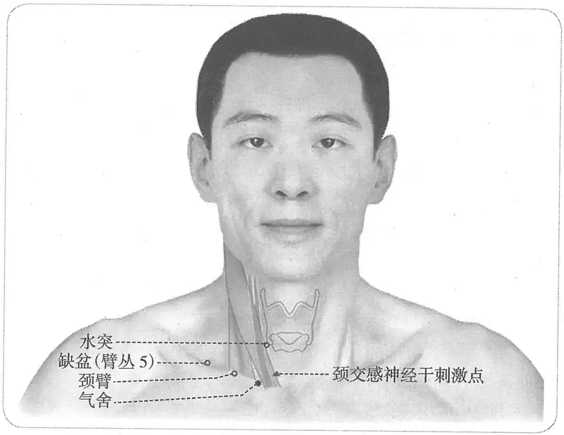

**图 2-63　气舍穴与相关穴及刺激点**

　4. 从水突下直行，颈大筋前，结喉下一寸许陷中，贴骨尖上有缺处。（《医宗金鉴·刺灸心法要诀》）

　5. 在颈大筋前结喉下一寸许，夹任脉天突边陷中，贴骨尖上有缺处。（《针灸逢源》）

　6. 人迎直下，天突穴旁约一寸五分，锁骨上际陷中。（《针灸十四经穴位考订》）

　7. 统编针灸学教材

　　(1) 部位：任脉天突穴旁开一寸五分。取穴：从人迎穴直下当天突穴横开一寸五分处取之。（1957年南京《针灸学》）

　　(2) 部位：任脉天突穴旁开一寸五分。取穴：从人迎穴直下，任脉天突穴旁，锁骨上缘取之。（1版《针灸学讲义》）

　　(3) 部位：在颈，直人迎下，夹天突陷者中。取穴：人迎直下，锁骨内侧端之上缘，在胸锁乳突肌的胸骨头与锁骨头之间。（2版《针灸学讲义》）

　　(4) 人迎穴直下，锁骨上缘。（4版《针灸学》）

　　(5) 人迎穴直下，锁骨上缘，在胸锁乳突肌的胸骨头与锁骨头之间。（5版《针灸学》）

　　(6) 在颈部，当锁骨内侧端的上缘，胸锁乳突肌的胸骨头与锁骨头之间。（6版《针灸学》、《中国针灸学》）

　　(7) 人迎穴直下，在锁骨内侧端的上缘，胸锁乳突肌的胸骨头与锁骨头之间。（7版《针灸学》）

**文献分析**：本穴定位，《黄帝明堂经》的描述很明确：横平天突，上直人迎。至明代《类经图翼》又增补一个骨性标志“贴骨尖上有缺”，此处相当于锁骨胸骨头外上切迹凹陷处，恰好位于胸锁乳突肌的胸骨头与锁骨头之间的凹陷处。至于《针方六集》定位中“夹天突陷中一寸五分”句乃受前一穴“水突”错误的影响，《针灸十四经穴位考订》、1957年南京《针灸学》、1版《针灸学讲义》皆受此误影响。

#### 【类属】 

足阳明胃经穴。

〔p.307 (인쇄 287)〕

足阳明脉气所发。（《黄帝明堂经》）

#### 【适应症】 

主治肺部、局部病症。常用于咳嗽，气喘；咽喉肿痛，瘿瘤，瘰疬；颈项强痛。全喉截除术针麻用穴。

　1. 咳逆上气。肩肿不得顾。喉痹。瘤瘿。（《黄帝明堂经》）

　2. 治咳逆上气，瘤瘿，喉痹咽肿，颈项强不得回顾。（《铜人腧穴针灸图经》卷中）

　3. 喉痹哽噎，咽肿不消，饮食不下。（《针灸聚英》卷一、《古今医统》、《针灸大成》、《循经考穴编》）

**按**：此条主治系高武从《针灸资生经》转录《千金要方》孔穴主治条文“天鼎、气舍、膈俞主喉痹哽噎，咽肿不得消，食饮不下”。

　4. 统编针灸学教材

　　(1) 咽痛喉痹，咳逆上气，颈项强痛，瘰疬。（1957年南京《针灸学》、1版《针灸学讲义》）

　　(2) 咽喉肿痛，喘息，呃逆，肩肿，瘿瘤，瘰疬。（2版《针灸学讲义》）

　　(3) 咽喉肿痛，颈项强，喘息，呃逆，瘿瘤，瘰疬。（4、5、6、7版《针灸学》）

　　(4) 咽喉肿痛，颈部强痛，喘息，呃逆，瘿瘤。（《中国针灸学》）

**文献分析**：教材中的“呃逆”，盖从《针灸聚英》“哽噎”而来，此为高武误录。这几条中的“呃逆”均为“喉痹”的伴随症状。今去之。

#### 【操作】 

直刺0.3~0.5寸。不宜深刺、强刺激。

　1. 刺入三分，灸五壮。（《针灸甲乙经》卷三）

　2. 刺入四分，灸三壮。（《医心方》卷二）

　3. 统编针灸学教材

　　(1) 针三至五分，灸三至五壮。（1957年南京《针灸学》、1版《针灸学讲义》）

　　(2) 直刺3~4分，艾条灸3~5分钟。（2版《针灸学讲义》）

　　(3) 直刺0.3~0.5寸。（4、5、6版《针灸学》、《中国针灸学》）

　　(4) 直刺0.3~0.5寸。本经气舍至乳根诸穴，深部有大动脉及肺、肝等重要脏器，不可深刺。（7版《针灸学》）

### （十二）缺盆 Quēpén ST12 出《黄帝明堂经》 

#### 【提要索隐】 

**穴名**：一名天盖。

**部位**：在颈前部，锁骨上大窝，锁骨上缘凹陷中，前正中线旁开4寸。

**国标修订**：1990年版国标：在锁骨上窝中央，距前正中线4寸。2006年修订版：在颈外侧区，锁骨上大窝，锁骨上缘凹陷中，前正中线旁开4寸。

**按**：1990年版国标“锁骨上窝中央”与“距前正中线4寸”义重，且可能出现二者不在一点的矛盾，故2006年版国标，去掉一个横坐标点，另将“锁骨上窝”明确为“锁骨上大窝”。

**适应症**：主治胸肺部病症。常用于咳嗽，气喘；咽喉肿痛，瘰疬；缺盆中痛。

**针刺操作**：直刺0.3~0.5寸。禁止偏向内下方深刺。

#### 【名实考】 

缺盆，一名天盖。“缺盆”之名大量见于《灵枢》，然皆用作部位名，明确用作穴名者始见于《素问》，然定位不详。作为部位之“缺盆”，一般都理解为锁骨上大窝，如《素问要旨论》曰：“胸两旁高处为膺，膺上横骨为巨骨，巨骨上为缺盆”。然《灵枢·本输》曰“缺盆之中，任脉也，名曰天突”，《灵枢·骨度》曰“结喉以下至缺盆中长四寸，缺盆以下至𩩲骭长九寸”，《素问·骨空论》曰“其上气有音者治其喉中央，在缺盆中者”，似指整个锁骨上凹陷，或胸骨切迹上凹陷为缺盆。

〔p.308 (인쇄 288)〕

　1. 失枕，在肩上横骨间。王冰注曰：谓缺盆穴也。（《素问·骨空论》）

　2. 大杼、膺俞、缺盆、背俞，此八者以泻胸中之热也。（《素问·刺热》）

　3. 刺缺盆中内陷，气泄，令人喘咳逆。（《素问·刺禁论》）

　4. 缺盆，一名天盖。在肩上横骨陷者中。（《黄帝明堂经》）

**按**：肩上横骨，又称“巨骨”。

　5. 缺盆二穴，在肩上横骨陷中。一名天盖。肩上是穴。（《太平圣惠方·针经》）

**按**：《针灸资生经》卷一注曰：“《铜人》云在肩下横骨陷中，《明堂》乃云在肩上横骨陷中，又云肩上是穴。恐《铜人》误下字也”。今检《铜人腧穴针灸图经》卷上、卷中、卷下三处均作“肩下”，抄录错误的可能性不大，笔者认为此用字的差异主要由于二书对经文理解的角度不同，《黄帝明堂经》所说“肩上”是指肩部的意思，而不是“肩的上方”的意义。理解的角度不同，故对同一个“横骨”，二书一作“肩上”，一作“肩下”。

　6. 缺盆，一名尺盖。（《针灸聚英》卷一）

**按**：“尺盖”系“天盖”形误。

　7. 此穴之名，以形有缺盆之状而名之也。（《经穴解》）

#### 相关穴及刺激点 

　1. 臂丛刺激点锁骨上刺激点　位于锁骨中点上1.5cm。刺法：取仰卧位，头略后仰并向对侧转45°。医者左手在患者的胸锁乳突肌锁骨头的外侧缘、锁骨上方触及锁骨下动脉的搏动，将其下按，于其外侧进针，针尖向患者的内、下、后方（相当于患者第3胸椎棘突），进针深度约1.5cm，即触及第1肋骨。针刺不可过深，以免伤及胸膜和肺尖。主治上肢瘫痪、麻木、疼痛、震颤、臂丛神经痛。（《实用神经干电刺激疗法》）

　2. 颈臂　位于颈部，锁骨上缘，锁骨上窝中央至锁骨内侧端之中点。主治臂麻、臂神经痛、肩臂风湿症、手及臂肌肉萎缩等症。针法：一般约进针2寸许。稍一捻动，手指即有触电样或酸麻感觉。如果感觉转向胸背，可另换方向刺进，以感觉到手指为止。（《针灸经外奇穴图谱》）

#### 【定位】 

**部位**：在颈前部，锁骨上大窝，锁骨上缘凹陷中，前正中线旁开4寸（图2-64）。

**取穴**：正坐仰靠，在锁骨上窝的中点，当胸锁乳突肌锁骨头的外侧凹陷中。

　1. 在肩上横骨陷者中。（《黄帝明堂经》、《太平圣惠方·针经》、《医学纲目》、《类经图翼》、《医宗金鉴·刺灸心法要诀》、《针灸逢源》）

　2. 在肩下横骨陷中。（《铜人腧穴针灸图经》卷上、卷中、《圣济总录》、《针灸资生经》、《十四经发挥》、《针灸聚英》、《古今医统》、《针灸大成》、《循经考穴编》）

　3. 在肩柱骨下肩端，平横骨上陷中。（《窦太师针经》）

　4. 在肩上横骨陷中，夹天突两旁各四寸。（《针方六集》卷一）

　5. 锁骨上窝中央，直对乳头。（《针灸十四经穴位考订》）

　6. 统编针灸学教材

　　(1) 部位：肩下横骨上陷中。取穴：正坐，从天突外开四寸，当锁骨之上凹陷中，下与乳头成直线，即在其处取之。（1957年南京《针灸学》）

　　(2) 部位：锁骨上凹陷部之中央。取穴：正坐，从任脉天突穴外开四寸，锁骨上缘陷中

〔p.309 (인쇄 289)〕

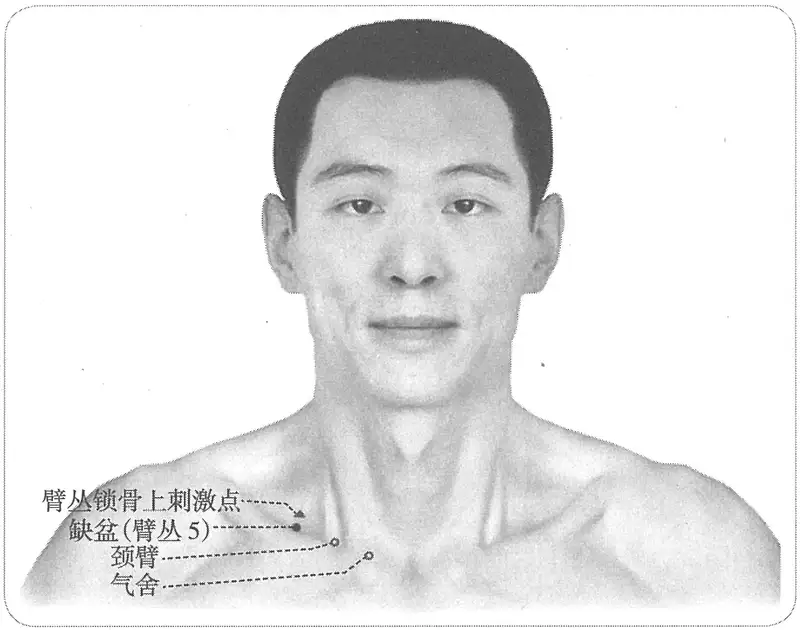

**图 2-64　缺盆穴与相关穴及刺激点**

取之，向下直对乳头。（1版《针灸学讲义》）

　　(3) 部位：在肩上横骨陷者中。取穴：当乳头线直上锁骨上窝之中点，天突（任脉）旁四寸取之。（2版《针灸学讲义》）

　　(4) 锁骨上窝中央，前正中线旁开4寸。（4、5、7版《针灸学》、《中国针灸学》）

　　(5) 在锁骨上窝中央，距前正中线4寸。（6版《针灸学》）

**文献分析**：本穴定位，《黄帝明堂经》曰“肩上横骨陷者中”，而未详距中行的横向距离，至《针方六集》始言“夹天突两旁各四寸”，今从之。

#### 【类属】 

足阳明胃经穴。

**脉气所发：**

　1. 足阳明脉气所发。（《素问·气府论》王冰注）

　2. 手阳明脉气所发。（《素问·骨空论》王冰注）

**按**：气舍穴，在《黄帝明堂经》未载“脉气所发”，在《外台秘要》被归入手少阳经；在《医心方》被归入足少阳经；王冰注《素问》或曰“手阳明”，或作“足阳明”。

**归经：**

　1. 手少阳三焦经。（《外台秘要》卷三十九）

　2. 足阳明胃经。（《铜人腧穴针灸图经》卷上）

#### 【适应症】 

主治胸肺部病症。常用于咳嗽，气喘；咽喉肿痛，瘰疬；缺盆中痛。

　1. 主寒热疬适，胸中满，有大气。缺盆中满痛者死，外溃不死。肩痛引项，臂不举，缺盆中痛。汗不出，喉痹，咳唾血。（《黄帝明堂经》）

　2. 主腹大水气，汗出，咳嗽。（《太平圣惠方·明堂》）

　3. 治寒热瘰疬，缺盆中肿，外溃则生。胸中热满，腹大水气，缺盆中痛，汗出，喉痹，咳嗽。（《铜人腧穴针灸图经》卷中）

　4. 窦太师针灸遗存

　　(1) 缺盆中虚痛肿。治妇人气项瘿袋等症，喉闭。（《窦太师针经》、《针方六集》）

〔p.310 (인쇄 290)〕

　　(2) 主瘿瘤，项强。（《循经考穴编》上）

　5. 统编针灸学教材

　　(1) 胸满喘咳，胸中热，项强，缺盆中痛，瘰疬，喉痹。（1957年南京《针灸学》、1版《针灸学讲义》）

　　(2) 咳嗽，气喘，咽喉肿痛，缺盆中痛，瘰疬。（2版《针灸学讲义》、4、5、6、7版《针灸学》）

　　(3) 咳嗽，气喘，咽喉肿痛，缺盆中痛。（《中国针灸学》）

**文献分析**：关于本穴主治，古今腧穴文献记载一致，均集中于胸、肺病症及瘰疬。

#### 附：临床应用举例 

　1. 失枕，在肩上横骨间。（《素问·骨空论》）

**按**：王冰注曰：“谓缺盆穴也。”

　2. 邪在肺，则病皮肤痛，寒热，上气喘，汗出，咳动肩背。取之膺中外腧，背三节五藏之旁，以手疾按之，快然，乃刺之，取之缺盆中以越之。（《灵枢·五邪》）

#### 【操作】 

直刺0.3~0.5寸，禁止偏向内下方深刺。治手臂病症可参颈臂穴，略向内侧刺，以感传至手指为效。

　1. 刺入二分，留七呼，灸三壮。刺太深令人逆息。（《黄帝明堂经》）

　2. 可灸三壮，针入三分，不宜刺太深，使人逆息也。（《铜人腧穴针灸图经》卷中）

　3. 平针入三分，灸二七壮。（《窦太师针经》）

　4. 统编针灸学教材

　　(1) 针三至五分，下为肺尖，过深则伤及肺尖，立生咳嗽呃逆等不良症状，故当注意，灸三至五壮。（1957年南京《针灸学》）

　　(2) 针三至五分，深部为肺脏，不宜深刺。（1版《针灸学讲义》）

　　(3) 直刺，向背侧进针3~5分，不宜深刺；艾条灸5~10分钟。（2版《针灸学讲义》）

　　(4) 直刺或斜刺0.3~0.5寸。（4、5、7版《针灸学》）

　　(5) 直刺0.3~0.5寸；可灸。（6版《针灸学》）

　　(6) 避开血管，直刺0.3~0.5寸，不可深刺。可灸。（《中国针灸学》）

**刺法及主治的解剖学基础**：本穴深面正当颈外静脉的末端和臂丛神经。若刺破颈外静脉可造成皮下出血，若刺及臂丛神经，局部麻胀感明显并可向上肢放散。针的内下方有锁骨下动脉、肺尖及胸膜顶。若针尖偏向内下方，易造成出血或气胸而危及生命，故该穴不可偏向内下方深刺。

斜角肌与第一肋构成胸廓出口。腋动脉（锁骨下动脉）和臂丛经前、中斜角肌走行于第一肋和锁骨之间。相关联部位：肩上方和肩胛骨内侧下方，下臂前下方、前臂桡侧下方至拇指和其余手指，特别是食指。因而会同时出现“肩痛引项，臂不举，缺盆中痛”的一组病症，针刺本穴，或云门穴，通过调节相关肌肉、血管、神经，可以有效缓解症状。

### （十三）气户 Qìhù ST13 出《黄帝明堂经》 

#### 【提要索隐】 

**部位**：在前胸部，锁骨下缘，前正中线旁开4寸。

**国标修订**：1990年版国标：在胸部，当锁骨中点下缘，距前正中线4寸。2006年修订版：在胸部，锁骨下缘，前正中线旁开4寸。

〔p.311 (인쇄 291)〕

**按**：1990年版国标“锁骨中点”与“距前正中线4寸”义重，2006年版国标去除一个横坐标点，使表述更规范。

**适应症**：主治肺部、胸部病症。常用于咳嗽，气喘，胸痛，胸胁胀满。

**针刺操作**：斜刺或平刺。不宜深刺和直刺。

#### 【名实考】 

　1. 气户，在巨骨下，输府两旁各二寸陷者中，足阳明脉气所发。仰而取之。（《黄帝明堂经》）

　2. 凡各经之穴，在胸者无不生气，而胃经之下胸，此穴为首，故曰气户。（《经穴解》）

#### 【定位】 

**部位**：在前胸部，锁骨下缘，前正中线旁开4寸（图2-65）。

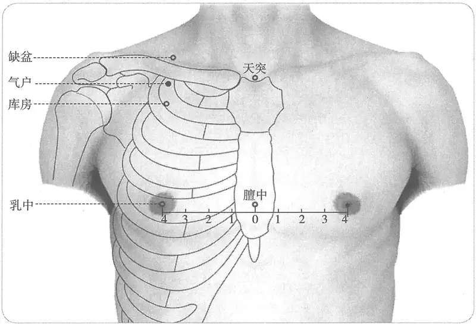

**图 2-65　气户穴图**

**取穴**：在锁骨中点之下缘，乳中线上取之。

　1. 在巨骨下，输府两旁各二寸陷者中……仰而取之。（《黄帝明堂经》、《铜人腧穴针灸图经》卷中及卷下“穴腧都数”、《圣济总录》、《针灸资生经》、《十四经发挥》、《医学纲目》、《针灸集书》、《医学入门》、《循经考穴编》）

　2. 在巨骨下，下直膺窗，去膺窗上同身寸四寸八分。（《素问·气府论》王冰注）

　3. 在巨骨下，腧府两旁相去各二寸陷中。（《铜人腧穴针灸图经》卷上）

　4. 从缺盆下行，巨骨下一寸，旁开中行四寸陷中，仰而取之。（《医宗金鉴·刺灸心法要诀》）

　5. 锁骨下缘陷中，璇玑穴旁开四寸。（《针灸十四经穴位考订》）

　6. 统编针灸学教材

　　(1) 部位：本穴在锁骨下俞府旁各开二寸。取穴：正坐或仰卧，从璇玑旁开四寸处，当锁骨下与乳头直对之处取之。（1957年南京《针灸学》）

　　(2) 部位：锁骨下缘。取穴：仰卧，从任脉璇玑穴横开四寸，与缺盆穴相间一骨，向下直对乳头取之。（1版《针灸学讲义》）

〔p.312 (인쇄 292)〕

　　(3) 部位：在巨骨下，俞府两旁各二寸陷者中。取穴：在锁骨中点之下缘，乳中线上取之。（2版《针灸学讲义》）

　　(4) 锁骨下缘，前正中线旁开4寸。（4、5、7版《针灸学》）

　　(5) 在胸部，当锁骨中点下缘，距前正中线4寸。（6版《针灸学》）

　　(6) 在锁骨下缘，前正中线旁开4寸。（7版《针灸学》）

　　(7) 在锁骨中点之下缘，任脉旁开四寸。（《中国针灸学》）

**文献分析**：本穴定位，历代文献的文字描述虽不同，而定位相同：下直膺窗，横平俞府。《黄帝明堂经》“在巨骨下，输府两旁各二寸陷者中”句中之“巨骨”，系骨名，指锁骨，不可与巨骨穴相混。《黄帝明堂经》曰：“云门，在巨骨下，夹气户两旁各二寸陷中”，“俞府，在巨骨下，去璇玑旁各二寸陷者中”，可见，本穴并内侧的俞府及外侧的云门3穴均在“巨骨”下，各相距二寸。

#### 【类属】 

足阳明胃经穴。

足阳明脉气所发。（《黄帝明堂经》）

#### 【适应症】 

主治肺部、胸部病症。常用于咳嗽，气喘，胸痛，胸胁胀满。

　1. 主胸胁榰满，喘逆上气，呼吸肩息，不知食味。（《黄帝明堂经》）

**按**：《明堂经》此条主治与相邻穴俞府主治“咳逆上气，喘不得息，呕吐，胸满，不得饮食”相似，当互参。

　2. 治胸胁支满，喘逆上气，胸背急不得息，不知食味。（《铜人腧穴针灸图经》卷中）

　3. 乳痈。（《针方六集》卷五）

　4. 主吐血等证。（《循经考穴编》上）

　5. 统编针灸学教材

　　(1) 哮喘咳逆，胸胁支满，胸背疼，食不知味。（1957年南京《针灸学》）

　　(2) 哮喘咳嗽，胸膺痛，吐血。（1版《针灸学讲义》）

　　(3) 气喘，咳嗽，胸肋胀满，吐血，呃逆，肋胁痛。（2版《针灸学讲义》）

　　(4) 胸胁支满，咳逆上气，呃逆，胸胁痛。（4版《针灸学》）

　　(5) 咳嗽，气喘，呃逆，胸胁支满，胸痛。（5版《针灸学》、《中国针灸学》）

　　(6) 咳喘，胸痛，呃逆，胁肋疼痛。（6版《针灸学》）

　　(7) 咳嗽，气喘，呃逆，胸胁支满等气机升降失常性病证；胸痛。（7版《针灸学》）

**文献分析**：本穴主治，古代腧穴文献记载一致，均集中于胸肺部病症。针灸教材中“呃逆”一症未详所出，或系误录“气舍”主治于此，暂不录之。

#### 【操作】 

斜刺或平刺。不宜深刺和直刺。

　1. 刺入四分，灸五壮。（《黄帝明堂经》）

　2. 针三分，灸五壮。（《铜人腧穴针灸图经》卷中）

　3. 统编针灸学教材

　　(1) 针三至五分，灸三至五壮。（1957年南京《针灸学》、1版《针灸学讲义》）

　　(2) 直刺3分，艾条灸5~10分钟。（2版《针灸学讲义》）

　　(3) 斜刺或平刺0.5~0.8寸。（4、5、7版《针灸学》）

　　(4) 沿肋间隙向外斜刺0.5~0.8寸；可灸。（6版《针灸学》）

　　(5) 斜刺0.3~0.5寸。可灸。（《中国针灸学》）

〔p.313 (인쇄 293)〕

### （十四）库房 Kùfáng ST14 出《黄帝明堂经》 

#### 【提要索隐】 

**部位**：在前胸部，第1肋间隙，前正中线旁开4寸。

**适应症**：主治胸部、肺部病症。常用于胸胁胀满，咳嗽、气喘，咳唾脓血。

**针刺操作**：斜刺或平刺。禁止直刺、深刺，以免造成气胸。

#### 【名实考】 

　1. 库房，在气户下一寸六分陷者中，足阳明脉气所发。仰而取之。（《黄帝明堂经》）

　2. 凡藏物之所，则名曰库。胸之所藏，心肺也，主气与血之本。一身之所以生者，气与血而已，而胸中藏其本，故曰库房。（《经穴解》）

#### 【定位】 

**部位**：在前胸部，第1肋间隙，前正中线旁开4寸（图2-66）。

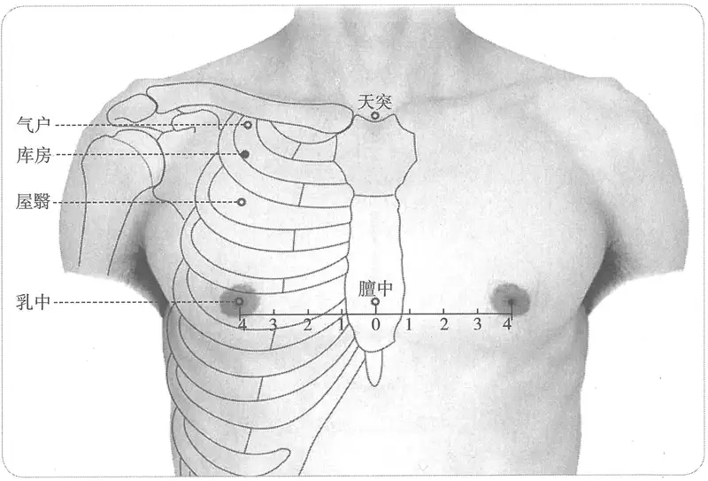

**图 2-66　库房穴图**

**取穴**：在乳中线与第1肋间隙的交点处取之。

　1. 在气户下一寸六分陷者中……仰而取之。（《黄帝明堂经》、《太平圣惠方·明堂》、《铜人腧穴针灸图经》、《圣济总录》、《针灸资生经》、《十四经发挥》、《医学纲目》、《医学入门》）

　2. 气户下一寸六分陷中，去中行各四寸，仰而取之。（《针灸聚英》卷一、《古今医统》、《针灸大成》、《针方六集》、《类经图翼》、《医宗金鉴·刺灸心法要诀》、《针灸易学》、《针灸逢源》）

　3. 穴在气户下一寸，仰而取之。广注去中行各四寸，当与华盖平。（《循经考穴编》上）

〔p.314 (인쇄 294)〕

　4. 气户直下第一与第二肋间。（《针灸十四经穴位考订》）

　5. 统编针灸学教材

　　(1) 部位：气户穴下一寸六分陷中。取穴：正坐或仰卧，从锁骨之内侧端轻按下一肋间上外侧移行，上与气户，下与乳头直对，适当中线华盖穴平，相去四寸处取之。（1957年南京《针灸学》）

　　(2) 部位：气户穴下一寸六分陷中。取穴：仰卧，从乳头向上数相隔三肋间湘中取之与任脉华盖穴平。（1版《针灸学讲义》）

　　(3) 部位：气户穴下一寸六分陷中。取穴：在乳中线上，第一肋间隙取之。（2版《针灸学讲义》）

　　(4) 第一肋间隙，前正中线旁开4寸。（4、5、7版《针灸学》）

　　(5) 在胸部，当第1肋间隙，距前正中线4寸。（6版《针灸学》）

　　(6) 第一肋间隙，任脉旁开四寸。（《中国针灸学》）

**文献分析**：本穴定位，历代文献的文字描述虽不同，而定位相同：上直气户，横平华盖。至于距气户穴的折量寸，《循经考穴编》改作“一寸”者，盖据华盖穴的分寸而改。然胸廓部穴纵向距离，据肋间隙定位，不必拘于分寸。

#### 【类属】 

足阳明胃经穴。

足阳明脉气所发。（《黄帝明堂经》）

#### 【适应症】 

主治胸部、肺部病症。常用于胸胁胀满，咳嗽、气喘，咳唾脓血。

　1. 胸胁支满，咳逆上气，呼吸多唾浊沫脓血。（《黄帝明堂经》）

　2. 主呼吸不至息，及肺寒咳嗽唾脓也。（《太平圣惠方·明堂》）

　3. 治胸胁支满，咳逆上气，多唾浊沫脓血。（《铜人腧穴针灸图经》卷中）

　4. 统编针灸学教材

　　(1) 胸胁支满，咳逆唾浊。（1957年南京《针灸学》）

　　(2) 胸胁胀满，咳唾浊痰。（1版《针灸学讲义》）

　　(3) 胸胁胀痛，咳嗽气逆，多唾浊沫脓血。（2版《针灸学讲义》、4、5版《针灸学》）

　　(4) 咳嗽，胸痛，胁胀，气喘。（6版《针灸学》）

　　(5) 咳嗽、气喘、咳唾脓血等肺系病证，胸胁胀痛。（7版《针灸学》）

　　(6) 胸胁胀痛，咳嗽。（《中国针灸学》）

**文献分析**：本穴主治，古今腧穴文献记载一致，均集中于胸肺部病症。《黄帝明堂经》载本穴主治与其左右相邻穴彧中、周荣穴主治相似，当互参。

#### 【操作】 

斜刺或平刺。禁止直刺、深刺，以免造成气胸。

　1. 刺入四分，灸五壮。（《黄帝明堂经》）。

　2. 可灸五壮，针入三分。（《铜人腧穴针灸图经》卷中、《针灸十四经穴位考订》）

　3. 统编针灸学教材

　　(1) 针三分，灸三至五壮。（1957年南京《针灸学》、1版《针灸学讲义》）

　　(2) 斜刺3分，艾条灸5~10分钟。（2版《针灸学讲义》）

　　(3) 斜刺或平刺0.5~0.8寸。（4、5、7版《针灸学》）

　　(4) 沿肋间隙向外斜刺0.5~0.8寸，可灸。（6版《针灸学》）

　　(5) 斜刺0.3~0.5寸。可灸。（《中国针灸学》）

〔p.315 (인쇄 295)〕

### （十五）屋翳 Wūyì ST15 出《黄帝明堂经》 

#### 【提要索隐】 

**穴名**：屋翳，与“尾翳”字形相近，易混淆。

**部位**：在前胸部，第2肋间隙，前正中线旁开4寸。

**适应症**：主治肺部病症。常用于咳嗽，气喘，胸满；乳痈。

**针刺操作**：斜刺或平刺。不宜直刺、深刺，以免刺伤胸膜和肺脏引起气胸。

#### 【名实考】 

由于本穴穴名“屋翳”，与任脉之别——鸠尾穴别名“尾翳”以及会阴穴别名“屏翳”字形相近，易致混淆。

　1. 鸠尾，一名尾翳。在臆前蔽骨下五分，任脉之别。主腹皮痛，瘙痒。（《黄帝明堂经》）

　2. 此穴与任脉中行紫宫平直，宫之旁则为屋之所。翳者，蔽也，故曰屋翳。（《经穴解》）

#### “屋翳”、“尾翳”、“屏翳”穴辨 

　1. 会阴，一名屏翳。任脉别络，夹督脉、冲脉之会。主实则腹皮痛，虚则痒搔。（《黄帝明堂经》）

　2. 屋翳，在库房下一寸六分陷者中。主身肿皮痛，不可近衣，淫泺苛获，久则不仁。（《黄帝明堂经》）

　3. 任脉之别，名曰尾翳，下鸠尾，散于腹。实则腹皮痛，虚则痒搔，取之所别也。（《灵枢·经脉》）

　4. 身肿皮痛，不可近衣，淫泺苛获，久则不仁，屏翳主之。（《针灸甲乙经》卷十二第三）

**按**：《针灸甲乙经》“屏翳主之”系“屋翳主之”形误。由于《经脉》篇所载之任脉之络未言明其所别之处，故《黄帝明堂经》编者只好将任脉之络病候归于与“尾翳”相关的腧穴“鸠尾”、“会阴”二穴之中，这是一种不得已的处理方法。而“屋翳”穴主治也明显受了任脉之络病候的影响。这三穴主治所以与任脉络病候发生联系，只是因为三者（特别是前二者）的穴名与任脉之络“尾翳”相同或极相近。

#### “屋翳”与“库房”主治相混例 

　1. 库房，主胸胁支满，咳逆上气，呼吸多唾浊沫脓血。（《外台秘要》卷三十九）

　2. 屋翳，主胸胁支满，咳逆上气，呼吸多唾浊沫脓血。身体肿，皮肤不可近衣，淫泺苛获，久则不仁。（《外台秘要》卷三十九）

　3. 库房，主胸胁榰满，咳逆上气，呼吸多唾浊沫脓血。（《黄帝明堂经》）

　4. 屋翳，主身肿皮痛，不可近衣，淫泺苛获，久则不仁。（《黄帝明堂经》）

**按**：据《黄帝明堂经》，知《外台秘要》屋翳穴主治中“胸胁支满，咳逆上气，呼吸多唾浊沫脓血”显然是误录库房穴主治。

#### 【定位】 

**部位**：在前胸部，第2肋间隙，前正中线旁开4寸（图2-67）。

**取穴**：在乳中线与第2肋间隙交点处取之。

　1. 《黄帝明堂经》传本

　　(1) 库房下一寸六分。（《针灸甲乙经》卷三、《千金翼方》、《铜人腧穴针灸图经》卷上）

　　(2) 在库房下一寸六分陷中，仰而取之。（《千金要方》卷二十九、《外台秘要》、《医心方》、《铜人腧穴针灸图经》卷中、《圣济总录》、《针灸资生经》、《十四经发挥》、《针灸集书》）

　　(3) 在气户下三寸二分。（《素问·气府论》王冰注）

〔p.316 (인쇄 296)〕

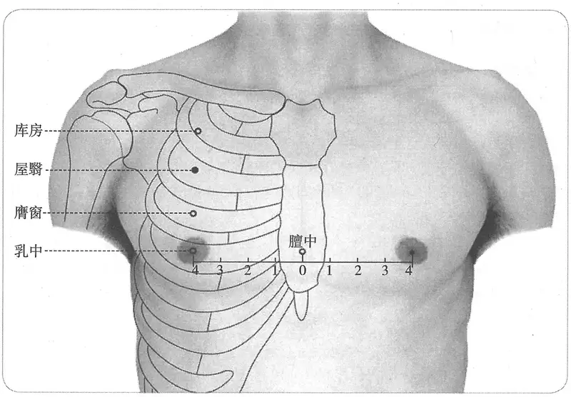

**图 2-67　屋翳穴图**

　2. 在库房下一寸陷中，仰而取之。（《医学纲目》卷八）

**按**：《医学纲目》腧穴系录自《铜人腧穴针灸图经》，并据《针灸甲乙经》校，此处“一寸”下较《铜人腧穴针灸图经》漏“六分”二字。

　3. 库房下一寸六分陷中，气户下三寸二分，去中行各四寸，巨骨下四寸八分，仰而取之。（《针灸聚英》卷一、《古今医统》、《针灸大成》、《针方六集》、《类经图翼》、《医宗金鉴·刺灸心法要诀》、《针灸易学》）

　4. 广注去中行各四寸，与紫宫平。（《循经考穴编》上、《针灸逢源》）

　5. 库房直下第二与第三肋间。（《针灸十四经穴位考订》）

　6. 统编针灸学教材

　　(1) 部位：库房穴下一寸六分。取穴：仰卧自库房下按一肋间，对准乳头处取之。（1957年南京《针灸学》）

　　(2) 部位：库房穴下一寸六分。取穴：仰卧，自乳头向上数二肋间陷中取之，与任脉紫宫穴平。（1版《针灸学讲义》）

　　(3) 部位：库房穴下一寸六分。取穴：在乳中线上，第二肋间隙取之。（2版《针灸学讲义》）

　　(4) 第二肋间隙，前正中线旁开4寸。（4、5、7版《针灸学》）

　　(5) 在胸部，当第2肋间隙，距前正中线4寸。（6版《针灸学》）

　　(6) 第二肋间隙，任脉旁开4寸。（《中国针灸学》）

**文献分析**：本穴定位，历代文献的文字描述虽不同，而定位相同：上直库房，横平紫宫。

#### 【类属】 

足阳明胃经穴。

足阳明脉气所发。（《黄帝明堂经》）

#### 【适应症】 

主治肺部病症。常用于咳嗽，气喘，胸满；乳痈。

〔p.317 (인쇄 297)〕

　1. 主身肿皮痛，不可近衣，淫泺苛获，久则不仁。（《黄帝明堂经》）

**按**：《素问·逆调论》曰：“帝曰：人之肉苛者，虽近衣絮，犹尚苛也，是谓何疾？岐伯曰：荣气虚，卫气实也，荣气虚则不仁，卫气虚则不用，荣卫俱虚，则不仁且不用，肉如故也，人身与志不相有，曰死。”又《素问·骨空论》王冰注曰：“淫泺谓似酸痛而无力也”。杨上善注曰：“泺，罗各反。淫泺，膝胻痹痛无力也”。此条主治与任脉之络穴极似，盖因本穴名“屋翳”与任脉之络“尾翳”形近而有所混淆。针灸学教材未采用此主治症，极是。

　2. 主胸胁支满，咳逆上气，呼吸多唾浊沫脓血。（《外台秘要》卷三十九）

**按**：此系“库房”穴主治症，王焘误录于此。

　3. 治咳逆上气，呼吸多唾浊沫脓血，身体肿，皮肤痛不可近衣，淫泺瘛疭不仁。（《铜人腧穴针灸图经》卷中）

**按**：此传《外台秘要》之误。

　4. 主气逆噎塞，乳中疼痛。（《循经考穴编》上）

　5. 统编针灸学教材

　　(1) 咳嗽上气，胸胁支满，乳痈。（1957年南京《针灸学》、1版《针灸学讲义》）

　　(2) 咳嗽，气喘，胸胁胀满，乳痈。（2版《针灸学讲义》、《中国针灸学》）

　　(3) 胸肋胀痛，咳嗽气喘，咳唾脓血，乳痈。（4、5版《针灸学》）

　　(4) 咳嗽，气喘，胸痛，乳痈，身促，皮肤疼痛。（6版《针灸学》）

　　(5) ①咳嗽、气喘、咳唾脓血等肺系疾患；②胸肋胀痛；③乳痈、乳癖等乳疾。（7版《针灸学》）

**文献分析**：《黄帝明堂经》所载屋翳穴主治与其相邻穴主治皆不类，而与穴名字形相近的屏翳（会阴）相近，疑其中有混淆之处。宋代《铜人腧穴针灸图经》屋翳穴下又误录库房穴一条主治，另将“苛获”理解为瘛疭，宋以后文献多受其影响。故本穴主治当主要依据《循经考穴编》甄别审定。针灸教材本穴主治即主要据此总结，但其中“咳唾脓血，胸胁支满”诸症系传《铜人腧穴针灸图经》之误，今去之。

#### 附：临床应用举例 

　1. 水气，皮痛不可近衣，小腹敦敦然，小便黄，身体：章门、屋翳灸、阴交、章门刺之。（《医学纲目》卷二十四）

　2. 乳腺增生症，合谷穴、屋翳穴，针刺治疗。［陕西中医，1985，6（7）：317-319］

　3. 乳腺增生，屋翳穴、膻中穴，针刺治疗。［中国针灸，1986，6（4）：2-4］

#### 【操作】 

斜刺或平刺。不宜直刺、深刺，以免刺伤胸膜和肺脏。

　1. 刺入四分，灸五壮。（《黄帝明堂经》）

　2. 可灸五壮，针入三分。（《铜人腧穴针灸图经》卷中）

　3. 统编针灸学教材

　　(1) 针三分，灸三至五壮。（1957年南京《针灸学》、1版《针灸学讲义》）

　　(2) 斜刺3分，艾条灸5~10分钟。（2版《针灸学讲义》）

　　(3) 斜刺或平刺0.5~0.8寸。（4、5、7版《针灸学》）

　　(4) 沿肋间隙向外斜刺0.5~0.8寸，可灸。（6版《针灸学》）

　　(5) 斜刺0.3~0.5寸，可灸。（《中国针灸学》）

〔p.318 (인쇄 298)〕

### （十六）膺窗 Yīngchuāng ST16 出《黄帝明堂经》 

#### 【提要索隐】 

**部位**：在前胸部，第3肋间隙，前正中线旁开4寸。

**适应症**：主治胸部病症。常用于胸满，短气；乳痈。

**针刺操作**：斜刺或平刺。不宜深刺和直刺，以免刺入胸腔。

#### 【名实考】 

　1. 膺窗，在屋翳下一寸六分。（《黄帝明堂经》）

　2. 有屋必有窗，此穴在屋翳之下，如屋之有窗，然穴正在膺，故曰膺窗。（《经穴解》）

#### 【定位】 

**部位**：在前胸部，第3肋间隙，前正中线旁开4寸（图2-68）。

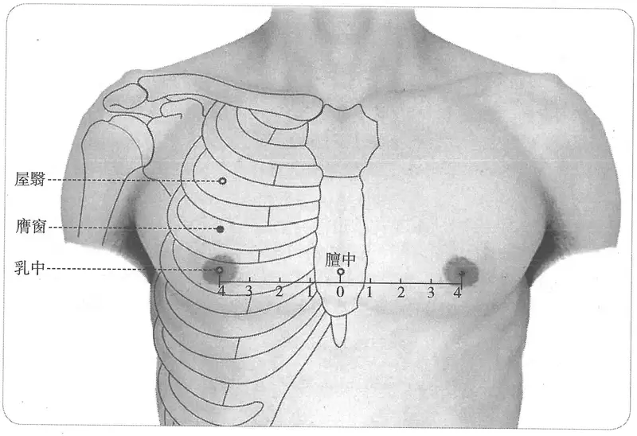

**图 2-68　膺窗穴图**

**取穴**：在乳中线与第3肋间隙交点处取之。

　1. 在屋翳下一寸六分。（《黄帝明堂经》、《铜人腧穴针灸图经》、《圣济总录》、《针灸资生经》、《十四经发挥》、《医学纲目》、《针灸集书》、《医学入门》）

　2. 气府论注云：在胸两旁夹中行各四寸，巨骨下四寸八分陷者中……仰而取之。（《素问·气府论》王冰注、《针灸甲乙经》卷三注）

　3. 膺中骨间各一。王冰注：谓膺窗等六穴也。（《素问·气府论》）

**按**：由此可见，早在《黄帝明堂经》之前，胸廓部穴即以肋间隙定位。

　4. 在屋翳下一寸六分陷中，去中行各四寸。（《针灸聚英》卷一、《古今医统》、《针灸大成》、《针方六集》、《医宗金鉴·刺灸心法要诀》、《针灸易学》）

　5. 广注去中行各四寸，与玉堂平。（《循经考穴编》上）

　6. 屋翳直下第三与第四肋间。（《针灸十四经穴位考订》）

〔p.319 (인쇄 299)〕

　7. 统编针灸学教材

　　(1) 部位：屋翳穴下一寸六分。取穴：仰卧，自库房下二肋间，即第三肋之下，对准乳头取之，当玉堂之旁四寸。（1957年南京《针灸学》）

　　(2) 部位：屋翳穴下一寸六分。取穴：仰卧，从乳中上一肋间陷中取之，与任脉玉堂穴平。（1版《针灸学讲义》）

　　(3) 部位：屋翳穴下一寸六分。取穴：在乳中线上，第三肋间隙取之。（2版《针灸学讲义》）

　　(4) 第三肋间隙，前正中线旁开4寸。（4、5、7版《针灸学》）

　　(5) 在胸部，当第3肋间隙，距前正中线4寸。（6版《针灸学》）

　　(6) 第三肋间隙，任脉旁开四寸。（《中国针灸学》）

**文献分析**：本穴定位，历代文献的文字描述虽不同，而定位均相同：上直屋翳，横平玉堂。

#### 【类属】 

足阳明胃经穴。

足阳明脉气所发。（《素问·气府论》王冰注）

#### 【适应症】 

主治胸部病症。常用于胸满，短气；乳痈。

　1. 主胸胁肿痛，乳痈，寒热，短气，卧不安。（《黄帝明堂经》）

　2. 主肠鸣泄注。（《千金要方》卷三十）

　3. 治胸满短气，唇肿，乳痈，寒热，卧不安。（《铜人腧穴针灸图经》卷中）

**按**：《铜人腧穴针灸图经》载本穴主治病症较《黄帝明堂经》多出“唇（脣）肿”一症，疑为“膺肿”形误。

　4. 统编针灸学教材

　　(1) 哮喘咳嗽，胸满短气，肋痛，乳痈。（1957年南京《针灸学》、1版《针灸学讲义》、《中国针灸学》）

　　(2) 咳嗽，气喘，胸肋胀痛，乳痈。（2版《针灸学讲义》、4、5、6、7版《针灸学》）

**文献分析**：《黄帝明堂经》载本穴主治“胸胁肿痛，乳痈，寒热，短气，卧不安。”很可能是乳痈的一组症状。后世多理解为相对独立的不同症状。又《千金要方》卷三十谓本穴“主肠鸣泄注”，考《千金要方》“孔穴主对法”系根据唐代传本《明堂经》（包括《针灸甲乙经》）重编而成，另辑有少量其他诸名家“明堂”（皆有明显标志，与《黄帝明堂经》不相混），而此条主治非录自别家“明堂”，又不见于《黄帝明堂经》，且与腧穴主治规律不合，疑穴名有误。故统编教材不采录，极是。

#### 附：临床应用举例 

　1. 乳少，取膻中、膺窗、乳根。辨证加取配穴。［上海针灸杂志，1988，7（1）：45］

　2. 产后缺乳，膻中穴、膺窗穴针药结合治疗。［中国针灸，1988，8（6）：34］

#### 【操作】 

斜刺或平刺。不宜深刺和直刺，以免刺入胸腔。

　1. 刺入四分，灸五壮。（《黄帝明堂经》）

　2. 针入三分，灸五壮。（《医学纲目》卷八）

　3. 统编针灸学教材

　　(1) 针三分，灸三至六壮。（1957年南京《针灸学》、1版《针灸学讲义》）

　　(2) 斜刺3分，艾条灸5~10分钟。（2版《针灸学讲义》）

　　(3) 斜刺或平刺0.5~0.8寸。（4、5、7版《针灸学》）

　　(4) 沿肋间隙向外斜0.5~0.8寸，可灸。（6版《针灸学》）

　　(5) 斜刺0.3~0.5寸。可灸。（《中国针灸学》）

〔p.320 (인쇄 300)〕

### （十七）乳中 Rǔzhōng ST17 出《黄帝明堂经》 

问题：为什么本穴迄今没有主治却仍位于“经穴”之列，成为361个经穴中的唯一例外？

#### 【提要索隐】 

**穴名**：一名乳首。

**部位**：在前胸部，乳头中央。

**按**：现代针灸临床多不用作针灸，仅作取穴或骨度折量的标志。

**国标修订**：1990年版国标：在胸部，当第4肋间隙，乳头中央，距前正中线4寸。2006年修订版：在胸部，乳头中央。

**按**：乳头的位置受年龄、性别、种族、体位影响较大，正好位于第4肋间距前正中线4寸的概率不大，1990年版国标忽略了这些影响因素，2006年版国标对此做了修订。

**适应症：**

**备选适应症**：难产；癫狂，癫痫；乳痈。

**针刺操作**：本穴一般不针灸，只作为审定胸部穴位的标志。

#### 【名实考】 

乳中，即乳头，又称“乳首”。定位本来很明确，然而在制定经穴定位标准过程中，有的专家提出，本穴也应比照其他穴，在体表横纵坐标上给出一个确定的点：第四肋间，前正中线旁开4寸。然而对于中老年女性、肥胖者，乳头有一个较大范围的可移动度，以固定的点定移动的物，无异于缘木求鱼。

乳中是一个很特别的穴，早在中国第一部腧穴经典《黄帝明堂经》就载有此穴，自此以下二千年，腧穴书均载有此穴，但迄今针灸学教材中仍未载本穴的主治病症，一个没有主治病症的经穴，岂不形同虚设？为什么会出现这种奇特的现象？有人认为是因为《黄帝明堂经》谓此穴“禁刺灸”，然而同样禁刺灸的“伏兔”穴却早就补上了主治病症。况且，宋代针灸国家标准《铜人腧穴针灸图经》已明言本穴可“微刺一二分”，而且从下文的“临床应用举例”部分来看，本穴早用于临床，并可灸可刺。既可刺，就应当有相应的主治病症才是。之所以乳中穴一直未补上主治症，除了由于古代针具较粗，消毒不严，易引起感染外，更主要的因素还在于中国古代特定的文化、社会背景。因为在中国封建社会，乳头是女性的非常敏感、神秘的禁区，如史料记载元代名医葛乾孙曾治一女子劳瘵，拟刺乳头，主人为难，乃隔衣刺治而愈。古代甚至连小女孩的乳头也不可刺，若必刺，只刺乳下二分处。因这一特定因素废而不用的穴不独乳中一穴也，例如治疗子宫脱垂的“龙门”穴（位于女子阴道口外），《千金要方》卷三注明“此穴卑，今废，不针灸”。而在西方社会，女性乳头不神秘，有很多接受刺激的机会，因而率先发现了刺激乳头可引起子宫收缩的作用，不仅广泛应用于催产引产、缩短产程、预防产后出血及促进泌乳等方面，并且用于宫缩应力试验，其较之传统的缩宫素激惹试验更为安全、经济。

　1. 杨上善注曰此穴居处当乳中央，故曰之。（《医心方》卷二）

　2. 乳首不可伤，伤即令人命绝，不可治也。（《圣济总录》卷一九四）

　3. 别名　当乳。（1957年南京《针灸学》）

**按**：《铜人腧穴针灸图经》卷中谓“当乳是”，乃“当乳中是穴”的略文，指乳中穴的部位正在乳头，将其理解为穴名，大误。

#### 【定位】 

在前胸部，乳头中央（图2-69）。

　1. 当乳中是。（《铜人腧穴针灸图经》卷上、《圣济总录》、《针灸聚英》、《古今医统》、《针灸大成》、《类经图翼》、《循经考穴编》、《针灸逢源》）

〔p.321 (인쇄 301)〕

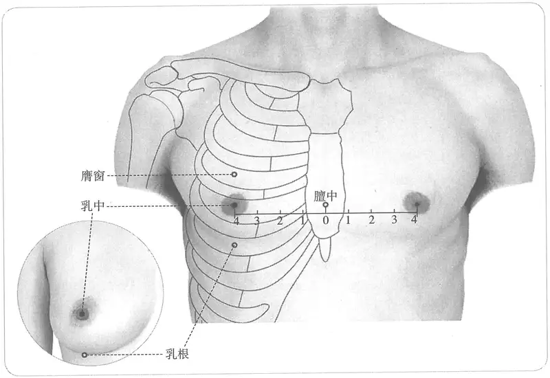

**图 2-69　乳中穴图**

　2. 当乳是。（《铜人腧穴针灸图经》卷中及卷下、《针灸资生经》、《十四经发挥》、《医学纲目》、《医学入门》、《针方六集》、《医宗金鉴·刺灸心法要诀》）

　3. 适当乳头正中。（《针灸十四经穴位考订》）

　4. 统编针灸学教材

　　(1) 部位：当乳头中。取穴：乳头之中央。（1957年南京《针灸学》）

　　(2) 部位：当乳头中。取穴：在乳头之中央，仅作取他穴的自然标志。（1版《针灸学讲义》）

　　(3) 乳中。（2版《针灸学讲义》）

　　(4) 当乳头中。（4、5版《针灸学》）

　　(5) 在胸部，当第4肋间隙，乳头中央，距前正中线4寸。（6版《针灸学》）

　　(6) 在第4肋间隙，乳头中央。（7版《针灸学》、《中国针灸学》）

#### 【类属】 

足阳明胃经穴。

足阳明脉气所发。（《素问·气府论》王冰注、《铜人腧穴针灸图经》）

#### 【适应症】 

**备选适应症**：难产；癫狂，癫痫；乳痈。

一传胎衣不下，以乳头向下尽处，俱灸之即下。（《类经图翼》卷六）

**文献分析**：历代腧穴文献皆以本穴为禁刺灸穴，故不载主治病症，而《铜人腧穴针灸图经》虽谓可“微刺三分”，却亦未载主治症。明代《针灸聚英》引丹溪文曰：“乳房，阳明胃所经；乳头，厥阴肝所属。乳（去声）子之母，不知调养，忿怒所逆，郁闷所遏，厚味所酿，以致厥阴之气不行，窍不得通，汁不得出，阳明之血沸腾，热甚化脓。亦有所乳之子，膈有滞痰，口气焮热，含乳而睡，热气所吹，遂生结核。初起时，便须忍痛，揉令稍软，吮令汁透，自可消散，失此不治，必成痈疖；若加以艾火两三壮，其效尤捷；粗工便用针刀，卒惹拙病。”则知本穴可灸治乳痈症。古代针灸临床应用集中于癫、狂、痫神志病变以及乳疾，现代临床报道最多的是用于宫缩乏力，恰与明代《类经图翼》所传之治胎衣不下法相合。

〔p.322 (인쇄 302)〕

#### 附：临床应用举例 

　1. 癫、狂、痫

　　(1) 治卒癫狂方：灸两乳头三壮，又灸足大指本聚毛中七壮，灸足小指本节七壮。（《肘后备急方》卷三）

　　(2) 小儿暴痫，灸两乳头，女儿灸乳下二分。（《千金要方》卷五）

　　(3) 治卒癫法：灸阴茎上宛宛中三壮得小便通，即当尿孔上是穴。又灸阴茎头三壮。又灸乳头三壮。（《千金要方》卷十四、《千金翼方》）

　2. 治热暍，灸两乳头七壮。（《千金翼方》卷二十八、《外台秘要》）

　3. 乳痈，乳中穴在乳下中，针入一分，沿皮向后一寸半，灸，泻。（《医学纲目》卷十九）

　4. 男性乳腺增生，乳中穴、足三里穴，灸法治疗。［上海针灸杂志，1987，6(3):30］

　5. 宫缩乏力，刺激乳中穴治疗。［福建中医药，1993，24(5):21-32］

#### 【操作】 

本穴一般不针灸，只作为审定胸部穴位的标志。

　1. 刺乳上，中乳房，为肿，根蚀。（《素问·刺禁论》）

　2. 禁不可刺灸。灸刺之，不幸生蚀疮，疮中有脓血清汁者，可治；疮中有息肉若蚀疮者，死。（《黄帝明堂经》）

　3. 禁可不灸，不幸生蚀疮，中有清汁脓血可治，疮中有息肉若蚀疮者死。微刺一二分。（《铜人腧穴针灸图经》卷中）

　4. 乳首不可伤，伤即令人命绝，不可治也。（《圣济总录》卷一九四）

　5. 各版教材　不针不灸。（1~7版《针灸学》、《中国针灸学》）

**刺法及主治的解剖学基础**：乳头内部主要由胶原性致密结缔组织组成，也有少量弹性纤维，弹性纤维也伸展至乳晕皮肤下面，使表面的皮肤皱缩。乳头内及其深部也有平滑肌细胞，主要为环形，并从基部呈放射状伸入周围的乳房。寒冷或接触（如吸吮）或情感刺激可引起平滑肌收缩，使乳头竖起，周围的乳晕皱缩。中国最晚在明代发现刺激乳头（热刺激）可以助产，然而由于特定的社会文化观念的限制，使这一发现大大延后，因而在经络学说中，没能为乳头与子宫之间设立一条专用的经脉或络脉联系。不过从元代朱丹溪“乳房，阳明所属；乳头，厥阴所属”的认识来看，似乎已经悟到乳头与乳房不同，及其与生殖器官之间的联系。因为在十二经脉中，足厥阴经直接与生殖器官联系。现代医学更是通过大量实验的方法，证明了刺激乳头与子宫收缩的相关性，并应用于产前、产中、产后不同时期的诊断、助产和预防。但现代医学对于刺激乳头所产生的一系列作用的解释为：通过内源性缩宫素的释放及一系列内分泌调节机制实现。应当说这个解释并不比针灸的经络学说更高明。因为调查发现，在一些敏感的女性，刺激乳头，即刻在子宫、阴道部就有反应，这难以内分泌的调节解释。刺激乳头，什么形式最有效？手的触摸？吮吸？电或热刺激？乳头与子宫之间究竟通过什么途径联系？这些问题都还有待进一步的观察与研究。研究的新发现将为现代医学打开一扇认识人体未知世界的窗户。

〔p.323 (인쇄 303)〕

### （十八）乳根 Rūgēn ST18 出《黄帝明堂经》 

#### 【提要索隐】 

**穴名**：一名薜息。

**部位**：在前胸部，第5肋间隙，前正中线旁开4寸。

**国标修订**：1990年版国标：在胸部，当乳头直下，乳房根部，第5肋间隙，距前正中线4寸。2006年修订版：在胸部，第5肋间隙，前正中线旁开4寸。注：女性在乳房根部弧线终点处取穴。

**按**：1990年版国标“乳房根部”与“第5肋间隙”义重，故2006年版国标去掉一个横坐标点，并加注说明“女性在乳房根部弧线中点处取穴”。

**适应症**：主治乳房、胸部病症。常用于乳痈，乳癖，产后缺乳；胸满、胸痛；咳嗽，气喘，呃逆。

**针刺操作**：斜刺或平刺。不宜深刺和直刺，以免刺伤心肺。

#### 【名实考】 

关于本穴部位，古代以折量定位，现代采用解剖标志定位，两种定位法均是一个固定的点，而女性，特别是中老年女性，乳房根部的位置差异较大，因此新版国标特加注说明：“女性在乳房根部弧线中点处取穴”。明代《医学正传》所说“妇人在乳房下起肉处陷中”，意思相同。

又有奇穴“乳中”者，勿相混。

《千金要方》载有“薜息”一穴，定位与现代乳根穴相当，因列入本穴别名项下。

　1. 乳根，在乳下一寸六分陷者中，足阳明脉气所发。仰而取之。（《黄帝明堂经》）

　2. 腹满，短气转鸣，灸薜息。薜息，在两乳下第一肋间宛宛中是也。（《千金要方》卷五）

#### 奇穴“乳中”辨 

〔《怪穴》〕气喘：乳中在乳下肋中，针入一分，沿皮向后一寸半，泻之。（《医学纲目》卷二十七）

**按**：《医学纲目》此方引自《怪穴》一书，此书穴名及定位多与经典不同，这里穴名“乳中”，其定位却相当于乳根穴。

#### 【定位】 

**部位**：在前胸部，第5肋间隙，前正中线旁开4寸（图2-70）。

**取穴**：男性在乳头下1肋，即乳中线与第5肋间隙的相交处。女性在乳房根部弧线中点处取穴。

　1. 在乳下一寸六分陷者中……仰而取之。（《黄帝明堂经》、《太平圣惠方·明堂》、《铜人腧穴针灸图经》卷中、《圣济总录》、《针灸资生经》、《针灸玉龙经》、《窦太师针经》、《十四经发挥》、《医学纲目》、《针灸聚英》、《古今医统》、《医学入门》、《针灸大成》、《针方六集》、《类经图翼》、《循经考穴编》、《医宗金鉴·刺灸心法要诀》、《针灸易学》、《针灸逢源》）

　2. 在乳中下一寸四分陷中，仰而取之。（《铜人腧穴针灸图经》卷上及卷下“穴腧都数”）

　3. 妇人在乳房下起肉处陷中。（《医学正传》）

　4. 乳中下一寸六分陷中，去中行各四寸，仰而取之。（《针灸聚英》卷一、《古今医统》、《针灸大成》、《针方六集》、《类经图翼》、《循经考穴编》、《医宗金鉴·刺灸心法要诀》、《针灸易学》、《针灸逢源》）

〔p.324 (인쇄 304)〕

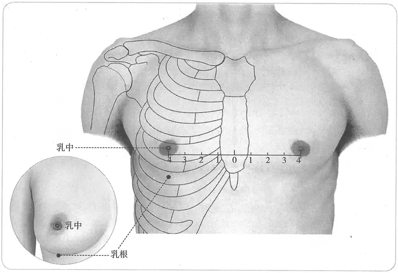

**图 2-70　乳根穴图**

　5. 广注去中行各四寸，与中庭平。（《循经考穴编》上）

　6. 乳中直下一肋间，即第五与第六肋间。（《针灸十四经穴位考订》）

　7. 统编针灸学教材

　　(1) 部位：乳中穴下一寸六分。取穴：仰卧，从乳头按下一肋间，或从中庭旁开四寸取之，妇女以缺盆穴直下按肋间取之。（1957年南京《针灸学》）

　　(2) 部位：乳中穴下一寸六分。取穴：仰卧，从乳头直下一肋间陷中取之，与任脉中庭穴平。妇女从缺盆穴直下，中庭穴旁开之肋间陷中取之。（1版《针灸学讲义》）

　　(3) 部位：乳下一寸六分陷者中。取穴：在乳中直下，第五肋间隙取之。（2版《针灸学讲义》）

　　(4) 第五肋间隙，乳头直下。（4、5版《针灸学》、《中国针灸学》）

　　(5) 在胸部，当乳头直下，乳房根部，第5肋间隙，距前正中线4寸。（6版《针灸学》）

　　(6) 第5肋间隙，乳头直下，前正中线旁开4寸。（7版《针灸学》）

**文献分析**：本穴定位，历代文献的文字描述虽不同，而定位相同：在第5肋间，上直乳中，横平中庭。《铜人腧穴针灸图经》卷上作“在乳中下一寸四分陷中”，卷下“穴腧都数”同；卷中作“一寸六分”，与明正统仿宋针灸铜人定穴合。

#### 【类属】 

足阳明胃经穴。

足阳明脉气所发。（《黄帝明堂经》）

#### 【适应症】 

主治乳房、胸部病症。常用于乳痈，乳癖，产后缺乳；胸满，胸痛；咳嗽，气喘，呃逆。

　1. 主胸下满痛，膺肿。乳痈，凄索寒热，痛不可按搔。（《黄帝明堂经》）

　2. 主胸下满闷，臂肿及乳痛也。《华佗明堂》云主膈气不下食，噎病也。（《太平圣惠

〔p.325 (인쇄 305)〕

方·明堂》）

　3. 治胸下满痛，臂肿乳痈，凄惨寒痛，不可按抑。（《铜人腧穴针灸图经》卷中）

**按**：“臂肿”系“膺肿”形误，此乃传《太平圣惠方》之误。

　4. 窦太师针灸遗存

　　(1) 治咳嗽气喘，伤寒气逆，泻之。（《窦太师针经》）

　　(2) 主咳嗽，气急，哮喘。（《针方六集》卷五）

　　(3) 主咳逆气促，久嗽不止。（《循经考穴编》上）

　　(4) 治一切哮吼喘嗽等症。（《窦太师秘传》）

　5. 主小儿龟胸。（《医学入门》卷一、《医宗金鉴·刺灸心法要诀》）

**按**：本穴此条主治不见于明以前腧穴文献，疑是误传《太平圣惠方·小儿明堂》灸方：“小儿龟胸，缘肺热满攻胸膈所生。又缘乳母食热面五辛，转更胸起高也。灸两乳前各一寸半上两行三骨罅间六处各三壮，炷如小麦大”。

　6. 统编针灸学教材

　　(1) 咳逆气促，久咳不止，乳痛，胸下满闷，胸痛，噎膈，食不下。（1957年南京《针灸学》）

　　(2) 咳嗽气促，久咳不止，乳痛，胸满，噎膈。（1版《针灸学讲义》）

　　(3) 咳嗽，气喘，乳痈，乳汁少，胸痛，噎膈。（2版《针灸学讲义》）

　　(4) 胸痛，咳嗽，气喘，呃逆，乳痈，乳汁少。（4、5版《针灸学》）

　　(5) 乳痈，乳汁少，胸痛，咳嗽，呃逆。（6版《针灸学》）

　　(6) 乳痈、乳癖、乳汁少等乳部疾患，咳嗽，气喘，呃逆，胸痛。（7版《针灸学》）

　　(7) 胸痛，咳嗽，气喘，乳痈，乳汁少。（《中国针灸学》）

**文献分析**：本穴主治，元以前文献均集中于乳房、胸部病症，自窦太师针灸则偏重于肺部病症，这种转变与元以前乳根灸咳嗽方（见“附：临床应用举例”）及乳根稍上方的“乳下黑白际”的临床应用有关：

治卒得咳嗽方：灸两乳下黑白肉际各百壮，即愈。（《肘后备急方》卷上）

《必效》疗上气唾脓血方：灸两乳下黑白际各一百壮，良。（《外台秘要》卷九）

“乳下黑白肉际”与乳根还不完全相当，然以下所附之《苏沈良方》灸咳嗽方显然与此灸方相承，彼方定位则与乳根相当。

#### 附：临床应用举例 

　1. 咳嗽气喘

　　(1) 腹满，短气转鸣，灸薜息。薜息，在两乳下第一肋间宛宛中是也。（《千金要方》卷五）

　　(2) 灸咳嗽方，其法　乳下一指许正与乳相直骨间隔中。妇人即屈乳头度之，乳头齐处是穴。艾炷如小豆许，灸三壮。男灸左，女灸右，只一处火到肌即瘥，若不瘥，多不救矣。（《苏沈良方》卷五）

**按**：《世医得效方·咳逆》卷四此方下注曰：“其穴只当取乳下骨间动脉处是。”触及搏动的是心尖搏动，而非动脉，且一般于左乳下可触及。

　　(3) 气喘气促，不能卧，言语无声：灸华盖、膻中、乳根、天突、通里、足三里，各灸七壮。（《针灸集要·盘石金直刺秘传》）

　　(4) 久嗽不愈：肺俞、三里、乳根、风门、百劳一椎上陷中、列缺。问曰：此证缘何而得？答曰：因咸物咳嗽伤脾，兼房事过多，酒食不节，伤风不解，痰饮流入肺经，故如此也。宜刺后穴：膻中、三里、乳根、输府。（《针灸集成》第五十方）

〔p.326 (인쇄 306)〕

　　(5) 俞府乳根一般刺，气喘风痰渐渐磨。（《针灸玉龙歌》）

　2. 乳房病症

　　(1) 乳头生疮，名曰妒乳：乳根二穴、少泽二穴、肩井二穴、膻中一穴。（《针灸大全》卷四）

　　(2) 乳腺增生：乳根穴、阳陵泉穴，微波针灸治疗。［上海针灸杂志，1987，6(2):7-8］

　　(3) 急性乳腺炎：肩井穴、库房穴、乳根穴针灸与拔罐疗法治疗。［中医杂志：英文版，1988，16(1):15-18］

　　(4) 缺乳症：膻中穴、膺窗穴、乳根穴针刺治疗。［上海针灸杂志，1988，7(1):45］

　3. 食噎，灸乳根。（《太平圣惠方·明堂》）

　4. 伤寒热噫，灸乳根，灸关元，内庭泻之。（《针灸集要·盘石金直刺秘传》）

#### 【操作】 

斜刺或平刺。不宜深刺和直刺，以免刺伤心肺。

　1. 刺入四分，灸五壮。（《黄帝明堂经》）

　2. 灸五壮，针入三分。（《铜人腧穴针灸图经》卷中）

　3. 针入一分，沿皮向外一寸半，灸二七壮。（《窦太师针经》）

　4. 针三分，灸三壮。（《针灸十四经穴位考订》）

　5. 统编针灸学教材

　　(1) 针三分，灸五壮。（1957年南京《针灸学》、1版《针灸学讲义》）

　　(2) 斜刺3分，艾条灸5~10分钟。（2版《针灸学讲义》）

　　(3) 斜刺或平刺0.5~0.8寸。（4、5、7版《针灸学》）

　　(4) 沿肋间隙向外斜刺0.5~0.8寸，直刺0.4寸；可灸。（6版《针灸学》）

　　(5) 斜刺0.3~0.5寸。可灸。（《中国针灸学》）

