# 《针灸腧穴通考》(上册) — 足阳明胃经穴 (2/3) · （十九）不容 Bùróng ST19 出《黄帝明堂经》~（三十五）犊鼻 Dúbí ST35 出《素问》、《灵枢》

> 분할본 7/25. 원서: 黄龙祥·黄幼民 编著, 《针灸腧穴通考——〈中华针灸穴典〉研究》(上册), 人民卫生出版社, 2011. 원서 스캔 OCR 판독본을 챗봇 검색용으로 나눈 것이며, 본문과 쪽 표시 〔p.PDF쪽 (인쇄 쪽)〕는 원본 그대로이다.

## 三、足阳明胃经穴 (계속)

### （十九）不容 Bùróng ST19 出《黄帝明堂经》 

#### 【提要索隐】 

**部位**：在上腹部，脐中上6寸，前正中线旁开2寸。

**适应症**：主治腹部病症。常用于胸痛引背；腹满，胁下痛，呕吐，不思饮食。

**针刺操作**：直刺0.5~0.8寸，不宜深刺，以免损伤胃或肝。对肋弓角较狭小的人，此穴下可能正当肋骨，可采用向外斜刺法。

#### 【名实考】 

　1. 不容，在幽门旁一寸五分，去任脉二寸，直四肋端，相去四寸，足阳明脉气所发。（《黄帝明堂经》）

　2. 此穴初离胸而入腹，正在膈膜之外，环胃而生，遮隔上下之所，与肾经幽门穴平直，与中行巨阙平直，饮食之入胃者，正由上脘而下，胃脘之四外，皆为膈所环生，何医物之能容哉，故曰不容。（《经穴解》）

#### 【定位】 

**部位**：在上腹部，脐中上6寸，前正中线旁开2寸（图2-71）。

**取穴**：仰卧，平脐上6寸，腹中线旁开2寸处取穴。

　1. 腹中行旁开二寸

　　(1) 在幽门旁各一寸五分，去任脉三寸，至两肋端，相去四寸。（《针灸甲乙经》卷三）

**按**：现行本《针灸甲乙经》去任脉三寸之“三”字，考明抄本及《素问·气府论》新校正引《针灸甲乙经》，

〔p.327 (인쇄 307)〕

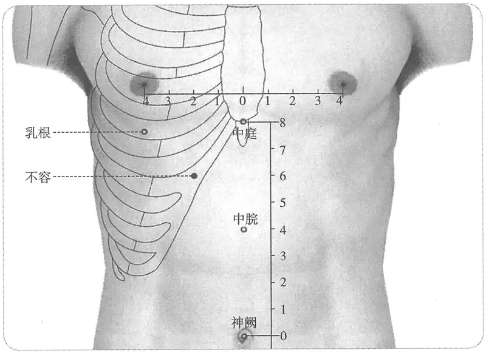

**图 2-71　不容穴图**

此系“二”字之误。

　　(2) 在幽门旁各一寸五分，去任脉二寸，直四肋端相去四寸。（《千金要方》卷二十九、《千金翼方》、《外台秘要》、《铜人腧穴针灸图经》卷中、《圣济总录》、《针灸资生经》、《十四经发挥》、《医学纲目》、《类经图翼》、《循经考穴编》、《针灸逢源》）

　　(3) 在幽门两旁，各一寸五分。（《千金要方》卷十三、《千金翼方》、《医心方》、《铜人腧穴针灸图经》卷上及卷下“穴腧都数”）

　　(4) 不容，在第四肋端下。（《素问·气府论》王冰注）

　2. 腹中行旁开三寸

　　(1)《素问》云：夹鸠尾外当乳下三寸夹胃管各五，不容至太一也，夹脐广三寸各三，滑肉门、天枢、外陵也；下脐二寸夹之各三，大巨、水道、归来也，皆腹第三行穴也。新校正云：《甲乙经》天枢在脐旁各二寸，与诸书同，特此经为异。信若是，则其穴不当乳下可也；必当乳下，则广三寸之说为当。（《针灸资生经》卷一）

　　(2) 幽门旁相去各一寸五分，去中行任脉各三寸，上脘两旁各一寸，直四肋间。（《针灸聚英》卷一）

**按**：高武将《太平圣惠方》、《针灸资生经》两种不同的说法并为一说，既曰“去中行任脉各三寸”，又曰“上脘两旁各一寸”，两说不能同时成立，自相矛盾。张介宾曰：“按《甲乙经》曰：腹自不容以下至气冲二十四穴，夹幽门两旁各一寸五分。诸书皆同。及考幽门，则止去中行五分，是不容以下诸穴当去中行二寸，而诸云三寸者非，今悉改为二寸。”

　　(3) 平巨阙旁三寸。（《医学入门》卷一）

　　(4) 幽门旁相去各一寸五分，去中行各三寸。（《针灸大成》卷六）

　3. 在上管两旁各一寸。（《太平圣惠方·明堂》）

　4. 在幽门旁各一寸五分，夹任脉两旁各二寸五分，直四肋间。（《针方六集》卷一）

〔p.328 (인쇄 308)〕

**按**：该书幽门穴“在巨阙两旁各五分”，则不容穴当夹任脉两旁“各二寸”，而不是“二寸五分”。然该书又注曰：“自不容至滑肉门，去中行各三寸”。

　5. 巨阙旁开二寸。（《针灸十四经穴位考订》）

　6. 统编针灸学教材

　　(1) 部位：在幽门旁一寸五分。取穴：仰卧，从胸歧骨至脐作八寸半，脐上六寸，横开二寸取之巨阙旁。（1957年南京《针灸学》）

　　(2) 部位：任脉巨阙穴旁二寸。取穴：仰卧，从脐上六寸，旁开二寸取之。（1版《针灸学讲义》）

　　(3) 部位：在幽门旁一寸五分，去任脉二寸。取穴：在脐上六寸，巨阙任脉旁二寸取之。（2版《针灸学讲义》）

　　(4) 脐上6寸，旁开2寸。（4版《针灸学》）

　　(5) 脐上6寸，前正中线旁开2寸。（5版《针灸学》）

　　(6) 在上腹部，当脐中上6寸，距前正中线2寸。（6版《针灸学》）

　　(7) 脐中上6寸，前正中线旁开2寸。（7版《针灸学》）

　　(8) 在脐上六寸，巨阙旁开两寸。（《中国针灸学》）

**文献分析**：本穴定位的纵向距离历代文献无分歧，横向定位因足少阴肾经穴的变化而有“二寸”、“二寸半”、“三寸”之不同。其中“二寸半”之说，显系《针方六集》误推，而“二寸”、“三寸”说，乃出于幽门穴与任脉之间的距离有“五分”和“一寸五分”的差异。详见足少阴经穴概说。

#### 【类属】 

足阳明胃经穴。

足阳明脉气所发。（《黄帝明堂经》）

#### 【适应症】 

主治腹部病症。常用于胸痛引背；腹满，胁下痛；呕吐，不思饮食。

　1. 主呕血，肩息，胁下痛，口干，心痛与背相引，不可咳，咳则引肾痛。（《黄帝明堂经》）

　2. 腹内弦急，不得食，腹痛如刀刺，两肋积气膨膨然。（《太平圣惠方·明堂》）

　3. 治腹满痃癖，不嗜食，腹虚鸣，呕吐，胸背相引痛，喘咳口干，痰癖，胁下痛，重肋疝瘕。（《铜人腧穴针灸图经》卷中）

　4. 统编针灸学教材

　　(1) 腹满呕吐，心痛，吐血，喘咳，胸背相引而痛，痰癖，不嗜食。（1957年南京《针灸学》）

　　(2) 腹满，呕吐，心痛，吐血，喘咳，胸背相引痛，不嗜食。（1版《针灸学讲义》）

　　(3) 腹胀，呕吐，胃痛，食欲不振。（2版《针灸学讲义》、4、5、6、7版《针灸学》、《中国针灸学》）

**文献分析**：本穴主治，古今文献一致，均集中在腹部脾胃病症。

#### 附：临床应用举例 

　1. 脉不出，针不容两穴，在幽门两旁各一寸五分。（《千金要方》卷十三、《千金翼方》）

　2. 呕血，肋痛口干不可咳，引肾痛，不容旁刺向外、上脘三寸半、大陵、郄门、神门。（《医学纲目》卷十七）

　3. 呕吐　巨阙透下脘，不容透太乙，施以电针。［中国针灸，1983，3(4):11］

#### 【操作】 

直刺0.5~0.8寸。不宜深刺，以免损伤胃或肝。对肋弓角较狭小的人，此穴下可能正当肋骨，可采用向外斜刺法。

　1. 刺入五分，灸五壮。（《针灸甲乙经》卷三）

〔p.329 (인쇄 309)〕

　2. 刺可入同身寸之八分，若灸者可灸五壮。（《素问·气府论》王冰注）

　3. 针五至八分，灸三壮。（《针灸十四经穴位考订》）

　4. 统编针灸学教材

　　(1) 针五分至一寸，灸七至十五壮。（1957年南京《针灸学》、1版《针灸学讲义》）

　　(2) 直刺5~7分，艾条灸5~10分钟。（2版《针灸学讲义》）

　　(3) 直刺0.5~0.8寸。（4、5、6版《针灸学》、《中国针灸学》）

　　(4) 直刺0.5~0.8寸。过饱者禁针，肝肿大者慎针或禁针，不宜作大幅度提插。（7版《针灸学》）

### （二十）承满 Chéngmǎn ST20 出《黄帝明堂经》 

#### 【提要索隐】 

**部位**：在上腹部，脐中上5寸，前正中线旁开2寸。

**适应症**：主治胃肠病症。常用于肠鸣，腹痛，腹胀，噎膈；气喘，吐血。

**备选适应症**：胁下痛，下痢。

**针刺操作**：直刺0.8~1寸。不宜深刺，以免损伤胃、肝或十二指肠。

#### 【名实考】 

本穴名称，古今文献无分歧；本穴定位，随其基准穴巨阙以及其内侧肾经穴距中行的距离不同而有所不同。

　1. 承满，在不容下一寸，足阳明脉气所发。（《黄帝明堂经》）

　2. 此穴紧在中行上脘穴、二行肾经通谷穴旁，乃胃入饮食之所。承者，上之所入也；满者，下之所得也。胃之口曰贲门，饮食之精气，从此上输于脾，宣播于诸脉，故曰承满。承下之满者，而上输于脾也。（《经穴解》）

#### 【定位】 

**部位**：在上腹部，脐中上5寸，前正中线旁开2寸（图2-72）。

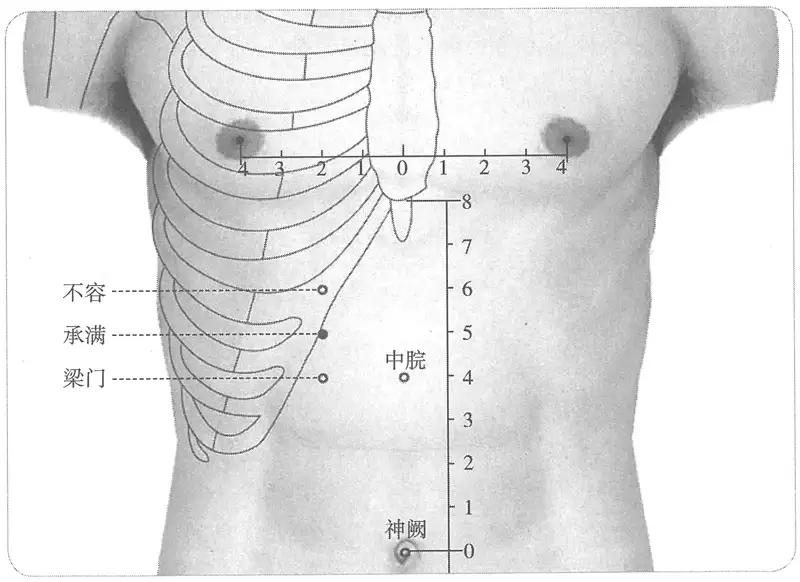

**图 2-72　承满穴图**

〔p.330 (인쇄 310)〕

**取穴**：仰卧，平脐上5寸，于腹中线旁开2寸处取穴。

　1. 在不容下一寸。（《黄帝明堂经》、《太平圣惠方·明堂》、《铜人腧穴针灸图经》、《圣济总录》、《医学纲目》）

　2. 在不容下一寸，去上管各二寸。（《医心方》卷二、《类经图翼》、《循经考穴编》、《医宗金鉴·刺灸心法要诀》）

　3. 在夹巨阙相去五寸。（《千金要方》卷十八、《千金翼方》）

　4. 在不容下一寸。注：以上二十四穴（从不容至气冲穴）去腹中行当各三寸。（《针灸资生经》卷一、《十四经发挥》、《针灸聚英》、《古今医统》、《医学入门》、《针灸大成》、《针灸易学》）

　5. 在不容下一寸，夹任脉两旁各二寸五分。（《针方六集》卷一）

**按**：该书又注曰：“自不容至滑肉门，去中行各三寸”。

　6. 在不容下一寸半旧本一寸误，上脘旁二寸。（《针灸逢源》）

　7. 不容下一寸，上脘旁开二寸。（《针灸十四经穴位考订》）

　8. 统编针灸学教材

　　(1) 部位：不容穴下一寸。取穴：不容下一寸上脘旁。（1957年南京《针灸学》）

　　(2) 部位：不容穴下一寸。取穴：仰卧，从任脉上脘穴旁开二寸取之。（1版《针灸学讲义》）

　　(3) 部位：不容穴下一寸。取穴：在脐上五寸，上脘任脉旁二寸取之。（2版《针灸学讲义》）

　　(4) 脐上5寸，旁开2寸。（4版《针灸学》）

　　(5) 脐上5寸，前正中线旁开2寸。（5版《针灸学》）

　　(6) 在上腹部，当脐中上5寸，距前正中线2寸。（6版《针灸学》）

　　(7) 脐中上5寸，前正中线旁开2寸。（7版《针灸学》）

　　(8) 在脐上五寸，上脘旁开二寸。（《中国针灸学》）

**文献分析**：本穴定位，其纵向距离定位有横平巨阙与上脘两说，平巨阙穴则与不容穴相重，此说不可取。而平上脘，因上脘距巨阙穴的距离又有“一寸”与“一寸半”二说，故本穴的纵向距离也因之而有两说。去中行的距离，也有“二寸”、“二寸半”和“三寸”三说，分析详见“不容”穴。

#### 【类属】 

足阳明胃经穴。

足阳明脉气所发。（《黄帝明堂经》）

#### 【适应症】 

主治胃肠病症。常用于肠鸣，腹痛，腹胀，噎膈；气喘，吐血。

**备选适应症**：胁下痛，下痢。

　1. 主胁下痛，肠鸣相逐不可倾侧。肩息唾血。（《黄帝明堂经》）

　2. 肠鸣腹胀，上喘气逆，及膈气唾血。（《太平圣惠方·明堂》）

　3. 治肠鸣腹胀，上喘气逆，食饮不下，肩息唾血。（《铜人腧穴针灸图经》卷中）

　4. 统编针灸学教材

　　(1) 肠鸣腹胀，饮食不下，下痢，黄疸，肋下胀痛，吐血，上气喘逆。（1957年南京《针灸学》）

　　(2) 肠鸣腹胀，饮食不下，下痢，黄疸，肋下坚痛，吐血。（1版《针灸学讲义》）

　　(3) 胃痛，腹胀，呕吐，食欲不振，肋下坚痛，吐血。（2版《针灸学讲义》）

　　(4) 胃痛，吐血，肋下坚痛，食欲不振，肠鸣，腹胀。（4版《针灸学》）

〔p.331 (인쇄 311)〕

　　(5) 胃痛，呕吐，腹胀，肠鸣，食欲不振。（5、6版《针灸学》）

　　(6) 胃痛，吐血，纳少等胃疾。（7版《针灸学》）

　　(7) 胃痛，腹胀，呕吐，食欲不振。（《中国针灸学》）

**文献分析**：本穴主治，古今文献一致，均集中在胃肠病症，古代针灸临床应用也相吻合。1957年南京《针灸学》及第1版《针灸学讲义》所载之“黄疸”主治症，未见文献与临床支持证据，疑有误，今去之。

#### 附：临床应用举例 

　1. 肠中雷鸣相逐，痢下，灸承满五十壮。（《千金要方》卷十八、《千金翼方》）

　2. 治大肠虚方，承满，主肠中鸣，相逐下利，灸三七壮，又灸天枢，随年壮。（《医方类聚》卷十二）

#### 【操作】 

直刺0.8~1寸。不宜深刺，以免损伤胃、肝或十二指肠。

　1. 刺入八分，灸五壮。（《黄帝明堂经》）

　2. 灸三壮。（《太平圣惠方·明堂》）

　3. 可灸五壮，针入三分。（《铜人腧穴针灸图经》卷中）

　4. 针五至八分，灸五壮。（《针灸十四经穴位考订》）

　5. 统编针灸学教材

　　(1) 针五分至一寸，灸七至十五壮。（1957年南京《针灸学》、1版《针灸学讲义》）

　　(2) 直刺5~7分，艾条灸5~10分钟。（2版《针灸学讲义》）

　　(3) 直刺0.8~1寸。（4、5、6版《针灸学》）

　　(4) 直刺0.8~1寸。过饱者禁针，肝肿大者慎针或禁针，不宜作大幅度提插。（7版《针灸学》）

　　(5) 直刺0.5~1寸。可灸。（《中国针灸学》）

### （二十一）梁门 Liángmén ST21 出《黄帝明堂经》 

#### 【提要索隐】 

**部位**：在上腹部，脐中上4寸，前正中线旁开2寸。

**适应症**：主治胃肠病症。常用于腹胀，腹痛，泄泻，不思饮食。

**针刺操作**：直刺0.8~1寸。

#### 【名实考】 

本穴名称，古今文献记载无分歧；本穴定位因其内侧肾经穴距中行的距离不同而有所不同。

　1. 梁门，在承满下一寸，足阳明脉气所发。刺入八分，灸五壮。（《黄帝明堂经》）

　2. 此穴横直与中行中脘平，次行肾经阴都平，盛受饮食而化之，不宜复出，有门之象焉。梁者，所由以通于门，上下之界也。（《经穴解》）

#### 【定位】 

**部位**：在上腹部，脐中上4寸，前正中线旁开2寸（图2-73）。

**取穴**：仰卧，于脐上4寸，中脘穴旁开2寸处即是。

1.《黄帝明堂经》佚文

　　(1) 在承满下一寸。（《针灸甲乙经》卷三、《千金要方》、《千金翼方》、《外台秘要》、《铜人腧穴针灸图经》、《圣济总录》）

〔p.332 (인쇄 312)〕

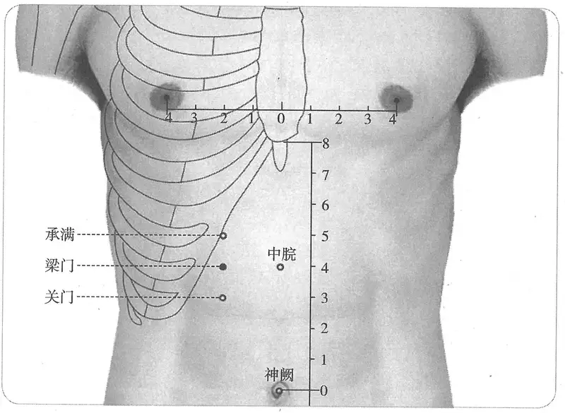

**图 2-73　梁门穴图**

　　(2) 在承满下一寸，去中管各二寸。（《医心方》卷二、《类经图翼》、《医宗金鉴·刺灸心法要诀》、《针灸逢源》）

　2. 在承满下一寸。注：以上二十四穴（从不容至气冲穴）去腹中行当各三寸。（《针灸资生经》卷一、《十四经发挥》、《针灸聚英》、《古今医统》、《医学入门》、《针灸大成》、《针灸易学》）

　3. 在承满下一寸，夹任脉两旁各二寸五分。（《针方六集》卷一）

　4. 承满下一寸，中脘旁开二寸。（《针灸十四经穴位考订》）

　5. 统编针灸学教材

　　(1) 部位：在承满穴下一寸。取穴：承满下一寸是穴中脘旁。（1957年南京《针灸学》）

　　(2) 部位：在承满穴下一寸。取穴：仰卧，从任脉中脘穴旁开二寸取之。（1版《针灸学讲义》）

　　(3) 部位：在承满穴下一寸。取穴：在脐上四寸，中脘任脉旁二寸取之。（2版《针灸学讲义》）

　　(4) 脐上4寸，旁开2寸。（4版《针灸学》）

　　(5) 脐上4寸，前正中线旁开2寸。（5版《针灸学》）

　　(6) 在上腹部，当脐中上4寸，距前正中线2寸。（6、7版《针灸学》）

　　(7) 在脐上四寸，中脘旁开二寸。（《中国针灸学》）

**文献分析**：本穴定位的纵向距离历代文献无分歧，横向定位因肾经穴定位分歧而有“二寸”、“二寸半”、“三寸”三说。详见“不容”穴。

#### 【类属】 

足阳明胃经穴。

足阳明脉气所发。（《黄帝明堂经》）

#### 【适应症】 

主治胃肠病症。常用于腹胀，腹痛，泄泻，不思饮食。

　1. 胁下积气结痛。（《黄帝明堂经》）

〔p.333 (인쇄 313)〕

　2. 治胁下积气，食饮不思，大肠滑泄，谷不化。（《铜人腧穴针灸图经》卷中）

　3. 主痰饮心痛，肾气冲心。（《循经考穴编》上）

　4. 统编针灸学教材

　　(1) 胁下积气，饮食不思，大便滑泄，气块疼痛。（1957年南京《针灸学》）

　　(2) 胃脘疼痛，胁下气痛，饮食不思，大便滑泄。（1版《针灸学讲义》）

　　(3) 胃痛，呕吐，食欲不振，大便溏。（2版《针灸学讲义》、6版《针灸学》）

　　(4) 胃痛，呕吐，食欲不振，腹胀，泄泻。（4、5版《针灸学》、《中国针灸学》）

　　(5) 纳少、胃痛，呕吐等胃疾。（7版《针灸学》）

**文献分析**：本穴主治，宋代《铜人腧穴针灸图经》较《黄帝明堂经》多出“食饮不思，大肠滑泄，谷不化”句，据该书体例，凡新增之主治病症，皆冠以“今附”或“新附”字样，而此条病症前无相关标识，可见系辑自前代文献。然遍检宋以前针灸文献，未见梁门穴有类似主治病症的记载，而关门穴主治“肠鸣卒痛，泄，不欲食”，可能是王惟一将“关门”误作“梁门”所致。

#### 附：临床应用举例 

　1. 治气块，脾俞、梁门、天枢。（《针灸集要·盘石金直刺秘传》）

　2. 泄泻，脾俞、胃俞、肾俞、梁门、足三里为主穴；水分、天枢、上脘、内关、下廉为配穴。梅花形针刺，不留针。［江苏中医杂志，1980，1(4):40］

　3. 胃痛，足三里、中脘、梁门、天枢、上脘、建里、公孙。［中国针灸，1988，8(3):32］

#### 【操作】 

直刺0.8~1寸。

　1. 刺入八分，灸五壮。（《黄帝明堂经》）

　2. 可灸五壮，针入三分。（《铜人腧穴针灸图经》卷中）

　3. 针五至八分，灸五壮。孕妇五月以上禁针灸。（《针灸十四经穴位考订》）

　4. 统编针灸学教材

　　(1) 针五分至一寸，灸七至十五壮。（1957年南京《针灸学》、1版《针灸学讲义》）

　　(2) 直刺5~7分；艾炷灸5~10壮，艾条灸5~10分钟。（2版《针灸学讲义》）

　　(3) 直刺0.8~1.2寸。（4、5版《针灸学》）

　　(4) 直刺0.5~0.8寸；可灸。（6版《针灸学》）

　　(5) 直刺0.8~1.2寸。过饱者禁针，肝肿大者慎针或禁针，不宜作大幅度提插。（7版《针灸学》）

　　(6) 直刺0.8~1寸。可灸。（《中国针灸学》）

　5. 直刺1~2寸。感应：上腹部有沉重发胀。灸3~5壮；温灸5~15分钟。（上海《针灸学》）

### （二十二）关门 Guānmén ST22 出《黄帝明堂经》 

#### 【提要索隐】 

**穴名**：古今文献有误作“关明”者。

**部位**：在上腹部，脐中上3寸，前正中线旁开2寸。

**适应症**：主治胃肠病症。常用于腹胀，腹痛，肠鸣，泄泻；水肿，遗尿。

**针刺操作**：直刺0.8~1寸。

#### 【名实考】 

关门，《千金翼方》、《医心方》作“关明”，当是“关门”（繁体字）之形误。本穴居胃之下、膀胱之上，主仓廪不藏、水液不约病症。正如《内经》所言“仓廪不藏者，是门户不要也。水泉不止者，是膀胱不藏也。”（《素问·脉要精微论》）“肾者，胃之关也，关门不利，故聚水而从其类也。”（《素问·水热穴论》）

〔p.334 (인쇄 314)〕

需要特别注意的是，《窦太师针经》所载“关门”一穴，其定位与主治与足阳明经穴“关门”大不同，该穴在窦氏传针灸方多次出现，明代早期针灸医生已不能识，皆注作经穴“关门”，大误。阅读窦太师针灸以及元以下针灸治疗文献时，须仔细鉴别。

　1. 关门，在梁门下，太乙上，足阳明脉气所发。（《黄帝明堂经》）

　2. 此穴与中行建里、次行石关平，正在胃中脘之下，饮食之入此者，断不可复出，如关之不可轻过也，故曰关门。（《经穴解》）

#### 经穴“关门”与奇穴“关门”辨 

　1. 关门二穴，在曲骨穴微上两旁各开三寸。针入三寸，灸五十壮。治乳弦疝气，肚腹膨胀，泻；偏坠木肾，遗尿，先泻后补。（《窦太师针经》）

2.《玉》疝气冲心欲死，关门。注：在玉茎旁二寸，针入二寸半，灸二七壮。（《医学纲目》卷二十五）

　3. 关门二穴，在玉茎毛际各开三寸，直针入一寸半，可灸五十壮；又建里两旁各三寸，梁门下一寸，治乳弦疝气单泻偏坠木肾先补后泻肚膨单泻。（《医经会元·玉龙歌》注）

　4. 脐豚息气乳弦等症，前穴：水道、关门、气海。后穴：归来、关门、三阴交。注曰：关门，梁门下一寸，建里旁二寸，入八火五。（《针灸集成》第五十三方）

　5. 寒热五般疝偏坠，关门、归来、关元、大敦、曲泉、三阴。注曰：关门，梁门下一寸，建里旁各二寸，入八，火五。（《针灸集成》第七十一方）

**按**：以上“关门”穴，是窦氏治疗阴疝病的要穴。其正确的穴名为“阑门”，后世文献误抄作“关门”（又误作“阁门”、“蘭门”、“拦门”等），详见足厥阴经急脉穴“名实考”。从《针灸集成》明初医官的注文，以及明太医吴嘉言的注文来看，明代医家已将此奇穴“关门”误作经穴“关门”。例如“又建里两旁各三寸，梁门下一寸”句，不见于《医学纲目》卷二十五引《玉龙歌》注文，应是《医经会元》编者吴嘉言所添加，所注乃经穴“关门”部位，显然吴氏对于经穴与奇穴“关门”已不能辨。

#### 【定位】 

**部位**：在上腹部，脐中上3寸，前正中线旁开2寸（图2-74）。

**取穴**：仰卧，平脐上3寸，建里穴旁开2寸处取穴。

1.《黄帝明堂经》佚文

　　(1) 在梁门下，太乙上，足阳明脉中间穴外延。（《针灸甲乙经》卷三）

　　(2) 在梁门下一寸，太一上。（《千金要方》卷二十九、《医学纲目》）

　　(3) 在梁门下，太一上一寸。《千金》云梁门下五分。（《千金翼方》卷二十六）

　　(4) 在梁门下五分，一云一寸，太乙上。（《外台秘要》卷三十九）

　　(5) 在梁门下，太一上，去建里各二寸。（《医心方》卷二）

　2. 在梁门下一寸。（《铜人腧穴针灸图经》）

　3. 在梁门下一寸。注：以上二十四穴（从不容至气冲穴）去腹中行当各三寸。（《针灸资生经》卷一、《十四经发挥》、《针灸集书》、《针灸聚英》、《古今医统》、《医学入门》、《针灸大成》、《针灸易学》）

　4. 在梁门下，太乙上，各一寸，穴少外沿。（《针方六集》卷一）

**按**：“穴少外沿”句系从通行本《针灸甲乙经》“足阳明脉中间穴外延”句而来。

　5. 在梁门下一寸，去中行二寸，对建里。（《类经图翼》卷六、《循经考穴编》、《医宗金

〔p.335 (인쇄 315)〕

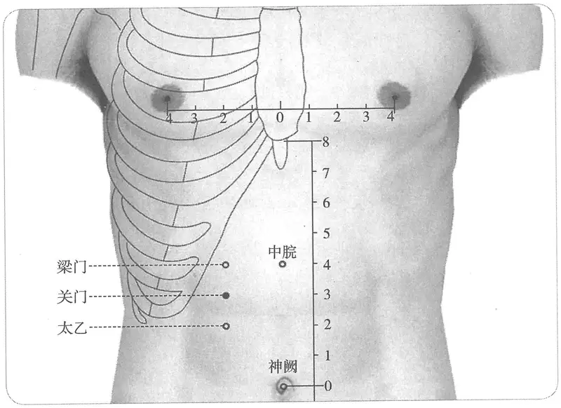

**图 2-74　关门穴图**

鉴·刺灸心法要诀》、《针灸逢源》、《针灸十四经穴位考订》）

　6. 统编针灸学教材

　　(1) 部位：梁门穴下一寸。取穴：梁门下一寸是穴建里旁。（1957年南京《针灸学》）

　　(2) 部位：梁门穴下一寸。取穴：仰卧，从任脉建里穴旁开二寸取之。（1版《针灸学讲义》）

　　(3) 部位；在梁门下，太乙上。取穴：在梁门下一寸，建里任脉旁二寸取之。（2版《针灸学讲义》）

　　(4) 脐上3寸，旁开2寸。（4版《针灸学》）

　　(5) 脐上3寸，前正中线旁开2寸。（5版《针灸学》）

　　(6) 在上腹部，当脐中上3寸，距前正中线2寸。（6、7版《针灸学》）

　　(7) 在脐上三寸，建里旁开二寸。（《中国针灸学》）

**文献分析**：本穴部位，《针灸甲乙经》只言“梁门下”，《医心方》同，《外台秘要》作“梁门下五分，一云：一寸”，《千金要方》此后有“一寸”二字，与《外台秘要》注文合，但《千金翼方》“关门”穴下注曰“《千金要方》云梁门下五分”，与《外台秘要》正文合。考下面的“外陵”穴部位也未言具体分寸，则本穴也当同其例，本无分寸，后人根据各自的理解，或补以“五分”，或补以“一寸”，当以《针灸甲乙经》、《医心方》传本更近于《黄帝明堂经》原貌。又通行本《针灸甲乙经》于“太乙上”后有“足阳明脉中间穴外延”，其义不详，现存各传本《黄帝明堂经》佚文均无，疑有误。明代吴崑据此文，将关门穴定于腹部足阳明经穴线偏外处，则错上加错。

#### 【类属】 

足阳明胃经穴。

足阳明脉气所发。（《黄帝明堂经》）

#### 【适应症】 

主治胃肠病症。常用于腹胀，腹痛，肠鸣，泄泻；水肿，遗尿。

〔p.336 (인쇄 316)〕

　1. 身肿重，遗尿，腹胀善满，积气。肠鸣卒痛，泄，不欲食。（《黄帝明堂经》）

　2. 治遗溺，善满，积气，肠鸣卒痛，泄利，不欲食，腹中气游走，夹脐急，痎疟振寒。（《铜人腧穴针灸图经》卷中）

**按**：《铜人腧穴针灸图经》将《黄帝明堂经》“遗尿，腹胀善满”处理成“遗溺，善满”，反而不如原文清楚。

　3. 统编针灸学教材

　　(1) 胸满积气，肠鸣泄利不欲食，挟脐急痛，疟，水肿，遗溺。（1957年南京《针灸学》）

　　(2) 腹满积气，肠鸣，泄利，不饮食，挟脐急痛，水肿，遗溺。（1版《针灸学讲义》）

　　(3) 腹痛，腹胀，肠鸣泄泻，食欲不振，水肿。（2版《针灸学讲义》、6版《针灸学》、《中国针灸学》）

　　(4) 腹胀，腹痛，肠鸣泄泻，水肿。（4、5版《针灸学》）

　　(5) 腹胀、腹痛，肠鸣、腹泻等胃肠病证。（7版《针灸学》）

**文献分析**：本穴主治，宋代《铜人腧穴针灸图经》较前代文献多出“腹中气游走，夹脐急，痎疟振寒”一条，句前无“今附”字样，知其非宋人新增，今考此条文字见于《黄帝明堂经》“天枢”穴主治，盖王惟一误录于此。

#### 【操作】 

直刺0.8~1寸。

　1. 刺入八分，灸五壮。（《黄帝明堂经》）

　2. 针入三分，灸五壮。（《医学纲目》卷八）

　3. 针五至八分，灸五壮。孕妇五月以上禁针灸。（《针灸十四经穴位考订》）

　4. 统编针灸学教材

　　(1) 针五分至一寸，灸七至十五壮。（1957年南京《针灸学》、1版《针灸学讲义》）

　　(2) 直刺5~10分，艾条灸5~10分钟。（2版《针灸学讲义》）

　　(3) 直刺0.8~1.2寸。（4、5、7版《针灸学》）

　　(4) 直刺0.3~0.8寸；可灸。（6版《针灸学》）

　　(5) 直刺0.8~1.0寸。可灸。（《中国针灸学》）

### （二十三）太乙 Tàiyǐ ST23 出《黄帝明堂经》 

#### 【提要索隐】 

**穴名**：宋以前文献多作“太一”。

**部位**：在上腹部，脐中上2寸，前正中线旁开2寸。

**适应症**：主治胃肠、神志病症。常用于腹痛、腹胀；癫痫、吐舌。

**针刺操作**：直刺0.7~1.0寸。

#### 【名实考】 

《千金要方》、《千金翼方》、《外台秘要》、《医心方》、《素问·气府论》王冰注、《铜人腧穴针灸图经》、《针灸资生经》皆作“太一”。通行本《针灸甲乙经》作“太乙”，而明蓝格抄本仍作“太一”，则知通行本《针灸甲乙经》“太乙”为明人所改也。

　1. 杨上善引《九宫经》曰太一者，玄皇之使，常居北极之旁汁蛰上下政天地之常□起也。（《黄帝内经太素·九宫八风》）

　2. 太乙，在关门下一寸，足阳明脉气所发。（明·吴勉学刊本《针灸甲乙经》）

　3. 太一，在关门下一寸，足阳明脉气所发。（明蓝格抄本《针灸甲乙经》、《外台秘要》、《素问·气府论》王冰注、《铜人腧穴针灸图经》）

〔p.337 (인쇄 317)〕

　4. 太乙者，火神。此穴与中行下脘平，次行商曲平，正胃中腐化水谷之所，无火焉以主之，则水谷焉能腐化乎，故曰太乙。（《经穴解》）

#### 相关穴及刺激点 

　1. 滑肉门，在太乙下一寸，足阳明脉气所发。（《黄帝明堂经》）

　2. 狂癫疾，吐舌，太乙及滑肉门主之。（《针灸甲乙经》卷十一）

**按**：《黄帝明堂经》载太乙、滑肉门的主治完全相同，均主治狂癫疾，吐舌，很可能系直接辑自同一首针灸方主治病症。

#### 【定位】 

**部位**：在上腹部，脐中上2寸，前正中线旁开2寸（图2-75）。

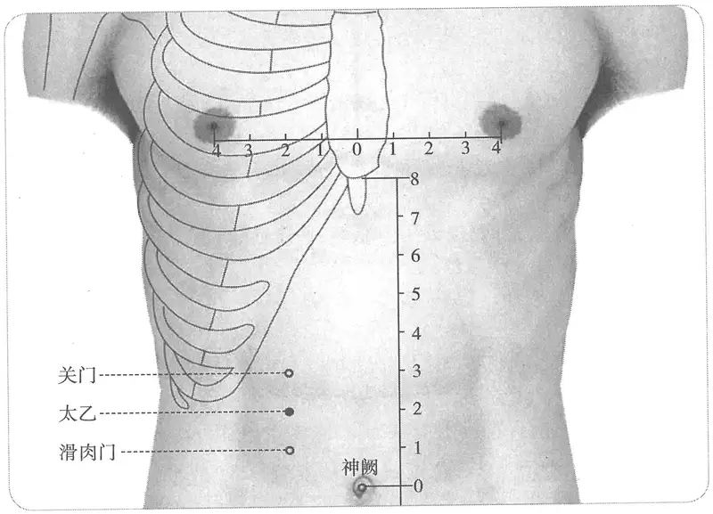

**图 2-75　太乙穴图**

**取穴**：仰卧，脐上2寸，下脘旁开2寸处取穴。

1.《黄帝明堂经》佚文

　　(1) 在关门下一寸。（《针灸甲乙经》卷三、《千金要方》、《千金翼方》、《外台秘要》、《铜人腧穴针灸图经》、《圣济总录》）

　　(2) 在关明下一寸。《千金》《甲乙经》皆云梁门下一寸。（《千金翼方》卷二十六）

**按**：“关明”系“关門”之形误。又《千金要方》、《针灸甲乙经》均作“关门下一寸”，此注作“梁门下一寸”非是。无独有偶，《医心方》卷二也作“梁门下一寸”。

　　(3) 在梁门下一寸。（《医心方》卷二）

**按**：“梁门”为“关门”之误。

　2. 在关门下一寸。注：以上二十四穴（从不容至气冲穴）去腹中行当各三寸。（《针灸资生经》卷一、《十四经发挥》、《针灸集书》、《针灸聚英》、《古今医统》、《医学入门》、《针灸大成》、《针灸易学》）

　3. 关门下一寸，夹任脉两旁各二寸五分。（《针方六集》卷一）

〔p.338 (인쇄 318)〕

　4. 在关门下一寸，去中行二寸，对下脘。（《类经图翼》卷六、《循经考穴编》、《医宗金鉴·刺灸心法要诀》、《针灸逢源》、《针灸十四经穴位考订》）

　5. 统编针灸学教材

　　(1) 部位：关门穴下一寸。取穴：关门下一寸是穴位下脘旁。（1957年南京《针灸学》）

　　(2) 部位：关门穴下一寸。取穴：从任脉下脘穴旁开二寸取之。（1版《针灸学讲义》）

　　(3) 部位：关门穴下一寸。取穴：在关门下方，下脘任脉旁开二寸取之。（2版《针灸学讲义》）

　　(4) 脐上2寸，旁开2寸。（4版《针灸学》）

　　(5) 脐上2寸，前正中线旁开2寸。（5版《针灸学》）

　　(6) 在上腹部，当脐中上2寸，距前正中线2寸。（6版《针灸学》）

　　(7) 脐中上2寸，前正中线旁开2寸。（7版《针灸学》）

　　(8) 在脐上二寸，下脘旁开二寸。（《中国针灸学》）

**文献分析**：本穴定位的纵向距离历代文献无分歧，横向定位因肾经穴定位分歧而有“二寸”、“二寸半”、“三寸”三说，考证详见“不容”穴。

#### 【类属】 

足阳明胃经穴。

足阳明脉气所发。（《黄帝明堂经》）

#### 【适应症】 

主治胃肠、神志病症。常用于腹痛、腹胀；癫痫、吐舌。

　1. 狂癫疾，吐舌。（《黄帝明堂经》）

　2. 治癫疾狂走，心烦吐舌。（《铜人腧穴针灸图经》卷中）

　3. 统编针灸学教材

　　(1) 癫狂妄乱，烦心吐舌。今附：治胃肠病有效。（1957年南京《针灸学》）

　　(2) 癫狂妄乱，烦心，胃脘痛。（1、4、5、7版《针灸学》）

　　(3) 癫狂，心烦不宁，胃痛，消化不良。（2版《针灸学讲义》、《中国针灸学》）

　　(4) 腹痛，腹胀，心烦，癫狂。（6版《针灸学》）

**文献分析**：《黄帝明堂经》所载本穴主治与下一穴“滑肉门”完全相同，或出于同一首针灸方主治。癫狂症状，《针灸甲乙经》温溜、天井穴记叙更详：“癫疾，吐舌，鼓颔，狂言见鬼，狂仆”；“癫疾，吐舌，沫出，羊鸣，戾颈”。需要注意的是，汉以前心神失常之症状皆谓之“狂”，包含了后世“狂”与“癫”两类病症。至宋代王惟一编《铜人腧穴针灸图经》于“吐舌”前加“心烦”症，虽癫狂甚极可见此症，然吐舌不必因于心烦也（于同主是症的下一穴“滑肉门”，王惟一未加“心烦”，而作“呕逆吐舌”，义稍长）。现代针灸教材又将“心烦”从癫狂中抽提出来，作为一个独立的主治病症，则与原文之义相去更远。从腧穴主治的一般规律考虑，腹部穴的治疗重点不在神志病，这可能是1957年南京《针灸学》所以于本穴下增入“治胃肠病有效”的重要因素。

#### 【操作】 

直刺0.7~1.0寸。

　1. 刺入八分，灸五壮。（《黄帝明堂经》）

　2. 针五至八分，灸五壮。孕妇五月以上禁针灸。（《针灸十四经穴位考订》）

　3. 统编针灸学教材

　　(1) 针五分至一寸，灸七至十五壮。（1957年南京《针灸学》、1版《针灸学讲义》）

　　(2) 直刺5~10分，艾条灸5~10分钟。（2版《针灸学讲义》）

　　(3) 直刺0.8~1.2寸。（4、5、7版《针灸学》）

〔p.339 (인쇄 319)〕

　　(4) 直刺0.5~0.8寸；可灸。（6版《针灸学》）

　　(5) 直刺0.7~1.0寸。可灸。（《中国针灸学》）

### （二十四）滑肉门 Huáròumén ST24 出《黄帝明堂经》 

#### 【提要索隐】 

**部位**：在上腹部，脐中上1寸，前正中线旁开2寸。

**适应症**：主治胃肠、神志病症。常用于腹痛、腹胀；癫痫、吐舌。

**针刺操作**：直刺0.7~1.0寸。

#### 【名实考】 

《西方子明堂灸经》、《医学入门》作“滑肉”，此外针灸经穴歌中，由于字数的限制也常省作“滑肉”；《西方子明堂灸经》又曰“一谓滑幽门”，疑为“滑肉门”的音变，故皆不作为本穴别名。

本穴定位，其纵向折量分寸，古今文献无分歧；而距中行的距离，由于其内侧肾经穴的定位存在分歧而有不同。

本穴主治，与《黄帝明堂经》记载的太乙穴主治，明显出自同一针灸方，而且此条文献记载的主治还与腧穴主治一般规律不合，此次整理以统编针灸学教材的前身——1957年南京《针灸学》的新增主治为主要依据。总之，本穴并太乙穴的主治病症，古今临床应用资料太少，目前还难以归纳出针对性较强的主治病症。

　1. 滑肉门，在太乙下一寸，足阳明脉气所发。（《黄帝明堂经》）

　2. 又名一谓滑幽门。（《西方子明堂灸经》）

　3. 此穴与中行水分穴平直，胃中所腐之水谷，将由此而转入小肠，小肠为受盛之官，如胃中腐之不化，则下入小肠，必不能使糟粕入大肠，汁水入膀胱，如无门以阻之，而俟其腐化，则入胃即入小肠，入小肠即入大肠，为洞泄矣。滑肉者，言不可滞也；门者，又言不可速也，即阑之义也。（《经穴解》）

　4. 别名　滑肉。（1957年南京《针灸学》）

#### 【定位】 

**部位**：在上腹部，脐中上1寸，前正中线旁开2寸（图2-76）。

**取穴**：仰卧，平脐上1寸，水分穴旁开2寸处取穴。

1.《黄帝明堂经》佚文

　　(1) 在太乙下一寸。（《针灸甲乙经》卷三、《千金要方》、《千金翼方》、《外台秘要》、《素问》王冰注、《医心方》、《铜人腧穴针灸图经》、《圣济总录》、《医学纲目》）

　　(2) 在太乙下一寸，去水分二寸。（《医心方》卷二、《类经图翼》、《循经考穴编》、《医宗金鉴·刺灸心法要诀》、《针灸逢源》、《针灸十四经穴位考订》）

　2. 在太一下一寸。注：以上二十四穴（从不容至气冲穴）去腹中行当各三寸。（《针灸资生经》卷一、《十四经发挥》、《针灸集书》、《针灸聚英》卷一、《古今医统》、《医学入门》、《针灸大成》、《针灸易学》）

　3. 在太乙下一寸，夹任脉两旁各二寸五分。（《针方六集》卷一）

　4. 统编针灸学教材

　　(1) 部位：太乙穴下一寸。取穴：仰卧，在脐上一寸横开二寸处取之。（1957年南京《针灸学》）

〔p.340 (인쇄 320)〕

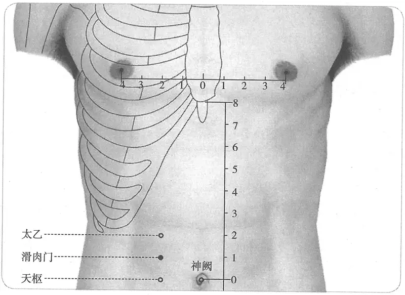

**图 2-76　滑肉门穴图**

　　(2) 部位：太乙穴下一寸。取穴：仰卧，从任脉水分穴旁开二寸取之。（1版《针灸学讲义》）

　　(3) 部位：太乙穴下一寸。取穴：在太乙下方，水分（任脉）旁开二寸取之。（2版《针灸学讲义》）

　　(4) 脐上1寸，旁开2寸。（4、5版《针灸学》）

　　(5) 在上腹部，当脐中上1寸，距前正中线2寸。（6、7版《针灸学》）

　　(6) 在脐上1寸，水分旁开二寸。（《中国针灸学》）

**文献分析**：本穴定位的纵向距离历代文献无分歧，横向定位因足少阴肾经穴的变化而有“二寸”、“三寸”之不同，详见足少阴经穴“概说”。

#### 【类属】 

足阳明胃经穴。

足阳明脉气所发。（《黄帝明堂经》）

#### 【适应症】 

主治胃肠、神志病症。常用于腹痛、腹胀；癫痫、吐舌。

　1. 狂癫疾，吐舌。（《黄帝明堂经》）

　2. 治癫疾，呕逆吐舌。（《铜人腧穴针灸图经》卷中）

　3. 呕逆吐血，重舌，舌强。（《针灸聚英》卷一、《古今医统》、《针方六集》）

**按**：“呕逆吐血”系“呕逆吐舌”之误（《针灸资生经》卷四原文无误，误在高武）。又《针灸资生经》卷六原文作“治小儿舌强，哺奶不得下见口噤治小儿重舌灸行间随年壮又灸两足外踝上三壮滑肉门见狂……”此段文字的正确断句与标点应如下作：“治小儿舌强，哺奶不得（《下》见口噤）。治小儿重舌，灸行间随年壮，又灸两足外踝上三壮。滑肉门（见狂）……”。高武误断句，而将“重舌，舌强”归入滑肉门穴下。

　4. 统编针灸学教材

　　(1) 癫狂呕逆，吐舌，舌强，吐血。今附治胃肠病有效。（1957年南京《针灸学》）

　　(2) 癫狂，舌强，呕吐，吐血，胃痛，腹痛。（1版《针灸学讲义》）

　　(3) 胃痛，呕吐，癫狂。（2版《针灸学讲义》、4、5、7版《针灸学》、《中国针灸学》）

　　(4) 癫狂，呕吐，腹胀，腹泻。（6版《针灸学》）

〔p.341 (인쇄 321)〕

**文献分析**：癫狂症状，《黄帝明堂经》温溜、天井穴更详：“癫疾，吐舌，鼓颔，狂言见鬼，狂仆”；“癫疾，吐舌，沫出，羊鸣，戾颈”。需要注意的是，汉以前心神失常之症状皆谓之“狂”，包含了后世“狂”与“癫”两类病症。至宋代王惟一编《铜人腧穴针灸图经》于“吐舌”前加“呕逆”，较之前一穴太乙加“心烦”更贴近临床实际，然更确切地说，应作“呕沫”。现代针灸教材将“呕逆”理解为呕吐，并从癫狂中抽提出来，作为一个独立的主治病症，则与原文之义不符。

《黄帝明堂经》记载的本穴主治与太乙穴主治，明显出自同一针灸方，而且仅此一条文献记载的主治还与腧穴主治一般规律不合，可能是由于此二穴的临床应用很少，汉代编《黄帝明堂经》时难以总结出相应的主治病症。宋代王惟一对《黄帝明堂经》原文的理解稍有不切，而明代高武从《针灸资生经》辑录本穴主治时又出现断句错误，现代针灸学教材复将原本属于有机联系的一组症状理解为独立的症状，从而使得本穴的主治偏差越来越大，此次整理主要依据统编针灸学教材的前身——1957年南京《针灸学》的新增主治。总之，本穴并太乙穴的主治病症，古今临床应用资料太少，目前还难以归纳出针对性较强的主治病症。

#### 【操作】 

直刺0.7~1.0寸。

　1. 刺入八分，灸五壮。（《黄帝明堂经》）

　2. 针五至八分，灸五壮。孕妇五月以上禁针灸。（《针灸十四经穴位考订》）

　3. 统编针灸学教材

　　(1) 针五分至一寸，灸五至十五壮。（1957年南京《针灸学》、1版《针灸学讲义》）

　　(2) 直刺5~10分，艾条灸5~10分钟。（2版《针灸学讲义》）

　　(3) 直刺0.8~1.2寸。（4、5、6、7版《针灸学》）

　　(4) 直刺0.7~1.0寸，可灸。（《中国针灸学》）

### （二十五）天枢 Tiānshū ST25 出《黄帝明堂经》 

#### 【提要索隐】 

**穴名**：别名长溪、谷门；循际。

**部位**：在上腹部，平脐中，前正中线旁开2寸。

**适应症**：主治胃肠及妇科病症。常用于腹痛，腹胀，肠鸣，泄泻，便秘；月经不调，痛经。灸治小儿慢性消化道症状。

**针刺操作**：直刺0.8~1.2寸。

#### 【名实考】 

“天枢”一词虽已见于《灵枢》、《素问》，但均不能判定是否为穴位的名称。本穴别名有：长溪、谷门、长谷、循际、魂魄之舍（魂舍）。然而与现行天枢穴名实皆符者，只有《黄帝明堂经》所载之“长溪”、“谷门”和《千金要方》之“循际”。今人不辨源流，于天枢穴外，另立“魂舍”、“长谷”，归入奇穴类。

本穴定位，《黄帝明堂经》曰“脐两旁各二寸”，本义是脐边缘旁二寸，《千金要方》谓“夹脐相去五寸”，是以脐的直径为“一寸”。后人或误以《黄帝明堂经》定位文字之“脐”为“脐中心”，并将脐的直径折作不同的寸数，故本穴定位便出现脐旁“一寸”、“一寸半”、“二寸”、“二寸半”等不同说法，莫衷一是，争论不休。皆因“除脐”、“合脐”之不分，以及脐直径的不同折量所致也。本穴的正确定位应据《黄帝明堂经》作“脐旁二寸”（除脐），或“夹脐相去五寸”。

　1. 当脐之两旁也。所谓身半矣，伸臂指天，则天枢正当身之半也。三分折之，上分应天，下分应地，中分应气交，天地之无交合之际，所遇寒暑燥湿风火胜复之变之化，故人气从之。万物生化，悉由而合散也（《素问·六微旨大论》王冰注）

〔p.342 (인쇄 322)〕

　2. 天枢，大肠募也。一名长溪，一名谷门。去肓俞一寸五分，夹脐两旁各二寸陷者中。足阳明脉气所发。（《黄帝明堂经》）

　3. 上中下三部也，大包与天枢、地机。注曰：上中下三部，谓之三要。大包在腋下三寸，主脾之大络，一要也；天枢者，夹脐旁二寸，谓之关，二要也；地机者，脾舍之郄，在膝下五寸，下部之总，三要也。（《针灸玉龙经》）

　4. 枢者，所以司起闭，分司上下之称也。此穴在脐之旁，而上下既分，身之前后俯仰者，此穴亦主之，故曰天枢。（《经穴解》）

　5. 谷门在脐旁二寸，一名大肠募。（《千金要方》卷二十）

　6. 天枢穴在夹脐相去三寸，魂魄之舍，不可针。大法在脐旁一寸，合脐相去可三寸也。（《千金要方》卷十五、《千金翼方》）

**按**：此说显然将脐的直径，折作二寸，欠妥。

　7. 夹脐两旁相去三寸名魂舍。（《千金要方》卷十八、《太平圣惠方》）

　8. 长谷，穴在夹脐相去五寸，一名循际。（《千金要方》卷十五）

**按**：《千金要方》卷二十九天枢穴注曰：“脾脏卷云一名长谷，夹脐相去五寸，一名循际”，“长谷”当是“长谿”坏字。

　9. 泄痢不嗜食，虽食不消，灸长谷五十壮，三报，穴在夹脐相去五寸，一名循际。（《千金要方》卷十五）

　10. 泄痢不嗜食，长谷五十壮，三报之，在胁脐旁相去五寸，一名循元穴。（《医学纲目》卷二十三）

　11. 天枢，又名长溪、长谷、循际、谷门。（《西方子明堂灸经》）

　12. 别名　大肠募、循际、长谷、循元、补元。（1957年南京《针灸学》）

**按**：1957年南京《针灸学》上述别名乃间接录自日本针灸教材，其中“大肠募”不是穴名；“循元”穴见《医学纲目》，原方出自《千金要方》，穴名为“循际”；“补元”云出《医学纲目》，未查及，疑有误。

#### 相关穴及刺激点 

通便　位于腹部，脐旁开三寸，即位于天枢与大横穴之间。主治便秘。针五分至一寸，针感局部沉重。（《针灸经外奇穴图谱（续集）》）

#### 【定位】 

**部位**：在上腹部，平脐中，前正中线旁开2寸（图2-77）。

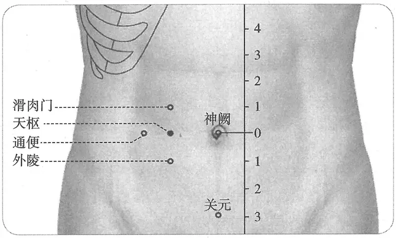

**图 2-77　天枢穴与相关穴图**

〔p.343 (인쇄 323)〕

**取穴**：仰卧，于脐中旁开2寸处取穴。

　1. 脐旁一寸

穴在夹脐两边相去各一寸。（《千金要方》卷十四、《千金翼方》卷二十七）

　2. 脐中旁一寸半

　　(1) 天枢穴在夹脐相去三寸，魂魄之舍，不可针。大法在脐旁一寸，合脐相去可三寸也。（《千金要方》卷十五、《千金翼方》）

　　(2) 魂舍二穴，在脐下两旁各相去一寸半。（《太平圣惠方》卷五十五）

　3. 脐旁二寸

　　(1) 去肓俞一寸五分，夹脐两旁各二寸陷者中。（《黄帝明堂经》、《太平圣惠方·明堂》、《铜人腧穴针灸图经》、《圣济总录》、《针灸资生经》、《针灸集书》、《古今医统》、《针灸聚英》、《针方六集》、《类经图翼》）

　　(2) 在脐旁二寸。（《千金要方》卷二十、《千金翼方》卷二十七、《外台秘要》、《素问》王冰注、《太平圣惠方·明堂》、《窦太师针经》、《神应经》、《医学纲目》、《医学入门》）

　　(3) 穴在脐旁相对横去脐两旁各二寸。（《千金要方》卷十六）

　　(4) 在滑肉门下同身寸之一寸，正当于脐。（《素问·气府论》王冰注）

　　(5) 在滑肉门下一寸，旁去肓腧一寸五分。（《铜人腧穴针灸图经》卷下、《针灸逢源》）

　4. 脐中旁二寸

　　(1) 在夹脐二寸。自天枢至归来，去中行各二寸。（《十四经发挥》卷中、《针灸聚英》、《类经图翼》、《医宗金鉴·刺灸心法要诀》）

　　(2) 去肓腧一寸，夹脐中两旁各二寸陷中。（《针灸大成》卷七、《循经考穴编》、《针灸易学》）

　　(3) 脐心旁开二寸。（《针灸十四经穴位考订》）

　5. 脐中旁三寸：去肓俞寸半，夹脐旁各二寸陷中。注：以上二十四穴（从不容至气冲穴）去腹中行当各三寸。（《针灸资生经》卷一、《针灸集书》）

　6. 统编针灸学教材

　　(1) 部位：脐旁二寸。取穴：仰卧，脐旁二寸取之神阙旁。（1957年南京《针灸学》）

　　(2) 部位：任脉神阙穴旁开二寸。取穴：仰卧，自脐中神阙旁开二寸取之。（1版《针灸学讲义》）

　　(3) 部位：去肓俞一寸五分，夹脐两旁各二寸陷者中。取穴：在脐中——神阙任脉旁开二寸取之。（2版《针灸学讲义》）

　　(4) 脐旁二寸。（4、5版《针灸学》）

　　(5) 在腹中部，距脐中2寸。（6版《针灸学》）

　　(6) 脐中旁开2寸。（7版《针灸学》、《中国针灸学》）

**文献分析**：本穴距脐周，或去脐心的横向距离有“一寸”、“二寸”、“二寸半”、“三寸”之别，所以有如此多的差异，对于“合脐”、“去脐”的不同理解，以及脐直径不同折量寸是一个重要因素。

#### 【类属】 

足阳明胃经穴。大肠募穴。

足阳明脉气所发。（《黄帝明堂经》）

#### 【适应症】 

主治胃肠及妇科病症。常用于腹痛，腹胀，肠鸣，泄泻，便秘；月经不调，痛经。灸治小儿慢性消化道症状。

〔p.344 (인쇄 324)〕

　1. 主脐疝绕脐而痛，时上冲心。女子胞中痛，恶血月水不以时休止。腹胀肠鸣，气上冲胸，不能久立，肠中切痛而鸣濯濯，冬日重感开寒则泄，当脐而痛，肠胃间游气切痛，食不化，不嗜食，身重，夹脐急。疟，振寒，热甚狂言。阴疝。气疝，烦闷，面肿，奔豚。大肠胀。（《黄帝明堂经》）

**按**：以上主治包括了大肠病及气逆上冲之气疝、脐疝、阴疝、奔豚；疟而热甚；妇人痛经，月经不调。其中大肠病症“肠中切痛而鸣濯濯，冬日重感开寒则泄，当脐而痛，肠胃间游气切痛，食不化”，《灵枢·邪气藏府病形》取大肠下合穴巨虚下廉治之。

　2. 主脾胀，四肢重，不能胜衣。（《外台秘要》卷三十九）

**按**：此条文字出于《灵枢·胀论》，《黄帝明堂经》归于脾俞穴主治，王焘不识而误录于此。

　3. 女子漏下赤白，及腹大坚，面色苍苍。（《太平圣惠方·明堂》）

　4. 疗夹脐切痛，时上冲心，烦满呕吐，霍乱，寒疟，泄利，食不化，女子月事不时，血结成块，肠鸣腹痛，不嗜食。（《铜人腧穴针灸图经》卷中）

　5. 窦太师针灸遗存

　　(1) 治脾泄不止，男虚损，妇劳损，补；气胀腹满，泻。（《窦太师针经》）

　　(2) 主奔豚，脾泄不止，气胀，肠满腹痛，赤白痢，痎疟，寒热，水利，水胀，一切虚损，女人癥瘕血结，漏下赤白。（《针方六集》卷五）

　　(3) 主久积冷气，脾泄不止，水肿，疝气，奔豚，一切下元虚冷，带漏，癥瘕。（《循经考穴编》上）

　　(4) 泻泄不止。积气上奔急欲。治赤白痢，一切拘挛筋急等症，及夹脐切痛，寒疟，泄痢。（《窦太师秘传》）

　6. 伤寒饮水过多，腹胀气喘。（《针灸聚英》卷一）

**按**：该条主治症在《针经摘英集》原文作“治伤寒饮水过多，腹胀气喘……刺任脉中脘、气海二穴立愈；如少腹上有气冲者，兼刺足阳明经天枢、气冲、三里等穴……”其治在于“少腹上有气上冲者”，而不在“伤寒饮水过多，腹胀气喘”。

　7. 统编针灸学教材

　　(1) 呕吐下利不止，食不化，绕脐痛，便闭，肠鸣腹胀，水肿，赤白带下，月事不调。小儿慢性疾患灸之大有效。（1957年南京《针灸学》）

　　(2) 呕吐下利不止，食不化，绕脐痛，便闭，肠鸣腹胀，水肿，赤白带下，月事不调，小儿慢性疾患。（1版《针灸学讲义》）

　　(3) 腹痛，泄泻，痢疾，绕脐痛，肠痈，便闭，肠鸣，腹胀，水肿，月经不调。（2版《针灸学讲义》）

　　(4) 腹胀肠鸣，绕脐痛，便秘，泄泻，痢疾，月经不调，癥瘕。（4、5版《针灸学》）

　　(5) 腹痛，腹胀，肠鸣泄泻，痢疾，便秘，肠痈，热病，疝气，水肿，月经不调。（6版《针灸学》）

　　(6) 腹痛，腹胀，便秘，泄泻，痢疾等胃肠病证，月经不调，痛经等妇科疾患。（7版《针灸学》）

　　(7) 腹痛，腹胀，肠鸣，绕脐痛，便秘，泄泻，痢疾，月经不调，水肿。（《中国针灸学》）

**文献分析**：《黄帝明堂经》载本穴主治肠胃病症，另主妇人月经病、疝疾及疟。后世临床应用重在肠胃病症，特别是兼有气上冲者。提示本穴与足三里穴一样，有明显的下气作用。妇人病症也有应用，而疝与疟应用较少，有待今后临床进一步观察，积累新的经验。本穴主治当与“大肠俞”及大肠下合穴参看。

〔p.345 (인쇄 325)〕

　1. 大肠病者，肠中切痛而鸣濯濯，冬日重感于寒即泄，当脐而痛，不能久立，与胃同候，取巨虚上廉。（《灵枢·邪气藏府病形》）

　2. 不能久立，腹中痛濯濯，冬日重感于寒则泄，当脐而痛……天枢主之。（《针灸甲乙经》）

　3. 天枢，不能久立，肠中痛濯濯，冬日重感于寒则泄，当脐而痛。（《外台秘要》）

　4. 天枢主冬月重感于寒则泄，当脐痛。（《千金要方》）

以上《灵枢》所载大肠病症，取其下合穴“巨虚上廉”，同篇所载其他腑病，也皆取相应下合穴治之。《黄帝明堂经》该条病症却取大肠募穴“天枢”，但所载小肠病、胆病候，仍归入相应下合穴“巨虚下廉”、“阳陵泉”穴中，可见大肠病取穴，以《灵枢》取“巨虚上廉”为是。而《黄帝明堂经》编者皆归于大肠募穴主治，欠妥。《邪气藏府病形》篇所载六腑病候，皆取六腑下合穴治之，《黄帝明堂经》编者也将胃病、小肠病、三焦病、胆病、膀胱病分别归入相应的下合穴中，唯独将此条大肠病候归于腹部大肠募穴“天枢”穴中，令人费解。

#### 附：临床应用举例 

　1. 胃肠、脐腹病症

　　(1) 尺脉紧，脐下痛，宜服当归汤，灸天枢，针关元补之。（《脉经》卷二）

　　(2) 久冷及妇人癥癖，肠鸣泄痢，绕脐绞痛，灸天枢百壮三报之，勿针，脐两旁各二寸。（《千金要方》卷十一、《千金翼方》）

　　(3) 吐血，腹痛，雷鸣，灸天枢百壮。体重，四肢不举，灸天枢五十壮，忌针。（《千金要方》卷十二、《千金翼方》）

　　(4) 小便不利、大便注泄，灸天枢百壮。（《千金要方》卷十五、《千金翼方》）

　　(5) 胀满，肾冷，瘕聚，泄痢，灸天枢百壮。若先下痢，灸谷门，在脐旁二寸，一名大肠募，灸二七壮，不止，更灸二七壮。（《千金要方》卷十六、《千金翼方》）

　　(6) 治霍乱转筋……若先下利者，灸谷门二七壮……一名大肠募。不瘥更灸如前数。（《千金要方》卷二十、《千金翼方》、《外台秘要》）

　　(7) 治伤寒饮水过多，腹胀气喘，心下痛不可忍，刺任脉中脘、气海二穴，立愈。如少腹上有气冲者，兼刺足阳明经天枢、气冲、三里等。（《针经摘英集》）

　　(8) 脾泄为灾若有余，天枢妙穴刺无虞。（《针灸玉龙歌》）

　　(9) 泻泄不止：灸天枢。（《针灸集要·盘石金直刺秘传》）

　　(10) 天枢，期门，灸百壮，治积气上奔急欲。（《针灸集要·盘石金直刺秘传》）

　　(11) 治霍乱吐泻：中脘、天枢。问曰：霍乱吐泻，正针中脘、天枢，何以得之？答曰：皆因胃暑冲寒，或食西瓜、冷茶、冰雪之类，脾土不化，故如此也。复刺后穴：委中、三里、中脘、天枢。（《针灸集成》第五十九方）

　　(12) 细菌性痢疾：关元穴、天枢穴、下脘穴，间接灸。［中国针灸，1987(4):3-6］

　　(13) 肠梗阻：天枢穴、足三里穴，针刺治疗。［四川中医，1986，4(7):52］

　　(14) 胃下垂：天枢穴、足三里穴，针刺治疗。［新疆中医药，1986(1):49］

　　(15) 便秘：主穴天枢，配穴中脘、足三里。［新疆中医药，1990(3):45］

　　(16) 胆道术后腹胀：艾灸神阙、双天枢穴治疗。［中华护理杂志，1998，33(6):349-350］

　　(17) 慢性腹泻：隔姜灸天枢。［针灸临床杂志，1997，13(4/5):68-69］

　2. 妇科病症

　　(1) 月事不调：关元、气海、天枢、三阴交。（《针灸大成》卷五）

〔p.346 (인쇄 326)〕

　　(2) 子宫颈癌放射性直肠炎：合谷穴、天枢穴，针刺治疗。［中国针灸，1986，6(3):18~19］

　　(3) 不育症：天枢穴、中极穴，针灸治疗。［福建中医药，1986，17(1):39］

　3. 小儿单纯性消化不良：天枢穴、中脘穴，针刺补泻。［中国针灸，1986，6(2):36］

#### 【操作】 

直刺0.8~1.2寸。

　1. 刺入五分，留七呼，灸三壮。（《黄帝明堂经》）

　2. 可灸百壮，针入五分，留七呼。（《铜人腧穴针灸图经》卷中）

　3. 窦太师针灸遗存

　　(1) 针入二寸半，可灸五十壮。（《窦太师针经》）

　　(2) 针三寸半，灸二七壮。（《窦太师秘传》）

　4. 针入八分，留七呼，灸百壮。（《医学纲目》卷八）

　5. 针五至八分，灸五壮。孕妇五月以上禁针灸。（《针灸十四经穴位考订》）

　6. 统编针灸学教材

　　(1) 针五分至一寸，灸七至十五壮。（1957年南京《针灸学》、1版《针灸学讲义》）

　　(2) 直刺5~10分，艾炷灸5~15壮，艾条灸5~15分钟。（2版《针灸学讲义》）

　　(3) 直刺1~1.5寸。（4、5、7版《针灸学》）

　　(4) 直刺0.8~1.2寸；可灸。（6版《针灸学》）

　　(5) 直刺0.7~1.2寸。可灸。（《中国针灸学》）

　7. 直刺1.5~2.5寸。感应：局部酸胀，并可扩散至同侧腹部。灸5~7壮；温灸10~20分钟。（上海《针灸学》）

### （二十六）外陵 Wàilíng ST26 出《黄帝明堂经》 

#### 【提要索隐】 

**部位**：在下腹部，脐中下1寸，前正中线旁开2寸。

**适应症**：主治局部病症。常用于腹痛、腹胀。

**针刺操作**：直刺1~1.5寸。

#### 【名实考】 

本穴名称，需要注意同名异穴之“外陵”；本穴定位，现存《黄帝明堂经》佚文已见有三说，自唐以后，皆从王冰注之说，即天枢穴下一寸。

　1. 外陵，在天枢下，大巨上，足阳明脉气所发。（《黄帝明堂经》）

　2. 穴在中行阴交穴、次行中注穴平直，而在脾经腹结穴之内平直，义颇难解。（《经穴解》）

#### 同名异穴之“外陵” 

　1. 治肾气外肾肿，小肠气痛，腹内虚鸣，灸风市穴五七壮，灸气海穴七壮，灸脐左右各去一寸半，两穴各七壮，灸之立效，后永不发，名外陵穴。（《世医得效方》卷三）

　2. 一法，外陵穴在脐左右各开一寸半，灸疝立效，永不再发，屡用屡验。（《古今医统》卷六十）

**按**：以上二方所取之“外陵”穴与足阳明胃经穴之“外陵”定位不同。

#### 【定位】 

**部位**：在下腹部，脐中下1寸，前正中线旁开2寸（图2-78）。

**取穴**：在天枢下一寸，阴交穴旁二寸取之。

〔p.347 (인쇄 327)〕

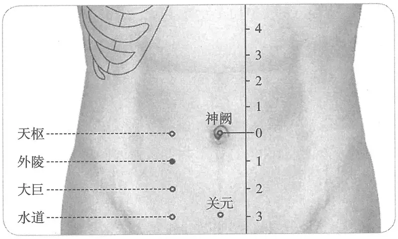

**图 2-78　外陵穴图**

1.《黄帝明堂经》佚文

　　(1) 在天枢下，大巨上。（《针灸甲乙经》卷三、《千金翼方》、《医心方》）

　　(2) 在天枢下半寸，大巨上。（《千金要方》卷二十九、《外台秘要》）

**按**：未经宋人校改本《孙真人千金方》无“半寸”二字。

　　(3) 在天枢下同身寸之一寸。（《素问·气府论》王冰注）

　　(4) 在脐下同身寸之一寸……两旁去冲脉各同身寸之一寸半。（《素问·水热穴论》王冰注）

　2. 在天枢下一寸，夹脐旁二寸。（《铜人腧穴针灸图经》卷中、《圣济总录》、《窦太师针经》、《十四经发挥》、《医学入门》）

　3. 在天枢下一寸。注：以上二十四穴（从不容至气冲穴）去腹中行当各三寸。（《针灸资生经》卷一）

　4. 天枢下一寸，去中行各二寸。（《针灸聚英》卷一、《古今医统》、《十四经发挥》、《针灸大成》、《针方六集》、《类经图翼》、《循经考穴编》、《医宗金鉴·刺灸心法要诀》、《针灸易学》、《针灸逢源》、《针灸十四经穴位考订》）

　5. 统编针灸学教材

　　(1) 部位：天枢穴下一寸。取穴：仰卧，从天枢下一寸取之，当耻骨边缘直上四寸外开二寸至之处阴交旁。（1957年南京《针灸学》）

　　(2) 部位：天枢穴下一寸。取穴：仰卧，从任脉阴交穴旁开二寸取之。（1版《针灸学讲义》）

　　(3) 部位：在天枢下，大巨上。取穴：在天枢下一寸，阴交任脉旁二寸取之。（2版《针灸学讲义》）

　　(4) 脐下1寸，旁开2寸。（4版《针灸学》）

　　(5) 脐下1寸，前正中线旁开2寸。（5版《针灸学》）

　　(6) 在下腹部，当脐中下1寸，距前正中线2寸。（6版《针灸学》）

　　(7) 脐中下1寸，前正中线旁开2寸。（7版《针灸学》）

　　(8) 在脐下一寸，阴交旁开二寸。（《中国针灸学》）

**文献分析**：本穴定位的纵向距离，现在各传本《黄帝明堂经》不同，《针灸甲乙经》、《千金翼方》、《医心方》均作“天枢下”，而《千金要方》、《外台秘要》此后均有“半寸”、“五分”的折量分寸，《素问·气府论》王冰注作“一寸”。考：下穴“大巨”，各传本《黄帝明堂经》佚文并云“在长溪下二寸”，皆以本穴前穴“天枢”定位，而不依本穴为据，或以本穴本无折量分寸，难以据以定他穴。故本穴定位文字当以《针灸甲乙经》、《千金翼方》、《医心方》更近于《黄帝明堂经》原文。唐以后各家文献关于本穴的定位均无分歧，均定位天枢下一寸，脐旁二寸，今从之。

〔p.348 (인쇄 328)〕

#### 【类属】 

足阳明胃经穴。

足阳明脉气所发。（《黄帝明堂经》）

#### 【适应症】 

主治局部病症。常用于腹痛、腹胀。

　1. 腹中尽痛。（《黄帝明堂经》）

　2. 治腹中痛，心如悬，下引脐腹痛。（《铜人腧穴针灸图经》卷中）

**按**：“心如悬，下引脐腹痛”为《黄帝明堂经》肾俞穴主治病症（心如悬，下引脐少腹急痛）。

　3. 窦太师针灸遗存

　　(1) 治腹如鼓，胀满不息，泻。（《窦太师针经》）

　　(2) 治腹胀如鼓，胀满不得息，心痛引脐。（《针方六集》卷五）

　　(3) 主腰痛，腹胀如鼓，气不得息。（《循经考穴编》上）

　4. 统编针灸学教材

　　(1) 腹痛，心下如悬，引脐痛，疝痛。（1957年南京《针灸学》）

　　(2) 绕脐腹痛，疝痛。（1版《针灸学讲义》）

　　(3) 腹痛，疝气，月经痛，心如悬引脐腹痛。（2版《针灸学讲义》）

　　(4) 腹痛，疝气，痛经。（4、5、6、7版《针灸学》、《中国针灸学》）

**文献分析**：针灸教材中“疝气，月经痛”主治症未详所出；“心如悬引脐腹痛”不能排除王惟一误抄的可能性。

#### 【操作】 

直刺1~1.5寸。

　1. 刺入八分，灸五壮。（《黄帝明堂经》）

　2. 可灸五壮，针入三分。（《铜人腧穴针灸图经》卷中）

　3. 针入二寸半，灸二七壮。（《窦太师针经》）

　4. 针五至八分，灸五壮。孕妇五月以上禁针灸。（《针灸十四经穴位考订》）

　5. 统编针灸学教材

　　(1) 针五分至一寸，灸七至十五壮。（1957年南京《针灸学》、1版《针灸学讲义》）

　　(2) 直刺5~10分，艾条灸5~10分钟。（2版《针灸学讲义》）

　　(3) 直刺1~1.5寸。（4、5、6、7版《针灸学》）

　　(4) 直刺0.7~1.2寸。可灸。（《中国针灸学》）

### （二十七）大巨 Dàjù ST27 出《黄帝明堂经》 

#### 【提要索隐】 

**穴名**：一名腋门，又作“掖门”、“液门”。

**部位**：在下腹部，脐中下2寸，前正中线旁开2寸。

**适应症**：主治腹部、前阴病症。常用于腹胀，腹痛；小便不利，疝气，遗精。

**备选适应症**：偏瘫，四肢不用。

**针刺操作**：直刺0.7~1.2寸。

#### 【名实考】 

一名腋门。《外台秘要》作“掖门”，《医心方》作“液门”。经考同样的异文也见于手少阳经穴“液门”：《针灸甲乙经》、《外台秘要》作“腋门”，《千金要方》、《医心方》作“掖门”，《太平圣惠方》作“液门”。今统一作“液门”。

〔p.349 (인쇄 329)〕

大巨，一名腋门，在长谿下二寸，足阳明脉气所发。（《黄帝明堂经》）

#### 【定位】 

**部位**：在下腹部，脐中下2寸，前正中线旁开2寸（图2-79）。

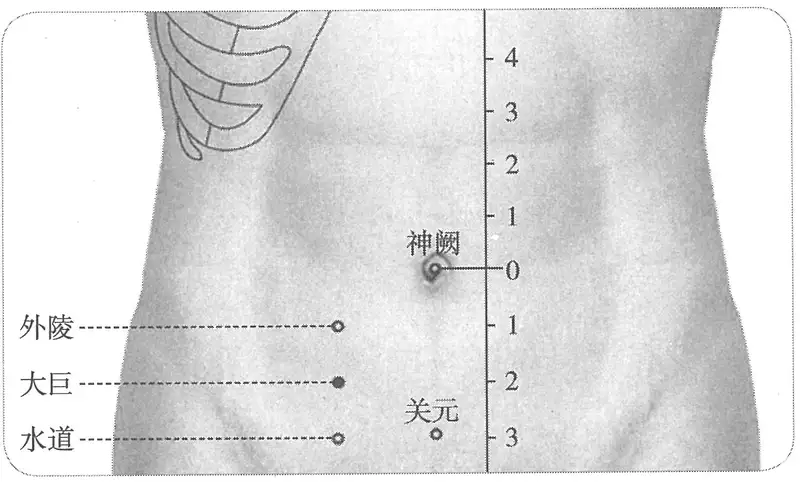

**图 2-79　大巨穴图**

**取穴**：外陵直下一寸取穴，横平石门穴。

1.《黄帝明堂经》佚文

　　(1) 在长溪下二寸。（《针灸甲乙经》卷三、《千金翼方》、《外台秘要》、《医心方》、《铜人腧穴针灸图经》卷下、《圣济总录》、《针灸资生经》）

　　(2) 在脐下一寸两旁各二寸，长溪下二寸。（《千金要方》卷二十九、《千金翼方》、《针灸集书》）

**按**：“脐下一寸”应是指“去脐”而言，不然与下文“长溪下二寸”不合。又考未经宋人校本《孙真人千金方》无“脐下一寸两旁各二寸”九字。

　　(3) 在长溪下二寸，夹脐旁二寸。（《铜人腧穴针灸图经》卷中、《圣济总录》、《窦太师针经》、《十四经发挥》、《医学入门》）

　　(4) 下脐二寸则外陵下同身寸之一寸。大巨穴也。（《素问·气府论》王冰注、《十四经发挥》、《医学纲目》、《循经考穴编》）

　2. 在长溪下二寸。注：以上二十四穴（从不容至气冲穴）去腹中行当各三寸。（《针灸资生经》卷一）

　3. 外陵下一寸，天枢下二寸，去中行各二寸。（《针灸聚英》卷一、《古今医统》、《针灸大成》、《针方六集》、《类经图翼》、《医宗金鉴·刺灸心法要诀》、《针灸易学》、《针灸十四经穴位考订》）

　4. 广注与石门平开二寸。（《循经考穴编》上、《针灸逢源》）

　5. 统编针灸学教材

　　(1) 部位：外陵穴下一寸。取穴：仰卧，从天枢穴下二寸取之石门旁。（1957年南京《针灸学》）

　　(2) 部位：外陵穴下一寸。取穴：仰卧，从任脉石门穴旁开二寸取之。（1版《针灸学讲义》）

　　(3) 部位：在天枢下二寸。取穴：在外陵下一寸，石门任脉旁二寸取之。（2版《针灸学讲义》）

　　(4) 脐下2寸，旁开2寸。（4、5版《针灸学》）

　　(5) 在下腹部，当脐中下2寸，距前正中线2寸。（6、7版《针灸学》）

　　(6) 在脐下二寸，石门旁开二寸。（《中国针灸学》）

〔p.350 (인쇄 330)〕

**文献分析**：本穴定位，各传本《黄帝明堂经》佚文中，只有宋校本《千金要方》多出“在脐下一寸两旁各二寸”一句，经考当系宋人或宋以后人所添补。

#### 【类属】 

足阳明胃经穴。

足阳明脉气所发。（《黄帝明堂经》）

#### 【适应症】 

主治腹部、前阴病症。常用于腹胀，腹痛；小便不利；疝气，遗精。

**备选适应症**：偏瘫，四肢不用。

　1. 主腹满痛，善烦，小便难，癞疝。偏枯，四肢不用，善惊。（《黄帝明堂经》）

　2. 治少腹胀满，烦渴，癞疝，偏枯，四肢不举。（《铜人腧穴针灸图经》卷中）

　3. 主肾气冲心。（《循经考穴编》上）

　4. 统编针灸学教材

　　(1) 小腹胀满，小便难，癞疝，偏枯，四肢不收，男子失精早泄。（1957年南京《针灸学》、1版《针灸学讲义》）

　　(2) 小腹胀满，小便不利，疝气，遗精，早泄。（2版《针灸学讲义》、4、5、7版《针灸学》、《中国针灸学》）

　　(3) 小腹胀满，小便不利，遗精，早泄，惊悸不眠，疝气。（6版《针灸学》）

**文献分析**：《素问·长刺节论》曰：“病在少腹，腹痛不得大小便，病名曰疝。”据此，《黄帝明堂经》所载之本穴主治“腹满痛，善烦，小便难，癞疝”，描述的应是一组疝的病状。现代针灸学教材多将其理解为一个个独立的病症。

根据腧穴主治的一般规律，“上病下取”者多，而“下病上取”者少，本穴主治虽《黄帝明堂经》已载有“偏枯，四肢不用”症，而除1版《针灸学讲义》教材外，此后各版教材皆不录，也未见古今临床应用，今附存备考。

#### 【操作】 

直刺0.7~1.2寸。

　1. 刺入八分，灸五壮。（《黄帝明堂经》）

　2. 可灸五壮，针入五分。（《铜人腧穴针灸图经》卷中）

　3. 一法：直针二寸五分，可灸三七壮。（《循经考穴编》上）

　4. 针五至八分，灸五壮。孕妇五月以上禁针灸。（《针灸十四经穴位考订》）

　5. 统编针灸学教材

　　(1) 针五分至一寸，灸七至十五壮。（1957年南京《针灸学》、1版《针灸学讲义》）

　　(2) 直刺5~10分，艾条灸5~10分钟。（2版《针灸学讲义》）

　　(3) 直刺1~1.5寸。（4、5、7版《针灸学》）

　　(4) 直刺0.8~1.2寸；可灸。（6版《针灸学》）

　　(5) 直刺0.7~1.2寸。可灸。（《中国针灸学》）

### （二十八）水道 Shuǐdào ST28 出《黄帝明堂经》 

#### 【提要索隐】 

**部位**：在下腹部，脐中下3寸，前正中线旁开2寸。

**适应症**：主治前阴及妇科病症。常用于阴中痛，小腹胀，小便不利，疝气；痛经，不孕。

**备选适应症**：妇人胞中肿块。

**针刺操作**：直刺0.8~1.2寸。不宜刺透壁腹膜。

〔p.351 (인쇄 331)〕

#### 【名实考】 

本穴名称，古今文献无分歧；本穴定位，历代文献差异较大，分歧的根本原因生于对《黄帝明堂经》腹部折量寸的不同理解。

　1. 水道，在大巨下三寸，足阳明脉气所发。（《黄帝明堂经》）

　2. 凡经虽有各经之所治，而又以所至之部分，遂治其部分之病，而名亦命焉。如此穴实在膀胱之侧，则便之通塞，亦其所司，故曰水道，乃小肠渗水下入膀胱之道也。（《经穴解》）

#### 【定位】 

**部位**：在下腹部，脐中下3寸，前正中线旁开2寸（图2-80）。

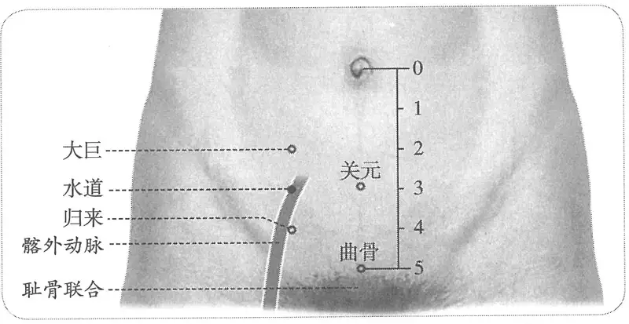

**图 2-80　水道穴图**

**取穴**：天枢穴下三寸处取穴，横平关元穴。

　1. 在大巨下三寸。（《黄帝明堂经》、《铜人腧穴针灸图经》卷下“穴腧都数”）

　2. 夹屈骨相去五寸名水道。（《千金要方》卷二十《千金翼方》、敦煌卷子佚名灸方：S.6168）

**按**：杨上善注本《黄帝内经明堂》于归来穴下注曰：“有本夹曲骨相去五寸”，未详孰是。

　3. 在大巨下三寸，夹脐旁二寸。（《铜人腧穴针灸图经》卷中、《圣济总录》、《十四经发挥》、《医学入门》）

　4. 在大巨下三寸。注：以上二十四穴（从不容至气冲穴）去腹中行当各三寸。（《针灸资生经》卷一）

　5. 在关元穴两旁各开三寸。（《窦太师针经》）

　6. 大巨下二寸，去中行各二寸。（《针灸聚英》卷一）

　7. 在大巨下三寸，去中行各二寸。（《十四经发挥》卷中、《古今医统》、《针灸大成》、《针方六集》、《类经图翼》、《医宗金鉴·刺灸心法要诀》、《针灸易学》）

　8. 大巨下一寸。广注：关元旁开二寸。（《循经考穴编》上）

　9. 在大巨下一寸旧本三寸，去中行各二寸。按：水道穴与足少阳五枢穴平，当脐下三寸之旁；又归来穴在气冲上一寸，当脐下四寸之旁，其上下各去一寸也。诸书云水道在大巨下三寸，归来在水道下二寸，皆误。（《针灸逢源》）

　10. 天枢下三寸，关元旁开二寸。（《针灸十四经穴位考订》）

　11. 统编针灸学教材

　　(1) 部位：大巨穴下一寸。取穴：仰卧，由天枢下三寸取之关元旁。（1957年南京《针灸学》）

　　(2) 部位：大巨穴下一寸。取穴：仰卧，从任脉关元穴旁开二寸取之。（1版《针灸学讲义》）

　　(3) 部位：大巨穴下一寸。取穴：天枢下三寸，关元任脉旁二寸取穴。（2版《针灸学讲义》）

　　(4) 脐下3寸，旁开2寸。（4、5版《针灸学》）

　　(5) 在下腹部，当脐中下3寸，距前正中线2寸。（6、7版《针灸学》）

〔p.352 (인쇄 332)〕

　　(6) 脐下三寸，关元旁开二寸。（《中国针灸学》）

**文献分析**：本穴定位，古代文献或曰“大巨下三寸”，或曰“夹曲骨相去五寸”，现代针灸教材则定于大巨下一寸，关于下腹部足阳明经穴纵向折量寸的理解，详见本篇“概说”。

#### 【类属】 

足阳明胃经穴。

足阳明脉气所发。（《黄帝明堂经》）

#### 【适应症】 

主治前阴及妇科病症。常用于阴中痛，小腹胀，小便不利，疝气；痛经，不孕。

**备选适应症**：妇人胞中肿块。

　1. 主小腹胀满痛引阴中，月水至则腰背痛，胞中瘕，子门有寒引髌髀。三焦约，大小便不通。（《黄帝明堂经》）

　2. 治少腹满引阴中痛，腰背强急；膀胱有寒，三焦结热，小便不利。（《铜人腧穴针灸图经》卷中）

　3. 窦太师针灸遗存

　　(1) 治小肠疝气，偏坠木肾，补泻。（《窦太师针经》）

　　(2) 主七疝冲心。（《循经考穴编》上）

　4. 统编针灸学教材

　　(1) 小腹胀满，狐疝偏坠，热结小便不通，膀胱有寒，痛引阴中。（1957年南京《针灸学》）

　　(2) 小腹胀满，小便不利，狐疝，偏坠，痛引阴中。（1版《针灸学讲义》）

　　(3) 小腹胀满，疝气，小便不通，月经痛。（2版《针灸学讲义》）

　　(4) 小腹胀满，小便不通，月经痛，不孕。（4版《针灸学》）

　　(5) 小腹胀满，小便不利，痛经，不孕，疝气。（5版《针灸学》）

　　(6) 小腹胀满，腹痛，痛经，小便不利。（6版《针灸学》）

　　(7) ①小腹胀满，小便不利等水液输布排泄失常性疾患；②疝气；③痛经、不孕等妇科疾患。（7版《针灸学》）

　　(8) 小腹胀满，小便不通，水肿，疝气，痛经，不孕。（《中国针灸学》）

**文献分析**：《黄帝明堂经》载本穴主治为“胞中瘕”（胞中肿块）和“三焦约”（小便不利），后世的临床应用集中在后者。关于本穴治疗妇科肿块的作用有待临床进一步观察。金元时期窦太师针灸明确了治疗阴疝的作用（系将《铜人腧穴针灸图经》“少腹满引阴中痛”理解为阴疝），后世也有应用。关于“胞中瘕”症状可参“太溪”主治（胞中有大疝瘕积聚，与阴相引而痛）和府舍穴主治（疝瘕髀中急痛，循胁上下抢心，腹满积聚）。“三焦约”证，《内经》论之甚详，如《灵枢·四时气》取三焦络穴以治三焦约证：“小腹痛肿，不得小便，邪在三焦约，取之太阳大络”。《灵枢·邪气藏府病形》曰：“三焦病者，腹气满，小腹尤坚，不得小便，窘急，溢则水，留即为胀。候在足太阳之外大络，大络在太阳少阳之间，亦见于脉，取委阳”。可知“三焦约”主症为“小便不利”，可取三焦下合穴“委阳”，别取水道穴。

#### 附：临床应用举例 

　1. 三焦膀胱肾中热气，灸水道随年壮。（《千金要方》卷二十、《千金翼方》）

　2. 脐豚息气乳弦：水道、关门、气海。问曰：此证从何而得？答曰：皆因酒色过多，肾水枯竭，积气耗散，阳气不兴，勉强为之，精不能泄，外流入胞中，或偏坠疼痛，或作鸡子之状，坠下疼痛，按上腹中则不痛，否则浑身不知，如入腹中则作声，以为乳弦疝气也。善治者当推详而治之。刺前穴不效，复刺后穴。前穴：水道、关门、气海。后穴：归来、关元、三阴交。（《针灸集成》第五十三方）

〔p.353 (인쇄 333)〕

**按**：此方中之“关门”系奇穴，正名为“阑门”，在曲骨旁三寸。

　3. 水病之疾最难熬，腹满虚胀不肯消，先灸水分并水道，后针三里及阴交。（《针灸玉龙歌》）

　4. 小儿睾丸鞘膜积液，艾灸水道穴治愈。［中医杂志，1984，25(2)：45］

　5. 癃闭，中极、水道、三阴交。［山东中医杂志，1990，9(2)：52］

#### 【操作】 

直刺0.8~1.2寸。不宜刺透壁腹膜。

　1. 刺入二寸五分，灸三壮。（《黄帝明堂经》）

　2. 可灸三十壮，五日一报之，各得一百五十壮，佳。（《千金翼方》卷二十八）

　3. 针入三寸，灸五十壮。（《窦太师针经》）

　4. 针三寸半，灸二七壮。（《窦太师秘传》）

　5. 针五至八分，灸五壮。孕妇五月以上禁针灸。（《针灸十四经穴位考订》）

　6. 统编针灸学教材

　　(1) 针五分至一寸，灸七至十五壮。（1957年南京《针灸学》、1版《针灸学讲义》）

　　(2) 直刺5~10分，艾条灸5~10分钟。（2版《针灸学讲义》）

　　(3) 直刺1~1.5寸。（4、5、7版《针灸学》）

　　(4) 直刺0.8~1.2寸；可灸。（6版《针灸学》）

　　(5) 直刺0.7~1.2寸。可灸。（《中国针灸学》）

　7. 直刺1~1.5寸。感应，酸胀可扩散同侧下腹部。灸5~7壮；温灸10~15分钟。（上海《针灸学》）

### （二十九）归来 Guīlái ST29 出《黄帝明堂经》 

#### 【提要索隐】 

**穴名**：一名豀穴；一名肠遗；一名遗道。

**部位**：在下腹部，脐中下4寸，前正中线旁开2寸。

**适应症**：主治前阴及妇科病症。常用于阴疝、少腹痛；妇人阴冷、肿痛，月经不调。

**针刺操作**：直刺0.8~1.2寸。不宜刺透腹膜，不宜向腹中线方向斜刺，孕妇禁针灸。

#### 【名实考】 

本穴主治“卵上人”之阴疝，使上人之卵复归其位，因名“归来”。值得注意的是，《千金要方》明确说本穴“夹玉泉五寸”，相同的位置又称作“遗道”、“肠遗”，故列入本穴别名项下。后世文献引用时有将“肠遗”误作“肠绕”，今人不察，于“肠遗”之外，另立“肠绕”一穴，皆归入奇穴类，大误。

　1. 归来，一名豀穴。在水道下二寸。（《黄帝明堂经》）

　2. 胃中所受之水谷，至此无复上逆之理，止有下行之势，故命此穴曰归来。如人之自远来归也。（《经穴解》）

**按**：此解牵强附会。

　3. 丸骞入腹唤归来，疝气奔豚也妙哉。（《金针梅花诗钞》）

　4. 妇人阴冷肿痛，灸归来三十壮，三报，挟玉泉五寸是其穴。（《千金要方》卷三）

　5. 遗溺，灸遗道挟玉泉五寸。（《千金要方》卷二十一）

　6. 大便不通，灸挟玉泉相去各二寸一云二寸半，名曰肠遗，随年壮。（《千金要方》卷十五）

〔p.354 (인쇄 334)〕

　7. 治大便难法，灸侠玉泉相去二寸半一云二寸，名肠遗，随年壮。（《千金翼方》卷二十七）

**文献分析**：玉泉穴即任脉中极穴。之所以《千金要方》“归来”、“肠遗”距中极穴的距离，或作“二寸”，或作“二寸半”，在于对肾经穴距中行距离的不同理解。

#### 附：玉泉穴定位 

　1. 奔豚抢心不得息，灸中极五十壮。中极一名玉泉。（《千金要方》卷十七）

　2. 治腰痛小便不利，苦胞转方，灸玉泉七壮，穴在关元下一寸。（《千金要方》卷二十）

#### 【定位】 

**部位**：在下腹部，脐中下4寸，前正中线旁开2寸（见图2-81）。

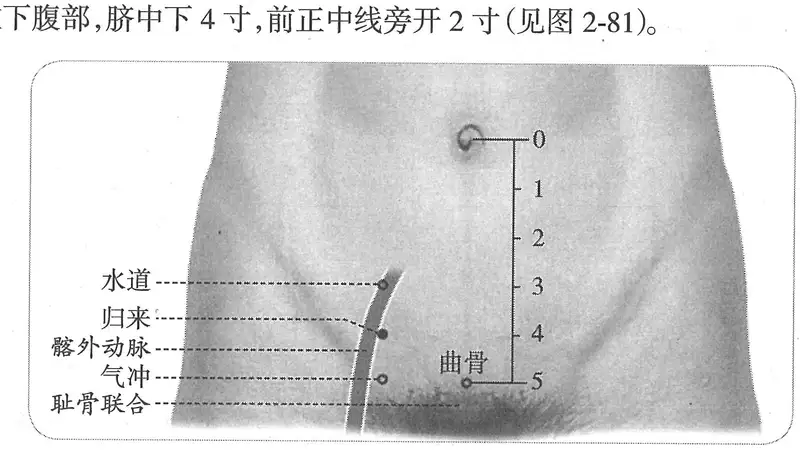

**图2-81　归来穴图**

**取穴**：水道直下1寸，横平中极穴。

　1. 《黄帝明堂经》佚文

　　(1) 在水道下二寸。（《针灸甲乙经》卷三、《千金要方》、《千金翼方》、《素问·气府论》王冰注、《医心方》、《铜人腧穴针灸图经》卷上）

　　(2) 在水道下三寸。（《外台秘要》卷三十九、《素问·水热论》王冰注）

　2. （归来）夹玉泉五寸是其穴。（《千金要方》卷三、《千金翼方》）

　3. 有本夹曲骨相去五寸。（《医心方》卷二）

　4. 在水道下二寸，夹脐旁二寸。（《铜人腧穴针灸图经》卷中、《圣济总录》、《十四经发挥》、《医学入门》）

　5. 在水道下二寸。注：以上二十四穴（从不容至气冲穴）去腹中行当各三寸。（《针灸资生经》卷一）

　6. 在水道穴下一寸。又曲骨穴微下两旁各开三寸。（《窦太师针经》）

　7. 在水道下二寸，去中行各二寸。（《针灸聚英》卷一、《古今医统》、《医学入门》、《针灸大成》、《针方六集》、《类经图翼》、《医宗金鉴·刺灸心法要诀》）

　8. 在水道下二寸，与曲骨相平，合脐下五寸。（《循经考穴编》上）

　9. 在水道下一寸旧本二寸，旁开中行二寸。按：水道穴与足少阳五枢穴平，当脐下三寸之旁；又归来穴在气冲上一寸，当脐下四寸之旁，其上下各去一寸也。诸书云水道在大巨下三寸，归来在水道下二寸，皆误。（《针灸逢源》）

　10. 天枢下四寸，中极旁开二寸。（《针灸十四经穴位考订》）

　11. 统编针灸学教材

　　(1) 部位：水道穴下一寸。取穴：仰卧，横骨上一寸，中极穴旁二寸，天枢穴下四寸处取之。（1957年南京《针灸学》）

〔p.355 (인쇄 335)〕

　　(2) 部位：水道穴下一寸。取穴：仰卧，从任脉中极穴旁开二寸取之。（1版《针灸学讲义》）

　　(3) 部位：水道穴下一寸。取穴：即天枢穴四寸，中极任脉旁二寸取之。（2版《针灸学讲义》）

　　(4) 脐下4寸，旁开2寸。（4版《针灸学》）

　　(5) 脐下4寸，前正中线旁开2寸。（5版《针灸学》）

　　(6) 在下腹部，当脐中下4寸，距前正中线2寸。（6、7版《针灸学》）

　　(7) 在脐下四寸，中极旁开二寸。（《中国针灸学》）

**文献分析**：关于本穴的横向距离，古今文献多从《黄帝明堂经》之说，作“脐周旁2寸”，至于纵向距离的差异主要源于不了解腧穴折量概念演变过程，详见本篇“概说”部分。

#### 【类属】 

足阳明胃经穴。

**归经**：足阳明经。（《外台秘要》卷三十九、《铜人腧穴针灸图经》卷上）

#### 【适应症】 

主治前阴及妇科病症。常用于阴疝、少腹痛；妇人阴冷、肿痛，月经不调。

　1. 主少腹痛。奔肫，卵上入，引茎中痛。女子阴中寒。（《黄帝明堂经》）

**按**：以上所述为“阴疝”和“女子阴中寒”症状。其中“女子阴中”，宋代王惟一译作“妇人血脏”（胞宫）。而从其他穴主治“女子阴中”病症来看，《黄帝明堂经》本意还是指女子阴道。

　2. 治少腹贲豚，卵缩茎中痛，妇人血脏积冷。（《铜人腧穴针灸图经》卷中）

　3. 窦太师针灸遗存

　　(1) 治妇女血气不足，治症同水道穴。（《窦太师针经》）

　　(2) 主妇人血脏积冷，余治同水道穴。（《针方六集》卷五）

　　(3) 主妇人血脏虚冷。（《循经考穴编》上）

　4. 主治七疝。（《古今医统》卷六、《针灸大成》、《循经考穴编》）

　5. 统编针灸学教材

　　(1) 奔豚，七疝，睾丸上缩，经闭，阴冷肿痛。（1957年南京《针灸学》、1版《针灸学讲义》）

　　(2) 腹痛，疝气，经闭，阴挺，白带，阴冷肿痛。（2版《针灸学讲义》）

　　(3) 腹痛，疝气，月经不调，白带，阴挺，阴冷肿痛。（4版《针灸学》）

　　(4) 腹痛，疝气，月经不调，白带，阴挺。（5版《针灸学》）

　　(5) 少腹疼痛，经闭，痛经，子宫下垂，白带，疝气，茎中痛，小便不利。（6版《针灸学》）

　　(6) 小腹痛，疝气；月经不调，带下，阴挺等妇科疾患。（7版《针灸学》）

　　(7) 腹痛，疝气，痛经，月经不调，闭经，白带，阴挺。（《中国针灸学》）

**文献分析**：古代文献记载本穴主治在于阴疝和妇科病症两方面，现代针灸学教材在妇科病方面多有发挥。

#### 附：临床应用举例 

　1. 阴疝

　　(1) 脐豚息气乳弦等症，问曰：此证从何而得？答曰：皆因酒色过多，肾水枯竭，积气耗散，阳气不兴，勉强为之，精不能泄，外流入胞中，或偏坠疼痛，或作鸡子之状，坠下疼痛，按上腹中则不痛，否则浑身不知，如入腹中则作声，以为乳弦疝气也。善治者当推详而治之。刺前穴不效，复刺后穴。前穴：水道、关门、气海。后穴：归来、关门、三阴交。（《针灸集成》第五十三方）

〔p.356 (인쇄 336)〕

　　(2) 寒热五般疝偏坠：关门、归来、关元、大敦、曲泉、三阴。此证因劳伤或走受寒，故成此疾。若常发，只泻下；从上来，多补元气。若一时攻心欲死，先灸关门，绝赶下气；次下泻，灸立效。（《针灸集成》第七十一方）

**按**：上二方中之“关门”系奇穴，正名为“阑门”，在曲骨旁三寸。

　　(3) 治木肾不痛肿如升斗大二百六十法：归来七壮右盘旋，取动阴交气下全，照海重加烧七壮，棱针出血效仙传。（《琼瑶神书》）

　　(4) 疝气：大敦、三阴交、归来。［中国针灸，1990，10(2)：53］

　2. 妇产病症

　　(1) 妇人阴冷肿痛，灸归来三十壮，三报，夹玉泉五寸是其穴。（《千金要方》卷三、《千金翼方》）

　　(2) 产后尿潴留，归来穴、中极穴，针刺治疗。［浙江中医杂志，1984，19(9)：406］

#### 【操作】 

直刺0.8~1.2寸。不宜刺透壁腹膜，不宜向腹中线方向斜刺，孕妇禁针灸。

　1. 刺入八分，灸五壮。（《黄帝明堂经》）

　2. 窦太师针灸遗存

　　(1) 宜针入二寸半或一寸半，灸二七壮。（《窦太师针经》）

　　(2) 窦氏针入二寸五分，或一寸五分，灸二七壮。（《针方六集》卷一）

　3. 针五至八分，灸五壮。孕妇五月以上禁针灸。（《针灸十四经穴位考订》）

　4. 统编针灸学教材

　　(1) 针五分至一寸，灸七至十五壮。（1957年南京《针灸学》、1版《针灸学讲义》）

　　(2) 直刺5~10分，艾条灸5~10分钟。（2版《针灸学讲义》）

　　(3) 直刺1~1.5寸。（4、5、7版《针灸学》）

　　(4) 直刺0.8~1.2寸；可灸。（6版《针灸学》）

　　(5) 直刺0.7~1.2寸。可灸。（《中国针灸学》）

　5. 直刺或向耻骨联合处横刺1.5~2寸。感应：下腹部酸胀，有时向小腹及外生殖器放散。灸5~7壮；温灸10~20分钟。（上海《针灸学》）

### （三十）气冲 Qìchōng ST30 出《黄帝明堂经》 

> **(30) 기충(氣衝) Qìchōng (ST30) — 『황제명당경(黃帝明堂經)』에 처음 보임**

#### 【提要索隐】 

> **【요점 정리(提要索隱)】**

**穴名**：一名气街。

> **혈명**: 일명 기가(氣街)라고도 한다.

**部位**：在腹股沟，耻骨联合上缘，前正中线旁开2寸，动脉搏动处。

> **부위**: 서혜부(鼠蹊部)로, 치골결합(恥骨結合) 위 가장자리에서 앞정중선 옆으로 2촌, 동맥이 뛰는 곳이다.

**国标修订**：1990年版国标：在腹股沟稍上方，当脐中下5寸，距前正中线2寸。2006年修订版：在腹股沟区，耻骨联合上缘，前正中线旁开2寸，动脉搏动处。

> **국가표준 개정**: 1990년판 국가표준: 서혜부 조금 위쪽으로, 배꼽 중심 아래 5촌, 앞정중선에서 2촌 떨어진 곳이다. 2006년 개정판: 서혜부 구역으로, 치골결합 위 가장자리에서 앞정중선 옆으로 2촌, 동맥이 뛰는 곳이다.

**适应症**：主治男科、妇科病症。常用于疝气；月经不调，不孕，前阴痛。

> **적응증**: 남성과·부인과 병증을 주치한다. 산기(疝氣)에 흔히 쓰며, 월경불순(月經不調), 불임, 전음통(前陰痛)에도 쓴다.

**针刺操作**：直刺0.5~1寸。勿向外侧深刺、大幅度提插，以免刺伤动脉。

> **자침 조작**: 직자(直刺) 0.5~1촌. 동맥을 찔러 다치지 않도록 바깥쪽으로 깊이 찌르거나 크게 제삽(提揷)하지 않는다.

#### 【名实考】 

> **【이름과 실체 고증(名實考)】**

本穴《灵枢》、《素问》皆名“气街”，同时也用作部位名以及针灸学中的一个重要概念——气行通道。《黄帝明堂经》名“气冲”。

> 이 혈을 『영추(靈樞)』와 『소문(素問)』은 모두 “기가”라 하였는데, 이 말은 부위 이름으로도 쓰이고, 침구학의 중요한 개념인 기가 다니는 통로[氣行通道]를 가리키는 말로도 쓰인다. 『황제명당경』은 “기충”이라 하였다.

冲脉起于“气冲”，杨玄操以“冲脉”为“气冲之脉”，则“冲脉”名义当与“动”、“气”有关。《方言》曰：“冲，动也”，今考汉代《黄帝明堂经》所载以“冲”字命名腧穴多当“动脉中”，即所谓“动输”，如“气冲”、“冲门”、“冲阳”、“太冲”等。而古人认为脉动即气之冲动所致。故丁德用注《难经》所谓“气冲者，气冲脉也”句，颇可玩味。

> 충맥(衝脈)은 “기충”에서 시작하는데, 양현조(楊玄操)는 “충맥”을 “기충의 맥[氣衝之脈]”으로 보았으니, “충맥”이라는 이름의 뜻은 “동(動)”·“기(氣)”와 관련이 있을 것이다. 『방언(方言)』에서 “충(衝)은 움직인다는 뜻이다”라고 하였다. 이제 한대(漢代) 『황제명당경』에 실린 혈 가운데 “충” 자로 이름 붙인 수혈(腧穴)을 살펴보면 대부분 “동맥 가운데[動脈中]”에 해당하니, 이른바 “동수(動輸)”로서 “기충”·“충문(衝門)”·“충양(衝陽)”·“태충(太衝)” 등이 그렇다. 그리고 옛사람은 맥이 뛰는 것을 기가 치받아 움직이기[衝動] 때문이라고 여겼다. 그러므로 정덕용(丁德用)이 『난경(難經)』에 단 주에서 “기충이란 기가 맥을 치받는 것이다”라고 한 구절은 꽤 곱씹어 볼 만하다.

〔p.357 (인쇄 337)〕

关于本穴定位，需要正确理解一个关键术语——鼠鼷，《诸病源候论》作“鼠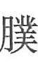”，《素问》作“鼠仆”，均指腹股沟部。

> 이 혈의 위치를 정하려면 핵심 용어 하나, 곧 서혜(鼠鼷)를 바르게 이해해야 한다. 『제병원후론(諸病源候論)』에서는 “鼠[그림]”, 『소문』에서는 “서복(鼠仆)”이라 하였는데, 모두 서혜부를 가리킨다.

　1. 腹痛，刺脐左右动脉，已刺按之，立已；不已，刺气街，已刺按之，立已。（《灵枢·杂病》）

> 1. 배가 아프면 배꼽 좌우의 동맥을 찌르고, 찌른 뒤 누르면 곧 낫는다. 낫지 않으면 기가를 찌르고, 찌른 뒤 누르면 곧 낫는다.（『영추』 「잡병(雜病)」）

　2. 胃者水谷之海，其输上在气街，下至三里。（《灵枢·海论》）

> 2. 위(胃)는 수곡의 바다[水穀之海]로, 그 수혈은 위로는 기가에 있고 아래로는 삼리(三里)에 이른다.（『영추』 「해론(海論)」）

　3. 刺气街，中脉，血不出为肿鼠仆。（《素问·刺禁论》）

> 3. 기가를 찔러 맥에 맞았는데 피가 나오지 않으면 서복이 붓는다.（『소문』 「자금론(刺禁論)」）

　4. 足阳明脉气所发者六十八穴……气街动脉各一。（《素问·气府论》）

> 4. 족양명(足陽明)의 맥기가 나오는 곳은 68혈이니…… 기가의 동맥에 각각 하나씩이다.（『소문』 「기부론(氣府論)」）

　5. 气街、三里、巨虚、上下廉，此八者，以泻胃中之热也。（《素问·水热穴论》）

> 5. 기가·삼리·거허(巨虛) 상렴과 하렴, 이 여덟 혈은 위 속의 열을 사(瀉)한다.（『소문』 「수열혈론(水熱穴論)」）

　6. 请言气街：胸气有街，腹气有街，头气有街，胫气有街。杨上善注曰：四处气行之道，谓之街也。（《灵枢·卫气》）

> 6. 기가를 말하겠다. 가슴의 기에도 길[街]이 있고, 배의 기에도 길이 있고, 머리의 기에도 길이 있고, 정강이의 기에도 길이 있다. 양상선(楊上善)의 주에서 “네 곳의 기가 다니는 길을 가(街)라 한다”라고 하였다.（『영추』 「위기(衛氣)」）

　7. 气冲，在归来下，鼠鼷上一寸，动脉应手，足阳明脉气所发。（《黄帝明堂经》）

> 7. 기충은 귀래(歸來) 아래, 서혜 위 1촌에 있으며, 동맥이 손에 닿는다. 족양명의 맥기가 나오는 곳이다.（『황제명당경』）

　8. 气冲二穴，一名气街。（《铜人腧穴针灸图经》卷中）

> 8. 기충은 두 혈로, 일명 기가라고도 한다.（『동인수혈침구도경(銅人腧穴鍼灸圖經)』 권중）

　9. 气冲，穴名也，在腹下挟两旁相去同身寸之四寸，鼠鼷上。或云在毛际两旁鼠鼷上。乃三焦之道路，故云气冲。（五卷本《铜人腧穴针灸图经》卷一）

> 9. 기충은 혈 이름이니, 아랫배 양옆에 끼어 있어 서로 동신촌(同身寸)으로 4촌 떨어져 있으며, 서혜 위이다. 혹은 털가[毛際] 양옆 서혜 위에 있다고도 한다. 삼초(三焦)의 길이므로 기충이라 한다.（5권본 『동인수혈침구도경』 권1）

　10. 此穴乃阳明直行支别内外两会之所，亦冲脉上下分行之处也。冲为血海，不曰血冲而曰气冲。则血之行也，非气不行，血之生也，非气不生。（《经穴解》）

> 10. 이 혈은 양명의 곧게 가는 줄기와 갈래가 안팎으로 두 번 만나는 곳이며, 충맥이 위아래로 갈라져 가는 곳이기도 하다. 충맥은 혈해(血海)인데 혈충(血衝)이라 하지 않고 기충이라 하였다. 이는 혈이 흐르는 것도 기가 아니면 흐르지 못하고, 혈이 생기는 것도 기가 아니면 생기지 못하기 때문이다.（『경혈해(經穴解)』）

　11. 别名　羊屎。（1957年南京《针灸学》）

> 11. 별명　양시(羊屎).（1957년 난징(南京) 『침구학[鍼灸學]』）

**按**：此间接引自日本针灸教材。“羊屎”即“羊矢”，杨上善注《黄帝内经明堂》曰“羊矢亦曰鼠鼷，阴之两廉，腹与股相接之处”（转引自《医心方》卷二），相当解剖学术语中的“腹股沟”，显然与“气冲”穴不相关；“羊矢”作为穴名大量见于明代针灸文献，定位于“气冲穴旁一寸”，皆归入足厥阴经，也与“气冲”穴不相同，故不能视为本穴别名。关于“羊矢”及“羊矢”穴的源流，详见足厥阴经穴“急脉”穴的考证。

> **안(按)**: 이것은 일본 침구 교재에서 간접 인용한 것이다. “양시(羊屎)”는 곧 “양시(羊矢)”로, 양상선이 『황제내경명당(黃帝內經明堂)』에 단 주에서 “양시는 서혜라고도 하니, 음부의 양옆, 배와 넓적다리가 맞닿는 곳이다”라고 하였으며（『의심방(醫心方)』 권2에서 재인용）, 해부학 용어의 “서혜부”에 해당하므로 “기충”혈과는 분명히 관계가 없다. “양시”는 혈 이름으로서 명대(明代) 침구 문헌에 많이 보이는데, 위치를 “기충혈 옆 1촌”으로 잡고 모두 족궐음경(足厥陰經)에 넣었으니, 이 역시 “기충”혈과 같지 않다. 따라서 이 혈의 별명으로 볼 수 없다. “양시”와 “양시”혈의 원류는 족궐음경 혈 “급맥(急脈)”의 고증에 자세하다.

#### 同名异穴之“气冲”辨 

> **동명이혈 “기충” 변별(同名異穴之“氣衝”辨)**

需要注意的是，文献中存在与本穴同名异穴的情况：传世文献中已知有《千金要方》，已佚文献中有金元时题为《怪穴》的针灸书。

> 주의할 것은 문헌 속에 이 혈과 동명이혈(同名異穴)인 경우가 있다는 점이다. 전해 오는 문헌으로는 『천금요방(千金要方)』이 알려져 있고, 전하지 않는 문헌으로는 금원(金元) 시기에 『괴혈(怪穴)』이라는 제목을 단 침구서가 있다.

　1. 失欠颊车蹉，灸背第五椎，一日二七壮，满三日未瘥，灸气冲二百壮，胸前喉下甲骨中，是亦名气堂。（《千金要方》卷六）

> 1. 하품하다 턱이 빠졌을 때[失欠頰車蹉]는 등의 제5추에 하루 14장씩 뜸을 뜨고, 사흘을 채워도 낫지 않으면 기충에 200장 뜸을 뜬다. 가슴 앞 목구멍 아래 갑골(甲骨) 가운데이며, 기당(氣堂)이라고도 한다.（『천금요방』 권6）

　2. ［怪穴］腹痛肠鸣，气冲在气海旁各一寸半，针入二寸半，灸五十壮。（《医学纲目》卷二十二）

> 2. ［괴혈］ 복통과 장명(腸鳴)에는, 기충은 기해(氣海) 옆 각 1촌 반에 있으며, 침은 2촌 반 들이고 뜸은 50장 뜬다.（『의학강목(醫學綱目)』 권22）

　3. ［怪穴］妇人血弱气喘，气冲在气海旁一寸半，针入二寸半，先补后泻。（《医学纲目》卷二十七）

> 3. ［괴혈］ 부인이 혈이 약하고 기천(氣喘)이 있을 때, 기충은 기해 옆 1촌 반에 있으며, 침은 2촌 반 들이고 먼저 보하고 뒤에 사한다.（『의학강목』 권27）

#### “气冲”与“阑门”穴辨 

> **“기충”과 “난문”혈 변별(“氣衝”與“闌門”穴辨)**

阑门，见《窦太师针经》（误作“兰门”），在本穴外一寸。明代《针方六集》引录时误作“兰门”，将原文“曲骨两旁各开三寸”误作“曲骨两旁各开二寸”，则与气冲穴相同，于是吴崑将《针灸玉龙歌》的原文也做了相应改动，后人不明其原委，于阑门穴外又另立“关门”、“兰门”、“阁门”奇穴，一穴而变为三穴。

> 난문(闌門)은 『두태사침경(竇太師鍼經)』에 보이며（“난문(蘭門)”으로 잘못 적혀 있다）, 이 혈 바깥 1촌에 있다. 명대 『침방육집(鍼方六集)』이 이를 옮겨 실을 때 “난문(蘭門)”으로 잘못 적고, 원문 “곡골(曲骨) 양옆 각 3촌”을 “곡골 양옆 각 2촌”으로 잘못 적어 기충혈과 같아졌다. 그래서 오곤(吳崑)은 『침구옥룡가(鍼灸玉龍歌)』의 원문도 그에 맞추어 고쳤고, 뒷사람들은 그 내막을 모르고 난문(闌門)혈 밖에 따로 “관문(關門)”·“난문(蘭門)”·“각문(閣門)”이라는 기혈(奇穴)을 세워, 한 혈이 세 혈로 바뀌었다.

　1. 兰门二穴，在曲骨穴两旁各开三寸。针入一分半，灸三七壮。治膀胱七疝之气。（《窦太师针经》）

> 1. 난문(蘭門)은 두 혈로, 곡골혈 양옆 각 3촌에 있다. 침은 1푼 반 들이고 뜸은 21장 뜬다. 방광의 칠산(七疝) 기운을 치료한다.（『두태사침경』）

　2. 兰门二穴，在曲骨穴两旁各开二寸。针入一寸五分，灸三七壮。治膀胱七疝之气。（《针方六集》卷一）

> 2. 난문(蘭門)은 두 혈로, 곡골혈 양옆 각 2촌에 있다. 침은 1촌 5푼 들이고 뜸은 21장 뜬다. 방광의 칠산 기운을 치료한다.（『침방육집』 권1）

**按**：这一定位实与经穴气冲相同，于是吴崑便将《针灸玉龙歌》原文“竖痃疝气发来频，气上攻心大损人，先向阑（阁）门施泻法，大敦复刺可通神”，改作“肾弦疝气发得频，气上冲心苦死人，法取气冲大敦穴，二穴须教认得真”。传世本《针灸大成》在抄录时又将原文“曲骨”误作“曲泉”，今人不察沿其误，并将二穴理解为四穴，归入下肢部奇穴类，大误。关于奇穴“阑门”的源流，详见足厥阴经急脉穴“名实考”部分。

> **안(按)**: 이 위치는 사실 경혈 기충과 같다. 그래서 오곤은 『침구옥룡가』의 원문 “수현(竪痃)과 산기가 자주 일어나 기가 위로 심(心)을 쳐서 사람을 크게 상하게 하면, 먼저 난（각）문에 사법(瀉法)을 쓰고 이어 대돈(大敦)을 찌르면 신통한 효과를 본다”를 “신현(腎弦)과 산기가 자주 일어나 기가 위로 심을 치받아 사람을 몹시 괴롭히면, 기충과 대돈혈을 취하되 두 혈을 반드시 정확히 찾아야 한다”로 고쳤다. 전해 오는 『침구대성(鍼灸大成)』은 옮겨 적으면서 원문의 “곡골”을 다시 “곡천(曲泉)”으로 잘못 적었는데, 지금 사람들은 이를 살피지 못하고 그 잘못을 그대로 따랐을 뿐 아니라 두 혈을 네 혈로 이해하여 하지부 기혈로 분류하였으니, 크게 잘못되었다. 기혈 “난문”의 원류는 족궐음경 급맥혈의 「이름과 실체 고증」 부분에 자세하다.

〔p.358 (인쇄 338)〕

#### 【定位】 

> **【위치(定位)】**

**部位**：在腹股沟区，耻骨联合上缘，前正中线旁开2寸，动脉搏动处（图2-82）。

> **부위**: 서혜부 구역으로, 치골결합 위 가장자리에서 앞정중선 옆으로 2촌, 동맥이 뛰는 곳이다（그림 2-82）.

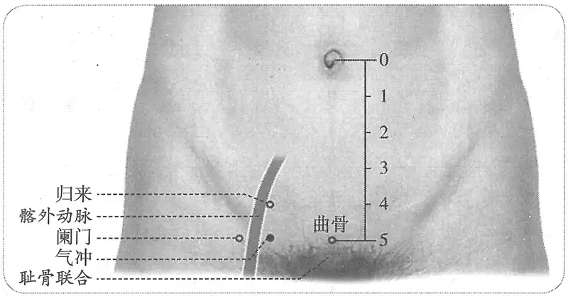

**图2-82　气冲穴图**

> **그림 2-82** 기충혈 그림

**按**：在气冲穴处已不能触及动脉的管壁，但由于此处的髂外动脉很粗，搏动很有力，故深按之仍可感到脉动应手，特别是卧位向外下方用力按压时。

> **안(按)**: 기충혈 자리에서는 이미 동맥의 관벽(管壁)을 만질 수 없지만, 이곳의 외장골동맥(外腸骨動脈)이 매우 굵고 박동이 아주 힘차서 깊이 누르면 여전히 맥이 손에 닿는 것을 느낄 수 있다. 특히 누운 자세에서 바깥 아래쪽으로 힘주어 누를 때 그렇다.

**取穴**：天枢下5寸，曲骨旁开2寸处取穴。

> **취혈**: 천추(天樞) 아래 5촌, 곡골 옆 2촌 되는 곳에서 취혈한다.

#### 相关解剖学基础 

> **관련 해부학적 기초(相關解剖學基礎)**

　　(1) 髂外动脉与股动脉：髂外动脉（external iliac artery）较髂内动脉粗大。在骶髂关节前方从髂总动脉分出后，在外侧沿着腰大肌内侧缘下行到髂前上棘和耻骨结节之间的中点——腹股沟中点或股点（mid-inguinal or femoral point），在腹股沟韧带的后方进入大腿，移行为股动脉。在股点的下方可摸到股动脉的搏动。此点也标志髂外动脉与股动脉的延续。股动脉（femoral artery）主干外径（mm）：在腹股沟韧带中点下方8.50±1.80。在腹股沟韧带（inguinal ligment）深面的位置：髂前上棘至耻骨结节的距离（114.90±5.60）mm。

> (1) 외장골동맥과 대퇴동맥(大腿動脈): 외장골동맥（external iliac artery）은 내장골동맥(內腸骨動脈)보다 굵다. 천장관절(薦腸關節) 앞에서 총장골동맥(總腸骨動脈)으로부터 갈라진 뒤, 바깥쪽에서 대요근(大腰筋) 안쪽 가장자리를 따라 내려가 상전장골극(上前腸骨棘)과 치골결절(恥骨結節) 사이의 중점, 곧 서혜부 중점 또는 대퇴점（mid-inguinal or femoral point）에 이르고, 서혜인대(鼠蹊靭帶) 뒤쪽에서 넓적다리로 들어가 대퇴동맥으로 이어진다. 대퇴점 아래쪽에서 대퇴동맥의 박동을 만질 수 있다. 이 점은 외장골동맥과 대퇴동맥이 이어지는 곳을 나타내기도 한다. 대퇴동맥（femoral artery） 줄기의 바깥지름（mm）: 서혜인대 중점 아래쪽에서 8.50±1.80. 서혜인대（inguinal ligment） 깊은 면의 위치: 상전장골극에서 치골결절까지의 거리（114.90±5.60）mm. 〔역주: 원서의 영문 「ligment」는 ligament 의 오식이다.〕

　　(2) 髂外动脉体表触诊技法：仰卧位，于股点及其上方均可以非常清晰地触及髂外动脉的有力搏动，在比较瘦的个体，还可以清楚观察到它的搏动，而股点（femoral point）的内上方气冲穴处则需有力深按方可感觉到脉动。

> (2) 외장골동맥 체표 촉진 기법: 바로 누운 자세에서 대퇴점과 그 위쪽에서는 모두 외장골동맥의 힘찬 박동을 매우 뚜렷하게 만질 수 있고, 비교적 마른 사람은 그 박동을 눈으로도 분명히 볼 수 있다. 그러나 대퇴점（femoral point） 안쪽 위의 기충혈 자리에서는 힘주어 깊이 눌러야 맥이 뛰는 것을 느낄 수 있다.

　1. 《黄帝明堂经》佚文

> 1. 『황제명당경』 일문(佚文)

　　(1) 在归来下，鼠鼷上一寸，动脉应手。（《针灸甲乙经》卷三、《千金翼方》、《素问·气府论》王冰注、《医心方》、《铜人腧穴针灸图经》卷上）

> (1) 귀래 아래, 서혜 위 1촌으로, 동맥이 손에 닿는다.（『침구갑을경(鍼灸甲乙經)』 권3, 『천금익방(千金翼方)』, 『소문』 「기부론」 왕빙(王冰) 주, 『의심방』, 『동인수혈침구도경』 권상）

　　(2) 在归来下一寸，鼠鼷上一寸。（《千金要方》卷二十九）

> (2) 귀래 아래 1촌, 서혜 위 1촌이다.（『천금요방』 권29）

　　(3) 在归来下一寸，动脉应手。（《千金要方》卷三十）

> (3) 귀래 아래 1촌으로, 동맥이 손에 닿는다.（『천금요방』 권30）

　　(4) 在归来下一寸，鼠鼷上一寸，动应手。（《外台秘要》卷三十九、《太平圣惠方·明堂》）

> (4) 귀래 아래 1촌, 서혜 위 1촌으로, 맥이 뛰는 것이 손에 닿는다.（『외대비요(外臺秘要)』 권39, 『태평성혜방(太平聖惠方)』 「명당(明堂)」）

　　(5) 气街在脐下夹脐两旁相去四寸，鼠仆上一寸，动脉应手也（《素问·刺禁论》王冰注）；在毛际两旁鼠鼷上同身寸之一寸也（《素问·骨空论》王冰注）；在归来下，鼠鼷上同身寸之一寸，各横相去同身寸之二寸；在腹脐下横骨两端，鼠鼷上同身寸之一寸，动脉应手（《素问·水热穴论》王冰注）。

> (5) 기가는 배꼽 아래 배꼽을 끼고 양옆으로 서로 4촌 떨어져 있으며, 서복 위 1촌으로 동맥이 손에 닿는다（『소문』 「자금론」 왕빙 주）. 털가 양옆 서혜 위 동신촌 1촌에 있다（『소문』 「골공론(骨空論)」 왕빙 주）. 귀래 아래, 서혜 위 동신촌 1촌에 있으며, 좌우가 가로로 각각 동신촌 2촌 떨어져 있다. 배꼽 아래 횡골(橫骨) 양 끝, 서혜 위 동신촌 1촌에 있으며, 동맥이 손에 닿는다（『소문』 「수열혈론」 왕빙 주）.

　2. 在归来下，鼠鼷上一寸，动脉应手宛宛中。（《铜人腧穴针灸图经》卷中、《十四经

> 2. 귀래 아래, 서혜 위 1촌으로, 동맥이 손에 닿는 오목한 곳[宛宛中]이다.（『동인수혈침구도경』 권중, 『십사경

〔p.359 (인쇄 339)〕

发挥》）

> 발휘(十四經發揮)』）

　3. 或云在毛际两旁鼠鼷上。（五卷本《铜人腧穴针灸图经》）

> 3. 혹은 털가 양옆 서혜 위에 있다고도 한다.（5권본 『동인수혈침구도경』）

　4. 在归来下，鼠鼷上一寸，动脉应手宛宛中。注：以上二十四穴（从不容至气冲穴）去腹中行当各三寸。（《针灸资生经》卷一）

> 4. 귀래 아래, 서혜 위 1촌으로, 동맥이 손에 닿는 오목한 곳이다. 주: 이상 24혈（불용(不容)에서 기충혈까지）은 배의 가운데 줄에서 각각 3촌 떨어진다.（『침구자생경(鍼灸資生經)』 권1）

　5. 腹下夹脐相去四寸，鼠鼷上一寸，动脉应手宛宛中，冲脉所起。（《针灸聚英》卷一、《古今医统》、《针灸大成》）

> 5. 아랫배에서 배꼽을 끼고 서로 4촌 떨어져 있으며, 서혜 위 1촌으로 동맥이 손에 닿는 오목한 곳이다. 충맥이 시작하는 곳이다.（『침구취영(鍼灸聚英)』 권1, 『고금의통(古今醫統)』, 『침구대성』）

　6. 天枢下八寸，动脉。（《医学入门》卷一）

> 6. 천추 아래 8촌으로, 동맥이 뛰는 곳이다.（『의학입문(醫學入門)』 권1）

　7. 当横骨两端，夹任脉两旁各二寸。（《针方六集》卷一）

> 7. 횡골 양 끝에 해당하며, 임맥(任脈)을 끼고 양옆으로 각 2촌이다.（『침방육집』 권1）

　8. 在归来下，鼠鼷上一寸，动脉应手宛宛中，去中行二寸。（《类经图翼》卷六）

> 8. 귀래 아래, 서혜 위 1촌으로, 동맥이 손에 닿는 오목한 곳이며, 가운데 줄에서 2촌 떨어진다.（『유경도익(類經圖翼)』 권6）

　9. 广注横骨两端动脉宛宛中，合脐下六寸。《别录》云八寸似误，其误当在水道之去大巨三寸耳。按归来穴法云：在水道下二寸，与曲骨相平，而任脉尺寸，以脐中至曲骨为五寸，则此云归来下一寸，合脐下六寸无疑。《铜人》、《素注》虽则古典，然千百年而下，安知不有传讹乎？（《循经考穴编》上）

> 9. 광주(廣注): 횡골 양 끝 동맥이 뛰는 오목한 곳으로, 배꼽 아래 6촌에 맞는다. 『별록(別錄)』에서 8촌이라 한 것은 잘못인 듯한데, 그 잘못은 수도(水道)가 대거(大巨)에서 3촌 떨어진다고 한 데 있을 것이다. 귀래혈의 취혈법을 살펴보면 “수도 아래 2촌으로 곡골과 수평이다”라고 하였고, 임맥의 촌수는 배꼽 가운데에서 곡골까지를 5촌으로 삼으니, 여기서 귀래 아래 1촌이라 한 것이 배꼽 아래 6촌에 맞는다는 것은 틀림없다. 『동인(銅人)』과 『소주(素注)』가 비록 옛 경전이지만, 천백 년을 내려오면서 잘못 전해진 것이 없다고 어찌 알겠는가?（『순경고혈편(循經考穴編)』 상）

　10. 在归来下一寸，旁开中行二寸，腿肚中有肉核，名曰鼠鼷，直上一寸，动脉应手宛宛中，与脐下五寸曲骨平。（《针灸逢源》）

> 10. 귀래 아래 1촌, 가운데 줄에서 옆으로 2촌이다. 넓적다리 살[腿肚] 가운데 살덩이 멍울이 있는데 이를 서혜라 하며, 그 바로 위 1촌에서 동맥이 손에 닿는 오목한 곳으로, 배꼽 아래 5촌인 곡골과 수평이다.（『침구봉원(鍼灸逢源)』）

　11. 天枢下五寸，曲骨旁开二寸。（《针灸十四经穴位考订》）

> 11. 천추 아래 5촌, 곡골 옆 2촌이다.（『침구십사경혈위고정(鍼灸十四經穴位考訂)』）

　12. 统编针灸学教材

> 12. 통일 편찬 침구학 교재[統編鍼灸學敎材]

　　(1) 部位：归来穴下一寸。取穴：仰卧，从耻骨缝际上边外开二寸，归来下一寸取之曲骨旁。（1957年南京《针灸学》）

> (1) 부위: 귀래혈 아래 1촌. 취혈: 바로 누워, 치골 봉합[恥骨縫際] 위 가장자리에서 바깥으로 2촌, 귀래 아래 1촌으로 곡골 옆에서 취한다.（1957년 난징 『침구학』）

　　(2) 部位：水道穴下一寸。取穴：仰卧，从任脉曲骨穴旁开二寸取之。（1版《针灸学讲义》）

> (2) 부위: 수도혈 아래 1촌. 취혈: 바로 누워, 임맥 곡골혈 옆 2촌에서 취한다.（제1판 『침구학강의[鍼灸學講義]』）

　　(3) 部位：水道穴下一寸。取穴：在归来下一寸，腹股沟上方，股动脉内侧，当曲骨任脉旁二寸取之。（2版《针灸学讲义》）

> (3) 부위: 수도혈 아래 1촌. 취혈: 귀래 아래 1촌, 서혜부 위쪽, 대퇴동맥 안쪽으로, 곡골에서 임맥 옆 2촌 되는 곳에서 취한다.（제2판 『침구학강의』）

　　(4) 脐下5寸，旁开2寸。（4、5版《针灸学》）

> (4) 배꼽 아래 5촌, 옆으로 2촌.（제4·5판 『침구학』）

　　(5) 在腹股沟稍上方，当脐中下5寸，距前正中线2寸。（6、7版《针灸学》）

> (5) 서혜부 조금 위쪽으로, 배꼽 중심 아래 5촌, 앞정중선에서 2촌 떨어진 곳이다.（제6·7판 『침구학』）

　　(6) 在脐下五寸，曲骨旁开二寸。（《中国针灸学》）

> (6) 배꼽 아래 5촌, 곡골 옆 2촌이다.（『중국침구학[中國鍼灸學]』）

**文献分析**：本穴定位横向距离古今文献无分歧，至于纵向距离的差异主要是由于不了解腧穴折量概念演变过程，详见本篇概说部分。从本穴定位的历代文献描述来看，不论是说“脐下八寸”，或“脐下五寸”，其共同点皆为“鼠鼷上一寸”，这已经可以很清楚地看出，“八寸”说与“五寸”说，用的不是相同的骨度折量系统，这种现象在古今折量定位中时有发生，但却很少有人意识到。

> **문헌 분석**: 이 혈 위치의 가로 거리는 예나 지금이나 문헌에 이견이 없고, 세로 거리의 차이는 주로 수혈 절량(折量) 개념이 바뀌어 온 과정을 모른 데서 생겼다. 자세한 것은 이 편의 개설(槪說) 부분을 보라. 이 혈 위치에 대한 역대 문헌의 서술을 보면, “배꼽 아래 8촌”이라 하든 “배꼽 아래 5촌”이라 하든 공통점은 모두 “서혜 위 1촌”이다. 여기서 이미 “8촌”설과 “5촌”설이 같은 골도(骨度) 절량 체계를 쓰지 않았음을 분명히 알 수 있다. 이런 현상은 예나 지금이나 절량으로 위치를 정할 때 이따금 일어나지만, 이를 알아차리는 사람은 드물다.

气冲与冲门横向距离相距一寸半至二寸，二穴的定位均谓“动脉应手”，而此处髂外动脉的管径远没有这么宽。人体测量结果表明，锁骨中线经过股点，该点动脉搏动的外侧即冲门穴；而股点内上方为气冲穴。髂外动脉（external iliac artery）是由小腹中偏左向两旁外下斜行，管径也由粗而细，其在股点处的管径约小指粗。在气冲穴处虽已不能触及髂外动脉的管壁，但由于该动脉搏动很有力，故深按之仍可感到脉动应手，特别是卧位向外下方用力按压时。

> 기충과 충문은 가로로 1촌 반에서 2촌 떨어져 있고, 두 혈 모두 위치를 “동맥이 손에 닿는다”라고 하였는데, 이 부위의 외장골동맥 지름은 그만큼 넓지 않다. 인체 계측 결과를 보면 쇄골중앙선(鎖骨中央線)이 대퇴점을 지나며, 이 점에서 동맥이 뛰는 곳의 바깥쪽이 충문혈이고, 대퇴점 안쪽 위가 기충혈이다. 외장골동맥（external iliac artery）은 아랫배 가운데 약간 왼쪽에서 양옆 바깥 아래로 비스듬히 내려가며, 지름도 굵다가 가늘어져 대퇴점에서는 새끼손가락 굵기쯤 된다. 기충혈 자리에서는 이미 외장골동맥의 관벽을 만질 수 없지만, 이 동맥의 박동이 매우 힘차서 깊이 누르면 여전히 맥이 손에 닿는 것을 느낄 수 있다. 특히 누운 자세에서 바깥 아래쪽으로 힘주어 누를 때 그렇다.

#### 【类属】 

> **【분류(類屬)】**

足阳明胃经穴。

> 족양명위경(足陽明胃經)의 혈이다.

足阳明脉气所发。（《黄帝明堂经》）

> 족양명의 맥기가 나오는 곳이다.（『황제명당경』）

#### 【适应症】 

> **【적응증(適應症)】**

主治男科、妇科病症。常用于疝气；月经不调，不孕，前阴痛。

> 남성과·부인과 병증을 주치한다. 산기에 흔히 쓰며, 월경불순, 불임, 전음통에도 쓴다.

〔p.360 (인쇄 340)〕

　1. 气冲、三里、巨虚上下廉，此八者，以泻胃中之热也。（《素问·水热穴论》）

> 1. 기충·삼리·거허 상렴과 하렴, 이 여덟 혈은 위 속의 열을 사한다.（『소문』 「수열혈론」）

　2. 主腹中有大热不安，腹有大气。女子月水不利，或暴闭塞。暴腹胀满，癃，淫泺，身热，腹中绞痛，癞疝，阴肿。乳难，子抢心，若胞衣不出，众气尽乱。腹满痛不得息，正偃卧，屈一膝，伸一膝。并刺气冲，针上入三寸，气至泻之。腰痛控睾、小腹及股，卒俯不得仰。石水。妇人无子及少腹痛。阴疝，痿，茎中痛，两丸骞，痛不可仰卧。脱肛下。（《黄帝明堂经》）

> 2. 뱃속에 큰 열이 있어 편치 않은 것, 배에 큰 기[大氣]가 있는 것을 주치한다. 여자의 월경이 순조롭지 않거나 갑자기 막힌 것, 갑자기 배가 불러 그득한 것, 융(癃), 음락(淫濼), 몸의 열, 뱃속이 쥐어짜듯 아픈 것, 퇴산(癩疝), 음종(陰腫)을 주치한다. 난산[乳難], 태아가 가슴을 치받는 것[子搶心], 태반이 나오지 않아 여러 기가 모두 어지러운 것을 주치한다. 배가 그득하고 아파 숨을 쉬지 못하면 반듯이 누워 한쪽 무릎은 굽히고 한쪽 무릎은 펴게 한 뒤 함께 기충을 찌르되, 침을 위쪽으로 3촌 들이고 기가 이르면 사한다. 허리 통증이 고환·아랫배·넓적다리로 당기고 갑자기 굽혔다가 젖히지 못하는 것, 석수(石水), 부인의 불임과 아랫배 통증, 음산(陰疝), 위(痿), 음경 속 통증, 두 고환이 오그라 올라가[兩丸騫] 아파서 바로 눕지 못하는 것, 탈항(脫肛)을 주치한다.（『황제명당경』）

　3. 主脐下坚，阴肿。亦主妇人月水不通。（《太平圣惠方·明堂》）

> 3. 배꼽 아래가 단단한 것과 음종을 주치한다. 부인의 월경이 통하지 않는 것도 주치한다.（『태평성혜방』 「명당」）

　4. 治肠中大热不得安卧，腹有逆气上攻心，腹胀满，淫泺，月水不利，身热，腹中痛，癞疝阴肿，难乳，子上抢心，痛不得息，气冲腰痛，不得俯仰，阴痿，茎中痛，两丸骞痛不可忍。（《铜人腧穴针灸图经》卷中）

> 4. 장 속에 큰 열이 있어 편히 눕지 못하는 것, 배에 역기(逆氣)가 있어 위로 심을 치는 것, 배가 불러 그득한 것, 음락, 월경이 순조롭지 않은 것, 몸의 열, 뱃속 통증, 퇴산과 음종, 난산, 태아가 위로 가슴을 치받아 아파 숨을 쉬지 못하는 것, 기가 치받는 요통으로 굽혔다 젖혔다 하지 못하는 것, 음위(陰痿), 음경 속 통증, 두 고환이 오그라 올라가 참을 수 없이 아픈 것을 치료한다.（『동인수혈침구도경』 권중）

　5. 窦太师针灸遗存

> 5. 두태사(竇太師) 침구 유존(遺存)

　　(1) 治七疝偏坠，症治同前穴，看症补泻。（《窦太师针经》）

> (1) 칠산과 편추(偏墜)를 치료하며, 증상과 치료는 앞의 혈과 같으니 증상을 보아 보사한다.（『두태사침경』）

　　(2) 治偏坠，下焦热，奔豚，逆气攻心，小腹胀。（《针方六集》卷五）

> (2) 편추, 하초(下焦)의 열, 분돈(奔豚), 역기가 심을 치는 것, 아랫배가 불러 오르는 것을 치료한다.（『침방육집』 권5）

　　(3) 主奔豚疝气，偏坠木肾，阴肿阴痿。（《循经考穴编》上）

> (3) 분돈과 산기, 편추와 목신(木腎), 음종과 음위를 주치한다.（『순경고혈편』 상）

　6. 统编针灸学教材

> 6. 통일 편찬 침구학 교재

　　(1) 阴肿茎痛，睾丸痛，疝痛偏坠，奔豚，妇人经漏，胎产诸疾。（1957年南京《针灸学》、1版《针灸学讲义》）

> (1) 음종과 음경 통증, 고환 통증, 산통(疝痛)과 편추, 분돈, 부인의 경루(經漏), 임신·출산의 여러 질환.（1957년 난징 『침구학』, 제1판 『침구학강의』）

　　(2) 外阴肿痛，疝气，偏坠，月经不调，阴萎，不孕，胎产诸疾。（2版《针灸学讲义》）

> (2) 외음부가 붓고 아픈 것, 산기, 편추, 월경불순, 음위(陰萎), 불임, 임신·출산의 여러 질환.（제2판 『침구학강의』）

　　(3) 腹痛肠鸣，疝气，阴肿，阴痿，月经不调，不孕。（4、5版《针灸学》）

> (3) 복통과 장명, 산기, 음종, 음위, 월경불순, 불임.（제4·5판 『침구학』）

　　(4) 少腹痛，疝气，腹股沟疼痛。（6版《针灸学》）

> (4) 아랫배 통증, 산기, 서혜부 통증.（제6판 『침구학』）

　　(5) ①肠鸣腹痛；②疝气；③月经不调、不孕、阳痿、阴肿等妇科病及男科病。（7版《针灸学》）

> (5) ① 장명과 복통 ② 산기 ③ 월경불순·불임·양위(陽痿)·음종 등 부인과 및 남성과 질환.（제7판 『침구학』）

　　(6) 腹痛肠鸣，疝气，外阴肿痛，阳痿，痛经，月经不调。（《中国针灸学》）

> (6) 복통과 장명, 산기, 외음부가 붓고 아픈 것, 양위, 통경(痛經), 월경불순.（『중국침구학』）

**文献分析**：本穴主治症状较多，实则与前一穴“归来”和其外侧穴“冲门”的主治相类，均主阴疝（腹中绞痛，癞疝，阴肿；腰痛控睾、小腹及股，卒俯不得仰；阴疝，痿，茎中痛，两丸骞，痛不可仰卧）和妇科病症。《黄帝明堂经》于此对阴疝症状描述较详且重复出现，当是辑自多首针灸方主治。又“癃，淫泺，身热”诸症又见于“冲门”穴，应是辑自同一首针灸方。教材所述“外阴肿痛”、“阴肿”、“少腹痛”、“腹股沟疼痛”、“偏坠”皆系阴疝的症状，不应理解为独立的症状。

> **문헌 분석**: 이 혈의 주치 증상은 많지만 실제로는 앞 혈 “귀래”와 바깥쪽 혈 “충문”의 주치와 비슷하여, 모두 음산（뱃속이 쥐어짜듯 아픈 것, 퇴산, 음종; 허리 통증이 고환·아랫배·넓적다리로 당기고 갑자기 굽혔다가 젖히지 못하는 것; 음산, 위, 음경 속 통증, 두 고환이 오그라 올라가 아파서 바로 눕지 못하는 것）과 부인과 병증을 주치한다. 『황제명당경』이 이 혈에서 음산 증상을 비교적 자세히, 그것도 거듭 서술한 것은 여러 침구방(鍼灸方)의 주치를 모았기 때문일 것이다. 또 “융, 음락, 몸의 열” 등의 증상은 “충문”혈에도 보이니, 같은 침구방에서 모은 것으로 보아야 한다. 교재가 서술한 “외음부 종통”·“음종”·“아랫배 통증”·“서혜부 통증”·“편추”는 모두 음산의 증상이므로, 독립된 증상으로 이해해서는 안 된다.

#### 附：临床应用举例 

> **부: 임상 응용 예(臨床應用擧例)**

　1. 腹痛

> 1. 복통

　　(1) 腹痛，刺脐左右动脉，已刺按之，立已；不已，刺气街，已刺按之，立已。（《灵枢·杂病》）

> (1) 배가 아프면 배꼽 좌우의 동맥을 찌르고, 찌른 뒤 누르면 곧 낫는다. 낫지 않으면 기가를 찌르고, 찌른 뒤 누르면 곧 낫는다.（『영추』 「잡병」）

　　(2) 治腹有逆气上攻，心腹胀满上抢心，气冲腰痛，不得俯仰：灸足阳明经气冲二穴。（《针经摘英集》）

> (2) 배에 역기가 있어 위로 치고, 심복(心腹)이 불러 그득하여 위로 가슴을 치받으며, 기가 치받는 요통으로 굽혔다 젖혔다 하지 못하는 것을 치료할 때: 족양명경의 기충 두 혈에 뜸을 뜬다.（『침경적영집(鍼經摘英集)』）

　　(3) 治伤寒饮水过多，腹胀气喘，心下痛不可忍，刺任脉中脘、气海二穴立愈。如少腹上有气冲者，兼刺足阳明经天枢、气冲、三里等穴，次针足太阴经三阴交二穴，如无此证，只刺前穴而已。（《针经摘英集》）

> (3) 상한(傷寒)에 물을 너무 많이 마셔 배가 불러 오르고 숨이 차며 명치 밑[心下]이 참을 수 없이 아픈 것을 치료할 때는 임맥의 중완(中脘)·기해 두 혈을 찌르면 곧 낫는다. 아랫배 위로 기가 치받는 것이 있으면 족양명경의 천추·기충·삼리 등의 혈을 함께 찌르고, 이어 족태음경(足太陰經)의 삼음교(三陰交) 두 혈에 침을 놓는다. 이런 증상이 없으면 앞의 혈만 찌른다.（『침경적영집』）

　2. 石水，灸然谷、气冲、四满、章门。（《千金翼方》卷二十八）

> 2. 석수에는 연곡(然谷)·기충·사만(四滿)·장문(章門)에 뜸을 뜬다.（『천금익방』 권28）

　3. 热淋，小便黄、腹满，阴陵泉、关元各二寸、气冲二七壮。（《医学纲目》卷十四））

> 3. 열림(熱淋)으로 소변이 누렇고 배가 그득하면 음릉천(陰陵泉)·관원(關元)에 각 2촌, 기충에 뜸 14장.（『의학강목』 권14））

〔p.361 (인쇄 341)〕

　4. 前列腺肥大症和前列腺炎，会阴穴、气冲穴、曲骨穴，针灸疗法。［安徽中医学院学报，1987(2)：60］

> 4. 전립선비대증과 전립선염: 회음혈(會陰穴)·기충혈·곡골혈, 침구 요법.［『안휘중의학원학보(安徽中醫學院學報)』, 1987(2): 60］

#### 【操作】 

> **【조작(操作)】**

直刺0.5~1寸。勿向外侧深刺、大幅度提插，以免刺伤动脉。

> 직자 0.5~1촌. 동맥을 찔러 다치지 않도록 바깥쪽으로 깊이 찌르거나 크게 제삽하지 않는다.

　1. 刺气街中脉，血不出为肿鼠仆。（《素问·刺禁论》）

> 1. 기가를 찔러 맥에 맞았는데 피가 나오지 않으면 서복이 붓는다.（『소문』 「자금론」）

　2. 刺入三分，留七呼，灸三壮，灸之不幸，使人不得息。（《黄帝明堂经》）

> 2. 3푼 찔러 넣고 7호흡 동안 유침하며, 뜸은 3장 뜬다. 뜸이 잘못되면 숨을 쉬지 못하게 된다.（『황제명당경』）

　3. 灸五壮。（《太平圣惠方·明堂》）

> 3. 뜸 5장.（『태평성혜방』 「명당」）

　4. 可灸七壮，立愈，炷如大麦，禁不可针。（《铜人腧穴针灸图经》卷中）

> 4. 뜸 7장을 뜰 수 있으며 곧 낫는다. 뜸봉은 큰 보리알만 하게 하고, 침은 금한다.（『동인수혈침구도경』 권중）

　5. 禁针，灸三七壮。（《窦太师针经》）

> 5. 침은 금하고, 뜸 21장.（『두태사침경』）

　6. 针三分，灸五壮。孕妇五月以上禁针灸；《铜人》禁针。（《针灸十四经穴位考订》）

> 6. 침 3푼, 뜸 5장. 임신 5개월 이상의 임부는 침과 뜸을 금한다. 『동인』에서는 침을 금하였다.（『침구십사경혈위고정』）

　7. 统编针灸学教材

> 7. 통일 편찬 침구학 교재

　　(1) 针三至五分，灸三至七壮。（1957年南京《针灸学》、1版《针灸学讲义》）

> (1) 침 3~5푼, 뜸 3~7장.（1957년 난징 『침구학』, 제1판 『침구학강의』）

　　(2) 直刺3~5分，艾条灸5~10分钟。（2版《针灸学讲义》）

> (2) 직자 3~5푼, 애조구(艾條灸) 5~10분.（제2판 『침구학강의』）

　　(3) 直刺0.5~1寸。（4、5、7版《针灸学》）

> (3) 직자 0.5~1촌.（제4·5·7판 『침구학』）

　　(4) 直刺0.8~1.2寸。（6版《针灸学》）

> (4) 직자 0.8~1.2촌.（제6판 『침구학』）

　　(5) 直刺0.3~0.5寸。可灸。（《中国针灸学》）

> (5) 직자 0.3~0.5촌. 뜸을 뜰 수 있다.（『중국침구학』）

　8. ①直刺0.5~1寸。感应：局部重胀。②斜刺，内外阴部进针1~2寸。感应：局部酸胀并向生殖器扩散。灸3~5壮；温灸5~15分钟。注意：男子内当精索，女于内为子宫圆韧带。针刺不宜过深。（上海《针灸学》）

> 8. ① 직자 0.5~1촌. 감응: 국소가 묵직하게 붓는 느낌. ② 사자(斜刺)로 안팎 음부 쪽으로 1~2촌 진침한다. 감응: 국소가 시큰하고 붓는 느낌이 생식기로 퍼진다. 뜸 3~5장, 온구(溫灸) 5~15분. 주의: 남자는 안쪽에 정삭(精索)이 있고, 여자는 안쪽에 자궁원인대(子宮圓靭帶)가 있다. 침을 너무 깊이 찌르지 않는다.（상하이(上海) 『침구학』） 〔역주: 원서의 「女于内」는 「女子内」의 오식으로 보인다.〕

### （三十一）髀关 Bìguān ST31 出《黄帝明堂经》 

问题：本穴定位，明以前文献皆从《黄帝明堂经》，以体表解剖标志定穴，而自明中期始明确以折量分寸——膝上一尺二寸定穴，现代针灸学教材的定位皆称以此折量寸为依据，然而实际定穴，除极个别针灸书外，皆不理会此“一尺二寸”，为什么会出现这一奇怪现象？

#### 【提要索隐】 

髀关穴，是中国、日本、韩国3国定位有分歧的腧穴，而且3国专家从一开始就意识到，解决这一分歧的关键在于对古典文献中所描述的体表标志“伏兔后交分中”6字的破解。

**部位**：在股前侧，股直肌近端、缝匠肌与阔筋膜张肌3条肌肉之间凹陷中。

**国标修订**：1990年版国标：在大腿前面，当髂前上棘与髌底外侧端的连线上，屈股时，平会阴，居缝匠肌外侧凹陷处。2006年修订版：在股前侧，股直肌近端、缝匠肌与阔筋膜张肌3条肌肉之间凹陷中。注1：跷足，稍屈膝，大腿稍外展外旋，绷紧肌肉，在股直肌近端显现出2条相交叉的肌肉（斜向内侧为缝匠肌，外侧为阔筋膜张肌），3条肌肉间围成一个三角形凹陷，其三角形顶角下凹陷中即为本穴。注2：约相当于髂前上棘、髌底外侧端连线与耻骨联合下缘水平线的交点处。

**按**：1990年版国标所述文字属于取穴法内容，而不是部位。2006年版国标补上了部位描述，而将1990年版文字调整后作为取穴法，以注文的形式表述。

**适应症**：主治局部病症。常用于下肢痿痹、屈伸不利。

**针刺操作**：直刺1~2寸。

#### 【名实考】 

髀关之“关”字，以及相邻穴髀枢之“枢”字，对应的是髋关节的特定部位，诚如杨上善所言“夫为门者具有三义：一者门关，主禁者也；二者门阖，谓是门扉，主关闭也；三者门枢，主转动者也”（《黄帝内经太素·阴阳合》）。本穴在髋关节之前方，因名髀关。

〔p.362 (인쇄 342)〕

关于本穴定位的曲折变化颇耐人寻味。在明代以前文献皆从《黄帝明堂经》，以体表解剖标志定穴，即所谓“髀关，在膝上伏兔后交分中”，而自明中期突然出现以折量分寸定穴，即“膝上一尺二寸”。那么，这一折量寸又是如何确定的呢？考察发现，明正统仿宋针灸铜人髀关穴距膝的高度恰好相当于伏兔穴的二倍，清初医官根据目测对于这具铜人髀关穴的定位给出了这样的描述：“在膝上伏兔后斜行向里，去膝一尺二寸”（《勉学堂针灸集成》卷三）。之所以明代正统仿宋针灸铜人会如此点穴，一个很重要的因素在于，当时铜人大腿部的骨度规定为“髀枢下至膝中长一尺四寸”（见明正统石刻《铜人腧穴针灸图经·修明堂诀式》）。那么，在清代医官之前，高武、汪机完全可能见到这一当时非常著名的铜人，并给出与清代医官关于髀关穴部位完全相同的描述。

既然有了“去膝一尺二寸”这个明确的折量寸，髀关穴的定位理应十分简单，而实际上却极为复杂。问题由元末滑伯仁《十四经发挥》一书引起，该书将《黄帝明堂经》一直到《铜人腧穴针灸图经》关于髀关穴定位描述“伏兔后交分中”改成“伏兔后交纹中”，这一字之改非同小可。本来对于原文“伏兔后交分中”，不具备解剖学，特别是表面解剖学经验的人，很难理解，历代文献只是照抄前代文献，一成不变。由于这一字之改，人们很容易将“伏兔后交纹中”理解为腹与股相交接处的约纹，明代《针方六集》则直接改成“髀关兔后约纹中”；《医学入门》作“膝上伏兔后胯骨横纹中”，与该书密切相关的《经穴指掌图》遂将此穴标在“胯骨横纹中”（腹股沟横纹）。由于《十四经发挥》在日本比在中国的影响还要大得多，日本江户时期以下的针灸书直到现代的针灸学教材都深受其影响，在这二三百年间，除了个别医家将“伏兔后交纹中”理解为伏兔后两条肌肉、肌腱，或者理解为伏兔外侧纹中外，绝大多数针灸书都理解为腹股横纹——腹股沟。日本早期的针灸教科书多据此描述，如“横卧屈膝时，在横纹之外端稍偏内方取之”、“坐位时，膝上一尺二寸处股关节下有横纹，按其中取之”、“髂前上棘外方二横指”、“髂前上棘外侧一寸处”。以上描述，特别是第一个描述已经非常接近正确的取穴——尽管是基于对原文错误的理解。然而，这些早期的针灸教材又强调其所描述的位置为“膝上一尺二寸”。如果这个“一尺二寸”与《灵枢》的骨度相同，那么其与腹股沟还有很长的距离，不可能在同一个部位。日本人为此提出：《灵枢·骨度》的“一尺八寸”用的是周尺，明代的“一尺二寸”说的是商尺，折算以后，长度大致相同。1977年出版的《针灸医学》（日本针灸教学参考书）髀关穴作“髂前上棘直下、大腿前侧横纹的外端、缝匠肌与阔筋膜张肌之间的凹陷中”，已经不再提“一尺二寸”的折量尺寸；1992年出版的针灸学统编教材《经络经穴概论》作“髂前上棘下方、缝匠肌与阔筋膜张肌之间的凹陷部”，终于连“横纹”也不提了。

中国人当然更清楚这一点，为了消除这个矛盾，便采用修改大腿前部骨度分寸的做法，在统编针灸教材之前，或定为“十二寸”，或“十三寸”，或“十四寸”，后来统编针灸学教材统一改为十八寸，髀关的定位还是“一尺二寸”，可见这个尺寸形同虚设。唯一一本认真理会“一尺二寸”的针灸书是1959年针灸研究所编写的《针灸学简编》，该书将大腿部的骨度定为十四寸。

还有一点值得提及：同样是对本穴定位文字“伏兔后交纹中”，日本人多理解为腹股沟，中国人则多理解为臀横纹。这两个体表标志，高度相差很大，且在体表显示二者所要求体位也完全不同：前者需要屈股，后者则要求伸股。中国人为了弥合这巨大的差异，不仅调整了大腿部的骨度，而且注明“垂膝正坐，于股根横纹中取之”；“屈股时，平会阴”。可是屈股时，臀横纹不能显示，这样的规定便自相矛盾了。

〔p.363 (인쇄 343)〕

本穴定位描述原文“伏兔后交分中”的正确理解为：股直肌近端，内侧的缝匠肌与外侧的阔筋膜张肌交叉凹陷中，这个凹陷正在伏兔与髂前上棘的连线上，而不是“伏兔后斜行向里”，当然距髌底的距离也远不止“一尺二寸”。

中国现代针灸书最先最接近正确描述髀关穴定位的是朱琏编纂的《新针灸学》（1954年第二版）：

位置：膝上外一尺二寸，与会阴平高。

解剖部位：在股骨大粗隆之前下方，缝匠肌与阔筋膜张肌之间，股直肌之上端。

**按**：该书将大腿前部的骨度设为一尺二寸，为的是使该穴定位的传统描述与解剖学描述相合。为一个穴的定位而改变整个大腿部的骨度，足见该穴的定位描述令针灸研究者相当地困惑。后来1957年江苏省中医学校编《针灸学》教材，本穴的解剖定位完全采用了《新针灸学》之说，但由于该书对大腿部阳经穴定位的骨度，采用《灵枢·骨度》“髀枢至膝中一尺九寸”，于是去除了“一尺二寸”的说法，然而这个“一尺二寸”并没有从人们的头脑中去除，一直影响着人们针灸取穴和挂图、模型的点穴。

中国现代针灸穴位挂图最先正确标注本穴部位的是1952年马继兴《针灸治疗刺激点解剖位置参考图》。

对于同样的《十四经发挥》文字“伏兔后交纹中”，日本人理解为大腿前横纹——腹股沟斜纹，中国人理解为大腿后横纹——臀横纹；第三种理解为伏兔外侧横纹——应指髂胫束前缘（在不同的姿势下可呈现为条状隆起，或沟陷）。除此之外，还有多少种不同的理解，由于古代明堂图及图册大多失传，不得而知。然而可以确知的是，已知的三种理解都是错误的。这充分说明了文字在表达腧穴定位的局限性，这也是造成腧穴定位分歧与错误的一个重要因素。

顺带说，清初医官对正统铜人髀关穴的目测描述“在膝上伏兔后斜行向里，去膝一尺二寸”，对于日本针灸铜人、针灸图，以及中国民国时期的经穴挂图、针灸书都产生了明显的影响。

　1. 髀关，在膝上伏兔后交分中。（《黄帝明堂经》）

　2. 髀关，杨上善注曰腘上髀枢为关也。（《黄帝内经太素·骨空》卷十一）

　3. 伏兔上各一。王冰注曰：谓髀关二穴也。（《素问·气府论》）

　4. 胃经离腹而下行，初入于髀，有关象焉，故曰髀关。（《经穴解》）

**按**：本穴是因部位而得名，岳含珍注解非是。

#### 相关穴及刺激点 

抬腿穴　位于髂前上棘直下2寸。直刺2.5~3寸。主治小儿麻痹后遗症，动脉硬化引起的偏瘫，不明原因之不能抬腿。针感：大腿部及臀部有酸、胀、麻感。（《针灸经外奇穴图谱（续集）》）

#### 【定位】 

**部位**：在股前侧，股直肌近端、缝匠肌与阔筋膜张肌3条肌肉之间凹陷中（图2-83）。

**取穴**：跷足，稍屈膝，大腿稍外展外旋，绷紧肌肉，在股直肌近端显现出2条相交叉的肌肉（斜向内侧为缝匠肌，外侧为阔筋膜张肌），3条肌肉间围成一个三角形凹陷，其三角形顶角下凹陷中即为本穴。或于髂前上棘、髌底外侧端连线与耻骨联合下缘水平线的交点处取穴。

#### 相关解剖学基础 

　　(1) 缝匠肌、阔筋膜张肌体表显示法：跷足，稍屈膝，大腿稍外展外旋，绷紧肌肉，在股直肌近端即可显现出两条相交叉的肌肉（斜向内侧极明显的为缝匠肌，外侧为阔筋膜张

〔p.364 (인쇄 344)〕

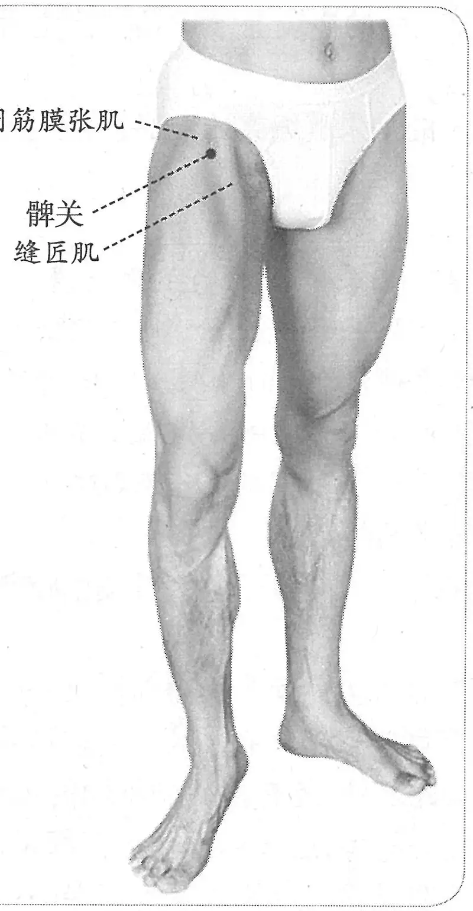 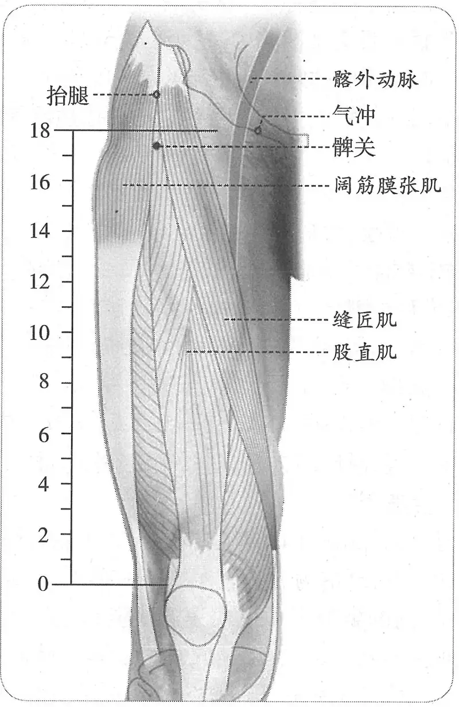

**图2-83　髀关穴与相关穴图**

肌），3条肌肉间围成一个明显的三角形凹陷，其三角形尖下凹陷处即为所谓“交分”，也即髀关穴处。

　　(2) 大体解剖学检验：尸体解剖标本所见与活体体表显示的结果完全吻合：股直肌近端，内侧的缝匠肌和外侧的阔筋膜张肌相交叉，形成一个三角形凹陷。

　1. 在膝上，伏兔后交分中。（《黄帝明堂经》、《太平圣惠方·针经》、《铜人腧穴针灸图经》卷上、卷下、《圣济总录》、《针灸资生经》、《针灸聚英》、《古今医统》、《针方六集》）

　2. 在膝上，伏兔后交纹中。（《十四经发挥》中、《医学纲目》、《针灸集书》、《针灸大成》、《针灸易学》）

　3. 膝上伏兔后胯骨横纹中。（《医学入门》卷一）

　4. 髀关兔后六寸分。（《针灸聚英》卷一、《针灸问对》）

　5. 髀关膝上有尺二，伏兔膝上六寸是。（《黄帝内经灵枢注证发微》）

　6. 在膝上，伏兔后交纹中。一云在膝上一尺二寸。（《类经图翼》卷六）

　7. 在伏兔后交纹中。广注约伏兔后一寸许。（《循经考穴编》上）

**按**：此处所引“广注”之文，反映的是明清时期个别医家对于“伏兔后”的另一种理解——伏兔外侧。例如明代《针灸秘法全书》曰：“经曰髀关在膝上伏兔后交纹中，不曰伏兔之上而曰后者，则穴在伏兔外廉相并可知。努力伸之，□视则有陷纹直至膝，故曰交纹中也。前去伏兔约三寸许，必后二寸许有分肉。”无独有偶，日本针灸文献也有类似的说法（如日本文化十年岡田静安《骨度正穴考图》）。

　8. 从气街下行，膝上一尺二寸许，中行左右各三指，上有肉起如伏兔状。（《医宗金鉴·刺灸心法要诀》）

〔p.365 (인쇄 345)〕

　9. 伏兔之上斜向里去膝一尺二寸。（《针灸十四经穴位考订》）

　10. 统编针灸学教材

　　(1) 部位：伏兔穴后交纹中。解剖：在股骨大粗隆之前下方。缝匠肌与阔筋膜张肌之间，股直肌之上端。取穴：仰卧，从气冲至伏兔成一斜直线，髀关在直线之上交纹中取之。（1957年南京《针灸学》）

　　(2) 部位：伏兔穴后交纹中。取穴：垂膝正坐，于股根横纹中取之，向下直对伏兔穴。（1版《针灸学讲义》）

　　(3) 部位：在膝上，伏兔后交分中。取穴：屈股，当髂前上棘直下，与承扶相对取之。（2版《针灸学讲义》）

　　(4) 髂前上棘与髌骨外缘的连线上，平臀沟处。（4、5版《针灸学》）

　　(5) 在大腿前面，当髂前上棘与髌底外侧端的连线上，屈股时，平会阴，居缝匠肌外侧凹陷处。（6版《针灸学》）

　　(6) 当髂前上棘与髌骨底外缘连线上，屈髋时平会阴，居缝匠肌外侧凹陷处。（7版《针灸学》）

　　(7) 髂前上棘直下与耻骨联合下缘水平线交点处，即当缝匠肌外侧，屈股时呈现凹陷处。（《中国针灸学》）

**文献分析**：本穴定位，《黄帝明堂经》曰：“髀关，在膝上，伏兔后交分中”。这一定位描述很简单，只有6个字，但却很明确。关键问题是要准确理解原文中的“伏兔后交分中”。对于“伏兔”一词，由于后世文献有较为形象的描述，现代人很容易便可找到相对应的现代解剖学术语——股直肌，而所谓“分”是指肌肉，《内经》、《黄帝明堂经》均可见“分肉”、“分中”一词。则“交分”系指“两条肌肉相交处叉”。而由现代解剖学知识可知，股直肌近端（即“伏兔后”）内侧的缝匠肌与外侧的阔筋膜张肌相交，形成一个明显的三角形凹陷——即所谓“伏兔后交分中”。至此，这一让中、日、韩三国专家费尽周折的古代解剖术语涣然冰释。

由于后人不识“交分中”之意而变生出许多分歧，又由于不明不同骨度系统下腧穴定位的差异，长期以来中外在“髀关”穴定位上得出许多似是而非的结论而不自知。详见本书“总论”。

#### 【类属】 

足阳明胃经穴。

**归经**：足阳明胃经。（《产经》、《千金要方》卷二十九、《铜人腧穴针灸图经》卷上）

#### 【适应症】 

主治局部病症。常用于下肢痿痹、屈伸不利。

　1. 主膝寒痹不仁，痿不可屈伸。（《黄帝明堂经》）

　2. 治膝寒不仁，痿厥，股内筋络急。（《铜人腧穴针灸图经》卷下）

　3. 主腰痛，小腹引喉痛。（《针灸聚英》卷一、《针灸大成》、《针方六集》）

　4. 主股髀痿痹麻木，寒湿脚气。（《循经考穴编》上）

　5. 统编针灸学教材

　　(1) 髀股痿痹麻木，筋急不得屈伸，腰痛，膝寒。（1957年南京《针灸学》、1版《针灸学讲义》）

　　(2) 髀股痿痹，筋急不得屈伸，腹痛，足麻木不仁。（2版《针灸学讲义》）

　　(3) 腰痛膝寒，痿痹，腹痛。（4、5版《针灸学》）

　　(4) 髀股痿痹，下肢不遂，腰腿疼痛，筋急不得屈伸。（6版《针灸学》）

　　(5) 下肢痿痹、腰痛、膝冷等腰及下肢病证。（7版《针灸学》）

〔p.366 (인쇄 346)〕

　　(6) 下肢痿痹，股痛，屈伸不利。（《中国针灸学》）

**文献分析**：《针灸聚英》两条主治皆系高武从《针灸资生经》误录《千金要方》文。《针灸资生经》原文作“犊鼻、髀关、阳陵泉主膝不仁（《千》见腰痛）”，“膝关主膝内廉痛引髌，不可屈伸，连腹引喉痛”。第一条文字“（《千》见腰痛）”，是指此条主治出自《千金要方》，参见“腰痛”篇，因古书无标点，高武将文中“见腰痛”注文混作主治症（这类错误在《针灸聚英》中多次出现）。第二条主治为“膝关”穴主治，高武误录于“髀关”穴下。现代针灸教材也或多或少沿袭了此误。

#### 附：临床应用举例 

　1. 腿膝外廉痛，股肿胻酸，转痿痹，或膝胫热，不能行动，侠溪五分、髀关、光明各一寸。（《医学纲目》卷十二）

　2. 中风下肢偏瘫，髀关、足三里、环跳、阳陵泉、绝骨，配风市、三阴交、解溪、太冲。［江苏中医杂志，1981，2(4)：41］

#### 【操作】 

直刺1~2寸。

　1. 刺入六分，灸三壮。（《黄帝明堂经》）

　2. 一云平针三分，禁灸。（《循经考穴编》上）

　3. 针六分，灸五壮。（《针灸十四经穴位考订》）

　4. 统编针灸学教材

　　(1) 针六分至一寸，灸三壮，不宜多。（1957年南京《针灸学》、1版《针灸学讲义》）

　　(2) 直刺6~12分，艾条灸3~5分钟。（2版《针灸学讲义》）

　　(3) 直刺1~2寸。（4、5、7版《针灸学》）

　　(4) 直刺0.8~1.2寸。可灸。（6版《针灸学》）

　　(5) 直刺1.0~1.5寸。可灸。（《中国针灸学》）

　5. 直刺或斜刺1.5~3寸。感应：局部酸胀，有时可酸胀至膝部。灸3壮；温灸5~10分钟。（上海《针灸学》）

### （三十二）伏兔 Fútù ST32 出《黄帝明堂经》 

#### 【提要索隐】 

**穴名**：一名外勾。

**部位**：在股前外侧，髌底上6寸，髂前上棘与髌底外侧端的连线上。

**适应症**：常主治下肢病症。常用于下肢痿痹，膝冷。

**针刺操作**：直刺1~2寸。

#### 【名实考】 

“伏兔”之名虽早见于《素问》、《灵枢》，但均系指部位名，而不是穴名。宋以前文献也常写作“伏菟”（《千金要方》、《千金翼方》、《医心方》）。

　1. 伏兔，在膝上六寸起肉，足阳明脉气所发。（《黄帝明堂经》）

　2. 髀前膝上起肉处为伏兔。（《十四经发挥》卷中）

　3. 以左右各三指按捺，上有肉起如兔之状，因以此名。（《针灸聚英》卷一）

　4. 正坐脆而取之，有肉隆起如兔伏状，故名。（《循经考穴编》上）

　5. 此以形命名者也。（《经穴解》）

　6. 别名　外勾。（《针灸资生经》目录）

〔p.367 (인쇄 347)〕

　7. 别名　外丘。（1957年南京《针灸学》）

**按**：此乃间接录自日本教材，云系朝鲜穴名，出《东医宝鉴》，今检该书原文出处标作“铜人”，而《铜人腧穴针灸图经》无此别名，当系录自《针灸资生经》，乃“外勾”之形误。韩国针灸学教材不辨原委，又从中国教材再次重复了这一根源于朝鲜古籍，并误导了日本、中国教材的明显错误。

　8. 寒疝下至腹腠，膝腰痛如清水，大腹一作小腹诸疝，按之至膝上，伏兔主之。（《针灸甲乙经》卷八第二）

**按**：《黄帝明堂经》载“伏兔”穴为禁刺禁灸穴，故无主治。传世本《针灸甲乙经》原文如下：“寒疝，下至腹腠，膝腰痛如清水，大腹（一作小腹）诸疝，按之下至膝上，伏兔主之。寒疝痛，腹胀满，痿厥少气，阴市主之”。据《千金要方》、《外台秘要》、《太平圣惠方》，上文“伏兔主之”均作“伏兔中”，即所有文字均系阴市穴主治病症。

#### 相关穴及刺激点 

新伏兔　位于大腿伸侧，髌骨中线上七寸，于髂前上棘和髌底连线相交之点外开五分处，伏兔外0.5寸。主治膝关节炎，下肢瘫痪，关节痛。针2~3寸，针感麻、酸至膝。灸3~7壮。贴近股骨外缘向下刺2寸时酸麻至膝，刺3寸时（强手法）整个下肢就失去知觉。（《针灸经外奇穴图谱（续集）》）

#### 【定位】 

**部位**：在股前外侧，髌底上6寸，髂前上棘与髌底外侧端的连线上（图2-84）。

**取穴**：阴市上3寸取穴。

　1. 在膝上六寸起肉。（《黄帝明堂经》、《铜人腧穴针灸图经》卷上及卷下“穴腧都数”）

　2. 令病人累夫端坐。以病人手夫掩横膝上。夫下旁与曲膝头齐上旁侧夫际当中央是。（《千金要方》卷七、《千金翼方》）

　3. 在膝上六寸起肉，正跪坐取之是穴。（《太平圣惠方》、《针方六集》、《医宗金鉴·刺灸心法要诀》、《针灸易学》、《针灸逢源》）

　4. 一本云膝盖上七寸。（《铜人腧穴针灸图经》卷下、《圣济总录》、《针灸资生经》、《十四经发挥》、《医学纲目》、《针灸集书》、《针灸聚英》、《古今医统》、《类经图翼》）

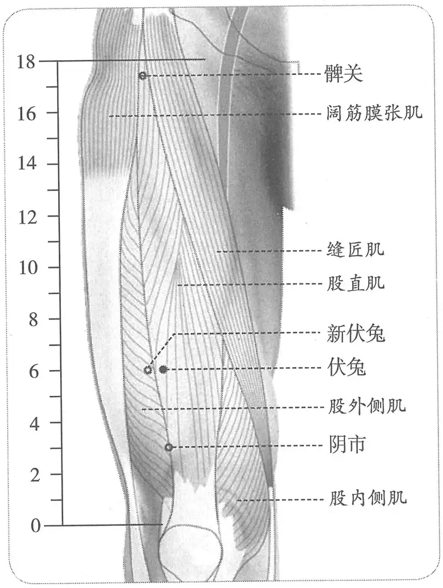

**图2-84　伏兔穴与相关穴图**

　5. 膝上六寸。按：“伏兔”穴，《铜人图经》云在膝盖上七寸。（《针灸十四经穴位考订》）

　6. 统编针灸学教材

　　(1) 部位：膝上六寸起肉上。取穴：膝盖骨上缘起向上六寸取之。（1957年南京《针灸学》）

　　(2) 部位：膝上六寸起肉端。取穴：从膝盖骨上缘起向上六寸取之，略当大腿正面之中央部。（1版《针灸学讲义》）

〔p.368 (인쇄 348)〕

　　(3) 部位：膝上六寸起肉间。取穴：在膝髌上缘上六寸，髂前上棘与膝盖骨之上外缘的连线上取之。（2版《针灸学讲义》）

　　(4) 在髂前上棘与髌骨外缘的连线上，髌骨上6寸处。（4版《针灸学》）

　　(5) 在髂前上棘与髌骨底外缘连线上，髌骨外上缘上6寸。（5、7版《针灸学》）

　　(6) 在大腿前面，当髂前上棘与髌底外侧端的连线上，髌底上6寸。（6版《针灸学》）

　　(7) 在髂前上棘与髌骨外缘的连线上，髌骨外上缘上六寸，股直肌中。（《中国针灸学》）

**文献分析**：历代文献记载基本一致，定于在膝上六寸起肉间，出《黄帝明堂经》。“起肉”，是指大腿前部隆起的股四头肌，其肉隆向外侧，经脉行于股外，故定位于髂前上棘与髌底外侧端的连线上，当髌底上六寸处。《铜人腧穴针灸图经》引一说曰“在膝盖上七寸”，后世文献不从。

#### 【类属】 

足阳明胃经穴。

足阳明脉气所发。（《黄帝明堂经》）

#### 【适应症】 

常主治下肢病症。常用于下肢痿痹，膝冷。

　1. 气劳，痹逆，狂邪，膝冷，手节挛缩，身瘾疹，腹胀少气，妇人八部诸病。（《太平圣惠方·针经》）

　2. 治风劳，气逆，膝冷不得温。（《铜人腧穴针灸图经》卷下）

　3. 主患风湿妇人下部诸证。（《针方六集》卷五）

　4. 主腰胯痛，麻痹不仁等证。（《循经考穴编》上）

　5. 主头重，脚气。（《针灸聚英》卷一、《针灸大成》）

**按**：“头重”症系辑自《针灸资生经·风劳》卷四，原文作“伏兔疗风劳痹逆狂邪膝冷手节挛缩身瘾疹腹胀少气头重风劳脑户五壮针三分补之千翼”，正确断句应如下：伏兔疗风劳痹逆，狂邪，膝冷，手节挛缩，身瘾疹，腹胀少气。头重，风劳，脑户五壮，针三分补之（《千翼》）。高武误断句，将脑户穴主治误辑于伏兔穴下。而“脚气”病系从《针灸资生经》卷五转录《千金要方》针灸方主治，详见下“附：临床应用举例”引文。

　6. 统编针灸学教材

　　(1) 腰胯痛，膝冷，麻痹不仁，风痹，脚气。（1957年南京《针灸学》、1版《针灸学讲义》）

　　(2) 腰胯痛，膝冷，麻痹，脚气。（2版《针灸学讲义》、《中国针灸学》）

　　(3) 腰痛，膝冷，疝气，脚气。（4版《针灸学》）

　　(4) 腰痛膝冷，下肢麻痹，疝气，脚气。（5版《针灸学》）

　　(5) 腿痛，下肢不遂，脚气，疝气，腹胀。（6版《针灸学》）

　　(6) ①下肢痿痹、腰痛、膝冷等腰及下肢病证；②疝气；③脚气。（7版《针灸学》）

**文献分析**：本穴在《黄帝明堂经》中为禁刺灸穴，传世本《针灸甲乙经》载有一条“伏兔主之”文字，经考证系传抄之误。最早载录该穴主治的明堂文献为《太平圣惠方·针经》，此外《千金要方》载有三首含有本穴的灸方，所主病症与《太平圣惠方》所述基本相应。这些是考察该穴主治的主要文献与临床依据。教材中“腰痛”、“疝气”诸症乃传现行本《针灸甲乙经》之误；“脚气”系传高武《针灸聚英》之误，皆不取也。

#### 附：临床应用举例 

　1. 小儿惊痫……又灸伏兔。次灸三里。次灸腓肠。次灸鹿溪。次灸阳明。次灸少阳。次灸然谷。右足部一十四处，皆要，可灸如上壮数。（《千金要方》卷五、《外台秘要》）

　2. 狂邪鬼语，灸伏兔百壮。（《千金要方》卷十四）

　3. 凡脚气初得脚弱，使速灸之，初灸风市，次灸伏兔，次灸犊鼻，次灸膝两眼，次灸三里，

〔p.369 (인쇄 349)〕

次灸上廉，次灸下廉，次灸绝骨。凡此诸穴，灸不必一顿灸尽壮数，可日日报灸之，三日之中灸令尽壮数为佳。（《千金要方》卷七、《千金翼方》）

　4. 髌腱末端病，伏兔穴、膝眼穴，针灸治疗。［中国针灸，1984，4(2)：14］

#### 【操作】 

直刺1~2寸。

　1. 禁不可灸。（《黄帝明堂经》）

　2. 针入三分，禁灸。（《太平圣惠方·针经》）

　3. 刺入五分，不可灸。（《铜人腧穴针灸图经》卷下）

　4. 针五分，禁灸。《千金》云可灸。（《针灸十四经穴位考订》）

　5. 统编针灸学教材

　　(1) 针五分至一寸。（1957年南京《针灸学》、1版《针灸学讲义》）

　　(2) 直刺6~12分，艾条灸5~10分钟。（2版《针灸学讲义》）

　　(3) 直刺1~2寸。（4、5、6、7版《针灸学》）

　　(4) 直刺1.0~1.5寸。可灸。（《中国针灸学》）

　6. 直刺1.5~2.5寸。感应：酸胀可至膝部。灸3~5壮；温灸5~15分钟。（上海《针灸学》）

**按**：《黄帝明堂经》所以谓此穴禁刺灸，盖与《灵枢·寒热病》所述有关：“身有五部：伏兔一；腓二，腓者腨也；背三；五藏之腧四；项五。此五部有痈疽者死。”

### （三十三）阴市 Yīnshì ST33 出《黄帝明堂经》 

问题：“阴市”正确的写法与读法是什么？

#### 【提要索隐】 

**穴名**：一名阴鼎。

**部位**：在股前外侧，髌底上3寸，股直肌肌腱外侧缘。

**适应症**：主治局部病症。常用于腰痛引膝，下肢痿痹、屈伸不利。

**针刺操作**：直刺1~1.5寸。

#### 【名实考】 

“阴市”一词，在《黄帝明堂经》中除本穴外，还见于足太阴经穴箕门穴“在鱼腹上越筋间，动脉应手，阴市内”，显然这里的“阴市”非指穴名。这两处“阴市”之“市”字皆当作“巿”字（二者字形极相近，文献中易混淆），音fú。《说文》曰：“巿，韠也。上古衣蔽前而已，巿以象之。”；又曰：“韨，蔽膝也。”《释名》：“韠，蔽也，所以蔽膝前也，妇人蔽膝亦如之。”《方言》曰：“蔽膝，江淮之间谓之袆，自关东西谓之蔽膝。”可知，巿，即韨、韠，俗称“蔽膝”，形状类似今之围裙而稍窄。本穴在膝上，正当遮蔽前阴之“巿”下缘，因以名之。又本穴所在，正处于股直肌远端外缘，其内为股内侧肌，其外为股外侧肌，犹如三足鼎立，故又名阴鼎。

　1. 阴市，一名阴鼎，在膝上三寸，伏兔下，若拜而取之，足阳明脉气所发。（《黄帝明堂经》）

　2. 人之股上、膝下最寒者，皆过于此处，乃阴气之所聚也，故曰阴市。（《经穴解》）

需要特别注意的是，本穴名“阴市”，与“阴谷”（足少阴经穴）、“风市”（足少阳经穴）二穴字形相近，古代文献中常有混淆之处。

#### “阴市”与“阴谷”相混例 

　1. 阴市二穴，一名阴鼎，在膝上三寸，伏兔下陷中，拜而取之。又云：膝内辅骨后大筋下，小筋上，屈膝得之。（《针灸资生经》卷一、《类经图翼》）

〔p.370 (인쇄 350)〕

　2. 阴市穴，一名阴鼎，在膝盖［上］三寸，伏兔下陷中。膝内辅骨后，大筋下，小筋上，屈膝拜而取之。（《大本琼瑶神书》

**按**：《针灸资生经》注“又云”以下文字乃“阴谷”穴文字，与“阴市”穴无关。至《大本琼瑶神书》则直接将原文与注文混抄，抹去两穴拼合的痕迹。

#### “阴市”与“风市”相混例 

阴市二穴，又名阴鼎。在膝盖上七寸，垂手中指点到处是穴。针入五分，灸五十壮。治腿脚疼，泻；腰足无力，补；左瘫右痪，补。（《窦太师针经》）

**按**：以上“阴市”文字系与“风市”穴相混。

#### 同名异穴“阴市”辨 

阴市二处，在膝上，当伏兔上行三寸，临膝取之，或三二列灸，相去一寸，名曰肾系者，《黄帝经》云伏兔下一寸。（《千金要方》卷二十一）

**按**：“伏兔下一寸”，未经宋人校改本作“伏兔下三寸”，这里所说“阴市”与《黄帝明堂经》载之“阴市”非同一穴。

#### 【定位】 

**部位**：在股前外侧，髌底上3寸，股直肌肌腱外侧缘（图2-85）。

**取穴**：伏兔与髌底外侧端连线中点处取穴。

　1. 《黄帝明堂经》佚文

　　(1) 在膝上三寸，伏兔下，若拜而取之。（《针灸甲乙经》卷三、《千金翼方》、《外台秘要》、《铜人腧穴针灸图经》卷下）

　　(2) 在膝上三寸，伏兔下。（《千金要方》卷二十九、《素问·刺腰痛》王冰注、《医心方》、《太平圣惠方·针经》、《铜人腧穴针灸图经》卷上）

　2. 在膝上三寸伏兔穴下，陷者宛宛中。（《太平圣惠方·明堂》）

**按**：《黄帝明堂经》原文“伏兔下”中“伏兔”是指部位名，此处理解为穴名，非是。

　3. 窦太师针灸遗存

　　(1) 在膝盖上七寸，垂手中指点到处是穴。（《窦太师针经》）

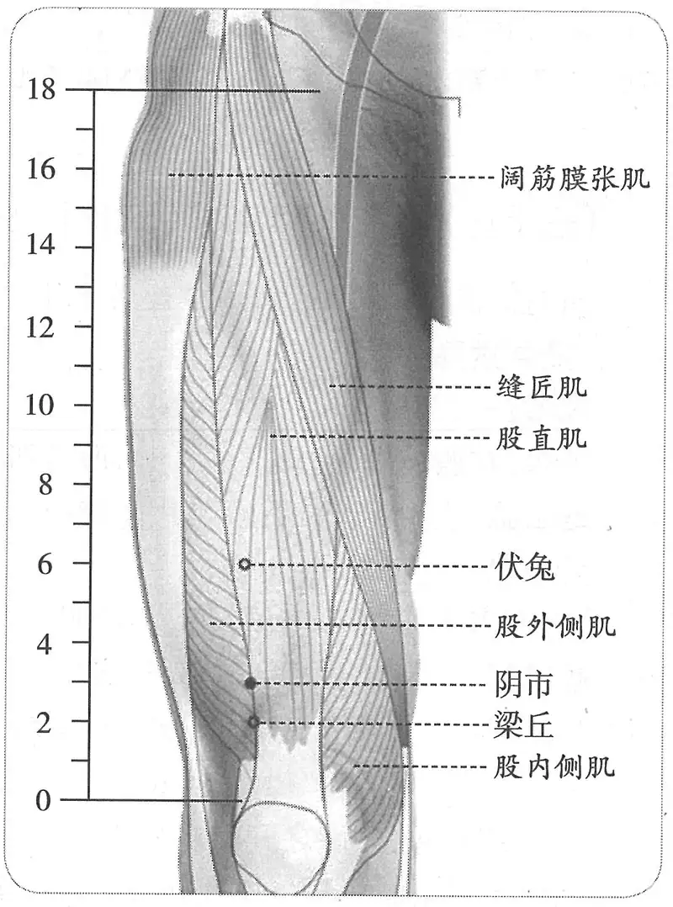

**图2-85　阴市穴图**

　　(2) 在膝上正三寸，垂手中指点穴。（《针灸玉龙经》）

　　(3) 在膝盖上三寸，垂手中指点到处是穴。（《针方六集》卷一）

　　(4)《明堂》云：在膝上当伏兔下行三寸，垂手正面点到处是。（《循经考穴编》上）

**按**：以上窦氏佚文显然将“阴市”定位与“风市”相混淆了。

　4. 统编针灸学教材

　　(1) 部位：膝上三寸。取穴：膝盖之上三寸取之，先取伏兔与膝盖上缘之中央陷中取之。（1957年南京《针灸学》）

〔p.371 (인쇄 351)〕

　　(2) 部位：膝上三寸。取穴：从伏兔与膝盖上缘之间二分之一处陷中取之。（1版《针灸学讲义》）

　　(3) 部位：在膝上三寸，伏兔下。取穴：屈膝，在膝髌上缘上三寸，当膝髌外上缘与伏兔连线之中点取之。（2版《针灸学讲义》）

　　(4) 髌骨外上缘上3寸。（4版《针灸学》）

　　(5) 在髂前上棘与髌骨外缘连线上，髌骨外上缘上3寸。（5、7版《针灸学》）

　　(6) 在大腿前面，当髂前上棘与髌底外侧端的连线上，髌底上3寸。（6版《针灸学》）

　　(7) 屈膝，在髌骨外上缘上三寸，当髌骨外上缘与髂前上棘连线上取之。（《中国针灸学》）

**文献分析**：窦太师针灸将“风市”穴取穴内容混入本穴定位中，《窦太师针经》文字非常明显，完全是风市穴取穴法文字，其他传本又根据阴市穴的定位做相应修饰，久而久之，人们竟看不出错入的痕迹，《循经考穴编》作者为此加了很长的一段按语：“按：《明堂》取阴市在膝上三寸，垂手正面点到处是，而风市亦然，且言与阴市相平。盖阴市在正面，而风市在腿外廉也。然二市既相齐，阴市上膝止三寸，中渎上膝乃五寸，则一本之序此穴在风市前，得无是欤？考诸《灵枢》、《经度》等书，自是中渎在后，其膝上五寸之说，或有误耶？宜再细考。”

#### 【类属】 

足阳明胃经穴。

足阳明脉气所发。（《黄帝明堂经》）

#### 【适应症】 

主治局部病症。常用于腰痛引膝，下肢痿痹、屈伸不利。

　1. 主寒疝，下至腹腠，膝腰痛如清水，大腹一作小腹诸疝，按之下至膝上伏兔中寒，疝痛，腹胀满，痿厥少气。（《黄帝明堂经》）

　2. 治寒疝少腹痛，胀满，腰以下伏兔上寒如注水。（《铜人腧穴针灸图经》卷下）

　3. 窦太师针灸遗存

　　(1) 治腿脚疼，泻；腰足无力，补；左瘫右痪，补。（《窦太师针经》）

　　(2) 治脚冷，膝痛不得屈伸，麻木不仁。（《琼瑶神书》）

　　(3) 主腿脚寒如冰水，酸疼无力，左瘫右痪，脚气。（《针方六集》卷五）

　　(4) 主腰腿膝胻寒，乏力，痿痹不能屈伸。如两膝麻木不仁，单泻之；湿气重，不能久立，先补后泻。（《循经考穴编》上）

　4. 统编针灸学教材

　　(1) 膝寒痿痹不仁，腰腿膝胻乏力，不能屈伸，小腹痛。（1957年南京《针灸学》、1版《针灸学讲义》）

　　(2) 腿膝麻痹，酸痛，屈伸不利，下肢不遂。（2版《针灸学讲义》、《中国针灸学》）

　　(3) 膝冷，腹胀，疝气，水肿。（4版《针灸学》）

　　(4) 腿膝痿痹，屈伸不利，疝气，腹胀腹痛。（5版《针灸学》）

　　(5) 膝关节痛，下肢伸屈不利，腰痛，下肢不遂，腹胀，腹痛。（6版《针灸学》）

　　(6) 下肢痿痹，膝关节屈伸不利；疝气。（7版《针灸学》）

**文献分析**：本穴主治，古今文献记载一致，均集中于腰腿膝部病症。

#### 附：临床应用举例 

　1. 腰腿病症

　　(1) 大抵脚腕痛，昆仑解愈；股膝疼，阴市能医。（《通玄指要赋》）

　　(2) 膝疼无力腿如瘫，穴法由来风市间，更兼阴市奇穴妙，纵步能行任往还。（《针灸玉龙歌》）

〔p.372 (인쇄 352)〕

　　(3) 癸酉秋，大理李义河翁患两腿痛十余载，诸药不能奏效，相公推予治之，诊其脉滑浮，风湿入于筋骨，岂药力能愈，须针可痊。即取风市、阴市等穴针之。官至工部尚书，病不再发。（《针灸大成》卷九）

　2. 大腹，灸阴市，随年壮。（《千金翼方》卷二十八）

　3. 心疼手颤针少海，少泽应除心下寒。两足拘挛觅阴市，五般腰痛委中安。（《灵光赋》）

　4. 心疼手颤少海间，若要除根觅阴市。（《席弘赋》）

**按**：据《灵光赋》，此处《席弘赋》文字有误。

#### 【操作】 

直刺1~1.5寸。

　1. 刺入三分，留七呼，灸三壮。（《黄帝明堂经》）

　2. 刺入三分，留七呼，禁不可灸。（《针灸甲乙经》卷三）

　3. 灸五壮。（《太平圣惠方·明堂》）

　4. 针入三分，不可灸。（《铜人腧穴针灸图经》卷下）

　5. 针入五分，灸五十壮。（《窦太师针经》）

　6. 针三分，禁灸。《内经》云可灸三壮。（《针灸十四经穴位考订》）

　7. 统编针灸学教材

　　(1) 针三至五分，灸三至五壮。（1957年南京《针灸学》、1版《针灸学讲义》）

　　(2) 直刺6~10分，艾条灸3~7分钟。（2版《针灸学讲义》）

　　(3) 直刺1~1.5寸。（4、5、6、7版《针灸学》）

　　(4) 直刺0.7~1.0寸；可灸。（《中国针灸学》）

### （三十四）梁丘 Liángqiū ST34 出《黄帝明堂经》 

问题1：本穴与鹤顶穴究竟是什么关系？

问题2：鹤顶穴出自何时？

#### 【提要索隐】 

**部位**：在股前外侧，髌底上2寸，股外侧肌与股直肌肌腱之间。

**国标修订**：1990年版国标：屈膝，在大腿前面，当髂前上棘与髌底外侧端的连线上，髌底上2寸。2006年修订版：在股前区，髌底上2寸，股外侧肌与股直肌肌腱之间。

**按**：《黄帝明堂经》已明言本穴在“两筋间”，故2006年版国标直接以解剖标志定位。

**适应症**：主治乳房、下肢病症。常用于乳痈，乳痛；膝肿痛，下肢不遂；胃脘痛。

**针刺操作**：直刺1~1.2寸。

#### 【名实考】 

窦太师针灸书中本穴定位、主治及刺法均与奇穴鹤顶相混，遂谓本穴“一名鹤顶”。以往由于对奇穴的源流失于详考，多以为奇穴鹤顶出自《勉学堂针灸集成》一书，大误。至明代杨继洲又将奇穴“髋骨”与经穴梁丘相混，今人不察，于梁丘穴下又增别名“胯骨”。

　1. 梁丘，足阳明郄，在膝上二寸两筋间。（《黄帝明堂经》）

　2. 梁丘二穴，即鹤顶。在膝盖上两筋间陷中。又法在膝盖上二寸。针入五分，灸二七壮。治鹤膝风，膝头风红肿，泻；膝头屈曲不伸，筋紧难开，泻补，宜三棱针出血。（《窦太师针经》甲抄本）

〔p.373 (인쇄 353)〕

　3. 梁丘二穴，在膝盖上二寸。治鹤膝风，两膝红肿，大痛。直针入半寸，灸七壮。脚气，俱弹针出血为妙。（《窦太师针经》乙抄本）

　4. 鹤顶二穴，在膝上陷中。禁刺，灸二七壮。治风湿，腿脚膝腰疼痛，步履艰难，先泻后补。（《窦太师针经》乙抄本）

　5. 梁丘二穴，时名鹤顶穴。在膝盖上两筋间陷中，去膝盖二寸。足阳明郄。《针经》刺入三分，灸三壮。治鹤膝风，膝头红肿，冷痹伸屈不得，筋紧难开。窦氏针入五分，灸二七壮。一方云宜三棱针出血。（《针方六集》卷一）

　6. ［怪穴］两足瘫痪，两腿无力，鹤顶在膝盖骨尖上，灸七壮。（《医学纲目》卷二十八）

　7. 两膝红肿疼痛，名曰鹤膝风，膝关二穴、行间二穴、鹤顶二穴、阳陵泉二穴。（《针灸大全》卷四）

　8. 鹤膝风，在膝内股当膝肿疼，甚者见青筋，引足心痛是也。当灸三阴交七壮，甚则二七壮待膝伸直为住再甚则当膝顶灸七壮。脚气亦灸此穴。愚按：针灸经云三阴交二穴在内踝上三寸骨下陷中；膝顶诸书无载盖秘法也。（《痈疽神妙灸经》）

　9. 梁丘穴在膝上二寸两筋间。广注屈膝取之，在膝盖骨上尽处陷中。曰膝盖骨尽处，是连膝盖骨尽处也。若阴市、伏兔则除膝盖骨矣。（《循经考穴编》上）

　10. 此穴在膝之后，膝之骨在其前，而股之骨又屹其两旁，有丘之象焉，故曰梁丘。（《经穴解》）

　11. 别名　胯骨、鹤顶。（1957年南京《针灸学》）

**文献分析**：以往对于奇穴的源流疏于考证，现代出版的奇穴专书多谓“鹤顶”穴出自清代《勉学堂针灸集成》（皆因不详此书所载奇穴乃辑自朝鲜医书），而从清以上文献可知，元代《窦太师针经》、《怪穴》（原书已佚，佚文见《医学纲目》）已详载此穴，则本穴最晚出自元代。从元代《痈疽神秘灸经》所录来看，该穴又称“膝顶”，《针灸大全》卷四所录针方多源出于窦太师针灸。而在传世的两种抄本《窦太师针经》中，“鹤顶”穴皆与经穴“梁丘”相混，从甲抄本来看，虽然于梁丘穴注有“即鹤顶”字样，但却保留了二穴各自的定位，至明代《针方六集》抄录时删去了第二个定位文字前的“又法”，从而抹去了二穴混录的痕迹。

从吴崑的注文可知，明人已将梁丘穴直接称用“鹤顶”，然而二穴的定位毕竟不同，为了消除这个矛盾，《循经考穴编》所引“广注”对梁丘定位“膝上二寸”做了特殊的解释。

从以上考证可知，传世本《窦太师针经》梁丘穴下内容多混入了“鹤顶”的内容，故这部分文献不宜作为考察梁丘穴部位、主治及刺法的依据，“鹤顶”也不应作为梁丘的别名。

至于1957年南京《针灸学》所录两别名皆有误。杨继洲注《通玄指要赋》“髋骨将腿痛以祛残”曰：“髋骨二穴，在委中上三寸，髀枢中，垂手取之。治腿足疼痛，针三分。一云：胯骨在膝髌上一寸，两筋空处是穴，刺入五分，先补后泻，其病自除。此即梁丘穴也，更治乳痈。按此两解，俱与经外奇穴不同，并存，以俟知者。”最后一句“按此两解，俱与经外奇穴不同，并存，以俟知者”并非杨氏注文，而是靳贤之注。对于《通玄指要赋》“髋骨”，《卫生宝鉴》注作“在腿砚骨上”，与环跳穴相当，故杨氏注作“髀枢中”，而元明奇穴“髋骨”皆在膝上，《针灸大成》“经外奇穴”篇辑录的“髋骨”穴也在膝上。因杨氏以“一云”的方式注明当世流传的穴法，并补注曰“此即梁丘穴也”，而靳贤见此二注与后面的“经外奇穴”载“髋骨四穴”皆不合，故在杨注之后又附注一句。然而，可以肯定的是，不论是《通玄指要赋》“髋骨”，还是元、明流传的奇穴“髋骨”，皆与梁丘穴不同。

〔p.374 (인쇄 354)〕

#### 相关穴及刺激点 

　1. 鹤顶二穴，在膝上陷中。禁刺，灸二七壮。治风湿，腿脚膝腰疼痛，步履艰难，先泻后补。（《窦太师针经》乙抄本）

　2. 鹤顶，在膝盖骨尖上。（《怪穴》，转引自《医学纲目》卷二十八）

　3. 髋骨，在膝盖上一寸，梁丘穴两旁各五分，直针半寸，灸二七壮，随病补泻。（《针灸玉龙歌》注）

**按**：《医经会元》载《针灸玉龙歌》作“梁丘穴两旁各一寸”。

　4. 髋骨四穴，在膝盖上，梁丘穴两旁各一寸半。刺入半寸，灸二七壮。治腰腿脚膝无力，先泻后补，补多；膝盖红肿，泻之。（《窦太师针经》、《奇效良方》）

#### 【定位】 

**部位**：在股前外侧，髌底上2寸，股外侧肌与股直肌肌腱之间（图2-86）。

**取穴**：令大腿肌肉绷紧，显现股直肌肌腱与股外侧肌，于两肌之间，阴市直下1寸处取穴。

　1. 《黄帝明堂经》佚文

　　(1) 膝上二寸。（《针灸甲乙经》卷三）

　　(2) 在膝上二寸两筋间。（《千金要方》卷二十九、《千金翼方》、《外台秘要》、《医心方》、《铜人腧穴针灸图经》）

　2. 在膝上三寸两筋间。（《太平圣惠方·针经》）

　3. 从阴市下行一寸两筋间。（《医宗金鉴·刺灸心法要诀》）

　4. 膝上二寸两筋间。（《针灸十四经穴位考订》）

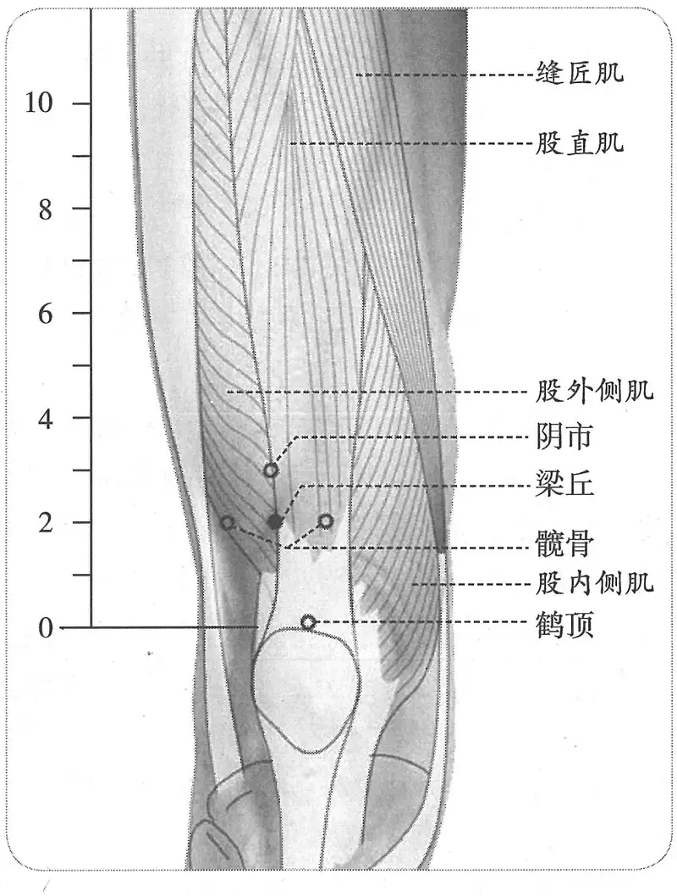

**图2-86　梁丘穴与相关穴图**

　5. 统编针灸学教材

　　(1) 部位：在膝上二寸。取穴：正坐屈膝，以膝盖上际正中向上二寸，再往外开一寸，以手按之微有凹陷处取之。（1957年南京《针灸学》）

　　(2) 部位：膝上二寸。取穴：正坐屈膝，从阴市下一寸两筋间陷中取之，下直外膝眼。（1版《针灸学讲义》）

　　(3) 部位：在膝上二寸两筋间。取穴：在阴市下一寸，当膝髌之上外缘上二寸凹陷处取之。（2版《针灸学讲义》）

　　(4) 髌骨外上缘上2寸。（4版《针灸学》）

　　(5) 在髂前上棘与髌骨外缘连线上，髌骨外上缘上2寸。（5版《针灸学》）

　　(6) 屈膝，在大腿前面，当髂前上棘与髌底外侧端连线上，髌底上2寸。（6版《针灸学》）

　　(7) 屈膝，在髂前上棘与髌骨外上缘连线上，髌骨外上缘上2寸。（7版《针灸学》）

　　(8) 屈膝，在髌骨外上缘上二寸。（《中国针灸学》）

**文献分析**：本穴定位，宋以前文献皆曰“膝上二寸”，至宋代《太平圣惠方》曰“膝上三寸”，则与阴市穴相混。而现存各传本窦太师针灸均因将梁丘与鹤顶二穴混为一穴，故将二穴定位文字抄在一起，难以自圆，《循经考穴编》更强为之解，徒增混乱。

〔p.375 (인쇄 355)〕

#### 【类属】 

足阳明胃经郄穴。

足阳明郄。（《黄帝明堂经》）

#### 【适应症】 

主治乳房、下肢病症。常用于乳痈，乳痛；膝肿痛，下肢不遂；胃脘痛。

　1. 大惊，乳痛；胫苕苕一本作苦痹，膝不能屈伸，不可以行。（《黄帝明堂经》）

　2. 治冷痹。（《太平圣惠方·针经》）

　3. 治大惊，乳痛，寒痹膝不能屈伸。（《铜人腧穴针灸图经》卷下）

　4. 统编针灸学教材

　　(1) 膝痛，鹤膝风，腰脚痛，冷痹不仁，乳肿痛。（1957年南京《针灸学》）

　　(2) 膝痛，鹤膝风，腰脚痛，冷痹不仁，胃痛，乳肿痛。（1版《针灸学讲义》）

　　(3) 膝肿痛，下肢不遂，胃痛，乳痈。（2版《针灸学讲义》、《中国针灸学》）

　　(4) 膝胫痹痛，胃痛，乳痈。（4版《针灸学》）

　　(5) 膝肿痛，下肢不遂，胃痛，乳痈，血尿。（5版《针灸学》）

　　(6) 胃痛，膝关节肿痛，伸屈不利，乳痈。（6版《针灸学》）

　　(7) ①急性胃病；②膝肿痛、下肢不遂等下肢病证；③乳痈、乳痛等乳疾。（7版《针灸学》）

**文献分析**：《黄帝明堂经》载本穴主治与巨虚下廉穴的一条主治很相近：“乳痈，惊，痹，胫重，足跗不收，跟痛”。而各传本窦太师针灸所载之主治病症悉为鹤顶穴主治。教材似乎也意识到这一明显的错误，自第2版开始，不再提“鹤膝风”主治。本穴主胃痛未见于古代文献，而教材自第一版即有之，现代临床也有应用报道，今从之。

#### 附：临床应用举例 

　1. 胃肠病症

　　(1) 急腹痛：针刺梁丘穴治疗。［中国针灸，1987(3)：10］

　　(2) 急性胃脘痛：针刺梁丘和胃俞治疗。［中医杂志，1988，29(9)：675-676］

　　(3) 急性腹泻：艾灸梁丘穴治疗。［针灸临床杂志，1994，10(3)：43］

　　(4) 胃肠痉挛：取双侧梁丘穴针刺治疗。［中国针灸，2002，22(1)：41］

　2. 唇疽，灸犊鼻七壮……当灸梁丘七壮。（《痈疽神秘灸经》）

　3. 急性乳腺炎，梁丘穴、太冲穴，针灸疗法。［中国针灸，1985，5(5)：37］

　4. 疝气，梁丘穴、足三里穴、下巨虚穴针灸疗法。［四川中医，1988，6(6)：52］

　5. 肥胖症，梁丘穴、公孙穴，针刺治疗。［中医杂志：英文版，1988，8(2)：125-126］

#### 【操作】 

直刺1~1.2寸。

　1. 刺入三分，灸三壮。（《黄帝明堂经》）

　2. 针入五分。（《太平圣惠方·针经》）

　3. 针三分，灸五壮。（《针灸十四经穴位考订》）

　4. 统编针灸学教材

　　(1) 针三至五分，灸三至七壮。（1957年南京《针灸学》、1版《针灸学讲义》）

　　(2) 直刺5~7分，艾条灸3~7分钟。（2版《针灸学讲义》）

　　(3) 直刺1~1.2寸。（4、5、7版《针灸学》）

　　(4) 直刺1~1.5寸；可灸。（6版《针灸学》）

〔p.376 (인쇄 356)〕

　　(5) 直刺0.5~1.0寸。可灸。（《中国针灸学》）

　5. 直刺1~1.5寸。感应：局部酸胀，并可扩散至膝关节。灸3~5壮；温灸5~15分钟。（上海《针灸学》）

### （三十五）犊鼻 Dúbí ST35 出《素问》、《灵枢》 

问题1：犊与膝眼的关系如何？

问题2：本穴定位既与宋以前文献不同，其主治病症能否沿用宋以前文献所载之病症？

#### 【提要索隐】 

**部位**：在膝前侧，髌韧带外侧凹陷中。

**国标修订**：1990年版国标：屈膝，在膝部，髌骨与髌韧带外侧凹陷中。2006年修订版：在膝前区，髌韧带外侧凹陷中。

**按**：1990年版国标“屈膝”属取穴法内容，不应出现于描述部位的文字中。2006年版国标将取穴法内容以注文的形式表述。

**适应症**：主治局部病症。常用于膝肿痛、屈伸不利。

**针刺操作**：向后内斜刺0.5~1寸。应严格消毒，以防关节腔内感染。

#### 【名实考】 

《针灸聚英》曰：“犊鼻，膝髌下，胻骨上夹解大筋陷中，形如牛鼻，故名。”说明本穴在“大筋中”，而不是在“大筋旁”。自唐代始，本穴已有定于大筋（髌韧带）外侧者，与外膝眼穴混同。因习久难以回改，2006年版国标于经外奇穴中去除“外膝眼”穴，消除一穴二归的混乱。

　1. 犊鼻，在膝髌下，胻上夹解大筋中。足阳明脉气所发。（《黄帝明堂经》）

　2. 象形也。（《经穴解》）

#### 相关穴及刺激点 

　1. 膝目四穴，华佗云“在膝盖下两边宛宛中。《小品方》云膝内外目，各在犊鼻两旁陷者中，如猴孙眼者是也。（转引自《医心方》卷二）。

　2. 犊鼻穴，在膝盖上外角宛宛中是一云膝下。（《外台秘要》卷二十）

　3. 又若心腹气定，而两髀外连膝闷者，宜灸膝眼七炷，在膝头骨下相接处，在筋之外陷中是。（《外台秘要》卷十九）

　4. 膝关二穴，在膝盖骨下，犊鼻穴内旁陷中。横针透膝眼穴，禁针。治膝肿疼，泻。又名阴关穴。（《窦太师针经》）

　5. 膝眼二穴，在膝盖骨下，犊鼻穴外旁陷中。横针透膝关穴。治膝肿疼，泻。灸二七壮。（《窦太师针经》）

　6. 膝眼，犊鼻上两旁深陷。（元代《针灸集成》）

　7. 膝眼四穴，在膝盖骨下，犊鼻穴内外陷中。（《针方六集》卷一）

**按**：《黄帝明堂经》载犊鼻穴“在膝髌下，胻上夹解大筋中”；膝眼即“膝目”穴，出《华佗方》，“在膝盖下两边宛宛中”，可见，“犊鼻”与“膝眼”本是两个不同的穴。然早在初唐时，犊鼻穴已渐渐与外膝眼穴相混。明代《医学入门》谓犊鼻“在膝头眼外侧大筋陷中”。又《类经图翼》将《千金要方》卷七及《千金翼方》卷二十六载犊鼻定位法内容作为“一法”附于《黄帝明堂经》犊鼻穴原定位文字后，至清代官修医典《医宗金鉴》则明言“犊鼻即膝眼处也”。今则以外膝眼穴与犊鼻穴等同，原《黄帝明堂经》载之“犊鼻”穴遂名存实亡。于是今人对古医书中“犊鼻”、“膝目”同时出现的针灸方便难以理解，甚至对古代腧穴文献的描述也会莫名其妙，如“膝眼二穴，在膝盖骨下，犊鼻穴外旁陷中”（元代《窦太师针经》）；“膝眼四穴，在膝盖骨下，犊鼻穴内外陷中”（明代《针方六集》）。

〔p.377 (인쇄 357)〕

#### 【定位】 

**部位**：在膝前侧，髌韧带外侧凹陷中（图2-87）。

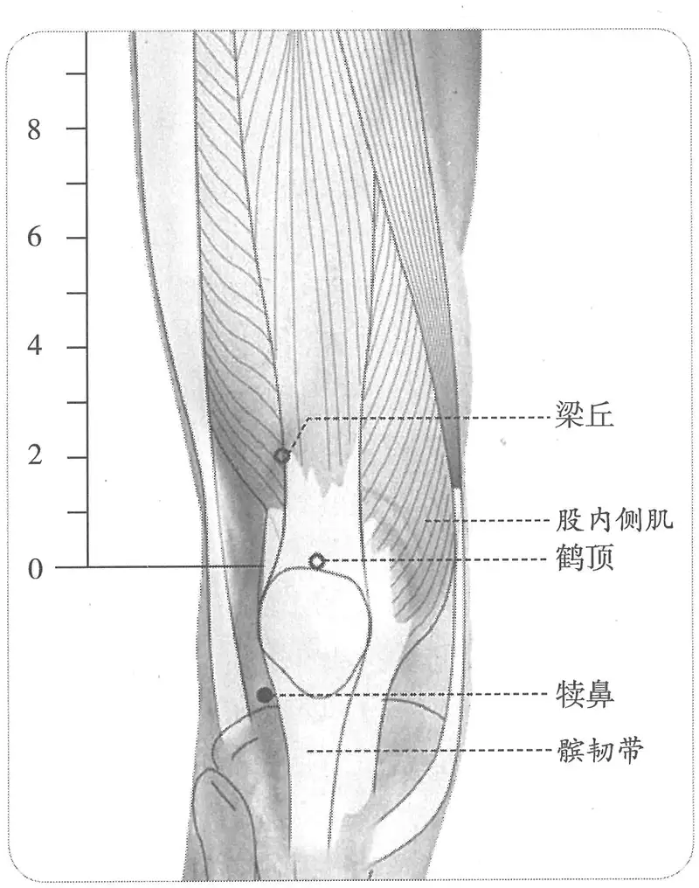 古书记载犊鼻穴位置及相关穴

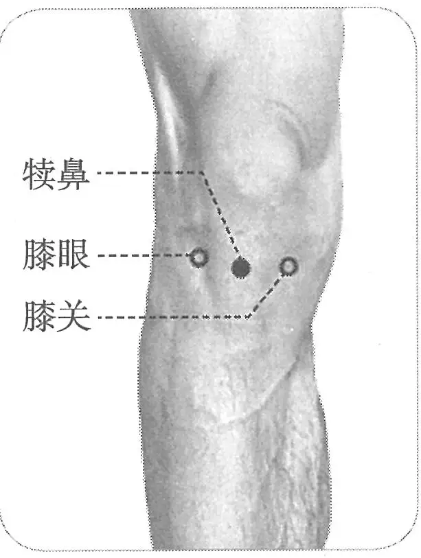

**图2-87　犊鼻穴与相关穴图**

**取穴**：屈膝，髌骨外下方的凹陷中取穴。

　1. 在膝髌下，胻上夹解大筋中。（《黄帝明堂经》、《太平圣惠方·针经》、《铜人腧穴针灸图经》卷下、《圣济总录》、《针灸资生经》、《十四经发挥》卷中、《医学纲目》、《针灸聚英》、《古今医统》、《针灸大成》、《针灸易学》）

　2. 在膝髌下，胻骨上骨解大筋中。（《铜人腧穴针灸图经》卷上）

　3. 在膝盖骨下独骨陷中央，解大筋中。（《窦太师针经》）

　4. 膝头眼外侧大筋陷中。（《医学入门》卷一）

　5. 在膝髌下胻骨上，骨解大筋陷中，形如牛鼻，故名。一曰在膝头下，近外窟解中。（《类经图翼》卷六、《循经考穴编》）

　6. 从梁丘下行过膝盖骨下，胻骨上陷中，俗名膝眼，此处陷中两旁有空状如牛鼻。在外侧者，犊鼻穴也。（《医宗金鉴·刺灸心法要诀》）

　7. 针灸方腧穴定位

　　(1) 在膝头盖骨上际外骨边平处，以手按之得节解则是。一云在膝头下近外三骨箕踵中，动脚以手按之得屈解是。（《千金要方》卷七、《千金翼方》）

　　(2) 在膝盖上外角宛宛中是也。一云膝下。（《外台秘要》卷十九、《医心方》）

　8. 髌骨下缘胫骨上陷凹中。（《针灸十四经穴位考订》）

　9. 针灸铜人及铜人图

〔p.378 (인쇄 358)〕

　　(1) 膝髌下大筋中：明正统仿宋铜人、嘉靖铜人、光绪铜人、明太医院铜人图；日本针灸铜人。

　　(2) 膝髌下大筋外：明代半跪式铜人；韩国针灸铜人。

　10. 统编针灸学教材

　　(1) 部位：膝髌外侧陷中。取穴：正坐屈膝，当外膝眼陷中取之。（1957年南京《针灸学》、1版《针灸学讲义》）

　　(2) 部位：在膝髌下胻上，夹解大筋中。取穴：屈膝成直角，当髌骨下髌韧带外侧陷中取之。（2版《针灸学讲义》）

　　(3) 髌骨下缘，髌韧带外侧凹陷中。（4、5版《针灸学》）

　　(4) 屈膝，在膝部髌骨与髌韧带外侧凹陷中。（6版《针灸学》）

　　(5) 屈膝，在髌韧带外侧凹陷中。（7版《针灸学》）

　　(6) 屈膝，在髌骨下缘，髌韧带外侧凹陷中。（《中国针灸学》）

**文献分析**：本穴定位，古代腧穴文献有二说：明以前文献多从《黄帝明堂经》说，定于“膝髌下，胻上夹解大筋中”，从传世的针灸铜人及铜人图来看，大多遵从这一定位；明代《医学入门》明确将本穴定于“膝头眼外侧大筋陷中”（即髌韧带外侧凹陷中），由于该书在古代朝鲜影响极大，故当时的针灸铜人采用了这一定位法。尽管从文献记载来看，早在唐代犊鼻穴就有定于外膝眼处者，但明确指出“犊鼻”即外膝眼穴者，为清代《医宗金鉴》。在针灸治疗文献中还记载了另一种定位法：即定于膝盖上缘外旁。从文字描述来看，似指伸膝时，膝髌上际外侧，髂胫束与股外侧肌肌腱所形成的凹陷处。这与《黄帝明堂经》定位明显不同，后世文献皆不从。

从早期的文献的记载来看，“犊鼻”与“膝眼”本是两个不同的穴。然早在初唐时，犊鼻穴已渐渐与外膝眼穴相混。但这一定位法在很长时期内并未被普遍接受，《医学入门》的说法只影响到朝鲜针灸，日本国立博物馆藏针灸铜人上“犊鼻”与“膝目”仍作为两个不同的腧穴清楚地标注。《窦太师针经》更明言“膝眼二穴，在膝盖骨下，犊鼻穴外旁陷中。横针透膝关穴。”直至清代官修医典《医宗金鉴》始明言“犊鼻即膝眼处也”。今则以外膝眼穴与犊鼻穴等同。

#### 【类属】 

足阳明胃经穴

足阳明脉气所发。（《黄帝明堂经》）

#### 【适应症】 

主治局部病症。常用于膝肿痛、屈伸不利。

　1. 主犊鼻肿，可灸。不可刺，其上坚勿攻，攻之者死。膝中痛不仁，难跪起。（《黄帝明堂经》）

　2. 治膝中痛不仁，难跪起，膝膑痈肿，溃者不可治，不溃者可疗，若犊鼻坚硬，勿便攻，先以洗熨，即微刺之愈。（《铜人腧穴针灸图经》卷下）

　3. 窦太师针灸遗存

　　(1) 治鹤膝风，膝头红肿，宜三棱针出血。（《窦太师针经》）

　　(2) 主治鹤膝风，膝头红肿，宜三棱针出血。（《针方六集》卷五）

　　(3) 治鹤膝红肿无力。（《窦太师秘传》）

**按**：窦太师针灸所载实为“膝眼”穴主治。

　4. 主脚气。（《针灸聚英》卷一、《古今医统》、《针灸大成》）

**按**：此条主治系高武从《针灸资生经》转引《千金要方》灸方主治症，原文见下文“附：临床应用举例”。

〔p.379 (인쇄 359)〕

　5. 统编针灸学教材

　　(1) 膝痛不仁，脚气。（1957年南京《针灸学》、1版《针灸学讲义》、4版《针灸学》）

　　(2) 膝痛，麻木，屈伸不利，脚气。（2版《针灸学讲义》、5版《针灸学》、《中国针灸学》）

　　(3) 膝痛，关节屈伸不利，脚气。（6版《针灸学》）

　　(4) 膝痛、屈伸不利、下肢麻痹等下肢、膝关节疾患。（7版《针灸学》）

**按**：教材中“脚气”一症见于高武《针灸聚英》，原为《千金要方》一灸方（共8穴）主治症，难以确定本穴在其中的作用，也未见现代临床应用，故暂不列入本穴主治项。

**文献分析**：由于犊鼻穴自唐代以后渐渐与外膝眼穴相混同，故宋以后文献中犊鼻穴主治既见有唐以前“犊鼻”主治，又有膝眼穴主治。今之犊鼻实即古之外膝眼，故其主治病症应据膝眼穴主治总结，古代文献（特别是宋以前者）所载之犊鼻穴主治不应再作为今之犊鼻穴主治。

传统定位的“犊鼻”虽然从教科书中消失了，但不会从实践中消失，遇到其最佳适应症——于跪立位起立时困难伴膝关节痛，有经验的针灸医生依然会选传统定位的“犊鼻”，待更多的人意识到这一点时，犊鼻穴的命运很可能像“肘髎”穴一样——死而复生，以一个新的穴名和旧有的主治症重新进入教科书。

#### 附：膝眼穴主治文献 

　1. 膝目四穴，主膝弱，疼冷，胫痛。（《医心方》卷二）

　2. 膝眼四穴，主膝冷疼，疼痛不已。禁灸。（《太平圣惠方·针经》）

　3. 膝眼二穴，在膝盖骨下，犊鼻穴外旁陷中。横针透膝关穴。治膝肿疼。（《窦太师针经》）

　4. 膝眼四穴，在膝盖骨下，犊鼻穴内外陷中。针入五分，灸七壮。治膝红肿疼痛，鹤膝风。（《针方六集》卷一）

#### 附：临床应用举例 

　1. 膝中痛，取犊鼻以员利针，发而间之。针大如牦，刺膝无疑。（《灵枢·杂病》）

　2. 凡脚气初得，脚弱，使速灸之……初灸风市，次灸伏兔，次灸犊鼻，次灸膝两眼，次灸三里，次灸上廉，次灸下廉，次灸绝骨。（《千金要方》卷七、《千金翼方》）

　3. 舍弟行一、二里路膝必酸疼不可行，须坐定，以手抚摩久之而后能行，后因多服附子而愈。予冬月膝亦酸疼，灸犊鼻而愈。（《针灸资生经》）

　4. 唇疽灸犊鼻七壮……当灸梁丘七壮。（《痈疽神秘灸经》）

　5. 犊鼻治疗风邪痛，住喘却痛昆仑俞。（《灵光赋》）

　6. 落枕，单刺犊鼻穴治疗。［四川中医，1999，17(1)：56］

#### 【操作】 

向后内斜刺0.5~1寸。应严格消毒，以防关节腔内感染。

　1. 刺入六分，灸三壮。（《黄帝明堂经》）

　2. 针入三分，灸三壮。（《太平圣惠方·针经》）

　3. 若犊鼻坚硬勿便攻，先以洗熨，即微刺之，愈。（《铜人腧穴针灸图经》卷下）

　4. 宜小微针入三分，不宜出血，不可久停针。治鹤膝风，膝头红肿，宜三棱针出血。（《窦太师针经》）

　5. 针入六分，禁灸。（《医学入门》卷一）

　6. 刺犊鼻出液为跛，又禁灸。（《针灸逢源》）

**按**：此出自《素问·刺禁论》，原文为“刺关节中液出，不得屈伸”。

　7. 统编针灸学教材

〔p.380 (인쇄 360)〕

　　(1) 针五至七分，针尖斜上刺之。（1957年南京《针灸学》）

　　(2) 针五至七分，针尖斜向对侧刺之。（1版《针灸学讲义》）

　　(3) 针略向内侧斜刺5~10分，艾条灸5~10分钟。（2版《针灸学讲义》）

　　(4) 向膝中斜刺0.5~1寸，或透刺内膝眼。（4版《针灸学》）

　　(5) 向后内斜刺0.5~1寸。（5、7版《针灸学》）

　　(6) 向后内斜刺0.8~1.5寸；可灸。（6版《针灸学》）

　　(7) 直刺0.7~1.0寸。可灸。（《中国针灸学》）

　8. ①直刺，从前向后内刺入，或从前内向后外刺入，深1.5~2寸。感应：局部发胀，有时向下扩散。②斜刺，自外膝眼对准内膝眼透刺，进针2~2.5寸。感应：局部酸胀感。（上海《针灸学》）

