# 《针灸腧穴通考》(上册) — 足阳明胃经穴 (3/3) · （三十六）足三里 Zúsānlǐ ST36 出《素问》、《灵枢》~（四十五）厉兑 Lìduì ST45 出《素问》、《灵枢》

> 분할본 8/25. 원서: 黄龙祥·黄幼民 编著, 《针灸腧穴通考——〈中华针灸穴典〉研究》(上册), 人民卫生出版社, 2011. 원서 스캔 OCR 판독본을 챗봇 검색용으로 나눈 것이며, 본문과 쪽 표시 〔p.PDF쪽 (인쇄 쪽)〕는 원본 그대로이다.

## 三、足阳明胃经穴 (계속)

### （三十六）足三里 Zúsānlǐ ST36 出《素问》、《灵枢》 

> **(36) 족삼리(足三里) Zúsānlǐ ST36 — 『소문(素問)』·『영추(靈樞)』에 처음 보임**

问题1：《内经》取足三里，为何要“低跗”？

> 문제 1: 『내경(內經)』에서 족삼리를 취할 때 왜 “저부(低跗)”를 하라고 하였는가?

问题2：所谓足三里穴“小儿忌灸，恐眼目不明，惟三十以外方可灸之”之说从何而来？

> 문제 2: 족삼리혈은 “어린아이에게는 뜸을 금한다. 눈이 밝지 않게 될까 염려되니, 오직 서른이 넘어야 뜸을 뜰 수 있다”는 설은 어디에서 나왔는가?

#### 【提要索隐】 

> **【요점 정리(提要索隱)】**

足三里穴为四总穴之一，也是《内经》中穴名、穴名解释、部位及取穴法诸项俱全的几个穴之一。

> 족삼리혈은 사총혈(四總穴)의 하나이며, 『내경』에서 혈명·혈명 풀이·부위·취혈법이 모두 갖추어진 몇 안 되는 혈 가운데 하나이기도 하다.

**穴名**：一名鬼邪。**按**：本穴名称，宋以前文献作“三里”，与手阳明经穴“三里”同名，《素问·针解》对此穴名还有专门的解释“所谓三里者，下膝三寸也”。“足三里”之名始于《太平圣惠方》卷五十五。

> **혈명**: 일명 귀사(鬼邪). **안(按)**: 이 혈의 이름은 송대 이전 문헌에서는 “삼리(三里)”로 되어 있어 수양명경(手陽明經)의 혈 “삼리”와 이름이 같다. 『소문』 「침해(鍼解)」에는 이 혈명을 따로 풀이한 “이른바 삼리란 무릎 아래 3촌이다”라는 말도 있다. “족삼리”라는 이름은 『태평성혜방(太平聖惠方)』 권55에서 시작되었다.

**部位**：在小腿前侧，犊鼻下3寸，犊鼻与解溪连线上。

> **부위**: 하퇴(下腿) 앞쪽, 독비(犢鼻) 아래 3촌, 독비와 해계(解谿)를 잇는 선 위에 있다.

**国标修订**：1990年版国标：在小腿前外侧，当犊鼻下3寸，距胫骨前缘一横指（中指）。2006年修订版：在小腿外侧，犊鼻下3寸，犊鼻与解溪连线上。

> **국가표준 개정**: 1990년판 국가표준: 하퇴 앞바깥쪽, 독비 아래 3촌, 경골(脛骨) 앞모서리에서 1횡지（가운뎃손가락） 떨어진 곳에 있다. 2006년 개정판: 하퇴 바깥쪽, 독비 아래 3촌, 독비와 해계를 잇는 선 위에 있다.

**适应症**：主治胃、脾、肠病症。用于胃脘痛，呕吐，呃逆，腹胀，腹痛，肠鸣，泄泻，便秘；发热，癫狂；乳痈，脚、膝肿痛；虚劳诸症。强壮保健要穴，并常用于保健灸。胃大部切除术、胆囊切除术、阑尾切除术等腹部手术的针麻用穴。

> **적응증**: 위(胃)·비(脾)·장(腸)의 병증을 주치한다. 위완통(胃脘痛), 구토, 애역(呃逆), 복창(腹脹), 복통, 장명(腸鳴), 설사, 변비; 발열, 전광(癲狂); 유옹(乳癰), 발·무릎이 붓고 아픔; 허로(虛勞)의 여러 증상에 쓴다. 강장 보건의 요혈(要穴)이며 보건구(保健灸)에도 흔히 쓴다. 위 대부분 절제술·담낭 절제술·충수 절제술 등 복부 수술의 침마취(鍼麻醉) 용혈이다.

**针刺操作**：直刺1~2寸。

> **자침 조작**: 직자(直刺) 1~2촌.

#### 【名实考】 

> **【이름과 실체 고증(名實考)】**

足三里，宋以前文献作“三里”，宋代作“足三里”，以与手阳明穴“三里”相区别。在《内经》中，以“一里”为“一寸”，取穴的长度、针刺的深度皆如此。足三里在膝下三寸，因名“三里”。

> 족삼리는 송대 이전 문헌에서는 “삼리”로, 송대에는 “족삼리”로 되어 있는데, 수양명의 혈 “삼리”와 구별하기 위해서이다. 『내경』에서는 “1리(一里)”를 “1촌(一寸)”으로 삼으며, 취혈의 길이와 자침의 깊이가 모두 그러하다. 족삼리는 무릎 아래 3촌에 있으므로 “삼리”라 이름하였다.

关于本穴的别名，因《灵枢·本输》有“入于下陵，下陵者，膝下三寸，胻外三里也”句，现行的针灸学教材及工具书多将“下陵”作为本穴别名。今通检《灵枢》，发现“下陵三里”多用作一词，用别名说不通，正如杨上善指出的那样，《灵枢》以膝喻陵，陵之内者为“阴陵”，膝之外者为“阳陵”，膝之下者为“下陵”，膝下三寸者则为“下陵三里”，寓意明显而连贯。这里的“下陵三里”是穴名的全称，简称既可说“下陵”，也可曰“三里”，其与“巨虚上廉”、“巨虚下廉”用例完全相同，我们可说“巨虚”，也可说“上廉”，但不可说“巨虚”是“上廉”或“下廉”的别名。又《千金要方》卷十四曰“邪病大唤骂走远，三里主之（一名鬼邪）”，从主治上分析，这里的“三里”应是指“足三里”。

> 이 혈의 별명을 보면, 『영추』 「본수(本輸)」에 “하릉(下陵)으로 들어간다. 하릉은 무릎 아래 3촌, 정강이 바깥쪽의 삼리이다”라는 구절이 있어서 현행 침구학 교재와 공구서는 대부분 “하릉”을 이 혈의 별명으로 삼는다. 이제 『영추』를 두루 살펴보니 “하릉삼리(下陵三里)”는 대개 한 낱말로 쓰여, 별명이라 하면 말이 통하지 않는다. 양상선(楊上善)이 지적한 대로 『영추』는 무릎을 언덕[陵]에 비유하여, 언덕의 안쪽을 “음릉(陰陵)”, 무릎의 바깥쪽을 “양릉(陽陵)”, 무릎의 아래를 “하릉”, 무릎 아래 3촌을 “하릉삼리”라 하였으니, 뜻이 분명하고 일관된다. 여기서 “하릉삼리”는 혈명의 온전한 이름이고, 줄여서 “하릉”이라고도 “삼리”라고도 할 수 있다. 이는 “거허상렴(巨虛上廉)”·“거허하렴(巨虛下廉)”의 용례와 완전히 같아서, “거허”라고도 “상렴”이라고도 할 수 있지만 “거허”가 “상렴”이나 “하렴”의 별명이라고 할 수는 없다. 또 『천금요방(千金要方)』 권14에 “사병(邪病)으로 크게 소리 지르고 욕하며 멀리 달아나는 데는 삼리가 주치한다（일명 귀사）”라 하였는데, 주치로 분석해 보면 여기의 “삼리”는 “족삼리”를 가리킬 것이다.

关于本穴的定位，《黄帝明堂经》作“膝下三寸”，即髌尖下三寸，唐代王冰则置换为“犊鼻下三寸”。有一点需要注意的是，犊鼻穴的现代定位与髌尖的水平高度几乎相同，因而这种置换是等值的。而唐以前的犊鼻穴定位在髌尖直下方，稍低于髌尖，因此王执中从这个角度说“膝下三寸”与“犊鼻下三寸”不等高。

> 이 혈의 위치를 보면, 『황제명당경(黃帝明堂經)』은 “무릎 아래 3촌”, 곧 슬개골 끝[髕尖] 아래 3촌이라 하였는데, 당대(唐代)의 왕빙(王冰)은 이를 “독비 아래 3촌”으로 바꾸었다. 주의할 점이 하나 있다. 독비혈의 현대 위치는 슬개골 끝과 높이가 거의 같으므로 이렇게 바꾸어도 값이 같다. 그러나 당대 이전의 독비혈은 슬개골 끝 바로 아래, 슬개골 끝보다 조금 낮은 곳에 있었으므로, 왕집중(王執中)은 이런 관점에서 “무릎 아래 3촌”과 “독비 아래 3촌”은 높이가 같지 않다고 하였다.

〔p.381 (인쇄 361)〕

关于本穴的取穴法，见于《灵枢》，关于这种取穴法，《素问》还有具体的解释，这些内容都不见于后来的《黄帝明堂经》。这提示，在汉以前关于腧穴的定位，除有部位的描述外，还有取穴法的描述，这两种内容可能在不同的文献中描述，而记载取穴法的文献大多没能传世，或者说主要通过“口耳相传”的方式流传。

> 이 혈의 취혈법은 『영추』에 보이며, 이 취혈법은 『소문』에 구체적인 풀이도 있는데, 이 내용들은 모두 뒷날의 『황제명당경』에는 보이지 않는다. 이는 한대(漢代) 이전에 수혈(腧穴)의 위치를 정할 때 부위의 묘사 말고도 취혈법의 묘사가 있었고, 이 두 가지 내용이 서로 다른 문헌에 기술되었을 수 있으며, 취혈법을 기록한 문헌은 대부분 전해지지 못했거나, 주로 “입에서 귀로 전하는[口耳相傳]” 방식으로 전해졌음을 시사한다.

关于本穴的取穴方法，《灵枢》记作“低跗”，《素问》的解释为“举膝”。这里的“低跗”是指足背伸，与“举膝”、“举足”、“拱足”、“跷足”的意义相同。在足背伸的状态下，足三里穴外呈现一明显的沟形凹陷，即所谓“举膝分易见也”。

> 이 혈의 취혈 방법은 『영추』에 “저부”로 기록되어 있고, 『소문』은 이를 “무릎을 든다[擧膝]”로 풀이하였다. 여기서 “저부”는 발등을 젖히는 것[足背伸]을 가리키며, “거슬(擧膝)”·“거족(擧足)”·“공족(拱足)”·“교족(蹺足)”과 뜻이 같다. 발등을 젖힌 상태에서는 족삼리혈 바깥쪽에 뚜렷한 고랑 모양의 함몰이 나타나니, 이른바 “무릎을 들면 갈라진 곳이 쉽게 보인다[擧膝分易見也]”는 것이다.

　1. 入于下陵，下陵者，膝下三寸，胻外三里也，为合。杨上善注曰：人膝如陵，陵下三寸，一寸为一里也。（《黄帝内经太素·本输》）

> 1. 하릉으로 들어가니, 하릉은 무릎 아래 3촌, 정강이 바깥쪽의 삼리이며, 합혈(合穴)이 된다. 양상선의 주: 사람의 무릎은 언덕과 같으니, 언덕 아래 3촌이며, 1촌을 1리로 삼는다. （『황제내경태소(黃帝內經太素)』 「본수」）

　2. 黄帝曰：取之有数乎？岐伯曰：取天容者，无过一里而止。杨上善注曰：一里，一寸也。故《明堂》刺天容深一寸也。（《黄帝内经太素·五节刺》）

> 2. 황제가 말하였다. “취하는 데 정해진 법도가 있는가?” 기백이 말하였다. “천용(天容)을 취할 때는 1리를 넘지 않고 그친다.” 양상선의 주: 1리는 1촌이다. 그러므로 『명당(明堂)』에서 천용을 1촌 깊이로 찌른다고 한 것이다. （『황제내경태소』 「오절자(五節刺)」）

　3. 岐伯答曰：取之三里者，低跗。（《灵枢·邪气藏府病形》）

> 3. 기백이 답하였다. “삼리를 취할 때는 발등을 낮춘다[低跗].” （『영추』 「사기장부병형(邪氣藏府病形)」）

　4. 所谓三里者，下膝三寸也。所谓跗之者，举膝分易见也。（《素问·针解》）

> 4. 이른바 삼리란 무릎 아래 3촌이다. 이른바 발등을 그렇게 한다[跗之]는 것은 무릎을 들면 갈라진 곳이 쉽게 보인다는 것이다. （『소문』 「침해」）

　5. 巨虚上下廉四穴，王冰注曰：上廉，足阳明与大肠合也，在膝犊鼻下胻外廉同身寸之六寸，足阳明脉气所发，刺可入同身寸之八分，若灸者可灸三壮。下廉，足阳明与小肠合也，在上廉下同身寸之三寸，足阳明脉气所发，刺可入同身寸之三分，若灸者可灸三壮。新校正云：按《甲乙经》并《刺热》注、《水热穴》注“上廉”在“三里下三寸”，此云“犊鼻下六寸”者，盖“三里”在犊鼻下三寸，上廉又在三里下三寸，故云六寸也。（《素问·气穴论》注）

> 5. 거허상하렴(巨虛上下廉) 네 혈. 왕빙의 주: 상렴은 족양명이 대장과 합하는 곳으로, 무릎의 독비 아래 정강이 바깥 모서리 동신촌(同身寸) 6촌에 있으며, 족양명맥의 기가 나오는 곳이다. 자침은 동신촌 8푼 들어갈 수 있고, 뜸을 뜬다면 3장 뜰 수 있다. 하렴은 족양명이 소장과 합하는 곳으로, 상렴 아래 동신촌 3촌에 있으며, 족양명맥의 기가 나오는 곳이다. 자침은 동신촌 3푼 들어갈 수 있고, 뜸을 뜬다면 3장 뜰 수 있다. 신교정(新校正)에서 말하였다. 살펴보건대 『갑을경(甲乙經)』과 「자열(刺熱)」 주, 「수열혈(水熱穴)」 주에는 “상렴”이 “삼리 아래 3촌”에 있다고 하였는데, 여기서 “독비 아래 6촌”이라 한 것은 “삼리”가 독비 아래 3촌에 있고 상렴은 또 삼리 아래 3촌에 있으므로 6촌이라 한 것이다. （『소문』 「기혈론(氣穴論)」 주）

**按**：需要注意的是，此处“犊鼻”非今之犊鼻。

> **안(按)**: 주의할 것은, 여기의 “독비”가 오늘날의 독비가 아니라는 점이다.

　6. 入于三里，三里者，土也。在膝下三寸，胻外廉，足阳明脉气所入也，为合。（《黄帝明堂经》）

> 6. 삼리로 들어가니, 삼리는 토(土)이다. 무릎 아래 3촌, 정강이 바깥 모서리에 있으며, 족양명맥의 기가 들어가는 곳으로 합혈이 된다. （『황제명당경』）

　7. 足阳明之所入，三里穴。在膝下三寸，胻骨外廉两筋间，足阳明之所合。（《素问亡篇·刺法论》）

> 7. 족양명이 들어가는 곳은 삼리혈이다. 무릎 아래 3촌, 정강이뼈 바깥 모서리 두 힘줄 사이에 있으며, 족양명이 합하는 곳이다. （『소문』 망편(亡篇) 「자법론(刺法論)」）

　8. 三里在犊鼻下三寸，则是犊鼻之下三寸方是三里，不可便从膝头下去三寸为三里穴也。若如今人之取穴，恐失之太高矣。（《针灸资生经》卷一）

> 8. 삼리는 독비 아래 3촌에 있으니, 독비 아래 3촌이라야 삼리이며, 무릎 머리에서 곧바로 3촌 내려간 곳을 삼리혈로 삼아서는 안 된다. 요즘 사람들처럼 취혈하면 너무 높게 잡는 잘못을 범할까 염려된다. （『침구자생경(鍼灸資生經)』 권1）

　9. 穴名三里者，言胃之经，自厉兑而上行，至其所入为合土。胃者，土也，合穴亦土也，里所以记土之远近者也，以其离井至远，故曰三里。（《经穴解》）

> 9. 혈명을 삼리라 한 것은, 위경(胃經)이 여태(厲兌)에서부터 위로 올라가 들어가는 곳에 이르러 합토(合土)가 됨을 말한다. 위는 토이고 합혈도 토이며, 리(里)는 땅의 멀고 가까움을 적는 단위이다. 정혈(井穴)에서 매우 멀리 떨어져 있으므로 삼리라 하였다. （『경혈해(經穴解)』）

　10. 别名　下三里。（1957年南京《针灸学》）

> 10. 별명 하삼리(下三里). （1957년 난징(南京) 『침구학[鍼灸學]』）

**按**：此引自日本针灸教材。日本教材将足三里穴称作“下三里”，手三里穴作“上三里”。在日本，也将足三里俗称作“上三里”，将三阴交穴俗称为“下三里”。

> **안(按)**: 이것은 일본 침구 교재에서 인용한 것이다. 일본 교재는 족삼리혈을 “하삼리”, 수삼리혈(手三里穴)을 “상삼리(上三里)”라 한다. 일본에서는 또 족삼리를 속칭 “상삼리”라 하고, 삼음교혈(三陰交穴)을 속칭 “하삼리”라 하기도 한다.

#### 足三里穴“小儿忌灸”说考 

> **족삼리혈 “어린아이 뜸 금기”설 고증(足三里穴“小兒忌灸”說考)**

　1. 人年三十以上，若灸头不灸三里穴，令人气上眼暗，所以三里下气也。（《千金翼方·针灸》卷二十八）

> 1. 서른 살 이상인 사람이 머리에 뜸을 뜨고 삼리혈에 뜸을 뜨지 않으면 기가 위로 올라 눈이 어두워지니, 삼리가 기를 내리기 때문이다. （『천금익방(千金翼方)』 「침구(鍼灸)」 권28）

　2. 人年三十以上，若不灸三里，令人气上眼暗，所以三里下气也。出第二十七卷中。（《外台秘要·明堂》卷三十九）

> 2. 서른 살 이상인 사람이 삼리에 뜸을 뜨지 않으면 기가 위로 올라 눈이 어두워지니, 삼리가 기를 내리기 때문이다. 제27권에 나온다. （『외대비요(外臺秘要)』 「명당(明堂)」 권39）

　3. 人过三旬后，针灸眼能宽。（《针灸玉龙经·天星十一穴三里》）

> 3. 사람이 서른을 넘긴 뒤에는 침과 뜸으로 눈이 트일 수 있다. （『침구옥룡경(鍼灸玉龍經)』 「천성십일혈 삼리(天星十一穴三里)」）

　4. 三里，凡人年三十以上，不灸此穴则热气上冲，眼目无明。（《窦太师针经》）

> 4. 삼리. 대체로 사람이 서른 살 이상인데 이 혈에 뜸을 뜨지 않으면 열기가 위로 치받아 눈이 밝지 않게 된다. （『두태사침경(竇太師鍼經)』）

〔p.382 (인쇄 362)〕

　5. 《外台》云凡人过三十以上，能灸此穴，则热气下，眼目增明。（《针方六集》卷五）

> 5. 『외대(外臺)』에 이르기를, 대체로 사람이 서른을 넘어 이 혈에 뜸을 뜰 수 있으면 열기가 내려가 눈이 더 밝아진다고 하였다. （『침방육집(鍼方六集)』 권5）

　6. 一云小儿忌灸三里，三十外方可灸，不尔反生疾……《外台·明堂》云：人年三十以外，若不灸三里，令气上冲目，使眼无光，盖以三里能下气也。（《类经图翼》卷六）

> 6. 일설에 어린아이는 삼리에 뜸을 금하고 서른이 넘어야 뜸을 뜰 수 있으며, 그렇지 않으면 도리어 병이 생긴다고 한다…… 『외대』 「명당」에서 말하였다. 서른 살이 넘은 사람이 삼리에 뜸을 뜨지 않으면 기가 위로 눈에 치받아 눈에 빛이 없게 되니, 대개 삼리가 기를 내릴 수 있기 때문이다. （『유경도익(類經圖翼)』 권6）

　7. 《外台秘要》云人年三十以后，宜灸三里，令气上冲，可无失明之患。故云“人过三旬后，针灸眼重光”。（《循经考穴编》上）

> 7. 『외대비요』에 이르기를, 서른 살 이후에는 삼리에 뜸을 떠야 하니, 기가 위로 치받게 하여 실명할 걱정이 없게 한다고 하였다. 그러므로 “사람이 서른을 넘긴 뒤에는 침과 뜸으로 눈이 다시 밝아진다”고 하였다. （『순경고혈편(循經考穴編)』 상）

　8. 小儿忌灸，恐眼目不明，惟三十以外方可灸之，令眼目光明也。（《医宗金鉴·刺灸心法要诀》）

> 8. 어린아이는 뜸을 금하니, 눈이 밝지 않게 될까 염려되기 때문이다. 오직 서른이 넘어야 뜸을 뜰 수 있으며, 그러면 눈이 밝아진다. （『의종금감(醫宗金鑑)』 「자구심법요결(刺灸心法要訣)」）

由于传世本《外台秘要》录《千金翼方》此条原文时，于“不灸三里穴”前脱漏了“灸头”两个关键字，而大失原文本义。唐以后这句话的引用频率非常高，但无一书是直接引自《千金翼方》或甄权针灸书，而皆直接或间接转引自《外台秘要》卷三十九。宋以后更是越传越离谱，如果说清以前各书的引文与《千金翼方》原文之义多少还有点沾边的话，那么经过清代《医宗金鉴·刺灸心法要诀》一书的发挥，已与原文之义风马牛不相及。

> 전해 오는 『외대비요』가 『천금익방』의 이 조문 원문을 옮겨 실을 때 “삼리혈에 뜸을 뜨지 않으면[不灸三里穴]” 앞에서 “머리에 뜸을 뜨고[灸頭]”라는 결정적인 두 글자를 빠뜨려 원문의 본뜻을 크게 잃었다. 당대 이후 이 말은 매우 자주 인용되었지만, 『천금익방』이나 견권(甄權)의 침구서에서 직접 인용한 책은 하나도 없고, 모두 『외대비요』 권39에서 직접 또는 간접으로 옮겨 인용하였다. 송대 이후로는 전해질수록 더욱 터무니없어져서, 청대 이전 여러 책의 인용문이 『천금익방』 원문의 뜻과 그나마 조금 닿아 있었다고 한다면, 청대 『의종금감』 「자구심법요결」의 부연을 거친 뒤로는 원문의 뜻과 전혀 상관없게 되었다.

#### 【定位】 

> **【위치(定位)】**

**部位**：在小腿前侧，犊鼻下3寸，犊鼻与解溪连线上（图2-88）。

> **부위**: 하퇴 앞쪽, 독비 아래 3촌, 독비와 해계를 잇는 선 위에 있다（그림 2-88）.

**取穴**：垂膝正坐，或仰卧，犊鼻下3寸，在胫骨前肌上取之。

> **취혈**: 무릎을 늘어뜨리고 바로 앉거나 반듯이 누워, 독비 아래 3촌, 전경골근(前脛骨筋) 위에서 취한다.

　1. 在膝下三寸，胻外廉

> 1. 무릎 아래 3촌, 정강이 바깥 모서리에 있다

　　(1) 所谓三里者，下膝三寸也。（《素问·针解》、《千金翼方》）

> (1) 이른바 삼리란 무릎 아래 3촌이다. （『소문』 「침해」, 『천금익방』）

　　(2) 下陵膝下三寸，胻骨外三里也。（《灵枢·本输》、《黄帝内经太素》）

> (2) 하릉은 무릎 아래 3촌, 정강이뼈 바깥쪽의 삼리이다. （『영추』 「본수」, 『황제내경태소』）

　　(3) 取之三里者，低跗。（《灵枢·邪气藏府病形》）

> (3) 삼리를 취할 때는 발등을 낮춘다[低跗]. （『영추』 「사기장부병형」）

　　(4) 在膝下三寸，胻外廉。（《黄帝明堂经》、《医宗金鉴·刺灸心法要诀》）

> (4) 무릎 아래 3촌, 정강이 바깥 모서리에 있다. （『황제명당경』, 『의종금감』 「자구심법요결」）

　　(5) 在膝下三寸，脚外廉陷者宛宛中。（《太平圣惠方》卷五十五）

> (5) 무릎 아래 3촌, 다리 바깥 모서리의 오목하게 들어간 가운데에 있다. （『태평성혜방』 권55）

　　(6) 在膝下三寸，胻骨外，大筋内，筋骨之间陷者宛宛中。（《太平圣惠方·明堂》）

> (6) 무릎 아래 3촌, 정강이뼈 바깥, 큰 힘줄 안쪽, 힘줄과 뼈 사이의 오목하게 들어간 가운데에 있다. （『태평성혜방』 「명당」）

　　(7) 膝下三寸，胻外廉陷者宛宛中。（《太平圣惠方·针经》）

> (7) 무릎 아래 3촌, 정강이 바깥 모서리의 오목하게 들어간 가운데. （『태평성혜방』 「침경(鍼經)」）

　　(8) 在膝眼下三寸。（《铜人腧穴针灸图经》卷下“穴腧都数”、《针灸聚英》、《医学入门》

> (8) 슬안(膝眼) 아래 3촌에 있다. （『동인수혈침구도경(銅人腧穴鍼灸圖經)』 권하 「혈수도수(穴腧都數)」, 『침구취영(鍼灸聚英)』, 『의학입문(醫學入門)』

　2. 在膝下三寸，胻外廉两筋肉间

> 2. 무릎 아래 3촌, 정강이 바깥 모서리 두 근육 사이에 있다

　　(1) 在膝下三寸，胻外两筋肉分间。极重按之，则足跗上动脉止矣。（《素问·针解》王冰注、《针经摘英集》、《针灸聚英》、《古今医统》、《针灸大成》、《针灸易学》）

> (1) 무릎 아래 3촌, 정강이 바깥 두 근육이 갈라지는 사이에 있다. 아주 세게 누르면 발등 위의 동맥 박동이 멎는다. （『소문』 「침해」 왕빙 주, 『침경적영집(鍼經摘英集)』, 『침구취영』, 『고금의통(古今醫統)』, 『침구대성(鍼灸大成)』, 『침구역학(鍼灸易學)』）

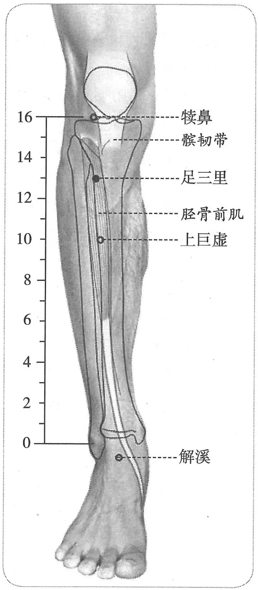

**图2-88　足三里穴图**

> **그림 2-88** 족삼리혈 그림

**按**：动脉的触诊点一般位于体表表浅部，特别是骨面，而髌骨外下方有很厚的胫骨前肌覆盖，不可能触及胫前动脉。但中国古代医家却独辟蹊径，通过从上部按压深部的动脉，来观察下部表浅处的动脉搏动变化，用以检验这两处是否位于同一条脉的体表投影线。通过这样的实验，古人推导出膝前外侧的足三里与悬钟、冲阳等穴均位于同一条脉的表面。

> **안(按)**: 동맥을 촉진하는 자리는 대개 체표의 얕은 곳, 특히 뼈 표면에 있는데, 슬개골 바깥 아래쪽은 두꺼운 전경골근이 덮고 있어 전경골동맥(前脛骨動脈)을 만질 수 없다. 그런데 중국 고대 의가들은 독자적인 길을 열었다. 위쪽에서 깊은 곳의 동맥을 눌러 아래쪽 얕은 곳의 동맥 박동 변화를 관찰함으로써, 이 두 곳이 같은 맥의 체표 투영선 위에 있는지를 검증한 것이다. 이러한 실험을 통해 옛사람들은 무릎 앞바깥쪽의 족삼리가 현종(懸鐘)·충양(衝陽) 등의 혈과 모두 같은 맥의 표면에 있다고 추론해 냈다.

〔p.383 (인쇄 363)〕

　　(2) 在膝下三寸，胻外廉两筋间，当举足取之。（《铜人腧穴针灸图经》卷下、《圣济总录》）

> (2) 무릎 아래 3촌, 정강이 바깥 모서리 두 힘줄 사이에 있으며, 발을 들고 취해야 한다. （『동인수혈침구도경』 권하, 『성제총록(聖濟總錄)』）

　　(3)《铜人》云：在膝下三寸。《明堂》、《素问》注皆同。人多不能求其穴，每以大拇指次指圈其膝盖，以中指住处为穴。或以最小指住处为穴，皆不得真穴所在也。予按：《明堂》有膝眼四穴，盖在膝头骨下两旁陷中也。又按：《铜人》等经有犊鼻穴，盖在膝膑下胻夹罅大筋中也。又按：《铜人》有膝关二穴，盖在犊鼻下二寸陷中也。而新校正《素问》注：巨虚上廉，云：三里在犊鼻下三寸，则是犊鼻之下三寸方是三里，不可便从膝头下去三寸为三里穴也。若如今人之取穴，恐失之太高也。（《针灸资生经》卷一）

> (3) 『동인(銅人)』에서 말하였다. 무릎 아래 3촌에 있다. 『명당』과 『소문』 주도 모두 같다. 사람들이 대부분 그 혈을 제대로 찾지 못하여, 흔히 엄지와 검지로 무릎뼈를 둘러 감싸고 가운뎃손가락이 닿는 곳을 혈로 삼거나, 새끼손가락이 닿는 곳을 혈로 삼는데, 모두 참된 혈 자리를 얻지 못한 것이다. 내가 살펴보건대, 『명당』에는 슬안 네 혈이 있는데 무릎뼈 아래 양옆의 오목한 곳에 있다. 또 살펴보건대, 『동인』 등의 경에는 독비혈이 있는데 무릎 종지뼈 아래 정강이 틈의 큰 힘줄 가운데에 있다. 또 살펴보건대, 『동인』에는 슬관(膝關) 두 혈이 있는데 독비 아래 2촌의 오목한 곳에 있다. 그런데 신교정 『소문』 주의 거허상렴 조에서 “삼리는 독비 아래 3촌에 있다”고 하였으니, 독비 아래 3촌이라야 삼리이며, 무릎 머리에서 곧바로 3촌 내려간 곳을 삼리혈로 삼아서는 안 된다. 요즘 사람들처럼 취혈하면 너무 높게 잡는 잘못을 범할까 염려된다. （『침구자생경』 권1）

　3. 在膝下三寸，胻骨外大筋内

> 3. 무릎 아래 3촌, 정강이뼈 바깥, 큰 힘줄 안쪽에 있다

　　(1) 在膝下三寸，胻骨外、大筋内宛宛中。（《铜人腧穴针灸图经》卷上）

> (1) 무릎 아래 3촌, 정강이뼈 바깥, 큰 힘줄 안쪽의 오목한 가운데에 있다. （『동인수혈침구도경』 권상）

　　(2) 在膝下三寸，大骨外、大筋内。（《针灸玉龙歌》注）

> (2) 무릎 아래 3촌, 큰 뼈 바깥, 큰 힘줄 안쪽에 있다. （『침구옥룡가(鍼灸玉龍歌)』 주）

　　(3) 在膝下三寸，贴骨外廉。（《针灸玉龙歌》注）

> (3) 무릎 아래 3촌, 뼈에 붙은 바깥 모서리에 있다. （『침구옥룡가』 주）

　　(4) 在膝盖下三寸，胻骨间大筋内，坐而取之。（《神应经》）

> (4) 무릎뼈 아래 3촌, 정강이뼈 사이 큰 힘줄 안쪽에 있으며, 앉아서 취한다. （『신응경(神應經)』）

　　(5) 在膝眼下三寸，胻骨外、大筋内宛宛中，举足取之，极重按之则跗上动脉止矣。（《十四经发挥》、《针灸大成》、《类经图翼》、《循经考穴编》、《医宗金鉴·刺灸心法要诀》、《针灸逢源》）

> (5) 슬안 아래 3촌, 정강이뼈 바깥, 큰 힘줄 안쪽의 오목한 가운데에 있으며, 발을 들고 취한다. 아주 세게 누르면 발등 위의 동맥 박동이 멎는다. （『십사경발휘(十四經發揮)』, 『침구대성』, 『유경도익』, 『순경고혈편』, 『의종금감』 「자구심법요결」, 『침구봉원(鍼灸逢源)』）

　　(6) 犊鼻下三寸，胻骨外容手指；犊鼻下三寸胻骨外半指。（《针灸集成》）

> (6) 독비 아래 3촌, 정강이뼈 바깥으로 손가락 하나가 들어갈 만한 곳; 독비 아래 3촌, 정강이뼈 바깥 반 손가락 되는 곳. （『침구집성(鍼灸集成)』）

　4. 灸方腧穴定位

> 4. 뜸 처방서의 수혈 위치

　　(1) 以病人手指横掩下并四指名曰一夫，指至膝头骨下指中节是其穴，附胫骨外边捻之凹凹然也。（《肘后备急方》、《千金要方》、《千金翼方》）

> (1) 환자의 손가락을 가로로 덮어 네 손가락을 나란히 한 너비를 1부(一夫)라 한다. 손가락을 무릎뼈 아래에 대어 손가락 가운데 마디가 닿는 곳이 그 혈이며, 정강이뼈 바깥 가장자리에 붙여 비벼 보면 오목하게 들어가 있다. （『주후비급방(肘後備急方)』, 『천금요방』, 『천금익방』）

　　(2) 在膝头骨节下一夫附胫骨外是。一法云在膝头骨节下三寸。人有长短大小，当以病人手夫度取。（《千金要方》卷七、《千金翼方》卷二十六）

> (2) 무릎뼈 마디 아래 1부, 정강이뼈 바깥쪽에 붙은 곳이 그것이다. 일법에서는 무릎뼈 마디 아래 3촌에 있다고 한다. 사람마다 키와 몸집이 다르므로 환자의 손 너비[手夫]로 재어 취해야 한다. （『천금요방』 권7, 『천금익방』 권26）

　5. 膝眼下三寸，胫骨外约一寸筋间。（《针灸十四经穴位考订》）

> 5. 슬안 아래 3촌, 경골 바깥 약 1촌의 힘줄 사이. （『침구 십사경 혈위 고정[鍼灸十四經穴位考訂]』）

　6. 统编针灸学教材

> 6. 통편(統編) 침구학 교재

　　(1) 部位：在膝眼下三寸，胻骨外大筋内。取穴：正坐屈膝，以本人之手掌按在膝盖，指扶于膝下胫骨，当中指着处取之，适在外膝眼之下三寸，胫骨之外缘。（1957年南京《针灸学》）

> (1) 부위: 슬안 아래 3촌, 정강이뼈 바깥 큰 힘줄 안쪽에 있다. 취혈: 바로 앉아 무릎을 굽히고 자기 손바닥을 무릎뼈에 대고 손가락을 무릎 아래 경골에 붙여, 가운뎃손가락이 닿는 곳에서 취하는데, 마침 외슬안(外膝眼) 아래 3촌, 경골의 바깥 가장자리에 해당한다. （1957년 난징 『침구학』）

　　(2) 部位：膝下三寸。取穴：正坐屈膝垂足，以本人之掌按膝上，手指抚膝下垂，当中指尖端所着是穴位，相当于膝眼下三寸，胻骨旁一横指处取之。（1版《针灸学讲义》）

> (2) 부위: 무릎 아래 3촌. 취혈: 바로 앉아 무릎을 굽히고 발을 늘어뜨린 채, 자기 손바닥을 무릎 위에 대고 손가락을 무릎 아래로 늘어뜨려 가운뎃손가락 끝이 닿는 곳이 혈 자리이며, 슬안 아래 3촌, 정강이뼈 옆 1횡지 되는 곳에 해당하니 여기서 취한다. （1판 『침구학강의[鍼灸學講義]』）

　　(3) 部位：在膝下三寸，胻外廉。取穴：在犊鼻下三寸，距胫骨前嵴一横指，当胫骨前肌上。（2版《针灸学讲义》、6版《针灸学》）

> (3) 부위: 무릎 아래 3촌, 정강이 바깥 모서리에 있다. 취혈: 독비 아래 3촌, 경골 앞능선[前嵴]에서 1횡지 떨어진 곳, 전경골근 위에 있다. （2판 『침구학강의』, 6판 『침구학』）

　　(4) 犊鼻穴下3寸，胫骨前嵴外一横指处。（4、5、7版《针灸学》）

> (4) 독비혈 아래 3촌, 경골 앞능선 바깥 1횡지 되는 곳. （4·5·7판 『침구학』）

　　(5) 犊鼻下三寸，胫骨前嵴外一横指，胫骨前肌中。（《中国针灸学》）

> (5) 독비 아래 3촌, 경골 앞능선 바깥 1횡지, 전경골근 가운데. （『중국침구학[中國鍼灸學]』）

**文献分析**：本穴的纵向定位，古代文献明确作“膝下三寸”，所谓“膝下”是指膝盖骨下缘（髌尖）下。至于本穴的横向定位，《灵枢》、《黄帝明堂经》均未明确说明。唐代王冰注《素问》时谓“胻外两筋肉分间。极重按之，则足跗上动脉止”，《素问·针解》对本穴取穴法的注解“所谓跗之者，举膝分易见也”似乎也支持王冰之说。然综合小腿部其他足阳明经穴，此定位过于偏外侧；宋代《太平圣惠方》又说在“胻骨外，大筋内，筋骨之间陷者宛宛中”，定位又过于偏内侧，现代定于犊鼻与解溪连线上，胫骨前肌中，与上述第三种定位法相合。

> **문헌 분석**: 이 혈의 세로 방향 위치는 옛 문헌에 “무릎 아래 3촌”으로 분명히 되어 있는데, 이른바 “무릎 아래”란 무릎뼈 아래 모서리（슬개골 끝） 아래를 가리킨다. 가로 방향 위치는 『영추』와 『황제명당경』 모두 분명히 밝히지 않았다. 당대 왕빙은 『소문』에 주를 달면서 “정강이 바깥 두 근육이 갈라지는 사이. 아주 세게 누르면 발등 위의 동맥 박동이 멎는다”고 하였고, 『소문』 「침해」의 이 혈 취혈법 풀이 “이른바 발등을 그렇게 한다는 것은 무릎을 들면 갈라진 곳이 쉽게 보인다는 것이다”도 왕빙의 설을 뒷받침하는 듯하다. 그러나 하퇴의 다른 족양명경 혈들을 종합해 보면 이 위치는 지나치게 바깥쪽에 치우쳐 있다. 송대 『태평성혜방』은 또 “정강이뼈 바깥, 큰 힘줄 안쪽, 힘줄과 뼈 사이의 오목하게 들어간 가운데”라 하였는데, 이 위치는 또 지나치게 안쪽에 치우쳐 있다. 현대에는 독비와 해계를 잇는 선 위, 전경골근 가운데로 정하여, 위의 세 번째 위치 설정법과 합치한다.

〔p.384 (인쇄 364)〕

#### 【类属】 

> **【분류(類屬)】**

足阳明胃经穴，五输穴之合穴。

> 족양명위경(足陽明胃經)의 혈이며, 오수혈(五輸穴) 가운데 합혈이다.

　1. 入于下陵，下陵膝下三寸，胻骨外三里也，为合。（《灵枢·本输》）

> 1. 하릉으로 들어가니, 하릉은 무릎 아래 3촌, 정강이뼈 바깥의 삼리이며, 합혈이 된다. （『영추』 「본수」）

　2. 足阳明脉气所入也，为合。（《黄帝明堂经》）

> 2. 족양명맥의 기가 들어가는 곳으로, 합혈이 된다. （『황제명당경』）

　3. 足阳明之所入，三里穴。在膝下三寸，胻骨外廉两筋间，足阳明之所合。（《素问亡篇·刺法论》）

> 3. 족양명이 들어가는 곳은 삼리혈이다. 무릎 아래 3촌, 정강이뼈 바깥 모서리 두 힘줄 사이에 있으며, 족양명이 합하는 곳이다. （『소문』 망편 「자법론」）

#### 【适应症】 

> **【적응증(適應症)】**

主治胃、脾、肠病症。用于胃脘痛，呕吐，呃逆，腹胀，腹痛，肠鸣，泄泻，便秘；发热，癫狂；乳痈，脚、膝肿痛；虚劳诸症。强壮保健要穴，并常用于保健灸。胃大部切除术、胆囊切除术、阑尾切除术等腹部手术的针麻用穴。

> 위·비·장의 병증을 주치한다. 위완통, 구토, 애역, 복창, 복통, 장명, 설사, 변비; 발열, 전광; 유옹, 발·무릎이 붓고 아픔; 허로의 여러 증상에 쓴다. 강장 보건의 요혈이며 보건구에도 흔히 쓴다. 위 대부분 절제술·담낭 절제술·충수 절제술 등 복부 수술의 침마취 용혈이다.

　1. 主阳厥悽悽而寒，少腹坚，头痛，胫股腹痛，消中，小便不利，善哕。腹中寒，胀满，善噫，恶闻食臭，胃气不足，肠鸣腹痛，泄利，食不化，心下胀。热病汗不出，善呕，苦痓，身反折，口噤。喉痹不能言。阴气不足，热中，消谷善饥，腹热身烦，狂言。胸中瘀血，胸胁榰满，鬲痛，不能久立，膝痿寒。小腹胀，皮肿。乳痈有热。五脏六府胀。狂歌妄言，怒恐，恶人与火，骂詈。霍乱，遗尿矢气。善鼓颔，腰痛不可以顾，顾而有似拔者，善悲，上下取之，出血，见血立已。（《黄帝明堂经》）

> 1. 양궐(陽厥)로 으슬으슬 추운 것, 소복(少腹)이 단단한 것, 두통, 정강이·넓적다리·배의 통증, 소중(消中), 소변불리(小便不利), 잦은 딸꾹질[善噦]을 주치한다. 배 속이 차고 창만(脹滿)하며, 트림을 잘하고, 음식 냄새를 싫어하며, 위기(胃氣)가 부족하고, 장명·복통이 있으며, 설사하고 음식이 소화되지 않으며, 명치 아래가 더부룩한 것. 열병에 땀이 나지 않고, 구역질을 잘하며, 치병(痓病)으로 괴로워하여 몸이 뒤로 젖혀지고 입을 악다무는 것. 후비(喉痹)로 말을 하지 못하는 것. 음기(陰氣)가 부족하여 속에 열이 나고[熱中], 음식이 빨리 소화되어 자주 배고프며, 배가 뜨겁고 몸이 답답하며, 미친 말을 하는 것. 가슴 속의 어혈(瘀血), 가슴과 옆구리가 버티듯 그득함[榰滿], 흉격의 통증으로 오래 서 있지 못하고 무릎이 위약(痿弱)하고 찬 것. 아랫배가 창만하고 피부가 붓는 것. 유옹으로 열이 있는 것. 오장육부의 창(脹). 미친 듯 노래하고 함부로 말하며, 성내고 두려워하며, 사람과 불을 싫어하고, 욕하고 꾸짖는 것. 곽란(霍亂), 유뇨(遺尿)·방귀. 턱을 자주 덜덜 떠는 것, 허리가 아파 돌아볼 수 없고 돌아보면 뽑히는 듯한 것, 잘 슬퍼하는 것에는 위아래에서 취하여 피를 내는데, 피가 보이면 곧 낫는다. （『황제명당경』）

**按**：以上病症多见于《内经》，主要包括足阳明“是动”病（狂歌妄言，怒恐，恶人与火，骂詈）、“邪在脾胃”、“胃病”、“寒中”、“气乱于肠胃”、“腰痛”、“喉痹”等证（详见“附：临床应用举例”）。

> **안(按)**: 이상의 병증은 대부분 『내경』에 보이며, 주로 족양명의 “시동(是動)”병（미친 듯 노래하고 함부로 말하며, 성내고 두려워하며, 사람과 불을 싫어하고, 욕하고 꾸짖음）, “사기가 비위에 있음[邪在脾胃]”, “위병(胃病)”, “한중(寒中)”, “기가 장위에서 어지러움[氣亂於腸胃]”, “요통”, “후비” 등의 증을 포함한다（자세한 것은 “부: 임상 응용 예”를 보라）.

　2. 人年三十以上，若灸头不灸三里穴，令人气上眼暗，所以三里下气也。（《千金翼方·针灸》卷二十八）

> 2. 서른 살 이상인 사람이 머리에 뜸을 뜨고 삼리혈에 뜸을 뜨지 않으면 기가 위로 올라 눈이 어두워지니, 삼리가 기를 내리기 때문이다. （『천금익방』 「침구」 권28）

　3. 腹满坚块，不能食，反胃，胸胁腹积气，脚弱。针腹背，每须取三里穴。（《太平圣惠方·针经》）

> 3. 배가 그득하고 단단한 덩어리가 있는 것, 먹지 못하는 것, 반위(反胃), 가슴·옆구리·배에 기가 쌓인 것, 다리에 힘이 없는 것[脚弱]. 배와 등에 침을 놓을 때는 매번 반드시 삼리혈을 취해야 한다. （『태평성혜방』 「침경」）

　4. 脏腑久积冷气，心腹胀满。秦丞祖云诸病皆治，食气水气，虫毒癥癖，四肢肿满，腿膝酸痛，目不明。华佗云亦主五劳羸瘦，攻伤虚乏，大小人热，皆调三里。（《太平圣惠方·明堂》）

> 4. 장부에 오래 쌓인 냉기, 가슴과 배의 창만. 진승조(秦丞祖)는 모든 병을 다 치료한다고 하였으니, 식기(食氣)·수기(水氣), 충독(蟲毒)·징벽(癥癖), 사지가 붓고 그득함, 다리와 무릎이 시큰하고 아픔, 눈이 밝지 않음이다. 화타(華佗)는 오로(五勞)로 여위는 것, 공상(攻傷)으로 허핍한 것, 어른과 아이의 열도 주치하니 모두 삼리를 조절한다고 하였다. （『태평성혜방』 「명당」） 〔역주: 원서의 「攻伤」은 같은 화타 인용(「七伤虚乏」)으로 보아 「七伤」의 오식으로 보인다.〕

　5. 治胃中寒，心腹胀满，胃气不足，闻食臭，肠鸣腹痛，食不化。秦丞祖云诸病皆治，食气水气，蛊毒痃癖，四肢肿满，膝胻酸痛，目不明。华佗云：疗五劳羸瘦，七伤虚乏，胸中瘀血，乳痈。（《铜人腧穴针灸图经》卷下）

> 5. 위 속이 찬 것, 가슴과 배의 창만, 위기 부족, 음식 냄새를 맡는 것[聞食臭], 장명·복통, 음식이 소화되지 않는 것을 치료한다. 진승조는 모든 병을 다 치료한다고 하였으니, 식기·수기, 고독(蠱毒)·현벽(痃癖), 사지가 붓고 그득함, 무릎과 정강이가 시큰하고 아픔, 눈이 밝지 않음이다. 화타는 말하였다. 오로로 여위는 것, 칠상(七傷)으로 허핍한 것, 가슴 속의 어혈, 유옹을 치료한다. （『동인수혈침구도경』 권하）

　6. 窦太师针灸遗存

> 6. 두태사(竇太師)의 침구 유존(遺存)

　　(1) 治诸般证候，看证补泻。凡人年三十以上，不灸此穴，则热气上冲，眼目无明。（《窦太师针经》）

> (1) 여러 가지 증후를 치료하며, 증을 보아 보사(補瀉)한다. 대체로 사람이 서른 살 이상인데 이 혈에 뜸을 뜨지 않으면 열기가 위로 치받아 눈이 밝지 않게 된다. （『두태사침경』）

　　(2) 泻脚无力，补，余证看虚实补泻，此穴开沟渠也。人三十已上不灸，热气冲眼则可灸百壮。（《大本琼瑶神书》）

> (2) 사(瀉)하되 다리에 힘이 없으면 보(補)하고, 나머지 증은 허실을 보아 보사한다. 이 혈은 도랑을 트는 혈이다. 사람이 서른 이상인데 뜸을 뜨지 않아 열기가 눈으로 치받으면 뜸 100장을 뜰 수 있다. （『대본경요신서(大本瓊瑤神書)』）

　　(3) 治诸虚百劳病，劳嗽体倦，上虚下实，腹胀满，胃气不足，食气，水气蛊毒诸症。（《窦太师秘传》）

> (3) 온갖 허로병[諸虛百勞], 노수(勞嗽)로 몸이 나른함, 위는 허하고 아래는 실함[上虛下實], 배가 창만함, 위기 부족, 식기, 수기·고독 등의 여러 증을 치료한다. （『두태사비전(竇太師秘傳)』）

　7. 统编针灸学教材

> 7. 통편 침구학 교재

　　(1) 全身性强壮要穴，治胃寒食不化，心腹胀痛，肠鸣便秘，霍乱，中风瘫痪，口㖞，癫痫，目疾，喉痹，热病汗不出，遗尿，大便不利，膝胻酸痛。（1957年南京《针灸学》）

> (1) 전신 강장의 요혈이다. 위가 차서 음식이 소화되지 않음, 가슴과 배가 창통(脹痛)함, 장명·변비, 곽란, 중풍 탄탄(癱瘓), 구와(口喎), 전간(癲癇), 눈병, 후비, 열병에 땀이 나지 않음, 유뇨, 대변불리(大便不利), 무릎·정강이가 시큰하고 아픔을 치료한다. （1957년 난징 『침구학』）

　　(2) 胃寒食不化，胃热多食善饥，腹胀满痛，胃脘痛，肠鸣便秘，肠痛，呕吐，泄泻，中风瘫痪，口㖞，目疾，喉痹，癫痫，热病，大便不利，小便发黄，遗尿，膝胻酸痛。（1版《针灸学讲义》）

> (2) 위가 차서 음식이 소화되지 않음, 위열로 많이 먹고 자주 배고픔, 배가 창만하고 아픔, 위완통, 장명·변비, 장통(腸痛), 구토, 설사, 중풍 탄탄, 구와, 눈병, 후비, 전간, 열병, 대변불리, 소변이 누렇게 나옴, 유뇨, 무릎·정강이가 시큰하고 아픔. （1판 『침구학강의』）

〔p.385 (인쇄 365)〕

　　(3) 胃痛，腹胀，消化不良，呕吐，肠鸣，泄泻，便秘，痢疾，喘证，乳痈，头晕，癫狂，中风瘫痪，脚气，水肿，膝胫酸痛，疳疾。（2版《针灸学讲义》）

> (3) 위통, 복창, 소화불량, 구토, 장명, 설사, 변비, 이질(痢疾), 천증(喘證), 유옹, 어지럼[頭暈], 전광, 중풍 탄탄, 각기(脚氣), 수종(水腫), 무릎·정강이가 시큰하고 아픔, 감질(疳疾). （2판 『침구학강의』）

　　(4) 胃痛，腹胀，呕吐，噎膈，泄泻，痢疾，便秘，乳痈，肠痈，腰腿酸痛，水肿，癫狂，虚劳羸瘦。（4版《针灸学》）

> (4) 위통, 복창, 구토, 열격(噎膈), 설사, 이질, 변비, 유옹, 장옹(腸癰), 허리·다리가 시큰하고 아픔, 수종, 전광, 허로로 여윔[虛勞羸瘦]. （4판 『침구학』）

　　(5) 胃痛，呕吐，噎膈，腹胀，泄泻，痢疾，便秘，乳痈，肠痈，下肢痹痛，水肿，癫狂，脚气，虚劳羸瘦。（5版《针灸学》）

> (5) 위통, 구토, 열격, 복창, 설사, 이질, 변비, 유옹, 장옹, 하지 비통(痹痛), 수종, 전광, 각기, 허로로 여윔. （5판 『침구학』）

　　(6) 消化不良，脘痛胀满，呕吐，腹痛，便秘或腹泻，霍乱，瘫痪，口㖞，癫痫，目疾，喉痹，发热，遗尿，膝胻酸痛，脚气等。又为强壮保健要穴。（6版《针灸学》）

> (6) 소화불량, 위완부가 아프고 창만함, 구토, 복통, 변비 또는 설사, 곽란, 탄탄, 구와, 전간, 눈병, 후비, 발열, 유뇨, 무릎·정강이가 시큰하고 아픔, 각기 등. 또 강장 보건의 요혈이다. （6판 『침구학』）

　　(7) 胃痛，呕吐，噎膈，腹胀，泄泻，痢疾，便秘等胃肠病证；下肢痿痹证；癫狂等神志病；乳痈、肠痈等外科疾患；虚劳诸证，为强壮保健要穴。（7版《针灸学》）

> (7) 위통, 구토, 열격, 복창, 설사, 이질, 변비 등 위장 병증; 하지 위비증(痿痹證); 전광 등 신지병(神志病); 유옹·장옹 등 외과 질환; 허로의 여러 증. 강장 보건의 요혈이다. （7판 『침구학』）

　　(8) 胃痛，呕吐，呃逆，腹胀，肠鸣，泄泻，痢疾，便秘，乳痈，肠痈，膝胫酸痛，脚气，水肿，咳嗽，气喘，虚劳羸瘦，疳积，完谷不化，中风，瘫痪，头晕，失眠，癫狂。（《中国针灸学》）

> (8) 위통, 구토, 애역, 복창, 장명, 설사, 이질, 변비, 유옹, 장옹, 무릎·정강이가 시큰하고 아픔, 각기, 수종, 해수(咳嗽), 기천(氣喘), 허로로 여윔, 감적(疳積), 완곡불화(完穀不化), 중풍, 탄탄, 어지럼, 불면, 전광. （『중국침구학』）

**文献分析**：足三里为四总穴之一，临床应用范围非常广，从最早的腧穴经典《黄帝明堂经》记载的主治病症就非常复杂。而从《内经》对该穴主治特点的论述中可以清楚看出这样一个特点，即本穴作用部位皆在于胃、脾，只要是脾胃病证，不论是虚是实，是寒是热，“皆调于三里”。抓住了这个作用特点，便可以执简驭繁，灵活应用于临床。《黄帝明堂经》在《内经》的基础上又增加了治疗足阳明经病候的主治病症。另据《内经》、《黄帝明堂经》、甄权《针经》，足三里还有突出的“下气”、“除胀”作用，其中“除胀”作用可寓于调理胃肠功用中，而“下气”作用主要用作配穴，以解除其他腧穴引起的上气症状，故不单列一项。

> **문헌 분석**: 족삼리는 사총혈의 하나로 임상 응용 범위가 매우 넓어, 가장 이른 수혈 경전인 『황제명당경』에 실린 주치 병증부터 이미 매우 복잡하다. 그런데 『내경』이 이 혈의 주치 특징을 논한 대목에서 한 가지 특징을 분명히 볼 수 있다. 곧 이 혈의 작용 부위는 모두 위와 비에 있어서, 비위 병증이기만 하면 허증이든 실증이든, 한증이든 열증이든 “모두 삼리에서 조절한다[皆調於三里]”는 것이다. 이 작용 특징을 붙잡으면 간단한 것으로 복잡한 것을 다스려[執簡馭繁] 임상에 융통성 있게 응용할 수 있다. 『황제명당경』은 『내경』을 바탕으로 족양명경 병후(病候)를 치료하는 주치 병증을 더하였다. 또 『내경』·『황제명당경』·견권의 『침경(鍼經)』에 따르면 족삼리에는 두드러진 “하기(下氣)”·“제창(除脹)” 작용도 있다. 그 가운데 “제창” 작용은 위장을 조리하는 효능 속에 포함시킬 수 있고, “하기” 작용은 주로 배혈(配穴)로 써서 다른 수혈이 일으킨 상기(上氣) 증상을 없애는 데 쓰이므로, 따로 한 항목으로 세우지 않는다.

#### 附：临床应用举例 

> **부: 임상 응용 예(臨床應用擧例)**

　1. 腹部胃肠病症

> 1. 복부·위장 병증(腹部胃腸病症)

　　(1) 胃病者，腹䐜胀，胃脘当心而痛，上支两胁，膈咽不通，食饮不下，取之三里也。（《灵枢·邪气藏府病形》）

> (1) 위병(胃病)은 배가 불러 오르고[腹䐜脹] 위완(胃脘)이 명치 쪽으로 아프며, 위로 양 옆구리를 버티듯 치받고, 흉격과 인후가 막혀 음식이 내려가지 않는다. 삼리(三里)를 취한다. （『영추(靈樞)』 「사기장부병형(邪氣藏府病形)」）

　　(2) 肠中不便，取三里，盛泻之，虚补之。腹中常鸣，气上冲胸，喘不能久立，邪在大肠，刺肓之原、巨虚上廉、三里。邪在胆，逆在胃，胆液泄则口苦，胃气逆则呕苦，故曰呕胆，取三里以下胃气，逆则刺少阳血络，以闭胆逆，却调其虚实以去其邪。（《灵枢·四时气》）

> (2) 장(腸) 속이 편치 않으면 삼리를 취하되, 실하면 사하고 허하면 보한다. 배 속에서 늘 소리가 나고 기가 위로 가슴을 치받아 숨이 차서 오래 서 있지 못하는 것은 사기가 대장에 있는 것이니, 황(肓)의 원혈[肓之原]·거허상렴(巨虛上廉)·삼리를 찌른다. 사기가 담(膽)에 있고 거스름이 위(胃)에 있어, 담즙이 새면 입이 쓰고 위기(胃氣)가 거스르면 쓴 물을 토하므로 구담(嘔膽)이라 한다. 삼리를 취하여 위기를 내리고, 거스르면 소양(少陽)의 혈락(血絡)을 찔러 담의 거스름을 막은 뒤, 그 허실을 조절하여 사기를 없앤다. （『영추』 「사시기(四時氣)」）

　　(3) 小腹痛肿，不得小便，邪在三焦约，取之太阳大络，视其络脉与厥阴小络结而血者，肿上及胃脘取三里。（《灵枢·四时气》）

> (3) 아랫배가 아프고 부으며 소변을 보지 못하는 것은 사기가 삼초약(三焦約)에 있는 것이니, 태양(太陽)의 대락(大絡)을 취하고, 그 낙맥과 궐음(厥陰)의 소락(小絡)이 맺혀 피가 몰린 곳을 살펴 찌르며, 부기가 위로 위완까지 미치면 삼리를 취한다. （『영추』 「사시기」）

　　(4) 气在于肠胃者，取之足太阴、阳明，不下者取之三里。（《灵枢·五乱》）

> (4) 기가 장위(腸胃)에서 어지러운 경우에는 족태음(足太陰)·양명(陽明)을 취하고, 내려가지 않으면 삼리를 취한다. （『영추』 「오란(五亂)」）

　　(5) 邪在肝，则两胁中痛，寒中，恶血在内行善掣节时脚肿，取之行间，以引胁下，补三里以温胃中。邪在脾胃，则病肌肉痛；阳气有余，阴气不足，则热中善饥；阳气不足，阴气有余则寒中肠鸣腹痛；阴阳俱有余，若俱不足，则有寒有热，皆调于三里。（《灵枢·五邪》）

> (5) 사기가 간(肝)에 있으면 양 옆구리 속이 아프고 한중(寒中)이 되며, 악혈(惡血)이 안에 있어 걸을 때 관절이 자주 당기고 때때로 다리가 붓는다. 행간(行間)을 취하여 옆구리 아래의 사기를 끌어내리고, 삼리를 보하여 위(胃) 속을 따뜻하게 한다. 사기가 비위(脾胃)에 있으면 기육(肌肉)이 아프다. 양기가 남고 음기가 모자라면 열중(熱中)이 되어 쉽게 배고프고, 양기가 모자라고 음기가 남으면 한중이 되어 장명(腸鳴)과 복통이 있다. 음양이 모두 남거나 모두 모자라면 한(寒)도 있고 열(熱)도 있는데, 모두 삼리에서 조절한다. （『영추』 「오사(五邪)」）

　　(6) 气街、三里、巨虚、上下廉，此八者，以泻胃中之热也（《素问·水热穴论》）

> (6) 기가(氣街)·삼리·거허(巨虛) 상렴·하렴, 이 여덟 혈은 위(胃) 속의 열을 사한다. （『소문(素問)』 「수열혈론(水熱穴論)」）

　　(7) 治胃中热病，膝下三寸名三里，灸三十壮。（《千金要方》卷十六、《千金翼方》）

> (7) 위 속의 열병을 치료한다. 무릎 아래 3촌을 삼리라 하는데, 뜸 30장을 뜬다. （『천금요방(千金要方)』 권16, 『천금익방(千金翼方)』）

　　(8) 又水腹胀皮肿法，灸三里；风水灸解溪。（《外台秘要》卷二十二）

> (8) 또 수종으로 배가 불러 오르고 피부가 붓는 것[水腹脹皮腫]을 치료하는 법: 삼리에 뜸을 뜬다. 풍수(風水)에는 해계(解溪)에 뜸을 뜬다. （『외대비요(外臺秘要)』 권22）

　　(9) 治腹暴胀，按之不下，针足阳明经三里二穴。（《针经摘英集》）

> (9) 배가 갑자기 불러 올라 눌러도 꺼지지 않는 것을 치료하려면 족양명경(足陽明經) 삼리 두 혈에 침을 놓는다. （『침경적영집(鍼經摘英集)』）

　　(10) 治脾胃虚弱，心腹胀满，不思饮食肠鸣腹痛，食不化，刺足阳明经三里二穴，次针足太阴经三阴交二穴。凡刺腹痛诸俞穴，须针三里二穴，下气良。（《针经摘英集》）

> (10) 비위가 허약하여 명치와 배가 불러 오르고 그득하며, 먹고 싶은 생각이 없고 장명·복통이 있으며 음식이 소화되지 않는 것을 치료하려면 족양명경 삼리 두 혈을 찌르고, 다음으로 족태음경 삼음교(三陰交) 두 혈에 침을 놓는다. 복통에 여러 수혈(兪穴)을 찌를 때는 모두 반드시 삼리 두 혈에 침을 놓아야 하니, 기를 내리는 데 좋다. （『침경적영집』）

〔p.386 (인쇄 366)〕

　　(11) 小腹痛不可忍，针足阳明经三里二穴。（《针经摘英集》）

> (11) 아랫배가 참을 수 없이 아프면 족양명경 삼리 두 혈에 침을 놓는다. （『침경적영집』）

　　(12) 治伤寒胸中热不已，泻任脉中脘一穴，足阳明经三里二穴，次上廉二穴，次下廉二穴，气冲二穴一名气街。（《针经摘英集》）

> (12) 상한(傷寒)으로 가슴 속 열이 그치지 않는 것을 치료하려면 임맥 중완(中脘) 한 혈과 족양명경 삼리 두 혈을 사하고, 다음으로 상렴 두 혈, 다음으로 하렴 두 혈, 기충(氣衝) 두 혈〔일명 기가(氣街)〕을 사한다. （『침경적영집』）

　　(13) 治小肠气，以毫针刺足阳明经三里二穴。（《针经摘英集》）

> (13) 소장기(小腸氣)를 치료하려면 호침(毫鍼)으로 족양명경 삼리 두 혈을 찌른다. （『침경적영집』）

　　(14) 腹内痛：三里、中脘、内关。问曰：此证缘何而得？答曰：因冷湿，失饥伤饱，荣不调，五脏不安，或胃冒风被雨后行，饮食不化，无为肾败，毒气冲归脐肠，故如此也。（《针灸集成》第三十七方）

> (14) 배 속이 아픈 데: 삼리·중완·내관(內關). 물었다. "이 증은 무엇으로 인해 생기는가?" 답하였다. "찬 기운과 습기, 굶주림과 과식으로 영기(榮氣)가 고르지 못해 오장이 편치 않거나, 혹은 위(胃)가 바람을 맞고 비를 맞은 뒤 다녀 음식이 소화되지 않으며, 까닭 없이 신(腎)이 허물어져[無爲腎敗][?] 독기가 배꼽과 장으로 치밀어 돌아오므로 이렇게 된다." （『침구집성(鍼灸集成)』 제37방）

　　(15) 肚腹三里留。（《四总穴歌》）

> (15) 배의 병은 삼리에 맡긴다[肚腹三里留]. （「사총혈가(四總穴歌)」）

　　(16) 三里内庭穴，肚腹中妙诀。（《千金十一穴歌》）

> (16) 삼리와 내정(內庭) 혈은 배 속 병의 묘결이다. （「천금십일혈가(千金十一穴歌)」）

　　(17) 胃中有积刺璇玑，三里功多人不知。（《席弘赋》）

> (17) 위 속에 적(積)이 있으면 선기(璇璣)를 찌르는데, 삼리의 공이 큰 것을 사람들은 모른다. （「석홍부(席弘賦)」）

　　(18) 手足上下针三里，食癖气块凭此取。（《席弘赋》）

> (18) 손과 발, 위아래로 삼리에 침을 놓으니, 식벽(食癖)과 기괴(氣塊)는 이 혈에 기대어 취한다. （「석홍부」）

　　(19) 急性细菌性痢疾：天枢穴、足三里穴，针刺治疗。［云南中医杂志，1986，7(4)：25］

> (19) 급성 세균성 이질: 천추혈(天樞穴)·족삼리혈(足三里穴), 자침 치료. ［『운남중의잡지[雲南中醫雜誌]』, 1986, 7(4): 25］

　　(20) 胃扭转：足三里、中脘，针灸治疗。［陕西中医学院学报，1990，13(3)：32-33，24］

> (20) 위염전(胃捻轉): 족삼리·중완, 침구 치료. ［『섬서중의학원학보[陝西中醫學院學報]』, 1990, 13(3): 32-33, 24］

　2. 腰腿病症

> 2. 허리·다리 병증(腰腿病症)

　　(1) 阳明令人腰痛，不可以顾，顾如有见者，善悲，刺阳明于胻前三痏，上下和之出血，秋无见血王冰注曰：此腰痛者悉刺胻前三痏，则正三里穴也。（《素问·刺腰痛》）

> (1) 양명(陽明)의 요통은 고개를 돌려 돌아볼 수 없고, 돌아보면 헛것이 보이는 듯하며 잘 슬퍼한다. 양명을 정강이 앞[胻前]에 세 번 찔러[三痏] 위아래를 조화시키고 피를 내되, 가을에는 피를 보지 않는다〔왕빙(王冰)의 주(注): 이 요통은 모두 정강이 앞을 세 번 찌르니, 바로 삼리혈이다〕. （『소문』 「자요통(刺腰痛)」）

　　(2) 着痹不去，久寒不已，卒取其三里。（《灵枢·四时气》）

> (2) 착비(著痹)가 없어지지 않고 오래된 한(寒)이 그치지 않으면 곧바로 삼리를 취한다[卒取其三里]. （『영추』 「사시기」）

　　(3) 凡脚气初得脚弱，使速灸之……初灸风市，次灸伏兔，次灸犊鼻，次灸膝两眼，次灸三里，次灸上廉，次灸下廉，次灸绝骨……又一方云：如觉脚恶，便灸三里及绝骨各一处。两脚恶者，合四处灸之。多少随病轻重，大要虽轻，不可减百壮，不差速以次灸之，多多益佳。（《千金要方》卷七、《千金翼方》）

> (3) 각기(脚氣)로 처음 다리가 약해지면 모두 서둘러 뜸을 뜨게 한다…… 먼저 풍시(風市)에 뜸을 뜨고, 다음 복토(伏兔), 다음 독비(犢鼻), 다음 무릎의 두 눈[膝兩眼], 다음 삼리, 다음 상렴, 다음 하렴, 다음 절골(絶骨)에 뜸을 뜬다…… 또 한 처방에서 말하였다. 다리가 좋지 않다고 느끼면 곧 삼리와 절골에 각각 한 곳씩 뜸을 뜬다. 두 다리가 다 좋지 않으면 네 곳을 모두 뜬다. 장수의 많고 적음은 병의 경중에 따르되, 대체로 가볍더라도 100장보다 줄여서는 안 되고, 낫지 않으면 서둘러 차례대로 뜸을 뜨는데, 많을수록 더 좋다. （『천금요방』 권7, 『천금익방』）

　　(4) 身重肿，坐不欲起，风劳脚疼，灸三里五十壮，针入五分补之。又灸足太阳一十壮，针入三分，补之。（《千金翼方》卷二十七）

> (4) 몸이 무겁고 부으며 앉으면 일어나려 하지 않고, 풍로(風勞)로 다리가 아프면 삼리에 뜸 50장을 뜨고 침을 5푼 넣어 보한다. 또 족태양에 뜸 10장을 뜨고 침을 3푼 넣어 보한다. （『천금익방』 권27）

　　(5) 或饮食不节，酒色过度，忽中此风，言语謇涩，半身不遂，宜于七处一齐下火灸三壮。如风在左灸右，在右灸左。一百会穴，二耳前发际，三肩井穴，四风市穴，五三里穴，六绝骨穴，七曲池穴。右件七穴，神效极多，不能具录，依法灸之，无不获愈。（《太平圣惠方·明堂》）

> (5) 혹 음식을 절제하지 않고 주색이 지나쳐 갑자기 이 풍(風)에 맞으면 말이 어눌하고 반신불수(半身不遂)가 되는데, 일곱 곳에 한꺼번에 불을 붙여 뜸 3장을 떠야 한다. 풍이 왼쪽에 있으면 오른쪽에, 오른쪽에 있으면 왼쪽에 뜸을 뜬다. 첫째 백회혈(百會穴), 둘째 귀 앞 발제(髮際), 셋째 견정혈(肩井穴), 넷째 풍시혈, 다섯째 삼리혈, 여섯째 절골혈, 일곱째 곡지혈(曲池穴)이다. 위의 일곱 혈은 신묘한 효과가 매우 많아 다 기록할 수 없으니, 법대로 뜸을 뜨면 낫지 않는 경우가 없다. （『태평성혜방(太平聖惠方)』 「명당(明堂)」）

**按**：此方为针灸治疗中风的名方，宋以后文献引录颇多，但大多只注意本方对中风的治疗，而对其预防作用不甚留意。此方对于中风先兆及其针灸预防方法论之甚详，值得重视。

> **안(按)**: 이 처방은 침구로 중풍을 치료하는 이름난 처방으로, 송대 이후 문헌에 많이 인용되었다. 그러나 대부분 이 처방의 중풍 치료에만 주목하고 예방 작용에는 그다지 유의하지 않았다. 이 처방은 중풍 전조와 그 침구 예방법을 매우 자세히 논하고 있어 중시할 만하다.

　　(6) 执中母氏常久病。夏中，脚忽肿，旧传夏不理足，不敢着艾，谩以针置火中令热，于三里穴刺之，微见血，凡数次其肿如失去。执中素患脚肿，见此奇效，亦以火针刺之，翌日，肿亦消，何其速也，后亦常灸之。凡治脚肿，当先三里，而后阳𫏋等穴可也。（《针灸资生经》卷五）

> (6) 집중(執中)의 어머니가 늘 오래 병을 앓았다. 한여름에 다리가 갑자기 부었는데, 예로부터 여름에는 발을 다스리지 않는다는 말이 전해 와 감히 뜸을 뜨지 못하고, 시험 삼아 침을 불 속에 넣어 달군 뒤 삼리혈을 찔러 피가 조금 나게 하였더니, 몇 차례 만에 부기가 씻은 듯이 빠졌다. 집중도 평소 다리가 붓는 병을 앓았는데, 이 기이한 효과를 보고 역시 화침(火鍼)으로 찔렀더니 이튿날 부기가 빠졌으니, 어찌 그리 빠른가. 그 뒤로도 늘 이 혈에 뜸을 떴다. 다리 부종을 치료할 때는 먼저 삼리를 쓰고, 그 뒤에 양교(陽蹻) 등의 혈을 써야 한다. （『침구자생경(鍼灸資生經)』 권5）

　　(7) 黄疸四肢无力：灸中脘，泻足三里、腕骨。（《针灸集要·盘石金直刺秘传》）

> (7) 황달로 사지에 힘이 없으면: 중완에 뜸을 뜨고, 족삼리(足三里)·완골(腕骨)을 사한다. （『침구집요(鍼灸集要)』 「반석금직자비전(盤石金直刺秘傳)」）

　　(8) 天吊风手足牵拽：先针曲池，次泻足三里。（《针灸集要·盘石金直刺秘传》）

> (8) 천조풍(天吊風)으로 손발이 당기고 끌리면: 먼저 곡지에 침을 놓고, 다음으로 족삼리를 사한다. （『침구집요』 「반석금직자비전」）

　　(9) 寒湿贯注膝痛：三里、阳陵、天应穴。此人金陵仓巷孙胜系狱，日久睡近土墙，寒湿入膝，大痛，百日前后在床。用针先刺其痛，后刺二穴，当时立起。（《针灸集成》第六十七方）

> (9) 한습(寒濕)이 스며들어 무릎이 아픈 데: 삼리·양릉(陽陵)·천응혈(天應穴). 이 사람은 금릉(金陵) 창항(倉巷)의 손승(孫勝)으로, 옥에 갇혀 오래 흙벽 가까이에서 자다가 한습이 무릎에 들어 몹시 아파 백일 가까이 자리에 누워 있었다. 침으로 먼저 아픈 곳을 찌르고 뒤에 두 혈을 찌르니 그 자리에서 일어났다. （『침구집성』 제67방）

〔p.387 (인쇄 367)〕

　　(10) 脚步难移疾转加，太冲一穴保无他，中封三里皆奇妙，两穴针而并不差。（《针灸玉龙歌》）

> (10) 걸음을 떼기 어렵고 병이 점점 더해지면, 태충(太衝) 한 혈이 탈 없음을 보장한다. 중봉(中封)과 삼리도 모두 신묘하니, 두 혈에 침을 놓으면 조금도 어긋남이 없다. （「침구옥룡가(鍼灸玉龍歌)」）

　　(11) 脚痛膝肿针三里，悬钟二陵三阴交，更向太冲须引气，指头麻木自轻飘。（《席弘赋》）

> (11) 다리가 아프고 무릎이 부으면 삼리에 침을 놓고, 현종(懸鍾)·이릉(二陵)·삼음교에도 놓으며, 다시 태충에서 반드시 기를 끌어야 하니, 손가락 끝 저림이 저절로 가벼워진다. （「석홍부」）

　3. 头面病症

> 3. 머리·얼굴 병증(頭面病症)

　　(1) 口风头晕面赤，不欲人言：攒竹泻、三里泻。（《针灸玉龙经·盘石金直刺秘传》）

> (1) 구풍(口風)으로 머리가 어지럽고 얼굴이 붉으며 남이 말하는 것을 싫어하면: 찬죽(攢竹)을 사하고, 삼리를 사한다. （『침구옥룡경(鍼灸玉龍經)』 「반석금직자비전」）

　　(2) 伤寒耳鸣：泻合谷、听会、足三里。（《针灸集要·盘石金直刺秘传》）

> (2) 상한으로 귀가 울면: 합곡(合谷)·청회(聽會)·족삼리를 사한다. （『침구집요』 「반석금직자비전」）

　　(3) 痰饮头风，如在舟车之上，发时如疟，先热后寒，先寒后热，咳嗽吐痰不已：刺合谷，泻足三里。（《针灸集要·盘石金直刺秘传》）

> (3) 담음(痰飮)으로 인한 두풍(頭風)으로 배나 수레 위에 있는 듯하고, 발작할 때는 학질 같아 먼저 열이 나고 뒤에 추워지거나 먼저 춥고 뒤에 열이 나며, 기침하고 가래 뱉기가 그치지 않으면: 합곡을 찌르고 족삼리를 사한다. （『침구집요』 「반석금직자비전」）

　　(4) 头风年久不愈，耳虚鸣：泻合谷、听会、足三里。（《针灸集要·盘石金直刺秘传》）

> (4) 두풍이 여러 해 낫지 않고 귀가 허(虛)하여 울면: 합곡·청회·족삼리를 사한다. （『침구집요』 「반석금직자비전」）

　　(5) 耳聋气闭无闻，盖肾经虚败，攻于两耳，闭塞虚鸣如锣声，如蝉鸣，如热报叫：泻合谷、足三里。（《针灸集要·盘石金直刺秘传》）

> (5) 귀가 먹고 기가 막혀 들리지 않는 것은 신경(腎經)이 허하여 무너지고 그 기운이 양쪽 귀를 친 것이니, 막히고 허하게 울어 징 소리 같고 매미 소리 같으며 「열보규(熱報叫)」[?] 같으면: 합곡·족삼리를 사한다. （『침구집요』 「반석금직자비전」）

　　(6) 耳内蝉鸣腰欲折，膝下明存三里穴。（《席弘赋》）

> (6) 귀 속에서 매미 소리가 나고 허리가 끊어질 듯하면, 무릎 아래 뚜렷이 삼리혈이 있다. （「석홍부」）

　4. 神志病症

> 4. 신지 병증(神志病症)

　　(1) 邪病大唤骂走远，三里主之，一名鬼邪。（《千金要方》卷十四）

> (1) 사병(邪病)으로 크게 소리치고 욕하며 멀리 달아나는 데는 삼리가 주치하니, 일명 귀사(鬼邪)라 한다. （『천금요방』 권14）

　　(2) 治鬼击，刺足阳明三里二穴，手少阳经支沟二穴，立愈，不愈复刺。《灵枢》云：刺之气不至，无问其数，刺之气至，去之勿复针。（《针经摘英集》）

> (2) 귀격(鬼擊)을 치료하려면 족양명 삼리 두 혈과 수소양경 지구(支溝) 두 혈을 찌르면 곧 낫고, 낫지 않으면 다시 찌른다. 『영추』에서 "찔러서 기가 이르지 않으면 횟수를 따지지 말고, 찔러서 기가 이르면 빼고 다시 침을 놓지 않는다"고 하였다. （『침경적영집』）

　　(3) 治风痫，热病心风，惊悸，霍乱吐痢，伏梁气状如覆杯，次刺足阳明经三里二穴。（《针经摘英集》）

> (3) 풍간(風癎), 열병의 심풍(心風), 경계(驚悸), 곽란(霍亂)으로 토하고 설사하는 것, 복량(伏梁)으로 기가 엎어 놓은 잔 같은 것을 치료하려면, 다음으로 족양명경 삼리 두 혈을 찌른다. （『침경적영집』）

　　(4) 伤寒发狂，满目见鬼：泻合谷，刺足三里、曲池、委中出血。（《针灸集要·盘石金直刺秘传》）

> (4) 상한으로 미쳐 날뛰고 눈에 가득 귀신이 보이면: 합곡을 사하고, 족삼리·곡지·위중(委中)을 찔러 피를 낸다. （『침구집요』 「반석금직자비전」）

　　(5) 健忘：心俞、三里、中脘、列缺、神门。问曰：其证缘何而得？答曰：忧愁思虑，内连于心，外感其情，或痰涎灌注心窍，七情所感，故如此也。复刺后穴：中脘、三里。（《针灸集成》第六十方）

> (5) 건망(健忘): 심수(心兪)·삼리·중완·열결(列缺)·신문(神門). 물었다. "그 증은 무엇으로 인해 생기는가?" 답하였다. "근심과 생각이 안으로 심(心)에 이어지고 밖으로 그 정(情)에 감촉되거나, 혹은 담연(痰涎)이 심규(心竅)에 흘러들어, 칠정(七情)에 감촉되어 이렇게 된다." 다시 뒤의 혈을 찌른다: 중완·삼리. （『침구집성』 제60방）

　　(6) 遍身发热如火，狂言妄语气虚者，补手三里。气实者，泻足三里。（《医学纲目》卷三十）

> (6) 온몸에 불처럼 열이 나고 미친 소리와 헛소리를 하는데, 기가 허한 사람은 수삼리(手三里)를 보한다. 기가 실한 사람은 족삼리를 사한다. （『의학강목(醫學綱目)』 권30）

　5. 心胸胁部病症

> 5. 심흉협부 병증(心胸脇部病症)

　　(1) 骨热烦胸满气闷，针三里入五分。（《千金翼方》卷二十七）

> (1) 골열(骨熱)로 번조하고 가슴이 그득하며 기가 답답하면 삼리에 침을 5푼 넣는다. （『천금익방』 권27）

　　(2) 治胸中痰饮，针足阳明经三里二穴，应时立愈。（《针经摘英集》）

> (2) 가슴 속의 담음을 치료하려면 족양명경 삼리 두 혈에 침을 놓으면 그 자리에서 곧 낫는다. （『침경적영집』）

　　(3) 治心闷不已，刺足阳明经三里二穴。（《针经摘英集》）

> (3) 가슴 답답함[心悶]이 그치지 않는 것을 치료하려면 족양명경 삼리 두 혈을 찌른다. （『침경적영집』）

　　(4) 治卒心痛不可忍，次针足阳明经三里二穴。（《针经摘英集》）

> (4) 갑작스러운 심통(心痛)을 참을 수 없는 것을 치료하려면, 다음으로 족양명경 삼리 두 혈에 침을 놓는다. （『침경적영집』）

　　(5) 一传：心疼者，灸此穴及承山，立愈。以其中有瘀血，故泻此则愈。（《类经图翼》卷六）

> (5) 한 전승에 따르면, 심통(心疼)에는 이 혈과 승산(承山)에 뜸을 뜨면 곧 낫는다. 그 속에 어혈이 있기 때문에 이곳을 사하면 낫는다. （『유경도익(類經圖翼)』 권6）

　　(6) 忽然气喘攻心胁，三里泻之须用心。（《针灸玉龙歌》）

> (6) 갑자기 숨이 차고 기가 심(心)과 옆구리를 치받으면, 삼리를 사하되 반드시 마음을 기울여야 한다. （「침구옥룡가」）

　　(7) 虚喘须寻三里中。（《席弘赋》）

> (7) 허천(虛喘)은 반드시 삼리에서 찾아야 한다. （「석홍부」）

　　(8) 支气管哮喘：足三里穴、膻中穴针刺治疗。［中国农村医学，1986(6)：7-8］

> (8) 기관지 천식: 족삼리혈·단중혈(膻中穴) 자침 치료. ［『중국농촌의학[中國農村醫學]』, 1986(6): 7-8］

　6. 其他病症

> 6. 기타 병증(其他病症)

　　(1) 喉痹，胸中暴逆，先取冲脉，后取三里、云门，皆泻之。（《黄帝明堂经》）

> (1) 후비(喉痹)와 가슴 속에서 갑자기 기가 거스르는 데는 먼저 충맥(衝脈)을 취하고, 뒤에 삼리·운문(雲門)을 취하여 모두 사한다. （『황제명당경(黃帝明堂經)』）

**按**：三里穴有很强的“下气”作用，而“冲脉”（气冲）、云门皆系动脉穴，调气作用明显，此上中下三穴合用共收下气之效，其组方思路值得借鉴。

> **안(按)**: 삼리혈은 「기를 내리는[下氣]」 작용이 매우 강하고, 「충맥」（기충）과 운문은 모두 동맥혈(動脈穴)이어서 조기(調氣) 작용이 뚜렷하다. 이 위·가운데·아래 세 혈을 함께 써서 기를 내리는 효과를 거두니, 그 배혈 구상은 본받을 만하다.

〔p.388 (인쇄 368)〕

　　(2) 风邪，灸间使随年壮，又灸承浆七壮，又灸心输七壮，及灸三里七壮。（《千金翼方》卷二十七）

> (2) 풍사(風邪)에는 간사(間使)에 나이 수만큼 장수를 떠 뜸을 뜨고, 또 승장(承漿)에 7장, 또 심수(心輸)에 7장, 그리고 삼리에 7장 뜸을 뜬다. （『천금익방』 권27）

　　(3) 治男子脏气虚惫，真气不足，一切气疾久不瘥，不思饮食，全无气力，燔针，针任脉以毫针，针足阳明经三里二穴。（《针经摘英集》）

> (3) 남자의 장기(臟氣)가 허하고 지쳐 진기(眞氣)가 모자라고, 온갖 기병(氣病)이 오래 낫지 않으며, 먹고 싶은 생각이 없고 기력이 전혀 없는 것을 치료하려면, 번침(燔鍼)을 쓰는데, 임맥에는 호침으로 침을 놓고 족양명경 삼리 두 혈에 침을 놓는다. （『침경적영집』）

　　(4) 治产妇血晕不省人事，针手少阳支沟二穴，足阳明经三里穴，足太阴经三阴交二穴。（《针经摘英集》）

> (4) 산부의 혈훈(血暈)으로 인사불성인 것을 치료하려면 수소양 지구 두 혈, 족양명경 삼리혈, 족태음경 삼음교 두 혈에 침을 놓는다. （『침경적영집』）

　　(5) 治妇人经脉不通，刺手阳明经曲池二穴，手少阳经支沟二穴，足阳明经三里二穴，足太阴经三阴交二穴。如经脉壅塞不通者，泻之立通；如经脉虚耗不行者，补之，经脉益盛，即通行矣。（《针经摘英集》）

> (5) 부인의 경맥(經脈)이 통하지 않는 것을 치료하려면 수양명경 곡지 두 혈, 수소양경 지구 두 혈, 족양명경 삼리 두 혈, 족태음경 삼음교 두 혈을 찌른다. 경맥이 막혀 통하지 않으면 사하여 곧 통하게 하고, 경맥이 허하고 소모되어 흐르지 않으면 보하니, 경맥이 더 성해지면 곧 통하여 흐른다. （『침경적영집』）

　　(6) 中气初发，其形似伤寒，头热面赤，心肺脉皆浮，痰涎壅盛，气喘不能安卧：先针膻中，次针足三里，治与中风同。（《针灸集要·盘石金直刺秘传》）

> (6) 중기(中氣)가 처음 발작하면 그 모양이 상한과 비슷하여 머리에 열이 나고 얼굴이 붉으며, 심맥과 폐맥이 모두 부(浮)하고, 담연이 막혀 몹시 성하며, 숨이 차서 편히 눕지 못한다: 먼저 단중에 침을 놓고 다음으로 족삼리에 침을 놓는데, 치료는 중풍과 같다. （『침구집요』 「반석금직자비전」）

　　(7) 脾经受湿，十二经络受寒湿之气，流注攻于颈项，以致不得回顾：泻承浆、合谷，次泻足三里、委中出血。（《针灸集要·盘石金直刺秘传》）

> (7) 비경(脾經)이 습을 받고 십이경락이 한습의 기를 받아, 그것이 흘러들어 목덜미를 쳐서 고개를 돌리지 못하게 되면: 승장·합곡을 사하고, 다음으로 족삼리를 사하며 위중을 찔러 피를 낸다. （『침구집요』 「반석금직자비전」）

　　(8) 疝：行间、三里。少腹痛：关元、三里。（《医学纲目》卷十四）

> (8) 산(疝): 행간·삼리. 소복통(少腹痛): 관원(關元)·삼리. （『의학강목』 권14）

　　(9) 冷痹肾败，取足阳明之土足阳明之土穴即足三里穴。（《通玄指要赋》）

> (9) 냉비(冷痹)와 신패(腎敗)에는 족양명의 토(土)를 취한다〔족양명의 토혈은 곧 족삼리혈이다〕. （「통현지요부(通玄指要賦)」）

　　(10) 病称水肿实难调，腹胀膨脝不可消，先灸水分通水道，后针三里及阴交。（《针灸玉龙歌》）

> (10) 수종(水腫)이라는 병은 실로 다스리기 어렵고, 배가 불러 팽팽하여 꺼지지 않으니, 먼저 수분(水分)에 뜸을 떠 물길을 통하게 하고, 뒤에 삼리와 음교(陰交)에 침을 놓는다. （「침구옥룡가」）

　　(11) 治气上壅足三里，天突宛中治喘痰。（《灵光赋》）

> (11) 기가 위로 막히는 것은 족삼리로 다스리고, 천돌(天突) 오목한 가운데로 천식과 가래를 다스린다. （「영광부(靈光賦)」）

　　(12) 从来风府最难针，却用工夫度浅深，倘若膀胱气未散，更宜三里穴中寻。（《席弘赋》）

> (12) 예부터 풍부(風府)는 침놓기가 가장 어려우니, 공을 들여 깊이를 헤아려야 한다. 만약 방광기(膀胱氣)가 흩어지지 않으면 다시 삼리혈에서 찾아야 한다. （「석홍부」）

　　(13) 男子痃癖三里高。（《席弘赋》）

> (13) 남자의 현벽(痃癖)에는 삼리가 으뜸이다. （「석홍부」）

　　(14) 气海专能治五淋，更针三里随呼吸。（《席弘赋》）

> (14) 기해(氣海)는 오림(五淋)을 오로지 잘 다스리니, 다시 삼리에 침을 놓되 호흡에 따른다. （「석홍부」）

　　(15) 产后癃闭：关元穴、足三里穴针刺治疗。［四川中医，1986，4(7)：49］

> (15) 산후 융폐(癃閉): 관원혈·족삼리혈 자침 치료. ［『사천중의[四川中醫]』, 1986, 4(7): 49］

　　(16) 斑秃：三阴交穴、神门穴、足三里穴针刺治疗。［甘肃中医学院学报，1986(1)：37-39］

> (16) 원형 탈모[斑禿]: 삼음교혈·신문혈·족삼리혈 자침 치료. ［『감숙중의학원학보[甘肅中醫學院學報]』, 1986(1): 37-39］

　　(17) 顽固性足颤：阴陵泉穴、足三里穴，针刺治愈。［黑龙江中医药，1987(4)：38］

> (17) 난치성 발 떨림[頑固性足顫]: 음릉천혈(陰陵泉穴)·족삼리혈, 자침으로 치유. ［『흑룡강중의약[黑龍江中醫藥]』, 1987(4): 38］

　　(18) 胎位不正：至阴穴、足三里穴，针灸矫正。［陕西中医，1987(11)：516-517］

> (18) 태위 이상[胎位不正]: 지음혈(至陰穴)·족삼리혈, 침구로 교정. ［『섬서중의[陝西中醫]』, 1987(11): 516-517］

　　(19) 中风后遗症：取穴足三里、下巨虚，针灸疗法。［陕西中医，1993，14(10)：465］

> (19) 중풍 후유증: 족삼리·하거허(下巨虛)를 취혈, 침구 요법. ［『섬서중의』, 1993, 14(10): 465］

　　(20) 高脂血症：内关、足三里，针灸疗法。［新中医，1993，25(11)：33-34］

> (20) 고지혈증: 내관·족삼리, 침구 요법. ［『신중의[新中醫]』, 1993, 25(11): 33-34］

#### 【操作】 

> **【조작(操作)】**

直刺1~2寸。

> 직자(直刺) 1~2촌.

　1. 刺入一寸，留七呼，灸三壮。（《黄帝明堂经》）

> 1. 1촌 찔러 넣고 7호(呼) 동안 유침하며, 뜸 3장을 뜬다. （『황제명당경』）

　2. 三里刺入四分，令人气上。（《千金翼方》卷二十八）

> 2. 삼리에 4푼 찔러 넣으면 기가 위로 오르게 된다. （『천금익방』 권28）

　3. 针入八分，留十呼，泻七吸，灸亦良，日七壮，一百壮止。（《太平圣惠方·针经》）

> 3. 침을 8푼 넣고 10호 동안 유침하며, 7흡(吸) 동안 사한다. 뜸도 좋은데, 하루 7장씩 떠서 100장에 그친다. （『태평성혜방』 「침경(鍼經)」）

　4. 刺可同身寸之五分，留十呼，得气至而急出之。（《素问亡篇·刺法论》）

> 4. 동신촌(同身寸)으로 5푼 찌를 수 있고, 10호 동안 유침하며, 기가 이르면 빨리 뺀다. （『소문』 망편(亡篇) 「자법론(刺法論)」）

　5. 可灸三壮，针入五分。（《铜人腧穴针灸图经》卷下）

> 5. 뜸 3장을 뜰 수 있고, 침은 5푼 넣는다. （『동인수혈침구도경(銅人腧穴鍼灸圖經)』 권하）

　6. 针入二寸半，灸五十壮。（《窦太师针经》）

> 6. 침을 2촌 반 넣고, 뜸 50장을 뜬다. （『두태사침경(竇太師鍼經)』）

　7. 随上下卧取，先五分，刺一寸，火三七。（《针灸集成》）

> 7. 위아래로 누운 자세에 따라 취한다[隨上下臥取]. 먼저 5푼, 그다음 1촌 찌르고, 뜸은 삼칠(三七)장이다. （『침구집성』）

　8. 针五至八分，灸五壮。（《针灸十四经穴位考订》）

> 8. 침 5~8푼, 뜸 5장. （『침구십사경혈위고정[鍼灸十四經穴位考訂]』）

　9. 统编针灸学教材

> 9. 통편 침구학 교재(統編鍼灸學敎材)

　　(1) 针五分至一寸，灸七至二十壮。（1957年南京《针灸学》、1版《针灸学讲义》）

> (1) 침 5푼~1촌, 뜸 7~20장. （1957년 난징(南京) 『침구학[鍼灸學]』, 1판 『침구학 강의[鍼灸學講義]』）

〔p.389 (인쇄 369)〕

　　(2) 直刺5~13分；艾炷灸5~15壮，艾条灸5~15分钟。（2版《针灸学讲义》）

> (2) 직자 5~13푼; 애주구(艾炷灸) 5~15장, 애조구(艾條灸) 5~15분. （2판 『침구학 강의』）

　　(3) 直刺1~2寸。（4、5、6、7版《针灸学》）

> (3) 직자 1~2촌. （4·5·6·7판 『침구학』）

　　(4) 直刺0.5~1.2寸；可灸。（《中国针灸学》）

> (4) 직자 0.5~1.2촌; 뜸을 뜰 수 있다. （『중국침구학[中國鍼灸學]』）

　10. ①直刺，稍偏向胫骨方向，深1~2寸。感应：有麻电感向足背放散。②斜刺，向下刺入2~3寸。感应：酸胀感向下扩散至足背，有时可向上扩散至膝。灸5~15壮；温灸，10~30分钟。（上海《针灸学》）

> 10. ① 직자하되 조금 경골(脛骨) 쪽으로 기울여 1~2촌 깊이로 찌른다. 반응: 저리고 전기가 오는 듯한 느낌이 발등으로 퍼진다. ② 사자(斜刺)로 아래를 향해 2~3촌 찔러 넣는다. 반응: 시큰하고 뻐근한 느낌이 아래로 발등까지 퍼지며, 때로는 위로 무릎까지 퍼지기도 한다. 뜸 5~15장; 온구(溫灸) 10~30분. （상하이(上海) 『침구학』）

**文献分析**：本穴的针刺深度不一，从《黄帝明堂经》的“一寸”至《窦太师针经》的“二寸半”。值得注意的是《针灸集成》注本穴的刺法均作“随上下卧取”。上海《针灸学》关于本穴的刺法描述最为详细。近几十年的临床观察初步揭示了本穴不同方向、不同深度的针刺可治疗不同部位病症的规律。

> **문헌 분석**: 이 혈의 자침 깊이는 일정하지 않아, 『황제명당경』의 「1촌」에서 『두태사침경』의 「2촌 반」까지 이른다. 주목할 점은 『침구집성』이 이 혈의 자법을 모두 「위아래로 누운 자세에 따라 취한다」로 적었다는 것이다. 상하이 『침구학』이 이 혈의 자법을 가장 자세히 서술하였다. 최근 수십 년의 임상 관찰은 이 혈을 방향과 깊이를 달리하여 찌르면 서로 다른 부위의 병증을 치료할 수 있다는 규칙을 처음으로 밝혀냈다.

### （三十七）上巨虚 Shàngjùxū ST37 出《素问》、《灵枢》 

问题：《内经》取上巨虚，为何要“举足”？

#### 【提要索隐】 

**穴名**：一名巨虚上廉；一名上廉；一名巨虚；一名足上廉。

**部位**：在小腿前侧，犊鼻下6寸，犊鼻与解溪连线上。

**国标修订**：1990年版国标：在小腿前外侧，犊鼻下6寸，距胫骨前缘一横指（中指）。2006年修订版：在小腿外侧，犊鼻下6寸，犊鼻与解溪连线上。

**适应症**：主治胃肠病症。常用于肠鸣，腹痛，泄泻，便秘，肠痈；气喘；半身不遂，下肢痿痹，膝肿。胃大部切除术的针麻用穴。

**针刺操作**：直刺1~2寸。

#### 【名实考】 

关于本穴的名称、穴名的解释、定位、取穴法以及取穴的解释，《内经》皆有具体的描述。

本穴名称，宋以前文献多作“上廉”或“巨虚上廉”，宋代《太平圣惠方》卷五十五作“足上廉”，《铜人腧穴针灸图经》明确以“上巨虚”作为正名，“上廉”作为别名。宋校本《千金翼方》上廉穴下注有“一名上巨虚”，疑系宋人据《铜人腧穴针灸图经》所注。

如果只说“巨虚”，则合指上巨虚、下巨虚二穴也。如《灵枢·邪气藏府病形》所说“取之三里者，低跗；取之巨虚者，举足”，即是。然《太平圣惠方·明堂》文字及穴图皆以“巨虚”名“巨虚上廉”穴。

　1. 入于下陵，下陵，膝下三寸，胻骨外三里也，为合；复下三里三寸为巨虚上廉，复下上廉三寸为巨虚下廉也，大肠属上，小肠属下，足阳明胃脉也，大肠小肠，皆属于胃，是足阳明也。（《灵枢·本输》）

　2. 取之巨虚者，举足。（《灵枢·邪气藏府病形》）

　3. 巨虚者，跷足胻独陷者。下廉者，陷下者也。（《素问·针解》）

　4. 膝下三寸，胻外三里也，为合，复下三寸为巨虚上廉，复下三寸为巨虚下廉也……三里以下三寸之下上下处，上际为上廉，下际为下廉，以在胻骨外侧，故名为廉，足阳明脉行此虚中。（《黄帝内经太素·本输》）

　5. 在三里下三寸，足胻外独陷大虚之中，名曰巨虚。巨虚之中，上廉足阳明脉与大肠合，下廉足阳明脉与小肠合。（《黄帝内经太素·知针石》）

〔p.390 (인쇄 370)〕

　6. 巨虚上廉，足阳明与大肠合，在三里下三寸。（《黄帝明堂经》）

　7. 穴名上廉者，对下廉而言也。廉者，隅也。穴在膝下骨之隅，故曰廉。（《经穴解》）

#### 同穴异名 

风毒脚弱，痹满上气，先灸大椎，穴在项上大节高起者，灸其上面一穴，若上气，可先灸百会五十壮，穴在头顶凹中……次灸上林一百壮，穴在三里下一夫。次灸下林一百壮，穴在上林下一夫。（《圣济总录》卷一九二）

**按**：此方中“上林”、“下林”即足阳明经穴“上廉”、“下廉”。原方出自《千金要方》卷七，后者穴名正作“上廉”、“下廉”。

#### 相关穴及刺激点 

阑尾穴　在小腿外侧，髌韧带外侧凹陷下5寸，胫骨前嵴外一横指（中指）。即上巨虚穴上1寸。主治急性或亚急性阑尾炎；下肢瘫痪。进针从外向内与小腿外侧面成九十度角，深度可达六分至一寸二分，得气时感觉酸向足背。（《常用经穴解剖学定位》）

**按**：最先发现这个阑尾炎反应点的是一个德国医学博士，定位于足三里穴下2英寸，与针灸同身寸的概念不同。后来中医医生经大量临床观察发现，这个反应点不是一个固定的点，而是出现在足三里与上巨虚之间，常在足三里穴下1~2寸处，可以把它看成是上巨虚穴的一个动态点。

#### 【定位】 

**部位**：在小腿前侧，犊鼻下6寸，犊鼻与解溪连线上（图2-89）。

**取穴**：在足三里下3寸，胫骨前肌上取穴。

　1. 三里下三寸

　　(1) 复下三里三寸。（《灵枢·本输》、《黄帝内经太素·本输》）

　　(2) 在三里下三寸。（《黄帝明堂经》、《铜人腧穴针灸图经》卷上及“穴腧都数”、《圣济总录》、《针灸资生经》、《十四经发挥》、《针灸集书》、《针灸聚英》、《古今医统》、《医学入门》）

　2. 三里下三寸，胫骨外

　　(1) 在三里下一夫，亦附胫骨外是。（《千金要方》卷七、《千金翼方》）

　　(2) 在膝犊鼻下，胻外廉，同身寸之六寸。（《素问·气穴论》王冰注、《针灸资生经》）

　3. 三里下三寸，筋骨之间

　　(1) 三里下三寸，两筋两骨罅陷者宛宛中。（《太平圣惠方》、《针灸资生经》、《针灸大成》、《类经图翼》、《循经考穴编》、《医宗金鉴·刺灸心法要诀》、《针灸易学》、《针灸逢源》）

　　(2) 在三里穴下三寸，胻骨外，大筋内，筋骨之间陷者中。（《太平圣惠方·明堂》）

　4. 统编针灸学教材

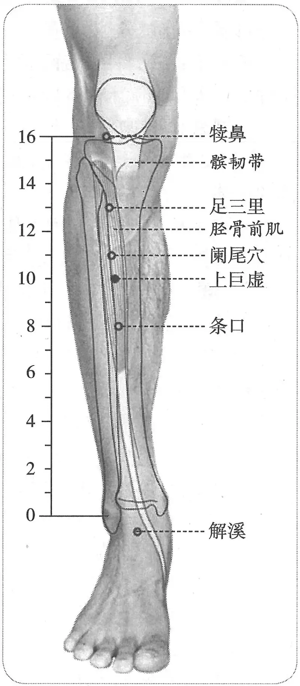

**图2-89　上巨虚穴与相关穴图**

〔p.391 (인쇄 371)〕

　　(1) 部位：在三里下三寸，两筋骨罅中。取穴：正坐屈膝垂足，从足三里直下三寸取之。（1957年南京《针灸学》）

　　(2) 部位：膝下六寸。取穴：正坐屈膝垂足，从足三里直下三寸取之。（1版《针灸学讲义》）

　　(3) 部位：在足三里下三寸。取穴：犊鼻下六寸，当足三里与下巨虚连线的中点取之。（2版《针灸学讲义》）

　　(4) 足三里穴下3寸。（4、5版《针灸学》）

　　(5) 在小腿前外侧，当犊鼻下6寸，距胫骨前缘一横指（中指）。（6版《针灸学》）

　　(6) 在犊鼻穴下6寸，足三里穴下3寸。（7版《针灸学》）

　　(7) 足三里下三寸，胫骨前嵴外一横指，胫骨前中。（《中国针灸学》）

**文献分析**：本穴的纵向定位，古今文献无分歧，横向定位有详略不同，考证参见“足三里”穴。

#### 【类属】 

足阳明胃经穴。大肠下合穴。

**脉气所发：**

　1. 复下三里三寸为巨虚上廉，复下上廉三寸为巨虚下廉也，大肠属上，小肠属下，足阳明胃脉也，大肠、小肠，皆属于胃，是足阳明经也。（《灵枢·本输》）

　2. 足阳明与大肠合。（《黄帝明堂经》）

#### 【适应症】 

主治胃肠病症。常用于肠鸣，腹痛，泄泻，便秘，肠痈；气喘；半身不遂，下肢痿痹，膝肿。胃大部切除术的针麻用穴。

　1. 气冲、三里、巨虚上下廉，此八者以泻胃中之热。（《素问·水热穴论》）

　2. 主飧泄，大肠痛。狂，妄走，善欠。大肠有热，肠鸣腹满，侠脐痛，食不化，喘，不能久立。胸胁榰满，恶闻人声与木音。风水面肿。（《黄帝明堂经》）

　3. 甄权云主大气不足，偏风，腲腿脚不随。（《外台秘要》卷三十九）

　4. 不得履地，脚气，刺风，瘈风，脚冷寒疟。（《太平圣惠方·针经》）

　5. 脚胫酸痛，屈伸难。（《太平圣惠方·明堂》）

　6. 治飧泄，腹胁支满，狂走，夹脐腹痛，食不化，喘息不能行。可灸三壮，针入三分。甄权云：治脏气不足，偏风腲腿，手足不仁，可灸以年为壮。（《铜人腧穴针灸图经》卷下）

　7. 治偏风，足胫不仁屈伸难，不能久立，风水膝肿，骨髓冷疼。（《针方六集》卷五）

　8. 主偏风，胫膝枯细，腿足不仁，水肿，飧泄，肠鸣切痛。（《循经考穴编》上）

　9. 统编针灸学教材

　　(1) 脾胃虚弱，肠鸣飧泄，夹脐痛，偏风手足不仁，脚气膝肿。（1957年南京《针灸学》、1版《针灸学讲义》）

　　(2) 肠中切痛，痢疾，肠鸣，腹胀，便秘，泄泻，肠痈，中风瘫痪，脚气。（2版《针灸学讲义》）

　　(3) 肠鸣，腹痛，泄泻，便秘，肠痈，中风瘫痪，脚气。（4版《针灸学》）

　　(4) 肠鸣，腹痛，泄泻，便秘，肠痈，下肢痿痹，脚气。（5版《针灸学》）

　　(5) 腹痛，腹胀，痢疾，便秘，肠痈，中风瘫痪，脚气，下肢痿痹。（6版《针灸学》）

　　(6) 肠鸣，腹痛，泄泻，便秘，肠痈等胃肠病证；下肢痿痹。（7版《针灸学》）

　　(7) 腹痛，腹胀，肠鸣，泄泻，痢疾，便秘，肠痈，中风瘫痪，脚气。（《中国针灸学》）

**文献分析**：《黄帝明堂经》所载本穴主治包括《灵枢》所述之“邪在大肠”、“大肠病”和足阳明胃经病候“狂，妄走，恶闻人声与木音”。《黄帝明堂经》中除本穴外，足阳明经冲阳、解溪穴也皆主“风水面肿”，提示足阳明胃经穴为治疗“风水”证的常用穴。唐以后腧穴文献偏重于下肢病症的治疗。

〔p.392 (인쇄 372)〕

#### 附：临床应用举例 

　1. 胃肠病症

　　(1) 腹中常鸣，气上冲胸，喘不能久立，邪在大肠，刺肓之原、巨虚上廉、三里。（《灵枢·四时气》）

　　(2) 大肠病者，肠中切痛而鸣濯濯，冬日重感于寒即泄，当脐而痛，不能久立，与胃同候，取巨虚上廉。（《灵枢·邪气藏府病形》）

　　(3) 东垣曰：脾胃虚弱，湿痿，汗泄，妨食，三里、气街出血；不愈，于上廉出血。（《针灸聚英》卷一）

　　(4) 治伤寒胃中热不已，泻任脉中脘一穴，足阳明经三里二穴，次上廉二穴。（《针经摘英集》）

　　(5) 急性阑尾炎：阑尾穴、上巨虚穴、足三里穴，针刺泻法。［中国针灸，1984，4(3)：14］

　　(6) 肠道病：上巨虚穴、下巨虚穴、足三里穴，针灸疗法。［北京中医，1985(2)：43-44］

　　(7) 便秘：天枢穴、足三里穴、上巨虚穴，针灸疗法。［四川中医，1988，6(4)：49］

　2. 腿膝病症

　　(1) 脚气之病……或微觉疼痹，或两胫小满，或行起忽弱，或小腹不仁，或时冷时热，皆其候也。不即治转上入腹，便发气则杀人。先灸大椎、肩井，次灸膻中、巨阙……次灸上廉一百壮。（《肘后备急方》卷三）

　　(2) 凡脚气初得，脚弱，使速灸之……初灸风市，次灸伏兔，次灸犊鼻，次灸膝两眼，次灸三里，次灸上廉，次灸下廉，次灸绝骨。（《千金要方》卷七、《千金翼方》）

　　(3) 骨髓冷疼，灸上廉七十壮。（《千金要方》卷十九、《千金翼方》）

　　(4) 风猥退，脚不遂，灸巨灵上廉，二穴在三里下三寸，各灸三壮。（《圣济总录》卷一百九十二）

**按**：巨灵上廉，系巨虚上廉之误。

　　(5) 中风半身不遂：合谷、绝骨、手三里、曲池、昆仑、肩髃、肩井、三里、上廉、委中。问曰：此证针后再发，何也？答曰：针不及分寸，补泻不明，不分虚实，其痰再发，可针前后，必须穴。要得中，知深浅，明补泻，分虚实，无不效也。复刺后穴。曲池、手三里、合谷、肩髃、足三里、绝骨、昆仑、肩井，不宜泻，不许灸。（《针灸集成》第三方）

　3. 风水，灸上廉随年壮。（《千金翼方》卷二十六）

#### 【操作】 

直刺1~2寸。

　1. 刺入八分，灸三壮。（《黄帝明堂经》）

　2. 可灸三壮，针入三分。（《铜人腧穴针灸图经》卷下）

　3. 入五分，随证上下卧入一寸。（《针灸集成》）

　4. 针五至八分，灸三壮。（《针灸十四经穴位考订》）

　5. 统编针灸学教材

　　(1) 针五分至一寸，以足跟着地，足尖足背耸起针之，灸三至七壮。（1957年南京《针灸学》）

　　(2) 针五分至一寸，以足跟着地，足尖向膝跷起针之，灸三至七壮。（1版《针灸学讲义》）

　　(3) 直刺5~12分，艾条灸5~10分钟。（2版《针灸学讲义》）

〔p.393 (인쇄 373)〕

　　(4) 直刺1~2寸。（4、5、7版《针灸学》）

　　(5) 直刺1~1.5寸。可灸。（6版《针灸学》）

　　(6) 直刺0.5~1.2寸。可灸。（《中国针灸学》）

**文献分析**：《灵枢·邪气藏府病形》曰“取之巨虚者，举足”，《素问·针解》注曰“巨虚者，跷足胻独陷者”，说的都是本穴的取穴方法，是指足尖着地的“拱足”姿势，1957年南京《针灸学》及第1版教材的理解“以足跟着地，足尖向膝跷起针之”与经文正好相反，且将取穴法理解为针法，在这种姿势下，肌肉紧张，很难行针。

### （三十八）条口 Tiáokōu ST38 出《黄帝明堂经》 

问题：条口治肩周炎的经验出自何人，是否可靠？

#### 【提要索隐】 

**部位**：在小腿前侧，犊鼻下8寸，犊鼻与解溪连线上。

**国标修订**：1990年版国标：在小腿前外侧，当犊鼻下8寸，距胫骨前缘一横指（中指）。2006年修订版：在小腿外侧，犊鼻下8寸，犊鼻与解溪连线上。

**适应症**：主治局部病症。常用于下肢痿痹等。

**针刺操作**：直刺1~1.5寸。

#### 【名实考】 

　1. 条口，在下廉上一寸，足阳明脉之所发。（《黄帝明堂经》）

　2. 以本经之脉下行膝，行骨之外，筋之里，直下行，有条之象，而此穴在中，有口之象焉，故曰条口。（《经穴解》）

#### 【定位】 

**部位**：在小腿前侧，犊鼻下8寸，犊鼻与解溪连线上（图2-90）。

**取穴**：下巨虚穴上1寸处，在胫骨前肌上取穴，横平丰隆穴。

　1. 在下廉上一寸。（《黄帝明堂经》、《太平圣惠方·针经》、《铜人腧穴针灸图经》卷上及卷下“穴腧都数”、《圣济总录》、《十四经发挥》、《针灸聚英》、《古今医统》、《针灸大成》、《类经图翼》、《循经考穴编》、《针灸易学》）

　2. 在上廉下一寸。（《太平圣惠方·针经》）

　3. 在下廉上一寸，举足取之。（《铜人腧穴针灸图经》卷下、《针灸资生经》、《医学纲目》、《针灸集书》）

　4. 三里下五寸。（《医学入门》卷一、《类经图翼》）

　5. 从上巨虚下行二寸，举足取之。（《医宗金鉴·刺灸心法要诀》、《针灸逢源》）

　6. 足三里下五寸，上巨虚下二寸。（《针灸十四经穴

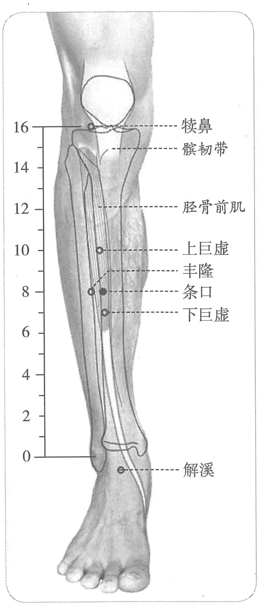

**图2-90　条口穴图**

〔p.394 (인쇄 374)〕

位考订》）

　7. 统编针灸学教材

　　(1) 部位：在下巨虚上一寸，上巨虚下二寸。取穴：上巨虚穴下二寸取之。（1957年南京《针灸学》）

　　(2) 部位：膝下八寸。取穴：从三里直下五寸取之。（1版《针灸学讲义》）

　　(3) 部位：在下廉上一寸。取穴：膝下八寸，上巨虚下约二横指，当犊鼻与解溪连线之中点取穴。（2版《针灸学讲义》）

　　(4) 上巨虚穴下2寸。（4、5、7版《针灸学》）

　　(5) 在小腿前外侧，当犊鼻下8寸，距胫骨前缘一横指（中指）。（6版《针灸学》）

　　(6) 上巨虚下2寸，当犊鼻与解溪连线的中点。（《中国针灸学》）

**文献分析**：《太平圣惠方》“在上廉下一寸”句中“一寸”系“二寸”之误。其余古今文献一致，均定位于下廉穴上一寸。

#### 【类属】 

足阳明胃经穴。

足阳明脉气所发。（《黄帝明堂经》）

#### 【适应症】 

主治局部病症。常用于下肢痿痹。

关于本穴主治，“条口透承山”治疗肩周炎是广为人知的由今人总结的新主治，然而系统考察后发现，这一透穴针法来自民间经验，原本治疗腰痛，且归入经外奇穴或新穴类，名曰“条山”。后经演变用于治疗肩周炎，该主治缺乏特异性，不能作为本穴的基础主治。

　1. 主胫寒不得卧，胫痛，足缓失履，湿痹，足下热，不能久立。（《黄帝明堂经》）

　2. 治膝胻寒酸痛，足缓履不收，湿痹，足下热。（《铜人腧穴针灸图经》卷下）

　3. 主足麻木。（《针灸聚英》卷一、《针灸大成》）

**按**：此乃高武不明《针灸资生经》编排体例而误录其文。《针灸资生经》原文作“条口太溪同疗胫寒明足麻”，正确的理解为“条口（太溪同）疗胫寒（《明》，见足麻）”，其中“见足麻”，是指见“足麻”篇，传世本经后人改编，已无此篇名。

　4. 统编针灸学教材

　　(1) 足胻痛，两足无力。（1957年南京《针灸学》）

　　(2) 肠鸣，泄泻，腹痛，足胻痛无力。（1版《针灸学讲义》）

　　(3) 小腿冷痛，麻痹，脘腹疼痛，跗肿，转筋。（2版《针灸学讲义》）

　　(4) 膝胫麻木酸痛，转筋，跗肿，足缓不收。（4版《针灸学》）

　　(5) 脘腹疼痛，下肢痿痹，转筋，跗肿，肩臂痛。（5、6版《针灸学》）

　　(6) 下肢痿痹，转筋，肩臂痛、脘腹疼痛。（7版《针灸学》）

　　(7) 膝胫麻木，酸痛，足缓不收，肩痛不举，脘腹疼痛。（《中国针灸学》）

**文献分析**：本穴主治，古代文献记载一致，均集中于下肢病症。现代针灸教材增加“肩臂痛”的主治，而教材中“脘腹疼痛”诸症未详所出，也未见古今临床应用的记载。

据文献统计，肩周炎已成为条口穴的第一主治，但古代文献没有类似的记载，这一经验是如何形成的呢？最近我科室的彭增福副研究员对此进行了深入的考察，以下转述其研究结论：

李志明等在1965年《针灸杂志》创刊号中，发表了《针灸治疗81例肩凝症初步小结》。他们首次将条口穴作为治疗肩周炎的首要经验用穴。同年，盛燮荪在《江西中医药杂志》上也报道了应用条口针刺治疗肩臂酸痛症的经验。他认为，如果“病在手阳明经，可取肩髃、巨骨、曲池、合谷、条口（针1.5~2寸，又称透承山法）等穴”，并详细介绍了条口穴的针刺手法：“可视患者体力情况，适当用重刺激行针，并应在得气后，可视患者体质情况，适当用一边加重刺激，一边帮助患肢活动。”这里，他明确提出了“条口透承山”之说。与李志明一样，均强调条口穴强刺激。但前者明显突出了条口可作为治疗肩周炎的特别经验用穴，而后者并没有突出条口穴，只是作为同名经取穴而已。此外，根据《单穴治病选萃》所载，欧阳群的老师，即北京中医医院的方老，在1962年以前也曾用条口穴治疗肩周炎，可惜未见具体文献记载。总之上述多位医家的经验并未产生应有的影响，流传也并不广。

〔p.395 (인쇄 375)〕

1966年，胡学曾在《针灸杂志》上发表了《针刺条口透承山穴治疗45例肩凝症》一文。作者可能在上述医家的基础之上，首次单用条口穴强刺激法治疗肩周炎。在其所治的45例患者中，“仅有4例疗效不巩固，少数病例经过2~3次症状消失，多数病例经1次治疗即肩痛消失，抬举自由”。正因为其疗效卓著，1971年，被收录于天津市卫生局革命委员会出版的中医简易教材编写组编写的《中医简易教材》。稍后，浙江省镇海县中草药研究推广小组再次证实了这一经验。胡学曾的这一经验不仅因此而被收入1981年出版的《中国针灸选萃》，还传到了日本和美国，并得到了临床上的进一步证实。20世纪80年代初，国内多位学者几乎同时又将日本、美国的这些研究成果，当成了“舶来品”翻译到国内，这才再次引起了国内同行普遍的关注。［彭增福．条口穴主治肩周炎经验的追本溯源．中国针灸，2009，29(2)：118］

而笔者的最新考察结果表明：“条口透承山”针方于20世纪50年代发掘自河北、天津一带民间经验方，当时将这一特殊的透穴法起了一个专门的穴名——条山，最初的主治病症很明确——腰痛，一直到1965年河北省卫生厅编写的中医培训教材《针灸》仍将“条山”归入“经外奇穴”类下，主治仍为腰痛、背痛。等到1975年河北新医大学编写的《针灸》教材中，“条山”仍归入“经外奇穴及新穴”中，主治症变成了“腰痛、肩臂痛”，也就是说，直到这时，条口透承山的主要治疗病症还是腰痛，治疗肩痛还是次要的主治症。而最初治疗肩凝症的是以小腿部压痛点透承山穴。

唐山市东矿区古林联合诊所李玉良治腰痛方取穴：条山。手法：用毫针直刺条山穴，针尖向承山穴捻进，达承山穴位之皮下，用捻转、提插手法，使感应达于腰部。留针五至十分钟。（见河北省中医研究院：《十万金方》（针灸第一集），河北人民出版社，1960年。按：此经验已收入《民间灵验便方》（针灸）．河北人民出版社，1959年，但未注明出处）

天津市中医学院附属医院王文绵治肩凝方：压痛点（足三里下三寸左右），操作：用毫针在压痛点向承山穴方向捻转进针二至四寸，留针五分钟。如果找不到压痛点，即取条山穴（即条口透承山穴），但条山穴不如压痛点效果好。（河北省针灸技术交流会议资料汇编，1959年。按：同样的经验又于同一资料汇编中见于河北中医院王蕴山“条山和悬钟穴的临床应用”一文。）

此后，类似的经验方和穴位主治反复出现于河北编辑的民间验方和针灸教材中。这一民间经验被发掘后，经“文革”那个特殊时期的洗礼，被打上了“新针疗法”的烙印，在20世纪六七十年代出版的“新医疗法”、“新针疗法”类书中，也不难见到“条口透承山治肩周炎”的记载。由于人们不知此针方的来历，而一直误以为是专治肩周炎的特效方。

如果说这个新治疗方法完全无效，想必不会有这么多人如此执著地应用。但本法所采取的刺法是强刺激，加上活动患病处。这样的刺法缺乏特异性，很多穴位皆能达到同样甚至更好的效果。现在已有足够的证据表明，在这种刺法中，活动是至关重要的，比穴位本身更重要。之所以取下肢穴，而不取上肢穴，主要是因为不影响肩关节的活动！同理，只要是下肢针感较强的穴位（已试较多的穴有下巨虚、三阴交、阴陵泉、胆囊穴、阳陵泉、或阳陵泉透阴陵泉、条口透飞扬等），都可以起到同样的作用，不独条口一穴，也不独条口透承山一法。

〔p.396 (인쇄 376)〕

结论：“条口透承山”治疗肩周炎有效，这一经验也能够重复，但这还不是事物的真相，更不是真理。就像“拍手亮灯”的经验是可以多次、甚至上百次重复，但如果我们不知道“声控灯”的秘密，无论我们拍多少次手都是盲目的。

从这个实例让我们思考这样一个问题：现代人所发现或总结的穴位新主治经验，其中有多少类似“条口透承山治疗肩周炎”这样的假象？

#### 附：临床应用举例 

　1. 漏肩风，取穴条口透承山，巨刺法。［陕西中医，1986，7(10)：461］

　2. 漏肩风，病属手太阴经，主穴取肩髃、肩内陵、天府、尺泽，配合谷、条口；病属手阳明经，主穴取肩髃、肩髎、曲池、合谷，配上巨虚；病属手太阳经，主穴取肩髃、肩贞，配臑俞、天宗、肘髎、养老。［针灸学报，1990，6(1)：11］

#### 【操作】 

直刺1~1.5寸。

　1. 刺入八分，灸三壮。（《黄帝明堂经》）

　2. 灸五壮。（《外台秘要》卷三十九）

　3. 针入五分，可灸三壮。（《铜人腧穴针灸图经》卷下）

　4. 统编针灸学教材

　　(1) 针三至七分，灸三至五壮，不宜多灸。（1957年南京《针灸学》、1版《针灸学讲义》）

　　(2) 直刺5~9分，艾条灸3~5分钟。（2版《针灸学讲义》）

　　(3) 直刺1~1.5寸。（4、5、6、7版《针灸学》）

　　(4) 直刺0.5~1.0寸，可灸。（《中国针灸学》）

### （三十九）下巨虚 Xiàjùxū ST39 出《素问》、《灵枢》 

#### 【提要索隐】 

**穴名**：一名下廉；一名巨虚下廉。

**部位**：在小腿前侧，犊鼻下9寸，犊鼻与解溪连线上。

**国标修订**：1990年版国标：在小腿前外侧，犊鼻下9寸，距胫骨前缘一横指（中指）。2006年修订版：在小腿外侧，犊鼻下9寸，犊鼻与解溪连线上。

**适应症**：主治小肠、乳房病症。常用于前阴痛、少腹痛、腰痛；乳痈；下肢痿痹。剖腹产手术的针麻用穴。

**针刺操作**：直刺1~1.5寸。

#### 【名实考】 

本穴名称，宋以前文献多作“下廉”或“巨虚下廉”，宋代《铜人腧穴针灸图经》明确以“下巨虚”作为正名，“下廉”作为别名。宋校本《千金要方》下廉穴下注有“一名下巨虚”，而未校本无，可知为宋人所注。

　1. 入于下陵，下陵，膝下三寸，胻骨外三里也，为合；复下三里三寸为巨虚上廉，复下上廉三寸为巨虚下廉也，大肠属上，小肠属下，足阳明胃脉也，大肠、小肠，皆属于胃，是足阳明经也。（《灵枢·本输》）

　2. 膝下三寸，胻外三里也，为合，复下三寸为巨虚上廉，复下三寸为巨虚下廉也……三

〔p.397 (인쇄 377)〕

里以下三寸之下上下处，上际为上廉，下际为下廉，以在胻骨外侧故名为廉，足阳明脉行此虚中。（《黄帝内经太素·本输》）

　3. 所谓三里者，下膝三寸也。所谓跗之者，举膝分易见也。巨虚者，跷足胻独陷者。下廉者，陷下者也。（《素问·针解》）

　4. 气街、三里、巨虚上下廉，此八者，以泻胃中之热也。（《素问·水热穴论》）

　5. 巨虚下廉，足阳明与小肠合，在上廉下三寸。（《黄帝明堂经》）

#### 【定位】 

**部位**：在小腿前侧，犊鼻下9寸，犊鼻与解溪连线上（图2-91）。

**取穴**：在上巨虚下3寸，在胫骨前肌上取穴，横平外丘、阳交。

　1. 上巨虚下三寸

　　(1) 复下上廉三寸，为巨虚下廉也。（《灵枢·本输》）

　　(2) 在上廉下三寸。（《黄帝明堂经》、《太平圣惠方·针经》、《铜人腧穴针灸图经》卷上及卷下“穴腧都数”、《圣济总录》、《针灸资生经》、《十四经发挥》、《针灸聚英》、《古今医统》、《针灸大成》、《类经图翼》、《针灸易学》）

　　(3) 在足上廉下三寸，两筋两骨罅陷中宛宛中。（《太平圣惠方》卷五十五）

　　(4) 三里下六寸。（《医学入门》、《针灸集成》）

　2. 在上廉下二寸。（《外台秘要》卷三十九）

　3. 取穴法

　　(1) 巨虚者，跷足胻独陷者，下廉者，陷下者也。王冰注曰：巨虚，穴名也，跷谓举也。取巨虚下廉当举足之，则胻外两筋之间陷下也。（《素问·针解》）

　　(2) 在上廉下三寸，两筋两骨罅中是穴，蹲地坐而取之。（《太平圣惠方·针经》）

　　(3) 在上廉下三寸，当举足取穴。（《铜人腧穴针灸图经》卷下）

　4. 针灸方腧穴定位

　　(1) 在上廉下一夫，亦附胫骨外是。（《肘后备急方》、《千金要方》、《千金翼方》）

　　(2) 在条口下一寸是也。（《外台秘要》卷十九）

　5. 足三里下六寸。（《针灸十四经穴位考订》）

　6. 统编针灸学教材

　　(1) 部位：在上巨虚下三寸。取穴：正坐垂足，从三里穴直下六寸取之。（1957年南京《针灸学》）

　　(2) 部位：膝下九寸。取穴：正坐垂足，从三里穴直下六寸取之。（1版《针灸学讲义》）

　　(3) 部位：在上廉下三寸。取穴：在犊鼻下九寸，当条口下约一横指，距胫骨前嵴约一横指。（2版《针灸学讲义》）

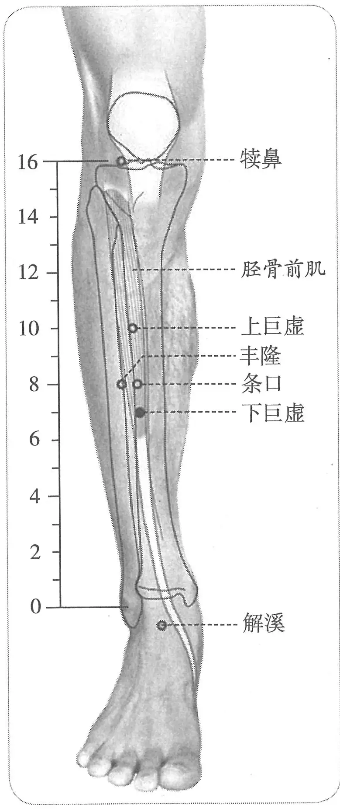

**图2-91　下巨虚穴图**

〔p.398 (인쇄 378)〕

　　(4) 上巨虚穴下3寸。（4、5、7版《针灸学》）

　　(5) 在小腿前外侧，当犊鼻下9寸，距胫骨前缘一横指（中指）。（6版《针灸学》）

　　(6) 上巨虚下三寸，胫骨前嵴外一横指，胫骨前肌中。（《中国针灸学》）

**文献分析**：本穴定位，《外台秘要》“在上廉下二寸”中之“二寸”系“三寸”之误。其余古代文献均定于上巨虚穴下三寸。其横向定位之差异，参见“足三里”穴。

#### 【类属】 

足阳明胃经穴。小肠下合穴。

**脉气所发**：足阳明与小肠合。（《黄帝明堂经》）

#### 【适应症】 

主治小肠、乳房病症。常用于前阴痛、少腹痛、腰痛；乳痈；下肢痿痹。剖腹产手术的针麻用穴。

　1. 气街、三里、巨虚上下廉，此八者，以泻胃中之热也。（《素问·水热穴论》）

　2. 主少腹痛，飧泄，出糜，次指间热，若脉陷，寒热身痛，唇干，不得汗，毛发焦，脱肉少气，内有热，不欲动摇，泄脓血，腰引少腹痛，暴惊，狂言非常。乳痈，惊，痹，胫重，足跗不收，跟痛。（《黄帝明堂经》）

　3. 小肠气不足，面无颜色，偏风热风，冷痹不遂，风湿痹。（《太平圣惠方·针经》）

　4. 治少腹痛，飧泄，次指间痛，唇干，涎出不觉，不得汗出，毛发焦，脱肉少气，胃中热不嗜食，泄脓血，胸胁少腹痛，暴惊，狂言非常，女子乳痈，喉痹，胻肿足跗不收。（《铜人腧穴针灸图经》卷下）

　5. 胸胁小腹控睾而痛，时窘之后当耳前热，若寒甚，若独肩上热甚及小指次指之间热痛。（《针灸聚英》卷一、《针灸大成》）

　6. 统编针灸学教材

　　(1) 胃中热，不嗜食，胸胁小腹痛，泄利脓血，风寒湿痹，足痿，乳痈，癫痫。（1957年南京《针灸学》）

　　(2) 少腹痛，泄利脓血，腰脊痛引睾丸，风寒湿痹，足痿，乳痈，癫痫，胃中热，不嗜食。（1版《针灸学讲义》）

　　(3) 小腹痛，腰脊痛引睾丸，乳痈，下肢痿痹。（2版《针灸学讲义》、《中国针灸学》）

　　(4) 小腹痛，泄脓血，腰脊痛，睾丸痛，乳痈，下肢痿痹。（4版《针灸学》）

　　(5) 腹痛，腰脊痛引睾丸，乳痈，下肢痿痹，泄泻，大便脓血。（5、6版《针灸学》）

　　(6) 腹泻、痢疾、小腹痛等胃肠病证；下肢痿痹；乳痈。（7版《针灸学》）

**文献分析**：《黄帝明堂经》所载本穴主治病症包括“小肠病”、“乳痈”和足阳明经病候（暴惊，狂言非常）。其中“主次指间热，若脉陷……”一条是关于小肠病的切诊内容，而不是主治病症。这种诊法实例尚见于传世本《灵枢·邪气藏府病形》“小肠病者，小腹痛，腰脊控睾而痛，时窘之后，当耳前热，若寒甚，若独肩上热甚，及手小指次指之间热，若脉陷者，此其候也，手太阳病也，取之巨虚下廉。”这是一条典型的标本脉法实例，是说手太阳标脉处——耳前部或热，或寒，或肩（眉）上热；手太阳本脉处——手小指次指间热，或脉陷者，即为小肠病，其病症为：小腹痛，腰脊控睾而痛，时窘之后。《黄帝明堂经》编者不解原文本义，将诊法内容误作小肠病症而归入其下合穴“巨虚下廉”中。类似的文字（“小指之间热”）还见于手太阳经“少泽”穴中，更是错上加错。后世临床应用主要在于小肠病症和下肢病症。

#### 附：临床应用举例 

　1. 小肠病症

　　(1) 小肠病者，小腹痛，腰脊控睾而痛，时窘之后，当耳前热，若寒甚，若独肩上热甚，及手小指次指之间热，若脉陷者，此其候也，手太阳病也，取之巨虚下廉。（《灵枢·邪气藏府病形》）

〔p.399 (인쇄 379)〕

　　(2) 小腹控睾引腰脊，上冲心，邪在小肠者，连睾系，属于脊，贯肝肺，络心系。气盛则厥逆，上冲肠胃，熏肝，散于肓，结于脐。故取之肓原以散之，刺太阴以予之，取厥阴以下之，取巨虚下廉以去之，按其所过之经以调之。（《灵枢·四时气》）

　　(3) 寒疝：梁丘、足三里、下巨虚。［四川中医，1988，6(6)：52］

　2. 下肢病症

　　(1) 脚气之病……或微觉疼痹，或两胫小满，或行起忽弱，或小腹不仁，或时冷时热，皆其候也，不即治，转入上腹，便发气则杀人……次灸下廉一百壮。（《肘后备急方》卷三）

　　(2) 凡脚气初得脚弱，便速灸之……初灸风市，次灸伏兔，次灸犊鼻，次灸膝两眼，次灸三里，次灸上廉，次灸下廉，次灸绝骨。凡灸八处……第七下廉穴，在上廉下一夫，一云附胫骨外是，灸之百壮……凡此诸穴，灸不必一顿灸尽壮数，可日日报灸之，三日之中，灸令尽壮数为佳。（《千金要方》卷七、《千金翼方》）

　　(3) 防风汤，主偏风。甄权处疗安平公方……服一剂，觉好，更进一剂即一度针，九剂九针即瘥，灸亦得。针风池一穴，肩髃一穴，曲池一穴，支沟一穴，五枢一穴，阳陵泉一穴，巨虚下廉一穴，凡针七穴即瘥。（《千金要方》卷八）

　　(4) 仁寿宫备身患脚，奉敕针环跳一穴、阳陵泉一穴、巨虚下廉一穴、阳辅一穴。凡针四穴即能起行。（《千金要方》卷八、《千金翼方》）

　　(5) 大理赵卿患风腰脚不随不能跪起行，针上窌一穴、环跳一穴、阳陵泉一穴、巨虚下廉一穴。凡针四穴即能跪起。（《千金要方》卷八、《千金翼方》）

　3. 漏肩风，取下巨虚。［中国针灸，1986，6(4)：19］

#### 【操作】 

直刺1~1.5寸。

　1. 刺入三分，灸三壮。（《黄帝明堂经》）

　2. 针入六分，得气即泻；灸亦良，不及针，日灸三七壮，至七七止，疮若冷痹即已。忌生冷猪鱼酒面。（《太平圣惠方·针经》）

　3. 针入八分，可灸三壮。（《铜人腧穴针灸图经》卷下）

　4. 统编针灸学教材

　　(1) 针三至七分，灸七至十五壮。（1957年南京《针灸学》、1版《针灸学讲义》）

　　(2) 直刺5~9分，艾条灸5~10分钟。（2版《针灸学讲义》）

　　(3) 直刺1~1.5寸。（4、5、6、7版《针灸学》）

　　(4) 直刺0.5~1.0寸，可灸。（《中国针灸学》）

### （四十）丰隆 Fēnglóng ST40 出《灵枢》 

问题1：古代文献关于本穴定位的文字描述一致，为何实际定位历代分歧很多？

问题2：丰隆涤痰之说出于何时何人？

#### 【提要索隐】 

**部位**：在小腿前外侧，外踝尖上8寸，胫骨前肌的外缘。

**国标修订**：1990年版国标：在小腿前外侧，当外踝尖上8寸，条口外，距胫骨前缘二横指（中指）。2006年修订版：在小腿外侧，外踝尖上8寸，胫骨前肌的外缘。

〔p.400 (인쇄 380)〕

**适应症**：主治痰证、脾胃病症。常用于痰饮证：腹痛，腹胀，便秘；头痛、眩晕，咳嗽、气喘、痰多；癫狂；胸痛；咽喉肿痛；下肢痿痹。

**按**：宋以前文献关于本穴主治的记载均在于胃肠病症及足阳明经脉、络脉病候。自金元窦太师针灸阐发了本穴的化痰作用，此后丰隆的化痰作用在古今临床实践中得到了广泛的应用。

**针刺操作**：直刺1~1.5寸。

#### 【名实考】 

丰隆既是穴名，也是络脉名，《黄帝明堂经》所载之丰隆穴，还明显带有从“脉”脱胎而来的“胎记”。

关于本穴的定位，诸书皆言“外踝上八寸”，而距膝下的折量寸由于早期文献多未言明，故后人的理解分歧很多，分歧的主要关键在于对小腿部骨度折量寸的不同理解。详见本章“概说”。

关于本穴距膝下的距离，传世《黄帝内经明堂》传本佚文只说“下廉下”，而《针灸甲乙经》传本“下廉”后无“下”字，从文理分析，有“下”字义胜。古代文献有明确注明的是明中期的《十四经步穴歌》作“丰隆下廉外一寸”，值得注意的是，明代马莳注《灵枢》经穴多引高武之说，而于丰隆穴却另立新说——膝下九寸，且不厌其烦为此一穴写了四句文，生怕读者不明白。据此推测马莳很可能参照了明正统仿宋铜人。在统编教材问世之前，中国针灸教材多采用承淡安的定位——下巨虚外侧一横指。从古代文献丰隆穴的排列次序来看，均排于下巨虚穴下，则丰隆与下巨虚穴的位置关系最多是横平，而不应当在其之上。

　1. 足阳明之别，名曰丰隆，去踝八寸，别走太阴；其别者，循胫骨外廉，上络头项，合诸经之气，下络喉嗌。其病气逆则喉痹瘁瘖，实则狂巅，则足不收，胫枯，取之所别也。（《灵枢·经脉》）

　2. 丰隆，足阳明络也，在外踝上八寸下廉，胻外廉陷者中，别走太阴者。（《针灸甲乙经》卷三）

　3. 在踝上八寸，下廉下骭外廉陷者中。（《医心方》卷二）

　4. 丰隆下廉外一寸。（《针灸聚英》卷一、《针灸问对》、《针方六集》）

　5. 膝下八寸下廉看，膝下九寸丰隆系，却是踝上八寸量，比那下廉外边缀。（《黄帝内经灵枢注证发微》）

　6. 血气俱盛者，胃经也，而有络焉以通于足太阴，则必盛之极者，而始溢焉络而入于他经。曰丰隆者，言盛之极也。（《经穴解》）

#### 【定位】 

**部位**：在小腿前外侧，外踝尖上8寸，胫骨前肌的外缘（图2-92）。

**取穴**：犊鼻与解溪连线的中点，条口外侧一横指处取穴。

　1. 去踝八寸。（《灵枢·经脉》、《黄帝内经太素》、《千金要方》卷二十九、《太平圣惠方·明堂》、《铜人腧穴针灸图经》卷下“穴腧都数”、《医学入门》）

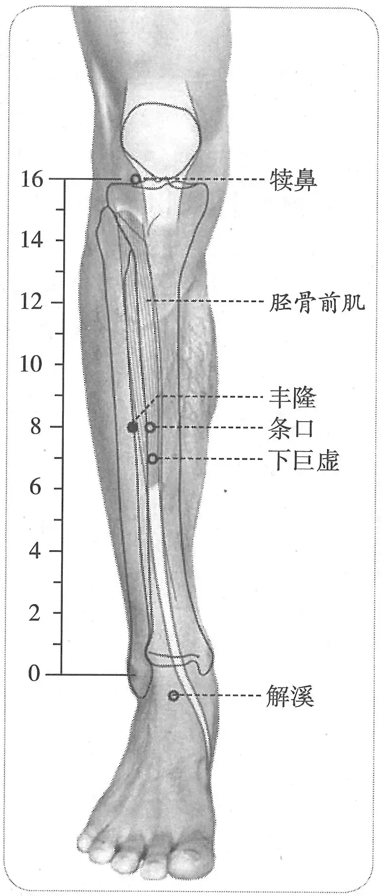

**图2-92　丰隆穴图**

〔p.401 (인쇄 381)〕

　2. 在外踝上八寸，下廉胻外廉陷者中。（《针灸甲乙经》卷三、《千金翼方》、《外台秘要》、《铜人腧穴针灸图经》卷上、卷下、《圣济总录》、《针灸资生经》、《针灸玉龙经》、《窦太师针经》、《十四经发挥》中、《医学纲目》、《针灸集书》、《针灸聚英》、《古今医统》、《针灸大成》、《类经图翼》、《针灸易学》）

　3. 在踝上八寸，下廉下骭外廉陷者中。（《医心方》卷二）

　4. 在足腕解溪上八寸。（《针灸玉龙经》）

　5. 广注外踝向前旁，解溪上去八寸。又法于膝骨尽处量至脚腕，中折断当中是，合胻骨外廉陷中，须仰足以手按两筋间动脉取之。（《循经考穴编》上）

　6. 丰隆下廉外一寸。（《针灸聚英》卷一、《针灸问对》、《针方六集》）

　7. 膝下八寸下廉看，膝下九寸丰隆系，却是踝上八寸量，比那下廉外边缀。（《黄帝内经灵枢注证发微》）

　8. 从下巨虚复斜向后上行，在外踝上八寸，胻骨外廉陷中。（《医宗金鉴·刺灸心法要诀》）

　9. 外踝上八寸，条口穴后方约一寸。按：“丰隆”穴，或作外踝上六寸，或作外踝上五寸，或作下巨虚后，或作上巨虚后，兹从古书多数说法作外踝上八寸。见膝眼至外踝折作一尺六寸，则此穴适当其间二分之一处与条口穴平，取穴亦较便。（《针灸十四经穴位考订》）

　10. 统编针灸学教材

　　(1) 部位：外踝上八寸。取穴：外踝上八寸胻骨外廉陷中取之。（1957年南京《针灸学》）

　　(2) 部位：外踝上八寸。取穴：从条口穴外开一横指处取之。（1版《针灸学讲义》）

　　(3) 部位：在外踝上八寸，下廉胻外廉陷者中。取穴：位于犊鼻与解溪之间的中点，在条口后方约一横指取之。（2版《针灸学讲义》）

　　(4) 外踝上8寸，条口穴外1寸。（4、5版《针灸学》）

　　(5) 在小腿前外侧，当外踝尖上8寸，条口外，距胫骨前缘二横指中指。（6版《针灸学》）

　　(6) 外踝尖上8寸，条口穴外1寸，胫骨前嵴外2横指处。（7版《针灸学》）

　　(7) 外踝上八寸，条口外约一横指。（《中国针灸学》）

**文献分析**：本穴纵向定位尺寸，古今文献一致，均定位于外踝上8寸，但横向位置，特别是与条口穴的位置关系，只有《医宗金鉴·刺灸心法要诀》一书有说明。已知条口在膝下8寸，丰隆在外踝上8寸，而《灵枢·骨度》膝至外踝折作16寸，据此，若横向位置无区别，则条口与丰隆二穴就重叠了。由于条口穴是足阳明正经穴，须与其他经穴在一线上，于是只能调整络穴丰隆的横向定位。后人为将《黄帝明堂经》定穴尺寸牵就于《灵枢》骨度，想出多种方法处理“丰隆”穴的定位：

　1. 于下巨虚上一寸。（国标《经穴部位》、《标准针灸经穴挂图》，按小腿骨度16寸）

　2. 定于上巨虚穴外侧。（朱琏《新针灸学》、马继兴《针灸治疗刺激点解剖位置参考图》，按小腿骨度14寸）

　3. 上巨虚上外侧。（《经穴指掌图》）

　4. 下巨虚下一寸。（明正统仿宋铜人、丘濬《铜人图》等，按小腿骨度16寸）

　5. 下巨虚外稍上方。（承淡安《人体经穴图》、赵尔康《中华针灸学》）

　6. 条口外上方。（嘉靖针灸铜人）

　7. 条口穴内侧。（明万历赵文炳重刊铜人图、韩国针灸铜人）

〔p.402 (인쇄 382)〕

以上诸说中只有明正统仿宋铜人和丘濬铜人图将丰隆定于下巨虚穴下，其他各说皆定于下巨虚穴之上，其前提是《黄帝明堂经》的折量系统遵从《灵枢·骨度》，而实际上这一前提并不存在，详见足阳明胃经穴“概说”。

#### 【类属】 

足阳明胃经穴，胃经之络穴。

足阳明络也……别走太阴者。（《黄帝明堂经》）

#### 【适应症】 

主治痰证、脾胃病症。常用于痰饮证：腹痛，腹胀，便秘；头痛、眩晕，咳嗽、气喘、痰多；癫狂；胸痛；咽喉肿痛；下肢痿痹。

　1. 其病气逆则喉痹瘁喑，实则狂癫，虚则足不收，胫枯，取之所别也。（《灵枢·经脉》）

　2. 主厥逆，足暴清，胸痛如刺，腹若刀切之，闷不能食，大小便涩难。四肢肿，身湿。厥头痛，面浮肿，烦心，狂见鬼，善笑不休，发于外，有所大喜，喉痹不能言。（《黄帝明堂经》）

**按**：上述“厥逆……大小便涩难”辑自《灵枢·癫狂》“厥逆为病也，足暴清，胸若将裂，肠若将以刀切之，烦而不能食，脉大小皆涩，暖取足少阴，清取足阳明，清则补之，温则泻之”；“厥头痛……喉痹不能言”皆辑自《灵枢》针灸方“厥头痛，面若肿起而烦心，取之足阳明、太阴”（《灵枢·厥病》）；“狂者多食，善见鬼神，善笑而不发于外者，得之有所大喜，治之取足太阴、太阳、阳明，后取手太阴、太阳、阳明。”（《灵枢·癫狂》）；“喉痹不能言，取足阳明”（《灵枢·杂病》）。另外足阳明络脉病候“喉痹瘁喑，实则狂癫”也为本穴所主。

　3. 四肢不收，身体怠坠，腿膝酸痛屈伸难。（《太平圣惠方·明堂》）

　4. 治厥逆胸痛如刺，腹中切痛，大小便难涩，厥头痛，面浮肿，风逆四肢肿，身湿，喉痹不能言。（《铜人腧穴针灸图经》卷下）

　5. 窦太师针灸遗存

　　(1) 大治痰饮壅盛，喘满不能动止，泻；头风晕，补之。（《窦太师针经》）

　　(2) 主痰饮壅盛，喘不得宁。（《针方六集》卷五）

　　(3) 主哮喘气急，一切风痰壅盛。（《循经考穴编》上）

　　(4) 治一切痰饮。（《针方六集·玉龙歌》注）

　6. 登高而歌，弃衣而走，见鬼好笑，气逆则喉痹，卒喑，实则癫狂泻之，虚则足不收胫枯补之。（《针灸聚英》卷一、《古今医统》、《针灸大成》）

**按**：以上病症系高武将足阳明经脉、络脉病候辑入本穴。

　7. 统编针灸学教材

　　(1) 哮喘气急，风痰壅盛，胸腹疼痛，呕吐，大便难，腿足痿痹酸麻，肢肿，头痛眩晕，喉痹，癫狂。（1957年南京《针灸学》、1版《针灸学讲义》）

　　(2) 胸痛，哮证，气喘，痰多，咽喉肿痛，下肢痿痹，肿痛，头痛，眩晕，大便难，癫狂，痫证。（2版《针灸学讲义》）

　　(3) 头痛，痰嗽，肢肿，便秘，狂痫，下肢痿痹。（4版《针灸学》）

　　(4) 头痛，眩晕，痰多咳嗽，呕吐，便秘，水肿，癫狂痫，下肢痿痹。（5版《针灸学》）

　　(5) 痰多，哮喘，咳嗽，胸痛，头痛，咽喉肿痛，便秘，癫狂，痫证，下肢痿痹，呕吐。（6版《针灸学》）

　　(6) 头痛，眩晕；癫狂；咳嗽痰多等痰饮病证；下肢痿痹；腹胀，便秘。（7版《针灸学》）

　　(7) 头痛，眩晕，咳嗽，哮喘，痰多，胸痛，便秘，癫狂，痫证，下肢痿痹，肿痛。（《中国针灸学》）

**文献分析**：《黄帝明堂经》载本穴主治“大小便涩难”系对《灵枢》原文的误解。《灵枢·癫狂》曰：“厥逆为病也，足暴清，胸若将裂，肠若将以刀切之，烦而不能食，脉大小皆涩。暖取足少阴，清取足阳明”。以上《灵枢》之文应是《黄帝明堂经》“丰隆”穴该条主治的原型，而后者将《灵枢》原文“脉大小皆涩”释为“大小便涩难”，大误。现代针灸教材也不同程度受此影响。关于丰隆治痰的记载始于元代窦太师针灸，并在当时的针灸临床广泛应用。

〔p.403 (인쇄 383)〕

#### 附：临床应用举例 

　1. 痰饮咳喘

　　(1) 咳嗽须针肺腧穴，痰多必用刺丰隆。（《针灸玉龙歌》）

　　(2) 痰多须向丰隆泻，喘气丹田亦可施。（《针灸玉龙歌》）

　　(3) 四肢浮肿：中渚、液门、合谷、中都、曲池、三里、三阴交。问曰：此证缘何而得？答曰：只因醉饱乘风取快，有兼房事劳动脏腑，食饱不化，遂成痰饮，则注于四肢，故如此也。复刺后穴：中脘、丰隆、阴陵泉、行间。（《针灸集成》第四十八方）

　　(4) 两膝红肿疼痛：膝关、委中、三里。问曰：此证缘何而得？答曰：皆因痹经受湿，痰饮流注，或因痢后寒邪入于经络，及伤寒流注，故如此也。复刺后穴：阳陵泉、中脘、丰隆。（《针灸集成》第四十方）

　　(5) 治风痰头痛，刺足阳明经丰隆二穴，在外踝上八寸下廉胻外廉陷中，别走太阴，针入三分，灸三壮。（《针经摘英集》）

　　(6) 哮喘发来寝不得，丰隆刺入三分深。（《肘后歌》）

　　(7) 哮喘发作：针刺膻中、丰隆穴治疗。［中西医结合实验杂志，1997，10(14)：1370］

　　(8) 支气管哮喘：针刺内关、丰隆穴治疗。［针灸临床杂志，1998，14(5)：11］

　2. 头痛

　　(1) 浑头风，头痛如破，重如石，胃寒则热，过热则散：灸百会、上星，刺风府；未愈，次丰隆泻之。（《针灸集要·盘石金直刺秘传》）

　　(2) 凡一切头风，眉棱骨痛，眼昏目赤：泻攒竹，次泻丰隆。（《针灸集要·盘石金直刺秘传》）

　　(3) 头风目眩：合谷、上星、风池、三里、丰隆、解溪。问曰：此证针效复发何也？答曰：乃房事过多，醉饱不避风寒而卧，贼风入经络之证。再发复刺后穴：风池、上星、三里。（《针灸集成》第七方）

　3. 其他病症

　　(1) 治喉痹，刺足阳明丰隆，足少阴涌泉。（《针经摘英集》）

　　(2) 妊娠恶阻：丰隆穴、太冲穴、足三里穴，针刺补泻。［中国针灸，1985，5(1)：10-11］

　　(3) 高血压病：丰隆穴、风池穴、曲池穴，针灸疗法。［上海针灸杂志，1986(1)：14-15］

　　(4) 小儿脾虚泄泻：丰隆穴、太白穴，艾条温灸治疗。［中国针灸，1986，6(4)：55］

　　(5) 乙型脑炎并发症：针刺丰隆穴治疗。［上海针灸杂志，1988，7(4)：12］

　　(6) 肩周炎：针刺丰隆透飞扬穴治疗。［中国针灸，1995(11)：16］

　　(7) 癔病性失语：针刺双侧丰隆穴治疗。［新疆中医药，1997，15(2)：25］

#### 【操作】 

直刺1~1.5寸。

　1. 刺入三分，灸三壮。（《黄帝明堂经》）

　2. 灸七壮。（《太平圣惠方·明堂》）

　3. 窦太师针灸遗存

　　(1) 平针入二寸半，灸二七壮。（《窦太师针经》）

〔p.404 (인쇄 384)〕

　　(2) 针入二寸半，看症虚实补泻，可灸二七壮。（《针方六集·玉龙歌》注）

　4. 针五至八分，灸五壮。（《针灸十四经穴位考订》）

　5. 统编针灸学教材

　　(1) 针五分至一寸，灸七至十五壮。（1957年南京《针灸学》、1版《针灸学讲义》）

　　(2) 直刺5~12分，艾条灸5~10分钟。（2版《针灸学讲义》）

　　(3) 直刺1~1.5寸。（4、5、6、7版《针灸学》）

　　(4) 直刺0.5~1.0寸，可灸。（《中国针灸学》）

　6. 稍向内斜刺1.5~3寸。感应：酸胀感，向上放散至大腿根都，下至外踝。灸5~7壮；温灸5~10分钟。（上海《针灸学》）

### （四十一）解溪 Jiěxī ST41 出《灵枢》 

#### 【提要索隐】 

**穴名**：一名鞋带。

**部位**：在踝前侧，踝关节前面中央凹陷中，䠴长伸肌腱与趾长伸肌腱之间。

**国标修订**：1990年版国标：在足背与小腿交界处的横纹中央凹陷中，当䠴长伸肌腱与趾长伸肌腱之间。2006年修订版：在踝区，踝关节前面中央凹陷中，䠴长伸肌腱与趾长伸肌腱之间。

**按**：1990年版国标“足背与小腿交界处的横纹中央”与“当䠴长伸肌腱与趾长伸肌腱之间”义重，且足背与小腿交界处呈现规则横纹的概率不大，即便有横纹，其中点与“䠴长伸肌腱与趾长伸肌腱之间”重合的概率也不高，故2006年版国标做如上文字调整。

**适应症**：主治头面及腹部病症。常用于头痛，眩晕，癫狂；下肢痿痹，足踝无力；腹胀，便秘。

**备选适应症**：头面浮肿。

**针刺操作**：直刺0.5~1寸。

#### 【名实考】 

本穴位于足腕关节处，适当鞋带中间，故窦太师针灸谓本穴“一名鞋带”。

　1. 行于解溪，解溪上冲阳一寸半陷者中也，为经……足阳明胃脉也，大肠、小肠，皆属于胃，是足阳明经也。（《灵枢·本输》）

　2. 行于解溪，解溪者火也，在冲阳后一寸五分，腕上陷者中，足阳明脉之所行也，为经。（《黄帝明堂经》）

　3. 解溪二穴，一名鞋带，火也。去冲阳一寸半，腕系鞋带处是穴。（《窦太师针经》）

　4. 解溪，在足腕上大筋外宛宛中。此即草鞋带穴也。（《针灸玉龙歌》注）

　5. 胃之别者，直行者，由膝而下行者，至此统入于足跗上有溪之象焉。解者，膝之旁曰解，此乃解最下之处，其脉则自解而来者，故曰解溪。（《经穴解》）

#### 【定位】 

**部位**：在踝前侧，踝关节前面中央凹陷中，䠴长伸肌腱与趾长伸肌腱之间（图2-93）。

**取穴**：令足趾上跷，显现足背部两肌腱，穴在两腱之间，相当于内、外踝尖连线的中点处。

　1. 上冲阳一寸半陷者中也。（《灵枢·本输》）

　2. 在冲阳后一寸五分，腕上陷者中。（《黄帝明堂经》、《铜人腧穴针灸图经》、《圣济总录》、《针灸资生经》、《针经节要》、《十四经发挥》、《神应经》）

　3. 在足腕上陷者中也。（《素问·通评虚实论》王冰注、《太平圣惠方·针经》、《针灸资

〔p.405 (인쇄 385)〕

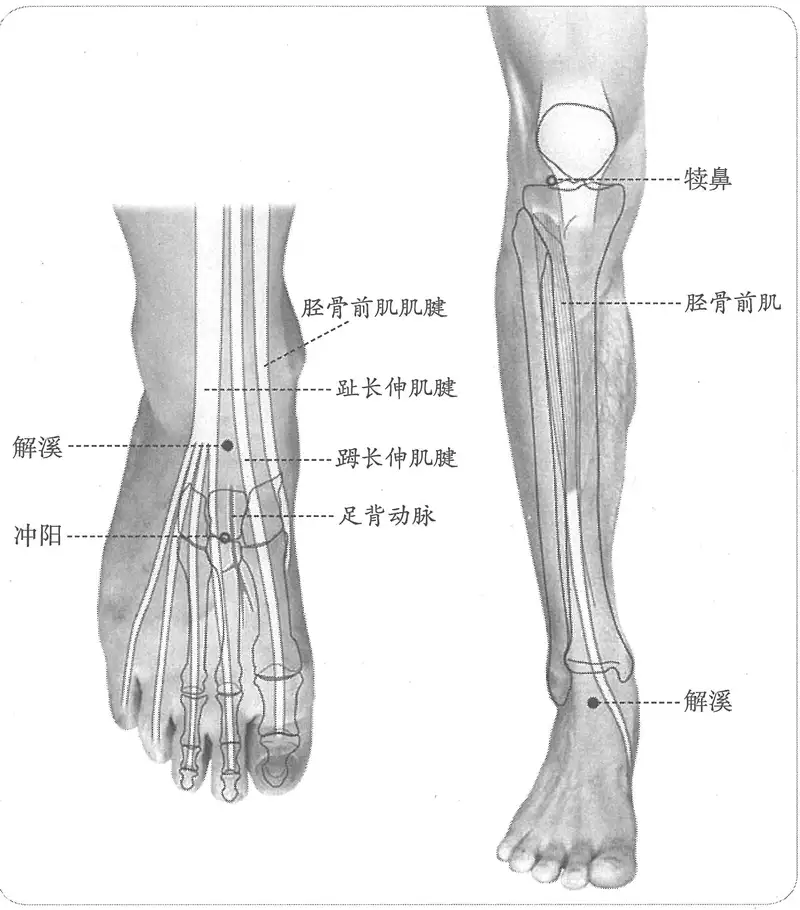

**图2-93　解溪穴图**

生经》、《针灸玉龙经》、《针灸逢源》）

　4. 在冲阳后同身寸之三寸半，腕上陷者中。（《素问·刺疟》王冰注）

　5. 在冲阳后同身寸之二寸半。（《素问·气穴论》王冰注）

**按**：新校正云：按《甲乙经》作一寸半，《刺疟》注作三寸半，《素问》二注不同，当从《甲乙》之说。

　6. 在系鞋处陷者中。（《太平圣惠方·明堂》）

　7. 在足腕上大筋外宛宛中。（《针灸玉龙歌》注）

　8. 去冲阳一寸半，腕系鞋带处是穴。（《窦太师针经》、《窦太师秘传》、《针灸集成》）

　9. 足大指次指直上跗上陷者宛宛中。（《针灸聚英》卷一、《古今医统》、《针灸大成》、《类经图翼》、《循经考穴编》）

　10. 从丰隆内循下足腕上，中行陷中。（《医宗金鉴·刺灸心法要诀》）

　11. 冲阳后二寸，腕上陷中，足大指次指直上跗上陷者宛宛中。（《针灸易学》下）

　12. 足次趾直上，跗上两踝之间，两筋间陷中。（《针灸十四经穴位考订》）

　13. 统编针灸学教材

　　(1) 部位：在冲阳后一寸五分，足跗关节上陷中。取穴：从第二趾直上至足关节前面横纹，两筋之间陷凹中取之，即系鞋带之处。（1957年南京《针灸学》）

　　(2) 部位：足腕纹中央，两筋间宛宛中。取穴：冲阳穴后一寸五分，在踝关节前横纹两筋之间陷凹中取之，与中封、丘墟二穴相平。（1版《针灸学讲义》）

〔p.406 (인쇄 386)〕

　　(3) 部位：在冲阳后一寸五分，腕上陷者中。取穴：在足背与小腿交界处的横纹中，当趾长伸肌腱与䠴长伸肌腱之间陷中取穴。（2版《针灸学讲义》）

　　(4) 足背踝关节横纹的中央，䠴长伸肌腱与趾长伸肌腱之间。（4、5、7版《针灸学》）

　　(5) 在足背与小腿交界处的横纹中央凹陷中，当䠴长伸肌腱与趾长伸肌腱之间。（6版《针灸学》）

　　(6) 足背踝关节横纹的中央，䠴长伸肌腱与趾长伸肌腱之间凹陷中，约与外踝高点相平。（《中国针灸学》）

**文献分析**：古代文献载本穴距冲阳穴的折量寸数有“一寸半”、“二寸”、“二寸半”、“三寸半”4说，然而共同点是“足腕上陷者中”（系鞋带处陷者中）。国家标准即依此定位。若依《灵枢》足长折作一尺二寸，则以《黄帝明堂经》等书作冲阳后一寸半为是。元代《针灸玉龙歌》注在折量的定位的基础上又增加了一个体表标志“在足腕上大筋外宛宛中”，准确地讲，应当是“两筋间”（䠴长伸肌腱与趾长伸肌腱），但由于䠴长伸肌腱特别明显，而且如果足腕稍内旋转，则只显现出䠴长伸肌腱，故曰“大筋外宛宛中”。

#### 【类属】 

足阳明胃经穴，五输穴之经穴。

足阳明脉之所行也，为经。（《黄帝明堂经》）

#### 【适应症】 

主治头面及腹部病症。常用于头痛，眩晕，癫狂；下肢痿痹，足踝无力；腹胀，便秘。

**备选适应症**：头面浮肿。

　1. 热病汗不出，善噫，腹胀满，胃热，谵语。风水面浮肿，颜黑。厥气上榰。疟，瘛疭惊，股膝重，胻转筋，头眩痛。癫疾，发寒热，欠，烦满，悲泣出。狂易，见鬼与火。风从头至足，面目赤，口痛，啮舌。足大指搏伤，下车挃地通背指端伤为筋痹。白膜覆珠，瞳子无所见。（《黄帝明堂经》）

　2. 腹胀大，下重。霍乱。（《外台秘要》卷三十九）

　3. 主上气，咳嗽，喘息急，腹中积气上下行，及目生白翳也。（《太平圣惠方·明堂》）

　4. 治风面浮肿，颜黑，厥气上冲，腹胀，大便下重，瘛惊，膝股胻肿，转筋，目眩头痛，癫疾，烦心，悲泣，霍乱，头风，面目赤。（《铜人腧穴针灸图经》卷下）

　5. 窦太师针灸遗存

　　(1) 治腕无力，补；治风等症、脚气等症，泻。（《窦太师针经》）

　　(2) 主胻股痿痹。若脚腕无力，补之，浑身生疮，泻之。（《循经考穴编》上）

　　(3) 如头重头风，先补后泻。（《针灸玉龙歌》注）

　6. 一传腹肿及足胫虚肿，灸之效；一传气逆发噎将死，灸之效。（《类经图翼》卷六）

　7. 统编针灸学教材

　　(1) 头面浮肿，头痛，目眩，生翳，眉棱骨痛，腹胀，大便难，足膝痿痹，癫疾。（1957年南京《针灸学》、1版《针灸学讲义》）

　　(2) 头面浮肿，头痛，眩晕，腹胀，便秘，下肢痿痹，癫疾。（2版《针灸学讲义》）

　　(3) 头痛，眩晕，腹胀，便秘，脚腕痛，下肢痿痹，癫疾。（4版《针灸学》、《中国针灸学》）

　　(4) 头痛，眩晕，癫狂，腹胀，便秘，下肢痿痹。（5版《针灸学》）

　　(5) 头痛，眩晕，癫狂，腹胀，便秘，下肢痿痹，目赤，胃热谵语。（6版《针灸学》）

　　(6) 下肢痿痹，踝关节病、足下垂等下肢、踝关节疾患；头痛，眩晕；癫狂；腹胀，便秘。（7版《针灸学》）

〔p.407 (인쇄 387)〕

**文献分析**：《黄帝明堂经》载本穴主治病症除了“腹胀满，胃热，谵语，颜黑，疟，癫疾，发寒热，欠，狂易，见鬼与火”等足阳明胃经病症外，还有“风水”证、头面五官病症以及足部病症。金元窦太师针灸强调了对足腕病症的治疗，《类经图翼》传录两条主治也值得重视。需要指出的是，《黄帝明堂经》本穴以及足阳明经陷谷、冲阳、上巨虚穴皆治疗“风水”证，此外《铜人腧穴针灸图经》及窦太师针灸皆有此说，教材前3版也皆有此主治，之后教材皆删去，不知其故，暂附存备考。

#### 附：临床应用举例 

　1. 头痛

　　(1) 治眉攒内疼痛不可忍者，刺足阳明经解溪二穴，在足腕上陷中，针入五分。（《针经摘英集》、《医学纲目》）

　　(2) 头风偏痛，不可忍，半边口燥热：合谷泻、解溪左疼取右，右疼取左。（《针灸玉龙经·盘石金直刺秘传》）

　　(3) 头风如破，眉目间痛：阳白、解溪、合谷并泻。（《针灸玉龙经·盘石金直刺秘传》）

　　(4) 偏正头风：中脘、风池、三里、合谷、丝竹空、解溪。问曰：已上穴法针之不效者，何也？答曰：亦有痰饮停滞胸膈，贼风窜入脑户，偏正头风，发来连年，皮肉疼痛，或手足沉冷，久而不治，变为瘫痪，亦分阴阳，针之或针力未到，故不动也。可针中脘，以舒下其痰，三里泻之，以去风。后针穴及前四穴，中脘、丝竹空、三里、解溪。（《针灸集成》第六方）

　　(5) 头风目眩：合谷、上星、风池、三里、丰隆、解溪。问曰：此证针效复发何也？答曰：乃房事过多，醉饱不避风寒而卧，贼风入经络之证，再发复刺后穴：风池、上星、三里。（《针灸集成》第七方、《针灸大成》）

　2. 腿脚病症

　　(1) 穿根草鞋风：昆仑、丘墟、照海、商丘。问曰：此证缘何而得？答曰：皆因劳役过多，湿气流注，或因大热行路，凉水浸洗，故如此也。复刺后穴：太冲、解溪。（《针灸集成》第四十四方）

　　(2) 脚背疼起丘墟穴，斜针出血即时轻，解溪再与商丘识，补泻行针要辨明。（《针灸玉龙歌》）

　　(3) 手足劳损性血管痉挛症：解溪穴、内关穴、悬钟穴。［上海针灸杂志，1986(1)：33］

　　(4) 足颈疼痛伴呃逆：解溪穴、足三里穴，温针疗法。［四川中医，1987，5(6)：44］

　　(5) 慢性软组织损伤：足三里穴、解溪穴，温针治疗。［中医函授通讯，1988(2)：41-42］

　　(6) 腓总神经麻痹、咳嗽、手腕挫伤：针刺解溪穴。［江苏中医，1996，17(6)：27-28］

#### 【操作】 

直刺0.5~1寸。

　1. 刺入五分，留五呼，灸三壮。（《黄帝明堂经》）

　2. 窦太师针灸遗存

　　(1) 针入五分，灸二七壮。（《窦太师针经》）

　　(2) 针半寸，灸七壮。如头重头风宜先补后泻。（《针灸玉龙歌》注）

　3. 统编针灸学教材

　　(1) 针五至七分，针尖对足跟而入，灸三至五壮。（1957年南京《针灸学》、1版《针灸学讲义》）

　　(2) 针尖向足跟直刺5~7分，艾条灸3~5分钟。（2版《针灸学讲义》）

〔p.408 (인쇄 388)〕

　　(3) 直刺0.5~1寸。（4、5、6、7版《针灸学》）

　　(4) 直刺0.5~0.7寸，可灸。（《中国针灸学》）

　4. 向关节腔直刺0.3~0.5寸，再向两侧透刺，进针1~1.5寸。感应：局部酸胀，有时可扩散至整个踝关节。灸1~3壮；温灸5~10分钟。（上海《针灸学》）

### （四十二）冲阳 Chōngyáng ST42 出《灵枢》 

#### 【提要索隐】 

**穴名**：一名会原；一名趺阳。

**部位**：在足背，第2跖骨基底部与中间楔状骨关节处，可触及足背动脉。

**国标修订**：1990年版国标：在足背最高处，当䠴长伸肌腱与趾长伸肌腱之间，足背动脉搏动处。2006年修订版：在足背，第2跖骨基底部与中间楔状骨关节处，可触及足背动脉。

**按**：1990年版国标“足背最高处，当䠴长伸肌腱与趾长伸肌腱之间”所在略偏于足厥阴肝经行处，故2006年版国标不再以䠴长伸肌腱与趾长伸肌腱作取穴标志，位置略移向外侧。

**适应症**：主治脾胃、头面部病症。常用于口眼㖞斜，面肿，齿痛；胃脘痛，腹胀；癫狂；足痿无力或肿痛。

**针刺操作**：避开动脉，直刺0.3~0.5寸。

#### 【名实考】 

冲阳，乃足阳明原穴，位于足阳明诊脉处，称“冲阳脉”，因其在足背部，又称“趺阳脉”。本穴古称“足阳明”，宋以前文献载针灸方中“足阳明”者，即相当于本穴。

　1. 过于冲阳，冲阳足跗上五寸陷者中也，为原，摇足而得之……足阳明胃脉也，大肠、小肠，皆属于胃，是足阳明经也。（《灵枢·本输》）

　2. 过于冲阳，一名会原，在足跌上五寸，骨间动脉上，去陷谷三寸。足阳明脉之所过也，为原。（《黄帝明堂经》）

　3. 胃之源，冲阳穴也。在足跗上如同身寸之五分，骨间动脉上，去陷谷穴三寸是，足阳明之所过。（《素问亡篇·刺法论》）

　4. 冲阳，一名会原，即仲景所谓趺阳也。在足跗上五寸，高骨间动脉，去陷谷二寸。足阳明所过为原。（《类经图翼》卷六）

　5. 穴名冲阳者，以冲脉下行之别者并于少阴，既渗三阳，而又斜入踝，伏行出属跗，上循跗入大指之间，渗诸络而温足胫内。其脉常动，别之络结，则跗上脉不动，不动则厥，厥则寒矣。此穴虽为胃经之穴，乃亦冲、阳二脉之处，故曰冲阳。又此脉可决死生，别谷气之有无。（《经穴解》）

　6. 别名　会原、趺阳、会骨、会屈、会涌。（1957年南京《针灸学》）

**按**：“趺阳”乃脉名；“会骨”见于《外台秘要》卷三十九，其下文作“会原”，与其他《明堂经》传本同，则此“会骨”系“会原”之形误；“会屈”不详所出，当系“会原”之形误；“会涌”间接传自日本文献，云出《圣济总录》，今检日本活字本作“会源”，与《铜人腧穴针灸图经》同，则此“会涌”乃“会源”之形误。

由于本穴源出于趺阳脉，而趺阳脉有一定的长度，不是一个点，故早期文献中关于“足阳明”穴的定位可见有“一寸”的出入，试录宋以前文献“足阳明”穴定位如下：

　　(1) 趺上五寸。（《黄帝虾蟆经》）

　　(2) 足上动脉。（《脉经》）

　　(3) 太冲上二寸。（《诸病源候论》）

〔p.409 (인쇄 389)〕

　　(4) 足趺上三寸动脉。（《龙门石刻药方》）

　　(5) 足䠴指奇后三寸。（《千金翼方》）

　　(6) 足趺上三寸动脉。（敦煌卷子）

**按**：如果一见到“足阳明”三字，就只知是脉名，则无法正确理解宋以前针灸方，今人不详“足阳明”与“冲阳”的古今关系，另立“足阳明”穴，归入奇穴类，且定位有误。

#### 同名异穴 

瘘，劳气，灸冲阳随年壮。（《千金要方》卷二十四）

**按**：《外台秘要》卷二十三引作“灸冲阳随年壮，在肘外屈横文头是。据此是曲池穴，冲阳在足趺上五寸”，同样的灸方及注文也见于《千金翼方》卷二十八。如果《千金要方》原方穴名无误的话，那么此“冲阳”则与足阳明经穴“冲阳”同名异穴。

#### 【定位】 

**部位**：在足背，第2跖骨基底部与中间楔状骨关节处，可触及足背动脉（图2-94）。

**取穴**：沿解溪穴向下，足背动脉搏动处外侧取穴。

　1. 足跗上五寸陷者中也，为原。摇足而得之。（《灵枢·本输》）

　2. 在足趺上五寸，骨间动脉上，去陷谷三寸。（《黄帝明堂经》、《铜人腧穴针灸图经》卷上、《十四经发挥》、《针灸聚英》、《古今医统》、《针方六集》）

　3. 在足跗上五寸骨间，去陷谷三寸一云二寸。（《千金要方》卷二十九、《针灸资生经》、《神应经》、《针灸大成》、《类经图翼》、《针灸易学》）

　4. 在足跗上，去陷谷三寸。（《铜人腧穴针灸图经》卷下、《圣济总录》、《针灸资生经》、《针灸玉龙经》）

　5. 在足跗上五寸骨间。（《铜人腧穴针灸图经》卷下“穴腧都数”）

　6. 内庭上五寸，骨间动脉。（《医学入门》卷一）

　7. 去陷谷三寸，内庭上五寸，仰足取之，动脉应手。（《循经考穴编》上）

　8. 从解溪下行足跗上，即脚面也，高骨间动脉。（《医宗金鉴·刺灸心法要诀》）

　9. 在解溪下一寸半，足跗上高骨间动脉，去陷谷二寸。（《针灸逢源》）

　10. 内庭上约五寸，足背高骨上，动脉应手处。（《针灸十四经穴位考订》）

　11. 统编针灸学教材

　　(1) 部位：在足跗上五寸，骨间动脉应手。取穴：从第二第三跖骨接合处微前，有动脉处陷中取之。（1957年南京《针灸学》）

　　(2) 部位：内庭穴上四寸。取穴：解溪穴下，足附上，两骨间动脉跳动处陷中取之。（1版《针灸学讲义》）

　　(3) 部位：在足跗上五寸，骨间动脉上。取穴：在解溪下方，䠴长伸肌腱与趾长伸肌

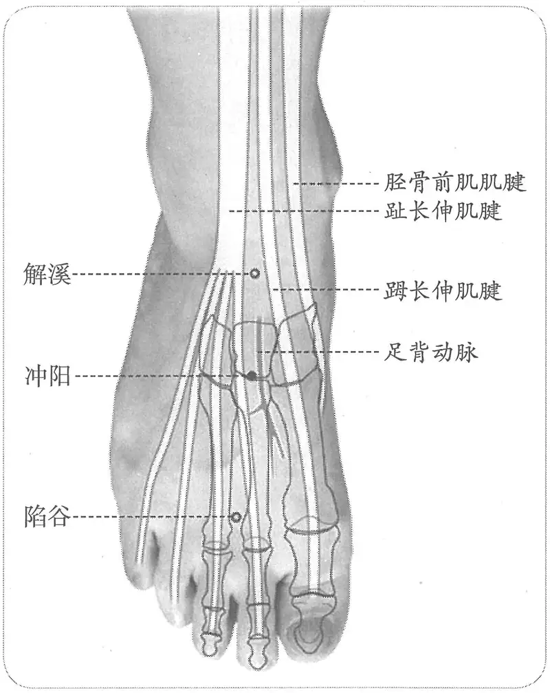

**图2-94　冲阳穴图**

〔p.410 (인쇄 390)〕

腱间，当第二、三跖骨与楔状骨间凹陷部取之。（2版《针灸学讲义》）

　　(4) 内庭穴上5寸。（4版《针灸学》）

　　(5) 在解溪穴下方，䠴长伸肌腱和趾长伸肌腱之间，当二、三趾骨与楔状骨间，足背动脉搏动处。（5版《针灸学》、《中国针灸学》）

　　(6) 在足背最高处，当䠴长伸肌腱和趾长伸肌腱之间，足背动脉搏动处。（6、7版《针灸学》）

**文献分析**：本穴定位，文字描述不同，而实际位置相同。《黄帝明堂经》曰“足趺上五寸”，后世文献有作“内庭上五寸”，或“内庭上四寸者”，实则定位相同。说“五寸”者忽略了内庭穴距趾蹼缘还有至少三五分距离，说“四寸”者，则是将内庭穴距趾蹼缘折作一寸也。至于教材既说本穴在“䠴长伸肌腱和趾长伸肌腱之间”，又说在“第二第三跖骨间”，二者不在同一点上，这也是2006年进行国标修订的一个重要原因。

#### 【类属】 

足阳明胃经穴，原穴。

　1. 过于冲阳，冲阳，足跗上五寸陷者中也，为原，摇足而得之……足阳明胃脉也，大肠、小肠，皆属于胃，是足阳明经也。（《灵枢·本输》）

　2. 足阳明脉之所过也，为原。（《黄帝明堂经》）

　3. 胃之源，冲阳穴也。在足跗上如同身寸之五分，骨间动脉上，去陷谷穴三寸是，足阳明之所过。（《素问亡篇·刺法论》）

#### 【适应症】 

主治脾胃、头面部病症。常用于口眼㖞斜，面肿，齿痛；胃脘痛，腹胀；癫狂；足痿无力或肿痛。

　1. 主热病汗不出，口中热痛，胃脘痛，时寒热。疟，令人先寒洗淅，甚久而热，热去汗出。齿龋痛。腹大不嗜食。振寒而欠，狂妄而行，登高而歌，弃衣而走。足下缓失履。风水面胕肿。（《黄帝明堂经》）

　2. 治偏风，口眼㖞斜，胕肿，齿龋痛，发寒热，腹坚大不嗜食，振寒，久狂登高而歌，弃衣而走，足缓履不收。（《铜人腧穴针灸图经》卷下）

　3. 窦太师针灸遗存

　　(1) 治脚背肿，脚气冲心，泻；伤寒无力，补。（《窦太师针经》）

　　(2) 脚背红肿。（《循经考穴编》上）

　　(3) 治脚背红肿，气聚不散。（《大本琼瑶神书》）

　4. 身前痛。（《针灸聚英》卷一）

**按**：“身前痛”，《洁古云岐针法》原方作“腰痛身之前，足阳明原穴”。则此处当作“腰前侧痛”。

　5. 统编针灸学教材

　　(1) 面浮肿，偏风，口眼㖞斜，上齿痛，腹肿大中嗜食，足痿，脚背红肿，狂疾。（1957年南京《针灸学》、1版《针灸学讲义》）

　　(2) 口眼㖞斜，头面浮肿，上齿痛，足痿无力，脚背红肿。（2版《针灸学讲义》）

　　(3) 口眼㖞斜，面肿，上齿痛，胃痛，足缓不收，狂痫。（4、5版《针灸学》）

　　(4) 胃痛腹胀，口眼㖞斜，面肿齿痛，足痿无力，脚背红肿。（6版《针灸学》）

　　(5) 胃痛、口眼㖞斜，癫狂痫、足痿无力。（7版《针灸学》）

　　(6) 上齿痛，足背红肿，口眼歪斜，足痿。（《中国针灸学》）

**文献分析**：《黄帝明堂经》载本穴主治病症多为典型的足阳明经病候，另主“风水”证和齿痛。金元窦太师针灸则偏重于足腕部病症，明代《针灸聚英》从元代针灸方中总结出一条主治，然理解有偏颇。

〔p.411 (인쇄 391)〕

#### 附：临床应用举例 

　1. 脾胃病症

　　(1) 霍乱，刺俞旁五，足阳明及上旁三。（《素问·通评虚实论》）

　　(2) 右手关上阳实者，胃实也。若肠中伏伏，不思食物，得食不能消，刺足阳明经，治阳，在足上动脉。（《脉经》卷七）

　　(3) 脾痫之为病，面黄腹大，喜痢，灸胃管三壮，夹胃管旁灸二壮，足阳明、太阴各二壮。（《千金要方》卷五）

**按**：《医学纲目》卷十一载此方作：“脾痫面黄，腹大善利：胃脘并脘旁一寸各三壮，冲阳、隐白”。

　2. 神志病症

　　(1) 仓公治蹶上方：头痛身热，使人烦懑，臣意即以寒水拊其头，刺足阳明脉，左右各三所，上病旋已。（《史记·扁鹊仓公列传》）

　　(2) 刺痫惊脉五，针手太阴各五，刺经太阳五，刺手少阴经络旁者一，足阳明一，上踝五寸刺三针。（《素问·通评虚实论》）

**按**：“足阳明”，古穴名，在足上动脉，相当于“冲阳”穴。以下皆同。

　　(3) 狂言，善笑见鬼，取之阳溪及手足阳明、太阴。（《针灸甲乙经》卷十一）

　　(4) 狂走惊恍惚……又灸足阳明三十壮。（《千金要方》卷十四、《千金翼方》）

　　(5) 五痫颠狂弃衣歌笑：灸少海，刺冲阳、神门、少冲、合谷，泻之。（《针灸集要·盘石金直刺秘传》）

　3. 腰痛

　　(1) 腰痛，上寒不可顾，刺足阳明。（《素问·刺腰痛》）

　　(2) 人有所堕坠，恶血留内，腹中胀满，不得前后，先饮利药，此上伤厥阴之脉，下伤少阴之络。刺足内踝之下，然骨之前血脉出血，刺足跗上动脉；不已，刺三毛上各一痏，见血立已，左刺右，右刺左。善悲惊不乐，刺如右方。（《素问·缪刺论》）

　　(3) 洁古刺诸痛法……腰痛，身之前足阳明原穴；身之后足太阳原穴；身之侧，是少阳原穴。此针之撮要也。（《云岐子论经络迎随补泻法》）

　4. 其他病症

　　(1) 足阳明之疟，令人先寒，洒淅洒淅，寒甚久乃热，热去汗出，喜见日月光火气，乃快然，刺足阳明跗上。（《素问·刺疟》）

　　(2) 灸寒热之法，先灸项大椎，以年为壮数，次灸撅骨……足阳明跗上动脉灸之，巅上一灸之。（《素问·骨空论》）

　　(3) 疗上气积年，唾脓血方……又方：灸两乳下黑白际各二十壮一本百壮。灸足阳明穴，在足趺上三寸动脉上是，二七壮，系脐下一寸，并瘥。（敦煌卷子医方P3596）

　　(4) 猥腿风，半身不遂，失音不语者，灸百会……次灸足阳明，各五十壮。（《千金要方》卷八、《千金翼方》、敦煌卷子佚名灸方）

　　(5) 遗尿，灸遗道，夹玉泉五寸。随年壮。又灸阳陵泉，随年壮。又灸足阳明，随年壮。（《千金要方》卷二十一、《千金翼方》）

　　(6) 三叉神经痛：针刺冲阳、太溪穴治疗。［中国针灸，2000(12)：728］

#### 【操作】 

避开动脉，直刺0.3~0.5寸。

　1. 刺跗上中大脉，血出不止，死。（《素问·刺禁论》）

〔p.412 (인쇄 392)〕

　2. 刺入三分，留十呼，灸三壮。（《黄帝明堂经》）

　3. 先以左手按穴，刺可入三分，留三呼，进至一分，徐徐出针，以手扪其穴。（《素问亡篇·刺法论》）

　4. 以手按穴……刺入三分，留三呼，次进二分，留一呼，徐徐退而以手扪之者也。（《素问亡篇·刺法论》）

　5. 针入五分，可灸三壮。（《铜人腧穴针灸图经》卷下）

　6. 窦太师针灸遗存

　　(1) 针三分，禁灸。（《窦太师针经》）

　　(2) 窦氏针入五分。（《针方六集》）

　7. 针三分，灸三壮。针时应避开动脉，宜慎用。（《针灸十四经穴位考订》）

　8. 统编针灸学教材

　　(1) 针三分禁用粗针。灸三壮，不能多灸。（1957年南京《针灸学》）

　　(2) 针三分，灸三壮。（1版《针灸学讲义》）

　　(3) 避开动脉，直刺3分，艾条灸3~5分钟。（2版《针灸学讲义》）

　　(4) 避开动脉，直刺0.3~0.5寸。（4、5、6、7版《针灸学》、《中国针灸学》）

### （四十三）陷谷 Xiàngǔ ST43 出《灵枢》 

#### 【提要索隐】 

**部位**：在足背，第2、3跖骨间，第2跖趾关节近端下凹陷中。

**国标修订**：1990年版国标：在足背，当第2、3跖骨结合部前方凹陷处。2006年修订版：在足背，第2、3跖骨间，第2跖趾关节近端凹陷中。

**按**：古典文献以“本节”定位的腧穴，今统一用相应的关节及标准方位术语表述。

**适应症**：主治水饮及胃肠病症。常用于面肿、水肿；足背肿痛；肠鸣，腹痛。

**针刺操作**：刺0.3~0.5寸，或刺血。

#### 【名实考】 

关于本穴定位，古代文献描述无分歧，而现代针灸学教材表述不同，1990年版国标也受此影响。

　1. 注于陷谷，陷谷者，上中指内间上行二寸陷者中也，为腧……足阳明胃脉也，大肠、小肠，皆属于胃，是足阳明经也。（《灵枢·本输》）

　2. 注于陷谷，陷谷者木也，在足大指次指外间，本节后陷者中，去内庭二寸。足阳明脉之所注也，为输。（《黄帝明堂经》）

　3. 谷者，水之注也。自冲阳而至此穴部分，下于前穴，故曰陷谷。（《经穴解》）

#### 【定位】 

**部位**：在足背，第2、3跖骨间，第2跖趾关节近端下凹陷中（图2-95）。

**取穴**：第2、3跖骨间本节后取穴。

　1. 陷谷者，中指内间，上行二寸陷者中也。（《灵枢·本输》、《黄帝内经太素·本输》）

　2. 在足大指次指外间，本节后陷者中，去内庭二寸。（《黄帝明堂经》、《铜人腧穴针灸图经》卷下、《圣济总录》、《针灸资生经》、《针经节要》、《十四经发挥》、《神应经》、《针灸聚英》、《古今医统》、《针灸大成》、《针方六集》、《类经图翼》、《循经考穴编》、《针灸易学》、《针灸逢源》）

〔p.413 (인쇄 393)〕

　3. 在足大指次指间，本节后陷者中。（《太平圣惠方·明堂》）

　4. 在足大指次指之间本节陷中，去内庭二寸。（《铜人腧穴针灸图经》卷上）

　5. 在足大指次指与中指之间本节后陷中，去内庭穴二寸。（《窦太师针经》）

　6. 从冲阳下行二寸，至足大指之次指本节后陷中。（《医宗金鉴·刺灸心法要诀》）

　7. 内庭上二寸。（《针灸十四经穴位考订》）

　8. 统编针灸学教材

　　(1) 部位：在足大指次指外侧，本节后陷者中。取穴：第二趾外方，本节之后陷中取之。（1957年南京《针灸学》）

　　(2) 部位：内庭穴后二寸。取穴：大趾次趾外侧，本节后陷中取之。（1版《针灸学讲义》）

　　(3) 部位：在足大指次指外侧，本节后陷者中。取穴：在第二、三跖骨结合部之前凹陷中取之。（2版《针灸学讲义》）

　　(4) 内庭穴上2寸。（4版《针灸学》）

　　(5) 足背第二、三跖趾关节后凹陷中。（5版《针灸学》）

　　(6) 在足背，当第2、3跖骨结合部前方凹陷处。（6版《针灸学》、《中国针灸学》）

　　(7) 足背第2、3跖骨结合部前，第2、3跖趾关节后凹陷处。（7版《针灸学》）

**文献分析**：本穴定位，古代文献无分歧，至于第2、6、7版教材所说“第2、3跖骨结合部前方凹陷处”，则太靠近冲阳穴，1957年版南京《针灸学》冲阳穴的取法为“从第二第三跖骨接合处微前”，这样此二穴几乎看不出区别了。问题的关键不是不同的教材主编对于古代文献的理解不同，而是在将古代针灸定位术语转换为现代解剖学术语时出了问题。

#### 【类属】 

足阳明胃经穴，五输穴之输穴。

　1. 注于陷谷，陷谷者，上中指内间上行二寸陷者中也，为腧……足阳明胃脉也，大肠、小肠，皆属于胃，是足阳明经也。（《灵枢·本输》）

　2. 足阳明脉之所注也，为输。（《黄帝明堂经》）

#### 【适应症】 

主治水饮及胃肠病症。常用于面肿、水肿；足背肿痛；肠鸣，腹痛。

　1. 主热病，刺陷谷，足先寒，寒上至膝乃出针。面肿，目痈肿，刺陷谷，出血立已。善啮唇善噫，腹痛，胀满，肠鸣，热病汗不出。水肿留饮，胸胁支满，刺陷谷，出血立已。（《黄帝明堂经》）

　2. 主卒疝，痎疟发寒热也。（《太平圣惠方·明堂》）

　3. 治面目浮肿及水病，善噫，肠鸣腹痛，热病汗不出，振寒疟疾。（《铜人腧穴针灸图经》卷下）

　4. 窦太师针灸遗存

　　(1) 治脚背红肿，弹针出血。四肢浮肿，锋针出血尤佳。（《窦太师针经》）

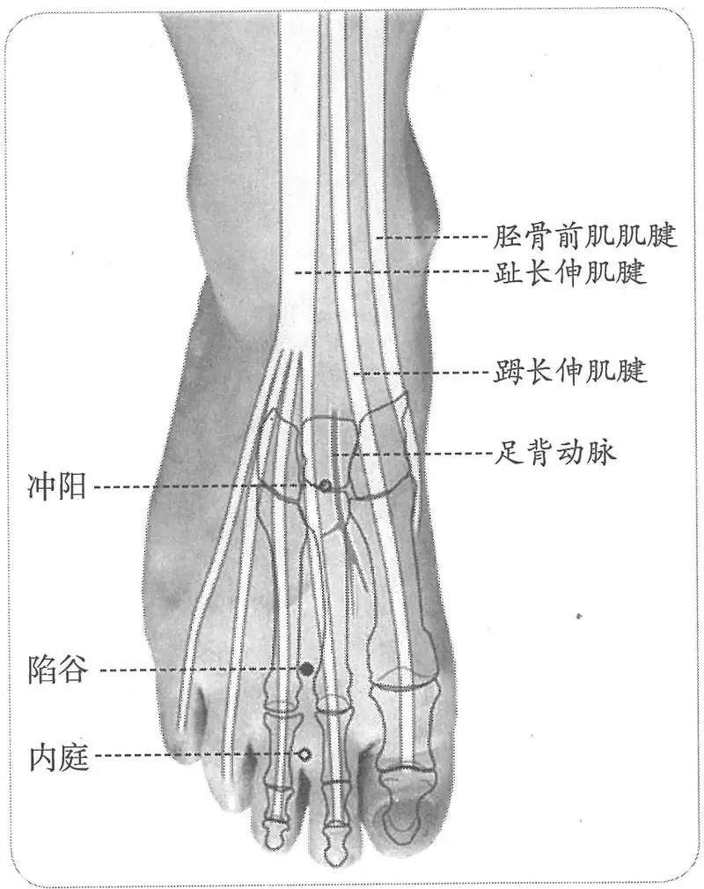

**图2-95　陷谷穴图**

〔p.414 (인쇄 394)〕

　　(2) 若脚背红肿，宜弹针出血。（《针方六集》卷六）

　　(3) 主足背肿疼。（《循经考穴编》上）

　5. 统编针灸学教材

　　(1) 面目浮肿，水肿，肠鸣腹痛，足背肿痛，热病汗不出。（1957年南京《针灸学》、1版《针灸学讲义》）

　　(2) 面部浮肿，水肿，肠鸣，腹痛，足背肿痛。（2版《针灸学讲义》、《中国针灸学》）

　　(3) 面浮身肿，胸胁支满，腹痛肠鸣，热病，足胫痛。（4版《针灸学》）

　　(4) 面浮身肿，目赤肿痛，肠鸣腹痛，热病，足背肿痛。（5、6版《针灸学》）

　　(5) 面肿、水肿等水液输布失常性疾患；足背肿痛；肠鸣腹痛。（7版《针灸学》）

**文献分析**：本穴主治古今文献多集中于水饮及胃肠病症，古代临床应用则更偏重于水饮病症的治疗。

#### 附：临床应用举例 

　1. 水肿，灸陷谷，随年壮。（《千金翼方》卷二十八）

　2. 中风有汗，身热，不恶风……宜针陷谷，刺厉兑。针陷谷者，去阳明之贼，刺厉兑者，泻阳明经之实也。已上二证阳明经中风也。（《素问病机气宜保命集》卷中）

　3. 洁古刺诸痛法……热无度不可止，陷谷出血。（《云岐子论经络迎随补泻法》）

　4. 牙痛，内庭穴、陷谷穴透针。［浙江中医杂志，1985，20(4)：164］

　5. 眼睑下垂，临泣穴、陷谷穴，针灸疗法。［上海针灸杂志，1987，6(1)：45］

　6. 顽固性呃逆，陷谷穴针刺治疗。［中国针灸，1996(8)：7］

#### 【操作】 

刺0.3~0.5寸，或刺血。

　1. 刺入五分，留七呼，灸三壮……刺陷谷出血，立已。（《黄帝明堂经》）

　2. 针入三分，留七呼，可灸三壮。（《铜人腧穴针灸图经》卷下）

　3. 针五分，禁灸。治脚背红肿，弹针出血。四肢浮肿，锋针出血尤佳。（《窦太师针经》）

　4. 统编针灸学教材

　　(1) 针三至五分，灸三至七壮。（1957年南京《针灸学》、1版《针灸学讲义》）

　　(2) 直刺3~5分，艾条灸3~5分钟。（2版《针灸学讲义》）

　　(3) 直刺或斜刺0.5~1寸。（4、5版《针灸学》）

　　(4) 直刺0.3~0.5寸；可灸。（6版《针灸学》、《中国针灸学》）

　　(5) 直刺或斜刺0.3~0.5寸。（7版《针灸学》）

### （四十四）内庭 Nèitíng ST44 出《灵枢》 

#### 【提要索隐】 

**部位**：在足背，第2、3趾间，趾蹼缘后方赤白肉际处。

**适应症**：主治头面、胃肠病症。常用于齿痛，咽喉肿痛，鼻衄，口眼㖞斜；腹胀，食欲不振，泄泻；足背肿痛；发热。

**针刺操作**：直刺0.3~0.5寸。

#### 【名实考】 

　1. 胃出于厉兑，厉兑者，足大指内次指之端也，为井金；溜于内庭，内庭，次指外间也，为荥……足阳明胃脉也，大肠、小肠，皆属于胃，是足阳明经也。（《灵枢·本输》）

〔p.415 (인쇄 395)〕

　2. 流于内庭，内庭者水也，在足大指次指外间陷者中。足阳明脉之所流也，为荥。（《黄帝明堂经》）

　3. 自厉兑而上入于足跗上，在二指之间，有庭之象焉。以其在二指之内，故曰内庭。（《经穴解》）

#### 【定位】 

**部位**：在足背，第2、3趾间，趾蹼缘后方赤白肉际处（图2-96）。

**取穴**：当第2跖趾关节前外方凹陷中取之。

　1. 次指外间也。（《灵枢·本输》）

　2. 足大指次指外间陷者中。（《黄帝明堂经》、《太平圣惠方·明堂》、《铜人腧穴针灸图经》、《圣济总录》、《针灸资生经》、《针经节要》、《针灸玉龙经》、《十四经发挥》、《神应经》、《针灸聚英》、《古今医统》、《针灸大成》、《类经图翼》、《循经考穴编》、《医宗金鉴·刺灸心法要诀》）

　3. 窦太师针灸遗存

　　(1) 在足大指次指向中指之间陷中，两歧骨前三分。（《窦太师针经》）

　　(2) 穴在足大趾次趾外间，歧骨后三分陷中。（《针方六集·玉龙歌》注）

　　(3) 在足大指次指外间陷中，两歧骨后三分。（《针方六集》卷一）

　　(4) 次指与三指歧缝间。（《循经考穴编》上）

　4. 次、中趾之间，脚叉合缝尽处之陷凹中。（《针灸十四经穴位考订》）

　5. 统编针灸学教材

　　(1) 部位：足次趾外间陷中。取穴：从第二趾侧本节之前陷中，当次趾与中趾合缝处之上际取之。（1957年南京《针灸学》）

　　(2) 部位：足中趾与次趾间陷中。取穴：在足次趾外侧本节前陷中取之。（1版《针灸学讲义》）

　　(3) 部位：在足大趾次趾外间陷者中。取穴：在足第二、三趾缝间，当第二跖趾关节前外方凹陷中取之。（2版《针灸学讲义》）

　　(4) 足背第2、3趾间缝纹端。（4、5、7版《针灸学》）

　　(5) 在足背，当第2、3趾间，趾蹼缘后方赤白肉际处。（6版《针灸学》）

　　(6) 在足背第二、三趾的趾缝间，当第二趾跖关节前方凹陷中。（《中国针灸学》）

**文献分析**：本穴定位，古代只说“三指歧缝间”，今参照其他趾（指）间穴定位，统一定于赤白肉际处。

#### 【类属】 

足阳明胃经穴，五输穴之荥穴。

　1. 胃出于厉兑，厉兑者，足大指内次指之端也，为井金；溜于内庭，内庭，次指外间也，为

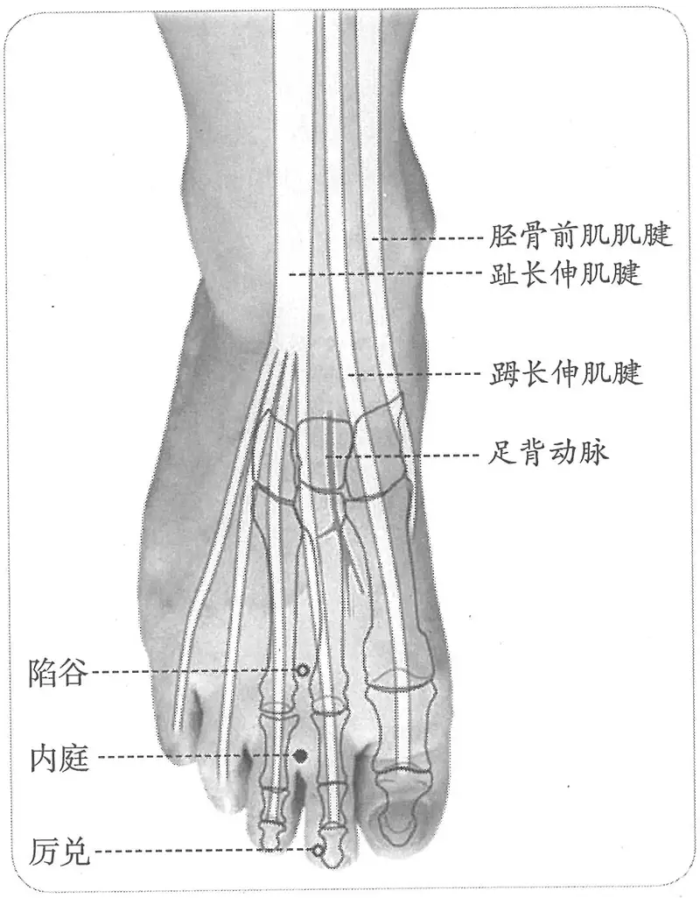

**图2-96　内庭穴图**

〔p.416 (인쇄 396)〕

荥……足阳明胃脉也，大肠、小肠，皆属于胃，是足阳明经也。（《灵枢·本输》）

　2. 足阳明脉之所流也，为荥。（《黄帝明堂经》）

#### 【适应症】 

主治头面、胃肠病症。常用于齿痛，咽喉肿痛，鼻衄，口眼㖞斜；腹胀，食欲不振，泄泻；足背肿痛；发热。

　1. 主四厥，手足闷者，使人久持之，厥热胫痛，腹胀皮痛，善伸数欠，恶人与木音，振寒，嗌中引外痛，热病汗不出，下齿痛，恶寒，目急，喘满，寒栗，龂口噤僻，不嗜食。（《黄帝明堂经》）

**按**：以上“善伸数欠，恶人与木音，振寒，嗌中引外痛，热病汗不出”诸症为足阳明经典型病症；《灵枢·杂病》所曰“齿痛，不恶清饮，取足阳明；恶清饮，取手阳明”，与此处“下齿痛，恶寒”有所不同。

　2. 小儿疟，久不愈。（《太平圣惠方·明堂》）

　3. 治四肢厥逆，腹胀满，数欠，恶闻人声，振寒，咽中引痛，口㖞，齿龋痛，疟，不嗜食。（《铜人腧穴针灸图经》卷下）

　4. 治大小腹胀，酒食所伤，泻之。（《琼瑶神书》）

　5. 窦太师针灸遗存

　　(1) 治小腹胀满，脚背红肿，气喘，便血，泻；胃口停食，冷积，先补后泻。（《窦太师针经》）

　　(2) 治气喘，便血，胃中停食冷积，脚背红肿，伤寒手足厥冷汗不出，赤白利。（《针方六集》卷五）

　　(3) 治小腹胀，小便不通，先补后泻；小便急痛，单泻；腹中雷鸣，单补；臌胀，看虚实补泻。（《针方六集·玉龙歌》注）

　　(4) 主治瘾疹，喉痹，便血，足指背红肿疼痛，并宜泻之。（《循经考穴编》上）

　6. 统编针灸学教材

　　(1) 口㖞，龋齿，衄衄，尸厥口噤，喉痹，腹胀满，不嗜食，泄泻，赤白痢疾，足背肿痛。（1957年南京《针灸学》）

　　(2) 口㖞，齿痛，鼽衄，口噤，喉痹，胃脘痛，腹胀满，不嗜食，泄泻，赤白痢疾，足背肿痛。（1版《针灸学讲义》）

　　(3) 齿痛，口㖞，喉痹，鼻衄，腹痛，腹胀，泄泻，痢疾，足背肿痛，热病。（2版《针灸学讲义》）

　　(4) 齿痛，咽喉痛，口㖞，鼻衄，胃痛吐酸，腹胀，泄泻，痢疾，便秘，足背肿痛，热病。（4、5版《针灸学》）

　　(5) 齿痛，口㖞，喉痹，鼻衄，腹痛，腹胀，痢疾，泄泻，足背肿痛，热病，胃痛吐酸。（6版《针灸学》）

　　(6) 齿痛、咽喉肿痛、鼻衄等五官热性病证；热病；吐酸、腹泄、痢疾、便秘等胃肠病证；足背肿痛，跖趾关节痛。（7版《针灸学》）

　　(7) 齿痛，面痛，口角歪斜，咽喉痛，鼻衄，胃痛，吐酸，腹胀，泄泻，痢疾，便秘，足背肿痛，热病。（《中国针灸学》）

**文献分析**：本穴主治，腧穴文献与治疗文献均集中于头面、胃肠病症。

#### 附：临床应用举例 

　1. 头面病症

　　(1) 治鼻衄不止，刺督脉喑门一穴，手阳明经合谷二穴，足阳明经内庭二穴，足大指次指外间陷中。（《针经摘英集》）

〔p.417 (인쇄 397)〕

　　(2) 治牙疼，刺手阳明经合谷二穴，在手大指次指歧骨间陷中，针入三分。次阳明经内庭二穴。在足大指次指外间陷中，如虫食疼者。傅药而愈。（《针经摘英集》）

　　(3) 化脓性牙周炎：合谷穴、颊车穴、内庭穴，针刺治疗。［上海针灸杂志，1987，6（3）：47］

　　(4) 周围性面瘫：合谷穴、内庭穴，针灸疗法。［安徽中医学院学报，1987（2）：36］

　2. 胃肠脘腹病症

　　(1) 寒气入脾，心痛不可忍：刺大陵、内关、内庭，俱泻之，各灸七壮。（《针灸集要·盘石金直刺秘传》）

　　(2) 单腹胀痛，双蛊腹胀：刺内庭，泻足三里；少愈，灸水分、中脘补之。（《针灸集要·盘石金直刺秘传》）

　　(3) 肚腹胀满疼痛：中脘、三阴交、关元、内庭、天枢、隐白、气海、三里。问曰：其证何得？针已上穴法不效，何也？曰：皆因停食不化，腹肚胀满疼痛，大便虚结，其证非一，宜推详其所因以治之。复刺后穴：中脘、气海。（《针灸集成》第三十八方）

　　(4) 单蛊胀：水分、石门、气海、中脘。问曰：此证缘何而得？答曰：因风寒暑湿串入脏腑，以致食物不能化，脾败胃虚，故如此也。复刺后穴：三里、脾俞、行间、内庭。（《针灸集成》第四十九方）

　　(5) 伤寒，小腹痛，手足冷，恶寒谵语：灸关元，补之；小腹胀，刺内庭、照海。（《针灸集要·盘石金直刺秘传》）

　　(6) 一切气逆气喘，肠鸣走注攻心：灸膻中，刺大陵、足三里，俱泻之，内庭、气海。（《针灸集要·盘石金直刺秘传》）

　　(7) 腹痛而胀，夺内庭以休迟。（《通玄指要赋》）

　　(8) 小腹胀满气攻心，内庭二穴刺须真。（《针灸玉龙歌》）

　　(9) 三里内庭穴，肚腹中妙诀。（《千金十一穴歌》）

　　(10) 小儿吐乳症：针刺内庭穴治疗。［针灸学报，1992，8（5）：40］

　　(11) 急性胃肠炎：艾灸里内庭穴治疗。［中医药研究，1994（2）：55］

　　(12) 神经性呕吐：针灸内关、内庭穴治疗。［贵阳中医学院学报，1999，21（4）：31］

　3. 其他病症

　　(1) 小儿疟久不愈者，灸足大指次指外间陷者中各一壮，炷如小麦大，内庭穴也。（《太平圣惠方·明堂》）

　　(2) 内收肌损伤：取患侧内庭穴针刺。［上海针灸杂志，2000，19（3）：43］

#### 【操作】 

直刺0.3~0.5寸。

　1. 刺入三分，留二十呼，灸三壮。（《黄帝明堂经》）

　2. 窦太师针灸遗存

　　(1) 针入五分，灸七壮。（《窦太师针经》）

　　(2) 针入半寸，灸二七壮。（《针灸玉龙歌》注）

　3. 针入二分，灸三壮。（《医学入门》卷一）

　4. 针三分，灸五壮。（《针灸十四经穴位考订》）

　5. 统编针灸学教材

　　(1) 针三至五分，灸三至五壮。（1957年南京《针灸学》、1版《针灸学讲义》）

〔p.418 (인쇄 398)〕

　　(2) 直刺3~5分，艾条灸3~5分钟。（2版《针灸学讲义》）

　　(3) 直刺或斜刺0.5~0.8寸。（4、5、7版《针灸学》）

　　(4) 直刺0.3~0.5寸；可灸。（6版《针灸学》、《中国针灸学》）

　6. 向上斜刺0.3~0.8寸。感应：局部酸胀。灸3~5壮；温灸5~10分钟。（上海《针灸学》）

### （四十五）厉兑 Lìduì ST45 出《素问》、《灵枢》 

#### 【提要索隐】 

**部位**：在足趾，第2趾末节外侧，趾甲根角侧后方0.1寸（指寸）。

**适应症**：主治头面部病症。常用于鼻衄，齿痛，面肿，咽喉肿痛，口眼㖞斜，热病，癫狂，多梦，易惊；神昏。

**针刺操作**：浅刺0.1寸。

#### 【名实考】 

《素问》治尸厥针方有“刺足中指爪甲上”，杨上善、王冰皆注作足阳明经井穴厉兑，《黄帝明堂经》也将此方主治辑入厉兑穴下，于是林亿推测经文“足中指”乃足第二指。后人不明此义，于《素问》“足中指”后添加“次指”二字作“足中指次指”，令人不知其所云——是指第二指，还是第四指？

　1. 邪客于足阳明之经，令人鼽衄上齿寒，刺足中指次指爪甲上，与肉交者各一痏，左刺右，右刺左。王冰注曰：中当为大，亦传写中大之误也。据《灵枢经》、《孔穴图经》中指次指爪甲上无穴，当言刺大指次指爪甲上，乃厉兑穴，阳明之井，不当更有次指二字也，厉兑者刺可入同身寸之一分，留一呼，若灸者可灸一壮。新校正云：按《甲乙经》云：“刺足中指爪甲上”。无“次指”二字。盖以大指次指为中指，义与王注同。下文云“足阳明中指爪甲上”。亦谓此穴也。厉兑在足大指次指之端，去爪甲角如韭叶。

　2. 缪传引上齿，齿唇寒痛，视其手背脉血者去之，足阳明中指爪甲上一痏，手大指次指爪甲上各一痏，立已，左取右，右取左。王冰注曰：谓第二指厉兑穴也。手大指次指，谓商阳穴，手阳明井也。《针经》曰：“齿痛不恶清饮，取足阳明。恶清饮，取手阳明。”新校正云：详前文“邪客足阳明，刺中指次指爪甲上”，是误剩“次指”二字，当如此只言中指爪甲上乃是也。

　3. 邪客于手足少阴太阴足阳明之络，此五络，皆会于耳中，上络左角，五络俱竭，令人身脉皆动，而形无知也，其状若尸，或曰尸厥，刺其足大指内侧爪甲上，去端如韭叶，后刺足心，后刺足中指爪甲上各一痏王冰注曰：第二指足阳明之井也，刺同前取厉兑穴法，后刺手大指内侧，去端如韭叶，后刺手心主、少阴锐骨之端各一痏，立已。

——《素问·缪刺》王冰注

**按**：以上三条的“足中指”，王冰皆注作“厉兑”穴，杨上善注《黄帝内经太素》同。如果说这里的“足中指”是指足第三指的话，则无穴，何以皆注作“厉兑”？可能正是由于这样的考虑，传世本《素问》第一条“足中指”后才被添上了“次指”二字，可是“足中指次指”究竟是说足第二指，还是第四指？检经文只有“大指次指”和“小指次指”的说法，而无“中指次指”的说法。王冰也知于理不通，于是怀疑“中指”是“大指”之误，岂不知《针灸甲乙经》、《黄帝内经太素》皆无“次指”二字，此二字显系后人妄增。林亿明知此误，于是推测经文“足中指”即是足第二指，此说可通，《素问·气府论》有云“足阳明脉气所发者六十八穴：……三里以下至足中指各八俞，分之所在穴空”，说的也是“足中指”。可见，“中指”一词，在手与在足，可有不同含义，犹如“将指”一词，在足在手，所指不同一样。宋代方书引《素问》尸厥针方，则直接将“足中指”注作“厉兑”，是。

〔p.419 (인쇄 399)〕

　4. 胃出于厉兑，厉兑者，足大指内次指之端也，为井金……足阳明胃脉也，大肠、小肠，皆属于胃，是足阳明经也。（《灵枢·本输》）

　5. 论曰若暴厥，卒然不知人事……又刺足大指内侧爪甲去端如韭叶，入一分，留三呼，谓隐白穴也。出之，又刺足心涌泉穴，如上法。又刺足中指爪上，令破，如上法，谓厉兑穴也。又刺手大指内侧，去端如韭叶。又刺手心主，谓中冲穴也。又刺掌后锐骨之端，谓神门穴也。（《全生指迷方》卷三）

　6. 胃出厉兑，厉兑者金也，在足大指次指之端，去爪甲角如韭叶。足阳明脉之所出也，为井。（《黄帝明堂经》）

　7. 兑者，悦也，胃开口之象。又曰为口、为饮食之象，皆合于胃之义，故曰厉兑。（《经穴解》）

#### 【定位】 

**部位**：在足趾，第2趾末节外侧，趾甲根角侧后方0.1寸（指寸）（图2-97）。

**取穴**：足第2趾外侧甲根角侧后方（即沿角平分线方向）0.1寸。相当于沿爪甲外侧画一直线与爪甲基底缘水平线交点处取穴。

　1. 足大指内次指之端也，为井金。（《灵枢·本输》）

　2. 在足大指次指之端，去爪甲角如韭叶。（《黄帝明堂经》、《太平圣惠方·明堂》、《铜人腧穴针灸图经》卷下“穴腧都数”、《圣济总录》、《针灸资生经》、《针灸玉龙经》、《十四经发挥》、《神应经》、《针灸聚英》、《古今医统》、《医学入门》、《针灸大成》、《类经图翼》、《医宗金鉴·刺灸心法要诀》、《针灸易学》、《针灸逢源》）

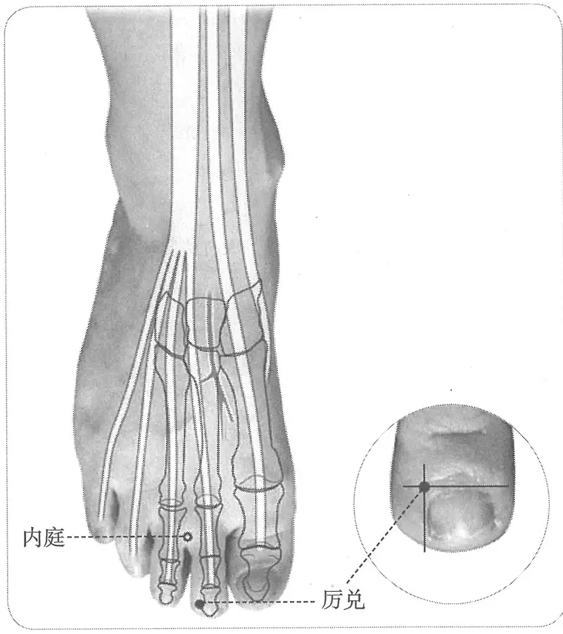

**图 2-97　厉兑穴图**

　3. 在足大指次指端，去爪甲如韭叶。（《铜人腧穴针灸图经》卷上、卷下）

　4. 窦太师针灸遗存

　　(1) 在足大指次指之端内侧，向大指边去爪甲如韭叶。（《窦太师针经》）

　　(2) 在足大指次指之端，外侧向中指边，去爪甲如韭叶。（《针方六集》卷一、《循经考穴编》）

　5. 次趾外侧，去爪甲角一分许。（《针灸十四经穴位考订》）

　6. 统编针灸学教材

　　(1) 部位：足次趾之端外侧去爪甲角一分。取穴：取第二趾外侧爪甲角约一分许。（1957年南京《针灸学》）

　　(2) 部位：足大趾次趾外侧端。取穴：于足次趾之端外侧去爪甲一分许取之。（1版《针灸学讲义》）

〔p.420 (인쇄 400)〕

　　(3) 部位：在足大指次指之端，去爪甲角一分。取穴：在第二趾外侧，距爪甲角一分许取之。（2版《针灸学讲义》）

　　(4) 第2趾外侧趾甲根角旁约0.1寸。（4、5、7版《针灸学》）

　　(5) 在足第2趾末节外侧，距趾甲角0.1寸（指寸）。（6版《针灸学》）

　　(6) 第二趾外侧趾甲根角后一分许。（《中国针灸学》）

**文献分析**：本穴定位，古今文献无分歧。关于“爪甲角”的理解以及“韭叶”宽度折算，参见“少商”穴文献分析。

#### 【类属】 

足阳明胃经穴，五输穴之井穴。

　1. 胃出于厉兑，厉兑者，足大指内次指之端也，为井金……足阳明胃脉也，大肠、小肠，皆属于胃，是足阳明经也。（《灵枢·本输》）

　2. 足阳明脉之所出也，为井。（《黄帝明堂经》）

#### 【适应症】 

主治头面部病症。常用于鼻衄，齿痛，面肿，咽喉肿痛，口眼㖞斜，热病，癫狂，多梦，易惊；神昏。

　1. 主尸厥，口噤，气绝，脉动如故，其形无知，如中恶状。疟，不嗜食。腹寒胀满。热病汗不出，鼽衄，眩，时仆，面浮肿，足胫寒，不得卧，振寒，恶人与木音，喉痹，龋齿，恶风，鼻不利，多卧善惊。（《黄帝明堂经》）

**按**：以上“尸厥，口噤，气绝，脉动如故，其形无知，如中恶状。疟，不嗜食”、“鼽衄”、“龋齿”诸症皆出于《内经》针灸方主治；“面浮肿”之风水证、喉痹皆为足阳明胃经穴所主；“振寒，恶人与木音”为足阳明经病候。

　2. 尸厥如死不知人。（《太平圣惠方·明堂》）

　3. 治尸厥口噤气绝，状如中恶，心腹胀满，热病汗不出，寒热疟，不嗜食，面肿，足胻寒，喉痹，齿龋，恶风，鼻不利，多惊好卧。（《铜人腧穴针灸图经》卷下）

　4. 窦太师针灸遗存

　　(1) 胃弱不食，先泻后补；胃热、大便闭，泻。（《窦太师针经》）

　　(2) 主胃中积热，胃脘疼痛，便结，便血。（《循经考穴编》上）

　5. 主治口㖞，唇胗，颈肿，膝膑肿痛，循胸、乳、气街、股、伏兔、骭外廉、足跗上痛，消谷善饥，溺黄。（《针灸聚英》卷一、《古今医统》、《针灸大成》）

**按**：以上病症皆足阳明经病候，高武据其对“母子补泻”的理解，将其归于本穴主治中。

　6. 统编针灸学教材

　　(1) 面肿，口㖞，龈齿，鼻衄，喉痹，狂癫，尸厥口噤，多梦，心腹胀满不嗜食，足胻寒，热病汗不出。（1957年南京《针灸学》、1版《针灸学讲义》）

　　(2) 面肿，口㖞，齿痛，鼻衄，胸腹胀满，足胫寒冷，热病，多梦，癫狂。（2版《针灸学讲义》）

　　(3) 鼽衄，齿痛，喉痹，腹胀，足胫寒冷，热病，多梦，癫狂。（4版《针灸学》）

　　(4) 鼽衄，齿痛，咽喉肿痛，腹胀，热病，多梦，癫狂。（5版《针灸学》）

　　(5) 面肿，齿痛，口㖞，鼻衄，胸腹胀满，热病，多梦，癫狂。（6版《针灸学》）

　　(6) 鼻衄、齿痛、咽喉肿痛等实热性五官病证；热病；多梦、癫狂等神志疾患。（7版《针灸学》）

　　(7) 面肿，鼻衄，口角歪斜，齿痛，喉痹，腹胀，足胫寒冷，热病，多梦，癫狂。（《中国针灸学》）

〔p.421 (인쇄 401)〕

**文献分析**：本穴主治，古今文献记载一致，多集中于头面部病症及急救。

#### 附：临床应用举例 

　1. 头面病症

　　(1) 邪客于足阳明之经，令人鼽衄，上齿寒。刺足中指次指爪甲上与肉交者各一痏，左刺右，右刺左。缪传引上齿，齿唇寒痛，视其手背脉血者去之。足阳明中指爪甲上一痏，手大指次指爪甲上各一痏，立已，左取右，右取左。（《素问·缪刺论》）

　　(2) 鼻衄，胃火上逆：内庭、上巨虚、厉兑三棱针点刺出血。［中医杂志，1986，27（3）：46］

　　(3) 目赤肿痛结膜炎、红眼病：厉兑点刺出血。［浙江中医杂志，1989，24（5）：225］

　　(4) 麦粒肿：厉兑点刺出血。［浙江中医杂志，1989，24（5）：225］

　2. 神志病症

　　(1) 小儿睡中惊掣，灸足大指次指之端，去爪甲如韭叶各一壮，炷如小麦大。（《太平圣惠方·明堂》）

　　(2) 治传尸、殗殜、喜魇梦诸穴：商丘二穴，在足内踝下微前陷中，灸七壮，瘥乃止。厉兑二穴，在足大指次指之端，去爪甲角如韭叶，灸一壮大良。二间二穴，在手大指次指本节内侧陷中，灸三壮。以上六穴，商丘疗多卧，厉兑疗嗜卧怠惰，章门疗贲豚气胀。（《圣济总录》卷一九三）

　　(3) 尸厥者，灸厉兑二穴。《甲乙经》云：穴在足大指次指之端，去爪甲角如韭叶。足阳明脉所出也。（《圣济总录》卷一百九十二）

#### 【操作】 

浅刺0.1寸。

　1. 刺入一分，留一呼，灸一壮。（《黄帝明堂经》）

　2. 针入一分，沿皮向后三分，禁灸。（《窦太师针经》）

　3. 针一分，灸三壮。（《针灸十四经穴位考订》）

　4. 统编针灸学教材

　　(1) 针一分，灸三壮。（1957年南京《针灸学》、1版《针灸学讲义》）

　　(2) 斜刺1分，小艾炷灸3~5壮。（2版《针灸学讲义》）

　　(3) 浅刺0.1寸。（4、5、6、7版《针灸学》、《中国针灸学》）

### 延伸阅读 

　1. 黄龙祥.中国针灸学术史大纲[M].北京：华夏出版社，2001.

　2. 黄龙祥.中国针灸史图鉴[M].青岛：青岛出版社，2003.

　3. 黄龙祥.新编重绘十四经脉经穴图[M].北京：中国中医药出版社，2010.

　4. 张宏，靳瑞.睛明、承泣穴的深刺法及临床观察[J].新中医，1996（7）：29.

　5. 李学武.下关穴的针刺方法[J].针灸临床杂志，1993，9（5）：36-37，34.

　6. 夏秋芳.人迎穴考证及现代临床研究进展[J].针灸临床杂志，2010，26（6）：80-84.

　7. 蒋松鹤，杨文秀，张慧玲.人迎穴的探讨及颈动脉窦定位实验[J].上海针灸杂志，1994，13（6）：269-270.

　8. 代田文志，萧友山.刺洞（针刺颈动脉窦）的理论与实际[J].中医杂志，1957（9）：24-28.

　9. 王立早.人迎洞刺的临床观察[J].吉林中医药，1981（4）：36-37.

　10. 张诗兴，徐恒泽，王玉生，等.人迎穴的局部特征及其主治功能浅析[J].镇江医学院学报，1998，8（4）：448-449.

〔p.422 (인쇄 402)〕

　11. 范准成.人迎穴的刺法与疗效[J].河北中医，1980（3）：47-48.

　12. 王英、刘玉檀.关于人迎穴的研究概括[J].上海针灸杂志，1996，15（2）：36.

　13. 零恒莉，潘敏，雪丽霜.乳头刺激在产科应用的研究进展[J].护理学杂志，2009，24（14）：95-96.

　14. 晏秀英.乳头刺激在过期妊娠中的应用[J].右江民族医学院学报，1988，10（3/4）：114-117.

　15. 朱丽清，李兆文.刺激乳中穴治疗宫缩乏力51例疗效观察[J].针刺研究，1994（z1）：179.

　16. 孙永亮，宋淑兰.足三里穴不同方向针刺治疗腹痛[J].上海针灸杂志，2003，22（4）：48.

　17. 楼新法，杨新东，蒋松鹤，等.足三里穴进针角度和深度的研究[J].中国针灸，2006，26（7）：483-486.

　18. 周海波.足三里穴在临床中的应用[J].针刺临床杂志，2000，16（12）：30-31.

　19. 席时元，陶之理.“足三里”穴传入途径的探讨[J].针刺研究，1982（6）：66-69.

　20. 张佛明，郭长青.条口穴用于肩关节周围炎治疗的起源初探[J].时珍国医国药，2006，17（9）：1197-1198.

　21. 赵宏，赵婷，刘保延，等.条口穴不同刺法对肩周炎疗效差异的观察[J].中国针灸，2006，26（10）：729-731.

　22. 彭增福.条口穴主治肩周炎经验的追本溯源[J].中国针灸，2009，29（2）：118-119.

　23. 张载义.丰隆穴不应在足阳明胃经的支脉上[J].山西中医，1989，5（6）：42-43.

　24. 谢永财，陈跃，吴炳煌，等.缺盆穴针刺安全深度的应用解剖研究[J].福建中医学院学报，2006，16（1）：24-25.

〔p.423 (인쇄 403)〕

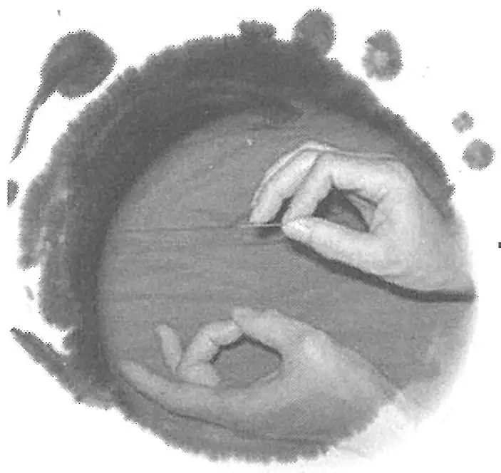

