# 《针灸腧穴通考》(上册) — 足太阴脾经穴  · （一）隐白 Yǐnbái SP1 出《素问》、《灵枢》~（二十一）大包 Dàbāo SP21 出《灵枢》

> 분할본 9/25. 원서: 黄龙祥·黄幼民 编著, 《针灸腧穴通考——〈中华针灸穴典〉研究》(上册), 人民卫生出版社, 2011. 원서 스캔 OCR 판독본을 챗봇 검색용으로 나눈 것이며, 본문과 쪽 표시 〔p.PDF쪽 (인쇄 쪽)〕는 원본 그대로이다.

## 四、足太阴脾经穴 

### 概说 

足太阴经穴中变化最大的要数三阴交穴，其定位与主治病症都发生了很大的变化，严格说来，应当视为“同名异穴”。又由于对三阴交穴“脉气所发”内容的不同理解，使得古今“明堂图”小腿部足三阴经穴的画法，出现了多种不同的处理方式。另一个重大变化是“箕门”穴定位的表述，新、旧国标的变化很大，对旧国标加以修订的原因和根据是什么？

#### 【经脉与经穴】 

#### 经脉循行与病候 

脾足太阴之脉，起于大指之端，循指内侧白肉际，过核骨后，上内踝前廉，上踹内，循胫骨后，交出厥阴之前，上膝股内前廉，入腹属脾络胃，上膈，挟咽，连舌本，散舌下；其支者，复从胃，别上膈，注心中。是动则病舌本强，食则呕，胃脘痛，腹胀善噫，得后与气则快然如衰，身体皆重。是主脾所生病者，舌本痛，体不能动摇，食不下，烦心，心下急痛，溏、瘕、泄、水闭、黄疸，不能卧，强立，股膝内肿厥，足大指不用。（《灵枢·经脉》）

太阴脉：是胃脉也。被胃，出鱼股阴下廉、腨上廉，出内踝之上廉。是动则病上当走心，使腹胀，善噫，食欲呕，得后气则快然衰，是钜阴脉主治。其所产病：独心烦，死；心痛与腹胀，死；不能食，不能卧，强欠，三者同则死；溏泄，死；水与闭同则死，为十病。（《阴阳十一脉灸经》）。

足泰阴温：出大指内兼（廉）骨际，出内踝上兼（廉），循胻内兼（廉），□膝内兼（廉），出股内兼（廉）。其病：病足大指废，胻内兼（廉）痛，股内痛，腹痛。腹胀，复□，不嗜食，善噫，心□，善肘。诸病此物者，皆灸足太阴脉。（《足臂十一脉灸经》）。

**所属经穴**：隐白　大都　太白　公孙　商丘　三阴交　漏谷　地机　阴陵泉　血海　箕门　冲门　府舍　腹结　大横　腹哀　食窦　天溪　胸乡　周荣　大包

#### 【归经与起止穴】 

《针灸甲乙经》足太阴及股凡二十二穴：隐白、大都、太白、公孙、商丘、三阴交、漏谷、地机、阴陵泉、血海、箕门；

唐代《千金要方》将此十一穴正式全部归入“足太阴脾经十一穴”；《千金翼方》又增加“气冲”一穴；

六朝《产经》“足太阴脾脉”穴包括《针灸甲乙经》全部十一穴外，另增“营池”、“太阴”二穴；

〔p.424 (인쇄 404)〕

唐代《外台秘要》归入“脾人”的经穴，除包括《针灸甲乙经》全部十一穴外，另增入十三穴：期门、日月、腹哀、大横、腹结、府舍、冲门、云门、中府、周荣、胸乡、天溪、食窦；

宋代《铜人腧穴针灸图经》厘定为二十一穴：隐白、大都、太白、公孙、商丘、三阴交、漏谷、地机、阴陵泉、血海、箕门、冲门、府舍、腹结、大横、腹哀、食窦、天溪、胸乡、周荣、大包。

需要特别指出的是，由于对三阴交穴性质的不同认识，导致了人们对于小腿部足三阴经穴连线的不同处理。常见的足三阴经穴连线在三阴交穴处画法有如下几种：

　1. 与三阴交穴不相交　见《医学入门》图、董德懋图、计量院模型；本间祥白图、1957年南京《针灸学》、程莘农《中国针灸学》、1964年原北京中医学院编《针灸穴位挂图》。

　2. 脾、肾经穴线交于三阴交穴　见《经穴指掌图》、承淡安《人体经穴图》。

　3. 三条阴经穴线均交于三阴交穴　见史素铜人图、丘濬铜人图、明太医院铜人图、明清明堂图及日本《骨度正误图说》。

我们平常所见针灸穴位挂图上的线条只是为连接经穴、便于读者识别的人为画线，它随着人们对经穴定位、归经以及经穴排列次序的不同理解，而产生不同的变化，并且不同的绘画者根据其不同的美学眼光也有不同风格的画法，从而与经脉体表循行线形成更大的不同。为此，笔者在1997年《国家标准经穴部位挂图》说明书中专门做了如下说明：

需要特别指出的是，经穴间连线与经脉体表循行线有本质的区别。以往的经穴挂图、经穴模型，或下肢的足三阴经穴连线交汇于三阴交穴，或在面部的手阳明经穴连线左右相交等处理，皆因混淆了经穴连线与经脉循行线所致。

之所以将足三阴经穴连线在“三阴交”穴处相交，可能主要是出于对“三阴交”穴名的误解。《灵枢·经脉》谓足厥阴经脉“上踝八寸，交出太阴之后”，而《黄帝明堂经》载三阴交穴部位也在内踝上八寸，为“足太阴、厥阴之会”，与足厥阴脉循行相合。三阴交穴名之“三阴”是指足太阴，意即厥阴脉交于足太阴脉，故“三阴交”穴在现藏日本宋刊本《孙真人千金方》中又作“足太阴交”。而至晚在唐代，人们已将“三阴交”之“三阴”误解为太阴、厥阴、少阴之“三阴”，于是将该穴作为足三阴经之交会穴，宋以后针灸书对于“三阴交”穴的归经皆从《铜人腧穴针灸图经》之说，其部位也由“内踝上八寸”改为“内踝上三寸”。现代一些针灸书及人体针灸模型又一误再误，将足三阴经穴连线，或足三阴经循行线在内踝上三寸处相交会，甚至一些从事针灸实验研究的工作者也因此对内踝上三寸处进行形态学研究，试图为足三阴经在此处交会找出形态学上的依据，并进而说明经络的实质，可谓缘木求鱼。

六朝时期《产经》“足太阴脾脉图”（图1-19）关于脾经穴的归经有如下几点值得注意：第一，明确将“箕门”穴归入脾经；第二，将“营池”（又见于《千金要方》卷四“女人漏下赤白，灸营池四穴三十壮。穴在内踝前后两边，池中脉上，一名阴阳是”）归入脾经；第三，营池之后，漏谷之前，相当于三阴交穴位置标注的穴名为“太阴”，漏谷穴之后有“阴交”一穴，这与《黄帝虾蟆经》和唐代的《三家脚气论》的腧穴记载有相似之处，提示：在宋以前，关于足太阴脾经穴的认识存在着多种不同的学说，唐代杨上善注《黄帝内经明堂》时对这些不同的学说多有提及，可惜杨氏注本仅存一卷，我们只能从传世《千金要方》、《千金翼方》、《外台秘要》、《医心方》等宋以前文献获得有关学说的零星记载。

#### 【经穴定位与主治】 

足太阴经穴中变化最大者乃三阴交穴。六朝以后，三阴交部位，除《千金要方》卷二十四、二十九、《医心方》卷二十八、《太平圣惠方·明堂》引录《黄帝明堂经》原文作“内踝上八寸”外，所有的文献均记作“内踝上三寸（或一夫）”。三阴交穴定位之所以出现这样大的变化，与六朝时期“足太阴”穴的部位改变密切相关。“足太阴”穴部位，三国时吕广《玉匮针经》记作“在内踝后白肉际陷骨宛中”（转引自《医心方》卷二十五），《脉经》卷二作“在足大指本节后一寸”。六朝之后，该穴部位开始移至内踝上三寸处，成为十二“经脉穴”中唯一过于手足腕踝部的腧穴。由于三阴交穴定位变化较大，其在足太阴经穴中的排列次序也从原来的“漏谷”穴之上，改为“漏谷”穴之下，其主治病症也从治疗简单的局部病症，演变为极为复杂的经脉、脏腑病症。

〔p.425 (인쇄 405)〕

足太阴经穴定位变化争论最大、历时最长的，是大都、公孙、太白三穴的定位，对此三穴的位置关系的处理，之所以能成为一个问题——一个让现代人百思不得其解的难题，是因为长期以来，人们忽略了一个关键因素：公孙是络穴，而络穴归经之后，其在经穴中的排列次序不可以常例推之，足阳明经络穴丰隆、足太阳别络穴委阳、足少阴经足内踝周围穴定位的古今分歧正是由于这样的因素所造成，由于没有意识到问题的症结所在，古今医家做了许多徒劳的研究。

关于“箕门”穴定位，《黄帝明堂经》中原本是完全依据体表解剖标志定位的，可是最晚在明代，古人已经无法解读其定位描述中的解剖标志术语，因而不得不改以骨度折量取穴。现代人同样无法读懂该穴定位的原始文献，只好沿袭明代的做法——骨度折量取穴，然而现代不同时期、不同地区大腿部的折量坐标系不同，这样同样的折量寸在不同的坐标系中的位置是不同的。这一长期没有被人意识到的问题在制订经穴定位的国际标准的过程中充分暴露出来。

至于腹部足太阴经穴距前正中线尺寸的分歧及其原因的分析，详见足少阴肾经“概说”。

#### 【脉口病候、经脉是动病候与经脉穴主治】 

足太阴标脉：股内动脉（箕门、五里穴所在）。

足太阴本脉：内踝上。

“足太阴”穴：太白、三阴交。

关于足太阴经脉的“是动”病（源出于足太阴脉口的诊断病候）与“足太阴”穴（太白）主治的对比见表2-4。

**表 2-4　足太阴脉是动病候与经脉穴主治的相关性**

| 《阴阳十一脉灸经》是动病候 | 《灵枢·经脉》是动病候 | 《黄帝明堂经》经脉穴主治 |
|---|---|---|
| 是动则病上当走心，使腹胀，善噫，食欲呕，得后气则然衰，是钜阴脉主治。 | 是动则病舌本强，食则呕，胃脘痛，腹胀善噫，得后与气则快然如衰，身体皆重。 | 太白：善噫，腹胀食不化，善呕泄，身重骨痿不相知。 |

可见，“足太阴”穴——太白主治病症与“是动”病相关的程度不如其他经脉-经脉穴高，不知是文献传抄的失真，还是足太阴脉口另有其处，现难以判定。

#### 【诊络病候、络脉病候与络穴主治】 

　1. 足太阴之别，名曰公孙，去本节之后一寸，别走阳明；其别者，入络肠胃。厥气上逆则霍乱，实则肠中切痛，虚则鼓胀，取之所别也。（《灵枢·经脉》）

〔p.426 (인쇄 406)〕

　2. 公孙，在足大指本节后一寸，别走阳明，太阴络也。实则腹中切痛，虚则鼓胀，霍乱。（《黄帝明堂经》）

《内经》中除足太阴之络外，另有“脾之大络”这一脏腑之络，应是出于凑足“十五”这一特定数字的目的。

　3. 脾之大络，名曰大包，出渊腋下三寸，布胸胁。实则身尽痛，虚则百节尽皆纵，此脉若罗络之血者，皆取之脾之大络脉也。（《灵枢·经脉》）

　4. 大包，脉出渊腋下三寸，脾之大络，布胸胁中九肋间及季胁端，别络诸阴者。主大气不得息，息即胸胁中痛，实则其身尽寒，虚则百节皆纵。（《黄帝明堂经》）

可以看出，不论经之络穴，还是脏之络穴，均与相应的络脉内容一脉相承。《黄帝明堂经》载足太阴络穴“公孙”主治病候完整包含了《灵枢·经脉》足太阴络脉的诊络病候，可以十分清楚地看出二者的源流脉络。

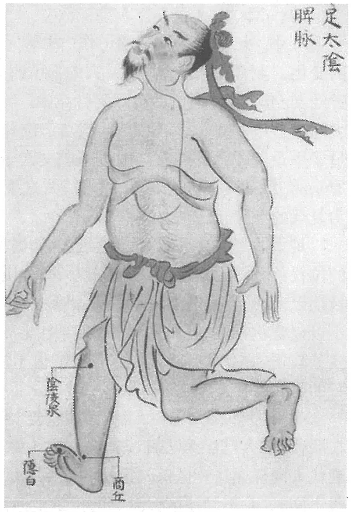

**图 2-98　《环中图》足太阴脾脉图**

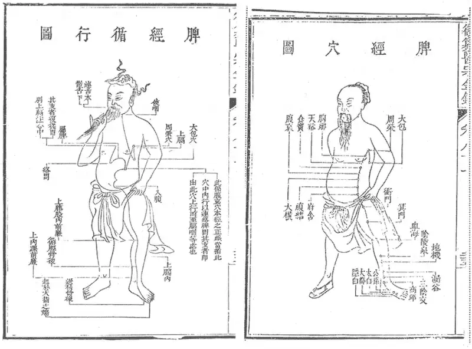

**图 2-99　《医宗金鉴》足太阴脾经脉、经穴分图**

〔p.427 (인쇄 407)〕

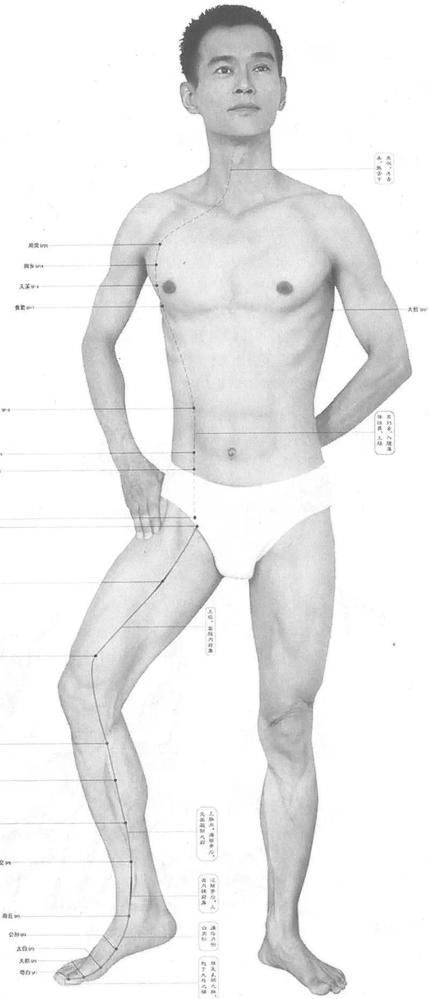

**图 2-100　黄龙祥编足太阴脾经脉、经穴合图**

〔p.428 (인쇄 408)〕

### （一）隐白 Yǐnbái SP1 出《素问》、《灵枢》 

#### 【提要索隐】 

**部位**：在足趾，大趾末节内侧，趾甲根角侧后方0.1寸（指寸）。

**适应症**：主治脾胃、妇科病症。常用于腹胀，泄泻，呕吐；月经过多；便血、尿血、鼻衄；神昏。

**针刺操作**：刺0.1寸。

#### 【名实考】 

早期文献针灸方，多不言穴名“隐白”，径言诸如“足大指甲下内侧”等字样，今人不察，于隐白穴之外，另立“华佗”、“大趾甲下”等穴归入奇穴类。

　1. 邪客于手足少阴太阴足阳明之络，此五络，皆会于耳中，上络左角，五络俱竭，令人身脉皆动，而形无知也，其状若尸，或曰尸厥，刺其足大指内侧爪甲上，去端如韭叶王冰注曰：谓隐白穴，足太阴之井也，后刺足心，后刺足中指爪甲上各一痏，后刺手大指内侧，去端如韭叶，后刺手心主、少阴锐骨之端各一痏，立已。（《素问·缪刺》）

**按**：《素问》这首尸厥针方中“刺其足大指内侧爪甲上，去端如韭叶”之“爪甲上”，《黄帝内经太素》作“甲下”，王冰和杨上善皆注作“隐白”穴，而且《黄帝明堂经》该穴下主治“尸厥，死不知人，脉动如故”也明显出自此方，后世文献大量直接或间接引用此方，今人对方中的“足大指内侧爪甲上”之穴多不能识，而视为奇穴。

　2. 脾出于隐白，隐白者，足大指之端内侧也，为井木……足太阴经也。（《灵枢·本输》）

　3. 脾出隐白，隐白者木也，在足大指端内侧，去爪甲角如韭叶。足太阴脉之所出也，为井。（《黄帝明堂经》）

　4. 足太阴之所出，隐白穴也。在足大趾之端侧，去爪甲如韭叶，足太阴之井。（《素问亡篇·刺法论》）

　5. 穴名隐白者，以脾经为土，而土生金，金之色白。土生金，金隐于土中，故曰隐白。（《经穴解》）

　6. 别名　鬼垒、鬼眼、阴白。（1957年南京《针灸学》）

**按**：此录自日本针灸教材，其中“鬼垒”、“鬼眼”名实考辨已详于后，而“阴白”乃“隐白”之误，在传世针灸文献中，见于《针灸逢源》注解《素问·缪刺论》尸厥针方“刺其足大指内侧爪甲上，去端如韭叶”经文。

#### 鬼垒、鬼眼、鬼哭穴辨 

灸两手、足大指爪甲本以治神志病方，早见于《肘后备急方》、《千金要方》等早期文献，但只言部位，未言穴名。至元代《窦太师针经》始将两手大指爪甲本名曰“手鬼眼”，相当“十三鬼穴”中之“鬼信”穴；两足大指爪甲本名曰“足鬼眼”，相当“十三鬼穴”中之“鬼垒”穴，合称“鬼眼四穴”。

《太平圣惠方·明堂》在引录《肘后备急方》等同源灸方时，只言“两手大拇指”，谓“艾炷著四处”，宋代《备急灸法》附图详注其法，明代《针灸聚英》名之曰“鬼哭”穴，之后吴崑在辑录《窦太师针经》奇穴时，又将“鬼眼四穴”误作“鬼哭四穴”，吴嘉言《医经会元》则分别作“手鬼哭”、“足鬼哭”，至清代《医宗金鉴》则只将“手鬼眼”称作“鬼哭”，“足鬼眼”穴称作“鬼眼”，然所言鬼眼穴定位又与前代文献不同，主治病症也全不相同。今人则未考《备急灸法》之图，误将《针灸聚英》、《医学入门》之“鬼哭”穴理解为四穴。

　1. 治卒狂言鬼语方　针其足大拇指爪下少许，即止。又方：以甑带急合缚两手，火灸左右胁，握肘头纹俱起，七壮。须臾，鬼语自道姓名，乞去。徐徐诘问，乃解手耳。（《补辑肘后方·治卒发癫狂病方》上卷）

〔p.429 (인쇄 409)〕

**按**：本方又见于龙门药方石刻及敦煌卷子医方P3596号。《医心方》卷三引自公元五世纪中叶陈延之《小品方》。“两手”下，当据《医心方》补“父指”二字（父指，即大拇指），“屈肘头纹俱起”，《医心方》作“对屈肘头，两火俱起”，义长。

　2. 治卒中邪魅恍惚振噤之方　灸鼻下人中，及两手足大指爪甲本。令艾丸半在爪上，半在肉上，各七壮，不止，至十四壮便愈。（《补辑肘后方·治卒得惊邪恍惚心昏鄙丑方》卷上）

　3. 秦丞祖灸狐魅神邪，及癫狂病，诸般医治不瘥者，以并两手大拇指，用软丝绳子急缚之，灸三壮。艾炷著四处，半在甲上，半在肉上，四处尽烧，一处不烧，其疾不愈，神效不可量也。小儿胎痫、奶痫、惊痫，一依此灸一壮。炷如小麦大。（《太平圣惠方·明堂》）

　4. 秦承祖灸鬼法　鬼哭穴以两手大指相并缚，用艾炷骑缝灸之，令两甲角后肉四处着火，一处不着则不效。（《针灸聚英》卷二、《医学入门》）

　5. 扁鹊曰百邪所病，针有十三穴……第二针手大指爪甲下，名鬼信，入肉三分。第三针足大趾爪甲下，名鬼垒，入肉二分。（《千金要方》卷十四）

　6. 足鬼眼二穴，在足大拇指端去爪甲外侧，用线缚定，两指缝内。禁针，灸七壮。治痫症，呆痴，伤寒发狂。（《窦太师针经》甲本）

　7. 鬼眼二穴，在足两大拇指端爪甲。用绳缚定两指缝内。灸七壮。泻。又治五痫等症，呆痴伤寒发狂。（《窦太师针经》乙本）

　8. 鬼眼四穴，在手大拇指去爪甲角如韭叶，两指并起，用帛缚之，当两指歧缝中是穴；又二穴，在足大趾，取穴亦如在手者同。治五痫等证，当正发时灸之，大效矣。（《奇效良方》卷五十五）

　9. 鬼哭四穴，在手足大指端，去爪甲外侧，用绳缚定，取两指缝内是穴。灸七壮，禁针。治伤寒发狂，痫疾呆痴。（《针方六集》卷一）

　10. 手鬼哭一穴、足鬼哭一穴，此二穴治心痴呆，在手大指，两手缚合，半在甲，半在肉。灸七壮。两足并大指。（《医经会元》卷十）

　11. 灸鬼哭穴歌　中恶振噤鬼魅病，急灸鬼哭神可定，两手大指相并缚，穴在四处之骑缝。（《医宗金鉴·刺灸心法要诀》）

　12. 灸鬼眼穴歌　肿满上下灸奇穴，上即鬼哭不用缚，下取两足第二趾，趾尖向后寸半符。（《医宗金鉴·刺灸心法要诀》）

#### 【定位】 

**部位**：在足趾，大趾末节内侧，趾甲根角侧后方0.1寸（指寸）（图2-101）。

**取穴**：足大趾内侧甲根角侧后方（即沿角平分线方向）0.1寸。相当于沿爪甲内侧画一直线与爪甲基底缘水平线交点处取穴。

　1. 脾出于隐白。隐白者，足大趾之端内侧也。（《灵枢·本输》）

　2. 《黄帝明堂经》佚文

　　(1) 在足大指端内侧，去爪甲如韭叶。（《针灸甲乙经》卷三、《千金要方》）

　　(2) 在足大指端内侧，去爪甲角如韭叶。（《千金翼方》卷二十六、《外台秘要》、《素问》王冰注、《医心方》、《铜人腧穴针灸图经》、《圣济总录》、《针灸玉龙经》、《十四经发挥》、《神应经》、《针灸聚英》、《古今医统》、《医学入门》、《针灸大成》、《针方六集》、《类经图翼》、《循经考穴编》、《医宗金鉴·刺灸心法要诀》、《针灸逢源》）

　3. 在足大指端内侧，去爪甲角如韭叶宛宛中。（《太平圣惠方·针经》）

〔p.430 (인쇄 410)〕

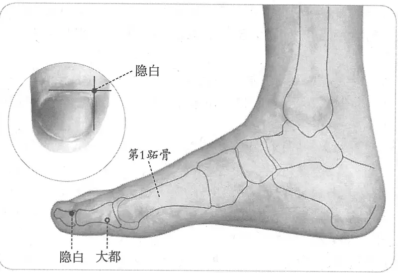

**图 2-101　隐白穴图**

　4. 足大趾内侧，去爪甲角一分许。（《针灸十四经穴位考订》）

　5. 统编针灸学教材

　　(1) 部位：在足大指内侧端，屈爪甲如韭叶。取穴：距踇趾内侧爪甲角约一分许取之。（1957年南京《针灸学》）

　　(2) 部位：足大指内侧端。取穴：距踇趾内侧爪甲角约一分许取之。（1版《针灸学讲义》）

　　(3) 部位：在足大指内侧端，屈爪甲如韭叶。取穴：于踇趾内侧，距爪甲角后一分许取之。（2版《针灸学讲义》）

　　(4) 踇趾内侧趾甲角旁约0.1寸。（4、5版《针灸学》）

　　(5) 在足大趾末节内侧距趾甲角0.1寸。（6版《针灸学》）

　　(6) 足大趾内侧趾甲根角旁0.1寸。（7版《针灸学》）

　　(7) 足踇趾内侧趾甲角后一分许。（《中国针灸学》）

**文献分析**：本穴位置，古代文献皆定于“足大趾内侧去爪甲角如韭叶”。关于甲角的考证及韭叶宽度的折量，详见“少商”穴分析。

#### 【类属】 

足太阴脾经穴。五输穴之井穴。

　1. 足太阴脉之所出也，为井。（《黄帝明堂经》）

　2. 足太阴之所出，隐白穴也。在足大趾之端侧，去爪甲如韭叶，足太阴之井。（《素问亡篇·刺法论》）

#### 【适应症】 

主治脾胃、妇科病症。常用于腹胀，泄泻，呕吐；月经过多；便血、尿血、鼻衄；神昏。

　1. 主腹中有寒气。气喘，热病，衄血不止，烦心善悲，腹胀逆息，热气，足胫中寒，不得卧，气满胸中热，暴泄，仰息，足下寒，膈中闷，呕吐不欲食饮。尸厥，死不知人，脉动如故。饮渴，身体痛，多唾。（《黄帝明堂经》）

**按**：以上病症除了足太阴经病候、足太阴厥症状（太阴之厥，则腹满䐜胀，后不利，不欲食，食则呕，不得卧）外，还包括“气满胸中”、“腹中有寒”及“尸厥”三组症状。《灵枢·热病》曰：“气满胸中，喘息，取足太阴大指之端去爪甲如韭叶。尸厥的针灸治疗见于《素问·缪刺》（见“附：临床应用举例”），原方取5穴，《黄帝明堂经》归于隐白、大敦、厉兑三穴中，其中厉兑穴下主治最详：尸厥，口噤，气绝，脉动如故，其形无知，如中恶状。

〔p.431 (인쇄 411)〕

　2. 治腹胀喘满不得安卧，呕吐食不下，暴泄，衄血，卒尸厥不识人，足寒不能温。今附：妇人月事过时不止，刺之立愈。（《铜人腧穴针灸图经》卷下）

　3. 脾虚不食，先泻后补；本节红肿，泻。妇人经事不调及过时，看证补泻。（《窦太师针经》）

　4. 小儿客忤，慢惊风。（《针灸聚英》卷一、《古今医统》、《针灸大成》、《针方六集》）

**按**：此主治症转录自《针灸资生经》，原灸方治疗重点在于“吐不止”（见“附：临床应用举例”）。且原方由5穴组成，未详“隐白”是否用作主穴。

　5. 一切脾病，皆能治之。（《循经考穴编》上）

　6. 统编针灸学教材

　　(1) 主治腹胀食不下，呕吐，暴泄，月事过时不止，足冷，尸厥惊风，癫狂。（1957年南京《针灸学》、1版《针灸学讲义》）

　　(2) 主治腹胀，月经过多，崩漏，癫狂，多梦，惊风。（2版《针灸学讲义》）

　　(3) 主治腹胀，便血，尿血，月经过多，崩漏，癫狂，多梦，惊风。（4、5版《针灸学》）

　　(4) 主治腹胀、便血、尿血、月经过多、崩漏、癫狂、多梦、惊风、昏厥、胸痛。（6版《针灸学》）

　　(5) 主治月经过多、崩漏等妇科病；便血、尿血等慢性出血证；癫狂，多梦；惊风；腹满，暴泄。（7版《针灸学》）

　　(6) 主治腹胀，便血，月经过多，崩漏，癫狂，多梦，惊风。（《中国针灸学》）

**文献分析**：《黄帝明堂经》载本穴主治集中在脾经病候，此外还涉及“尸厥”、“气满胸中”。自宋代《铜人腧穴针灸图经》附增“月经过时不止”主治后，这方面临床应用不断增多，成为本穴的治疗重点。教材中关于“癫狂，多梦，惊风”三症悉为足大趾之大敦穴主治（此二穴易混淆），疑有混淆，在未得到可靠的文献依据和临床实践经验的支持前，暂不列入主治项，附存备考。

#### 附：临床应用举例 

　1. 出血性病症

　　(1) 血不止，鼻衄，大小便皆血，血崩，当刺足太阴井隐白。（《素问病机气宜保命集》）

　　(2) 功能性子宫出血：取神阙及双侧隐白穴，艾条隔姜灸。［中医外治杂志，1999，8（3）：30］

　　(3) 经漏：关元穴、三阴交穴、隐白穴针刺治疗。［上海针灸杂志，1986，5（4）：46］

　　(4) 月经过多：取隐白穴，用艾条进行温和灸。［中国针灸，2001，21（5）：294］

　2. 尸厥

　　(1) 邪客于手足少阴太阴足阳明之络，此五络，皆会于耳中，上络左角，五络俱竭，令人身脉皆动，而形无知也，其状若尸，或曰尸厥，刺其足大指内侧爪甲上，去端如韭叶，后刺足心，后刺足中指爪甲上各一痏，后刺手大指内侧，去端如韭叶，后刺手心主、少阴锐骨之端各一痏，立已。（《素问·缪刺》）

　　(2) 治卒死尸厥方：针百会，当鼻中入发际五寸许，针入三分，补之。针足大指甲下内侧，去甲三分。又针足中指甲上各三分，大指之内去端韭叶许。又针手少阴锐骨之端各一分。（《补辑肘后方》卷上、《千金要方》、《千金翼方》）

〔p.432 (인쇄 412)〕

　　(3) 若暴厥，卒然不知人事……又刺足大指内侧爪甲去端如韭叶，入一分，留三呼，谓隐白穴也。出之，又刺足心涌泉穴，如上法。又刺足中指爪上，令破，如上法，谓厉兑穴也。又刺手大指内侧，去端如韭叶。又刺手心主，谓中冲穴也。又刺掌后锐骨之端，谓神门穴也。（《全生指迷方》卷三）

　　(4) 治尸厥，刺任脉玉泉一穴，在脐下四寸，针入三分。次针足太阴经隐白二穴，在足大指端内侧，去爪甲角如韭叶，针入三分。更兼两胁下，熨之。（《针经摘英集》）

　　(5) 癔症瘫，针刺少商、隐白治疗。［贵阳中医学院学报，1999，21（4）：29-30］

　3. 前阴病症

　　(1) 癞病，阴卒肿者，令并两拇指，令爪相并，以一艾灸两爪端方角处，一丸令顿上，两爪角各半丸上爪指佳，七壮愈。（《千金要方》卷二十四、《千金翼方》）

　　(2) 灸小便数而少且难，用力辄失精，此方万验也。令其人舒两手合掌，并两大指，令齐急逼之，令两爪甲相近，以一炷灸两爪甲肉际际方后，自然有角，令炷当两角中小侵入爪上，此两指共当一炷也，亦灸脚大指与手同法，各三炷，经三日又灸之，此法甚验。（《千金翼方》卷二十八）

　　(3) 华佗疗男子卒疝，阴卵偏大，取患人足大指去甲五分，内侧白肉际，灸三壮，炷如半枣核大，患左取右，患右取左。（《太平圣惠方·明堂》）

　4. 其他病症

　　(1) 气满胸中喘息，取足太阴大指之端，去爪甲如韭叶，寒则留之，热则疾之，气下乃止。（《灵枢·热病》）

　　(2) 渴饮病，兼身体疼痛，灸隐白二穴，在足大指内侧，去爪甲角如韭叶各三壮。（《圣济总录》卷一百九十二）

　　(3) 小儿客忤而吐不止者，灸手心主、间使、大都、隐白、三阴交各三壮。（《千金要方》卷五上）

　　(4) 小儿中客之为病，吐下青黄汁，腹中痛及反倒偃侧似痫状，但目不上插，少睡面色变五色，脉弦急，若失时不治，小久则难治……若吐不止，灸手心主间使、大都、隐白、三阴交各三炷。（《千金翼方》卷十一）

　　(5) 瞑目症，隐白穴、中脘穴，针灸疗法。［中医杂志，1986（1）：46］

#### 【操作】 

刺0.1寸。

　1. 刺入一分，留三呼，灸三壮。（《黄帝明堂经》）

　2. 刺可同身寸之一分，留三呼，得气至，乃出之。（《素问亡篇·刺法论》）

　3. 针入三分。（《铜人腧穴针灸图经》卷下）

　4. 针入一分，沿皮向后三分，灸七壮。（《窦太师针经》）

　5. 统编针灸学教材

　　(1) 针一至二分，灸二至三壮。（1957年南京《针灸学》、1版《针灸学讲义》）

　　(2) 斜刺1分，小艾炷灸3~5壮。（2版《针灸学讲义》）

　　(3) 浅刺0.1寸。（4、5、7版《针灸学》、《中国针灸学》）

　　(4) 浅刺0.1寸，或用三棱针点刺出血；可灸。（6版《针灸学》）

　6. 向上斜刺0.1~0.2寸；或用三棱针点刺出血。感应：局部痛感。灸3~7壮：温灸5~10分钟。（上海《针灸学》）

〔p.433 (인쇄 413)〕

### （二）大都 Dàdū SP2 出《灵枢》 

问题1：处理大都、太白、公孙三穴的位置关系，让古代医家绞尽脑汁，是什么原因导致了这一历史难题？今天的阐释是古人的本义吗？

问题2：大都穴有几？

#### 【提要索隐】 

**部位**：在足趾，第1跖趾关节远端赤白肉际凹陷中。

**国标修订**：1990年版国标：在足内侧缘，当足大趾本节（第1跖趾关节）前下方赤白肉际凹陷处。2006年修订版：在足趾，第1跖趾关节远端赤白肉际凹陷中。

**按**：2006年版国标以现代解剖学姿势作为取穴的标准体位，同时描述腧穴定位的方位术语也采用解剖学术语系统。

**适应症**：主治脾胃病症。常用于腹胀，胃脘痛，呕吐，泄泻，便秘；发热无汗。

**针刺操作**：刺0.3~0.5寸。

#### 【名实考】 

《奇效良方》所载之奇穴“大都”，与合谷穴的现代定位相近，需注意辨识。

　1. 太白者，土也。在足内侧核骨下陷者中。（《黄帝明堂经》）

　2. 流于大都，大都者，火也。在足大趾本节后陷者中，足太阴脉之所流也，为荥。（《黄帝明堂经》）

　3. 杨上善曰核骨在大指本节之后，然骨之前高骨是也。核，茎革反。（《黄帝内经太素·本输》）

　4. 杨上善曰“核”，胡革反。人足大趾本节后骨，名为核骨也。（《黄帝内经太素·经脉连环》）

　5. 公孙，在足大指本节后一寸，别走阳明，太阴络也。（《黄帝明堂经》）

　6. 韩国铜人　大都当本节，公孙本节后，太白内踝前下方。

　7. 明嘉靖铜人　大都本节前，太白本节后一寸，公孙然谷前约一寸。

　8. 产经图　大都本节前、公孙本节中、太白本节后。

　9. 明成化铜人图　大都本节前，太白本节后，公孙本节后一寸。

　10. 脾之源，在足内侧核骨下陷者中是。足太阴之所过也，为源。（《素问亡篇·刺法论》）

　11. 凡气血交会聚之地，则以都名之。穴名大都者，以此穴在足大指之本节，故曰大都。（《经穴解》）

　12. 八邪八穴，在手五指歧骨间，左右手各四穴。其一，大都二穴，在手大指次指虎口，赤白肉际，握拳取之。可灸七壮，针入一分，治头风牙痛。（《奇效良方》卷五十五）

#### 【定位】 

**部位**：在足趾，第1跖趾关节远端赤白肉际凹陷中（图2-102）。

**取穴**：足大趾本节前赤白肉际凹陷处取穴。

　1. 本节之后下陷者之中也。（《灵枢·本输》）

**按**：楼英曰：本节后“后”字当作“前”，更详。（《医学纲目》卷八）

　2. 在足大指本节后陷者中。（《黄帝明堂经》、《太平圣惠方·明堂》、《铜人腧穴针灸图经》、《圣济总录》、《针灸资生经》、《十四经发挥》、《针灸集书》）

　3. 在足大趾内本节后陷中。（《千金要方》卷二十九）

　4. 在足大踇指本节前内侧陷中。（《窦太师针经》）

　5. 足大指内侧本节后陷中。（《针经摘英集》、《针灸玉龙经》、《神应经》、《医学入门》、

〔p.434 (인쇄 414)〕

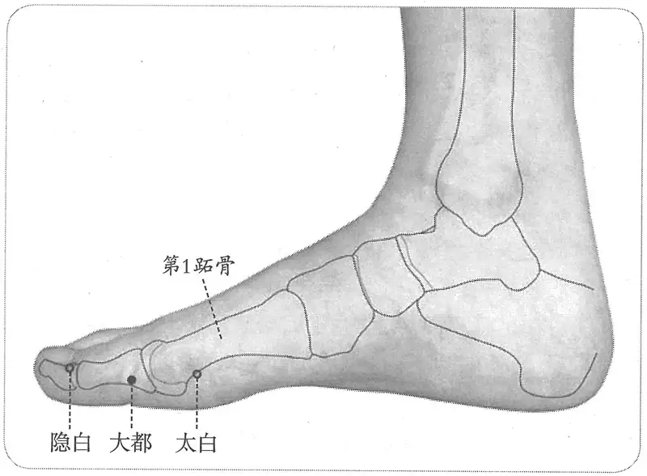

**图 2-102　大都穴图**

《针方六集》）

　6. 足大指本节后内侧陷中，骨缝赤白肉际。（《针灸聚英》卷一、《古今医统》、《针灸大成》、《类经图翼》、《循经考穴编》、《针灸逢源》）

　7. 针灸方腧穴定位

　　(1) 足大趾本节内侧白肉际。（《肘后备急方》、《千金要方》、《千金翼方》、《外台秘要》）

　　(2) 在足大指本节后内侧白肉际。（《千金要方》卷二十）

　　(3) 足大踇指内侧去端一寸赤白肉际。（《千金要方》卷二十四、《千金翼方》）

　　(4) 足大指本节内侧一寸白肉际。（《外台秘要》卷三十九、《医心方》）

　　(5) 取患人足大指，去甲五分，内侧白肉际。（《太平圣惠方·明堂》）

　8. 足大趾内侧，本节前白肉际陷中。（《针灸十四经穴位考订》）

　9. 统编针灸学教材

　　(1) 部位：大趾内侧第二节后本节前。取穴：大趾内侧，本节前骨边赤白肉际陷中取之。（1957年南京《针灸学》）

　　(2) 部位：足大趾内侧本节前陷中。取穴：大趾内侧，本节前骨边赤白肉际陷中取之。（1版《针灸学讲义》）

　　(3) 部位：在足大指本节后（前）陷者中。取穴：于足大趾内侧，第一跖趾关节前下方，赤白肉际取之。（2版《针灸学讲义》）

　　(4) 踇趾内侧，第一跖趾关节前缘，赤白肉际。（4、5版《针灸学》）

　　(5) 在足内侧缘，当足大趾本节第1跖趾关节前下方赤白肉际凹陷处。（6版《针灸学》）

　　(6) 足大趾内侧，第1跖趾关节前下方，赤白肉际处。（7版《针灸学》、《中国针灸学》）

**文献分析**：本穴的定位，要同时考察其与太白、公孙穴的位置关系。《铜人腧穴针灸图经》上、中、下三卷关于大都穴定位的文字描述均与宋以前文献同，定位于“本节后”，然而在实际点穴时，却标于本节前，今核查明正统仿宋针灸铜人关于大都、太白、公孙三穴的位置关系为：大都在本节前赤白肉际、公孙在本节后赤白肉际，而太白正对本节（跖趾关节）膨大部内侧下方。窦氏针经也明确定于“本节前”。

〔p.435 (인쇄 415)〕

综合考察宋以前文献，存在另一种可能，大都在前、公孙居中、太白在后。前二穴定位均作“足大趾”，而后一穴作“足内侧”，也提示其定位在后，如《产经》“脾脉图”、朝鲜古铜人所示即如此，这种定位关系也与杨上善关于“核骨”的注解“然骨之前高骨”相合。参见太白穴“名实考”。

#### 【类属】 

足太阴脾经穴。五输穴之荥穴。

　1. 足太阴脉之所流也，为荥。（《黄帝明堂经》）

　2. 足太阴之所流，大都穴也……足太阴脉之荥也。（《素问亡篇·刺法论》）

　3. 脾之源，在足内侧核骨下陷者中是。足太阴之所过也，为源。（《素问亡篇·刺法论》）

#### 【适应症】 

主治脾胃病症。常用于腹胀，胃脘痛，呕吐，泄泻，便秘；发热无汗。

　1. 主热病汗不出且厥，手足清，暴泄，心痛，腹胀，心尤痛甚，此胃心痛。疟，不知所苦。风逆，暴四肢肿，湿则唏然寒，饥则烦心，饱则眩。（《黄帝明堂经》）

　2. 主腹满善呕。（《太平圣惠方·明堂》）

**按**：通行本《针灸甲乙经》卷七曰：“热病汗不出，且厥，手足清，暴泄，心痛腹胀，心尤痛甚，此胃心痛也，大都主之，并取隐白，腹满善呕，烦闷，此皆主之。”据《灵枢·厥病》，该句中“隐白”系“太白”之误，其后主症也系“太白”穴所主，而非“大都”或“隐白”穴主症，疑此文为古人据《灵枢·厥病》所加之注文。可知，“腹满善呕”非大都穴主治。

　3. 治热病汗不出，手足逆冷，腹满善呕，烦热闷乱，吐逆目眩。（《铜人腧穴针灸图经》卷下）

**按**：王惟一传《太平圣惠方》之误，将“腹满善呕”误作本穴主治。

　4. 治寒湿脚气，先补后泻；本节肿痛，宜泻，三棱针出血尤佳。（《窦太师针经》、《针方六集》）

　5. 不得卧，身重骨痛，腰痛不可俯仰，绕踝风，心蛔厥，小儿客忤。（《针灸聚英》卷一、《古今医统》、《针方六集》）

**按**：上述病症中之“不得卧，身重骨痛”系高武出于对子母补泻原则的理解，将足太阴经病候归于大都穴下；“腰痛不可俯仰”系下一穴太白穴主治误录于此；“绕踝风”辑自《针经摘英集》针方；“小儿客忤”系从《针灸资生经》转引《千金要方》灸方。“心蛔厥”一症未详所出。

　6. 统编针灸学教材

　　(1) 主治腹胀食不化，呕逆，心胃痛，腰痛，便闭，暴泄，身重骨痛，足绕踝风，热病汗不出。（1957年南京《针灸学》）

　　(2) 主治腹胀食不化，呕吐，心胃痛，腰痛，身重骨痛，热病汗不出。（1版《针灸学讲义》）

　　(3) 主治腹胀，胃痛，食不化，呕逆，泄泻，热病无汗。（2版《针灸学讲义》）

　　(4) 主治腹胀，胃痛，食不化，呕逆，泄泻，便秘，热病无汗。（4版《针灸学》）

　　(5) 主治腹胀，胃痛，呕吐，泄泻，便秘，热病。（5版《针灸学》）

　　(6) 主治腹胀、胃痛、消化不良、泄泻、便秘、热病无汗、体重肢肿、心痛、心烦。（6版《针灸学》）

　　(7) 主治腹胀、胃痛、呕吐、腹泻、便秘等脾胃病证；热病，无汗。（7版《针灸学》）

　　(8) 主治腹胀，胃痛，便秘，热病无汗。（《中国针灸学》）

**文献分析**：本穴的临床应用集中在脾经病候和热病，与腧穴文献记载相合。《黄帝明堂经》所载本穴主治病症包括热病、脾虚症状、胃心痛、风逆。《灵枢·热病》治热病之发汗或止汗，皆取手足太阴经穴；又《灵枢·寒热病》：“肌寒热者，肌痛，毛发焦而唇槁腊，不得汗。取三阳于下以去其血者，补足太阴以出其汗。”也提示足太阴经穴可出汗。《灵枢》治胃心痛，取大都、太白；治“风逆”证取“手太阴表里、足少阴、阳明之经”。详见“附：临床应用举例”。至于《灵枢》、《黄帝明堂经》所述之“风逆”证，盖后人不识而少有应用。

〔p.436 (인쇄 416)〕

#### 附：临床应用举例 

　1. 脾胃病症

　　(1) 厥心痛，腹胀胸满，心尤痛甚，胃心痛也，取之大都、太白。（《灵枢·厥病》）

　　(2) 灸霍乱下痢不止方：灸足大指本节内侧一寸白肉际，左右各七壮，名大都。（《补辑肘后方》上卷）

　　(3) 后闭不通……又灸足大都随年壮。（《千金要方》卷十五）

　　(4) 转筋，下若不止者，灸大都七壮。（《千金要方》卷二十、《千金翼方》）

　　(5) 小儿客忤，而吐不止者，灸手心主、间使、大都、隐白、三阴交各三壮。（《千金要方》卷五、《千金翼方》）

　　(6) 食伤脾气，不思饮食：刺内关，灸膻中，补公孙，各灸二七壮；未愈，灸大都刺之。（《针灸集要·盘石金直刺秘传》）

　　(7) 口腔流涎：大都穴、太冲穴针刺治疗。［江苏中医杂志，1987，8（1）：19］

　2. 热病

　　(1) 热病而汗且出，及脉顺可汗者，取之鱼际、太渊、大都、太白，泻之则热去，补之则汗出，汗出太甚，取内踝上横脉以止之。（《灵枢·热病》）

　　(2) 身热汗出，手足厥冷，取大都。（《古今医统》卷十三）

　3. 其他病症

　　(1) 风逆，暴四肢肿，身漯漯，唏然时寒，饥则烦，饱则善变，取手太阴表里，足少阴、阳明之经，肉清取荥，骨清取井、经也。（《灵枢·癫狂》）

　　(2) 治伤寒手足逆冷，刺足太阴经大都二穴，次针足阳明经内庭二穴，次针足少阴经太溪二穴，针入三分。次针足厥阴经行间二穴。（《针经摘英集》）

　　(3) 又治转筋方：灸涌泉，涌泉在脚心下，当大踇指大筋，灸七壮。亦可灸大都，在足大踇指本节内侧白肉际，灸七壮。（《外台秘要》卷十六）

　　(4) 气滞腰疼不能立，横骨大都宜救急。（《席弘赋》）

　　(5) 腰腿疼痛十年春，应针不了便惺惺，大都引气探根本，服药寻方枉费金。（《肘后歌》）

#### 【操作】 

刺0.3~0.5寸。

　1. 刺入三分，留七呼，灸三壮。（《黄帝明堂经》）

　2. 刺可同身寸之三分，留七呼，动气至而出之。（《素问亡篇·刺法论》）

　3. 先以左手按穴，刺可入三分，留五呼，进至三分，留五呼，即可徐徐而退针，以手扪之。（《素问亡篇·刺法论》）

　4. 横针入三分。治寒湿脚气，先补后泻；本节肿痛，宜泻，三棱针出血尤佳。（《窦太师针经》）

　5. 统编针灸学教材

　　(1) 针一至二分，灸三壮。（1957年南京《针灸学》、1版《针灸学讲义》）

　　(2) 直刺1~2分，艾条灸3~5分钟。（2版《针灸学讲义》）

　　(3) 直刺0.3~0.5寸。（4、5、6、7版《针灸学》）

　　(4) 直刺0.1~0.3寸。可灸。（《中国针灸学》）

〔p.437 (인쇄 417)〕

### （三）太白 Tàibái SP3 出《灵枢》 

#### 【提要索隐】 

**穴名**：太白，古代文献或作“大白”。

**部位**：在足内侧，第1跖趾关节近端赤白肉际凹陷中。

**国标修订**：1990年版国标：在足内侧缘，当足大趾本节（第1跖趾关节）后下方赤白肉际凹陷处。2006年修订版：在跖区，第1跖趾关节近端赤白肉际凹陷中。

**按**：2006年版国标以现代解剖学姿势作为取穴的标准体位，同时描述腧穴定位的方位术语也采用解剖学术语系统。

**适应症**：主治脾胃病症。常用于胃脘痛，呕吐，腹胀，肠鸣、泄泻，便秘；身重，关节疼痛。

**备选适应症**：脚气红肿。

**针刺操作**：刺0.5~0.8寸。

#### 【名实考】 

本穴的正确定位的前提，是正确理解《内经》、《黄帝明堂经》关于本穴定位描述文字中的“核骨”一词。杨上善注《黄帝内经太素》时对此有多处详细的注解，根据杨氏注解，大都、太白、公孙三穴的位置关系应是：大都在前，公孙居中，太白在后。六朝时期《产经》一书所载之“十脉图”之脾脉图此三穴的排列为：大都、公孙、太白，与杨上善理解完全吻合。由于杨氏之说及《产经》之图未被注意，因而现代普通接受《医学纲目》的观点，将大都穴定于“本节之前”，这是今人对此三穴定位错误理解的文献依据。

大都、公孙、太白三穴的位置关系之所以能成为一个让现代人头痛的难题，是因为长期以来，人们忽略了一个关键因素：公孙是络穴，而络穴归经之后，其在经穴中的排列次序不可以常例推之，足阳明经络穴丰隆、足太阳别络穴委阳、足少阴经足内踝周围穴定位的古今分歧正是由于同样的因素所造成的。由于没有意识到问题的症结所在，古今医家做了许多徒劳的研究。

　1. 阴中之至阴，脾也，其原出于太白，太白二。（《灵枢·九针十二原》）

　2. 注于太白，太白，腕骨之下也，为腧。（《灵枢·本输》）

　3. 注于太白，太白者土也，在足内侧核骨下陷者中。足太阴脉之所注也，为输。（《黄帝明堂经》）

　4. 流于然谷，然谷者，火也，一名龙渊。在足内踝前，起大骨下陷者中。（《黄帝明堂经》）

　5. 杨上善曰，核，胡革反。人足大趾本节后骨，名为核骨也。然骨在内踝下近前起骨是也。（《黄帝内经太素·经脉连环》）

　6. 杨上善曰核骨，在大指本节之后，然骨之前高骨是也。（《黄帝内经太素·本输》）

　7. 足太阴之俞，太白穴。在足内侧核骨下陷者中，足太阴之所注也。（《素问亡篇·刺法论》）

　8. 脾之源，在足内侧核骨下陷者中是。足太阴之所过也，为源。（《素问亡篇·刺法论》）

　9. 核骨下，太白穴也。核骨在足大指本节后约二寸，内踝骨前约三寸，如枣核横于足内侧赤白肉际者是也。窦太师指为孤拐骨者，非是也。（《医学纲目》卷一）

　10. 穴名太白者，本经为土，土所生者为金，井名隐白，已含金之义矣，至此为腧土，土所生者金，故曰太白。（《经穴解》）

**文献分析**：根据《黄帝明堂经》原文，及杨上善注、《医学纲目》注文，可以确定：核骨，是足大趾本节后、然骨前的一个核状骨突。而然骨是很明确的，为内踝前下方的突起之骨——舟骨粗隆，在此骨之前与跖趾关节之后的，只有一个骨性突起——第1跖骨底后内侧结节（位于内侧楔骨前内侧），理清了这一点，也就明白为什么《灵枢》、《黄帝明堂经》描述核骨时，用“足内侧”而不是“大趾本节后”；意识到公孙穴系络穴，也就明白为什么其定位在前而排序却在后，想通了这个问题，类似的疑难也就涣然冰释：为什么水泉在太溪穴之下，而排序在其后？络穴使然！为什么委阳横平委中穴，而排序却在其之后？络穴使然！丰隆与下巨虚排序之高下相反，同样是络穴使然！千百年正是由于人们没有意识到这一点，人为改变上述络穴的位置，以牵就后人的误解！

〔p.438 (인쇄 418)〕

#### “太白”与“二白”混淆例 

《玉龙赋》：痔漏须寻太白，痃疟当求间使。（《类经图翼》卷六）

**按**：《玉龙赋》原文作：“二白医痔漏，间使剿疟疾。”其中“二白”系奇穴，“在掌后横纹上四寸，两穴对并，一穴在筋中，一穴在筋外”（《针灸玉龙歌》），张介宾不识此穴，而将其改作足太阴经穴“太白”，大误。

#### 【定位】 

**部位**：在足内侧，第1跖趾关节近端赤白肉际凹陷中（图2-103）。

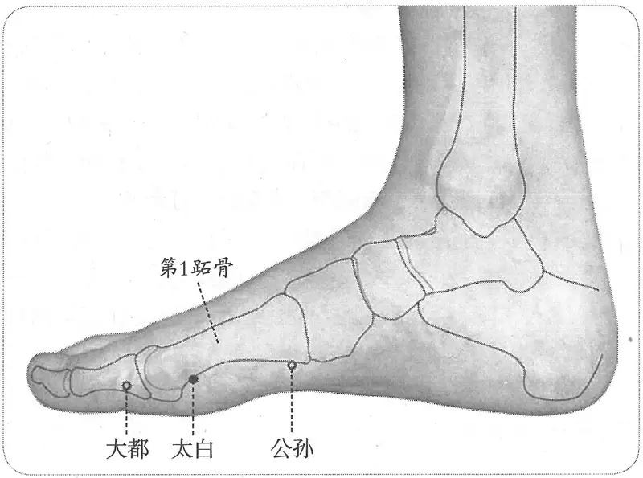

**图 2-103　太白穴图**

**取穴**：足大趾本节后赤白肉际凹陷取穴。

　1. 《灵枢》传本

　　(1) 太白，腕骨之下也。（《灵枢·本输》）

　　(2) 太白者，核骨之下也，为输。（《黄帝内经太素·本输》）

　2. 《黄帝明堂经》佚文

　　(1) 在足内侧核骨下陷者中。（《针灸甲乙经》卷三、《千金翼方》、《外台秘要》、《素问》王冰注、《医心方》、《铜人腧穴针灸图经》、《圣济总录》、《十四经发挥》、《针灸集书》、《循经考穴编》）

　　(2) 在足大指内侧核骨下陷中。（《千金要方》卷二十九、《窦太师针经》）

　3. 在内踝核骨下陷者中。（《素问亡篇·刺法论》）

　4. 在足大指处内侧，大都后一寸，下一寸。（《神应经》）

　5. 足大指内侧，内踝前核骨下陷中。（《针灸聚英》卷一、《针灸大成》、《医宗金鉴·刺灸心法要诀》、《针灸易学》）

〔p.439 (인쇄 419)〕

　6. 广注当是足大指本节骨后，内侧贴骨陷中赤白肉际。或言内踝前核骨者，非是。（《循经考穴编》上）

　7. 在足大指后内踝前核骨下陷中。（《针灸逢源》）

　8. 足大趾内侧，本节后白肉际陷中。（《针灸十四经穴位考订》）

　9. 统编针灸学教材

　　(1) 部位：足内侧核骨后陷中。取穴：第一跖骨之内缘前方，即本节后核骨赤白肉际取之。（1957年南京《针灸学》）

　　(2) 部位：足内侧核骨下。取穴：从足大趾内侧本节后下缘赤白肉际陷中取之。（1版《针灸学讲义》）

　　(3) 部位：在足内侧核骨下陷者中。取穴：于第一跖骨小头的后下方，赤白肉际取之。（2版《针灸学讲义》）

　　(4) 第一跖骨小头后缘，赤白肉际。（4、5版《针灸学》）

　　(5) 在足内侧缘，当足大趾本节第1跖趾关节后下方赤白肉际凹陷处。（6版《针灸学》）

　　(6) 第1跖骨小头后缘，赤白肉际凹陷处。（7版《针灸学》）

　　(7) 第一跖骨小头后下方，赤白肉际。（《中国针灸学》）

**文献分析**：本穴定位，古代文献记载一致。关于“核骨”的理解，杨上善谓：“核骨在大指本节之后，然骨之前高骨是也。”这里说得很清楚，所谓“核骨”是指内踝前下方的隆起之骨（然骨）与大指本节后之间的一个隆起之骨。而在这区段的确能看到或触及两个骨性突起，内踝前下方为足舟骨粗隆，再往前在近第1跖骨底内侧触及的较小骨性突起为核骨（第1跖骨底后内侧结节）。至于《循经考穴编》注曰：“当是足大指本节骨后，内侧贴骨陷中赤白肉际”，则与“本节后”穴定位无异，不明古典文献为何不直接说“本节后”，而说“足内侧核骨下陷者”。根据杨上善的注解，大都、太白、公孙三穴的位置关系应是：大都在前，公孙居中，太白在后。

#### 【类属】 

足太阴脾经穴。五输穴之输穴、脾经之原穴。

　1. 脾出于隐白……注于太白，太白，腕骨之下也，为腧。（《灵枢·本输》）

　2. 阴中之至阴，脾也，其原出于太白，太白二。（《灵枢·九针十二原》）

　3. 足太阴脉之所注也，为输。（《黄帝明堂经》）

　4. 足太阴之俞，太白穴。在足内侧核骨下陷者中，足太阴之所注也。（《素问亡篇·刺法论》）

　5. 脾之源，在足内侧核骨下陷者中是。足太阴之所过也，为源。（《素问亡篇·刺法论》）

#### 【适应症】 

主治脾胃病症。常用于胃脘痛，呕吐，腹胀，肠鸣、泄泻，便秘；身重，关节疼痛。

**备选适应症**：脚气红肿。

　1. 主热病先头重颊痛，烦闷身热，热争则腰痛不可以俯仰，腹满，两颔痛甚，暴泄善饥而不欲食，善噫，热中，足清，腹胀食不化，善呕泄，有脓血，苦呕无所出，先取三里，后取太白、章门主之。胸胁支满腹中切痛。霍乱逆气。大便难。身重，骨痿不相知。烦闷不得卧。（《黄帝明堂经》）

**按**：《素问·刺热》曰：“脾热病者，先头重颊痛，烦心，颜青，欲呕身热。热争则腰痛不可用俯仰，腹满泄，两颔痛，甲乙甚，戊己大汗，气逆则甲已死。刺足太阴、阳明”。《灵枢·五邪》：“邪在脾胃，则病肌肉痛。阳气有余，阴气不足。则热中善饥；阳气不足，阴气有余，则寒中肠鸣腹痛。阴阳俱有余，若俱不足，则有寒有热。皆调于三里”。《灵枢·四时气》：“胃气逆则呕苦，故曰呕胆。取三里以下胃气逆”。可见，上述《黄帝明堂经》第一条主治实际上包括了“脾热病”、“邪在脾胃”、“呕胆”的症状，所取三穴，一为脾经原穴，一为脾经募穴，一为胃经合穴，皆为调理脾胃病的要穴。“烦闷不得卧”、“腹中切痛”、“大便难”皆系脾经及脾病典型症状。而“霍乱逆气”则见于足太阴络脉病候。

〔p.440 (인쇄 420)〕

　2. 治身热烦满，腹胀食不化，呕吐，泄脓血，腰痛，大便难，气逆，霍乱腹中切痛。（《铜人腧穴针灸图经》卷下）

　3. 治五藏交寒，泄泻呕吐，补；大便虚结，小便滑，先补后泻。（《窦太师针经》）

　4. 肠鸣，膝股胻酸转筋，胃心痛，心痛脉缓。（《针灸聚英》卷一、《针灸大成》）

**按**：以上“肠鸣，膝股胻酸转筋，胃心痛”系误录《千金要方》孔穴主对法和针灸方；“心痛脉缓”辑自《素问病机气宜保命集》。

　5. 脚气红肿。（《循经考穴编》上）

　6. 统编针灸学教材

　　(1) 身热烦满，腹胀，食不化，呕吐，胃心痛，泄泻脓血，腰痛，大便难，霍乱，脚气红肿。（1957年南京《针灸学》）

　　(2) 腹胀食不化，呕吐，心胃痛，泄痢脓血，腰痛，大便难，急性吐泻，脚气红肿，身热烦满。（1版《针灸学讲义》）

　　(3) 胃痛，腹胀，身体沉重，痢疾，便秘，吐泻，脚气。（2版《针灸学讲义》）

　　(4) 胃痛，腹胀，身重，肠鸣，泄泻，便秘，痔漏，脚气。（4、5版《针灸学》）

　　(5) 胃痛、腹胀、腹痛、肠鸣、呕吐、泄泻、痢疾、便秘、痔疾、脚气，体重节痛。（6版《针灸学》）

　　(6) 肠鸣、腹胀、腹泻、胃痛、便秘等脾胃病证；体重节痛。（7版《针灸学》）

　　(7) 胃痛，腹胀，便秘，痢疾，吐泻，肠鸣，身重，脚气。（《中国针灸学》）

**文献分析**：《黄帝明堂经》载本穴主治集中在脾经病候，后世临床应用与之相同。第4~6版教材“痔疾”一症系沿袭《类经图翼》之误，今去之。“脚气红肿”系局部病症，仅见于《循经考穴编》一书，且未见古今临床应用的记载，故暂不收录于主治项下，附存备考。

#### 附：临床应用举例 

　1. 厥心痛，腹胀胸满，心尤痛甚，胃心痛也，取之大都、太白。（《灵枢·厥病》）

　2. 脾咳，刺足太白。（《千金要方》卷十八、《千金翼方》）

　3. 吐利上下俱出，脏痹脓血，头重臂痛，太白、地机、风府各五分、长强、尺泽各一寸。（《医学纲目》卷三十一）

　4. 大便秘结不通，章门、太白、照海。（《针灸大成》卷九）

　5. 小儿脾虚泄泻，丰隆穴、太白穴艾条温灸治疗。［中国针灸，1986，6（4）：55］

　6. 单纯性消化不良，取双侧太白、阴陵泉针刺。［中国针灸，1995（增刊）：135］

#### 【操作】 

刺0.5~0.8寸。

　1. 刺入三分，留七呼，灸三壮。（《黄帝明堂经》）

　2. 刺可同身寸之二分，留七呼，气至，急出之，先左后右。（《素问亡篇·刺法论》）

　3. 刺可入三分，留五呼，进至三分，留五呼，即可徐徐而退针，以手扪之。（《素问亡篇·刺法论》）

　4. 横针五分，灸二七壮。（《窦太师针经》、《针方六集》）

　5. 横针五分，灸七壮。（《窦太师秘传》）

　6. 统编针灸学教材

〔p.441 (인쇄 421)〕

　　(1) 针三分，灸三至五壮。（1957年南京《针灸学》、1版《针灸学讲义》）

　　(2) 直刺3分，艾条灸3~5分钟。（2版《针灸学讲义》）

　　(3) 直刺0.5~0.8寸。（4、5、7版《针灸学》）

　　(4) 直刺0.8~1寸；可灸。（6版《针灸学》）

　　(5) 直刺0.3~0.5寸。可灸。（《中国针灸学》）

### （四）公孙 Gōngsūn SP4 出《灵枢》 

#### 【提要索隐】 

**部位**：在足内侧，第1跖骨底的前下缘赤白肉际处。

**归经**：足太阴脾经。足太阴经络穴。

**适应症**：主治脾胃病症。常用于胃脘痛，腹痛，腹胀，呕吐，泄泻，心烦。上、下颌骨手术、颞颌关节手术针麻用穴。

**针刺操作**：刺0.5~1寸。

#### 【名实考】 

本穴与大都、太白穴的位置关系，详见太白穴“名实考”。

　1. 公孙，在足大指本节后一寸，别走阳明，太阴络也。（《黄帝明堂经》）

　2. 穴名公孙者，万物生于土，而土又以火为父，以金为子，脾经子井隐白，木生大都火，以及太白土，又将生商丘金，有祖孙父子之义，故曰公孙。（《经穴解》）

#### 【定位】 

**部位**：在足内侧，第1跖骨底的前下缘赤白肉际处（图2-104）。

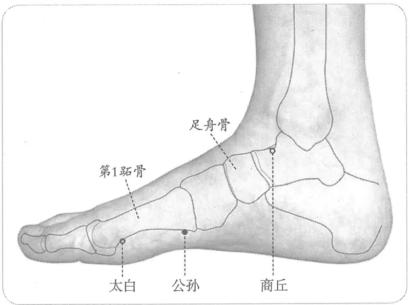

**图 2-104　公孙穴图**

**取穴**：在第1跖骨基底之前下缘凹陷处，赤白肉际取之。

　1. 去本节之后一寸。（《灵枢·经脉》）

　2. 在足大趾本节后一寸。（《黄帝明堂经》、《铜人腧穴针灸图经》、《圣济总录》、《窦太师针经》、《十四经发挥》、《医学纲目》、《神应经》、《循经考穴编》）

〔p.442 (인쇄 422)〕

　3. 在大指本节后，去太白一寸。（《针灸玉龙经》、《医学入门》、《循经考穴编》）

　4. 足大指本节后一寸，内踝前。（《针灸聚英》卷一、《古今医统》、《针灸大成》、《针方六集》）

　5. 在足大趾内侧本节后一寸陷中。令病人坐，蹉两足底相对取之。（《针经指南》）

　6. 在足大趾内侧本节后一寸，内踝前陷中，正坐合足掌相对取之。（《类经图翼》卷六、《医宗金鉴·刺灸心法要诀》、《针灸易学》、《针灸逢源》）

　7. 足大趾内侧，本节后一寸许。（《针灸十四经穴位考订》）

　8. 统编针灸学教材

　　(1) 部位：在足大趾本节后一寸。取穴：按取足背第一跖骨与第一楔骨接合之处，为足背部之最高点，按其高点向内侧以下，当骨边陷中取之。（1957年南京《针灸学》）

　　(2) 部位：足大趾内侧本节后。取穴：于太白穴后一寸赤白肉际取之。（1版《针灸学讲义》）

　　(3) 部位：在足大趾本节后一寸。取穴：在第一跖骨基底之前下缘凹陷处，赤白肉际取之。（2版《针灸学讲义》）

　　(4) 第一跖骨底的前缘，赤白肉际。（4版《针灸学》）

　　(5) 第一跖骨基底部的前下缘，赤白肉际。（5、7版《针灸学》）

　　(6) 在足内侧缘，当第1跖骨基底的前下方。（6版《针灸学》）

　　(7) 第一跖骨基底的前下缘凹陷处，赤白肉际。（《中国针灸学》）

#### 【类属】 

足太阴脾经穴。脾经之络穴。

　1. 足太阴之别，名曰公孙，去本节之后一寸，别走阳明；其别者，入络肠胃。厥气上逆则霍乱，实则肠中切痛，虚则鼓胀，取之所别也。（《灵枢·经脉》）

　2. 公孙……别走阳明，太阴络也。（《黄帝明堂经》）

#### 【适应症】 

主治脾胃病症。常用于胃脘痛，腹痛，腹胀，呕吐，泄泻，心烦。上、下颌骨手术、颞颌关节手术针麻用穴。

　1. 厥气上逆则霍乱，实则肠中切痛，虚则鼓胀，取之所别也。（《灵枢·经脉》）

　2. 主疟，不嗜食，好太息，多寒热，汗出，病至则善呕，呕已乃衰，实则腹中切痛，厥头痛，面肿起，烦心，狂，多饮不嗜卧，虚则鼓胀，腹中气大满，热痛，霍乱。（《黄帝明堂经》）

　3. 治寒疟不嗜食，卒面肿，烦心狂言，腹虚胀如鼓。（《铜人腧穴针灸图》卷下）

　4. 窦太师针灸遗存

　　(1) 治脾虚不食，先泻后补；本节红肿，泻；食积，泻。（《窦太师针经》）

　　(2) 如本节红肿，宜出血。诸病宜下不下者，取此穴。（《针方六集》卷一）

　5. 主痫气，胆虚。（《针灸聚英》卷一、《古今医统》、《针灸大成》）

　6. 主膈胁冷气相乘。（《循经考穴编》上）

　7. 统编针灸学教材

　　(1) 胃痛喜呕，不嗜食，肠中切痛，臌胀，足心发热或痛，面肿，痢疾。（1957年南京《针灸学》、1版《针灸学讲义》）

　　(2) 胃痛，呕吐，饮食不化，肠鸣，腹痛，泄泻，痢疾。（2版《针灸学讲义》）

　　(3) 胃痛，呕吐，食不化，腹痛，泄泻，痢疾。（4版《针灸学》）

〔p.443 (인쇄 423)〕

　　(4) 胃痛，呕吐，腹痛，泄泻，痢疾。（5版《针灸学》）

　　(5) 胃痛、呕吐、饮食不化、肠鸣腹胀、腹痛、痢疾、泄泻、心烦、失眠、水肿、发狂妄言、嗜卧、脚气。（6版《针灸学》）

　　(6) ①胃痛、呕吐、腹痛、腹泻、痢疾等脾胃肠腑病证；②心烦失眠、狂证等神志病证；③逆气里急、气上冲心（奔豚气）等冲脉病证。（7版《针灸学》）

　　(7) 胃痛，呕吐，腹痛，腹胀，泄泻，痢疾，肠鸣。（《中国针灸学》）

**文献分析**：《黄帝明堂经》载本穴主治为脾经、足太阴络脉病候及狂而多饮。《内经》主治为“足太阴疟”、“厥头痛”而兼典型脾经病症者，以及足太阴络脉病候。《灵枢·刺疟》曰：“足太阴之疟，令人不乐，好太息，不嗜食，多寒热汗出，病至则善呕，呕已乃衰，即取之”。《灵枢·厥病》曰：“厥头痛，面若肿起而烦心，取之足阳明、太阴”。《灵枢·经脉》曰：“足太阴之别，名曰公孙，去本节之后一寸，别走阳明；其别者，入络肠胃。厥气上逆则霍乱，实则肠中切痛，虚则鼓胀，取之所别也”。金元窦太师别增“本节红肿”一症，系局部病症。后世临床应用集中于脾经病症。

#### 附：临床应用举例 

　1. 脾胃病症

　　(1) 脾痛胃疼，泻公孙而立愈。（《标幽赋》）

　　(2) 咽酸口苦脾虚弱，饮食停寒夜不消，更把公孙脾腧刺，自然脾胃得和调。（《针灸玉龙歌》）

　　(3) 气攻心胸连腹疼痛：泻公孙；未愈，灸中脘、足三里、内关，各灸七壮泻之。（《针灸集要·盘石金直刺秘传》）

　　(4) 脾湿气伤，不思饮食：公孙补。（《针灸玉龙经·盘石金直刺秘传》）

　　(5) 食伤脾气，不思饮食：刺内关，灸膻中，补公孙，各灸二七壮；未愈，灸大都刺之。（《针灸集要·盘石金直刺秘传》）

　　(6) 肚疼须是公孙妙，内关相应必然瘳。（《席弘赋》）

　　(7) 急性胃痛：公孙穴、内关穴，针刺治疗。［河北中医，1986（5）：6］

　　(8) 急性胃肠炎：公孙穴、内庭穴，针刺补泻。［中国针灸，1987（4）：41］

　2. 其他病症

　　(1) 胎衣不下血迷心，泄泻公孙立应。（《流注指微赋》）

　　(2) 精神药物性乳溢症：公孙穴针刺治疗。［上海针灸杂志，1984（2）：11-12］

　　(3) 三叉神经痛：公孙穴、丘墟穴，针刺治疗。［中医杂志，1984，25（8）：51］

　　(4) 压迫性循经疼痛症：公孙穴、阴陵泉穴，针刺。［陕西中医，1984，5（8）：30］

　　(5) 肥胖：公孙穴、梁丘穴针刺减肥。［中医杂志，1987，28（5）：52-53］

　　(6) 神经官能症：穴取公孙，手法为平补平泻。［针灸临床杂志，1995，11（4）：17］

　　(7) 安胎：取穴公孙穴，令患者仰卧，用30号1.5寸毫针快速刺入双侧公孙穴，进针0.5~1寸，施捻转补法，使酸、麻感上传至膝。［针灸临床杂志，1998，14（9）：42-43］

　　(8) 原发性低血压：取双侧内关、公孙穴。［针灸临床杂志，2000，16（2）：34-35］

#### 【操作】 

刺0.5~1寸。

　1. 刺入四分，留二十呼，灸三壮。（《黄帝明堂经》）

　2. 窦太师针灸遗存

〔p.444 (인쇄 424)〕

　　(1) 横针入五分，灸五壮。（《窦太师针经》）

　　(2) 横针一寸，灸七壮。（《窦太师秘传》）

　3. 针三分，灸三壮。（《针灸十四经穴位考订》）

　4. 统编针灸学教材

　　(1) 针三分，灸三至五壮。（1957年南京《针灸学》、1版《针灸学讲义》）

　　(2) 直刺3分，艾条灸3~5分钟。（2版《针灸学讲义》）

　　(3) 直刺0.5~0.8寸。（4、5版《针灸学》、《中国针灸学》）

　　(4) 直刺0.8~1寸；可灸。（6版《针灸学》）

　　(5) 直刺0.6~1.2寸。（7版《针灸学》）

　5. 直刺，透向涌泉，深1.5~2寸。感应：局部酸胀，有时可扩散至足底。灸3~5壮；温灸5~15分钟。（上海《针灸学》）

### （五）商丘 Shāngqiū SP5 出《灵枢》 

#### 【提要索隐】 

**穴名**：商丘，或写作“商坵”，或作“商邱”。

**部位**：在足内侧，内踝前下方，舟骨粗隆与内踝尖连线中点凹陷中。

**国标修订**：1990年版国标：在足内踝前下方凹陷中，当舟骨结节与内踝尖连线的中点处。2006年修订版：在踝区，内踝前下方，舟骨粗隆与内踝尖连线中点凹陷中。

**按**：“舟骨结节”非标准术语名，故于2006年修订版中改为标准术语“舟骨粗隆”。

**适应症**：主治脾胃病症。常用于腹胀，泄泻，便秘；脚踝痛；膝股内侧痛，痔疮。

**备选适应症**：小儿癫痫。

**针刺操作**：直刺0.5~0.8寸。

#### 【名实考】 

商丘，《医学入门》作“商坵”，清代文献及民国时期多作“商邱”，乃避孔子名讳。“坵”乃“丘”字异体，丘的本义即是土坡的象形，再加一“土”字，犹如“果”字再加“草”字头作“菓”一样，属叠床架屋。

　1. 行于商丘，商丘者，金也。在足内踝下微前陷者中。足太阴脉之所行也，为经。（《黄帝明堂经》）

　2. 穴名商丘者，金为商，土为丘，脾土而生经金，故曰商丘。（《经穴解》）

　3. 别名　商坵。（1957年南京《针灸学》）

#### 【定位】 

**部位**：在足内侧，内踝前下方，舟骨粗隆与内踝尖连线中点凹陷中（图2-105）。

**取穴**：于内踝前缘直线与内踝下缘横线的交点处取穴，前为中封，后为照海。

　1. 内踝之下陷者之中也。（《灵枢·本输》）

　2. 在足内踝下微前陷者中。（《黄帝明堂经》、《铜人腧穴针灸图经》、《圣济总录》、《针灸资生经》、《针灸玉龙经》、《窦太师针经》、《十四经发挥》、《神应经》、《针灸聚英》、《古今医统》、《医学入门》、《针灸大成》、《针方六集》、《循经考穴编》、《医宗金鉴·刺灸心法要诀》）

　3. 在内踝前宛宛中。（《针灸甲乙经》卷十）

　4. 在内踝前陷中。（《千金翼方》卷二十六）

〔p.445 (인쇄 425)〕

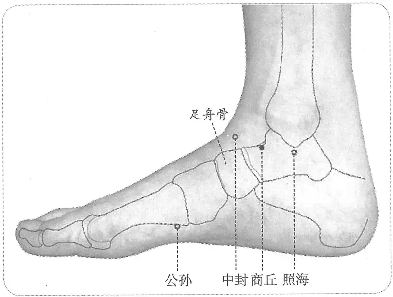

**图 2-105　商丘穴图**

　5. 在足内踝下微前三分陷中。（《窦太师秘传》）

　6. 足内踝下微前陷中，前有中封，后有照海，其穴居中。（《神应经》、《针灸大成》、《类经图翼》）

　7. 足内踝骨下微前陷中。（《针灸十四经穴位考订》）

　8. 统编针灸学教材

　　(1) 部位：在内踝骨下微前陷中，前有中封后有照海，此穴居中。取穴：于内踝前下方凹陷处，当舟骨结节与内踝尖连线之中点取之。（1957年南京《针灸学》）

　　(2) 部位：内踝下微前陷中。取穴：足内踝之前下方五分，足腕之横纹端，当中封穴与内踝之间陷中取之。（1版《针灸学讲义》）

　　(3) 部位：在足内踝下，微前陷者中。取穴：于内踝前下方凹陷处，当舟骨结节与内踝尖连线之中点取之。（2版《针灸学讲义》）

　　(4) 内踝前下方凹陷中。（4、5版《针灸学》）

　　(5) 在足内踝前下方凹陷中，当舟骨结节与内踝尖连线的中点处。（6、7版《针灸学》、《中国针灸学》）

**文献分析**：本穴定位，古今文献一致，均定于内踝前下凹陷中。

#### 【类属】 

足太阴脾经穴。五输穴之经穴。

　1. 脾出于隐白……行于商丘，商丘，内踝之下陷者之中也，为经。（《灵枢·本输》）

　2. 足太阴脉之所行也，为经。（《黄帝明堂经》）

#### 【适应症】 

主治脾胃病症。常用于腹胀，泄泻，便秘；脚踝痛；膝股内侧痛，痔疮。

**备选适应症**：小儿癫痫。

　1. 主癫疾，狂，多食，善笑不发于外，烦心，渴。疟寒，腹中痛，痛已汗出，腹满向向然，不便，心下有寒痛。阴股内痛，气痈，狐疝走上下，引少腹痛，不可俛仰。脾虚令人病寒不乐，好太息。喉痹。寒热善呕。骨痹烦满。痫瘈，手足扰，目昏，口噤，溺黄。筋挛痛。善厌梦。绝子。厥头痛，面肿起。小儿咳而泄，不欲食。痔，骨蚀。管疽。（《黄帝明堂经》）

〔p.446 (인쇄 426)〕

　2. 主偏风，痹脚不得履地，刺风，头风，热风，阴痹。（《千金翼方》卷二十六）

　3. 治腹胀，肠中鸣不便，脾虚令人不乐，身寒，善太息，心悲气逆，痔疾，骨疽蚀，绝子，魇梦。（《铜人腧穴针灸图经》卷下）

　4. 窦太师针灸遗存

　　(1) 治足红肿，泻；脚无力，补；脾家受湿，两脚生疮，先补后泻。（《窦太师针经》）

　　(2) 内踝红肿疼痛，两足无力，不能动履。（《循经考穴编》上）

　5. 舌本强痛，怠惰嗜卧，小儿慢风。（《针灸聚英》卷一、《针灸大成》、《针方六集》）

**按**：“舌本强痛，怠惰嗜卧”系高武据其对“母子补泻”原则的理解，将足太阴经病候归于本穴中。

　6. 统编针灸学教材

　　(1) 肠鸣腹胀，好呕，脾积痞气，黄疸，食不化，溏瘕泄水，便秘，痔疾，阴股内廉痛，疝引少腹痛，内踝疼痛，小儿惊风，舌本强痛。（1957年南京《针灸学》、1版《针灸学讲义》）

　　(2) 肠鸣，腹胀，舌本强痛，便秘，泄泻，黄疸，食不化，足内踝部疼痛。（2版《针灸学讲义》）

　　(3) 腹胀，便秘，泄泻，黄疸，食不化，足踝痛。（4版《针灸学》）

　　(4) 腹胀，便秘，泄泻，黄疸，足踝痛。（5版《针灸学》）

　　(5) 腹胀、肠鸣、泄泻、便秘、食不化、黄疸、倦怠嗜卧、小儿癫痫、咳嗽、足踝痛、痔疾。（6版《针灸学》）

　　(6) 腹胀、腹泻、便秘等脾胃病证；黄疸；足踝痛。（7版《针灸学》）

　　(7) 腹胀，便秘，泄泻，肠鸣，舌本强痛，足踝痛，痔疾。（《中国针灸学》）

**文献分析**：《黄帝明堂经》载本穴主治包含了厥头痛、痔、阴疝、骨痹、癫狂、痫、疟、小儿咳、喉痹、绝子等多种病症，但绝大多数病症皆有典型的脾经病候。一般而言，阴疝（其典型症状为：阴痛引少腹，后引腰骶，下引膝股内廉，痛不可仰）为肝经的典型病，而《灵枢·邪气藏府病形》曰“脾脉急甚为瘛疭；微大为疝气；滑甚为癞癃；涩甚为肠癞”，盖与足太阴筋“聚于阴器”有关。《灵枢·厥病》曰：“厥头痛，面若肿起而烦心，取之足阳明、太阴。”《素问·刺疟》：“脾疟者，令人寒，腹中痛，热则肠中鸣，鸣已汗出，刺足太阴。”《灵枢·杂病》：“厥而腹向向然，多寒气，腹中㱿㱿，便溲难，取足太阴。”此三条病症《黄帝明堂经》编者皆归于本穴主治，显然是将上述两条《内经》条文中的“足太阴”理解为“商丘”穴。教材中“黄疸”一症，未详所出，暂不列于主治项下。

#### 附：临床应用举例 

　1. 脚踝痛

　　(1) 脚腕疼痛，名曰绕踝风，亦名侧脚气：刺商丘、中封、丘墟、解溪诸穴，俱泻之；未愈，泻承浆。（《针灸集要·盘石金直刺秘传》）

　　(2) 穿根草鞋风：昆仑、丘墟、照海、商丘。问曰：此证缘何而得？答曰：皆因劳役过多，湿气流注，或因大热行路，凉水浸洗，故如此也。复刺后穴：太冲、解溪。（《针灸集成》第四十四方）

　　(3) 脚背疼起丘墟穴，斜针出血即时轻，解溪再与商丘识，补泻行针要辨明。（《针灸玉龙歌》）

　2. 痔疾

　　(1) 针痔法……飞扬、商丘、复溜、劳宫、会阴、承筋、扶乘、委阳、委中并主之。（《千金翼方》卷二十八）

〔p.447 (인쇄 427)〕

　　(2) 痔疮：针刺商丘穴。［针灸临床杂志，1993，9（4）：55］

　3. 主传尸、殗殜，善厌梦者，灸商丘二穴，灸七壮，瘥止。（《医心方》卷十三）

#### 【操作】 

直刺0.5~0.8寸。

　1. 刺入三分，留七呼，灸三壮。（《黄帝明堂经》）

　2. 针五分，灸七壮。（《窦太师针经》）

　3. 统编针灸学教材

　　(1) 针三分，灸三壮。（1957年南京《针灸学》、1版《针灸学讲义》）

　　(2) 直刺2~3分，艾条灸3~5分钟。（2版《针灸学讲义》）

　　(3) 直刺0.5~0.8寸。（4、5、6、7版《针灸学》）

　　(4) 直刺0.2~0.3寸。可灸。（《中国针灸学》）

　4. 直刺0.3~0.5寸；亦可横刺透解溪，进针1~1.5寸。感应：踝关节可感酸胀。灸1~3壮；温灸5~15分钟。（上海《针灸学》）

### （六）三阴交 Sānyīnjiāo SP6 出《千金翼方》 

问题：“三阴”穴、“三交”穴、“足太阴”穴与“三阴交”穴关系如何？

#### 【提要索隐】 

“三阴交”穴名虽早见于《黄帝明堂经》，而与今之三阴交定位相同的古代针灸文献记载却最早见于唐代《千金翼方·针灸》卷二十六，然传世本已经过宋人校改，其三阴交穴定位是否为原书旧貌（按理说该书《针灸》篇与《千金要方》《针灸》篇来源相同，文字应当一致），尚不能确定，但在没有证据证明非原书旧貌之前，暂且作为通行定位之三阴交穴的最早出处。其他更早的文献如《针灸甲乙经》，皆有明确证据证明其为后人所改，故不能作为最早的文献出处。

**穴名**：三阴交，一名“足太阴”，一名“三交”。

**部位**：在小腿内侧，内踝尖上3寸，胫骨内侧缘后际。

**归经**：足太阴脾经，为足太阴、厥阴、少阴交会穴。

**适应症**：主治妇科、脾胃病症。常用于月经不调，崩漏，带下，子宫脱垂，不孕，难产；腹胀，肠鸣，泄泻；遗精，阳痿，遗尿，小便不利，疝气；下肢痿痹。剖腹产手术、输卵管结扎术、胆囊切除术针麻用穴。

**备选适应症**：荨麻疹；高血压，失眠。

**针刺操作**：刺1~1.5寸。孕妇禁针。

#### 【名实考】 

脾足太阴之脉“循胫骨后，交出厥阴之前”；肝足厥阴之脉“上踝八寸，交出太阴之后”，故内踝上八寸骨下陷中名“三阴交”，为足厥阴、足太阴脉气所发之穴。即足厥阴经由此交出足太阴经之后，实为“交三阴”（这里的“三阴”是指“足太阴”），故又名“足太阴交”、“厥阴交”。后人误以为“三阴交”之“三阴”是指足太阴、足厥阴、足少阴之三阴，故将本穴的脉气所发改作“足太阴、厥阴、少阴之会”，隋唐时内踝上三寸处的“足太阴”穴被称作“三阴交”，而原《黄帝明堂经》之“三阴交”渐渐隐而不彰，名存而实亡。内踝上三寸之“三阴交”，不仅名实不符，且直接误导了后人，不少明堂图上，足三阴经穴连线在此穴处交会。

本穴名称古今文献无分歧，然定位与主治皆发生了很大变化，今之“三阴交”已非《黄帝明堂经》之“三阴交”。

〔p.448 (인쇄 428)〕

　1. 三阴交，在内踝上八寸胻骨下陷者中。足太阴、厥阴之会。（《黄帝明堂经》）

　2. 三阴交，三阴者，足太阴在中，厥阴在前，少阴在后。《经穴解》

　3. 别名　承命、太阴、下之三里。（1957年南京《针灸学》）

**按**：此三个别名皆录自日本针灸教材，其中“下之三里”是日本对本穴的俗称，非中国穴名。日本寺尾隆純《十四经腧穴弁解》（1784年）于足三里穴下注曰：“倭俗呼‘上三里’……**按**：倭俗所以呼‘上三里’者，以三阴交为‘下三里’故也。”

#### “三阴交”、“三阴”、“三交”、“足太阴”穴辨析 

宋以前文献载“三阴交”穴部位文字如下：

　1. 在内踝上八寸胻骨下陷者中。（《医心方》卷二）

　2. 三阴交，今案此穴在内踝上八寸。（《医心方》卷二十八）

　3. 在内踝上八寸骨下陷中。（《千金要方》）

　4. 在内踝上三寸骨下陷者中。（《针灸甲乙经》卷三）

　5. 在内踝上三寸骨下陷者中。（《外台秘要》）

　6. 在内踝上八寸陷中。（《太平圣惠方·明堂》）。

以上诸书所载“三阴交”穴部位，实际上只有传世之明刊本《针灸甲乙经》作“内踝上三寸”（《外台秘要》直接抄自《针灸甲乙经》），其他《黄帝明堂经》传本均作“内踝上八寸”。既然《针灸甲乙经》与杨上善注本《黄帝内经明堂类成》、《千金要方·明堂》等均源于同一部书——《黄帝明堂经》，那么其所载腧穴部位就不应当存在如此大的差异，而且“三寸”与“八寸”字形也不相近，传抄致误的可能性极小。值得注意的是，《外台秘要》“三阴交”穴排在“漏谷”（在内踝上六寸）穴之后，这提示《外台秘要》原书，或者说王焘当时所见之《针灸甲乙经》写本，其“三阴交”部位也为“内踝上八寸”。宋代《铜人腧穴针灸图经》中三阴交穴已经明确定于内踝上三寸，但卷下“腧穴都数”篇，三阴交仍然排在漏谷穴之上，留下了原定位于内踝上八寸的痕迹。另一个重要线索是，《太平圣惠方·明堂》所载“三阴交”灸法及主治内容均抄自《外台秘要》，那么其部位文字也应当抄自《外台秘要》，而《太平圣惠方》载“三阴交”部位在“内踝上八寸”，这说明宋初官库藏本《外台秘要》中“三阴交”部位仍作“内踝上八寸”。

三阴交，《新雕千金方》又曰“足太阴交”；《黄帝虾蟆经》作“厥阴交”，其定位于内踝上八寸，有充分的理论依据，之所以后来演变成“内踝上三寸”，很可能与“足太阴”穴部位的演变有关。试列宋以前文献有关“足太阴”穴定位文献如下：

　1. 《玉匮针经》云足太阴穴在内踝后白肉际陷骨宛中。（转引自《医心方》卷二十五）

　2. 足太阴穴，在内踝后白肉际陷骨宛宛中。（《千金翼方》卷二十六）

　3. 足太阴穴，在足内踝上三寸是也。（《诸病源候论》卷四十一）

　4. 足太阴穴，在内踝上一夫，一名三阴交。（《千金翼方》卷二十八）

　5. 足太阴，在内踝上三寸。足太阴内踝上三寸名三阴交。（《千金要方》卷四）

在唐以前，“足太阴”穴与三阴交分得很清，在《产经》“十脉图”脾脉图上，“太阴”标在漏谷穴下方，“阴交”穴标在漏谷穴上方；在肝脉图上，“三阴交”标于中郄穴（今作“中都”）之上。而隋唐时，“足太阴”与三阴交开始发生联系，可能为了区分，有将“足太阴”穴称作“三交”，将《黄帝明堂经》原本的“三阴交”称作“三阴”（见于唐《三家脚气论》），而足太阴穴后方脉动处为“承命”穴：

〔p.449 (인쇄 429)〕

　1. 三交二穴，在内踝上三寸是。苏、徐云：名大阴（《医心方》卷八）

　2. 三阴二穴，在内踝上八寸，骨下陷中是。徐（《医心方》卷八）

　3. 狂邪惊痫，灸承命三十壮。穴在内踝后上行三寸动脉上。（《千金要方》卷十四）

由此可见，《黄帝明堂经》载“三阴交”在内踝上八寸，“足太阴”穴在内踝后；隋唐时，“足太阴”穴定于内踝上三寸骨下，又名三阴交、三交；原《黄帝明堂经》“三阴交”名“三阴”；内踝上三寸后脉动处为“承命”穴。

#### 【定位】 

**部位**：在小腿内侧，内踝尖上3寸，胫骨内侧缘后际（图2-106）。

**取穴**：交信上1寸取穴。

**图 2-106　三阴交穴图**

　1. 在内踝上三寸骨下陷者中。（《千金翼方》卷二十六、《铜人腧穴针灸图经》）

　2. 针灸方腧穴定位

　　(1) 在内踝上一夫。（《千金要方》卷二十四、《千金翼方》）

　　(2) 在内踝上三寸宛宛中。（《千金要方》卷六、《千金翼方》）

　　(3) 足内踝上三寸五分。（《千金要方》卷六）

　　(4) 足内踝上一寸，一名三阴交，二七壮。两脚皆灸，内踝踝大脉并四指是。（《外台秘要》卷十六）

**按**：据后文取穴法描述，此处“内踝上一寸”显系“内踝上一夫”之误。

　3. 足内踝上去踝三寸，胫骨后陷中。（《针灸十四经穴位考订》）

　4. 统编针灸学教材

　　(1) 部位：内踝上三寸。取穴：以手三指按在内踝骨边上，当内踝正中直上三寸处取之，其穴位适当胫骨之后缘。（1957年南京《针灸学》）

　　(2) 部位：内踝上三寸。取穴：从内踝直上，胻骨后陷中取之。（1版《针灸学讲义》）

　　(3) 部位：在内踝上三寸，骨下陷者中。取穴：于内踝尖上约四横指三寸，胫骨后缘取之。（2版《针灸学讲义》）

　　(4) 内踝上3寸，胫骨内侧面后缘。（4版《针灸学》）

　　(5) 内踝高点上3寸，胫骨内侧面后缘。（5、7版《针灸学》、《中国针灸学》）

　　(6) 在小腿内侧，当足内踝尖上3寸，胫骨内侧缘后方。（6版《针灸学》）

#### 【类属】 

足太阴脾经穴。

**脉气所发：**

　1. 太阴、厥阴、少阴之会。（《针灸甲乙经》卷三、《外台秘要》、《铜人腧穴针灸图经》卷中）

　2. 足太阳（阴）脾脉，又足厥阴肝之会。（《医心方》卷二）

**归经**：足太阴脾经。（《千金要方》卷二十九、《外台秘要》卷三十九、《铜人腧穴针灸图经》卷上）

〔p.450 (인쇄 430)〕

**按**：需要说明的是，《黄帝明堂经》所载之“三阴交”穴定位及脉气所发与现代同名穴皆不同，归经及排序也不一致。《产经》将“三阴交”归于足厥阴肝脉，而足太阴经于“地机”、“漏谷”穴之间另有“阴交”一穴。宋以后针灸书对于“三阴交”穴的归经皆从《铜人腧穴针灸图经》之说，其部位也由“内踝上八寸”改为“内踝上三寸”，排列位置也从原来的“漏谷”穴之后，改为“漏谷”穴之前。

#### 【适应症】 

主治妇科、脾胃病症。常用于月经不调，崩漏，带下，子宫脱垂，不孕，难产；腹胀，肠鸣，泄泻；遗精，阳痿，遗尿，小便不利，疝气；下肢痿痹。剖腹产手术、输卵管结扎术、胆囊切除术针麻用穴。

**备选适应症**：荨麻疹；高血压，失眠。

　1. 主足下热，胫痛不能久立，湿痹不能行。（《黄帝明堂经》）

**按**：《黄帝明堂经》“三阴交”在足内踝上八寸，与今之定位差异较大，故此条文献不宜作为确定现行三阴交主治的依据。

　2. 腹中热若寒，膝内痛，心悲气逆，厥气上及巅；脾病者身重若饥，足痿不欲行，善瘈，脚下痛，虚则腹胀腹鸣，溏泄，食饮不化，脾胃肌肉痛。（《外台秘要》卷三十九）

**按**：此条主治出于《素问·藏气法时论》，原文曰：“脾病者，身重，善饥肉痿，足不收，行善瘈，脚下痛；虚则腹满肠鸣，飧泄食不化。取其经太阴、阳明，少阴血者”，类似病症见于《黄帝明堂经》“太白”穴下，原文作“先取三里，后取太白、章门主之”，王焘归于“三阴交”穴下，欠妥。

　3. 治痃癖，腹中寒，膝股内痛，气逆，小便不利，脾病身重，四肢不举，腹胀肠鸣，溏泄食不化，女子漏下不止。（《铜人腧穴针灸图经》卷下）

　4. 窦太师针灸遗存

　　(1) 治疝气，偏坠木肾，女人赤白带下，经事不调，看症补泻。小便不通，胎衣不下，难产，泻此穴，补合谷穴，甚效。水肿，泻；遗精白浊，补。（《窦太师针经》）

　　(2) 治妇人经血不调，赤白带下，先泻后补；男子遗精白浊，宜补；小肠疝气，偏坠，外肾肿疼痛，小便秘结不通，先补后泻；浑身浮肿，宜针宜泻。孕妇不可针。（《大本琼瑶神书》）

　　(3) 疮疡瘾疹。又治胎衣不下，胎死腹中。（《循经考穴编》上）

　5. 主阴茎痛，胆虚，食后吐水，霍乱手足逆冷，失欠，颊车蹉开，张口不合，小儿客忤，妇人临经行房羸瘦，癥瘕，妊娠胎动，横生，产后恶露不行，去血过多，血崩晕不省人事。（《针灸聚英》卷一、《针灸大成》）

**按**：以上“去血过多，血崩晕不省人事”辑自《针经摘英集》针方；其余病症从《针灸资生经》辑自《千金要方》、《千金翼方》针灸方。

　6. 统编针灸学教材

　　(1) 脾胃虚弱，心腹胀满，不思饮食，肠鸣溏泄，食不化，食后吐水，妇人癥瘕，月经不调，崩漏，带下，经闭，不孕，难产，梦遗失精，阴茎痛，小便不利，遗尿，疝痛，足痿，痹痛。（1957年南京《针灸学》）

　　(2) 脾胃虚弱，心腹胀满，不思饮食，肠鸣溏泄，食不化，食后吐水，癥瘕，月经不调，崩漏，带下，经闭，不孕，难产，梦遗失精，阴茎痛，小便不利，遗尿，疝痛，足痿，脚肿，痹痛，失眠。（1版《针灸学讲义》）

　　(3) 脾胃虚弱，肠鸣腹胀，大便溏泄，消化不良，月经不调，崩漏，带下，阴挺，经闭，不孕，难产，遗精，阳痿，阴茎痛，水肿，小便不利，遗尿，疝气，足痿，痹痛，脚气，失眠。（2版《针灸学讲义》）

〔p.451 (인쇄 431)〕

　　(4) 肠鸣腹胀，泄泻，月经不调，带下，阴挺，不孕，滞产，遗精，阳痿，遗尿，疝气，足痿，脚气，不寐。（4、5版《针灸学》）

　　(5) 肠鸣泄泻、腹胀、食不化、月经不调、崩漏、赤白带下、阴挺、经闭、痛经、难产、产后血晕、恶露不尽、遗精、阳痿、早泄、阴茎痛、疝气、水肿、小便不利、遗尿、足痿痹痛、脚气、失眠、湿疹、荨麻疹、高血压、神经性皮炎、不孕。（6版《针灸学》）

　　(6) ①肠鸣腹胀、腹泻等脾胃虚弱诸证；②月经不调、带下、阴挺、不孕、滞产等妇科病证；③遗精、阳痿、遗尿等生殖泌尿系统疾患；④心悸，失眠，高血压；⑤下肢痿痹；⑥阴虚诸证。（7版《针灸学》）

　　(7) 腹痛，肠鸣，腹胀，泄泻，痛经，月经不调，崩漏，带下，阴挺，不孕，滞产，遗精，阳痿，遗尿，小便不利，水肿，疝气，阴部痛，下肢痿痹，头痛，眩晕，失眠。（《中国针灸学》）

**文献分析**：关于“三阴交”穴主治，《外台秘要》载文明显多于其他《黄帝明堂经》传本，这是因为王焘将《素问·藏气法时论》脾病候归入此穴下，另将某传本《黄帝明堂经》中“漏谷”穴主治症辑入“三阴交”中，王焘的这一失误经《太平圣惠方》、《铜人腧穴针灸图经》等书的承传，对于后世针灸腧穴书产生了不良影响。

《黄帝明堂经》所载之三阴交穴，在内踝上八寸，与其他四肢部普通穴一样，主治局部病症。至隋唐时，“三阴交”与内踝上三寸的“足太阴”（十二“经脉穴”之一）等同后，成为十二“经脉穴”之一，主治范围明显增加。自《铜人腧穴针灸图经》增加“女子漏下不止”一症，并载录南朝徐文伯针刺三阴交引产名方后，突出了本穴在妇科方面的应用，成为临床应用的重点。此外，前阴病症、脾胃病症的应用也很广泛。

#### 附：临床应用举例 

　1. 妇产病症

　　(1) 女人漏下赤白及血，灸足太阴五十壮，穴在内踝上三寸。（《千金要方》卷四、《千金翼方》）

　　(2) 治白崩方：灸小腹横纹当脐孔直下百壮，又灸内踝上三寸，左右各百壮。（《千金要方》卷四）

　　(3) 产难，月水不禁，横生胎动皆针三阴交。（《千金翼方》卷二十六）

　　(4) 徐文伯针刺堕胎：泻足三阴交，补手阳明合谷，应针而落。（《铜人腧穴针灸图经》卷下）

**按**：此方出于《南史·张融传第二十二》。

　　(5) 治产生理不顺，或横或逆，胎死腹中，胞衣不下，刺足厥阴经太冲二穴，在足大指本节后二寸，或一寸半陷中。针入八分，补百息。次补手阳明经合谷二穴。次泻足太阴经三阴交二穴，立时分解，决验如神。（《针经摘英集》）

　　(6) 治产子上逼心，病人正坐，用人抱头抱腰微偃，以毫针刺任脉巨阙一穴。举手下针，刺至即止，令人立苏不闷。次针补手阳明经合谷二穴，泻足太阴经三阴交二穴，应针而落。（《针经摘英集》）

　　(7) 治产妇血运不省人事，针手少阳经支沟二穴、足阳明经三里二穴、足太阴经三阴交二穴。（《针经摘英集》）

　　(8) 治妇人经血过多不止并崩中者，毫针刺足太阴经三阴交二穴。次针足厥阴经行间二穴。次足少阳经通里二穴，在足小指间上二寸骨罅间。针入二分，各灸二七壮。凡灸虚则炷火自灭，实则灸火吹灭。（《针经摘英集》）

〔p.452 (인쇄 432)〕

　　(9) 治女子漏下不止，刺足太阴经三阴交二穴、足厥阴经太冲二穴并止。（《针经摘英集》）

　　(10) 治妇人经脉不通，刺手阳明经曲池二穴、手少阳经支沟二穴、足阳明经三里二穴、足太阴经三阴交二穴。如经脉壅塞不通者，泻之立通；如经脉虚耗不行者，补之经脉益盛即通行矣。（《针经摘英集》）

　　(11) 妇人经血不通：三阴交泻；妇人血气痛：合谷补、三阴交泻。（《针灸玉龙经·盘石金直刺秘传》）

　　(12) 妇人经脉不调：补合谷，泻三阴交，灸血海。（《针灸集要·盘石金直刺秘传》）

　　(13) 妇人气痛：灸合谷，泻三阴交。（《针灸集要·盘石金直刺秘传》）

　　(14) 妇人经绝不来：中极、三阴交、合谷。问曰：此证缘何而得？答曰：止用此穴法，无不效也。医者当详证审视诊候，参考诸医书，明法泻定则，定实虚，分浅深。然非一言可尽，一时可疗也。（《针灸集成》第五十六方）

　　(15) 妇人难产：独阴、合谷、三阴交。（《针灸大成》卷九）

　　(16) 妇人子多：石门、三阴交。（《针灸大成》卷九）

　　(17) 原发性痛经：三阴交。［中国针灸，1994(5):17］

　　(18) 妇女无排卵症：针刺合谷、三阴交。［现代中西医结合杂志，2001，10(2):17］

　2. 脾胃肛肠病症

　　(1) 泄痢赤白漏，灸足太阴五十壮，三报。（《千金要方》卷十五下、《千金翼方》）

　　(2) 治脾胃虚弱，心腹胀满，不思饮食，肠鸣腹痛，食不化：刺足阳明经三里二穴。次针足太阴经三阴交二穴。（《针经摘英集》）

　　(3) 元脏发动，脐下痛不可忍：气海、三阴交立愈。左取右，右取左。（《医学纲目》卷十四）

　　(4) 针痔法：针足太阴穴，在内踝上一夫。（《千金翼方》卷二十八）

　　(5) 习惯性便秘：三阴交针刺。［中国针灸，1996(8):59］

　3. 阴疝、膀胱三焦病症

　　(1) 劳淋，灸足太阴百壮，在内踝上三寸，三报之。（《千金要方》卷二十一、《千金翼方》）

　　(2) 治转脬小便不通：刺任脉关元一穴，用长针针入八分，患人觉如淋沥三五次为度。次针足太阴经三阴交二穴，针入三分。凡小便不通勿便攻之，先针关元一穴，讫时，别使人揉少腹，刺三阴交二穴，即透矣。（《针经摘英集》）

　　(3) 男阴卵大，癞病，灸足太阳五十壮，三报之。又灸足太阴五十壮，在内踝上一夫。（《千金要方》卷二十四、《千金翼方》）

　　(4) 卵偏大上入腹，灸三阴交，随年壮。（《千金要方》卷二十四）

　　(5) 治男子元藏发动，脐下痛不可忍：刺任脉气海一穴。次针足太阴经三阴交二穴立愈。（《针经摘英集》）

　　(6) 阴汗偏坠：兰门、三阴交。（《针灸大成》卷九）

　　(7) 功能性尿潴留：针刺三阴交。［心血管康复医学杂志，1998，7(4):177］

#### 【操作】 

刺1~1.5寸。孕妇禁针。

　1. 刺入三分，留七呼，灸三壮。（《黄帝明堂经》）

　2. 可灸三壮，针入三分。故妊娠不可刺。（《铜人腧穴针灸图经》卷下）

〔p.453 (인쇄 433)〕

　3. 窦太师针灸遗存

　　(1) 横针入二寸半，亦透绝骨穴，灸二七壮。（《窦太师针经》）

　　(2) 横针透绝骨穴，一云可灸。（《窦太师秘传》）

　　(3) 入三分，横刺二寸半，可灸二七壮。（《大本琼瑶神书》）

　4. 统编针灸学教材

　　(1) 针五至八分，灸五至十壮，孕妇禁针。（1957年南京《针灸学》、1版《针灸学讲义》）

　　(2) 直刺5~9分，艾条灸5~10分钟。（2版《针灸学讲义》）

　　(3) 直刺1~1.5寸。（4、5版《针灸学》）

　　(4) 直刺1~1.5寸；可灸。孕妇不宜针。（6版《针灸学》）

　　(5) 直刺1~1.5寸。孕妇禁针。（7版《针灸学》）

　　(6) 直刺0.5~1.0寸。可灸。孕妇禁针。（《中国针灸学》）

　5. ①直刺，透悬钟，深1.5~2寸。感应；局部酸胀。②直刺，治足部病，略向后，深1~1.5寸。感应：可有麻电感向足底放散。③斜刺，治躯干病时，针尖略向上，深1.5~2.5寸。感应：得气后，用大幅度捻转数下，酸胀感可扩散至膝关节或股内侧。灸3~7壮；温灸10~20分钟。（上海《针灸学》）

### （七）漏谷 Lòugǔ SP7 出《黄帝明堂经》 

#### 【提要索隐】 

**穴名**：一名太阴络。

**部位**：在小腿内侧，内踝尖上6寸，胫骨内侧缘后际。

**国标修订**：1990年版国标：在小腿内侧，当内踝尖与阴陵泉的连线上，距内踝尖6寸，胫骨内侧缘后方。2006年修订版：在小腿内侧，内踝尖上6寸，胫骨内侧缘后际。

**适应症**：主治脾胃、前阴病症。常用于腹胀，肠鸣；小便不利，遗精，疝气；下肢痿痹。

**针刺操作**：刺1~1.5寸。

#### 【名实考】 

漏谷为足太阴络穴，《铜人腧穴针灸图经》将“太阴络”作为本穴的别名，但为何其他络穴不加类似的别名，而专为本穴增此别名？

　1. 漏谷，在内踝上六寸，骨下陷者中，足太阴络。（《黄帝明堂经》）

　2. 穴名漏谷者，盖以此穴正在内踝上六寸之所，又为太阴络在下之公孙，所以交足阳明之在足跗者，此穴之络，乃在膝之下，上行而交于膝之阳明，有交必有隙，故曰漏谷。（《经穴解》）

　3. 漏谷二穴，亦名太阴络。（《铜人腧穴针灸图经》卷下）

　4. 别名　太阴络、阴经。（1957年南京《针灸学》）

**按**：此乃录自日本针灸教材，其中“阴经”原作“太阴经”，云出自《针灸聚英》，今检中国版本《针灸聚英》作“太阴络”，抄自该书的《古今医统》、《针灸大成》也作“太阴络”，均无误，此乃日本刻本之误，而日本教材又将“太阴经”误作“阴经”，错上加错。

**“漏谷”与“三阴交”相混例**

《太平圣惠方》将三阴交穴主治误录入本穴下，宋以后文献多传其误。

　1. 漏谷二穴，在足内踝上六寸陷者中。灸三壮。主足热痛，腿冷疼，不能久立，麻痹不仁也。（《太平圣惠方·明堂》）

〔p.454 (인쇄 434)〕

　2. 三阴交，在内踝上三寸骨下陷者中。灸三壮。主足下热，胫疼，不能久立，湿痹不能行。（《外台秘要》卷三十九）

**按**：《太平圣惠方》漏谷穴下主治内容显然是三阴交主治的错入。

#### 【定位】 

**部位**：在小腿内侧，内踝尖上6寸，胫骨内侧缘后际（图2-107）。

**取穴**：三阴交上3寸处取穴。

**图 2-107　漏谷穴图**

　1. 在内踝上六寸，骨下陷者中。（《黄帝明堂经》、《铜人腧穴针灸图经》、《圣济总录》、《针灸资生经》、《琼瑶神书》、《十四经发挥》、《医学纲目》、《针灸聚英》、《古今医统》、《医学入门》、《针灸大成》、《针方六集》、《类经图翼》、《循经考穴编》、《针灸易学》、《针灸逢源》）

　2. 在足内踝上六寸陷者中。（《太平圣惠方·明堂》）

　3. 在足三阴交上二寸，内踝骨上五寸。（《窦太师秘传》）

　4. 足内踝上六寸，胫骨后陷中。（《针灸十四经穴位考订》）

　5. 统编针灸学教材

　　(1) 部位：内踝上六寸。取穴：从三阴交直上三寸取之，当胫骨后缘。（1957年南京《针灸学》）

　　(2) 部位：内踝上六寸。取穴：从三阴交直上三寸，胻骨后缘陷中取之。（1版《针灸学讲义》）

　　(3) 部位：在内踝尖上六寸，骨下陷者中。取穴：于三阴交之上约四横指三寸，胫骨后缘取之。（2版《针灸学讲义》）

　　(4) 三阴交穴上3寸。（4、5版《针灸学》）

　　(5) 在小腿内侧，当内踝尖与阴陵泉的连线上，距内踝尖6寸，胫骨内侧缘后方。（6版《针灸学》）

　　(6) 在内踝尖与阴陵泉的连线上，内踝尖上6寸。（7版《针灸学》）

　　(7) 三阴交上3寸，当内踝高点与阴陵泉的连线上。（《中国针灸学》）

**文献分析**：本穴定位除《窦太师秘传》一书外，古今文献皆无分歧，均定位于内踝上6寸处。

#### 【类属】 

足太阴脾经穴。

足太阴络。（《黄帝明堂经》）

**按**：足太阴经于络穴公孙之外，另设一络“漏谷”，漏谷穴与一般络穴不同的是，看不出其由络脉脱胎而来的痕迹。

#### 【适应症】 

主治脾胃、前阴病症。常用于腹胀，肠鸣；小便不利，遗精，疝气；下肢痿痹。

〔p.455 (인쇄 435)〕

　1. 主腹中热若寒，肠善鸣，强欠，膝内痛，心悲，气逆，腹满，腹胀而气快然引肘胁下。少腹胀急，小便不利，厥气上头巅。（《黄帝明堂经》）

**按**：“强欠，腹满，腹胀，腹中热若寒，肠善鸣，膝内痛”，皆系脾经及脾病典型症状。

　2. 主久湿痹不能行。（《千金要方》卷三十）

　3. 主足热痛，腿冷疼，不能久立，麻痹不仁。（《太平圣惠方·明堂》）

**按**：此均为《外台秘要·明堂》“三阴交”穴主治误录于此。

　4. 治痃癖冷气，心腹胀满，食饮不为肌肤，湿痹不能久立。（《铜人腧穴针灸图经》卷下）

**按**：“食饮不为肌肤”为《外台秘要·明堂》三阴交穴主治。

　5. 足踝肿痛，及木肾偏坠。（《循经考穴编》上）

　6. 失精。（《类经图翼》卷六）

　7. 统编针灸学教材

　　(1) 腹胀满急，肠鸣，饮食不为肌肤，偏坠，腿膝冷，麻痹不仁，足踝肿痛。（1957年南京《针灸学》）

　　(2) 腹胀满急，肠鸣，偏坠，腿膝冷，麻痹不仁，足踝肿痛。（1、2版《针灸学讲义》）

　　(3) 腹胀，肠鸣，小便不利，遗精，偏坠，腿膝厥冷，足踝肿痛。（4版《针灸学》）

　　(4) 腹胀，肠鸣，小便不利，遗精，下肢痿痹。（5、7版《针灸学》）

　　(5) 腹胀，肠鸣，腰膝厥冷，小便不利，遗精，下肢痿痹。（6版《针灸学》）

　　(6) 腹胀，肠鸣，腿膝厥冷，麻痹。（《中国针灸学》）

**文献分析**：本穴主治古今文献多集中于脾胃、前阴病症。宋代《太平圣惠方》、《铜人腧穴针灸图经》载本穴主治皆混入“三阴交”主治内容。

#### 【操作】 

刺1~1.5寸。

　1. 刺入三分，留七呼，灸三壮。（《黄帝明堂经》）

　2. 横针二寸半，灸二七壮。（《窦太师秘传》）

　3. 一法横刺可一寸五分，灸二七壮。（《循经考穴编》上）

　4. 统编针灸学教材

　　(1) 针五至八分，灸三至五壮。（1957年南京《针灸学》、1版《针灸学讲义》）

　　(2) 直刺5~8分，艾条灸3~5分钟。（2版《针灸学讲义》）

　　(3) 直刺1~1.5寸。（4、5、6、7版《针灸学》）

　　(4) 直刺0.5~1寸。可灸。（《中国针灸学》）

### （八）地机 Dìjī SP8 出《黄帝明堂经》 

#### 【提要索隐】 

**穴名**：一名脾舍。

**部位**：在小腿内侧，阴陵泉下3寸，胫骨内侧缘后际。

**国标修订**：1990年版国标：在小腿内侧，当内踝尖与阴陵泉的连线上，阴陵泉下3寸。2006年修订版：在小腿内侧，阴陵泉下3寸，胫骨内侧缘后际。

**适应症**：主治脾胃、前阴病症。常用于腹痛，泄泻；月经不调，疝气。

**针刺操作**：直刺1~1.5寸。

#### 【名实考】 

《千金要方》卷三十载3条本穴主治条文，最后一条穴名作“太阴郄”，然后世文献皆未将其列入本穴别名。另外，《太平圣惠方》所录本穴条文完全为阴陵泉的内容，宋以后文献多传此误。

〔p.456 (인쇄 436)〕

　1. 地机，一名脾舍，足太阴郄，别走上一寸一空，在膝下五寸。（《黄帝明堂经》）

　2. 地者，脾之为言属土也，机者，比近膝，为上下转动之关，故曰机。又名脾舍。（《经穴解》）

　3. 地机，又名神舍。（《西方子明堂灸经》）

**按**：脾舍意，心舍神，此名“神舍”者，与脾不合，疑有误，暂不列入本穴别名。

　4. 别名　地箕。（1957年南京《针灸学》）

**按**：此录自日本针灸教材，未详所出。

**“地机”与“阴陵泉”混淆例**

　1. 地机二穴，在膝内侧转骨下陷者中，伸足取之，灸三壮。主腰痛不可俯仰，足痹痛，屈伸难也。（《太平圣惠方·明堂》）

　2. 阴陵泉，在膝下内侧辅骨下陷者中，伸足乃得之，灸三壮。主……肾腰痛不可俯仰…足痹痛。（《外台秘要》卷三十九）

#### 【定位】 

**部位**：在小腿内侧，阴陵泉下3寸，胫骨内侧缘后际（图2-108）。

**取穴**：屈膝，在阴陵泉下3寸处取穴。

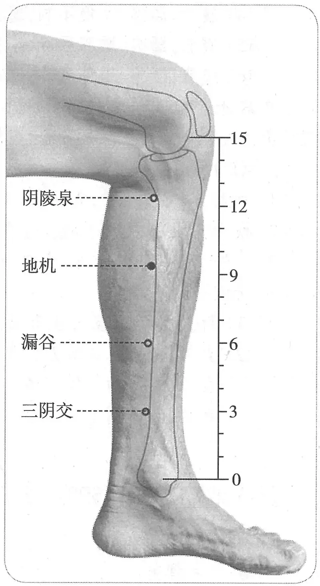

**图 2-108　地机穴图**

　1. 别走上一寸一空，在膝下五寸。（《黄帝明堂经》、《铜人腧穴针灸图经》卷下、《圣济总录》、《针灸资生经》、《十四经发挥》、《医学纲目》、《循经考穴编》）

　2. 在膝内侧辅骨下陷者中，伸足取之。（《太平圣惠方·明堂》）

**按**：此系将“阴陵泉”穴误抄于“地机”穴下。

　3. 在别走上一寸空中，膝下五寸。（《铜人腧穴针灸图经》卷上）

　4. 膝下五寸，膝内侧辅骨下陷中，伸足取之。（《针灸聚英》卷一、《针灸大成》、《针方六集》、《类经图翼》）

　5. 膝下五寸，大骨后，伸足取之。（《医学入门》卷一）

　6. 一曰在别走上一寸，孔在膝下五寸。（《类经图翼》卷六）

　7. 广注膝内侧辅骨下陷者中，一法阴陵下五寸，骨内大筋外，与巨虚相对，伸足取之。又法合内踝骨尖上八寸，别斜走向前一寸，须伸足取。（《循经考穴编》上）

**按**：所录“膝内侧辅骨下陷者中”乃沿袭《太平圣惠方》之误。

　8. 膝下五寸内侧，骨后陷中。（《针灸十四经穴位考订》）

　9. 统编针灸学教材

〔p.457 (인쇄 437)〕

　　(1) 部位：膝下五寸。取穴：以足伸直从膝盖骨正中内缘直下五寸取之，当胫骨后缘之际。（1957年南京《针灸学》）

　　(2) 部位：膝下五寸。取穴：从阴陵泉下三寸，胻骨后缘陷中伸足取之。（1版《针灸学讲义》）

　　(3) 部位：膝下五寸。取穴：在阴陵泉下约四横指三寸，阴陵泉至内踝尖连线上取之。（2版《针灸学讲义》）

　　(4) 阴陵泉穴下3寸。（4、5版《针灸学》）

　　(5) 在小腿内侧，当内踝尖与阴陵泉的连线上，阴陵泉下3寸。（6版《针灸学》）

　　(6) 在内踝尖与阴陵泉穴的连线上，阴陵泉穴下3寸。（7版《针灸学》）

　　(7) 阴陵泉下三寸，阴陵泉与内踝高点的连线上。（《中国针灸学》）

**文献分析**：本穴定位，《太平圣惠方》将阴陵泉穴内容误录于本穴下，其余古今文献一致，均定位于膝下五寸。

#### 【类属】 

足太阴脾经穴。脾经之郄穴。

足太阴郄。（《黄帝明堂经》）

#### 【适应症】 

主治脾胃、前阴病症。常用于腹痛，泄泻；月经不调，疝气。

　1. 主癞疝。溏瘕，腹中痛，藏痹。（《黄帝明堂经》）

　2. 地机在膝内侧辅骨下陷者中。主腰痛不可俛仰，足痹痛屈伸难也。（《太平圣惠方·明堂》）

**按**：《太平圣惠方》所载本穴部位及主治病症，均系“阴陵泉”穴主治症，因穴名抄错而使此二穴内容相混。《太平圣惠方》之后的几乎所有针灸腧穴文献均沿袭了这一十分明显的错误。

　3. 治女子血瘕，按之如汤沃股内至膝，丈夫溏泄，腹胁气胀水肿，腹坚不嗜食，小便不利。（《铜人腧穴针灸图经》卷下）

**按**：据《针灸甲乙经》、《千金要方》、《外台秘要》，上述病症均为“阴陵泉”穴主治症，王惟一误录于地机穴下，宋以后针灸书直至现代针灸学教材皆沿袭其误。

　4. 足大指内侧红肿。（《针方六集》卷五）

　5. 主下部之疾无所不疗。（《循经考穴编》上）

　6. 统编针灸学教材

　　(1) 腹胁胀不嗜食，瘕泄，妇人月经不调，癥瘕，小便不利，男子失精，腰痛，水肿腹坚。（1957年南京《针灸学》）

　　(2) 腹胁胀不嗜食，大便溏泄，小便不利，水肿，月经不调，癥瘕，失精腰痛。（1版《针灸学讲义》）

　　(3) 腹胀，食欲不振，痢疾，月经不调，月经痛，小便不利，遗精，水肿。（2版《针灸学讲义》）

　　(4) 腹痛，泄泻，水肿，小便不利，遗精，月经不调。（4版《针灸学》）

　　(5) 腹痛，泄泻，小便不利，水肿，月经不调，痛经，遗精。（5版《针灸学》）

　　(6) 腹痛、泄泻、小便不利、水肿、月经不调、遗精、腰痛不可以俯仰、食欲不振。（6版《针灸学》）

　　(7) ①痛经、崩漏、月经不调等妇科病；②腹痛、腹泻等脾胃病证；③小便不利、水肿等脾不运化水湿病证。（7版《针灸学》）

　　(8) 腹痛，腹胀，泄泻，水肿，小便不利，月经不调，痛经。（《中国针灸学》）

**文献分析**：本穴主治病症自宋以后多与“阴陵泉”穴相混，故确定本穴主治，应以《黄帝明堂经》为主要依据。教材中凡沿袭《铜人腧穴针灸图经》之误者，今去之。

〔p.458 (인쇄 438)〕

#### 附：临床应用举例 

　1. 吐利上下俱出，脏痹脓血，头重臂痛，太白、地机、风府各五分、长强、尺泽各一寸。（《医学纲目》卷三十一）

　2. 阴部疼痛，取地机穴，提插捻转后使之得气。［中国针灸，1999(4):248］

　3. 股内侧痛，地机配阴陵泉；痛经，地机配三阴交；胸胁痛，地机配阳陵泉。［针灸临床杂志，2002，18(7):43-44］

#### 【操作】 

直刺1~1.5寸。

　1. 刺入三分，灸五壮。（《黄帝明堂经》）

　2. 针三分，灸三壮。（《针灸十四经穴位考订》）

　3. 统编针灸学教材

　　(1) 针五分至八分，伸足针之，灸三至七壮。（1957年南京《针灸学》、1版《针灸学讲义》）

　　(2) 直刺5~8分，艾条灸3~7分钟。（2版《针灸学讲义》）

　　(3) 直刺1~1.5寸。（4、5、6、7版《针灸学》）

　　(4) 直刺0.5~1寸。可灸。（《中国针灸学》）

　4. 直刺1.5~2.5寸。感应：酸胀有时可扩散至小腿部。灸3壮；温灸5~15分钟。（上海《针灸学》）

### （九）阴陵泉 Yīnlíngquán SP9 出《灵枢》 

#### 【提要索隐】 

**部位**：在小腿内侧，胫骨内侧髁下缘与胫骨内侧缘之间的凹陷中。

**国标修订**：1990年版国标：在小腿内侧，当胫骨内侧髁后下方凹陷中。2006年修订版：在小腿内侧，胫骨内侧髁下缘与胫骨内侧缘之间的凹陷中。

**适应症**：主治脾胃、妇科、前阴病症。常用于腹痛，腹胀，泄泻，水肿；妇人阴中痛，痛经；小便不利或遗尿，遗精；腰痛、膝肿。

**针刺操作**：直刺1~2寸。

#### 【名实考】 

人膝如陵，膝之下为“下陵”，膝之阴陷中——膝内侧凹陷，为“阴陵泉”；膝之阳陷中——膝外侧凹陷，为阳陵泉。故曰：“阴有阳疾者，取之下陵三里；疾高而内者，取之阴之陵泉；疾高而外者，取之阳之陵泉”。（《灵枢·九针十二原》）

要理解《内经》、《黄帝明堂经》关于本穴定位的描述，及其与阳陵泉穴的位置关系，关键在于正确理解“辅骨”一词。在《内经》、《黄帝明堂经》中“辅骨”有不同含义，综合考察《灵枢》“经脉”、“骨度”、“本输”篇，本穴定位中“辅骨”是指胫骨内侧髁。

　1. 阴之陵泉者，辅骨之下陷者之中也，屈伸而得之，为合。（《黄帝内经太素·本输》）

　2. 入于阴陵泉，阴陵泉者水也，在膝下内侧，辅骨下陷者中，伸足乃得之。足太阴脉之所入也，为合。（《黄帝明堂经》）

　3. 足太阴之所入，太阴陵泉穴也。在内侧辅骨下陷者中，足太阴之合。（《素问亡篇·刺法论》）

　4. 阴陵泉二穴，水也。在膝下内侧辅骨下陷中，伸足取之。足太阴脉之所入也，为合。又曲膝取之。（《铜人腧穴针灸图经》卷下）

**按**：宋以前文献中本穴取法皆谓“伸足”，何以《铜人腧穴针灸图经》既曰“伸足”，又言“曲膝”？很可能王惟一当时所见之《灵枢》与《黄帝内经太素》文字同，作“屈伸而得之”。

〔p.459 (인쇄 439)〕

　5. 地之高者曰陵，脾经自足上行至膝之下，可谓高矣，故曰陵。脉过其处，有泉之象，以其与阳陵泉相对而处，此在内，彼在外，故曰阴陵泉。（《经穴解》）

#### 【定位】 

**部位**：在小腿内侧，胫骨内侧髁下缘与胫骨内侧缘之间的凹陷中（图2-109）。

**取穴**：用手指沿胫骨内缘由下往上推，至手指抵膝关节下时，胫骨向内上弯曲之凹陷中即是本穴。

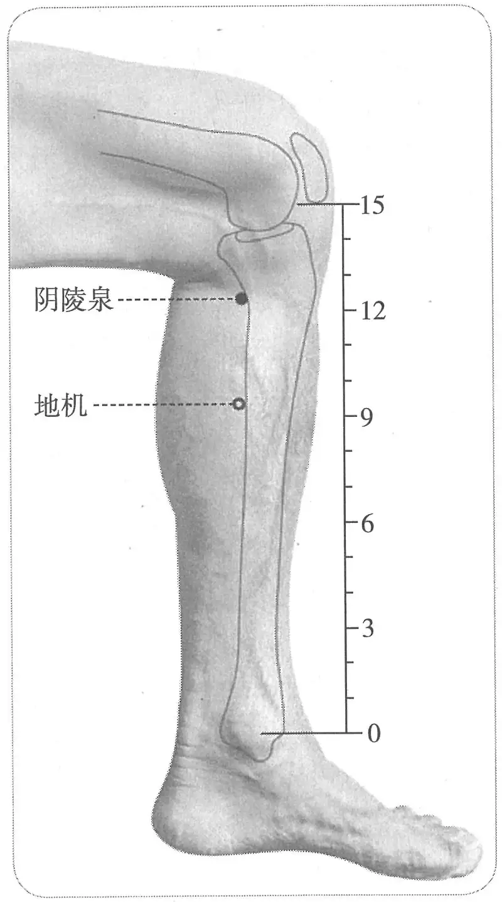

**图 2-109　阴陵泉穴图**

　1. 辅骨之下陷者之中也。（《灵枢·本输》、《黄帝内经太素·本输》）

　2. 在膝下内侧，辅骨下陷者中，伸足得之。（《黄帝明堂经》、《铜人腧穴针灸图经》卷下、《圣济总录》、《针灸资生经》、《针经节要》、《针灸玉龙经》、《神应经》、《针灸聚英》、《古今医统》、《医学入门》、《针灸大成》、《类经图翼》、《循经考穴编》、《针灸易学》）

　3. 在膝下内侧，辅骨下陷中。（《铜人腧穴针灸图经》卷上）

　4. 又曲膝取之。（《铜人腧穴针灸图经》卷下）

　5. 窦太师针灸遗存

　　(1) 在膝内辅骨下一指陷中取，伸足取之。（《窦太师针经》）

　　(2) 在膝下内侧辅骨下一指陷中。屈足取之。（《针方六集》卷一）

　6. 又法取曲膝之横纹尖头是穴。（《针灸玉龙歌》注）

**按**：此系将“曲泉”穴取法误作本穴也。

　7. 与阳陵对，先取阳陵泉，后取阴陵泉，横针透阳陵泉。（《医经会元·玉龙歌》注）

　8. 在膝下内侧，辅骨下陷中。对阳陵泉，而稍高一寸许，屈膝取之。（《神应经》）

　9. 或曲膝取之，与阳陵泉穴相对。（《针灸聚英》卷一、《古今医统》）

　10. 或屈膝取之。在膝横纹头下，与阳陵泉穴相对，稍高一寸。（《针灸大成》卷六、《类经图翼》）

　11. 从地机上行膝下内侧，曲膝横纹头陷中。（《医宗金鉴·刺灸心法要诀》）

　12. 在膝下内侧辅骨下陷中，屈膝横纹头取之。（《针灸逢源》）

　13. 统编针灸学教材

　　(1) 部位：膝在膝下内侧辅骨下陷者中。取穴：以足伸直从胫骨头内侧陷中取之，正与阳陵泉穴相对。（1957年南京《针灸学》）

　　(2) 部位：内侧辅骨之下。取穴：伸足于内辅骨下凹陷中取之。如屈膝取，则在大筋下胻骨后缘。（1版《针灸学讲义》）

　　(3) 部位：膝在膝下内侧辅骨下陷者中。取穴：于胫骨内髁下缘，胫骨内侧之陷凹部取之。（2版《针灸学讲义》）

〔p.460 (인쇄 440)〕

　　(4) 胫骨内侧髁下缘凹陷中。（4、5版《针灸学》）

　　(5) 在小腿内侧，当胫骨内侧髁后下方凹陷中。（6版《针灸学》）

　　(6) 胫骨内侧髁下方凹陷处。（7版《针灸学》）

　　(7) 胫骨内侧髁下缘，胫骨内缘的凹陷中。（《中国针灸学》）

**文献分析**：关于本穴定位，《黄帝明堂经》“膝下内侧，辅骨下陷者中”，是指胫骨内侧髁下缘与胫骨内侧缘相移行的凹陷处，教材以《中国针灸学》表述最为明确；关于本穴与阳陵泉的位置关系，古今文献多指出为“横平”，窦氏针灸传本则于本穴下明确为“内辅骨下一指”，阳陵泉穴作“外辅骨下一指”，更明确了这种“横平”关系。而明代《神应经》则言“对阳陵泉，而稍高一寸许”，可能是对《黄帝明堂经》关于阴陵泉和阳陵泉定位描述的误解。因为对于后者，《黄帝明堂经》有“膝下一寸”字样，殊不知“内辅骨”也当膝下约寸许，因此二穴的横向位置基本相平。需要注意的是，《针灸玉龙歌》注将“曲泉”穴的定位与本穴相混淆，清代《医宗金鉴》传此误。

#### 【类属】 

足太阴脾经穴。五输穴之合穴。

　1. 脾出于隐白……入于阴之陵泉，阴之陵泉，辅骨之下，陷者之中也，伸而得之，为合，足太阴也。（《灵枢·本输》）

　2. 足太阴脉之所入也，为合。（《黄帝明堂经》）

　3. 足太阴之所入，太阴陵泉穴也。在内侧辅骨下陷者中，足太阴之合。（《素问亡篇·刺法论》）

#### 【适应症】 

主治脾胃、妇科、前阴病症。常用于腹痛，腹胀，泄泻，水肿；妇人阴中痛，痛经；小便不利或遗尿，遗精；腰痛，膝肿。

　1. 主溏泄，谷不化。腹中气胀嗑嗑，胁下满。腹中气盛，水胀逆不得卧。肾腰痛不可俛仰。气癃溺黄。寒热不节。女子疝瘕，按之如以汤沃其股内至膝，飧泄，妇人阴中痛，少腹坚，急痛重下湿，不嗜食，心下满，寒中，小便不利，霍乱，足痹痛。（《黄帝明堂经》）

**按**：以上病症包括脾经病候、前阴病症和妇人病症。其中“不得卧，不嗜食，溏泄，飧泄，霍乱，谷不化”等均为脾经或脾病典型症状，《灵枢·四时气》曰：“飧泄，补三阴之上，补阴陵泉，皆久留之，热行乃止”；“肾腰痛不可俛仰”已见于太白穴主治；“女子疝瘕，按之如以汤沃其股内至膝”又见于曲泉穴主治，是任脉的典型症状，也见于脾经病候，《灵枢·百病始生》对此有更详细的描述：“其著孙络之脉而成积者，其积往来上下……其着于伏冲之脉者，揣之应手而动，发手则热气下于两股，如汤沃之状。”描述的是妇人腹部肿块如正当腹主动脉（冲脉）之上，以手按之则应手而动，松开手则能感觉到一股热流沿两大腿内侧下行，如热水浇注一样。可见古人观察得非常细致。需要说明的是，汉魏以前，“瘕”指妇人腹部肿块（血之积），汉魏以后，相同的概念以“癥”表示。

　2. 失禁，遗尿不自知，胸中热。（《千金要方》卷三十）

　3. 治腹中寒不嗜食，膈下满，水胀腹坚，喘逆不得卧，腰痛不得俯仰，霍乱，疝瘕，小便不利，气淋，寒热不节。（《铜人腧穴针灸图经》卷下）

　4. 窦太师针灸遗存

　　(1) 治大小便不通，膝盖红肿，泻；筋紧不能开，先补后泻。浑身胀满，伤寒五疸，不灸。（《窦太师针经》）

　　(2) 治疗小便不通，泻；膝盖红肿痛，宜泻。（《大本琼瑶神书》）

　　(3) 膝盖红肿，筋紧不开。（《针方六集》卷五）

　　(4) 腿膝肿痛。（《循经考穴编》上）

〔p.461 (인쇄 441)〕

　5. 主胁腹胀满，中下疾皆治。（《医学入门》卷一）

　6. 遗精。（《针灸大成》卷六、《针方六集》）

　7. 统编针灸学教材

　　(1) 腹中寒不嗜食，胁下满，水肿腹坚，小便不利，前阴疼，遗精，遗尿，腰腿膝痛。（1957年南京《针灸学》、1版《针灸学讲义》）

　　(2) 腹胀，水肿，黄疸，小便不利，泄泻，阴茎痛，遗精，小便失禁，膝痛。（2版《针灸学讲义》）

　　(3) 腹胀，水肿，黄疸，小便不通，失禁，膝痛。（4版《针灸学》）

　　(4) 腹胀，泄泻，水肿，黄疸，小便不利或失禁，膝痛。（5版《针灸学》）

　　(5) 腹胀、水肿、小便不利或失禁、阴茎痛、妇人阴痛、遗精、膝痛、黄疸。（6版《针灸学》）

　　(6) 腹胀、腹泻、水肿、黄疸、小便不利等脾不运化水湿证；膝痛。（7版《针灸学》）

　　(7) 腹痛，腹胀，泄泻，痢疾，水肿，黄疸，小便不利，遗尿，尿失禁，阴部痛，痛经，膝痛。（《中国针灸学》）

**文献分析**：《黄帝明堂经》载本穴主治包括脾经病候、前阴病症和妇人病症，后世腧穴文献及临床应用也集中在此三方面。教材“黄疸”一症未详所出，附存备考。

#### 附：临床应用举例 

　1. 脾胃病症

　　(1) 飧泄，补三阴之上，补阴陵泉，皆久留之，热行乃止。（《灵枢·四时气》）

　　(2) 小儿单纯性消化不良：针刺太白、阴陵泉治疗。［中国针灸，1995(增刊):135-136］

　2. 前阴、膀胱病症

　　(1) 玉茎中痛：中极、三阴交、太溪、复溜。问曰：此证缘何而得？答曰：因少年之时，过用金石之药，有伤茎孔，使阴阳交感不能发泄，故如此也。宜刺后穴：中极、阴陵泉、关元、血海。（《针灸集成》第五十二方）

　　(2) 虚劳尿精，灸第七椎两旁各三十壮……又灸阳陵泉、阴陵泉各随年壮。（《千金要方》卷十九、《千金翼方》）

　　(3) 遗尿失禁，出不自知，灸阴陵泉随年壮。（《千金要方》卷二十一、《千金翼方》）

　　(4) 水肿不得卧，灸阴陵泉百壮。（《千金翼方》卷二十八）

　　(5) 伤寒，小便不通：刺支沟；未愈，泻阴谷、阴陵泉。（《针灸集要·盘石金直刺秘传》、《窦太师秘传》）

　　(6) 五淋：气海、关元、阴谷、阴陵泉。问曰：此证缘何而得？答曰：皆因色欲不节，少年之过，用诸枪药之类；或小便急行，房正合欢之际，被人冲破不能泻，阴阳不舒通，故成珠淋、血淋、热淋、冷淋、气淋。善治医者当详审，治无不效也。（《针灸集成》第六十二方）

　　(7) 伤寒小便不通，取阴谷、阴陵泉。（《医学纲目》卷三十二）

　　(8) 阴陵开通于水道。（《通玄指要赋》）

　　(9) 尿潴留：针刺阴陵泉治疗。［天津中医学院学报，1994(2):23］

　3. 下肢病症

　　(1) 红肿名为鹤膝风，阳陵二穴便宜攻，阴陵亦是通神穴，针到方知有俊功。（《针灸玉龙歌》）

　　(2) 阴𫏋阳𫏋两踝边，脚气四穴先寻取。阴阳陵泉亦主之，阴𫏋阳𫏋与三里，诸穴一般治脚气，在腰玄机宜正取。（《灵光赋》）

〔p.462 (인쇄 442)〕

　　(3) 脚痛膝肿针三里，悬钟二陵三阴交，更向太冲须引气，指头麻木自轻飘。（《席弘赋》）

　　(4) 大隐神经痛：针刺阴陵泉、三阴交治疗。阴陵泉穴针感上行，三阴交穴平补平泻。［针刺研究，1998(3):216-217］

#### 【操作】 

直刺1~2寸。腘动静脉位于深面，刺破该血管可导致深部血肿，应注意避免。

　1. 刺入五分，留七呼，灸三壮。（《黄帝明堂经》）

　2. 刺可同身寸之五分，留七呼，动气至，而急出之也。（《素问亡篇·刺法论》）

　3. 窦氏针灸遗存

　　(1) 针透阳陵泉穴，灸二七壮。（《窦太师针经》）

　　(2) 横针透阳陵泉。（《窦太师秘传》）

　　(3) 与阳陵泉对，横针可相透。详证虚实补泻，可灸二七壮。（《针灸玉龙歌》注）

　4. 针三分，禁灸。《金鉴》、《集成》灸三壮。（《针灸十四经穴位考订》）

　5. 统编针灸学教材

　　(1) 针五分，以足伸直针之，灸三至五壮，不宜多灸。（1957年南京《针灸学》、1版《针灸学讲义》）

　　(2) 直刺5~8分，艾条灸3~5分钟。（2版《针灸学讲义》）

　　(3) 直刺1~2寸。（4、5、6、7版《针灸学》）

　　(4) 直刺0.5~1寸。可灸。（《中国针灸学》）

　6. 直刺，沿胫骨后缘，深1~3寸。感应，局部酸胀，可向下扩散。灸3壮；温灸5~15分钟。（上海《针灸学》）

**文献分析**：当代针灸临床所用阴陵泉透阳陵泉法，早在窦氏针灸中就明确记载，这种长距离、运针轨迹带有弧度的透刺，要求针的材质具有一定的韧性。说明最晚在元代，制针的材料与工艺已经达到较高的水平，透刺法盛行于这一时期，并非偶然。

### （十）血海 Xuèhǎi SP10 出《黄帝明堂经》 

问题：血海与百虫窝究竟什么关系？

#### 【提要索隐】 

**部位**：在股前内侧，髌底内侧端上2寸，股内侧肌隆起处。

**国标修订**：1990年版国标：屈膝，在大腿内侧，髌底内侧端上2寸，当股四头肌内侧头的隆起处。2006年修订版：在股前区，髌底内侧端上2寸，股内侧肌隆起处。

**适应症**：主治妇科、皮肤病症。常用于月经不调，痛经，崩漏，经闭；风疹，湿疹。

**针刺操作**：刺1~1.5寸。

#### 【名实考】 

《窦太师针经》以“血海”、“血郄”、“百虫窠”为同一穴，然“血郄”乃《铜人腧穴针灸图经》所谓“委中”穴也；“血海”与“百虫窠”定位与主治皆不同。所以出现这样的混淆，盖因通行本《千金要方》血海穴定位作“膝膑上内廉白肉际二寸半。一作三寸”，所以出现这样的异文，关键是后人不能正确理解《黄帝明堂经》关于血海穴定位描述“二寸中”的特殊含义。若说“二寸中”就是指膝上二寸处，那么“中”便成了完全多余的字，“二寸中”这样的定位描述法在《灵枢》还能见到较多的例子：

　1. 足太阳之本，在跟以上五寸中……足少阴之本，在内踝下上三寸中……足厥阴之本，

〔p.463 (인쇄 443)〕

在行间上五寸所……足太阴之本，在中封前上四寸之中……手阳明之本，在肘骨中，上至别阳……手太阴之本，在寸口之中……手心主之本，在掌后两筋之间二寸中。（《灵枢·卫气》）

　2. 行于间使，间使之道，两筋之间，三寸之中也，有过则至，无过则止，为经。（《灵枢·本输》）

可知，这里的“二寸中”、“三寸中”是指二寸之中、三寸之中，或约二寸、约三寸的意思，而不是一个精确、固定的点，《黄帝明堂经》血海穴定位“二寸中”的说法应是早期腧穴概念的“痕迹”，后人不解，便做出了两种改动：第一，认为“二寸中”就是二寸，于是直接删去“中”字，如《铜人腧穴针灸图经》卷上等；第二，认为“中”字为“半”字之误，遂径改作“二寸半”，如传世本《针灸甲乙经》即是，然该书皆用“五分”表示“半寸”概念，则此处“二寸半”显系后人所改，《外台秘要》引《针灸甲乙经》之文仍作“二寸中”，无误。再如《千金要方》卷三十作“二寸半”，而未经宋人校改本《孙真人千金方》仍作“二寸中”，无误。

至于《千金要方》注文“一作三寸”，很可能与《医心方》记载的本穴简便取穴“膝内骨上一夫”有关，这一取穴法在后世文献中有很详细的描述。也正是这种“一作三寸”说最终导致本穴与百虫窠穴混为一谈，于是出现了“血郄二穴，即百虫窠，又名血海也”的说法。

　3. 血海，在膝髌上内廉白肉际二寸中，足太阴脉气所发。（《黄帝明堂经》）

　4. 《曹氏灸经》曰血海者，名为冲使，在膝内骨上一夫陷中，人阴阳气之所由从也。（《医心方》卷二）

　5. 脾生血，此穴离而上，血渐生旺，而腹中饮食所生之血，亦能于此所上下，血生于此地，故曰血海。（《经穴解》）

　6. 别名　血郄、百虫窠。（1957年南京《针灸学》）

**“血海”、“血郄”、“百虫窠”互混例**

　1. 委中者血郄也。（《铜人腧穴针灸图经》卷下）

　2. 委中，一名血郄。（《针灸聚英》卷一）

　3. 血郄二穴，即百虫窠。在膝上两内廉附骨上三寸，亦白肉际宛宛中。禁针，灸三七壮。治肾藏风疮，湿痒，补泻；女人阴内肿，泻。大治浑身疮疥。又法针二寸半。又名血海也。（《窦太师针经》）

　4. 百虫窠二穴，即血海也。在膝内廉上三寸，灸二七壮，针五分。治下部生疮。（《针灸大成》卷七）

　5. 血海，一名百虫窠。（《针灸大成》卷七）

　6. 血海二穴，一名血郄，一名百虫窠。在膝上内廉辅骨上二寸半，赤白肉际宛宛中。一方以患人手按膝盖骨上，大指向内，余四指向外，大指尽处是穴。《针经》刺入五分，灸五壮。窦氏刺入二寸半，灸三七壮。主逆气腹胀，肾脏风疮湿痒，浑身脓疥，女人阴内肿，暴崩，漏下不止，血闭不通。（《针方六集》卷一、卷五）

#### 相关穴及刺激点 

止痒2：血海穴内侧1寸。主治荨麻疹，皮肤瘙痒症。针1.5~2寸，针感局部麻、酸。（《针灸经外奇穴图谱（续集）》）

#### 【定位】 

**部位**：在股前内侧，髌底内侧端上2寸，股内侧肌隆起处（图2-110）。

**取穴**：屈膝，髌底内侧端上2寸处取穴。

　1. 《黄帝明堂经》佚文

〔p.464 (인쇄 444)〕

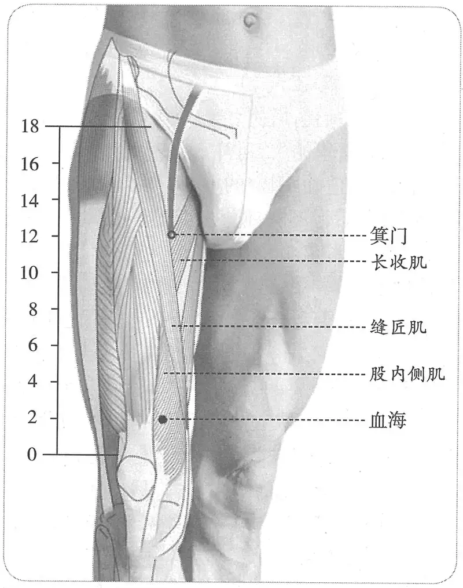

**图 2-110　血海穴图**

　　(1) 在膝膑上内廉白肉际二寸中。（《医心方》卷二、《铜人腧穴针灸图经》卷下、《圣济总录》、《针灸资生经》、《十四经发挥》）

　　(2) 在膝膑上内廉白肉际二寸半。（《针灸甲乙经》卷三、《千金要方》、《医学纲目》、《针灸聚英》、《古今医统》、《针灸大成》、《针方六集》、《循经考穴编》、《针灸易学》）

　　(3) 在膝膑上内廉白肉际二寸。（《千金翼方》卷二十六、《铜人腧穴针灸图经》卷上）

　　(4) 在膝下髌上内廉白肉际二寸中。（《外台秘要》卷三十九）

　2. 一作三寸。（《千金要方》卷二十九、《针灸问对》、《医学入门》）

　3. 在膝髌上内廉。（《铜人腧穴针灸图经》卷下“穴腧都数”）

　4. 在膝膑上一寸内廉白肉际陷中。一云在膝内辅骨上。（《类经图翼》卷六、《医宗金鉴·刺灸心法要诀》）

　5. 膝盖内侧向上二寸白肉际。按：“血海”穴或作膝盖上一寸。（《针灸十四经穴位考订》）

　6. 统编针灸学教材

　　(1) 部位：在膝膑上内廉，赤白肉际二寸。取穴：从膝盖内缘之上二寸。普通取法：正坐垂足，医者以右手掌按其左膝盖，食中等四指在膝上面，拇指在膝盖内侧之上面，拇指尖到处取之。（1957年南京《针灸学》）

　　(2) 部位：膝膑上内廉，赤白肉际。取穴：正坐垂足，医者以右手掌按其左膝盖，食中等四指在膝上面，拇指横按于膝盖内侧上方，指尖到处是穴，恰当内辅上廉之上方二寸处。（1版《针灸学讲义》）

　　(3) 部位：在髌上内廉，白肉际二寸半。取穴：屈膝，于髌骨内上缘上二寸，当股骨内上髁上缘两横指股内肌的隆起上。屈膝成直角时，以手掌按其膝盖，二至五指向膝上，大指向膝内侧，大指端尽处是穴。（2版《针灸学讲义》）

　　(4) 髌骨内上方2寸处。（4版《针灸学》）

　　(5) 髌骨内上缘上2寸。（5版《针灸学》）

　　(6) 屈膝，在大腿内侧，髌底内侧端上2寸，当股四头肌内侧头的隆起处。（6版《针灸学》）

　　(7) 屈膝，在髌骨内上缘上2寸，当股四头肌的隆起处。（7版《针灸学》）

　　(8) 屈膝，髌骨内上缘上方二寸处，当股四头肌内侧头的隆起处。或患者屈膝，以手掌按于髌骨上，第二至第五指向上伸直，拇指约呈45°斜置，拇指尖下是穴。（《中国针灸学》）

〔p.465 (인쇄 445)〕

**文献分析**：本穴定位，现存《黄帝明堂经》佚文，传世本《针灸甲乙经》、宋校本《千金要方》均作膝上“二寸半”，今考《针灸甲乙经》腧穴定位表述半寸之义，均用“五分”二字，《外台秘要》引作“二寸中”，则知《针灸甲乙经》原本作“二寸中”；《外台秘要》“在膝下髌上内廉白肉际二寸中”中之“膝下髌上”非一处，“下”字显系衍文；《类经图翼》“在膝膑上一寸”，则与奇穴“大轮”相重。

#### 【类属】 

足太阴脾经穴。

足太阴脉气所发。（《黄帝明堂经》）

#### 【适应症】 

主治妇科、皮肤病症。常用于月经不调，痛经，崩漏，经闭；风疹，湿疹。

　1. 主妇人漏下，若血闭不通，逆气胀。（《黄帝明堂经》）

　2. 治女子漏下恶血，月事不调，逆气腹胀。（《铜人腧穴针灸图经》卷下）

　3. 主一切血疾及诸疮。（《医学入门》卷一）

**按**：《医学入门》中血海穴定位与百虫窝穴同，故主治也同。

　4. 统编针灸学教材

　　(1) 月经不调，崩中漏下，腿内廉风疮痒疼。（1957年南京《针灸学》、1版《针灸学讲义》）

　　(2) 月经不调，月经痛，经闭，崩漏，股内侧痛，皮肤湿疹，瘾疹，丹毒。（2版《针灸学讲义》）

　　(3) 月经不调，崩漏，经闭，瘾疹，湿疮，股内侧痛。（4版《针灸学》）

　　(4) 月经不调，崩漏，经闭，瘾疹，湿疹，丹毒。（5版《针灸学》）

　　(5) 月经不调、痛经、经闭、崩漏、瘾疹、皮肤瘙痒、丹毒、小便淋漓、股内侧痛。（6版《针灸学》）

　　(6) 月经不调、痛经、经闭等妇科月经病；瘾疹、湿疹、丹毒等血热性皮肤病。（7版《针灸学》）

　　(7) 月经不调，痛经，崩漏，闭经，风疹，湿疹，丹毒，股内侧痛。（《中国针灸学》）

**文献分析**：本穴主治，宋以前的文献记载皆主月经不调，教材中新增之主治症皆系录自金元《窦太师针经》“百虫窠”主治。

#### 附：临床应用举例 

　1. 小腹疼，小腹及脚中拘急……针血海泻之。（《脉经》卷二）

　2. 中风半身瘫痪，疼痛麻木，不遂，针合谷、手三里、曲池、肩井、环跳、血海、阳陵泉、阴陵泉、足三里、绝骨、居髎。（《针灸集要·盘石金直刺秘传》）

　3. 两腿股瘫痪，内痛针血海，外痛针风市，泻之。（《针灸集要·盘石金直刺秘传》）

　4. 妇人经脉不调，补合谷，泻三阴交，灸血海。（《针灸集要·盘石金直刺秘传》）

　5. 气海血海疗五淋。（《灵光赋》）

　6. 延迟性肌肉酸痛，灸血海、风市、足三里穴。［成都体育学院学报，1994，20(3):87-93］

　7. 小腿皮肤溃疡，血海穴针刺。患者取仰卧位或坐位，以2寸毫针直刺患侧血海穴，进针1~1.5寸，待得气后留针。［中国针灸，2000(10):598］

　8. 中风病恢复期患者下肢肌无力，取患侧血海、足三里穴。［中国民间疗法，2001，9(3):16］

#### 【操作】 

刺1~1.5寸。

　1. 刺入五分，灸五壮。（《黄帝明堂经》）

　2. 针五分，灸三壮。（《针灸十四经穴位考订》）

　3. 统编针灸学教材

　　(1) 针五分至一寸，灸三至五壮。（1957年南京《针灸学》、1版《针灸学讲义》）

〔p.466 (인쇄 446)〕

　　(2) 直刺5~10分，艾条灸3~5分钟。（2版《针灸学讲义》）

　　(3) 直刺1~1.5寸。（4、5、7版《针灸学》）

　　(4) 直刺1~1.2寸；可灸。（6版《针灸学》）

　　(5) 直刺0.5~1.2寸。可灸。（《中国针灸学》）

　4. 直刺1~2寸。感应局部酸胀，有时向髋部扩散。灸3~5壮；温灸5~15分钟。（上海《针灸学》）

### （十一）箕门 Jīmén SP11 出《黄帝明堂经》 

问题1：在2006年修订国标之前，针灸学教材关于本穴定位，多谓在动脉搏动处，刺法也强调“必须避开动脉”，可是按照教材中规定的定位，于本穴处根本就不能触及搏动，按照教材规定的针刺深度也刺不到动脉。为什么会出现这些奇怪的现象呢？

问题2：明代针灸文献关于本穴定位，开始采用折量法“血海上六寸”，明代关于大腿部骨度折量分寸是否与《灵枢·骨度》相同？

#### 【提要索隐】 

**部位**：在股内侧，髌底内侧端与冲门穴的连线上1/3与下2/3交点，长收肌和缝匠肌交角的动脉搏动处。

**国标修订**：1990年版国标：在大腿内侧，当血海与冲门连线上，血海上6寸。2006年修订版：在股前区，髌底内侧端与冲门穴的连线上1/3与下2/3交点，长收肌和缝匠肌交角的动脉搏动处。

**适应症**：主治前阴部病症。常用于小便不利，遗尿，腹股沟肿痛。

**针刺操作**：直刺0.5~1寸。勿伤及股动脉。

#### 【名实考】 

既曰“箕门”，应是在“箕坐”时两腿与下腹部呈箕形时取穴。所谓“箕坐”是指席地，两腿外展呈箕形。而“箕门”就应当是指这个“簸箕”上的一个特定部位。既知唐以前古医籍中将膝外侧“膝眼”穴处称作“箕踵”（见《千金要方》），那么大腿近端称作“箕门”就再自然不过了。

关于本穴定位，《黄帝明堂经》中原本是完全依据体表解剖标志定位的，可是最晚在明代，古人已经无法解读其定位描述中的解剖标志术语，因而不得不改以骨度折量取穴。现代人同样无法读懂该穴定位的原始文献，只好沿袭明代的做法——骨度折量取穴，然而现代不同时期、不同地区大腿部的折量坐标系不同，这样同样的折量寸在不同的坐标系中的位置是不同的。这一长期没有被意识到的问题在制订经穴定位的国际标准的过程中才充分暴露出来。

关于明代大腿部的骨度折量分寸，《针方六集》卷一记有一条线索：“箕门二穴，在鱼腹上，越两筋间，动脉应手，上血海六寸，下气冲五寸”，则知气冲至髌底为13寸。

　1. 箕门，在鱼腹上越筋间，动脉应手，阴市内，足太阴脉气所发。（《黄帝明堂经》）

　2. 箕门血海上六寸，筋间动脉须详谛。（《针灸聚英》、《针方六集》）

　3. 穴名箕门者，以足之两股在此，其形并列如箕，经脉之动脉皆以门称，故曰箕门。（《经穴解》）

本穴定位，《黄帝明堂经》曰：“在鱼腹上越筋间，动脉应手，阴市内”。此处的“鱼腹”是指大腿呈扁平鱼腹状的股内侧肌群，“越筋”则是斜跨股内侧肌群的人体中最长的肌肉——缝匠肌。据解剖学可知，缝匠肌从髂前上棘自外上向内下方斜行，约于上1/3与下2/3交界处与自内而外的长收肌交叉，这两条肌肉的两条边与底边腹股沟韧带形成一个三角形地带称作“股三角”，股动脉正从此三角形下行，在此区域的体表可触及股动脉搏动（越往上越明显），而一旦通过股三角的尖角（正所谓“越筋间”）后，由于缝匠肌的遮蔽，则难以在体表触及股动脉搏动。可见“股三角”的尖角处（越筋间）恰好是从体表触按股动脉的分界点，“箕门”正位于此处，故从体表可感知“动脉应手”。

〔p.467 (인쇄 447)〕

现代针灸学教材（如1959年原北京中医学院《简明针灸学》）一方面采用“血海上六寸”之说，一方面也用现代解剖学语言描述：在股骨内侧，缝匠肌之内侧缘，当内收长肌之下端，有股动脉分布。如果“血海上六寸”采用的是“横骨上廉以下至内辅之上廉长一尺八寸”的骨度，则其定位远比解剖学描述的位置低，二者所述定位相差很远。

如上所述，依据《黄帝明堂经》所说的定位，本穴应定于缝匠肌与长收肌相交处，而据人体测量学的结果提示，此处约相当于大腿上1/3与下2/3交界处，后人因不解“越筋间”术语，而自明代以骨度折量取穴，定于膝上8寸。如按大腿长度13寸折量，则膝上8寸约相当于上1/3处，这样20世纪50年代对于“箕门”穴的定位竟“歪打正着”地与用体表解剖定位不谋而合：

　1. 在股骨内侧，缝匠肌之内侧缘，当内收长肌之下端，有股动脉。（1954年朱琏《新针灸学》）

　2. 缝匠肌内侧缘，当内收长肌之下端，有股动脉。（1957年南京《针灸学》）

　3. 股三角下端，长内收肌与缝匠肌相交处，当股动脉上。（1977年日本教学参考书《针灸医学》）

可是，后来中国针灸教材将大腿部的骨度重新调整为18寸，却忘记对在13寸系统下定位的箕门穴的折量数值“膝上8寸”加以调整，照旧定为“在大腿内侧，当血海与冲门连线上，血海上6寸”（1990年版国标《经穴部位》），于是变换不同的坐标系——骨度系统后，中国对于此穴的定位在不知不觉（始终没有意识到）中发生了很大的改变。而日本的统编针灸学教材也随中国而变，然其针灸教材参考书对于箕门穴的定位仍然沿用中国20世纪50年代的定位，这样经过两次误会后，日本针灸教学参考书《针灸医学》的定位反而在无意间走向了正确。韩国的情形与日本类似，同时保留“血海上6寸”说和中国五十年代的定位，但由于其大腿部长度已变为18寸，从而使得这两说不能同时成立。当2004年中、日、韩三国专家走到一起商讨制定经穴定位的国际标准时，发现“箕门”这个三国本无分歧的经穴定位有了很大的分歧，而三国专家起初都莫名其妙——不知什么时候什么原因致使三国间出现如此大的分歧，当然也就无法解决分歧——这个分歧直到中国专家查明这个历史疑案之后才得到圆满解决。

关于本穴的取穴法，王冰有如下描述：宽拱足，单衣沉取乃得之，而动应于手也（《素问·三部九候》王冰注）。所谓“拱足”即翘足如拱，根据不同的需要有不同的“拱足”方法；所谓“宽拱足”在立姿时指横向拱足，即翘足，大腿外展外旋（这是显示缝匠肌的经典姿式），而箕坐状态下（屈髋，屈膝，大腿外展外旋）“宽拱足”，则两足底相抵——与“拱手”类似，这时可以明显地显示出股三角，而于缝匠肌与长收肌所形成的顶角凹陷处——越筋间，可以触及股动脉搏动——动脉应手。尽管后来我们还陆续发现其他显示股三角的方法与技巧，但都不及古人这种方法有效、简单。

〔p.468 (인쇄 448)〕

**“箕门”与“期门”相混例**

　1. 癃，遗溺，鼠鼷痛，小便难而白，期门主之。（《针灸甲乙经》卷九）

　2. 期门　癃，遗溺，鼠鼷痛，小便难而白。（《外台秘要》卷三十九）

　3. 箕门　淋，遗溺，鼠鼷痛，小便难。（《外台秘要》卷三十九）

　4. 箕门　主癃，遗溺，鼠鼷痛，小便难而白。（《医心方》卷二）

由于王焘当时所据《针灸甲乙经》传本中“箕门主之”误作“期门主之”，而使“箕门”穴下无主治症可寻。王焘既不能校正《针灸甲乙经》之误，只有传其讹，仍将该条主治症辑入“期门”穴下，另据其他《黄帝明堂经》传本补辑“箕门”的主治。

#### 【定位】 

**部位**：在股内侧，髌底内侧端与冲门穴的连线上1/3与下2/3交点，长收肌和缝匠肌交角的动脉搏动处（图2-111）。

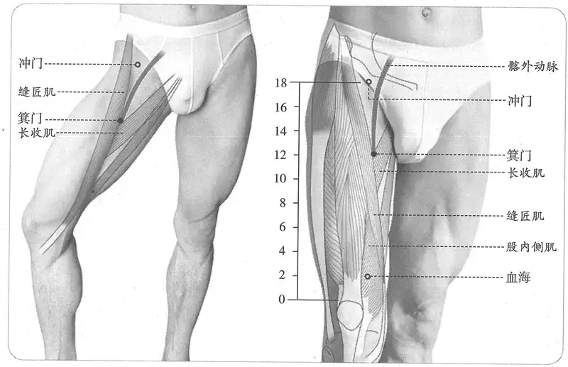

**图 2-111　箕门穴图**

**取穴**：如果肌肉发达，能够在体表清楚确定股三角者，直接在股三角的尖角处取穴；如果只能在体表显示缝匠肌者，则于髂前上棘至股骨内侧髁连线的上1/3至下2/3交点处，缝匠肌内侧取穴；如果一条肌肉也不能触诊到，则于髌底内侧端与冲门连线的上1/3与下2/3交点的稍内侧取穴。

#### 相关解剖学基础 

　　(1) 缝匠肌体表显示技法方法：方法1：使大腿屈曲和外旋，这是显示缝匠肌的最常用的方法，肌肉发达的人稍屈髋、外旋，即可很清楚地显示该肌的全程，并可在髂前下棘下清楚地触及该肌的肌腱。方法2：如果肌肉不发达的被检查者可在其膝部施加适当的阻力来对抗髋的屈曲和外展，则有助于缝匠肌的显示或体表触诊。

　　(2) 长收肌体表显示、触诊技法：当膝部对抗阻力内收时，长收肌内缘很清晰，既可看到又可摸到该肌，可摸到该肌为一块狭长而明显的肌肉隆起。在长收肌的上端，耻骨的下方可用手指和拇指触摸到长收肌的起始腱。

〔p.469 (인쇄 449)〕

　　(3) 股三角体表显示技法：箕坐法半卧位：大腿外展外旋，屈膝，两足底用力相抵，若有意识地稍加一个内收方向的力，效果更显著。

根据缝匠肌、长收肌的作用原理，还可以采用多种变通方法在体表显示这两条肌肉，从而为临床取穴提供更多的选择。

　　(4) 股动脉触诊技法：在髋关节和膝关节屈曲并外旋与外展状态下，于股三角的底边股点（位于髂前上棘到耻骨结节的中点）至股三角的顶角处，均可触及股动脉的搏动，越往近侧搏动感越强。在较瘦的被检查者，还可以清楚看到动脉搏动，并可清晰地触及到股动脉的外侧壁。

　1. 《黄帝明堂经》佚文

　　(1) 在鱼腹上越两筋间，动脉应手，太阴市内。（《针灸甲乙经》卷三）

　　(2) 在鱼腹上越筋间，动应手，阴市内。（《千金翼方》卷二十六、《外台秘要》、《医心方》）

　　(3) 在鱼腹上筋间，动应手，阴市内。（《千金要方》卷二十九）

　　(4) 在鱼腹上越筋间，直五里下，宽拱足，单衣沉取乃得之，而动应于手也。（《素问·三部九候》王冰注）

　2. 一云在阴股内起脉间。（《千金翼方》卷二十六）

　3. 一云在股上起筋间。（《外台秘要》卷三十九、《铜人腧穴针灸图经》卷下）

　4. 在鱼腹上越筋间，阴股内动脉。（《铜人腧穴针灸图经》卷上、《十四经发挥》）

　5. 在鱼腹上越筋间，动脉应手，在阴股内。（《铜人腧穴针灸图经》卷下、《针灸资生经》、《针灸集书》、《针灸聚英》、《古今医统》、《医学纲目》、《医学入门》、《针灸大成》、《类经图翼》、《医宗金鉴·刺灸心法要诀》、《针灸逢源》）

　6. 箕门血海上六寸，筋间动脉须详谛。（《针灸聚英·步穴歌》卷四、《针灸问对》、《古今医统》、《医学入门》、《针方六集》）

　7. 在鱼腹上，越两筋间，动脉应手，上血海六寸，下气冲五寸。（《针方六集》卷一）

　8. 在鱼腹上两起筋，阴股内动脉中，广注当居血海上六寸，阴股内两筋间动脉应手。（《循经考穴编》上）

　9. 血海上约六寸、动脉应手处。（《针灸十四经穴位考订》）

　10. 统编针灸学教材

　　(1) 部位：鱼腹上两筋间阴股内动脉侧。取穴：正坐，从膝盖内缘直上八寸取之。（1957年南京《针灸学》）

　　(2) 部位：鱼腹上起筋间，阴股内动脉处。取穴：正坐，从血海上六寸动脉应手处取之，在大腿用力挺直时，正当股内侧肌隆起之尖端。（1版《针灸学讲义》）

　　(3) 部位：鱼腹上越两筋间，动脉应手。取穴：于血海上六寸，在血海与冲门的连线上，当缝匠肌内侧取之。（2版《针灸学讲义》）

　　(4) 血海穴上6寸。（4版《针灸学》）

　　(5) 血海穴与冲门穴的连线上，血海穴直上6寸。（5、7版《针灸学》、《中国针灸学》）

　　(6) 在大腿内侧，当血海穴与冲门连线上，血海上6寸。（6版《针灸学》）

**文献分析**：本穴定位，《黄帝明堂经》曰“在鱼腹上越筋间，动脉应手，阴市内”，此处的“鱼腹”是指大腿呈扁平鱼腹状的股内侧肌群，“越筋”则是斜跨股内侧肌群的人体中最长的肌肉——缝匠肌。据解剖学可知，缝匠肌从髂前上棘自外上向内下方斜行，约于上1/3与下2/3交界处与自内而外的长收肌交叉，这两条肌肉的两条边与底边腹股沟韧带形成一个三角形地带称作“股三角”，股动脉正从此三角形下行，在此区域的体表可触及股动脉搏动（越往上越明显），而一旦通过股三角的尖角（正所谓“越筋间”）后，由于缝匠肌的遮蔽，则难以在体表触及股动脉搏动。可见“股三角”的尖角处（越筋间）恰好是从体表触按股动脉的分界点，“箕门”正位于此处，故从体表可感知“动脉应手”。

〔p.470 (인쇄 450)〕

#### 【类属】 

足太阴脾经穴。

足太阴脉气所发。（《黄帝明堂经》）

#### 【适应症】 

主治前阴部病症。常用于小便不利，遗尿；腹股沟肿痛。

　1. 主癃，遗溺，鼠鼷痛，小便难而白。（《黄帝明堂经》）

　2. 治淋，遗溺，鼠鼷肿痛，小便不通。（《铜人腧穴针灸图经》卷下）

　3. 主两股生疮，阴囊湿痒。（《循经考穴编》上）

　4. 期门　癃，遗溺，鼠鼷痛，小便难而白。（《外台秘要》卷三十九）

　5. 箕门　淋，遗溺，鼠鼷痛，小便难。（《外台秘要》卷三十九）

　6. 统编针灸学教材

　　(1) 小便不通，遗溺，鼠鼷肿痛。（1957年南京《针灸学》、1版《针灸学讲义》）

　　(2) 小便不通，遗溺，腹股沟肿痛。（2版《针灸学讲义》、4、5、7版《针灸学》）

　　(3) 小便不通、五淋、遗溺、腹股沟肿痛。（6版《针灸学》）

　　(4) 小便不利，遗尿，腹股沟肿痛，下肢痿痹。（《中国针灸学》）

**文献分析**：由于王焘编《外台秘要》时所据的《针灸甲乙经》抄本中“箕门主之”误作“期门主之”，而使“箕门”穴下无主治症可寻。王焘既不能校正《针灸甲乙经》之误，只有传其讹，仍将该条主治症辑入“期门”穴下，而“箕门”穴下主治内容当据其他《黄帝明堂经》传本补辑。今观其所补之文，不仅较《针灸甲乙经》、《医心方》少“而白”两字，而且首字“癃”已改作“淋”，可见其所据之本不若《针灸甲乙经》及初唐杨上善注本精善。值得注意的是，未经宋人校改的古宋本《千金要方》该条主治条文中“箕门”也误作“期门”，说明这是一个极易出现的错误，只不过这种穴名错误在《医心方》这样的书中容易发现，而在《针灸甲乙经》、《千金要方·孔穴主对法》中很难被发现而已。

#### 附：临床应用举例 

遗尿症，取箕门穴。选用28号2寸针，避开股动脉，直刺1寸左右，得气后行捻转手法，留针30分钟，5分钟捻转1次，连续7天为1疗程。［北京中医，1988(6):40-41］

#### 【操作】 

直刺0.5~1寸。勿伤及股动脉。

　1. 刺入三分，留六呼，灸三壮。（《黄帝明堂经》）

　2. 禁针。（《医学入门》卷一）

　3. 一法横刺二寸五分，禁灸。（《循经考穴编》上）

　4. 统编针灸学教材

　　(1) 针三至五分，不可深刺，灸三至五壮。（1957年南京《针灸学》、1版《针灸学讲义》）

　　(2) 直刺3~5分，不可深刺，艾条灸3~5分钟。（2版《针灸学讲义》）

　　(3) 避开动脉，直刺0.5~1寸。（4、5、6、7版《针灸学》）

　　(4) 直刺0.5~1.0寸。可灸。（《中国针灸学》）

**文献分析**：《黄帝明堂经》谓本穴可针，可灸，教材则谓不深刺，不宜灸。而依据教材关于本穴的定位，其下之股动脉已较深，应无所禁忌，另一方面正当股动脉表浅处的本经“冲门”穴，以及足厥阴经之阴廉、五里穴教材却谓可针，可灸，且直刺可深至2寸！所以然者，不知是否是受《会元针灸学》“禁针，针之恐破动脉，血不出而发鼠鼷。又恐血出不止，倘误针此穴，血出如注，色变，急用带束其上，一手押其下，一手按摸其穴，以血不出为度。然后解其带，在穴上按摸数下，令气血相接。其血不出而发鼠鼷者，亦在鼷上按摸，令气散，血从针孔浸出即愈”的影响。这段描述显然是将《素问·刺禁论》“刺气街中脉，血不出为肿鼠仆；刺阴股中大脉，血出不止死”中的两个部位误当成本穴，刺箕门穴，何以会出现腹股沟处血肿？用现代针，按教材的箕门穴定位进行针刺，也不会出现血出不止。只有用古代粗针，刺按古代定位之箕门穴，才可能出现刺破股动脉的情况，但箕门穴之上的五里、阴廉穴“刺中大脉”的可能性更大，因此无论如何，也不会是冲门、阴廉、五里无忌，反而箕门禁刺、禁灸。形成这样的说法，乃误解经文之义，误传今人之讹所致。

〔p.471 (인쇄 451)〕

### （十二）冲门 Chōngmén SP12 出《黄帝明堂经》 

#### 【提要索隐】 

**穴名**：一名慈宫。

**部位**：在腹股沟区，腹股沟斜纹中，髂外动脉搏动处的外侧。

**国标修订**：1990年版国标：在腹股沟外侧，距耻骨联合上缘中点3.5寸，当髂外动脉搏动处的外侧。2006年修订版：在腹股沟区，腹股沟斜纹中，髂外动脉搏动处的外侧。

**归经**：足太阴脾经。为足太阴、阴维交会穴。

**适应症**：主治局部病症。常用于腹满，积聚疼痛；疝气，癃闭；难产。

**针刺操作**：直刺0.5~1寸。勿损伤股动脉。

#### 【名实考】 

冲门，《外台秘要》、《医心方》均作“衡门”。

　1. 冲门，一名慈宫。上去大横五寸，在府舍下，横骨两端约中动脉。足太阴阴维之会。（《黄帝明堂经》）

　2. 若泄利所伤，烦欲死者，灸慈宫二十七壮，在横骨两边各二寸半，横骨在脐下，横门骨是。（《千金要方》卷二十）

**按**：此处穴名与《黄帝明堂经》的冲门穴别名相同，但横向距离或有不同。今人归入“奇穴”类。

　3. 冲门，一名上慈宫。（《针灸聚英》卷一）

**按**：此曰“上慈宫”，而无“下慈宫”相对，令人费解。

　4. 以气冲已在中，去中行二寸之际，而此穴乃在去中行四寸半之际，反在气冲之外，以其近于胃经入腹穴之气冲也，故曰冲门。（《经穴解》）

　5. 别名　前章门。（1957年南京《针灸学》）

**按**：此传自日本教材，未详所出。

#### 相关穴及刺激点 

　1. 兰门二穴，在曲骨穴两旁各开三寸。针入一分半，灸三七壮。治膀胱七疝之气。（《窦太师针经》）

**按**：本穴具体阐述见气冲穴“名实考”。

　2. 冲间　位于曲骨穴旁开3寸。主治子宫脱垂，下肢瘫痪。针1~2.5寸，针感抽麻至耻骨联合处。（《针灸经外奇穴图谱（续集）》）

〔p.472 (인쇄 452)〕

　3. 维宫　位于腹中线旁开4寸，向下引线与腹股沟之交点处是穴。主治子宫脱垂。针直刺1.5~2寸。针感：麻胀感及子宫向上抽动感。（《针灸经外奇穴图谱（续集）》）

　4. 鼠蹊　位于腹股沟中、外三分之一交界点。主治抬腿无力。针2~3寸，针感麻、抽至耻骨联合。（《针灸经外奇穴图谱（续集）》）

#### 【定位】 

**部位**：在腹股沟区，腹股沟斜纹中，髂外动脉搏动处的外侧（图2-112）。

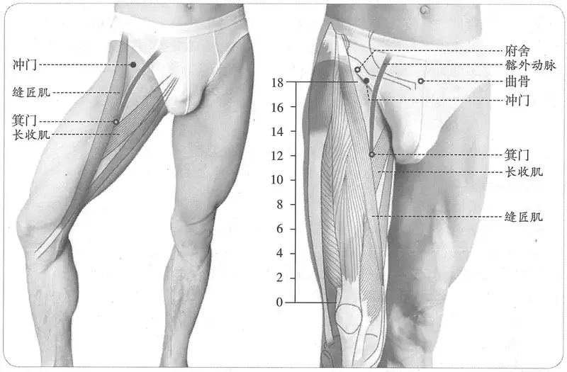

**图 2-112　冲门穴图**

**取穴**：横平曲骨穴，府舍穴稍内下方取穴。

　1. 腹中行旁开三寸五分

　　(1) 上去大横五寸，在府舍下，横骨两端约中动脉。（《外台秘要》卷三十九、《铜人腧穴针灸图经》卷中、《圣济总录》、《医学纲目》）

　　(2) 上去大横五寸，在府舍下，横骨两端约中。（《千金要方》卷二十九、《医心方》卷二、《铜人腧穴针灸图经》卷上、《医学入门》）

　　(3) 上直两乳，夹不容两旁各一寸五分。上去大横五寸，在府舍下，横骨两端约纹中动脉。（《针灸甲乙经》卷三）

　　(4) 上去大横五寸，在府舍下，横骨两端约纹中动脉，去腹中行三寸半。（《类经图翼》卷六、《医宗金鉴·刺灸心法要诀》）

　　(5) 在府舍下七分《大成》作一寸，误，上去大横五寸，横骨两端约纹中动脉，去中各三寸半。（《针灸逢源》）

　　(6) 曲骨穴旁开三寸五分。按：冲门、府舍、腹结、大横、腹哀诸穴或作去中行四寸，或作去中行三寸半，似可不拘。兹从《医宗金鉴》、《铜人图经》、《类经图翼》等作去中行三寸五分。（《针灸十四经穴位考订》）

〔p.473 (인쇄 453)〕

　2. 腹中行旁开四寸五分

　　(1) 上去大横五寸，府舍下横骨两端约中动脉。注：以上十四穴（从期门到冲门）去腹中行各当为四寸半。（《针灸资生经》卷一、《十四经发挥》、《针灸聚英》、《古今医统》、《医学入门》、《循经考穴编》）

　　(2) 在府舍下一寸，横骨两端约中动脉，去腹中行四寸半。（《针灸大成》卷六、《针灸易学》）

　3. 腹中行旁开四寸

上直两乳，去大横五寸，在府舍下，横骨两端约纹中动脉应手，夹任脉两旁各四寸。（《针方六集》卷一）

　4. 统编针灸学教材

　　(1) 部位：大横穴下五寸横骨两端约纹中。取穴：仰卧，从曲骨外开三寸五分之处，当耻骨端取之。（1957年南京《针灸学》）

　　(2) 部位：大横穴下五寸横骨两端约纹中。取穴：仰卧，从任脉曲骨穴旁开三寸五分取之。（1版《针灸学讲义》）

　　(3) 部位：上去大横五寸，在府舍下，横骨两端约文中动脉。取穴：腹股沟外端之上缘，股动脉外侧，平耻骨联合上缘，曲骨任脉旁三寸半取之。（2版《针灸学讲义》）

　　(4) 曲骨穴旁开3.5寸。（4版《针灸学》）

　　(5) 耻骨联合上缘中点旁开3.5寸。（5版《针灸学》）

　　(6) 在腹股沟外侧，距耻骨联合上缘中点3.5寸，当髂外动脉搏动处的外侧。（6、7版《针灸学》）

　　(7) 腹股沟外端之上缘，股动脉外侧，平耻骨联合上缘，曲骨旁开三寸五分。（《中国针灸学》）

**按**：本穴定位的纵向距离，除《针灸大成》作“在府舍下一寸”外，其他古今文献一致，均定位于大横下五寸，动脉搏动处。至于腹部足太阴经穴距前正中线尺寸有“三寸半”、“四寸”、“四寸半”诸说，分歧的原因，详见足少阴肾经“概说”。

#### 【类属】 

足太阴脾经穴。

　1. 足太阴、阴维之会。（《黄帝明堂经》）

　2. 足太阴、厥阴之会。（《针灸秘法全书》卷一）

　3. 归经　足太阴脾经。（《外台秘要》卷三十九、《铜人腧穴针灸图经》卷上）

#### 【适应症】 

主治局部病症。常用于腹满，积聚疼痛；疝气，癃闭；难产。

　1. 主寒气腹满，癃，淫泺，身热，腹中积聚疼痛。阴疝。乳难，子上冲心。（《黄帝明堂经》）

**按**：“乳难”，即难产也。

　2. 治腹寒气满，积聚疼淫泺，阴疝，难乳，子上冲心，不得息。（《铜人腧穴针灸图经》卷中）

　3. 统编针灸学教材

　　(1) 腹寒气满，积聚疼痛，疝痛，癃闭。（1957年南京《针灸学》、1版《针灸学讲义》）

　　(2) 腹痛，疝气，痔痛，小便不利，胎气上冲。（2版《针灸学讲义》）

　　(3) 腹痛，泄利，疝气，带下，崩漏。（4版《针灸学》）

　　(4) 腹痛，疝气，崩漏，带下。（5版《针灸学》）

　　(5) 腹痛、疝气、痔疾、崩漏、带下。（6版《针灸学》）

　　(6) 腹痛、疝气；崩漏、带下、胎气上冲等妇科病证。（7版《针灸学》）

〔p.474 (인쇄 454)〕

　　(7) 腹痛，疝气，小便不利。（《中国针灸学》）

**文献分析**：本穴主治症皆出于《黄帝明堂经》，且均见于相邻的“气冲”穴主治，可互参。教材“崩漏、带下”见于《百证赋》配穴治症，而“痔痛”未详所出，也未见临床应用报道，故暂不列入本穴主治项下。

#### 附：临床应用举例 

　1. 霍乱，若泄利所伤，烦欲死者，灸慈宫二十七壮。（《千金要方》卷二十）

　2. （脚气）又若胸中气散而心下有脉洪大跳，其数向下，分入两髀股内。令人心急忪悸者，宜以手按捻少腹下两旁接髀大斜纹中，有脉跳动，便当文上灸跳三七炷即定。灸毕，皆须灸三里二十炷，以引其气下也。（《外台秘要》卷十九）

　3. 中风后遗证，治疗下肢不遂时则以冲门穴为主穴，配以髀关、血海、足三里等穴。肢厥，取以主穴冲门，意在健脾温中，配以足三里、三阴交等穴辅助。痿证（股神经损伤），取冲门穴为主，辅以血海、梁门、伏兔、足三里等穴。［辽宁中医杂志，2002，29(9):557］

#### 【操作】 

直刺0.5~1寸。勿损伤股动脉。

　1. 刺入七分，灸五壮。（《黄帝明堂经》）

　2. 针七分，灸五壮。孕妇禁针。（《针灸十四经穴位考订》）

　3. 统编针灸学教材

　　(1) 针七分，仰卧针之，灸三至七壮。（1957年南京《针灸学》）

　　(2) 针七分，灸三至七壮。（1版《针灸学讲义》）

　　(3) 直刺5~7分，艾条灸3~7分钟。（2版《针灸学讲义》）

　　(4) 避开动脉，直刺0.5~1寸。（4、5、7版《针灸学》、《中国针灸学》）

　　(5) 直刺0.5~1寸；可灸。（6版《针灸学》）

### （十三）府舍 Fǔshè SP13 出《黄帝明堂经》 

#### 【提要索隐】 

**部位**：在下腹部，脐中下4.3寸，前正中线旁开4寸。

**国标修订**：1990年版国标：在下腹部，当脐下4寸，冲门上方0.7寸，距前正中线4寸。2006年修订版：在下腹部，脐中下4.3寸，前正中线旁开4寸。

**按**：1990年版国标的表述“脐中下4寸”与“冲门上方0.7寸”不能同时成立，2006年版特做修正。

**归经**：足太阴脾经。为足太阴、厥阴、阴维交会穴。

**适应症**：主治腹部、脾胃病症。常用于妇人疝气，腹痛；积聚。

**针刺操作**：刺1~1.5寸。

#### 【名实考】 

关于本穴的定位，《针灸大成》作“腹结下二寸”，独与诸书不同，考此定位与其配套的铜人图相合，显然是有意识的改动，而不是无意的错误。根据这个修订，则《针灸大成》下腹部脾经骨度为4.3寸，不及5寸，故此说后世不从。至于本穴距中行尺寸分歧，系由第一侧行肾经穴的定位分歧所引起。

　1. 府舍，在腹结下三寸，足太阴、阴维之会。（《黄帝明堂经》）

　2. 府舍二穴，在腹结下三寸。足太阴、厥阴、阴维之交会此三脉上下三入腹，络肝脾，结心肺，从胁上至肩。此太阴郄，三阴、阳明支别。（《铜人腧穴针灸图经》卷中）

　3. 以入门则为舍，舍之所藏，乃六腑也，故曰府舍。（《经穴解》）

〔p.475 (인쇄 455)〕

#### 【定位】 

**部位**：在下腹部，脐中下4.3寸，前正中线旁开4寸（图2-113）。

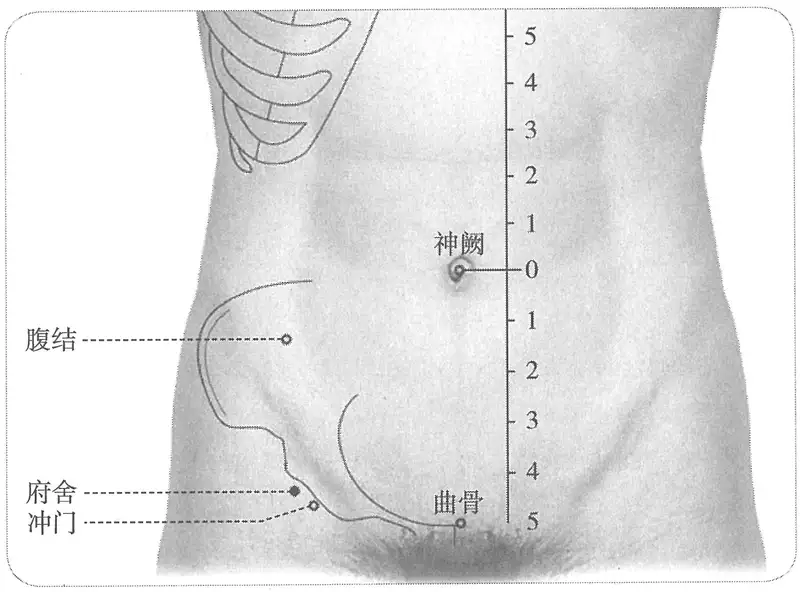

**图 2-113　府舍穴图**

**取穴**：仰卧，冲门上0.7寸，中行旁开4寸处取穴。

　1. 腹中行旁开三寸五分

　　(1) 在腹结下三寸。（《千金要方》卷二十九、《千金翼方》、《外台秘要》、《医心方》、《铜人腧穴针灸图经》、《圣济总录》）

　　(2) 上直两乳，夹不容两旁各一寸五分。在腹结下三寸。（《针灸甲乙经》卷三）

　　(3) 从冲门上行七分，去腹中行，亦旁开三寸半。（《医宗金鉴·刺灸心法要诀》）

　2. 腹中行旁开四寸五分

　　(1) 在腹结下三寸。注：以上十四穴（从期门到冲门）去腹中行各当为四寸半。（《针灸资生经》卷一、《十四经发挥》、《针灸聚英》、《古今医统》、《医学入门》、《循经考穴编》）

　　(2) 腹结下二寸，去腹中行各四寸半。（《针灸大成》卷六、《针灸易学》）

**按**：腹结下二寸，与《针灸大成》编者靳贤所修之《铜人明堂之图》同，可知此系靳贤所改。

　3. 在腹结下三寸，上直两乳，夹任脉两旁各四寸。（《针方六集》）

　4. 冲门上七分，腹结下三寸。（《针灸十四经穴位考订》）

　5. 统编针灸学教材

　　(1) 部位：在腹结下三寸。取穴：仰卧，冲门上七分，中行旁开四寸，大横直下四寸三分取之。（1957年南京《针灸学》）

　　(2) 部位：大横穴下四寸三分。取穴：仰卧，从冲门穴上七分，距任脉旁开四寸取之。（1版《针灸学讲义》）

　　(3) 部位：在腹结下三寸。取穴：仰卧，从冲门穴上七分，距任脉旁开四寸取之。（2版《针灸学讲义》）

　　(4) 冲门穴外上方0.7寸，前正中线旁开4寸。（4、5、7版《针灸学》）

　　(5) 在下腹部，当脐中下4寸，冲门上方0.7寸，距前正中线4寸。（6版《针灸学》）

　　(6) 冲门外上方七分，任脉旁开四寸。（《中国针灸学》）

〔p.476 (인쇄 456)〕

**按**：本穴定位，除《针灸大成》一书作“腹结下二寸”外，其余古代文献均作“腹结下三寸”，今从之。至于腹部足太阴经穴距前正中线尺寸有“三寸半”、“四寸”、“四寸半”诸说，分歧的原因，详见足少阴肾经“概说”。

#### 【类属】 

足太阴脾经穴。

　1. 足太阴、阴维之会。（《黄帝明堂经》）

　2. 足太阴、厥阴、阴维之交会。此太阴郄，三阴、阳明支别。（《铜人腧穴针灸图经》卷中）

　3. 归经　足太阴脾经。（《外台秘要》卷三十九、《铜人腧穴针灸图经》卷上）

#### 【适应症】 

主治腹部、脾胃病症。常用于疝气，腹痛；积聚。

　1. 主疝瘕，髀中急痛，循胁上下，抢心，腹满积聚。厥逆霍乱。（《黄帝明堂经》）

　2. 治疝瘕，髀中急痛，循胁上下抢心，腹满积聚，厥气霍乱。（《铜人腧穴针灸图经》卷中）

　3. 主痹痛。（《针灸聚英》卷一、《古今医统》、《类经图翼》）

**按**：此条主治系高武辑录自《针灸资生经·痃癖》卷四，原文作“府舍治疝癖见痹疼”意即“府舍治疝癖”条文录自《铜人腧穴针灸图经》，此处为略文，详文见“痹疼”篇。今检《针灸资生经》有“脾疼”篇（脾，用作“髀”），而无“痹疼”篇，可见传世本《针灸资生经》卷三的这条引文出处“痹疼”系“脾疼”之误，同样的条文又见于《针灸资生经·疝瘕》卷三，原文为“府舍治疝癖（见脾疼）”，正确无误。由于高武完全不解《针灸资生经》一书的复杂体例，又不能正确断句，故将卷四的引文出处文字误解为病症而录于府舍穴下。

　4. 统编针灸学教材

　　(1) 呕吐泄泻，腹痛，积聚，疝瘕。（1957年南京《针灸学》、1版《针灸学讲义》）

　　(2) 腹痛，疝气。（2版《针灸学讲义》）

　　(3) 腹痛，积聚，疝气。（4、5、6、7版《针灸学》）

　　(4) 少腹痛，疝气。（《中国针灸学》）

**文献分析**：本穴主治妇人腹部肿块的特点是：腹痛引胁，上抢心，下引髀。本穴主治皆出于《黄帝明堂经》“疝瘕，髀中急痛，循胁上下，抢心，腹满积聚。厥逆霍乱”，实际上只描述了两个病：疝瘕和霍乱，对前一病的症状有详细描述，而没有描述后一病的症状。所谓疝瘕，《说文》曰：“瘕，女病也”。《灵枢·水胀》曰：“石瘕生于胞中，寒气客于子门，子门闭塞，气不得通，恶血当泻不泻，衃以留止，日以益大，状如怀子，月事不以时下。皆生于女子，可导而下。”分言之，气聚为疝，血凝为瘕。而汉以前“疝瘕”合言多为偏义复词，偏于“瘕”，《黄帝明堂经》“疝瘕”一词用法即是，如太溪穴之“胞中有大疝瘕积聚与阴相引而痛”，阴陵泉、曲泉之“女子疝瘕”，四满之“脐下积，疝瘕，胞中有血”均是，本穴主治“疝瘕”义亦同此，指妇人腹部肿积。此下的“髀中急痛，循胁上下，抢心，腹满积聚”皆系对疝瘕的具体描述。类似症状还见于水道穴“胞中瘕，子门有寒引髌髀”。又《诸病源候论》卷三十八曰：“燥瘕之聚，大如半杯上下，腹中苦痛还两胁下，上引心而烦……”皆可参详。“厥逆霍乱”，足太阴络脉病候谓“厥气上逆则霍乱”；又《灵枢·五乱》曰：“乱于肠胃，则为霍乱”。要之，《黄帝明堂经》“疝瘕”系偏义复词，偏于“瘕”，不能从字面理解为“疝气、积聚”。故各版统编教材所载“疝气”一症，今不取。

#### 【操作】 

刺1~1.5寸。

　1. 刺入七分，灸五壮。（《黄帝明堂经》）

　2. 一法直刺一寸五分，灸三七壮。（《循经考穴编》上）

　3. 针七分，灸五壮。孕妇禁针。（《针灸十四经穴位考订》）

　4. 统编针灸学教材

　　(1) 针三至七分，灸三至七壮。（1957年南京《针灸学》、1版《针灸学讲义》）

〔p.477 (인쇄 457)〕

　　(2) 直刺5~8分，艾条灸3~7分钟。（2版《针灸学讲义》）

　　(3) 直刺1~1.5寸。（4、5、7版《针灸学》）

　　(4) 直刺0.8~1.2寸；可灸。（6版《针灸学》）

　　(5) 直刺0.5~1.0寸。可灸。（《中国针灸学》）

### （十四）腹结 Fùjié SP14 出《黄帝明堂经》 

#### 【提要索隐】 

**穴名**：一名腹屈；一名肠屈。

**部位**：在下腹部，脐中下1.3寸，前正中线旁开4寸。

**适应症**：主治腹部病症。常用于腹痛，泄泻。

**针刺操作**：刺1~2寸。不宜刺透腹壁进入腹腔。

#### 【名实考】 

腹结，《千金翼方》、《医心方》作“肠结”。一名腹屈，又写作“肠屈”。关于本穴定位，古今文献记载的纵向定位无分歧，横向定位的分歧实由肾经穴定位分歧所引起。

　1. 腹结，一名腹屈，在大横下一寸三分。（《黄帝明堂经》）

　2. 盖大肠盘曲折叠之所，曰结、曰屈，可以会其命名之义。（《经穴解》）

　3. 腹屈，一名腹结。（《针灸甲乙经》卷三）

　4. 腹结，一名肠窟。（《外台秘要》卷三十九）

　5. 腹结，一名阳窟。（《针灸聚英》卷一）

　6. 别名　腹屈、肠窟、阳窟、肠结。（1957年南京《针灸学》）

**文献分析**：“结”与“屈”义相通，故“腹结”，又名“腹屈”。而在古代文献中“腹”与“肠”字常相混，如《医心方》不仅“腹结”、“腹哀”之“腹”皆作“肠”字，且腹哀穴主治“腹中痛”也作“肠中痛”。然根据本穴的部位及主治，说“腹结”和“肠结”皆通，故可将“肠结”、“肠屈”作为别名。而《外台秘要》又写作“肠窟”，则与“肠屈”之义不合，当系刊刻之误，之后《针灸聚英》又误作“阳窟”（“阳”字与“肠”字在古医籍中也常相混），遂尽失本穴本义，故连抄录高武之书的《古今医统》和《针灸大成》也不录此名，而直接改作“肠窟”。

#### 相关穴及刺激点 

　1. 通经　位于髂前上棘内侧平开2寸，再直上1寸处（大横穴下2寸）。主治闭经，月经不调，遗精。针1.5寸~2寸，针感下腹部胀、困、发热。（《针灸经外奇穴图谱（续集）》）

　2. 提宫　位于髂前上棘前内侧旁开2寸，直上2寸。主治子宫下垂，睾丸炎。针法：向耻骨联合斜刺约3寸深。针感：下腹部发胀，肌肉强力收缩感。（《针灸经外奇穴图谱（续集）》）

**按**：以上二穴与腹结定位相近，而主治大不同，所以然者，盖针法之别所致，其“提宫”一穴尤为明显。

#### 【定位】 

**部位**：在下腹部，脐中下1.3寸，前正中线旁开4寸（图2-114）。

**取穴**：取穴：仰卧，从府舍穴上三寸，任脉旁开四寸取之。

　1. 腹中行旁开三寸五分

　　(1) 在大横下一寸三分。（《千金要方》卷二十九、《千金翼方》、《外台秘要》、《医心方》）

　　(2) 上直两乳，夹不容两旁各一寸五分。在大横下一寸三分。（《针灸甲乙经》卷三）

〔p.478 (인쇄 458)〕

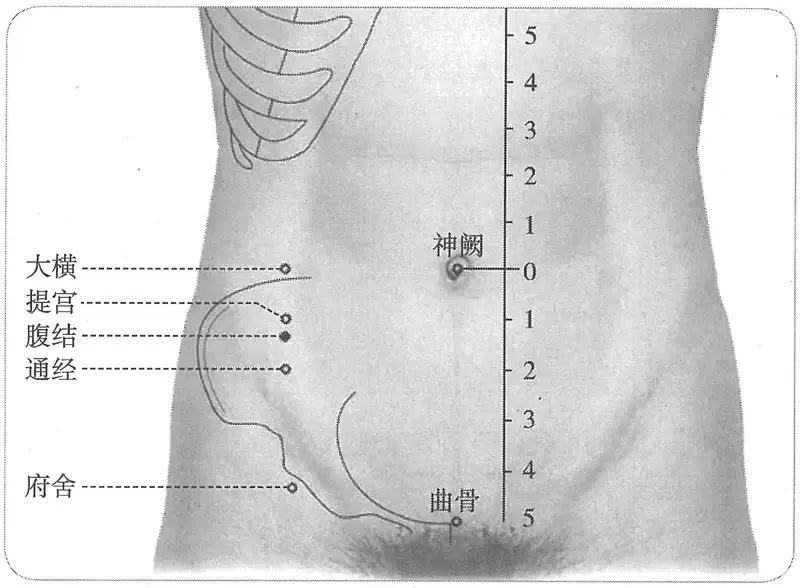

**图 2-114　腹结穴与相关穴图**

　　(3) 大横下三分。（《铜人腧穴针灸图经》、《圣济总录》）

　　(4) 在大横下一寸三分，去腹中行三寸半。（《类经图翼》卷六、《针灸逢源》）

　2. 腹中行旁开四寸五分

　　(1) 大横下三分。注：以上十四穴（从期门到冲门）去腹中行各当为四寸半。（《针灸资生经》卷一）

　　(2) 大横下一寸三分。（《十四经发挥》卷中、《针灸聚英》、《古今医统》、《医学入门》、《针灸大成》、《循经考穴编》、《针灸易学》）

　3. 在大横下一寸三分，上直两乳，夹任脉两旁各四寸。（《针方六集》卷一）

　4. 统编针灸学教材

　　(1) 部位：大横穴下一寸三分。取穴：仰卧，腹部中行旁开四寸，大横下一寸三分取之。（1957年南京《针灸学》）

　　(2) 部位：大横穴下一寸三分。取穴：仰卧，从府舍穴上三寸，任脉旁开四寸取之。（1版《针灸学讲义》）

　　(3) 部位：大横穴下一寸三分。取穴：府舍上三寸，当府舍与大横连线上取之。（2版《针灸学讲义》）

　　(4) 大横穴下1.3寸。（4版《针灸学》）

　　(5) 府舍穴上3寸，大横穴下1.3寸。（5、7版《针灸学》）

　　(6) 在下腹部，大横下1.3寸，距前正中线4寸。（6版《针灸学》）

　　(7) 大横下一寸三分，距任脉四寸，腹直肌外侧。（《中国针灸学》）

**按**：关于腹部足太阴经穴距前正中线尺寸有“三寸半”、“四寸”、“四寸半”诸说，分歧的原因，详见足少阴肾经“概说”。

#### 【类属】 

足太阴脾经穴。

**归经**：足太阴脾经。（《外台秘要》卷三十九、《铜人腧穴针灸图经》卷上）

#### 【适应症】 

主治腹部病症。常用于腹痛，泄泻。

　1. 主绕脐痛，抢心，膝寒，注利。（《黄帝明堂经》）

〔p.479 (인쇄 459)〕

　2. 治绕脐痛，上冲抢心，腹寒，泄利，咳逆。（《铜人腧穴针灸图经》卷中）

**按**：王惟一将《黄帝明堂经》原文“膝寒”改作“腹寒”，盖从腹结穴的部位考虑，而从临床角度则不必改也。此外，新增“咳逆”一症未详所出，疑有误也。各版针灸学教材均未收录，极是。

　3. 主胁肋痛，肾气冲心。（《循经考穴编》）

　4. 统编针灸学教材

　　(1) 绕脐腹痛，疝痛，腹寒泄利。（1957年南京《针灸学》、1、2、4版《针灸学》）

　　(2) 腹痛，泄泻，疝气。（5、7版《针灸学》）

　　(3) 腹痛、腹泻、大便秘结。（6版《针灸学》）

　　(4) 绕脐腹痛，腹胀，疝气，泄泻，便秘。（《中国针灸学》）

**文献分析**：“疝气”的概念，古今不同，在古代“绕脐痛，上冲抢心”，即属于疝气范畴，如《诸病源候论·疝病诸候》曰：“诸疝者，阴气积于内，复为寒气所加，使荣卫不调，血气虚弱，故风冷入其腹内而成疝也。疝者，痛也。或少腹痛，不得大小便；或手足厥冷，绕脐痛，白汗出；或冷气逆上抢心腹，令心痛；或里急而腹痛。此诸候非一，故云诸疝也。”而针灸作为一种双向性调节，其治泄泻，理当能治便秘，此所共知，不必悉举。教材中“疝气，便秘”二症未详所出，暂不列入本书腹结主治项下。

#### 【操作】 

刺1~2寸。不宜刺透腹壁进入腹腔。妇女月经期，月经过多者，不宜针刺。

　1. 针入七分，可灸五壮。（《黄帝明堂经》）

　2. 针七分，灸五壮。孕妇禁针。（《针灸十四经穴位考订》）

　3. 统编针灸学教材

　　(1) 针五分至一寸，灸五至十五壮。（1957年南京《针灸学》、1版《针灸学讲义》）

　　(2) 直刺5~8分，艾条灸5~10分钟。（2版《针灸学讲义》）

　　(3) 直刺1~2寸。（4、5、7版《针灸学》）

　　(4) 直刺1~1.5寸；可灸。（6版《针灸学》）

　　(5) 直刺0.5~1.0寸。可灸。（《中国针灸学》）

### （十五）大横 Dàhéng SP15 出《黄帝明堂经》 

#### 【提要索隐】 

**部位**：在上腹部，脐中旁开4寸。

**归经**：足太阴脾经。为足太阴、阴维交会穴。

**适应症**：主治腹部病症。常用于腹痛，泄泻，便秘。

**针刺操作**：直刺1~2寸。

#### 【名实考】 

本穴定位古今文献分歧较多，其纵向定位分歧的根源还是在于对上腹部骨度以及日月穴定位的不同理解，而上腹部骨度的分歧又是由对“鸠尾骨”与“鸠尾穴”的不同理解所引起；其横向定位分歧则由肾经穴定位分歧引起。

　1. 大横，在腹哀下三寸，直脐旁，足太阴、阴维之会。（《黄帝明堂经》）

　2. 以此穴在肝经期门之下五寸半，而期门乃在巨阙之旁四寸五分，而巨阙为任脉之经穴，在脐上六寸半，此穴在其下五寸半，正当离脐之上一寸许，乃腹中至广至横之所，故曰大横。（《经穴解》）

　3. 别名　肾气、人横。（1957年南京《针灸学》）

〔p.480 (인쇄 460)〕

**按**：此传自日本教材，未详所出。其“人横”显系“大横”形误。

#### 相关穴及刺激点 

通便　位于腹部脐旁3寸处，即在天枢与大横穴之间。主治便秘。针刺0.5~1寸，针感局部沉重。（《针灸经外奇穴图谱（续集）》）

#### 【定位】 

**部位**：在上腹部，脐中旁开4寸（图2-115）。

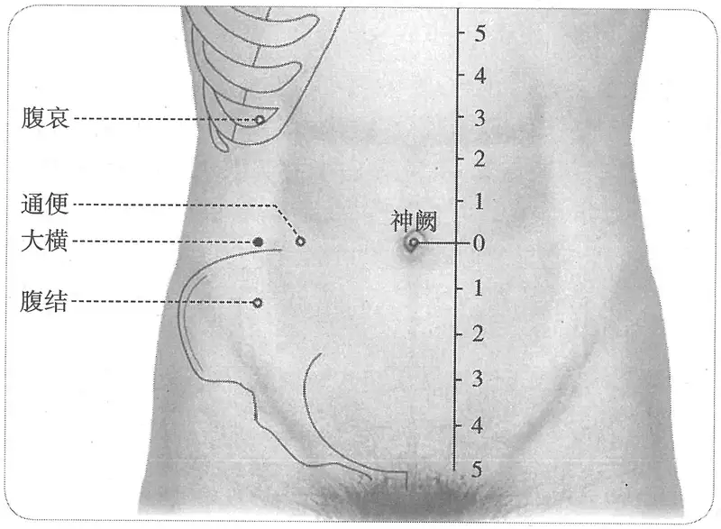

**图 2-115　大横穴与相关穴图**

**取穴**：仰卧，脐中心旁开四寸取之。

　1. 腹中行旁开三寸五分

　　(1) 在腹哀下三寸，直脐旁。（《针灸甲乙经》卷三）

　　(2) 在腹哀下二寸，直脐旁《甲乙》云三寸。（《千金要方》卷二十九）

**按**：未经宋人校本《千金方》作“三寸”，与《针灸甲乙经》诸书同。

　　(3) 在腹哀下三寸五分，直脐旁。（《铜人腧穴针灸图经》卷中及卷下“穴腧都数”、《圣济总录》、《类经图翼》）

**按**：《铜人腧穴针灸图经》三卷三处均作“三寸五分”，可知此为王惟一有意修改。

　　(4) 从腹结上行一寸三分，去腹中行亦旁开三寸半。（《医宗金鉴·刺灸心法要诀》）

　　(5) 在腹哀下六寸半旧云三寸半，误。平脐去中各三寸半。（《针灸逢源》）

　　(6) 去脐旁开三寸五分。（《针灸十四经穴位考订》）

　2. 腹中行旁开四寸五分

　　(1) 在腹哀下三寸五分，直脐旁。注：以上十四穴（从期门到冲门）去腹中行各当为四寸半。（《针灸资生经》卷一、《十四经发挥》、《针灸大成》、《循经考穴编》、《针灸易学》）

　　(2) 腹哀下三寸五分，直脐旁二寸五分，去腹中行四寸半。（《针灸聚英》卷一、《古今医统》）

　　(3) 平脐旁四寸半。（《医学入门》卷上）

　3. 在夹脐两边各二寸五分。（《千金要方》卷二十、《千金翼方》）

〔p.481 (인쇄 461)〕

　4. 在腹哀下三寸，横直脐旁，大横纹中，上直两乳，夹任脉两旁各四寸。（《针方六集》卷一）

　5. 在腹哀下二寸五分，直脐旁。（《医学纲目》）

　6. 统编针灸学教材

　　(1) 部位：与脐平，中行旁开四寸。取穴：仰卧，脐中心旁开四寸取之。（1957年南京《针灸学》）

　　(2) 部位：脐旁侧腹部。取穴：仰卧，从任脉神阙穴旁开四寸取之。（1版《针灸学讲义》）

　　(3) 部位：在腹哀下三寸。取穴：脐中旁开四寸，腹直肌外侧取之。（2版《针灸学讲义》）

　　(4) 脐中旁开4寸。（4、5、7版《针灸学》）

　　(5) 在腹中部，距脐中4寸。（6版《针灸学》）

　　(6) 脐中旁开四寸，腹直肌外侧。（《中国针灸学》）

**文献分析**：本穴定位的纵向距离诸书皆无异议，均横平脐。然距腹哀穴的距离则有“二寸半”、“三寸”与“三寸五分”、“六寸半”四说，分歧的根源还是在于对上腹部骨度以及日月穴定位的不同理解，而上腹部骨度的分歧又源于对“鸠尾骨”与“鸠尾穴”的不同理解。本穴与其上方的腹哀、日月、期门为腹第四行穴，期门横平中行的巨阙穴，至脐的距离有定为6寸者（《铜人腧穴针灸图经》卷中），有定为6.5寸者（《铜人腧穴针灸图经》卷上、卷下），而《铜人腧穴针灸图经》日月穴定位，三处皆作“期门下五分”，则总计上腹部第四行骨度为5.5寸，只有《针灸甲乙经》作“三寸”，且日月穴定于期门下一寸五分，才合于6寸的骨度总数。其余各说皆不能自洽。至于通行本《千金要方》作“二寸”者，显系传抄之误，未经宋人校本《千金方》及《千金翼方》均作“三寸”，无误。而本穴横向距离的差异乃源于腹部肾经穴的定位分歧。详见足少阴肾经穴“概说”。

#### 【类属】 

足太阴脾经穴。

**脉气所发**：足太阴、阴维之会。（《黄帝明堂经》）

**归经**：足太阴脾经。（《外台秘要》卷三十九、《铜人腧穴针灸图经》卷上）

#### 【适应症】 

主治腹部病症。常用于腹痛，泄泻，便秘。

　1. 主大风，逆气，多寒，善悲。（《黄帝明堂经》、《铜人腧穴针灸图经》卷中）

　2. 四肢不可举动，多汗，洞痢。（《针灸聚英》卷一、《古今医统》、《针灸大成》）

**按**：此条主治症系高武从《针灸资生经》辑自《千金要方》。而后者的定位是“夹脐旁相去两边各二寸半”。如果是“去脐”后的折量寸则与今之定位相近；如不是，则相差较大，不能视作同一穴。

　3. 主小腹寒疼，气块，洞泄。（《循经考穴编》上）

　4. 统编针灸学教材

　　(1) 下痢，便秘，小腹寒痛。（1957年南京《针灸学》、1版《针灸学讲义》）

　　(2) 虚寒泻痢，大便秘结，小腹痛。（2版《针灸学讲义》）

　　(3) 腹痛，腹泻，大便秘结。（4、5、6版《针灸学》）

　　(4) 腹痛、腹泻、便秘等脾胃病证。（7版《针灸学》）

　　(5) 腹痛，腹胀，泄泻，痢疾，大便秘结。（《中国针灸学》）

**文献分析**：明以前文献所载之本穴主治皆出自《黄帝明堂经》“大风，逆气，多寒，善悲”。作为病名的“大风”有多种不同的涵义，今检《黄帝明堂经》天井、照海穴所主之“大风”与本穴相似：“大风默默不知所痛，嗜卧，善惊”；“偏枯不能行，大风默默不知所痛”。然此类病症似非腹部穴的治疗重点，不能排除抄错穴名的可能性。宋代王惟一编《铜人腧穴针灸图经》时，或不解原文之义，故一字未改，直接抄录。明代高武将《千金要方》一则大横灸方的主治辑录于本穴，然《千金要方》所载此方中大横穴的定位与今之定位有不同。之后，《循经考穴编》又有调整，然犹未的确，针灸学教材在没有可靠文献记载的情况下，只得根据腧穴主治的一般规律，参考现有文献，重新归纳了本穴主治。总之，本穴主治疑点较多，有待进一步积累足够的、可靠的临床经验后，再重新总结。

〔p.482 (인쇄 462)〕

#### 附：临床应用举例 

　1. 惊怖心忪，少力，灸大横五十壮。（《千金要方》卷十四）

　2. 四肢不可举动多汗洞痢，灸大横随年壮。穴在夹脐两旁各二寸五分。（《千金要方》卷二十、《千金翼方》）

　3. 急性阑尾炎，针刺膝四，大横穴治疗。［新中医，1985，17(3)：31-32］

#### 【操作】 

直刺1~2寸。不可深刺透过腹壁进入腹腔，以防刺伤肠管。妇女月经期，月经过多者，不宜针刺。

　1. 刺入七分，灸五壮。（《黄帝明堂经》）

　2. 针七分，灸五壮。孕妇禁针。（《针灸十四经穴位考订》）

　3. 统编针灸学教材

　　(1) 针五分至一寸，灸五至十五壮。（1957年南京《针灸学》、1版《针灸学讲义》）

　　(2) 直刺5~8分，艾条灸5~10分钟。（2版《针灸学讲义》）

　　(3) 直刺1~2寸。（4、5、7版《针灸学》）

　　(4) 直刺1~1.5寸；可灸。（6版《针灸学》）

　　(5) 直刺0.7~1.2寸。可灸。（《中国针灸学》）

　4. ①直刺1~1.5寸。感应：局部酸胀。②横刺，治蛔虫症时可向脐中方向横刺，约2~2.5寸。感应：局部酸胀，并可扩散至同侧腹部。灸5壮；温灸10~20分钟。（上海《针灸学》）

### （十六）腹哀 Fù’āi SP16 出《黄帝明堂经》 

#### 【提要索隐】 

**穴名**：本穴名称，古代文献有写作“肠哀”者。

**部位**：在上腹部，脐中上3寸，前正中线旁开4寸。

**归经**：足太阴脾经。为足太阴、阴维交会穴。

**适应症**：主治胃肠病症。常用于下痢脓血、腹痛；消化不良，便秘。

**针刺操作**：刺1~1.5寸。

#### 【名实考】 

腹哀，《医心方》作“肠哀”，且主治症“腹中痛”也作“肠中痛”，根据本穴的部位及主治病症皆属腹部，“肠”系“腹”字形误，故不作为别名。

　1. 腹哀，在日月下一寸五分，足太阴、阴维之会。（《黄帝明堂经》）

　2. 脾之穴至此，将离腹而入胸矣。哀者，衰也。脾之气至此将衰，故曰哀。正当胁下空隙，腹之上左右两空内缩之地，故其名如是也。（《经穴解》）

　3. 别名　肠哀、肠屈。（1957年南京《针灸学》）

**按**：此传自日本教材，其“肠屈”乃腹结穴别名，置于此显误。

〔p.483 (인쇄 463)〕

#### 【定位】 

**部位**：在上腹部，脐中上3寸，前正中线旁开4寸（图2-116）。

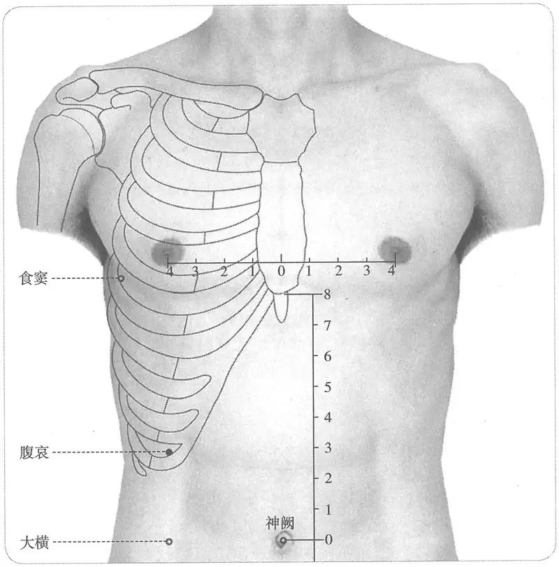

**图 2-116　腹哀穴图**

**取穴**：大横直上3寸处取穴，横平建里穴。

　1. 腹中行旁开三寸五分

　　(1) 在日月下一寸五分。（《黄帝明堂经》、《铜人腧穴针灸图经》、《圣济总录》、《医学纲目》、《针灸逢源》）

　　(2) 在日月下一寸五分，去中管各三寸五分。（《医心方》卷二）

**按**：此说本穴与中管穴的关系，与《医心方》所录之杨上善注本《黄帝内经明堂》相关腧穴定位描述吻合，而根据国家标准《经穴部位》，这种腧穴间的毗邻关系已不存在了。

　　(3) 在日月下一寸五分，去腹中行三寸半。（《类经图翼》卷六）

　2. 在日月下寸半。注：以上十四穴（从期门到冲门）去腹中行各当为四寸半。（《针灸资生经》卷一、《十四经发挥》、《针灸聚英》、《古今医统》、《医学入门》、《针灸大成》、《循经考穴编》、《针灸易学》）

　3. 在日月下一寸五分，上直两乳，夹任脉两旁各四寸。（《针方六集》卷一）

　4. 大横上三寸五分。（《针灸十四经穴位考订》）

　5. 统编针灸学教材

〔p.484 (인쇄 464)〕

　　(1) 部位：大横穴上三寸。取穴：正坐或仰卧，手外开，从乳头直下与建里旁开之交点取之。（1957年南京《针灸学》）

　　(2) 部位：大横穴上三寸。取穴：仰卧，在乳头直下，任脉建里穴旁开四寸取之。（1版《针灸学讲义》）

　　(3) 部位：在日月下一寸五分。取穴：在大横上三寸，建里旁四寸处取之。（2版《针灸学讲义》）

　　(4) 建里穴旁开4寸。（4版《针灸学》）

　　(5) 大横穴上3寸，前正中线旁开4寸。（5版《针灸学》、《中国针灸学》）

　　(6) 在上腹部，当脐中上3寸，距前正中线4寸。（6、7版《针灸学》）

**按**：本穴纵向位置，古今文献记载一致，皆定位于日月下一寸半，而横向距离的差异乃源于腹部肾经穴的定位分歧。详见足少阴肾经穴“概说”。

#### 【类属】 

足太阴脾经穴。

**脉气所发**：足太阴、阴维之会。（《黄帝明堂经》）

**归经**：足太阴脾经。（《外台秘要》卷三十九、《铜人腧穴针灸图经》卷上）

#### 【适应症】 

主治胃肠病症。常用于下痢脓血、腹痛；消化不良，便秘。

　1. 主便脓血，寒中食不化，腹中痛。（《黄帝明堂经》）

　2. 治大便脓血，寒中食不化，腹中痛。（《铜人腧穴针灸图经》卷中）

　3. 主便结或下脓血。（《循经考穴编》上）

　4. 统编针灸学教材

　　(1) 腹寒痛，食不化，便结或下痢脓血。（1957年南京《针灸学》、1版《针灸学讲义》）

　　(2) 腹痛，消化不良，便秘，痢疾。（2版《针灸学讲义》、5版《针灸学》、《中国针灸学》）

　　(3) 食不化，脐腹痛，便脓血，便秘。（4版《针灸学》）

　　(4) 腹痛、泄泻、痢疾、便秘、消化不良。（6版《针灸学》）

　　(5) 消化不良、腹痛、便秘、痢疾等脾胃肠腑病证。（7版《针灸学》）

**文献分析**：本穴主治均出自《黄帝明堂经》，“便脓血，食不化，腹中痛”诸症均见于同书太白穴主治，只是病机不同，本穴主治症之病机为“寒中”，而太白穴则为“热中”，有所不同也。此外，相同或相似的一组症状也每见于方药主治，例如“吴爽师疗冷痢下脓血，绞脐痛，食不消，腹胀方”（转引自《外台秘要》），可见《黄帝明堂经》所载之本穴主治实为一组病症（可见于痢疾），而不是三个独立的症状。现代针灸学教材均理解为独立的症状，与原文之义不合。

#### 【操作】 

刺1~1.5寸。

　1. 刺入七分，灸五壮。（《黄帝明堂经》）

　2. 针入三分。（《铜人腧穴针灸图经》卷中）

　3. 入三分，不灸，灸可一壮止。（《大本琼瑶神书》）

　4. 禁用针灸。（《医学入门》）

　5. 统编针灸学教材

　　(1) 针五至七分，灸三至五壮。（1957年南京《针灸学》、1版《针灸学讲义》）

　　(2) 直刺5~7分，艾条灸5~10分钟。（2版《针灸学讲义》）

　　(3) 直刺1~1.5寸。（4、5、6、7版《针灸学》）

　　(4) 直刺0.5~1.0寸。可灸。（《中国针灸学》）

〔p.485 (인쇄 465)〕

### （十七）食窦 Shídòu SP17 出《黄帝明堂经》 

#### 【提要索隐】 

**部位**：在前胸部，第5肋间隙，前正中线旁开6寸。

**适应症**：主治胸胁部病症。常用于胸满，胁痛。

**针刺操作**：斜刺或向外平刺。勿直刺过深，以免刺入胸腔损伤肺脏。

#### 【名实考】 

《扁鹊心书》谓命关即食窦穴，然定位和主治与诸书大异，不能判定是否为同一穴，故不作为本穴的别名。

　1. 食窦，在天溪下一寸六分陷者中，足太阴脉气所发，举臂取之。（《黄帝明堂经》）

　2. 命关二穴，在胁下宛中，举臂取之，对中脘向乳三角取之。此穴属脾，又名食窦穴，能接脾脏真气，治三十六种脾病。凡诸病困重，尚有一毫真气，灸此穴二三百壮，能保固不死。一切大病属脾者并皆治之。盖脾为五脏之母，后天之本，属土，生长万物者也。若脾气在，虽病甚不至死，此法试之极验。（《扁鹊心书》卷上）

　3. 窦者，隙也。饮食自胸而下，入于上脘，而脾为之运化。此穴乃脾经入胸之始，而脾气受而化之，故曰食窦。（《经穴解》）

　4. 别名　命关。（1957年南京《针灸学》）

#### 【定位】 

**部位**：在前胸部，第5肋间隙，前正中线旁开6寸（图2-117）。

**取穴**：横平内侧的乳根、步廊、中庭穴，4穴略呈一弧形分布，其弧度与第5肋间隙弧度相应。

　1. 在天溪下一寸六分陷者中。仰而取之。（《针灸甲乙经》卷三、《针方六集》）

**按**：明抄本作“举臂取之”，与其他传本《黄帝明堂经》同，可见通行本《针灸甲乙经》作“仰而取之”者系传抄之误。

　2. 在天溪下一寸六分，举臂取之。（《千金要方》卷二十九、《千金翼方》、《外台秘要》、《医心方》、《太平圣惠方》、《铜人腧穴针灸图经》、《圣济总录》、《针灸资生经》、《十四经发挥》、《医学纲目》、《针灸集书》、《针灸聚英》、《古今医统》、《医学入门》、《针灸大成》、《类经图翼》、《针灸易学》、《针灸逢源》）

　3. 一法乳下一寸六分，横过一寸，与中庭平。（《循经考穴编》上）

　4. 去中庭旁开六寸。（《针灸十四经穴位考订》）

　5. 统编针灸学教材

　　(1) 部位：天溪下一寸六分去中行旁开六寸。取穴：仰卧手外开，自中庭旁开六寸，当肋骨间隙取之，上直中府穴，约当中府下相隔四肋。（1957年南京《针灸学》）

　　(2) 部位：任脉中庭穴旁开六寸。取穴：仰卧，从任脉旁开六寸，于第五肋间陷中取之。（1版《针灸学讲义》）

　　(3) 部位：在天溪下一寸六分陷者中。取穴：任脉旁开六寸，即乳中线外二寸，在第五肋间隙中取。（2版《针灸学讲义》）

　　(4) 第五肋间隙中，前正中线旁开6寸。（4、5、7版《针灸学》）

　　(5) 在胸外侧部，当第5肋间隙，距前正中线6寸。（6版《针灸学》）

　　(6) 第五肋间隙中，任脉旁开六寸。（《中国针灸学》）

**文献分析**：本穴定位，现存各传本《黄帝明堂经》佚文相同，而取穴法只有通行本《针灸

〔p.486 (인쇄 466)〕

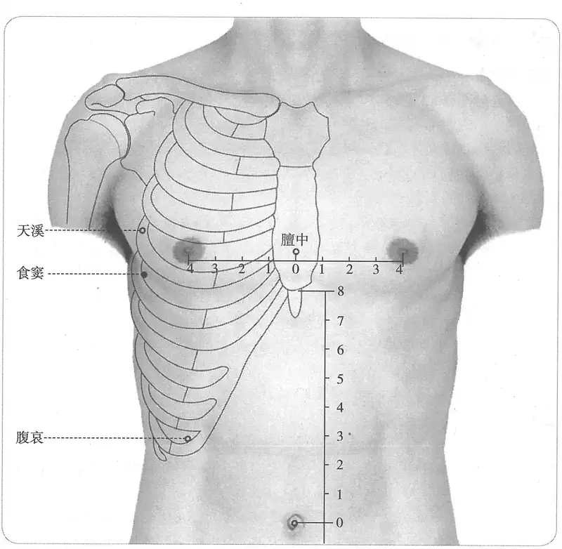

**图 2-117　食窦穴图**

甲乙经》作“仰而取之”，经考查系传抄之误。又《循经考穴编》传一法作“乳下一寸六分，横过一寸，与中庭平”，“乳下一寸六分”与《黄帝明堂经》“天溪下一寸六分”义同，而“横过一寸”则与《黄帝明堂经》定位相差一寸，未详所据。

#### 【类属】 

足太阴脾经穴。

足太阴脉气所发。（《黄帝明堂经》）

#### 【适应症】 

主治胸胁部病症。常用于胸满，胁痛。

　1. 主胸胁榰满，膈中雷鸣，察察隐隐，常有水声。（《黄帝明堂经》）

　2. 治胸胁支满，膈间雷鸣，滀陆滀陆常有小声。（《铜人腧穴针灸图经》卷中）

　3. 痰饮，食积，噎膈，翻胃。（《循经考穴编》上）

　4. 统编针灸学教材

　　(1) 胸胁支满，胁痛，膈中雷鸣。（1957年南京《针灸学》、1版《针灸学讲义》）

　　(2) 胸胁胀痛。（2版《针灸学讲义》）

　　(3) 胸胁支满，腹胀水肿，噫气翻胃。（4、5、6版《针灸学》）

　　(4) 胸胁胀痛；噫气、翻胃、腹胀等胃气失降性病证；水肿。（7版《针灸学》）

　　(5) 胸胀痛。（《中国针灸学》）

**文献分析**：本穴主治，《黄帝明堂经》作“主胸胁支满，膈中雷鸣，察察隐隐，常有水声”，描述的是一组症状，可见于悬饮。清代《循经考穴编》在此基础上又新增如下病症：痰饮，食积，噎膈，翻胃。此与腧穴主治的一般规律不合，经考察系足太阳经穴“膈俞”的主治。从《黄帝明堂经》原文看，本穴主要作用于胸胁部，第1~3版针灸学教材的理解正确，而第4~7版的理解有误且处理失当。《黄帝明堂经》原文“察察隐隐，常有水声”症状不能理解为“腹胀水肿”之义；其“噫气翻胃”的主治系传《循经考穴编》之误。

〔p.487 (인쇄 467)〕

#### 附：临床应用举例 

　1. 眼目遍身皆黄，六脉沉紧，宜服草神丹及金液、全真、来复之类。重者，灸食窦穴百壮。大忌寒凉。（《扁鹊心书》卷中）

　2. 此由胃气虚积而不通，故胁下胀闷……服草神、金液十日，重者，灸左食窦穴，一灸便有下气而愈，再灸关元百壮，更佳。（《扁鹊心书》卷中）

　3. 饥不能食，饮食不下，呕而雷鸣，大迎、中极、食窦。又法，期门、章门。（《医学纲目》卷二十一）

#### 【操作】 

斜刺或向外平刺。勿直刺过深，以免刺入胸腔损伤肺脏。

　1. 刺入四分，灸五壮。（《黄帝明堂经》）

　2. 统编针灸学教材

　　(1) 针三至四分，灸三至五壮。可多灸本穴，古法有灸至三五百壮专治一切慢性或危重诸症。（1957年南京《针灸学》）

　　(2) 针三至四分，灸三至五壮。（1版《针灸学讲义》）

　　(3) 斜刺3~4分，艾条灸5~10分钟。（2版《针灸学讲义》）

　　(4) 斜刺或向外平刺0.5~0.8寸。（4、5版《针灸学》）

　　(5) 斜刺或向外平刺0.5~0.9寸；可灸。本经自食窦至大包诸穴，内有肺脏均不可深刺。（6、7版《针灸学》）

　　(6) 斜刺0.3~0.5寸。可灸。（《中国针灸学》）

### （十八）天溪 Tiānxī SP18 出《黄帝明堂经》 

#### 【提要索隐】 

**部位**：在前胸部，第4肋间隙，前正中线旁开6寸。

**适应症**：主治胸胁部病症。常用于胸痛，咳嗽，气喘；乳痈。

**针刺操作**：斜刺或向外平刺。不宜深刺和直刺，以免刺伤心肺。

#### 【名实考】 

“天溪”与“太溪”字形相近，易混淆。如果这种错误发生在腧穴专书中，很容易发现，如果发生在《针灸甲乙经》这类穴名、定位与主治分述的书中，则很难被发现。

天溪，在胸乡下一寸六分陷者中，足太阴脉气所发，仰而取之。（《黄帝明堂经》）

#### “天溪”与“太溪”相混例 

　1. 胸中满痛，乳肿，溃痈，咳逆上气，咽喉喝有声，太溪主之。（《针灸甲乙经》卷九第三）

　2. 太溪　胸中满痛，乳肿溃痈，咳逆上气，喉咽喝有声。（《外台秘要》卷三十九）

　3. 天溪　胸中满痛，乳肿贲膺，咳逆上气，喉鸣有声。（《外台秘要》卷三十九）

　4. 天溪　主胸中满痛，乳肿贲痈，咳逆上气，喉鸣。（《医心方》卷二）

因王焘当时所见之《针灸甲乙经》中“天溪主之”病症已误作“太溪主之”，王焘沿袭未改，则“天溪”穴下主治必定据其他《黄帝明堂经》传本补辑。

〔p.488 (인쇄 468)〕

#### 【定位】 

**部位**：在前胸部，第4肋间隙，前正中线旁开6寸（图2-118）。

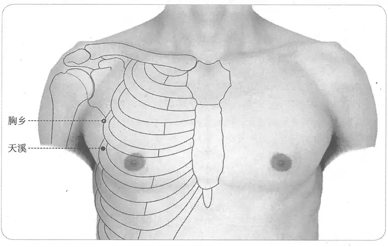

**图 2-118　天溪穴图**

**取穴**：横平内侧的乳中、神封、膻中，4穴略呈一弧形分布，其弧度与第4肋间隙弧度相应。

　1. 在胸乡下一寸六分陷者中……仰而取之。（《黄帝明堂经》、《铜人腧穴针灸图经》卷中及卷下“穴腧都数”、《圣济总录》、《针灸资生经》、《十四经发挥》、《医学纲目》、《针灸集书》、《针灸聚英》、《古今医统》、《针灸大成》、《针方六集》、《类经图翼》、《循经考穴编》、《针灸易学》、《针灸逢源》）

　2. 在胸乡下一寸六分。（《铜人腧穴针灸图经》卷上）

　3. 乳头旁开二寸。（《针灸十四经穴位考订》）

　4. 统编针灸学教材

　　(1) 部位：胸乡下一寸六分。取穴：仰卧手外开，从乳中旁二寸肋间陷中取之。中府穴下相隔三肋。（1957年南京《针灸学》）

　　(2) 部位：食窦穴上一寸六分。取穴：仰卧，从任脉膻中穴旁开六寸，于第四、第五肋骨之间陷中取之。（1版《针灸学讲义》）

　　(3) 部位：在胸乡下一寸六分陷者中。取穴：食窦上一肋，当第四肋间隙取之。（2版《针灸学讲义》）

　　(4) 第4肋间隙中，前正中线旁开6寸。（4、5、7版《针灸学》、《中国针灸学》）

　　(5) 在胸外侧部，当第4肋间隙，距前正中线6寸。（6版《针灸学》）

**文献分析**：本穴定位，古今文献记载一致，胸乡下一寸六分陷者中。

#### 【类属】 

足太阴脾经穴。

足太阴脉气所发。（《黄帝明堂经》）

#### 【适应症】 

主治胸胁部病症。常用于胸痛，咳嗽，气喘；乳痈。

　1. 主胸中满痛，乳肿溃痈，咳逆上气，咽喉有声。（《黄帝明堂经》）

〔p.489 (인쇄 469)〕

　2. 治胸中满痛，乳肿贲膺，咳逆上气，喉中作声。（《铜人腧穴针灸图经》卷中）

　3. 统编针灸学教材

　　(1) 胸、膺、胁疼痛，咳嗽上气，乳痈肿溃，呃逆。（1957年南京《针灸学》、1版《针灸学讲义》）

　　(2) 胸部疼痛，咳嗽，乳痈，乳汁少。（2版《针灸学讲义》、5、6、7版《针灸学》）

　　(3) 胸中满痛，咳嗽气逆，乳痈。（4版《针灸学》）

　　(4) 胸胁胀痛，咳嗽，气逆，乳痈，乳汁少。（《中国针灸学》）

**文献分析**：本穴主治，古今文献一致，均主治胸胁部及乳房病症。

#### 【操作】 

斜刺或向外平刺。不宜深刺和直刺，以免刺伤心肺。

　1. 刺入四分，灸五壮。（《黄帝明堂经》）

　2. 针三分，灸五壮。（《针灸十四经穴位考订》）

　3. 统编针灸学教材

　　(1) 针四至五分，灸三至七壮。（1957年南京《针灸学》、1版《针灸学讲义》）

　　(2) 斜刺4~5分，艾条灸5~10分钟。（2版《针灸学讲义》）

　　(3) 斜刺或向外平刺0.5~0.8寸。（4、5、6、7版《针灸学》）

　　(4) 斜刺0.3~0.5寸。可灸。（《中国针灸学》）

### （十九）胸乡 Xiōngxiāng SP19 出《黄帝明堂经》 

#### 【提要索隐】 

**部位**：在前胸部，第3肋间隙，前正中线旁开6寸。

**适应症**：主治胸胁部病症。常用于胸胁胀痛引背。

**针刺操作**：斜刺或向外平刺。不宜深刺和直刺，以免造成气胸。

#### 【名实考】 

　1. 胸乡，在周荣下一寸六分陷者中，足太阴脉气所发，仰而取之。（《黄帝明堂经》）

　2. 此穴在乳之上旁，正为胸之部分，以土有邑聚之乡，故曰乡。（《经穴解》）

#### 【定位】 

**部位**：在前胸部，第3肋间隙，前正中线旁开6寸（图2-119）。

**取穴**：周荣下一肋间取穴。横平内侧的膺窗、灵墟、玉堂，4穴略呈一弧形分布，其弧度与第3肋间隙弧度相应。

　1. 在周荣下一寸六分陷者中……仰而取之。（《黄帝明堂经》、《铜人腧穴针灸图经》卷中及卷下“穴腧都数”、《圣济总录》、《针灸资生经》、《十四经发挥》、《医学纲目》、《针灸集书》、《针灸聚英》、《古今医统》、《医学入门》、《针灸大成》、《针方六集》、《类经图翼》、《循经考穴编》、《医宗金鉴·刺灸心法要诀》、《针灸易学》、《针灸逢源》）

　2. 在周荣下一寸六分陷者宛宛中。（《太平圣惠方·明堂》）

　3. 在周荣下一寸六分。（《铜人腧穴针灸图经》卷上）

　4. 膺窗旁开二寸。（《针灸十四经穴位考订》）

　5. 统编针灸学教材

　　(1) 部位：在周荣穴下一寸六分。取穴：仰卧，手外开，从乳旁二寸肋间之天溪穴再上

〔p.490 (인쇄 470)〕

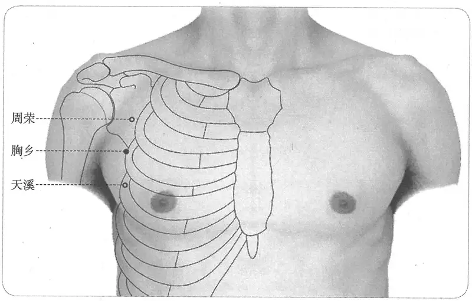

**图 2-119　胸乡穴图**

行一肋间取之，中府穴下相隔二肋。（1957年南京《针灸学》）

　　(2) 部位：天溪穴上一寸六分。取穴：仰卧，从任脉玉堂穴旁开六寸，于第三、第四肋骨之间陷中取之。（1版《针灸学讲义》）

　　(3) 部位：在周荣下一寸六分陷者中。取穴：天溪上一肋，当第三肋间隙取之。（2版《针灸学讲义》）

　　(4) 第三肋间隙中，前正中线旁开6寸。（4、5、7版《针灸学》）

　　(5) 在胸外侧部，当第3肋间隙，距前正中线6寸。（6版《针灸学》）

　　(6) 第三肋间隙中，任脉旁开六寸。（《中国针灸学》）

**文献分析**：本穴定位，古今文献记载一致，均定位于周荣穴下一寸六分。

#### 【类属】 

足太阴脾经穴。

太阴脉气所发。（《黄帝明堂经》）

#### 【适应症】 

主治胸胁部病症。常用于胸胁胀痛引背。

　1. 主胸胁榰满，却引背痛，卧不得转侧。（《黄帝明堂经》、《铜人腧穴针灸图经》卷中）

　2. 统编针灸学教材

　　(1) 胸胁支满，引胸背痛。（1957年南京《针灸学》、1版《针灸学讲义》）

　　(2) 胸肋胀满。（2版《针灸学讲义》、5、6、7版《针灸学》、《中国针灸学》）

　　(3) 胸胁支满引胸背痛，卧难转侧。（4版《针灸学》）

**文献分析**：《黄帝明堂经》所述本穴主治与悬饮的症状类似。

#### 【操作】 

斜刺或向外平刺。不宜深刺和直刺，以免造成气胸。

　1. 刺入四分，灸五壮。（《黄帝明堂经》）

　2. 针三分，灸五壮。（《针灸十四经穴位考订》）

　3. 统编针灸学教材

　　(1) 针四至五分，灸三至五壮。（1957年南京《针灸学》、1版《针灸学讲义》）

　　(2) 斜刺4~5分，艾条灸5~10分钟。（2版《针灸学讲义》）

〔p.491 (인쇄 471)〕

　　(3) 斜刺或向外平刺0.5~0.8寸。（4、5、6、7版《针灸学》）

　　(4) 斜刺0.3~0.5寸。可灸。（《中国针灸学》）

### （二十）周荣 Zhōuróng SP20 出《黄帝明堂经》 

#### 【提要索隐】 

**部位**：在前胸部，第2肋间隙，前正中线旁开6寸。

**适应症**：主治胸肺部病症。常用于胸满，气喘，咳唾脓血。

**针刺操作**：斜刺或向外平刺。不宜深刺和直刺，以免刺伤心肺。

#### 【名实考】 

古医籍中，“荣”与“营”字常互用，穴名“周荣”也有作“周营”者，如传世本《针灸甲乙经》即是。

　1. 周荣，在中府下一寸六分陷者中，足太阴脉气所发，仰而取之。（《黄帝明堂经》）

　2. 以土生金，而上与中府相近。土有四经，有周义焉，上生肺经之金，故曰荣。（《经穴解》）

#### “周荣”与“天溪”相混例 

胸胁榰满，不得俯仰，饮食不下，咳唾陈脓秽浊，周荣主之。胸中满痛，乳肿，溃痈，咳逆上气，咽喉喝有声，太（天）溪主之。（《针灸甲乙经》卷九第三）

周荣，主胸胁支满，不得俯仰，饮食不下，咳唾陈脓。（《外台秘要》卷三十九）

天溪，主胸中满痛，乳肿贲膺，咳逆上气，喉鸣有声。（《外台秘要》卷三十九）

太溪，主胸中满痛，乳肿溃痈，咳逆上气，喉咽喝有声。（《外台秘要》卷三十九）

**按**：传世本《针灸甲乙经》脱“饮食不下，咳唾陈脓秽浊，周荣主之。胸中满痛，乳肿”一行，而混入到下条“天溪主之”条文中（其“天溪”又误作“太溪”），而“周荣主之”前脱文，《医学纲目》引录时尚未脱。王焘承《针灸甲乙经》之误，将胸中满痛归于“太溪”穴中，另据其他《明堂经》传本，将相同的病症补入“天溪”穴中。是知，《针灸甲乙经》中“天溪”穴名这一错误至少发生在唐中叶以前。

#### 【定位】 

**部位**：在前胸部，第2肋间隙，前正中线旁开6寸（图2-120）。

**取穴**：在中府下1肋间取穴。横平内侧的屋翳、神藏、紫宫，4穴略呈一弧形分布，其弧度与第2肋间隙弧度相应。

　1. 在中府下一寸六分陷者中……仰而取之。（《黄帝明堂经》、《太平圣惠方·明堂》、《铜人腧穴针灸图经》卷中及卷下“穴腧都数”、《圣济总录》、《针灸资生经》、《十四经发挥》、《医学纲目》、《针灸集书》、《针灸聚英》、《古今医统》、《医学入门》、《针灸大成》、《针方六集》、《类经图翼》、《循经考穴编》、《医宗金鉴·刺灸心法要诀》、《针灸易学》）

　2. 在中府下一寸六分陷中。（《铜人腧穴针灸图经》卷上）

　3. 屋翳旁开二寸。（《针灸十四经穴位考订》）

　4. 统编针灸学教材

　　(1) 部位：在手太阴肺经之中府穴下一寸六分。取穴：仰卧，由乳头外开二寸肋间之天溪穴再上行两肋间，中府穴之下一肋间取之。（1957年南京《针灸学》）

　　(2) 部位：胸乡穴上一寸六分，肺经中府穴下一肋。取穴：仰卧，从任脉紫宫穴旁开六寸，于第二、第三肋骨之间陷中取之。（1版《针灸学讲义》）

〔p.492 (인쇄 472)〕

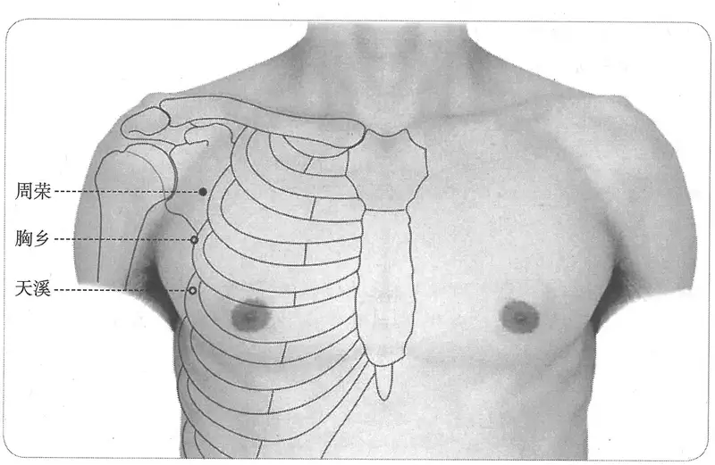

**图 2-120　周荣穴图**

　　(3) 部位：在中府下一寸六分陷者中。取穴：胸乡上一肋，当第二肋间隙取之。（2版《针灸学讲义》）

　　(4) 第二肋间隙中，前正中线旁开6寸。（4、5、7版《针灸学》、《中国针灸学》）

　　(5) 在胸外侧部，当第2肋间隙，距前正中线6寸。（6版《针灸学》）

**文献分析**：定位古今文献无分歧，然古代定位用折量法，现代定位用骨性解剖标志肋间隙。

#### 【类属】 

足太阴脾经穴。

足太阴脉气所发。（《黄帝明堂经》）

#### 【适应症】 

主治胸肺部病症。常用于胸满，气喘，咳唾脓血。

　1. 主胸胁支满，不得俛仰，咳唾陈脓秽浊。（《黄帝明堂经》）

　2. 治胸胁支满，不得俯仰，饮食不下，咳唾稠脓。（《铜人腧穴针灸图经》卷中）

　3. 喜饮，及乳痈之近太阴者。（《针方六集》卷五）

　4. 统编针灸学教材

　　(1) 胸胁胀满，咳逆上气，唾多脓秽。（1957年南京《针灸学》、1版《针灸学讲义》）

　　(2) 胸胁胀满，咳嗽气逆，肋痛。（2版《针灸学讲义》）

　　(3) 胸胁支满，食不下，咳嗽气逆。（4版《针灸学》）

　　(4) 咳嗽，气逆，胸胁胀满。（5、7版《针灸学》、《中国针灸学》）

　　(5) 胸胁胀满、咳嗽、气喘、胁痛。（6版《针灸学》）

**文献分析**：《黄帝明堂经》描述的本穴主治“胸胁支满，不得俛仰，咳唾陈脓秽浊”，与邻近的库房穴主治（胸胁支满，咳逆上气，呼吸多唾浊沫脓血）很相似，应是同一病的一组症状，而表述有详略不同。另外，方书中也可见类似的描述，例如“深师疗肺气不足，咳逆唾脓血，咽喉闷塞，胸满上气，不能饮食，卧则短气，补肺汤方”，“又疗咳逆上气，吐脓或吐血，胸满痛不能食，补肺汤”（《外台秘要》）。诸文合看即可知此病的相应症状。本穴的治疗重点在于胸胁胀满、疼痛，而不论其有脓无脓，气虚或气逆。

〔p.493 (인쇄 473)〕

#### 【操作】 

斜刺或向外平刺。不宜深刺和直刺，以免刺伤心肺。

　1. 刺入四分，灸五壮。（《黄帝明堂经》）

　2. 针三分，灸五壮。（《针灸十四经穴位考订》）

　3. 统编针灸学教材

　　(1) 针四至五分，灸三至五壮。（1957年南京《针灸学》、1版《针灸学讲义》）

　　(2) 斜刺4~5分，艾条灸5~10分钟。（2版《针灸学讲义》）

　　(3) 斜刺或向外平刺0.5~0.8寸。（4、5、6、7版《针灸学》）

　　(4) 斜刺0.3~0.5寸。可灸。（《中国针灸学》）

### （二十一）大包 Dàbāo SP21 出《灵枢》 

问题1：本穴定位，《针灸甲乙经》作“在渊腋下三寸，布胸胁中，出九肋间及季肋端”，其后文献皆从之。然此处所述部位至少有三个不同点，本穴部位究竟如何确定？

问题2：本穴位于腋下三寸，还是六寸？

#### 【提要索隐】 

**部位**：在侧胸部，第6肋间隙，当腋中线上。

**归经**：足太阴脾经，脾之大络。

**适应症**：主治胁部病症。常用于胁痛，身痛，四肢倦怠。

**针刺操作**：斜刺或向后平刺。勿刺伤心肺。

#### 【名实考】 

要正确理解本穴的定位，首先要理解大包脉与大包穴的关系，作为脾之大络，大包出渊腋下三寸，布胸胁中、九肋间及季肋端，而作为络穴，则在于脉之所出之处，即渊腋下三寸；其次，必须正确理解“渊腋”的含义，才能正确定位。考“渊腋”一词，在《灵枢》中除见于脾之大络外，还见于《经别》篇，凡三处，皆指腋窝处，杨上善注脾之大络之“渊腋”也能看到此义，《千金要方》给出了更明确的说明，《医心方》则将本穴定位直接作“腋下三寸”。由于“渊腋”作为穴名，在人们脑海中根深蒂固，因此一见此词便认定是指“渊腋”穴，由于大包穴在渊腋下三寸，故定于腋下六寸。

　1. 脾之大络，名曰大包，出渊腋下三寸，布胸胁。（《灵枢·经脉》）

　2. 大包脉出渊腋下三寸，脾之大络，布胸胁中、九肋间及季肋端，别络诸阴者。（《黄帝明堂经》）

　3. 脾之大络，总统阴阳诸络，由脾灌溉五藏。（《针灸聚英》卷一）

　4. 以五脏以土为主，土为坤象，无所不载，无所不容，脾以此络而灌注五脏以润周身，故曰大包。（《经穴解》）

　5. 别名　大胞。（1957年南京《针灸学》）

**按**：人体部位名，往往被加上肉月旁，如“旁光”作“膀胱”，然此处改“包”作“胞”则易误解为“胞宫”或“尿胞”，故欠妥。

#### 渊腋与渊腋穴辨 

　1. 脾之大络，名曰大包，出渊腋下三寸，布胸胁。实则身尽痛，虚则百节尽皆纵，此脉若罗络之血者，皆取之脾之大络脉也。（《灵枢·经脉》）

　2. 杨上善注曰：脾之盛气掖下三寸当泉掖而出。（《黄帝内经太素·十五络》）

　3. 手少阴之正，别入于渊腋两筋之间；手心主之正，别下渊腋三寸；手太阴之正，别入渊腋少阴之前。（《灵枢·经别》）

〔p.494 (인쇄 474)〕

　4. 腋门，在腋下攒毛中，一名泉腋，即渊腋是也。（《千金要方》卷二十九）

　5. 大包二穴，脉出腋下三寸。（《医心方》卷二）

**按**：“渊腋”是指腋窝，“渊腋”穴在腋下三寸。

#### 【定位】 

**部位**：在侧胸部，第6肋间隙，当腋中线上（图2-121）。

**取穴**：侧卧举臂，在第6肋间隙与腋中线的交点处。

　1. 出渊腋下三寸，布胸胁。（《灵枢·经脉》）

　2. 《黄帝明堂经》佚文

　　(1) 在渊腋下三寸。布胸胁中，出九肋间及季肋端。（《针灸甲乙经》卷三、《铜人腧穴针灸图经》卷中）

　　(2) 脉出渊腋下三寸，脾之大络，布胸胁中九肋间及季肋端。（《外台秘要》卷三十九）

　　(3) 脉出腋下三寸。（《医心方》卷二）

　　(4) 在渊腋下三寸。（《千金要方》卷二十九、《千金翼方》）

　3. 在渊腋下三寸，九肋间。（《铜人腧穴针灸图经》卷上）

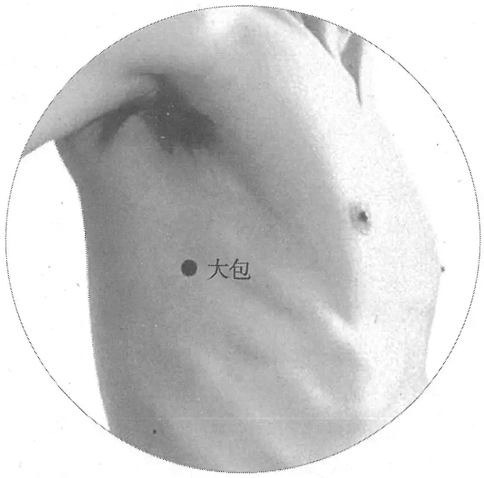

**图 2-121　大包穴图**

　4. 腋下六寸，肋骨间。（《针灸十四经穴位考订》）

　5. 统编针灸学教材

　　(1) 部位：在渊腋下三寸。取穴：仰卧，手外开，从食窦穴外开二寸取之腋下六寸。（1957年南京《针灸学》）

　　(2) 部位：腋下六寸。取穴：仰卧，在腋下第六、第七肋骨之间陷中取之，适当腋窝横纹与十一浮肋端之正中。（1版《针灸学讲义》）

　　(3) 部位：在渊腋下三寸。取穴：在腋中线上，第六肋间隙，约当腋窝与十一肋端之中点取之。（2版《针灸学讲义》）

　　(4) 腋中线上，第六肋间隙中。（4、5版《针灸学》）

　　(5) 在侧胸部腋中线上，当第6肋下间隙处。（6、7版《针灸学》）

　　(6) 腋中线上，腋窝下六寸，当腋窝与十一肋端连线之中点。（《中国针灸学》）

**文献分析**：本穴正确定位的关键在于正确理解古典文献中“脉”与“穴”的关系。十五络穴名原本是络脉名，此外尚有一些别络穴如“委阳”、“大包”等也本为脉名。在早期腧穴文献所载这些络穴或别络穴定位文字中还残留一些相应络脉循行部位的描述。大包穴的部位描述仍作“出”，而不像其他穴作“在”，即是明显的一例。现存《黄帝明堂经》佚文，以《外台秘要》接近原书旧貌，后人不解其义，遂将“出”改作“在”，致原文不可通。根据络穴与络脉的关系得知，络穴位于络脉起处，特别是“脉出”处。本穴的定位，《黄帝明堂经》作“脉出渊腋下三寸，脾之大络，布胸胁中九肋间及季肋端，别络诸阴者。”故根据络穴络脉的关系，相应的络穴——大包，诸书都定于“渊腋下三寸”，未有定于“九肋间”及“季肋端”者。络穴络脉之辨另可参见“委阳”穴及本书“总论”。

〔p.495 (인쇄 475)〕

#### 【类属】 

足太阴脾经穴。脾之大络。

　1. 脾之大络，名曰大包，出渊腋下三寸，布胸胁。实则身尽痛，虚则百节尽皆纵，此脉若罗络之血者，皆取之脾之大络脉也。（《灵枢·经脉》）

　2. 脾之大络，布胸胁中九肋间及季肋端，别络诸阴者。（《黄帝明堂经》）

**归经：**

　1. 足少阳胆经。（《外台秘要》卷三十九）

　2. 足太阴脾经。（《铜人腧穴针灸图经》卷上）

#### 【适应症】 

主治胁部病症。常用于胁痛，身痛，四肢倦怠。

　1. 实则身尽痛，虚则百节尽皆纵。（《灵枢·经脉》、《黄帝内经太素·十五络》）

　2. 主大气不得息，息即胸胁中痛。实则其身尽寒，虚则百节皆纵。（《黄帝明堂经》）

**按**：《灵枢·经脉》载脾之大络病候为“实则身尽痛，虚则百节尽皆纵”。

　3. 治腹有大气，气不得息，胸胁中痛，内实则其身尽寒，虚则百节皆纵。（《铜人腧穴针灸图经》卷中）

　4. 统编针灸学教材

　　(1) 胸胁痛，喘息，实则身尽痛，虚则百节皆纵。（1957年南京《针灸学》、1版《针灸学讲义》）

　　(2) 胸胁痛，气喘，全身疼痛，四肢无力。（2版《针灸学讲义》、4、5版《针灸学》、《中国针灸学》）

　　(3) 胸胁胀满、咳嗽、气喘、胸胁痛、全身疼痛、四肢无力。（6版《针灸学》）

　　(4) ①气喘；②胸胁痛；③全身疼痛；④岔气；⑤四肢无力。（7版《针灸学》）

**文献分析**：“大气不得息，息即胸胁中痛”描述的症状是岔气或闪腰，不是气喘。像其他络穴一样，大包的主治病症原本也是该络脉的诊断病症，而对于这些病症治疗，早期即取该络脉的起始处，或所“出”之处——络穴，于是原本络脉的诊断病症即成为络穴的主治病症。关于大包络的病候，《灵枢》与《黄帝明堂经》的记载略有出入，从医理分析，《灵枢》的文字义长。此外，《黄帝明堂经》所载之大包穴主治，除了录有《灵枢·经脉》的大包络脉病候，还新增了一条主治“大气不得息，息即胸胁中痛”，这应当是直接出自大包穴的主治，因而具有更强的针对性。也就是说，大包穴的作用部位集中于胸胁部，常用于胸胁疼痛的治疗。

#### 【操作】 

斜刺或向后平刺。勿刺伤心肺。

　1. 刺入三分，留五呼，灸三壮。（《黄帝明堂经》）

　2. 统编针灸学教材

　　(1) 针三分，灸三壮。（1957年南京《针灸学》、1版《针灸学讲义》）

　　(2) 斜刺3~4分，艾条灸3~5分钟。（2版《针灸学讲义》）

　　(3) 斜刺或向后平刺0.5~0.8寸。（4、5、6、7版《针灸学》）

　　(4) 斜刺0.3~0.5寸。可灸。（《中国针灸学》）

### 延伸阅读 

　1. 黄龙祥.中国针灸学术史大纲［M］.北京：华夏出版社，2001.

〔p.496 (인쇄 476)〕

　2. 黄龙祥.中国针灸史图鉴［M］.青岛：青岛出版社，2003.

　3. 黄龙祥.新编重绘十四经脉经穴图［M］.北京：中国中医药出版社，2010.

　4. 艾红兰，黄龙祥.三阴交主治演变考［J］.上海针灸杂志，2002(4)：45-46.

　5. 赵盈，王杰.隐白穴的临床应用［J］.上海针灸杂志，2002(1)：36-37.

　6. 唐卫华.隐白穴临床应用举隅［J］.针灸临床杂志，1995，11(3)：36.

　7. 于德茹.独取冲门治疗足内侧痛［J］.辽宁中医杂志，1997，24(4)：189.

〔p.497 (인쇄 477)〕

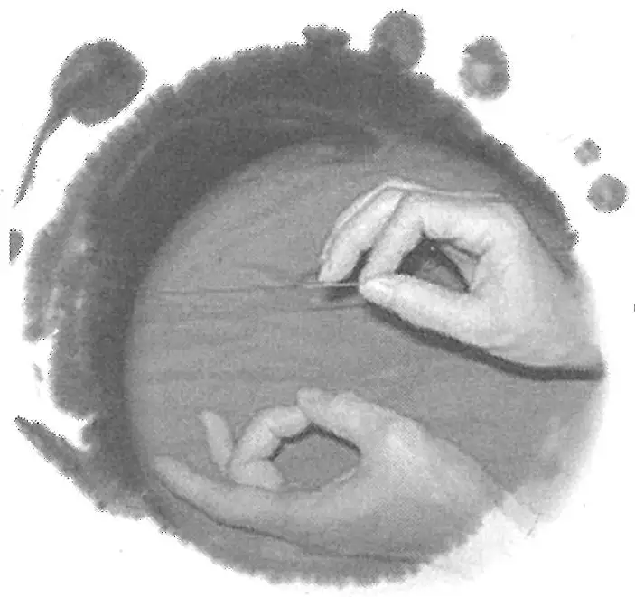

