# 《针灸腧穴通考》(上册) — 手少阴心经穴  · （一）极泉 Jíquán HT1 出《黄帝明堂经》~（九）少冲 Shàochōng HT9 出《黄帝明堂经》

> 분할본 10/25. 원서: 黄龙祥·黄幼民 编著, 《针灸腧穴通考——〈中华针灸穴典〉研究》(上册), 人民卫生出版社, 2011. 원서 스캔 OCR 판독본을 챗봇 검색용으로 나눈 것이며, 본문과 쪽 표시 〔p.PDF쪽 (인쇄 쪽)〕는 원본 그대로이다.

## 五、手少阴心经穴 

### 概说 

手少阴心经与手太阴肺经，在经脉循行、关联脏器以及经脉病候上，有一个相互演变的过程，而相关经穴完成相应的转变却经历了更长的时间，也就是说，在一定时期内，经脉循行和经穴部位是脱节的。

《针灸甲乙经》载手少阴经7穴，只有位于手少阴脉口处的神门、阴郄穴载有主治病症，其余穴皆无主治病症。

宋代王惟一编著《铜人腧穴针灸图经》误将手少阳经的“清泠渊”的异名“青灵”当成另一穴而归入手少阴，后世针灸文献除宋代的《西方子明堂灸经》外，皆沿袭至今，难以回改。

#### 【经脉与经穴】 

在马王堆帛书《足臂十一脉灸经》或《阴阳十一脉灸经》中，与心直接关联的是“臂太阴脉”，在《内经》犹可见手心主脉与心关联，而非手少阴脉与心关联。《灵枢·本输》与心相关的五输为手厥阴经穴，最后“手少阴也”四字，《黄帝内经太素》作“手心主经也”。《灵枢·本输》明确记有手太阴、手心主之标脉，独不见手少阴之脉；心之俞、募穴，在宋以前文献也是归属于手厥阴经，而不是手少阴经。种种迹象表明，手少阴与心建立直接联系是比较晚的事。

腋内动脉，手太阴也，名曰天府。腋下三寸，手心主也，名曰天池。（《灵枢·本输》）

手太阴之本，在寸口之中，标在腋内动也。手少阴之本，在锐骨之端，标在背腧也。手心主之本，在掌后两筋之间二寸中，标在腋下下三寸也。（《灵枢·卫气》）

心出于中冲，中冲，手中指之端也，为井木；溜于劳官，劳官，掌中中指本节之内间也，为荥；注于大陵，大陵，掌后两骨之间方下者也，为腧；行于间使，间使之道，两筋之间，三寸之中也，有过则至，无过则止，为经；入于曲泽，曲泽，肘内廉下陷者之中也，屈而得之，为合，手少阴也。（《灵枢·本输》）

#### 经脉循行与病候 

心手少阴之脉，起于心中，出属心系，下膈络小肠；其支者，从心系上夹咽，系目系；其直者，复从心系却上肺，下出腋下，下循臑内后廉，行太阴心主之后，下肘内，循臂内后廉，抵掌后锐骨之端，入掌内后廉，循小指之内出其端。是动则病嗌干心痛，渴而欲饮，是为臂厥。是主心所生病者，目黄胁痛，臑臂内后廉痛厥，掌中热痛。（《灵枢·经脉》）

臂少阴脉：起于臂两骨之间，下骨上廉，筋之下，出臑内阴。是动则病心痛，嗌渴欲饮，此为臂厥。是臂少阴脉主治。其所产病：胁痛。（《阴阳十一脉灸经》）

〔p.498 (인쇄 478)〕

臂少阴脉：循筋下廉，出臑内下廉，出腋，凑胁。其病：胁痛。诸病此物者，皆灸臂少阴脉。（《足臂十一脉灸经》）

**所属经穴**：少冲　少府　神门　阴郄　通里　灵道　少海　青灵　极泉

#### 【归经与起止穴】 

《针灸甲乙经》手少阴及臂凡一十六穴：少冲、少府、神门、阴郄、通里、灵道、少海、极泉；《千金要方》、《千金翼方》始将此八穴全部归入“手少阴心经八穴”，《外台秘要》“心人”穴同。

手少阳经“清泠渊”，又作“青灵渊”，唐人避讳高祖名讳而将其写作“青灵”。宋代王惟一不知其中变故，而将“青灵”误作另一穴，并将其归入手少阴心经，一直沿袭至今。

#### 【经穴定位与主治】 

手少阴经经穴定位的古代文献记载变化不大。变化较大、最混乱的是经穴主治。《灵枢·邪客》谓“手少阴之脉独无腧”，这就意味着在《邪客》篇成文之时，手少阴脉尚无腧穴，或者说除了“手少阴”穴之外，还没有其他穴被归入手少阴经；故《邪客》篇又曰：“其外经病而脏不病，故独取其经于掌后锐骨之端”。所指乃手少阴脉口处。《素问·平人气象论》曰：“手少阴脉动甚者，妊子也”，王冰注曰：“手少阴脉，谓掌后陷者中，当小指动而应手者也。《灵枢经》曰少阴无输，心不病乎？岐伯云，其外经病而脏不病，故独取其经于掌后锐骨之端。此之谓也”。此手少阴脉口后演变成“手少阴”穴，也是手少阴经的第一穴，故称作“手少阴之原”，相当于《黄帝明堂经》所载“神门”、“阴郄”二穴所在。现行本《针灸甲乙经》卷三“手少阴及臂”篇共载穴八个，然只有位于手少阴脉口处的“神门”、“阴郄”二穴载有主治病症，余六穴均无主治症，这是不是《针灸甲乙经》在流传过程中碰巧脱落了这六穴的全部主治条文？应当说这种可能性近乎为零，因为这六穴的主治条文肯定不止六条，而且它们也不可能都见于同一卷同一篇，因此同时缺损的概率太小。这六穴的主治或许是由汉以后人陆续添补的。

#### 【脉口病候、经脉是动病候与经脉穴主治】 

手少阴标脉：出腋动脉（极泉穴所在）。

手少阴本脉：神门脉（神门、阴郄穴所在）。

“手少阴”穴：神门、阴郄。

手少阴经脉的“是动”病候（源出于手少阴脉口的诊断病候）与“手少阴”穴（神门、阴郄）主治的比较见表2-5。

**表 2-5　手少阴脉是动病候与经脉穴主治的相关性**

| 《阴阳十一脉灸经》是动病候 | 《灵枢·经脉》是动病候 | 《黄帝明堂经》经脉穴主治 |
|---|---|---|
| 是动则病心痛，嗌渴欲饮，此为臂厥。是臂少阴脉主治。 | 是动则病嗌干心痛，渴而欲饮，是为臂厥。 | 神门主治：心痛，咽干。阴郄主治：心痛。 |

特别值得一提的是《阴阳十一脉灸经》手少阴脉“是动”病全部症状见于《黄帝明堂经》手少阴经极泉穴主治“心痹，心痛，嗌干，渴而欲饮。干呕哕”，而此处点明了“心痹”的病名。

#### 【诊络病候、络脉病候与络穴主治】 

手少阴之别，名曰通里，去腕一寸半，别而上行，循经入于心中，系舌本，属目系。其实则支膈，虚则不能言，取之掌后一寸，别走太阳也。（《灵枢·经脉》）

通里，手少阴络，在腕后一寸，别走太阳。实则支满，虚则不能言。（《黄帝明堂经》）

〔p.499 (인쇄 479)〕

《黄帝明堂经》载手少阴络穴“通里”主治病症完整包含了《灵枢·经脉》手少阴络脉的诊络病候，可以十分清楚地看出二者源流脉络。

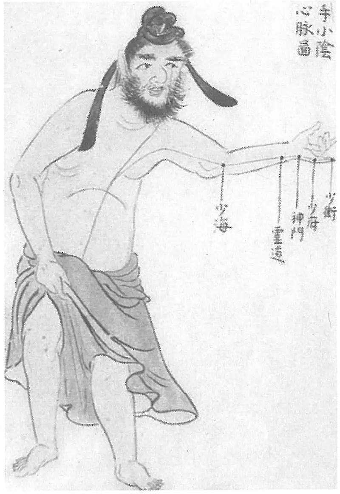

**图 2-122　《环中图》手少阴心脉图**

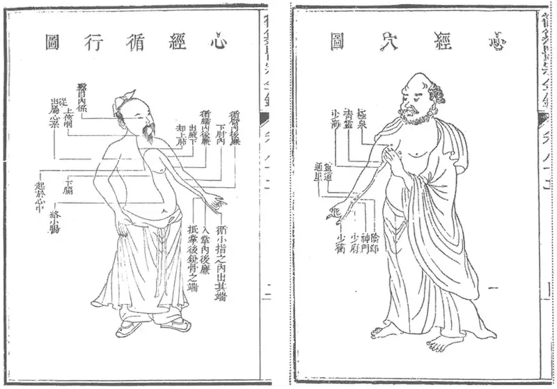

**图 2-123　《医宗金鉴》手少阴心经脉、经穴分图**

〔p.500 (인쇄 480)〕

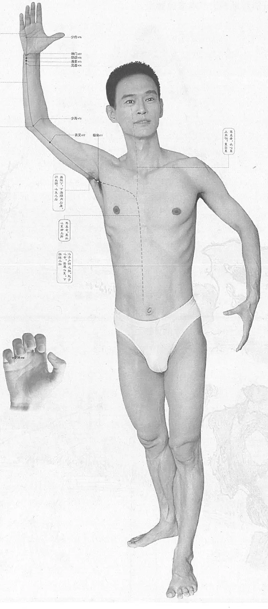

**图 2-124　黄龙祥编手少阴心经脉、经穴合图**

〔p.501 (인쇄 481)〕

### （一）极泉 Jíquán HT1 出《黄帝明堂经》 

#### 【提要索隐】 

**部位**：在腋区，腋窝中央，腋动脉搏动处。

**适应症**：主治心、胁部病症。常用于心痛、干呕、咽干；胁痛，肩臂痛；瘰疬。

**备选适应症**：臂丛神经损伤，腋臭。

**针刺操作**：直刺0.3~0.5寸。不宜向腋窝内侧胸壁方向进针，以防刺伤胸肺。

#### 【名实考】 

腋窝，古代文献又称“渊腋”，唐代避讳改作“泉腋”，勿与穴名“渊腋”相混。

　1. 极泉，在腋下筋间动脉入胸，手少阴脉气所发。（《黄帝明堂经》）

　2. 杨上善注曰腋下臂极处深陷如泉，故曰之。（《医心方》卷二）

　3. 心，至尊者也，故曰极。其脉之发源第一穴，故曰泉。（《经穴解》）

**按**：此解颇牵强，不若杨上善得古义。

　4. 中风卷云腋门在腋下攒毛中，一名泉腋，即渊腋是也。（《千金要方》卷二十九）

**按**：现行本《千金要方》卷八“中风卷”作“掖门（在腋下攒毛中一寸，名太阳阴，一名掖间），灸五十壮，主风。”

#### 相关穴及刺激点 

　1. 前腋　在腋前两筋间，主肩前痛与胸相引，臂里挛急，手不得上举至肩。（《外台秘要》卷三十九）

　2. 后腋　在腋后廉际两筋间，主腋外相引而痛，手臂拘挛急，不得上头。（《外台秘要》）

　3. 极泉上　在腋前皱襞直上2寸，稍向内0.2寸，即极泉穴上2寸，稍向内0.2寸。主治肩臂痛。针2寸~2.5寸，针感上臂或手指有触电样感。留针30~50分钟。（《针灸经外奇穴图谱（续集）》）

**按**：“极泉上”与“极泉”实为同一穴，皆刺臂丛治肩臂痛。此即刺激臂丛出现的针感，故7版《针灸学》于极泉穴主治中直接说“臂丛神经损伤”，刺法当与此同。

　4. 臂丛4　位于腋窝，腋动脉搏动处的两侧，每侧2穴，左右计4穴。为前臂整形术的针麻穴。可针3~5分，针感麻酸至手。（《针灸经外奇穴图谱（续集）》）

　5. 臂丛腋窝刺激点　在腋窝顶部，腋动脉搏动处的外方。主治上肢瘫痪、麻木、疼痛、震颤、臂丛神经痛。操作取仰卧位，头偏向对侧，上肢外展90°，外旋、屈肘位，手背近头部，先触及腋动脉的搏动，在搏动最高点外侧进针，直刺2.0~3.0cm。（《实用神经干电刺激疗法》）

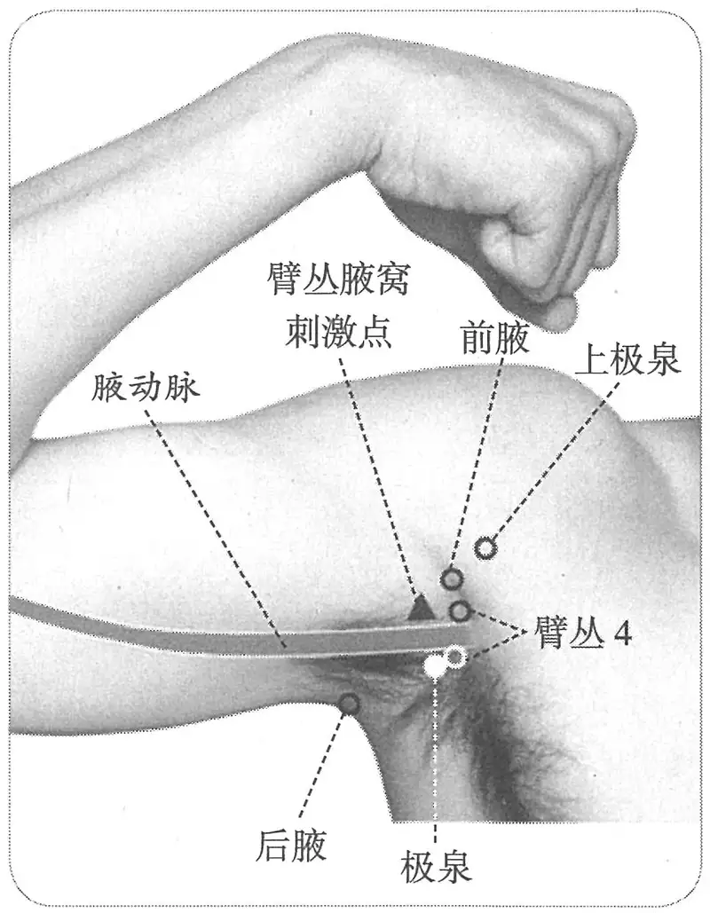

**图 2-125　极泉穴与相关穴及刺激点**

#### 【定位】 

**部位**：在腋区，腋窝中央，腋动脉搏动处。

**取穴**：上臂外展，在腋窝正中，腋动脉内侧取之（图2-125）。

　1. 《黄帝明堂经》佚文

　　(1) 在腋下筋间动脉入胸。（《针灸甲乙经》卷三、《千金要方》、《千金翼方》、《外台秘要》、《铜人腧穴针灸图经》卷下、《医学入门》）

〔p.502 (인쇄 482)〕

　　(2) 在腋下两筋间动脉。（《医心方》卷二）

**按**：《黄帝明堂经》谓本穴“在腋下筋间动脉入胸”，这表明古人通过体表触诊已经猜到于腋窝部触及的动脉与侧胸部（云门、中府穴处）触及的动脉是同一条脉。

　2. 在臂内腋下筋间，动脉入胸。（《铜人腧穴针灸图经》卷上）

　3. 在腋下筋间。（《铜人腧穴针灸图经》卷下“穴腧都数”）

　4. 在臂内腋下筋间，动脉入胸。（《十四经发挥》卷中、《医学纲目》、《针灸聚英》、《针灸大成》、《类经图翼》）

　5. 在腋下筋间聚毛中，动脉入胸。（《针方六集》卷一）

　6. 穴在臂内腋下筋间，动脉入胸。广注：在腋下毛中。（《循经考穴编》上）

　7. 腋窝部，臂内廉两筋间陷中。（《针灸十四经穴位考订》）

　8. 统编针灸学教材

　　(1) 部位：臂内腋下筋间动脉。取穴：手平伸举，按其腋下当腋窝横纹内侧两筋间，有动脉应手处取之。（1957年南京《针灸学》）

　　(2) 部位：腋下筋间动脉。取穴：手平伸举，当腋窝横纹内侧两筋间，有动脉应手处取之。（1版《针灸学讲义》）

　　(3) 部位：腋下筋间动脉。取穴：上臂外展，在腋窝正中，腋动脉内侧取之。（2版《针灸学讲义》）

　　(4) 腋窝正中。（4版《针灸学》）

　　(5) 腋窝正中，腋动脉搏动处。（5、7版《针灸学》）

　　(6) 在腋窝顶点，腋动脉搏动处。（6版《针灸学》）

　　(7) 上臂外展，腋窝正中，腋动脉内侧。（《中国针灸学》）

#### 【类属】 

手少阴心经穴。

手少阴脉气所发。（《黄帝明堂经》）

#### 【适应症】 

主治心、胁部病症。常用于心痛、干呕、咽干；胁痛，肩臂痛；瘰疬。

**备选适应症**：臂丛神经损伤，腋臭。

　1. 主心痹，干呕哕，心痛，渴而欲饮，四肢不举，为臂厥。嗌干。（《黄帝明堂经》）

**按**：《素问·痹论》：“心痹者，脉不通，烦则心下鼓，暴上气而喘，嗌干善噫，厥气上则恐”；又据《灵枢·邪气藏府病形》心痹心痛的特点为“心痹引背，善泪出”。其病机为“脉不通”、“厥气上”，故《灵枢·经脉》谓之“臂厥”。可知以上《黄帝明堂经》描述的本穴主治为“心痹”的典型症状“心痹，干呕哕，嗌干，渴而欲饮”。

　2. 是主心所生病者，目黄，胁痛，臑臂内后廉痛，掌中热痛。（《外台秘要》卷三十九）

**按**：根据经穴主治规律，经脉所生病不可能归于一穴之下，更不可能归于五输穴之外的一穴之下，故此处王焘的处理欠妥。

　3. 治心痛干呕，四肢不收，咽干烦渴，臂肘厥寒，目黄，胁下满痛。（《铜人腧穴针灸图经》卷下）

**按**：手少阴经是动病为“是动则病嗌干心痛，渴而欲饮，是为臂厥”，这里的“臂厥”是对前述一组症状病机的概括，王惟一未详其义，将其理解为“臂肘厥寒”，欠妥。

　4. 主烦满，悲愁。（《针灸聚英》卷一）

**按**：《针灸资生经》曰“极泉日月见悲愁脾俞治四肢不收”，据该书体例，此句当按如下断句“极泉、日月（见悲愁）、脾俞治四肢不收”，是指此三穴主“四肢不收”症，其中“日月”穴的其他主治参见“悲愁”篇。高武不明此例，误以为“极泉、日月主悲愁”。明以后文献乃至1版《针灸学讲义》皆沿袭其误。

〔p.503 (인쇄 483)〕

　5. 肩膊不举，马刀夹瘿等证。（《循经考穴编》上）

　6. 统编针灸学教材

　　(1) 心痛，悲愁不乐，胁肋疼痛，干呕，目黄，臂、肘冷痛，马刀夹瘿。（1957年南京《针灸学》、1版《针灸学讲义》）

　　(2) 胁肋疼痛，心痛，干呕，咽干烦躁，瘰疬，臂肘冷痛。（2版《针灸学讲义》）

　　(3) 心痛，咽干烦躁，胁下满痛，瘰疬，臂肘冷痛。（4、5版《针灸学》）

　　(4) 上肢不遂、心痛、胸闷、胁肋胀痛、瘰疬、肩臂疼痛、咽干烦渴。（6版《针灸学》）

　　(5) ①心痛、心悸等心疾；②肩臂疼痛、胁肋疼痛、臂丛神经损伤等痛证；③瘰疬；④腋臭；⑤上肢针麻用穴。（7版《针灸学》）

　　(6) 心痛，胁肋痛，瘰疬，肘臂冷痛，咽干。（《中国针灸学》）

**文献分析**：《针灸甲乙经》、《千金要方》卷三十均未载极泉穴主治，王焘编《外台秘要》盖无从辑录，而将《针灸甲乙经》所录之《灵枢·经脉》手少阴经所生病归于极泉穴下。传世文献中以《医心方》录《黄帝内经明堂》文较完整，然考其文字又多出于手少阴经“是动”病，难以判定这些主治病症直接来自《黄帝明堂经》原书，还是杨上善注《黄帝内经明堂》时所增补。教材中“心痛，干呕，咽干烦躁”皆系心痹的典型症状，而不是三个独立的症状；又“臂肘冷痛”症系沿王惟一之误；第1版教材“悲愁不乐”系承袭明代高武之误。

#### 附：临床应用举例 

　1. 噫，哕，膈中气闭塞，灸腋下聚毛下附肋宛宛中五十壮。（《千金要方》卷十六、《千金翼方》）

　2. 《小品方》治哕方，灸腋下聚毛中五十壮。（《医心方》卷九）

　3. 凡腋气先用快刀剃去腋毛净，乃用好定粉水调搽患处，六七日后，看腋下有一点黑者，必有孔如针大，或如箸尖，即气窍也。用艾炷如米大者灸之，三四壮愈，永不再发。（《医宗金鉴·刺灸心法要诀》）

　4. 腋臭，极泉穴针刺。［吉林中医药，1987(1)：18］

　5. 脑血栓，极泉穴、人中穴、涌泉穴，针刺治疗。［浙江中医杂志，1986，21(7)：307］

　6. 上肢疾患，极泉穴为主配用合谷透后溪。［中国针灸，1995(增刊)：59-60］

　7. 中风后肩关节活动功能障碍，极泉穴合谷刺。［广州中医学院学报，1995，12(1)：31-32］

　8. 外伤性臂丛神经损伤，采用极泉穴为主，并施雀啄手法，能使触电样针感达到手指，对本病的治疗具有良好的效果，可明显改善经络血液循环的作用。［陕西中医，2002，23(4)：350］

#### 【操作】 

直刺0.3~0.5寸。不宜向腋窝内侧胸壁方向进针，以防刺伤胸肺。

　1. 刺入三分，灸五壮。（《针灸甲乙经》）

　2. 刺入四分，灸三壮。（《医心方》卷二）

　3. 可灸七壮，针入三分。（《铜人腧穴针灸图经》卷下）

　4. 一法刺一分，沿皮向外一寸，可灸七壮。（《循经考穴编》上）

　5. 统编针灸学教材

　　(1) 针三分，灸七壮。（1957年南京《针灸学》、1版《针灸学讲义》）

　　(2) 直刺，上向腋窝，针2~3分；艾条灸3~5分钟。（2版《针灸学讲义》）

　　(3) 避开腋动脉，直刺或向上斜刺0.3~0.5寸。（4、5、7版《针灸学》）

〔p.504 (인쇄 484)〕

　　(4) 避开腋动脉，直刺或斜刺0.5~1寸；不灸。（6版《针灸学》）

　　(5) 避开腋动脉，直刺0.5~1寸。可灸。（《中国针灸学》）

　6. 直刺1~1.5寸。感应局部酸胀，或有麻电感往前臂放散。灸1~3壮；温灸5~10分钟。（上海《针灸学》）

### （二）青灵 Qīnglíng HT2 出《太平圣惠方》 

问题：“青灵”、“青冷泉”、“清泠渊”关系如何？

#### 【提要索隐】 

**穴名**：原名清泠渊，又作“青灵泉”、“青冷泉”。

**部位**：在臂前区，肘横纹上3寸，肱二头肌的内侧沟中。

**归经**：手少阴心经。按：原归手少阳三焦经。

**适应症**：主治局部病症。常用于肩臂肿痛，腋痛，瘿瘤。

**针刺操作**：直刺0.5~1寸。

#### 【名实考】 

青，通清。《释名》：“清，青也”；故“清泠渊”又作“青泠渊”（见《太平圣惠方·针经》）。泠，音灵，清凉之义。《说文解字注》注“泠”字曰：“凡清泠用此字”。“泠”字又作“零”。例如《灵枢·大惑论》有“清泠之台”一词，《千金要方》卷六引作“清零之台”，《黄帝内经太素·七邪》杨上善注同。《诗·鄘风·定之方中》陈奂《传疏》：“零，古字作‘灵’”。唐代医书中，因避唐高祖名讳，“清泠渊”或被改作“青灵泉”，或缺字作“青灵”，宋人编书采用唐代文献未能及时回改，故“青泠渊”、“青灵”穴名同时见于《太平圣惠方》，而《圣济总录》卷一百九十四及《普济方·针灸门》等书作“青灵渊”，宋代《西方子明堂灸经》作“青冷泉，又名清泠渊、青灵”。王惟一未能明察，以为《太平圣惠方·明堂》所载之“青灵”别是一穴，而归入手少阴经。

至于《西方子明堂灸经》不录《铜人腧穴针灸图经》“青灵”一穴，并非编者的疏漏，而是编者认为“青灵”与“清泠渊”是同一穴，故将《铜人腧穴针灸图经》所载“青灵”穴主治症归入“清泠渊”穴下。这一认识是非常正确的，北宋医官王惟一当年编纂《铜人腧穴针灸图经》时疏于考证，误将《太平圣惠方》所载“青灵”作为不同于“清泠渊”穴的一个新穴归入心经，近千年来，看出王氏这一失误者，只《西方子明堂灸经》编者一人而已，可谓慧眼独具。

　1. 清泠渊，在肘上三寸，伸肘举臂取之。刺入三分，留三呼，灸三壮。主头痛振寒。肩不可举，不能带衣。（《黄帝明堂经》）

　2. 青灵二穴，在肘上三寸，伸肘举臂取之，灸三壮。主肩不举，不能带衣也。（《太平圣惠方·明堂》）

　3. 清冷泉二穴，在肘上三寸伸肘举臂取之。又名清泠渊、青灵。（《西方子明堂灸经》）

　4. 心主神明，故曰灵。曰青灵者，如青天之称，亦清净无为之象，且本穴不载针分，以心之尊不可轻刺耳。（《经穴解》）

　5. 别名　青灵泉。（1957年南京《针灸学》）

#### “青灵”与“青泠渊”误辨 

《太平圣惠方·针经》载有“清泠渊”，《太平圣惠方·明堂》载“青灵”，现将有关原文对照如下：

青灵二穴，在肘上三寸，伸肘举臂取之，灸三壮。主肩不举，不能带衣也。（《太平圣惠方·明堂》）

〔p.505 (인쇄 485)〕

清泠渊二穴，在肘上二寸，伸肘举臂取之是穴。主肩不举，不得带衣。灸三壮，针入三分。（《太平圣惠方·针经》）

清泠渊，在肘上三寸，伸肘举臂取之，灸三壮。主头痛振寒，肩不举，不得带衣。（《外台秘要》卷三十九）

可见，《太平圣惠方》所载“青灵”穴与“清泠渊”穴内容，除部位相差一寸外，其余完全相同。而宋以前针灸文献，如《针灸甲乙经》、《千金要方》、《千金翼方》、《外台秘要》、《医心方》等书所载“清泠渊”部位，均作“肘上三寸”。显然，《太平圣惠方·明堂》所载之“青灵”即“清泠渊”穴，宋代《西方子明堂灸经》一书已明确指出清泠渊“又名青灵”。

因为《太平圣惠方》既载有“青灵”，又载有“清泠渊”，且后者的部位又被误抄作“肘上二寸”，故王惟一以为是两个不同的腧穴，而将“青灵”穴内容归入手少阴心经，并将《太平圣惠方》原书中漏抄的“清泠渊”主治症“头痛振寒”也一并抄录于“青灵”穴下。

#### 【定位】 

**部位**：在臂前区，肘横纹上3寸，肱二头肌的内侧沟中。

**取穴**：屈肘举臂，在极泉与少海连线的上2/3与下1/3交点处取穴（图2-126）。

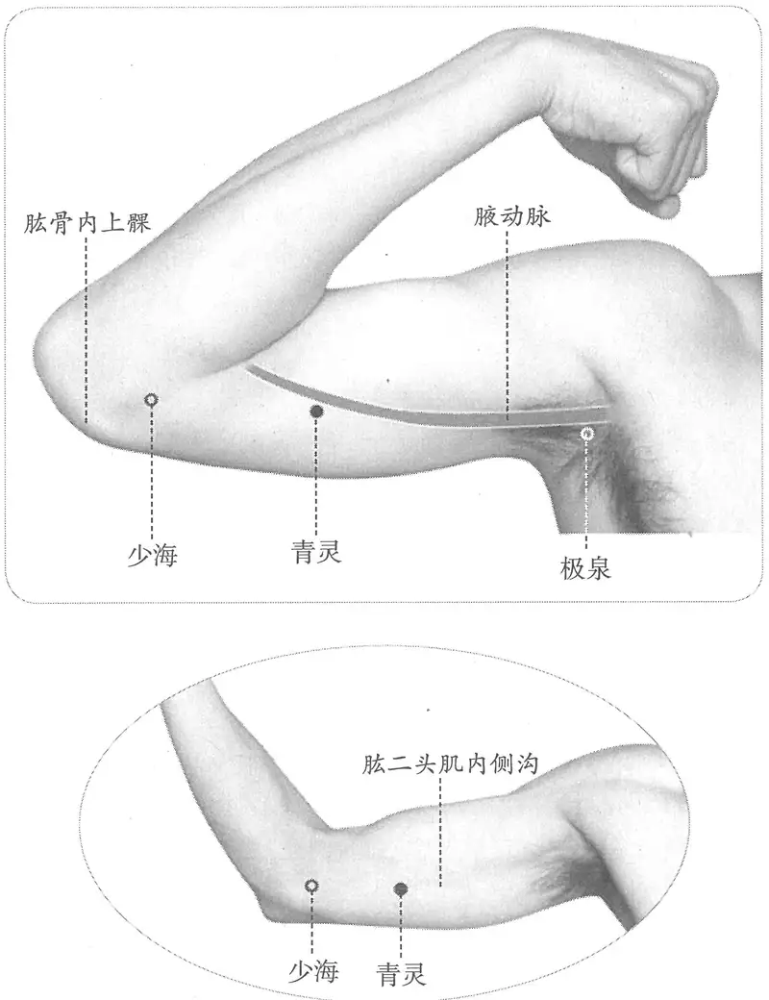

**图 2-126　青灵穴图**

〔p.506 (인쇄 486)〕

　1. 青灵二穴，在肘上三寸，伸肘举臂取之。（《太平圣惠方·明堂》、《铜人腧穴针灸图经》、《圣济总录》、《针灸资生经》、《十四经发挥》、《医学纲目》、《针灸集书》、《针灸聚英》、《古今医统》、《医学入门》、《针灸大成》、《针方六集》、《类经图翼》、《循经考穴编》、《医宗金鉴·刺灸心法要诀》、《针灸易学》、《针灸逢源》）

　2. 少海直上三寸。（《针灸十四经穴位考订》）

　3. 统编针灸学教材

　　(1) 部位：肘上三寸。取穴：伸肘举臂，少海穴直上三寸，与极泉成直线位上取之。（1957年南京《针灸学》）

　　(2) 部位：肘上三寸。取穴：少海穴直上三寸，与极泉穴成一直线，仰卧，手掌按后头取之。（1版《针灸学讲义》）

　　(3) 部位：肘上三寸。取穴：在上臂内侧，少海上三寸，肱二头肌的内侧沟中，当少海与极泉之连线上，中1/3与下1/3接连点取穴。（2版《针灸学讲义》）

　　(4) 少海穴上3寸。（4版《针灸学》）

　　(5) 少海穴与极泉穴的连线上，少海穴上3寸，肱二头肌的内侧沟中。（5版《针灸学》）

　　(6) 在臂内侧，当极泉与少海的连线上，肘横纹上3寸，肱二头肌的内侧沟中。（6版《针灸学》）

　　(7) 臂内侧，当极泉穴与少海穴的连线上，肘横纹上3寸，肱二头肌的尺侧缘。（7版《针灸学》）

　　(8) 曲肘，内侧横纹头上三寸，肱二头肌的内侧沟中。（《中国针灸学》）

**按**：从以上所引文献看，《太平圣惠方·明堂》所载之“青灵”穴部位与宋以前所有腧穴文献中“清泠渊”穴完全相同，可见“青灵”与“清泠渊”为同一穴。王惟一编《铜人腧穴针灸图经》时，不知此属由于唐人避讳所造成的同穴异名情况，将《太平圣惠方》所载之“青灵”误作一新穴归入手少阴心经，宋以后所有文献皆传其误。

#### 【类属】 

手少阴心经穴。

**归经**：手少阴心经。（《铜人腧穴针灸图经》卷上）

#### 【适应症】 

主治局部病症。常用于肩臂肿痛，腋痛，瘿瘤。

　1. 主肩不举，不能带衣也。（《太平圣惠方·明堂》）

　2. 治肩臂不举，不能带衣，头痛振寒，目黄胁痛。（《铜人腧穴针灸图经》卷下）

**附**：宋以前针灸文献记载的“清泠渊”主治症

头痛振寒，肩不可举，不能带衣。（《黄帝明堂经》）

头痛振寒，清泠渊主之。（《针灸甲乙经》卷七）

主肩不举，不得带衣。（《太平圣惠方·针经》）

**按**：从以上引文可见，《铜人腧穴针灸图经》将“清泠渊”的全部主治病症录入“青灵”穴下，其中多出的一条主治“目黄胁痛”见于《外台秘要》“极泉”穴，系王焘误录《针灸甲乙经》手少阴经病候文字。宋以后针灸文献，除清初《循经考穴编》外，皆传《铜人腧穴针灸图经》之误。

　3. 腋痛，目系痛。（《针方六集》卷五）

　4. 主肩臂红肿，马刀。（《循经考穴编》上）

　5. 统编针灸学教材

　　(1) 头痛，目黄，胁痛，肩臂不举。（1957年南京《针灸学》、1版《针灸学讲义》）

　　(2) 目黄，头痛振寒，胁痛，肩臂痛。（2版《针灸学讲义》，4、5、6版《针灸学》）

〔p.507 (인쇄 487)〕

　　(3) 头痛，振寒；胁痛，肩臂疼痛。（7版《针灸学》）

　　(4) 心痛，胁痛，肩臂痛。（《中国针灸学》）

**按**：《铜人腧穴针灸图经》将此穴主治与三焦经“清泠渊”及本经“极泉”穴相混，故本穴的主治只能从受《铜人腧穴针灸图经》影响较小的《循经考穴编》中加以甄别，并有待于今后在临床应用中加以检验与补充。

#### 附：临床应用举例 

　1. 血栓闭塞性脉管炎，取患肢有关经脉部位敏感反应的俞穴为主穴，结合发病部位及症状循经辨证配穴；下肢主穴：脉根、血海、阴包。上肢主穴：曲池、郄门、青灵。针刺时使针感达病变部位，然后再作补泻手法。［中国针灸，1981(3)：12］

　2. 上肢肌肉拉伤，取天府、青灵、尺泽等。［中国针灸，1989(1)：19］

#### 【操作】 

直刺0.5~1寸。

　1. 灸三壮。（《太平圣惠方·明堂》）

　2. 可灸七壮。（《铜人腧穴针灸图经》卷下）

　3. 禁针。（《医经小学》卷五）

　4. 灸七壮，不宜用针。（《针方六集》卷一）

　5. 一法云横针入五分，禁灸。（《循经考穴编》上）

　6. 禁针，禁灸。（《针灸十四经穴位考订》）

　7. 统编针灸学教材

　　(1) 针三分，灸七壮。（1957年南京《针灸学》、1版《针灸学讲义》）

　　(2) 直刺3~5分，艾条灸3~5分钟。（2版《针灸学讲义》）

　　(3) 直刺0.5~1寸。（4、5、6、7版《针灸学》）

　　(4) 直刺0.3~0.5寸。可灸。（《中国针灸学》）

**按**：《铜人腧穴针灸图经》所载之青灵出自《太平圣惠方·明堂》（此卷只录灸法），故只载有灸法，之后宋代《圣济总录》将《铜人腧穴针灸图经》中凡未载针法之穴皆归于偏宜灸者类，明初刘纯不解其义，遂将《圣济总录》所列偏宜灸者之穴归入禁针穴。至清初《循经考穴编》别传一法云禁灸，未详其所据。

### （三）少海 Shàohǎi HT3 出《黄帝明堂经》 

#### 【提要索隐】 

**部位**：在肘前区，横平肘横纹，肱骨内上髁前缘。

**按**：由于王冰注《素问·气穴论》时，将“小海”误作“少海”，唐以后针灸文献或将“小海”穴部位误作“少海”，或将“少海”、“小海”二穴的部位混合为一条。

**适应症**：主治心部、局部病症。常用于心痛、呕吐；胁痛，腋痛，上肢痹痛；瘰疬。

**按**：《黄帝明堂经》载本穴主治包括心的病症和疟，自唐《千金翼方》始，则突出了其治疗局部病症的作用。

**针刺操作**：直刺0.3~1寸。

#### 【名实考】 

需要特别注意的是，“少”与“小”字意相通，字形相近。因此在古代针灸文献中，“少海”每与“小海”相混者不乏其例。例如传世本《针灸甲乙经》中，所有五条“小海”穴主治症均误作“少海主之”，《素问·气穴论》王冰所注腧穴部位条文中将“小海”穴误作“少海”，唐以后至今的一千多年间均未能发现此误而一直讹传。考证详见总论附篇二“古代针灸文献中腧穴主治错误类析”。

〔p.508 (인쇄 488)〕

　1. 入于少海，少海者，水也，一名曲节。在肘内廉节后陷者中，动脉应手。手少阴脉之所入也，为合。（《黄帝明堂经》）

　2. 穴名少海者，海之象，取本经所入为合水也。凡骨节过经之所，皆以池、泽、海名之者，以经至其地，必存聚蓄潴，而方能过骨节曲折之处，此乃少阴之合水穴，故曰少海。（《经穴解》）

#### “少海”与“小海”相混例 

　1. 风眩头痛，少海主之。（卷七第一下）

　2. 疟背振寒，项痛引肘腋，腰痛引少腹，四肢不举，少海主之。（卷七第五）

　3. 寒热。（卷八第一下）

　4. 狂易。（卷十一第二）

　5. 齿龋痛，少海主之。（卷十二第六）

——《针灸甲乙经》

**按**：“少”与“小”两字在古籍中常混用。如果在《黄帝明堂经》中“小海”误作“少海”，因其记有明确部位而不难识别此误，而在《针灸甲乙经》卷七至卷十二中，如“小海”、“少海”两穴名相混，则其主治内容便完全相混。以上《针灸甲乙经》所载全部五条“少海主之”条文在各篇中排在手太阳经穴“支正”、“阳谷”穴后，按照《针灸甲乙经》腧穴排列序例，这五条主治症不可能为“少海主之”，而只能是“小海主之”。其中后四条已见于《外台秘要》“少海”穴下，说明王焘当时所据《针灸甲乙经》中，此四条“小海”穴主治已误作“少海主之”，只有第一条“风眩头痛”症尚未误作“少海主之”。王焘一方面承《针灸甲乙经》之误，将其中四条本属“小海主之”的病症辑入“少海”穴下，另据其他《黄帝明堂经》传本，补辑“小海”穴主治症，其条文次序与《医心方》完全相同。

　6. 少海　寒热，齿龋痛，狂易，疟，背振寒引肘腋痛。（《外台秘要》卷三十九）

　7. 小海　寒热，齿龋痛，风眩头痛，狂易，痫肘，疟，背膂振寒，项痛引肘腋，腰痛引少腹中，四肢不举。（《外台秘要》卷三十九）

　8. 小海　寒热，齿痛，眩，头痛，狂易，疟，项痛，腰痛，四肢不举。（《医心方》）

**按**：由于王焘当时所据之《针灸甲乙经》已有四条“小海主之”条文误作“少海主之”，王焘承其误仍将此四条主治辑入“少海”穴，则“小海”穴下主治当据其他《明堂经》传本补辑。

　9. 少海，在肘内大骨外，去肘端同身寸之五分陷者中，屈肘乃得之。（《素问·气穴论》王冰注）

**按**：此与“小海”穴部位相混。宋以后许多文献如《太平圣惠方》、《铜人腧穴针灸图经》等皆受此影响。

#### 【定位】 

**部位**：在肘前区，横平肘横纹，肱骨内上髁前缘。

**取穴**：屈肘，在肘横纹内侧端与肱骨内上髁连线的中点处取穴（图2-127）。

　1. 《黄帝明堂经》佚文

　　(1) 在肘内廉节后陷者中，动脉应手。（《针灸甲乙经》卷三、《外台秘要》）

　　(2) 在肘内廉节后陷中。（《千金要方》卷二十九、《千金翼方》、《医心方》）

　2. 甄权《针经》佚文

　　(1) 在臂曲侧肘内横纹头，屈手向头取之。（《千金翼方》卷二十八）

　　(2) 甄权云，穴在臂侧曲肘内横纹头，屈手向头而取之，陷者中。（《外台秘要》卷三十九）

〔p.509 (인쇄 489)〕

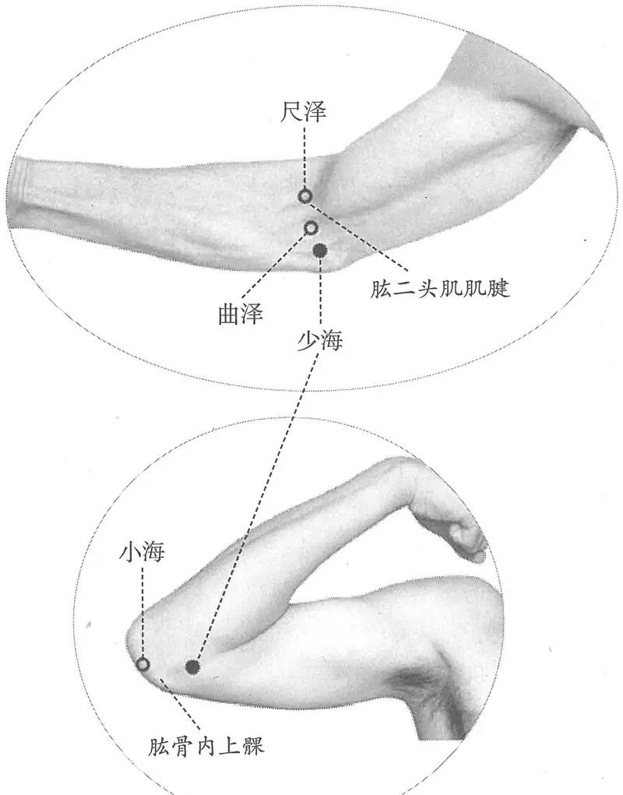

**图 2-127　少海穴图**

　　(3) 在肘内横纹头，屈手向头取之，陷者宛宛中。（《太平圣惠方·针经》）

　　(4) 肘内廉横纹头尽处陷中，曲手向头取之。（《医学入门》卷一）

　3. 王冰误注及传误者

　　(1) 少海，在肘内大骨外，去肘端同身寸之五分陷者中，屈肘乃得之。（《素问·气穴论》王冰注）

**按**：此与“小海”穴部位相混。宋以后许多文献如《太平圣惠方》、《铜人腧穴针灸图经》等皆受此影响。

　　(2) 少海，在肘大骨外，去肘端五分陷者中，屈肘乃得之。（《太平圣惠方·明堂》）

　　(3) 在肘内廉节后。又云：肘内大骨外，去肘端五分。（《铜人腧穴针灸图经》卷下、《圣济总录》、《针灸资生经》）

　　(4) 在肘内大骨外，去肘端五分。（《十四经发挥》中、《医学纲目》）

　　(5) 肘内廉节后，大骨外，去肘端五分，屈肘向头得之。（《针灸聚英》卷一）

　4. 窦太师针灸遗存

　　(1) 在肘内廉节后，去肘内大骨端五分陷中。屈肘叉腰取之，在肘骨大筋内。手少阴脉所入为合。太师云在肘骨尖上，去天井穴内五分陷中是穴。（《窦太师针经》）

　　(2) 在肘内廉节后，去肘内大骨端五分陷中，动脉应手，屈肘向头取之，在肘骨大筋内。（《针方六集》卷一）

　　(3) 肘内廉大骨外，去肘端五分。广注：合居内廉侧横纹头，屈肘向头取之，与曲池颇相对，须插手于腰，四指向前，大指向后下针。（《循经考穴编》上）

〔p.510 (인쇄 490)〕

　5. 在肘内廉节后陷中。又云肘内大骨下，去肘端五分，肘内廉横纹头，屈肘向头取之。（《类经图翼》卷六、《医宗金鉴·刺灸心法要诀》）

**按**：此条更是将《黄帝明堂经》、王冰误注及甄权《针经》三说揉为一说，让人莫名其妙。

　6. 肘内侧尺侧，去肘端五分屈肘横纹头陷中。（《针灸十四经穴位考订》）

　7. 统编针灸学教材

　　(1) 部位：肘内廉大骨外，去肘端五分。取穴：手肘略屈，手掌向上，于肘窝之横纹内侧去肘端五分取之。（1957年南京《针灸学》）

**按**：此明显受古代文献错误的影响，幸好之后的各版教材未沿袭此误。

　　(2) 部位：肘内廉横纹头尽处陷中。取穴：仰卧，手掌按后头，于肘窝之横纹内侧去肘端五分取之。（1版《针灸学讲义》）

　　(3) 部位：在肘内廉，节后陷者中。取穴：曲肘成直角，在肘关节内侧横纹头与肱骨内上髁之间凹陷中取之。（2版《针灸学讲义》）

　　(4) 屈肘，当肘横纹尺侧端凹陷中。（4版《针灸学》）

　　(5) 屈肘，当肘横纹内端与肱骨内上髁连线之中点。（5、6、7版《针灸学》）

　　(6) 屈肘成直角，在肘关节内侧横纹头与肱骨内上髁之间凹陷中取之。（《中国针灸学》）

**文献分析**：王冰注将小肠经小海穴误作少海穴，后世文献受其影响，多将“少海”、“小海”定位相混。《针灸甲乙经》载本穴“动脉应手”，又杨上善曰：“中部之人手少阴动在极泉、少海二处以候心气也”（《黄帝内经太素》），说明其所注的《黄帝内经明堂》传本少海穴也位于“动脉应手”处。可是前臂屈面的桡动脉、尺动脉行至肘部已汇成一支为肱动脉，位于肱二头肌腱尺侧，即临床量血压常用的动脉触诊点。而“肘内廉节后陷中”（肱骨内上髁前缘处）不能触及动脉搏动。相反手厥阴的“曲泽”穴正当肘窝动脉搏动处，然而《黄帝明堂经》于该穴下并未言“动脉应手”字样。这可能仍与手少阴脉早期的循行分布特点有关。马王堆出土帛书《阴阳十一脉灸经》谓“臂少阴脉，起于臂两骨之间，之下骨上廉，筋之下，出臑内阴”，从循行部位上看它更近于《灵枢·经脉》之“手厥阴脉”的分布。

#### 【类属】 

手少阴心经穴；五输穴之合穴。

少阴脉之所入也，为合。（《黄帝明堂经》）

#### 【适应症】 

主治心、局部病症。常用于心痛、呕吐；胁痛，腋痛，上肢痹痛；瘰疬。

　1. 主身热，痎疟，气逆，呼吸噫，哕，呕吐，手臂挛急。（《黄帝明堂经》）

**按**：以上主治包括“疟”和“气逆”两组症状。参阅《黄帝明堂经》极泉穴主治，此处“气逆，呼吸噫，哕，呕吐”应是指心痹的伴随症状。又《素问·刺疟》曰：“疟……先手臂痛者，先刺手少阴、阳明十指间”，则知此处“疟”还应当兼有“心疟”或手少阴经的某些症状。

　2. 少海主气逆，呼吸噫哕呕。神门、少海主手臂挛。少海主疟背振寒。阴都、少海、商阳、三间、中渚主身热疟病。（《千金要方》卷三十）

　3. 主腋下瘰疬漏，臂疼屈伸不得，风痹，瘙漏。（《千金翼方》卷二十八）

　4. 寒热，齿龋痛，狂易，疟背振寒引肘腋痛。甄权云……主腋下瘰疬。（《外台秘要》卷三十九）

**按**：《外台秘要·明堂》腧穴主治辑自《针灸甲乙经》，而后者小海穴主治多误作“少海主之”，王焘也沿袭其误。

〔p.511 (인쇄 491)〕

　5. 少海在肘大骨外去肘端五分陷者中，屈肘乃得之。四肢不举，癫痫吐舌，沫出羊鸣也。（《太平圣惠方·明堂》）

**按**：据其部位，不难判断此系“小海”穴主治也。

　6. 治寒热，齿龋痛，目眩发狂，呕吐涎沫，项不得回顾，肘挛，腋胁下痛，四肢不得举。甄权云屈手向头取之。治齿寒，脑风头痛。（《铜人腧穴针灸图经》卷下）

**按**：此条主治中除“肘挛，腋胁下痛”外，均见于《外台秘要》小海穴主治。

　7. 窦太师针灸遗存

　　(1) 治心胸痛，泻；肘臂无力，补。并一切瘰疬皆治。（《窦太师针经》）

　　(2) 主目眩齿痛，手颤肘挛，狂痫，呕吐，噫哕，健忘。（《循经考穴编》上）

　8. 主心疼，手颤，健忘。（《针灸聚英》卷一）

　9. 统编针灸学教材

　　(1) 心痛，呕吐，头痛目眩，两臂顽麻，手颤肘挛，腋下痛，瘰疬，健忘，发狂。（1957年南京《针灸学》）

　　(2) 心痛，健忘，发狂，头痛目眩，呕吐，两臂顽麻，手颤肘挛，腋下痛，瘰疬。（1版《针灸学讲义》）

　　(3) 心痛，臂麻，手颤，手挛，腋胁痛，瘰疬，颈痛。（2版《针灸学讲义》）

　　(4) 心痛，手臂挛痛，瘰疬，头项痛，腋胁痛。（4、5版《针灸学》）

　　(5) 心痛、臂麻酸痛、手颤、健忘、暴喑、肘臂伸屈不利、瘰疬、腋胁痛。（6版《针灸学》）

　　(6) ①心痛、癔病等心病、神志病；②肘臂挛痛，臂麻手颤；③头项痛，腋胁部痛；④瘰疬。（7版《针灸学》）

　　(7) 心痛，手臂挛痛、麻木，手颤，瘰疬，腋胁痛。（《中国针灸学》）

**文献分析**：《黄帝明堂经》载本穴主治包括心的病症和疟，自唐《千金翼方》始，则突出了其治疗局部病症的作用。值得注意的是，“少海”、“小海”二穴因字形相近，极易混淆。王焘所见之唐代传本《针灸甲乙经》已有四条“小海主之”条文误作“少海主之”，王焘承其误仍将此四条主治辑入“少海”穴；之后《太平圣惠方·明堂》也将“小海”穴名误作“少海”，特别是北宋王惟一编撰《铜人腧穴针灸图经》时，也沿袭了其中部分错误，且又出现了新的错误，由此“小海”与“少海”的主治很早就出现了相混的情况，以致后世代代相袭，一直沿误至今。教材中“头项痛，头痛目眩，发狂”等主治症系沿袭古人之误，错录“小海”穴主治于此也，今去之。

#### 附：临床应用举例 

　1. 五痫颠狂，弃衣歌笑，灸少海，刺冲阳、神门、少冲、合谷，泻之。（《针灸集要·盘石金直刺秘传》）

　2. 臂内廉痛，经渠一分，忌灸，灵道一分，卧针，向前三分、少海五分。（《医学纲目》卷十二）

　3. 心痛手颤针少海，少泽应除心下寒。（《灵光赋》）

　4. 心疼手颤少海间，若要除根觅阴市。（《席弘赋》）

　5. 缺乳，合谷穴、少海穴，针灸疗法。［中医药学报，1986(2)：42］

#### 【操作】 

直刺0.3~1寸。

　1. 刺入五分，灸三壮。（《针灸甲乙经》卷三）

　2. 针入三分，留七呼，泻五呼。（《千金翼方》卷二十八）

　3. 灸五壮。甄权云不宜灸。（《外台秘要》卷三十九）

〔p.512 (인쇄 492)〕

　4. 针入三分，留三呼，泻五吸，不宜灸。（《太平圣惠方·针经》）

　5. 针五分，灸七壮。（《窦太师针经》）

　6. 针入三分，灸七壮。（《医学纲目》卷八）

　7. 针三分，灸三壮。《甲乙经》不宜灸。（《针灸十四经穴位考订》）

　8. 统编针灸学教材

　　(1) 针五至八分，灸三至五壮。（1957年南京《针灸学》、1版《针灸学讲义》）

　　(2) 直刺5~8分，艾条灸5~10分钟。（2版《针灸学讲义》）

　　(3) 直刺0.5~1寸。（4、5、7版《针灸学》）

　　(4) 直刺0.5~1.0寸。可灸。（6版《针灸学》、《中国针灸学》）

　9. 直刺0.5~1.5寸。感应局部酸胀，或有麻电感向前臂放散。灸3~5壮；温灸5~10分钟。（上海《针灸学》）

**按**：本穴不少文献记载为禁灸，可能是该穴位于肘关节上，古代又盛行瘢痕灸法，遗留的瘢痕会影响关节的功能活动，故有禁灸之说。若用艾炷非瘢痕灸法和艾卷灸法，则无此之虞，当能用之。

### （四）灵道 Língdào HT4 出《黄帝明堂经》 

#### 【提要索隐】 

**部位**：在前臂前区，腕掌侧远端横纹上1.5寸，尺侧腕屈肌腱的桡侧缘。

**适应症**：主治心、咽部病症。常用于心痛、悲恐；失音；肘臂筋挛。

**针刺操作**：直刺0.3~0.5寸。

#### 【名实考】 

关于本穴定位，两种《黄帝明堂经》传本皆曰“在掌后一寸五分，或曰一寸”，一直到宋代的《铜人腧穴针灸图经》仍保留“或曰一寸”的说法。或有不解曰：《黄帝明堂经》既定通里穴于“腕后一寸”，则灵道不可能作“掌后一寸”。可是当一个穴位与络穴相邻时，二穴横平可能性的确存在。

　1. 行于灵道，灵道者，金也。在掌后一寸五分，或曰一寸。手少阴脉之所行也，为经。（《黄帝明堂经》）

　2. 心主神明，此穴为心经所行，故曰灵道，走而不守也。（《经穴解》）

#### 【定位】 

**部位**：在前臂前区，腕掌侧远端横纹上1.5寸，尺侧腕屈肌腱的桡侧缘（图2-128）。

**取穴**：豌豆骨上缘桡侧直上1.5寸取穴；或神门上1.5寸，横平尺骨头上缘（近端）。

　1. 《黄帝明堂经》佚文

　　(1) 在掌后一寸五分，或曰一寸。（《针灸甲乙经》卷三、《外台秘要》、《医心方》、《铜人腧穴针灸图经》）

　　(2) 在掌后一寸半。（《千金要方》卷二十九、《千金翼方》）

　2. 窦太师针灸遗存

　　(1) 灵道二穴，金也，去腕骨穴后兑骨一寸半。（《窦太师针经》）

**按**：此处“兑骨”指掌后豌豆骨，也即神门穴（掌后兑骨之端陷者中）后一寸半，与《黄帝明堂经》文异义同。

　　(2) 在腕骨后一寸五分。（《针方六集》卷一）

　　(3) 广注当去腕骨一寸五分。（《循经考穴编》上）

〔p.513 (인쇄 493)〕

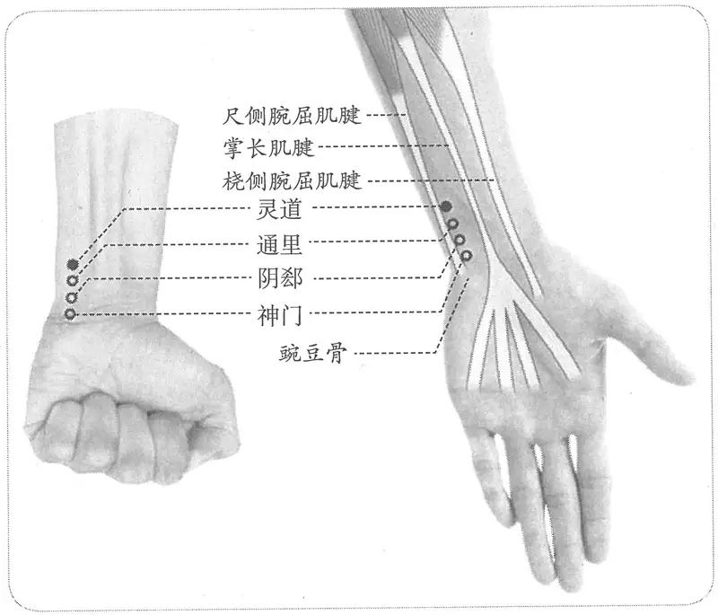

**图 2-128　灵道穴图**

　3. 在掌后一寸五分。（《十四经发挥》卷中、《医学纲目》、《针灸聚英》、《医学入门》、《针灸大成》、《针方六集》、《循经考穴编》）

　4. 神门穴直上一寸五分。（《针灸十四经穴位考订》）

　5. 统编针灸学教材

　　(1) 部位：掌后一寸五分。取穴：从手掌后豆骨之上横纹端，直上一寸五分筋间取之。（1957年南京《针灸学》）

　　(2) 部位：掌后一寸五分。取穴：以神门穴与少海穴成直线，从腕横纹上一寸五分大筋内侧取之。（1版《针灸学讲义》）

　　(3) 部位：掌后一寸五分。取穴：在掌侧尺侧腕屈肌腱之桡侧，当腕横纹上一寸半处取之。（2版《针灸学讲义》）

　　(4) 神门穴上1.5寸。（4版《针灸学》）

　　(5) 腕横纹上1.5寸，尺侧腕屈肌腱的桡侧缘。（5、7版《针灸学》）

　　(6) 在前臂掌侧，当尺侧腕屈肌腱的桡侧缘，腕横纹上1.5寸。（6版《针灸学》）

　　(7) 仰掌，在尺侧腕屈肌腱之桡侧，腕横纹上一寸半处。（《中国针灸学》）

**文献分析**：本穴的定位，元代以前的文献有两种记载，自元代《十四经发挥》始，统一采用“掌后一寸五分”说。

#### 【类属】 

手少阴心经穴；五输穴之经穴。

手少阴脉之所行也，为经。（《黄帝明堂经》）

#### 【适应症】 

主治心、咽部病症。常用于心痛、悲恐；失音；肘臂筋挛。

　1. 主悲恐，心痛相引，瘛疭，臂肘筋挛，暴喑不能言。（《黄帝明堂经》）

**按**：《灵枢·五邪》曰：“邪在心，则病心痛喜悲，时眩仆，视有余不足而调之其输也”。此即本穴所主之特征性心痛；“喑不能言”为手少阴络脉之病候。此外，《黄帝明堂经》的最早传本《针灸甲乙经》未见“灵道主之”条文，分析见手少阴经“概说”。

〔p.514 (인쇄 494)〕

　2. 治心痛悲恐，相引瘛疭，肘挛，暴喑不能言。（《铜人腧穴针灸图经》卷下）

　3. 主干呕。（《针灸聚英》卷一、《古今医统》、《针灸大成》、《类经图翼》）

　4. 窦太师针灸遗存

　　(1) 治心内呆痴，泻；五痫，先补后泻；又治目昏，手外廉生疮。（《窦太师针经》）

　　(2) 主心内呆痴，五痫，目痛。（《针方六集》卷五）

　　(3) 主心疼悲悸，目赤肿不明，手湿痒不仁，肘臂外廉疼痛。（《循经考穴编》上）

　5. 统编针灸学教材

　　(1) 心痛，暴喑不能言，肘臂挛急疼痛，瘛疭，悲恐。（1957年南京《针灸学》、1版《针灸学讲义》）

　　(2) 心痛，悲恐，暴瘖不语，肘臂挛急，瘛疭。（2版《针灸学讲义》）

　　(3) 心痛，瘛疭，暴喑，肘臂挛急。（4、5版《针灸学》、《中国针灸学》）

　　(4) 心痛、心悸怔忡、暴喑、舌强不语、头昏目眩、肘臂挛痛。（6版《针灸学》）

　　(5) 心痛，悲恐善笑；暴喑；肘臂挛痛。（7版《针灸学》）

**文献分析**：心痛、悲恐以及咽喉部症状常常作为一组症状见于《内经》所述的心痹心痛，例如：“心痹者，脉不通，烦则心下鼓，暴上气而喘，嗌干善噫，厥气上则恐”（《素问·痹论》）；“手心主、少阴厥逆，心痛引喉。身热，死；不热可治”（《素问·厥论》）；“邪在心，则病心痛喜悲，时眩仆，视有余不足而调之其输也”（《灵枢·五邪》）。现代临床也发现：冠心病人心痛、恐惧，有濒死感，同时可见音哑，甚至失音等咽喉部症状，因而称之为心-咽综合征（cardiovocal syndrome）。由此可见，《黄帝明堂经》所述本穴主治“悲恐，心痛相引，暴喑不能言”很可能是冠心病心绞痛发作时的一组症状，这也说明古人的观察很细微。同时现代临床还发现，冠心病心绞痛病人除了“心痛引喉”外，还可牵涉臂内侧（多为尺侧）痛，这在《黄帝明堂经》其他腧穴主治中也反映得很清楚：例如大陵穴“胸痛，心痛善悲厥逆，悬心如饥之状，心澹澹而惊，两手挛不伸”；间使穴“卒心中痛，瘛疭互相引，肘内廉痛，心敖敖然，胸痹引背时寒，心痛善悲厥逆，悬心如饥之状，心澹澹而惊……喑不能语，咽中哽”；少冲穴“热病烦心，上气，心痛而寒，善太息，烦满，少气，悲恐善惊，掌中热，肘腋胸中痛，口中热，咽喉中酸，乍寒乍热，手卷不伸”。由此可见，《黄帝明堂经》所载灵道穴全部主治病症有可能是一组心绞痛发作症状。而手少阴经脉与络脉的循行与手少阴经穴的这些主治病症所在的特定部位完全吻合。

#### 附：临床应用举例 

　1. 九种心痛，间使、灵道、公孙、太冲、三里、阴陵泉。（《医学纲目》卷十六）

　2. 臂内廉痛，经渠一分，忌灸、灵道一分，卧针，向前三分、少海五分。（《医学纲目》卷十二）

　3. 骨寒髓冷火来烧，灵道妙穴分明记。（《肘后歌》）

　4. 顽固性失眠，取双侧神门、灵道，以29号1寸毫针直刺0.5~1寸，得气为度。［江西中医药，1994，25（增刊）：70-71］

#### 【操作】 

直刺0.3~0.5寸。

　1. 刺入三分，灸三壮。（《黄帝明堂经》）

　2. 窦太师针灸遗存

　　(1) 针入二分；沿皮向后一寸半，灸七壮。（《窦太师针经》）

　　(2) 针一分，沿皮向前寸半。（《窦太师秘传》）

　　(3) 一法刺入一分，沿皮向外透神门，禁灸。（《循经考穴编》上）

〔p.515 (인쇄 495)〕

**按**：此处刺法作“沿皮向外”，其“外”字并非笔误，而是该书神门穴定位偏在外侧。

　3. 针三分，灸五壮。（《针灸十四经穴位考订》）

　4. 统编针灸学教材

　　(1) 针三至四分，灸三至七壮。（1957年南京《针灸学》、1版《针灸学讲义》）

　　(2) 直刺3~4分，艾条灸3-7分钟。（2版《针灸学讲义》）

　　(3) 直刺0.5~0.8寸。（4版《针灸学》）

　　(4) 直刺0.3~0.5寸。（5版《针灸学》）

　　(5) 直刺0.2~0.5寸；可灸。（6版《针灸学》）

　　(6) 直刺0.3~0.5寸。不宜深刺，以免伤及血管和神经。留针时，不可作屈腕动作。（7版《针灸学》）

　　(7) 直刺0.3~0.5寸；可灸。（《中国针灸学》）

### （五）通里 Tōnglǐ HT5 出《灵枢》 

#### 【提要索隐】 

**部位**：在前臂前区，腕掌侧远端横纹上1寸，尺侧腕屈肌腱的桡侧缘。

**适应症**：主治心、咽部病症。常用于心悸，心痛，面赤无汗；咽喉肿痛，失音；肘臂痛。

**按**：本穴源出于手少阴络脉，其络脉所诊之病候也就成为络穴的主治病症。

**针刺操作**：直刺0.3~0.5寸。

#### 【名实考】 

《千金要方》作“通理”。需要注意的是，另有经外奇穴名“通里”者，明代高武不察，将其混入经穴“通里”穴下，所幸，现代针灸学教材未传此误。

窦太师针灸由于受神门穴定位错误的连带影响，使本穴定位偏尺侧。所幸，现代针灸学教材本穴定位未受此误影响。

　1. 手少阴之别，名曰通里……其实则支膈，虚则不能言，取之掌后一寸，别走太阳也。（《灵枢·经脉》）

　2. 通里，手少阴络，在腕后一寸，别走太阳。（《黄帝明堂经》）

　3. 前穴为灵道，道，路也。此穴为通里，里亦路也。以此穴别通于手太阳，必有路以通之，故曰通里。（《经穴解》）

#### 奇穴“通里” 

足少阳经通里二穴，在足小指间上二寸骨罅间。针入二分，各灸二七壮。（《针经摘英集》）

**按**：据此定位，与足少阳经“足临泣”穴相当。明代高武不察，误将该奇穴“通里”主治归入经穴“通里”穴下。

#### 【定位】 

**部位**：在前臂前区，腕掌侧远端横纹上1寸，尺侧腕屈肌腱的桡侧缘（图2-129）。

**取穴**：豌豆骨上缘桡侧直上1寸取穴。

1.《灵枢》传本

　　(1) 手少阴之别，名曰通里，去腕一寸半，别而上行，循经入于心中，系舌本，属目系。其实则支膈，虚则不能言，取之掌后一寸，别走太阳也。（《灵枢·经脉》）

　　(2) 去腕一寸。（《黄帝内经太素·十五络脉》）

　2. 在腕后一寸。（《针灸甲乙经》卷三、《千金要方》、《千金翼方》、《外台秘要》、《医

〔p.516 (인쇄 496)〕

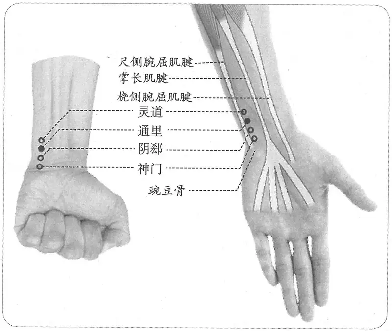

**图 2-129　通里穴图**

心方》、《铜人腧穴针灸图经》、《圣济总录》、《针灸资生经》、《十四经发挥》、《神应经》、《针灸集书》、《针灸聚英》、《医学纲目》、《医学入门》、《针灸大成》、《循经考穴编》、《针灸易学》）

　3. 在腕后一寸陷者中。（《太平圣惠方·明堂》）

　4. 窦太师针灸遗存

　　(1) 在手侧腕骨上一寸。（《窦太师针经》）

　　(2) 在腕后一寸手侧起骨上。（《琼瑶神书》）

　　(3) 在腕后起骨上一寸。（《针灸玉龙歌》注）

　　(4) 在手内侧腕骨后一寸。（《针方六集》卷一）

　　(5) 广注阴郄后五分，别走起骨后一寸侧陷中。一法：锐骨直下一寸，子骨之内，大筋之外。又法，居神门后一寸，沿子骨内直刺下是，当与列缺相对，微前些。（《循经考穴编》上）

**按**：以上各条文字不尽同，而意义则相同，都是以手太阳经穴“腕骨”作为“通里”之定位的基点。其中《循经考穴编》所载之“一法”的描述最具体，完全采用表面解剖标志表述，所谓“锐骨直下一寸，子骨之内，大筋之外”，是指豌豆骨下一寸，尺骨小头的桡侧，尺侧腕屈肌腱的尺侧（古代针灸文献中“外侧”相当于现代解剖方位词的“内侧”）。

　5. 神门穴直上一寸。（《针灸十四经穴位考订》）

　6. 统编针灸学教材

　　(1) 部位：掌后一寸陷中。取穴：从掌后豆骨之上横纹上行一寸取之。（1957年南京《针灸学》）

　　(2) 部位：掌后一寸陷中。取穴：灵道穴下五分处取之。（1版《针灸学讲义》）

　　(3) 部位：在腕后一寸。取穴：在尺侧腕屈肌腱之桡侧，灵道下五分，腕横纹后一寸取之。（2版《针灸学讲义》）

〔p.517 (인쇄 497)〕

　　(4) 神门穴上1寸。（4版《针灸学》）

　　(5) 腕横纹上1寸，尺侧腕屈肌腱的桡侧。（5、7版《针灸学》、《中国针灸学》）

　　(6) 在前臂掌侧，当尺侧腕屈肌腱侧桡侧缘腕横纹上1寸。（6版《针灸学》）

**文献分析**：窦太师（窦汉卿）对于本穴的定位采用手太阳经腕骨穴作为基准点，还是受神门穴定位错误的误导，后世文献不从之。故本穴仍定于尺侧腕屈肌腱的桡侧，与其他前臂部手少阴经穴同例。

#### 【类属】 

手少阴心经穴；络穴。

　1. 手少阴之别，名曰通里，去腕一寸半，别而上行，循经入于心中，系舌本，属目系。（《灵枢·经脉》）

　2. 手少阴络，别走太阳。（《黄帝明堂经》）

　3. 心出于少冲为井，手少阴脉也，流于少府为荥，注于神门为输，过于通里为源，行于灵道为经，入于少海为合。（《千金要方》卷二十九）

#### 【适应症】 

主治心、咽部病症。常用于心悸，心痛，面赤无汗；咽喉肿痛，失音；肘臂痛。

　1. 手少阴之别，名曰通里……其实则支膈，虚则不能言，取之掌后一寸，别走太阳也。（《灵枢·经脉》）

　2. 主热病先不乐，数日乃热，热争则卒心痛，心中懊侬，数欠频伸，悲恐，头痛，面赤无汗及癫，心下悸，臂臑肘痛，实则支满，虚则不能言，苦呕，喉痹，少气，遗溺。（《黄帝明堂经》）

　3. 主头目眩痛，悲恐畏人，肘腕酸重，及暴哑不能言也。（《太平圣惠方·明堂》）

　4. 热病，卒心中懊侬，数欠频伸，悲恐，目眩头痛，面赤而热，心悸，肘臂臑痛，实则支肿，虚则不能言，苦呕，喉痹，少气，遗溺。（《铜人腧穴针灸图经》卷下）

　5. 窦太师针灸遗存

　　(1) 治烦虚头面赤，泻补；手臂酸疼，补泻；心虚怕惊，宜补。（《窦太师针经》）

　　(2) 治虚烦面赤先补后泻，手臂背酸疼。（《大本琼瑶神书》）

　6. 治中风，惊佈声音不出，肘腕酸疼。（《乾坤生意》下卷）

　7. 妇人经血过多，崩中。（《针灸聚英》卷一、《针灸大成》、《循经考穴编》）

**按**：此病症系高武误录《针经摘英集》奇穴“通里”主治症。

　8. 统编针灸学教材

　　(1) 热病懊侬，面热无汗，心悸怔忡，头风，目眩痛，舌强不能言，喉痹，肘臂臑痛，手腕痛。（1957年南京《针灸学》）

　　(2) 热病心烦，面热无汗，心悸怔忡，头痛，目眩，暴喑，喉痹，肘臂内廉痛，手腕痛。（1版《针灸学讲义》）

　　(3) 心悸怔忡，头晕，目眩，咽喉肿痛，暴瘖，舌强不语，腕臂痛。（2版《针灸学讲义》、4版《针灸学》）

　　(4) 暴瘖，舌强不语，心悸，怔忡，腕臂痛。（5、6版《针灸学》）

　　(5) 心悸，怔忡等心病；舌强不语，暴瘖；腕臂痛。（7版《针灸学》）

　　(6) 心悸、怔忡，头晕，目眩，咽喉肿痛，暴喑，舌强不语，腕臂痛。（《中国针灸学》）

**文献分析**：《黄帝明堂经》载本穴主治病症包括了《内经》所述之“心热病”及手少阴络脉病候。《素问·刺热》曰：“心热病者，先不乐，数日乃热。热争则卒心痛，烦闷善呕，头痛面赤无汗，壬癸甚，丙丁大汗，气逆则壬癸死。刺手少阴、太阳”；又《灵枢·经脉》载手少阴络脉病候为“实则支膈，虚则不能言”。至于“遗溺”，非手少阴经之典型病候，《黄帝明堂经》此处未详述具体的心经病症的伴随症状。明代高武将经外奇穴“通里”的主治混入本穴主治，现代针灸学教材未传此误。

〔p.518 (인쇄 498)〕

#### 附：临床应用举例 

　1. 连日虚烦面赤妆，心中惊悸亦难当，若须通里穴寻得，一用金针体便康。（《针灸玉龙歌》）

　2. 臂细无力转动难，筋寒骨痛夜无眠。曲泽一针依补泻，更将通里保平安。（《针灸玉龙歌》）

　3. 手臂红肿痛，五里、中渚、曲池、通里。问曰：此证从何而得？答曰：气壅滞不散，关节闭塞，经不通，故如此也。复刺后穴：合谷、尺泽。（《针灸集成》第三十一方）

　4. 暴喑，内关穴、通里穴，针刺治疗。［四川中医，1984，2（4）：63］

#### 【操作】 

直刺0.3~0.5寸。

　1. 入三分，灸三壮。（《黄帝明堂经》）

　2. 灸七壮。（《太平圣惠方·明堂》）

　3. 窦太师针灸遗存

　　(1) 针入一分，禁灸。又法针五分。（《窦太师针经》）

　　(2) 针一分，沿皮向前一寸。（《窦太师秘传》）

　　(3) 直刺一分，宜泻不宜补，禁灸。（《针灸玉龙歌》注）

　4. 一法直针一寸。（《循经考穴编》上）

　5. 统编针灸学教材

　　(1) 针三分，灸三壮。（1957年南京《针灸学》、1版《针灸学讲义》）

　　(2) 直刺3~4分，艾条灸3-5分钟。（2版《针灸学讲义》）

　　(3) 直刺0.5~0.8寸。（4版《针灸学》）

　　(4) 直刺0.3~0.5寸。（5版《针灸学》、《中国针灸学》）

　　(5) 直刺0.2~0.5寸；可灸。（6版《针灸学》）

　　(6) 直刺0.3~0.5寸。不宜深刺，以免伤及血管和神经。留针时，不可作屈腕动作。（7版《针灸学》）

　6. 直刺0.5~1寸。感应局部酸胀，并沿尺侧向上下传导。灸1~3壮；温灸10~20分钟。（上海《针灸学》）

### （六）阴郄 Yīnxì HT6 出《黄帝明堂经》 

#### 【提要索隐】 

**穴名**：一名少阴郄、手少阴郄。

**部位**：在前臂前区，腕掌侧远端横纹上0.5寸，尺侧腕屈肌腱的桡侧缘。

**适应症**：主治心、肺部病症。常用于心痛，心悸；咳血，骨蒸，盗汗，鼻衄。

**备选适应症**：癫痫。

**针刺操作**：直刺0.3~0.5寸。不宜深刺及大幅度反复提插。

#### 【名实考】 

阴郄，《外台秘要》作“少阴郄”，《千金要方》卷三十作“手少阴郄”。此穴并神门穴同出于手少阴脉口——神门脉，古穴名“手少阴”包含本穴和神门穴，犹如手太阴经穴“太渊”、“经渠”同出于手太阴脉口——太渊脉一样。故王冰注《素问·阴阳类论》曰：“少阴脉手掌后同身寸之五分，当小指神门之脉也”。

〔p.519 (인쇄 499)〕

　1. 阴郄，手少阴郄，在掌后脉中，去腕五分。（《黄帝明堂经》）

　2. 穴名阴郄者，指少阴经而言也。郄者，空也。前有神门，后有通里，此有动脉，故以郄名。又《内经》注云：手少阴郄穴，乃手少阴发脉之处。（《经穴解》）

　3. 别名　石宫。（1957年南京《针灸学》）

**按**：此传自日本针灸教材。今考《黄帝明堂经》“阴都，一名食宫”，后世文献又有写作“石宫”者（如《针灸秘法全书》即是）。在古医籍中“都”与“郄”常混淆，则日本教材中可能将“阴都”别名误录入“阴郄”穴下。

#### “阴郄”、“神门”与“手少阴”穴 

　1. 中部人，手少阴也。王冰注曰：谓心脉也。在掌后锐骨之端，神门之分，动应于手也。《灵枢经·持针纵舍论》问曰少阴无输，心不病乎？对曰其外经病而藏不病，故独取其经于掌后锐骨之端。正谓此也。（《素问·三部九候论》王冰注）

　2. 神门绝，死不治。王冰注曰：神门，在手之掌后，锐骨之端，动脉应手，真心气也。（《素问·至真要大论》王冰注）

　3. 二阴二阳，病在肺，少阴脉沈，胜肺伤脾，外伤四支。王冰注曰：少阴脉，谓手掌后同身寸之五分，当小指神门之脉也。（《素问·阴阳类论》王冰注）

　4. 喉痹，刺手少阴。少阴在腕当小指后动脉是也。针入三分，补之。（《脉经》卷七）

　5. 小儿鸡痫，善惊反折，手掣自摇。灸手少阴三壮，在掌后去腕半寸陷者中，炷如小麦大。（《太平圣惠方·明堂》）

**按**：从《素问·阴阳类论》王冰注可以看得很清楚：“掌后同身寸之五分”，在穴是谓“阴郄”，在脉是谓“神门之脉”。《脉经》、《太平圣惠方》所载之“手少阴”也相当于神门、阴郄穴。

#### 【定位】 

**部位**：在前臂前区，腕掌侧远端横纹上0.5寸，尺侧腕屈肌腱的桡侧缘（图2-130）。

**取穴**：通里穴下五分取之。如果某些患者腕横纹不明显，可以以腕尺侧的豌豆骨与桡侧的手舟骨结节连线为标志。

　1. 在掌后脉中，去腕五分。（《黄帝明堂经》、《铜人腧穴针灸图经》、《圣济总录》、《针灸资生经》、《针灸玉龙经》、《十四经发挥》、《医学纲目》、《针灸集书》、《针灸聚英》、《古今医统》、《医学入门》、《针灸大成》、《针方六集》、《针灸易学》）

　2. 在腕后同身寸之半寸。（《素问·气府论》王冰注）

　3. 阴郄二穴，在手掌后去阳谷穴五分，有动脉中。（《窦太师针经》）

　4. 一法与阳谷相并，在兑骨阳分间，阴郄在兑骨大筋下阴分间，阴郄在筋上，阳谷在筋下。（《循经考穴编》上）

　5. 神门穴直上五分。（《针灸十四经穴位考订》）

　6. 统编针灸学教材

　　(1) 部位：掌后去腕五分。取穴：同上，从通里穴下行五分处取之。（1957年南京《针灸学》）

　　(2) 部位：掌后去腕五分。取穴：通里穴下五分取之。（1版《针灸学讲义》）

　　(3) 部位：在掌后脉中，去腕五分。取穴：在尺侧腕屈肌腱之桡侧，通里下五分，腕横

〔p.520 (인쇄 500)〕

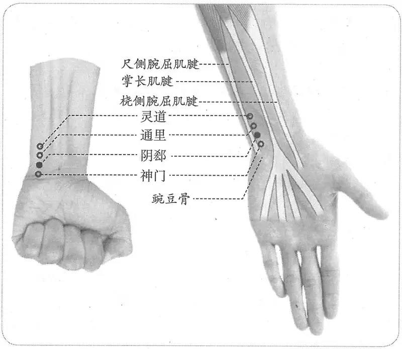

**图 2-130　阴郄穴图**

纹上五分取之。（2版《针灸学讲义》）

　　(4) 神门穴上0.5寸。（4版《针灸学》）

　　(5) 腕横纹上0.5寸，尺侧腕屈肌腱的桡侧。（5、7版《针灸学》）

　　(6) 在前臂掌侧，当尺侧腕屈肌腱的桡侧缘，腕横纹上0.5寸。（6版《针灸学》）

　　(7) 仰掌，在尺侧腕屈肌腱之桡侧，腕横纹上五分处。（《中国针灸学》）

**文献分析**：《黄帝明堂经》谓本穴“在掌后脉中，去腕五分”。根据这条经文的描述，在豌豆骨后五分处应可触及脉动。触诊实验的结果表明：在豌豆骨后尺侧腕屈肌腱桡侧以食指、中指略向尺侧按压可触及尺动脉的微弱搏动，但没有桡动脉易触摸，甚至比腘动脉还要难触及。另外还发现，妊娠时尺动脉搏动明显增强，与古典文献的记载也完全吻合。《窦太师针经》的取穴法受神门穴定位错误的影响，详见神门穴。

#### 【类属】 

手少阴心经穴；郄穴。

手少阴郄。（《黄帝明堂经》）

#### 【适应症】 

主治心、肺部病症。常用于心痛，心悸；咳血，骨蒸，盗汗，鼻衄。

**备选适应症**：癫痫。

　1. 主凄凄寒，咳吐血，气惊心痛。（《黄帝明堂经》）

　2. 主十二痫，失喑不能言。（《外台秘要》卷三十九）

**按**：《太平圣惠方》载有本穴治疗小儿痫证的临床应用。

　3. 治失喑不能言，洒淅振寒，厥逆心痛，霍乱胸中满，衄血，惊恐。（《铜人腧穴针灸图经》卷下）

　4. 窦太师针灸遗存

　　(1) 泻阴郄止盗汗，治小儿骨蒸。（《标幽赋》）

　　(2) 治肩臂冷痛，先泻后补；腕痛，泻。（《窦太师针经》）

〔p.521 (인쇄 501)〕

　　(3) 肩臂腕骨冷痛。（《针方六集》卷五）

　　(4) 骨蒸盗汗。（《循经考穴编》上）

　5. 统编针灸学教材

　　(1) 心痛，惊悸，盗汗，洒淅恶寒，鼻衄，吐血。（1957年南京《针灸学》、1版《针灸学讲义》）

　　(2) 心痛，惊悸，骨蒸盗汗，吐血衄血，洒淅畏寒。（2版《针灸学讲义》）

　　(3) 心痛，惊悸，骨蒸盗汗，暴喑。（4、5版《针灸学》）

　　(4) 心痛，惊恐，心悸，吐血，衄血，失语，骨蒸盗汗。（6版《针灸学》）

　　(5) 心痛，心悸等心病；骨蒸盗汗；吐血衄血。（7版《针灸学》）

　　(6) 心痛，心悸，骨蒸盗汗，吐血，衄血，暴喑。（《中国针灸学》）

**文献分析**：本穴主治，《黄帝明堂经》集中于心肺病症，唐代王焘所增“痫”、“失音”，乃手少阴经穴常见主治症，《太平圣惠方》亦可见相关临床应用，然后世腧穴文献未采用，有待进一步临床检验。金元窦太师补“骨蒸盗汗”及手部局部症状。现代临床应用则集中于汗证。

#### 附：临床应用举例 

　1. 伤寒喉痹，刺手少阴穴，在腕当小指后动脉是也，针入三分补之。（《脉经》卷七）

　2. 小儿鸡痫善惊，反折，手掣自摇，灸手少阴三壮。在掌后去腕半寸陷者中。炷如小麦大。（《太平圣惠方·明堂》）

　3. 汗证，取穴①合谷、复溜、阴郄；②合谷、复溜、气海。两组穴交替使用，治手足多汗症。［新中医，1984（11）：27］

　4. 盗汗，阴郄穴灸法治疗。［四川中医，1987，5（6）：48］

　5. 降压，针刺阴郄穴治疗。［中国中医急证，2001，10（5）：268-269］

#### 【操作】 

直刺0.3~0.5寸。不宜深刺、大幅提插。

　1. 刺入三分，灸三壮。（《黄帝明堂经》）

　2. 针入三分，可灸七壮。（《铜人腧穴针灸图经》卷下）

　3. 针入五分，灸五壮。（《窦太师针经》、《针方六集》）

　4. 一法横针入五分，禁灸。一法刺入一分，沿皮向前透腕骨。（《循经考穴编》上）

　5. 统编针灸学教材

　　(1) 针三分，灸三壮。（1957年南京《针灸学》、1版《针灸学讲义》）

　　(2) 直刺3~4分；艾炷灸3-5壮，艾条灸3~5分钟。（2版《针灸学讲义》）

　　(3) 直刺0.5~0.8寸。（4版《针灸学》）

　　(4) 直刺0.3~0.5寸。（5版《针灸学》、《中国针灸学》）

　　(5) 直刺0.2~0.5寸，可灸。（6版《针灸学》）

　　(6) 直刺0.3~0.5寸。不宜深刺，以免伤及血管和神经。留针时，不可作屈腕动作。（7版《针灸学》）

### （七）神门 Shénmén HT7 出《黄帝明堂经》 

#### 【提要索隐】 

神门，已见于《素问·至真要大论》，系用作脉名，非穴名。神门，与今之穴名、定位皆同者，见于《黄帝明堂经》。

〔p.522 (인쇄 502)〕

**穴名**：一名兑冲，一名中都。

**部位**：在腕前区，腕掌侧远端横纹尺侧端，尺侧腕屈肌腱的桡侧缘。

**适应症**：主治心神病症。常用于心痛，心烦，惊悸，痴呆，健忘，失眠，癫，狂，痫。

**按**：明代高武据其对“母子补泻”原则的理解，将心经病候“掌中热，目黄胁痛”增入本穴主治，后世文献多受其影响。

**针刺操作**：直刺0.3~0.5寸。不宜大幅度提插，避免刺破血管，造成出血。

#### 【名实考】 

神门，一名兑冲，一名中都。“神门”既是穴名，又是脉名。作为神门脉，则包含神门、阴郄穴在内的手少阴脉口——尺动脉搏动处，犹如手太阴经穴“太渊”、“经渠”同出于手太阴脉口——太渊脉一样。故王冰以神门、阴郄穴注手少阴脉或神门脉。后人不解，或有混淆，例如日本江户时期饗庭东庵《黄帝秘传经脉发挥》将神门、阴郄二穴并为一穴作“神门，一名兑冲，一名中都，一名阴郄，一名手少阴郄”。

此外，本穴别名与足厥阴经穴“中都”同名，其实足厥阴经中都穴在《黄帝明堂经》中原作“中郄”，因“郄”与“都”字形相近，古医籍中常混淆，及至编纂《黄帝明堂经》时，“中都”的写法也已流行，于是编者注明“中郄，一名中都”，巧合的是，《针灸甲乙经》传本“中郄，一名”四字脱失，“中都”便成了正名，遂与“神门”穴的别名相重了。

关于本穴定位，《黄帝明堂经》作“在掌后兑骨之端陷者中”，杨上善曰：直小指掌后尖骨谓之兑骨也。相当于现代解剖学术语“豌豆骨”。需特别指出的是，凡尖锐小骨，《内经》、《黄帝明堂经》中皆称作“兑骨”，如手太阳经“阳谷”定位文字也有“兑骨”。自窦太师始或将本穴定位之“兑骨”与阳谷穴定位之“兑骨”相混同，而“转手骨开”取穴，位置偏于尺侧。而滑寿、张介宾等以兑骨为“腕下踝骨”，皆非。受此影响，现代针灸教材如承淡安《中国针灸学》、鲁之俊《新编针灸学》、1957年南京《针灸学》以及1版《针灸学讲义》均将本穴定于尺侧腕屈肌腱的尺侧，皆失《内经》、《黄帝明堂经》之本义。

窦氏针灸的这一失误不仅影响到后世的中国针灸，而且也影响了朝鲜古代针灸取穴，《针灸经验方》记载了当时朝鲜某些医生取神门穴的情形：“神门二穴，《铜》曰：在掌后锐骨端陷中。而俗不分阴阳经之属，折从表腕锐骨端陷中，几至横犯太阳、少阳经。正所谓：毫厘之差千里谬。”

由于神门为手少阴经前臂部的基准穴，此穴定位一错，其他穴皆连带受影响。

　1. 注于神门，神门者，土也，一名兑冲，一名中都。在掌后兑骨之端陷者中，手少阴脉之所注也，为输。（《黄帝明堂经》）

　2. 杨上善曰直小指掌后尖骨谓之兑骨也。（《黄帝内经太素·经脉连环》卷八）

　3. 谓心脉也，在掌后锐骨之端神门之分，动应于手也。（《素问·三部九候论》王冰注）

　4. 神门，一名锐中，一名中都。（《针灸聚英》）

**按**：《黄帝明堂经》之“兑”即“锐”字，高武改用通用字，可。而“中”为“冲”之误，因《针灸聚英》腧穴内容主要辑自《针灸资生经》，后者作“兑冲”，无误。

　5. 心者，神明之主。心经有病，独取此穴者，以心经之腧土，为心火之所生，有病则泄其子也。曰门者，以本经初离腕而入掌，在锐骨之端动脉处，有门象焉，故曰神门。（《经穴解》）

　6. 别名　兑冲、中都、锐中、兑骨。（1957年南京《针灸学》）

**按**：此传自日本针灸教材，其中“锐中”之失已如上述，而“兑骨”一名云出自《难经》，今检《难经》原文作“少阴之原出于兑骨”。因《灵枢·九针十二原》未载手少阴之原，而《黄帝明堂经》其时或尚未问世，或已问世而《难经》编者未及见，遂据《灵枢·邪客》“少阴无输，心不病乎？岐伯曰：其外经病而藏不病，故独取其经于掌后，兑骨之端也”之语，补少阴之原，这里的“兑骨”在《内经》中多处出现，乃部位名，而非穴名。“兑骨”作为穴名，乃小肠经“颧窌”的别名。

〔p.523 (인쇄 503)〕

#### 本穴定位传“窦氏”之误例 

阴郄，当是神门斜下一寸。按：此句最有分晓，要知神门穴斜上于锐骨，少阴之经，微曲而向外，必斜下一寸，则少阴之经，仍从内行，与太阳小肠异矣。（《循经考穴编》上）

#### 【定位】 

**部位**：在腕前区，腕掌侧远端横纹尺侧端，尺侧腕屈肌腱的桡侧缘（图2-131）。

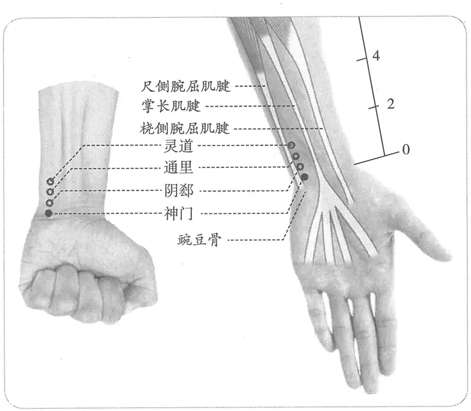

**图 2-131　神门穴图**

**取穴**：于豌豆骨上缘桡侧凹陷中，当腕掌侧远端横纹上取穴。如果某些患者腕横纹不明显，可以腕尺侧的豌豆骨与桡侧的手舟骨结节连线为标志。

#### 相关解剖学基础 

　　(1) 豌豆骨体表触诊技法：豌豆骨在手掌内侧小鱼际的近侧缘（远侧腕横纹的尺侧端），在三角骨的前面很容易摸到。也可以顺着尺侧腕屈肌腱往远端摸即可到达豌豆骨。

　　(2) 尺动脉及其体表触诊技法：尺动脉是肱动脉较大的终支，开始于肘关节横纹远侧。它在肘关节与腕关节之间位于前臂中线内侧，几乎垂直下行，在尺神经和豌豆骨外侧跨过屈肌支持带，发出一条深支后行向手掌，参与掌浅弓构成。在豌豆骨后尺侧腕屈肌腱桡侧以食指、中指略向尺侧按压可触及尺动脉的微弱搏动，但没有桡动脉易触摸，甚至比腘动脉还要难触及。妊娠时尺动脉搏动明显增强，与古典文献的记载完全吻合。

　1. 在掌后兑骨之端陷者中。（《黄帝明堂经》、《铜人腧穴针灸图经》卷下、《圣济总录》、《针灸资生经》、《十四经发挥》、《神应经》、《针灸集书》、《循经考穴编》）

〔p.524 (인쇄 504)〕

　2. 在掌后兑骨端。（《铜人腧穴针灸图经》卷上及卷下“穴腧都数”）

　3. 窦太师针灸遗存

　　(1) 神门独治痴呆病，转手骨开得穴真。（《针灸玉龙歌》）

　　(2) 在手掌腕后兑骨之端陷中，转手骨开得穴。（《窦太师针经》）

　　(3) 在掌后兑骨之端陷者中，转手骨开得穴。（《琼瑶神书》）

　　(4) 掌后兑骨端，舒掌向怀取，直取兑骨缝中。（《针灸集成》）

　　(5) 广注转手骨开，方可得之。（《循经考穴编》上）

**按**：窦氏取穴法将神门穴与阳谷穴定位描述文字中“兑骨”混为一谈了。《内经》与《黄帝明堂经》中“兑骨”可指不同部位的各种尖锐形状的骨。神门穴“掌后兑骨之端”中的“兑骨之端”是指掌后尺侧的豌豆骨近端；阳谷穴“手外侧腕中兑骨下陷者中”句中的“兑骨下”是指前臂伸面外侧下端“尺骨茎突下”。取神门穴无须“转手骨开”。

　4. 掌后锐骨豆骨之端腕纹陷中。（《针灸十四经穴位考订》）

　5. 统编针灸学教材

　　(1) 部位：掌后锐骨端陷中。取穴：伸手掌向上方，小指与无名指掌转侧向外方，掐取豆骨下尺骨端之陷中取之。（1957年南京《针灸学》）

**按**：此取穴法盖受窦氏影响。

　　(2) 部位：掌后锐骨端陷中。取穴：小指侧腕后横纹头，大筋内侧陷中取之。（1版《针灸学讲义》）

　　(3) 部位：在掌后兑骨之端陷者中。取穴：在阴郄下五分，当尺侧腕屈肌腱之桡侧，腕横纹上尺侧凹陷中取之。（2版《针灸学讲义》）

　　(4) 腕横纹尺侧端，尺侧腕屈肌腱的桡侧凹陷中。（4、5、7版《针灸学》）

　　(5) 在腕部，腕掌侧横纹尺侧端，尺侧腕屈肌腱的桡侧凹陷处。（6版《针灸学》）

　　(6) 腕横纹尺侧端，尺侧腕屈肌腱的桡侧凹陷中。（《中国针灸学》）

**文献分析**：《黄帝明堂经》谓本穴“在掌后兑骨之端陷者中”，再参照动脉搏动这一标志，即可确定本穴位于豌豆骨上缘桡侧，尺侧腕屈肌腱的桡侧缘处。自窦太师始或将本穴定位之“兑骨”与阳谷穴定位之“兑骨”相混同，而“转手骨开”取穴，位置偏于尺侧。受此影响，承淡安《中国针灸学》、鲁之俊《新编针灸学》、1957年南京《针灸学》以及1版《针灸学讲义》均将本穴定于尺侧腕屈肌腱的尺侧，而已知尺动脉行于尺侧腕屈肌腱的桡侧缘，故如此定穴不合《内经》、《黄帝明堂经》之本义。

#### 【类属】 

手少阴心经穴；五输穴之输穴；十二原穴之一。

　1. 少阴之原出于兑骨。（《难经》）

　2. 手少阴脉之所注也，为输。（《黄帝明堂经》）

　3. 手少阴之源者，即是兑骨穴也，此是真心之源。在掌后兑骨之端陷者中，一名中都。（《素问亡篇·刺法论》）

#### 【适应症】 

主治心神病症。常用于心痛，心烦，惊悸，痴呆，健忘，失眠，癫，狂，痫。

　1. 主遗溺。手及臂寒，呕血上气。胸满胪胀，喉痹。疟，心烦甚，欲得冷水，寒则欲处热。热中咽干，不嗜食，心痛，数噫恐悸，气不足，喘逆短气，身热，狂，悲哭。（《黄帝明堂经》）

**按**：以上主治中“疟，心烦甚，欲得冷水，寒则欲处热”见于《素问·刺疟》，原文作“心疟者，令人烦心甚，欲得清水，反寒多，不甚热，刺手少阴”。值得注意的是，本穴主治症中“心痛，数噫，心烦”诸症，在《足臂十一脉》中属于手太阴经病候（参见“侠白”按语）。本穴主治除了“心痛，心烦，咽干”的心经和心络典型病候外，还包括了“狂，恐悸，悲哭”等心神症状（后世文献记载与临床应用也集中于此），其他心经穴也或多或少涉及此类症状，可视为对手少阴经、络病候的补充。

〔p.525 (인쇄 505)〕

　2. 治疟，心烦甚，欲得饮冷，恶寒则欲处温中，咽干不嗜食，心痛，数噫恐悸，少气不足，手臂寒，喘逆身热，狂悲哭，呕血上气，遗溺，大小人五痫。（《铜人腧穴针灸图经》卷下）

　3. 窦太师针灸遗存

　　(1) 人中除脊膂之强痛，神门去心性之呆痴。（《通玄指要赋》）

　　(2) 痴呆之证不堪亲，不识尊卑枉骂人，神门独治痴呆病，转手骨开得穴真。（《针灸玉龙歌》）

　　(3) 治心内呆痴，泻；癫痫，先补后泻；发狂等症，泻。治健忘失记，喜怒不常，失笑无则，多言。又云转手勾阳骨开，方可下针。（《窦太师针经》）

　　(4) 治惺惺呆痴，泻；癫狂不识尊卑，宜泻，七呼。（《大本琼瑶神书》）

　　(5) 主心内呆痴，癫痫发狂，健忘，喜怒不时，面赤，失叹多言，伏梁，五痫，遗尿，失喑。（《针方六集》卷五）

　　(6) 主痴呆，癫痫，健忘忡悸。（《循经考穴编》上）

　4. 主喜笑，掌中热而啘，目黄胁痛，振寒上气，心性痴呆，健忘，心积伏梁。（《针灸聚英》卷一、《针灸大成》）

**按**：以上主治症中“掌中热，目黄胁痛”为心经病候，高武据其对“母子补泻”原则的理解，将此病候归于“神门”穴。

　5. 统编针灸学教材

　　(1) 心痛心烦，痴呆癫痫，健忘，怔忡，惊悸，失眠，呕血，吐血，目黄胁痛，喘逆身热。（1957年南京《针灸学》）

　　(2) 痴呆癫痫，健忘，怔忡，惊悸，失眠，心痛心烦，呕血，吐血，目黄胁痛，喘逆身热，掌中热。（1版《针灸学讲义》）

　　(3) 心痛，心烦，癫，狂，痫证，健忘，怔忡，惊悸，失眠，目黄胁痛，掌中热。（2版《针灸学讲义》）

　　(4) 心痛，心烦，怔忡，惊悸，善忘，不寐，狂痫，痴呆，胁痛，掌中热。（4版《针灸学》）

　　(5) 心痛，心烦，惊悸，怔忡，健忘，失眠，癫狂痫，胸胁痛。（5版《针灸学》）

　　(6) 心痛，心烦，健忘失眠，惊悸怔忡，痴呆，癫狂痫证，目黄胁痛，掌中热，呕血，吐血，头痛，眩晕，失音。（6版《针灸学》）

　　(7) 心痛、心烦、惊悸、怔忡、健忘、失眠、痴呆、癫狂痫等心与神志病证；高血压；胸胁痛。（7版《针灸学》）

　　(8) 心痛，心烦，怔忡，惊悸，健忘，不寐，癫狂，痫证，痴呆，胁痛，掌中热，目黄。（《中国针灸学》）

**文献分析**：《黄帝明堂经》载本穴主治集中在心与心神两方面，后世文献及临床应用主要在心神病症。明代高武据其对“母子补泻”原则的理解，将心经病候“掌中热，目黄胁痛”增入本穴主治，后世文献多受其影响。教材中“目黄胁痛，掌中热”主治症也系传高武之误，今去之。

#### 附：临床应用举例 

　1. 心及心神病症

〔p.526 (인쇄 506)〕

　　(1) 心咳，刺手神门。（《千金要方》卷十八）

　　(2) 颠痫心风，灸鸠尾，刺后溪、神门，泻足三里。（《针灸集要·盘石金直刺秘传》）

　　(3) 心性呆痴，灸神门、后溪泻之。（《针灸集要·盘石金直刺秘传》）

　　(4) 心积名伏梁，起脐上，上至心下　神门、后溪、巨阙、足三里（《针灸集要·盘石金直刺秘传》）

　　(5) 健忘，列缺、心俞、神门。问曰：其证缘何而得？答曰：忧愁思虑，内连于心，外感其情，或痰涎灌注心窍，七情所感，故如此也。复刺后穴：中脘、三里。（《针灸集成》第六十方）

　　(6) 产后血晕，神门、内关。不应，取后穴：关元灸。（《医学纲目》卷三十五）

　　(7) 嗜眠症，神门穴针刺。［江苏中医杂志，1985，6（11）：38］

　　(8) 脏躁病，大陵穴、内关穴、神门穴，针灸疗法。［铁道医学，1985，13（5）：261］

　　(9) 失眠症，针灸神门穴，为主治疗。［中国针灸，1986，6（6）：18-19］

　　(10) 狂症，百会穴、神门穴针刺治疗。［中医药学报，1987（2）：36］

　　(11) 频发性室性早搏，神门穴、足三里穴、膻中穴，针刺治疗。［上海针灸杂志，1987，6（2）：46］

　　(12) 神经衰弱，百会穴、神门穴，针刺治疗。［新疆中医药，1988（2）：44］

　　(13) 脑外伤性痴呆，取双侧后溪、神门穴，针刺治疗。［中国中西医结合杂志，1995，15（9）：519-520］

2.《内经》治尸厥方及其变方

　　(1) 尸厥，刺其足大指内侧爪甲上，去端如韭叶，后刺足心，后刺足中指爪甲上各一痏，后刺手大指内侧，去端如韭叶，后刺手心主、少阴锐骨之端各一痏，立已。（《素问·缪刺论》）

　　(2) 治卒死尸厥方又方：针百会，当鼻中入发际五寸许，针入三分，补之。针足大指甲下肉侧，去甲三分。又针足中指甲上各三分，大指之内去端韭叶许。又针手少阴锐骨之端各一分。（《补辑肘后方》上卷）

　　(3) 论曰若暴厥，卒然不知人事……又刺足大指内侧爪甲去端如韭叶，入一分，留三呼，谓隐白穴也。出之，又刺足心涌泉穴，如上法。又刺足中指爪上，令破，如上法，谓厉兑穴也。又刺手大指内侧，去端如韭叶。又刺手心主，谓中冲穴也。又刺掌后锐骨之端，谓神门穴也。（《全生指迷方》卷三）

　　(4)《寿域神方》惊死，凡心下温者，刺手少阳之原，即是锐骨也，乃是真心之源，在手掌后，锐骨之端陷中是穴，用长针口中温暖，方刺入三分，徐徐出针，以手扪其穴，其人复苏也。（《医方类聚》卷一百五十八）

　3. 其他病症

　　(1) 伤寒喉痹，刺手少阴穴，在腕当小指后动脉是也，针入三分补之。（《脉经》卷七）

**按**：古穴名“手少阴”相当于神门、阴郄穴。

　　(2) 失音，刺任脉天突一穴，次针手少阴经神门二穴，次针手少阳经支沟二穴，次针足少阴经涌泉二穴。（《针经摘英集》）

　　(3) 喑哑：内关、神门。［上海针灸杂志，1982（3）：33］

#### 【操作】 

直刺0.3~0.5寸。不宜大幅度提插，避免刺破血管，造成出血。

　1. 刺入三分，留七呼，灸三壮。（《黄帝明堂经》）

〔p.527 (인쇄 507)〕

　2. 刺入三分，留三呼，进一分，留一呼，徐徐出针，以手扪之其穴。（《素问亡篇·刺法论》）

　3. 可灸七壮，炷如小麦大，针入三分，留七呼。（《铜人腧穴针灸图经》卷下）

　4. 窦太师针灸遗存

　　(1) 针入一分，向前五分针透腕骨穴，灸七壮。（《窦太师针经》）

　　(2) 窦氏针入二分，沿皮向后一寸。（《针方六集》卷一）

　　(3) 一法：针入一分，沿皮向后透腕骨。（《循经考穴编》上）

　　(4) 灸二七壮，针入三分，斜针腕骨。（《窦太师秘传》）

　5. 统编针灸学教材

　　(1) 针三分，依取穴法于豆骨下肌腱外侧尺骨侧进针，灸三壮。（1957年南京《针灸学》）

　　(2) 针三分，灸三壮。（1版《针灸学讲义》）

　　(3) 直刺3~4分；艾炷灸3~5壮，艾条灸3~5分钟。（2版《针灸学讲义》）

　　(4) 直刺0.3~0.5寸。（4、5、7版《针灸学》、《中国针灸学》）

　　(5) 直刺0.2~0.5寸；可灸。（6版《针灸学》）

　6. 直刺，稍偏尺测，深0.3~0.5寸。感应局部酸胀，并可有麻电感向指端放散。灸1~3壮；温灸5~15分钟。（上海《针灸学》）

### （八）少府 Shàofǔ HT8 出《黄帝明堂经》 

#### 【提要索隐】 

**部位**：在手掌，横平第五掌指关节近端，第4、5掌骨之间。

**适应症**：主治心胸病症。常用于心悸、心烦，胸痛；肘臂痛，掌中热，手指拘挛。

**针刺操作**：直刺0.3~0.5寸。

#### 【名实考】 

由于早期《黄帝明堂经》传本中关于本穴的主治已与肝经蠡沟穴相混，故后世文献多莫能辨而相沿承袭。

　1. 流于少府，少府者，火也。在手小指本节后陷者中，直劳宫。手少阴脉之所流也，为荥。（《黄帝明堂经》）

　2. 少者，指少阴经而言也。府者，藏物之名。以火经而遇火穴，有藏物之象焉，故曰少府。（《经穴解》）

　3. 别名　兑骨。（1957年南京《针灸学》）

**按**：此传自日本针灸教材，未详所出，疑是将本穴与神门穴相混淆。

#### “少府”与“蠡沟”穴相混例 

　1. 主阴痛挺长，遗满，小便不利，不可俯仰。（《医心方》卷二）

　2. 少府主阴痛，实时挺长，寒热，阴暴痛，遗尿；偏虚则暴痒气逆，卒疝，小便不利。少府主数噫恐悸，气不足。少府、蠡沟主嗌中有气如息肉状。少府、三里主小便不利，癃。（《千金要方》卷三十）

　3. 主烦满少气，悲恐畏人，臂酸，掌中热，手卷不伸。（《外台秘要》卷三十九）

**按**：以上《外台秘要》所载少府穴主治与《医心方》、《千金要方》之文竟无一症相同者。其中后二者所载“少府”主治尽系足厥阴经“蠡沟”穴主治内容，似有误，问题是何以两书的错误完全相同？是否后两书的作者都采用了同一底本？《外台秘要》载主治症虽与“少府”穴部位相合，但却与“少冲”穴主治极为相似，也不能无疑。可能少府穴主治内容早已脱落，后世传本各以意补辑，因而差异很大。

〔p.528 (인쇄 508)〕

#### 相关穴及刺激点 

心悸点，第5掌指关节桡侧缘。主治心悸，月经过多，痛经。针3~5分，针感麻酸至指尖。（《针灸经外奇穴图谱（续集）》）

#### 【定位】 

**部位**：在手掌，横平第5掌指关节近端，第4、5掌骨之间（图2-132）。

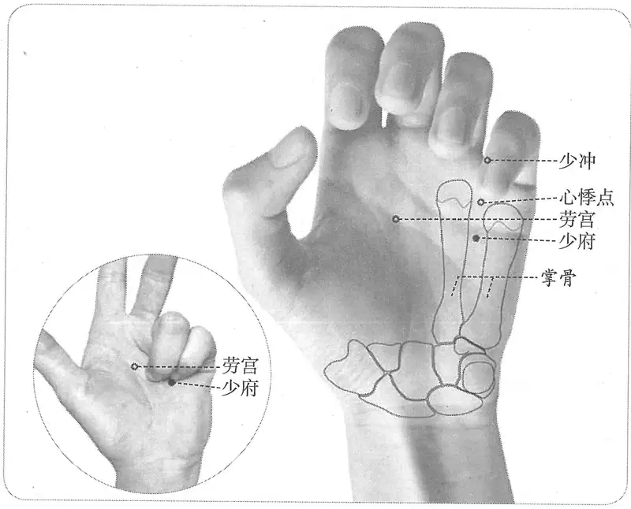

**图 2-132　少府穴与相关穴图**

**取穴**：第4、5掌骨之间，握拳时，小指尖所指处，横平劳宫。

1.《黄帝明堂经》佚文

　　(1) 在小指本节后陷者中，直劳宫。（《针灸甲乙经》卷三、《千金要方》、《千金翼方》、《外台秘要》、《太平圣惠方·明堂》、《铜人腧穴针灸图经》）

　　(2) 在手小指本节后陷者中。（《医心方》卷二）

　2. 窦太师针灸遗存

　　(1) 在手掌小指本节后两指中间陷中。（《窦太师针经》）

　　(2) 在手小指本节后两指中间陷中，直劳宫。（《针方六集》卷一）

　　(3) 广注：居小指本节后歧骨缝陷中，与劳宫相并。（《循经考穴编》上）

　3. 小指本节后骨缝陷中，直劳宫。（《针灸聚英》卷一、《古今医统》、《针灸大成》、《类经图翼》）

　4. 从神门行小指本节末，外侧骨缝陷中。（《医宗金鉴·刺灸心法要诀》）

　5. 手小指与无名指本节后骨间陷中，直劳宫。（《针灸十四经穴位考订》）

　6. 统编针灸学教材

　　(1) 部位：手小指本节后，骨缝陷中。取穴：以手屈向掌中当小指与无名指尖着掌中处取之，与劳宫平行。（1957年南京《针灸学》）

〔p.529 (인쇄 509)〕

　　(2) 部位：掌内手小指本节后，骨缝陷中。取穴：以手指屈向掌中，当小指与无名指尖着掌处中间陷中取之。（1版《针灸学讲义》）

　　(3) 部位：在小指本节后陷者中。取穴：仰掌屈指，于无名指与小指之间，当第四、五掌骨间取之。（2版《针灸学讲义》）

　　(4) 手掌第四、五掌骨之间，平劳宫穴。（4版《针灸学》）

　　(5) 第四、五掌骨之间，握拳，当小指端与无名指端之间。（5版《针灸学》）

　　(6) 在手掌面，第4、第5掌骨之间，握拳时当小指尖处。（6版《针灸学》）

　　(7) 在手掌面，第4、5掌骨之间，握拳时当小指与无名指指端之间。（7版《针灸学》）

　　(8) 仰掌，在手掌第四、五掌骨之间。屈指握拳时，当小指指尖所指处。（《中国针灸学》）

**文献分析**：古今文献定位一致，与手足部其他定位“本节后”的腧穴同例，定于第4、5掌骨之间，横平第5掌指关节近端。

#### 【类属】 

手少阴心经穴；五输穴之荥穴。

手少阴脉之所流也，为荥。（《黄帝明堂经》）

#### 【适应症】 

主治心胸病症。常用于心悸、心烦，胸痛；肘臂痛，掌中热，手指拘挛。

1.《黄帝明堂经》佚文

　　(1) 阴痛，实时挺长，寒热，阴暴痛，遗尿，偏虚则暴痒，气逆，卒疝，小便不利。（《千金要方》卷三十）

　　(2) 主烦满，少气，悲恐畏人，臂酸，掌中热，手卷不伸。（《外台秘要》卷三十九）

　　(3) 主阴痛，挺长，遗满，小便不利，不可俯仰。（《医心方》卷二）

　　(4) 疟久不愈者。（《太平圣惠方·明堂》）

　　(5) 治烦满少气，悲恐畏人，掌中热，肘腋挛急，胸中痛，手卷不伸。（《铜人腧穴针灸图经》卷下）

**按**：“肘腋挛急，胸中痛”此条系《黄帝明堂经》“少冲”穴主治，王惟一误录于此。

　2. 窦太师针灸遗存

　　(1) 治掌中热，五指不能屈伸，并本节疼，舌强难言，心血妄行，上吐下泄，看证补泻。（《窦太师针经》）

　　(2) 主舌强难言，呕吐，心血妄行。（《针方六集》卷五）

　　(3) 主掌中虚热，舌强，小指拘挛，不能伸屈。（《循经考穴编》上）

　3. 统编针灸学教材

　　(1) 心悸，烦满，胸中痛，手小指拘挛，掌中热，阴挺，阴痒，阴痛，小便不利，遗尿，疟久不愈，振寒。（1957年南京《针灸学》）

　　(2) 心悸，烦满，胸中痛，手小指拘挛，掌中热，阴挺，阴痒，阴痛，小便不利，遗尿，疟久不愈。（1版《针灸学讲义》）

　　(3) 心悸，胸痛，手小指拘挛，掌中热，阴痒，小便不利，遗尿。（2版《针灸学讲义》）

　　(4) 心悸，胸痛，小指拘挛，掌中热，遗尿，小便不利，阴痛。（4版《针灸学》）

　　(5) 心悸，胸痛，小便不利，遗尿，阴痒痛，小指挛痛。（5版《针灸学》）

　　(6) 心悸、胸痛、小便不利、遗尿、阴痒、阴痛、手小指拘急、掌中热、善惊。（6版《针灸学》）

〔p.530 (인쇄 510)〕

　　(7) 心悸、胸痛等心胸病证；阴痒、阴痛；痈疡；小指拘挛。（7版《针灸学》）

　　(8) 心悸，胸痛，小指挛痛，掌中热，遗尿，小便不利，阴痒。（《中国针灸学》）

**文献分析**：《千金要方》、《医心方》主治均见于《黄帝明堂经》肝经络穴蠡沟穴主治，其内容属于典型的肝经病候，且其“实则……虚则……”的描述体例也系络穴的典型格式，不应当出现于手少阴荥穴“少府”穴中。从这一错误同时见于《千金要方》与《医心方》来看，这一混淆可能早在唐以前即发生。

教材中“阴挺，阴痒，阴痛，小便不利”诸证系沿袭《千金要方》等书之误，误录肝经蠡沟穴主治于此，今去之。

#### 【操作】 

直刺0.3~0.5寸。

　1. 刺入三分，灸三壮。（《黄帝明堂经》）

　2. 针入三分，可灸七壮（《铜人腧穴针灸图经》卷下）。

　3. 横针入五分，灸三壮。（《窦太师针经》）

　4. 一法针七分（《循经考穴编》上）。

　5. 针二分，灸三壮。（《针灸十四经穴位考订》）

　6. 统编针灸学教材

　　(1) 针三至四分，灸三至五壮。（1957年南京《针灸学》）

　　(2) 针二至三分，灸三壮。（1版《针灸学讲义》）

　　(3) 直刺2~3分，艾条灸3~5分钟。（2版《针灸学讲义》）

　　(4) 直刺0.3~0.5寸。（4、5、6、7版《针灸学》、《中国针灸学》）

　7. 直刺0.5寸左右。感应局部胀痛。（上海《针灸学》）

### （九）少冲 Shàochōng HT9 出《黄帝明堂经》 

#### 【提要索隐】 

**穴名**：一名经始。

**部位**：在手指，小指末节桡侧，指甲根角侧上方0.1寸（指寸）。

**适应症**：主治心胸部病症。常用于心痛，心悸，心烦，神昏；胁痛。

**针刺操作**：浅刺0.1寸，或点刺出血。

#### 【名实考】 

　1. 心出少冲，少冲者，木也，一名经始。在手小指内廉之端，去爪甲如韭叶。手少阴脉之所出也，为井。（《黄帝明堂经》）

　2. 少冲云者，以本经为手少阴，故曰少。以井为木，故曰冲。木有上腾之象，或有上炎之义，故以少冲名之。（《经穴解》）

#### 【定位】 

**部位**：在手指，小指末节桡侧，指甲根角侧上方0.1寸（指寸）（图2-133）。

**取穴**：小指桡侧指甲根角侧上方（即沿角平分线方向）0.1寸。相当于沿爪甲桡侧画一直线与爪甲基底缘水平线交点处取穴。

1.《黄帝明堂经》佚文

　　(1) 在手小指内廉之端，去爪甲如韭叶。（《针灸甲乙经》卷三、《千金要方》、《千金翼方》、《外台秘要》、《医心方》、《太平圣惠方·针经》、《铜人腧穴针灸图经》

〔p.531 (인쇄 511)〕

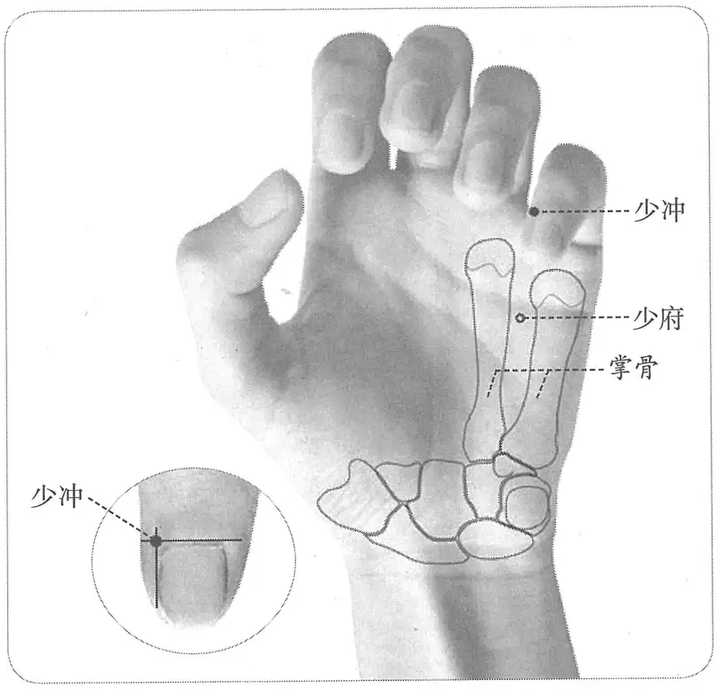

**图 2-133　少冲穴图**

卷上）

　　(2) 在手小指内廉之端，去爪甲角如韭叶。（《千金翼方》卷二十六、《铜人腧穴针灸图经》卷下）

　2. 在手小指内侧，去爪甲如韭叶大。（《窦太师针经》）

　3. 小指内侧近无名指侧去爪甲角一分许。（《针灸十四经穴位考订》）

　4. 统编针灸学教材

　　(1) 部位：手小指内侧去爪甲一韭叶。取穴：取手小指侧去爪甲一分许处。（1957年南京《针灸学》）

　　(2) 部位：手小指端之内侧部。取穴：在小指内侧去爪甲角一分许赤白肉际取之。（1版《针灸学讲义》）

　　(3) 部位：在手小指内廉之端，屈爪甲如韭叶。取穴：在手小指桡侧，距爪甲角后一分许取之。（2版《针灸学讲义》）

　　(4) 小指桡侧指甲角旁约0.1寸。（4、5版《针灸学》）

　　(5) 在手小指末节桡侧，距指甲角0.1寸。（6版《针灸学》）

　　(6) 小指桡侧指甲根角旁0.1寸。（7版《针灸学》）

　　(7) 小指桡侧指甲角后一分许。（《中国针灸学》）

**文献分析**：本穴定位，《针灸甲乙经》、《千金要方》、《医心方》等书所载之《黄帝明堂经》佚文只说“去爪甲”，《千金翼方》作“去爪甲角”，表述更明确，与其他井穴同例，后世文献多从之。关于对“去爪甲角”的理解，以及“如韭叶”宽度的折算，详见“少商”穴分析。

#### 【类属】 

手少阴心经穴；五输穴之井穴。

手少阴脉之所出也，为井。（《黄帝明堂经》）

#### 【适应症】 

主治心胸部病症。常用于心痛，心悸，心烦，神昏；胁痛。

　1. 主热病烦心，上气，心痛而寒，善太息，烦满少气，悲恐善惊，掌中热，肘腋胸中痛，口中热，咽喉中酸，乍寒乍热，手卷不伸，掌痛引肘腋。（《黄帝明堂经》）

〔p.532 (인쇄 512)〕

　2. 秦丞祖《明堂》云兼主惊痫，吐舌沫出也。（《太平圣惠方·明堂》）

　3. 治热病烦满，上气心痛，痰冷少气，悲恐善惊，掌中热，胸中痛，口中热，咽中酸，乍寒乍热，手挛不伸，引肘腋痛。（《铜人腧穴针灸图经》卷下）

　4. 窦太师针灸遗存

　　(1) 少冲穴在手少阴，其穴功多必可针，心虚胆寒还泻补，上焦热涌手中寻。（《针灸玉龙歌》）

　　(2) 治心虚怕惊，补之；心火上炎，泻；眼目红赤，心血少，先泻后补；指头麻木，补；心中痞满，胸膈痛，三棱针出血。（《窦太师针经》）

　　(3) 治心虚惊怕，宜补；心火炎上，眼赤，心血少，先泻后补。（《大本琼瑶神书》）

　5. 主目黄，臑臂内后廉痛。（《针灸聚英》卷一、《古今医统》、《针灸大成》、《针方六集》）

**按**：此系高武据其对“母子补泻”原则的理解，将手少阴经病候归于本穴下。

　6. 统编针灸学教材

　　(1) 心跳，心痛，胸胁痛，悲惊喜怒不常，热病烦满，中风急救。（1957年南京《针灸学》、1版《针灸学讲义》）

　　(2) 心悸，心痛，胸胁痛，癫狂，热病，中风昏迷。（2版《针灸学讲义》、4、5版《针灸学》、《中国针灸学》）

　　(3) 心悸、心痛、癫狂、热病、中风昏迷、臂内后廉痛。（6版《针灸学》）

　　(4) 心悸、心痛、癫狂、昏迷等心及神志病证；热病；胸胁痛。（7版《针灸学》）

#### 附：临床应用举例 

　1. 心及心神病症

　　(1) 五痫颠狂，弃衣歌笑：灸少海，刺冲阳、神门、少冲、合谷，泻之。（《针灸集要·盘石金直刺秘传》）

　　(2) 心烁烁跳动，少冲泻之，灸立效。（《医学纲目》卷十三）

　2. 咽喉病症

　　(1) 咽喉酸辛，灸少冲七壮雀矢大炷。（《千金翼方》卷二十六）

　　(2) 喉风、喉闭，灸少商、少冲二穴七壮。（《痈疽神秘灸经》）

　　(3) 喉闭不通，少商、隐白、少冲、涌泉。（《医学纲目》卷十五）

　　(4) 淡红喉风，此症肺脾感冒风邪而发，肿连小舌，喉塞不通，声音不清，右寸关脉弦紧。针少商、少冲、关冲。（《喉科指掌》卷五）

　　(5) 双、单蛾痹，喉紧不开，以三棱针刺此穴及少商诸穴。（《重楼玉钥》）

#### 【操作】 

浅刺0.1寸，或点刺出血。

　1. 刺入一分，留一呼，灸一壮。（《黄帝明堂经》）

　2. 灸三壮。（《太平圣惠方·明堂》）

　3. 窦太师针灸遗存

　　(1) 针入一分，沿皮向后三分，禁灸。（《窦太师针经》）

　　(2) 刺一分，沿皮向后二分。（《大本琼瑶神书》）

　　(3) 直刺一分，沿皮向后三分，看虚实补泻，禁灸。（《针灸玉龙歌》注）

　　(4) 针入一分，更沿皮向后三分。宜三棱针出血。（《针方六集》卷一）

〔p.533 (인쇄 513)〕

　4. 统编针灸学教材

　　(1) 针一分，灸三壮。（1957年南京《针灸学》、1版《针灸学讲义》）

　　(2) 斜刺1分，或三棱针点刺出血，艾炷灸3~5壮。（2版《针灸学讲义》）

　　(3) 浅刺0.1寸，或点刺出血。（4、5、6、7版《针灸学》、《中国针灸学》）

### 延伸阅读 

　1. 黄龙祥．中国针灸学术史大纲［M］．北京：华夏出版社，2001.

　2. 黄龙祥．新编重绘十四经脉经穴图［M］．北京：中国中医药出版社，2010.

　3. 黄龙祥．心经、肺经“是动”病新解——解读经络学说的新证据［J］．中国中医基础医学杂志，2005，11(11)：814-816.

　4. 李鼎．从清泠渊到青灵［J］，上海中医药杂志，1998(1)：44-45.

〔p.534 (인쇄 514)〕

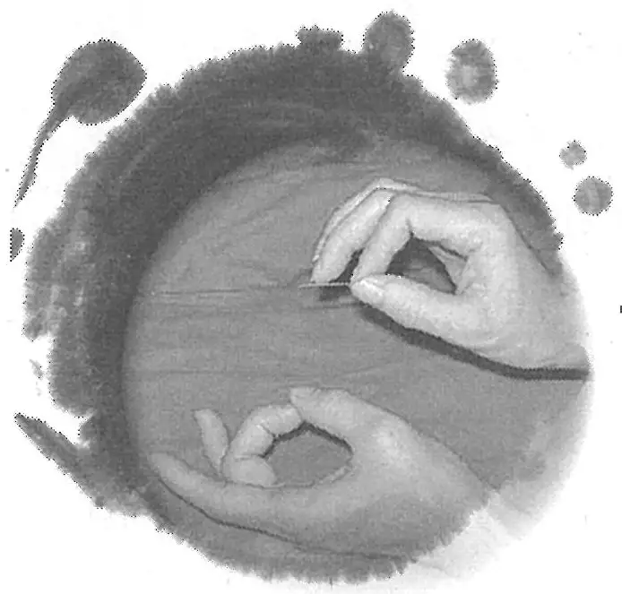

