# 《针灸腧穴通考》(上册) — 手太阳小肠经穴  · （一）少泽 Shàozé SI1 出《灵枢》~（十九）听宫 Tīnggōng SI19 出《灵枢》、《素问》

> 분할본 11/25. 원서: 黄龙祥·黄幼民 编著, 《针灸腧穴通考——〈中华针灸穴典〉研究》(上册), 人民卫生出版社, 2011. 원서 스캔 OCR 판독본을 챗봇 검색용으로 나눈 것이며, 본문과 쪽 표시 〔p.PDF쪽 (인쇄 쪽)〕는 원본 그대로이다.

## 六、手太阳小肠经穴 

### 概说 

手太阳小肠经腧穴归经变化较大的是“天容”穴。今之手太阳经穴天容穴，《内经》归于足少阳经，今人不知原委，反而以为《内经》原文有误。此外，另一个误解很深的是同名异穴的“天窗”。在隋唐腧穴文献及针灸方中，“天窗”穴多指前头正中上二寸处，恰好相当于《黄帝明堂经》的“囟会”穴。据笔者考察，敦煌卷子佚名灸方中之“天窗”穴以及传世医书《千金要方》、《千金翼方》所载针灸方中之“天窗”，除少数难以考辨外，均系前头部正中上二寸处的“天窗”，今人不明真相，皆强释为手太阳经之“天窗”。

#### 【经脉与经穴】 

#### 经脉循行与病候 

小肠手太阳之脉，起于小指之端，循手外侧上腕，出踝中，直上循臂骨下廉，出肘内侧两筋之间，上循臑外后廉，出肩解，绕肩胛，交肩上，入缺盆络心，循咽下膈，抵胃属小肠；其支者，从缺盆循颈上颊，至目锐眦，却入耳中；其支者，别颊上䪼抵鼻，至目内眦，斜络于颧。是动则病嗌痛颔肿，不可以顾，肩似拔，臑似折。是主液所生病者，耳聋目黄颊肿，颈颔肩臑肘臂外后廉痛。（《灵枢·经脉》）

**按**：“两筋之间”，《黄帝内经太素·经脉连环》卷八、《脉经》卷六第四、《千金要方》卷十三均作“两骨之间”，义胜；“入缺盆络心，循咽下膈，抵胃属小肠”系引入“经别”之循行，句前当补“其别者”三字；“其支者”，据通篇体例应作“其直者”；“其支者，别颊上䪼抵鼻，至目内眦”，这一分支完全是为了建立经脉循行流注而设，无实际意义；“斜络于颧”，《黄帝内经太素·经脉连环》卷八无此四字，是。按“䪼”即指颧骨，既已“上䪼”，何需再“络颧”？再者，此分支本为手太阳交足太阳而设，故至“目内眦”而止，不应再添此四字。

由于《灵枢》在帛书经脉篇的基础上，引入经别的内容，使6条阳经也得以行于体内与相关六腑相联系，同时为实现十二经脉的循环流注，人为地增加一些分支以便于经脉依次交接，并使6条经脉改变了循行方向。但却忘记了对“经”、“别”，“直”、“支”加以调整，未能形成统一的体例，顺应上述这些变化，因而使得通篇文字前后关系混乱，难以理解。关于《灵枢·经脉》手太阳小肠经循行的经、别、直、支正确关系应如下作：

小肠手太阳之脉，起于小指之端，循手外侧上腕，出踝中，直上循臂骨下骨下廉，出肘内侧两骨之间，上循臑外后廉，出肩解，绕肩胛，交肩上；［其别者］，从缺盆入腋络心，循咽下膈，抵胃属小肠；其支（直）者，从缺盆循颈上颊，至目锐眦，却入耳中。

〔p.535 (인쇄 515)〕

肩脉起于耳后，下肩，出臑外廉，出臂外腕上，乘手背。是动则病嗌痛，颔肿，不可以顾，肩似脱，臑似折，是肩脉主治。其所产病：颔痛，喉痹，臂痛，肘痛，为四病。（《阴阳十一脉灸经》）

手太阳脉：出小指，循骨下廉，出臑下廉，出肩外廉，出项□□□目外眦。其病：臂外廉痛。诸病此物者，皆灸臂太阳脉。（《足臂十一脉灸经》）

**所属经穴**：少泽　前谷　后溪　腕骨　阳谷　养老　支正　小海　肩贞　臑俞　天宗　秉风　曲垣　肩外俞　肩中俞　天窗　天容　颧髎　听宫

#### 【归经与起止穴】 

《针灸甲乙经》手太阳及臂凡一十六穴：少泽、前谷、后溪、腕骨、阳谷、养老、支正、小海；

唐代《千金要方》、《千金翼方》“手太阳小肠经九穴”，包括《针灸甲乙经》全部八穴，并增加肩贞一穴；

唐代《外台秘要》归入“小肠人”的经穴，除包括《针灸甲乙经》全部八穴外，另归入如下五穴：天窗、秉风、天宗、臑俞、睛明；

宋代《铜人腧穴针灸图经》卷上厘定为：少泽、前谷、后溪、腕骨、阳谷、养老、支正、小海、肩贞、臑腧、天宗、秉风、曲垣、肩外腧、肩中腧、天窗、天容、颧髎、听宫。

宋以后至今的腧穴归经皆从《铜人腧穴针灸图经》，需要注意的是，王惟一厘定的本经穴与《外台秘要》相差较大（后者无肩贞、曲垣、肩外腧、肩中腧、颧髎、听宫六穴，而有睛明穴）。特别值得一提的是：天容穴，《内经》归于足少阳经，《黄帝内经太素》中杨上善两次注作“足少阳脉气所发”，并强调是“足少阳正经”；《针灸甲乙经》、《外台秘要》均作“手少阳脉气所发”。杨上善注《明堂》兼取二说作“手少阳三焦、足少阳胆”。《铜人腧穴针灸图经》传王冰之注而将该穴归入手太阳小肠经。自宋以后一直至今天的针灸书中皆从之。归经的变化也引起腧穴定位的相应改变。后世不详此演变过程，以至于以今律古，反而以为《内经》原文有误。

#### 【经穴定位与主治】 

手太阳经穴定位的古代文献记载变化不大，然而后人对古代文献的理解有所不同，实际定位各有不同，特别是肩胛部穴，历代铜人及铜人图、明堂图对于肩胛部经穴的定位出入较大，例如明嘉靖针灸铜人、明弘治丘濬铜人图、梦莲铜人图等与今之定位法出入较大。造成这种差异的主要原因是由于古代文献对于这些穴定位的描述不够明确，且未注明与相邻穴之间的位置关系，因而后人只能根据各自的理解点取穴位。因此，在考察古今经穴定位演变，一定要注意对“明堂经”、“铜人图”的考察，而不能仅依据文献描述。

#### 【脉口病候、经脉是动病候与经脉穴主治】 

手太阳标脉：目上一至三寸。

手太阳本脉：腕踝后。

“手太阳”穴：阳谷、养老。

手太阳经脉的“是动”病候（源出于手太阳脉口的诊断病候）与“手太阳”穴（阳谷、养老）主治的比较见表2-6。

**表 2-6　手太阳脉是动病候与经脉穴主治的相关性**

| 《阴阳十一脉灸经》是动病候 | 《灵枢·经脉》是动病候 | 《黄帝明堂经》经脉穴主治 |
|---|---|---|
| 是动则病嗌痛，颔肿，不可以顾，肩似脱，臑似折，是肩脉主治。 | 是动则病嗌痛颔肿，不可以顾，肩似拔，臑似折。 | “阳谷”穴主治：颔肿，项急不可以左右顾，肩痛不可以自带衣。“养老”穴主治：肩痛欲折，臑如拔，手不能自上下。 |

〔p.536 (인쇄 516)〕

从上表对照可见，“手太阳”穴——阳谷、养老穴主治病症完整保存了《阴阳十一脉灸经》和《灵枢·经脉》“是动”病的特征，可以明显看出从诊脉与经脉病候而来的胎记。

由于早期的经脉病候直接来源于手足腕踝部的脉口部诊脉病候，而对于这些病候，又直接于脉口处刺灸治疗，故这些部位便成为了固定的腧穴——“经脉穴”，其名称与相应的经脉名相同。后来这些“经脉穴”又大多演变为相应的“原”穴和（或）“输”穴。这样《黄帝明堂经》所载之“原”、“输”穴的主治病症中自然包含了不同时期经脉病候“是动”病的内容。

#### 【诊络病候、络脉病候与络穴主治】 

手太阳之别，名曰支正，上腕五寸，内注少阴；其别者，上走肘，络肩髃。实则节弛肘废，虚则生疣，小者如指痂疥，取之所别也。（《灵枢·经脉》）

支正，手太阳络，在腕后五寸，别走少阴者。实则肘挛，虚则生疣，小者痂疥。（《黄帝明堂经》）

《黄帝明堂经》载手太阳络穴“支正”主治病候完整包含了《灵枢·经脉》手太阳络脉的诊络病候，可以十分清楚地看出二者源流脉络。

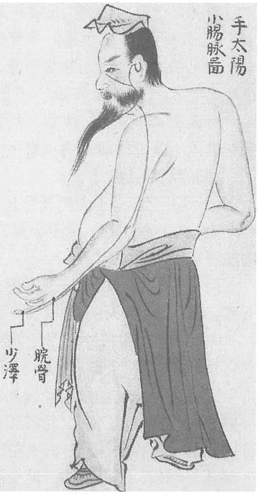

**图 2-134　《环中图》手太阳小肠脉图**

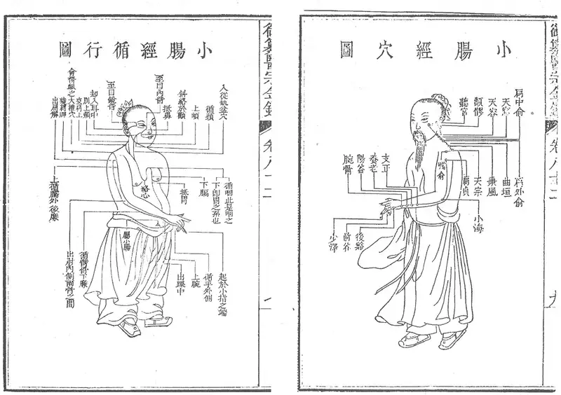

**图 2-135　《医宗金鉴》手太阳小肠经脉、经穴分图**

〔p.537 (인쇄 517)〕

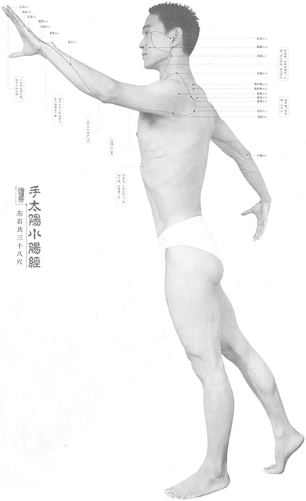

**图 2-136　黄龙祥编手太阳小肠经脉、经穴合图**

〔p.538 (인쇄 518)〕

### （一）少泽 Shàozé SI1 出《灵枢》 

#### 【提要索隐】 

**穴名**：一名少吉。

**部位**：在手指，小指末节尺侧，指甲根角侧上方0.1寸（指寸）。

**适应症**：主治乳房病症、急症。常用于乳痈，产后缺乳；头痛，颈项强痛，目翳，咽喉肿痛；发热，神昏。

**针刺操作**：浅刺0.1寸，或点刺出血。

#### 【名实考】 

少泽，一名少吉，古代文献也常作“小吉”，“少泽”偶尔也写作“小泽”，如五卷本《铜人腧穴针灸图经》卷一。

关于本穴定位，《灵枢》谓“小指之端”，《素问》作“小指本”，《黄帝明堂经》具体为“小指之端去爪甲下一分”。而与现代定位相合的说法，虽然已见于宋校本《千金要方》，然未经宋人校改的《千金要方》本穴定位与其他传本的《黄帝明堂经》的佚文同；本穴虽见于《千金翼方》针灸方内，但却未注明穴名（详见下文“附：临床应用举例”）。现代针灸学教材“少泽”穴定位“手小指端外侧，去爪甲角下一分陷中”的说法，直到元代窦太师针灸、《十四经发挥》才出现。

本穴也是《黄帝明堂经》井穴中唯一注明分寸“一分”二字者。关于井穴定位的演变，详见“少商”穴。

　1. 手太阳小肠者，上合手太阳，出于少泽，少泽，小指之端也，为井金。（《灵枢·本输》）

　2. 小肠上合手太阳，出于少泽，少泽者，金也，一名少吉。在手小指之端去爪甲下一分陷者中。手太阳脉之所出也，为井。（《黄帝明堂经》）

　3. 泽者，水之所聚也。以其在小指之端，而又为小肠之井，故曰少泽。（《经穴解》）

#### 【定位】 

**部位**：在手指，小指末节尺侧，指甲根角侧上方0.1寸（指寸）（图2-137）。

**取穴**：小指尺侧指甲根角侧上方（即沿角平分线方向）0.1寸。相当于沿爪甲桡侧画一直线与爪甲基底缘水平线交点处取穴。

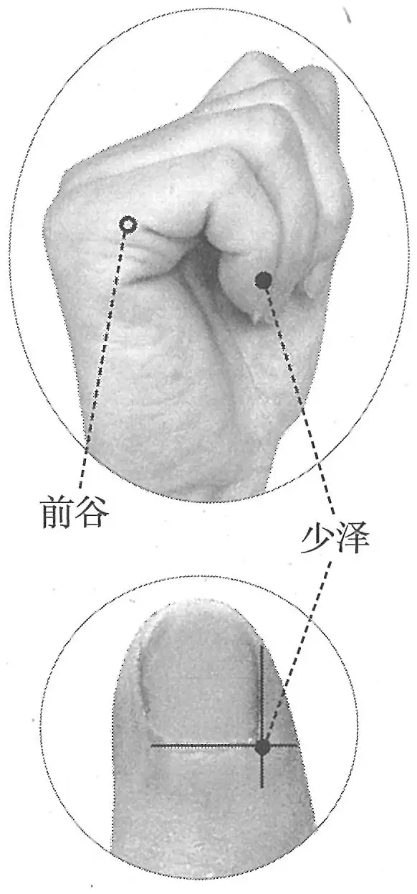

**图 2-137　少泽穴图**

　1. 少泽，小指之端也。（《灵枢·本输》）

2.《黄帝明堂经》佚文

　　(1) 在手少（小）指之端，去爪甲一分陷者中。（《针灸甲乙经》卷三、《千金翼方》）

　　(2) 在手小指端外侧，去爪甲一分陷中。（《千金要方》卷二十九）

　　(3) 在手小指之端，去爪甲下一分陷者中。（《外台秘要》卷三十九、《素问·气穴论》王冰注、《医心方》、《太平圣惠方·针经》、《铜人腧穴针灸图经》卷上、卷下）

**按**：未经宋人校改本《孙真人千金方》与第3条同，可见《黄帝明堂经》关于本穴定位原文作：“在手小指之端，去爪甲下一分陷者中。”

　3. 在小指次指之端，去爪甲角下一分陷中。（《铜人腧穴针灸图经》卷下“穴腧都数”）

〔p.539 (인쇄 519)〕

　4. 窦太师针灸遗存

　　(1) 在手小指之端外侧，去爪甲如韭叶大。（《窦太师针经》）

　　(2) 在手小指端外侧，去爪甲如韭叶。（《窦太师秘传》）

　　(3) 手小指外侧端，去爪甲角韮叶大。（《大本琼瑶神书》）

　5. 在手小指外侧端，去爪甲角一分陷中。（《十四经发挥》卷中、《针灸聚英》、《古今医统》、《针灸大成》、《循经考穴编》、《针灸易学》）

　6. 手小指端外侧，去爪甲角如韭叶。（《医学入门》卷一、《针方六集》、《针灸逢源》）

　7. 小指外侧远无名指侧去爪甲角一分许。（《针灸十四经穴位考订》）

　8. 统编针灸学教材

　　(1) 部位：手小指端外侧去爪甲角下一分。取穴：从小指外侧端爪甲角一分许取之。（1957年南京《针灸学》）

　　(2) 部位：手小指端之外侧部。取穴：从小指外侧端爪甲角一分许赤白肉际取之。（1版《针灸学讲义》）

　　(3) 部位：在手小指之端，去爪甲一分陷者中。取穴：于小指尺侧，距爪甲角后一分许取之。（2版《针灸学讲义》）

　　(4) 小指尺侧指甲角旁约0.1寸。（4、5版《针灸学》）

　　(5) 在手小指末节尺侧，距指甲角0.1寸（指寸）。（6版《针灸学》）

　　(6) 小指尺侧指甲根角旁0.1寸。（7版《针灸学》）

　　(7) 手小指尺侧，指甲角后一分许。（《中国针灸学》）

**文献分析**：本穴定位，《针灸甲乙经》、《千金要方》、《医心方》等书所载之《黄帝明堂经》佚文只说“去爪甲”，《千金翼方》针灸方下作“去爪甲角”，表述更明确，与其他井穴同例，后世文献多从之。本穴是井穴中唯一说明“一分”分寸者（其他井穴作“如韭叶”）。关于对“去爪甲角”的理解，以及“如韭叶”宽度的折算，详见“少商”穴分析。

#### 【类属】 

手太阳小肠经穴；五输穴之井穴；手太阳之根。

　1. 手太阳小肠者……出于少泽，少泽，小指之端也，为井金。（《灵枢·本输》）

　2. 手太阳根于少泽，溜于阳谷，注于少海，入于天窗、支正也。（《灵枢·根结》）

　3. 手太阳脉之所出也，为井。（《黄帝明堂经》）

#### 【适应症】 

主治乳房病症、急症。常用于乳痈，产后缺乳；头痛，颈项强痛，目翳，咽喉肿痛；发热，神昏。

　1. 主振寒，小指不用，寒热汗不出，头痛喉痹，舌急卷，小指之间热，口中热，烦心，心痛，臂内廉及胁痛，聋，咳，瘛疭，口干，项痛不可顾，痎疟。（《黄帝明堂经》）

**按**：上述“聋”、“项痛不可顾”系手太阳经典型病症（《素问·厥论》曰：“手太阳厥逆，耳聋泣出，项不可以顾，腰不可以俯仰，治主病者。”）。而“心痛引臂内廉痛”多见于肺经穴主治，又“喉痹……臂内廉及胁痛”诸症与《素问·缪刺》手少阳经关冲穴主治症颇相似：“邪客于手少阳之络，令人喉痹舌卷，口干心烦，臂外廉痛，手不及头，刺手中指次指爪甲上，去端如韭叶各一痏”。

　2. 治疟寒热，汗不出，喉痹舌强，口干心烦，臂痛瘛疭，咳嗽，颈项急不可顾，目生肤翳覆瞳子。（《铜人腧穴针灸图经》卷下）

　3. 窦太师针灸遗存

　　(1) 妇人催乳痛难熬，吐得风痰疾可调。少泽穴中明补泻，金针下了肿全消。（《针灸玉龙歌》）

〔p.540 (인쇄 520)〕

　　(2) 治目肿疼，泻；妇人无乳及乳痈，补。吐痰亦效。乳汁不通，先补后泻。专治鼻血出，左出灸左，右出灸右，两边出俱灸之，五壮或三壮。（《窦太师针经》）

　　(3) 治妇人无乳，先泻后补；补多立通，神效，灸一壮。（《大本琼瑶神书》）

　　(4) 妇人无乳及乳痈痛，乳汁不通。（《针方六集》卷五）

　　(5) 若妇人乳痈肿痛，补之，使吐痰或晕即效。乳汁不通，先补后泻。（《循经考穴编》上）

　　(6) 治妇人无乳，气不退。（《窦太师秘传》）

　4. 一方治鼻衄不止。（《针方六集》卷五）

　5. 统编针灸学教材

　　(1) 头痛，目翳，喉痹，舌强，项强，鼻衄，乳痈，寒热汗不出，痎疟，中风急救。（1957年南京《针灸学》）

　　(2) 头痛，目翳，喉痹，舌强，项强，鼻衄，乳痈，寒热汗不出，疟疾，中风昏迷，催乳。（1版《针灸学讲义》）

　　(3) 热病，中风昏迷，乳汁少，咽喉肿痛，目翳。（2版《针灸学讲义》）

　　(4) 头痛，寒热，目翳，咽喉肿痛，乳肿，乳汁少，昏迷。（4版《针灸学》）

　　(5) 头痛，目翳，咽喉肿痛，乳痈，乳汁少，昏迷，热病。（5版《针灸学》）

　　(6) 头痛，目翳，咽喉肿痛，乳痈，乳汁少，昏迷，热病，耳鸣，耳聋，肩臂外后侧疼痛。（6版《针灸学》）

　　(7) ①乳痈，乳汁少等乳疾；②昏迷、热病等急症、热证；③头痛、目翳、咽喉肿痛等头面五官病证。（7版《针灸学》）

　　(8) 头痛，热病，昏厥，乳汁少，咽喉肿痛，目赤，目翳。（《中国针灸学》）

**文献分析**：该穴的古今临床应用集中在热病昏厥、目疾、喉痹、乳疾诸证，与腧穴文献记载的该穴主治病症吻合程度较高。宋以后对于本穴的主治发展突出地表现在对乳房病症的治疗上，从现有文献分析，此治法先载于《千金翼方》，后经金元针灸大家窦太师的传播，而在临床普遍应用。

#### 附：临床应用举例 

　1. 乳疾

　　(1) 妇人无乳法，初针两手小指外侧近爪甲深一分，两手腋门深三分，两手天井深六分，若欲试之，先针一指即知之，神验不传。（《千金翼方》卷二十六）

　　(2) 乳痈，刺少泽泻之，委中出血。（《针灸集要·盘石金直刺秘传》）

　　(3) 妇人乳根痛，灸肩井，泻少泽、合谷、三阴交。（《针灸集要·盘石金直刺秘传》）

　　(4) 乳少，少泽、膻中。［浙江中医杂志，1984，19（1）：39］

　　(5) 乳痈　足三里、乳根、少泽三棱针放血、膈俞。［针灸学报，1990，6（1）：31］

　　(6) 急性乳腺炎，点刺少泽放血治疗。［山东中医杂志，2000，19（4）：221］

　2. 咽喉五官病

　　(1) 喉痹者喉里肿塞痹痛，水浆不得入，七、八日即杀人，治之方：随病左右，刺手小指爪甲下，令血出，立愈。（《补辑肘后方》中卷）

　　(2) 耳聋不得眠，针手小指外端近甲外角肉际，入二分半补之。（《千金翼方》卷二十六）

　　(3) 眼大眦痛，刺手太阳井穴少泽；小眦痛，刺少阳井穴关冲。（《素问病机气宜保命集》）

〔p.541 (인쇄 521)〕

　　(4) 喉咙闭塞，饮食艰难：刺少泽、合谷、中渚、委中出血；未愈，泻中冲。（《针灸集要·盘石金直刺秘传》）

　　(5) 鼻衄不止，名血妄行：少泽二穴、心俞二穴、膈俞二穴、涌泉二穴。（《针灸大全》卷四）

　　(6) 翼状胬肉，合谷、睛明、少泽，针刺放血配合拔罐。［上海针灸杂志，1988，7（2）：11-12］

　　(7) 目赤肿痛（结膜炎、红眼病），少泽，三棱针点刺放血。［河北中医，1989，11（6）：30］

　　(8) 麦粒肿，用消毒三棱针点刺少泽穴放血，挤血3~4粒。［中国针灸，1999（1）：38］

#### 【操作】 

浅刺0.1寸，或点刺出血。

　1. 刺入一分，留二呼，灸一壮。（《黄帝明堂经》）

　2. 窦太师针灸遗存

　　(1) 针入一分，沿皮向后三分，禁灸。（《窦太师针经》）

　　(2) 针一分，沿皮向后三分。（《窦太师秘传》）

　3. 鼻衄不止，左出灸右，右出灸左，都出齐灸之，三五壮止。（《针方六集》卷五）

　4. 统编针灸学教材

　　(1) 针一分，灸三壮。（1957年南京《针灸学》、1版《针灸学讲义》）

　　(2) 斜刺1分，艾炷灸3~5壮。（2版《针灸学讲义》）

　　(3) 浅刺0.1寸，或点刺出血。（4、5版《针灸学》）

　　(4) 浅刺0.1寸，或点刺出血；可灸。（6版《针灸学》、《中国针灸学》）

　　(5) 浅刺0.1寸或点刺出血。孕妇慎用。（7版《针灸学》）

　5. 斜刺，略向上进针0.1寸，或用三棱针点刺。感应：局部胀痛。灸1~3壮；温灸5~15分钟。（上海《针灸学》）

### （二）前谷 Qiángǔ SI2 出《灵枢》 

#### 【提要索隐】 

**部位**：第5掌指关节尺侧远端赤白肉际凹陷中。

**适应症**：主治头项部、肩部病症。常用于头痛，颈项强痛，目痛，耳鸣，咽喉肿痛；发热，癫狂；手指肿痛。

**针刺操作**：直刺0.3~0.5寸。

#### 【名实考】 

　1. 手太阳小肠者，上合手太阳……溜于前谷，前谷在手外廉本节前陷者中也，为荥。（《灵枢·本输》）

　2. 流于前谷，前谷者，水也。在手小指外侧，本节前陷者中。手太阳脉之所流也，为荥。（《黄帝明堂经》）

　3. 谷者，水之所行也。以本穴在指本节前，故为前谷。（《经穴解》）

　4. 别名　手太阳。（1957年南京《针灸学》）

**按**：此传自日本针灸教材，云出自《千金要方》，经系统考察，古穴名“手太阳”与后溪穴相当，考证详见该穴“名实考”，日本教材有误。

#### 【定位】 

**部位**：在手指，第5掌指关节尺侧远端赤白肉际凹陷中（图2-138）。

〔p.542 (인쇄 522)〕

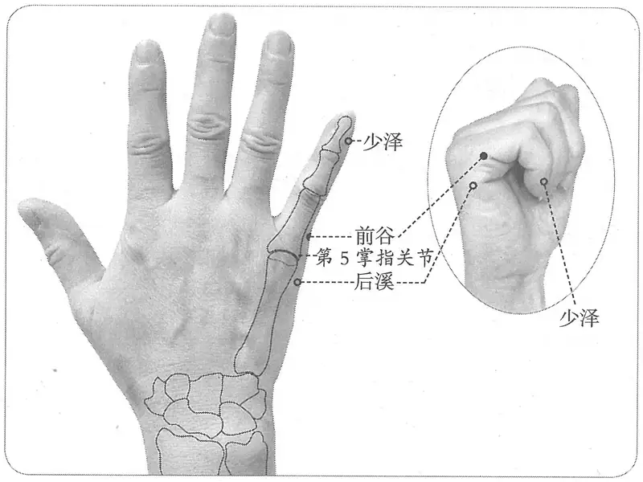

**图 2-138　前谷穴图**

**取穴**：握拳，于手小指外侧本节前，横纹头赤白肉际取之。

1.《灵枢》传本

　　(1) 在手外廉本节前陷者中也。（《灵枢·本输》）

　　(2) 手小指本节之前陷者中也。（《黄帝内经太素·本输》）

2.《黄帝明堂经》佚文

　　(1) 在手小指外侧，本节前陷者中。（《针灸甲乙经》卷三、《千金要方》、《千金翼方》、《外台秘要》、《素问》王冰注、《太平圣惠方·针经》、《铜人腧穴针灸图经》）

　　(2) 在手少指外侧本节后陷者中。（《医心方》卷二）

**按**：“本节后”乃后溪穴，此“后”字乃蒙上穴“后溪”定位文字而误。

　3. 窦太师针灸遗存

　　(1) 在手小指外侧本节前，捻掌取之，第二节横纹陷中。（《窦太师针经》）

　　(2) 在手小指外侧，本节前，次节后，横纹陷中，握手取之。（《针方六集》卷一）

**按**：手小指本节，系指第三节，《针灸六集》引文义长。

　4. 统编针灸学教材

　　(1) 部位：在手小指外侧本节前陷中。取穴：握拳于小指本节前骨边陷中取之。（1957年南京《针灸学》）

　　(2) 部位：手小指外侧本节前。取穴：握拳，于本节前骨边赤白肉际陷中取之。（1版《针灸学讲义》）

　　(3) 部位：在手小指内侧，本节前陷者中。取穴：于第五掌指关节前尺侧，握拳时，当掌指关节前之横纹头赤白肉际取之。（2版《针灸学讲义》）

**按**：此处“内侧”显系“外侧”之误，因该书经穴“部位”皆录自《针灸甲乙经》，后者作“外侧”无误。

　　(4) 握拳，第五掌指关节前尺侧，横纹头赤白肉际。（4、5、7版《针灸学》）

　　(5) 在手尺侧，微握拳，当小指本节第5掌指关节前的掌指横纹头赤白肉际。（6版《针灸学》）

〔p.543 (인쇄 523)〕

　　(6) 微握拳，尺侧，第五掌指关节前缘，赤白肉际。（《中国针灸学》）

#### 【类属】 

手太阳小肠经穴；五输穴之荥穴。

　1. 手太阳小肠者，上合手太阳……溜于前谷……为荥。（《灵枢·本输》）

　2. 手太阳脉之所流也，为荥。（《黄帝明堂经》）

#### 【适应症】 

主治头项部、肩部病症。常用于头痛，颈项强痛，目痛，耳鸣，咽喉肿痛；发热，癫狂；手指肿痛。

　1. 主痎疟，寒热，咳而胸满，劳瘅，小便赤难，肘臂腕中痛，颈肿不可以顾，头项急痛，眩，淫泺，肩胛小指痛，臂不可举，头项痛，咽肿不可咽，热病汗不出，狂，互引，癫疾，目中白翳，目痛泣出，甚者如脱，耳鸣，鼻不利，喉痹。（《黄帝明堂经》）

**按**：以上病症中“肘臂腕中痛……咽肿不可咽”、“耳鸣”、“喉痹”皆为手太阳经病候；“狂，互引，癫疾，目痛泣出，甚者如脱”本为足太阳经的典型症状。

　2. 治热病汗不出，痎疟，癫疾，耳鸣，颔肿喉痹，咳嗽，衄血，颈项痛，鼻塞不利，目中白翳，臂不得举。（《铜人腧穴针灸图经》卷下）

　3. 窦太师针灸遗存

　　(1) 治五指痛，手掌中热，泻之。（《窦太师针经》）

　　(2) 指痛不能握掌，本节红肿，手指痒麻，手心发热。（《循经考穴编》上）

　4. 妇人产后无乳。（《针灸聚英》卷一）

**按**：产后无乳，多取本经少泽穴，高武于少泽下未辑此主治，却置于前谷穴下，疑有误。

　5. 统编针灸学教材

　　(1) 头项痛，颈肿，耳鸣，鼻衄，喉痹，臂痛，手指麻痒或痛，热病汗不出，癫痫，疟疾，乳痈。（1957年南京《针灸学》）

　　(2) 头项痛，颈肿，耳鸣，鼻衄，喉痹，臂痛，手指麻痒或痛，热病汗不出，癫痫，疟疾，乳痈，小便赤。（1版《针灸学讲义》）

　　(3) 咳而胸满，劳疸溲赤，目痛流泪，热病无汗，产后无乳汁，手指麻木。（2版《针灸学讲义》）

　　(4) 头痛，目痛，耳鸣，咽肿，咳嗽胸满，热病无汗，产后无乳，手指麻木。（4版《针灸学》）

　　(5) 头痛，目痛，耳鸣，咽喉肿痛，乳少，热病。（5版《针灸学》）

　　(6) 热病汗不出，疟疾，癫狂，痫证，耳鸣，头痛，目痛，咽喉肿痛，乳少。（6版《针灸学》）

　　(7) ①热病；②乳痈，乳汁少；③头痛、目痛、耳鸣、咽喉肿痛等头面五官病证。（7版《针灸学》）

　　(8) 手指麻木，热病，耳鸣，头痛，小便赤。（《中国针灸学》）

**文献分析**：古代文献所载前谷穴的主治症介于少泽与后溪之间，这与其部位相关。教材中“乳痈，乳汁少”主治症源出于《针灸聚英》，不能排除高武误置的可能性，且未见古今临床应用的报道，暂不收录于主治项下。

#### 【操作】 

直刺0.3~0.5寸。

　1. 刺入一分，留三呼，灸三壮。（《黄帝明堂经》）

　2. 可灸一壮，针入一分。（《铜人腧穴针灸图经》卷下）

　3. 窦太师针灸遗存

　　(1) 横针入三分，灸三壮。（《窦太师针经》）

　　(2) 窦氏针入二分。（《针方六集》卷一）

〔p.544 (인쇄 524)〕

　　(3) 一法横刺入三分，可灸五壮。（《循经考穴编》上）

　4. 统编针灸学教材

　　(1) 针二至三分，握拳针之，灸三至七壮。（1957年南京《针灸学》）

　　(2) 针二至三分，灸三至七壮。（1版《针灸学讲义》）

　　(3) 直刺2~3分，艾条灸3~7分钟。（2版《针灸学讲义》）

　　(4) 直刺0.3~0.5寸。（4、5、7版《针灸学》、《中国针灸学》）

　　(5) 直刺0.2~0.3寸；可灸。（6版《针灸学》）

### （三）后溪 Hòuxī SI3 出《灵枢》 

#### 【提要索隐】 

**穴名**：古称“手太阳”。

**部位**：在手内侧，第5掌指关节尺侧近端赤白肉际凹陷中。

**适应症**：主治头项部、肩部病症。常用于头痛，颈项强痛，耳聋，目赤，鼻衄；癫，狂，痫；疟疾；肘臂痛。

**针刺操作**：直刺0.5~1寸。

#### 【名实考】 

本穴古称为“手太阳”。需要注意的是，古代文献中有将本穴与“腕骨”穴相混者。

　1. 手太阳小肠者，上合手太阳……注于后溪，后溪者，在手外侧本节之后也，为腧。（《灵枢·本输》）

　2. 注于后溪，后溪者，木也。在手小指外侧本节后陷中。手太阳脉之所注也，为输。（《黄帝明堂经》）

　3. 谷溪皆水过之称，以本节前为前谷，所以本节后为后溪，与奇经督脉相通。（《经穴解》）

#### “后溪”与“手太阳”穴辨 

　1. 手太阳，在手小指外侧本节（后）陷者中。原注：即后溪穴也。（《脉经》卷二）

　2. 手太阳在手小指外侧本节陷中。（《千金要方》卷十四）

　3. 鼻中壅塞，针手太阳入三分，在小指外侧后一寸白肉际宛宛中。（《千金翼方》卷二十六）

　4. 手太阳二穴，在手大（小）曲纹头。（《太平圣惠方》卷五十五）

**按**：综合以上诸书对“手太阳”穴部位的描述，与后溪穴相近，可知两者为同一穴。

#### “后溪”与“腕骨”混淆例 

后溪二穴，在手外侧腕前起骨下陷者中。灸三壮。主痎疟寒热，目生白翳，肘臂腕重难屈伸，五指尽痛不可掣也。（《太平圣惠方·明堂》）

**按**：《太平圣惠方》此条文字，其部位、主治均系“腕骨”内容，而穴名误作“后溪”。

#### 相关穴及刺激点 

上后溪：位于手背尺侧缘，半握拳取之。第五掌骨小头后方掌横纹头，与手尺侧第五掌骨基底钩骨之间凹陷联线的中点，即后溪与腕骨穴联线之间。主治聋哑。直刺1~1.5寸。针感麻、酸至指。（《针灸经外奇穴图谱（续集）》）

#### 【定位】 

**部位**：在手内侧，第5掌指关节尺侧近端赤白肉际凹陷中（图2-139）。

〔p.545 (인쇄 525)〕

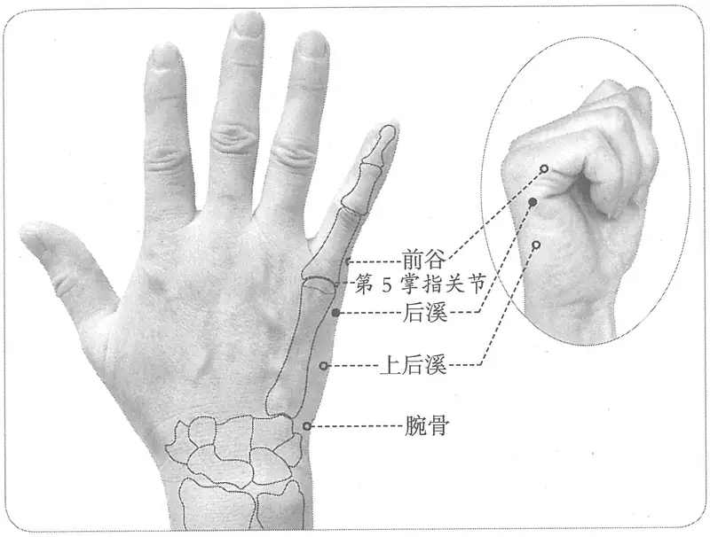

**图 2-139　后溪穴与相关穴图**

**取穴**：半握拳，远侧掌横纹头（尺侧）赤白肉际处。

　1. 在手外侧本节之后也。（《灵枢·本输》）

　2. 在手小指外侧本节后陷中。（《黄帝明堂经》、《铜人腧穴针灸图经》、《圣济总录》、《针灸资生经》、《十四经发挥》、《神应经》、《针灸集书》、《针灸聚英》、《古今医统》、《针灸大成》、《循经考穴编》、《外科大成》、《针灸易学》）

　3. 窦太师针灸遗存

　　(1) 在手小指本节后，握拳横纹尖。（《针灸玉龙歌》注）

　　(2) 在手小指外侧本节后外横纹尖陷中。（《窦太师针经》）

　　(3) 手小指外侧本节后陷中横纹尖。（《大本琼瑶神书》）

　　(4) 在手小指外侧，本节后一寸，大横纹尖上陷中，捏拳取之。（《针方六集》卷一）

　　(5) 广注：当握拳取，掌横纹尖凸处。（《循经考穴编》上）

　4. 小指外侧本节横纹尖尽处，握拳取之。（《医学入门》卷一）

　5. 在手小指本节后外侧横纹尖上陷中，仰手握拳取之。（《类经图翼》卷六、《审视瑶函》、《医宗金鉴·刺灸心法要诀》、《针灸逢源》）

**按**：各本所述“握拳横纹尖”系指第一掌横纹（远端掌横纹）尺侧端。

　6. 统编针灸学教材

　　(1) 部位：在手小指外侧，本节后陷中。取穴：握拳从本节后陷中取之。（1957年南京《针灸学》）

　　(2) 部位：手小指外侧本节后。取穴：握拳，于本节后骨边赤白肉际陷中取之。（1版《针灸学讲义》）

　　(3) 部位：在手小指外侧，本节后陷者中。取穴：于第五掌指关节后横纹头，当第五掌骨小头后之尺侧赤白肉际陷中，握拳取之。（2版《针灸学讲义》）

　　(4) 握拳，第五掌指关节后尺侧，横纹头赤白肉际。（4、5版《针灸学》）

　　(5) 在手掌尺侧，微握拳，当小指本节第5掌指关节后的远侧掌横纹头赤白肉际。（6版《针灸学》）

〔p.546 (인쇄 526)〕

　　(6) 微握拳，第5掌指关节尺侧的远端掌横纹头赤白肉际。（7版《针灸学》）

　　(7) 微握拳，尺侧，第5掌指关节后缘，横纹头赤白肉际。（《中国针灸学》）

**文献分析**：古今文献定位一致，与其他“本节后”穴定位相同，定于手内侧，手小指掌指关节尺侧近端赤白肉际凹陷中。自窦氏针灸始各家文献又补充了较详细的取穴法内容：仰手握拳，在手小指本节后外侧横纹尖上陷中取之。现代针灸学教材从之。值得注意的是，《太平圣惠方·明堂》所载之“腕骨”穴条文，其穴名误作“后溪”，幸而后世文献未传此误。

#### 【类属】 

手太阳小肠经穴；五输穴之输穴；八脉交会穴。

　1. 手太阳小肠者，上合手太阳，出于少泽……注于后溪，后溪者，在手外侧本节之后也，为腧。（《灵枢·本输》）

　2. 手太阳脉之所注也，为输。（《黄帝明堂经》）

　3. 后溪二穴，合申脉。（《针经指南》）

#### 【适应症】 

主治头项部、肩部病症。常用于头痛，颈项强痛，耳聋，目赤，鼻衄；癫，狂，痫；疟疾；肘臂痛。

　1. 主振寒，寒热，肩臑肘臂痛，头眩痛不可顾，烦满身热，恶寒，目赤痛，眦烂生翳膜，暴痛，鼽衄，发聋，臂重痛，肘挛，痂疥，胸满引臑，泣出而惊，颈项强，身寒。痎疟。颈颔肿，狂互引，癫疾数发，耳鸣。（《黄帝明堂经》）

**按**：以上病症除疟疾、癫狂外，皆为手太阳经脉、络脉病候。

　2. 治疟寒热，目赤生翳，鼻衄，耳聋，胸满，颈项强不得回顾，癫疾，臂肘挛急。（《铜人腧穴针灸图经》卷下）

　3. 窦太师针灸遗存

　　(1) 痫发癫狂兮，凭后溪而疗理，疟生寒热兮，仗间使以扶持。（《通玄指要赋》）

　　(2) 时行疟疾最难禁，穴法由来未审明，若把后溪穴寻得，多加艾火即时轻。（《针灸玉龙歌》）

　　(3) 治五痫病，颠狂不识尊卑，泻。专治脾寒，灸二七壮，看证补泻。（《窦太师针经》）

　　(4) 治痫病，宜泻；颠狂不知尊卑，宜泻；脾寒，灸二七壮立效。（《大本琼瑶神书》）

　　(5) 小肠疝痛，五痫，癫狂不识前后。（《针方六集》卷五）

　　(6) 主癫狂痫痓，脾寒久疟，时疫黄疸。（《循经考穴编》上）

　4. 统编针灸学教材

　　(1) 头项强，目赤，鼻衄，耳聋，肘臂及五指挛急，寒热，癫疾，痎疟。（1957年南京《针灸学》）

　　(2) 头项强，目赤，鼻衄，耳聋。肘臂及手指挛急，寒热，癫疾，疟疾，小便赤涩。（1版《针灸学讲义》）

　　(3) 头项强痛，目赤，耳聋，肘臂及手指挛急，热病，癫痫，疟疾。（2版《针灸学讲义》）

　　(4) 头项强痛，目翳，耳聋，鼻衄，咽喉肿痛，齿痛，癫狂，疟疾，肘臂挛痛。（4版《针灸学》）

　　(5) 头项强痛，目赤，耳聋，咽喉肿痛，腰背痛，癫狂痫，疟疾，手指及肘臂挛痛。（5版《针灸学》）

　　(6) 头项强痛，耳聋，热病，疟疾，癫狂，痫证，盗汗，目眩，目赤，咽喉肿痛。（6版《针灸学》）

　　(7) ①头痛强项、腰背痛、手指及肘臂挛痛等痛证；②耳聋，目赤；③癫狂痫；④疟疾。

〔p.547 (인쇄 527)〕

（7版《针灸学》）

　　(8) 头项强痛，耳鸣，耳聋，咽喉肿痛，癫狂，疟疾，闪腰，盗汗，热病，手指挛急、麻木，肩臂疼痛。（《中国针灸学》）

**文献分析**：古今文献对后溪穴主治病症的记载比较一致，宋以前大体不出《黄帝明堂经》范围，集中于远端的头项五官，体表循行的肩肘腕指，涉及全身的热病、疟疾，以及神志方面的癫狂痫等病症。而金元窦太师则重点阐发本穴治疗癫狂痫、小肠疝气、脾寒久疟的作用。教材中“腰背痛”盖从《针经指南》“交经八穴”后溪下主治症“腰背强痛”而来，而该书后溪穴下所载主治症并非后溪的单独作用；“咽喉肿痛”未详所出，此二症暂不作为本穴的基础主治。

#### 附：临床应用举例 

　1. 头项部病症

　　(1) 头风，后溪、京骨。（《医学纲目》卷十五）

　　(2) 胸项如有痛，后溪并列缺。（《千金十一穴歌》）

　　(3) 头项强痛、颈椎骨质增生，均可独刺后溪穴治疗。［针灸临床杂志，1994，14(8):45］

　2. 心神病症

　　(1) 心性呆痴，灸神门、后溪泻之。（《针灸集要·盘石金直刺秘传》）

　　(2) 颠痫心风，灸鸠尾，刺后溪、神门，泻足三里。（《针灸集要·盘石金直刺秘传》）

　3. 肩臂部病症

　　(1) 漏肩风，病在太阳经，天宗、臑俞配养老、后溪。［上海针灸杂志，1983(3):27］

　　(2) 冈上肌腱钙化症，针刺后溪加手法治疗。［中国针灸，2002，22(1):6］

　4. 疟疾

　　(1) 脾寒发疟，间使、后溪、百劳一椎上陷中。问曰：脾寒之证，有先寒后热，有先热后寒，有发热亦单发寒者，何也？答曰：先寒后热者，痰盛气弱；先热后寒者，气盛痰少；单热者则饮流脾经，充动血气也；单寒者饮流胃间，停聚不散而然也。或一日一发，或二日一发。若一日一发易治也，若间两、三日一发者难愈也。故人之疟、痢、嗽，医师问之则不喜也，再后针以上穴法，仍用补之剂调理之，则无不效也。（《针灸集成》第六十三方）

　　(2) 疟疾，大椎穴、后溪穴，针灸疗法。［四川中医，1987，5(6):45］

#### 【操作】 

直刺0.5~1寸。

　1. 刺入二分，留二呼，灸一壮。（《黄帝明堂经》）

　2. 可灸一壮，针入一分。（《铜人腧穴针灸图经》卷下）

　3. 窦太师针灸遗存

　　(1) 针入半寸，可灸二壮。治痫病宜泻，颠狂不知尊卑宜泻，脾寒灸二七壮立效。（《大本琼瑶神书》）

　　(2) 横针入五分，灸二七壮。（《窦太师针经》）

　　(3) 一法：横针向掌心去六分，可灸七壮。（《循经考穴编》上）

　　(4) 针半寸，灸七壮，同间使补泻。（《针灸玉龙经》注）

　4. 针一寸。（《针灸大成》卷五）

　5. 针三分，灸三壮。（《针灸十四经穴位考订》）

　6. 统编针灸学教材

〔p.548 (인쇄 528)〕

　　(1) 针五至八分，灸三至七壮。（1957年南京《针灸学》、1版《针灸学讲义》）

　　(2) 直刺5~7分，艾条灸3~7分钟。（2版《针灸学讲义》）

　　(3) 直刺0.5~1寸。（4、5、6版《针灸学》）

　　(4) 直刺0.5~1寸。治手指挛痛可透刺合谷穴。（7版《针灸学》）

　　(5) 直刺0.5~0.7寸。可灸。（《中国针灸学》）

　7. 直刺，握拳，从外侧沿掌骨前向内刺入，深0.5~1寸，治手指痉挛时可透合谷，深1.5~2寸。感应：局部酸胀可至整个掌部。灸1~3壮；温灸5~15分钟。（上海《针灸学》）

### （四）腕骨 Wàngǔ SI4 出《灵枢》 

#### 【提要索隐】 

**穴名**：腕骨，宋以前文献或作“完骨”，或作“捥骨”，或作“脘骨”。

**部位**：在腕区，第5掌骨底与三角骨之间的赤白肉际凹陷中。

**适应症**：主治头项部病症。常用于头痛，颈项强痛，目翳，耳鸣；黄疸；发热，惊风、抽搐；疟疾；肩臂腕指痛，活动受限。

**针刺操作**：直刺0.3~0.5寸。

#### 【名实考】 

腕骨，既是穴名，又是骨名，穴因骨而得名。腕骨，《黄帝内经太素》、未经校改本《新雕孙真人千金方》卷三十作“完骨”（与足少阳经“完骨”同），杨上善注文及《医心方》作“捥骨”，《神应经》等书作“脘骨”。

关于本穴的定位，需要正确理解古典文献所说的骨名“腕骨”，本来对于此骨，《黄帝明堂经》已经说得很清楚，用手指沿着手小指本节后凹陷后溪穴向腕侧方向推寻，第一个突起之骨（三角骨），即是腕骨，骨边凹陷即为本穴。或沿腕部兑骨（尺骨茎突）向手小指外侧推寻，第一个突起之骨即是。对此，明代《针灸秘法全书》有明确的说明，而具有现代解剖学知识背景的现代针灸人，反而不知“腕骨”为何骨，穴在何处。

关于“阳谷”与“神门”，“阳谷”与“腕骨”，以及“腕骨”与“养老”的位置关系，不仅让现代人为难，也令古人困惑。要正确解决这些难题，需对古代和现代解剖学术语都熟悉才行。《黄帝明堂经》关于这四穴的定位，用了三个解剖名词：起骨——三角骨；兑骨——豌豆骨（定神门）和尺骨茎突（定阳谷）；踝骨——尺骨小头。三角骨下（远侧）定腕骨穴，三角骨上（近侧）定阳谷穴，豌豆骨近端定神门，尺骨小头后定养老。“阳谷”与“神门”的关系所以让古人困惑，是因为《黄帝明堂经》对用以定位的不同骨用了相同的名称“兑骨”；“神门”与“腕骨”穴的定位所以让现代人困惑，是因为不明豌豆骨在掌侧；“腕骨”与“养老”的位置关系所以让古今医家困惑，是因为不详“踝骨”为何骨，以及特定的取穴姿势所致。

　1. 完骨者，在手外侧腕骨之前也，为原。（《黄帝明堂经》）

　2. 在手外侧腕前起骨下陷中。即此起骨为腕骨，此经名完骨，胡端反。（《黄帝内经太素·本输》）

　3. 如取手太阳小肠经者，此经行于手下侧，以手竖直取之，然此经有三骨难辨，特明于此。踝骨之前曰兑骨，兑骨之前曰起骨，踝高而露，兑低而隐，起小而伏。踝在腕之后，兑在腕之间，起在腕之前，三骨如贯珠相连，兑骨之下有阳谷，起骨之下有腕骨，踝骨之上空一寸有养老穴也。（明抄本《针灸秘法全书》）

　4. 过于腕骨，腕骨在手外侧腕骨之前，为原。（《灵枢·本输》）

〔p.549 (인쇄 529)〕

　5. 过于腕骨。在手外侧腕前起骨下陷者中。手太阳脉之所过也，为原。（《黄帝明堂经》）

　6. 小肠之源，腕骨穴也。在手外侧腕前起骨下陷者中，手太阳脉之所过也。（《素问亡篇·刺法论》）

　7. 穴在腕骨之前，故曰腕骨。（《经穴解》）

#### 【定位】 

**部位**：在腕区，第5掌骨底与三角骨之间的赤白肉际凹陷中（图2-140）。

**取穴**：由后溪向上沿掌骨直推至一突起骨，于两骨之间凹陷中取穴。

　1. 在手外侧腕骨之前。（《灵枢·本输》）

　2. 在手外侧腕前起骨下陷者中。（《黄帝明堂经》、《铜人腧穴针灸图经》、《圣济总录》、《针灸资生经》、《针灸玉龙经》、《十四经发挥》、《针灸集书》、《针灸聚英》、《古今医统》、《针灸大成》、《类经图翼》、《循经考穴编》、《外科大成》、《针灸易学》）

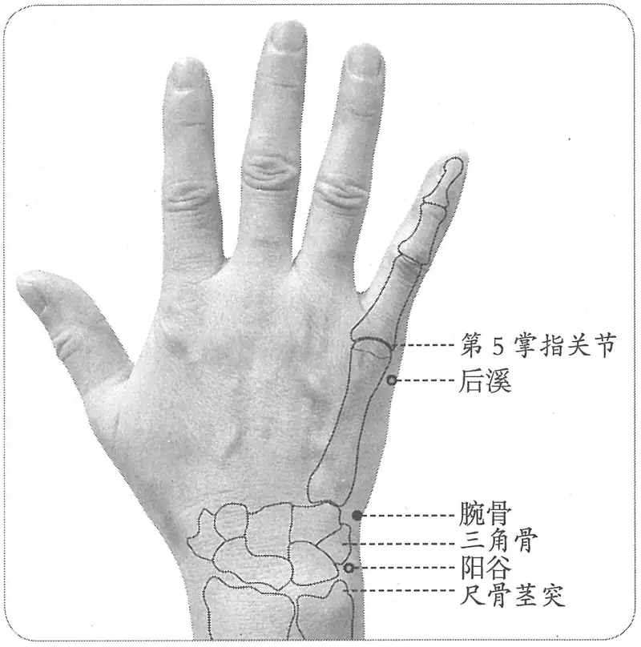

**图 2-140　腕骨穴图**

　3. 窦太师针灸遗存

　　(1) 在手腕起骨前陷中，翻手得穴。（《针灸玉龙歌》注）

　　(2) 在手外侧腕前起骨缝中，必转手向内，腕骨中分为二，乃下针。（《针方六集》卷一）

　4. 在手后侧，腕前起骨下陷中，有歧骨罅缝。（《神应经》、《医宗金鉴·刺灸心法要诀》、《针灸逢源》）

　5. 掌后外侧高骨下陷中，握掌向内取之。（《医学入门》卷一）

　6. 手外侧第五掌骨根部钩骨之前陷中。（《针灸十四经穴位考订》）

　7. 统编针灸学教材

　　(1) 部位：在手外侧腕前骨下陷中。取穴：自后溪穴第五掌指骨之外缘，沿前边向上移行到钩状骨为止，在此两骨接合处取之。（1957年南京《针灸学》）

　　(2) 部位：掌后外侧高骨下陷中。取穴：握拳向内，自后溪穴向上移行至两骨接合部陷中取之。（1版《针灸学讲义》）

　　(3) 部位：在手外侧腕前，起骨下陷者中。取穴：握拳，于第五掌骨之基底与三角骨之间赤白肉际的陷凹部取之。（2版《针灸学讲义》）

　　(4) 手背尺侧，豌豆骨前凹陷中。（4版《针灸学》）

　　(5) 后溪穴直上，于第五掌骨基底与三角骨之间赤白肉际取之。（5版《针灸学》）

　　(6) 在手掌尺侧，第五掌骨基底与钩骨之间的凹陷处，赤白肉际。（6版《针灸学》）

　　(7) 第5掌骨基底与三角骨之间的凹陷处，赤白肉际。（7版《针灸学》）

　　(8) 手背尺侧，第五掌骨基底与三角骨之间的凹陷部。（《中国针灸学》）

**文献分析**：腕部内侧缘的尺骨茎突远端（下方）的第一个骨性突起即是三角骨，在前臂旋后位、腕关节屈曲时，更易触及。古人所说“必转手向内”、“后外侧高骨下陷中，握掌向内取之”是有可靠的表面解剖学基础的。至于教材提及的“钩骨”与第4、5掌骨底间紧密相连，可知古文献所说“手外侧腕前起骨下陷者中”以及“转手向内”所取处，是指第5掌骨底与三角骨之间的凹陷处，与阳谷穴之间相隔一骨。

〔p.550 (인쇄 530)〕

在手背第5掌骨根部尺侧，不论是从掌部向腕部，还是从腕部向掌部推按，触及的第一个突起之骨，都是三角骨，而不能触及钩骨和豌豆骨，早在1953年朱琏的《新针灸学》已经给出了正确的解剖学定位描述，而其后的《针灸十四经穴位考订》、1957年南京《针灸学》，一直到4版、6版《针灸学》，皆传日本针灸教材之误，做出了错误的表述。

#### 【类属】 

手太阳小肠经穴；十二原穴之一。

　1. 手太阳小肠者，上合手太阳，出于少泽……过于腕骨，腕骨，在手外侧腕骨之前，为原。（《灵枢·本输》）

　2. 手太阳脉之所过也，为原。（《黄帝明堂经》）

　3. 小肠之源，腕骨穴也。在手外侧腕前起骨下陷者中，手太阳脉之所过也。（《素问亡篇·刺法论》）

#### 【适应症】 

主治头项部病症。常用于头痛，颈项强痛，目翳，耳鸣；黄疸；发热，惊风、抽搐；疟疾；肩臂腕指痛，活动受限。

　1. 主痉，互引。痎疟。寒热。偏枯，臂腕发痛，肘屈不得伸，风头痛，泣出，肩臂颈痛，项急烦满，惊，五指掣，不可屈伸，战怵。狂易。消渴。耳鸣无闻。热病汗不出，胁痛不得息，颈颔肿。衄。（《黄帝明堂经》）

**按**：以上症状多为手太阳经脉病候。需注意的是“痉，互引”多为足太阳经穴所主；而“惊，五指掣，不可屈伸”系小儿惊痫的典型症状（王惟一译作“惊风，瘛疭，五指掣”，极是。癫痫，宋代名“惊风”）。《千金要方》卷五曰“犬痫之为病，手屈拳挛”，也即此证。包括现代针灸学教材在内的后世腧穴文献多将“五指掣，不可屈伸”误解为“指挛”的独立局部症状。消渴，此为手太阳经穴主治首次出现的病症，除本穴外，《黄帝明堂经》另有“承浆”、“意舍”、“然谷”穴主治明确载有“消渴”，但后世文献收载者不多，也未见应用的记载，这可能也是现代教材未予列入主治症的原因之一。

　2. 目生白翳。（《太平圣惠方·明堂》）

　3. 治热病汗不出，胁下痛不得息，颈颔肿，寒热耳鸣，目冷泪生翳，狂惕，偏枯，臂肘不得屈伸，痎疟，头痛烦闷，惊风瘛疭，五指掣。（《铜人腧穴针灸图经》卷下）

**按**：《黄帝明堂经》手太阳经所列主治病症，少泽、前谷、后溪、腕骨、阳谷等手部相邻诸穴中，只有少泽和腕骨穴不主目疾，应视为一种经验认识的反映而非缺漏，至宋代《太平圣惠方》、《铜人腧穴针灸图经》这二穴的主治症中都出现了“目翳”症。“狂惕”《外台秘要》卷三十九原文作“狂易”，是指精神失常后性情狂乱的一种古病名，王惟一改作“狂惕”，欠妥。

　4. 窦太师针灸遗存

　　(1) 治浑身发热，肩臂冷痛，先泻后补；腕骨痛，泻之。（《窦太师针经》）

　　(2) 治浑身发热，先补后泻；肩背冷痛，先泻后补。（《大本琼瑶神书》）

　　(3) 浑身发黄，小肠疝气。（《针方六集》卷五）

　　(4) 主疸证浑身发黄，手腕无力。（《循经考穴编》上）

　5. 统编针灸学教材

　　(1) 头痛，颈项强，耳鸣，目翳，胁痛，黄疸，指挛臂痛，热病汗不出。（1957年南京《针灸学》、1版《针灸学讲义》）

　　(2) 头痛项强，耳鸣，目翳，指挛臂痛，黄疸，热病汗不出。（2版《针灸学讲义》）

〔p.551 (인쇄 531)〕

　　(3) 热病无汗，头痛，肩臂颈痛，指挛腕痛，黄疸。（4版《针灸学》）

　　(4) 头项强痛，耳鸣，目翳，黄疸，热病，疟疾，指挛腕痛。（5版《针灸学》）

　　(5) 头痛，项强，耳鸣耳聋，目翳，指挛臂痛，热病汗不出，疟疾，胁痛。（6版《针灸学》）

　　(6) ①指挛腕痛，头痛项强；②目翳；③黄疸；④热病，疟疾。（7版《针灸学》）

　　(7) 热病无汗，头痛，项强，指挛腕痛，黄疸。（《中国针灸学》）

**文献分析**：《黄帝明堂经》载本穴主治症中，除手太阳经脉病候外，还包括了小儿惊痫（后世文献多有误解）、消渴、衄血（已见于《灵枢》），但未见后世临床应用，故暂不作为本穴基础主治，待临床进一步检验。至金元窦太师针灸增补“黄疸”一症，后世临床应用较广，教材多列为本穴主治，今从之。教材中“指挛腕痛”当出自《黄帝明堂经》“惊，五指掣，不可屈伸”（《铜人腧穴针灸图经》作“惊风，瘛疭，五指掣”），为小儿惊痫的典型症状，不是一个独立的局部症状，应据原文献表述为“惊风瘛疭”。

#### 附：临床应用举例 

　1. 黄疸病症

　　(1) 固知腕骨祛黄，然骨泻肾。（《通玄指要赋》）

　　(2) 黄疸亦须腕骨灸，金针中脘必痊安。腕中无力或麻酸，举指酸疼握物难，若针腕骨真奇妙，此穴尤宜仔细看。（《针灸玉龙歌》）

　　(3) 黄疸，四肢无力，不问久近，灸中脘，泻足三里、腕骨。（《针灸集要·盘石金直刺秘传》）

　2. 头项、鼻部病症

　　(1) 衄血，取手太阳；不已，刺腕骨下。（《灵枢·杂病》）

　　(2) 脉浮而头痛，过在足太阳，刺腕骨、京骨。（《云岐子保命集论类要》卷上）

　　(3) 治鼻疔之发，在于鼻内痛而引脑门，不能还气，鼻大如瓶，黑者不治，连牙不得开者亦不治，当灸腕骨七壮，艾如绿豆大。（《痈疽神秘灸经》）

　　(4) 落枕，针刺患侧腕骨穴。［山东中医杂志，2001，20(5):339］

　3. 腰扭伤

　　(1) 腰腿软组织损伤：针刺大椎、腕骨。［浙江中医杂志，1991，26(10):452］

　　(2) 急性腰扭伤，针刺双侧或单侧腕骨穴。［新中医，1996(增刊):79］

#### 【操作】 

直刺0.3~0.5寸。

　1. 刺入二分，留三呼，灸三壮。（《黄帝明堂经》）

　2. 先以左手按穴，刺可入三分，留三呼，进二分，留一呼，徐徐出针，次以手扪其穴也。（《素问亡篇·刺法论》）

　3. 窦太师针灸遗存

　　(1) 横针入三分，灸七壮。（《窦太师针经》）

　　(2) 针三分，灸七壮。（《窦太师秘传》）

　　(3) 针入三分，灸二七壮，泻之；手麻木则补，可灸三七壮。（《针灸玉龙歌》注）

　　(4) 一法可横刺五分，灸七壮，针不宜深，深则令人小便脱。（《循经考穴编》上）

　4. 统编针灸学教材

　　(1) 针三至五分，灸三至七壮。（1957年南京《针灸学》、1版《针灸学讲义》）

　　(2) 直刺3~5分，艾条灸3~7分钟。（2版《针灸学讲义》）

　　(3) 直刺0.3~0.5寸。（4、5、6、7版《针灸学》）

〔p.552 (인쇄 532)〕

　5. 直刺0.5~1寸。感应：局部酸胀，有时可扩散至掌部。灸3壮；温灸5~20分钟。（上海《针灸学》）

### （五）阳谷 Yánggǔ SI5 出《灵枢》 

问题：本穴与神门穴定位体表标志皆为“兑骨”，现代针灸教材皆理解为同一骨——豌豆骨，是否正确？

#### 【提要索隐】 

**部位**：在腕后区，尺骨茎突与三角骨之间的凹陷中。

**适应症**：主治头、项、肩部病症。常用于头痛，眩晕，耳鸣，耳聋；发热，癫，狂，痫，抽搐。颈肿，颊肿，臂外侧痛，腕痛。

**针刺操作**：直刺0.3~0.5寸。

#### 【名实考】 

古今文献记载之本穴定位相同，均定于手外侧（尺侧）锐骨（尺骨茎突）下凹陷中。现代针灸学教材有将“兑骨”理解为“豌豆骨”或“尺骨小头”者，非是。参见腕骨穴下“名实考”。

值得注意的是，“阳谷”与“阳谿”字形相近，易混淆，在阅读古代文献时需要注意辨识。

　1. 行于阳谷，阳谷在锐骨之下陷者中也，为经。（《灵枢·本输》）

　2. 行于阳谷，阳谷者，火也。在手外侧腕中，兑（锐）骨下陷者中。手太阳脉之所行也，为经。（《黄帝明堂经》）

　3. 阳指太阳经而言，谷指本经离腕而上臂，至锐骨之前，经脉过之有空，似水从谷出之象也，故曰阳谷。（《经穴解》）

#### “阳谷”与“阳谿”混淆例 

　1. 阳谷，一云在腕上侧两筋间陷者中。（《外台秘要》卷三十九）

**按**：此系将手阳明大肠经“阳溪”穴定位与本穴相混。

　2. 阳谷二穴，主吐舌，戾颈，妄言。（《太平圣惠方·针经》）

**按**：《太平圣惠方》本穴下主治症除此条外，全见于《外台秘要》，病症的排列次序也完全相同。经考察，此条病症系“阳溪”穴主治，因穴名相近而错入于此。

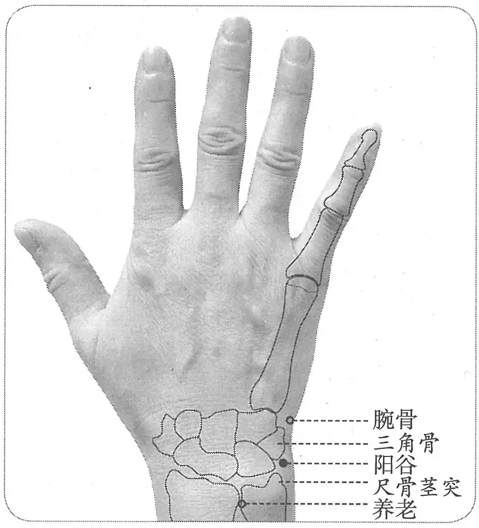

**图 2-141　阳谷穴图**

#### 【定位】 

**部位**：在腕后区，尺骨茎突与三角骨之间的凹陷中（图2-141）。

**取穴**：由腕骨穴向上，相隔一骨（即三角骨）的凹陷中取之。

　1. 在锐骨之下，陷者之中也。（《灵枢·本输》）

　2. 在手外侧腕中，兑骨下陷者中。（《黄帝明堂经》、《太平圣惠方·针经》、《铜人腧穴针灸图经》、《圣济总录》、《针灸资生经》、《针灸玉龙经》、《十四经发挥》、《神应经》、《针灸集书》、《针

〔p.553 (인쇄 533)〕

灸聚英》、《医学入门》、《针灸大成》、《类经图翼》、《循经考穴编》、《医宗金鉴·刺灸心法要诀》、《针灸易学》）

　3. 窦太师针灸遗存

　　(1) 在手外侧腕中，兑骨之下陷中。在兑骨下大筋上陷中。（《窦太师针经》）

　　(2) 在手外侧腕中，锐骨下二分陷者中。（《针方六集》卷一）

　4. 手腕尺骨端，与腕骨相接处陷中。（《针灸十四经穴位考订》）

　5. 统编针灸学教材

　　(1) 部位：手外侧腕中，锐骨下陷中。取穴：以腕关节向肩屈按取豌豆骨即掌后锐骨之际，当横纹陷中取之。（1957年南京《针灸学》）

　　(2) 部位：腕关节的小指侧。取穴：握拳向内，在腕骨穴后，相隔一骨陷中取之。（1版《针灸学讲义》）

　　(3) 部位：在手外侧腕中，兑骨下陷者中。取穴：腕关节之尺侧，豌豆骨与尺骨茎突之间凹陷处，屈腕取之。（2版《针灸学讲义》）

**按**：上述教材取穴法皆将“兑骨”理解为“豌豆骨”，系将神门穴与本穴定位描述文字中“兑骨”混为一谈了。

　　(4) 腕背横纹尺侧端，尺骨小头前凹陷中。（4版《针灸学》）

**按**：尺骨小头，《黄帝明堂经》谓之“手踝骨”，而兑骨是指尺骨茎突，故此处为误。

　　(5) 腕背横纹尺侧端，尺骨茎突前凹陷中。（5版《针灸学》）

　　(6) 在手腕尺侧，当尺骨茎突与三角骨之间的凹陷处。（6版《针灸学》）

　　(7) 腕背横纹尺侧端，当尺骨茎突与三角骨之间的凹陷处。（7版《针灸学》《中国针灸学》）

**按**：古代文献关于本穴定位，均在手外侧（尺侧）锐骨（尺骨茎突）下凹陷中。现代针灸学教材有将“兑骨”理解为“豌豆骨”或“尺骨小头”者，非是。《内经》与《黄帝明堂经》中“兑骨”（即“锐骨”），可指不同部位的各种尖锐形状的骨。如：“颧髎，一名兑骨”；“神门，在掌后兑骨之端陷者中”；“手太阳之筋……结于肘内锐骨之后，弹之应小指之上”。神门穴“掌后兑骨之端”中的“兑骨之端”是指掌后尺侧的豌豆骨近端；而阳谷穴“手外侧腕中兑骨下陷者中”句中的“兑骨下”是指前臂伸面外侧下端“尺骨茎突下”，此下相接的是“三角骨”，而不是“豌豆骨”。

#### 【类属】 

手太阳小肠经穴；五输穴之经穴；手太阳之所溜。

　1. 手太阳脉之所行也，为经。（《黄帝明堂经》）

　2. 手太阳根于少泽，溜于阳谷，注于少海，入于天窗、支正也。（《灵枢·根结》）

#### 【适应症】 

主治头、项、肩部病症。常用于头痛，眩晕，耳鸣，耳聋；发热，癫，狂，痫，抽搐。颈肿，颊肿，臂外侧痛，腕痛。

　1. 主热病汗不出，胸胁痛，不得息，颈颔肿，寒热，耳鸣聋无所闻。泄风汗出至腰，项急不可以左右顾及俛仰，肩弛肘废，目痛，痂疥，生疣，瘛疭，头眩目痛。痎疟，风眩惊，手腕痛，肩痛不可自带衣，臂腕外侧痛不举，狂癫疾，上牙齿龋痛。（《黄帝明堂经》）

**按**：以上病症除“瘛疭，风眩，惊，狂癫疾”外，多系手阳明经脉病候。值得注意的是，手太阳络脉的所有病候也均见于本穴适应症。

　2. 治癫疾狂走，热病汗不出，胁痛，颈颔肿，寒热，耳聋耳鸣，齿龋痛，臂腕外侧痛不举，妄言，左右顾，瘛疭目眩。（《铜人腧穴针灸图经》卷下）

　3. 治手腕红肿，泻；耳内虚鸣，或痒，或痛，或清水出，先补后泻；臂膊外痛，泻。（《窦太师针经》）

〔p.554 (인쇄 534)〕

　4. 主治小儿瘛疭，舌强，不嗍乳。（《针灸聚英》卷一）

**按**：此系高武不明《针灸资生经》体例而误录原文“阳谷疗吐舌戾颈明见狂言，小儿吐舌并见风痫治小儿舌强嗍奶不得下见口噤”。显然《针灸聚英》“舌强，不嗍乳”录自上文最后一条文字，而查《针灸资生经》“口噤”篇此条全文，实系“承浆”、“颊车”穴主治，此乃高武断句失误所致。此误经《针灸大成》转录后，一直延误至今。

　5. 统编针灸学教材

　　(1) 耳鸣，耳聋，龋齿痛，颈颔肿，臂外侧痛，胁痛，热病汗不出，癫疾，狂走，小儿瘛疭，舌强不吮乳。（1957年南京《针灸学》、1版《针灸学讲义》）

　　(2) 颈颔肿，臂外侧痛，手腕痛，热病无汗，头眩目痛。（2版《针灸学讲义》）

　　(3) 颔肿寒热，耳鸣耳聋，头眩目痛，肩臂腕痛，癫狂瘛疭，舌强口禁。（4版《针灸学》）

　　(4) 头痛，目眩，耳鸣，耳聋，热病，癫狂痫，腕痛。（5、6版《针灸学》）

　　(5) ①颈颔肿、臂外侧痛、腕痛等痛证；②头痛、目眩、耳鸣、耳聋等头面五官病证；③热病；④癫狂痫。（7版《针灸学》）

　　(6) 颈颔肿，手腕痛，热病。（《中国针灸学》）

**文献分析**：《太平圣惠方》本穴下主治系误录自“阳溪”穴主治；《针灸聚英》主治系高武不明《针灸资生经》体例而误录原文；教材中“舌强不吮乳”、“舌强口禁”症系承袭明代高武《针灸聚英》之误，今去之。

#### 附：临床应用举例 

　　(1) 治颔肿如升，喉中闭塞，水粒不下，以三棱针刺手太阴经少商二穴，微出血，泄诸阳脏热凑。在手大指端内侧，去爪甲角如韭叶。兼刺手大指背头节上，以三棱针挑刺三针，出血佳。次针手太阳经阳谷二穴，而愈。在手外侧腕中锐骨之下陷中。针入三分。（《针经摘英集》）

　　(2) 眼赤肿疼痛　阳谷一分泻之、至阴。（《医学纲目》卷十三）

#### 【操作】 

直刺0.3~0.5寸。

　1. 刺入二分，留二呼，灸三壮。（《黄帝明堂经》）

　2. 窦太师针灸遗存

　　(1) 沿皮向前腕骨穴针入三分，灸七壮。（《窦太师针经》）

　　(2) 窦氏针入三分，灸七壮。（《针方六集》卷一）

　　(3) 一法刺入一分，沿皮向前透腕骨。（《循经考穴编》上）

　3. 统编针灸学教材

　　(1) 针三至四分，依取穴式进针，灸三至七壮。（1957年南京《针灸学》、1版《针灸学讲义》）

　　(2) 直刺3~4分，艾条灸5~10分钟。（2版《针灸学讲义》）

　　(3) 直刺0.3~0.5寸。（4、5、7版《针灸学》、《中国针灸学》）

　　(4) 直刺或斜刺0.5~0.8寸；可灸。（6版《针灸学》）

### （六）养老 Yǎnglǎo SI6 出《黄帝明堂经》 

#### 【提要索隐】 

**部位**：在前臂后区，腕背横纹上1寸，尺骨头桡侧凹陷中。

〔p.555 (인쇄 535)〕

**适应症**：主治肩臂部病症、目疾。常用于肩臂痛、活动受限；视物不清。

**针刺操作**：直刺0.5~0.8寸。

#### 【名实考】 

关于本穴定位，《黄帝明堂经》的描述不很明确，后人的理解多有不同。例如《太平圣惠方》、《针灸玉龙经》理解为腕后一寸，明正统仿宋铜人标于手踝骨上一寸，明嘉靖铜人也类此意，而表述最明确的是明代的《大本琼瑶神书》作“手踝骨外侧陇尖歧骨缝内陷中去腕后一寸三分”，即在前臂旋后位，定于尺骨小头上缘尺侧凹陷处。日本古代文献更补充与此相类的取穴法，现代针灸学教材的定位从之。

　1. 养老，手太阳郄。在手踝骨上一空，在后一寸陷者中。（《黄帝明堂经》）

　2. 杨上善曰足胫骨与足捥骨相属之处，著胫骨端内外高骨，名曰内外踝；手之臂骨之端，内外高骨，亦名为踝也。手太阳脉贯踝也。（《黄帝内经太素·经脉连环》）

　3. 支正二穴，在手太阳腕后五寸，去养老穴四寸陷者中。（《太平圣惠方·明堂》、《针灸玉龙经》）

　4. 以指按踝，捩屈则踝上见解处。（日本寺岛良安《和汉三才图会》卷十一，1713年）

　5. 命名之义不可解，其所治之症，皆老人之病也。（《经穴解》）

#### 【定位】 

**部位**：在前臂后区，腕背横纹上1寸，尺骨头桡侧凹陷中（图2-142）。

**取穴**：掌心向下，用一手指按在尺骨头的最高点上，然后手掌旋后，当手指滑入的骨缝中。

　1. 《黄帝明堂经》佚文

　　(1) 在手踝骨上一空，腕后一寸陷者中。（《针灸甲乙经》卷三）

　　(2) 在手踝骨上一空，在后一寸陷者中。（《千金翼方》卷二十六、《外台秘要》、《医心方》、《铜人腧穴针灸图经》卷上及卷下“穴腧都数”）

　　(3) 在手踝骨上空，在后一寸陷者中。（《千金要方》卷二十九）

　　(4) 在手太阳踝骨上一穴，后一寸陷者中。（《太平圣惠方·明堂》）

**按**：综合考察上述各传本佚文，第二条佚文更接近《黄帝明堂经》旧貌。

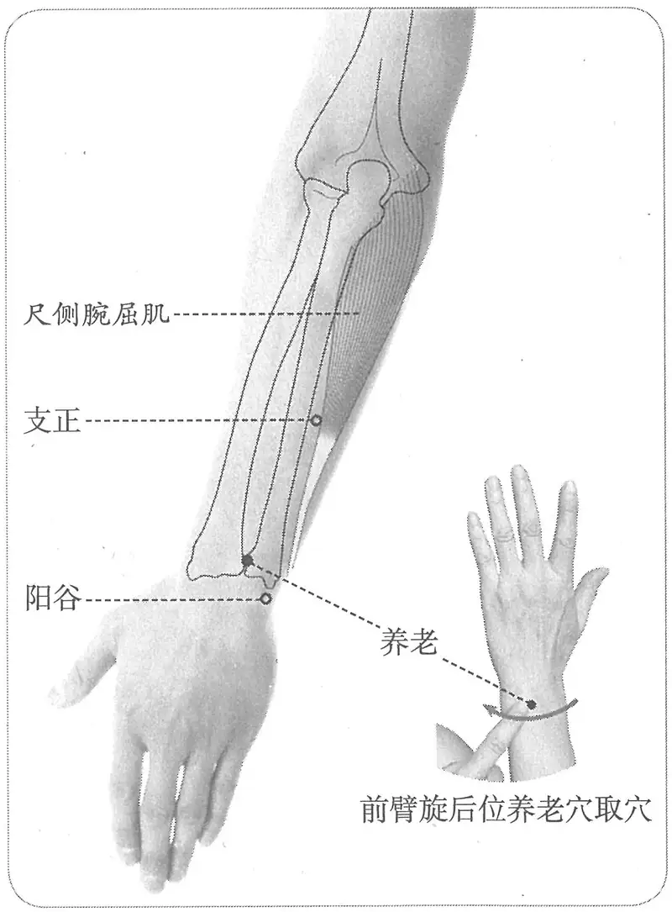

**图 2-142　养老穴图**

　2. 在手踝骨上一空一寸陷中。（《铜人腧穴针灸图经》卷下、《圣济总录》）

**按**：此文难解，应据《铜人腧穴针灸图经》卷上及卷下“穴腧都数”改。

　3. 手踝骨外侧陇尖歧骨缝内陷中去腕后一寸三分。（《大本琼瑶神书》）

　4. 手踝骨前上。一云腕骨后一寸陷中。（《针灸聚英》卷一、《古今医统》、《针灸大成》）

　5. 在手踝骨上有空，再后一寸陷中。广注合居阳谷后一寸五分。（《循经考穴编》上）

　6. 从阳谷上行，手下锐骨上一空，腕后一寸许陷中。（《医宗金鉴·刺灸心法要诀》）

〔p.556 (인쇄 536)〕

　7. 腕后尺骨端突起处。（《针灸十四经穴位考订》）

　8. 统编针灸学教材

　　(1) 部位：腕后兑骨之上部。取穴：屈肘，手掌向颜面，以指尖摸尺骨茎状突起部有一隙缝处取之，如将手掌转动，其沟即闭。（1957年南京《针灸学》）

　　(2) 部位：腕后锐骨上。取穴：先以一手掌心向下，用另一手指尖按压腕后髁骨上部，然后将向下手掌转动向上，指尖按压处出现骨间凹陷之中取之。（1版《针灸学讲义》）

　　(3) 部位：在手髁骨上一空，腕后一寸陷中。取穴：位于尺骨小头上方。取穴时，屈肘掌心向胸，当尺骨茎突之桡侧骨缝中。（2版《针灸学讲义》）

　　(4) 以掌向胸，当尺骨小头桡侧缘凹陷中。（4版《针灸学》）

　　(5) 以掌向胸，当尺骨茎突桡侧缘凹陷中。（5版《针灸学》）

　　(6) 在前臂背面尺侧，当尺骨小头近端桡侧凹陷中。（6版《针灸学》）

　　(7) 以手掌面向胸，当尺骨茎突桡侧骨缝凹陷中。（7版《针灸学》）

　　(8) 在尺骨小头的背面。取穴时，掌心向胸，当尺骨茎突之桡侧骨缝中。（《中国针灸学》）

**文献分析**：此穴采用的体位不同，其腧穴定位的描述方法也不同。国家标准文本中定位采用的是前臂旋前位，故其表述为“养老：在腕背横纹上1寸，尺骨头桡侧凹陷中”。但实际上在这一体位下，尺骨头桡侧与桡骨的尺切迹紧密相连，不表现出凹陷。因此，本穴的取穴法为：“掌心向下，用一手指按在尺骨头的最高点上，然后手掌旋后，当手指滑入的骨缝中”（图2-143）。这种取穴法的较早记载见于日本《和汉三才图会》卷十一，而早于此的中国古典文献有直接以旋后位表述该穴的位置，如《大本琼瑶神书》中关于养老的位置作“手踝骨外侧陇尖歧骨缝内陷中，去腕后一寸三分”，这也是关于本穴定位描述最明确，并与现代教材定位最相合的古代文献。

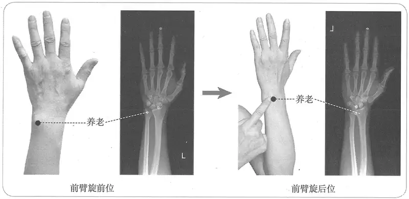

**图 2-143　养老穴取穴法**

#### 【类属】 

手太阳小肠经穴；郄穴。

手太阳郄。（《黄帝明堂经》）

#### 【适应症】 

主治肩臂部病症、目疾。常用于肩臂痛、活动受限；视物不清。

〔p.557 (인쇄 537)〕

　1. 主肩痛欲折，臑如拔，手不能自上下。（《黄帝明堂经》）

**按**：以上病症为手太阳经“是动”病的典型症状。

　2. 治肩欲折，臂如拔，手臂疼不能自上下，目视不明。（《铜人腧穴针灸图经》卷下）

　3. 耳痛，目肿。（《针方六集》卷五）

　4. 主肘外廉红肿，肩臂酸麻，冷风疼痛。（《循经考穴编》上）

　5. 张仲文传灸治仙法，疗腰重痛，不可转侧，起坐艰难，及筋挛肢痹，不可屈伸。（《类经图翼》卷六）

**按**：此方辑自《太平圣惠方》卷一百，原灸方“灸曲脷两纹头，左右脚四处各三壮”，敦煌卷子佚名灸方及《千金翼方》载此穴名曰“足五册”。与手腕部“养老”穴不相干，张介宾误解原文，而附该方于此处。

　6. 统编针灸学教材

　　(1) 目视不明，肩臂酸痛，冷风疼痛，肘外廉红肿。（1957年南京《针灸学》、1版《针灸学讲义》）

　　(2) 目视不明，肩、背、肘、臂酸痛。（2版《针灸学讲义》、5、7版《针灸学》、《中国针灸学》）

　　(3) 目视不明，肩臂腰痛。（4版《针灸学》）

　　(4) 目视不明，肩臂疼痛。（6版《针灸学》）

**文献分析**：宋以前文献关于本穴主治仅用于肩臂局部疼痛，北宋《铜人腧穴针灸图经》中始出现“目视不明”，但影响深远，被视为养老穴的特殊主治病症，今仍从之。《类经图翼》所载治疗“腰痛”的主治系误录奇穴“足五册”主治，针灸教材仅第4版教材或受此影响录有此主治，在没有可靠文献依据或临床证据之前，暂不收录此主治。

#### 附：临床应用举例 

　1. 若臂痛不能屈伸，此邪客于臂掌之间，取腕踝骨后，以指按之极痛，刺之留二呼，急出针，或灸。（《全生指迷方》卷三）

**按**：“手腕踝骨后”相当于养老穴。

　2. 坐骨神经痛，选用患侧的攒竹及健侧的养老穴，按经脉循行方向进针，得气为度。［针灸临床杂志，1996，12(9):38-39］

　3. 急性腰扭伤，针刺患侧养老穴，配合委中用三棱针刺络放血。［天津中医，2001，18(3):35］

#### 【操作】 

直刺0.5~0.8寸。

　1. 刺入三分，灸三壮。（《黄帝明堂经》）

　2. 横针入五分，灸七壮。（《循经考穴编》上）

　3. 针二分，灸三壮。（《针灸十四经穴位考订》）

　4. 统编针灸学教材

　　(1) 针一至二分，依取穴法进针，灸三壮。（1957年南京《针灸学》、1版《针灸学讲义》）

　　(2) 直刺3分，艾条灸5~10分钟。（2版《针灸学讲义》）

　　(3) 直刺或斜刺0.5~0.8寸。（4、5、6版《针灸学》）

　　(4) 直刺或斜刺0.5~0.8寸。强身保健可用温和灸。（7版《针灸学》）

　　(5) 直刺0.3~0.5寸。可灸。（《中国针灸学》）

　5. 向内关方向斜刺1~1.5寸。感应手掌及手腕酸麻，可向肩肘传导。灸3壮；温灸5~10分钟。（上海《针灸学》）

〔p.558 (인쇄 538)〕

### （七）支正 Zhīzhèng SI7 出《灵枢》 

#### 【提要索隐】 

**部位**：在前臂后区，腕背侧远端横纹上5寸，尺骨尺侧与尺侧腕屈肌之间。

**适应症**：主治头项部病症。常用于头痛，颈项强痛；发热，癫狂；肘臂痛；疣目。

**针刺操作**：直刺0.3~0.5寸。

#### 【名实考】 

支正，既是穴名，也是脉名。本穴源出于手太阳络脉，其络脉所诊之病候也就成为络穴的主治病症。

　1. 手太阳之别，名曰支正，上腕五寸，内注少阴；其别者，上走肘，络肩髃。（《灵枢·经脉》）

　2. 支正，手太阳络，在腕后五寸，别走少阴者。（《黄帝明堂经》）

　3. 一方以腕骨肘节为两端，居中是穴，当臂之中，故曰支正。（《针方六集》卷一）

**按**：明代有将前臂骨度折为一尺者（见《古今医统》），则腕后五寸之支正穴正好居臂之中。

　4. 此络之别者，上走肘，络肩髃，经之别行者曰支，以通于心经，故曰正。（《经穴解》）

#### 【定位】 

**部位**：在前臂后区，腕背侧远端横纹上5寸，尺骨尺侧与尺侧腕屈肌之间（图2-144）。

**取穴**：阳谷与小海连线的中点下1寸处取穴。

　1. 上腕五寸。（《灵枢·经脉》）

　2. 在腕后五寸。（《黄帝明堂经》、《铜人腧穴针灸图经》、《圣济总录》、《针灸资生经》、《十四经发挥》、《医学纲目》、《针灸集书》、《针灸聚英》、《古今医统》、《针灸大成》、《针方六集》、《循经考穴编》、《针灸易学》）

　3. 在腕后同身寸之五寸，骨上廉肉分。（《素问·通评虚实论》王冰注）

**按**：横肱俯掌位时，“骨上廉”指尺骨尺侧缘，与《黄帝明堂经》文异意同。

　4. 在手太阳腕后五寸，去养老穴四寸陷者。（《太平圣惠方·明堂》、《针灸资生经》、《循经考穴编》）

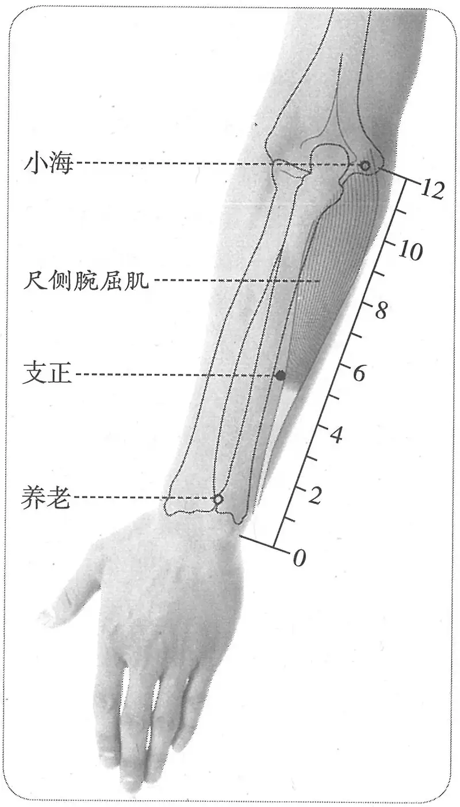

**图 2-144　支正穴图**

　5. 在腕后外廉五寸。（《类经图翼》卷五、《针灸逢源》）

　6. 统编针灸学教材

　　(1) 部位：在腕后五寸。取穴：从阳谷穴与肘部鹰嘴突起之尖端作一直线，去腕五寸处取之。（1957年南京《针灸学》）

　　(2) 部位：在腕后五寸。取穴：从阳谷穴至小海穴成直线，去腕五寸取之。（1版《针灸学讲义》）

　　(3) 部位：在肘后五寸。取穴：在阳谷上五寸，当阳谷与小海的连线上取之。（2版《针灸学讲义》）

〔p.559 (인쇄 539)〕

　　(4) 阳谷穴与小海穴的连线上，阳谷穴上五寸。（4、5版《针灸学》、《中国针灸学》）

　　(5) 在前臂背面尺侧，当阳谷与小海的连线上，腕背横纹上5寸。（6版《针灸学》）

　　(6) 掌心对胸，阳谷穴与小海穴的连线上，腕背横纹上5寸。（7版《针灸学》）

#### 【类属】 

手太阳小肠经穴；络穴；手太阳之所入。

　1. 手太阳之别，名曰支正，上腕五寸，内注少阴。（《灵枢·经脉》）

　2. 手太阳络，别走少阴者。（《黄帝明堂经》）

　3. 手太阳根于少泽，溜于阳谷，注于少海，入于天窗、支正也。（《灵枢·根结》）

#### 【适应症】 

主治头项部病症。常用于头痛，颈项强痛；发热，癫狂；肘臂痛；疣目。

　1. 实则节弛肘废；虚则生疣，小者如指痂疥，取之所别也。（《灵枢·经脉》）

　2. 主振寒，寒热，颈项肿，实则肘挛，头眩痛，狂易；虚则生疣，小者痂疥。风疟。（《黄帝明堂经》）

**按**：以上病症为手太阳络脉病候和疟病、狂病症状。

　3. 主热病先腰胫酸，喜渴数饮食，身热，项痛而强。（《千金要方》卷三十）

**按**：此条主治原文见《素问·刺热》，系“肾热病”主症，取“足少阴、太阳”治之，故《千金要方》此处应属缺文或错简，相同的内容又见于下条“涌泉及太阳井荥”主治中，亦可证。

　4. 主肘臂挛难屈伸，手不握，十指尽痛也。秦丞祖云：兼主五劳，四肢力弱，虚乏等病。（《太平圣惠方·明堂》）

**按**：《太平圣惠方·明堂》“后溪”穴下（实系“腕骨”穴）的主治作“主痎疟寒热，目生白翳，肘臂腕重难屈伸，五指尽痛不可掣也”，可参。又此条文字引“秦丞祖云”文字又见于《太平圣惠方》“手三里”穴下，经考证系足三里穴主治。

　5. 治寒热颔肿，肘挛，头痛目眩，风虚惊恐，狂惕，生疣目。（《铜人腧穴针灸图经》卷下）

　6. 治肩背痛，泻；手臂麻木不仁，补。（《窦太师针经》）

　7. 统编针灸学教材

　　(1) 目眩，项强颔肿，肘挛，手指不能握，热病汗不出，癫疾，惊恐。（1957年南京《针灸学》、1版《针灸学讲义》）

　　(2) 项强，肘挛，手指痛，热病，癫狂，头痛目眩。（2版《针灸学讲义》、《中国针灸学》）

　　(3) 寒热，头痛目眩，肘臂手指挛痛，癫狂。（4版《针灸学》）

　　(4) 头痛，目眩，热病，癫狂，项强，肘臂酸痛。（5版《针灸学》）

　　(5) 项强，肘挛，手指痛，头痛，热病，目眩，好笑善忘，消渴。（6版《针灸学》）

　　(6) ①头痛，项强，肘臂酸痛；②热病；③癫狂；④疣证。（7版《针灸学》）

**文献分析**：《黄帝明堂经》所载支正穴的主治症，以头目颈项、循经肢节病痛，及神志病症、寒热症为主，另有引自《灵枢·经脉》的络穴主治“疣”，后世文献基本同此。

#### 附：临床应用举例 

　1. 舌尖疼痛，取支正穴针之，捻转提插泻法。［上海针灸杂志，1988，7(4):4］

　2. 急性腰扭伤，取大包、支正穴，针尖向上斜刺入穴位，并加灸。［甘肃中医杂志，1996(9):45-46］

#### 【操作】 

直刺0.3~0.5寸。

　1. 刺入三分，留七呼，灸三壮。（《黄帝明堂经》）

　2. 灸五壮。（《太平圣惠方·明堂》）

〔p.560 (인쇄 540)〕

　3. 针入一分，沿皮向前一寸半，灸七壮。治肩背痛，泻；手臂麻木不仁，补。（《窦太师针经》）

　4. 统编针灸学教材

　　(1) 针三至五分，灸三至五壮。（1957年南京《针灸学》、1版《针灸学讲义》）

　　(2) 直刺3~5分，艾条灸5~10分钟。（2版《针灸学讲义》）

　　(3) 直刺或斜刺0.5~0.8寸。（4、5、7版《针灸学》、《中国针灸学》）

　　(4) 直刺0.3~0.8寸；可灸。（6版《针灸学》）

　　(5) 直刺0.5-0.8寸。可灸。（《中国针灸学》）

### （八）小海 Xiǎohǎi SI8 出《灵枢》 

#### 【提要索隐】 

**部位**：在肘后区，尺骨鹰嘴与肱骨内上髁之间凹陷中。

**适应症**：主治头项部病症。常用于头痛，颈项强痛；肘臂痛；癫痫。**新增**：疝气。

**针刺操作**：直刺0.3~0.5寸。勿损伤尺神经。

#### 【名实考】 

小海，而手少阴经有“少海”一穴，“小”、“少”古代通用，古医籍中常见有“小”、“少”混用者，“小海”与“少海”混用亦不乏其例。又元代《痈疽神秘灸经》所载之“肘尖”穴即为本穴，而奇穴类亦有“肘尖”一穴，与本穴不同。故清代祁坤《外科大成》将《痈疽神秘灸经》之“肘尖”称作“小肘尖”，奇穴“肘尖”称作“大肘尖”。相同的说法也见于明代《针灸秘法全书》。今人不察，将此大、小“肘尖”皆归入奇穴类。

正确理解本穴的定位，关键在于确认《黄帝明堂经》所说“肘内大骨”为何骨。综合考察相关文献，并结合手太阳经脉、经筋的循行分布，可以确认“肘内大骨”即相当于现代解剖学术语“肱骨内上髁”，本穴即在肱骨内上髁与尺骨鹰嘴（肘端）之间的尺神经沟陷中，故“弹之应小指之上”。

　1. 入于小海，小海在肘内大骨之外，去端半寸陷者中也，伸臂而得之，为合。（《灵枢·本输》）

　2. 入于小海，小海者，土也。在肘内大骨外，去肘端五分陷者中，屈肘乃得之。手太阳脉之所入也，为合。（《黄帝明堂经》）

　3. 此穴为小肠经所聚，故曰小海。（《经穴解》）

　4. 手太阳之筋……结于肘内锐骨之后，弹之应小指之上。张介宾注曰：小海之次，但于肘尖下两骨罅中，以指捺其筋，则酸麻应于小指之上，是其验也。（《类经》卷七）

　5. 小肠手太阳之脉……出肘内侧两骨之间。（《黄帝内经太素·经脉连环》）

　6. 所云肘尖穴在臂内侧小尖骨间，前图见外侧腕骨乃画之误也，故复具此图以便用者。二穴以指目按之，若患处酸麻方是真穴。（《痈疽神秘灸经》）

**按**：清代《外科大成》卷一曰：“此乃大肘尖之旁小肘尖。仰手与小指对直者是也。按此骨尖小指即麻为验”。原书明言肘尖穴在“臂内侧小尖骨间”，此处又说明按之酸麻至小指，显然为小海穴。

　7. 小海在肘大骨外，去肘端五分内，与少海隔一小肘尖，外与肘髎隔一大肘尖，相去不远，又当知肘髎在曲肘外，曲池在曲肘里，以骨为界是。（明抄本《针灸秘法全书》）

#### “少海”、“小海”混淆例 

现行本《针灸甲乙经》中所有五条“小海”穴主治症均误作“少海主之”，考证详见总论“附二”。现录之于下：

〔p.561 (인쇄 541)〕

　1. 风眩头痛，少海主之。（卷七，第一下）

　2. 疟，背膂振寒，项痛引肘腋，腰痛引少腹，四肢不举，少海主之。（卷七，第五）

　3. 寒热取……腕骨、阳谷、少海……主之。（卷八，第一下）

　4. 狂易，鱼际及合谷、腕骨、支正、少海、昆仑主之。（卷十一，第二）

　5. 齿龋痛，合谷主之，又云少海主之。（卷十二，第六）

由于《针灸甲乙经》中这一错误发生得很早，后人又未能及时校正，特别是北宋王惟一编撰《铜人腧穴针灸图经》时，也不慎沿袭了其中部分错误，以致后世代代相袭，一宜沿误至今。

　6. 少海，在肘内大骨外，去肘端同身寸之五分陷者中，屈肘乃得之。（《素问·气穴论》王冰注）

**按**：此处内容悉为小海穴文字，显然“少海”系“小海”之形误。宋以后许多文献如《太平圣惠方》、《铜人腧穴针灸图经》等皆传此误。

　7. 少海二穴，在肘大骨外去肘端五分陷者中，屈肘乃得之。灸五壮。主四肢不举，癫痫吐舌，沫出羊鸣也。（《太平圣惠方·明堂》）

**按**：此“少海”显然系“小海”之形误。

#### 【定位】 

**部位**：在肘后区，尺骨鹰嘴与肱骨内上髁之间凹陷中（图2-145）。

**取穴**：微曲肘，当尺神经沟中，用手指弹敲此处时有触电麻感直达小指。

　1. 在肘内大骨之外，去端半寸陷者中也，伸臂而得之。（《灵枢·本输》）

　2. 在肘内大骨外，去肘端五分陷者中，屈肘乃得之。（《黄帝明堂经》、《铜人腧穴针灸图经》、《圣济总录》、《针灸资生经》、《针灸玉龙经》、《十四经发挥》、《神应经》、《针灸集书》、《针灸聚英》、《古今医统》、《医学入门》、《针灸大成》、《类经图翼》、《循经考穴编》、《医宗金鉴·刺灸心法要诀》、《针灸易学》）

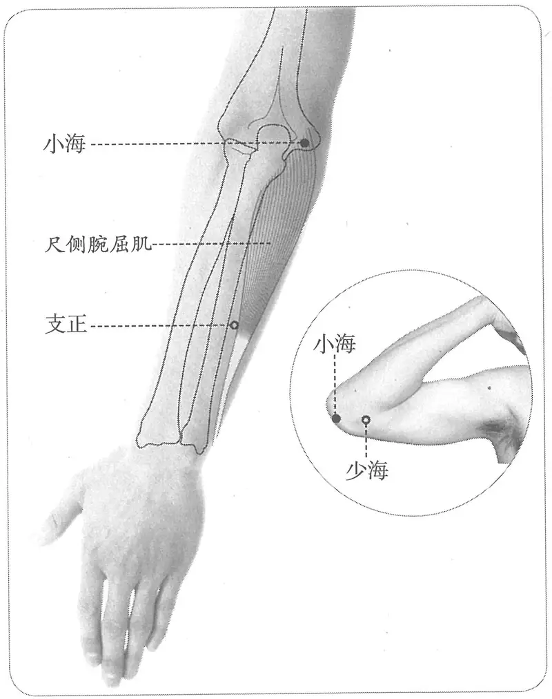

**图 2-145　小海穴图**

　3. 窦太师针灸遗存

　　(1) 在肘后大骨外，去肘端五分陷中，以手叉腰得穴。（《窦太师针经》）

　　(2) 在肘内大骨外，大筋内，去肘端五分陷中。屈手入腰取之。（《针方六集》卷一）

　　(3) 在肘内大骨外，去肘端五分陷中。广注：屈肘向头取之。一法：叉手于腰，四指向前，大指向后，于肘尖量上去一寸，中取天井，天井外旁五分，乃取小海。（《循经考穴编》上）

〔p.562 (인쇄 542)〕

　4. 尺骨鹰嘴突起，与肱骨突间陷中。（《针灸十四经穴位考订》）

　5. 统编针灸学教材

　　(1) 部位：肘外大骨外，去肘端五分陷者中。取穴：按其鹰嘴突起之尖端与内上髁之间陷中，屈肘向头取之。（1957年南京《针灸学》）

　　(2) 部位：肘内两骨间，去肘端五分陷中。取穴：从肘内侧二骨之间陷中，以手按压酸麻应于小指，屈肘向头取之。（1版《针灸学讲义》）

　　(3) 部位：在肘内大骨外，去肘端五分陷者中，屈肘乃得之。取穴：在肘关节后，屈肘当尺骨鹰嘴与肱骨内上髁之间取之。（2版《针灸学讲义》）

　　(4) 屈肘，当尺骨鹰嘴与肱骨内上髁之间凹陷中。（4、5、7版《针灸学》、《中国针灸学》）

　　(5) 在肘内侧，当尺骨鹰嘴与肱骨内上髁之间凹陷处。（6版《针灸学》）

**文献分析**：手太阳经行于“出肘内侧两骨之间”，又《灵枢·经筋》云：“手太阳筋起小指之上，结于腕上循臂内，结于肘内锐骨之后，弹之应小指”。张介宾曰：“结于肘下锐骨之后，小海之次，但于肘尖下两骨罅中，以指捺其筋，则酸麻应于小指之上，是其验也”。由此可确认，《灵枢·经脉》所谓“肘内侧两骨间”即指尺骨鹰嘴与肱骨内上髁之间，本穴正当此凹陷中。

#### 【类属】 

手太阳小肠经穴；五输穴之合穴；手太阳之所入。

　1. 手太阳小肠者，上合手太阳，出于少泽……入于小海，小海，在肘内大骨之外，去端半寸陷者中也，伸臂而得之，为合，手太阳经也。（《灵枢·本输》）

　2. 手太阳脉之所入也，为合。（《黄帝明堂经》）

　3. 手太阳根于少泽，溜于阳谷，注于少海，入于天窗、支正也。（《灵枢·根结》）

#### 【适应症】 

主治头项部病症。常用于头痛，颈项强痛；肘臂痛；癫痫。**新增**：疝气。

　1. 主风眩头痛，疟，背膂振寒，项痛引肘掖，腰痛引少腹，四肢不举，寒热，狂易，齿龋痛。（《黄帝明堂经》）

**按**：据《素问·刺疟》，“疟，背膂振寒”本系足太阳经合穴“委中”主治。此为取手足同名经之例也。

　2. 癫痫吐舌，沫出羊鸣也。（《太平圣惠方·明堂》）

**按**：此系《黄帝明堂经》天井穴主治。

　3. 治寒热，齿龈肿，风眩，颈项痛，疡肿振寒，肘腋肿，少腹痛，四肢不举。（《铜人腧穴针灸图经》卷下）

**按**：“肘腋肿，少腹痛”源于《黄帝明堂经》原文“项痛引肘掖，腰痛引少腹”，但如此处理与原文之义有较大出入。

　4. 窦太师针灸遗存

　　(1) 治瘰疬等症，先泻后补；小肠气。（《窦太师针经》）

　　(2) 小腹疼胀，小肠疝气，瘰疬肿痛。（《针方六集》卷五）

　　(3) 主肩项瘰疬。（《循经考穴编》上）

　5. 颈颔、肩臑、肘臂外后廉痛，颔肿不可回顾，肩似拔，臑似折，耳聋，目黄，颊肿。（《针灸聚英》卷一）

**按**：以上病症悉为手太阳小肠经脉病候，高武据其对“母子补泻”原则的理解，将手太阳经病候分别归于该经“原穴”与“合穴”中，故列手太阳经脉病候于此。

　6. 统编针灸学教材

　　(1) 耳聋，颊肿，齿痛，颈、颔、肩、臑、肘、臂外后廉痛，癫疾。（1957年南京《针灸学》、1版《针灸学讲义》）

〔p.563 (인쇄 543)〕

　　(2) 颊肿，颈项、肩、臂外后侧痛，癫痫，风眩头痛，耳鸣耳聋。（2版《针灸学讲义》）

　　(3) 头痛，颔肿颈痛，肩肘臂痛，癫痫。（4版《针灸学》、《中国针灸学》）

　　(4) 肘臂疼痛，癫痫。（5版《针灸学》）

　　(5) 肘臂疼痛，癫痫，耳鸣，耳聋。（6版《针灸学》）

　　(6) 肘臂疼痛、麻木，癫痫。（7版《针灸学》）

**按**：统编教材第1~3版中的“耳鸣耳聋”、“耳聋，颊肿，齿痛，颈、颔、肩、臑、肘、臂外后廉痛”诸症系承袭明代高武之误，今去之。值得一提的是，《黄帝明堂经》“腰痛引少腹”为阴疝的典型症状（见于《灵枢·邪气藏府病形》所述之“小肠病”），金元窦太师针灸发展为“小肠疝气”。这一主治病证与手太阳经所属小肠相关，且出自窦太师临床经验，后世也有明确的临床应用，故补于本穴主治项。

#### 附：临床应用举例 

　1. 疝气，大敦、水道、小海。（《医学纲目》卷十四）

　2. 风湿性膝关节炎，痛在膝弯处取小海。［广西中医药，1989，12(1):31］

#### 【操作】 

直刺0.3~0.5寸。勿损伤尺神经。

　1. 刺入二分，留七呼，灸五壮。（《黄帝明堂经》）

　2. 灸三壮。甄权云不宜灸。（《外台秘要》卷三十九）

　3. 针入五分，灸二七壮。（《窦太师针经》）

　4. 针二分，灸三壮。（《针灸十四经穴位考订》）

　5. 统编针灸学教材

　　(1) 针三分，灸三至七壮。（1957年南京《针灸学》、1版《针灸学讲义》）

　　(2) 直刺3~4分，艾条灸5~10分钟。（2版《针灸学讲义》）

　　(3) 直刺0.3~0.5寸。（4、5、6、7版《针灸学》、《中国针灸学》）

**按**：本穴《外台秘要》引甄权云“不宜灸”。可能是此穴在肘关节上，若用瘢痕灸有影响关节功能活动之虞，故云不宜灸，非瘢痕灸和艾卷灸当可用之。

### （九）肩贞 Jiānzhēn SI9 出《素问》 

#### 【提要索隐】 

**穴名**：一名肩真，一名肩正。

**部位**：在肩胛区，肩关节后下方，腋后纹头直上1寸。

**归经**：手太阳小肠经。**按**：肩贞穴归经分歧较大。

**适应症**：主治局部病症。常用于肩痛，上肢不遂；瘰疬。

**针刺操作**：直刺1~1.5寸。

#### 【名实考】 

宋人避讳或作“肩真”（《针灸甲乙经》卷十二、《窦太师针经》等）；或缺末笔（宋本《外台秘要》、《千金要方》），明正统石刻《铜人腧穴针灸图经》卷下“穴腧都数”作“肩正”，此宋人避仁宗之讳而改字，明正统重刻时回改未尽故也。

　1. 肩贞，在肩曲胛下两骨解间，肩髃后陷者中，手太阳脉气所发。（《黄帝明堂经》）

**按**：这里的“肩髃”非指穴名，而是部位名。

　2. 肩髃者，手阳明大肠经穴，在肩端臑上陷中，斜举臂取之。此穴在肩髃之后陷中，当在肩之后下陷中也，以其将离肩也，故曰肩贞。（《经穴解》）

〔p.564 (인쇄 544)〕

#### 相关穴及刺激点 

　1. 后腋，在腋后廉际两筋间，主腋外相引而痛，手臂拘挛急，不得上头。（《外台秘要》卷三十九）

　2. 胛缝二穴，在肩背胛缝尖尽处是穴。直针入三寸，灸二七壮。治肩背臂膊疼，泻；手无力，补。（《窦太师针经》）

　3. 背缝，位于肩胛部，腋后皱襞直上，平第4胸椎棘突。主治肩背疼痛。针5~8分，得气时局部有麻酸感觉。灸3~7壮。（《针灸经外奇穴图谱》）

　4. 腋神经刺激点　垂肩，腋后纹头与肩峰连线的中点。主治上肢瘫痪（举臂抬肩障碍），肩部疼痛和麻木，腋神经麻痹。直刺4.0cm。（《实用神经干电刺激疗法》）

胛缝、背缝、后腋与肩贞穴定位相当，主治相近，可视为异名同穴。今人不察，于“后腋”穴外，别立“背缝”一穴。

#### 【定位】 

**部位**：在肩胛区，肩关节后下方，腋后纹头直上1寸（图2-146）。

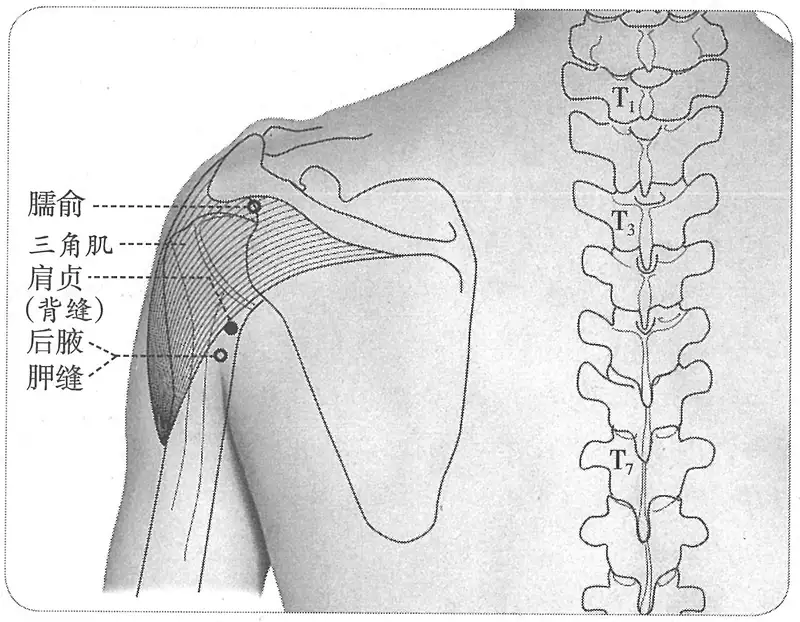

**图 2-146　肩贞穴与相关穴图**

**取穴**：臂内收时，腋后纹头直上1寸，三角肌后缘处取穴。

　1. 在肩曲胛下两骨解间，肩髃后陷者中。（《黄帝明堂经》、《铜人腧穴针灸图经》、《圣济总录》、《针灸资生经》、《十四经发挥》、《医学纲目》、《针灸聚英》、《古今医统》、《医学入门》、《针灸大成》、《针方六集》、《类经图翼》、《循经考穴编》）

　2. 肩真二穴，在肩端柱骨下，与肩髃穴相平，举手有陷是穴。又法：肩柱骨下及两骨界间是肩髃穴，亦在后陷中；此穴在前陷中，两穴相伴。（《窦太师针经》）

**按**：此将“肩髃”误解为穴名。

　3. 在肩曲胛下两骨解间，肩髎后陷中。（《大本琼瑶神书》）

　4. 从小海上行，肩曲胛骨下，大骨旁两骨解间，肩端后陷中。（《医宗金鉴·刺灸心法要诀》）

　5. 在肩曲腋下大骨旁，两骨解罅间，肩髃穴后陷中。（《针灸逢源》）

**按**：此将“肩髃”误解为穴名。

〔p.565 (인쇄 545)〕

　6. 肩峰突起后侧之下，后腋纹端之上寸许。（《针灸十四经穴位考订》）

　7. 统编针灸学教材

　　(1) 部位：肩胛下两骨之间，肩髎后陷中。取穴：使肩臂与胁紧靠，从腋缝尖端上一寸之处取之。（1957年南京《针灸学》）

　　(2) 部位：肩关节后下部。取穴：垂手，从腋后缝尖端上一寸处陷中取之。（1版《针灸学讲义》）

　　(3) 部位：在肩曲胛下，两骨解间，肩髃后陷者中。取穴：在肩关节后下方，当上臂内收时从腋后纹头上一寸处取之。（2版《针灸学讲义》）

　　(4) 腋后皱襞上1寸。（4、5版《针灸学》）

　　(5) 在肩关节后下方，臂内收时，腋后纹头上一寸指寸。（6、7版《针灸学》，《中国针灸学》）

**文献分析**：《黄帝明堂经》谓本穴“在肩曲胛下两骨解间，肩髃后陷者中”，这里的“肩髃”非指穴名，而是部位名。杨上善曰：“髃，音隅，角也，两肩端高骨即肩角也”。手阳明经“上肩出髃前廉”，故手阳明经穴“肩髃”位于肩峰外侧前端。而“肩贞”在肩曲胛下两骨解间，肩髃后，则知其更在肩髎穴下。故《大本琼瑶神书》直接改作“肩髎后”；从部位名而言，《医宗金鉴·刺灸心法要诀》则改作更通俗的名称“肩端后”，皆合《黄帝明堂经》本意。而古代文献的确有将本穴定位中“肩髃”理解为穴名者，故在定位时出现混乱。

#### 【类属】 

手太阳小肠经穴。《外台秘要》本穴下未记脉气所发文字，推测传世本《针灸甲乙经》本穴下脉气所发文字当系后人据王冰注所添加。或正因为《黄帝明堂经》未记有脉气所发内容，后世的归经才出现了很大的分歧。

**脉气所发**：手太阳脉气所发。（《针灸甲乙经》卷三）

**归经：**

　1. 手少阳。（《外台秘要》卷三十九）

　2. 手阳明。（《医心方》卷二）

　3. 手太阳。（《千金要方》卷二十九、《千金翼方》、《铜人腧穴针灸图经》卷上）

**按**：《素问·气府论》王冰注曰“手太阳脉气所发”，但该穴却注于手少阳脉气所发穴下。宋以后归经多从《铜人腧穴针灸图经》之说，归于手太阳经。

#### 【适应症】 

主治局部病症。常用于肩痛，上肢不遂；瘰疬。

　1. 主寒热，项疬适，耳鸣无闻，引缺盆，肩中热痛，手臂麻痹不举。（《黄帝明堂经》）

　2. 治风痹，手臂不举，肩中热痛。（《铜人腧穴针灸图经》卷中）

　3. 窦太师针灸遗存

　　(1) 治肩端痛。（《窦太师针经》）

　　(2) 如肩端红肿。（《针方六集》卷五）

　　(3) 治肩骨一点大疼。（《循经考穴编》上）

　4. 统编针灸学教材

　　(1) 耳聋，耳鸣，肩胛痛，缺盆中痛，手麻木不举。（1957年南京《针灸学》、1版《针灸学讲义》）

　　(2) 肩胛痛，手臂痛不能举，缺盆中痛，瘰疬。（2版《针灸学讲义》）

　　(3) 肩中热痛，手臂不举，耳鸣，齿痛，瘰疬，寒热。（4版《针灸学》）

　　(4) 肩臂疼痛，瘰疬，耳鸣。（5版《针灸学》）

〔p.566 (인쇄 546)〕

　　(5) 肩胛痛，手臂麻痛，上肢不举，缺盆中痛。（6版《针灸学》）

　　(6) 肩臂疼痛，上肢不遂；瘰疬。（7版《针灸学》）

　　(7) 肩胛痛，手臂不举。（《中国针灸学》）

**文献分析**：本穴主治，宋以前文献承《黄帝明堂经》，主病包括瘰疬、耳鸣耳聋、肩臂痛麻不举等。《千金要方》、《千金翼方》载“腋上纹头”治瘰疬，载“后腋”穴（在腋后廉际两筋间）治肩臂部病症，可参。但北宋《铜人腧穴针灸图经》仅载肩臂局部病症，金元窦太师针灸更不乏刺治肩臂病痛的具体方法，现代针灸学教材亦趋向于治疗局部病症，这种趋势应视为实践经验的反映。《窦太师针经》所载之“胛缝”穴，《针灸孔穴及其疗法便览》又作“背缝”，其定位与肩贞穴相当，皆主治“肩背膊臂痛”。“臂畅”穴（肩贞穴上1寸处）也主治“肩关节及软组织疾患”。同时，本穴也是“肩三针”之一，在治疗肩臂部病症上有广泛的应用。

#### 附：临床应用举例 

　1. 一切瘰，又灸患人背两边腋下后纹上，随年壮。（《千金要方》卷二十三）

　2. 灸瘿法，又垂两手两腋上纹头，各灸三百壮，针亦良。（《千金翼方》卷二十八）

　3. 漏肩风，后伸肩痛取肩贞、臑俞，采用缪刺法。［江苏中医，1988，9(2):24］

　4. 坐骨神经痛，取肩贞穴右病取左，左病取右，双侧发病取双侧穴位，针尖向极泉穴方向斜刺，快速进针，得气后行捻转法。［山东中医杂志，2002，21(7):441］

#### 【操作】 

直刺1~1.5寸。

　1. 刺入八分，灸三壮。（《黄帝明堂经》）

　2. 针入五分。（《铜人腧穴针灸图经》卷中）

　3. 窦太师针灸遗存

　　(1) 直针入一寸半，灸二七壮。治肩端痛，泻弹针出血。（《窦太师针经》）

　　(2) 如肩端红肿，宜弹针出血。（《针方六集》卷五）

　　(3) 直刺入二寸五分，治肩骨一点大疼，宜单泻之，或弹针出血；灸之，亦立愈。（《循经考穴编》上）

　4. 针入一寸八分，禁灸。（《医学入门》卷一）

　5. 统编针灸学教材

　　(1) 针五分至一寸。（1957年南京《针灸学》、1版《针灸学讲义》）

　　(2) 直刺5~10分，艾条灸5~10分钟。（2版《针灸学讲义》）

　　(3) 直刺1~1.5寸。（4、5、6版《针灸学》）

　　(4) 直刺1~1.5寸。不宜向胸侧深刺。（7版《针灸学》）

　　(5) 直刺0.5~1寸。可灸。（《中国针灸学》）

　6. 直刺1.5~2寸。感应局部酸胀，治上肢瘫痪时，有时可有麻电感向肩及指端放散。灸3~7壮；温灸5~20分钟。（上海《针灸学》）

### （十）臑俞 Nàoshū SI10 出《黄帝明堂经》 

#### 【提要索隐】 

**部位**：在肩胛区，腋后纹头直上，肩胛冈下缘凹陷中。

**归经**：手太阳小肠经。**按**：宋以前文献关于本穴归经存在分歧。

〔p.567 (인쇄 547)〕

**适应症**：主治肩胛部病症。常用于肩痛，臂痛。

**针刺操作**：直刺0.8~1.2寸。

#### 【名实考】 

臑俞，《千金要方》作“臑输”。关于本穴的读音，近来有人提出不同意见，详见臂臑穴“名实考”。

需要注意的是，古代文献有将本穴与“臂臑”、“臑会”穴相混者。

　1. 臑俞，在肩髎后大骨下，胛上廉陷者中，手足太阳、阳维、𫏋脉之会，举臂取之。（《黄帝明堂经》）

　2. 肘之上维臑，此穴紧在臑尽处，故为臑腧。（《经穴解》）

#### “臂臑”混作“臑俞”例 

寒热，颈疬适，肩臂不可举，臂臑俞主之。（《针灸甲乙经》卷三）

**按**：此条主治系“臂臑”穴主治，后人误将“臂臑”之“臂”字属上读，另增一“俞”字，遂误作“臑俞”主治。《外台秘要》乃至现代针灸学教材多传此误。

#### “臑会”混作“臑俞”例 

臑俞，主气肿痓痛。（《针灸聚英》卷一）

**按**：此系高武误录自《针灸资生经》“臑会”主治症，原文出《铜人腧穴针灸图经》。此后《古今医统》、《针灸大成》、《类经图翼》等书俱沿其误。

#### 【定位】 

**部位**：在肩胛区，腋后纹头直上，肩胛冈下缘凹陷中（图2-147）。

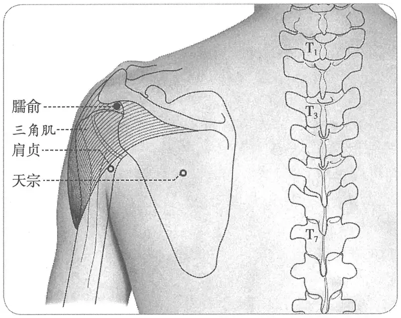

**图 2-147　臑俞穴图**

**取穴**：在肩贞直上，到肩胛冈下缘凹陷中取穴。

　1. 《黄帝明堂经》佚文

　　(1) 在肩臑后大骨下，胛上廉陷者中。（《针灸甲乙经》卷三、《素问·气府论》王冰注）

　　(2) 夹肩窌后大骨下，胛上廉陷下。（《千金要方》卷二十九、《千金翼方》、《外台秘要》、《医心方》、《铜人腧穴针灸图经》）

　2. 广注肩贞下一寸五分是。（《循经考穴编》上）

　3. 从肩贞上行肩端，臑上肩骨下，胛骨上廉陷中，举臂取之。（《医宗金鉴·刺灸心法要诀》）

〔p.568 (인쇄 548)〕

　4. 肩负直上肩胛骨端之下陷中。按：《明堂灸经》列入三焦经。（《针灸十四经穴位考订》）

**按**：所说《明堂灸经》是指宋代《西方子明堂灸经》。

　5. 统编针灸学教材

　　(1) 部位：夹肩髎后，大骨下胛上廉陷者中。取穴：肩端后侧肩胛骨外端下陷中，当肩贞之上微外些取之。（1957年南京《针灸学》）

　　(2) 部位：三焦经肩髎穴后大骨下陷中。取穴：在肩贞直上，肩端后大骨下缘陷中取之。（1版《针灸学讲义》）

　　(3) 部位：在肩臑后，大骨下胛上廉陷者中。取穴：正坐，上臂内收，从肩贞直上，当肩胛骨肩峰突起之后下际凹陷中取之。（2版《针灸学讲义》）

　　(4) 腋后皱襞直上，肩胛冈下缘凹陷中。（4、5版《针灸学》）

　　(5) 在肩部，腋后纹头直上，肩胛冈下缘凹陷中。（6版《针灸学》）

　　(6) 臂内收，腋后纹头直上，肩胛冈下缘凹陷中。（7版《针灸学》）

　　(7) 上臂内收，从肩贞直上，当肩胛冈下缘凹陷中。（《中国针灸学》）

**文献分析**：第2版教材于肩峰后下际（肩峰角）定本穴，则与肩髎穴太靠近，当于肩峰后下际内下方肩胛冈下缘，下对肩贞穴。

#### 【类属】 

手太阳小肠经穴。手足太阳、阳维、𫏋脉之交会穴。

根据本穴四脉交会的属性，归入手太阳经穴可也，未详《千金要方》、《千金翼方》何以归入手少阳经，《西方子明堂灸经》此穴辑自《千金要方》，因而亦归于手少阳经。宋以后针灸书皆从《铜人腧穴针灸图经》之说，归于手太阳经。

**脉气所发**：手足太阳、阳维、𫏋脉之会。（《黄帝明堂经》）

**归经：**

　1. 手少阳。（《千金要方》卷二十九、《千金翼方》、《西方子明堂灸经》）

　2. 手太阳。（《外台秘要》卷三十九、《铜人腧穴针灸图经》卷上）

#### 【适应症】 

主治肩胛部病症。常用于肩痛，臂痛。

　1. 主寒热、肩肿引胛中痛，肩臂酸。（《黄帝明堂经》）

　2. 治寒热肩肿引胛中痛，臂酸无力。（《铜人腧穴针灸图经》卷中）

　3. 统编针灸学教材

　　(1) 肩臂酸痛无力。（1957年南京《针灸学》、1版《针灸学讲义》）

　　(2) 肩臂疼痛无力，肩肿，颈项瘰疬。（2版《针灸学讲义》）

　　(3) 肩肿，肘臂酸痛，瘰疬。（4版《针灸学》）

　　(4) 肩臂疼痛，瘰疬。（5、6版《针灸学》）

　　(5) 肩臂疼痛，肩不举；瘰疬。（7版《针灸学》）

　　(6) 肩肿，肩臂酸痛无力。（《中国针灸学》）

**文献分析**：《针灸甲乙经》载本穴主治系“臂臑”穴主治，教材中“颈项瘰疬”、“肩不举”诸症系承袭通行本《针灸甲乙经》之误，今去之。

#### 附：临床应用举例 

　1. 漏肩风寒胜型，主穴取臑俞、肩三针穴、阿是穴、臂臑、曲池；配穴取肝俞、膈俞，并隔姜灸之。［广东医学，1982，3(8):9］

　2. 漏肩风，病在太阳经取天宗、臑俞配养老、后溪，结合病因随症加减。［上海针灸杂志，

〔p.569 (인쇄 549)〕

1983(3):27］

#### 【操作】 

直刺0.8~1.2寸。

　1. 刺入八分，灸三壮。（《黄帝明堂经》）

　2. 一法刺一寸，可灸二七壮。（《循经考穴编》上）

　3. 统编针灸学教材

　　(1) 针八分至一寸，灸三壮。（1957年南京《针灸学》、1版《针灸学讲义》）

　　(2) 直刺6~10分，艾条灸5~10分钟。（2版《针灸学讲义》）

　　(3) 直刺或斜刺0.5~1.5寸。（4、5版《针灸学》）

　　(4) 直刺0.8~1.2寸；可灸。（6版《针灸学》）

　　(5) 直刺0.5~1.5寸。不宜向胸侧深刺。（7版《针灸学》）

　　(6) 直刺0.5~1.0寸。可灸。（《中国针灸学》）

　4. 直刺，稍偏前下方，深1~2寸。感应局部酸胀，有时可扩散至肩部。灸3~7壮；温灸5~20分钟。（上海《针灸学》）

### （十一）天宗 Tiānzōng SI11 出《黄帝明堂经》 

#### 【提要索隐】 

**部位**：在肩胛区，肩胛冈中点与肩胛骨下角连线上1/3与下2/3交点凹陷中。

**归经**：手太阳小肠经。**按**：宋以前文献关于本穴归经不统一。

**适应症**：主治局部病症。常用于肩痛、活动受限。

**针刺操作**：直刺0.5~1.0寸。

#### 【名实考】 

　1. 天宗，在秉风后大骨下陷者中，手太阳脉气所发。（《黄帝明堂经》）

　2. 自少泽而至此穴，可谓高矣，故曰天宗。（《经穴解》）

#### 【定位】 

**部位**：在肩胛区，肩胛冈中点与肩胛骨下角连线上1/3与下2/3交点凹陷中（图2-148）。

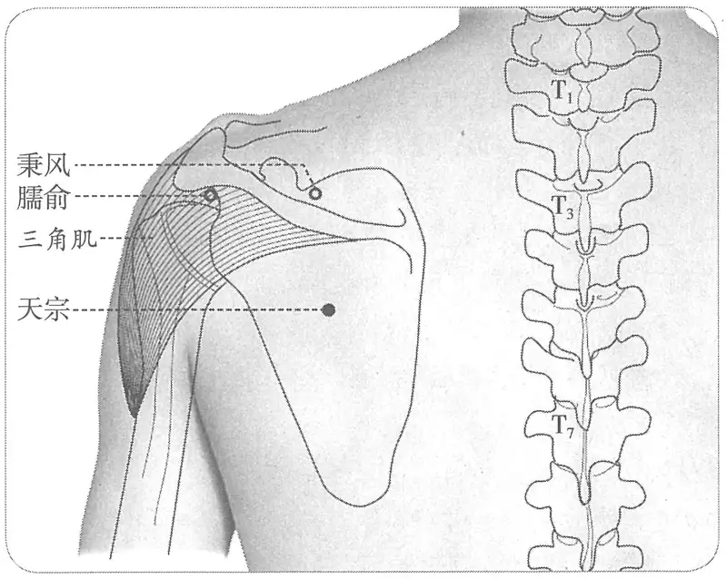

**图 2-148　天宗穴图**

〔p.570 (인쇄 550)〕

**取穴**：在肩胛部，当冈下窝中央凹陷处取穴。

　1. 在秉风后大骨下陷者中。（《黄帝明堂经》、《铜人腧穴针灸图经》、《圣济总录》、《针灸资生经》、《十四经发挥》、《医学纲目》、《针灸集书》、《针灸聚英》、《古今医统》、《医学入门》、《针灸大成》、《针方六集》、《类经图翼》、《循经考穴编》、《针灸易学》、《针灸逢源》）

　2. 广注当是肩板骨下陷中。（《循经考穴编》上）

　3. 从臑俞上行，肩骨下陷中，天宗穴也。（《医宗金鉴·刺灸心法要诀》）

　4. 秉风穴内下方，肩胛冈下陷中。（《针灸十四经穴位考订》）

　5. 统编针灸学教材

　　(1) 部位：秉风后大骨下陷中。取穴：按取肩胛棘（肩胛骨）之中央部分，当棘之下际是穴位，约当肩贞斜上一寸七分横内开一寸之处取之。（1957年南京《针灸学》）

　　(2) 部位：秉风穴后大骨下陷中。取穴：按取肩胛骨之中央部分，约当与肩贞、臑俞穴成三角形处取之。（1版《针灸学讲义》）

　　(3) 部位：在秉风后大骨下陷者中。取穴：于肩胛冈下窝的中央，约与臑俞、肩贞呈三角形处取之。（2版《针灸学讲义》）

　　(4) 肩胛骨冈下窝的中央。（4、5版《针灸学》）

　　(5) 在肩胛部，当冈下窝中央凹陷处，与第4胸椎相平。（6版《针灸学》）

　　(6) 肩胛骨冈下窝中央凹陷处，约当肩胛冈下缘与肩胛下角之间的上1/3折点处取穴。（7版《针灸学》）

　　(7) 肩胛冈下窝，约当冈下缘与肩胛骨下角间的上1/3与中1/3的交点上。（《中国针灸学》）

#### 【类属】 

手太阳小肠经穴。

**脉气所发**：手太阳脉气所发。（《黄帝明堂经》）

**归经：**

　1. 手少阳。（《千金要方》卷二十九、《千金翼方》）

　2. 手太阳。（《黄帝内经明堂》、《外台秘要》、《铜人腧穴针灸图经》卷上）

**按**：天宗穴为“手太阳脉气所发”，当归入手太阳经穴，未详《千金要方》、《千金翼方》何以将此穴归入手少阳经。宋以后针灸书皆从《铜人腧穴针灸图经》之说，归于手太阳经。

#### 【适应症】 

主治局部病症。常用于肩痛、活动受限。

　1. 主肩重肘臂痛不可举。（《黄帝明堂经》）

　2. 主胸胁支满，抢心咳逆。（《外台秘要》卷三十九）

**按**：《外台秘要》腧穴主治正文主要辑自《针灸甲乙经》，并参考其他传本《明堂经》。此条主治不见现存各传本《明堂经》，也与腧穴主治的一般规律不符，疑错入。

　3. 治肩胛痛，臂肘外后廉痛，颊颔肿。（《铜人腧穴针灸图经》卷中）

**按**：“臂肘外后廉痛，颊颔肿”皆系手太阳经脉病候，未详王惟一何以归于本穴主治。

　4. 齿根肿痛。（《针方六集》卷五）

　5. 统编针灸学教材

　　(1) 肩胛酸痛，肘臂外后廉痛。（1957年南京《针灸学》、1版《针灸学讲义》）

　　(2) 肩胛疼痛，肘臂外后侧痛，颊颔肿痛，气喘。（2版《针灸学讲义》）

　　(3) 肩重，肘臂痛，肩胛痛，颊颔肿痛。（4版《针灸学》）

〔p.571 (인쇄 551)〕

　　(4) 肩胛疼痛，气喘，乳痈。（5版《针灸学》）

　　(5) 肩胛疼痛，肘臂外后侧痛，气喘，乳痈。（6版《针灸学》）

　　(6) 肩胛疼痛，肩背部损伤等局部病证；气喘。（7版《针灸学》）

　　(7) 肩胛痛，肘臂外后侧痛，气喘。（《中国针灸学》）

**文献分析**：教材中“气喘”盖受《外台秘要》影响，今去之。《黄帝明堂经》载本穴主治与相邻其他肩部穴相类，主肩肘局部病症。唐代王焘增入一条胸部病症，从其采录文献依据分析，疑为错入；宋代王惟一另增入手太阳经脉病候，但仍在局部病症范畴。从临床穴位触诊经验来看，斜方肌劳损，天宗穴处常有压痛；肩周炎常在天宗穴处有明显压痛，当肱骨不能外旋时，该穴更是重点治疗穴位。现代临床发现，胆病常在天宗穴，特别是右侧天宗穴处出现压痛，故临床上也取本穴治疗胆绞痛。

#### 附：临床应用举例 

　1. 乳腺增生症，肝俞、肩井穴、天宗穴针刺治疗。［陕西中医，1985，6(6):272-273］

　2. 功能性头痛，天宗穴针刺拔罐治疗。［中西医结合杂志，1986，6(11):687］

　3. 胆绞痛，针刺右侧天宗、阳陵泉。［陕西中医，1993，14(11):513］

　4. 急性乳腺炎，取天宗穴三棱针点刺出血，左病取右，右病取左。［河南中医，1995，15(4):251］

#### 【操作】 

直刺0.5~1.0寸。

　1. 刺入五分，留六呼，灸三壮。（《黄帝明堂经》）

　2. 灸五壮。（《医学纲目》卷八）

　3. 统编针灸学教材

　　(1) 针五分，灸五至七壮。（1957年南京《针灸学》）

　　(2) 针三分，灸五至七壮。（1版《针灸学讲义》）

　　(3) 直刺5~7分，艾条灸5~7分钟。（2版《针灸学讲义》）

　　(4) 直刺或斜刺0.5~1寸。（4、5版《针灸学》、《中国针灸学》）

　　(5) 直刺0.5~1寸；可灸。（6版《针灸学》）

　　(6) 直刺或斜刺0.5~1.5寸。遇到阻力不可强行进针。（7版《针灸学》）

　4. 直刺或向四周斜刺0.5~1.5寸。感应局部酸胀。灸3~5壮；温灸5~15分钟。（上海《针灸学》）

### （十二）秉风 Bǐngfēng SI12 出《黄帝明堂经》 

#### 【提要索隐】 

**穴名**：一名景风。乃唐人避讳所改。

**部位**：在肩胛区，肩胛冈中点上方冈上窝中。

**归经**：手太阳小肠经。**按**：宋以前归经不统一。

**适应症**：主治局部病症。常用于肩痛、活动受限。

**针刺操作**：直刺0.5~1寸。

#### 【名实考】 

唐代为避高祖之父名讳，“秉”字要改作“景”字，于是本穴名“秉风”便改作“景风”。

　1. 秉风，在夹天窌外，肩上小髃后，举臂有空，手阳明、太阳、手足少阳之会，举臂取之。（《黄帝明堂经》）

〔p.572 (인쇄 552)〕

　2. 余退以《甲乙》校秦承祖图，有旁庭、脏会等一十九穴，按六百四十九穴有目无名，其角孙、景风一十七穴，《三部针经》具存焉。（《千金翼方》卷二十六）

**按**：此处《三部针经》全称为《黄帝三部针灸甲乙经》，简称《甲乙经》，所谓“景风”即《针灸甲乙经》中“秉风”穴。

　3. 穴在肩之下，正为风之自外来者所中，故曰秉风。（《经穴解》）

#### 【定位】 

**部位**：在肩胛区，肩胛冈中点上方冈上窝中（图2-149）。

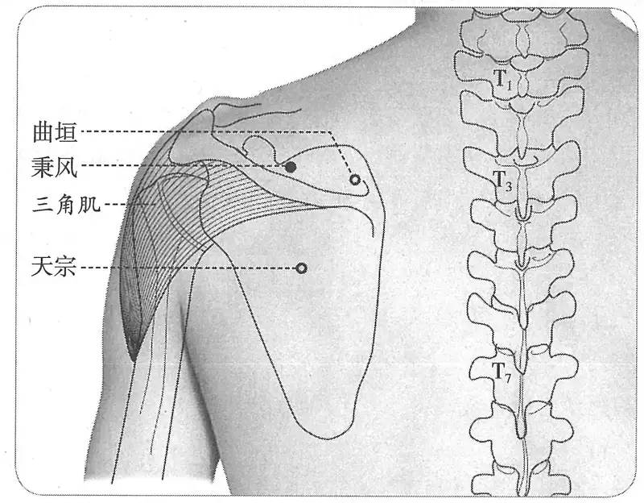

**图 2-149　秉风穴图**

**取穴**：从天宗穴直上，在冈上窝中央，举臂有凹陷处。

　1. 《黄帝明堂经》佚文

　　(1) 夹天窌外，肩上髃后，举臂有空。（《千金要方》卷二十九、《千金翼方》、《素问》王冰注、《铜人腧穴针灸图经》）

　　(2) 在夹天窌外，肩上小髃后，举臂取之。（《针灸甲乙经》卷三、《外台秘要》）

　　(3) 在夹天鼎外，肩上髃后，举臂有空，举臂取之。（《医心方》卷二）

　2. 广注合是天宗前来一寸，夹肩髎外，举臂有空。（《循经考穴编》上）

　3. 肩胛冈上骨缝空内，曲垣外约二寸。（《针灸十四经穴位考订》）

　4. 统编针灸学教材

　　(1) 部位：肩胛骨外端之上方。取穴：按取肩胛横骨，肩胛棘上侧外端陷中取之。（1957年南京《针灸学》）

　　(2) 部位：肩胛骨之上方。取穴：按取肩胛骨上缘，在天宗穴直上陷中取之。（1版《针灸学讲义》）

　　(3) 部位：夹天髎，在外肩上小髃骨后，举臂有空。取穴：在肩胛冈上窝之中点，当天宗直上，举臂有凹陷处取之。（2版《针灸学讲义》）

　　(4) 肩胛骨冈上窝中，天宗穴直上。（4、5版《针灸学》）

　　(5) 在肩胛部冈上窝中央，天宗直上，举臂有凹陷处。（6、7版《针灸学》、《中国针灸学》）

〔p.573 (인쇄 553)〕

#### 【类属】 

手太阳小肠经穴。手阳明、太阳、手足少阳之交会穴。

**脉气所发**：手阳明、太阳、手足少阳之会。（《黄帝明堂经》）

**归经：**

　1. 手阳明。（《千金要方》卷二十九、《千金翼方》）

　2. 手太阳。（《外台秘要》卷三十九、《素问》王冰注、《铜人腧穴针灸图经》卷上）

**文献分析**：秉风穴为“手太阳、阳明、手足少阳脉气所发”，故宋以前归经不统一。但从经脉循行看，归入手太阳经似乎更近于脉。日本《挨穴资蒙》（1835年）从《千金要方》之说，将本穴归入手阳明经穴巨骨与天鼎之间。

#### 【适应症】 

主治局部病症。常用于肩痛、活动受限。

　1. 主肩痛不可举。（《黄帝明堂经》）

　2. 治肩痛不能举。（《铜人腧穴针灸图经》卷中）

　3. 主项强不得回顾，腠理不得致密，风邪易入，咳嗽顽痰。（《循经考穴编》上）

　4. 统编针灸学教材

　　(1) 肩胛疼痛不举。（1957年南京《针灸学》、1版《针灸学讲义》）

　　(2) 肩胛疼痛、不能举手，上肢酸麻。（2版《针灸学讲义》）

　　(3) 肩胛痛，肩臂酸痛。（4版《针灸学》）

　　(4) 肩胛疼痛，上肢酸麻。（5、6版《针灸学》）

　　(5) 肩胛疼痛、上肢酸麻等肩胛、上肢病证。（7版《针灸学》）

　　(6) 肩胛痛，上肢酸麻，肩臂不举。（《中国针灸学》）

**文献分析**：本穴主治病症以局部为主，历代文献记载吻合程度较高。唯《循经考穴编》主治“项强”、“咳嗽顽痰”，乃属该穴的近治作用，尚待临床进一步验证。

#### 附：临床应用举例 

　1. 漏肩风，取肩髃，手太阳经病加臑俞、天宗、秉风、肩外俞、养老。［中国针灸，1983，3(4):13］

　2. 颈肩肌筋膜炎，秉风穴、大杼穴、肩髃穴，针刺。［中医杂志，1984，25(12):33］

#### 【操作】 

直刺0.5~1寸。

　1. 刺入五分，灸五壮。（《黄帝明堂经》）

　2. 灸三壮。（《医学入门》卷一）

　3. 统编针灸学教材

　　(1) 针五分，灸三至五壮。（1957年南京《针灸学》、1版《针灸学讲义》）

　　(2) 直刺3分，艾条灸5~7分钟。（2版《针灸学讲义》）

　　(3) 直刺或斜刺0.5~1寸。（4、5版《针灸学》）

　　(4) 直刺0.5~1寸；可灸。（6版《针灸学》）

　　(5) 直刺0.5~2寸。（7版《针灸学》）

　　(6) 直刺0.5~0.7寸。可灸。（《中国针灸学》）

### （十三）曲垣 Qūyuán SI13 出《黄帝明堂经》 

#### 【提要索隐】 

**部位**：在肩胛区，肩胛冈内侧端上缘凹陷中。

〔p.574 (인쇄 554)〕

**归经**：手太阳小肠经。**按**：宋以前文献关于本穴归经不统一。

**适应症**：主治局部病症。常用于肩痛。

**针刺操作**：直刺0.5~1寸。

#### 【名实考】 

　1. 曲垣，在肩中央曲胛陷者中，按之痛应手。（《黄帝明堂经》）

　2. 以其骨形如垣而曲，故曰曲垣。（《经穴解》）

#### 相关穴及刺激点 

肩痛2　肩胛冈上窝近内侧端曲垣穴稍外侧。主治肩背痛。针0.5~1.0寸，针感麻、酸至肩。（《针灸经外奇穴图谱（续集）》）

#### 【定位】 

**部位**：在肩胛区，肩胛冈内侧端上缘凹陷中（图2-150）。

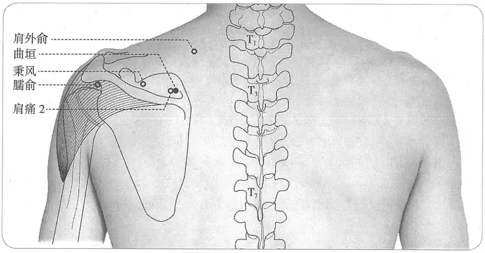

**图 2-150　曲垣穴与相关穴图**

**取穴**：在冈上窝内侧端，当臑俞与第2胸椎棘突连线的中点处取之。

　1. 《黄帝明堂经》佚文

　　(1) 在肩中央曲甲陷者中，按之动脉应手。（《针灸甲乙经》卷三）

　　(2) 在肩中央曲甲陷者中，按之痛应手。（《外台秘要》卷三十九）

　　(3) 在肩中央曲胛陷者中，按之应手痛。（《千金要方》卷二十九、《千金翼方》、《太平圣惠方·针经》、《铜人腧穴针灸图经》）

　　(4) 在肩中央曲胛陷者中。（《医心方》卷二）

　2. 广注须取肩中高骨下。（《循经考穴编》上）

　3. 肩中央部，肩胛冈上缘，约当第二椎骨与肩尖之当中。（《针灸十四经穴位考订》）

　4. 统编针灸学教材

　　(1) 部位：在肩中央曲胛陷中，按之应手痛。取穴：由秉风穴向内开约一寸五分微下些，当肩胛棘上际中央陷中取之。（1957年南京《针灸学》）

　　(2) 部位：肩胛骨上陷中。取穴：由秉风穴向内开约一寸五分微下之骨边陷中取之，上与胆经肩井穴、三焦经天髎穴成直线。（1版《针灸学讲义》）

〔p.575 (인쇄 555)〕

　　(3) 部位：在肩中央曲胛陷者中。取穴：在肩胛冈上窝之内侧端，约当臑俞与第二胸椎棘突联线的中央取之。（2版《针灸学讲义》）

　　(4) 肩胛骨冈上窝内侧凹陷中。（4版《针灸学》）

　　(5) 肩胛骨冈上窝内侧端，约当臑俞与第二胸椎棘突连线的中点取之。（5、6、7版《针灸学》、《中国针灸学》）

#### 【类属】 

手太阳小肠经穴。

**归经：**

　1. 手少阳。（《千金要方》卷二十九、《千金翼方》、《外台秘要》）

　2. 手太阳。（《黄帝内经明堂》、《铜人腧穴针灸图经》卷上）

**按**：曲垣穴，《黄帝明堂经》未注明脉气所发之经，故后世归经不一致。宋以后针灸书皆从《铜人腧穴针灸图经》之说，归于手太阳经。

#### 【适应症】 

主治局部病症。常用于肩痛。

　1. 肩胛周痹。（《黄帝明堂经》）

**按**：此处“肩胛周痹”，谓肩胛所在区域肌肤肿痛麻木，活动受限，肩胛周之痹也，非专指某种痹病，不同于《灵枢·周痹》所谓“各在其处，更发更止，更居更起，以右应左，以左应右，非能周也，更发更休”之周痹。然后世多混淆。

　2. 治肩痛周痹，气注，肩髆拘急痛闷。（《铜人腧穴针灸图经》卷中）

**按**：“气注，肩髆拘急痛闷”系《太平圣惠方·针经》载“大椎”穴主治症，王惟一误录于此，另抄录于“大椎”穴下。

　3. 主肩痹热痛。（《针灸聚英》卷一、《古今医统》、《针灸大成》）

**按**：此系高武误录《针灸资生经》“肩外俞”主治症：“曲垣治肩痛周痹，明同，气注肩膊拘急疼闷，铜。肩外俞治肩痹热痛。”

　4. 统编针灸学教材

　　(1) 肩胛拘急痛。（1957年南京《针灸学》、1版《针灸学讲义》）

　　(2) 肩胛拘挛疼痛，气注，周痹。（2版《针灸学讲义》）

　　(3) 肩痛，肩膊拘急疼痛。（4版《针灸学》）

　　(4) 肩胛疼痛。（5、7版《针灸学》）

　　(5) 肩胛部疼痛、拘挛。（6版《针灸学》）

　　(6) 肩胛拘急疼痛。（《中国针灸学》）

**按**：以上教材除5、7版外，皆不同程度地承袭了宋代《铜人腧穴针灸图经》之误。

**文献分析**：《黄帝明堂经》载本穴主治与相邻其他肩部穴相似，主肩胛局部病症。宋代王惟一《铜人腧穴针灸图经》误将“大椎”穴一条主治症归于本穴，明代高武另将“肩外俞”主治混入，包括现代针灸学教材在内的后世腧穴文献多受其影响。

#### 【操作】 

直刺0.5~1寸。

　1. 刺入九分，灸十壮。（《黄帝明堂经》）

　2. 灸三壮，针入九分。（《太平圣惠方·针经》）

　3. 可灸三壮，针入五分。（《铜人腧穴针灸图经》卷中）

　4. 一法直刺五分，灸七壮。（《循经考穴编》上）

　5. 统编针灸学教材

　　(1) 针五分，灸三至七壮。（1957年南京《针灸学》、1版《针灸学讲义》）

〔p.576 (인쇄 556)〕

　　(2) 直刺3~5分，艾条灸3~7分钟。（2版《针灸学讲义》）

　　(3) 直刺或斜刺0.5~1寸。（4、5版《针灸学》）

　　(4) 直刺0.3~0.5寸；可灸。（6版《针灸学》、《中国针灸学》）

　　(5) 直刺或斜刺0.5~1寸。宜向锁骨上窝上方刺，不宜向胸部深刺。（7版《针灸学》）

　6. 直刺0.5~0.8寸。感应局部酸胀。灸3~5壮；温灸5~15分钟。（上海《针灸学》）

### （十四）肩外俞 Jiānwàishū SI14 出《黄帝明堂经》 

#### 【提要索隐】 

**部位**：在脊柱区，第1胸椎棘突下，后正中线旁开3寸。

**归经**：手太阳小肠经。**按**：宋以前文献关于本穴归经不统一。

**适应症**：主治局部病症。常用于肩背痛，项强。

**针刺操作**：斜刺0.5~0.8寸。不宜直刺，以免损伤壁胸膜和肺脏。

#### 【名实考】 

　1. 肩外俞，在肩甲上廉，去脊三寸陷者中。（《黄帝明堂经》）

　2. 以穴在肩之外也，故名之。（《经穴解》）

#### 【定位】 

**部位**：在脊柱区，第1胸椎棘突下，后正中线旁开3寸（图2-151）。

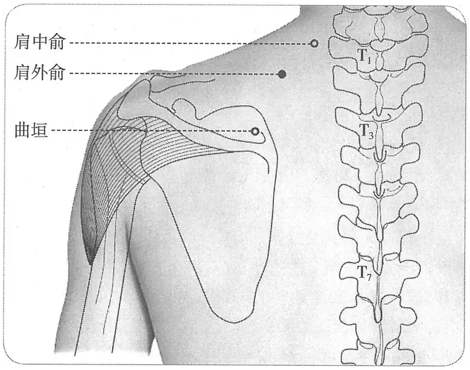

**图 2-151　肩外俞穴图**

**取穴**：肩胛骨脊柱缘的垂线与第1胸椎棘突下的水平线相交处取穴。本穴与内侧的大杼、陶道均位于第1胸椎棘突下水平。

　1. 在肩胛上廉，去脊三寸陷者中。（《黄帝明堂经》、《太平圣惠方·针经》、《铜人腧穴针灸图经》、《圣济总录》、《针灸资生经》、《十四经发挥》、《医学纲目》、《针灸集书》、《针灸聚英》、《古今医统》、《针灸大成》、《针方六集》、《循经考穴编》、《医宗金鉴·刺灸心法要诀》）

　2. 肩胛上廉去脊骨一椎旁三寸陷中，与大杼并肩相去一寸。（《大本琼瑶神书》）

〔p.577 (인쇄 557)〕

　3. 胛上廉去大杼旁三寸。(《医学入门》卷一)

　4. 在肩胛上廉，去脊三寸陷中，与大杼平。(《类经图翼》卷六、《针灸逢源》)

　5. 广注肩柱之下，胛骨之上，与天髎相亲合，平开大椎三寸。(《循经考穴编》上)

　6. 陶道穴旁开三寸。(《针灸十四经穴位考订》)

　7. 统编针灸学教材

　　(1) 部位：在肩胛上廉，去脊三寸陷者中。取穴：从陶道外开三寸取之。(1957年南京《针灸学》)

　　(2) 部位：肩胛骨内上方，去脊三寸。取穴：从督脉陶道穴外开三寸陷中取之。(1版《针灸学讲义》)

　　(3) 部位：在肩胛上廉，去脊三寸陷者中。取穴：在第一胸椎棘突下陶道(督脉)旁开三寸，当肩胛骨脊柱缘的垂直线上取之。(2版《针灸学讲义》)

　　(4) 第一胸椎棘突下旁开3寸。(4、5、7版《针灸学》)

　　(5) 在背部，当第1胸椎棘突下，旁开3寸。(6版《针灸学》)

　　(6) 第一胸椎棘突下，陶道旁开三寸。(《中国针灸学》)

**文献分析**：大杼既是穴名，又是骨名。作为骨名，是指第一胸椎，详见“大杼”、“大椎”穴“名实考”。《医学入门》关于本穴定位文字中之“大杼”即是骨名。

#### 【类属】 

手太阳小肠经穴。

**归经：**

　1. 手少阳。(《千金要方》卷二十九、《千金翼方》、《外台秘要》)

　2. 手太阳。(《铜人腧穴针灸图经》卷上)

**按**：肩外俞，《黄帝明堂经》未注明脉气所发之经，故后世归经不一致。宋以后针灸书皆从《铜人腧穴针灸图经》之说，归于手太阳经。

#### 【适应症】 

主治局部病症。常用于肩背痛，项强。

　1. 主肩胛中痛，热而寒至肘。(《黄帝明堂经》)

　2. 主肩中痛，发寒热，引项急强，左右不顾。(《太平圣惠方·明堂》)

　3. 治肩胛痛，热而寒至肘。(《铜人腧穴针灸图经》卷中)

　4. 治肩痹，寒热至肘，痛引曲颊，颈项强急。(《针方六集》卷五)

　5. 统编针灸学教材

　　(1) 肩背寒痛，颈项强急，上膊厥冷痛。(1957年南京《针灸学》、1版《针灸学讲义》)

　　(2) 肩背酸疼，颈项强急，上肢冷痛。(2版《针灸学讲义》)

　　(3) 肩背酸痛，颈项强急，肘臂冷痛。(4版《针灸学》)

　　(4) 肩背疼痛，颈项强急。(5版《针灸学》)

　　(5) 肩背酸痛，颈项强痛。(6版《针灸学》、《中国针灸学》)

　　(6) 肩背疼痛，颈项强急等肩背、颈项痹证。(7版《针灸学》)

**文献分析**：《黄帝明堂经》载本穴主治与相邻其他肩部穴相似，主肩胛局部病症。古今临床应用同此。临床穴位触诊经验表明：落枕的斜方肌型和肩胛提肌型在本穴及肩中俞处均出现压痛，或仅在某一穴出现压痛，而落枕的菱形肌型则仅在肩中俞出现压痛。

#### 【操作】 

斜刺0.5~0.8寸。不宜直刺，以免损伤壁胸膜和肺脏。

　1. 刺入六分，留六呼，灸三壮。(《黄帝明堂经》)

　2. 灸一壮。(《太平圣惠方·针经》)

〔p.578 (인쇄 558)〕

　3. 一法平针三分，可灸七壮。(《循经考穴编》上)

　4. 统编针灸学教材

　　(1) 针六分，灸三至七壮。(1957年南京《针灸学》、1版《针灸学讲义》)

　　(2) 斜刺3~6分，艾条灸3~7分钟。(2版《针灸学讲义》)

　　(3) 斜刺0.5~0.8寸。(4、5、6版《针灸学》)

　　(4) 斜刺0.5~0.8寸。不宜深刺。(7版《针灸学》)

　　(5) 斜刺0.3~0.7寸。可灸。(《中国针灸学》)

### （十五）肩中俞 Jiānzhōngshū SI15 出《黄帝明堂经》 

#### 【提要索隐】 

**部位**：在脊柱区，第7颈椎棘突下，后正中线旁开2寸。

**归经**：手太阳小肠经。**按**：宋以前文献关于本穴归经不统一。

**适应症**：主治肺部病症。常用于恶寒发热，咳嗽，气喘；肩背痛；视物不清。

**针刺操作**：斜刺0.5~0.8寸，不宜深刺。

#### 【名实考】 

关于本穴定位，《黄帝明堂经》只说“去脊二寸”，后世文献或定于大椎旁二寸，或言大杼旁二寸，今人颇困惑。这是由于今人将“大杼骨”与“大杼穴”混为一谈所致。大杼骨即大椎——脊骨第一椎。详见“大杼”、“大椎”穴“名实考”。

　1. 在肩胛内廉，去脊二寸陷者中。(《黄帝明堂经》)

　2. 肩之所以负重者，以骨会大杼也，此穴近大杼，故曰肩中腧。(《经穴解》)

#### 【定位】 

**部位**：在脊柱区，第7颈椎棘突下，后正中线旁开2寸(图2-152)。

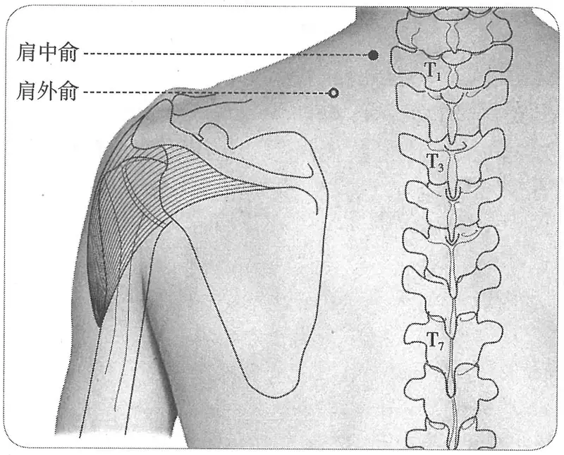

**图 2-152　肩中俞穴图**

**取穴**：从大椎穴旁开2寸处取之。

　1. 在肩胛内廉，去脊二寸陷者中。(《黄帝明堂经》、《太平圣惠方·明堂》、《铜人腧穴针灸图经》、《圣济总录》、《针灸资生经》、《十四经发挥》、《医学纲目》、《针灸集书》、

〔p.579 (인쇄 559)〕

《针灸聚英》、《古今医统》、《医学入门》、《针灸大成》、《针方六集》、《类经图翼》、《循经考穴编》、《医宗金鉴·刺灸心法要诀》、《针灸易学》)

　2. 肩中二寸大杼旁。(《针灸聚英·十四经步穴歌》、《针灸问对》、《古今医统》、《医学入门》、《黄帝内经灵枢注证发微》)

**按**：此“大杼”系骨名，非穴名。故《针方六集》等书直接将“大杼”改作“大椎”。

　3. 肩中二寸大椎旁。(《针方六集》卷一、《类经图翼》、《循经考穴编》)

　4. 大椎穴旁开二寸。(《针灸十四经穴位考订》)

　5. 统编针灸学教材

　　(1) 部位：在肩胛内廉，去脊二寸陷者中。取穴：从大椎穴外开二寸取之。(1957年南京《针灸学》)

　　(2) 部位：肩胛骨内上方，去脊二寸。取穴：从督脉大椎穴外开二寸陷中取之。(1版《针灸学讲义》)

　　(3) 部位：在肩胛内廉，去脊二寸陷者中。取穴：在第七颈椎棘突下大椎督脉旁开二寸取之。(2版《针灸学讲义》)

　　(4) 大椎穴旁开二寸。(4版《针灸学》)

　　(5) 第七颈椎棘突下，旁开2寸。(5、7版《针灸学》)

　　(6) 在背部，当第7颈椎棘突下旁开2寸。(6版《针灸学》)

　　(7) 第七颈椎棘突下，大椎旁开2寸。(《中国针灸学》)

#### 【类属】 

手太阳小肠经穴。

**归经：**

　1. 手少阳。(《千金要方》卷二十九、《千金翼方》、《外台秘要》)

　2. 足太阳。(《医心方》卷二)

　3. 手太阳。(《铜人腧穴针灸图经》卷上)

**按**：本穴，《黄帝明堂经》未注明脉气所发之经，故后世归经不一致。宋以后针灸书皆从《铜人腧穴针灸图经》之说，归于手太阳经。

#### 【适应症】 

主治肺部病症。常用于恶寒发热，咳嗽，气喘；肩背痛；视物不清。

　1. 主寒热厥，目不明，咳上气，唾血。(《黄帝明堂经》)

　2. 治寒热，目视不明，咳嗽上气，唾血。(《铜人腧穴针灸图经》卷中)

　3. 劳嗽，肩胛痛疼。(《循经考穴编》上)

　4. 统编针灸学教材

　　(1) 咳嗽上气，目视不明，肩背疼痛。(1957年南京《针灸学》、1版《针灸学讲义》)

　　(2) 咳嗽，气喘，肩背疼痛，唾血，寒热，目视不明。(2版《针灸学讲义》、4版《针灸学》)

　　(3) 咳嗽，气喘，肩背疼痛，目视不明。(5版《针灸学》)

　　(4) 肩背疼痛，咳嗽，哮喘。(6版《针灸学》)

　　(5) 咳嗽，气喘；肩背疼痛。(7版《针灸学》)

　　(6) 咳嗽，气喘，肩背酸痛，唾血。(《中国针灸学》)

**文献分析**：本穴与相邻之“陶道”穴主治相近，以寒热厥、目疾为主，可互参。又《灵枢·五邪》曰“邪在肺，则病皮肤痛，寒热，上气喘，汗出，咳动肩背。取之膺中外腧，背三节五藏之旁……”亦可参。

〔p.580 (인쇄 560)〕

#### 附：临床应用举例 

小儿奶痨目不明者，灸肩中俞二穴各一壮，炷如小麦大。(《太平圣惠方·明堂》)

#### 【操作】 

斜刺0.5~0.8寸，不宜深刺。

　1. 刺入三分，留七呼，灸三壮。(《黄帝明堂经》)

　2. 可灸十壮。(《铜人腧穴针灸图经》卷中)

　3. 针六分。(《针灸聚英》卷一)

　4. 统编针灸学教材

　　(1) 针三至六分，灸五至十壮。(1957年南京《针灸学》、1版《针灸学讲义》)

　　(2) 斜刺3~6分，艾条灸5~10分钟。(2版《针灸学讲义》)

　　(3) 斜刺0.5~0.8寸。(4、5、6版《针灸学》)

　　(4) 斜刺0.5~0.8寸。不宜深刺。(7版《针灸学》)

　　(5) 斜刺0.3~0.7寸。可灸。(《中国针灸学》)

　5. 直刺0.5~0.8寸。感应酸胀向深部。灸5~10壮；温灸5~15分钟。(上海《针灸学》)

### （十六）天窗 Tiānchuāng SI16 出《灵枢》、《素问》 

#### 【提要索隐】 

**穴名**：天窗，古代文献或作“天牕”。一名窗笼，也写作“窗聋”。

**部位**：在颈部，横平喉结，胸锁乳突肌的后缘。

**适应症**：主治耳部、咽喉部病症。常用于耳聋，耳鸣；咽喉肿痛，失音；瘰疬，颈项强痛。**新增**：瘰疬。

**针刺操作**：直刺0.3~0.5寸。

#### 【名实考】 

天窗，一名窗笼，古代文献也写作“窗聋”。《黄帝内经太素·经脉标本》曰：“足少阳之本，在窍阴之间，标在窗笼之前，窗笼者，耳也”。杨上善注曰：“足少阳脉为根在窍阴，其末上出天窗，支入耳中出走耳前，即在窗笼之前也，以耳为身窗舍，笼音聋，故曰窗笼也”。顾炎武认为“窗笼”二字乃“聪”的反切字。

本穴一名窗笼，提示其与耳密切相关，《黄帝明堂经》所载本穴主治明言“耳鸣，耳聋无闻”之耳部病症。

关于本穴与人迎、扶突、天容三穴的位置关系，《灵枢·本输》有明确论述，详见“扶突”穴。

需要注意的是，“天窗”因与“天突”、“天容”字形相近，易致混淆。

　1. 天窗，一名窗笼。在曲颊下，扶突后，动脉应手陷者中，手太阳脉气所发。(《黄帝明堂经》)

　2. 天窗，一名窗聋。(《外台秘要》卷三十九、《医心方》)

　3. 此穴在颈之侧，如室之有窗，在室之侧也，故名天窗。(《经穴解》)

#### “天窗”误作“天突”例 

喉痛，喑不能言，天突主之。(《针灸甲乙经》卷十二第二)

**按**：此条之前为“哑门主之”，其后为“天鼎主之”条文，据《针灸甲乙经》经穴主治条文排列体例，此处不应出现“天突主之”条文，《外台秘方》、《医心方》此条主治均为“天窗”所主，可知《针灸甲乙经》此条“天突主之”系“天窗主之”之形误。

〔p.581 (인쇄 561)〕

#### “天窗”、“天容”相混例 

瘿，天窗一本作天容及臑会主之。(《针灸甲乙经》卷十二第九)

**按**：今检《外台秘要》，此条主治为天容穴所主，则知王焘所见之《针灸甲乙经》传本中，此条主治中“天窗”作“天容”。

#### 同名异穴之“天窗”穴辨 

　1. 囟会一穴，一名天窗。(《医心方》卷二)

　2. 天窗一穴，在鼻直上入发际二寸。(《太平圣惠方》卷五十五)

**按**：此“天窗”系督脉“囟会”穴的别名。

　3. 灸诸癫狂呆三十年者，当灸天窗，次两肩井，灸两风门，灸两肺俞，灸两心俞，灸两肾俞，灸两手五册，灸两足五册，灸两足心，二十一处各灸五百壮，觉消且□。(敦煌卷子)

　4. 癫狂二三十年者，灸天窗，次肩井，次风门，次肝俞，次肾俞，次手心主，次曲池，次足五冊，次涌泉，各五百壮，日七壮。(《千金翼方·针灸中》卷二十七)

**按**：这里的“天窗”穴不是我们所熟知的颈部手太阳小肠经穴“天窗”，而是督脉“囟会”穴的别名。经考察，唐以前文献，如敦煌卷子佚名灸方中之“天窗”穴以及传世医书《千金要方》、《千金翼方》所载针灸方中之“天窗”除少数难以考辨外，均指“囟会”穴，后人不解，多有相混之处。详见囟会穴“名实考”。

#### 相关穴及刺激点 

　1. 颈丛刺激点　胸锁乳突肌后缘中点。主治颈痛，落枕，头颈颤动，手臂颤动。刺法：直刺2.0~3.0cm。若针尖向后上方可刺激到枕小神经，针尖向前上方可刺激到耳大神经，针尖向前可刺激到颈横神经，针尖向后下方可刺激到锁骨上神经，针尖向前下方可刺激到膈神经。(《实用神经干电刺激疗法》)

　2. 副神经刺激点　胸锁乳突肌后缘中点上1cm。主治斜颈，落枕，垂肩症，肩关节痛。针向内直刺1.5~2.0cm。当刺激到副神经时，出现耸肩动作和触电感。针刺时，要避免伤及颈内动、静脉和肺尖。(《实用神经干电刺激疗法》)

　3. 锁骨上神经总干刺激点　胸锁乳突肌后缘中点下1cm。主治项痛，胸壁上部疼痛，肩上部疼痛。直刺1.0cm。(《实用神经干电刺激疗法》)

#### 【定位】 

**部位**：在颈部，横平喉结，胸锁乳突肌的后缘(图2-153)。

**取穴**：在胸锁乳突肌之后缘，当扶突后方取之。本穴与人迎、扶突均横平喉结，三者的位置关系为：胸锁乳突肌前缘处为人迎，后缘为天窗，前后缘中间为扶突。

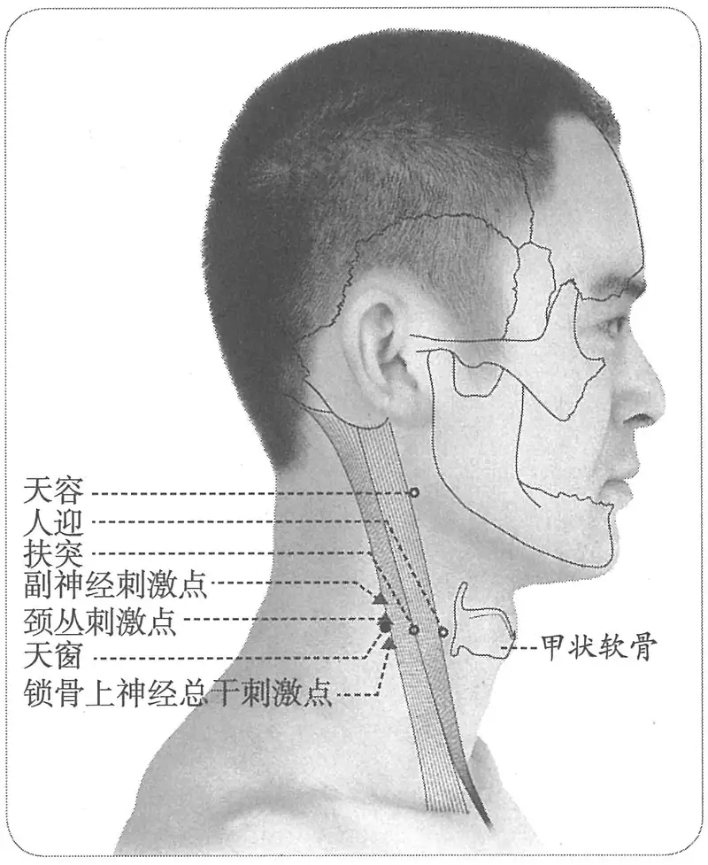

**图 2-153　天窗穴与相关刺激点**

　1. 在曲颊下，扶突后，动脉应手陷者中。(《黄帝明堂经》、《太平圣惠方·明堂》)

　2. 在颈大筋前，曲颊下，扶突后动脉陷中。(《铜人腧穴针灸图经》、《圣济总录》、《针灸资生经》、《十四经发挥》、《医学纲目》、《针灸集书》、《针灸聚英》、《古今医统》、《针灸大成》、《针方六集》、《类经图翼》、《循经考穴编》、《医宗金鉴·刺灸心法要诀》、《针灸易学》、《针灸逢源》)

〔p.582 (인쇄 562)〕

　3. 天容直下，扶突后旁一寸五分。(《针灸十四经穴位考订》)

　4. 统编针灸学教材

　　(1) 部位：在曲颊下，扶突后，动脉应手陷中。取穴：以人迎扶突为标准，从扶突向后开一寸取之。(1957年南京《针灸学》)

　　(2) 部位：天容穴下，大肠经扶突穴后，动脉应手陷中。取穴：从颈大筋之后缘，与胃经人迎穴、大肠经扶突穴相平处取之。(1版《针灸学讲义》)

　　(3) 部位：在曲颊下扶突后，动脉应手陷者中。取穴：在胸锁乳突肌之后缘，当扶突后方取穴。(2版《针灸学讲义》)

　　(4) 结喉旁开3.5寸，即扶突穴后0.5寸。(4版《针灸学》)

　　(5) 喉结旁开3.5寸，在胸锁乳突肌之后缘。(5版《针灸学》)

　　(6) 在颈外侧部，胸锁乳突肌的后缘，扶突后，与喉结相平。(6版《针灸学》)

　　(7) 扶突穴后，在胸锁乳突肌的后缘，约喉结旁开3.5寸。(7版《针灸学》)

　　(8) 在颈侧，胸锁乳突肌后缘，当扶突后上方取之。(《中国针灸学》)

#### 【类属】 

手太阳小肠经穴；手太阳之所入。

　1. 手太阳脉气所发。(《黄帝明堂经》)

　2. 手太阳根于少泽，溜于阳谷，注于少海，入于天窗、支正也。(《灵枢·根结》)

#### 【适应症】 

主治耳部、咽喉部病症。常用于耳聋，耳鸣；咽喉肿痛，失音；瘰疬，颈项强痛。**新增**：瘰疬。

　1. 主颊肿痛，耳鸣，耳聋无闻。喉痛，喑不能言。肩痛引项，汗出及偏耳鸣。(《黄帝明堂经》)

**按**：此处除颈项局部病症外，还详述了耳部病症(也为手太阳经脉病候)。

　2. 瘿，天窗一本作“天容”，《千金》作“天府”及臑会主之。(《针灸甲乙经》卷十二)

**按**：《外台秘要》将此症归于“天容”穴下，与注文合。

　3. 治耳鸣，聋无所闻，颊肿，喉中痛，暴喑不能言，肩痛引项不得回顾。(《铜人腧穴针灸图经》卷中)

　4. 主痔瘘，颈痛，肩胛引项不得回顾，齿噤中风。(《针灸聚英》卷一)

**按**：“齿噤中风”盖误解《针灸资生经》原文“天窗(见颊肿)、翳风治口噤(见口㖞)”，今查《针灸资生经》“颊肿”篇作“天窗主颊肿痛(《明》同)”，未言及“口噤”一症。

　5. 窦太师针灸遗存

　　(1) 治瘰疬，泻；破烂，瘰疮臭，泻补。(《窦太师针经》)

　　(2) 治一切瘰疬。(《针方六集》卷五)

　6. 统编针灸学教材

　　(1) 耳聋鸣，颊肿，喉痹，暴喑不能言，肩痛引项不得回顾，中风口噤。(1957年南京《针灸学》)

　　(2) 耳聋、鸣，颊肿，喉痹，暴喑，肩痛项强，中风，口噤。(1版《针灸学讲义》)

　　(3) 耳聋，耳鸣，咽喉肿痛，颈项强痛，暴喑不能言。(2版《针灸学讲义》、5版《针灸学》、《中国针灸学》)

〔p.583 (인쇄 563)〕

　　(4) 喉痛，颊肿，耳聋，耳鸣，喑不能言。(4版《针灸学》)

　　(5) 耳鸣，耳聋，咽喉肿痛，颈项强痛，暴喑，瘾疹，癫狂。(6版《针灸学》)

　　(6) 耳鸣、耳聋、咽喉肿痛、暴喑等五官病证；颈项强痛。(7版《针灸学》)

**文献分析**：传世本《针灸甲乙经》所载“瘿”症取穴为“天窗”，但注曰“一本作天容”，王焘编《外台秘要·明堂》时，此症归入“天容”穴，王惟一编《铜人腧穴针灸图经》于天窗穴下遂未收录相应主治病症。然金元《窦太师针经》“天窗”专主瘰疬，故今补之。需特别指出的是：《针灸聚英》本穴主治“痔瘘，颈痛”，转引自《针灸资生经·痔》卷三，原文出自《千金要方》，作“漏，颈痛”，此处“漏”是指生于颈部的瘰疬，而非“痔漏”。高武未解其义而误译其文。可能会有读者不解问道：见有文献报道，正是受此误文的“启发”，有人以天窗穴为主治疗痔疮数十例而获佳效，何也？此乃特殊刺法和配穴之功！

针灸教材中“瘾疹，癫狂”系误录《千金要方》、《千金翼方》中别名“天窗”的“囟会”穴主治症；“中风，口噤”乃承袭明高武之误，今去之。

#### 附：临床应用举例 

　1. 头痛，瘾疹，灸天窗七壮。(《千金翼方》卷二十八)

**按**：如上所述，《千金翼方》所载针灸方中的“天窗”，除少数难以考辨外，均指“囟会”穴别名，此即少数难以考辨例之一。参照《太平圣惠方》引甄权《针经》囟会穴主治“头风痛，白屑起”、“头目眩，头目肿，生白屑。兼主面赤暴肿也”，与此方主治相近，而与小肠经之“天窗”主治不相涉也。由此可知，上述《千金翼方》中“天窗”疑仍为“囟会”穴别名。

　2. 中经络半身不遂，取天窗、百会，艾灸。[云南中医杂志，1986，7(1)：21]

　3. 中风偏瘫，百会穴、天窗穴针灸治疗。[山东中医杂志，1987(6)：12]

　4. 肩周炎，针刺天窗。[上海针灸杂志，1989，8(3)：25-26]

#### 【操作】 

直刺0.3~0.5寸。

　1. 刺入六分，灸三壮。(《黄帝明堂经》)

　2. 针入三分。(《铜人腧穴针灸图经》卷中)

　3. 窦太师针灸遗存

　　(1) 横针三分，灸七壮。治瘰疬，泻；破烂，瘰疮臭，泻补。(《窦太师针经》)

　　(2) 一法横针入三分。(《循经考穴编》上)

　4. 统编针灸学教材

　　(1) 针三分，灸三壮。(1957年南京《针灸学》、1版《针灸学讲义》)

　　(2) 直刺3~5分，艾条灸3~5分钟。(2版《针灸学讲义》)

　　(3) 直刺0.5~1寸。(4、5、7版《针灸学》)

　　(4) 斜刺0.3~0.5寸；可灸。(6版《针灸学》)

　　(5) 直刺0.3~0.7寸。可灸。(《中国针灸学》)

### （十七）天容 Tiānróng SI17 出《灵枢》 

#### 【提要索隐】 

**部位**：在颈部，下颌角后方，胸锁乳突肌的前缘凹陷中。

**归经**：手太阳小肠经。**按**：宋以前归少阳经。

**适应症**：主治胸肺部病症。常用于胸痛，气喘；耳聋；咽喉肿痛，瘿瘤；颈项强痛。

〔p.584 (인쇄 564)〕

**针刺操作**：直刺0.5~1寸。

#### 【名实考】 

《灵枢·本输》记有颈项部十穴：天突、扶突、人迎(天五会)、天窗、天容、天牖、天柱、风府、天府、天池，穴名中多冠以“天”字，所指多为明堂建筑名称，则本穴“天容”亦当与建筑物有关。具体参见“扶突”穴下“名实考”。

需要指出的是，本穴在《灵枢》中属于少阳经穴，其与属于手太阳经的天窗穴的位置关系为：天容在曲颊(下颌角)后一寸，天窗在曲颊下，自从后世将“天容”穴归入手太阳经，则此二穴间的位置关系也随之改变。

　1. 次脉足少阳也，名曰天容，五……足少阳在耳下曲颊之后。(《灵枢·本输》)

　2. 天容，在耳下曲颊后，手少阳脉气所发。(《黄帝明堂经》)

　3. 耳下曲颊后，乃颈侧最上之所，衣领所以不能蔽人之容，于此呈露之处，故曰天容。(《经穴解》)

#### 相关穴及刺激点 

　1. 舌下神经刺激点　下颌角与舌骨大角连线的中点。主治舌肌麻痹，失语，哑症。刺法：向舌根方向直刺2.0cm。刺中舌下神经时，舌根有麻胀感或触电感。(《实用神经干电刺激疗法》)

　2. 副神经刺激点　胸锁乳突肌后缘中点上1cm。主治斜颈，落枕，垂肩症，肩关节痛。针向内，直刺1.5~2.0cm。当刺激到副神经时，出现耸肩动作和触电感。针刺时，要避免伤及颈内动、静脉和肺尖。(《实用神经干电刺激疗法》)

　3. 东风　位于颈部，下颌角下缘，颈动脉前缘是穴，即天容穴前下方五分处。主治扁桃体炎。针1~2分。(《针灸经外奇穴图谱》)

　4. 扁桃体穴　位于颈部，下颌角直下5分处，即颊车穴下一横指处。主治急、慢性喉炎，咽炎，扁桃体炎，声音嘶哑。针向上斜刺2寸，针感喉部、颈部热、麻。(《针灸经外奇穴图谱(续集)》)

#### 【定位】 

**部位**：在颈部，下颌角后方，胸锁乳突肌的前缘凹陷中(图2-154)。

**取穴**：翳风穴直下，平下颌角，胸锁乳突肌的前缘凹陷中取之。

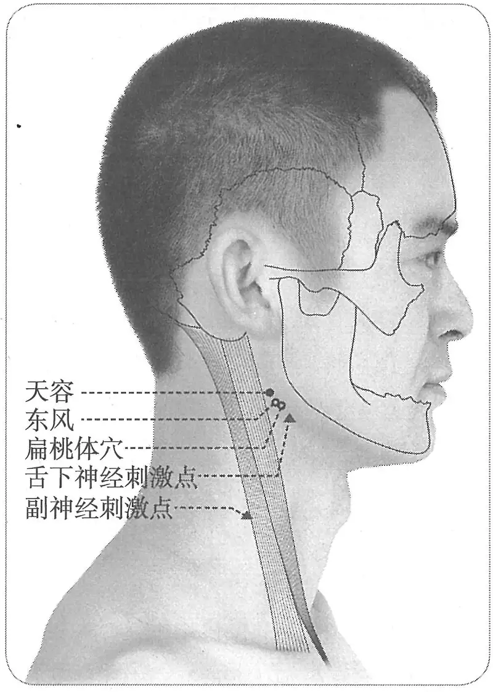

**图 2-154　天容穴与相关穴及刺激点**

　1. 在耳下曲颊后。(《黄帝明堂经》、《铜人腧穴针灸图经》、《圣济总录》、《针灸资生经》、《医学纲目》、《针灸集书》、《针灸聚英》、《古今医统》、《针灸大成》、《针方六集》、《类经图翼》、《循经考穴编》、《医宗金鉴·刺灸心法要诀》)

　2. 耳下颊车后陷中。(《医学入门》卷一)

**按**：这里的“颊车”应指骨名，也即曲颊骨，而不是穴名。

　3. 颊车与翳风下，天窗上约一寸许。(《针灸十四经穴位考订》)

　4. 统编针灸学教材

　　(1) 部位：耳下曲颊后。取穴：从下腭隅之直后，当天窗穴上一寸，微前陷中取之。(1957年南京《针灸学》)

〔p.585 (인쇄 565)〕

　　(2) 部位：耳下曲颊后。取穴：于大筋之前缘，天窗穴上一寸取之。(1版《针灸学讲义》)

　　(3) 部位：耳曲颊后。取穴：在下颌角后方，胸锁乳突肌的前缘凹陷中取之。(2版《针灸学讲义》)

　　(4) 下颌角后，胸锁乳突肌的前缘。(4、5、7版《针灸学》)

　　(5) 在颈外侧部，当下颌角的后方，胸锁乳突肌的前缘凹陷中。(6版《针灸学》、《中国针灸学》)

#### 【类属】 

手太阳小肠经穴。

**脉气所发：**

　1. 手少阳脉气所发。(《针灸甲乙经》卷三、《外台秘要》卷三十九)

　2. 手少阳三焦，又足少阳胆。(《医心方》卷二)

**归经：**

　1. 手少阳。(《外台秘要》卷三十九)

　2. 足少阳。(《黄帝内经明堂》)

　3. 手太阳。(《铜人腧穴针灸图经》卷上)

**按**：天容穴，《针灸甲乙经》、《外台秘要》均作“手少阳脉气所发”。《内经》中则属足少阳脉，如《灵枢·根结》云：足少阳“入于天容、光明”；《本输》篇曰：“次脉足少阳也，名曰天容”。《黄帝内经太素》中杨上善两次注作“足少阳脉气所发”，并强调是“足少阳正经”；杨上善注《明堂》兼取二说作“手少阳三焦、足少阳胆”。《铜人腧穴针灸图经》传王冰之误而将该穴错归入手太阳小肠经。自宋以后一直至今天的针灸书中，均将“天容”穴归入小肠经，甚至明代医家据《铜人腧穴针灸图经》，将宋本《外台秘要》中归入“手少阳”脉的“天容”穴下“手少阳脉气所发”改作“手太阳脉气所发”。由于后人只知“天容”属手太阳经穴，故于以上所引《针灸甲乙经》文中天容穴下注有“疑误”二字；今人则直接将文中“天容”改成“天冲”，并删去了古人原注，此又错上加错也。日本《挨穴资蒙》(1835年)将本穴归入足少阳胆经穴肩井之前。

#### 【适应症】 

主治胸肺部病症。常用于胸痛，气喘；耳聋；咽喉肿痛，瘿瘤；颈项强痛。

　1. 主寒热，疝积，胸中痛，不得穷屈，咳逆上气唾沫，肩痛不可举，颈项痈肿不能言，耳聋嘈嘈无所闻，喉痹，瘿，咽肿。(《黄帝明堂经》)

　2. 阳气大逆，上满于胸中，愤瞋肩息，大气逆上，喘喝坐伏，病咽噎不得息。(《外台秘要》卷三十九)

**按**：此出自《灵枢·刺节真邪》，王焘未详所出而作为《黄帝明堂经》文字归入本穴中。

　3. 治喉痹寒热，咽中如鲠。(《铜人腧穴针灸图经》卷中)

**按**：王惟一传《外台秘要》之误，将“天容”穴主治混入“浮白”穴中，而天容穴下主治很简略。

　4. 瘰疬。(《循经考穴编》上)

　5. 统编针灸学教材

　　(1) 耳聋，耳鸣，喉痹，颈项强。(1957年南京《针灸学》、1版《针灸学讲义》)

　　(2) 耳聋，耳鸣，咽喉肿痛，咽中如梗，颊肿，瘿气。(2版《针灸学讲义》、《中国针灸学》)

　　(3) 耳聋耳鸣，咽痛喉痹，颈肿项痛。(4、5、6版《针灸学》)

　　(4) 耳聋、耳鸣、咽喉肿痛等五官病证；头痛，颈项强痛。(7版《针灸学》)

**文献分析**：《黄帝明堂经》所载本穴的主治突出了气逆胸中所致的一系列症状，这与《灵枢》所述完全吻合，而现行针灸学教材在归纳时似忽略了这一点。

〔p.586 (인쇄 566)〕

#### 附：临床应用举例 

　1. 岐伯曰：振埃者，阳气大逆，上满于胸中，愤瞋肩息，大气逆上，喘喝坐伏，病恶埃烟，噎不得息，清言振埃，尚疾于振埃。黄帝曰：善。取之何如？岐伯曰：取之天容。(《灵枢·刺节真邪》)

　2. 耳鸣无昼夜方，宜灸天容动脉是也。(《医方类聚》卷二百四十二)

　3. 痉挛性斜颈，取天窗、天容穴治疗。[上海针灸杂志，1985(2)：17]

　4. 偏头痛，针刺天容穴，施平补平泻手法，得气后接通电针治疗仪，施以连续波，以患者适应为宜，持续30分钟。[浙江中医杂志，1995(5)：232]

　5. 呃逆，单取天容穴治疗。[针灸临床杂志，2002，18(4)：45]

#### 【操作】 

直刺0.5~1寸。

　1. 取天容者，无过一里。(《灵枢·刺节真邪》)

**按**：《内经》以“一里”为一寸作为折量取穴和针刺深度的度量。

　2. 刺入一寸，灸三壮。(《黄帝明堂经》)

　3. 刺入三分。(《针方六集》卷一)

　4. 刺一分，灸三壮。(《类经图翼》卷六)

　5. 一云针三分，禁灸。(《循经考穴编》上)

**按**：此系将颧髎穴的刺灸法内容错入于此。

　6. 统编针灸学教材

　　(1) 针五至八分，灸三壮。(1957年南京《针灸学》、1版《针灸学讲义》)

　　(2) 直刺5~8分，艾条灸3~5分钟。(2版《针灸学讲义》)

　　(3) 直刺0.5~1寸。(4、5、6版《针灸学》)

　　(4) 直刺0.5~1寸。注意避开血管。(7版《针灸学》)

　　(5) 直刺0.5~0.7寸。可灸。(《中国针灸学》)

　7. 向舌根部直刺1~1.5寸。感应酸胀扩散至舌根或咽喉部。灸3壮；温灸5~10分钟。(上海《针灸学》)

### （十八）颧髎 Quánliáo SI18 出《黄帝明堂经》 

#### 【提要索隐】 

**穴名**：一名兑骨。

**部位**：在面部，颧骨下缘，目外眦直下凹陷中。

**适应症**：主治局部病症。常用于口眼㖞斜，眼睑瞤动；目赤；目黄；齿痛；颊肿。颅脑外科手术(前颅窝)、上颌窦手术、牙拔除术针麻用穴。

**针刺操作**：直刺0.3~0.5寸。

#### 【名实考】 

颧髎，宋以前文献多作“颧窌”，穴在颧骨下凹陷处，故名。一名兑骨，即锐骨，《黄帝明堂经》所谓“兑骨”皆为尖锐之骨，本穴位于面部尖锐之颧骨下陷中，故名“兑骨”。

　1. 颧窌，一名兑骨。在面鼽骨下廉陷者中，手少阳、太阳之会。(《黄帝明堂经》)

　2. 鼽骨下各一。王冰注曰谓颧髎二穴也。鼽，頄也。頄，面颧也，在面頄骨下陷者中。(《素问·气府论》)

　3. 此穴在颧骨下，故曰颧髎。(《经穴解》)

〔p.587 (인쇄 567)〕

#### 相关穴及刺激点 

　1. 上齿槽神经后支刺激点　外眼角垂线与上颌骨颧突下缘相交处。直刺3.0~4.0cm。主治同侧上臼齿痛。(《实用神经干电刺激疗法》)

　2. 面巌　位于面部，鼻翼之凸出处平行两侧，上直对眶下缘外1/4与内3/4交界点，即颧髎穴内方。主治印堂疔、穿鼻疔、上反唇疔、耳下项疔、耳后疔、朗口疔。针2~3分。(《针灸经外奇穴图谱》)

#### 【定位】 

**部位**：在面部，颧骨下缘，目外眦直下凹陷中(图2-155)。

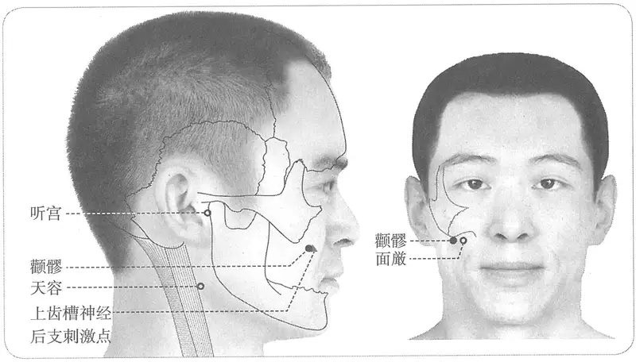

**图 2-155　颧髎穴与相关穴及刺激点**

**取穴**：从眼外眦角直下，颧骨下缘凹陷处取之。

　1. 在面鼽骨下廉陷者中。(《黄帝明堂经》、《铜人腧穴针灸图经》卷上、《针方六集》)

　2. 在面鼽骨下廉兑骨端陷者中。(《铜人腧穴针灸图经》卷中、《圣济总录》、《针灸资生经》、《十四经发挥》、《医学纲目》、《针灸集书》、《针灸聚英》、《古今医统》、《医学入门》、《针灸大成》、《类经图翼》、《循经考穴编》、《医宗金鉴·刺灸心法要诀》、《针灸易学》、《针灸逢源》)

**按**：鼽骨即指兑骨，王惟一未详其义，于“鼽骨下廉”复言“兑骨”(《铜人腧穴针灸图经》卷中，其卷上、卷下无误)。

　3. 面頄骨下廉兑骨端当缺内陷中。(《大本琼瑶神书》)

　4. 广注法宜上直瞳子髎是。(《循经考穴编》上)

　5. 瞳子髎下方，颧骨端下廉陷中。(《针灸十四经穴位考订》)

　6. 统编针灸学教材

　　(1) 部位：面鼽骨下廉，锐骨端陷中。取穴：从眼外眦角直下，颧骨际陷中取之。(1957年南京《针灸学》)

　　(2) 部位：面鼽骨锐端陷中。取穴：从眼外眦角直下，颧骨际陷中取之。(1版《针灸学讲义》)

　　(3) 部位：在面鼽骨下廉陷者中。取穴：目外眦角直下，当颧骨下缘中央凹陷中取之。(2版《针灸学讲义》)

〔p.588 (인쇄 568)〕

　　(4) 目外眦直下，颧骨下缘凹陷中。(4、5、6、7版《针灸学》、《中国针灸学》)

#### 【类属】 

手太阳小肠经。

**脉气所发**：手少阳、太阳之会。(《黄帝明堂经》)

**归经：**

　1. 手少阳。(《外台秘要》卷三十九、《素问》王冰注)

　2. 手太阳。(《素问》王冰注、《铜人腧穴针灸图经》卷上)

**按**：王冰对于某些交会穴的归经有与杨上善、王焘明显不同之处，即有些交会穴与所交会的经脉距离差不多，王氏不知究竟应将它归入何经，便分别归入所交会的各经。如“颧髎”穴系“手少阳、太阳之会”，王氏说“此穴中手少阳、太阳脉气俱会于中，等无优劣，故重说于此，下有者同”，于是遂将该穴分别归入“手太阳”、“手少阳”二脉中。

#### 【适应症】 

主治局部病症。常用于口眼㖞斜，眼睑瞤动；目赤，目黄；齿痛，颊肿。颅脑外科手术(前颅窝)、上颌窦手术、牙拔除术针麻用穴。

　1. 主口僻，䪼肿唇痛，面赤，目赤，目黄，口不能嚼，齿痛。(《黄帝明堂经》)

　2. 治口㖞，面赤目黄，眼瞤动不止，䪼肿齿痛。(《铜人腧穴针灸图经》卷中)

　3. 统编针灸学教材

　　(1) 口眼㖞斜，瞤动，䪼肿，齿痛。(1957年南京《针灸学》、1版《针灸学讲义》)

　　(2) 口眼㖞斜，眼睑瞤动，齿痛，䪼肿，目黄。(2版《针灸学讲义》、4版《针灸学》)

　　(3) 口眼㖞斜，眼睑瞤动，齿痛，颊肿。(5版《针灸学》)

　　(4) 口眼㖞斜，眼睑瞤动，齿痛，唇肿。(6版《针灸学》)

　　(5) 口眼歪斜，眼睑瞤动，齿痛，三叉神经痛等面部病证。(7版《针灸学》)

　　(6) 口眼歪斜，眼睑瞤动，面痛，齿痛，颊肿，目黄。(《中国针灸学》)

**文献分析**：《黄帝明堂经》载本穴主治集中在目疾、齿疾及面颊部等局部病症，后世文献及临床应用皆与之相合。

#### 附：临床应用举例 

　1. 牙痛，上牙痛取颧髎、内庭；下牙痛取颊车、合谷。[上海针灸杂志，1987，6(3)：47]

　2. 面瘫、面肌痉挛、面痛，针刺颧髎穴。[针灸临床杂志，1999，15(1)：56-57]

　3. 变应性鼻炎，取颧髎、下关穴，肺气虚加肺俞、足三里，肺阴虚加尺泽、太溪，表证明显者加合谷、曲池，轻微提插捻转，以酸胀针感放射至鼻腔为度。[甘肃中医学院学报，2000，17(4)：30-31]

#### 【操作】 

直刺0.3~0.5寸。

　1. 刺入三分。(《黄帝明堂经》)

　2. 针入二分。(《铜人腧穴针灸图经》卷中)

　3. 禁用针灸。(《医学入门》卷一)

　4. 禁不宜灸。(《针方六集》卷一)

　5. 统编针灸学教材

　　(1) 针二至三分。(1957年南京《针灸学》、1版《针灸学讲义》)

　　(2) 直刺2~3分。(2版《针灸学讲义》)

　　(3) 直刺0.3~0.5寸，可斜刺或平刺。(4、5、6、7版《针灸学》)

　　(4) 直刺0.5~0.8寸。(《中国针灸学》)

〔p.589 (인쇄 569)〕

### （十九）听宫 Tīnggōng SI19 出《灵枢》、《素问》 

#### 【提要索隐】 

**穴名**：一名多所闻。

**部位**：在面部，耳屏正中与下颌骨髁突之间的凹陷中。

**适应症**：主治耳部病症。常用于耳鸣，耳聋，聤耳；癫，狂，痫。

**针刺操作**：张口，直刺1~1.5寸。不宜深刺。

#### 【名实考】 

《素问·气穴论》中“多所闻”一穴，王冰注作“听宫”，高武列入听会穴别名。

听宫与听会紧相邻，穴名中又有一字相同，古代针灸文献中见有二穴相混之例。

关于本穴的定位描述，古代文献无分歧，而关于定位的主要分歧在于，定于耳内，还是耳外。从《内经》的描述来看，应在耳内，此外手太阳经脉循行“入耳中”以及《黄帝明堂经》听宫穴“刺入一分”的刺法也支持这种理解。从后世文献所载的十四经经穴歌和步穴歌来看，“经穴歌”中皆谓“手太阳穴一十九……却入耳中循听宫”，而“步穴歌”却又谓“听宫耳端大如菽”，出现同一书对同一穴的理解分裂现象。近有西安医学院第二附属医院耳鼻喉科樊玉林在文献分析的基础上，结合临床观察，提出本穴应位于鼓室内，为区别于现代定位的“听宫”穴，则称古代定位为“内听宫”。[^27-1]

　1. 黄帝曰：刺节言发蒙，余不得其意。夫发蒙者，耳无所闻，目无所见。夫子乃言刺府输，去府病，何输使然？愿闻其故。岐伯曰：妙乎哉问也！此刺之大约，针之极也，神明之类也，口说书卷，犹不能及也，请言发蒙耳，尚疾于发蒙也。黄帝曰：善。愿卒闻之。岐伯曰：刺此者，必于日中，刺其听宫，中其眸子，声闻于耳，此其输也。黄帝曰：善。何谓声闻于耳？岐伯曰：刺邪以手坚按其两鼻窍而疾偃，其声必应于针也。黄帝曰：善。此所谓弗见为之，而无目视，见而取之，神明相得者也。(《灵枢·刺节真邪》)

　2. 耳中多所闻二穴，王冰注曰听宫穴也。在耳中珠子，大如赤小豆，手足少阳手太阳三脉之会，刺可入同身寸之一分，若灸者可灸三壮。(《素问·气穴论》)

　3. 耳中各一，王冰注曰谓听宫二穴也。(《素问·气府论》)

　4. 听宫，在耳中珠子，大如赤小豆，手足少阳、手太阳之会。(《黄帝明堂经》)

　5. 谓听宫者，宫菀之名，源在内也；耳轮之内，故名宫也。(《窦太师针经》)

　6. 听会(宫)一名多所闻。(《针灸聚英》卷一)

　7. 听宫穴，经云在耳中珠子如赤豆大，手太阳少阳足少阳三脉之会。今详此穴所谓宫者，宫苑之名，深居在内，故曰宫也。耳中珠子如赤豆谓耳轮郭内如碗沿之状，正中有小核，大如赤豆，摸之碍指，此核是三阳交会之处，结核如此，故有核也。(明抄本《针灸秘法全书》)

　8. 此穴在耳门之上，有圆珠是穴，非在耳内之中也。(《经穴解》)

#### “听宫”误作“听会”例 

听会一名多所闻，耳中珠子，大如赤小豆。手足少阳、手太阳三脉之会。(《针灸聚英》卷一)

**按**：此条文字悉为“听宫”穴内容，而穴名却误作“听会”，这个错误本身并不奇怪，然而不可思议的是，这个极为明显的错误(因为该书的腧穴都是按经编排，小肠经的最后一穴，皆是“听宫”，而不可能是“听会”)，却被之后的徐春甫《古今医统》和吴文炳《针灸大成》相继沿袭，直到明代杨继洲、靳贤《针灸大成》才被纠正。

[^27-1]: 樊玉林.听宫初考(临床观察部分)[J].西安医学院学报，1977(11)：44-48；樊玉林.听宫初考(临床应用部分)[J].西安医学院学报，1977(11)：49-51.

〔p.590 (인쇄 570)〕

#### 相关穴及刺激点 

在距听宫不足5毫米的范围内，上下前后先后发现“治聋3”(后上方)、“听灵1”(后下方)、“听穴”(微下方)、“听灵”(听宫与听会连线下3/4处)、“听灵2”(听宫与听会连线下3/4，再向耳侧0.2cm处)数个相关穴，皆主治耳聋、耳鸣。这些新发现的穴位再加上耳门、听宫、听会3个经穴，在1厘米范围内竟有8穴之多。

面神经刺激点耳前点：由耳珠前缘向前外眼角及口角各引一条线，由二线构成角的等分线上鼻侧1~2cm处。按个体差异直刺0.5~1.5cm。主治面神经麻痹、面肌痉挛、耳鸣、耳聋、腮腺炎。(《实用神经干电刺激疗法》)

#### 相关穴毗邻关系 

下关、耳门、听宫、听会四穴均以下颌头髁突前后的凹陷定位。四穴的位置关系为：下关在髁突前的较大的半月形凹陷中，需要注意的是当张口时，髁突会向前移动而堵上原先的凹陷，因此取下关穴时要闭口；耳门、听宫、听会三穴均从上而下分列在髁突后的很小的凹陷中，当张口时，髁突向前移动，显现出较大的凹陷，因此取髁突后的这三个穴，要张口取之。

#### 【定位】 

**部位**：在面部，耳屏正中与下颌骨髁突之间的凹陷中(图2-156)。

**取穴**：微张口，耳屏正中前缘凹陷中，在耳门与听会之间。

**相关解剖学基础**：取准这4个穴的关键在于下颌骨髁突的体表定位以及颞颌关节开合时髁突的位置变化规律。

**髁突移动试验**：耳门、听宫、听会3穴均从上而下分列在下颌骨髁突后的很小的凹陷中，髁突在耳屏前可以摸到。当张口和闭口时，可感觉到颞下颌关节运动。张口时髁突向前下降，指尖可以放入空出的窝内。因此取髁突后的这3个穴，要张口取之(图2-157)。

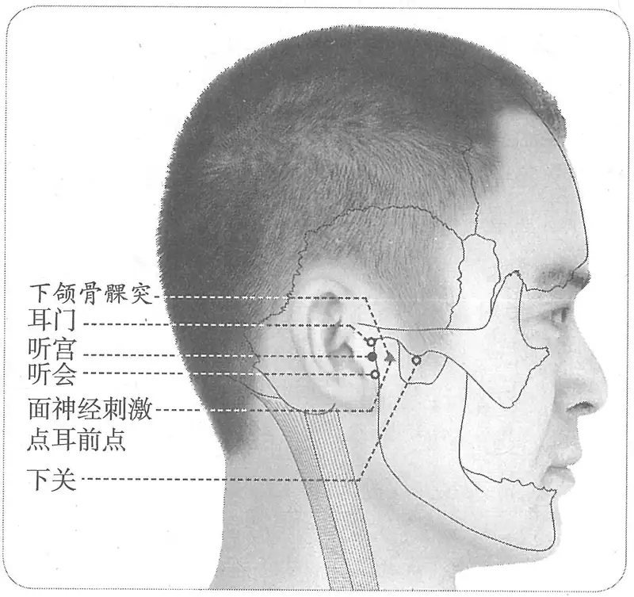

**图 2-156　听宫穴与相关刺激点**

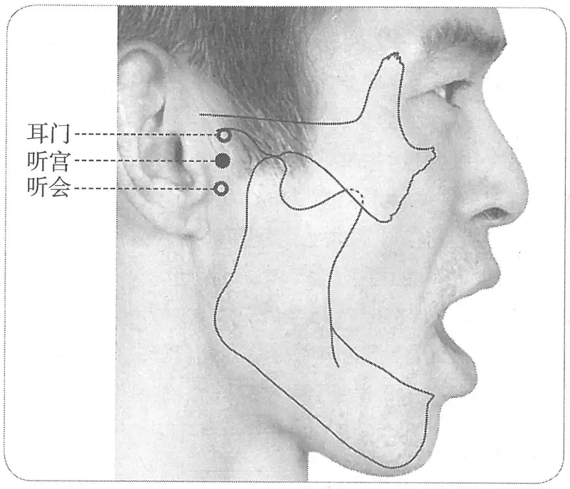

**图 2-157　髁突移动试验**

　1. 在耳中珠子，大如赤小豆。(《黄帝明堂经》、《太平圣惠方·针经》、《铜人腧穴针灸图经》、《圣

〔p.591 (인쇄 571)〕

济总录》、《针灸资生经》、《十四经发挥》、《神应经》、《医学纲目》、《针灸集书》、《针灸大成》、《针方六集》、《类经图翼》、《循经考穴编》、《针灸易学》、《针灸逢源》)

　2. 在耳珠子下大如赤豆。耳珠如赤豆大，谓郭内又有一郭，如碗沿之上正中有一核，按之得指下。此核者是三脉交结，故有核也。(《窦太师针经》)

　3. 耳珠前微下陷中。(《针灸十四经穴位考订》)

　4. 统编针灸学教材

　　(1) 部位：耳前珠子旁，大如赤小豆。取穴：耳孔前之小瓣耳珠前陷中取之，如以手指重压之则耳内作响声。(1957年南京《针灸学》)

　　(2) 部位：耳前珠之旁。取穴：于耳珠前方，张口出现凹陷处取之。(1版《针灸学讲义》)

　　(3) 部位：在耳中珠子大前。取穴：在耳屏与下颌关节之间，微张口呈凹陷处取之。(2版《针灸学讲义》)

　　(4) 耳屏前，下颌骨髁状突的后缘，张口呈凹陷处。(4、5、7版《针灸学》、《中国针灸学》)

　　(5) 在面部，耳屏前，下颌骨髁状突的后方，张口时呈凹陷处。(6版《针灸学》)

#### 【类属】 

手太阳小肠经穴。

**脉气所发**：手足少阳、手太阳之会。(《黄帝明堂经》)

**归经：**

　1. 手少阳三焦经。(《外台秘要》卷三十九)

　2. 手太阳小肠经。(《铜人腧穴针灸图经》卷上)

#### 【适应症】 

主治耳部病症。常用于耳鸣，耳聋，聤耳；癫，狂，痫。

　1. 主惊狂，瘛疭，眩仆，癫疾，瘖不能言，羊鸣沫出。耳聋填填如无闻，聤聤嘈嘈若蝉鸣、䳬鸠鸣。(《黄帝明堂经》)

**按**：“惊狂……羊鸣沫出”与“听会”穴主治症相同，盖出于同一首针灸方。《黄帝明堂经》中此二穴主治相近，当参看。

　2. 心腹满，臂痛失色。(《太平圣惠方·针经》)

　3. 治耳聋如物填塞无所闻，耳中嘈嘈，心腹满，臂痛失声。(《铜人腧穴针灸图经》卷中)

　4. 窦太师针灸遗存

　　(1) 治耳内虚鸣，气痒，耳聋气闭，小儿聤耳出脓。(《窦太师针经》)

　　(2) 聤耳出脓。(《针方六集》卷五)

　　(3) 主耳虚鸣痒，或闭塞无闻，或耳出清汁。(《循经考穴编》上)

　5. 统编针灸学教材

　　(1) 耳聋，耳鸣，聤耳。(1957年南京《针灸学》、1版《针灸学讲义》)

　　(2) 耳聋，耳鸣，聤耳，失音，癫疾，齿痛。(2版《针灸学讲义》)

　　(3) 耳聋，耳鸣，聤耳，齿痛，癫狂痫。(4、5、6版《针灸学》)

　　(4) 耳聋，耳鸣，聤耳等耳疾；齿痛。(7版《针灸学》)

　　(5) 耳聋，耳鸣，聤耳，牙关不利，齿痛。(《中国针灸学》)

**按**：《黄帝明堂经》载本穴主治包括耳疾与癫痫，然治疗重点当在于耳疾，本穴名称也提示了这一主治特点，也与《素问·刺节真邪》描述一致。后世腧穴文献的阐发及临床应用的重点也在于耳疾。教材中“牙关不利，齿痛”不见于古代针灸文献，而见于听会穴主治(此二穴在《针灸甲乙经》中位置相邻)，今去之。

#### 附：临床应用举例 

　1. 耳部病症

〔p.592 (인쇄 572)〕

　　(1) 夫发蒙者，耳无所闻，目无所见。刺此者，必于日中，刺其听宫，中其眸子，声闻于耳，此其输也。(《灵枢·刺节真邪》)

　　(2) 耳聋气闭，听会、听宫、翳风。问曰：此证从何而得？答曰：伤大热，汗闭，气不舒通，故得此证。复刺后穴：三里、合谷。(《针灸集成》第二十八方)

　　(3) 美尼尔氏病，取耳门穴、听宫穴，针刺治疗。[陕西中医，1985，6(8)：365]

　　(4) 突发性耳聋，针刺听宫穴。[中国针灸，1987(6)：40-42]

　2. 其他病症

　　(1) 颞下颌关节功能紊乱症，以下关、听宫、合谷为主，颊车、安眠为辅，采用泻法。[陕西中医，1988(1)：38-39]

　　(2) 面痛：取听宫、听会、翳风，针刺疗法。[中医杂志，1990，31(12)：40]

　　(3) 颈椎综合征，针刺听宫穴。[中国康复，1993，8(4)：179]

　　(4) 呃逆，取双侧听宫穴、单侧合谷穴，针刺至局部有酸、胀、麻感。[中国民间疗法，2000，8(6)：15-16]

#### 【操作】 

张口，直刺1~1.5寸。不宜深刺。

在听宫周围1cm范围内有8穴之多，临床上如何应用？此外，与听宫相对的耳郭背面的“后听宫”以及稍上方的“后聪”穴，虽然进针部位不同，但由于进针的角度使得针尖到达的部位相同或相近，因而主治也相同。实际上听宫周围的这些穴都可视为同一穴，这些新发现的穴可提供两方面的启示：第一，听宫穴存在不同的针刺角度与方向；第二，听宫的主要适应症为耳疾。

　1. 刺入一分，灸三壮。(《医心方》卷二、王冰《素问》注、《太平圣惠方·针经》)

　2. 刺入三分，灸三壮。(《针灸甲乙经》卷三)

　3. 窦太师针灸遗存

　　(1) 针入三分，轻弹针出血，禁灸。治耳内虚鸣，气痒，耳聋气闭，小儿停耳出脓。(《窦太师针经》)

　　(2) 针入一分，轻弹出血，禁灸。(《针方六集》卷一)

　4. 统编针灸学教材

　　(1) 针三至五分，灸三至五壮。(1957年南京《针灸学》、1版《针灸学讲义》)

　　(2) 直刺3~5分，小艾炷灸3~5壮。(2版《针灸学讲义》)

　　(3) 张口，直刺1~1.5寸。(4、5、6版《针灸学》)

　　(4) 张口，直刺1~1.5寸。留针时应保持一定的张口姿势。(7版《针灸学》)

　　(5) 张口，直刺0.5~1.0寸。可灸。(《中国针灸学》)

　5. 直刺，张口，针尖微向下，深1.5~2寸。感应局部酸胀，可扩散至半侧面部，有时有鼓膜内外鼓胀的感觉。(上海《针灸学》)

**文献分析**：本穴针刺深度，《黄帝明堂经》只“刺入一分”，之后的针刺深度不断增加，当与本穴定位于耳外的变化有关。

### 延伸阅读 

　1. 黄龙祥.新编重绘十四经脉经穴图[M].北京：中国中医药出版社，2010.

　2. 黄龙祥.中国针灸学术史大纲[M].北京：华夏出版社，2001.

〔p.593 (인쇄 573)〕

　3. 樊玉林.听宫初考(临床观察部分)[J].西安医学院学报，1977(11)：44-48.

　4. 樊玉林.听宫初考(临床应用部分)[J].西安医学院学报，1977(11)：49-51.

　5. 刘森亭.天容穴略考[J].陕西中医，1982，12(6)：28-29.

　6. 许光义.针刺听宫穴机理新探讨[J].临床资料选编，1985(7)：26-28.

　7. 张晓彤，袁国莲，许珉，等.针刺“内听宫”穴对突发性耳聋患者听觉脑干诱发电位的影响[J].中国针灸.2003，23(3)：171-172.

　8. 贺普仁.听宫穴的临床应用[J].中国针灸，1987(6)：40-42.

　9. 丁金榜，董功田.针刺治疗颞下颌关节功能紊乱35例[J].陕西中医，1988(1)：38-39.

　10. 王彩平，李运峰.针刺肩贞穴治疗坐骨神经痛[J].山东中医杂志，2002，21(7)：441.

　11. 陆金平，邰浩清.经颧髎、下关针刺蝶腭神经节治疗变应性鼻炎20例[J].甘肃中医学院学报，2000(4)：30-32.

　12. 陈志生，梁子锦.天宗穴压痛反映颈神经根受压迫[J].中国中医骨伤科，1995，3(1)：25-26.

　13. 黄龙祥.“景风”穴辨[J].中国针灸，1987(3)：55.

〔p.594 (인쇄 574)〕

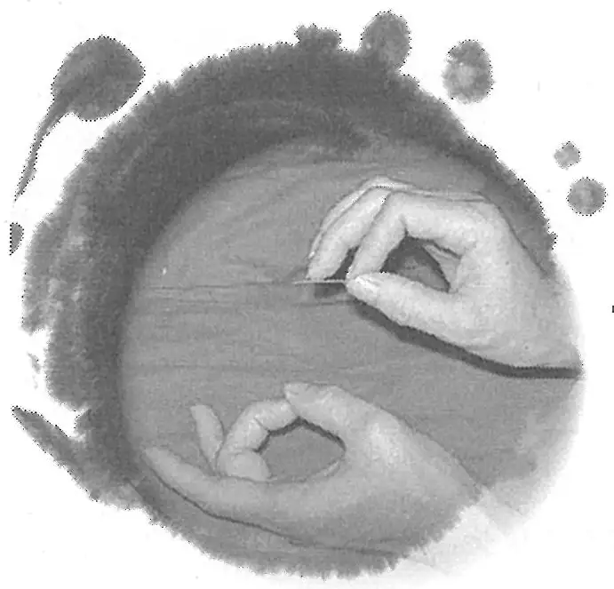

