# 《针灸腧穴通考》(上册) — 足太阳膀胱经穴 (1/3) · （一）睛明 Jīngmíng BL1 出《黄帝明堂经》~（十七）膈俞 Géshū BL17 出《灵枢》

> 분할본 12/25. 원서: 黄龙祥·黄幼民 编著, 《针灸腧穴通考——〈中华针灸穴典〉研究》(上册), 人民卫生出版社, 2011. 원서 스캔 OCR 판독본을 챗봇 검색용으로 나눈 것이며, 본문과 쪽 표시 〔p.PDF쪽 (인쇄 쪽)〕는 원본 그대로이다.

## 七、足太阳膀胱经穴 

### 概说 

在《内经》时代，背部腧穴只有第二侧行穴归属于足太阳膀胱经，之后第一侧行穴也被归入足太阳膀胱经，这样背部两行如何与下肢一行穴衔接便成了分歧很大的问题，这种分歧也反映在足太阳经脉循行的变化上。在经穴定位方面，古代文献文字描述分歧不大而实际定位却出入很大的穴，首推委阳穴，在现存的各种“明堂图”、“铜人图”中，几乎找不到在该穴定位上完全相同的图。

#### 【经脉与经穴】 

#### 经脉循行与病候 

膀胱足太阳之脉，起于目内眦，上额交巅；其支者，从巅至耳上角；其直者，从巅入络脑，还出别下项，循肩髆内，挟脊抵腰中，入循膂，络肾属膀胱；其支者，从腰中下挟脊贯臀，入腘中；其支者，从髆内左右，别下贯胛，挟脊内，过髀枢，循髀外从后廉下合腘中，以下贯腨内，出外踝之后，循京骨，至小指外侧。是动则病冲头痛，目似脱，项如拔，脊痛腰似折，髀不可以曲(回)，腘如结，腨如裂，是为踝厥。是主筋所生病者，痔疟狂癫疾，头囟项痛，目黄泪出鼽衄，项背腰尻腘腨脚皆痛，小指不用。(《灵枢·经脉》)

**按**：髀不可以曲，《黄帝内经太素·经脉连环》卷八作“髀不可以回”，与帛书经脉篇意同。今考《素问·至真要大论》也作“回”，新校正引《针灸甲乙经》同，则传世本《灵枢》之“曲”盖“回”字形误。此外，所生病中较两种帛书《足臂十一脉灸经》或《阴阳十一脉灸经》少“耳聋”症，多“目黄泣出”症。既然采用了《足臂十一脉灸经》中“之耳”的分支，则不应去除相应的“耳聋”病症，况且该症也见于《素问·脉解》。

由于《灵枢》在帛书经脉篇的基础上，引入经别的内容，使6条阳经也得以行于体内与相关六腑相联系，同时为实现十二经脉的循环流注，人为地增加了一些分支以便于使经脉依次交接，并使6条经脉改变了循行方向。但却忘记了对“经”、“别”，“直”、“支”加以的调整，未能形成统一的体例，顺应上述这些变化，因而使得通篇文字前后关系混乱，难以理解。关于《灵枢·经脉》足太阳膀胱经循行的经、别、直、支正确关系应如下作：

膀胱足太阳之脉，起于目内眦，上额交巅；其支者，从巅至耳上角；其直者，从巅入络脑，还出别下项，循肩髆内，夹脊抵腰中；[其别者]，入循膂，络肾属膀胱；[其直者]，从腰中下夹脊贯臀，入(出)腘中；以下贯腨内，出外踝之后，循京骨，至小指外侧。

**按**：“其直者，从腰中下夹脊贯臀，入腘中”句中“入腘中”，当据帛书经脉篇作“出腘中”。又此下原有一分支“其支者，从髆内左右，别下贯胛，过髀枢，循髀外从后廉下合腘中”。但从字面上看不出与足太阳脉直行支“循肩膊内夹脊”有什么区别。而且背部第一侧行穴中除位于原足太阳脉行处的“白环俞”外，《针灸甲乙经》只注明胆俞、三焦俞为足太阳脉气所发。《黄帝内经太素·气府》卷十一载足太阳脉气所发穴中无五脏六腑俞穴。汉代腧穴经典《黄帝明堂经》背俞穴下未注明“足太阳脉气所发”，那么现行本《素问·气府论》足太阳脉气所发穴下“五脏之俞各五，六腑之俞各六”句，或系王冰所增入，由此看来，《经脉》篇所增之足太阳在背部的分支在当时并未被普遍接受。今删之。

〔p.595 (인쇄 575)〕

又原文“其直者，从巅入络脑，还出别下项，循肩髆内，夹脊抵腰中，入循膂，络肾属膀胱；其支者，从腰中下夹脊贯臀，入腘中；其支者，从髆内左右，别下贯胛，夹脊内，过髀枢，循髀外，从后廉下合腘中，以下贯踹内，出外踝之后，循京骨，至小指外侧”。以上第一分支与《足臂十一脉灸经》相合；而第二个“其支者”后又接一个“其支者”，这样足太阳脉自腰以下便不再有主干而只剩下分支形式，显然有误。这里不仅主干与分支的关系错乱，而且分支的起点也有误。因为据《经别》篇，“入循膂，络肾属膀胱”一段应属于经别，而据《足臂十一脉灸经》，“腘中……小指外侧”一段属于“其直者”的主干。今据改，并加标识。

巨阳脉，系于潼(踵)外踝娄中，出郄中，上穿䐐(臀)，出厌中，夹脊，出于项，上头角，下颜，夹𩑶(䪼)，系目内廉。是动则病潼(冲)头痛，目似脱，项似拔，脊痛，腰似折，髀不可以运，腘如结，腨如裂，此为踝厥，是巨阳脉主治。其所产病：足小指痹，腨痛，郄痛，痔，尻痛，腰痛，背痛，疟，耳彊项痛，耳聋，头痛。(《阴阳十一脉灸经》)

足太阳脉，出外踝娄中，上贯腨，出于郄；支之下脾；其直者贯□，夹脊，□□一，上于豆(脰)；枝颜下，之耳；其直者贯目内眦，之鼻二。其病：病足小指废，腨痛，郄挛，脽痛，产痔，腰痛，夹脊痛，□痛，项痛，手痛三，颜寒，产聋，目痛，鼽衄，数癫疾。诸病此物者，皆灸太阳脉。(《足臂十一脉灸经》)

**所属经穴**：至阴　通谷　束骨　京骨　金门　申脉　仆参　昆仑　跗阳　飞阳　承山　承筋　合阳　委中　委阳　浮郄　殷门　承扶　秩边　胞肓　志室　肓门　胃仓　意舍　阳纲　魂门　膈关　譩譆　神堂　膏肓俞　魄户　附分　会阳　下髎　中髎　次髎　上髎　白环俞　中膂俞　膀胱俞　小肠俞　关元俞　大肠俞　气海俞　肾俞　三焦俞　胃俞　脾俞　胆俞　肝俞　膈俞　督俞　心俞　厥阴俞　肺俞　风门　大杼　天柱　玉枕　络却　通天　承光　五处　曲差　眉冲　攒竹　睛明

#### 【归经与起止穴】 

宋代王惟一《铜人腧穴针灸图经》厘定本经穴位共63穴，其中出自《黄帝明堂经》者61穴，另从《千金要方》补“膏肓俞”一穴，从《太平圣惠方》补“厥阴俞”一穴。至明代《针灸问对》、《医学入门》，又从《太平圣惠方》增补3穴，即“督俞”、“气海俞”、“关元俞”；《医学入门》再增“眉冲”一穴。自此足太阳经穴增至67穴。

早期的经络学说中，足太阳在背部的循行只有一条脉，至《灵枢·经脉》始增添一条支脉。可能因为出现太晚，或者由于其他什么原因，《经脉》篇此说在当时并未产生相应的影响，《黄帝内经太素·气府》卷十一载足太阳脉气所发穴中无五脏六腑俞穴，汉代腧穴经典《黄帝明堂经》背俞穴下也未注明“足太阳脉气所发”，那么现行本《素问·气府论》足太阳脉气所发穴下“五脏之俞各五，六腑之俞各六”句，很可能系王冰所增入，其在《水热穴论》篇有更明确的注解：

背部之俞凡有五行，当其中者督脉气所发，次两旁四行皆足太阳脉气也。(《素问·水热穴论》王冰注)

既然足太阳在腰背部多出一分支，那么腰背部第二侧行穴归入足太阳经也就只是个时间问题。

〔p.596 (인쇄 576)〕

记载“会阳”穴的所有古代腧穴文献都曰“督脉气所发”，该穴的位置也一直没有改变，然而自北宋《铜人腧穴针灸图经》卷上至今腧穴书中却一直将会阳穴归入足太阳经。这一变化令人难以理解。因为督脉之络“夹膂上项”，故可认为位于尾骨旁之“会阳”属于督脉，与任脉之络“会阴”正相应。可能宋人以为某脉之穴必位于其正脉之上，故归会阳穴于足太阳经，但又未将其脉气所发相应改作“足太阳脉气所发”或“督脉、足太阳之会”，故使这种归经的变化缺乏理论依据。

又“付阳”穴，《黄帝明堂经》谓“阳𫏋之郄，在足外踝上三寸，太阳前，少阳后筋骨间”，《千金要方》卷二十九、《千金翼方》卷二十六遂归此穴入足少阳胆经穴。

足太阳经穴在背部与下肢有两种不同的连接法：

　1. 背部两侧穴双线与下肢穴相连：见明·成化史素铜人图、明·弘治丘濬铜人图、明太医院重修铜人图。

　2. 背部外侧一线与下肢穴相连：见梦莲铜人图、董德懋铜人图等。

其中第一种连接法在具体连接次序及某些细节方面还有不同。之所以会出现这两种不同的连接方法，主要是由于早期腧穴归经的错误使得经脉在躯干部循行分布规律以及腧穴归经规律被打乱了，于是后人通过各种努力试图消除这种错误，由于不明错误的根源，结果皆不圆满。

#### 【经穴定位与主治】 

本经腧穴定位的变化较多、较大，突出表现在背俞穴、委阳穴的定位变化，以及由此穴所引发的关于大腿后部骨度改变所引起的相关腧穴定位的连带变化。

关于背俞穴的定位，《灵枢》与《素问》已不同法，而《医心方》卷二引《黄帝九卷》定背俞又别是一法，自《内经》以下分歧更多。对此，初唐名医杨玄操有较为全面的论述：

杨玄操曰：《黄帝正经》椎有二十一节，华佗、扁鹊、曹翕、高济之徒，或云二十四椎，或云二十二，或云长人二十四椎，短人二十一椎。此并两失其衷，大致或疑……又云：诸输皆两穴，夹脊相去三寸。诸家杂说多有不同。或云肺俞第五椎，心俞第七椎；或云相去二寸半，或云二寸，或云三寸三分；或云诸输皆有三穴，此又谬矣。(转引自《医心方》卷二)

杨氏文中提及的五种不同背俞定位法，在现存文献中均有所反映。对古代针灸方中的背俞穴部位，应根据其不同的来源文献在该文献中查找相应的定位，不可一概以今之背俞穴定位去理解，因为原方的主治病症是刺灸当时的相应背部腧穴所总结的。例如，若用华佗明堂之方，则当用华氏之穴，而不能概依《黄帝明堂经》定穴。下面要重点讨论脊正中线上(督脉)定穴法，或“诸输皆有三穴”的定位法，因为此法一直影响到今天的腧穴定位，且自古以来人们对此法误解很多。

五脏六腑腧，第二椎骨下；肺腧，第三椎骨下；心腧，第五椎骨下；心包络腧，第七椎骨下；膈腧，第九椎骨下；肝腧，第九椎骨下；脾腧，第十一椎骨下；胃腧，第十二椎骨下；三焦腧，第十三椎骨下；肾腧，第十四椎骨下；大肠俞，第十六椎骨下；小肠腧，第十九椎骨下；膀胱腧，第十九椎骨下；中膂腧，第二十椎骨下；白环腧，第二十一椎骨下。(《刘涓子治痈疽神仙遗论·辨腧法》)

以上十五腧中“五脏六腑腧”不见于现存古医籍文献。《千金要方》卷八只有“脏腧”之名，在“第五椎”，与刘涓子“心腧”相当；又《千金要方》卷八载心腧穴“在第五节。一云第七节，对心，横三间寸”，而刘氏将第七椎骨下作为“心包络腧”；又“膈腧”、“小肠腧”部位分别与“肝腧”、“膀胱腧”相重，疑为传抄之误。与他书最大的不同之处在于，此书载背俞穴均在椎下，而不是在椎两旁。这种定位法已见于《医心方》卷二所录《黄帝九卷》中，该书将肝俞穴定于椎骨下，而其余背俞穴仍定于椎骨旁一寸三分处。此外，《扁鹊针灸经》、《金腾灸经》也均将肝俞穴定于椎骨正下，而《神仙灸法》则将所有背俞皆定于脊中央椎骨下，这种背腧定位法也见于《千金要方》，而且取穴法也用与众不同的“横三间寸”法，即当脊中央椎骨下置一艾炷，两旁再各置一艾炷，每炷宽三分，三炷之间为一寸。此即杨玄操所谓“诸输皆有三穴”说的由来，《医心方》卷六灸腰痛法引《小品方》曰：“又夹两旁一寸复灸之，为横三穴间一寸也”即此意也。以下特引《千金要方》原文举例说明：

〔p.597 (인쇄 577)〕

五脏热及身体热，脉弦急者，灸第十四椎，与脐相当，五十壮。老小增损之。若虚寒，至百壮，横三间寸灸之。(《千金要方》卷十六)

五脏虚劳，小腹弦急胀热，灸肾输伍拾壮，老小损之。若虚冷，可至百壮，横三间寸灸之。(《千金要方》卷十九)

消渴咽喉干，灸胃管下输三穴各百壮。穴在背第八椎下，横三寸间寸灸之。(《千金要方》卷二十一)

消渴咽喉干，灸胃管下俞三穴各百壮。在背第八椎下，横三间寸灸之。(《千金翼方》卷二十八)

上述前两条主症相近，均取肾俞穴于十四椎下，横三间寸灸之。而第三方灸胃管下输，“横三间寸”误作“横三寸间寸”(这也是传世本《千金要方》所载众多“横三间寸”法中唯一的误例)。后世医家因不明“横三间寸”原意，自《圣济总录·针灸门》以下多将《千金要方》、《千金翼方》中之“横三间寸”改作“横三寸间”，需要注意的是，虽然《小品方》、《千金要方》都提到“横三间寸”灸法所取穴为三点，但原本只作为一穴看待。

“横三间寸”法取背俞穴的记载，在现存文献中，最早见于《小品方》引《曹氏灸经》文，又见于《医心方》引《龙衔素针经》。该法除了用于取背俞穴外，还见《小品方》用于取任脉“天突”穴(见《千金要方》卷二十四)。又见《千金要方》、《千金翼方》中用于取督脉穴“大椎”。在阅读《千金要方》、《千金翼方》中大量的这类处方时，切不可以今天的背俞定位法去理解。

不同时期，不同医家取背俞穴之所以会出现如此大的分歧，一方面是由于来自不同的临床实践经验，另一方面由于其对脏腑解剖生理及其相互关系的认识不同；某些名词术语的不统一也是造成这种分歧的重要原因。如何看待这些分歧，唐代名医杨上善有中肯的评说：“天地造化，数乃无穷，人之输穴之分，何可同哉？昔神农氏录天地间金石草木三百六十五种，法三百六十五日，济时所用。其不录者，或有人识用，或无人识者，盖亦多矣。次黄帝取人身体三百六十五穴，亦法三百六十五日。身体之上，移于分寸，左右差异；取病之输，实亦不少。至于《扁鹊灸经》，取穴及名字即大有不同。近代《秦承祖明堂》、《曹氏灸经》等，所承别本，处所及名亦皆有异。而除病遣疾又复不少，正可以智量之，适病为用，不可全言非也。而并为非者，不知大方之论”(《黄帝内经太素·气穴》)。古代诸家背俞穴取法中，只有“华佗夹脊”沿用至今(只是已不作为背俞穴，而是作为经外奇穴)。宋以前各家取背俞穴异同见表2-7。

**表 2-7　宋以前各家背俞定穴法**

| 书名／椎数 | 《黄帝明堂经》 | 《扁鹊针灸经》 | 《华佗针灸经》 | 龙衔《素针经》 | 僧匡及彻云氏 | 佚名灸方 | 《中脏经》 |
|---|---|---|---|---|---|---|---|
| 3 | 肺俞 |  | 云门俞 | 心输 | 风门 |  |  |
| 4 |  | 关输 | 神俞 | 风门 |  |  |  |
| 5 | 心俞 | 督脉输 | 脉俞 | 肺输 |  |  | 肺俞 |

〔p.598 (인쇄 578)〕

续表

| 书名／椎数 | 《黄帝明堂经》 | 《扁鹊针灸经》 | 《华佗针灸经》 | 龙衔《素针经》 | 僧匡及彻云氏 | 佚名灸方 | 《中脏经》 |
|---|---|---|---|---|---|---|---|
| 6 |  | 心输 | 心俞 |  |  |  |  |
| 7 | 膈俞 |  |  | 肝输 | 心输 |  |  |
| 8 |  | 肺输 | 肝俞 | 胃管下输 | 鬲输 | 聂俞 |  |
| 9 | 肝俞 |  | 胆俞 |  |  | 肺俞 | 肝俞 |
| 10 | 胆俞 | 脾输 | 脾俞 |  |  |  | 胆俞 |
| 11 | 脾俞 |  | 胃俞 |  | 胃输 |  | 脾俞 |
| 12 | 胃俞 |  | 肠俞 |  | 脾输 |  | 胃俞 |
| 13 | 三焦俞 | 悬极输 | 大仓俞 |  | 大肠输 |  |  |
| 14 | 肾俞 |  |  |  |  |  | 肾俞 |
| 15 |  | 下极输 | 阳结俞 | 大肠输 | 结肠输 |  |  |
| 16 | 大肠俞 |  | 裂结俞 |  |  | 大肠俞 | 大肠俞 |
| 17 |  | 小肠输 | 大小肠俞 | 小肠输 | 大肠输 | 大小肠俞 | 小肠俞 |
| 18 | 小肠俞 | 三焦输 | 三焦俞 |  |  |  |  |
| 19 | 膀胱俞 | 腰输 |  |  |  | 膀胱俞 |  |
| 20 | 中膂俞 |  | 手少阴俞 |  | 少阳输 |  |  |
| 21 | 白环俞 |  | 解脊俞 |  |  |  |  |
| 22 |  |  | 尽肠俞 |  | 督脉输 |  |  |
| 23 |  |  | 下极俞 |  |  |  |  |
| 夹脊尺寸 | 3寸 | 肝俞当正中余3寸或2.4寸 | 1寸 | 1寸(横三间寸) | 2.5寸瘦人2.2寸 | 2.3寸 | 脾俞4.5寸肾俞4寸余2.2寸 |

关于背腧穴横向定位的分歧，乃对经穴的误解所致。

“肝腧在九焦之间……夹脊相去三寸所”(《灵枢·背俞》)。是指左右两肝腧穴在脊柱两旁相距约三寸。那么一侧的肝腧穴只能是“去脊中(后正中线)一寸半”。《黄帝明堂经》各传本的表述均为“第×椎下，两旁……”意为“棘突下”，与督脉穴的表述相同。宋代王执中将“一寸半”理解为除去脊柱宽度之外的距离，即所谓“除脊一寸半”。对此，明代高武已详辨其误：

或曰：太阳膀胱行背第二行，自大杼至白环俞十六穴，云第几椎下，两旁相去各一寸半；第三行自附分至秩边十四穴，云某椎下，两旁相去各三寸，当除去脊骨一寸外量取之。不然，不应太近椎也。曰旁者，指第二、第三行穴，皆在脊之旁也。按滑氏云：自大杼至白环诸穴，并第二行相去脊中各一寸五分，《歌》云：自从大杼至白环，相去脊中三寸间，夫既曰“脊中”，则自脊骨中间量取，而非骨外量取明矣。(《针灸聚英》卷一)

因此，《针灸聚英》将背腧穴定位直接作“去脊中”。然而，王执中的观点还是对宋以后的针灸文献产生了深远的影响。明中期广为流行的“步穴歌”中，头部足太阳经穴旁开头中线距离为二寸，嘉靖针灸铜人头部足太阳经穴的特征与之相吻合。这一变动盖与背部足太阳经腧穴旁开背中线二寸有关。

委阳穴的理解：尽管历代文献对于“委阳”穴部位的描述未见实质性分歧，然而历代针灸铜人、铜人图、明堂图对于该穴的定位分歧甚大，而且定位正确者极少。在文献中《医学纲目》最早明确论证该穴的定位法，此后《医学入门》记有明确的正确定位；在中国文献经穴图方面，只有明代《经穴指掌图》定位正确；在针灸铜人方面，只有韩国德寿宫针灸铜人定位正确(由于当时朝鲜医学受中国明代李梴的《医学入门》影响极大)。日本古医家因较早地注意到了中国明代初期楼英的考证，因而有较多的腧穴文献及腧穴图对于委阳穴的定位正确，如村上宗占《骨度正误图说》、木村修道《校定冈本一抱子引经诀》(1806年)及图等。

〔p.599 (인쇄 579)〕

从对委阳穴定位的不同理解还引发了关于大腿后部骨度分寸的分歧：

谨按经文论委阳，在足太阳之前，少阳之后，出于腘中外廉。又按经文取合穴法，取委阳者屈伸而索之，取阳陵泉者正竖膝与之齐，下至委阳之前取之，是知委者曲也。委中即两腘之中央，委阳即曲脉之阳分，约文之尽处，两筋间是。推其分野，正当太阳少阳之间，内外廉之界，故曰太阳之前，少阳之后，腘中外廉也。其穴正在约文尽处，两筋之间，屈伸而得之，故取法曰屈伸索之也。只正膝与之齐，阳陵泉正对其穴，故曰取阳陵泉者，下至委阳之前取之也。又考诸尺寸则承扶下至其穴，正得一尺六寸，故愚断然谓《甲乙》脱去“一尺”二字，无疑也。(《医学纲目》卷八)

现代医家对此提出了另一种假设：即《针灸甲乙经》关于委阳穴定位“承扶下六寸”中之“承扶”是“殷门”之误，于是在这一错误推测的前提下，得出大腿部腧穴折量寸的总计：6寸(殷门在承扶下6寸)+6寸(委阳在殷门下6寸)=12寸。

而在此之前，宋代王惟一创铸针灸铜人时，已经对于大腿部的骨度进行了调整：定为一尺四寸。

于是又有人在“12寸”与“14寸”之间提出一个折中的“13寸”，这样大腿后部的骨度就有三个不同尺寸，而人们却始终没有意识到这一点，从而使得足太阳经大腿部的腧穴在不知不觉中发生了较大的变化。这个问题一直到2004年制定经穴定位国际标准时才被意识，并直至2006年的经穴定位国家标准修订时才得到根本解决。详见本书总论“腧穴定位与骨度系统”部分。

#### 【脉口病候、经脉是动病候与经脉穴主治】 

关于足太阳经脉的“是动”病候(源出于足太阳脉口的诊断病候)与“足太阳”穴(昆仑、京骨)主治的比较见表2-8。

**表 2-8　足太阳脉是动病候与经脉穴主治的相关性**

| 《阴阳十一脉灸经》是动病候 | 《灵枢·经脉》是动病候 | 《黄帝明堂经》经脉穴主治 |
|---|---|---|
| 是动则病潼(冲)头痛，[目似脱，项似拔]，脊痛，腰似折，髀不可以运，如结，如裂，此为踝厥，是巨阳脉主治。 | 是动则病冲头痛，目似脱，项如拔，脊痛腰似折，髀不可以曲，腘如结，踹如裂，是为踝厥。 | 昆仑：头眩痛，目如脱，项如拔，脊强，腰痛不能俯仰，脚如结，腨如裂。 |

不难看出，足太阳脉的“是动”病与足太阳脉口的主治症完全符合，甚至连许多文字都如出一辙。《阴阳十一脉灸经》在“是动”病下注曰“是太阳脉主治”，正是对这种关系的揭示。这足以证明：早期经脉病候直接移植于腕踝部相应脉口的诊、疗病候。

#### 【诊络病候、络脉病候与络穴主治】 

　1. 足太阳之别，名曰飞阳，去踝七寸，别走少阴。实则鼽窒头背痛，虚则鼽衄，取之所别也。(《灵枢·经脉》)

　2. 飞扬，一名厥阳，在外踝上七寸，足太阳络，别走少阴者。实则腰背痛，虚则鼽衄。(《黄帝明堂经》)

〔p.600 (인쇄 580)〕

**按**：《灵枢·经脉》载足太阳络脉循行与病候不相应，显有脱文。王冰注《素问·缪刺论》谓足太阳络“自足上行，循背上头”，正与足太阳络病候相应。但不知王氏此说系另有所本，还是出于己意。

《黄帝明堂经》载足太阳络穴“飞扬”主治病候完整包含了《灵枢·经脉》足太阳络脉的诊络病候，可以十分清楚地看出二者源流脉络。除了足太阳之络外，还有足太阳别络。

　3. 三焦下腧，在于足大指之前，少阳之后，出于腘中外廉，名曰委阳，是太阳络也。手少阳经也。三焦者，足少阳太阴一本作阳之所将，太阳之别也，上踝五寸，别入贯腨肠，出于委阳，并太阳之正，入络膀胱，约下焦，实则闭癃，虚则遗溺，遗溺则补之，闭癃则泻之。(《灵枢·本输》)

　4. 三焦病者，腹气满，小腹尤坚，不得小便，窘急，溢则水，留即为胀。候在足太阳之外大络，大络在太阳少阳之间，亦见于脉，取委阳。(《灵枢·邪气藏府病形》)

关于此络的循行部位，在《黄帝明堂经》中作“在足太阳之前，少阳之后，出于腘中外廉两筋间，扶承下六寸，此足太阳之别络也”。

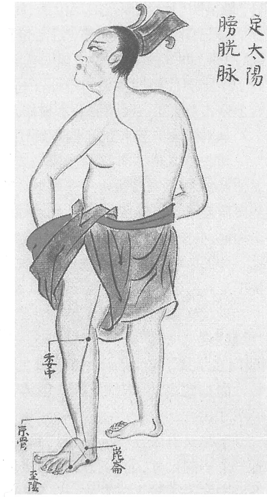

**图 2-158　《环中图》足太阳膀胱脉图**

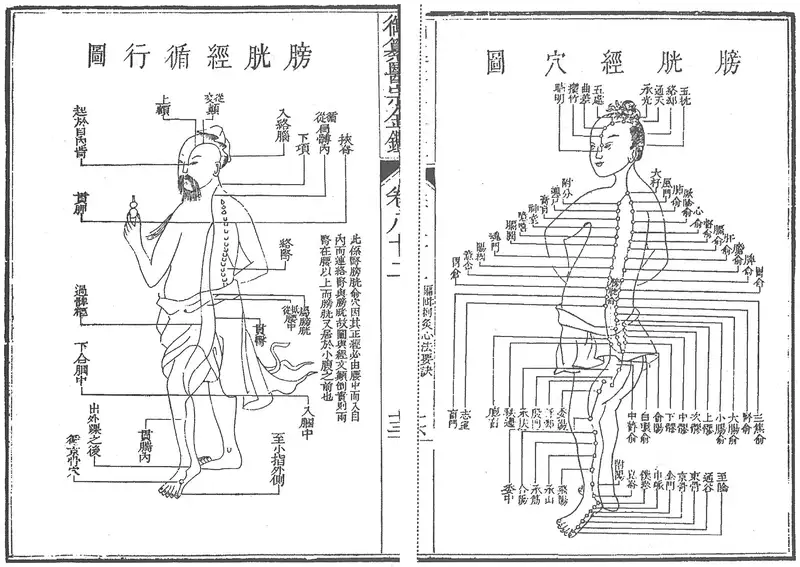

**图 2-159　《医宗金鉴》足太阳膀胱经脉、经穴分图**

〔p.601 (인쇄 581)〕

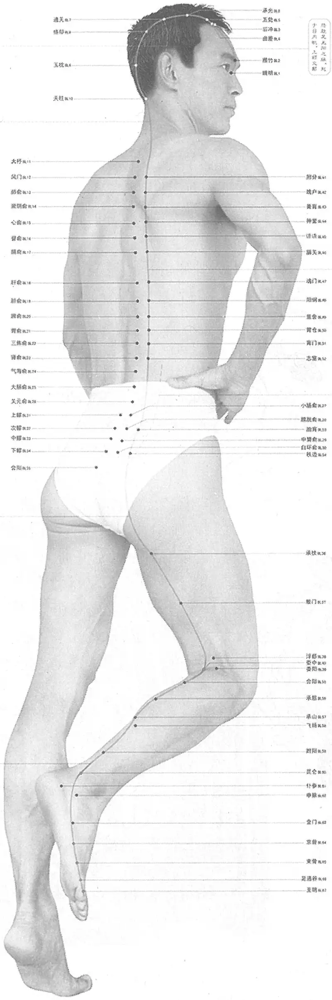

**图 2-160　黄龙祥编足太阳膀胱经脉、经穴合图**

〔p.602 (인쇄 582)〕

### （一）睛明 Jīngmíng BL1 出《黄帝明堂经》 

问题1：《针灸玉龙歌》之“睛明”，何以被改作“内睛明”，归入奇穴类？

问题2：与《针灸玉龙歌》一脉相承的《窦太师针经》、《盘石金直刺秘诀》、《针灸集成》及《针灸大全》针灸方的中“睛明”，是否都应当看做奇穴“内睛明”？

#### 【提要索隐】 

**穴名**：睛明，又写作“精明”。一名泪孔，又写作“泪空”。

**部位**：在面部，目内眦内上方眶内侧壁凹陷中。

**归经**：足太阳膀胱经。**按**：本穴为“手足太阳、足阳明之会”，宋以前针灸文献归经有二：其一，归入手太阳经；其二，归入足太阳经。

**适应症**：主治目疾。常用于目赤肿痛，目翳，流泪，视物不清，眩晕，夜盲。

**针刺操作**：沿目眶鼻骨边缘刺0.3~1.0寸。此穴易出血，宜轻缓进针；针刺不宜过深，以免刺入颅腔。

#### 【名实考】 

一名泪孔，古代文献也写作“泪空”。“睛明”，宋以前文献多作“精明”，如《千金要方》卷六第一引《针灸甲乙经》作“精明”，《医心方》、《素问·脉要精微论》王冰注并同。考《灵枢·大惑论》曰：“目者，五藏六府之精也”。又曰“精之窠为眼”，《素问·脉要精微论》曰“夫精明者，所以视万物”，王冰注云：“精明，穴名也……以近于目，故曰精明”。足证今之“睛明”古作“精明”也，《说文》无“睛”字，“瞦”下云：“目童子精，瞦也”。王筠《说文句读》曰：“精即是睛，与童子为一物”。

关于本穴的定位《内经》、《黄帝明堂经》均作“在目内眦”。《针灸玉龙歌》以本穴“一名泪孔”，而将本穴具体定位于“在目内眦泪孔中”。唐代甄权《针经》定于“目内眦头外畔，陷者宛宛中”，今据此定位，而将《针灸玉龙歌》之定位别作一穴，名曰“内睛明”。若依此例处理，则与《针灸玉龙歌》一脉相承的《窦太师针经》、《盘石金直刺秘诀》、《针灸集成》，以及《针灸大全》针灸方中“睛明”，都只能归入奇穴“内睛明”。

　1. 精明，穴名也。在明堂左右两目内眦也，以近于目，故曰精明。言以形气盛衰，脉之多少，视精明之间气色，观藏府不足有余，参其类伍，以决死生之分。(《素问·脉要精微论》王冰注)

　2. 精明者，名为郎井，在眼本眦陷中可容豆者。人眼神光之所归息也。(《医心方》卷二)

　3. 精明，一名泪孔。在目内眦，手足太阳、足阳明之会。(《黄帝明堂经》)

　4. 睛明，在目内眦泪孔中。针入一分半，略针向鼻，泻。禁灸。(《针灸玉龙歌》注)

　5. 睛之所以明者在瞳仁，而何以此穴为睛明？盖目虽为五脏之所俱属，而目独为肝之窍，然心独为目之本也，目眦乃心之部分，故以此穴为睛明。(《经穴解》)

　6. 别名　泪孔、精明、淚孔、泪腔、目内眦、内眦外。(1957年南京《针灸学》)

**按**：此间接传自日本针灸教材，除“泪孔”，皆非别名。其中“泪腔”为“泪空”形误，“目内眦”、“内眦外”皆系部位名，而非穴名。最令人费解的是，将简体字“泪孔”与繁体字“淚孔”作为两个不同的别名，也与日本教材一致。

#### 相关穴及刺激点 

　1. 内睛明(位于眼内眦角泪阜上，在睛明内一分许)、外睛明(在睛明外上方一分)、上睛明(在睛明上约二分)、睛光(在睛明穴上三分)、健明(在睛明穴下四分稍外侧)以及东明6(在睛明与内睛明之间)。

〔p.603 (인쇄 583)〕

**按**：以上各穴皆主目疾，其中内睛明、上睛明、东明6与睛明紧密相邻，完全可视为同一穴。“外睛明”实际上就是“睛明”的别名。

　2. 视神经刺激点　内眼角内上0.3cm处。主治结膜炎，角膜炎，视神经萎缩，近视。刺法：向眼球后部中央(外后方)缓缓刺入3.0~4.0cm。勿紧靠眼眶，忌提插捻转，以免伤及内眦静脉，引起出血。(《实用神经干电刺激疗法》)

#### 【定位】 

**部位**：在面部，目内眦内上方眶内侧壁凹陷中(图2-161)。

**取穴**：闭目，在目内眦内上方0.1寸的凹陷中。

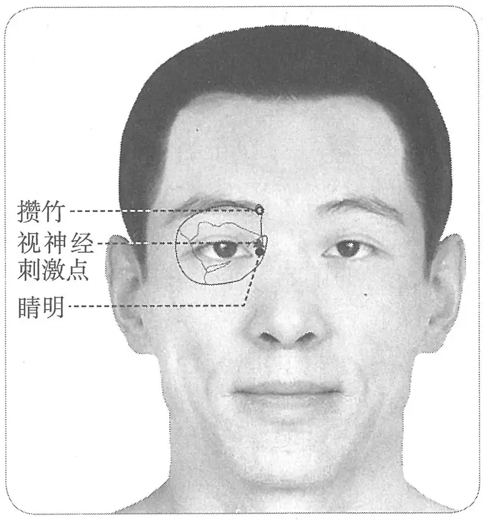

**图 2-161　睛明穴与相关刺激点**

　1. 在目内眦。(《千金翼方》卷二十六、《外台秘要》、《医心方》、《铜人腧穴针灸图经》、《圣济总录》、《针灸资生经》、《十四经发挥》、《针灸聚英》、《古今医统》、《针灸大成》、《针方六集》、《循经考穴编》)

　2. 在目内眦外。(《针灸甲乙经》卷三、《千金要方》)

　3. 在目内眦头外畔，陷者宛宛中。(《太平圣惠方·针经》、《医学纲目》、《针灸聚英》、《古今医统》、《针灸大成》、《类经图翼》、《医宗金鉴·刺灸心法要诀》、《针灸易学》、《针灸逢源》)

　4. 一云目内眦外一分。(《针灸资生经》卷一)

　5. 窦太师针灸遗存

　　(1) 目内眦泪孔中。(《针灸玉龙歌》注、《窦太师针经》)

　　(2) 在目内眦空中。(《循经考穴编》上)

　6. 在目眦内角。(《神应经》)

　7. 目内眦红肉陷中。(《医学入门》卷一)

　8. 广注内眦头外一分许宛宛中。(《循经考穴编》上)

　9. 目内眦角一分宛宛中。(《针灸十四经穴位考订》)

　10. 统编针灸学教材

　　(1) 部位：目内眦头外一分。取穴：正坐合目，掐取内眦角内约一分处，鼻骨边缘取之。(1957年南京《针灸学》)

　　(2) 部位：目内眦内侧一分。取穴：正坐合目，掐取内眦角内侧鼻骨边缘取之。(1版《针灸学讲义》)

　　(3) 部位：在目内眦处。取穴：鼻根之两旁，在目内眦之内上方陷中取之。(2版《针灸学讲义》)

　　(4) 目内眦旁0.1寸。(4、5版《针灸学》)

　　(5) 在面部，目内眦角稍上方凹陷处。(6版《针灸学》)

　　(6) 目内眦角稍内上方凹陷处。(7版《针灸学》)

　　(7) 目内眦角上方一分凹陷处。(《中国针灸学》)

**文献分析**：总括古代文献，关于本穴的部位有二说：其一“在目内眦外”(相当于现代解剖学术语的“内侧”)，其二“目内眦泪孔中”。从文献考证来看，唐以前的文献只说“在目内眦”，没有明确提“内”或“外”(传世本《针灸甲乙经》“外”字，明抄本无；宋校本《千金要方》“外”字，未经宋人校本无，可证均为宋人所添补)，而从临床实际分析，在“目内眦内”针刺将刺入眼球；在正当目内眦的泪孔针刺也行不通，因此《太平圣惠方》传录的初唐针灸大师甄权所说“在内眦头外畔，陷者宛宛中”最切临床，这也是宋人所以校改《针灸甲乙经》、《千金要方》的主要原因。至于金元窦氏针灸作“目内眦泪孔中”，可能是受本穴的别名“泪孔”的影响。今人在睛明周围新增多个新穴，主治与睛明大同，也说明本穴有多个体表进针点。

〔p.604 (인쇄 584)〕

#### 【类属】 

足太阳膀胱经穴。

**脉气所发：**

　1. 手足太阳、足阳明之会。(《针灸甲乙经》卷三)

　2. 手足太阳、阳明之会。(《外台秘要》卷三十九、《太平圣惠方·针经》)

　3. 手足太阳、足阳明、阴𫏋、阳𫏋五脉之会。(《素问·气府论》王冰注)

　4. 手太阳脉气所发者三十六穴，目内眦各一，王冰注曰谓睛明二穴也。在目内眦。(《素问·气府论》)

　5. 手足太阳、少阳、阳明五脉之会。(《铜人腧穴针灸图经》卷上、卷中)

**归经：**

　1. 手太阳。(《外台秘要》卷三十九、《素问》王冰注)

　2. 足太阳。(《铜人腧穴针灸图经》卷上)

**按**：《素问·气府论》于手太阳脉气所发穴下载有“目内眦各一”，故王焘、王冰将其归入手太阳经，王冰曰：“诸穴有云数脉会发而不于所会刺脉下言之者，出从其正者也。”宋代王惟一归入足太阳经。从该穴部位看，似与足太阳经更相近。宋以后多从《铜人腧穴针灸图经》之说。

#### 【适应症】 

主治目疾。常用于目赤肿痛，流泪，目翳，视物不清，夜盲，眩晕。

　1. 主目不明恶风，目泪出憎寒，头痛目眩瞢，内眦赤痛，目䀮䀮无所见，眦痒痛，淫肤白翳。(《黄帝明堂经》)

　2. 主肤翳白膜覆瞳仁，目暗及眯雀目，冷泪，目视不明，胬肉出。(《千金翼方》卷二十七)

　3. 治攀睛翳膜覆瞳子，恶风泪出，目内眦痒痛，小儿雀目疳眼，大人气眼冷泪，䁾目视物不明，大眦努肉侵睛。(《铜人腧穴针灸图经》卷中)

　4. 窦太师针灸遗存

　　(1) 治胬肉攀睛，青盲失明，翳膜，迎风冷泪，一切眼目内翳，补泻。(《窦太师针经》)

　　(2) 治胬肉攀睛红肿痛，宜泻；睛昏失明，先补后泻。(《大本琼瑶神书》)

　　(3) 治目内眦胬肉侵睛及生翳膜，迎风冷泪。(《针方六集》卷五)

　　(4) 主一切目疾，眼红肿痛，迎风冷泪，内外翳障。(《循经考穴编》上)

　　(5) 治眼目红肿，冷热泪常流。看症补泻。(《窦太师秘传》)

　5. 统编针灸学教材

　　(1) 主治眼红赤肿，胬肉攀睛，迎风流泪，内外翳障，眦痒，雀目，视觉昏蒙。(1957年南京《针灸学》、1版《针灸学讲义》)

　　(2) 主治目赤肿痛，流泪，眦痒，夜盲，色盲，目眩。(2版《针灸学讲义》)

　　(3) 主治目赤肿痛，内眦痒痛，流泪，目眩，雀目。(4版《针灸学》)

　　(4) 主治目赤肿痛，流泪，视物不明，目眩，近视，夜盲，色盲。(5版《针灸学》)

〔p.605 (인쇄 585)〕

　　(5) 主治目赤肿痛，胬肉攀睛，迎风流泪，目视不明，近视，夜盲，色盲，目翳。(6版《针灸学》)

　　(6) 主治：①目赤肿痛、流泪、视物不明、目眩、近视、夜盲、色盲等目疾；②急性腰扭伤、坐骨神经痛、心动过速。(7版《针灸学》)

　　(7) 主治目赤肿痛，眦痒，迎风流泪，夜盲，色盲，目眩，近视。(《中国针灸学》)

**文献分析**：本穴主治古代腧穴文献记载与临床应用都集中于眼部病症，为治疗眼病的要穴，《循经考穴编》用“主一切目疾”做了高度概括。现代临床上其主治范围有逐渐扩大的趋势。第7版教材新增“急性腰扭伤、坐骨神经痛、心动过速”主治，虽有临床报道，但对疗效的特异性还缺乏严格的实验数据，故暂不列入主治项。

#### 附：临床应用举例 

　1. 目赤肿痛

　　(1) 膀胱发热风攻，两眼红肿，胬肉攀睛，拳毛倒睫：泻至阴，刺委中出血；未愈，泻足临泣、太阳出血，仍灸大小指骨空；未愈，泻睛明、行间，先补后泻。(《针灸集要·盘石金直刺秘传》)

　　(2) 风沿眼红肿涩烂：睛明、合谷、二间、三里。问曰：此证从何而得？答曰：醉饱行房，血气凝滞，用手扯摸，贼风乘时串入，故得此证。刺之不效，复刺后穴：睛明、三里。(《针灸集成》第十四方)

　　(3) 眼暴赤肿痛：太阳、睛明、合谷、三里。问曰：此证从何而得？答曰：时气壅滞，当风卧睡，饥饱劳役，复刺后穴，不宜补：攒竹、丝竹空、太阳。(《针灸集成》第十六方)

　　(4) 眼红肿疼痛：睛明、合谷、四白、临泣。问曰：此证从何而得？答曰：或因伤寒未解，却有房室之事，上盛下虚，气血上壅，或头风不早治，则血灌瞳人，或暴赤肿痛，或因怒气伤肝，心火炎上，故不散，及妇人产后怒气所伤，产暇未满房事，触毒心肝二经，饮食不节，饥饱醉劳，皆有此证也。证非一时可疗，渐而为之，无不效也。复刺后穴：风池、行间、期门、太阳。(《针灸集成》第十七方)

　　(5) 眼睛红肿痛难熬，怕日羞明心自焦。但刺睛明鱼尾穴，太阳出血病全消。(《针灸玉龙歌》)

　2. 目翳目障

　　(1) 两眼廉翳，羞明，隐涩难开，泻瞳子髎及睛明、合谷泻之。(《针灸集要·盘石金直刺秘传》

　　(2) 目中生膜：睛明、太阳、合谷、四白、光明。问曰：已上穴法刺之不效，何也？答曰：此证受病既深，未可一时便能针愈，须是三次针之方可效。复刺后穴：睛明、合谷、四白。(《针灸集成》第十方)

　　(3) 睛内障：睛明、太阳、临泣、风池、天府、光明、合谷。问曰：此证从何而得？用此法针之不效，何也？答曰：怒气伤肝，血不就舍，肾水枯竭，血气耗散，初患时不能节，将恣意房室，用心过多，故得证者难治，可刺后穴：太阳、合谷、临泣、睛明、光明、风池、天府。(《针灸集成》第十二方)

　　(4) 眼外障：太阳、睛明、合谷、小骨空。问曰：此证从何而得？答曰：头风灌注瞳人，血气涌溢，上盛下虚，故得此证也。刺前穴不效，复刺后穴：临泣、攒竹、三里。(《针灸集成》第十三方)

　　(5) 两眼暴障，头痛头重，搐目失明，灸脑空，泻合谷；未愈，泻睛明。(《针灸集要·盘石金直刺秘传》)

〔p.606 (인쇄 586)〕

　　(6) 睛明治眼胬肉扳。(《灵光赋》)

　　(7) 胬肉侵睛：风池、睛明、合谷、太阳。(《针灸大成》卷九)

　　(8) 翼状胬肉：睛明针刺与穴位放血配合治疗。[中国针灸，1987(4)：10]

　　(9) 老年性白内障：睛明穴针灸治疗。[黑龙江中医药，1988(1)：34-35]

　3. 视物不清、目盲

　　(1) 暴盲：睛明穴、攒竹穴针刺治疗。[四川中医，1985，3(5)：55]

　　(2) 颅脑外伤性复视：睛明穴、瞳子髎穴针刺治愈。[福建中医药，1986，17(4)：22]

　　(3) 脑振荡后双目失明：睛明穴、四白穴针刺。[上海中医药杂志，1987(6)：27]

　　(4) 病毒性脑炎后遗症视力丧失：风池穴、睛明穴针灸治疗。[新疆中医药，1987(1)：54]

　　(5) 皮质盲：针刺内睛明治疗。[JCAM，2002，18(8)：52]

　4. 流泪

　　(1) 羞明怕日：合谷、攒竹、行间、二间、睛明、小骨空。问曰：此证从何而得？答曰：皆因暴痛，未可在路迎风串入眼中，血不就舍，肝不藏血，风毒贯入，观灯光冷泪自出，见日影则疾涩痛疼难开，复刺后穴：睛明、行间。(《针灸集成》第十五方)

　　(2) 冷泪症：睛明穴针刺治疗。[江西中医药，1995(增刊)：48-49]

　5. 其他眼疾

　　(1) 睛明治眼未效时，合谷光明安可缺。(《席弘赋》)

　　(2) 视神经萎缩：输刺睛明、球后治疗。[上海针灸杂志，1993，12(1)：14-15]

　　(3) 角膜溃疡：针刺四白、睛明穴治疗。[中西医结合眼科杂志，1994(4)：244]

　　(4) 动眼神经麻痹：针刺睛明穴治疗。[现代康复，2001，5(7)：119-120]

#### 【操作】 

沿目眶鼻骨边缘刺0.3~1.0寸。此穴易出血，宜轻缓进针；针刺不宜过深，以免刺入颅腔。

　1. 刺入一分，留六呼，灸三壮。(《黄帝明堂经》)

　2. 入一分半，留三呼，泻五吸。冷者，先补后泻，复补之。雀目者，可久留十吸。然后速出。无病不可灸刺。(《千金翼方》卷二十七)

　3. 禁不宜灸。(《外台秘要》卷三十九)

　4. 刺可入同身寸之一分，留六呼。若灸者，可灸三壮。(《素问·气府论》王冰注)

**按**：《针灸聚英·附辨》或问：睛明迎香承泣丝竹空，皆禁灸何也？曰：四穴近目，目畏火，故禁灸也。以是推之，则知睛明不可灸，王注误矣。

　5. 针入一寸五分，留三呼，禁不可灸。(《铜人腧穴针灸图经》卷中)

**按**：王执中曰：按《明堂》云针一分半，《铜人》乃云入一寸半，二者必有一误。予观面部所针，浅者入一分，深者四分尔。而《素问·气府》注亦云刺入一分，则是《铜人》误写“一分”为“一寸”也(《针灸资生经》卷一按)。周树冬《金针梅花诗钞》曰：“《资生经》认为《铜人》误以一分为一寸，因之后人多不敢深针，是王执中一言之误也。针时沿骨直刺，可深达一寸至一寸半，浅者少效，不可捻转。《铜人》之说甚是，不可妄议其非。”

　6. 两目大眦二穴，只可背睛斜飞，不得直针，直即伤睛致瞎，不可治也。(《圣济总录》)

　7. 窦太师针灸遗存

　　(1) 针入一分半，略针向鼻，泻。禁灸。(《针灸玉龙歌》注)

　　(2) 宜针入一分半，禁灸。(《窦太师针经》)

　　(3) 一方：刺入一分半。窦氏针入一寸，禁灸。(《针方六集》卷一)

〔p.607 (인쇄 587)〕

　　(4) 针入一寸五分，禁灸。(《窦太师秘传》)

　8. 睛明刺一分半，攒竹刺一分三分，为适浅深之宜。今医家刺攒竹，卧针直抵睛明，不补不泻，而又久留针，非古人意也。(《针灸聚英》卷一)

**按**：此处高武批评的当时医家不合古意的刺法，如今却是针灸临床的常用刺法。

　9. 禁用针灸。(《医学入门》卷一)

　10. 统编针灸学教材

　　(1) 针一至二分。(1957年南京《针灸学》、1版《针灸学讲义》)

　　(2) 直刺，沿眼眶边缘3~4分，不捻转。(2版《针灸学讲义》)

　　(3) 嘱患者闭目，医者左手轻推眼球向外侧固定，右手缓慢进针，紧靠眶缘直刺0.5~1寸。不捻转，不提插或只轻微地捻转和提插。出针后按揉针孔片刻，以防出血。本穴禁灸。(4、5版《针灸学》)

　　(4) 嘱患者闭目，医者左手轻推眼球向外侧固定，右手缓慢进针，紧靠眶缘直刺0.3~0.5寸；不宜灸。针刺本穴容易引起内出血，出针后需用消毒干棉球按压片刻。(6版《针灸学》)

　　(5) 嘱患者闭目，医者左手轻推眼球向外侧固定，右手缓慢进针，紧靠眶缘直刺0.5~1寸。遇到阻力时，不宜强行进针，应改变方向或退针。不捻转，不提插或只轻微地捻转和提插。出针后按压针孔片刻，以防出血。针具宜细，消毒宜严。禁灸。(7版《针灸学》)

　　(6) 嘱患者闭目，医者左手轻推眼球向外侧固定，右手持针，紧靠眶缘，缓慢进针，直刺0.3~0.7寸。不作大幅度捻转、提插，出针后按揉针孔片刻，以防出血。本穴禁灸。(《中国针灸学》)

　11. 直刺，瞩病人闭目，将眼球轻推向外侧固定，针尖刺入后，不宜捻转和提插，沿目眶鼻骨边缘缓缓刺入，深约1~1.5寸。感应：局部酸胀，并扩散至眼球后面及其周围。注意：此穴易出血，退针后可压迫局部2~3分钟，以防出血。如针后出血，局部可出现青紫，可先用冷敷法止血，待血止后改用热敷法。眼周青紫，约一周可消退，但并不影响视力。针刺不宜过深，以免刺入颅腔。(上海《针灸学》)

### （二）攒竹 Cuánzhú BL2 出《黄帝明堂经》 

#### 【提要索隐】 

**穴名**：一名员柱，一名始光，一名夜光，一名明光；一名鱼头。

**部位**：在面部，眉头凹陷中，额切迹处。

**国标修订**：1990年版国标：在面部，当眉头陷中，眶上切迹处。2006年修订版：在面部，眉头凹陷中，额切迹处。

**按**：1990年版国标攒竹定位将“额切迹”与“眶上切迹”相混，2006年修订版已作改正。

**适应症**：主治眼目、头部病症。常用于头痛，眉头痛；眼睑瞤动，眼睑下垂，口眼㖞斜；视物不清，流泪，目赤肿痛。

**备选适应症**：小儿惊风；痔痛；呃逆。

**针刺操作**：直刺0.1~0.3寸。

#### 【名实考】 

本穴位于眉毛内侧端，因其状如丛竹而得名；因其善治目疾，而有“始光”、“夜光”、“明光”之名，此三穴名中第二字皆有一“光”字，《铜人腧穴针灸图经》将“明光”写作“光明”，则与此规律不合，且与足少阳经穴“光明”相重，疑是“明光”之倒。又眉之中央为“鱼腰”穴，眉之尾谓“鱼尾”穴，故现代有称位于眉头之“攒竹”为“鱼头”。

〔p.608 (인쇄 588)〕

本穴与鱼腰穴关系密切，而今人对于后者还存在不少错误或片面的认识，应予以纠正。

　1. 眉本二穴，王冰注曰：攒竹穴也。在眉头陷者中，足太阳脉气所发。(《素问·气穴论》)

　2. 足太阳脉气所发者七十八穴：两眉头各一，王冰注曰：谓攒竹穴也。所在刺灸分壮，与《气穴》同法。(《素问·气府论》)

　3. 攒竹，一名员柱，一名始光，一名夜光，一名明光，在眉头陷者中，足太阳脉气所发。(《黄帝明堂经》)

　4. 攒竹，一名员柱，一名始光，一名光明。(《铜人腧穴针灸图经》卷上、卷中)

　5. 此穴两眉一蹙，有攒竹之形，故曰攒竹。(《经穴解》)

　6. 别名　鱼头。(1983年上海《针灸治疗手册》)

　7. 别名　员在、小竹、始光、眉中、光明、夜光、元柱、明光、眉本、眉头。(1957年南京《针灸学》)

**按**：此皆传自日本针灸教材，其中“员在”系“员柱”形误；“小竹”乃眉冲穴别名；“元柱”即“员柱”之同音借代；“眉头”、“眉本”系《素问》所言之部位名，非穴名。

#### 同名异穴之“光明” 

　1. 患大风病，两眉中名光明穴，灸随年。(敦煌卷子《新集备急灸法》)

　2. 光明穴　对瞳仁上眉中，是光明穴。(《银海精微》卷下)

**按**：敦煌卷子《新集备急灸法》载“光明”穴，定位与“鱼腰”同，而主治大不同。《银海精微》也将此穴名曰“光明”。可见，此与攒竹穴别名“光明”非为同一穴。

#### 相关穴及刺激点 

　1. 攒竹二穴，一名光明，一名始光，一名圆柱。在两眉头内尖陷中。足太阳脉气所发。针入一分，沿皮向鱼腰穴。治目失明睛昏，先补后泻；目赤肿疼，宜泻，用三棱针出血三次妙。(《窦太师针经》)

　2. 鱼腰二穴，在两眉中间是穴。针入一分，沿皮向外透鱼尾穴。治眼红肿痛，泻之，禁灸。(《窦太师针经》)

　3. 鱼腰二穴，在眉中间。是穴治眼生垂帘翳膜，针入一分，沿皮向两旁是也。(《奇效良方》卷五十五)

　4. 《眼论》又云治眼生淫肤覆瞳子上方，随眼痛左右，灸眉当中瞳子七壮，便愈。(《医心方》卷二十七)

**按**：“眉当中瞳子”，据文义当作“眉中当瞳子”。

　5. 新攒竹，位于眼内眦角外上约七分睛明穴外上约七分。主治视神经萎缩，视网膜色素变性，青光眼，白内障。针法：沿眶缘直刺2~2.5寸，针感麻木或触电感。禁灸。(《针灸经外奇穴图谱(续集)》)

　6. 滑车上神经刺激点，在眉毛内侧端，鼻背根部与眉弓部交汇点。主治前头痛，面神经麻痹。向下斜刺1cm。(《实用神经干电刺激疗法》)

**按**：《窦太师针经》载“攒竹”、“鱼腰”皆主眼疾，且攒竹穴刺法“沿皮透鱼腰”，可见此二穴关系密切。《奇效良方》所载“鱼腰”穴主治更接近《龙树眼论》灸方，且刺法上更指明“沿皮向两旁”，向内可透攒竹穴，向外可透鱼尾穴。

〔p.609 (인쇄 589)〕

#### 【定位】 

**部位**：在面部，眉头凹陷中，额切迹处（图2-162）。

**取穴**：沿睛明直上至眉头边缘可触及一凹陷，即额切迹处取之。

#### 相关解剖学基础 

　　(1) 眶上切迹（孔）、额切迹：在眼眶上缘内侧有两个小孔，其中靠近正中线的多为切迹。其外侧者为眶上孔（切迹），有眶上动脉、静脉和眶上神经通过；内侧者为额切迹或滑车上切迹，有滑车上动脉、静脉和滑车上神经通过。

　　(2) 额切迹体表触诊技法：额切迹触诊法：用指尖或指甲在眉头处寻按，左右拨动更易感知此切迹或骨孔凹陷。

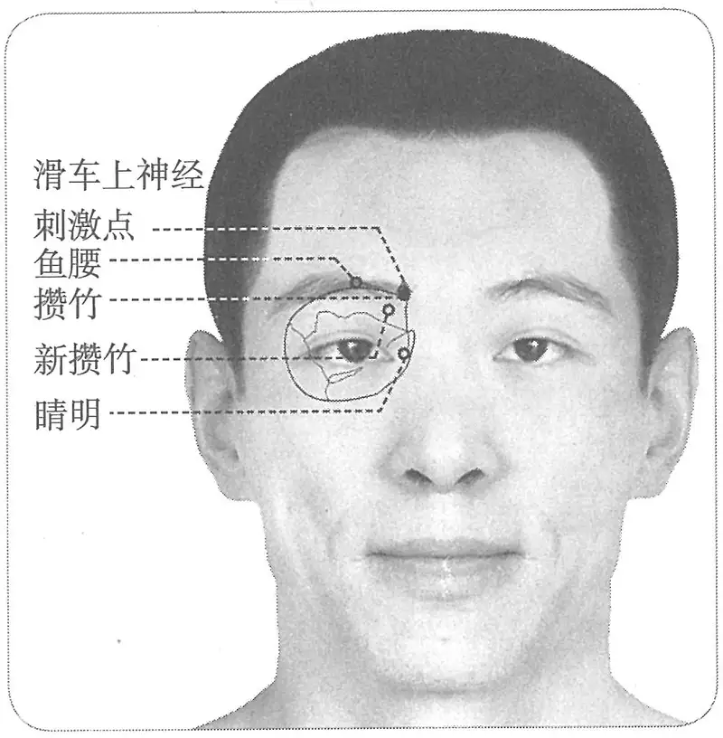

**图 2-162　攒竹穴与相关穴及刺激点**

　　(3) 眼眶神经孔与切迹的体表鉴别：除了靠手指的灵敏的触觉感知外，还可以根据被检查者的反应加以判断。如果是切迹，压迫时可引起明显的疼痛；如果是孔，压迫则不出现明显的疼痛。眶下孔与眶下切迹的体表鉴识可以采用同样的方法。

　1. 在眉头陷者中。（《黄帝明堂经》、《太平圣惠方·明堂》、《铜人腧穴针灸图经》卷中、《圣济总录》、《云岐子论经络迎随补泻法》、《针灸玉龙经》、《十四经发挥》、《医学入门》、《针灸大成》、《针方六集》、《类经图翼》、《医宗金鉴·刺灸心法要诀》、《针灸易学》、《针灸逢源》）

　2. 在眉头陷者中，脉动应手。（《素问·骨空论》王冰注）

**按**：“脉动应手”四字，王冰注《气穴论》、《气府论》攒竹穴部位皆无，当系错入。

　3. 在两眉头少陷宛宛中。（《太平圣惠方·针经》、《针灸资生经》、《医学纲目》、《神应经》、《针灸聚英》、《古今医统》）

　4. 在两眉陷中。（《铜人腧穴针灸图经》卷上）

　5. 窦太师针灸遗存

　　(1) 在两眉头内尖陷中。（《窦太师针经》）

　　(2) 在两眉尖陷中。（《针方六集》卷一）

　　(3) 在眉头尖陷中是穴。（《窦太师秘传》）

　6. 统编针灸学教材

　　(1) 部位：眉头陷中。取穴：从眉端取之。（1957年南京《针灸学》）

　　(2) 部位：眉头陷中。取穴：从睛明穴上方，眉头内陷中取之。（1版《针灸学讲义》）

　　(3) 部位：眉头陷中。取穴：在睛明上方，眉毛内侧端处取之。（2版《针灸学讲义》）

　　(4) 眉头陷中。（4、5版《针灸学》）

　　(5) 在面部，当眉头陷中，眶上切迹处。（6版《针灸学》）

　　(6) 眉头凹陷中，约在目内眦直上。（7版《针灸学》）

　　(7) 眉毛内侧端，眶上切迹处。（《中国针灸学》）

**文献分析**：本穴定位，古代文献无分歧，均定位于“眉头陷者中”，至金元窦氏针灸更进一步说明在“眉头内尖陷中”。但现代针灸学教材在将古代解剖术语转换为现代解剖术语系统时出现了问题——误将眉头内侧和外侧的孔或切迹混称作“眶上孔”或“眶上切迹”，或将外侧称作“眶上孔”，内侧称作“眶上切迹”，虽然最新版的解剖学术语国际标准《Internatinal Anatomical Terminology》已经于“Supra-Orbital Notch/Foramen”词条之外，专列了“Frontal Notch/Foramen”，然而由于相应的国家标准尚未修订，以至于“额切迹”或“额孔”术语很少被人知晓。有的文献虽然知道眶上缘有两个孔或切迹，但不知道靠近内侧的孔或切迹叫什么名称，或统称为眶上孔，或干脆将内侧的孔或切迹称作“额内侧切迹（孔）”。于是，长期以来将以眶内侧孔（或切迹）为标志定位的“攒竹”、“眉冲”两穴定位中解剖学术语直接误译作“眶上孔”或“眶上切迹”。

〔p.610 (인쇄 590)〕

#### 【类属】 

足太阳膀胱经穴。

足太阳脉气所发。（《黄帝明堂经》）

#### 【适应症】 

主治眼目、头部病症。常用于头痛，眉头痛；眼睑瞤动，眼睑下垂，口眼㖞斜；视物不清，流泪，目赤肿痛。

**备选适应症**：小儿惊风；痔痛；呃逆。

　1. 主风头痛，鼻鼽衄，眉头痛，善嚏泣出，目如欲脱，汗出寒热，面赤颊中痛，项强不可左右顾，目系急，瘛疭。癫疾，互引反折，戴眼及眩，狂走不得卧，心中烦，目䀮䀮不明，恶风寒。小儿痫发，目上插。痔痛。（《黄帝明堂经》）

**按**：此“风头痛……善嚏泣出”一组症状与风门穴主治“风眩头痛，鼻鼽不利，时嚏，清涕自出”极相似，又《灵枢·口问》谓“嚏者，补足太阳眉本”，当互参；其“目如欲脱，汗出寒热，项强不可左右顾，目系急，癫疾，互引反折，戴眼及眩，狂走不得卧”等症均为足太阳经脉病候的典型症状；“瘛疭，目上插”为“小儿惊风”的一组症状。

　2. 主目中热痛及瞤。（《千金翼方》卷二十七、《太平圣惠方·针经》）

　3. 尸厥，癫狂病，神邪鬼魅皆主之。（《太平圣惠方·明堂》）

　4. 治目䀮䀮视物不明，眼中赤痛及睑瞤动。三度刺，目大明。（《铜人腧穴针灸图经》卷中）

　5. 窦太师针灸遗存

　　(1) 治目失明睛昏，先补后泻；目赤肿疼，宜泻。（《窦太师针经》）

　　(2) 治目失明，睛昏，先补后泻；目赤痛，泻，宜三棱针出血，不灸。（《大本琼瑶神书》）

　　(3) 主火邪乘目失明，睛昏，目赤胀痛者，宜三棱针出血三次，泄去火气则目复明。（《针方六集》卷五）

　　(4) 主一切目疾红肿热，泪常流。胬肉攀睛，宜弹针出血。迎风冷泪，目难远视，宜先泻后补。头风诸痛，宜针头斜向头维。眉棱骨痛，宜针头横过鱼腰。（《循经考穴编》上）

　6. 主泪出，目眩，瞳子痒，目瞢。（《针灸聚英》卷一、《针灸大成》）

**按**：此条病症系“承泣”所主。高武从《针灸资生经》辑录时有误。《针灸资生经》原文为“攒竹治眼睑瞤动（见目不明）。目不明，泪出目眩瞢，瞳子痒，远视䀮䀮，昏夜无见，目瞤动（余同上承泣），刺承泣。”高武误断句，将属于承泣穴的主治归入“攒竹”穴下。这类错误在《针灸聚英》中不乏其例。

　7. 统编针灸学教材

　　(1) 主治头风，颊肿，面肿，眉棱骨痛，目昏花，迎风流泪，目眩，眼中赤痛，眼睑瞤动，尸厥，癫狂。（1957年南京《针灸学》、1版《针灸学讲义》）

　　(2) 主治头痛，目眩，眉棱骨痛，视物不明，流泪，目赤肿痛，眼睑瞤动。（2版《针灸学讲义》、4版《针灸学》）

　　(3) 主治头痛，口眼㖞斜，目视不明，流泪，目赤肿痛，眼睑瞤动，眉棱骨痛，眼睑下垂。

〔p.611 (인쇄 591)〕

（5版《针灸学》）

　　(4) 主治前额痛，眉棱骨痛，目眩，目视不明，目赤肿痛，近视，眼睑瞤动，面瘫。（6版《针灸学》）

　　(5) 主治：①头痛、眉棱骨痛；②眼睑瞤动、眼睑下垂、口眼歪斜、目视不明、流泪、目赤肿痛等目部病证；③呃逆。（7版《针灸学》）

　　(6) 主治头痛，目眩，眉棱骨痛，目视不明，流泪，目赤肿痛，眼睑瞤动，青盲。（《中国针灸学》）

**文献分析**：本穴为治疗眼病要穴。古今腧穴文献记载的本穴主治症以及临床应用都集中于眼病，其他病症也是当其伴随眼部症状时才取本穴。如《黄帝明堂经》取本穴治外感头痛，须见有“目如欲脱”症；治项强须见有“目系急”；治小儿痫，须伴有“目上插”；治癫狂，须见有“目䀮䀮不明”等。也就是说，不论治疗什么病，只要见有明显的目部症状，即可取本穴。本穴的别名“始光”、“夜光”、“明光”也突出了本穴主治特点。金元窦太师针灸更直接、明确地将本穴的主治定位于治疗眼疾。值得注意的是“痔痛”，虽为足太阳经病候，但肛门病症取头面穴治之者不常见。古今临床也未见类似的应用，有待今后检验。第7版教材新增“呃逆”，虽有现代临床应用报道，但其疗效的特异性尚有待进一步检验，暂不列于主治项，附存备考。

#### 附：临床应用举例 

　1. 目疾

　　(1) 赤眼，挑耳后红筋，针攒竹穴即安，穴在两眉头陷中。（《世医得效方》卷十七）

　　(2) 脑昏目赤，泻攒竹以偏宜。（《通玄指要赋》）

　　(3) 眼肉赤肿，睫溃烂连脑昏：泻攒竹，刺大敦泻之；未愈，灸大小指骨空数效。（《针灸集要·盘石金直刺秘传》）

　　(4) 目迎风冷泪：攒竹、合空谷、大骨空、小骨空。问曰：此证从何而得？答曰：醉后当风或暴赤痛，不忌房事，恣意好食烧煎肉物，妊人多因产后不识回避，当风坐视，贼风串入眼中，正或行经之时，与男子交感，秽气充头目，亦成此证也。复刺后穴：攒竹、合谷、大骨空、小骨空。（《针灸集成》第十一方）

　　(5) 羞明怕日：合谷、攒竹、行间、二间、睛明、小骨空。问曰：此证从何而得？答曰：皆因暴痛，未可在路迎风串入眼中，血不就舍，肝不藏血，风毒贯入，观灯光冷泪自出，见日影则疾涩痛疼难开，复刺后穴：睛明、行间。（《针灸集成》第十五方）

　　(6) 眼暴赤肿痛：太阳、睛明、合谷、三里。问曰：此证从何而得？答曰：时气壅滞，当风卧睡，饥饱劳役，复刺后穴，不宜补：攒竹、丝竹空、太阳。（《针灸集成》第十六方）

　　(7) 男女眼目红肿疼痛一百十三法：眼目红肿取血出，再取出血要搓摩，太阳出血真奇妙，三里升阳气下和，再取骨空多提泻，合骨即下要取搓，攒竹多提补三次，诸穴上下病安多。（《琼瑶神书》卷二）

**按**：此方选穴与《针灸集成》第十五方相似，盖出自同一来源——窦氏针灸。

　　(8) 眼肌型重症肌无力：攒竹穴针刺治疗。［山东中医杂志，1984，5(2):21］

　　(9) 暴盲：睛明穴、攒竹穴针刺治疗。［四川中医，1985，3(5):55］

　　(10) 动眼神经麻痹：睛明穴、阳白穴、攒竹穴，针刺治疗。［新疆中医药，1985(1):43］

　　(11) 电光性眼炎：太阳穴、攒竹穴，针刺治疗。［中国针灸，1986，6(3):27］

　　(12) 青少年近视眼：睛明穴、四白穴、攒竹穴，针刺治疗。［中级医刊，1986(4):48］

　　(13) 双眼视力减退：风池穴、攒竹穴，针灸治愈。［辽宁中医杂志，1987，11(4):45］

〔p.612 (인쇄 592)〕

　2. 头痛

　　(1) 中风后头痛如破，灸百会，仍用三棱针四旁刺之出血，泻合谷、攒竹。（《针灸集要·盘石金直刺秘传》）

　　(2) 凡一切头风，眉棱骨痛，眼昏目赤，泻攒竹，次泻丰隆。（《针灸集要·盘石金直刺秘传》）

　　(3) 醉头风痛，中脘、风门、三里、印堂、攒竹、膻中。问曰：此证针不效，何也？此证亦有痰饮滞饮滞于胃脘，口吐清涎，眩晕不省人事，或三五日不省者，不进饮食，有委名醉头风，先去其气化痰调脾进饮食，然后去其风痛也，复刺后穴：中脘、膻中、三里、风门。（《针灸集成》第九方）

　　(4) 伤寒头痛，刺合谷、攒竹。（《医学纲目》卷三十）

　　(5) 鼻渊性头痛，攒竹穴治疗。［云南中医杂志，1984(1):30］

　3. 其他病症

　　(1) 从风憎风，刺眉头。王冰注：谓攒竹穴也。（《素问·骨空论》王冰注）

　　(2) 儿急惊风，灸前顶……若不愈，须灸眉头及鼻下人中。（《太平圣惠方·明堂》）

　　(3) 腰背痛，针刺攒竹穴治疗。［浙江中医杂志，1984，19(4):164］

　　(4) 肩背痛，针刺攒竹穴治疗。［江西中医药，1985(3):37］

　　(5) 面神经麻痹，四白穴、阳白穴、攒竹穴，针灸治疗。［中医函授通讯，1987，(1):43-44］

　　(6) 闪挫性胁背痛，针刺攒竹治疗。［中国针灸，2000(10):618］

　　(7) 顽固性呃逆，针刺攒竹、睛明治疗。［福建中医药，2001，32(1):46］

　　(8) 腰扭伤，针刺攒竹、阳陵泉穴加手法治疗。［江西中医药，2002，33(5):35］

#### 【操作】 

直刺0.1~0.3寸。

　1. 《黄帝明堂经》佚文

　　(1) 刺入三分，留六呼，灸三壮。（《针灸甲乙经》卷三）

　　(2) 刺入二分，灸三壮。（《医心方》卷二）

　2. 针入一分，留二呼，泻三吸，徐徐出之。忌灸。宜出血涂盐。（《千金翼方》卷二十七）

　3. 针入一分，留三呼，泻三吸，徐徐出之。不宜灸。亦宜细三棱针，针入三分出血。忌如前法。（《太平圣惠方·针经》）

　4. 灸一壮。（《太平圣惠方·明堂》）

　5. 宜以细三棱针刺之，宣泄热气。三度刺，目大明。忌如前法。（《铜人腧穴针灸图经》卷中）

　6. 窦太师针灸遗存

　　(1) 针入一分，沿皮向鱼腰穴。治目失明睛昏，先补后泻；目赤肿疼，宜泻，用三棱针出血三次妙。（《窦太师针经》）

　　(2) 宜三棱针出血三次，泄去火气则目复明。（《针方六集》卷五）

　　(3) 针入一分，沿皮向外一寸透鱼腰穴，禁灸。（《窦太师秘传》）

　　(4) 针二分，沿皮向鱼腰，泻多补少。禁灸。（《针灸玉龙歌》注）

　　(5) 针入一分，沿皮透鱼腰，泻多补少。禁灸。两眉棱骨痛单泻，痰饮头风同。眼目昏花先泻后补，胬肉扳睛先补后泻。（《针方六集·玉龙歌》注）

　7. 头风诸痛，宜针头斜向头维；眉棱骨痛宜针头横过鱼腰。又云灸三壮，可治尸厥及神狂鬼魅。（《循经考穴编》上）

〔p.613 (인쇄 593)〕

　8. 睛明刺一分半，攒竹刺一分三分，为适浅深之宜。今医家刺攒竹，卧针直抵睛明，不补不泻，而又久留针。（《针灸聚英》卷一）

　9. 禁用针灸。（《医学入门》卷一）

　10. 统编针灸学教材

　　(1) 针三分，挤起眉端肌皮从眉端横针入之，即沿皮横刺，必要时并可用细三棱针点刺出血。（1957年南京《针灸学》）

　　(2) 针三分，用挟持押手法从眉端沿皮横刺，必要时并可用细三棱针点刺出血。（1版《针灸学讲义》）

　　(3) 平刺0.5~0.8寸。禁灸。（4、5、6版《针灸学》）

　　(4) 可向眉中或向眼眶内缘平刺或斜刺0.5~0.8寸。禁灸。（7版《针灸学》）

　　(5) 横刺0.3~0.5寸，或三棱针点刺出血。（《中国针灸学》）

　11. ①直刺，深0.3~0.5寸。感应：局部胀感。②治眼病时，可向下斜刺透睛明穴，进针0.5~1寸。感应：局部及眼眶周围胀痛。③治头痛或面瘫（面神经麻痹）时，可横刺透鱼腰穴，进针1~1.5寸。感应：局部及眼眶周围胀痛。④治眶上神经痛时，可横刺，向外下眶上孔，进针0.5寸。感应：可有麻电感向额部放散。（上海《针灸学》）

**文献分析**：从本穴刺灸法的演变过程，可以清楚地看出针法越来越与穴位主治紧密相连。首先，唐代针灸大家甄权治疗热盛之目疾，以三棱针刺血以宣泄火热，之后《铜人腧穴针灸图经》、《窦太师针经》皆继承了这一经验，窦太师又补充沿皮透鱼腰治眉棱骨痛的针法；至《循经考穴编》更加明确，记载了斜透头维穴治偏头痛，及灸法治疗神志病的方法。高武也记载当时医家透刺睛明，平补平泻久留针法。现代本穴的刺法正是归纳古人的经验，并使之更加明确与具体化，且充分体现出针刺的方向与角度对于穴位主治的重要影响。例如：采用透穴刺法，攒竹透刺鱼腰，能治疗面瘫。这一点主要是由于透穴刺法可直接调整眼轮匝肌，达到恢复其功能的目的；另有从攒竹穴区刺睛明治疗诸眼疾，临床也多有效。

### （三）眉冲 Méichōng BL3 出《太平圣惠方》 

问题：本穴究竟在何时由何人归入足太阳经？

#### 【提要索隐】 

**穴名**：一名小竹。

**部位**：在头部，额切迹直上入发际0.5寸。

**归经**：足太阳膀胱经。**按**：由明代《医学入门》起归入本经。

**适应症**：主治头目病症。常用于头痛，目眩，鼻塞；癫痫。

**针刺操作**：平刺。

#### 【名实考】 

本穴由眉头而上冲头，因名“眉冲”。眉冲穴名首见于《脉经》，而关于其部位、主治病症、刺灸法的系统记载则见于《太平圣惠方》，然仍未注明脉气所发之经，至明代李梴之《医学入门》始将此穴归入足太阳经穴。之后靳贤编《针灸大成》、重修铜人图，于足太阳经穴中均收入此穴，先于此，明嘉靖针灸铜人已将此穴归入足太阳经，位于攒竹与曲差穴之间。但此穴增入足太阳经，在明、清代表性针灸书中并未被普遍接受，例如明代《针方六集》、《类经图翼》足太阳经穴中均未收录此穴。清代严振编《循经考穴编》于足太阳经穴下注曰：“按神庭、曲差之间，尚有眉冲一穴，《铜人》、《灵枢》诸书皆不及，岂亦经外奇穴欤？”清代官修医典《医宗金鉴·刺灸心法要诀》足太阳经穴中同样没有此穴。

〔p.614 (인쇄 594)〕

　1. 眉冲二穴，一名小竹，在当两眉头直上入发际是穴。（《太平圣惠方·针经》）

　2. 王执中注：《明堂》上经有眉冲穴，而《铜人经》无之。理目五般痫，头痛鼻塞等疾所不可废者，其穴与曲差相近，故附于此。（《针灸资生经》卷一）

　3. 足太阳膀胱经，眉冲，直眉头上神庭，曲差之间。（《医学入门》卷一）

　4. 其穴直在眉之上也，为本经上冲至额之所，故曰眉冲。（《经穴解》）

#### 【定位】 

**部位**：在头部，额切迹直上入发际0.5寸（图2-163）。

**取穴**：在神庭与曲差穴中间取之。

　1. 在当两眉头直上入发际。（《太平圣惠方·针经》、《针灸资生经》）

　2. 直眉头上，神庭、曲差之间。（《医学入门》卷一、《针灸大成》、《针灸易学》、《针灸逢源》）

　3. 在直眉头上神庭、曲差之间发际微动脉是穴。（《针灸逢源》）

　4. 统编针灸学教材

　　(1) 部位：在前额部眉端直上发际内，直眉头上神庭曲差之间。取穴：从前额正中入发际五分即神庭穴，再旁开五分之处，下与眉端对直取之。（1957年南京《针灸学》）

　　(2) 部位：眉头直上入发际五分处。取穴：入发际五分，督脉神庭穴旁开五分取之。（1版《针灸学讲义》）

　　(3) 部位：直眉头上神庭、曲差之间。取穴：从眉头直上入发际，当神庭督脉与曲差之间取之。（2版《针灸学讲义》）

　　(4) 眉头直上，神庭穴旁。（4版《针灸学》）

　　(5) 攒竹穴直上入发际0.5寸。（5版《针灸学》）

　　(6) 在头部，当攒竹直上入发际0.5寸，神庭与曲差连线之间。（6版《针灸学》）

　　(7) 攒竹穴直上，入发际0.5寸。（7版《针灸学》）

　　(8) 眉头直上入发际五分，当神庭与曲差之间。（《中国针灸学》）

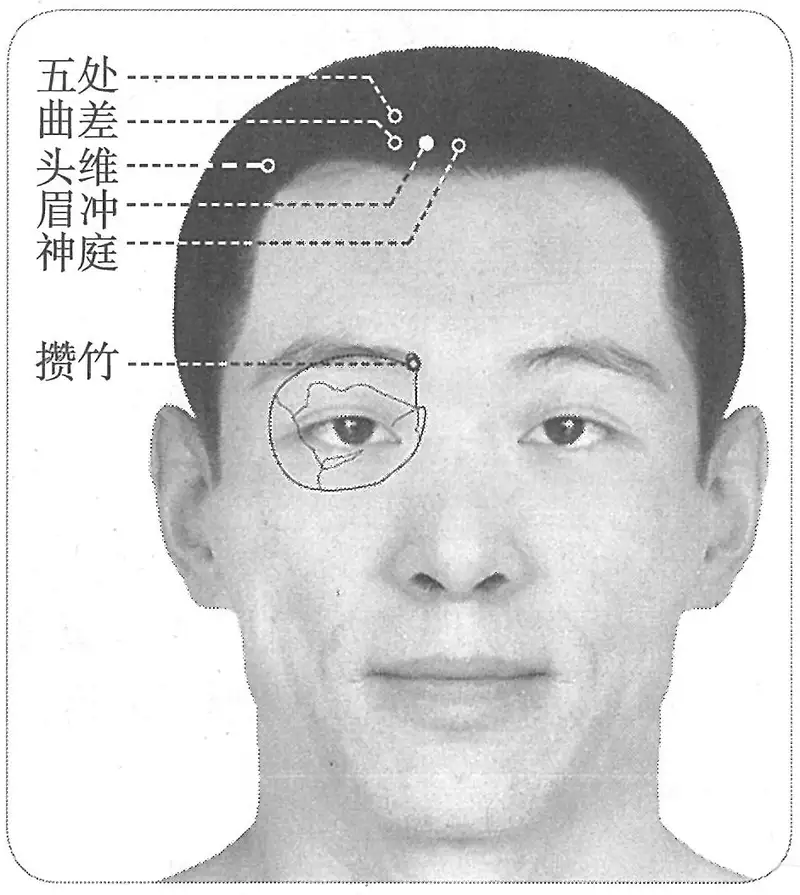

**图 2-163　眉冲穴图**

**文献分析**：关于本穴定位，《太平圣惠方》只说在当两眉头直上入发际，之后王惟一将前发际穴皆上移至入发际五分处，本穴则具体定位于直眉头上，神庭、曲差之间，即入发际五分，后世多从此说。

#### 【类属】 

足太阳膀胱经穴。

有人认为王执中《针灸资生经》已将眉冲穴归入足太阳经，其实《针灸资生经》一书并没有抄录《铜人腧穴针灸图经》上卷腧穴归经内容，而是直接抄录《铜人腧穴针灸图经》卷中、卷下分部分行的腧穴分类方法，故本穴在《铜人腧穴针灸图经》未录，而见之于《太平圣惠方》诸穴。王执中《针灸资生经》在分部分行的腧穴分类之末，皆未涉及腧穴归经。对此，王氏于目录后交代得很清楚：“上诸穴以《铜人》为次凡三百六十，其《明堂》上、下、《千金》等方有穴《铜人》不载数穴，即附入之其末，附入更数十穴如眉冲（眉两头直发际《明上》）”。因此本穴名虽早见于《脉经》（定位不详），详述于《太平圣惠方》，但归入足太阳经穴却始于明代李梴《医学入门》和明嘉靖针灸铜人。

〔p.615 (인쇄 595)〕

#### 【适应症】 

主治头目病症。常用于头痛，目眩，鼻塞；癫痫。

**备选适应症**：眩晕。

　1. 理目疾，五般痫，头痛，鼻塞。（《太平圣惠方·针经》）

　2. 统编针灸学教材

　　(1) 主治癫痫，头风，眩晕，鼻塞不闻香臭。（1957年南京《针灸学》、1版《针灸学讲义》）

　　(2) 主治痫证，眩晕，头痛，鼻塞。（2版《针灸学讲义》、4、5版《针灸学》、《中国针灸学》）

　　(3) 主治痫证，头痛，眩晕，目视不明，鼻塞。（6版《针灸学》）

　　(4) 主治：①头痛、目眩；②鼻塞、鼻衄。（7版《针灸学》）

#### 【操作】 

平刺。

　1. 不灸，通针入三分。（《太平圣惠方·针经》）

　2. 统编针灸学教材

　　(1) 针二至三分，针尖向上沿皮刺，灸三壮。（1957年南京《针灸学》、1版《针灸学讲义》）

　　(2) 沿皮刺，针尖向上，针3~5分。（2版《针灸学讲义》）

　　(3) 平刺0.3~0.5寸。（4、5版《针灸学》、《中国针灸学》）

　　(4) 平刺0.3~0.5寸；不宜灸。（6版《针灸学》）

　　(5) 平刺0.5~0.8寸。（7版《针灸学》）

### （四）曲差 Qūchā BL4 出《黄帝明堂经》 

#### 【提要索隐】 

**穴名**：曲差，一名鼻冲。

**部位**：在头部，前发际正中直上0.5寸，旁开1.5寸。

**适应症**：主治鼻部病症。常用于头痛，鼻塞；视物不清。

**针刺操作**：平刺。

#### 【名实考】 

本穴一名“鼻冲”，提示其治疗鼻部病症有较好疗效。

关于本穴定位，虽从字面上看不出分歧，而实际上由于宋代《铜人腧穴针灸图经》将“神庭”向前发际上移五分，故直接或间接以此穴定位的相关腧穴位置都相应变动了。

　1. 曲差，一名鼻冲，夹神庭两旁各一寸五分，在发际，足太阳脉气所发。（《黄帝明堂经》）

　2. 自眉冲而上，乃直行也，自督经中行神庭平处，乃横折一寸五分，其形曲，故曰曲差。（《经穴解》）

#### 【定位】 

**部位**：在头部，前发际正中直上0.5寸，旁开1.5寸（图2-164）。

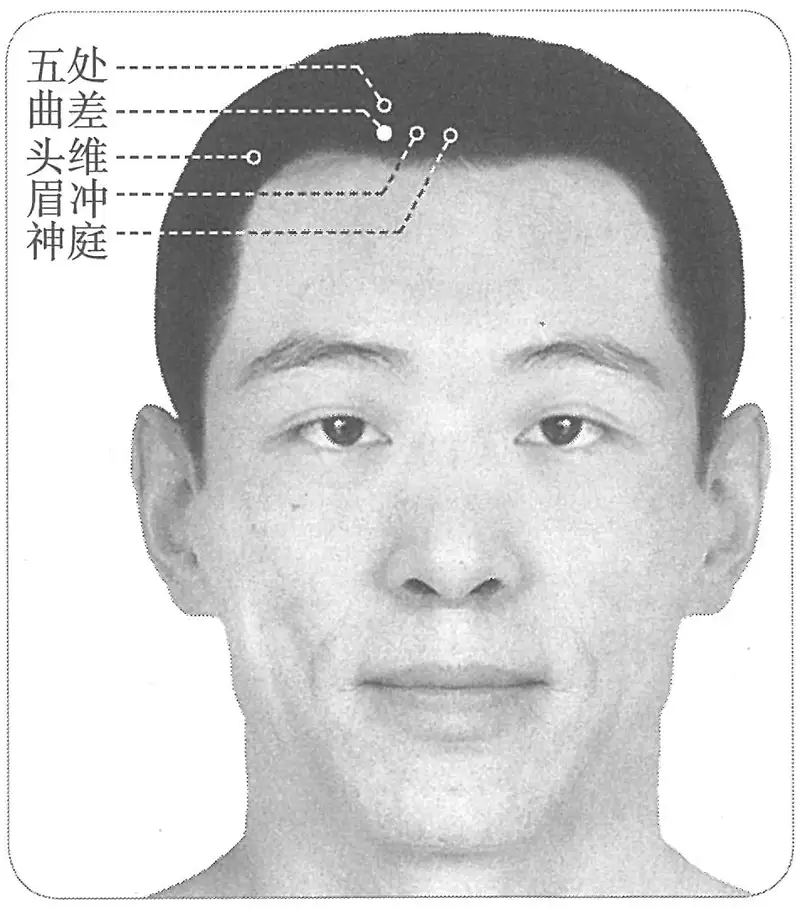

**图 2-164　曲差穴图**

〔p.616 (인쇄 596)〕

**取穴**：在神庭与头维连线的内1/3与外2/3的交点处取之。

　1. 夹神庭两旁各一寸五分，在发际。（《黄帝明堂经》、《太平圣惠方·针经》、《铜人腧穴针灸图经》卷下“穴腧都数”、《圣济总录》、《针灸资生经》、《针灸集成》、《窦太师秘传》、《十四经发挥》、《医学纲目》、《针灸聚英》、《古今医统》、《医学入门》、《针灸大成》、《针方六集》、《类经图翼》、《循经考穴编》、《医宗金鉴·刺灸心法要诀》、《针灸易学》、《针灸逢源》）

　2. 夹神庭旁一寸五分，入发际。（《铜人腧穴针灸图经》卷上、卷中）

　3. 神庭旁开一寸五分。（《针灸十四经穴位考订》）

　4. 统编针灸学教材

　　(1) 部位：神庭旁一寸五分入发际。取穴：从神庭穴外开一寸五分取之。（1957年南京《针灸学》）

　　(2) 部位：督脉神庭穴旁一寸五分。取穴：入发际五分，眉冲穴旁开一寸取之。（1版《针灸学讲义》、4版《针灸学》）

　　(3) 部位：夹神庭，两旁各一寸五分，在发际。取穴：在神庭督脉旁一寸五分，即当神庭与头维足阳明经之间的中1/3与内1/3连线点取穴。（2版《针灸学讲义》）

　　(4) 神庭穴旁1.5寸，当神庭穴与头维穴连线的内1/3与2/3连接点取之。（5版《针灸学》）

　　(5) 在头部，当前发际正中直上0.5寸，旁开1.5寸，即神庭与头维连线的内1/3与中1/3交点上。（6版《针灸学》）

　　(6) 前发际正中直上0.5寸，旁开1.5寸，即神庭与头维连线的内1/3与中1/3交点处。（7版《针灸学》）

　　(7) 在神庭旁开一寸五分，即当神庭与头维之间外2/3与内1/3交点上。（《中国针灸学》）

**文献分析**：本穴定位，古代文献描述均为“夹神庭两旁各一寸五分”，但由于神庭穴由原先的“在发际”到宋代变为“入发际五分”，因此曲差穴的位置也相应改变。宋代《铜人腧穴针灸图经》关于本穴的定位虽然没有明确说“入发际五分”，但已将《黄帝明堂经》的“在发际”改作“入发际”。

#### 【类属】 

足太阳膀胱经穴。

足太阳脉气所发。（《黄帝明堂经》）

#### 【适应症】 

主治鼻部病症。常用于头痛，鼻塞；视物不清。

　1. 主头痛身热，鼻窒，喘息不利，烦满汗不出。（《黄帝明堂经》）

**按**：《黄帝明堂经》头部穴多主伤寒热病，这与《素问》以“头上五行，行五”为热俞有关；又六经伤寒，太阳经为身之表，故头面太阳经穴多主伤寒热病也。

　2. 心中烦满，汗不出，头项痛，身热，目视不明。（《太平圣惠方·针经》、《铜人腧穴针灸图经》卷中）

　3. 治眼睛不转，补泻；口眼㖞斜，并治之。（《窦太师针经》）

　4. 主鼽衄，鼻疮。（《针灸聚英》卷一、《针灸大成》、《针方六集》）

**按**：此条主治系高武从《针灸资生经》误录《千金要方》卷三十文字。

　5. 统编针灸学教材

　　(1) 主治头前顶痛，目疾，鼻塞，鼽衄。（1957年南京《针灸学》、1版《针灸学讲义》）

〔p.617 (인쇄 597)〕

　　(2) 主治头前顶痛，目眩痛，鼻塞，鼽衄。（2版《针灸学讲义》、3版《针灸学》）

　　(3) 主治头痛，鼻塞，鼽衄，目视不明。（4、5版《针灸学》）

　　(4) 主治头痛，头晕，目视不明，目痛，鼻塞。（6版《针灸学》）

　　(5) 主治：①头痛、目眩；②鼻塞、鼻衄。（7版《针灸学》）

　　(6) 主治头痛，鼻塞，鼻衄，目视不明，目眩。（《中国针灸学》）

**按**：教材中“鼻衄”一症系传高武《针灸聚英》之误，今去之。

**文献分析**：《黄帝明堂经》载本穴主治“头痛身热，鼻窒，喘息不利，烦满汗不出”。《伤寒论》曰“湿家病，身上疼痛，发热面黄而喘，头痛鼻塞而烦，其脉大，自能饮食，腹中和无病，病在头中寒湿，故鼻塞”，可知《黄帝明堂经》所载本穴主治多见于头中有寒湿之邪的“伤寒表实证”的典型症状，其主症为头痛、鼻塞，这也是本穴的主要治疗作用，后世临床应用也集中于鼻部病症，这与本穴的别名“鼻冲”寓意相合。

#### 附：临床应用举例 

　1. 脑寒鼻出臭秽，上星、合谷、曲池、曲差。问曰：此证缘何而得？答曰：皆因鼻衄不止，用药吹入脑，伤损脑户，毒气攻上，故鼻流臭也。复刺后穴：人中、迎香。（《针灸集成》第十九方）

　2. 鼻渊，上星、曲差、印堂、风门、合谷。（《类经图翼》卷十一）

　3. 偏头痛，曲差配风池穴针刺治疗。［四川中医，1999，17(1):53］

#### 【操作】 

平刺。

　1. 刺入三分，灸五壮。（《黄帝明堂经》）

　2. 针入三分，灸三壮。（《太平圣惠方·针经》）

　3. 针入二分，可灸三壮。（《铜人腧穴针灸图经》卷中）

　4. 窦太师针灸遗存

　　(1) 一分，沿皮向外透临泣穴，灸七壮。（《窦太师针经》）

　　(2) 针入一分，沿皮向外五分，灸二七壮。（《窦太师秘传》）

　5. 统编针灸学教材

　　(1) 针三至四分，针尖向下方或上方沿皮刺，灸三至五壮。（1957年南京《针灸学》）

　　(2) 针三至四分，针尖向上方沿皮刺，灸三至五壮。（1版《针灸学讲义》）

　　(3) 针尖向上方沿皮刺3~5分，艾条灸3~5分钟。（2版《针灸学讲义》）

　　(4) 平刺0.5~0.8寸。（4、5、7版《针灸学》）

　　(5) 平刺0.5~0.8寸；可灸。（6版《针灸学》）

　　(6) 横刺0.3~0.5寸。可灸。（《中国针灸学》）

### （五）五处 Wǔchù BL5 出《黄帝明堂经》 

#### 【提要索隐】 

**部位**：在头部，前发际正中直上1寸，旁开1.5寸。

**适应症**：主治头目病症。常用于头痛、头重，寒热，有汗；眩晕；癫痫，抽搐。

**针刺操作**：平刺。

#### 【名实考】 

关于本穴的定位，古代文献的描述本身无分歧，然而由于神庭穴定位的变化，而使本穴连带发生了改变。

〔p.618 (인쇄 598)〕

关于本穴内容，古代文献中有因文字的脱失而与哑门穴相混者。

　1. 五处在督脉旁，去上星一寸五分，足太阳脉气所发。（《黄帝明堂经》）

　2. 此穴之后有四穴，并此穴为五穴，皆直行相去一寸五分，至天柱，则挟项后发际大筋外廉陷中，而不在头矣，故名五处，以志之也。（《经穴解》）

　3. 别名　巨处。（1957年南京《针灸学》）

**按**：此传自日本针灸教材，注云“《入门》作巨处”，今查国立公文书馆内阁文库所藏本《编注医学入门》的确作“巨处”，显系“五处”之形误，朝鲜刊本无误。韩国针灸学教材不详其所出，又从中国教材间接地重复日本教材的这一明显失误，将“巨处”作为五处穴的别名。

#### “哑门”与“五处”相混例 

　1. 痓，脊强反折，瘛疭癫疾，头重，五处主之。寒热，取五处及天池……（《针灸甲乙经》卷七）

　2. 五处，在督脉旁，去上星一寸半，足太阳脉气所发，灸三壮。主痓，脊强反折，瘛疭，癫疾，头重，寒热。（《外台秘要》卷三十九）

　3. 喑门，一名横舌，一名舌厌，在项发际宛宛中，入系舌本，督脉、阳维之会，仰头取之，不可灸，令人喑。主项强，舌缓，喑不能言。脉旁，去上星一寸五分，灸三壮。此以泻诸阳气热，衄，善嚏，风头痛，汗不出，寒热，痓，脊强反折，瘛疭，癫疾，头重。（《外台秘要》卷三十九）

　4. 五处，此以泻诸阳气热，衄，善嚏，风头痛，汗出寒热，痓，脊强反折，头重。（《医心方》卷二）

**按**：以上《外台秘要》“喑门”条下“脉旁，去上星一寸五分”所有文字均系“五处”穴内容，可能王焘当时所据之《针灸甲乙经》传本卷三“喑门”穴处有残缺，故其直接从一种《黄帝明堂经》抄录，而恰好这个抄本“喑门”穴下有脱文，以致与其下“五处”穴文字相混，王焘抄录时未加甄别，一并抄入，而导致了上述奇特的错误。参见哑门穴“名实考”。

#### 【定位】 

**部位**：在头部，前发际正中直上1寸，旁开1.5寸（图2-165）。

**取穴**：在曲差穴直上0.5寸处，横平上星穴（GV23）。

　1. 在督脉旁，去上星一寸五分。（《黄帝明堂经》、《太平圣惠方·针经》、《铜人腧穴针灸图经》、《圣济总录》、《针灸资生经》、《窦太师针经》、《琼瑶神书》、《窦太师秘传》、《十四经发挥》、《医学纲目》、《针灸聚英》、《古今医统》、《医学入门》、《针灸大成》、《循经考穴编》、《针灸易学》）

　2. 当两眼入发际一寸。（《医心方》卷三）

　3. 在上星穴两旁各开一寸五分，上曲差一寸。（《针方六集》卷一）

　4. 在曲差后五分，夹上星旁一寸五分。（《类经图翼》卷七、《医宗金鉴·刺灸心法要诀》、《针灸逢源》）

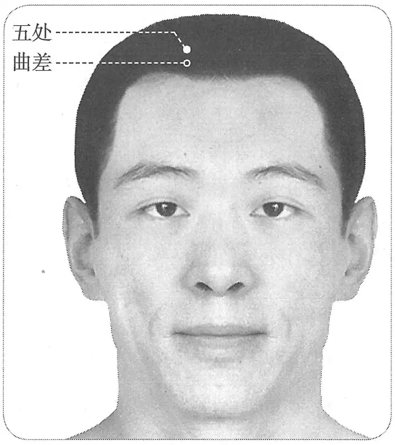

**图 2-165　五处穴图**

〔p.619 (인쇄 599)〕

　5. 统编针灸学教材

　　(1) 部位：夹上星旁一寸五分。取穴：直额正中直上发际一寸之上星穴旁开一寸五分，当曲差上五分取之。（1957年南京《针灸学》、4版《针灸学》）

　　(2) 部位：在曲差后五分。取穴：入发际一寸，督脉上星穴旁开一寸五分取之。（1版《针灸学讲义》）

　　(3) 部位：在督脉旁，去上星一寸五分。取穴：从曲差直上，入发际一寸取之。（2版《针灸学》）

　　(4) 曲差穴上0.5寸，距头部正中线1.5寸。（5版《针灸学》）

　　(5) 在头部，当前发际正中直上1寸，旁开1.5寸。（6版《针灸学》）

　　(6) 前发际正中直上1寸，旁开1.5寸，即曲差穴上0.5寸。（7版《针灸学》）

　　(7) 上星旁开一寸五分，即曲差直上五分。（《中国针灸学》）

**文献分析**：本穴定位，古代文献均作“上星旁一寸五分”，而距曲差穴的距离有“一寸”和“五分”之不同，这是由于神庭穴的变动所引起的曲差穴的改变所致。总之，关于本穴的定位，古今文献有两点是统一的：第一，“上星旁一寸五分”；第二，“入发际一寸”。

#### 【类属】 

足太阳膀胱经穴。

足太阳脉气所发。（《黄帝明堂经》）

#### 【适应症】 

主治头目病症。常用于头痛、头重，寒热、有汗；眩晕；癫痫，抽搐。

　1. 主痓，脊强反折，瘈疭，癫疾，头重。寒热。此以泻诸阳气，热，衄，善嚏，风头痛，汗出。（《黄帝明堂经》）

　2. 主目不明，头眩风闷。（《太平圣惠方·针经》）

　3. 治头风，目眩，瘈疭，目戴上不识人。（《铜人腧穴针灸图经》卷中）

　4. 窦太师针灸遗存

　　(1) 治头风，鼻塞，目晕，头生疮，补泻。（《窦太师针经》）

　　(2) 主偏头风，鼻塞时时嚏不已，目昏，内障，头生疮疥。宜三棱针出血。（《针方六集》卷六）

　　(3) 治鼻塞不闻香臭。（《窦太师秘传》）

　5. 统编针灸学教材

　　(1) 主治头风，目不明，目视上戴不识人，脊强反折，癫痫。（1957年南京《针灸学》）

　　(2) 主治头风，目疾，脊强反折，癫痫，瘛疭。（1版《针灸学讲义》）

　　(3) 主治头痛，目眩，癫痫，瘛疭。（2版《针灸学讲义》、4版《针灸学》、《中国针灸学》）

　　(4) 主治头痛，目眩，癫痫。（5、7版《针灸学》）

　　(5) 主治头痛，目眩，目视不明。（6版《针灸学》）

**文献分析**：以上“痓，脊强反折，瘈疭，癫疾，头重”皆系足太阳经的典型症状；“热，衄，风头痛，汗出”则系一组“伤寒中风证”的症状。值得一提的是，《黄帝明堂经》于此不但详述了本穴的主治，而且还论述了本穴的主要作用“泻诸阳气”。金元窦太师针灸载本穴主治重在鼻部病症，此乃上一穴“曲差”的治疗重点，本穴治疗重点应在头部与目部。

#### 附：临床应用举例 

　1. 灸头风方，《百病针灸》云灸百会穴，在顶上旋毛中又灸五处穴，又灸五处穴，在当两眼入发际一寸。（《医心方》卷三）

　2. 汗出烦热，取五处、攒竹。（《古今医统》卷十三）

〔p.620 (인쇄 600)〕

　3. 鼻窒不闻香臭　迎香、上星、五处、禾髎。问曰：此症缘何而得？针数穴皆不效。答曰：皆因伤寒不解，毒气冲脑，或生鼻痔，脑中大热，故得此症。复刺后穴：水沟、风府、百劳、太渊。（《针灸大成》卷九）

#### 【操作】 

平刺。

　1. 刺入三分，留七呼，灸三壮。（《黄帝明堂经》）

　2. 刺入三分，不可灸。（《针灸甲乙经》卷三）

　3. 针入三分，留七呼，灸五壮止。（《太平圣惠方·针经》）

　4. 窦太师针灸遗存

　　(1) 入一分，沿皮透率谷穴，灸七壮。治头风，鼻塞，目晕，头生疮，补泻。又宜三棱针出血妙。（《窦太师针经》）

　　(2) 针一分，沿皮向外一寸五分。治鼻塞不闻香臭，头风目眩。针入三分，留七呼，灸三壮。（《窦太师秘传》）

　5. 针二分，灸三壮。《甲乙经》不可灸。（《针灸十四经穴位考订》）

　6. 统编针灸学教材

　　(1) 针三分，针法如上，灸三壮。（1957年南京《针灸学》、1版《针灸学讲义》）

　　(2) 沿皮刺3分，艾条灸3~5分钟。（2版《针灸学讲义》）

　　(3) 平刺0.3~0.5寸。（4版《针灸学》）

　　(4) 平刺0.5~0.8寸。（5、7版《针灸学》）

　　(5) 平刺0.5~0.8寸；可灸。（6版《针灸学》）

　　(6) 横刺0.3~0.5寸。可灸。（《中国针灸学》）

### （六）承光 Chéngguāng BL6 出《黄帝明堂经》 

#### 【提要索隐】 

**部位**：在头部，前发际正中直上2.5寸，旁开1.5寸。**按**：关于本穴定位，历代文献记载很不一致，后世多从《铜人腧穴针灸图经》之说。

**适应症**：主治头面部病症。常用于头痛，眩晕，鼻塞。

**备选适应症**：近视。

**针刺操作**：平刺。

#### 【名实考】 

关于本穴定位，《黄帝明堂经》传本很早就出现异文，一作“五处后二寸”，一作“五处后一寸”，一作“五处后一寸五分”，宋以后皆统一采用第三说。

需要注意的是，因文字脱失，古代文献中有将“百会”穴内容错入本穴中者。

　1. 承光在五处后二寸，足太阳脉气所发。（《针灸甲乙经》卷三）

　2. 承者，以下承上之象，光者，指百会穴而言也。百会在人顶上，有人君北辰之象，此穴在其左右之下，有人臣侍君之象，故曰承光。（《经穴解》）

#### “百会”文字错入“承光”例 

　1. 承光　风眩头痛，欲呕烦心，青盲远视不明。（《医心方》卷二）

　2. 承光　风眩头痛，欲呕吐，心烦。（《太平圣惠方·针经》）

　3. 热病汗不出，而苦呕烦心，承光主之（《针灸甲乙经》卷七第一）；青盲远视不明，承光主之。（《针灸甲乙经》卷十二第四）

〔p.621 (인쇄 601)〕

　4. 承光　热病汗不出，而苦呕烦心，青盲远视不明。（《外台秘要》卷三十九）

**按**：以上《针灸甲乙经》较《医心方》等书所据之《黄帝明堂经》多出“热病汗不出”一条，而少“风眩头痛”一条。之所以会出现如此大的差异，是因为《针灸甲乙经》第一条主治“而苦呕”下脱欠“百会主之。风眩头痛”八字，其原文应作“热病汗不出而苦呕，百会主之。风眩头痛，欲呕烦心，承光主之”。这一脱误不仅使得《针灸甲乙经》所载“承光”穴主治较其他《明堂经》少“风眩头痛”一症，而且使原本属于“百会”穴的主治混入“承光”穴，从而造成了上述差异。同时“百会”穴下又较其他《黄帝明堂经》少一条主治症。由于《针灸甲乙经》这一脱误发生于唐中期之前，而王焘对于针灸文献又不甚熟悉，在编《外台》时未能发现这一很难察觉的脱误，仍沿袭此误。

#### 【定位】 

**部位**：在头部，前发际正中直上2.5寸，旁开1.5寸（图2-166）。

**取穴**：当五处穴直上1.5寸，曲差穴直上2寸处取之。

　1. 《黄帝明堂经》佚文

　　(1) 在五处后二寸。（《针灸甲乙经》卷三、《外台秘要》、《太平圣惠方·针经》、《铜人腧穴针灸图经》卷上及卷下“穴腧都数”）

　　(2) 在五处后一寸。（《千金要方》卷二十九、《千金翼方》、《素问·水热穴论》王冰注、《医心方》）

　2. 在五处后一寸五分。（《千金要方》卷二十九注文、《铜人腧穴针灸图经》卷中、《圣济总录》、《十四经发挥》、《针灸聚英》、《古今医统》、《医学入门》、《针灸大成》、《针方六集》、《类经图翼》、《循经考穴编》、《医宗金鉴·刺灸心法要诀》、《针灸易学》、《针灸逢源》）

　3. 统编针灸学教材

　　(1) 部位：五处穴后一寸五分。取穴：五处后一寸五分处，距头部正中线一寸取之。（1957年南京《针灸学》）

　　(2) 部位：五处穴后一寸五分。取穴：入发际二寸五分取之。（1版《针灸学讲义》）

　　(3) 部位：五处穴后一寸五分。取穴：在五处与通天之间取之。（2版《针灸学讲义》）

　　(4) 五处穴后一寸五分。（4、5版《针灸学》）

　　(5) 在头部，当前发际正中直上2.5寸，旁开1.5寸。（6版《针灸学》）

　　(6) 前发际正中直上2.5寸，旁开1.5寸，即五处穴后1.5寸。（7版《针灸学》）

　　(7) 五处后一寸五分，督脉旁开一寸五分。（《中国针灸学》）

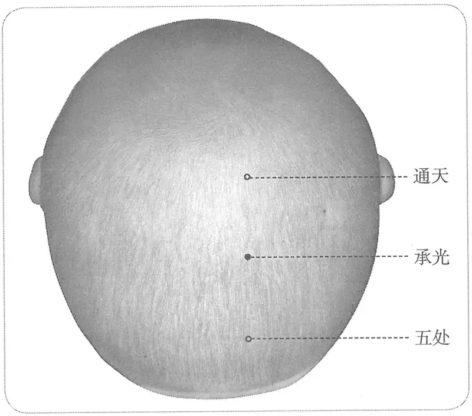

**图 2-166　承光穴图**

**文献分析**：本穴定位，历代文献记载很不一致，主要有如下三说：五处后一寸；五处后二寸；五处后一寸五分。《医心方》、《千金要方》、《素问》王冰注所采用的《黄帝明堂经》传本均作“五处后一寸”，唯独《针灸甲乙经》所据《明堂经》为“五处后二寸”（《外台秘要》因直接抄自《针灸甲乙经》，故二者同）。值得注意的是，《太平圣惠方·针经》也作“五处后二寸”，该书针灸卷虽从《外台秘要·明堂》辑有大量文字，但“承光”穴主治文字、文序均与《医心方》同，而与《外台秘要》、《针灸甲乙经》明显不同，故有可能《太平圣惠方》此穴内容系辑自与《针灸甲乙经》所据本同源之《明堂经》传本，这些都提示：早在唐以前，《黄帝明堂经》传本已有异文。《铜人腧穴针灸图经》卷上及卷下“穴腧都数”均作“二寸”，而卷中作“一寸五分”，盖折衷二说，宋以后文献多从之。

〔p.622 (인쇄 602)〕

#### 【类属】 

足太阳膀胱经穴。

足太阳脉气所发。（《黄帝明堂经》）

#### 【适应症】 

主治头面部病症。常用于头痛，眩晕，鼻塞。

**备选适应症**：近视。

　1. 主风眩头痛，欲呕烦心。青盲，远视不明。（《黄帝明堂经》）

**按**：此条主治包括“头痛”与“目不明”两组症状，与《黄帝明堂经》相邻穴“囟会”的一条主治“风眩，善呕烦满，头痛颜青，目不能视”很相近，可参看。

　2. 治鼻塞不闻香臭，口㖞，鼻多清涕，目生白膜。（《铜人腧穴针灸图经》卷中）

**按**：“鼻塞不闻香臭，口㖞，鼻多清涕”系误录自《外台秘要》“通天”穴主治。

　3. 统编针灸学教材

　　(1) 主治头痛，目眩，呕吐，鼻塞或多涕，目翳。（1957年南京《针灸学》、1版《针灸学讲义》）

　　(2) 主治头痛，目眩，涕多鼻塞，热病无汗。（2版《针灸学讲义》、3版《针灸学》）

　　(3) 主治头痛，目眩，鼻塞，口㖞，热病无汗。（4版《针灸学》）

　　(4) 主治头痛，目眩，鼻塞，热病。（5、7版《针灸学》）

　　(5) 主治头痛，目眩，呕吐烦心，目视不明，鼻塞多涕，癫痫。（6版《针灸学》）

　　(6) 主治头痛，目眩，鼻塞。（《中国针灸学》）

**文献分析**：《黄帝明堂经》载本穴主治两个重点之一为目疾，其穴名“承光”也提示了这一主治作用。此后，宋代《铜人腧穴针灸图经》更有发挥，现代临床也有应用，教材除第6版记有“目视不明”外，其他各版均未载，今附存备考。教材中“热病无汗”症系承袭传世本《针灸甲乙经》、《外台秘要》之误；“鼻塞或多涕”、“口㖞”系传《铜人腧穴针灸图经》之误，今皆不取。

#### 【操作】 

平刺。

　1. 刺入三分，禁不可灸。（《黄帝明堂经》）

　2. 禁用针灸。（《医学入门》卷一）

　3. 统编针灸学教材

　　(1) 针二至三分，针尖向下沿皮刺。（1957年南京《针灸学》、1版《针灸学讲义》）

　　(2) 沿皮刺3分。（2版《针灸学讲义》）

　　(3) 平刺0.3~0.5寸。（4、5、7版《针灸学》、《中国针灸学》）

　　(4) 平刺0.5~0.8寸；可灸。（6版《针灸学》）

### （七）通天 Tōngtiān BL7 出《黄帝明堂经》 

#### 【提要索隐】 

**穴名**：一名天臼。

**部位**：在头部，前发际正中直上4寸，旁开1.5寸。

**适应症**：主治头、鼻部病症。常用于头痛，鼻塞，鼻衄；眩晕。

〔p.623 (인쇄 603)〕

**针刺操作**：平刺。

#### 【名实考】 

天臼，古代文献有误作“天伯”（《铜人腧穴针灸图经》）、“天日”（《外台秘要》）、“天目”（《普济方》）、“天白”（《针方六集》）、“天归”（《重楼玉钥》），皆为“天臼”之形误。

关于本穴定位的文字描述本身无分歧，但由于前一穴“承光”的定位有分歧，而连带影响了本穴的定位。

　1. 通天，一名天臼，在承光后一寸五分，足太阳脉气所发。（《黄帝明堂经》）

　2. 此穴在百会左右，乃太阳经横络入足少阳胆经诸穴，养筋脉之所也，又为左右督经之所，故曰通天。天者，指督之百会而言，本经至此穴以通之也。（《经穴解》）

　3. 别名　天旧、天白、天泊。（1957年南京《针灸学》）

**按**：此皆传自日本针灸教材，所录之别名皆系“天臼”形误，韩国针灸学教材又从中国教材重复了这一错误。

#### “络却”与“通天”主治症互混例 

　1. 通天，主治耳鸣，狂走，瘛疭，恍惚，青盲内障，目无所见。（《类经图翼》卷七）

　2. 络却，主治头旋，口㖞，鼻塞，项肿瘿瘤，内障耳鸣。（《类经图翼》卷七）

**按**：通天穴下“目无所见”前所有的主治症，在《针灸聚英》、《针灸大成》均系下穴“络却”的主治症，张介宾误抄于此；而“络却”穴下“头旋”之后、“内障耳鸣”之前所有主治病症又系“通天”穴主治错入其中。

#### 【定位】 

**部位**：在头部，前发际正中直上4寸，旁开1.5寸（图2-167）。

**取穴**：当承光穴与络却穴中点处取之。

　1. 在承光后一寸五分。（《黄帝明堂经》、《太平圣惠方·针经》、《铜人腧穴针灸图经》、《圣济总录》、《针灸资生经》、《十四经发挥》、《医学纲目》、《针灸聚英》、《古今医统》、《针灸大成》、《针方六集》、《医宗金鉴·刺灸心法要诀》、《循经考穴编》、《针灸易学》、《针灸十四经穴位考订》）

　2. 一曰横直百会旁一寸五分。（《类经图翼》卷七、《针灸逢源》）

　3. 统编针灸学教材

　　(1) 部位：承光穴后一寸五分。取穴：从承光向后一寸五分取之。（1957年南京《针灸学》）

　　(2) 部位：承光穴后一寸五分。取穴：入际四寸取之。（1版《针灸学讲义》）

　　(3) 部位：承光穴后一寸五分。取穴：在承光与络却之间取之。（2版《针灸学讲义》）

　　(4) 承光穴后一寸五分。（4、5版《针灸学》）

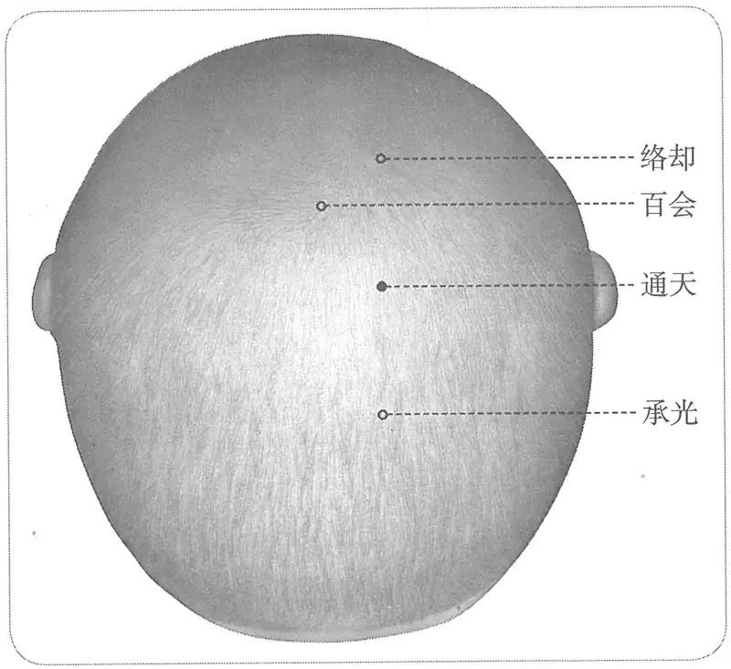

**图 2-167　通天穴图**

〔p.624 (인쇄 604)〕

　　(5) 在头部，当前发际正中直上4寸，旁开1.5寸。（6版《针灸学》）

　　(6) 前发际正中直上4寸，旁开1.5寸，即承光穴后1.5寸。（7版《针灸学》）

　　(7) 承光后一寸五分，督脉旁开一寸五分。（《中国针灸学》）

**按**：中国与日本关于“承光”穴定位的分歧在于，日本采用《针灸甲乙经》“二寸”之说，中国采用《铜人腧穴针灸图经》“一寸五分”之说。

#### 【类属】 

足太阳膀胱经。

足太阳脉气所发。（《黄帝明堂经》）

#### 【适应症】 

主治头、鼻部病症。常用于头痛，鼻塞，鼻衄；眩晕。

　1. 头项痛重，暂起僵仆，鼻窒鼽衄，喘息不得通。（《黄帝明堂经》）

　2. 主瘿。（《千金要方》卷三十）

**按**：此条主治系辑自《黄帝明堂经》之外的“明堂”类文献。

　3. 僻多涕，鼽衄有疮。（《外台秘要》卷三十九）

**按**：此为《黄帝明堂经》迎香穴主治症。《铜人腧穴针灸图经》也沿袭此误，而现代针灸学教材似未受此影响。

　4. 治颈项转侧难，鼻塞闷，偏风口㖞，鼻多清涕，衄血，头重。（《铜人腧穴针灸图经》卷中、《圣济总录》）

　5. 主中风天吊。（《循经考穴编》上）

　6. 统编针灸学教材

　　(1) 主治头痛头旋，鼻塞鼻渊，鼻衄，鼻瘜肉，口眼㖞斜，颈项强。（1957年南京《针灸学》）

　　(2) 主治头痛，头旋，鼻塞，鼻渊，鼻衄，口眼㖞斜，颈项强。（1版《针灸学讲义》）

　　(3) 主治头痛，眩晕，鼻塞，鼻衄，鼻渊。（2版《针灸学讲义》、5、7版《针灸学》、《中国针灸学》）

　　(4) 主治头痛，眩晕，鼻塞，鼽衄，鼻痔。（4版《针灸学》）

　　(5) 主治头痛，头重，眩晕，鼻塞，鼻渊。（6版《针灸学》）

**文献分析**：《黄帝明堂经》载本穴主治重点在头、鼻病症，后世临床应用与之相合。至唐代孙思邈据前代文献增补“瘿”一症，但后世未见有临床应用的记载，有待进一步检验。此穴与相邻穴“承灵”的主治“脑风头痛，恶见风寒，鼽衄鼻窒，喘息不通”很相近，可参看。值得一提的是，《黄帝明堂经》中某些头部穴除了治疗头部病症外，还治疗鼻部症状，这可能出于古人对于鼻与脑关系的认识。《素问·气厥论》曰：“胆移热于脑，则辛頞鼻渊。鼻渊者，浊涕下不止也”。《素问·解精微论》曰：“泣涕者，脑也；脑者，阴也；髓者，骨之充也，故脑渗为涕”。中医称鼻出血不止者为“脑衄”，鼻流浊涕不止者为“脑漏”。《黄帝明堂经》所载之“神庭”、“上星”、“曲差”（又名“鼻冲”）、“通天”、“承灵”、“风府”、“风池”、“脑空”等穴皆治鼻病，是古人这一认识的具体体现。

#### 附：临床应用举例 

　1. 瘿气，面肿，灸通天五十壮。（《千金要方》卷二十四、《千金翼方》、《外台秘要》）

　2. 鼻病，囟会在鼻心直上入发际二寸，再容豆是穴，灸七壮。又灸通天，在囟会上一寸两旁各一寸，灸七壮，左臭灸左，右臭灸右，俱臭俱灸。曾用此法灸数人，皆于鼻中去臭积一块如朽骨，臭不可言，去此痊愈。（《世医得效方》卷十）

**按**：此方所记之“通天”主治与《黄帝明堂经》相合，而定位不尽合。

#### 【操作】 

平刺。

〔p.625 (인쇄 605)〕

　1. 刺入三分，留七呼，灸三壮。（《黄帝明堂经》）

　2. 针五分，灸三壮。（《针灸逢源》卷四）

　3. 统编针灸学教材

　　(1) 针二至三分，灸三壮。（1957年南京《针灸学》、1版《针灸学讲义》）

　　(2) 沿皮刺2~3分，艾条灸3~7分钟。（2版《针灸学讲义》）

　　(3) 平刺0.3~0.5寸。（4、5、7版《针灸学》）

　　(4) 平刺0.3~0.5寸；可灸。（6版《针灸学》、《中国针灸学》）

　4. 横刺，向前或向后，进针0.5~1寸。感应：局部胀感。灸1~3壮；温灸5~10分钟。（上海《针灸学》）

### （八）络却 Luòquè BL8 出《黄帝明堂经》 

#### 【提要索隐】 

**穴名**：络却，一名强阳，一名脑盖，一名反行。

**部位**：在头部，前发际正中直上5.5寸，旁开1.5寸。

**适应症**：主治头部病症。常用于头痛，眩晕，耳鸣；癫狂。

**针刺操作**：平刺。

#### 【名实考】 

足太阳经脉循行“其直行者从巅入络脑，还出别下项”，本穴处正是入络脑还出之处，因名“络却”（由“通天”入脑，“络却”出脑），又名“反行”（即返行，与“络却”义相同）。本穴并通天穴皆主治鼻疾，正与此相关。此穴名还向我们透露了这样一个重要信息：可以断定“通天”、“络却”、“反行”穴名应当是在《灵枢·经脉》成书并流行之后出现的，尽管我们不能断定这些穴位本身是何时发现的！

由于古医籍中“却”与“郄”易相混，本穴名“络却”亦有写作“络郄”者。例如《铜人腧穴针灸图经》正文作“络却”，而卷下“穴腧都数”作“络郄”，《医学入门》同。古人“络却”命名的本义已很清楚，若作“络郄”则原意尽失。

古代文献中有将“络却”与相邻的“玉枕”穴相混者。至于《类经图翼》将本穴与“通天”穴相混例，详见后者“名实考”。

　1. 络却，一名强阳，一名脑盖，一名反行。在通天后一寸五分，足太阳脉气所发。（《黄帝明堂经》）

　2. 脑为髓之海，其输上在于其盖，下在风府。（《灵枢·海论》）

**按**：本穴一名“脑盖”，当源出于此。

　3. 以本经至通天，乃在顶际，此则却行向后，故曰络却。（《经穴解》）

**按**：此解于义未得。

#### “玉枕”与“络却”相混例 

　1. 络却，在脑后发际上，两旁起肉上各一寸三分，脑后枕骨，夹脑户，自发际上四寸半。（《神应经》）

　2. 玉枕二穴，在络却后一寸五分，夹脑户旁一寸三分起肉枕骨，入发际上三寸。（《铜人腧穴针灸图经》卷中）

**按**：这是一个错综复杂的错误。猛一看，《神应经》所载之“络却”似乎是与玉枕穴完全相混了。然而最后的“自发际上四寸半”又表明该书编者并不是大意出错，因为根据《铜人腧穴针灸图经》，络却穴在玉枕穴上一寸五分，而玉枕穴又在后发际上三寸，由此类推出络却穴在“发际上四寸半”，与此条引文相符，然而除这几字之外，《神应经》所载之“络却”又的确说的是“玉枕”穴的内容，可见这是一个真假参半的错误。

〔p.626 (인쇄 606)〕

#### 【定位】 

**部位**：在头部，前发际正中直上5.5寸，旁开1.5寸（图2-168）。

**取穴**：当百会穴后0.5寸，旁开1.5寸处取之。

　1. 在通天后一寸三分。（《针灸甲乙经》卷三、《类经图翼》）

　2. 在通天后一寸半。（《千金要方》卷二十九、《千金翼方》、《外台秘要》、《素问》王冰注、《医心方》、《铜人腧穴针灸图经》、《圣济总录》、《针灸资生经》、《琼瑶神书》、《十四经发挥》、《医学纲目》、《针灸聚英》、《古今医统》、《医学入门》、《针方六集》、《类经图翼》、《循经考穴编》、《医宗金鉴·刺灸心法要诀》、《针灸易学》、《针灸逢源》）

　3. 在通天后一寸五分，夹督脉两旁亦一寸五分。（《针方六集》卷一）

　4. 统编针灸学教材

　　(1) 部位：通天穴后一寸五分。取穴：通天穴后下一寸五分之处取之。（1957年南京《针灸学》）

　　(2) 部位：通天穴后一寸五分。取穴：入发际五寸五分取之。（1版《针灸学讲义》）

　　(3) 部位：通天穴后一寸五分。取穴：入前发际五寸五分，督脉旁一寸五分取之。（2版《针灸学讲义》）

　　(4) 通天穴后一寸五分。（4、5版《针灸学》）

　　(5) 在头部，当前发际正中直上5.5寸，旁开1.5寸。（6版《针灸学》）

　　(6) 前发际正中直上5.5寸，旁开1.5寸，即通天穴后1.5寸。（7版《针灸学》）

　　(7) 通天后一寸五分，督脉旁开一寸五分。（《中国针灸学》）

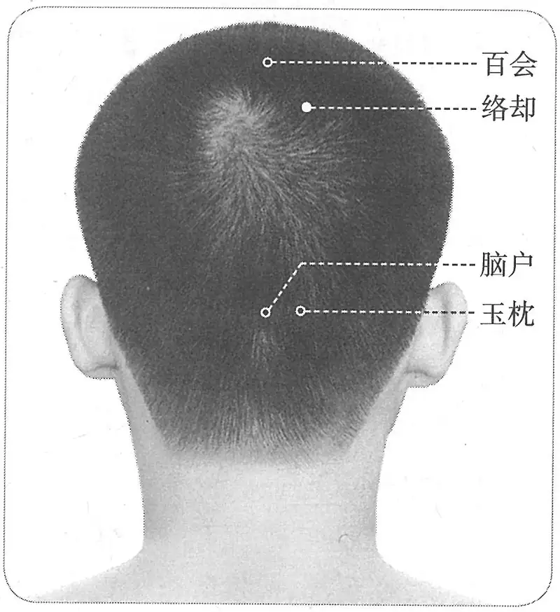

**图 2-168　络却穴图**

**文献分析**：现行本《针灸甲乙经》说“在通天后一寸三分”。唐·王焘引《针灸甲乙经》作“一寸五分”，现存其他《黄帝明堂经》佚文如《千金要方》、《医心方》等也均作“一寸五分”，可知今本《针灸甲乙经》中“三”字当为“五”之误，故定本穴在通天后一寸五分。

#### 【类属】 

足太阳膀胱经穴。

足太阳脉气所发。（《黄帝明堂经》）

#### 【适应症】 

主治头部病症。常用于头痛，眩晕，耳鸣；癫狂。

　1. 主脑风眩，头痛。癫疾僵仆，目妄见，恍惚不乐，狂走，瘛疭。（《黄帝明堂经》）

**按**：以上病症为“头痛”和“癫狂”的两组症状。

　2. 主青盲无所见。（《外台秘要》卷三十九）

**按**：此条主治见于《千金要方》：“商阳、巨阙、上关、承光、瞳子髎、络却主青盲无所见”。所列6穴中只前2穴主“青盲”，其余4穴只主一般目疾，王焘不解此例，将此条主治归于最后一穴“络却”穴下。宋代《铜人腧穴针灸图经》以下多承袭此误。

〔p.627 (인쇄 607)〕

　3. 治青风内障，目无所见，头旋，耳鸣。（《铜人腧穴针灸图经》卷中）

　4. 主口㖞，鼻塞，项肿，瘿瘤。（《类经图翼》卷七）

**按**：此为《针灸聚英》“通天”穴主治。

　5. 统编针灸学教材

　　(1) 主治头旋耳鸣，目内障，青盲，狂走瘛疭，恍惚不乐。（1957年南京《针灸学》、1版《针灸学讲义》）

　　(2) 主治头眩，耳鸣，癫狂，项肿瘿瘤，目视不明。（2版《针灸学讲义》）

　　(3) 主治头晕耳鸣，项肿瘿瘤，癫狂瘛疭，目视不明。（4版《针灸学》）

　　(4) 主治头晕，目视不明，耳鸣，癫狂。（5版《针灸学》、《中国针灸学》）

　　(5) 主治眩晕，耳鸣，鼻塞，癫狂，痫证，目视不明。（6版《针灸学》）

　　(6) 主治：①头晕；②目视不明，耳鸣。（7版《针灸学》）

**文献分析**：《黄帝明堂经》载本穴主治为“头痛”和“癫狂”两组症状。经王焘误传，本穴主治症作为癫狂症状之一的“目妄见”演变为“青风内障，目无所见”；宋代王惟一增补“耳鸣”一症。明代《类经图翼》将本穴与“通天”穴主治完全相混，后世文献也传其误。教材“目视不明”（目内障，青盲）、“项肿瘿瘤”症乃承袭《外台秘要》、《铜人腧穴针灸图经》、《类经图翼》之误，今去之。

#### 【操作】 

平刺。

　1. 刺入三分，留五呼，灸三壮。（《黄帝明堂经》）

　2. 禁针。（《医学入门》卷一）

　3. 统编针灸学教材

　　(1) 同上穴，沿皮刺之。（1957年南京《针灸学》、1版《针灸学讲义》）

　　(2) 沿皮刺3分。（2版《针灸学讲义》）

　　(3) 平刺0.3~0.5寸。（4、5、7版《针灸学》、《中国针灸学》）

　　(4) 平刺0.3~0.5寸；可灸。（6版《针灸学》）

### （九）玉枕 Yùzhěn BL9 出《黄帝明堂经》 

#### 【提要索隐】 

**部位**：在头部，横平枕外隆凸上缘，后发际正中旁开1.3寸。

**适应症**：主治头项、眼部病症。常用于头痛，颈项强痛，目痛，鼻塞。

**针刺操作**：平刺。

#### 【名实考】 

本穴在玉枕骨上，因名“玉枕”。玉枕骨，又称“枕骨”、“项横骨”，相当于现代解剖学术语枕外隆凸。

　1. 玉枕，在络却后七分半，夹脑户旁一寸三分，起肉枕骨上，入发际三寸。足太阳脉气所发。（《黄帝明堂经》）

　2. 项横骨为枕。杨上善注曰项横骨，项上头后玉枕也。（《黄帝内经太素·骨空》）

　3. 《曹氏灸经》曰玉枕者，人之音声之所经从。（转引自《医心方》卷二）

　4. 以穴在枕骨上也。（《经穴解》）

#### 【定位】 

**部位**：在头部，横平枕外隆凸上缘，后发际正中旁开1.3寸（图2-169）。

〔p.628 (인쇄 608)〕

**取穴**：当斜方肌外侧缘直上与枕外隆凸上缘水平线的交点处，横平脑户穴。

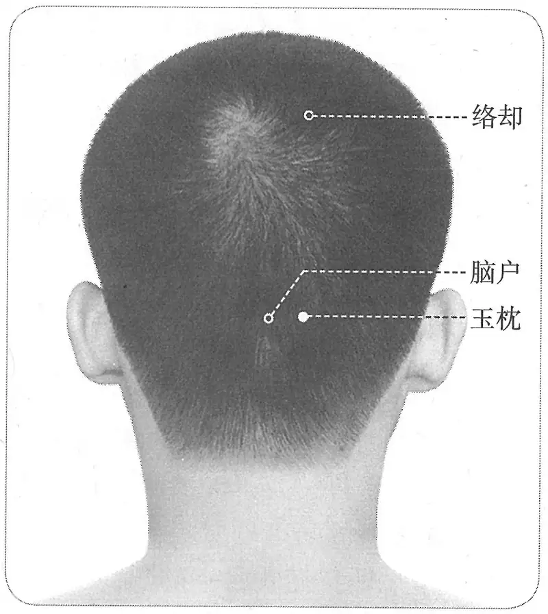

**图 2-169　玉枕穴图**

　1. 《黄帝明堂经》佚文

　　(1) 在络却后七分，夹脑户旁一寸三分，起肉枕骨，入发际三寸。（《针灸甲乙经》卷三）

　　(2) 在胳却后七分半，夹脑户旁一寸三分，起肉枕骨上，入发际三寸。（《千金要方》、《千金翼方》、《外台秘要》、《太平圣惠方》、《医学纲目》）

　　(3) 在络却后同身寸之七分。（《素问·刺热》王冰注）

　　(4) 在胳却后七分半，夹脑户旁一寸三分，起肉枕骨上，入发际五寸。（《医心方》卷二）

　2. 在络却后一寸五分，夹脑户旁一寸三分。（《铜人腧穴针灸图经》卷上）

　3. 在络却后一寸五分，夹脑户旁一寸三分，起肉枕骨上，入发际上三寸。（《铜人腧穴针灸图经》卷中及卷下“穴腧都数”）

　4. 《铜人》云：玉枕在络却后一寸半。《明堂》上下经皆云：七分半。若以《铜人》为误，则足太阳穴亦同。若以《明堂》为误，不应上下经皆误也小本《明堂》亦同。予按《素问注》云：玉枕在络却后七分，则与《明堂》之七分半相去不远矣，固当从《素问》为准。然而玉枕二穴既夹脑户矣，不应止七分则至于脑盖也。《铜人》之一寸半，盖有说焉。识者当有以辨之。今以诸经校勘，在络却后寸半者是。（《针灸资生经》卷一）

　5. 广注云一法以前发际量，往后九寸半是为脑户，仍各开寸半即玉枕也。或以上星为准，量上八寸半，取脑户亦真。（《循经考穴编》上）

　6. 络却后一寸五分，又云七分，夹脑户旁一寸三分起肉枕骨上，入发际二寸。（《针灸聚英》卷一、《古今医统》、《医学入门》、《针灸大成》、《循经考穴编》、《针灸易学》）

　7. 在络却后一寸半，起肉枕骨上，入发际三寸。按通天在百会旁，百会、脑户相去四寸半，而《甲乙经》有玉枕在络却后七分，夹脑户旁一寸三分之说，其数不合，头横骨为枕。（《针灸逢源》卷四）

　8. 络却后，脑户旁开一寸三分。（《针灸十四经穴位考订》）

　9. 统编针灸学教材

　　(1) 部位：络却后下方。取穴：脑户与脑空之间，下直对天柱取之。（1957年南京《针灸学》）

　　(2) 部位：脑后枕骨旁。取穴：从督脉脑户穴旁开一寸三分处取之。（1版《针灸学讲义》）

　　(3) 部位：在络却后一寸五分，夹脑户旁一寸三分。取穴：脑户督脉旁一寸三分，当枕外粗隆上缘之外侧取之。（2版《针灸学讲义》）

　　(4) 脑户穴旁开1.3寸。（4版《针灸学》）

　　(5) 后发际正中直上2.5寸，旁开1.3寸。（5版《针灸学》）

　　(6) 在后头部，当后发际正中直上2.5寸，旁开1.3寸，平枕外隆凸上缘的凹陷处。（6、7版《针灸学》）

〔p.629 (인쇄 609)〕

　　(7) 脑户旁开1.3寸，当枕外粗隆上缘之外侧。（《中国针灸学》）

**文献分析**：本穴定位历代文献记载很不一致。一说在络却后七分，夹脑户旁一寸三分，起肉枕骨，入发际三寸，出《针灸甲乙经》；一说在络却后七分半，出《千金要方》等书；一说在络却后一寸五分，出《铜人腧穴针灸图经》；现代直接以骨性解剖标志定位，即平枕外隆凸上缘（脑户）旁开一寸五分为准。

#### 【类属】 

足太阳膀胱经穴。

足太阳脉气所发。（《黄帝明堂经》）

#### 【适应症】 

主治头项、眼部病症。常用于头痛，颈项强痛，目痛，鼻塞。

　1. 主头项恶风，汗不出，凄厥恶寒，癫疾。呕吐，目内系急痛引頞，头重项痛。寒热，骨痛。头眩目痛，头半寒。（《黄帝明堂经》）

**按**：“头项恶风，汗不出，凄厥恶寒”多见于伤寒表证；“癫疾，目内系急痛引頞，头重项痛”为足太阳经的典型症状。其病症部位集中在头项和目。需要注意的是“头半寒”这样很容易被忽略的症状，此症已见于《灵枢·厥病》的针灸治疗，但非取足太阳经穴。

　2. 目痛不能视，项似拔不可左右顾。（《外台秘要》卷三十九）

**按**：此由于王焘不解《千金要方》的文献来源与编纂体例而误引其文。参见“络却”穴“适应症”下按语。

　3. 主失枕，头重头痛，多汗，耳聋，鼻塞。（《太平圣惠方·针经》）

　4. 头重如石，目痛如脱，不能远视。（《太平圣惠方·明堂》）

　5. 治目痛不能视，脑风疼痛不可忍。（《铜人腧穴针灸图经》卷中）

　6. 统编针灸学教材

　　(1) 主治头痛不可忍，目痛如脱，不能远视，鼻塞不闻香臭。（1957年南京《针灸学》）

　　(2) 主治头痛，目痛不能视，鼻塞。（1版《针灸学讲义》）

　　(3) 主治头痛，目痛，鼻塞。（2版《针灸学讲义》）

　　(4) 主治头项痛，目痛，鼻塞。（4、5、7版《针灸学》）

　　(5) 主治头项痛，目痛，鼻塞，呕吐。（6版《针灸学》）

　　(6) 主治头项痛，眩晕，目痛，鼻塞。（《中国针灸学》）

#### 附：临床应用举例 

多汗寒热，灸玉枕五十壮，针入三分。（《千金翼方》卷二十八）

#### 【操作】 

平刺。

　1. 刺入三分，留七呼，灸三壮。（《黄帝明堂经》）

　2. 灸二壮。（《针灸资生经》卷一）

　3. 禁针。（《医学入门》卷一）

　4. 统编针灸学教材

　　(1) 针三分，针头向下沿皮刺，灸三壮。（1957年南京《针灸学》、1版《针灸学讲义》）

　　(2) 针尖向下沿皮刺3分，艾条灸3~5分钟。（2版《针灸学讲义》）

　　(3) 平刺0.3~0.5寸。（4、5、7版《针灸学》）

　　(4) 平刺0.3~0.5寸；可灸。（6版《针灸学》、《中国针灸学》）

**刺法与主治的解剖学基础**：《黄帝明堂经》谓本穴主治“目内系急痛引頞”；又枕部的风池穴治“颈项痛，不得顾，目泣出，多眵䁾，鼻鼽衄，目内眦赤痛”；天柱治“目瞑眩，头痛重，目如脱，项似拔”。这里描述的病状极为形象、生动，为什么针刺枕部穴除了治疗头项痛外，还治疗目痛牵引前额痛？中医经典是以“目系”的联系加以解释，现代医学除了用神经的联系说明外，还用肌肉的整体联系说明：枕肌（枕骨下肌）通过帽状腱膜与额肌成一整体，因此枕肌也称作“额枕肌”。额肌向下与眼轮匝肌连接，枕肌的疼痛可放散到头后部和顶部，并可涉及同侧眼部，引起《黄帝明堂经》中描述的那些症候群。

〔p.630 (인쇄 610)〕

### （十）天柱 Tiānzhù BL10 出《灵枢》 

#### 【提要索隐】 

**部位**：在颈后区，横平第2颈椎棘突上际，斜方肌外缘凹陷中。

**适应症**：主治头项部病症。常用于头痛，颈项强痛，眩晕，目痛，肩背痛；癫，狂，痫，发热。

**针刺操作**：直刺0.5~0.8寸。勿向脊柱方向斜刺过深，以防刺伤脊髓。治疗眼疾，参照“上天柱”刺法。

#### 【名实考】 

《灵枢·本输》记有颈项部九穴：天突、扶突、人迎（天五会）、天窗、天容、天牖、天柱、风府、天府、天池，皆曾是早期经脉循行之“标”脉，故穴名中多冠以“天”字，且除“天容”一穴名义不详外，其余所指多为明堂建筑名称。参见“扶突”穴下“名实考”。

需要注意的是，“天柱”既是穴名，又是脉名，又是骨名。作为脉，天柱是指出于头项之足太阳标脉；作为骨，是指枕骨之下的三节颈椎骨。只是难以判定其究竟是穴因骨而得名，还是骨因穴而得名。

　1. 天柱，在夹项后发际，大筋外廉陷者中，足太阳脉气所发。（《黄帝明堂经》）

　2. 缺盆之中，任脉也，名曰天突，一……次脉足太阳也，名曰天柱，七……足太阳夹项大筋之中发际。（《灵枢·本输》）

　3. 颈侧之动脉人迎。人迎，足阳明也，在婴筋之前。婴筋之后，手阳明也，名曰扶突。次脉，足少阳脉也，名曰天牖。次脉，足太阳也，名曰天柱。（《灵枢·寒热病》）

　4. 泣出，补天柱经侠颈，侠颈者，头中分也。（《灵枢·口问》）

　5. 藏俞五十穴，府俞七十二穴，热俞五十九穴，水俞五十七穴……天柱二穴……（《素问·气穴论》）

　6. 脑左为枕骨者一，脑右为就骨者一，枕就之中附下为天盖骨者一，盖骨之后为天柱骨者一。（《圣济总录》卷一九一）

　7. 自颀际锐骨而下骨三节，植颈项者，通曰柱骨。（《释骨》）

　8. 天者，指首而言。此穴紧在两大筋之旁，以载夫首，有柱之象，故曰天柱。（《经穴解》）

#### 相关穴及刺激点 

　1. 上天柱　在风府两旁五分至七分处，和天柱大体同效。先试压这两个穴，取其压痛强的一个。为视力衰弱、视网膜炎、视神经萎缩、眼底出血等的重要穴。（代田文誌著，胡之光译《针灸临床治疗学》，人民卫生出版社，1957年）

**按**：实际上这样理解可能更符合临床实际：眼疾以及高血压病人，常可在风府、哑门旁开1寸这个区间触及敏感点或有效点，其中哑门旁1寸处和风府旁0.5~0.7寸处是出现频率最高的两处，前者名为“天柱”，后者名为“上天柱”，实则完全是同一个穴。

　2. 枕大神经刺激点　第2颈椎棘突与乳突后缘连线中点向上1.0cm。主治后头痛，枕大神经痛，失眠。直刺2.0cm。刺中神经时，局部有明显的酸麻感，并向头顶放散。（《实用神经干电刺激疗法》）

〔p.631 (인쇄 611)〕

#### 【定位】 

**部位**：在颈后区，横平第2颈椎棘突上际，斜方肌外缘凹陷中（图2-170）。

**取穴**：在哑门穴旁1.3寸，当项后发际内斜方肌之外侧取之。

　1. 在夹项后发际，大筋外廉陷者中。（《黄帝明堂经》、《太平圣惠方·针经》、《铜人腧穴针灸图经》卷中、《圣济总录》、《针灸资生经》、《十四经发挥》、《医学纲目》、《针灸聚英》、《古今医统》、《针灸大成》、《针方六集》、《类经图翼》、《循经考穴编》、《医宗金鉴·刺灸心法要诀》、《针灸易学》、《针灸逢源》）

　2. 在项后大筋外宛宛中。（《太平圣惠方·明堂》）

　3. 在颈大筋外廉，夹项发陷中。（《铜人腧穴针灸图经》卷上及卷下“穴腧都数”）

　4. 广注脑后发际当中，各开寸半，大筋外廉陷中，合居风池下寸半。又法，当结喉旁开九寸，风府之前，天牖之后。（《循经考穴编》上）

　5. 项后发际大筋外廉之陷凹中，平哑门穴。（《针灸十四经穴位考订》）

　6. 统编针灸学教材

　　(1) 部位：项后发际大筋外廉陷中。取穴：从项后正中入发际五分之哑门，旁开一寸三分取之。（1957年南京《针灸学》）

　　(2) 部位：项后发际大筋外廉陷中。取穴：从哑门穴旁开一寸三分取之。（1版《针灸学讲义》）

　　(3) 部位：项后发际大筋外廉陷中。取穴：在哑门（督脉）旁一寸三分，当项后发际内斜方肌之外侧取之。（2版《针灸学讲义》）

　　(4) 哑门穴旁开1.3寸，当斜方肌外缘凹陷中。（4版《针灸学》、《中国针灸学》）

　　(5) 后发际正中直上0.5寸，旁开1.3寸，当斜方肌外缘凹陷中。（5、7版《针灸学》）

　　(6) 在项部，大筋（斜方肌）外缘之后发际凹陷中，约当后发际正中旁开1.3寸。（6版《针灸学》）

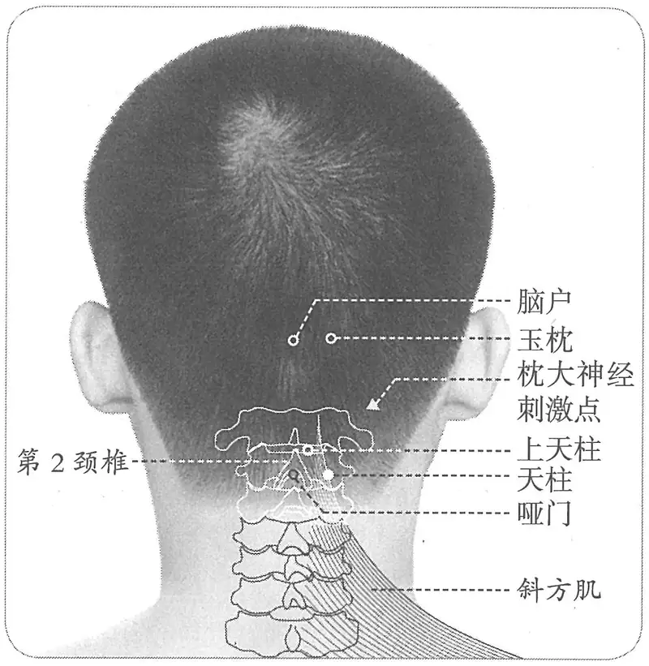

**图 2-170　天柱穴与相关穴及刺激点**

#### 【类属】 

足太阳膀胱经穴；足太阳所入。

　1. 足太阳根于至阴，溜于京骨，注于昆仑，入于天柱、飞扬也。（《灵枢·根结》）

　2. 足太阳脉气所发。（《黄帝明堂经》）

#### 【适应症】 

主治头项部病症。常用于头痛，颈项强痛，眩晕，目痛，肩背痛；癫，狂，痫，发热。

　1. 主热病汗不出。寒热，暴挛，足不任。目䀮䀮赤痛。痓。目瞑眩，头痛重，目如脱，项似拔，狂见鬼，目上反，项直不可以顾，身痛欲折。癫疾互引。咽肿难言。小儿惊痫。（《黄帝明堂经》）

　2. 厥头痛，项先痛，腰脊为应。（《外台秘要》卷三十九）

〔p.632 (인쇄 612)〕

**按**：此乃《灵枢》文字，王焘不识而误辑于本穴下。

　3. 头风，项痛急重。（《太平圣惠方·针经》）

　4. 头风脑重，项痛急强，左右不顾也。（《太平圣惠方·明堂》）

　5. 治足不任身体，肩背痛欲折，目瞑视。今附：治颈项筋急不得回顾，头旋脑痛。（《铜人腧穴针灸图经》卷中）

**按**：《铜人腧穴针灸图经》新附之主治症已见于《太平圣惠方》。

　6. 主鼻不知香臭。（《针灸聚英》卷一、《古今医统》、《针灸大成》、《针方六集》）

**按**：此乃高武不明《千金要方》文献出处及编纂体例，而误引其文也。

　7. 统编针灸学教材

　　(1) 主治头旋脑痛，头重不能举，目瞑不能视，鼻塞不知香臭，项强，不可回顾，肩背痛欲折。（1957年南京《针灸学》）

　　(2) 主治头痛，头旋，目昏鼻塞，项强，肩背痛。（1版《针灸学讲义》）

　　(3) 主治头痛，项强，鼻塞，肩背痛。（2版《针灸学讲义》）

　　(4) 主治头痛，项强，鼻塞，咽肿，热病，狂痫，肩背痛。（4版《针灸学》）

　　(5) 主治头痛，项强，鼻塞，癫狂痫，肩背痛，热病。（5版《针灸学》）

　　(6) 主治头痛，项强，眩晕，目赤肿痛，肩背痛，鼻塞。（6版《针灸学》）

　　(7) 主治：①后头痛、项强、肩背腰痛等痹证；②鼻塞；③癫狂痫；④热病。（7版《针灸学》）

　　(8) 主治头痛，鼻塞，咽喉肿痛，项强，肩背痛。（《中国针灸学》）

**文献分析**：《黄帝明堂经》载本穴主治集中在头项、目及癫、狂、痫、热病等足太阳经典型症状，宋代王惟一则强调了头项部的主治症。以上病症中除“咽肿难言”外，多为足太阳经脉病候的典型症状。足太阳“是动”病典型症状主要见于“天柱”（足太阳标脉）、“昆仑”（足太阳本脉）二穴。“寒热，暴挛，足不任”已见于《灵枢·寒热病》，《黄帝明堂经》本穴主治与攒竹、丝竹空穴相近，可互参。

教材中“鼻塞不知香臭”乃承袭高武《针灸聚英》之误，今去之。而“目痛”一症，自《黄帝明堂经》载录之后，一直为历代文献收录，且此症为足太阳病症的一个典型病症，实验研究也表明，上天柱穴（本穴稍内上方）治疗眼病有确切疗效，是以补录。

#### 附：临床应用举例 

　1. 头项部病症

　　(1) 气在于头者，取之天柱、大杼；不知，取足太阳荥输。（《灵枢·五乱》）

　　(2) 暴挛痫眩，足不任身，取天柱。（《灵枢·寒热病》）

　　(3) 厥头痛，项先痛，腰脊为应，先取天柱，后取足太阳。（《灵枢·厥病》）

　　(4) 头眩，针上星、风池、天柱。（《杂病治例》）

　　(5) 颈椎综合征：天髎穴、天柱穴，针刺治疗。［中国针灸，1986，6(2):14］

　　(6) 颈性偏头痛：天柱穴针刺治疗。［云南中医学院学报，1999，22(1):49-50］

　2. 腰背痛

　　(1) 腰肌劳损：针刺天柱穴治疗。［广西中医药，1986(2):30］

　　(2) 中风后肩痛：针刺天鼎、天柱治疗。［针灸临床杂志，1999，15(1):52］

　　(3) 急性胸腰椎扭伤：斜刺天柱、内关为主治疗。［中国针灸，2001，21(8):476］

　　(4) 腰痛：针刺天柱穴治疗。［四川中医，2002，20(1):74］

　3. 精不灌则目无所见矣，故命曰夺精。补天柱经侠颈。（《灵枢·口问》）

〔p.633 (인쇄 613)〕

　4. 泣出，补天柱经侠颈，侠颈者，头中分也。（《灵枢·口问》）

　5. 足跟痛　针刺天柱穴治疗。［上海针灸杂志，1986，5(2):29］

#### 【操作】 

直刺0.5~0.8寸。勿向脊柱方向斜刺过深，以防刺伤脊髓。治疗眼疾，参照“上天柱”刺法。

　1. 刺入二分，留六呼，灸三壮。（《黄帝明堂经》）

　2. 针入二分，留三呼，泻五吸，先泻而后补之。灸亦得，然不及针，日灸七，统至一百五壮。（《太平圣惠方·针经》）

　3. 针入五分，得气即泻，立愈。（《铜人腧穴针灸图经》卷中）

　4. 窦氏针入二寸半，左右相透，灸二七壮。（《针方六集》卷一）

　5. 一曰刺五分，禁灸。（《类经图翼》卷七）

　6. 针三分，灸三壮。一说禁针。（《针灸十四经穴位考订》）

　7. 统编针灸学教材

　　(1) 针五分。（1957年南京《针灸学》、1版《针灸学讲义》）

　　(2) 直刺5分。（2版《针灸学讲义》）

　　(3) 直刺或斜刺0.5~0.8寸，不可向内上方深刺，以免伤及延髓。（4、5、7版《针灸学》）

　　(4) 直刺或斜刺0.5~0.8寸，不可向内上方深刺；可灸。（6版《针灸学》）

　　(5) 直刺0.5~0.8寸。（《中国针灸学》）

　8. 直刺0.5~1寸。感应：局部酸胀或向头顶部扩散。温灸3~5分钟。注意：不宜向内上方深刺，恐伤延脑。（上海《针灸学》）

**刺法与主治的解剖学基础**：后头乃至项部的腧穴一般主治局部病症，或全身性的寒热病，而“百会”、“前顶”、“脑户”、“络却”、“玉枕”、“天柱”、“风府”、“风池”等不仅均主治局部疾患，而且可主治距离较远的目、鼻部病症。古人认为这些穴是通过脑与这两个器官密切相关的：

五脏六腑之精气皆上注于目而为之精……裹撷筋骨血气之精而与脉为之系，上属于脑，后出于项中。（《灵枢·大惑论》）

足太阳有通项入于脑者，正属目本，名曰眼系。头目苦痛取之在项中两筋间。（《灵枢·寒热病》）

古人的这一认识起源很早，早在张家山汉简《引书》中就记载着：“引目痛……压两目内脉而上循之至项。”故《黄帝明堂经》载头顶部及后头部与脑密切相关的穴均可主治目部疾患。

日本的古今针灸家也通过临床实践发现了本穴与目的联系，但限于当时的医学水平，关于联系途径的解释，仅给出了现在看来很牵强的解释，仍未跳出《内经》的范畴：“人眦内血丝，谓之眼系，后系于此穴（天柱），故风眼、湿眼之病，刺此有效。”（日本《引经诀》卷下）。日本现代针灸家泽田键先生也将此穴用作治疗眼病的要穴，中国学者通过临床与实验的方法发现：针刺上天柱、风池穴，其针感至眼区以治疗眼疾，疗效确切，其针感的产生与特定针刺方向、深度下的神经分布的支配区域是吻合的[^28-1]。另一方面，有人从肌肉的整体联系上解释枕肌部穴位与眼区的相关联系（详见“络却”穴），从而使得中国几千年前关于项与眼相关联系的经验得到越来越多的现代科学的解释。

[^28-1]: 吴泽森．上天柱、风池穴“气至病所”形态结构的研究[J]．上海针灸杂志，1987(2):27-30.

〔p.634 (인쇄 614)〕

### （十一）大杼 Dàzhù BL11 出《黄帝明堂经》 

#### 【提要索隐】 

**部位**：在脊柱区，第1胸椎棘突下，后正中线旁开1.5寸。

**适应症**：主治胸背部病症。常用于咳嗽，发热，颈项强痛，肩背痛。**新增**：气喘。

**针刺操作**：斜刺0.5~0.7寸，不宜直刺过深，以免损伤壁胸膜和肺脏引起气胸。

#### 【名实考】 

大杼，因位于大杼骨旁而得名。大杼骨，即第一胸椎，又名大椎。古今医家常常将大杼穴与大杼骨混为一谈，《难经》所说“骨会大杼”是指大杼骨，而不是大杼穴。由于千百年来人们一直将其误释是穴名，而此处以穴解，从医理上又难以说通，于是便引发了“骨会大杼”与“骨会大椎”之辨。由此引发的问题，还包括“百劳”穴究竟是“大椎”，还是“大杼”穴的别名？肩中俞穴究竟是“大杼旁二寸”，还是“大椎旁二寸”等等，凡此各种，皆因对“大杼”之穴名与骨名不分所致。

　1. 大杼、膺俞、缺盆、背俞，此八者，以泻胸中之热也。（《素问·水热穴论》）

　2. 大杼，在项第一椎下，两旁各一寸五分陷者中，足太阳手少阳之会。（《黄帝明堂经》）

　3. 第一椎名大杼，无所不主，夹左右一寸半或一寸二分，主头项痛不得顾。胸中烦急，灸随年壮。（《千金翼方》卷二十七）

　4. 胸中大腧，在杼骨之端。志云：先言大杼者，乃项后大骨之端，督脉循于脊骨之第一椎也。（《黄帝内经灵枢集注·背腧》）

　5. 此本经离项入背之始……又杼之名义即梭也，乃经之持纬者，此下肋枝皆横列于背，而太阳经脉从此穴直行而下，次第纬之，有梭纬经之象，故名大杼。（《经穴解》）

　6. 别名　背俞、百劳。（1957年南京《针灸学》）

**按**：此传自日本针灸教材。其中“背俞”出《素问·气穴论》，不是一个具体的穴名，王冰注作“大杼”。

#### 大杼、大椎与百劳 

　1. 百劳，在背第一椎骨尖上。（《针灸玉龙歌》注）

　2. 百劳一穴，一名大椎。在背部第一椎骨尖上陷中是穴。《素注》云：人有项骨三椎，脊骨二十一椎。通赅二十四椎，以按二十四气。然则除项骨三椎外，第四节所谓一椎即百劳，以至尾骶廿一椎。（《窦太师针经》）

　3. 百劳二穴，在背部一节骨上是穴。（《窦太师针经》乙抄本）

　4. 大椎，一名百劳，一名上杼。（《循经考穴编》下）

　5. 大杼，一名百劳。（《针灸大全》卷六）

　6. 大椎，一名百劳。（《针灸大成》卷七）

**按**：以上“大杼”即大椎别称，而百劳为大椎穴的别名。

#### 【定位】 

**部位**：在脊柱区，第1胸椎棘突下，后正中线旁开1.5寸（图2-171）。

**取穴**：俯伏，在第1胸椎棘突下陶道穴旁1.5寸处取之。

　1. 在项第一椎下两旁各一寸五分陷者中。（《黄帝明堂经》、《太平圣惠方·明堂》、《铜人腧穴针灸图经》卷中、《圣济总录》、《窦太师秘传》、《十四经发挥》、《医学纲目》、《针灸聚英》、《古今医统》、《针灸大成》、《针方六集》、《循经考穴编》、《针灸易学》）

　2. 在项后第一椎下两旁各一寸半陷中是穴。（《太平圣惠方·针经》）

　3. 在第一椎下，两旁相去各一寸五分。（《铜人腧穴针灸图经》卷上）

〔p.635 (인쇄 615)〕

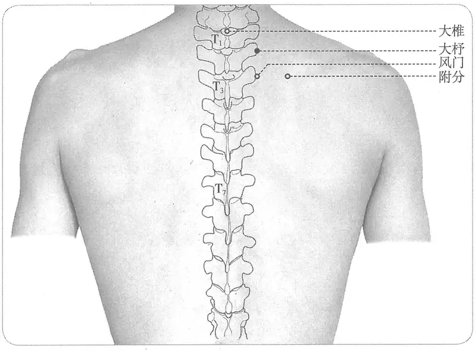

**图 2-171　大杼穴图**

　4. 在项后第一椎下，两旁相去各寸半陷中。凡大杼下穴皆当除脊各寸半。（《针灸资生经》卷一）

　5. 第一节外一寸半陷中。（《医学入门》卷一）

　6. 在项后第一椎下两旁，相去脊中各二寸陷中，正坐取之。（《类经图翼》卷七、《医宗金鉴·刺灸心法要诀》、《针灸逢源》）

　7. 统编针灸学教材

　　(1) 部位：项后第一椎两旁，去脊各一寸五分。取穴：正坐，从陶道穴旁开一寸五分处取之。（1957年南京《针灸学》）

　　(2) 部位：项后第一椎下，挟脊三寸。取穴：正坐，从第一椎下督脉陶道穴旁开一寸五分陷中取之。（1版《针灸学讲义》）

　　(3) 部位：在项第一椎下，两旁各一寸五分陷中。取穴：俯伏，在第一胸椎棘突下陶道（督脉）旁一寸五分处取之。（2版《针灸学讲义》）

　　(4) 第一胸椎棘突下，旁开1.5寸。（4、5、6、7版《针灸学》）

　　(5) 第一胸椎棘突下，陶道旁开一寸五分。（《中国针灸学》）

**文献分析**：历代文献关于本穴定位记载一致，即在项第一椎下两旁各一寸五分陷者中，出《黄帝明堂经》，《千金要方》等书从之。值得注意的是古籍所载去脊中和除脊两种说法的区别，后者不包括脊柱的宽度。宋代王执中曰：“凡大杼下穴皆当除脊各寸半”，对此明代高武有精辟的分析，可从。详见本篇“概说”。

#### 【类属】 

足太阳膀胱经穴。

**脉气所发：**

　1. 足太阳、手少阳之会。（《黄帝明堂经》）

　2. 督脉别络，手足少阳、足太阳之会。（《循经考穴编》上）

**归经**：足太阳膀胱经。（《外台秘要》卷三十九、《铜人腧穴针灸图经》卷上）

〔p.636 (인쇄 616)〕

#### 【适应症】 

主治胸背部病症。常用于咳嗽，发热，颈项强痛，肩背痛。

**备选适应症**：气喘。

　1. 大杼、膺俞、缺盆、背俞，此八者以泻胸中之热也。（《素问·水热穴论》、《针灸甲乙经》、《黄帝内经太素》）

　2. 主癫疾。痎疟。颈项痛，不可以俯仰，头痛振寒，瘛疭，气实则胁满，夹脊有并气，热，汗不出，腰背痛。痓，脊强互引。喉痹。大气满，喘息，胸中郁郁，身热，目䀮䀮，项强，寒热，僵仆，不能久立，烦满里急，身不安席。恶风，时振栗。（《黄帝明堂经》）

**按**：以上病症中除头项、腰背部症状以及痓、癫狂、痫等足太阳经脉病候的典型症状外，还主治胸背部症状。

　3. 主理风劳气，咳嗽，气急，目眩，腹痛。（《太平圣惠方·针经》）

　4. 疗疟，颈项强不可俯仰，头痛振寒，气实胁满，瘛疭，伤寒汗不出，脊强，喉痹，烦满，风劳气，咳嗽，胸中郁郁，身热目眩。（《铜人腧穴针灸图经》卷中）

　5. 主伤风不解，腠理不密，易感风寒。（《循经考穴编》上）

　6. 主膝痛不可屈伸，头风，头旋，筋挛，癫疾，身蜷急。（《针灸聚英》卷一、《针灸大成》）

**按**：以上“膝痛不可屈伸”出于《素问·骨空论》；“筋挛，身蜷急”出于《灵枢·癫狂》“筋癫疾者，身倦挛急大，刺项大经之大杼脉。”

　7. 统编针灸学教材

　　(1) 主治咳嗽，感冒，身热，头痛，易感风寒，肩胛痠痛，颈项强急。（1957年南京《针灸学》、1版《针灸学讲义》）

　　(2) 主治咳嗽，发热，头痛，肩胛酸痛，颈项强急。（2版《针灸学讲义》）

　　(3) 主治头痛，项背痛，咳嗽，发热，瘛疭，脊强。（4版《针灸学》）

　　(4) 主治咳嗽，发热，项强，肩背痛。（5版《针灸学》）

　　(5) 主治咳嗽，发热，头痛，肩背痛，颈项拘急。（6版《针灸学》）

　　(6) 主治：①咳嗽；②项强，肩背痛。（7版《针灸学》）

　　(7) 主治头痛，项背痛，肩胛痠痛，咳嗽，发热，颈项强直。（《中国针灸学》）

**文献分析**：发热，乃本穴的主治重点之一，不仅《内经》、《黄帝明堂经》早期文献反复强调，而且后世文献也有明确论述，7版教材删之，欠妥。又《黄帝明堂经》载本穴主治中反复出现有关气逆的症状“气实则胁满，夹脊有并气”、“大气满，喘息，胸中郁郁”、“烦满里急”等，《太平圣惠方》也载有“气急”症，今附存备考。

#### 附：临床应用举例 

　1. 是阳气有余而阴气不足，阴气不足则内热，阳气有余则外热，内热相搏，热于怀炭，外畏绵帛近，不可近身，又不可近席，腠理闭塞，则汗不出，舌焦唇槁，咽干嗌燥，饮食不让美恶……取之于天府、大杼三痏，又刺中膂以去其热，补足手太阴以去其汗，热去汗稀，疾于彻衣。（《灵枢·刺节真邪》）

　2. 筋癫疾者，身倦挛急大，刺项大经之大杼脉。（《灵枢·癫狂》）

　3. 小儿斑疮入眼，灸大杼二穴各一壮，在项后第一椎下两旁各一寸半陷者中，炷如小麦。（《太平圣惠方·明堂》）

　4. 治伤寒胸中热不已，泻足太阳经大杼二穴，在项后第一椎下，两旁相去各一寸五分陷中，针入五分。（《针经摘英集》）

　5. 风痹痿厥如何治，大杼曲泉真是妙。（《肘后歌》）

〔p.637 (인쇄 617)〕

　6. 牙痛　针刺大杼穴治疗。［中医外治杂志，1995(2):16］

　7. 风湿性膝关节炎　独取大杼治疗。［中国针灸，1998(3),181］

#### 【操作】 

斜刺0.5~0.7寸，不宜直刺过深，以免损伤壁胸膜和肺脏引起气胸。

　1. 刺入三分，留七呼，灸七壮。（《黄帝明堂经》）

　2. 针入五分，留七呼，禁灸。（《太平圣惠方·针经》）

　3. 针入五分，可灸七壮。（《铜人腧穴针灸图经》卷中）

　4. 针入一分，向外一寸半，灸二七壮。（《窦太师秘传》）

　5. 窦氏针入一分，沿皮向外一寸半，灸七七壮。（《针方六集》卷一）

　6. 针三分，灸五壮。（《针灸十四经穴位考订》）

　7. 统编针灸学教材

　　(1) 针五分，灸三至七壮。（1957年南京《针灸学》、1版《针灸学讲义》）

　　(2) 向下斜刺5分，艾条灸5~10分钟。（2版《针灸学讲义》）

　　(3) 斜刺0.5~0.8寸。本经背部诸穴，不宜深刺，以免伤及内部重要脏器。（4、5、7版《针灸学》）

　　(4) 斜刺0.5~0.8寸；可灸。本经背部诸穴，不宜深刺，以免伤及内部重要脏器。（6版《针灸学》）

　　(5) 斜刺0.5~0.7寸。可灸。（《中国针灸学》）

　8. 斜刺，向椎体方向刺入，深0.7~1寸。感应：局部酸、麻、胀，有时向肋间放散。灸3~7壮；温灸5~10分钟。（上海《针灸学》）

### （十二）风门 Fēngmén BL12 出《黄帝明堂经》 

#### 【提要索隐】 

**穴名**：一名热府。**按**：宋以前文献又作“风门热府”。

**部位**：在脊柱区，第2胸椎棘突下，后正中线旁开1.5寸。

**适应症**：主治外感、肩背部病症。常用于咳嗽、发热、头痛、鼻塞、鼻流清涕；颈项强痛，胸背痛。

**备选适应症**：背部痈疽。

**针刺操作**：斜刺0.5~0.8寸。不宜直刺过深，以免损伤壁胸膜和肺脏。

#### 【名实考】 

“风门”、“热府”，作为穴名，同时见于宋以前文献，说明《针灸甲乙经》关于本穴名称的记载“风门一名热府”是可靠的。可能在《黄帝明堂经》的某些早期传本中在传抄过程中脱掉了“一名”二字，造成传世的多种《黄帝明堂经》佚文出现了“风门热府”连称的现象，如《素问》王冰注、《千金翼方》、《医心方》卷九引《小品方》等。那么，是否存在这样的可能性：本穴全称为“风门热府”，简称或作“风门”，或作“热府”，像足三里穴，全称为“下陵三里”，可简称“下陵”，又或“三里”？应该说不能排除这样的可能，但从《针灸甲乙经》卷三与卷七用法一致来看，这一可能性相对较小。

又《龙衔素针经》载有“热府”一穴在“大椎上去发一寸”，与风门穴相去较远，当别是一穴。

　1. 风门，一名热府，在第二椎下两旁各一寸五分，督脉、足太阳之会。（《黄帝明堂经》）

　2. 风门，一名热府。（《针灸甲乙经》卷三、《千金要方》、《外台秘要》）

〔p.638 (인쇄 618)〕

　3. 风眩头痛，鼻鼽不利，时嚏，清涕自出，风门主之。（《针灸甲乙经》卷七）

　4. 热府。（《千金要方》卷十、《千金翼方》）

　5. 风门热府。（《千金要方》卷十八、《千金翼方》、《素问》王冰注、《医心方》、《医心方》卷九引《小品方》、《太平圣惠方·针经》）

　6. 风门，一名热府，一云左为风门，右为热府。（《循经考穴编》上）

　7. 天之邪风中人也，多在于上，而人之背尤易中风，然必有窍焉，以招其中。故在督之中行，于项之侧，足少阳之经，则曰风池，与此经之在背者，则又有风门焉。其入风最易，犹开门以受风者，故曰风门。（《经穴解》）

　8. 上气短气，咳逆胸背痛，灸风门热府百壮。（《千金要方》卷十八）

　9. 热府穴在第一节下两旁相去各一寸五分，针灸无在，治马黄黄胆等病。（《千金要方》卷十）

#### 同名异穴例 

　1. 《龙衔素针经》曰热府，大椎上去发一寸横三间寸。（《医心方》卷二）

**按**：该书别载“风门”穴在第四椎，与“热府”是两个不同的穴。

　2. 僧匡及彻云，风门第三节，夹脊相去二寸半，瘦人相去二寸二分。（《医心方》卷二）

#### 【定位】 

**部位**：在脊柱区，第2胸椎棘突下，后正中线旁开1.5寸（图2-172）。

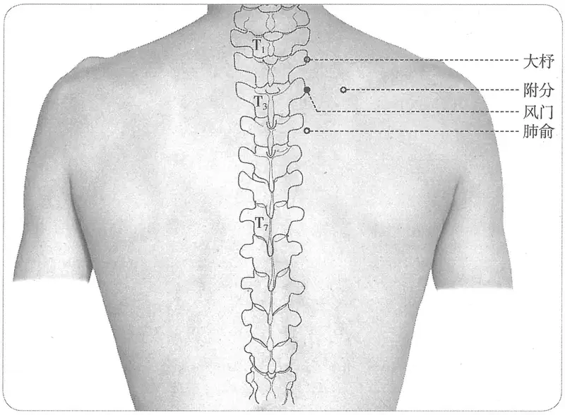

**图 2-172　风门穴图**

**取穴**：俯伏，在第2胸椎棘突下，督脉旁1.5寸取之。

　1. 在第二椎下两旁各一寸五分。（《黄帝明堂经》、《太平圣惠方·明堂》、《铜人腧穴针灸图经》、《圣济总录》、《窦太师针经》、《针灸集成》、《窦太师秘传》、《针灸玉龙经》、《医学纲目》、《针灸聚英》、《古今医统》、《针灸大成》、《针方六集》、《针灸易学》）

　2. 在第二椎下两旁各同身寸之一寸三分。（《素问·水热穴论》王冰注）

　3. 热府穴在第一节下两旁相去各一寸五分。（《千金要方》卷十）

〔p.639 (인쇄 619)〕

　4. 在二椎下两旁相去各寸半。凡大杼下穴皆当除脊各寸半。（《针灸资生经》卷一）

　5. 在第二椎下相去脊中各一寸五分。（《十四经发挥》中、《针灸聚英》、《古今医统》、《针灸大成》、《针方六集》、《医宗金鉴·刺灸心法要诀》、《针灸易学》）

　6. 广注正坐取之。又法：以右手搭左肩，左手搭右肩，取中指尽处是。（《循经考穴编》上）

**按**：《铜人腧穴针灸图经》于肺俞穴下引甄权《针经》取穴法“云：在第三椎下两旁以搭手左取右，右取左，当中指末是穴”，盖此处“又法”将此二穴相混。

　7. 在二椎下两旁各去脊中二寸，正坐取之。（《类经图翼》卷七、《医宗金鉴·刺灸心法要诀》、《针灸逢源》）

　8. 第二椎下去脊中二寸去脊边一寸半。（《针灸十四经穴位考订》）

　9. 统编针灸学教材

　　(1) 部位：在第二椎下两旁相去脊各一寸五分。取穴：按取第二胸椎下之旁一寸五分，正坐取之。（1957年南京《针灸学》）

　　(2) 部位：大杼穴下。取穴：正坐或伏卧，从第二椎下旁开一寸五分陷中取之。（1版《针灸学讲义》）

　　(3) 部位：第二椎下，两旁各一寸五分。取穴：俯伏，在第二胸椎棘突下，督脉旁一寸五分取之。（2版《针灸学讲义》）

　　(4) 第二胸椎棘突下，旁开1.5寸。（4、5、7版《针灸学》）

　　(5) 在背部，第二胸椎棘突下，旁开1.5寸。（6版《针灸学》）

　　(6) 第二胸椎棘突下，督脉旁开一寸五分。（《中国针灸学》）

**文献分析**：本穴定位古代文献有三说：其一，第二椎下两旁相去脊各一寸五分；其二，第二椎下两旁相去脊各一寸三分；其三，在第一节下两旁相去各一寸五分。其中第二说只见于《素问·水热穴论》王冰注，而其他篇注文作“一寸五分”，可知“一寸三分”系“一寸五分”之误。第三说也只见于《千金要方》针灸方注文，不能排除传抄之误。故本穴定位当据第一说《黄帝明堂经》之说。关于本穴定位去脊中距离的分歧，详见本经“概说”。

#### 【类属】 

足太阳膀胱经穴。

**脉气所发**：督脉、足太阳之会。（《黄帝明堂经》）

**归经**：足太阳膀胱经。（《外台秘要》卷三十九、《铜人腧穴针灸图经》）

#### 【适应症】 

主治外感、肩背部病症。常用于咳嗽、发热、头痛、鼻塞、鼻流清涕；颈项强痛，胸背痛。

**备选适应症**：背部痈疽。

　1. 风眩头痛，鼻鼽不利，时嚏，清涕自出。（《黄帝明堂经》）

**按**：此组症状与攒竹穴一组主治极相似，描述的是典型的风寒感冒症状，《太平圣惠方》更是直接点明病名“伤寒”。

　2. 理伤寒项强，目瞑，鼻塞风劳，呕逆上气，胸痛背痛，气短不安。（《太平圣惠方·针经》）

　3. 治伤寒颈项强，目瞑多嚏，鼻鼽出清涕，风劳，呕逆上气，胸背痛，喘气卧不安。今附：若频刺泄诸阳热气，背永不发痈疽。（《铜人腧穴针灸图经》卷中）

**按**：《铜人腧穴针灸图经》新附“泄阳热气”之刺法，除本穴外，还有上星、攒竹，皆以三棱针刺之。

　4. 窦太师针灸遗存

　　(1) 治腠理不密，时或伤寒咳嗽，喷涕不已，鼻流清水，灸五十壮。热嗽泻，寒嗽补。疽症，泻左风门，右风府。（《窦太师针经》）

〔p.640 (인쇄 620)〕

　　(2) 治腠理不密，时或伤风而咳嗽，喷涕不已，鼻流清水，不可灸，百壮。（《大本琼瑶神书》）

　　(3) 主腠理疏，风寒易感，喘逆无时，咳嚏不已，鼻鼽清冷，头重如石。（《循经考穴编》上）

　　(4) 治一切伤寒等症。（《窦太师秘传》）

　5. 统编针灸学教材

　　(1) 主治咳嗽，感冒，身热头痛，项强腰背痛，胸中热，卧不安，痈疽发背。（1957年南京《针灸学》）

　　(2) 主治咳嗽，感冒，身热，头痛，项强，腰、背痛，胸中热。（1版《针灸学讲义》）

　　(3) 主治伤风咳嗽，发热头痛，项强，腰背痛。（2版《针灸学讲义》、4、5版《针灸学》、《中国针灸学》）

　　(4) 主治伤风咳嗽，发热头痛，目眩，项强，腰背痛，鼻塞多涕。（6版《针灸学》）

　　(5) 主治：①感冒、咳嗽、发热、头痛等外感病证；②项强，胸背痛。（7版《针灸学》）

**文献分析**：《黄帝明堂经》所载之本穴主治症本是一组典型的风寒感冒症状，金元针灸大家窦太师也进一步印证了这一主治。这也是“风门”这一穴名的寓意之所在。现代有灸本穴预防感冒的报道，是对这一主治作用的具体应用。值得重视的是，《铜人腧穴针灸图经》新增之“频刺风门预防背痈”的经验，应注意在临床上观察检验，既然本穴能预防背部痈疽，理应能治疗该症。元代《针灸集成》已用于治疗“肩背红肿”，而除统编教材的前身1957年南京《针灸学》外，现行各版教材皆未载录此症。今附存备考，以推荐今后用于临床，积累第一手资料。

#### 附：临床应用举例 

　1. 肺系病症

　　(1) 腠理不密咳嗽频，鼻流清涕气昏沉，喷嚏须针风门穴，咳嗽还当艾火深。（《针灸玉龙歌》）

　　(2) 鼻酸多嚏，流清涕：囟会、风门灸。（《针灸玉龙经·盘石金直刺秘传》）

　　(3) 鼻中无时出血不止：泻风门；不止，灸中脘，仍刺泻之。（《针灸集要·盘石金直刺秘传》）

　　(4) 伤寒热退后再发热：风门、合谷、行间、绝骨。（《医学纲目》卷三十）

　　(5) 伤风感寒，咳嗽喘满：膻中一穴、风门二穴、合谷二穴、风府一穴。（《针灸大全》卷四）

　　(6) 上气短气，咳逆，胸背痛，灸风门热府百壮。（《千金要方》卷十八）

　　(7) 久嗽不愈，肺俞、三里、乳根、风门、百劳（一椎上陷中）、列缺。问曰：此证缘何而得？答曰：因咸物咳嗽伤脾，兼房事过多，酒食不节，伤风不解，痰饮流入肺经，故如此也。宜刺后穴：膻中、三里、乳根、输府。（《针灸集成》第五十方）

　　(8) 久咳不愈，咳唾血痰：风门二穴、太渊二穴、膻中一穴。（《针灸大全》卷四）

　2. 肩背痛

　　(1) 肩背红肿：肩井、风门、中渚。问曰：此证从何而得？答曰：皆因腠理不密，风邪串入经络，寒湿相搏，血气相胜，故如此也。复刺后穴：大椎、肺俞、膏肓。（《针灸集成》第三十二方）

〔p.641 (인쇄 621)〕

　　(2) 胸背痛：风门。（《类经图翼》卷十一）

　　(3) 落枕：风池穴、风门穴，针刺加火罐治疗。［中国针灸，1984，4(4)：7］

#### 【操作】 

斜刺0.5~0.8寸。不宜直刺过深，以免损伤壁胸膜和肺脏。

　1. 刺入五分，留五呼，灸五壮。（《黄帝明堂经》）

　2. 针入五分，留七呼，灸三壮。（《太平圣惠方·针经》）

　3. 窦太师针灸遗存

　　(1) 针一分，沿皮向外一寸五分，灸七壮。（《窦太师秘传》）

　　(2) 窦氏针入一分，沿皮向外一寸半，灸五十壮。（《针方六集》卷一）

　4. 统编针灸学教材

　　(1) 针五分，灸三壮。（1957年南京《针灸学》、1版《针灸学讲义》）

　　(2) 向下斜刺5分，艾条灸3~5分钟。（2版《针灸学讲义》）

　　(3) 斜刺0.5~0.8寸。（4、5、7版《针灸学》）

　　(4) 斜刺0.5~0.8寸；可灸。（6版《针灸学》）

　　(5) 斜刺0.5~0.7寸。可灸。（《中国针灸学》）

　5. ①直刺：微斜向脊柱，深0.5~1寸。感应：局部酸胀，有时向肋间扩散。②横刺：自上向下沿肌层透刺，进针1~2寸。感应：局部酸胀。灸3~5壮；温灸5~15分钟。注意：不宜直刺过深，以免刺伤肺脏。（上海《针灸学》）

### （十三）肺俞 Fèishū BL13 出《灵枢》 

#### 【提要索隐】 

**穴名**：肺俞，其“俞”字，宋以前文献或作“输”，或作“腧”字。

**部位**：在脊柱区，第3胸椎棘突下，后正中线旁开1.5寸。**按**：宋以前关于本穴定位分歧较大。

**适应症**：主治肺部病症。常用于咳嗽，气喘，咳血，潮热，盗汗；小儿龟背。

**针刺操作**：斜刺0.5~0.8寸。不宜直刺过深或刺向外侧，以免损伤胸膜和肺。

#### 【名实考】 

背俞穴名，《针灸甲乙经》、《外台秘要》、《素问》王冰注作“俞”，《黄帝内经太素》、《千金要方》、《医心方》作“输”，《铜人腧穴针灸图经》作“腧”。

关于本穴以及其他背俞穴的定位，在宋以前有多种学说，与一般经穴定位分歧不同的是，背俞穴定位分歧太大，与其说是对穴位的认识分歧，不如说是对于脏腑位置认识的分歧。宋以前有关背俞穴定位的分歧，详见本篇“概说”。

　1. 肺腧在三焦之间，皆夹脊相去三寸所，则欲得而验之，按其处，应在中而痛解，乃其腧也。（《灵枢·背腧》）

　2. 肺俞，在第三椎下两旁各一寸五分。（《黄帝明堂经》）

　3. 肺腧二穴，在第三椎下两旁相去各一寸五分。足太阳脉气所发。（《铜人腧穴针灸图经》卷中）

　4. 五脏六腑皆系于背，乃系于背之夹脊脂络中，其腧穴，按脏腑之高下而定焉，实脏腑至要之处，为脏腑之本也……肺处五脏最高之所，故肺腧首取之，乃系肺之原本处也。（《经穴解》）

#### 宋以前文献肺俞穴别说 

　1. 欲知背俞先度其两乳间中折之。更以他草度去半已。即以两隅相拄也。乃举以度其背。令其一隅居上，齐脊大椎，两隅在下。当其下隅者，肺之俞也。（《素问·血气形志》）

〔p.642 (인쇄 622)〕

2.《扁鹊针灸经》曰第八椎名肺输。夹脊左右各一寸半或一寸二分。（《医心方》卷二）

3.《龙衔素针经》曰肺输，第五椎相去三寸。（《医心方》卷二）

#### 相关穴及刺激点 

　1. 结核　位于背部，第二胸椎棘突旁开五分处各一穴；第三胸椎棘突旁开五分处各一穴。左右计四穴。主治肺结核。针3~5分，针感局部酸、胀。（《针灸经外奇穴图谱(续集)》）

　2. 肺热　位于背部，第3、4胸椎棘突之间点，左右旁开5分处肺俞穴内侧1寸处。主治肺炎、支气管炎、肺结核。针三至五分，针感局部胀、麻。隔蒜灸三至七壮。（《针灸经外奇穴图谱(续集)》）

#### 【定位】 

**部位**：在脊柱区，第3胸椎棘突下，后正中线旁开1.5寸（图2-173）。

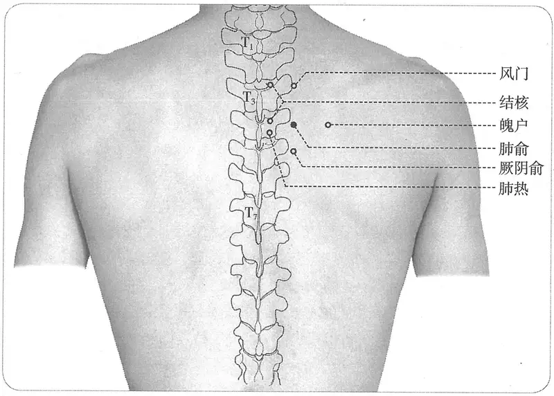

**图2-173　肺俞穴与相关穴图**

**取穴**：正坐或俯卧，第3椎下督脉身柱穴旁开1.5寸陷中取之。

　1. 肺腧在三焦之间……夹脊相去三寸所……则欲得而验之，按其处，应在中而痛解，乃其腧也。（《灵枢·背腧》）

　2. 在第三椎下两旁各一寸五分。（《黄帝明堂经》、《太平圣惠方》、《铜人腧穴针灸图经》卷中、《圣济总录》、《窦太师针经》、《十四经发挥》、《医学纲目》、《针灸聚英》、《古今医统》、《针灸大成》、《针方六集》、《类经图翼》、《循经考穴编》、《医宗金鉴·刺灸心法要诀》、《针灸易学》、《针灸逢源》）

　3. 肺俞，在背第三椎下两旁各一寸半，动脉应手。（《素问亡篇·刺法论》）

　4. 在第三椎下，各夹脊相去一寸五分。（《铜人腧穴针灸图经》卷上及卷下“穴腧都数”）

〔p.643 (인쇄 623)〕

　5. 在第三椎下两旁各寸半。凡大杼下穴皆当除脊各寸半。（《针灸资生经》卷一）

　6. 在第三椎下两旁各二寸。（《神应经》、《医宗金鉴·刺灸心法要诀》、《针灸逢源》）

　7. 第三椎下，身柱旁开二寸去脊边一寸半。（《针灸十四经穴位考订》）

　8. 统编针灸学教材

　　(1) 部位：第三椎下两旁去脊各一寸五分。取穴：正坐或俯卧，第三椎下身柱穴旁开一寸五分取之。（1957年南京《针灸学》）

　　(2) 部位：风门穴下。取穴：正坐或俯卧，第三椎下督脉身柱穴旁开一寸五分陷中取之。（1版《针灸学讲义》）

　　(3) 部位：在第三椎下，两旁各一寸五分。取穴：俯伏，于第三胸椎棘突下，身柱督脉旁一寸五分取之。（2版《针灸学讲义》）

　　(4) 第三胸椎棘突下，旁开1.5寸。（4、5、7版《针灸学》）

　　(5) 在背部，当第3胸椎棘突下，旁开1.5寸。（6版《针灸学》）

　　(6) 第三胸椎棘突下，身柱旁开一寸五分。（《中国针灸学》）

**文献分析**：宋以前文献对于背俞穴的定位分歧很多，详见本篇“概说”。唐代以后多遵从《黄帝明堂经》之说。

#### 【类属】 

足太阳膀胱经穴；背俞穴之一。

足太阳脉气所发。（《铜人腧穴针灸图经》卷中）

**按**：《黄帝内经太素·气府》卷十一载足太阳脉气所发穴中无五脏六腑俞穴。汉代腧穴经典《黄帝明堂经》背腧穴下也未注明“足太阳脉气所发”，那么现行本《素问·气府论》足太阳脉气所发穴下“五脏之俞各五，六腑之俞各六”句，很可能系王冰所增入，而唐以后文献五脏六腑之俞皆归于足太阳膀胱经，至《铜人腧穴针灸图经》又补上了脉气所发的内容——“足太阳脉气所发”。

#### 【适应症】 

主治肺部病症。常用于咳嗽，气喘，咳血，潮热，盗汗；小儿龟背。

　1. 主肺寒热，呼吸不得卧，咳上气，呕沫，喘气相追逐，胸满背膺急，息难，振栗，脉鼓，气膈，胸中有热，支满不嗜食，汗不出，腰脊痛。肺胀，癫疾，憎风时振寒，不得言，得寒益甚，身热狂走欲自杀，目反妄见，瘛疭，泣出，死不知人。（《黄帝明堂经》）

**按**：此肺之俞在主胸肺部病症方面与肺之募“中府”极相似（甚至连症状描述的文字都很相似）。《黄帝明堂经》主治明确提到主治“肺胀”者有三穴：肺之俞、募穴和肺经井穴。此外，本穴作为足太阳背部俞穴，还主治该经共性的病症：癫、狂、瘛疭。

　2. 主瘿气，吐逆，寒热不食，肉痛皮痒，传尸骨蒸，肺嗽。（《太平圣惠方·针经》）

　3. 主肺痿上喘，咳嗽唾血。（《太平圣惠方·明堂》）

　4. 治上气呕吐，支满不嗜食，汗不出，腰背强痛，寒热喘满，虚烦口干，传尸，骨蒸劳，肺痿咳嗽。针入三分，留七呼，得气即泻出《甲乙》。甄权《针经》云：在第三椎下两旁以搭手左取右，右取左，当中指末是穴。治胸中气满，背偻如龟，腰强，头目眩，令人失颜色。（《铜人腧穴针灸图经》卷中）

　5. 窦太师针灸遗存

　　(1) 治一切痰饮嗽喘，泻；冷喘，补。治五劳七伤，一切虚损，咳嗽盗汗，久嗽虚，并贼汗不愈，看症补泻。（《窦太师针经》）

　　(2) 治一切咳嗽并哮喘气急等证。热咳，泻；冷咳，补。（《大本琼瑶神书》）

　　(3) 主虚烦盗汗，或气虚痿，久嗽畏寒，或哮吼喘促痰涎壅塞，胸满瞀闷。（《循经考穴编》上）

〔p.644 (인쇄 624)〕

　　(4) 肺俞，治肺家嗽红痰，并久嗽，先补；寒痰，单补。（《针方六集·玉龙歌》注）

　6. 主食后吐水。（《针灸聚英》卷一、《针灸大成》）

**按**：此条主治系从《针灸资生经》转引《千金要方》“肺俞”、“三阴交”、“期门”三穴灸方。

　7. 此穴主泻五脏之热，与五脏俞治同。（《类经图翼》卷七）

**按**：此文出自《素问·水热穴论》，原文作“五脏俞旁五，此十者以泻五脏之热也”，“五脏俞旁”非指五藏俞穴也。王冰注曰：“谓魄户、神堂、魂门、意舍、志室五穴”，《类经》卷二十一第三十九篇注同。而张氏于《类经图翼》中却将此方分别附入五脏俞及旁十穴中。

　8. 统编针灸学教材

　　(1) 主治痨瘵，内伤吐血，喘咳上气，骨蒸，虚烦盗汗，胸满，气短，肺痿，小儿龟背。（1957年南京《针灸学》）

　　(2) 主治痨瘵，咯血，咳嗽，喘气，骨蒸，虚烦，盗汗，胸满，肺痿，小儿龟背。（1版《针灸学讲义》）

　　(3) 主治咳嗽，气喘，吐血，骨蒸，潮热，盗汗。（2版《针灸学讲义》、7版《针灸学》）

　　(4) 主治咳嗽，气喘，吐血，骨蒸，潮热，盗汗，鼻塞。（4、5版《针灸学》）

　　(5) 主治咳嗽，气喘，胸满，背痛，潮热，盗汗，骨蒸，吐血，鼻塞。（6版《针灸学》）

　　(6) 主治咳嗽，气喘，胸满，吐血，骨蒸潮热，盗汗。（《中国针灸学》）

**文献分析**：《黄帝明堂经》载本穴主治包括胸肺部病症和癫、狂、瘛疭等足太阳经背部腧穴共性主治症。但从宋代引唐·甄权《针经》，其主治重点已开始转向肺部，特别是肺痨症状，至金元窦太师针灸这种转变更加明显，后世的临床应用也突出地反映了这一趋势，现代针灸学教材同此，今从之。

#### 附：临床应用举例 

　1. 肺部病症

　　(1) 邪在肺，则病皮肤痛，寒热，上气喘，汗出，咳动肩背，取之膺中外输，背三节五藏之旁，以手疾按之，快然，乃刺之。（《灵枢·五邪》）

　　(2) 喉痹，气逆，咳嗽，口中涎唾，灸肺输七壮，亦可随年壮至百壮。（《千金要方》卷十七、《千金翼方》）

　　(3) 瘿，上气短气，灸肺俞百壮。（《千金要方》卷二十四）

　　(4) 心烦上气，灸肺俞，针入五分。（《千金翼方》卷二十七）

　　(5) 治热劳上气喘满，腰背强痛：刺足太阳经肺俞二穴，在背俞部第三椎下两旁相去同身寸之各一寸五分。针入五分，留七呼，可灸百壮即止。次针手太阴经尺泽二穴。（《针经摘英集》）

　　(6) 伤风不解嗽频频，日久难医劳病成，咳嗽须针肺俞穴，痰多必用丰隆轻。（《针灸玉龙歌》）

　　(7) 治嗽，灸天突穴、肺俞穴，大泻肺气。（《丹溪心法》卷二）

　　(8) 久嗽不愈：肺俞、三里、乳根、风门、百劳（一椎上陷中）、列缺。问曰：此证缘何而得？答曰：因咸物咳嗽伤脾，兼房事过多，酒食不节，伤风不解，痰饮流入肺经，故如此也。宜刺后穴：膻中、三里、乳根、输府。（《针灸集成》第五十方）

　　(9) 寒邪陷下者，灸肺俞，咳多者主之。（《伤寒治例》）

　　(10) 治咳嗽有红痰二百五十法：红痰咳嗽病传深，提补百劳灸共针，肺俞提从按刮弹，补从列缺艾加临，仍将三里取气下，脾俞补来提用心，中脘盘盘膏肓灸，四花提补妙中寻。（《琼瑶神书》卷二）

〔p.645 (인쇄 625)〕

　　(11) 肺壅咳嗽二百五十二法：肺壅咳嗽泻膻中，肺俞先提后补攻，三里烧来取气下，先提后补列缸同，曲池要补咳生呕，中脘盘盘三次通，穴法已分先后取，其中妙用要依从。（《琼瑶神书》卷二）

　　(12) 肺喘水肿，从胸起，水白：肺俞、肝募。（《医学纲目》卷二十四）

　　(13) 治嗽，灸天突、肺俞二穴，泄火热，泻肺气。（《医学纲目》卷二十六）

　　(14) 哮喘：肺俞、大椎、风门。随症加取配穴。［中医杂志，1985，26(5)：47］

　　(15) 盗汗寒热恶寒，灸肺俞，随年壮，针入五分。又灸阴都各一百壮，针入八分补之，穴在夹胃管相去三寸。（《千金翼方》卷二十八）

　　(16) 痨瘵四肢消瘦，面色痿黄，筋寒骨热，皮肉干枯，黄疸，并皆治之：灸百劳、膏肓、肺腧、鸠尾、关元、绝骨、足三里，每日灸二七壮，至半月灸毕。然后灸绝骨、足三里，各灸七七壮。（《针灸集要·盘石金直刺秘传》）

　　(17) 治虚损蒸劳瘵二百六十二法：肺俞先提补刮行，膏肓艾灸百劳迎，膻中喘泻三里下，提刮涌泉补要明。（《琼瑶神书》卷二）

　　(18) 肺中风，偃卧而胸满短气，冒闷汗出，视目下、鼻上下两边下行至口色白可治，急灸肺俞百壮。若色黄为肺已伤，化为血，不可复治。（《诸病源候论》卷一）

　　(19) 肺痫之为病，面目白，口沫出，灸肺俞三壮；又灸手阳明、太阴各二壮。（《千金要方》卷五、《医学纲目》）

　　(20) 肺疟令人心寒怕惊：列缺二穴、肺俞二穴、合骨二穴。（《针灸大全》卷四）

　2. 其他病症

　　(1) 太阳、少阳并病，心下硬，颈项强而眩者，宜刺大椎、肺俞、肝俞，慎勿下之。（《伤寒论》卷四）

　　(2) 小儿龟背……灸肺俞、心俞、膈俞各三壮。（《太平圣惠方·明堂》）

　　(3) 头痛眩冒，如结胸，心下痞硬，或谵语，刺肺俞、肝俞。（《伤寒治例》）

　　(4) 治气逆发呃：膻中、中脘（先补后泻）。不已，再取下穴：三里、肺俞、行间。（《医学纲目》卷二十二）

　　(5) 短气房劳：天井、大椎、肺俞、肝俞、尺泽灸。（《医学纲目》卷二十七）

　　(6) 多发性神经炎：肺俞、膻中穴。［内蒙古中医药，1984(1)：6-7］

　　(7) 无脉病：肺俞、太渊穴针灸治疗。［四川中医，1987，5(3)：33］

　　(8) 急性食道炎：肺俞穴、内关穴，针刺治疗。［江苏中医，1988，9(1)：17］

#### 【操作】 

斜刺0.5~0.8寸。不宜直刺过深或刺向外侧，以免损伤胸膜和肺。

　1. 刺入三分，留七呼，灸三壮。（《黄帝明堂经》）

　2. 针入一分半，留三呼，次进二分，留一呼，徐徐出针，以手扪之其穴也。（《素问亡篇·刺法论》）

　3. 针入五分，留七呼，可灸一百壮。（《铜人腧穴针灸图经》卷中）

　4. 窦太师针灸遗存

　　(1) 针入一分，沿皮向外一寸半，灸五十壮。（《窦太师针经》）

　　(2) 针一分，沿皮向外寸半，可灸二十壮至百壮。（《大本琼瑶神书》）

　5. 统编针灸学教材

　　(1) 五分，灸五至十五壮不可多灸，灸后必再灸足三里，以降火气。（1957年南京《针灸学》、1版《针灸学讲义》）

〔p.646 (인쇄 626)〕

　　(2) 向下斜刺5分；艾炷灸5~15壮，艾条灸5~15分钟。（2版《针灸学讲义》）

　　(3) 斜刺0.5~0.8寸。（4、5、7版《针灸学》）

　　(4) 斜刺0.5~0.8寸；可灸。（6版《针灸学》）

　　(5) 斜刺0.5~0.7寸。可灸。（《中国针灸学》）

### （十四）厥阴俞 Juéyīnshū BL14 出《千金要方》 

问题：完整记载厥阴俞内容的最早腧穴文献是何书？最早将之归入足太阳经穴的是何书？

#### 【提要索隐】 

**穴名**：一名巨阙俞；一名阙输；一名心包俞。

**部位**：在脊柱区，第4胸椎棘突下，后正中线旁开1.5寸。

**适应症**：主治心肺部病症。常用于胸闷，心痛，呕吐，咳嗽。

**备选适应症**：心源性牙痛。

**针刺操作**：斜刺0.5~0.8寸。不宜深刺，宜向脊椎方向成45°~60°角斜刺。

#### 【名实考】 

综合考察《千金要方》、《千金翼方》、《医心方》，可以确认所述之“阙输”、“巨阙俞”与“厥阴俞”，属名异而穴同，即“厥阴俞”。穴名“厥阴俞”，首出唐代《千金要方》，而“阙输”出自《扁鹊针灸经》，然该书的确切年代不详，故本穴出处暂定为《千金要方》。明·张介宾在其《类经图冀》“厥阴俞”条下注云“此语出南朝·梁之《山眺经》”，实引《铜人腧穴针灸图经》之说。《山眺经》见于《太平圣惠方》，有可能是唐人书，但不大可能是六朝时文献。将厥阴俞归入足太阳经，见于宋代《铜人腧穴针灸图经》，而将其定为心包背俞则见于明代《针灸聚英》。今人不详本穴源流，将“巨阙俞”归入奇穴类。

　1. 灸厥阴俞，穴在第四椎，两边各相去一寸五分，随年壮。（《千金要方》卷二十）

　2. 胸膈中气，灸阙输随年壮扁鹊云：第四椎下，两旁各一寸半，名阙输。（《千金要方》卷十七）

3.《扁鹊针灸经》曰第四椎名關输。夹脊左右各一寸半或一寸二分。（《医心方》卷二）

**按**：据《千金要方》引文，可知此处“關输”乃“阙输”之形误。

　4. 第四椎名巨阙俞，主胸膈中气。灸随年壮。（《千金翼方》卷二十七）

　5. 第四椎名厥阴俞，主胸中膈气，积聚好吐，随年壮灸之。（《千金翼方》卷二十七）

**按**：同一卷前后二条文字，一作“巨阙俞”，一作“厥阴俞”，而主治与灸法并与《千金要方》“阙输”同，显然是同一穴而不同名。

　6. 或曰藏府皆有俞在背，独心包络无俞何也？曰：厥阴俞即心包络俞也。（《针灸聚英》卷一）

　7. 心包俞，在第四椎下，两旁各开一寸五分陷中，正坐取之。（《针方六集》卷一）

　8. 厥阴，心包也；腧，输也。心包之气血，输于此穴也。（《经穴解》）

#### 宋以前文献“厥阴俞”别说 

《华佗针灸经》第五椎名脉输又名厥阴俞，夹脊相去一寸。（《医心方》卷二）

#### 相关穴及刺激点 

胃热穴：位于背部，第4、5胸椎棘突之间点，左右旁开各5分处厥阴俞穴向内侧各1寸处。主治胃炎，齿龈肿痛。针3~5分，针感局部胀、麻。隔蒜灸3~7壮。（《针灸经外奇穴图谱(续集)》）

〔p.647 (인쇄 627)〕

#### 【定位】 

**部位**：在脊柱区，第4胸椎棘突下，后正中线旁开1.5寸（图2-174）。

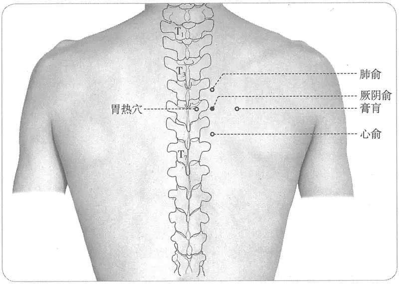

**图2-174　厥阴俞穴与相关穴图**

**取穴**：正坐或俯卧，第4椎下旁开1.5寸陷中取之。

　1. 在第四椎两边各相去一寸五分。（《千金要方》卷二十）

　2. 扁鹊云第四椎下两旁各一寸半，名阙输。（《千金要方》卷十七、《外台秘要》、《医心方》）

　3. 在第四椎下两旁，相去同身寸一寸半。（《太平圣惠方·针经》、《铜人腧穴针灸图经》、《圣济总录》、《医学纲目》、《针灸聚英》、《古今医统》、《针灸大成》、《针方六集》、《循经考穴编》、《针灸易学》）

　4. 在第四椎下两旁各寸半。凡大杼下穴皆当除脊各寸半。（《针灸资生经》卷一）

　5. 在四椎下，去脊中二寸，正坐取之。（《类经图翼》卷七、《医宗金鉴·刺灸心法要诀》）

　6. 第四椎下去脊中二寸去脊边一寸半。（《针灸十四经穴位考订》）

　7. 统编针灸学教材

　　(1) 部位：第四椎下两旁相去脊各一寸五分。取穴：正坐或俯卧，按第四椎下旁开一寸五分取之。（1957年南京《针灸学》）

　　(2) 部位：肺俞穴下。取穴：正坐或俯卧，第四椎下旁开一寸五分陷中取之。（1版《针灸学讲义》）

　　(3) 部位：在第四椎下，两旁各一寸五分。取穴：俯伏，于第四胸椎棘突下，旁开一寸五分取之。（2版《针灸学讲义》）

　　(4) 第四胸椎棘突下，旁开1.5寸。（4、5、7版《针灸学》）

　　(5) 在背部，当第4胸椎棘突下，旁开1.5寸。（6版《针灸学》）

　　(6) 第四胸椎棘突下，督脉旁开1.5寸。（《中国针灸学》）

#### 【类属】 

足太阳膀胱经穴；背俞穴。

〔p.648 (인쇄 628)〕

由于经脉名“厥阴”一词指称前阴的特定含义，因而当手六经比照足六经采用三阴三阳命名时，唯独行于手少阴、手太阴之间的脉无法名曰“手厥阴”，而只得称作“手心主”或“心主”。“心主”原指心，而不是心包络。“心包络”一词出现并与三焦相配是比较晚的事。“手厥阴”一词出现也较晚，后来与心包络相配，但并没有被当时的人们普遍接受。例如，不仅汉代的《黄帝明堂经》无手厥阴的俞募穴，六朝时《产经》所载“手心主脉图”中仍径称“心主者，内属于心”，而且以“巨阙”、“心俞”作为手心主之俞募穴，可见此书仍将“心主”视为心而不是心包络。无独有偶，古宋本《千金要方》卷二十九“手足三阴三阳流注”篇以手厥阴属心，而以手少阴属于心包；直到宋代才将“厥阴俞”归入足太阳经，至明代高武提出“厥阴俞”即为心包之背俞穴，吴崑从其说，将“厥阴俞”改作“心包俞”，以与其他脏腑背俞穴命名法一致。

**归经**：足太阳膀胱经。（《铜人腧穴针灸图经》卷上）

#### 【适应症】 

主治心肺部病症。常用于胸闷，心痛，呕吐，咳嗽。

**备选适应症**：心源性牙痛。

　1. 理逆气，呕逆，牙痛，留结胸闷。（《太平圣惠方·针经》）

　2. 治逆气，呕吐，心痛，留结，胸中烦闷。（《铜人腧穴针灸图经》卷中）

　3. 主两胛痛楚，呕逆气结，胸闷心疼。（《循经考穴编》上）

　4. 统编针灸学教材

　　(1) 主治咳嗽，心痛，胸满，呕吐，烦闷。（1957年南京《针灸学》、1版《针灸学讲义》）

　　(2) 主治咳嗽，心痛，胸闷，呕吐。（2版《针灸学讲义》、4、5版《针灸学》）

　　(3) 主治心痛，心悸，胸闷，咳嗽，呕吐。（6、7版《针灸学》、《中国针灸学》）

**文献分析**：《太平圣惠方》载本穴主治为“理逆气，呕逆，牙痛，留结胸闷”，此后《铜人腧穴针灸图经》将“牙痛”，改作“心痛”。孤立地看，本穴主“牙痛”，与背俞穴主治常规不合，《铜人腧穴针灸图经》改的似乎更合理。然而据现代临床观察发现，有许多心绞痛病人疼痛的部位不是典型的胸前区或胸骨后，而常常表现为牙痛。有人统计在心绞痛误诊病例中，误诊为牙痛者占第二位，因此现代文献开始将“牙痛”列入心绞痛的常见临床症状中。由此可见，《太平圣惠方》原文所述是一组心绞痛的症状，而不是三个孤立的症状。厥阴俞，虽然也能治疗以胸前区疼痛为主诉的心绞痛，但可能对以“牙痛、呕逆、胸闷”为主诉的心绞痛，疗效更突出。

**按**：日本泽田健先生认为：厥阴俞是治上齿痛的名穴，属心包络，因为上齿和心包络有密切的关系（《针灸真髓》第47页）。虽然中国当代医家也曾重复了一千多年前中国古代医家的发现，但泽田的报道更早。受时代的限制，泽田先生当时没能认识到厥阴俞治疗的是心源性牙痛，其作用靶点依然是心，而不是牙齿。

#### 附：临床应用举例 

　1. 胸中膈气聚痛，好吐，灸厥阴输随年壮。（《千金要方》卷二十、《千金翼方》）

　2. 胸膈中气，灸阙俞随年壮。扁鹊云第四椎下两旁各一寸半。（《千金要方》卷十七、《千金翼方》）

#### 【操作】 

斜刺0.5~0.8寸。不宜深刺，宜向脊椎方向成45°~60°角斜刺。

　1. 针入三分。（《太平圣惠方·针经》）

　2. 针入三分，可灸七七壮。（《铜人腧穴针灸图经》卷中）

　3. 窦氏针入一分，沿皮向外一寸半。（《针方六集》卷一）

〔p.649 (인쇄 629)〕

　4. 针三分，灸五壮。（《针灸十四经穴位考订》）

　5. 统编针灸学教材

　　(1) 针三分，灸五至七壮。（1957年南京《针灸学》、1版《针灸学讲义》）

　　(2) 向下斜刺3分；艾炷灸5~7壮，艾条灸5~7分钟。（2版《针灸学讲义》）

　　(3) 斜刺0.5~0.8寸。（4、5、7版《针灸学》）

　　(4) 斜刺0.5~0.8寸；可灸。（6版《针灸学》）

　　(5) 斜刺0.5~0.7寸。可灸。（《中国针灸学》）

### （十五）心俞 Xīnshū BL15 出《灵枢》 

#### 【提要索隐】 

**部位**：在脊柱区，第5胸椎棘突下，后正中线旁开1.5寸。

**适应症**：主治心胸部、神志病症。常用于胸痹心痛；咳嗽，咳血，盗汗；惊悸，癫痫，失眠，健忘；梦遗。胃大部切除术针麻用穴。

**针刺操作**：斜刺0.5~0.8寸。不宜直刺或刺向外侧，以免损伤胸膜和肺。

#### 【名实考】 

宋以前背俞穴的定位分歧，详见本篇“概说”。

　1. 心腧在五焦之间，皆夹脊相去三寸所，则欲得而验之，按其处，应在中而痛解，乃其腧也。（《灵枢·背腧》）

　2. 心俞，在第五椎下两旁各一寸五分。（《黄帝明堂经》）

　3. 心腧乃脊内系心之要所，不可轻针是也，用此穴以灸为是。（《经穴解》）

　4. 别名　背俞、伍焦之间、心之俞。（1957年南京《针灸学》）

**按**：此乃传自日本针灸教材，其中“背俞”出自《素问·举痛论》，不是一个特指的穴名，王冰注作“心俞”；“伍焦之间”是《灵枢·背腧》描述的心俞穴的部位，而不是穴名；“心之俞”，出于《素问·血气形志》，也不是别名。

#### 宋以前文献心俞别说 

1.《扁鹊针灸经》曰第六椎曰心俞。（《医心方》卷二）

2.《华佗针灸经》曰第六椎名心俞（又名督脉俞）。夹脊相去一寸。（《医心方》卷二）

3.《龙衔素针经》曰心输第三椎，横相去三寸。一名身枢。（《医心方》卷二）

　4. 僧匡及彻云心输，第七节，夹脊相去二寸半，瘦人相去二寸二分。（《医心方》卷二）

　5. 欲知背俞，先度其两乳间，中折之；更以他草度去半已，即以两隅相拄也，乃举以度其背。令其一隅居上，齐脊大椎，两隅在下，当其下隅者，肺之俞也；复下一度，心之俞也；复下一度，左角肝之俞也，右角脾之俞也；复下一度，肾之俞也，是谓五藏之俞。灸刺之度也。（《素问·血气形志》）

　6. 心俞穴在第五节（一云第七节），对心横三间寸。（《千金要方》卷八针灸方）

#### “肝俞”主治混入“心俞”例 

　1. 心俞穴在第五节一云第七节，对心横三间寸，主心风，腹胀满，食不消化，吐血，酸痟，四肢羸露，不欲食饮，鼻衄，目眴睆睆不明，鼻头胁下痛，小腹急。（《千金要方》卷八）

　2. 扁鹊曰凡心风灸心俞各五十壮，第五节对心是也。肝俞，主肝风，腹胀，食不消化，吐血，酸削，四肢羸露，不欲食，鼻衄，目睆睆，眉头胁下痛，少腹急，灸百壮。（《千金翼方》卷二十六）

〔p.650 (인쇄 630)〕

**按**：据《千金翼方》文字，可知《千金要方》“主心风”下脱“肝俞主肝风”五字，遂使肝俞主治混入心俞穴下。

#### 相关穴及刺激点 

外心俞：位于背部正中线旁开二寸，第五、六胸椎棘突之间点相平心俞穴旁开五分。主治：风湿性心脏病。针法：针以十五至三十度角斜刺直达横突下缘。针感胀、麻至心前区。（《针灸经外奇穴图谱(续集)》）

#### 【定位】 

**部位**：在脊柱区，第5胸椎棘突下，后正中线旁开1.5寸（图2-175）。

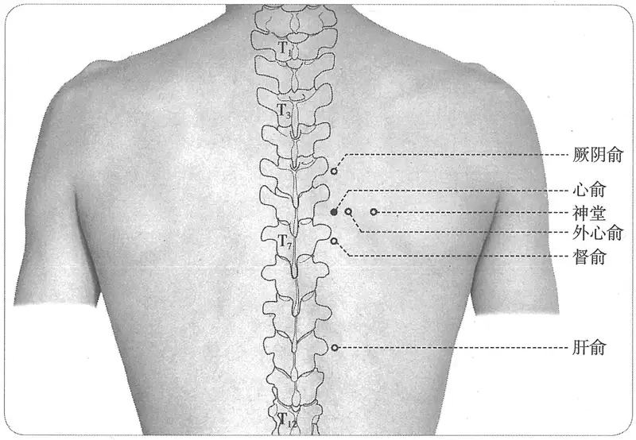

**图2-175　心俞穴与相关穴图**

**取穴**：伏卧或正坐，从第5椎下督脉神道穴外开1.5寸陷中取之。

　1. 在第五椎下两旁各一寸五分。（《黄帝明堂经》、《太平圣惠方》、《铜人腧穴针灸图经》卷上及卷下“穴腧都数”、《圣济总录》、《窦太师针经》、《窦太师秘传》、《针灸集成》、《琼瑶神书》、《十四经发挥》、《医学纲目》、《针灸聚英》、《古今医统》、《针灸大成》、《针方六集》、《循经考穴编》、《针灸易学》）

　2. 在第五椎下两旁各寸半。凡大杼下穴皆当除脊各寸半。（《针灸资生经》卷一）

　3. 在五椎下去脊中二寸，正坐取之。（《类经图翼》卷七、《医宗金鉴·刺灸心法要诀》、《针灸逢源》）

　4. 第五椎下去脊中二寸去脊边一寸半。（《针灸十四经穴位考订》）

　5. 统编针灸学教材

　　(1) 部位：第五椎下，两旁相去脊各一寸五分。取穴：正坐，按取第五胸椎下神道穴外开一寸五分处取之。（1957年南京《针灸学》）

　　(2) 部位：厥阴俞穴下。取穴：伏卧或正坐，从第五椎下督脉神道穴外开一寸五分陷中取之。（1版《针灸学讲义》）

　　(3) 部位：在第五椎下，两旁各一寸五分。取穴：伏卧或正坐，从第五椎下督脉神道穴外开一寸五分陷中取之。（2版《针灸学讲义》）

〔p.651 (인쇄 631)〕

　　(4) 第五胸椎棘突下，旁开1.5寸。（4、5、7版《针灸学》）

　　(5) 在背部，当第5胸椎棘突下，旁开1.5寸。（6版《针灸学》）

　　(6) 第五胸椎棘突下，神道旁开一寸五分。（《中国针灸学》）

**文献分析**：关于本穴定位去脊中距离的分歧，详见本篇“概说”。

#### 【类属】 

足太阳膀胱经穴；背俞穴。

**归经**：足太阳膀胱经。（《外台秘要》卷三十九、《铜人腧穴针灸图经》卷上）

#### 【适应症】 

主治心胸部、神志病症。常用于胸痹心痛，咳嗽，咳血，盗汗；惊悸，癫痫，失眠，健忘；梦遗。胃大部切除术针麻用穴。

　1. 主寒热，心痛循循然，与背相引而痛，胸中悒悒不得息，咳唾血，多涎，烦中善噎，食不下，呕逆，汗不出，如疟状，目睆睆，泪出悲伤。痎疟。心胀。（《黄帝明堂经》）

**按**：《黄帝明堂经》载本穴在心胸方面的主治与心之募穴“巨阙”相似，只是心俞还主目疾，而巨阙还主狂、惊等心神方面的病症和腹部病症。心胀病症见于《灵枢·胀论》“心胀者，烦心短气，卧不安”。

　2. 目痛。（《医心方》卷二）

　3. 理心中风，狂痫，心气乱语，悲泣，心腹烦满，结积寒热，食即吐血，目痛。（《太平圣惠方·针经》）

　4. 治心中风，狂走发痫，语悲泣，心胸闷乱烦满，汗不出，结积寒热，呕吐不下食，咳唾血。（《铜人腧穴针灸图经》卷中）

　5. 窦太师针灸遗存

　　(1) 治虚惊夜梦，失精，盗汗。（《窦太师针经》）

　　(2) 治一切心虚惊怕，宜补；梦遗盗汗，宜补。若中风灸五十壮。（《大本琼瑶神书》）

　　(3) 治夜梦失精，盗汗，喑塞不言。（《针方六集》卷五）

　　(4) 主心虚惊惕，心家一切邪热，唇口破裂，心血不能入肝，在上妄行，在下便血。（《循经考穴编》上）

　6. 一传主疗心虚遗精，盗汗补之。（《类经图翼》卷七）

　7. 偏风半身不遂，心气乱恍惚，汗出唇赤，黄疸，丹毒，白浊，健忘，小儿心气不足，数岁不语。（《针灸聚英》卷一、《古今医统》、《针灸大成》）

**按**：以上主治症系高武从《针灸资生经》转录《千金要方》、《太平圣惠方》灸方主治症。

　8. 此穴主泻五脏之热，与五脏俞同。（《类经图翼》卷七）

**按**：此辑自《素问·水热穴论》。

　9. 统编针灸学教材

　　(1) 主治咳嗽吐血，惊惕，心胸烦乱，恍惚健忘，小儿心气不足数岁不语，癫痫，呕吐，食不下。（1957年南京《针灸学》、1版《针灸学讲义》）

　　(2) 主治癫痫，惊悸，健忘，心烦，咳嗽，吐血，梦遗。（2版《针灸学讲义》、3版《针灸学》）

　　(3) 主治心痛，惊悸，健忘，心烦，咳嗽，吐血，梦遗，盗汗，癫痫。（4、5版《针灸学》、《中国针灸学》）

　　(4) 主治：①心痛、惊悸、失眠、健忘、癫痫等心与神志病变；②咳嗽，吐血；③盗汗，遗精。（7版《针灸学》）

　　(5) 主治癫狂，痫证，惊悸，失眠，健忘，心烦，咳嗽，吐血，梦遗，心痛，胸背痛。（6版《针灸学》）

〔p.652 (인쇄 632)〕

**文献分析**：从《黄帝明堂经》载心之俞、募穴主治特点来看，募穴“巨阙”更偏于治疗心神病症。而从《太平圣惠方》始，心俞主治偏于心神病症，至金元窦太师针灸更突出了这一主治，古代临床应用也偏于此。现代针灸学教材同此，今从之。《黄帝明堂经》描述的本穴所主心痛的特点是“心痛引背，气短”，教材似忽略了这一点。

#### 附：临床应用举例 

　1. 心肺病症

　　(1) 心中风者，但得偃卧，不得倾侧。汗出，若唇正赤尚可治，急灸心俞百壮。（《诸病源候论》卷一）

　　(2) 凡心风寒，灸心俞各五十壮，第五节两边各一寸半是。（《千金要方》卷八）

　　(3) 不能食，胸中满，膈上逆气闷热，灸心俞二七壮。小儿减之。（《千金要方》卷十三）

　　(4) 小儿五六岁不语者，心气不足，舌本无力，发转难，灸心俞穴三壮，炷如小麦大。（《太平圣惠方·明堂》）

　　(5) 寒气伤积于心，痛不可忍，或伤生冷即发：灸心俞、刺中脘、足三里泻之；未愈，灸内关。（《针灸集要·盘石金直刺秘传》）

　　(6) 咳嗽，灸心俞穴。《甲乙经》云：在背第五椎下两边各一寸半，各灸五壮。炷如半枣核大。（《圣济总录》卷一百九十三）

　　(7) 小儿心脏中风时，躯卧唇红汗透衣。但灸心俞三五壮，唇青黄白黑难医。（《幼幼新书》卷十三）

　　(8) 妇人心痛心俞穴，男子痃癖三里高。（《席弘赋》）

　　(9) 心律失常：心俞穴、厥阴俞穴，针刺治疗。［日良自律志，1988，33(10)：263-270］

　2. 心神病症

　　(1) 心里懊憹，彻背痛，烦逆，灸心俞百壮。（《千金要方》卷十三）

　　(2) 心烦短气，灸小肠俞。又灸巨阙、期门各一百壮，针入五分。又灸心俞百壮，针入五分。（《千金翼方》卷二十七）

　　(3) 忧噎，灸心俞。（《太平圣惠方·明堂》）

　　(4) 健忘：列缺、心俞、神门。问曰：其证缘何而得？答曰：忧愁思虑，内连于心，外感其情，或痰涎灌注心窍，七情所感，故如此也。复刺后穴：中脘、三里。（《针灸集成》第六十方）

　　(5) 胆寒先是怕心惊，白浊遗精苦莫禁，夜梦鬼交心腧泻，白环腧穴一般针。（《针灸玉龙歌》）

　　(6) 戊辰岁，户部王缙庵公乃弟，患心痫疾数载矣。徐堂翁召予视之，须行八法开阖方可，公如其言。而刺照海、列缺，灸心俞等穴，其针待气至，乃行生成之数而愈。凡治此症，须分五痫，此卷前载之详矣，兹不悉录。（《针灸大成》）

　　(7) 嗜睡：心俞、脾俞针灸治疗。［陕西中医，1986，7(10)：460-461］

　　(8) 精神分裂症偏执型　肺俞穴、肝俞穴、心俞穴、胃俞穴、脾俞穴，针刺疗法。［北京中医，1988(6)：28-30］

　3. 其他病症

　　(1) 风邪，灸间使随年壮；又灸承浆七壮；又灸心俞七壮，及灸三里七壮。（《千金要方》卷十四）

〔p.653 (인쇄 633)〕

　　(2) 吐逆呕不得食，灸心俞百壮。（《千金要方》卷十六）

　　(3) 男子遗精白浊“心俞、肾俞、三阴、关元、膏肓。问曰：此证缘何而得？答曰：因房室失宜，惊动于心，内不纳精，外伤于肾；忧思过虑，七情所感，心肾不能交际，人渐尫羸，血气耗散，故如此也。（《针灸集成》第五十八方）

#### 【操作】 

斜刺0.5~0.8寸；不宜直刺或刺向外侧，以免损伤胸膜和肺。

　1. 灸之则可，刺之则不可。（《灵枢·背腧》）

　2. 针入三分，留七呼，灸三壮。（《黄帝明堂经》）

　3. 灸五壮。（《太平圣惠方·明堂》）

　4. 刺可同身寸之一分半，留七呼，得气至，次进针三分，以手弹之，令气至而下针，得动气至，而徐徐出针，次以手扪其穴。（《素问亡篇·刺法论》）

　5. 针入三分，留七呼，得气即泻，不可灸。（《铜人腧穴针灸图经》卷中）

　6. 窦太师针灸遗存

　　(1) 针一分，沿皮向外寸半，灸三七壮。（《窦太师秘传》）

　　(2) 针入一分，沿皮向外一寸半，灸七壮。（《窦太师针经》）

　7. 禁用针灸。（《医学入门》卷一）

　8. 统编针灸学教材

　　(1) 针三分，灸三至七壮。（1957年南京《针灸学》、1版《针灸学讲义》）

　　(2) 向下斜刺3分；艾炷灸5~15壮，艾条灸5~15分钟。（2版《针灸学讲义》）

　　(3) 斜刺0.5~0.8寸。（4、5、7版《针灸学》）

　　(4) 斜刺0.5~0.8寸；可灸。（6版《针灸学》）

　　(5) 斜刺0.5~0.7寸。可灸。（《中国针灸学》）

### （十六）督俞 Dūshū BL16 出《太平圣惠方》 

#### 【提要索隐】 

**穴名**：一名高盖。

**部位**：在脊柱区，第6胸椎棘突下，后正中线旁开1.5寸。

**适应症**：主治心、腹部病症。常用于心痛；腹痛，腹胀，肠鸣，气逆。

**针刺操作**：斜刺0.5~0.8寸；不宜深刺，宜向脊椎方向成45°~60°角斜刺。

#### 【名实考】 

宋以前背俞穴的定位分歧，详见本篇“概说”。

　1. 督俞二穴，在第六椎下两旁，相去同身寸一寸半是穴。一名高盖。（《太平圣惠方·针经》）

　2. 太阳之在人身也，为一身之巨阳，凡一身脏腑督任，无所不统。在督则有督腧，在任则有关元、气海腧。心腧之下即为督腧者，以督之内通于心也。（《经穴解》）

#### 宋以前文献督俞别说 

1.《扁鹊针灸针》曰第五椎名督脉输。夹脊左右各一寸半或一寸二分。（《医心方》卷二）

2.《华佗针灸经》曰第六椎名心俞，又名督脉俞。夹脊相去一寸。（《医心方》卷二）

　3. 僧匡及彻云督脉输，第二十二节，夹脊相去二寸半，瘦人相去二寸二分。（《医心方》卷二）

#### 【定位】 

**部位**：在脊柱区，第6胸椎棘突下，后正中线旁开1.5寸（图2-176）。

〔p.654 (인쇄 634)〕

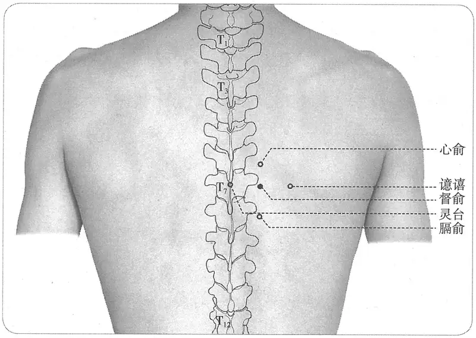

**图2-176　督俞穴图**

**取穴**：俯卧或正坐，从第6椎下督脉灵台穴旁开1.5寸陷中取之。

　1. 在第六椎下两旁，相去同身寸一寸半是穴。（《太平圣惠方·针经》、《针灸资生经》、《医学入门》、《针灸大成》、《循经考穴编》、《针灸易学》）

　2. 在第六椎下两旁各寸半。凡大杼下穴皆当除脊各寸半。（《针灸资生经》卷一）

　3. 除脊量开寸五分……督俞膈俞相等级，第六第七次第立。（《针灸问对》）

　4. 在第六椎下，两旁相去各二寸。（《类经图翼》卷十、《医宗金鉴·刺灸心法要诀》、《针灸逢源》）

　5. 第六椎下去脊中二寸去脊边一寸半。（《针灸十四经穴位考订》）

　6. 统编针灸学教材

　　(1) 部位：在第六椎下，两旁相去脊一寸五分。取穴：正坐或俯卧，从第六椎下灵台穴旁开一寸五分取之。（1957年南京《针灸学》）

　　(2) 部位：心俞穴下。取穴：俯卧或正坐，从第六椎下督脉灵台穴旁开一寸五分陷中取之。（1版《针灸学讲义》）

　　(3) 部位：在第六椎下，两旁相去脊一寸五分。取穴：俯伏，于第六胸椎棘突下，灵台督脉旁一寸五分取之。（2版《针灸学讲义》）

　　(4) 第六胸椎棘突下，旁开1.5寸。（4、5、7版《针灸学》）

　　(5) 在背部，当第6胸椎棘突下，旁开1.5寸。（6版《针灸学》）

　　(6) 第六胸椎棘突下，灵台旁开一寸五分。（《中国针灸学》）

**文献分析**：关于本穴定位去脊中距离的分歧，详见本篇“概说”。

#### 【类属】 

足太阳膀胱经穴。

**归经**：足太阳膀胱经。（明嘉靖针灸铜人、《针灸问对》）

#### 【适应症】 

主治心、腹部病症。常用于心痛；腹痛，腹胀，肠鸣，气逆。

　1. 主理寒热，腹中痛，雷鸣，气逆心痛。（《太平圣惠方·针经》）

〔p.655 (인쇄 635)〕

　2. 统编针灸学教材

　　(1) 主治心痛，腹痛，肠鸣气逆。（1957年南京《针灸学》、1版《针灸学讲义》）

　　(2) 主治寒热心痛，腹痛肠鸣，胸膈气逆。（2版《针灸学讲义》、4版《针灸学》）

　　(3) 主治心痛胸闷，腹痛，寒热，气喘。（5版《针灸学》）

　　(4) 主治心痛，腹痛，腹胀，肠鸣，呃逆。（6版《针灸学》）

　　(5) 主治：①心痛，胸闷；②寒热，气喘；③腹胀，腹痛，肠鸣，呃逆等胃肠病证。（7版《针灸学》）

　　(6) 主治心痛，胃痛。（《中国针灸学》）

**按**：古今腧穴文献所载本穴主治均一致，皆出于《太平圣惠方》，以治疗心痛和胃肠病症为主。

#### 【操作】 

斜刺0.5~0.8寸。不宜深刺，宜向脊椎方向成45°~60°角斜刺。

　1. 禁针，通灸。（《太平圣惠方·针经》）

　2. 针三分，灸三壮。（《针灸十四经穴位考订》）

　3. 统编针灸学教材

　　(1) 针三分，灸三至五壮。（1957年南京《针灸学》、1版《针灸学讲义》）

　　(2) 向下斜刺3分，艾条灸3~5分钟。（2版《针灸学讲义》）

　　(3) 斜刺0.5~0.8寸。（4、5、7版《针灸学》）

　　(4) 斜刺0.5~0.8寸；可灸。（6版《针灸学》）

　　(5) 斜刺0.5~0.7寸。可灸。（《中国针灸学》）

### （十七）膈俞 Géshū BL17 出《灵枢》 

#### 【提要索隐】 

**部位**：在脊柱区，第7胸椎棘突下，后正中线旁开1.5寸。

**适应症**：主治胸膈病症。常用于呕吐，呃逆，气喘；吐血。

**备选适应症**：心痛，胃脘痛。

**针刺操作**：斜刺0.5~0.8寸。不宜深刺，宜向脊椎方向成45°~60°角斜刺。

#### 【名实考】 

《灵枢·背腧》载“五藏之腧出于背者”有膈俞一穴，说明在某种早期藏象学说中，膈是其中一藏。宋以前有关背俞穴定位分歧，详见本经“概说”。

“膈俞”与“膈关”字形相近，针灸古籍中有相混之例。

　1. 膈腧在七焦之间，皆夹脊相去三寸所，则欲得而验之，按其处，应在中而痛解，乃其腧也。（《灵枢·背腧》）

　2. 膈俞，在第七椎下两旁各一寸五分。（《黄帝明堂经》）

3.《难经》曰：血会鬲俞。疏曰：血病治此。盖上则心俞，心主血；下则肝俞，肝藏血，故鬲俞为血会。又足太阳多血，血乃水之象也。（《针灸聚英》卷一）

　4. 膈之为形，前齐鸠尾，后齐十一椎，所以遮隔中、下二焦之浊气，使不得上熏心肺者也。（《经穴解》）

#### 宋以前文献膈俞别说 

僧匡及彻云膈输，第八节，夹脊相去二寸半，瘦人相去二寸二分。（《医心方》卷二）

#### “膈关”误作“膈俞”例 

背痛、恶寒、脊强、俯仰难，食不下，呕吐多涎，膈俞主之。（《针灸甲乙经》卷七）

〔p.656 (인쇄 636)〕

**按**：据《外台秘要》、《医学纲目》卷二十二引《针灸甲乙经》之文，上文“膈俞主之”系“膈关主之”之形误。

#### 【定位】 

**部位**：在脊柱区，第7胸椎棘突下，后正中线旁开1.5寸（图2-177）。

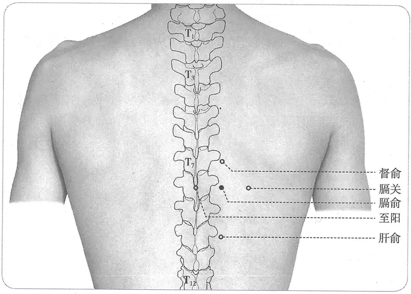

**图2-177　膈俞穴图**

**取穴**：俯卧或正坐，从第7椎下督脉至阳穴旁开1.5寸陷中取之。

　1. 膈腧在七焦之间……背夹脊相去三寸所。则欲得而验之，按其处，应在中而痛解，乃其腧也。（《灵枢·背腧》）

　2. 在第七椎下两旁各一寸五分。（《黄帝明堂经》、《太平圣惠方》、《铜人腧穴针灸图经》、《圣济总录》、《窦太师针经》）

　3. 在七椎下两旁各寸半。凡大杼下穴皆当除脊各寸半。（《针灸资生经》卷一）

　4. 在第七椎下相去脊中各一寸五分。（《十四经发挥》中、《医学纲目》、《针灸聚英》、《古今医统》、《针灸大成》、《循经考穴编》、《针灸易学》）

　5. 在七椎下两旁各二寸。（《神应经》、《类经图翼》、《医宗金鉴·刺灸心法要诀》、《针灸逢源》）

　6. 第七椎下去脊中二寸去脊边一寸半。（《针灸十四经穴位考订》）

　7. 统编针灸学教材

　　(1) 部位：在第七椎下两旁去脊一寸五分。取穴：正坐或俯卧，按第七椎下至阳穴旁开一寸五分取之。（1957年南京《针灸学》）

　　(2) 部位：督俞穴下。取穴：俯卧或正坐，从第七椎下督脉至阳穴旁开一寸五分陷中取之。（1版《针灸学讲义》）

　　(3) 部位：在第七椎下，两旁各一寸五分。取穴：俯伏，于第七胸椎棘突下，至阳督脉旁一寸五分取之。（2版《针灸学讲义》）

　　(4) 第七胸椎棘突下，旁开1.5寸。（4、5、6、7版《针灸学》）

　　(5) 第七胸椎棘突下，至阳旁开一寸五分。（《中国针灸学》）

〔p.657 (인쇄 637)〕

**文献分析**：关于本穴定位去脊中距离的分歧，详见本经“概说”。

#### 【类属】 

足太阳膀胱经穴；背俞穴；八会穴之一。

血会膈俞。（《难经·四十五难》）

**归经**：足太阳膀胱经。（《外台秘要》卷三十九、《铜人腧穴针灸图经》卷上）

#### 【适应症】 

主治胸膈病症。常用于呕吐，呃逆，气喘；吐血。

**备选适应症**：心痛，胃脘痛。

　1. 主悽悽振寒，数欠伸。咳而呕，膈寒，食饮不下，寒热，皮肉骨痛，少气不得卧，胸满支两胁，膈上竞竞，胁痛腹䐜，胃脘暴痛，上气，肩背寒痛，汗不出，喉痹，腹中痛，积聚，嘿嘿嗜卧，怠惰不欲动，身常湿湿，心痛无可摇者。周痹，身背痛。大风汗出。痓。癫狂。无可大汗出。（《黄帝明堂经》）

**按**：以上病症突出了“膈”的病症“咳而呕，鬲寒，食饮不下”、“胸满支两胁，鬲上竞竞，胁痛腹䐜，胃脘暴痛，上气”，这一点与“膈关”主治相似。此外，“嘿嘿嗜卧，怠惰不欲动，身常湿湿”与天井穴主治症“嗜卧怠惰不欲动，身常湿湿”相同，盖出于同一首针灸方主治。

　2. 理心痛痰饮，吐逆，汗出，寒热骨痛，虚胀支满，痰疟，痃癖气块，膈上痛，切痛。（《太平圣惠方·针经》）

　3. 治咳而呕逆，膈胃寒痰，食饮不下，胸满支肿，两胁痛，腹胀，胃脘暴痛，热病汗不出，喉痹，腹中积癖，默默嗜卧，四肢怠堕不欲动，身常湿，不能食，食则心痛，周痹，身皆痛。（《铜人腧穴针灸图经》卷中）

　4. 翻胃，骨蒸，自汗，盗汗。（《针灸聚英》卷一、《针灸大成》）

**按**：“翻胃”此系高武从《针灸资生经·反胃》卷三转引《千金方》“吐呕逆不得下食，今日食、明日吐，灸膈俞百壮”；“骨蒸，自汗，盗汗”，此乃高武辑自《针灸资生经》“崔氏四花穴”灸治十二骨蒸，高武认为“四花穴”相当于“膈俞”、“胆俞”二穴，故将此方主治症归于此二穴。实则崔氏“四花”与此二穴并不相合，其取穴法当以《外台秘要》、《圣济总录》等医书载文为准。

　5. 窦太师针灸遗存

　　(1) 治血妄行，鼻衄，便血，吐血，泻多补少。（《窦太师针经》）

　　(2) 治血病。（《大本琼瑶神书》）

　　(3) 主诸血证妄行，及产后败血冲心。（《循经考穴编》上）

　6. 统编针灸学教材

　　(1) 主治腹胁痛，噎膈翻胃，饮食不下，咳逆吐血，骨蒸，自汗，盗汗，嗜卧怠惰，诸血妄行，热病汗不出。（1957年南京《针灸学》）

　　(2) 主治诸血妄行，胸胁痛，噎膈反胃，饮食不下，咳逆骨蒸，自汗，盗汗，嗜卧怠惰，热汗不出。（1版《针灸学讲义》）

　　(3) 主治呕吐，噎膈，饮食不下，气喘，咳嗽，吐血，潮热，盗汗。（2版《针灸学讲义》、4版《针灸学》）

　　(4) 主治呕吐，呃逆，气喘，咳嗽，吐血，潮热，盗汗。（5版《针灸学》）

　　(5) 主治胃脘痛，呕吐，呃逆，饮食不下，咳嗽，吐血，潮热，盗汗。（6版《针灸学》）

　　(6) 主治呕吐，呃逆，气喘，吐血，贫血，瘾疹，皮肤瘙痒，潮热，盗汗。（7版《针灸学》）

　　(7) 主治呕吐，呃逆，噎膈，饮食不下，气喘，咳嗽，吐血，潮热，盗汗，风疹。（《中国针灸学》）

**文献分析**：《黄帝明堂经》载本穴主治重在“气膈”之呕吐、上气等症以及心痛，胃脘暴痛。古代临床应用也偏于此。“呕吐不下食”古名“气膈”或“上膈”，《灵枢》有专篇论述。或受“血会膈俞”说的影响，金元窦太师针灸载本穴主治重在治疗血证。现代临床另有治疗“风疹”的应用报道。本穴主治，古代文献记载较多的还有“心痛”、“心痛如锥刀刺”、“胃脘暴痛”等心腹痛症状，除6版教材外，其他各版似未留意，今附存备考。另各版教材之潮热、盗汗、骨蒸症状乃承《针灸聚英》之误，今去之。

〔p.658 (인쇄 638)〕

#### 附：临床应用举例 

　1. 血分病症

　　(1) 关脉芤，大便去血数斗者，以膈输伤故也……灸膈输。（《脉经》卷二）

　　(2) 五积气块，血积血癖：膈俞二穴、肝俞二穴、大敦二穴、照海二穴。（《针灸大全》卷四）

　　(3) 吐血昏晕，不省人事：肝俞二穴、膈俞二穴、通里二穴、大敦二穴。（《针灸大全》卷四）

　2. 胸膈病症

　　(1) 心痛如锥刀刺，气结，灸膈俞七壮。（《千金要方》卷十三）

　　(2) 胪胀胁腹满，灸膈俞百壮，三报。（《千金要方》卷十六）

　　(3) 吐呕逆不得下食，今日食明日吐者，灸膈俞百壮。（《千金要方》卷十六）

　　(4) 劳噎，灸膈俞，在第七椎下两旁各一寸半。（《太平圣惠方·明堂》）

　3. 其他病症

　　(1) 小儿龟背，生时被客风拍著脊骨，风达于髓所致也，灸肺俞、心俞、膈俞，各三壮，炷如小麦大。（《太平圣惠方·明堂》）

　　(2) 胃脘痛：膈俞、脾俞、胃俞、内关。（《针灸集要·盘石金直刺秘传》）

　　(3) 慢性荨麻疹：针刺膈俞穴治疗。［新中医，1996(6)：36-37］

#### 【操作】 

斜刺0.5~0.8寸。不宜深刺，宜向脊椎方向成45°~60°角斜刺。

　1. 灸之则可，刺之则不可。（《灵枢·背腧》）

　2. 针入三分，留七呼，灸三壮。（《黄帝明堂经》）

　3. 针入三分，得气即泻。（《太平圣惠方·针经》）

　4. 灸五壮。（《太平圣惠方·明堂》）

　5. 针入一分，沿皮向外一寸半，灸七壮。（《窦太师针经》）

　6. 禁针。（《医宗金鉴·刺灸心法要诀》）

**按**：此所以“禁针”者，盖误解《素问·诊要经终论》“凡刺胸腹者，必避五藏……中膈者皆为伤中，其病虽愈，不过一岁必死”之义。

　7. 统编针灸学教材

　　(1) 针五分，灸五至七壮。（1957年南京《针灸学》、1版《针灸学讲义》）

　　(2) 向下斜刺5分；艾炷灸5~15壮，艾条灸5~15分钟。（2版《针灸学讲义》）

　　(3) 斜刺0.5~0.8寸。（4、5、7版《针灸学》）

　　(4) 斜刺0.5~0.8寸；可灸。（6版《针灸学》）

　　(5) 斜刺0.5~0.7寸。可灸。（《中国针灸学》）

