# 《针灸腧穴通考》(上册) — 足太阳膀胱经穴 (2/3) · （十八）肝俞 Gānshū BL18 出《灵枢》~（四十二）魄户 Pòhù BL42 出《黄帝明堂经》

> 분할본 13/25. 원서: 黄龙祥·黄幼民 编著, 《针灸腧穴通考——〈中华针灸穴典〉研究》(上册), 人民卫生出版社, 2011. 원서 스캔 OCR 판독본을 챗봇 검색용으로 나눈 것이며, 본문과 쪽 표시 〔p.PDF쪽 (인쇄 쪽)〕는 원본 그대로이다.

## 七、足太阳膀胱经穴 (계속)

### （十八）肝俞 Gānshū BL18 出《灵枢》 

#### 【提要索隐】 

**部位**：在脊柱区，第9胸椎棘突下，后正中线旁开1.5寸。

〔p.659 (인쇄 639)〕

**适应症**：主治目疾、胁下病症。常用于胁痛，黄疸；目赤，视物不清，夜盲，流泪；癫、狂、痫；吐血。

**备选适应症**：鼻衄。

**针刺操作**：斜刺0.5~0.8寸。不宜深刺，宜向脊椎方向成30°~45°角斜刺。

#### 【名实考】 

关于本穴定位，宋以前文献有很大的差异，它透露出这样的信息：在某种早期藏象学说中，肝藏占有特殊的地位。宋以前有关背俞穴定位分歧，详见本经“概说”。

　1. 肝腧在九焦之间，皆夹脊相去三寸所，则欲得而验之，按其处，应在中而痛解，乃其腧也。（《灵枢·背腧》）

　2. 肝俞，在第九椎下两旁各一寸五分。（《黄帝明堂经》）

#### 宋以前文献肝俞穴别说 

　1. 欲知背俞，先度其两乳间，中折之；更以他草度去半已，即以两隅相拄也，乃举以度其背。令其一隅居上，齐脊大椎，两隅在下，当其下隅者，肺之俞也；复下一度，心之俞也；复下一度，左角肝之俞也，右角脾之俞也；复下一度，肾之俞也，是谓五藏之俞。灸刺之度也。（《素问·血气形志》）

2.《华佗针灸经》曰第八椎名肝俞又云胃俞。夹脊相去一寸。（《医心方》卷二）

3.《龙衔素针经》曰肝输，第七椎相去三寸。（《医心方》卷二）

　4. 第八卷云第九椎节脊中。（《千金要方》卷二十九）

5.《黄帝九卷》曰若取人节解者，可从大椎骨头直下至尻尾骨端度取，分为二十二分，还约背，当分分上，即其穴也。但肝一输，当上灸之，余穴无不侠两边各一寸三分也。（《医心方》卷二）

**按**：此处所引之《黄帝九卷》文字不见于传世本《灵枢》。

6.《扁鹊针灸经》曰肝俞一椎灸其节中央。（《医心方》卷二）

7.《金腾灸经》曰脏腑十二输经法：从大椎直穷骨中折度，去其半，乃取余半四折之，皆令平等，点所折处，同伸所点度，上从大椎下至中脊，第一点名为膈输，第二点名为肺输，第三点名为心输，下头正中央名为肝输。凡脏腑输皆侠脊相去二寸半，唯肝输正脊中央也。（《医心方》卷二）

**按**：以上四篇文献皆强调脏腑俞穴均在脊两旁，唯肝俞在脊中央，这是早期藏象学说的遗迹，值得重视。所以说，宋以前文献中背俞穴之所以有如此大的差异，实质上是不同藏象学说的具体反映。

#### 相关穴及刺激点 

健明5　在第九胸椎棘突旁开1.5寸，相当于肝俞上5分。主治视神经萎缩，白内障，视网膜炎，圆锥角膜等。直刺5~8分。（《针灸经外奇穴图谱(续集)》）

#### 【定位】 

**部位**：在脊柱区，第9胸椎棘突下，后正中线旁开1.5寸（图2-178）。

**取穴**：俯卧或正坐，从第9椎下督脉筋缩穴旁开1.5寸陷中取之。

　1. 肝腧在九焦之间……夹脊相去三寸所。欲得而验之，按其处应在中而痛解，乃其腧也。（《灵枢·背腧》）

　2. 在第九椎下两旁各一寸五分。（《黄帝明堂经》、《太平圣惠方》、《铜人腧穴针灸图经》卷上、《圣济总录》、《针灸玉龙经》、《窦太师针经》、《针方六集》）

　3. 在第九椎下两旁各寸半。凡大杼下穴皆当除脊各寸半。（《针灸资生经》卷一）

　4. 在第九椎下，相去脊中各一寸五分。（《十四经发挥》中、《医学纲目》、《针灸聚英》、《古

〔p.660 (인쇄 640)〕

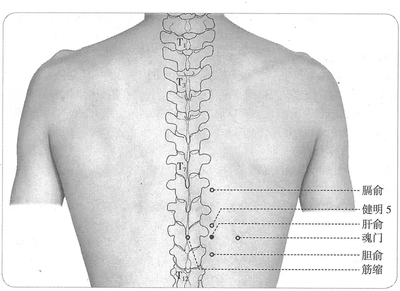

**图2-178　肝俞穴与相关穴图**

今医统》、《针灸大成》、《循经考穴编》、《针灸易学》）

　5. 在第九椎下两旁各二寸。（《神应经》、《类经图翼》、《针灸逢源》）

　6. 第九椎下去脊中二寸去脊边一寸半。（《针灸十四经穴位考订》）

　7. 统编针灸学教材

　　(1) 部位：第九椎下两旁相去脊各一寸五分。取穴：正坐或俯卧，按第九椎下筋缩穴旁开一寸五分处取之。（1957年南京《针灸学》）

　　(2) 部位：膈俞穴下。取穴：俯卧或正坐，从第九椎下督脉筋缩穴旁开一寸五分陷中取之。（1版《针灸学讲义》）

　　(3) 部位：在第九椎下，两旁各一寸五分。取穴：俯卧，于第九胸椎棘突下，筋缩督脉旁一寸五分取之。（2版《针灸学讲义》）

　　(4) 第九胸椎棘突下，旁开1.5寸。（4、5、6、7版《针灸学》）

　　(5) 第九胸椎棘突下，筋缩旁开一寸五分。（《中国针灸学》）

**文献分析**：关于本穴定位去脊中距离的分歧，详见本经“概说”。

#### 【类属】 

足太阳膀胱经穴；背俞穴。

**归经**：足太阳膀胱经。（《外台秘要》卷三十九、《铜人腧穴针灸图经》卷上）

#### 【适应症】 

主治目疾、胁下病症。常用于胁痛，黄疸；目赤，视物不清，夜盲，流泪；癫，狂，痫；吐血。

**备选适应症**：鼻衄。

　1. 主咳而胁满急，不得息，不得反侧，腋胁下与脐相引，筋急而痛反折，目上视，眩，目中循循然，眉头痛，惊狂，衄，少腹满，目睆睆生白翳，咳引胸痛，筋寒热，唾血，短气，鼻酸。痓，筋痛急互引。肝胀。癫狂。（《黄帝明堂经》）

**按**：以上病症多为目、筋、惊、狂等肝病以及胁下、少腹等肝及肝经部位病症。

　2. 主热病瘥后食五辛，多患眼暗如雀目。（《千金要方》卷三十、《千金翼方》）

〔p.661 (인쇄 641)〕

　3. 主腹内两胁下胀满，食不消，喉痹，目眩。（《新雕孙真人千金方》卷十一）

　4. 主肝风腹胀，食不消化，吐血，酸痟，四肢羸露，不欲食。（《千金翼方》卷二十六）

　5. 理口干，中风支满，短气不食，闭塞，腰痛肩疼，寒疝。（《太平圣惠方·针经》）

　6. 治咳引两胁急痛不得息，转侧难，撅肋下与脊相引而反折，目上视，目眩循，眉头痛，惊狂，鼽衄，起则目睆睆，目生白翳，咳引胸中痛，寒疝少腹痛，唾血短气。（《铜人腧穴针灸图经》卷中）

**按**：“目眩循”，此后王惟一抄录时脱“循然”二字，而使文义不全。应据《外台秘要》卷三十九补。

　7. 窦太师针灸遗存

　　(1) 治目失明，补；红肿疼，泻。怒气触心，七情所感，中风不省人事，看症补泻。（《窦太师针经》）

　　(2) 治目失明，肝血少，宜补。（《大本琼瑶神书》）

　　(3) 主肝家一切目疾，或青盲昏翳，或红肿努肉。（《循经考穴编》上）

　　(4) 治眼目痛，血风冷眼泪，两胁急痛，目眩，衄血。（《窦太师秘传》）

　　(5) 肝家血少目昏花，宜补肝俞力便加，更把三里频泻动，还光益血自无差。（《针灸玉龙歌》）

　8. 黄疸，肝中风，踞坐不得低头，绕两目连额上，色微青，积聚痞痛。（《针灸聚英》卷一、《针灸大成》）

**按**：此乃高武从《针灸资生经》转录《千金要方》针灸方主治，其中“黄疸”一症出自《千金要方》卷十“针灸黄疸法”，其下罗列数十个腧穴（包括所有的五脏俞穴）的火针治疗。并非肝俞特有的主治。

　9. 此穴主泻五脏之热，与五脏俞治同。（《类经图翼》卷七）

**按**：此出自《素问·水热穴论》。

　10. 一传治气痛，项疬，吐酸。（《类经图翼》卷七）

　11. 统编针灸学教材

　　(1) 主治黄疸，积聚痞痛，吐血，鼻鼽衄，目昏眩，红肿生翳，胬肉攀睛，咳引胸胁急痛，脊背痛，惊狂。（1957年南京《针灸学》）

　　(2) 主治黄疸，积聚痞痛，吐血，鼻鼽衄，目昏眩红肿，目翳，咳引胸胁急痛，脊背痛，惊狂。（1版《针灸学讲义》）

　　(3) 主治黄疸，胁痛，吐血，鼻衄，目赤，目眩，夜盲，脊背痛，癫狂，痫证。（2版《针灸学讲义》、4、5版《针灸学》）

　　(4) 主治黄疸，胁痛，吐血，目赤，目视不明，眩晕，夜盲，癫狂，痫证，背痛。（6版《针灸学》）

　　(5) 主治：①胁痛，黄疸等肝胆病症；②目赤，目视不明，夜盲，迎风流泪等目疾；③癫狂痫；④脊背痛。（7版《针灸学》）

　　(6) 主治黄疸，胁痛，目赤，目眩，雀目，癫狂，痫证，脊背痛，吐血，鼻衄。（《中国针灸学》）

**文献分析**：《黄帝明堂经》载本穴主治包括目、筋等肝所主器官病症；痓、酸、怒、惊等肝病典型症状以及胁下、少腹等肝及肝经部位的病症。自金元窦太师针灸更偏重目疾的治疗。现代针灸学教材也突出了这一主治特点。教材多载有“脊背痛”一症，而肝病的部位在“胁下”，肝经的病位在“少腹”，“脊背”病症为背部俞穴共有的主治作用，故不作为本穴的基础主治。

〔p.662 (인쇄 642)〕

#### 附：临床应用举例 

　1. 肝胆病症

　　(1) 肝中风者，其人但踞坐不得低头，绕两目连额，色微有青。若唇色青面黄尚可治，急灸肝俞百壮。（《诸病源候论》卷一）

　　(2) 自有肝中有风热，令人眼昏暗者，当灸肝俞，及服除风汤丸散数十剂，当愈。（《千金要方》卷六）

　　(3) 肝积名肥气，在左肋下，肝俞、章门、行间。（《针灸集要·盘石金直刺秘传》）

　　(4) 肝疟令人气色苍苍，恶寒发热，中封二穴、肝俞二穴、绝骨二穴。（《针灸大全》卷四）

　　(5) 肝虚者，肝俞。以毫针刺三分，得气留补。（《类经图翼》卷十一）

　　(6) 慢性胆囊炎　胆俞、肝俞针刺治疗。［中医杂志，1985，26(3)：28］

　2. 眼部病症

　　(1) 肝虚目不明，灸肝俞二百壮。小儿斟酌可灸一二七壮。（《千金要方》卷十一）

　　(2) 治温病后食五辛即不见物逐成雀目，灸第九椎名肝俞二百壮，永瘥。（《千金翼方》卷二十七）

　　(3) 眼痒眼痛，泻光明与地五。刺肝俞与命门，使瞽士视秋毫之末。（《标幽赋》）

　　(4) 两眼昏花，头晕，羞明，迎风冷眼　泻临泣，灸肝俞穴二七壮，泻合谷、委中出血。（《针灸集要·盘石金直刺秘传》）

　3. 惊、狂

　　(1) 小儿中风者……其状昏不知人，壮热狂躁，搐掣气粗，口噤涎潮是也。若绕两目，连额微青，唇青面黄者，可治，灸肝俞；或大段青黑，其目一黄一白者，不治。（《仁斋小儿方论》卷二）

　　(2) 精神分裂症偏执型：心俞穴、胃俞穴、肺俞穴、肝俞穴，针刺疗法。［北京中医，1988(6)：28-30］

　4. 头痛头晕

　　(1) 痰厥头晕及头目昏沉：大敦二穴、肝俞二穴、百会一穴。（《针灸大全》卷四）

　　(2) 头痛眩冒，如结胸，心下痞硬，或谵语，刺肺俞、肝俞。如头项强，刺大椎。（《伤寒治例》）

　　(3) 原发性闭经合并厥阴头痛：百会穴、肝俞、太冲针刺治疗。［上海针灸杂志，1987，6(1)：46］

　5. 其他病症

　　(1) 少阳并病，心下硬，颈项强而眩者，宜刺大椎、肺俞、肝俞，慎勿下之。（《伤寒论》卷四）

　　(2) 胸满，心腹积聚，痞痛，灸肝俞百壮，三报。（《千金要方》卷十六）

　　(3) 咳嗽寒痰，胸膈闭痛：肝俞二穴、膻中一穴、三里二穴。（《针灸大全》卷四）

#### 【操作】 

斜刺0.5~0.8寸。不宜深刺，宜向脊椎方向成30°~45°角斜刺。

　1. 针入三分，留六呼，灸三壮。（《黄帝明堂经》）

　2. 刺入同身寸之三分，留三呼，次进二分，留三呼，复收针至三分，留一呼，徐徐出。（《素问亡篇·刺法论》）

　3. 灸七壮。（《太平圣惠方·明堂》）

　4. 窦太师针灸遗存

〔p.663 (인쇄 643)〕

　　(1) 针入一分，沿皮向外一寸半，灸二七壮。（《窦太师针经》）

　　(2) 针一分，沿皮向外寸半，灸三七壮。（《窦太师秘传》）

　5. 灸七壮，禁针。（《医宗金鉴·刺灸心法要诀》）

　6. 统编针灸学教材

　　(1) 五分，灸三至七壮。（1957年南京《针灸学》、1版《针灸学讲义》）

　　(2) 向下斜刺5分；艾炷灸5~15壮，艾条灸5~15分钟。（2版《针灸学讲义》）

　　(3) 斜刺0.5~0.8寸。（4、5、7版《针灸学》）

　　(4) 斜刺0.5~0.8寸；可灸。（6版《针灸学》）

　　(5) 斜刺0.5~0.7寸。可灸。（《中国针灸学》）

### （十九）胆俞 Dǎnshū BL19 出《黄帝明堂经》 

#### 【提要索隐】 

**部位**：在脊柱区，第10胸椎棘突下，后正中线旁开1.5寸。

**适应症**：主治肝胆病症。常用于呕吐，口苦，胁痛，黄疸。

**针刺操作**：斜刺0.5~0.8寸。不宜深刺，宜向脊椎方向成45°~60°角斜刺。

#### 【名实考】 

宋以前各家背俞穴中大多未列入“胆俞”，这应当是《素问·五藏别论》将胆归入“奇恒之府”学说的反映。宋以前有关背俞穴定位分歧，详见本经“概说”。

　1. 帝曰：有病口苦，取阳陵泉。口苦者病名为何？何以得之？岐伯曰：病名曰胆瘅……治之以胆募俞，治在《阴阳十二官相使》中。（《素问·奇病论》）

　2. 胆俞，在第十椎下两旁各一寸五分，足太阳脉气所发，正坐取之。（《黄帝明堂经》）

#### 宋以前文献胆俞别说 

1.《华佗针灸经》曰第九椎名胆俞。夹脊相去一寸。（《医心方》卷二）

2.《金腾灸经》曰脏腑十二输经法，从大椎直穷骨中折度，去其半，乃取余半四折之，皆令平等，点所折处，同伸所点度，上从大椎下至中脊，第一点名为膈输，第二点名为肺输，第三点名为心输，下头正中央名为肝输；又从肝输下至穷骨仍为八折，皆令平等，因伸，从肝输下至穷骨第一点名为胆输，第二点名为脾输，第三点名为胃输，第四点名为肾输，第五点名为大小肠输，第六点名为三焦输，第七点名为膀胱输，下头住穷骨。凡脏腑输皆侠脊相去二寸半，唯肝输正脊中央也。（《医心方》卷二）

#### 【定位】 

**部位**：在脊柱区，第10胸椎棘突下，后正中线旁开1.5寸（图2-179）。

**取穴**：俯卧或正坐，从第10椎下督脉中枢穴旁开1.5寸陷中取之。

　1. 在第十椎下两旁各一寸五分……正坐取之。（《黄帝明堂经》、《太平圣惠方》、《铜人腧穴针灸图经》、《圣济总录》、《窦太师针经》、《医学纲目》、《针灸聚英》、《古今医统》、《针灸大成》、《针方六集》、《循经考穴编》、《针灸易学》）

　2. 在第十椎下相去脊中各一寸五分，正坐取之。（《十四经发挥》中）

　3. 在第十椎下两旁各寸半，正坐取之。凡大杼下穴皆当除脊各寸半。（《针灸资生经》卷一）

　4. 在十椎下去脊中二寸，正坐取之。（《类经图翼》卷七、《医宗金鉴·刺灸心法要诀》、《针灸逢源》）

〔p.664 (인쇄 644)〕

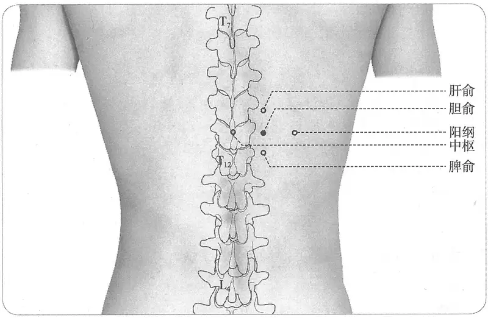

**图2-179　胆俞穴图**

　5. 第十椎下去脊中二寸（去脊边一寸半）。（《针灸十四经穴位考订》）

　6. 统编针灸学教材

　　(1) 部位：在第十椎下两旁相去脊各一寸五分。取穴：正坐或俯卧，按第十椎正中旁开一寸五分处取之。（1957年南京《针灸学》）

　　(2) 部位：肝俞穴下。取穴：俯卧或正坐，从第十椎下督脉中枢穴旁开一寸五分陷中取之。（1版《针灸学讲义》）

　　(3) 部位：在第十椎下，两旁各一寸五分。取穴：俯卧，于第十胸椎棘突下，中枢督脉旁开一寸五分取之。（2版《针灸学讲义》）

　　(4) 第十胸椎棘突下，旁开1.5寸。（4、5、6、7版《针灸学》）

　　(5) 第十胸椎棘突下，中枢旁开一寸五分。（《中国针灸学》）

**文献分析**：关于本穴定位去脊中距离的分歧，详见本经“概说”。

#### 【类属】 

足太阳膀胱经穴；背俞穴。

足太阳脉气所发。（《黄帝明堂经》）

#### 【适应症】 

主治肝胆病症。常用于呕吐，口苦，胁痛，黄疸。

　1. 主胸满，呕无所出，口苦舌干，饮食不下。（《黄帝明堂经》）

**按**：此症与《灵枢·四时气》所论“呕胆”病相似：“善呕，呕有苦，长太息，心中憺憺，恐人将捕之，邪在胆，逆在胃，胆液泄则口苦，胃气逆则呕苦，故曰呕胆”。

　2. 主理心胀满，吐逆短气，痰闷。（《太平圣惠方·针经》）

　3. 治心腹胀满，呕则食无所出，口苦舌干，咽中痛，食不下，目黄，胸胁不能转侧，头痛振寒，汗不出，腋下肿。（《铜人腧穴针灸图经》卷中）

　4. 窦太师针灸遗存

　　(1) 治胆热多睡，泻；胆寒不寝，眼中冷泪交流，补。（《窦太师针经》）

　　(2) 主胆热多睡，胆寒不寝，眼中涕泪交流。（《针方六集》卷五）

　5. 主骨蒸劳热。（《针灸聚英》卷一、《古今医统》、《针灸大成》、《针方六集》、《类经图翼》）

〔p.665 (인쇄 645)〕

**按**：此乃高武辑自《针灸资生经》“崔氏四花穴”灸治十二骨蒸，高武认为“四花穴”相当于“膈俞”、“胆俞”二穴，故将此方主治症归于此二穴。实则崔氏“四花”与此二穴并不相合，其取穴法当以《外台秘要》、《圣济总录》等医书载文为准。

　6. 主胸胁痛，干呕吐，口苦咽干，胆家一切证。亦治骨蒸痨热，短气黄疸。（《循经考穴编》上）

　7. 统编针灸学教材

　　(1) 主治心腹胀满，胸肋痛，口苦，黄疸，食不下，呕吐，骨蒸劳热。（1957年南京《针灸学》、1版《针灸学讲义》）

　　(2) 主治黄疸，口苦，胸胁痛，肺痨，潮热。（2版《针灸学讲义》、4、5、7版《针灸学》、《中国针灸学》）

　　(3) 主治黄疸，胁痛，呕吐，食不化，口苦。（6版《针灸学》）

**按**：教材中“骨蒸劳热”症系承袭高武《针灸聚英》之误，今去之。既是“呕胆”，当有呕的症状，2版《针灸学讲义》、4、5、7版《针灸学》教材删去此症，欠妥。

#### 附：临床应用举例 

　1. 酒疸，身目俱黄，心中俱痛，面发赤斑，小便赤黄，胆俞二穴、至阳一穴、委中二穴、腕骨二穴。（《针灸大全》卷四）

　2. 心虚胆寒，四体颤掉，胆俞二穴、通里二穴、临泣二穴。（《针灸大全》卷四）

　3. 慢性胆囊炎，胆俞、肝俞，针刺治疗。［中医杂志，1985，26(3)：28］

　4. 急性黄疸型肝炎，大椎穴、胆俞、肝俞，针刺治疗。［中国针灸，1985，5(3)：4-6］

　5. 胆道蛔虫症，胆俞、足三里穴，针灸疗法。［广东医学，1986，7(1)：28］

#### 【操作】 

斜刺0.5~0.8寸。不宜深刺，宜向脊椎方向成45°~60°角斜刺。

　1. 刺入五分，灸三壮。（《黄帝明堂经》）

　2. 灸三壮。（《外台秘要》卷三十九）

　3. 刺可入同身寸之五分，留七呼。（《素问·气府论》王冰注）

　4. 针入三分。（《太平圣惠方·针经》）

　5. 灸五壮。（《太平圣惠方·明堂》）

　6. 针入一分，沿皮向外一寸半，禁灸。（《窦太师针经》）

　7. 灸三壮，禁针。（《医宗金鉴·刺灸心法要诀》）

　8. 针三分，灸三壮。（《针灸十四经穴位考订》）

　9. 统编针灸学教材

　　(1) 针五分，灸三至七壮。（1957年南京《针灸学》、1版《针灸学讲义》）

　　(2) 向下斜刺5分；艾炷灸5~15壮，艾条灸5~15分钟。（2版《针灸学讲义》）

　　(3) 斜刺0.5~0.8寸。（4、5、7版《针灸学》）

　　(4) 斜刺0.5~0.8寸；可灸。（6版《针灸学》）

　　(5) 斜刺0.5~0.7寸。可灸。（《中国针灸学》）

### （二十）脾俞 Píshū BL20 出《灵枢》 

#### 【提要索隐】 

**部位**：在脊柱区，第11胸椎棘突下，后正中线旁开1.5寸。

〔p.666 (인쇄 646)〕

**适应症**：主治脾部病症。常用于腹胀，呕吐，泄泻，水肿，黄疸。**新增**：多食善饥、身体消瘦。胃大部切除术针麻用穴。

**针刺操作**：斜刺0.5~0.8寸。不宜深刺，宜向脊椎方向成45°~60°角斜刺。

#### 【名实考】 

宋以前有关背俞穴定位分歧，详见本经“概说”。

　1. 脾腧在十一焦之间，皆夹脊相去三寸所，则欲得而验之，按其处，应在中而痛解，乃其腧也。（《灵枢·背腧》）

　2. 脾俞，在第十一椎下两旁各一寸五分。（《黄帝明堂经》）

#### 宋以前文献脾俞穴别说 

　1. 欲知背俞，先度其两乳间，中折之；更以他草度去半已，即以两隅相拄也，乃举以度其背。令其一隅居上，齐脊大椎，两隅在下，当其下隅者，肺之俞也；复下一度，心之俞也；复下一度，左角肝之俞也，右角脾之俞也；复下一度，肾之俞也，是谓五藏之俞。灸刺之度也。（《素问·血气形志》）

2.《扁鹊针灸针》曰第十椎名脾输。夹脊左右各一寸半或一寸二分。（《医心方》卷二）

　3. 僧匡及彻云，脾输第十二节，夹脊相去二寸半，瘦人相去二寸二分。（《医心方》卷二）

4.《华佗针灸经》曰第十椎名脾俞。夹脊相去一寸。（《医心方》卷二）

#### 【定位】 

**部位**：在脊柱区，第11胸椎棘突下，后正中线旁开1.5寸（图2-180）。

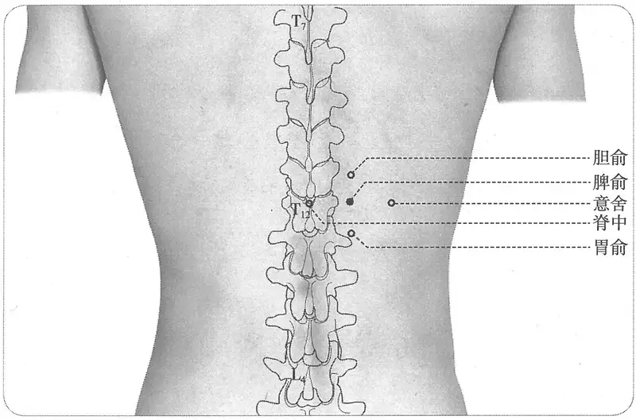

**图2-180　脾俞穴图**

**取穴**：俯卧或正坐，在11椎下督脉脊中穴旁开1.5寸陷中取之。

　1. 脾腧在十一焦之间，夹脊相去三寸所。则欲得而验之，按其处，应在中而痛解，乃其腧也。（《灵枢·背腧》）

　2. 在第十一椎下两旁各一寸五分。（《黄帝明堂经》、《太平圣惠方·针经》、《铜人腧穴针灸图经》卷上、《圣济总录》、《窦太师针经》、《针灸玉龙经》、《窦太师秘传》、《针方六集》）

　3. 在第十一椎下两旁各寸半。凡大杼下穴皆当除脊各寸半。（《针灸资生经》卷一）

〔p.667 (인쇄 647)〕

　4. 在第十一椎下，相去脊中各一寸五分。（《十四经发挥》中、《医学纲目》、《针灸聚英》、《古今医统》、《针灸大成》、《循经考穴编》、《针灸易学》）

　5. 在十一椎下去脊中各二寸，正坐取之。（《类经图翼》卷七、《医宗金鉴·刺灸心法要诀》、《针灸逢源》）

　6. 第十一椎下去脊中二寸去脊边一寸半。（《针灸十四经穴位考订》）

　7. 统编针灸学教材

　　(1) 部位：第十一椎下两旁相去脊各一寸五分。取穴：正坐或俯卧，在十一椎骨下脊中穴旁开一寸五分取之。（1957年南京《针灸学》）

　　(2) 部位：胆俞穴下。取穴：俯卧或正坐，在十一椎下督脉脊中穴旁开一寸五分陷中取之。（1版《针灸学讲义》）

　　(3) 部位：在第十一椎下，两旁各一寸五分。取穴：俯卧，于第十一胸椎棘突下，脊中督脉旁一寸五分取之。（2版《针灸学讲义》）

　　(4) 第十一胸椎棘突下，旁开1.5寸。（4、5、6、7版《针灸学》）

　　(5) 第十一胸椎棘突下，脊中旁开1.5寸。（《中国针灸学》）

**文献分析**：关于本穴定位去脊中距离的分歧，详见本经“概说”。

#### 【类属】 

足太阳膀胱经穴；背俞穴。

**归经**：足太阳膀胱经。（《外台秘要》卷三十九、《铜人腧穴针灸图经》卷上）

#### 【适应症】 

主治脾部病症。常用于腹胀，呕吐，泄泻，水肿，黄疸。**新增**：多食善饥、身体消瘦。胃大部切除术针麻用穴。

　1. 主腹中气胀引脊痛，饮食多，身羸瘦，名曰食晦，先取脾俞，后取季胁。黄瘅善欠，胁下满欲吐，身重不欲动。脾胀。热痓。大肠转气，按之如覆杯，热引胃痛，脾气寒，四肢急烦，不嗜食。（《黄帝明堂经》）

**按**：以上病症为典型的脾病症状。食晦，又称食亦。《素问·气厥论》曰：“大肠移热于胃，善食而瘦又谓之食㑊。胃移热于胆，亦曰食㑊。”而“大肠转气，按之如覆杯”病症又见于《黄帝明堂经》大肠俞，盖出于同一首针灸方主治。所谓“脾胀”者，“善哕，四肢烦悗，体重不能胜衣，卧不安”（《灵枢·胀论》）。

　2. 泄痢不食，食不生肌肤。唾血吐血。（《千金要方》卷三十）

　3. 理腰身黄胀满，腹肚泄利，四肢不收，身重，邪气积聚，腹痛，寒热。（《太平圣惠方·针经》）

　4. 主嗜卧怠惰，四肢不欲动摇。（《太平圣惠方·明堂》）

　5. 治腹胀引胸背痛，食饮倍多，身渐羸瘦，黄疸，善欠，胁下满，泄利，体重，四肢不收，痃癖积聚，腹痛不嗜食，痰疟寒热。（《铜人腧穴针灸图经》卷中）

**按**：“痰疟”疑为“痎疟”之误。

　6. 窦太师针灸遗存

　　(1) 治翻胃吐食，先泻后补，补多。食不消，腹胀，黄疸等症，五噎，心脾疼一切痢疾，看症补泻。（《窦太师针经》）

　　(2) 治翻胃吐食，先泻后补；多治食不化，腹肠黄疸等证。（《大本琼瑶神书》）

　　(3) 主五噎，五疸，脾泄脾黄，腹胀不嗜食，或能食身瘦。（《循经考穴编》上）

　　(4) 治脾弱，翻胃吐食，羸瘦，黄疸，四肢沉重。（《窦太师秘传》）

　　(5) 咽酸口苦脾虚弱，饮食停寒夜不消，更把公孙脾俞刺，自然脾胃得和调。（《针灸玉龙歌》）

〔p.668 (인쇄 648)〕

　7. 水肿。（《针灸聚英》卷一、《针灸大成》、《针方六集》）

**按**：此从《针灸资生经》转引《千金要方》灸方主治。

　8. 一传治水肿臌胀，气满泄泻，年久不止及久年积块胀痛。（《类经图翼》卷七）

　9. 统编针灸学教材

　　(1) 主治腹胀引胸背痛，黄疸，噎膈，多食身瘦或不嗜食，泄痢，水肿臌胀，小儿慢惊，痰症。（1957年南京《针灸学》）

　　(2) 主治腹胀，黄疸，噎膈，多食身瘦或不嗜食，泄痢，水肿，小儿慢惊，痰症。（1版《针灸学讲义》）

　　(3) 主治腹胀，黄疸，呕吐，泄泻，痢疾，便血，水肿，背痛，脾胃虚弱。（2版《针灸学讲义》、4版《针灸学》）

　　(4) 主治腹胀，黄疸，呕吐，泄泻，痢疾，便血，水肿，背痛。（5版《针灸学》）

　　(5) 主治腹胀，泄泻，呕吐，胃痛，消化不良，水肿，背痛，黄疸。（6版《针灸学》）

　　(6) 主治：①腹胀，纳呆，呕吐，腹泻，痢疾，便血，水肿等脾胃肠腑病证；②背痛。（7版《针灸学》）

　　(7) 主治胃脘痛，腹胀，黄疸，呕吐，泄泻，痢疾，便血，月经过多，水肿，纳呆，背痛。（《中国针灸学》）

**文献分析**：古今文献所载本穴主治均为典型的脾病症状，临床应用的重点也在于此。“多食善饥、身体消瘦”的食晦证乃本穴的重要主治症之一，而除1957年南京《针灸学》及1版《针灸学讲义》外，现行其他各版皆未收录，欠妥，今补之。

#### 附：临床应用举例 

　1. 脾胃病症

　　(1) 脾中风，踞而腹满，身通黄，吐咸汁出者，可治，急灸脾俞百壮。（《诸病源候论》卷一）

　　(2) 胀满水肿，灸脾俞随年壮，三报；腹中气胀引脊痛，食饮多，身羸瘦，名曰食晦，先取脾俞，后取季胁。（《千金要方》卷十六）

　　(3) 泄痢，食不消，不作肌肤，灸脾俞随年壮。（《千金要方》卷十五）

　　(4) 主四肢寒热，腰疼不得俯仰，身黄，腹满，食呕，舌根直，灸第十一椎上及左右各一寸五分，三处各七壮。（《千金要方》卷十五、《千金翼方》）

　　(5) 单蛊胀，水分、石门、气海、中脘。问曰：此证缘何而得？答曰：因风寒暑湿串入脏腑，以致食物不能化，脾败胃虚，故如此也。复刺后穴：三里、脾俞、行间、内庭。（《针灸集成》第四十九方）

　　(6) 脾疟令人怕寒，腹中痛：商丘二穴、脾俞二穴、三里二穴。（《针灸大全》卷四）

　　(7) 治腹胀引背，食饮多，渐渐羸瘦黄，可灸脾俞二穴七壮。（《医学纲目》卷三十八）

　　(8) 翻胃吐食，中脘、脾俞、中魁、三里。（《针灸大成》卷五）

　　(9) 慢性腹泻，脾俞、三阴交穴、章门穴，针灸疗法。［上海针灸杂志，1984(3)：8］

　2. 其他病症

　　(1) 黄疸方，葛氏灸脾俞百壮，穴在第十一椎下，两旁一寸半。（《补辑肘后方》上卷）

　　(2) 虚劳，尿白浊，灸脾俞一百壮。（《千金要方》卷二十）

　　(3) 虚劳，尿血，血浊，灸脾俞百壮。又灸三焦俞百壮。又灸章门百壮。（《千金翼方》卷二十八）

〔p.669 (인쇄 649)〕

　　(4) 有人患久疟，诸药不效，或教之以灸脾俞即愈，更一人亦久患疟，闻之亦灸此穴而愈。盖疟多因饮食得之，故灸脾俞作效。（《针灸资生经》卷三）

　　(5) 嗜睡，心俞、脾俞，针灸疗法。［陕西中医，1986，7(10)：460-461］

　　(6) 重症乙脑恢复期，脾俞、三阴交、肾俞，针灸疗法。［江苏中医杂志，1986，7(10)：43］

　　(7) 乙型病毒性肝炎，肝俞穴、脾俞穴、期门穴，艾灸治疗。［上海针灸杂志，1988，7(1)：3-5］

　　(8) 白细胞减少症，大椎、脾俞、足三里，每日针刺1次，得气后留针30分钟，中间行针2次。［云南中医杂志，1988，9(6)：33］

#### 【操作】 

斜刺0.5~0.8寸。不宜深刺，宜向脊椎方向成45°~60°角斜刺。

　1. 刺入三分，留七呼，灸三壮。（《黄帝明堂经》）

　2. 灸五壮。（《太平圣惠方·明堂》）

　3. 刺之二分，得气至，而次进之，又得动气，次进之，二进各一分，留五呼，即徐徐出针，以手扪之。（《素问亡篇·刺法论》）

　4. 针入一分，沿皮向外一寸半，灸五十壮。（《窦太师针经》）

　5. 禁针。（《医宗金鉴·刺灸心法要诀》）

　6. 统编针灸学教材

　　(1) 针五分，灸三至七壮。（1957年南京《针灸学》、1版《针灸学讲义》）

　　(2) 向下斜刺5分；艾炷灸5~15壮，艾条灸5~10分钟。（2版《针灸学讲义》）

　　(3) 斜刺0.5~0.8寸。（4、5、7版《针灸学》）

　　(4) 直刺0.5~1寸；可灸。（6版《针灸学》）

　　(5) 斜刺0.5~0.7寸。可灸。（《中国针灸学》）

　7. 直刺或微斜向椎体，深1~1.5寸。感应：局部酸、麻、胀，并向腰部放散。灸3~7壮；温灸5~20分钟。注意：不宜针刺过深，以免刺伤肾和肝脏。（上海《针灸学》）

### （二十一）胃俞 Wèishū BL21 出《黄帝明堂经》 

#### 【提要索隐】 

**部位**：在脊柱区，第12胸椎棘突下，后正中线旁开1.5寸。

**适应症**：主治脾胃病症。常用于胃脘痛，腹胀，呕吐，肠鸣。**新增**：多食善饥、身体消瘦。

**针刺操作**：斜刺0.5~0.8寸。针刺不宜过深，宜向脊椎方向成45°~60°角斜刺。

#### 【名实考】 

宋以前有关背俞穴定位分歧，详见本经“概说”。

胃俞，在第十二椎下两旁各一寸五分。（《黄帝明堂经》）

#### 宋以前胃俞穴别说 

1.《扁鹊针灸针》曰第十一椎名胃输。夹脊左右各一寸半或一寸二分。（《医心方》卷二）

2.《华佗针灸经》曰第十一椎名胃俞。夹脊相去一寸。（《医心方》卷二）

　3. 僧匡及彻云胃输，第十一节，夹脊相去二寸半，瘦人相去二寸二分。（《医心方》卷二）

4.《龙衔素针经》曰胃管下输，第八椎相去三寸。（《医心方》卷二）

#### “接脊”误作“胃俞”例 

　1. 小儿痢下赤白，秋末脱肛，每厕腹痛不可忍者。灸第十二椎下节间，名接脊穴，灸一壮，炷如小麦大。（《太平圣惠方·明堂》）

〔p.670 (인쇄 650)〕

　2. 胃俞，主治小儿痢下赤白，秋末脱肛，肚疼不可忍，艾炷如大麦。（《类经图翼》卷七）

**按**：张介宾此条文字系误录《太平圣惠方·明堂》“接脊”穴主治。

#### 【定位】 

**部位**：在脊柱区，第12胸椎棘突下，后正中线旁开1.5寸（图2-181）。

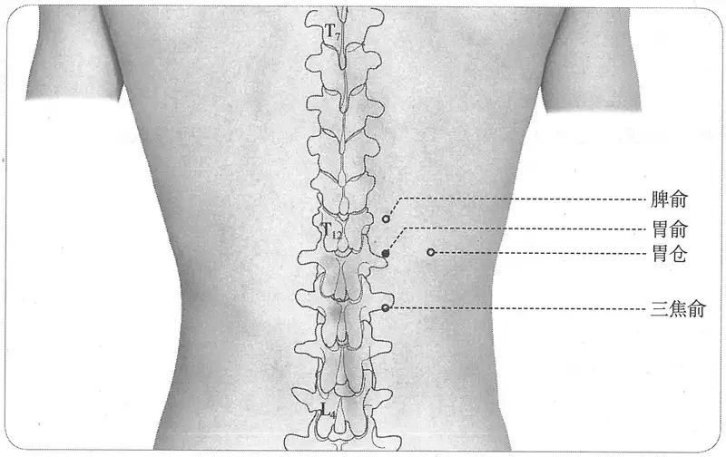

**图2-181　胃俞穴图**

**取穴**：俯卧或正坐，从12椎下旁开1.5寸陷中取之。

　1. 在第十二椎下两旁各一寸五分。（《黄帝明堂经》、《太平圣惠方》、《铜人腧穴针灸图经》卷上、《圣济总录》、《窦太师针经》、《琼瑶神书》、《针方六集》）

　2. 在第十二椎下，两旁各寸半。凡大杼下穴皆当除脊各寸半。（《针灸资生经》卷一）

　3. 在第十二椎下，相去脊中各一寸五分。（《十四经发挥》中、《医学纲目》、《针灸聚英》、《古今医统》、《针灸大成》、《循经考穴编》、《针灸易学》）

　4. 在十二椎下去脊中各二寸，正坐取之。（《类经图翼》卷七、《医宗金鉴·刺灸心法要诀》、《针灸逢源》）

　5. 第十二椎下去脊中二寸去脊边一寸半。（《针灸十四经穴位考订》）

　6. 统编针灸学教材

　　(1) 部位：第十二椎下两旁相去脊各一寸五分。取穴：正坐或俯卧，按第十二椎骨下外开一寸五分取之。（1957年南京《针灸学》）

　　(2) 部位：脾俞穴下。取穴：俯卧或正坐，从十二椎下旁开一寸五分陷中取之。（1版《针灸学讲义》）

　　(3) 部位：在第十二椎下，两旁各一寸五分。取穴：俯卧，于第十二胸椎棘突下，督脉旁一寸五分取之。（2版《针灸学讲义》）

　　(4) 第十二胸椎棘突下，旁开1.5寸。（4、5、6、7版《针灸学》）

　　(5) 第十二胸椎棘突下，督脉旁开一寸五分。（《中国针灸学》）

**文献分析**：关于本穴定位去脊中距离的分歧，详见本经“概说”。

#### 【类属】 

足太阳膀胱经穴；背俞穴。

〔p.671 (인쇄 651)〕

**归经**：足太阳膀胱经。（《外台秘要》卷三十九、《铜人腧穴针灸图经》卷上）

#### 【适应症】 

主治脾胃病症。常用于胃脘痛，腹胀，呕吐，肠鸣。**新增**：多食善饥、身体消瘦。

　1. 主胃中寒，胀，食多，身羸瘦，腹中满而鸣，腹䐜，风厥，胸胁支满，呕吐，脊急痛，筋挛，食不下。（《黄帝明堂经》）

**按**：此条主治症除“筋挛”一症外，均见于足三里穴主治。“食多，身羸瘦”症也见于脾俞穴主治。

　2. 理烦满吐食。（《太平圣惠方·针经》）

　3. 主背中气上下行。（《太平圣惠方·明堂》）

　4. 治胃中寒，腹胀不嗜食，羸瘦，肠鸣腹痛，胸胁支满，脊痛筋挛。（《铜人腧穴针灸图经》卷中）

　5. 窦太师针灸遗存

　　(1) 治胃口受寒，不进食，补；胃口热，结胸心疼，泻。（《窦太师针经》）

　　(2) 主胃热结胸，心疼。（《针方六集》卷五）

　6. 霍乱，翻胃，目不明，小儿羸瘦，不生肌肤。（《针灸聚英》卷一、《针灸大成》）

**按**：以上“霍乱”乃高武从《针灸资生经》“霍乱转筋”篇辑自《铜人腧穴针灸图经》主治，原文作“筋挛”；“目不明”症系误录《千金要方》之文。“小儿羸瘦，不生肌肤”辑自《太平圣惠方》灸方主治。

　7. 一传治水肿臌胀，气膈不食，泄泻年久不止，多年积块。（《类经图翼》卷七）

**按**：此引“一传”文字与上述脾俞穴下《类经图翼》引文同。

　8. 统编针灸学教材

　　(1) 主治腹胀，肠鸣，胃寒，胃弱，腹痛，反胃呕吐，不进饮食，胸胁支满，小儿吐乳，青便，羸瘦。（1957年南京《针灸学》、1版《针灸学讲义》）

　　(2) 主治胸胁痛，胃脘痛，腹胀，翻胃，呕吐，肠鸣，脾胃虚弱。（2版《针灸学讲义》、4版《针灸学》）

　　(3) 主治胸胁痛，胃脘痛，呕吐，腹胀，肠鸣。（5版《针灸学》）

　　(4) 主治胃脘痛，腹胀，呕吐，完谷不化，肠鸣，胸胁痛。（6版《针灸学》）

　　(5) 主治胃脘痛，呕吐，腹胀，肠鸣等胃疾。（7版《针灸学》）

　　(6) 主治胃脘痛，胸胁痛，纳呆，腹胀，肠鸣，泄泻，翻胃，呕吐。（《中国针灸学》）

**文献分析**：“食多，身羸瘦”症不仅见于《黄帝明堂经》、《千金翼方》，且《太平圣惠方》有明确的临床应用。又胃的下合穴“足三里”穴主治有“消谷善饥”症，可见“食晦”证乃本穴与脾俞的共同主治。现行各版教材未收录，欠妥。今补之。

#### 附：临床应用举例 

　1. 小儿羸瘦，食饮少，不生肌肤，灸胃俞穴各一壮，在第十二椎下两旁各一寸半陷者中，炷如小麦大。（《太平圣惠方》卷一百十七）

　2. 胃脘痛，膈俞、脾俞、胃俞、内关。（《针灸集要·盘石金直刺秘传》）

　3. 治胃虚方，灸胃俞、足三里。（《医方类聚》卷十二）

　4. 胃疟令人善饥而不能食，厉兑二穴、胃俞二穴、大都二穴。（《针灸大全》卷四）

　5. 食积血瘕，腹中隐痛，胃俞二穴、行间二穴、气海一穴。（《针灸大全》卷四）

　6. 胃脘痛，针刺胃俞穴治疗。［中国中西医结合脾胃杂志，2000，8(5)：311］

#### 【操作】 

斜刺0.5~0.8寸。不宜深刺，宜向脊椎方向成45°~60°角斜刺。

　1. 刺入三分，留七呼，灸三壮。（《黄帝明堂经》）

〔p.672 (인쇄 652)〕

　2. 灸七壮。（《太平圣惠方·明堂》）

　3. 针入三分，留七呼，可灸随年为壮。（《铜人腧穴针灸图经》卷中）

　4. 窦太师针灸遗存

　　(1) 针入一分，沿皮向外一寸半，灸三七壮至五十壮。（《窦太师针经》）

　　(2) 窦氏针入一分，沿皮向外入寸半，灸二七壮。一方随年为壮。（《针方六集》卷一）

　5. 统编针灸学教材

　　(1) 针五分，灸三至七壮。（1957年南京《针灸学》、1版《针灸学讲义》）

　　(2) 向下斜刺5分；艾炷灸5~15壮，艾条灸5~15分钟。（2版《针灸学讲义》）

　　(3) 斜刺0.5~0.8寸。（4、5、7版《针灸学》）

　　(4) 直刺0.5~1寸；可灸。（6版《针灸学》）

　　(5) 斜刺0.5~0.7寸。可灸。（《中国针灸学》）

### （二十二）三焦俞 Sānjiāoshū BL22 出《黄帝明堂经》 

#### 【提要索隐】 

**部位**：在脊柱区，第1腰椎棘突下，后正中线旁开1.5寸。

**适应症**：主治胃肠、水液病症。常用于腹胀，呕吐，肠鸣，泄泻；小便不利，水肿，腰背痛。

**针刺操作**：直刺0.5~1寸。针刺不宜过深，宜向脊椎方向成30°~45°角斜刺。

#### 【名实考】 

宋以前有关背俞穴定位分歧，详见本经“概说”。

三焦俞，在第十三椎下，两旁各一寸五分。足太阳脉气所发，正坐取之。（《黄帝明堂经》）

#### 宋以前文献三焦俞别说 

《扁鹊针灸针》曰第十八椎名三焦输。夹脊左右各一寸半或一寸二分。（《医心方》卷二）

#### 相关穴及刺激点 

腹腔丛刺激点：第1腰椎棘突中点左侧2.5~3.0cm。直刺5.0~6.0cm。一般针刺左侧，右侧相应部位深处有下腔静脉，不宜深刺。适应证：胃痛、胃下垂、肝痛、胆道蛔虫症、肠痉挛。（《实用神经干电刺激疗法》）

#### 【定位】 

**部位**：在脊柱区，第1腰椎棘突下，后正中线旁开1.5寸（图2-182）。

**取穴**：先定第12胸椎棘突，下数第1个棘突即第1腰椎棘突，其下旁开1.5寸处取之。

1.《黄帝明堂经》佚文

　　(1) 第十三椎下两旁各一寸五分。（《针灸甲乙经》卷三、《千金要方》、《千金翼方》、《外台秘要》、《太平圣惠方·针经》、《铜人腧穴针灸图经》、《圣济总录》、《窦太师针经》、《琼瑶神书》、《针方六集》）

　　(2) 在第十三椎下两旁各一寸半，正坐取之。（明抄本《针灸甲乙经》、《素问·气府论》王冰注、《医心方》、《太平圣惠方·明堂》）

　2. 在第十三椎下两旁各寸半。凡大杼下穴皆当除脊各寸半。（《针灸资生经》卷一）

　3. 在第十三椎下，相去脊中各一寸五分。（《十四经发挥》中、《医学纲目》、《针灸聚英》、《古今医统》、《针灸大成》、《循经考穴编》、《针灸易学》）

〔p.673 (인쇄 653)〕

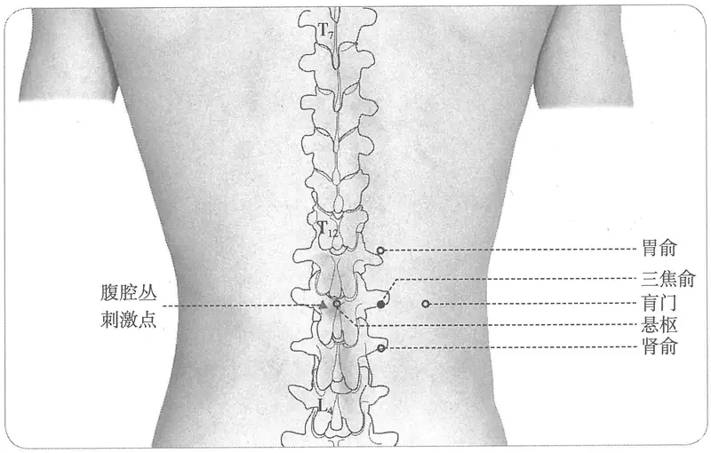

**图 2-182　三焦俞穴与相关刺激点**

　4. 在十三椎下去脊中二寸，正坐取之。（《类经图翼》卷七、《医宗金鉴·刺灸心法要诀》、《针灸逢源》）

　5. 第十三椎下去脊中二寸去脊边一寸半。（《针灸十四经穴位考订》）

　6. 统编针灸学教材

　　(1) 部位：第十三椎下两旁相去脊各一寸五分。取穴：正坐或俯卧，按取第十三脊椎下悬枢穴旁开一寸五分取之。（1957年南京《针灸学》）

　　(2) 部位：胃俞穴下。取穴：俯卧或正坐，从十三椎下督脉悬枢穴旁开一寸五分陷中取之。（1版《针灸学讲义》）

　　(3) 部位：在第十三椎下，两旁各一寸五分。取穴：俯卧，于第一腰椎棘突下，悬枢督脉旁一寸五分取之。（2版《针灸学讲义》）

　　(4) 第一腰椎棘突下，旁开1.5寸。（4、5、6、7版《针灸学》）

　　(5) 第一腰椎棘突下，悬枢旁开一寸五分。（《中国针灸学》）

**文献分析**：关于本穴定位去脊中距离的分歧，详见本经“概说”。

#### 【类属】 

足太阳膀胱经穴；背俞穴。

足太阳脉气所发。（《黄帝明堂经》）

#### 【适应症】 

主治胃肠、水液病症。常用于腹胀，呕吐，肠鸣，泄泻；小便不利，水肿，腰背痛。

　1. 主头痛，饮食不下，肠鸣胪胀欲呕，时泄注。（《黄帝明堂经》）

　2. 主五脏六腑积聚，心腹满，腰背痛，饮食不消，吐逆，寒热往来，小便不利，羸瘦，少气。（《千金翼方》卷二十七）

　3. 主水谷不消，腹胀，腰痛。（《太平圣惠方·明堂》）

**按**：此条主治实节录自《千金翼方》。

　4. 背痛身热，腰脊急强。（《太平圣惠方·明堂》）

　5. 治肠鸣腹胀，水谷不化，腹中痛欲泄注，目眩头痛，吐逆饮食不下，肩背拘急，腰脊强不得俯仰。（《铜人腧穴针灸图经》卷中）

〔p.674 (인쇄 654)〕

　6. 窦太师针灸遗存

　　(1) 治三焦邪热，口苦，舌干唇裂，泻；三焦闭塞吐涎，补。（《窦太师针经》）

　　(2) 此穴能生津液，若三焦热壅，气不升降，口苦，唇裂，消渴等证，宜单泻之，三焦受冷，口吐清涎，可灸七壮。（《循经考穴编》上）

　7. 统编针灸学教材

　　(1) 主治腹胀，肠鸣，呕吐，脏腑积聚，水谷不化，下痢，腰脊肩背强急，水肿。（1957年南京《针灸学》、1版《针灸学讲义》）

　　(2) 主治腹胀，肠鸣，水谷不化，呕吐，泄泻，痢疾，水肿，腰背强痛。（2版《针灸学讲义》、3版《针灸学》）

　　(3) 主治肠鸣，腹胀，呕吐，泄泻，痢疾，水肿，腰背强痛。（4、5版《针灸学》）

　　(4) 主治胃脘痛，腹胀，呕吐，完谷不化，肠鸣，胸胁痛。（6版《针灸学》）

　　(5) 主治：①肠鸣，腹胀，呕吐，腹泻，痢疾等脾胃肠腑病证；②小便不利，水肿等三焦气化不利病证；③腰背强痛。（7版《针灸学》）

　　(6) 主治腹胀，肠鸣，完谷不化，呕吐，泄泻，痢疾，水肿，腰背强痛。（《中国针灸学》）

**文献分析**：《黄帝明堂经》载本穴主治偏于三焦虚寒的呕、泄症状，至初唐《千金翼方》增补“小便不利”症，并有相对应的临床应用，从而使三焦病症更全面。现代针灸学教材从之。而金元窦太师则补充了三焦实热的病症，然未见相应的临床应用，有待今后进一步观察，积累经验。

#### 附：临床应用举例 

　1. 治少腹坚大如盘，胸中胀，食不消，妇人瘦瘠者方，暖水服发灰一方寸匙。日再服。并灸肋端。又灸三焦俞随年壮。（《千金要方》卷十一）

　2. 脏腑积聚，胀满，羸瘦不能饮食，灸三焦俞随年壮。（《千金要方》卷十六）

　3. 五脏六腑心腹满，腰背疼，饮食吐逆，寒热往来，小便不利，羸瘦少气，灸三焦俞随年壮。（《千金要方》卷二十）

**按**：此三首灸方主治与《千金翼方》载本穴主治相吻合。

　4. 虚劳，尿血，血浊，灸脾俞百壮。又灸三焦俞百壮。又灸章门百壮。（《千金翼方》卷二十八）

　5. 身热头痛不食，取三焦俞。（《古今医统》卷十三）

　6. 痛经，三焦俞、肾俞，针刺治疗。［内蒙古中医药，1985(1)：31］

#### 【操作】 

直刺0.5~1寸。针刺不宜过深，宜向脊椎方向成30°~45°角斜刺。

　1. 刺入五分，灸三壮。（《黄帝明堂经》）

　2. 针入三分，留七呼，灸三壮。（《太平圣惠方·针经》）

　3. 灸五壮。（《太平圣惠方·明堂》）

　4. 针入五分，留七呼，可灸三壮。（《铜人腧穴针灸图经》卷中）

　5. 针入一分，沿皮向外一寸半，禁灸。（《窦太师针经》）

　6. 统编针灸学教材

　　(1) 针五分，灸三至七壮。（1957年南京《针灸学》、1版《针灸学讲义》）

　　(2) 向下斜刺5分；艾炷灸5~15壮，艾条灸5~15分钟。（2版《针灸学讲义》）

　　(3) 直刺0.5~1寸。（4、5、7版《针灸学》）

　　(4) 直刺0.5~1寸；可灸。（6版《针灸学》、《中国针灸学》）

〔p.675 (인쇄 655)〕

　7. 直刺1~1.5寸。感应：酸胀至腰部。灸3~7壮；温灸10~20分钟。（上海《针灸学》）

### （二十三）肾俞 Shènshū BL23 出《灵枢》 

#### 【提要索隐】 

**部位**：在脊柱区，第2腰椎棘突下，后正中线旁开1.5寸。

**适应症**：主治耳部、肾脏病症。常用于耳鸣，耳聋；腰痛，足寒，遗尿，尿频，遗精，阳痿，早泄；月经不调，带下，不孕。**新增**：多食善饥、身体消瘦。

**针刺操作**：直刺0.5~1寸。不宜向外侧深刺。

#### 【名实考】 

“肾俞”与“督俞”字形相近，针灸古籍中有相混者。宋以前有关背俞穴定位分歧，详见本经“概说”。

　1. 肾腧在十四焦之间，皆夹脊相去三寸所，则欲得而验之，按其处，应在中而痛解，乃其腧也。（《灵枢·背腧》）

　2. 肾俞，在第十四椎下两旁各一寸五分。（《黄帝明堂经》）

#### 宋以前文献肾俞穴别说 

　1. 欲知背俞，先度其两乳间，中折之；更以他草度去半已，即以两隅相拄也，乃举以度其背。令其一隅居上，齐脊大椎，两隅在下，当其下隅者，肺之俞也；复下一度，心之俞也；复下一度，左角肝之俞也，右角脾之俞也；复下一度，肾之俞也，是谓五藏之俞。灸刺之度也。（《素问·血气形志》）

　2. 《金腾灸经》曰脏腑十二输经法，从大椎直穷骨中折度，去其半，乃取余半四折之，皆令平等，点所折处，同伸所点度，上从大椎下至中脊，第一点名为膈输，第二点名为肺输，第三点名为心输，下头正中央名为肝输；又从肝输下至穷骨仍为八折，皆令平等，因伸，从肝输下至穷骨第一点名为胆输，第二点名为脾输，第三点名为胃输，第四点名为肾输，第五点名为大小肠输，第六点名为三焦输，第七点名为膀胱输，下头住穷骨。凡脏腑输皆侠脊相去二寸半，唯肝输正脊中央也。（《医心方》卷二）

#### “督俞”误作“肾俞”例 

　1. 督俞，一名高盖。（《针灸大全》卷五）

　2. 肾俞，一名高盖。（《针灸大成》卷七）

**按**：高盖，作为“督俞”的别名，见于《太平圣惠方·针经》，《针灸大全》“论一穴有二名”篇下收入此别名，《针灸大成》在抄录时将“督俞”误作“肾俞”，1957年南京《针灸学》传此误。

#### 【定位】 

**部位**：在脊柱区，第2腰椎棘突下，后正中线旁开1.5寸（图2-183）。

**取穴**：先定第12胸椎棘突，下数第2个棘突即第2腰椎棘突，其下旁开1.5寸处取之。

　1. 肾腧在十四焦之间，背夹脊相去三寸所。则欲得而验之，按其处，应在中而痛解，乃其腧也。（《灵枢·背腧》）

　2. 在第十四椎下两旁各一寸五分。（《黄帝明堂经》、《太平圣惠方·明堂》、《铜人腧穴针灸图经》卷上及卷下“穴腧都数”、《针方六集》）

　3. 在第十四椎下两旁各一寸半，与脐对。（《太平圣惠方·针经》、《铜人腧穴针灸图经》、《圣济总录》、《十四经发挥》、《医学纲目》、《针灸聚英》、《古今医统》、《针灸大成》、《针方六集》、《类经图翼》、《医宗金鉴·刺灸心法要诀》、《针灸易学》）

〔p.676 (인쇄 656)〕

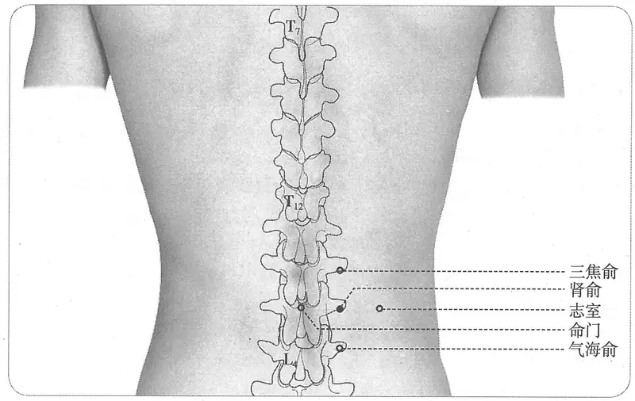

**图 2-183　肾俞穴图**

　4. 在第十四椎下两旁各寸半，与脐平。凡大杼下穴皆当除脊各寸半。（《针灸资生经》卷一）

　5. 在第十四椎下，与脐平，两旁各二寸。（《神应经》、《类经图翼》、《医宗金鉴·刺灸心法要诀》、《针灸逢源》）

　6. 第十四椎下去脊中二寸去脊边一寸半。（《针灸十四经穴位考订》）

　7. 统编针灸学教材

　　(1) 部位：第十四椎下两旁相去脊各一寸五分。取穴：正坐或俯卧，从十四脊椎下命门穴旁开一寸五分取之，简便取穴法由医者两手中指按其脐心，左右手移行向背后，两指会合处为命门穴，由此旁开一寸五分处取之，但肥人腹肌下垂者则不准确。（1957年南京《针灸学》）

　　(2) 部位：三焦俞穴下。取穴：俯卧或正坐，从十四椎下督脉命门穴旁开一寸五分陷中取之。（1版《针灸学讲义》）

　　(3) 部位：在第十四椎下，两旁各一寸五分。取穴：俯卧，于第二腰椎棘突下，命门督脉旁一寸五分取之。（2版《针灸学讲义》）

　　(4) 第二腰椎棘突下，旁开1.5寸。（4、5、6、7版《针灸学》）

　　(5) 第二腰椎棘突下，命门旁开一寸五分。（《中国针灸学》）

**文献分析**：关于本穴定位去脊中距离的分歧，详见本经“概说”。

#### 【类属】 

足太阳膀胱经穴；背俞穴。

**归经**：足太阳膀胱经。（《外台秘要》卷三十九、《铜人腧穴针灸图经》卷上）

#### 【适应症】 

主治耳部、肾脏病症。常用于耳鸣，耳聋；腰痛，足寒，遗尿，尿频，遗精，阳痿，早泄；月经不调，带下，不孕。**新增**：多食善饥、身体消瘦。

　1. 主腰痛不可以俯仰反侧。热痓。寒热，食多，身羸瘦，两胁引痛，心下膜痛，心如悬，下引脐，少腹急痛，热，面黑，目䀮䀮，溲难。肾胀。溺浊赤。骨寒热。风头痛如破，足寒如水，头重身热，振栗，腰中四肢淫泺，欲呕，腹鼓大，寒中洞泄，食不化，骨寒热，引背不得息。（《黄帝明堂经》）

〔p.677 (인쇄 657)〕

**按**：肾胀者，腹满引背央央然，腰髀痛（《灵枢·胀论》）；骨寒热者，病无所安，汗注不休（《灵枢·寒热病》）。值得注意的是，除了脾俞、胃俞外，本穴也主“食多，身羸瘦”，宋代《铜人腧穴针灸图经》更明言主治“消渴”一症。

　2. 主肾间风虚。五脏虚劳，少腹弦急胀热。（《千金翼方》卷二十七）

　3. 理虚劳耳聋，肾虚，阴中疼，血精出，五劳七伤，冷呕，脚膝拘急，好独卧，身肿如水。（《太平圣惠方·针经》）

　4. 主丈夫妇人之积，冷气成劳病也。（《太平圣惠方·明堂》）

　5. 治虚劳羸瘦，耳聋肾虚，水脏久冷，心腹膜胀，两胁满引少腹急痛，目视䀮䀮，少气溺血，小便浊出精，阴中疼，五劳七伤，虚惫脚膝拘急，足寒如冰，头重，身热振栗，腰中四肢淫泺，洞泄食不化，身肿如水。（《铜人腧穴针灸图经》卷中）

　6. 窦太师针灸遗存

　　(1) 治肾虚腰疼，遗精白浊，补；妇人赤白带下，泻；月经不调，补；妇人五劳七伤，下元虚损，子宫户寒，看症补泻。（《窦太师针经》）

　　(2) 心虚，腰痛，补；遗精白浊，先泻后补；妇人带下赤白者，先泻后补；月经不调，补之。（《大本琼瑶神书》）

　　(3) 主女劳疸，肾虚泄，又治女人经病带漏，子宫久冷。（《循经考穴编》上）

　　(4) 治肾虚一切腰疼。（《窦太师秘传》）

　7. 一传，治色欲过度，虚肿，耳痛耳鸣。（《类经图翼》卷七）

　8. 统编针灸学教材

　　(1) 主治遗精淋浊，阳痿，溺血，经带诸疾，肾虚腰痛，目昏耳聋，水肿，消渴。（1957年南京《针灸学》）

　　(2) 主治遗精，阳痿，溺血，五淋，白浊，经带诸疾，肾虚腰痛，目昏，耳聋，水肿，消渴。（1版《针灸学讲义》）

　　(3) 主治遗精，阳痿，遗尿，月经不调，白带，肾虚腰痛，目昏，耳鸣，耳聋，水肿。（2版《针灸学讲义》、4版《针灸学》）

　　(4) 主治遗尿，遗精，阳痿，月经不调，白带，水肿，耳鸣，耳聋，腰痛。（5版《针灸学》）

　　(5) 主治遗精，阳痿，早泄，不孕，不育，遗尿，月经不调，白带，腰背酸痛，头昏，耳鸣，耳聋，小便不利，水肿，喘咳少气。（6版《针灸学》）

　　(6) 主治：①头晕，耳鸣，耳聋，腰酸痛等肾虚病证；②遗尿，遗精，阳痿，早泄，不育等生殖泌尿系疾患；③月经不调，带下，不孕等妇科病证。（7版《针灸学》）

　　(7) 主治遗精，阳痿，遗尿，月经不调，白带，腰痛，腰膝痿软，头昏目眩，耳鸣，耳聋，水肿，气喘，泄泻。（《中国针灸学》）

**文献分析**：《黄帝明堂经》载本穴主治以骨寒热、溲难、洞泄腰痛、面黑、喘咳少气、肾胀等肾病症状为重点，自《太平圣惠方》起，开始出现耳部、前阴、妇科病症，而金元窦太师针灸更突出了其对于男子阴精、女子胞宫的主治作用，并有较多的相关临床应用。现代针灸学教材从之。

《黄帝明堂经》载本穴主治有“食多，身羸瘦”，宋代《铜人腧穴针灸图经》更明言“消渴”一症，古今临床也有实际应用。而自1版教材后，其他各版教材皆未收录此症，欠妥，今补之。

#### 附：临床应用举例 

　1. 肾虚腰痛

　　(1) 肾中风，踞而腰痛，视胁左右末有黄色如饼粢大者，可治。急灸肾俞百壮。若齿黄赤鬓发直，面土色者，不可复治。（《诸病源候论》卷一）

〔p.678 (인쇄 658)〕

　　(2) 治肾风虚寒，灸肾俞百壮，对脐两边，向后夹脊相去各一寸五分。（《千金要方·肾脏》卷十九、《千金翼方》卷二十七）

　　(3)《列子》载偃师造倡云废其肾，则足不能行。是足之不能行，盖肾有病也。当灸肾俞，或一再灸而不效，宜灸环跳、风市、犊鼻、膝关、阳陵泉、阴陵泉、三里、绝骨等穴。但按略酸，即是受病处，灸之无不效也。（《针灸资生经·足麻》卷五）

　　(4) 戊戌年八，淮南大水，城下浸灌者连月，予忽脏腑不调，腹中如水吼数日，调治得愈。自此，腰痛不可屈折，虽颊面亦相妨，如是凡三月。予后思之，此必水气阴盛，肾经感此而得，乃灸肾俞三七壮，服此药瘥。（《普济本事方·治肾经虚腰不能转侧》卷二）

　　(5) 肾虚腰痛，久而不已者：灸肾俞二七壮，补之，刺委中；未愈，刺昆仑。（《针灸集要·盘石金直刺秘传》）

　　(6) 肾虚腰痛，举动艰难：肾俞二穴、脊中一穴、委中二穴。（《针灸大全》卷四）

　　(7)【第五十八】肾虚腰痛：肾俞、委中、太溪、白环俞。（《针灸大成·治症总要》卷九）

　　(8) 腰痛，艾灸肾俞、足三里治疗。［河北中医，2001，23(11)：851］

　2. 耳部病症

　　(1) 耳聋气闭，肾家虚败，邪气攻上：肾俞（灸）、听会（泻）。（《针灸玉龙经·盘石金直刺秘传》）

　　(2) 耳聋气痞疼痛：听会二穴、肾俞二穴、三里二穴、翳风二穴。（《针灸大全》卷四）

　　(3) 突发性耳聋：肾俞、翳风穴针刺治疗。［中国针灸，1986，6(1)：28-29］

　3. 妇科病症

　　(1)【第九十四】经事不调：中极、肾俞、气海、三阴交；【第一百一】妇女血崩不止：丹田、中极、肾俞、子宫。（《针灸大成·治症总要》卷九）

　　(2) 室女月水不调，淋沥不断，腰腹痛：肾俞二穴、关元一穴、三阴交二穴。（《针灸大全》卷四）

　　(3) 妇人血积痛，败血不止：肝俞二穴、肾俞二穴、膈俞二穴、三阴交二穴。（《针灸大全》卷四）

　　(4) 痛经：三焦俞、肾俞针刺背俞穴治疗。［内蒙古中医药，1985，(1)：31］

　　(5) 产后尿闭：气海穴、肾俞温灸。［内蒙古中医药，1985，(3)：26-27］

　　(6) 功能性子宫出血：关元穴、肾俞穴，针刺治疗。［中医杂志：英文版，1988，8(1)：31-33］

　　(7) 不孕症：关元穴、肾俞穴、精宫穴，针灸治疗。［广西中医药，1988，11(2)：76-77］

　4. 虚劳病症

　　(1) 五脏虚劳，小腹弦急胀热，灸肾俞五十壮，老小损之。若虚冷可至百壮，横三间寸灸之。（《千金要方》卷十九）

　　(2) 虚劳浮肿，灸太冲百壮。又灸肾俞。（《千金要方》卷二十一）

　5. 前阴肾系病症

　　(1) 丈夫梦失精，及男子小便浊难，灸肾俞百壮。（《千金要方·肾脏》卷十九）

　　(2)【第六十六】小便滑数：中极、肾俞、阴陵泉。（《针灸大成·治症总要》卷九）

　　(3) 阳萎：关元穴、肾俞、足三里穴，针刺治疗。［中国针灸，1984，4(4)：40］

〔p.679 (인쇄 659)〕

　　(4) 男子无精症与死精症：关元穴、三阴交穴、肾俞，针灸治疗。（中国针灸，1985，5(2)：43］

　　(5) 不射精症：关元穴、肾俞针刺治疗。［陕西中医，1987，(9)：426］

　　(6) 阴缩症：关元穴、肾俞针灸治疗。［中医杂志，1987，28(5)：54］

　　(7) 男性不育症：次髎穴、肾俞针灸治疗。［中国针灸，1987，(1)：3-4］

　　(8) 慢性前列腺炎：肾俞针灸治疗。［江西中医药，1991，22(4)：16-17］

#### 【操作】 

直刺0.5~1寸。不宜向外侧深刺。

　1. 刺入三分，留七呼，灸三壮。（《黄帝明堂经》）

　2. 灸五壮。（《太平圣惠方·明堂》）

　3. 先刺二分，留六呼，次入针至三分，动气至，而徐徐出针，以手扪之。（《素问亡篇·刺法论》）

　4. 针入三分，留七呼，可灸以年为壮。（《铜人腧穴针灸图经》卷中）

　5. 窦太师针灸遗存

　　(1) 针入一分，沿皮向外一寸半，灸百壮。（《窦太师针经》）

　　(2) 窦氏针入一分，沿皮向外一寸半，灸五十壮至百壮。（《针方六集》卷一）

　6. 禁针。（《医宗金鉴·刺灸心法要诀》）

　7. 针三分，灸五壮。（《针灸十四经穴位考订》）

　8. 统编针灸学教材

　　(1) 针五分，灸三至七壮。（1957年南京《针灸学》、1版《针灸学讲义》）

　　(2) 直刺5~19分；艾炷灸5~15壮，艾条灸5~15分钟。（2版《针灸学讲义》）

　　(3) 直刺0.5~1寸。（4、5、7版《针灸学》）

　　(4) 直刺0.5~1寸；可灸。（6版《针灸学》）

　　(5) 直刺0.8~1.2寸。可灸。（《中国针灸学》）

　9. 直刺，微斜向椎体，深1.5~2寸。感应：腹部酸胀，或有麻电感向臀部及下肢放散。灸3~7壮；温灸5~20分钟。注意：勿向外斜刺过深，以免刺伤肾脏。（上海《针灸学》）

### （二十四）气海俞 Qìhǎishū BL24 出《太平圣惠方》 

#### 【提要索隐】 

**部位**：在脊柱区，第3腰椎棘突下，后正中线旁开1.5寸。

**适应症**：主治局部病症。常用于腰痛，痔漏。

**针刺操作**：直刺0.5~1寸。

#### 【名实考】 

气海俞虽已见《华佗针灸经》，但定位与现代不同，故本穴出处定为《太平圣惠方》。

　1. 气海俞二穴，在第十五椎下两旁同身寸相去一寸半是穴。理腰痛，痔病，泻血。通灸之。（《太平圣惠方·针经》）

　2. 太阳于人身脏腑经络之要无所不统，气海在任脉，为人身之要穴也，故在后亦有穴也，有此穴及关元腧，而太阳之经又统乎腹中之任矣。（《经穴解》）

#### 宋以前气海俞别说 

《华佗针灸经》曰：第十五椎名阳结俞又名气海俞。夹脊相去一寸。（《医心方》卷二）

〔p.680 (인쇄 660)〕

#### 【定位】 

**部位**：在脊柱区，第3腰椎棘突下，后正中线旁开1.5寸（图2-184）。

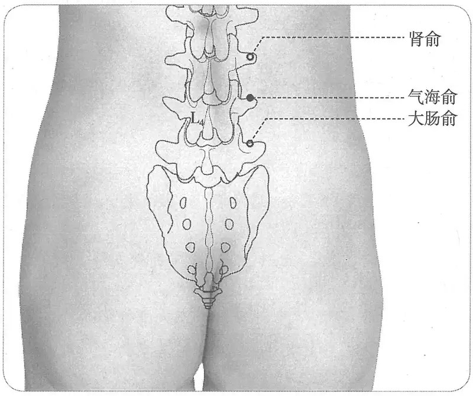

**图 2-184　气海俞穴图**

**取穴**：俯卧，于第3腰椎棘突下，督脉旁1.5寸处取之。

　1. 在第十五椎下两旁，同身寸相去一寸半。（《太平圣惠方·针经》、《医学入门》、《针灸大成》、《循经考穴编》、《针灸易学》）

　2. 在第十五椎下两旁各寸半。凡大杼下穴皆当除脊各寸半。（《针灸资生经》卷一）

　3. 除脊量开寸五分……三焦肾俞气海俞，十三十四十五椎。（《针灸问对》）

　4. 在十五椎下，去脊中二寸，正坐取之。（《类经图翼》卷十、《医宗金鉴·刺灸心法要诀》、《针灸逢源》）

　5. 第十五椎下去脊中二寸去脊边一寸半。（《针灸十四经穴位考订》）

　6. 统编针灸学教材

　　(1) 部位：十五椎下两旁，相去脊各一寸五分。取穴：正坐或仰卧，按第十五脊椎下旁开一寸五分取之。（1957年南京《针灸学》）

　　(2) 部位：肾俞穴下。取穴：俯卧，从第十五椎下旁开一寸五分陷中取之。（1版《针灸学讲义》）

　　(3) 部位：十五椎下两旁，相去脊各一寸五分。取穴：俯卧，于第三腰椎棘突下，督脉旁一寸五分取之。（2版《针灸学讲义》）

　　(4) 第三腰椎棘突下，旁开1.5寸。（4、5、6、7版《针灸学》）

　　(5) 第三腰椎棘突下，督脉旁开一寸五分。（《中国针灸学》）

**文献分析**：关于本穴定位去脊中距离的分歧，详见本经“概说”。

#### 【类属】 

足太阳膀胱经穴；背俞穴。

**归经**：足太阳膀胱经。（明嘉靖针灸铜人、《针灸问对》）

#### 【适应症】 

主治局部病症。常用于腰痛，痔漏。

　1. 理腰痛，痔痛，泻血。（《太平圣惠方·针经》）

〔p.681 (인쇄 661)〕

　2. 统编针灸学教材

　　(1) 主治腰痛，痔漏。（1957年南京《针灸学》、1版《针灸学讲义》）

　　(2) 主治腰痛，痛经，痔漏。（2版《针灸学讲义》）

　　(3) 主治腰痛，痛经，痔漏，腹胀肠鸣。（4、5版《针灸学》）

　　(4) 主治腰痛，痛经，肠鸣，痔疾。（6版《针灸学》）

　　(5) 主治：①肠鸣腹胀；②痛经；③腰痛。（7版《针灸学》）

　　(6) 主治腰痛，月经不调，痛经，气喘。（《中国针灸学》）

**文献分析**：本穴自明代《针灸问对》才归入经穴，古代临床应用很少。第1版教材主治与古代文献相同，而从第2版教材起，增加“痛经”一症，考此症见于古代文献“气海”穴主治；第4版教材增“腹胀肠鸣”症，系下一穴“大肠俞”主治。在没有文献依据与临床证据之前，暂不收录。

#### 【操作】 

直刺0.5~1寸。

　1. 通灸之。（《太平圣惠方·针经》）

　2. 一法刺入一分，沿皮向外一寸五分。（《循经考穴编》上）

　3. 针三分，灸五壮。（《针灸十四经穴位考订》）

　4. 统编针灸学教材

　　(1) 针五分，灸三至七壮。（1957年南京《针灸学》、1版《针灸学讲义》）

　　(2) 直刺5~10分，艾条灸5~15分钟。（2版《针灸学讲义》）

　　(3) 直刺0.5~1寸。（4、5、7版《针灸学》）

　　(4) 直刺0.5~1寸；可灸。（6版《针灸学》）

　　(5) 直刺0.8~1.2寸，可灸。（《中国针灸学》）

### （二十五）大肠俞 Dàchángshū BL25 出《黄帝明堂经》 

#### 【提要索隐】 

**部位**：在脊柱区，第4腰椎棘突下，后正中线旁开1.5寸。

**适应症**：主治大肠病症。常用于腹胀，腹痛，肠鸣，泄泻，便秘；腰痛。

**针刺操作**：直刺0.8~1.2寸。

#### 【名实考】 

值得一提的是，宋以前文献如《华佗针灸经》、《金腾灸经》、敦煌卷子佚名灸方中，大肠、小肠共一命名“大小肠俞”，这应是某种早期藏象学说的反映。宋以前有关背俞穴定位分歧，详见本经“概说”。

　1. 大肠俞，在第十六椎下两旁各一寸五分。（《黄帝明堂经》）

　2. 论脏腑高下前后之位……应小肠腧在上，大肠腧在下……然肺在心之上，肺与大肠为表里，则大肠腧又宜在小肠腧之上矣。考足阳明胃经，上巨虚、下巨虚，亦以心肺之上下分属，而不以大、小肠之上下分属焉。（《经穴解》）

#### 宋以前文献大肠俞别说 

　1. 僧匡及彻云，大肠输，第十三节，夹脊相去二寸半，瘦人相去二寸二分。（《医心方》卷二）

　2. 大肠俞在十六椎两厢相去二寸三分。主腹中雷鸣，大肠灌沸，泄利，食不消化，小腹绞痛，腰脊疼强，大小［便］难，不能食饮，灸百壮，善。（敦煌卷子佚名灸方）

〔p.682 (인쇄 662)〕

　3. 大肠俞主风，腹中雷鸣，大肠灌沸，肠澼泄痢，食不消化，少腹绞痛，腰脊疼强，大小便难，不能饮食，灸百壮，三报之。（《千金翼方·针灸上》卷二十六）

　4. 大肠输在十六椎两边相去一寸半。治风，腹中雷鸣，肠澼泄痢，食不消化，小腹绞痛，腰脊疼强，或大小便难，不能饮食，灸百壮，三日一报之。（《千金要方·诸风》卷八）

**按**：这条文字，敦煌卷子与《千金要方》的主要差别在于腧穴的部位，敦煌卷子佚名灸方背俞穴均相去“二寸三分”，这种取背俞穴的方法的确出于隋唐时腧穴文献，《千金要方》及《千金翼方》都记载了这种取背俞穴法，后人不知此法而改《千金要方》之文。

#### 【定位】 

**部位**：在脊柱区，第4腰椎棘突下，后正中线旁开1.5寸（图2-185）。

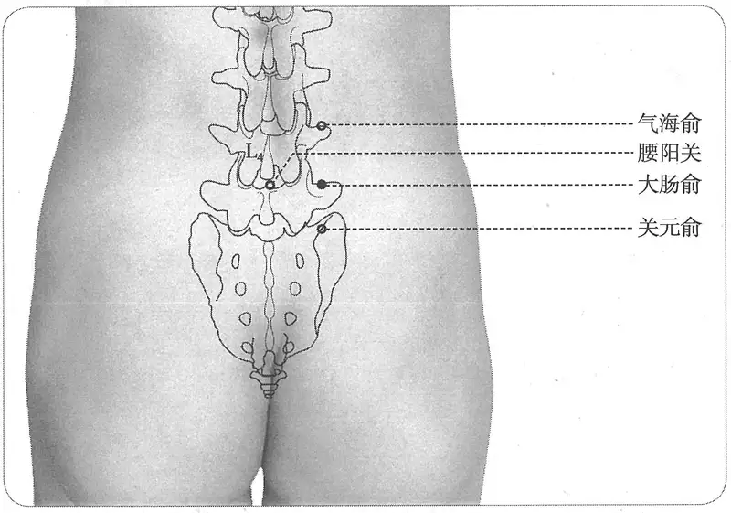

**图 2-185　大肠俞穴图**

**取穴**：俯卧，于第4腰椎棘突下，腰阳关穴旁1.5寸取之，约当与髂嵴高度相平。

　1. 在第十六椎下两旁各一寸五分。（《黄帝明堂经》、《太平圣惠方·针经》、《铜人腧穴针灸图经》卷上及卷下“穴腧都数”、《圣济总录》、《医学纲目》、《针方六集》）

　2. 在背第十六椎下两旁，相去各一寸半。（《太平圣惠方》卷五十五、《铜人腧穴针灸图经》卷中、《窦太师针经》）

　3. 在第十六椎下两旁各寸半。凡大杼下穴皆当除脊各寸半。（《针灸资生经》卷一）

　4. 在第十六椎下相去脊中各一寸五分。（《十四经发挥》中、《针灸聚英》、《古今医统》、《针灸大成》、《针方六集》、《循经考穴编》、《针灸易学》）

　5. 在第十六椎下，去脊中二寸，伏而取之。（《类经图翼》卷七、《医宗金鉴·刺灸心法要诀》、《针灸逢源》）

　6. 第十六椎下去脊中二寸去脊边一寸半。（《针灸十四经穴位考订》）

　7. 统编针灸学教材

　　(1) 部位：第十六椎下两旁相去脊各一寸五分。取穴：正坐或俯卧，按第十六椎下阳关穴旁开一寸五分取之相当于《图翼》所载的腰眼穴部位。（1957年南京《针灸学》）

　　(2) 部位：气海俞穴下。取穴：俯卧，从第十六椎下督脉阳关穴旁开一寸五分陷中取之。按：相当于图翼所载的腰眼穴部位。（1版《针灸学讲义》）

〔p.683 (인쇄 663)〕

　　(3) 部位：在第十六椎下，两旁各一寸五分。取穴：俯卧，于第四腰椎棘突下，腰阳关督脉旁一寸五分取之，约当与髂嵴高度相平。（2版《针灸学讲义》）

　　(4) 第四腰椎棘突下，旁开1.5寸。（4、5、7版《针灸学》）

　　(5) 在腰部，当第4腰椎棘突下，旁开1.5寸。（6版《针灸学》）

　　(6) 第四腰椎棘突下，腰阳关旁开一寸五分，约与髂嵴高度相平。（《中国针灸学》）

**文献分析**：关于本穴定位去脊中距离的分歧，详见本经“概说”。

#### 【类属】 

足太阳膀胱经穴；背俞穴之一。

**归经**：足太阳膀胱经。（《外台秘要》卷三十九、《铜人腧穴针灸图经》卷上）

#### 【适应症】 

主治大肠病症。常用于腹胀，腹痛，肠鸣，泄泻，便秘；腰痛。

　1. 主大肠转气，按之如覆杯，食饮不下，善噎，肠中鸣，腹膜面肿，暴泄，腰痛。（《黄帝明堂经》）

　2. 治风，腹中雷鸣，肠澼泄利，食不消化，小腹绞痛，腰脊疼强，或大小便难，不能饮食。（《千金要方》卷八、《千金翼方》）

　3. 主津液所生病者，目黄，口干，衄，喉痹，肩前臑痛，大指次指痛不用，气盛有余则热肿，虚则寒栗。（《外台秘要》卷三十九）

**按**：此为手阳明大肠经所生病候，辑录于此，欠妥，后世文献皆不从。

　4. 理腰痛，腹鸣胀满，绕脐中痛，大小便不利，或泄痢，食不化，脊骨强。（《太平圣惠方·针经》）

**按**：此与《千金要方》主治相类，盖辑自同一部“明堂”文献。

　5. 治腰痛，肠鸣腹胀，绕脐切痛，大小便不利，洞泄食不化，脊强不得俯仰。（《铜人腧穴针灸图经》卷中）

　6. 大便结不通，泻；大便泄不止，补；腰痛胁疼，腹胀疼者，看症补泻。（《窦太师针经》）

　7. 主脏腑邪热，大便闭塞，脏毒便血。（《循经考穴编》上）

　8. 多食身瘦。（《针灸聚英》卷一、《针灸大成》）

**按**：“多食身瘦”系脾俞穴主治，此乃高武从《针灸资生经》误录《千金要方》之文。

　9. 统编针灸学教材

　　(1) 主治肠鸣气胀，绕脐切痛，洞泄，大便闭塞，腰痛。（1957年南京《针灸学》）

　　(2) 主治肠鸣气胀，绕脐切痛，泄泻，便秘，腰痛。（1版《针灸学讲义》）

　　(3) 主治腹痛，腹胀，肠鸣，泄泻，便秘，腰痛。（2版《针灸学讲义》、3版《针灸学》）

　　(4) 主治腰痛，肠鸣腹胀，泄泻，便秘。（4版《针灸学》）

　　(5) 主治腹胀，泄泻，便秘，腰痛。（5版《针灸学》）

　　(6) 主治腰脊疼痛，腹痛，腹胀，泄泻，便秘，痢疾。（6版《针灸学》）

　　(7) 主治：①腰腿痛；②腹胀，腹泻，便秘等胃肠病证。（7版《针灸学》）

　　(8) 主治腰脊痠痛，腹胀，肠鸣，泄泻，便秘，下肢痿痹，腰椎痛。（《中国针灸学》）

**文献分析**：古今文献对于本穴主治的记载一致，皆主大肠病症及腰痛。

#### 附：临床应用举例 

　1. 胀满雷鸣，灸大肠俞百壮，三报。（《千金要方》卷十六）

　2. 肠中胪胀不消，灸大肠俞四十九壮。（《千金要方》卷十八）

　3. 灸诸痢法，《新录方》又灸大肠俞百壮。第十六椎两旁名大肠俞。（《医心方》卷十一）

〔p.684 (인쇄 664)〕

　4. 治脱肛，大肠俞、百会、长强。（《医学纲目》卷二十七）

　5. 胃脘暴痛，脐中坚痛，石门、商丘、阴谷、大肠俞、膈俞。（《医学纲目》卷二十二）

　6. 菌痢急性肠炎，大肠俞针灸疗法。［陕西中医，1985，6(8)：367］

　7. 婴幼儿腹泻，大肠俞、天枢穴针灸治疗。［湖北医学院学报，1987(1)：92］

　8. 直肠脱垂，长强穴、大肠俞，针刺治疗。［内蒙古中医药，1987(4)：41］

　9. 急性阑尾炎，大肠俞、天井穴，针灸治疗。［中国针灸，1986，6(2)：22］

#### 【操作】 

直刺0.8~1.2寸。

　1. 刺入三分，留六呼，灸三壮。（《黄帝明堂经》）

　2. 针入一分，沿皮向外一寸半，灸三七壮。（《窦太师针经》）

　3. 统编针灸学教材

　　(1) 针五分，灸五至十五壮。（1957年南京《针灸学》、1版《针灸学讲义》）

　　(2) 直刺7~19分；艾炷灸5~15壮，艾条灸5~15分钟。（2版《针灸学讲义》）

　　(3) 直刺0.8~1.2寸。（4、5、7版《针灸学》）

　　(4) 直刺0.5~1.2寸；可灸。（6版《针灸学》、《中国针灸学》）

　4. ①直刺，一般治疗深1~2寸。感应：腰部酸胀。②斜刺，治疗坐骨神经痛时，略向外斜刺，进针2~3寸。感应：有麻电感可向下肢放散。③横刺，治疗骶髂关节炎时，针尖向下透小肠俞。感应：酸胀可扩散至骶髂关节。灸3~7壮；温灸5~20分钟。（上海《针灸学》）

### （二十六）关元俞 Guānyuánshū BL26 出《太平圣惠方》 

#### 【提要索隐】 

**部位**：在脊柱区，第5腰椎棘突下，后正中线旁开1.5寸。

**适应症**：主治腰腹部、前阴部病症。常用于腹胀，泄泻；腰骶痛，小便频数或不利，遗尿。

**针刺操作**：直刺0.8~1.2寸。

#### 【名实考】 

本穴首见于《太平圣惠方》，而自明嘉靖针灸铜人、《针灸问对》归入足太阳膀胱经穴。

　1. 关元俞二穴，在第十七椎下两旁相去同身寸一寸半是穴。理风劳腰痛，泄痢虚胀，小便难，妇人瘕聚诸疾。针入三分。（《太平圣惠方·针经》）

　2. 关元乃任经至要之穴也，故太阳亦有穴统之，此腧在大、小肠之间，为最要之腧，不可缺者。（《经穴解》）

#### 【定位】 

**部位**：在脊柱区，第5腰椎棘突下，后正中线旁开1.5寸（图2-186）。

**取穴**：俯卧，于第5腰椎棘突下，督脉旁1.5寸取之。

　1. 在第十七椎下两傍，相去同身寸一寸半。（《太平圣惠方·针经》、《医学入门》、《针灸大成》、《循经考穴编》、《针灸易学》）

　2. 在第十七椎下两旁各寸半。凡大杼下穴皆当除脊各寸半。（《针灸资生经》卷一）

　3. 除脊量开寸五分……大肠关元并小肠，十六十七十八椎。（《针灸问对》）

　4. 在第十七椎下，两旁相去各二寸。（《类经图翼》卷七、《医宗金鉴·刺灸心法要诀》、

〔p.685 (인쇄 665)〕

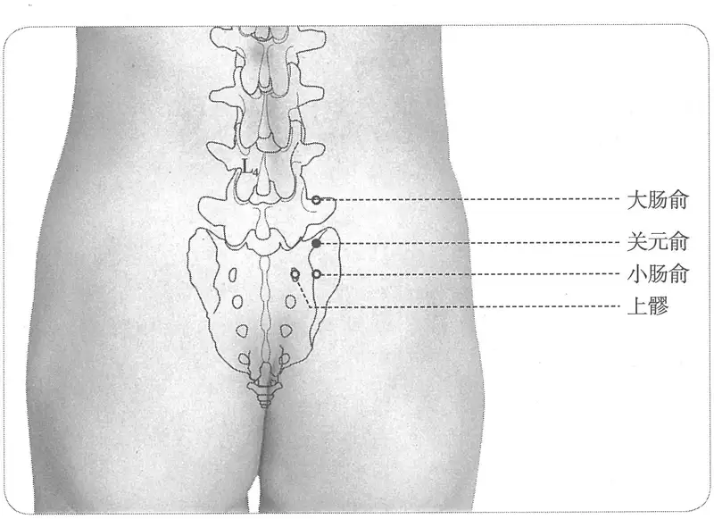

**图 2-186　关元俞穴图**

《针灸逢源》）

　5. 第十七椎下去脊中二寸去脊边一寸半。（《针灸十四经穴位考订》）

　6. 统编针灸学教材

　　(1) 部位：在十七椎下两旁，相去脊各一寸五分。取穴：正坐或俯卧，由阳关穴按下一节，旁开一寸五分取之。（1957年南京《针灸学》）

　　(2) 部位：大肠俞穴下。取穴：俯卧，由十七椎下旁开一寸五分陷中取之。（1版《针灸学讲义》）

　　(3) 部位：在十七椎下两旁，相去脊各一寸五分。取穴：俯卧，于第五腰椎棘突下，督脉旁一寸五分取之。（2版《针灸学讲义》）

　　(4) 第五腰椎棘突下，旁开1.5寸。（4、5、7版《针灸学》）

　　(5) 在腰部，当第5腰椎棘突下，旁开1.5寸。（6版《针灸学》）

　　(6) 第五腰椎棘突下，督脉旁开一寸五分。（《中国针灸学》）

**文献分析**：关于本穴定位去脊中距离的分歧，详见本经“概说”。

#### 【类属】 

足太阳膀胱经穴；背俞穴。

**归经**：足太阳膀胱经。（明嘉靖针灸铜人、《针灸问对》）

#### 【适应症】 

主治腰腹部、前阴部病症。常用于腹胀，泄泻；腰骶痛，小便频数或不利，遗尿。

　1. 理风劳，腰痛，泄痢，虚胀，小便难，妇人瘕聚诸疾。（《太平圣惠方·针经》）

　2. 统编针灸学教材

　　(1) 主治泄痢虚胀，腰痛，癥瘕，小便难。（1957年南京《针灸学》、1版《针灸学讲义》）

　　(2) 主治腹胀，泄泻，腰痛，遗尿，消渴，小便频数或小便难。（2版《针灸学讲义》）

　　(3) 主治腰痛，腹胀，泄泻，小便难，遗尿，消渴。（4版《针灸学》）

　　(4) 主治腹胀，泄泻，小便频数或不利，遗尿，腰痛。（5版《针灸学》）

　　(5) 主治腹胀，泄泻，小便不利，遗尿，消渴，腰痛。（6版《针灸学》）

〔p.686 (인쇄 666)〕

　　(6) 主治：①腹胀，腹泻；②腰骶痛；③小便频数或不利，遗尿。（7版《针灸学》）

　　(7) 主治腰痛，腹胀，泄泻，遗尿，腰腿痛，小便频数。（《中国针灸学》）

**文献分析**：现存最早记载本穴主治的腧穴文献为《太平圣惠方》，至明代始归入经穴，此后文献论述较少。现代教材多据《太平圣惠方》确定本穴的主治。

#### 附：临床应用举例 

　1. 小便有五色，惟赤、白色者多。赤色多因酒得之，宜服《本事方》清心丸；白色乃下元冷，宜服补药，著灸肾俞、关元俞、小肠俞、膀胱俞等，皆要穴也。（《针灸资生经》卷三）

　2. 尿潴留，针刺关元俞、上髎等穴治疗。［中国针灸，1994(增刊)：91-92］

　3. 坐骨神经痛，深刺关元俞为主治疗。［湖南中医学院学报，1996，16(4)：57-58］

#### 【操作】 

直刺0.8~1.2寸。

　1. 针入三分。（《太平圣惠方·针经》）

　2. 一法刺入一分，沿皮向外一寸五分，灸七壮。（《循经考穴编》上）

　3. 针三分，灸三壮。（《针灸十四经穴位考订》）

　4. 统编针灸学教材

　　(1) 针五分，灸三至七壮。（1957年南京《针灸学》、1版《针灸学讲义》）

　　(2) 直刺7~10分，艾条灸5~15分钟。（2版《针灸学讲义》）

　　(3) 直刺0.8~1.2寸。（4、5、7版《针灸学》）

　　(4) 直刺0.8~1.2寸；可灸。（6版《针灸学》、《中国针灸学》）

　5. 直刺，1.5~2寸。感应：局部酸胀，有时可向下肢放散。灸5~7壮；温灸5~15分钟。（上海《针灸学》）

### （二十七）小肠俞 Xiǎochángshū BL27 出《黄帝明堂经》 

#### 【提要索隐】 

**部位**：在骶区，横平第1骶后孔，骶正中嵴旁开1.5寸。

**适应症**：主治前阴病症。常用于遗精，遗尿，尿血，小便痛，疝气；泄泻；带下；腰骶痛。

**针刺操作**：直刺0.8~1.2寸。

#### 【名实考】 

值得一提的是，宋以前文献如《华佗针灸经》、《金腾灸经》、敦煌卷子佚名灸方中，大肠、小肠共一俞名“大小肠俞”，这应是某种早期藏象学说的反映。宋以前有关背俞穴定位分歧，详见本经“概说”。

小肠俞，在第十八椎下两旁各一寸五分。（《黄帝明堂经》）

#### 宋以前文献小肠俞别说 

　1. 《扁鹊针灸针》曰第十七椎名小肠输。夹脊左右各一寸半或一寸二分。（《医心方》卷二）

　2. 《龙衔素针经》曰小肠输，第十七椎相去三寸。（《医心方》卷二）

　3. 僧匡及彻云，小肠输，第十二节，夹脊相去二寸半，瘦人相去二寸二分。（《医心方》卷二）

　4. 大小肠俞，在十七椎两厢相去二寸三分。主膀胱□，大小肠寒，泄痢。亦主腰脊痛，大小便不利及妇人带下，灸一百壮，亦□五百壮。（敦煌卷子佚名灸方）

　5. 小肠俞，主膀胱、三焦津液下，大小肠寒热，赤白泄洞痢，腰脊痛。又主小便不利，妇

〔p.687 (인쇄 667)〕

人带下，灸之各五十壮。（《千金翼方·针灸中》卷二十七）

　6. 膀胱、三焦津液下，大小肠中寒热，赤白泄痢，及腰脊痛，小便不利，妇人带下，灸小肠输五十壮。（《千金要方·膀胱腑》卷二十）

**按**：“大小肠俞”穴名见于《华佗针灸经》，而《扁鹊针灸经》此穴名“小肠俞”（而且该书所载背俞穴也“夹脊左右各一寸二分”，与敦煌卷子相合），这两种穴名分别见敦煌卷子及《千金方》，看来此异文由来已久。

#### 【定位】 

**部位**：在骶区，横平第1骶后孔，骶正中嵴旁开1.5寸（图2-187）。

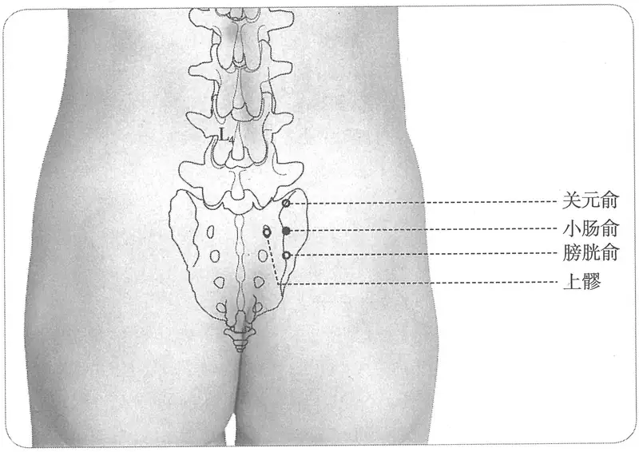

**图 2-187　小肠俞穴图**

**取穴**：俯卧，平第1骶后孔，督脉旁1.5寸，当髂后上棘内缘与骶骨间凹陷中取之。

　1. 在第十八椎下两旁各一寸五分。（《黄帝明堂经》、《太平圣惠方·针经》、《铜人腧穴针灸图经》、《圣济总录》、《窦太师针经》、《针方六集》）

　2. 在背第十八椎下两旁，相去各一寸半。（《太平圣惠方》卷五十五、《铜人腧穴针灸图经》卷中）

　3. 在第十八椎下两旁各寸半。凡大杼下穴皆当除脊各寸半。（《针灸资生经》卷一）

　4. 在第十八椎下相去脊中各一寸五分。（《十四经发挥》中、《针灸聚英》、《古今医统》、《针灸大成》、《循经考穴编》、《针灸易学》）

　5. 在十八椎下，去脊中二寸，伏而取之。（《类经图翼》卷七、《医宗金鉴·刺灸心法要诀》、《针灸逢源》）

　6. 第十八椎下去脊中二寸去脊边一寸半。（《针灸十四经穴位考订》）

　7. 统编针灸学教材

　　(1) 部位：第十八椎下两旁相去脊各一寸五分。取穴：按取第一荐骨棘状突起两旁一寸五分取之即第十八椎下。（1957年南京《针灸学》）

　　(2) 部位：关元俞穴下。取穴：俯卧，从十八椎下旁开一寸五分陷中取之。（1版《针灸学讲义》）

　　(3) 部位：在第十八椎下，两旁各一寸五分。取穴：平第一骶后孔，督脉旁一寸五分，当髂后上棘内缘与骶骨间凹陷中，俯卧取之。（2版《针灸学讲义》）

〔p.688 (인쇄 668)〕

　　(4) 第一骶椎棘突下，旁开1.5寸。（4、5版《针灸学》）

　　(5) 在骶部，当骶正中嵴旁1.5寸，平第一骶后孔。（6版《针灸学》）

　　(6) 第1骶椎棘突下，旁开1.5寸，约平第1骶后孔。（7版《针灸学》）

　　(7) 平第一骶后孔，督脉旁开一寸五分。（《中国针灸学》）

**文献分析**：关于本穴定位去脊中距离的分歧，详见本经“概说”。

#### 【类属】 

足太阳膀胱经穴；背俞穴。

**归经**：足太阳膀胱经。（《外台秘要》卷三十九、《铜人腧穴针灸图经》卷上）

#### 【适应症】 

主治前阴病症。常用于遗精，遗尿，尿血，小便痛，疝气；泄泻；带下；腰骶痛。

　1. 主少腹痛热控睾引腰脊，疝痛，上冲心；腰脊强，溺难黄赤，口干。（《黄帝明堂经》）

**按**：此条文字主要描述阴疝症状，与《灵枢·四时气》所述小肠病密切相关：“小腹控睾、引腰脊，上冲心，邪在小肠者。（小肠者）连睾系，属于脊，贯肝肺，络心系。气盛则厥逆，上冲肠胃，熏肝，散于肓，结于脐。故取之肓原以散之，刺太阴以予之，取厥阴以下之，取巨虚下廉以去之，按其所过之经以调之。”

　2. 主泄痢脓血五色，重下肿痛。（《千金要方》卷三十）

　3. 主膀胱三焦津液下，大小肠寒热，赤白泄洞痢，妇人带下。（《千金翼方》卷二十七）

　4. 主小便不利，少腹胀满，虚乏。（《千金翼方》卷二十七）

　5. 大小便难，淋、痔。（《外台秘要》卷三十九）

**按**：此条主治不见于《针灸甲乙经》、《医心方》卷二，也不见于“敦煌本”《黄帝明堂经》残页，而仅见于《千金要方》卷三十，原文作“长强、小肠俞主大小便难，淋癃”，据《千金要方》此篇体例，此条主治应辑入第一穴“长强”穴下，而不可归入“小肠俞”中。今检《千金要方》此条主治的确见于《针灸甲乙经》、《医心方》卷二“长强”穴，王焘不明《千金要方》体例而误归入“小肠俞”下。

　6. 理大便赤涩，小肠紧急，脚肿，短气不食，烦热，疞痛，大便脓血出，血痔疼痛。（《太平圣惠方·针经》）

　7. 治小便赤涩淋沥，少腹疞痛，脚肿短气，不嗜食，大便脓血出，五痔疼痛，妇人带下。（《铜人腧穴针灸图经》卷中）

　8. 遗溺，头痛，消渴。（《针灸聚英》卷一、《针灸大成》、《针方六集》）

**按**：此高武从《针灸资生经》辑录《千金要方》灸方主治症。

　9. 小肠疝气，小便红，泻；小便滑数，先泻后补。（《窦太师针经》）

　10. 主遗精，尿血。（《循经考穴编》上）

　11. 统编针灸学教材

　　(1) 主治遗精，尿血，遗尿，小便赤，小腹胀满疼痛，泄利脓血，痔疾。（1957年南京《针灸学》、1版《针灸学讲义》）

　　(2) 主治遗精，尿血，遗尿，白带，小腹胀痛，痢疾。（2版《针灸学讲义》、4版《针灸学》）

　　(3) 主治腹痛，泄泻，痢疾，遗尿，尿血，痔疾，遗精，白带，腰痛。（5版《针灸学》）

　　(4) 主治遗精，遗尿，白带，小腹胀痛，泄泻痢疾，腰腿痛。（6版《针灸学》）

　　(5) 主治：①遗精，遗尿，尿血，尿痛，带下；②腹泻，痢疾；③疝气；④腰骶痛。（7版《针灸学》）

　　(6) 主治小腹胀痛，痢疾，遗精，尿血，遗尿，白带，腰骶痛，腰腿痛。（《中国针灸学》）

**文献分析**：《黄帝明堂经》载本穴主治包括疝气和腰脊痛、小便难症状，唐代《千金翼方》增加泄痢和妇人带下症状，并有明确的临床应用，现代针灸学教材从之。

〔p.689 (인쇄 669)〕

#### 附：临床应用举例 

　1. 三焦寒热，灸小肠俞随年壮；膀胱三焦津液下，大小肠中寒热，赤白泄痢，及腰脊痛，小便不利，妇人带下，灸小肠俞五十壮。（《千金要方》卷二十）

　2. 消渴口干不可忍者，灸小肠俞百壮，横三间寸灸之。（《千金要方》卷二十一）

　3. 泄注五痢便脓血，重下腹痛，灸小肠俞百壮。（《千金要方》卷十五下）

　4. 小便不利，小腹胀满虚乏，灸小肠俞随年壮。（《千金要方》卷十九）

　5. 心烦短气，灸小肠俞。又灸巨阙、期门各一百壮，针入五分。又灸心俞百壮，针入五分。（《千金翼方》卷二十七）

　6. 大小肠俞大小便，气海血海疗五淋。（《灵光赋》）

#### 【操作】 

直刺0.8~1.2寸。

　1. 针入三分，留六呼，灸三壮。（《黄帝明堂经》）

　2. 针入一分，沿皮向外一寸半，灸三七壮。（《窦太师针经》）

　3. 统编针灸学教材

　　(1) 针五分，灸三至七壮。（1957年南京《针灸学》、1版《针灸学讲义》）

　　(2) 直刺5~10分；艾炷灸5~15壮，艾条灸5~15分钟。（2版《针灸学讲义》）

　　(3) 直刺0.8~1.2寸。（4、5版《针灸学》）

　　(4) 直刺0.8~1.2寸；可灸。（6版《针灸学》、《中国针灸学》）

　　(5) 直刺或斜刺0.8~1寸。（7版《针灸学》）

　4. ①直刺，1~1.5寸。感应：局部酸胀。②斜刺，治骶髂关节炎及盆腔疾患时，进针2~3寸。感应：酸胀感扩散至整个骶髂关节。灸3~7壮；温灸5~15分钟。（上海《针灸学》）

### （二十八）膀胱俞 Pángguāngshū BL28 出《黄帝明堂经》 

#### 【提要索隐】 

**部位**：在骶区，横平第2骶后孔，骶正中嵴旁开1.5寸。

**适应症**：主治局部和前阴病症。常用于小便不利，遗尿，泄泻，便秘；腰骶痛。

**备选适应症**：男子阴疝，女子阴肿，瘕聚。

**针刺操作**：直刺0.8~1.2寸。

#### 【名实考】 

　1. 膀胱俞，在第十九椎下两旁各一寸五分。（《黄帝明堂经》）

　2. 在第十九椎下两旁，相去各一寸五分。足太阳脉气所发。（《铜人腧穴针灸图经》卷中）

　3. 足太阳之正，行入腰中，循膂络肾，下属膀胱矣，而膀胱之腑气，又输于此，为膀胱腧。（《经穴解》）

#### 相关穴及刺激点 

腹热闭，时大小便难，腰痛连胁，灸团冈百壮，穴在小肠俞下二寸，横三间寸灸之。（《千金要方》卷十五）

#### 【定位】 

**部位**：在骶区，横平第2骶后孔，骶正中嵴旁开1.5寸（图2-188）。

**取穴**：在第2骶椎下间，后正中线旁开1.5寸处，平次髎穴。

　1. 在第十九椎下两旁各一寸五分。（《黄帝明堂经》、《太平圣惠方·明堂》、《铜人腧穴

〔p.690 (인쇄 670)〕

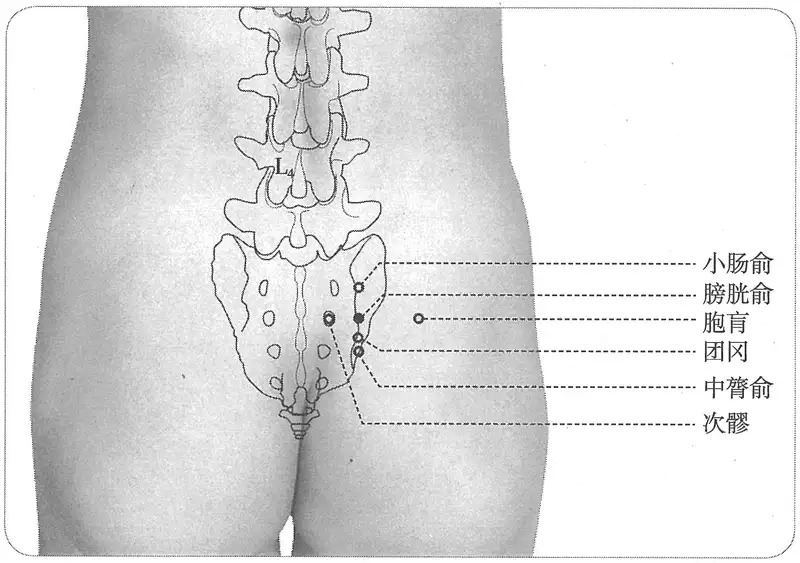

**图 2-188　膀胱俞穴与相关穴图**

针灸图经》、《圣济总录》、《窦太师针经》、《医学纲目》、《针方六集》）

　2. 在第十九椎下两旁，相去同身寸一寸半。（《太平圣惠方》）

　3. 在第十九椎下两旁各寸半。凡大杼下穴皆当除脊各寸半。（《针灸资生经》卷一）

　4. 在第十九椎下，相去脊中各一寸五分。（《十四经发挥》中、《针灸聚英》、《古今医统》、《针灸大成》、《循经考穴编》、《针灸易学》）

　5. 在十九椎下，去脊中二寸，伏而取之。（《类经图翼》卷七、《医宗金鉴·刺灸心法要诀》、《针灸逢源》）

　6. 第十九椎下去脊中二寸去脊边一寸半。（《针灸十四经穴位考订》）

　7. 统编针灸学教材

　　(1) 部位：第十九椎下两旁相去脊各一寸五分。取穴：按取第二荐骨假棘状突起之两旁各开一寸五分取之即第十九椎下。（1957年南京《针灸学》）

　　(2) 部位：小肠俞穴下。取穴：伏卧，从十九椎下旁开一寸五分陷中取之。（1版《针灸学讲义》）

　　(3) 部位：在第十九椎下，两旁各一寸五分。取穴：平第二骶后孔，当髂后上棘内缘与骶骨之间凹陷中俯卧取之。（2版《针灸学讲义》）

　　(4) 第二骶椎棘突下，旁开1.5寸。（4、5版《针灸学》）

　　(5) 在骶部，当骶正中嵴旁1.5寸，平第2骶后孔。（6版《针灸学》）

　　(6) 第2骶椎棘突下，旁开1.5寸，约平第2骶后孔。（7版《针灸学》）

　　(7) 平第二骶后孔，督脉旁开一寸五分。（《中国针灸学》）

**文献分析**：关于本穴定位去脊中距离的分歧，详见本经“概说”。

#### 【类属】 

足太阳膀胱经穴；背俞穴。

**脉气所发**：足太阳脉气所发。（《铜人腧穴针灸图经》卷中）

**归经**：足太阳膀胱经。（《外台秘要》卷三十九、《铜人腧穴针灸图经》卷上）

#### 【适应症】 

主治局部和前阴病症。常用于小便不利，遗尿，泄泻，便秘；腰骶痛。

〔p.691 (인쇄 671)〕

**备选适应症**：男子阴疝，女子阴肿，瘕聚。

　1. 主热，痓互引，汗不出，反折，尻臀内痛似瘅疟状。腰脊痛强引背、少腹，俯仰难，不得仰息，脚痿重，尻不举，溺赤，腰以下至足清不仁，不可以坐起。（《黄帝明堂经》）

　2. 主坚结积聚。（《千金要方》卷三十）

　3. 理风劳腰痛，泄痢肠痛，大小便难，阴生疮，少气，足胫冷拘急，不得屈伸，女人瘕聚。（《太平圣惠方·针经》）

　4. 腹中痛。（《太平圣惠方·明堂》）

　5. 治风劳，腰脊痛，泄利腹痛，小便赤涩，遗溺，阴生疮，少气，足胻寒，拘急，不得屈伸，女子瘕聚，脚膝无力。（《铜人腧穴针灸图经》卷中）

　6. 窦太师针灸遗存

　　(1) 治大便不通，泻；木肾偏坠，补。妇人月事不调，五淋等症，看虚实补泻。（《窦太师针经》）

　　(2) 主月事不调。（《针方六集》卷五）

　　(3) 主淋遗，疝疾偏坠，木肾，腰腿疼痛，男子阴茎虚肿，妇人阴内湿痒肿痛，小腹瘕聚。（《循经考穴编》上）

　7. 统编针灸学教材

　　(1) 主治前阴肿，淋疾，尿赤，遗尿尿闭，瘕聚，泄泻腹痛，大便难，腰、脊强痛，膝足寒冷无力。（1957年南京《针灸学》、1版《针灸学讲义》）

　　(2) 主治小便不通，遗尿，泄泻，便秘，腰脊强痛。（2版《针灸学讲义》、4、5版《针灸学》）

　　(3) 主治遗尿，遗精，小便不利，泄泻，腰骶部疼痛。（6版《针灸学》）

　　(4) 主治：①小便不利，遗尿；②腰骶痛；③腹泻，便秘。（7版《针灸学》）

　　(5) 主治小便不通，遗尿，尿频，泄泻，便秘，腰脊强痛。（《中国针灸学》）

**文献分析**：《黄帝明堂经》载本穴主治主要为腰部、小便症状和痓证。宋代《太平圣惠方》新增“大便难”和妇人病症，金元窦太师更明确突出了治疗男子阴疝、遗精，女子前阴、月事病症。现代针灸学教材载本穴主治未体现这一变化，自1版教材以后，其他各版皆未收录，今附存备考，有待今后进一步检验。

#### 附：临床应用举例 

　1. 治诸瘕方，灸膀胱俞三百壮以上。（《医心方》卷十）

　2. 小便有五色，惟赤、白色者多。赤色多因酒得之，宜服《本事方》清心丸；白色乃下元冷，宜服补药著，灸肾俞、关元俞、小肠俞、膀胱俞等，皆要穴也。近有患小便出血者，人教酒与水煎苦荬菜根，服即愈。（《针灸资生经》卷四）

　3. 压力性尿失禁，膀胱俞、中极穴，针灸疗法。［上海针灸杂志，1985(4)：22］

#### 【操作】 

直刺0.8~1.2寸。

　1. 刺入三分，留六呼，灸三壮。（《黄帝明堂经》）

　2. 灸七壮。（《太平圣惠方·明堂》）

　3. 针入一分，沿皮向外一寸半，灸三七壮。（《窦太师针经》）

　4. 针五分，灸三壮。（《针灸十四经穴位考订》）

　5. 统编针灸学教材

　　(1) 针五分，灸三至七壮。（1957年南京《针灸学》、1版《针灸学讲义》）

　　(2) 直刺5~10分；艾炷灸5~15壮，艾条灸5~15分钟。（2版《针灸学讲义》）

〔p.692 (인쇄 672)〕

　　(3) 直刺或斜刺0.8~1.2寸。（4、5、7版《针灸学》）

　　(4) 直刺0.8~1.2寸；可灸。（6版《针灸学》、《中国针灸学》）

　6. 直刺，1~1.5寸。感应：局部酸胀。有时可向臀部扩散。灸3~7壮；温灸5~15分钟。（上海《针灸学》）

### （二十九）中膂俞 Zhōnglǚshū BL29 出《黄帝明堂经》 

#### 【提要索隐】 

**穴名**：一名脊内俞；又名中膂内腧，一名脊内腧。

**部位**：在骶区，横平第3骶后孔，骶正中嵴旁开1.5寸。

**适应症**：主治局部、肠道病症。常用于腰骶痛；腹胀，泄泻，痢疾。

**针刺操作**：直刺0.8~1.2寸。

#### 【名实考】 

足太阳经脉“入循膂，络肾属膀胱”，故膀胱俞下名“中膂俞”，又名“脊内俞”，皆由此“入于膂中”之义也。

中膂俞，《针灸甲乙经》卷八、卷九及《素问·水热穴论》王冰注作“中膂内俞”，《外台秘要》与《素问·刺腰痛》王冰注作“中膂肉俞”。本穴应作“中膂俞”，“膂”或写作“膐”，后人误抄作“旅肉”二字，“肉”又误作“内”，因古“旅”通“膂”，后人复改“旅”为“膂”，考《医心方》即作“中旅内俞”，后人则于“旅”旁注作“膂”，可证。是知“中膂俞”先误作“中旅肉俞”，后误作“中旅内俞”、“中膂内俞”。

需要特别注意的是，《太平圣惠方》所引《山眺经》文字，将本穴归入足少阴经，反映的是一种早期腧穴归经学说。

　1. 中膂俞，在第二十椎下，两旁各一寸五分，夹脊胂起肉。（《黄帝明堂经》）

　2. 中膂俞二穴，在第二十椎下两旁相去同身寸一寸五分是穴。一名脊内俞。是少阴脉。（《太平圣惠方·针经》）

　3. 中膂内腧二穴，一名脊内腧。在第二十椎下，两旁相去各一寸五分，夹脊起肉。（《铜人腧穴针灸图经》卷中）

　4. 膂者，夹脊两旁肉也，在内则为夹脊之脂络，在外则为夹脊之膂，以内系各脏腑，外以载各穴，亦在背之至要者也，故有腧焉。（《经穴解》）

　5. 别名　中膂、脊内俞、中膂内俞。（1957年南京《针灸学》）

#### 【定位】 

**部位**：在骶区，横平第3骶后孔，骶正中嵴旁开1.5寸（图2-189）。

**取穴**：在第3骶椎下间，后正中线旁开1.5寸处，平中髎穴。

　1. 《黄帝明堂经》佚文

　　(1) 在第二十椎下两旁各一寸五分。（《千金要方》卷二十九、《千金翼方》、《医心方》、《太平圣惠方·针经》）

　　(2) 在第二十椎下两旁各一寸五分，夹脊胂而起。（《针灸甲乙经》卷三）

　　(3) 在第二十椎下两旁各一寸半，夹脊胂起肉。（《外台秘要》卷三十九、《素问》王冰注、《铜人腧穴针灸图经》、《圣济总录》、《十四经发挥》）

　2. 在第二十椎下两旁各寸半，夹脊起肉。凡大杼下穴皆当除脊各寸半。（《针灸资生经》卷一）

　3. 在第二十椎下夹脊起肉，相去脊中各一寸五分。（《针灸聚英》卷一、《古今医统》、《针

〔p.693 (인쇄 673)〕

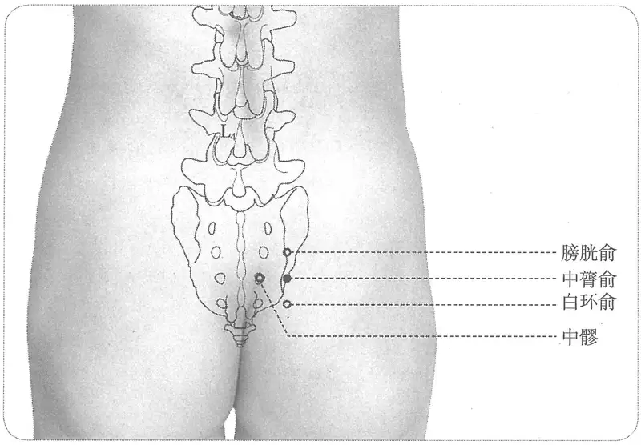

**图 2-189　中膂俞穴图**

灸大成》、《循经考穴编》、《针灸易学》）

　4. 在二十椎下，去脊中二寸，夹脊胂起肉间，伏而取之。（《类经图翼》卷七、《医宗金鉴·刺灸心法要诀》、《针灸逢源》）

　5. 第二十椎下去脊中二寸去脊边一寸半。（《针灸十四经穴位考订》）

　6. 统编针灸学教材

　　(1) 部位：第二十椎下两旁相去脊各一寸五分。取穴：按取第三荐骨假棘状突起之两旁各一寸五分取之即第二十椎下。（1957年南京《针灸学》）

　　(2) 部位：膀胱俞穴下。取穴：伏卧，从二十椎下旁开一寸五分陷中取之。（1版《针灸学讲义》）

　　(3) 部位：在第二十椎下，两旁各一寸五分。取穴：平第三骶后孔，督脉旁一寸五分，俯卧取之。（2版《针灸学讲义》）

　　(4) 第三骶椎棘突下，旁开1.5寸。（4、5版《针灸学》）

　　(5) 在骶部，当骶正中嵴旁1.5寸，平第3骶后孔。（6版《针灸学》）

　　(6) 第3骶椎棘突下，旁开1.5寸，约平第3骶后孔。（7版《针灸学》）

　　(7) 平第三骶后孔，督脉旁开一寸五分。（《中国针灸学》）

**文献分析**：关于本穴定位去脊中距离的分歧，详见本经“概说”。

#### 【类属】 

足太阳膀胱经穴。本穴《黄帝明堂经》未注明脉气所发之经，自《外台秘要》、《铜人腧穴针灸图经》归入足太阳膀胱经后，后世皆从之。值得注意的是，《太平圣惠方》引《山眺经》腧穴归经文字明确将“中膂俞”穴归入少阴脉，无独有偶，《素问·通评虚实论》也将背部第一侧行穴归入足少阴经穴，这反映的是一种早期的腧穴归经学说——一种与经脉循行规律更符合的归经学说。

　1. 中膂俞二穴，在第二十椎下两旁相去同身寸一寸五分是穴。一名脊内俞。是少阴脉。（《太平圣惠方·针经》）

　2. 腹暴满，按之不下，取手太阳经络者，胃之募也，少阴俞去脊椎三寸旁五，用员利针。（《素问·通评虚实论》）

〔p.694 (인쇄 674)〕

这里明言“去脊椎三寸”之腰背部第一侧行穴为“少阴俞”（《黄帝内经太素·刺腹满数》卷三十、《针灸甲乙经》卷九第七对于这句话的记载完全相同，故可排除误、衍的可能性），杨上善注曰：“腹满亦取足少阴之输，夹脊相去三寸”，极是。

#### 【适应症】 

主治局部、肠道病症。常用于腰骶痛；腹胀，泄泻，痢疾。

　1. 主腰痛不可以俯仰。寒热。痓，反折互引，腹胀，掖挛，背中怏怏引胁痛，内引心。（《黄帝明堂经》）

　2. 主赤白痢，虚浊，汗出。（《太平圣惠方·针经》）

　3. 治肠冷赤白痢，肾虚消渴，汗不出，腰脊不得俯仰，腹胀胁痛。（《铜人腧穴针灸图经》卷中）

　4. 主疝痛。（《针灸聚英》卷一、《古今医统》、《针灸大成》、《针方六集》、《类经图翼》）

**按**：此乃高武从《针灸资生经》误引《千金要方》卷三十之文。

　5. 统编针灸学教材

　　(1) 主治赤白痢，疝痛，腰脊强。（1957年南京《针灸学》、1版《针灸学讲义》、《中国针灸学》）

　　(2) 主治痢疾，疝气，消渴，腰脊强痛。（2版《针灸学讲义》、4版《针灸学》）

　　(3) 主治泄泻，疝气，腰脊强痛。（5版《针灸学》）

　　(4) 主治腰脊痛，消渴，痢疾。（6版《针灸学》）

　　(5) 主治腹泻，疝气，腰骶痛。（7版《针灸学》）

**文献分析**：教材中“疝气”系承袭高武《针灸聚英》之误，今去之。

#### 附：临床应用举例 

　1. 泌尿生殖系疾病，针刺中膂俞治疗。［实用医学杂志，1987(2)：37］

　2. 痢疾，中膂俞，温针。［上海针灸杂志，1990，9(1)：24］

#### 【操作】 

直刺0.8~1.2寸。

　1. 刺入三分，留十呼、灸三壮（《黄帝明堂经》）

　2. 刺入三分，留七呼，灸三壮。得气即泻。（《太平圣惠方·针经》）

　3. 针五分，灸三壮。（《针灸十四经穴位考订》）

　4. 统编针灸学教材

　　(1) 针五至八分，灸三至七壮。（1957年南京《针灸学》、1版《针灸学讲义》）

　　(2) 直刺7~10分，艾条灸5~15分钟。（2版《针灸学讲义》）

　　(3) 直刺1~1.5寸。（4、5、7版《针灸学》）

　　(4) 直刺0.5~1.2寸；可灸。（6版《针灸学》）

　　(5) 直刺0.8~1.2寸。可灸。（《中国针灸学》）

### （三十）白环俞 Báihuánshū BL30 出《黄帝明堂经》 

#### 【提要索隐】 

**部位**：在骶区，横平第4骶后孔，骶正中嵴旁开1.5寸。

**适应症**：主治局部、前阴和妇科病症。常用于腰骶痛；遗尿，遗精，白浊；月经不调，带下。

**针刺操作**：直刺0.8~1.2寸。

〔p.695 (인쇄 675)〕

#### 【名实考】 

“白环俞”一穴，古今医家绞尽脑汁，各抒己见，以阐发“白环”一词的微言大意，似乎“白环俞”名中蕴含着万般玄机。而《圣济总录·骨空穴法》明确指出：“横骨之前为白环骨者共二（有势有液）”，将与白环骨相对应的腧穴名曰“白环俞”，这与“膀胱俞”、“肾俞”等背俞穴的命名方法完全相同，完全不像古今医家所想象的那般玄妙。

　1. 白环俞，在第二十一椎下两旁，各一寸五分，足太阳脉气所发，伏而取之。（《黄帝明堂经》）

　2. 横骨之前为白环骨者共二有势有液。白环之前为内辅骨者左右共二有势多液，内辅之后为骸关骨者左右共二有势多液，骸关之下为楗骨者左右共二有势多液，楗骨之下为髀枢骨者左右共二有势多髓。（《圣济总录·骨空穴法》卷一九一）

　3. 此精之下孔也，此孔上通脑髓，下通溺管，与督脉并行，而在督之内，太阳两脉夹之，乃人生死之关。太阳于身之脏腑经络无所不统，岂如是至要之形器，而不统之乎。曰白者，精之色白也；环者，督、任二脉如环之无端也。（《经穴解》）

#### 【定位】 

**部位**：在骶区，横平第4骶后孔，骶正中嵴旁开1.5寸（图2-190）。

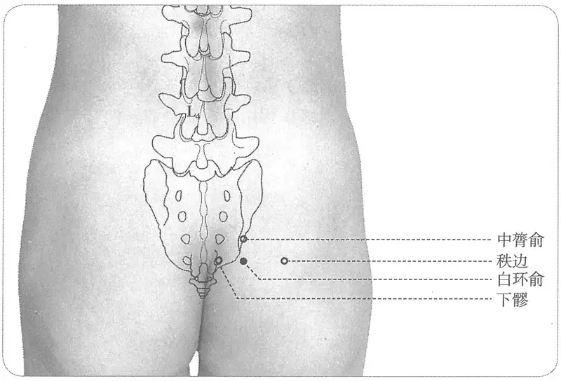

**图 2-190　白环俞穴图**

**取穴**：在第4骶椎下间，后正中线旁开1.5寸处，平下髎穴。

　1. 在第二十一椎下两旁各一寸五分……伏而取之。（《黄帝明堂经》、《太平圣惠方·明堂》、《铜人腧穴针灸图经》卷下“穴腧都数”、《针灸玉龙经》、《窦太师针经》、《针方六集》）

　2. 甄权《针经》云挺伏地端身，两手相重支额，纵气息，令皮肉俱缓，乃取其穴。（《太平圣惠方·针经》、《铜人腧穴针灸图经》卷中、《圣济总录》、《针灸资生经》、《医学纲目》、《针灸大成》、《针方六集》、《循经考穴编》）

　3. 在第二十一椎下两旁各寸半。凡大杼下穴皆当除脊各寸半。（《针灸资生经》卷一）

　4. 在第二十一椎下，相去脊中各一寸五分，伏而取之。（《十四经发挥》中、《针灸聚英》、《古今医统》、《针灸大成》、《针灸易学》）

〔p.696 (인쇄 676)〕

　5. 在二十一椎下，去脊中二寸，伏而取之。（《类经图翼》卷七、《针灸逢源》）

　6. 从中膂行二十椎下，去脊中二寸，伏而取之。（《医宗金鉴·刺灸心法要诀》）

**按**：此与前一穴“中膂俞”定位相重，显然有误。其歌诀正文作“白环俞穴廿一椎”，无误。

　7. 第二十一椎下去脊中二寸去脊边一寸半。（《针灸十四经穴位考订》）

　8. 统编针灸学教材

　　(1) 部位：第二十一椎下两旁相去脊各一寸五分。取穴：伏卧，从臀缝尖外开一寸五分，当中膂俞直下取之。（1957年南京《针灸学》）

　　(2) 部位：中膂俞穴下。取穴：俯卧，从二十一椎下督脉腰俞穴旁开一寸五分陷中取之。（1版《针灸学讲义》）

　　(3) 部位：在第二十一椎下，两旁各一寸五分。取穴：平第四骶后孔，督脉旁一寸五分，俯卧取之。（2版《针灸学讲义》）

　　(4) 第四骶椎棘突下，旁开1.5寸。（4、5版《针灸学》）

　　(5) 在骶部，当骶正中嵴旁1.5寸，平第4骶后孔。（6版《针灸学》）

　　(6) 第4骶椎棘突下，旁开1.5寸，约平第4骶后孔。（7版《针灸学》）

　　(7) 平第四骶后孔，督脉旁开一寸五分。（《中国针灸学》）

**文献分析**：关于本穴定位去脊中距离的分歧，详见本经“概说”。

#### 【类属】 

足太阳膀胱经穴。

足太阳脉气所发。（《黄帝明堂经》）

#### 【适应症】 

主治局部、前阴和妇科病症。常用于腰骶痛；遗尿，遗精，白浊；月经不调，带下。

　1. 主腰脊痛，不得俯仰，小便赤黄，尻重不能举。（《黄帝明堂经》）

**按**：《黄帝明堂经》此条主治与膀胱俞主治相近，当参看。

　2. 腰脊以下至足不仁。（《外台秘要》卷三十九）

**按**：《针灸甲乙经》脱本穴主治，此将《黄帝明堂经》“膀胱俞”主治误置于此。

　3. 理大小便不利，百病。腰髋疼不遂，温疟，腰中冷，不得眠睡，劳损，风疟。（《太平圣惠方·针经》）

　4. 手足不仁。（《太平圣惠方·明堂》、《针灸聚英》、《古今医统》、《针灸大成》、《类经图翼》）

**按**：此承袭《外台秘要》之误。

　5. 治腰脊挛急痛，大小便不利。《甲乙经》云：针如腰户法同。治腰髋疼，脚膝不遂，温疟，腰脊冷疼不得安卧，劳损风虚。（《铜人腧穴针灸图经》卷中）

　6. 窦太师针灸遗存

　　(1) 治夜梦鬼交，遗精，及妇人赤白带下，经事不调，绝嗣等症，穷明补泻。（《窦太师针经》）

　　(2) 治遗精赤白浊等证，肾虚腰痛，先泻后补；妇人带下赤白，补；月经不调，宜补。（《大本琼瑶神书》）

　　(3) 夜梦鬼交，妇人白浊，宜补多。（《针灸玉龙歌》注）

　　(4) 主夜梦鬼交，遗精。（《针方六集》卷五）

　　(5) 男子白浊，妇人血崩，带下，断产无子，三度灸能令有娠。（《循经考穴编》上）

　7. 主疝痛，腰背不便，筋挛，痹缩，虚热闭塞。（《针灸聚英》卷一、《针灸大成》）

〔p.697 (인쇄 677)〕

**按**：“疝痛”症系误录《千金要方》之文；其余主治症系从《针灸资生经》辑录《千金要方》灸方主治，详见“附：临床应用举例”。

　8. 统编针灸学教材

　　(1) 主治遗精白浊，崩中带下，疝痛，二便不利，腰髋痛，脚膝不遂。（1957年南京《针灸学》、1版《针灸学讲义》）

　　(2) 主治遗精，月经不调，白带，疝痛，腰髋痛。（2版《针灸学讲义》、3版《针灸学》）

　　(3) 主治遗尿，疝痛，白带，月经不调，腰髋冷痛。（4版《针灸学》）

　　(4) 主治遗尿，疝气，遗精，月经不调，白带，腰骶疼痛。（5版《针灸学》）

　　(5) 主治腰腿痛，白带，遗精，月经不调。（6版《针灸学》）

　　(6) 主治：①遗尿，遗精；②月经不调，带下；③疝气；④腰骶痛。（7版《针灸学》）

　　(7) 主治遗尿、疝痛、白带、月经不调，腰髋冷痛，二便不利，里急后重，脱肛。（《中国针灸学》）

**文献分析**：《黄帝明堂经》载本穴主治主要为腰部、小便症状。金元窦太师更明确突出了治疗男子遗精，女子月事、带下病症，并有明确的相关临床应用。现代针灸学教材从之。

#### 附：临床应用举例 

　1. 腰痛

　　(1) 腰背不便，筋挛，痹缩，虚热闭塞，灸第二十一椎两边各一寸五分随年壮。（《千金要方》卷十九、《千金翼方》）

　　(2) 腰痛不已者，灸白环腧二穴，在第二十一椎下两旁各一寸半，足太阳脉气所发，伏而取之，各灸七壮，炷如半枣核大。（《圣济总录》卷一百九十四）

　　(3) 腰痛不得屈伸：灸白环腧；少愈，灸命门、曲池。（《针灸集要·盘石金直刺秘诀》）

　　(4)【第五十八】肾虚腰痛：肾俞、委中、太溪、白环俞。（《针灸大成·治症总要》卷九）

　2. 前阴及肾、膀胱病症

　　(1) 胆寒先是怕心惊，白浊遗精苦莫禁，夜梦鬼交心腧泻，白环腧穴一般针。（《针灸玉龙歌》）

　　(2) 尿潴留：针刺白环俞治疗。［中国针灸，1998(7)：432］

　　(3) 慢性前列腺炎：深刺白环俞为主治疗。［中国针灸，2001，21(2)：73］

　3. 妇人赤白带，中极、气海、白环俞、肾俞。问曰：此证从何而得？答曰：不惜身体，恣意房事，内伤于血，外伤于情。或经事正行，或产暇未满，恶露未尽，与男交感，则内不纳精，遗下白水。复刺后穴：三阴交、三阳交、气海、中极。（《针灸集成》第五十四方）

　4. 足心水肿，从足起，白环俞、水分、彧中。（《医学纲目》卷二十四）

#### 【操作】 

直刺0.8~1.2寸。

　1. 刺入五分，灸三壮。（《黄帝明堂经》）

　2. 针入三分……不宜灸。（《太平圣惠方·针经》）

　3. 窦太师针灸遗存

　　(1) 针入一寸半，灸三七壮。（《窦太师针经》）

　　(2) 针一分，沿皮向外一寸半，灸三七壮。（《窦太师秘传》）

　　(3) 直针一寸半，灸五十壮。（《针灸玉龙歌》注）

　4. 禁用针灸。（《医学入门》卷一）

　5. 针五分，禁灸。（《针灸逢源》卷四）

〔p.698 (인쇄 678)〕

　6. 统编针灸学教材

　　(1) 针五分至七分。（1957年南京《针灸学》、1版《针灸学讲义》）

　　(2) 直刺7~10分。（2版《针灸学讲义》）

　　(3) 直刺1~1.5寸。（4、5、7版《针灸学》）

　　(4) 直刺0.8~1.2寸；可灸。（6版《针灸学》）

　　(5) 直刺0.8~1.2寸。（《中国针灸学》）

　7. 直刺，1~2寸。感应局部麻、胀，并向臀部放散。灸3~7壮；温灸5~15分钟。（上海《针灸学》）

### （三十一）上髎 Shàngliáo BL31 出《黄帝明堂经》 

#### 【提要索隐】 

**穴名**：上髎之“髎”字，宋以前文献或作“聊”、或作“窌”。

**部位**：在骶区，正对第1骶后孔中。

**适应症**：主治局部、妇科和前阴病症。常用于前阴、腰骶部引痛；月经不调，带下，子宫脱垂；阴疝。

**针刺操作**：直刺0.8~1.2寸；不宜刺破硬脊膜。

#### 【名实考】 

“髎”，敦煌本《明堂经》残卷作“聊”。

一边四穴：上、次、中、下各四，总称“八髎”，在《内经》、《千金要方》等早期针灸方中是作为一个穴位出现，犹如后世文献中之“八风”、“八邪”一样，都是作为一个穴看待。《黄帝明堂经》将其分为四个独立的穴，但其主治病症依然非常接近。

　1. 上窌，在第一空腰髁下一寸，夹脊陷者中，足太阳、少阳之络。（《黄帝明堂经》）

　2. 杨上善注曰谓腰髋骨两旁高处也。髋骨上有八空，此空在上，故云上窌。（《医心方》卷二）

　3. 八髎总治腰痛。（《针灸聚英》卷一）

#### 相关穴及刺激点 

　1. 骶神经后支刺激点　在骶后孔及骶管裂孔处。第1、2、3、4骶后孔和骶管裂孔分别是第1、2、3、4、5骶神经后支刺激点的位置。主治阳痿，遗精，夜尿，附睾炎，子宫内膜炎，月经不调，痛经，腰痛，坐骨神经痛。刺法：第1骶后孔直刺2.5cm，第2骶后孔直刺2.0cm，第3骶后孔直刺1.5cm，第4骶后孔直刺1.0cm，骶管裂孔处先以60°~70°进针，突破骶尾韧带后改为15°~20°，进针3.5~4.0cm。（《实用神经干电刺激疗法》）

　2. 骶前孔阻滞，对原发性痛经有特效，多一次治愈，且未发现对经期、经量和周期有任何影响。（《疼痛·阻滞与解剖彩色图谱》）

#### 【定位】 

**部位**：在骶区，正对第1骶后孔中。

**取穴**：从次髎向上触摸到的凹陷即第1骶后孔（图2-191）。

#### 骶后孔体表定位 

男性于髂后上棘最突点与后正中线连线的外1/3与内2/3交点定上髎穴；女性在连线的中点稍外侧定上髎穴。骶角稍外上方定下髎穴，然后食指与小指分别置于上髎和下髎穴上，再将中指、无名指等间距摆放，4指呈一自然弧形排列，4指指尖下即对应于上、次、中、

〔p.699 (인쇄 679)〕

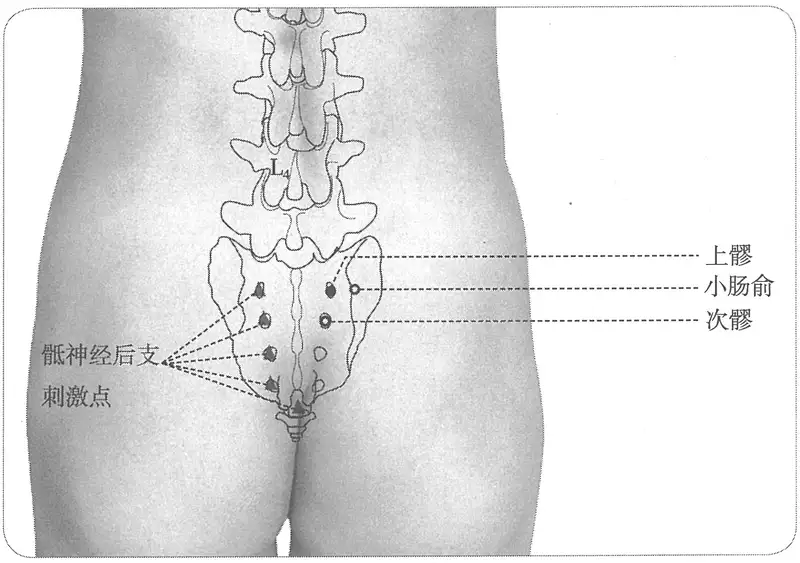

**图 2-191　上髎穴与相关刺激点**

下髎穴。

　1. 在第一空腰髁下一寸，夹脊陷者中。（《黄帝明堂经》、《铜人腧穴针灸图经》、《圣济总录》、《十四经发挥》、《医学纲目》、《针灸聚英》、《古今医统》、《医学入门》、《针灸大成》、《针方六集》、《类经图翼》、《循经考穴编》、《针灸易学》、《针灸逢源》）

　2. 腰尻交者，谓髁下尻骨两旁，四骨空，左右八穴。俗呼此骨为八髎骨也……上髎当髁骨下陷者中。余三髎少斜下，按之陷中是也。（《素问·刺腰痛》王冰注）

　3. 《千金》八髎在腰目下三寸，夹脊相去四寸两边四穴故名八髎。其曰夹脊四寸，是除脊各寸半也。凡大杼下穴，皆当除脊各寸半。（《针灸资生经》卷一）

　4. 第一空挟脊陷中，腰踝下直上至白环腧一寸。（《大本琼瑶神书》）

　5. 广注《明堂图位》云当在十七椎骨各开五分。上髎在髁骨下陷中，余三髎少斜，按之有陷是也。其曰夹脊各开四寸，谓除脊而各开一寸五分，连脊则四寸也，此法自大杼已下皆然，不独取八髎也。（《循经考穴编》上）

　6. 第十八椎旁第一荐骨孔中。（《针灸十四经穴位考订》）

　7. 统编针灸学教材

　　(1) 部位：第十八椎下，在第一骶骨孔中。取穴：正坐或伏卧，按取第五腰椎之外下方第一后荐骨孔处取之即第十八椎下旁。（1957年南京《针灸学》）

　　(2) 部位：第一骶骨孔中。取穴：在小肠俞与督脉经平行之中间陷中，伏而取之。八髎穴简便取穴法：伏卧，施术者用食、中、次、小四指，按于十八——二十一椎下，向外侧移行约一横指，后凹陷处取之。（1版《针灸学讲义》）

　　(3) 俯卧，于第一骶后孔中取之，约当髂后上棘与督脉之中点。（2版《针灸学讲义》）

　　(4) 第一骶后孔中。（4版《针灸学》、《中国针灸学》）

　　(5) 第一骶后孔中，约当髂后上棘与督脉的中点。（5版《针灸学》）

　　(6) 在骶部，当髂后上棘与后正中线之间，适对第1骶后孔处。（6版《针灸学》）

　　(7) 第一骶后孔中，约当髂后上棘与后正中线之间。（7版《针灸学》）

〔p.700 (인쇄 680)〕

**文献分析**：本穴定位，历代文献记载不尽相同，但定位的体表标志明确、一致，即以第一骶后孔定位。

#### 【类属】 

足太阳膀胱经穴。

**脉气所发**：足太阳、少阳之络。（《黄帝明堂经》）

**归经**：足太阳膀胱经。（《外台秘要》卷三十九、《铜人腧穴针灸图经》卷上）

#### 【适应症】 

主治局部、妇科病症。常用于前阴、腰骶部引痛；月经不调，带下，子宫脱垂；阴疝。

　1. 主腰脊痛而清，善伛，睾跳骞。热病汗不出。痎疟寒热。女子绝子，阴挺出，不禁白沥。痓，背反折。（《黄帝明堂经》）

　2. 治腰膝冷痛，呕逆，鼻衄，寒热疟，妇人绝嗣，阴挺出，不禁。（《铜人腧穴针灸图经》卷中）

**按**：“腰膝冷痛，呕逆，鼻衄”系对《黄帝明堂经》原文“腰脊痛而清，善伛，睾跳骞”的翻译，其中后二症的理解完全错误。“不禁”后，王惟一抄录时脱“白沥”二字。

　3. 大小便不利。（《针灸聚英》卷一、《古今医统》、《针灸大成》）

**按**：此乃高武从《针灸资生经》转录《千金翼方》八髎穴灸方主治。详见“附：临床应用举例”。

　4. 一云治翻胃。（《循经考穴编》上）

　5. 统编针灸学教材

　　(1) 主治阴挺，白带，大小便不利，腰膝痛，淋疾。（1957年南京《针灸学》、1版《针灸学讲义》）

　　(2) 主治腰痛，月经不调，阴挺，带下，大小便不利。（2版《针灸学讲义》）

　　(3) 主治腰痛，大小便不利，月经不调，赤白带下，阴挺。（4版《针灸学》、《中国针灸学》）

　　(4) 主治大小便不利，月经不调，带下，阴挺，遗精，阳痿，腰痛。（5、7版《针灸学》）

　　(5) 主治腰痛，月经不调，带下，遗精，阳痿，大小便不利。（6版《针灸学》）

**文献分析**：八髎穴的共性是均主治腰痛。而上髎穴还主治妇科病症、男子前阴病症和腰骶痛。《黄帝明堂经》“睾跳骞”系阴疝症状，而不是指“遗精，阳痿”；“大小便不利”系承袭高武《针灸聚英》之误，今去之。至于1版教材之“淋疾”系次髎穴主治。

#### 附：临床应用举例 

　1. 腰痛不可以转摇，急引阴卵，刺八窌与痛上。（《素问·骨空论》）

　2. 大理赵卿患风，腰脚不遂，不得跪起，针上窌二穴、环跳二穴、阳陵泉二穴、巨虚下廉二穴，即得跪起。（《千金翼方》卷十七）

　3. 大小便不利，灸八窌百壮。（《千金翼方》卷二十七）

　4. 尿潴留，针刺关元俞、上髎等穴治疗。［中国针灸，1994(增刊)：91-92］

　5. 急性腰扭伤，针刺上髎穴治疗。［天津中医，1994，11(2)：14］

#### 【操作】 

直刺0.8~1.2寸。

　1. 刺入二寸，留七呼，灸三壮。（《黄帝明堂经》）

　2. 针入三分，可灸七壮。（《铜人腧穴针灸图经》卷中）

　3. 统编针灸学教材

　　(1) 针五分，灸五至十五壮。（1957年南京《针灸学》、1版《针灸学讲义》）

　　(2) 直刺7~10分，艾条灸5~15分钟。（2版《针灸学讲义》）

　　(3) 直刺1~1.5寸。（4、5、7版《针灸学》）

　　(4) 直刺1~1.5寸；可灸。（6版《针灸学》）

〔p.701 (인쇄 681)〕

　　(5) 直刺0.8~1.2寸。可灸。（《中国针灸学》）

　4. 八髎穴，直刺1~2寸。感应骶部酸胀有时向下肢放散。灸3~7壮；温灸5~20分钟。（上海《针灸学》）

**刺法与主治的解剖学基础**：古今文献记载的本穴共同的主治为腰腿痛、前阴病及月经病：

腰痛不可以转摇，急引阴卵，刺八窌与痛上。（《素问·骨空论》）

疝气下坠，腰脊痛不得转摇，急引阴器，痛不可忍。（《铜人腧穴针灸图经》次髎）

这些描述正是骶丛神经受刺激出现的典型症状，常见于阴疝病。特别值得一提的是，从最早的《黄帝明堂经》“腰脊痛而清”，到《铜人腧穴针灸图经》的“腰膝冷痛”，都强调了腰骶、下肢发凉的症状（次髎、中髎更明确强调了这一点）。而大量神经阻滞的实践也证明：骶前孔阻滞成功，坐骨神经、股后皮神经、阴部神经支配区，有时闭孔神经支配区和骶骨后皮肤温度迅速升高0.5~1℃，其机制是通过盆丛调节改善了其支配区域的缺血状态。几千年前的古人在没有神经解剖知识的背景下所观察、总结出的骶丛神经失调所引起的典型症状，是细致和准确的。

### （三十二）次髎 Cìliáo BL32 出《黄帝明堂经》 

#### 【提要索隐】 

**部位**：在骶区，正对第2骶后孔中。

**适应症**：主治局部、妇科和前阴病症。常用于前阴、腰骶部引痛，下肢痿痹；疝气，小便不利，遗精；月经不调，痛经，带下。全子宫切除术、输卵管结扎术、剖腹产手术针麻用穴。

**针刺操作**：直刺0.8~1.2寸。不宜过深。

#### 【名实考】 

见上髎穴。

#### 【定位】 

**部位**：在骶区，正对第2骶后孔中（图2-192）。

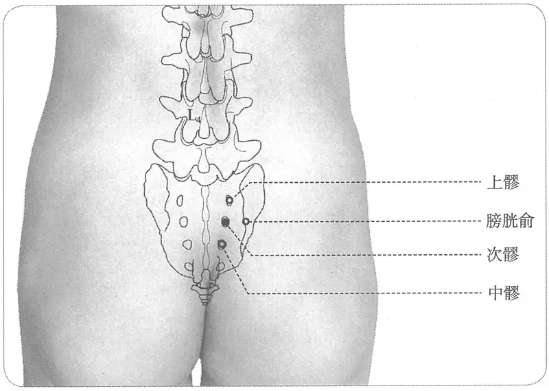

**图 2-192　次髎穴图**

〔p.702 (인쇄 682)〕

**取穴**：俯卧，于第2骶后孔中取之，髂后上棘与第2骶椎棘突连线的中点凹陷处，即第2骶后孔。

**骶后孔体表定位**：详见上髎穴。

　1. 在第二空夹脊陷者中。（《黄帝明堂经》、《铜人腧穴针灸图经》、《圣济总录》、《十四经发挥》、《医学纲目》、《针灸聚英》、《古今医统》、《针灸大成》、《类经图翼》、《循经考穴编》、《针灸易学》）

　2. 《千金》八髎在腰目下三寸，夹脊相去四寸两边四穴故名八髎。其曰夹脊四寸，是除脊各寸半也。凡大杼下穴，皆当除脊各寸半。（《针灸资生经》卷一）

　3. 广注当在十八椎骨间各开五分。（《循经考穴编》上）

　4. 在十九椎下，脊旁开第二空陷中。（《针灸逢源》卷四）

　5. 第十九椎旁第二荐骨孔中。（《针灸十四经穴位考订》）

　6. 统编针灸学教材

　　(1) 部位：第十九椎下，在第二骶骨孔中。取穴：按取上髎穴稍偏向内侧向下移行，第二荐孔处取之即第十九椎旁。（1957年南京《针灸学》）

　　(2) 部位：第二骶骨孔中。取穴：在上髎穴稍偏向内侧下方陷中取之。（1版《针灸学讲义》）

　　(3) 部位：在第二空，夹脊陷者中。取穴：俯卧，于第二骶后孔中取之，约当髂后上棘下与督脉之中点。（2版《针灸学讲义》）

　　(4) 第二骶后孔中。（4版《针灸学》、《中国针灸学》）

　　(5) 第二骶后孔中，约当髂后上棘下与督脉的中点。（5版《针灸学》）

　　(6) 在骶部，当髂后上棘内下方，适对第2骶后孔处。（6版《针灸学》）

　　(7) 第2骶后孔中，约当髂后上棘与后正中线之间。（7版《针灸学》）

#### 【类属】 

足太阳膀胱经穴。

**归经**：足太阳膀胱经。（《外台秘要》卷三十九、《铜人腧穴针灸图经》卷上）

#### 【适应症】 

主治局部、妇科和前阴病症。常用于前阴、腰骶部引痛，下肢痿痹；疝气，小便不利，遗精；月经不调，痛经，带下。全子宫切除术、输卵管结扎术、剖腹产手术针麻用穴。

　1. 主腰痛怏怏不可以俯仰，腰以下至足不仁，脊腰背寒。女子赤白沥，心下积胀。（《黄帝明堂经》）

　2. 治疝气下坠，腰脊痛不得转摇，急引阴器，痛不可忍，腰以下至足不仁，背腠寒，小便赤淋，心下坚胀。（《铜人腧穴针灸图经》卷中）

　3. 大小便不利，肠鸣，注泄，偏风。（《针灸聚英》卷一、《针灸大成》、《针方六集》）

**按**：“大小便不利”乃高武从《针灸资生经》转录《千金翼方》八髎穴灸方主治。详见“附：临床应用举例”。“肠鸣，注泄”系从《针灸资生经》辑录《千金要方》，原文作：“大肠俞、次髎主大小便利。阳纲主大便不节（《明》同），肠鸣泄注，小便赤黄。”其“肠鸣泄注”系阳纲穴主治，而非次髎穴主治；“偏风”系从《针灸资生经》辑自《千金要方》上髎穴灸方主治。

　4. 统编针灸学教材

　　(1) 主治赤白带下，腰痛急引阴器，肠鸣泄泻，小便不利，疝气，腰以下至足不仁。（1957年南京《针灸学》、1版《针灸学讲义》）

　　(2) 主治腰痛，月经不调，带下，痛经，疝气，下肢痿痹。（2版《针灸学讲义》、4版《针灸学》）

〔p.703 (인쇄 683)〕

　　(3) 主治疝气，月经不调，痛经，带下，小便不利，遗精，腰痛，下肢痿痹。（5、7版《针灸学》）

　　(4) 主治腰痛，月经不调，痛经，小便不利，遗精，遗尿，下肢痿痹。（6版《针灸学》）

　　(5) 主治腰痛，疝气，月经不调，赤白带下，痛经，遗精，阳痿，遗尿，小便不利，下肢痿痹。（《中国针灸学》）

#### 附：临床应用举例 

　1. 大小便不利，灸八窌百壮。在腰目下三寸，夹脊相去四寸两边各四穴（《千金翼方》卷二十七）

　2. 痛经，单刺次髎穴治疗。［光明中医杂志，1998(2)：41-42］

　3. 尿潴留，三阴交、次髎穴为主治疗。［成都中医药大学学报，2000，23(2)：23］

#### 【操作】 

直刺0.8~1.2寸。

　1. 刺入三寸，留七呼，灸三壮。（《黄帝明堂经》）

　2. 可灸七壮，针入三分。（《铜人腧穴针灸图经》卷中）

　3. 针二寸，灸三壮。（《医学入门》卷一）

　4. 统编针灸学教材

　　(1) 针五分，灸五至七壮。（1957年南京《针灸学》、1版《针灸学讲义》）

　　(2) 直刺7~10分，艾条灸5~15分钟。（2版《针灸学讲义》）

　　(3) 直刺1~1.5寸。（4、5、7版《针灸学》）

　　(4) 直刺1~1.5寸；可灸。（6版《针灸学》）

　　(5) 直刺0.8~1.2寸。可灸。（《中国针灸学》）

### （三十三）中髎 Zhōngliáo BL33 出《黄帝明堂经》 

#### 【提要索隐】 

**部位**：在骶区，正对第3骶后孔中。

**适应症**：主治局部、妇科病症。常用于腰骶痛；便秘，泄泻，小便不利；月经不调，带下。

**针刺操作**：直刺0.8~1.2寸。不宜过深。

#### 【名实考】 

见上髎穴。

　1. 中髎在第三空夹脊陷者中……太阴、厥阴、少阴所结。（《黄帝明堂经》）

　2. 中髎二穴，在第三空夹脊陷中。厥阴、少阳所结。（《铜人腧穴针灸图经》卷中）

#### 【定位】 

**部位**：在骶区，正对第3骶后孔中（图2-193）。

**取穴**：次髎向下触摸到的第1个凹陷即第3骶后孔。

**骶后孔体表定位**：见上髎穴。

　1. 在第三空夹脊陷者中。（《黄帝明堂经》、《铜人腧穴针灸图经》、《圣济总录》、《十四经发挥》、《医学纲目》、《类经图翼》、《循经考穴编》、《医宗金鉴·刺灸心法要诀》）

　2. 《千金》八髎在腰目下三寸，夹脊相去四寸两边四穴故名八髎。其曰夹脊四寸，是除脊各寸半也。凡大杼下穴，皆当除脊各寸半。（《针灸资生经》卷一）

　3. 广注当在十九椎间各开五分。（《循经考穴编》上）

　4. 在二十椎下，脊旁第三空陷中。（《针灸逢源》卷四）

〔p.704 (인쇄 684)〕

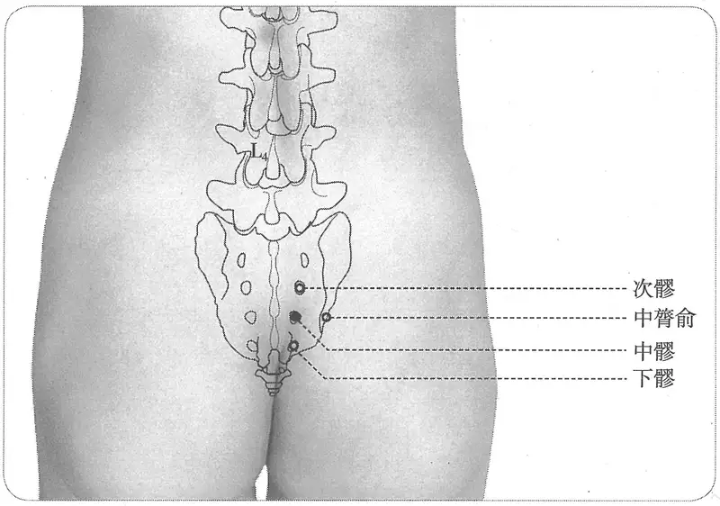

**图 2-193　中髎穴图**

　5. 第二十椎旁，第三荐骨孔中。（《针灸十四经穴位考订》）

　6. 统编针灸学教材

　　(1) 部位：第二十椎之下，在第三骶骨孔中。取穴：按取次髎下稍偏内侧向下移行，第三荐孔处取之即第二十椎旁。（1957年南京《针灸学》）

　　(2) 部位：第三骶骨孔中。取穴：在次髎下稍偏下内侧陷中取之。（1版《针灸学讲义》）

　　(3) 部位：在第三空，夹脊陷者中。取穴：俯卧，于第三骶后孔中取之，当中膂俞与督脉之间。（2版《针灸学讲义》）

　　(4) 第三骶后孔中。（4版《针灸学》、《中国针灸学》）

　　(5) 第三骶后孔中，约当中膂俞与督脉之间。（5版《针灸学》）

　　(6) 在骶部，当次髎下内方，适对第3骶后孔处。（6版《针灸学》）

　　(7) 第3骶后孔中，次髎穴下内方，约当中膂俞与后正中线之间。（7版《针灸学》）

#### 【类属】 

足太阳膀胱经穴。

**脉气所发：**

　1. 太阴、厥阴、少阴所结。（《黄帝明堂经》）

　2. 厥阴、少阳所结。（《铜人腧穴针灸图经》卷中）

**归经**：足太阳膀胱经。（《外台秘要》卷三十九、《铜人腧穴针灸图经》卷上）

#### 【适应症】 

主治局部、妇科病症。常用于腰骶痛；便秘，泄泻，小便不利；月经不调，带下。

　1. 主腰痛，大便难，飧泄，腰尻中寒。女子赤淫时白，气癃，月事少。男子癃。小肠胀。（《黄帝明堂经》）

　2. 治丈夫五劳七伤，六极腰痛，大便难，腹胀下利，小便淋涩，飧泄，妇人绝子，带下，月事不调。（《铜人腧穴针灸图经》卷中）

　3. 心性痴呆。（《循经考穴编》上）

**按**：该症见于窦太师《通玄指要赋》，为神门穴主治，原文作“人中除脊膂之强痛，神门去心性之呆痴。”

〔p.705 (인쇄 685)〕

　4. 统编针灸学教材

　　(1) 主治月经少，赤白带下，腰痛，小便不利，大便难。（1957年南京《针灸学》、1版《针灸学讲义》）

　　(2) 主治月经不调，带下，腰痛，小便不利，便秘。（2版《针灸学讲义》、6版《针灸学》）

　　(3) 主治腰痛，便秘，泄泻，小便不利，月经不调，带下。（4、5版《针灸学》、《中国针灸学》）

　　(4) 主治：①便秘，腹泻；②小便不利；③月经不调，带下；④腰骶痛。（7版《针灸学》）

**文献分析**：《黄帝明堂经》载本穴主治除了八髎穴共有的主治特点外，还主小肠胀。“小肠胀者，少腹膜胀，引腰而痛”（《灵枢·胀论》）。《黄帝明堂经》治疗五脏六腑胀的取穴有如下规律：五脏之胀取相应的五脏背俞穴和原穴；除小肠胀之外的六腑之胀取相应的募穴或下合穴，独小肠胀取“中髎”穴。这可能与《灵枢·四时气》所述“小肠者连睾系，属于脊”有关。

#### 附：临床应用举例 

　1. 大小便不利，灸八窌百壮。（《千金翼方》卷二十七）

　2. 小儿遗尿，上髎、中髎。随症加取配穴。[上海针灸杂志，1984（4）：20]

　3. 慢性非细菌性前列腺炎，针刺中髎穴为主治疗。[河南中医，2002，22（4）：52-53]

#### 【操作】 

直刺0.8~1.2寸。不宜过深。

　1. 刺入二寸，留十呼，灸三壮。（《黄帝明堂经》）

　2. 针二分，留十呼，灸二壮。（《铜人腧穴针灸图经》卷中）

　3. 统编针灸学教材

　　(1) 针五分，灸五至七壮。（1957年南京《针灸学》、1版《针灸学讲义》）

　　(2) 直刺7~10分，艾条灸5~15分钟。（2版《针灸学讲义》）

　　(3) 直刺1~1.5寸。（4、5、7版《针灸学》）

　　(4) 直刺1~1.5寸；可灸。（6版《针灸学》）

　　(5) 直刺0.8~1.2寸。可灸。（《中国针灸学》）

### （三十四）下髎 Xiàliáo BL34 出《黄帝明堂经》 

#### 【提要索隐】 

**部位**：在骶区，正对第4骶后孔中。

**适应症**：主治疝气、妇科病症。常用于前阴、小腹、腰骶部引痛；带下；便秘，便血，小便不利。

**针刺操作**：直刺0.8~1.2寸。

#### 【名实考】 

见上髎穴。

　1. 下髎，在第四空夹脊陷者中……太阴、厥阴、少阴所结。（《黄帝明堂经》）

　2. 下髎二穴，在第四空夹脊陷中。足太阳、厥阴所结。（《铜人腧穴针灸图经》卷中）

#### 【定位】 

**部位**：在骶区，正对第4骶后孔中（图2-194）。

**取穴**：次髎向下触摸到的第2个凹陷即第4骶后孔，横平骶管裂孔。

**骶后孔体表定位**：见上髎穴。

　1. 在第四空夹脊陷者中。（《黄帝明堂经》、《铜人腧穴针灸图经》、《圣济总录》、《琼瑶神书》、《十四经发挥》、《医宗金鉴·刺灸心法要诀》、《针灸易学》）

〔p.706 (인쇄 686)〕

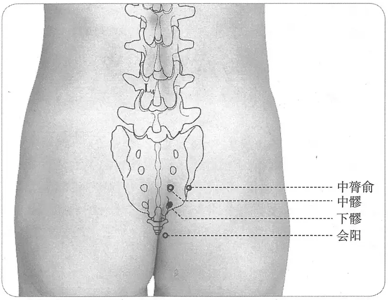

**图2-194　下髎穴图**

　2. 《千金》八髎在腰目下三寸，夹脊相去四寸两边四穴故名八髎。其曰夹脊四寸，是除脊各寸半也。凡大杼下穴，皆当除脊各寸半。（《针灸资生经》卷一）

　3. 广注当在二十椎骨间各开五分。（《循经考穴编》上）

　4. 在二十一椎下。脊旁第四椎空陷中。（《针灸逢源》卷四）

　5. 第二十一椎旁第四荐骨孔中。（《针灸十四经穴位考订》）

　6. 统编针灸学教材

　　(1) 部位：第二十一椎之下，在第四骶骨孔中。取穴：按取中髎穴下行稍偏内侧之第四荐孔处取之即第二十一椎旁。（1957年南京《针灸学》）

　　(2) 部位：第四骶骨孔中。取穴：取法同上，在中髎穴下行稍偏内侧陷中取之。（1版《针灸学讲义》）

　　(3) 部位：在第四空，侠脊陷者中。取穴：俯卧，于第四骶后孔中取之，当白环俞与督脉之间。（2版《针灸学讲义》）

　　(4) 第四骶后孔中。（4版《针灸学》、《中国针灸学》）

　　(5) 第四骶后孔中，约当白环俞与督脉之间。（5版《针灸学》）

　　(6) 在骶部，当中髎下内方，适对第4骶后孔处。（6版《针灸学》）

　　(7) 第4骶后孔中，中髎穴下内方，约当白环俞与后正中线之间。（7版《针灸学》）

#### 【类属】 

足太阳膀胱经穴。

**脉气所发：**

　1. 太阴、厥阴、少阴所结。（《黄帝明堂经》）

　2. 足太阳、厥阴所结。（《铜人腧穴针灸图经》卷中）

**归经**：足太阳膀胱经。（《外台秘要》卷三十九、《铜人腧穴针灸图经》卷上）

#### 【适应症】 

主治疝气、妇科病症。常用于前阴、小腹、腰骶部引痛；带下；便秘，便血，小便不利。

　1. 主腰痛不可反侧，尻脽中痛。女子下苍汁不禁，赤沥，阴中痒痛引少腹控眇不可俯仰。

〔p.707 (인쇄 687)〕

肠鸣澼泄。（《黄帝明堂经》）

　2. 治腰痛不得转侧，女子下苍汁不禁，阴中痛引少腹急疼，大便下血，寒湿内伤。（《铜人腧穴针灸图经》卷中）

　3. 大小便不利。（《针灸聚英》卷一、《针灸大成》、《针方六集》）

**按**：“大小便不利”乃高武从《针灸资生经》转录《千金翼方》八髎穴灸方主治。详见“附：临床应用举例”。

　4. 统编针灸学教材

　　(1) 主治淋浊不止，小腹急痛，腰引睾痛，肠鸣洩利，大便下血，小便不利。（1957年南京《针灸学》）

　　(2) 主治小腹急痛，腰痛，肠鸣泄利，大便下血，小便不利。（1版《针灸学讲义》）

　　(3) 主治小腹痛，便秘，小便不利，腰痛。（2版《针灸学讲义》、4版《针灸学》）

　　(4) 主治腹痛，便秘，小便不利，带下，腰痛。（5、7版《针灸学》）

　　(5) 主治腰痛，小便不利，肠鸣，便秘，小腹痛。（6版《针灸学》、《中国针灸学》）

**文献分析**：“阴中痒痛引少腹控眇不可俯仰”（《黄帝明堂经》）、“腰痛不得转侧，阴中痛引少腹急疼”（《铜人腧穴针灸图经》）描述的是阴疝的典型症状，而不是一般的腹痛。对此，《素问·刺腰痛》有明确的描述：“腰痛引少腹控眇，不可以仰，刺腰尻交者，两髁胂上，以月生死为痏数，发针立已，左取右，右取左”。疼痛的特点是腰痛引少腹（或引前阴），能俯不能仰。

#### 【操作】 

直刺0.8~1.2寸。

　1. 刺入二寸，留十呼，灸三壮。（《黄帝明堂经》）

　2. 刺入三分，留十呼，灸三壮。（《针方六集》卷一）

　3. 针二分一云二寸。灸三壮。白环俞与八髎穴有以针向外斜入四至五寸者，非古法也。（《针灸逢源》）

　4. 统编针灸学教材

　　(1) 针五分，灸五至七壮。（1957年南京《针灸学》、1版《针灸学讲义》）

　　(2) 直刺5~9分，艾条灸5~15分钟。（2版《针灸学讲义》）

　　(3) 直刺1~1.5寸。（4、5、7版《针灸学》）

　　(4) 直刺1~1.5寸；可灸。（6版《针灸学》）

　　(5) 直刺0.8~1.2寸。可灸。（《中国针灸学》）

### （三十五）会阳 Huìyáng BL35 出《黄帝明堂经》 

#### 【提要索隐】 

**穴名**：一名利机。

**部位**：在骶区，尾骨端旁开0.5寸。

**适应症**：主治肛肠病症。常用于痔疮；大便脓血；阳痿，带下。

**针刺操作**：直刺0.5~1.0寸。

#### 【名实考】 

任、督二脉，任为阴，督为阳，任脉有“会阴”穴，督脉有“会阳”穴，前后相应。

记载会阳穴的所有古代腧穴文献都曰“督脉气所发”，王冰注《素问》也明确将该穴归于督脉穴。该穴的位置以及脉气所发的内容也一直没有改变，然而自北宋《铜人腧穴针灸图经》卷上将会阳穴归入足太阳经，宋以后针灸腧穴书皆从之。这一变化来得太突然，令人难以理解。因为督脉之络“夹膂上项”，则位于尾骨旁之“会阳”属于督脉，与任脉之络“会阴”正相应。可能宋人以为某脉之穴必位于其正脉之上，故归会阳穴于足太阳经，但又未将其脉气所发相应改作“足太阳脉气所发”或“督脉、足太阳之会”，故使这种归经的变化缺乏理论依据。

〔p.708 (인쇄 688)〕

关于本穴定位，《黄帝明堂经》只说在“阴尾骨两旁”，如果只言某物“旁”而不言具体分寸者，一般皆指旁开很小的距离，明代以下文献不解此例，将本穴定于尾骨旁一寸半、二寸，甚至三寸者，大误。第一，《黄帝明堂经》旁开距离“四分”者皆有注明，岂有超过一寸而不注者？第二，本穴前一穴足太阳经穴下髎穴距前正中线距离尚不足“寸半”，督脉所发之“会阳”何以定于足太阳经穴之外？第三，出土《黄帝明堂经》残页、《素问》王冰注，以及《针灸甲乙经》内证，皆提示：在《黄帝明堂经》早期传本中，会阳穴排于背正中督脉行，而不在第2侧行穴中。

　1. 会阳，一名利机，在阴尾骨两旁，督脉气所发。（《黄帝明堂经》）

　2. 乃太阳左右四行，俱会于此尾尻之两旁，而有是名。（《经穴解》）

#### 相关穴及刺激点 

理便：位于尾骨下端督脉旁开一寸。作用：调理二便。针2~3寸。针感酸、胀至尿道。（《针灸经外奇穴图谱（续集）》）

#### 【定位】 

**部位**：在骶区，尾骨端旁开0.5寸（图2-195）。

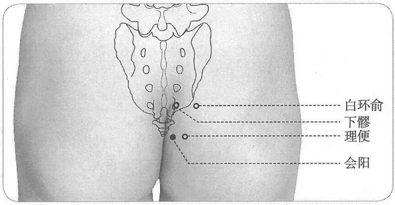

**图2-195　会阳穴与相关穴图**

**取穴**：俯卧，或跪伏位，按取尾骨下端旁软陷处取穴。

　1. 在阴尾骨两旁。（《黄帝明堂经》、《铜人腧穴针灸图经》、《圣济总录》、《针灸资生经》、《十四经发挥》、《医学纲目》）

　2. 窦太师针灸遗存

　　(1) 在尾闾骨尖两旁各开寸半。（《窦太师秘传》）

　　(2) 在尾骨节为标两旁各二寸。（《大本琼瑶神书》）

　　(3) 在阴尻骨两旁，去长强一分。（《针方六集》卷一）

　　(4) 广注合是长强穴两旁，相去脊各一寸五分。（《循经考穴编》上）

　3. 阴尾尻骨两旁。（《针灸聚英》卷一、《古今医统》、《针灸大成》、《类经图翼》）

　4. 四髎四空凭眼观，夹脊二寸腰胯间，五穴五寸至会阳，尾骨旁开二寸方。（《针灸问对》）

　5. 阴尾骨外各开一寸半。（《医学入门》）

　6. 会阳阴尾旁八分，分寸须与督脉亲。（《经穴指掌图》）

〔p.709 (인쇄 689)〕

　7. 从下髎行阴尾尻骨两旁五分许。（《医宗金鉴·刺灸心法要诀》、《针灸逢源》）

　8. 尾闾骨两旁约五分许。（《针灸十四经穴位考订》）

　9. 统编针灸学教材

　　(1) 部位：尾骨两旁。取穴：从尾闾骨端之外上方五分处取之。（1957年南京《针灸学》）

　　(2) 部位：尾骨两旁。取穴：伏卧，从尾闾骨端旁开五分处取之。（1版《针灸学讲义》）

　　(3) 部位：尾骨两旁。取穴：在尾骨下端之两旁，督脉旁五分取之。（2版《针灸学讲义》）

　　(4) 尾骨尖旁开0.5寸。（4、5版《针灸学》）

　　(5) 在骶部，尾骨端旁开0.5寸。（6、7版《针灸学》）

　　(6) 在尾骨下端之两旁，督脉旁开五分处。（《中国针灸学》）

**文献分析**：关于本穴部位，《黄帝明堂经》作“在阴尾骨两旁”，据该书对腧穴定位一般规律，凡未言具体尺寸者，多表示距离很近，一般在1~5分之间；其次，本穴为“督脉气所发”，应位于足太阳经穴之内侧；第三，出土文献《黄帝明堂经》残页“下髎”穴下云“右背第二行，二十穴”，未列“会阳”穴，可知其在“背第一行”中，《素问·气府论》王冰注正是将此穴归入背部第一行之末，即“长强”穴下。最有力的证据是：检《针灸甲乙经》卷十一第五篇，“会阳主之”条在“下髎主之”条之前，根据《针灸甲乙经》卷七至卷十二腧穴主之条文排列序例可推知，《针灸甲乙经》原书卷三“会阳”穴只能在背部第一行，而不在第二行。故本穴即在尾骨近旁，若必明分寸者，不超过五分。凡作“五分”以上者皆失《明堂经》本意。

#### 【类属】 

足太阳膀胱经穴。

**脉气所发**：督脉气所发。（《黄帝明堂经》）

**归经：**

　1. 足太阳膀胱经。（《外台秘要》卷三十九、《铜人腧穴针灸图经》卷上）

　2. 督脉。（《素问·气府论》王冰注）

**按**：通观古代腧穴文献，也均以“会阳”穴为“督脉气所发”，此穴与“会阴”穴一前一后，一属任脉，一属督脉，前后相应也。之所以后又将此穴移至背部第二行，以至于归入足太阳经，盖因此穴“在阴尾骨两旁”，系双穴而非单穴故也。然杨上善早已指出：“旧来相传督脉当脊中唯为一脉者，不可为正也。”又背部第二行“风门”穴，诸书均记作“督脉、足太阳之会”，也可证杨说不诬。自宋代王惟一将会阳由督脉穴移至足太阳经穴，但未说明理由，稍后的《圣济总录》作如下说明：“以上为督脉所发二十七穴。按《内经》督脉所发者，二十八穴，据法十椎下一穴名中枢，阴尾尻骨两旁二穴名会阳，共有二十九穴。今多龈交一穴，少中枢一穴。会阳二穴则系督脉别络与少阴会，故止载二十七穴。”其实，会阳穴从督脉穴变为足太阳经穴，与该穴的排列次序的变化有关。在传世《黄帝明堂经》佚文中，《千金要方》针灸卷（宋校本及未经宋人校本并同）、《千金翼方》针灸卷、《外台秘要·明堂》以及明刊本《针灸甲乙经》卷三等书，“会阳”一穴均被排在背部第二行最末。

#### 【适应症】 

主治肛肠病症。常用于痔疮；大便脓血；阳痿，带下。

　1. 主五藏肠中有寒，泄注，肠澼便血。（《黄帝明堂经》）

　2. 治腹中冷气，泄利不止，久痔，阳气虚乏，阴汗湿。（《铜人腧穴针灸图经》卷中）

　3. 治两肾两膀腿疼，泄痢不止。（《窦太师秘传》）

　4. 主男子阳气虚乏，阴痿，妇人赤白带，经行腰腿疼痛。（《循经考穴编》上）

　5. 统编针灸学教材

　　(1) 主治赤白带，经行腰腿疼痛，阳虚阴痿，肠澼下血，久痔，阴汗湿，腹中冷气，洩利不止。（1957年南京《针灸学》）

〔p.710 (인쇄 690)〕

　　(2) 主治赤白带，经行腰腿疼痛，阳虚阴痿，肠澼下血，久痔，阴汗湿，寒泻。（1版《针灸学讲义》）

　　(3) 主治带下，阳痿，痢疾，便血，痔疾，泄泻。（2版《针灸学讲义》）

　　(4) 主治痢疾，便血，泄泻，痔疾，阳痿，带下。（4版《针灸学》《中国针灸学》）

　　(5) 主治泄泻，便血，痔疾，阳痿，带下。（5版《针灸学》）

　　(6) 主治阳痿，遗精，带下，痢疾，泄泻，痔疾。（6版《针灸学》）

　　(7) 主治：①痔疾，腹泻；②阳痿；③带下。（7版《针灸学》）

**文献分析**：《黄帝明堂经》载本穴主治为肠澼，泄注；《铜人腧穴针灸图经》又增加了“久痔”这一具体病名；《循经考穴编》则突出了男子前阴，女子带下的主治病症。现代针灸教材综合诸说而定本穴主治。

#### 【操作】 

直刺0.5~1.0寸。

　1. 刺入八分，灸五壮。（《黄帝明堂经》）

　2. 针三分，灸五壮。（《针灸十四经穴位考订》）

　3. 统编针灸学教材

　　(1) 针八分，灸三至七壮。（1957年南京《针灸学》、1版《针灸学讲义》）

　　(2) 直刺5~8分，艾条灸5~15分钟。（2版《针灸学讲义》）

　　(3) 直刺1~1.5寸。（4、5、7版《针灸学》）

　　(4) 直刺0.8~1.2寸；可灸。（6版《针灸学》）

　　(5) 直刺0.5~1.0寸。可灸。（《中国针灸学》）

### （三十六）承扶 Chéngfú BL36 出《黄帝明堂经》 

#### 【提要索隐】 

**穴名**：扶承，一名肉郄，一名阴关，一名皮部。

**部位**：在股后区，臀沟的中点。

**适应症**：主治痔疾、局部病症。常用于痔疮，脱肛，便秘；腰、骶、臀、股部痛；小便不利。

**针刺操作**：直刺1.0~1.5寸。

#### 【名实考】 

本穴名，宋以前均作“扶承”，宋代《铜人腧穴针灸图经》卷上及卷下“穴腧都数”改作“承扶”，而卷下目录仍作“扶承”。明刊本《针灸甲乙经》卷三该穴虽作“承扶”，而“委阳”穴下仍作“扶承”，而且，卷九第八、第九、第十二三篇中，均作“扶承”，可见卷三之“承扶”乃宋以后人所妄改也。

　1. 扶承，一名肉郄，一名阴关，一名皮部，在尻臀下股阴上约纹中。（《黄帝明堂经》）

　2. 杨上善曰穴在尻臀下，股阴下纹中。扶承其身，故曰之。（《医心方》卷二）

　3. 此穴乃上、次、中、下四髎之支别者，下行过尻臀之下阴纹之正中也。承者，以在阴纹之中，承上臀垂之义；扶者，臀垂下垂，此穴在下，有扶之之义，故曰承扶。非背者次行之支别。（《经穴解》）

　4. 别名　皮郄、承扶皮部。（1957年南京《针灸学》）

**按**：此传自日本针灸教材，未详所出。“承扶皮部”，日本教材原作“扶承皮部”。

#### 【定位】 

**部位**：在股后区，臀沟的中点（图2-196）。

〔p.711 (인쇄 691)〕

**取穴**：伏卧，从臀下缘之横纹中央取之。

　1. 《黄帝明堂经》佚文

　　(1) 在尻臀下，股阴上约纹中。（《黄帝明堂经》、《医学纲目》、《医学入门》、《类经图翼》、《循经考穴编》、《医宗金鉴·刺灸心法要诀》、《针灸逢源》）

　　(2) 在尻臀下，股阴下纹中。（《千金要方》卷二十九、《千金翼方》、《医心方》、《铜人腧穴针灸图经》、《圣济总录》）

　　(3) 在尻臀下，股阴上冲纹中。（《外台秘要》卷三十九、《十四经发挥》、《针灸聚英》、《古今医统》、《针灸大成》、《针方六集》、《针灸易学》）

　　(4) 一云尻臀下横纹中。（《千金要方》卷二十九、《太平圣惠方·明堂》）

　　(5) 一云股阴下冲纹中。（《外台秘要》卷三十九、《医心方》）

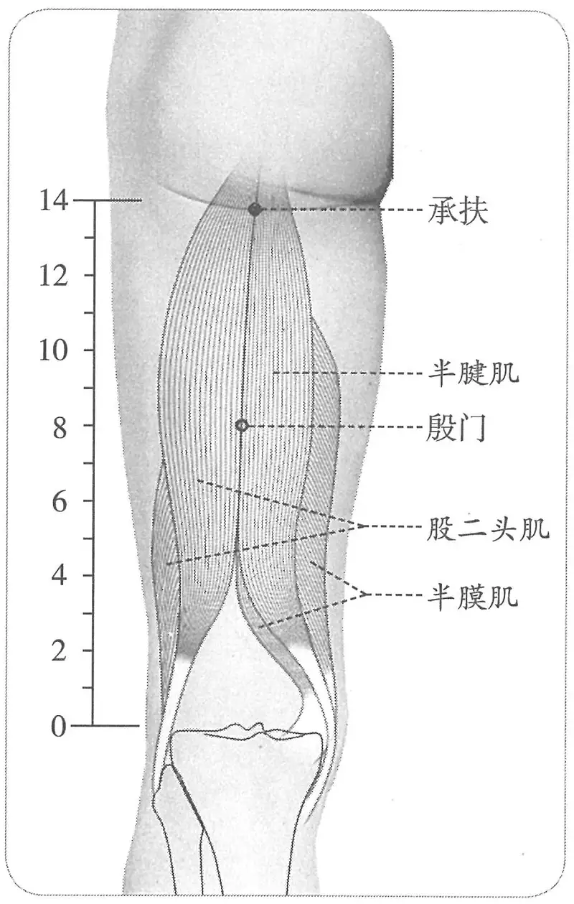

**图2-196　承扶穴图**

　2. 臀下横纹中央。（《针灸十四经穴位考订》）

　3. 统编针灸学教材

　　(1) 部位：臀下横纹中。取穴：直立或伏卧，从臀肉下缘横纹中央取之。（1957年南京《针灸学》）

　　(2) 部位：臀下横纹中。取穴：伏卧，从臀下缘之横纹中央取之，相当于秩边穴直下方。（1版《针灸学讲义》）

　　(3) 部位：臀下横纹中。取穴：臀下横纹正中，伏卧取之。（2版《针灸学讲义》）

　　(4) 臀沟中央。（4版《针灸学》）

　　(5) 臀横纹中央。（5版《针灸学》）

　　(6) 在大腿后面，臀下横纹的中点。（6版《针灸学》）

　　(7) 臀横纹的中点。（7版《针灸学》）

　　(8) 俯卧，在臀横纹中央。（《中国针灸学》）

#### 【类属】 

足太阳膀胱经穴。

**归经**：足太阳膀胱经。（《外台秘要》卷三十九、《铜人腧穴针灸图经》卷上）

#### 【适应症】 

主治痔疾、局部病症。常用于痔疮，脱肛，便秘；腰、骶、臀、股部痛；小便不利。

　1. 主腰脊尻臀股阴寒，大痛，虚则血动，实则并热痛，痔，篡痛，尻脽中肿，大便膗出。阴胞有寒，小便不利。（《黄帝明堂经》）

　2. 五种痔疾，泻鲜血，大便难。（《太平圣惠方·明堂》）

　3. 治腰脊相引如解，久痔尻脽肿，大便难，阴胞有寒，小便不利。（《铜人腧穴针灸图经》卷下）

　4. 尻臀痈肿。（《针方六集》卷五）

　5. 臀疽疮毒。（《循经考穴编》上）

　6. 统编针灸学教材

　　(1) 主治痔疾，阴尻相引痛，臀肿，小便不利。（1957年南京《针灸学》、1版《针灸学讲义》）

〔p.712 (인쇄 692)〕

　　(2) 主治痔疾，腰、骶、臀、股部痛。（2版《针灸学讲义》、5、6、7版《针灸学》）

　　(3) 主治腰脊臀痛，小便难，痔疾。（4版《针灸学》）

　　(4) 主治腰骶臀股部疼痛，下肢痿痹，大便难，痔疾。（《中国针灸学》）

**文献分析**：《黄帝明堂经》载本穴主治为腰腿部、后阴部等局部病症。值得注意的是，此处出现“虚则血动，实则并热痛”这类络穴主治中特有的描述特征，提示汉以前有多种不同的络脉学说流行。

久痔、便秘病人往往会伴有“脱肛”症状，即《黄帝明堂经》所说“大便膗出”。同时便秘与痔之间也有因果关系（本经委阳穴主治痔同时兼有“不得大小便”症状；又邻近穴长强主治“痔，大小便难”等均是此例），教材各版均未载“脱肛”症，且1版教材之“小便不利”、《中国针灸学》之“大便难”症均删去，欠妥，今补之。

本穴主治病症“痔，篡痛，尻脽中肿，大便膗出”中的“尻脽中肿”是痔、脱肛的一个伴随症状。后人不解此意，先由“尻脽中肿”变为“尻脽肿”，再到“尻臀痈肿”、“臀疽疮毒”，一步步远离原文的本义。

#### 附：临床应用举例 

　1. 针痔法，飞扬、商丘、复溜、劳宫、会阴、承筋、扶承、委阳、委中，并主之。（《千金翼方》卷二十八）

　2. 坐骨神经痛，针刺承扶穴治疗。[河南中医，1988，8（3）：25]

#### 【操作】 

直刺1.0~1.5寸。

　1. 刺入二寸，留七呼，灸三壮。（《黄帝明堂经》）

　2. 刺入七分。（《铜人腧穴针灸图经》卷下）

　3. 针五分，禁灸。（《医学入门》卷一）

　4. 统编针灸学教材

　　(1) 针七分至一寸。（1957年南京《针灸学》、1版《针灸学讲义》）

　　(2) 直刺7~15分，艾条灸5~10分钟。（2版《针灸学讲义》）

　　(3) 直刺1~2寸。（4、5、7版《针灸学》）

　　(4) 直刺1~2.5寸；可灸。（6版《针灸学》）

　　(5) 直刺1.0~1.5寸。可灸。（《中国针灸学》）

　5. 直刺2~3寸。感应：局部酸胀，或麻电感向下肢放散。灸3壮；温灸5~10分钟。（上海《针灸学》）

### （三十七）殷门 Yīnmén BL37 出《黄帝明堂经》 

#### 【提要索隐】 

**部位**：在股后区，臀沟下6寸，股二头肌与半腱肌之间。

**适应症**：主治局部病症。常用于腰痛，下肢痿痹。

**针刺操作**：直刺1~2寸。

#### 【名实考】 

本穴与浮郄、委阳二穴的位置关系，古人理解分歧很大，根本原因在于对委阳穴定位的误解，详见委阳穴“名实考”。

　1. 殷门，在肉郄下六寸。（《黄帝明堂经》）

　2. 名殷门者，太阳经至此下行大盛，殷者，盛也，而此穴其门也，乃本经血甚盛之所也。

〔p.713 (인쇄 693)〕

（《经穴解》）

#### 【定位】 

**部位**：在股后区，臀沟下6寸，股二头肌与半腱肌之间（图2-197）。

**取穴**：①俯卧，膝关节抗阻力屈曲显示出半腱肌和股二头肌；同时大腿做内旋和外旋时，指下感觉更明显。②于承扶与委中连线的中点上1寸处取穴。

　1. 在肉郄下六寸。（《黄帝明堂经》、《铜人腧穴针灸图经》、《圣济总录》、《针灸资生经》、《十四经发挥》、《针灸聚英》、《医学入门》、《针灸大成》、《古今医统》、《针方六集》、《类经图翼》、《循经考穴编》、《针灸逢源》、《针灸易学》）

　2. 委阳、殷门平视横相当也。（《素问·刺腰痛》王冰注）

　3. 在浮郄下与委阳并肩。（《大本琼瑶神书》）

　4. 广注合在浮郄下一寸，委中上二寸五分。（《循经考穴编》上）

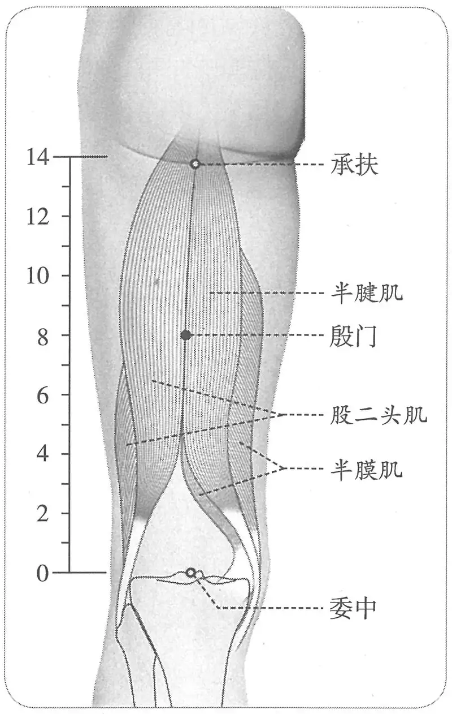

**图2-197　殷门穴图**

　5. 统编针灸学教材

　　(1) 部位：承扶穴下六寸。取穴：直立或伏卧，从承扶直下六寸取之。（1957年南京《针灸学》）

　　(2) 部位：承扶穴下六寸。取穴：伏卧，在承扶穴与委中穴直线上取之。（1版《针灸学讲义》）

　　(3) 部位：承扶穴下六寸。取穴：当承扶与委中之连线上，承扶下六寸，俯卧取之。（2版《针灸学讲义》、4版《针灸学》）

　　(4) 承扶穴与委中穴连线上，承扶穴下6寸。（5、7版《针灸学》、《中国针灸学》）

　　(5) 在大腿后面，承扶与委中的连线上，承扶下6寸。（6版《针灸学》）

**文献分析**：本穴定位的分歧在于对委阳穴定位文字理解的分歧，详见委阳穴定位的“文献分析”。

#### 【类属】 

足太阳膀胱经穴。

**归经**：足太阳膀胱经。（《外台秘要》卷三十九、《铜人腧穴针灸图经》卷上）

#### 【适应症】 

主治局部病症。常用于腰痛，下肢痿痹。

　1. 主腰痛得俛不得仰，仰则恐仆，得之举重，恶血归之。（《黄帝明堂经》）

　2. 治腰脊不可俯仰，举重恶血注之，股外肿。（《铜人腧穴针灸图经》卷下）

　3. 主阴囊虚胀寒疝。（《循经考穴编》上）

　4. 统编针灸学教材

　　(1) 主治腰脊痛不可俯仰，大腿部肿痛。（1957年南京《针灸学》、1版《针灸学讲义》）

　　(2) 主治腰脊强直而痛，不可俯仰，大腿部疼痛。（2版《针灸学讲义》）

　　(3) 主治腰痛不可俯仰，腰后肿痛。（4版《针灸学》）

　　(4) 主治腰痛，下肢痿痹。（5、6、7版《针灸学》）

　　(5) 主治腰痛，腰腿痛，下肢痿痹、瘫痪。（《中国针灸学》）

〔p.714 (인쇄 694)〕

**文献分析**：《素问·刺腰痛》曰：“衡络之脉令人腰痛，不可以俯仰，仰则恐仆，得之举重伤腰，衡络绝，恶血归之，刺之在郄阳筋之间、上郄数寸衡居为二痏出血”，所取即本穴。且据《黄帝明堂经》可知《素问》原文“不可以俯仰”之“俯”为衍文，即腰痛能屈不能仰症。

#### 附：临床应用举例 

　1. 衡络之脉令人腰痛，不可以俯仰，仰则恐仆，得之举重伤腰，衡络绝，恶血归之，刺之在郄阳筋之间、上郄数寸衡居为二痏出血。（《素问·刺腰痛》）

　2. 急性腰肌扭伤，针刺殷门穴治疗。[上海针灸杂志，1984（2）：17-19]

#### 【操作】 

直刺1~2寸。

　1. 刺入五分，留七呼，灸三壮。（《黄帝明堂经》）

　2. 针入七分。（《铜人腧穴针灸图经》卷下）

　3. 针五分，禁灸。（《医学入门》卷一）

　4. 统编针灸学教材

　　(1) 针八分至一寸。（1957年南京《针灸学》、1版《针灸学讲义》）

　　(2) 直刺7~15分，艾条灸5~15分钟。（2版《针灸学讲义》）

　　(3) 直刺1~2寸。（4、5、7版《针灸学》）

　　(4) 直刺1~2寸；可灸。（6版《针灸学》、《中国针灸学》）

　5. 直刺2~3寸。感应；麻电感可上至臀，下至足。温灸5~10分钟。（上海《针灸学》）

### （三十八）浮郄 Fúxì BL38 出《黄帝明堂经》 

#### 【提要索隐】 

**部位**：在膝后区，腘横纹上1寸，股二头肌腱的内侧缘。

**适应症**：主治局部病症。常用于股腘部疼痛，麻木；便秘。

**针刺操作**：直刺0.5~1.0寸。

#### 【名实考】 

腘，古作“郄”，《灵枢》“腘中”，马王堆出土文献《阴阳十一脉灸经》作“郄中”；《素问·刺禁论》“刺郄中大脉”，即刺腘中大脉也。《内经》中可找到大量这类用例。本穴在郄（腘）之上，故曰浮郄。

本穴与殷门、委阳二穴的位置关系，古人理解分歧很大，根本原因在于对委阳穴定位的误解，详见委阳穴“名实考”。

　1. 浮郄，在委阳上一寸，展膝得之。（《黄帝明堂经》）

　2. 殷门在下，此穴反浮在上，故曰浮郄。（《经穴解》）

**按**：此解基于对殷门与浮郄二穴位置关系的错误理解，给出了完全错误的穴名解释。

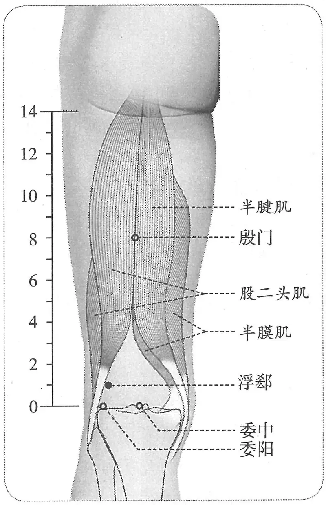

**图2-198　浮郄穴图**

#### 【定位】 

**部位**：在膝后区，腘横纹上1寸，股二头肌腱的内侧缘（图2-198）。

〔p.715 (인쇄 695)〕

**取穴**：稍屈膝，委阳穴上1寸，股二头肌腱内侧缘取穴。

　1. 《黄帝明堂经》佚文

　　(1) 在委阳上一寸，展膝得之。（《外台秘要》卷三十九、《医心方》、《铜人腧穴针灸图经》卷下、《圣济总录》、《针灸资生经》、《十四经发挥》、《医学纲目》、《针灸聚英》、《古今医统》、《针灸大成》、《针灸易学》）

　　(2) 在委阳上一寸，屈膝得之。（《针灸甲乙经》卷三、《医学入门》、《类经图翼》、《循经考穴编》）

**按**：取本穴无须“屈膝”，此乃“展膝”之形误，后人不明乃调和作“屈膝而展得之”。

　　(3) 在委阳上一寸，展足得之。（《千金要方》卷二十九、《千金翼方》卷二十六）

　2. 在委阳上一寸，屈膝而展得之。（《针方六集》卷一）

　3. 广注合委中上二寸五分。（《循经考穴编》上）

　4. 从殷门外循斜上一寸，屈膝得之，浮郄穴也。故在委阳穴上一寸也。（《医宗金鉴·刺灸心法要诀》、《针灸逢源》）

　5. 殷门下斜向外，委阳上一寸。（《针灸十四经穴位考订》）

　6. 统编针灸学教材

　　(1) 部位：委阳穴上一寸。取穴：按取膝腘正中外开一寸，两筋之间陷中为委阳穴，由委阳上行一寸略偏内侧取之。（1957年南京《针灸学》）

　　(2) 部位：委阳穴上一寸。取穴：于委阳穴上方一寸，大筋内取之。（1版《针灸学讲义》）

　　(3) 部位：委阳穴上一寸。取穴：微屈膝，在股二头肌腱内侧，委阳穴上方一寸取之。（2版《针灸学讲义》、4版《针灸学》）

　　(4) 委阳穴上1寸，在股二头肌腱内侧。（5版《针灸学》）

　　(5) 在腘横纹外侧端，委阳上1寸，股二头肌腱的内侧。（6、7版《针灸学》）

　　(6) 在委阳上一寸，股二头肌腱内侧，微屈膝取之。（《中国针灸学》）

**文献分析**：屈膝与展膝，从文献考证上看，《外台秘要》所引《针灸甲乙经》文本作“展膝”，与其他传本《黄帝明堂经》佚文相合，则通行本《针灸甲乙经》系传抄之误。再从取穴上看，本穴是以委阳穴为基准，故不必屈膝。

#### 【类属】 

足太阳膀胱经穴。

**归经**：足太阳膀胱经。（《外台秘要》卷三十九、《铜人腧穴针灸图经》卷上）

#### 【适应症】 

主治局部病症。常用于股腘部疼痛，麻木；便秘。

　1. 主不得卧。（《针灸甲乙经》卷十二第三、《外台秘要》）

　2. 中注、浮郄，主少腹热，大便坚。（《千金要方》卷三十）

　3. 主不得卧，出汗不得，大便坚不出。（《医心方》卷二）

　4. 治小肠热，大肠结，股外经筋急，髀枢不仁。（《铜人腧穴针灸图经》卷下）

　5. 股内贴骨痈毒。（《循经考穴编》上）

　6. 统编针灸学教材

　　(1) 主治肠热大便结，髀枢不仁，踝外筋急。（1957年南京《针灸学》）

　　(2) 主治肠热大便结，髀枢不仁，股外筋急。（1版《针灸学讲义》）

　　(3) 主治臀股麻木，腘筋挛急。（2版《针灸学讲义》）

　　(4) 主治便秘，臀股麻木，腘筋挛急。（4版《针灸学》）

〔p.716 (인쇄 696)〕

　　(5) 主治便秘，股腘部疼痛，麻木。（5版《针灸学》）

　　(6) 主治膝腘部疼痛，麻木，挛急。（6版《针灸学》）

　　(7) 主治：①股腘部疼痛，麻木；②便秘。（7版《针灸学》）

　　(8) 主治臀股麻木，腘筋挛急。（《中国针灸学》）

**文献分析**：《医心方》（《黄帝内经明堂》传本）载本穴主治作“主不得卧。出汗不得。大便坚不出。”从腧穴主治的一般规律，不好理解。而且其中“不得卧。出汗不得”也未详何病。《针灸甲乙经》、《外台秘要》载本穴主治均作“不得卧”，说明最晚在唐代，《针灸甲乙经》传本载本穴主治条文已有脱失。及至宋代王惟一编定《铜人腧穴针灸图经》时，或以《外台秘要》之文不好理解，而重新厘订了本穴主治。当时除了《外台秘要》之外，可能参考的还有《千金要方·孔穴主对法》卷三十“中注、浮郄主少腹热，大便坚”一条。

#### 【操作】 

直刺0.5~1.0寸。

　1. 刺入五分，灸三壮。（《黄帝明堂经》）

　2. 一法针入一寸，灸二七壮。（《循经考穴编》上）

　3. 统编针灸学教材

　　(1) 针五分，灸三至七壮。（1957年南京《针灸学》、1版《针灸学讲义》）

　　(2) 直刺5~9分，艾条灸3~7分钟。（2版《针灸学讲义》）

　　(3) 直刺1~1.5寸。（4、5版《针灸学》）

　　(4) 直刺1~1.5寸；可灸。（6版《针灸学》）

　　(5) 直刺1~2寸。（7版《针灸学》）

　　(6) 直刺0.5~1.0寸。可灸。（《中国针灸学》）

### （三十九）委阳 Wěiyáng BL39 出《灵枢》 

问题1：本穴定位，《针灸甲乙经》作“在足太阳之前，少阳之后，出于腘中外廉两筋间，扶承下六寸……一云屈身而取之”，其后文献皆从之。然此处所述部位至少有两个不同位置，本穴部位究竟如何确定？

问题2：古代文献定位文字描述多同，而实际定位五花八门，如何考察不同时期经穴的实际定位？

问题3：为什么委阳的定位存在如此多、如此大的分歧？

#### 【提要索隐】 

**部位**：在膝部，腘横纹上，股二头肌腱的内侧缘。

**适应症**：主治腰腿、前阴病症。常用于腹满，小便不利；腰背痛，腿足痛。

**针刺操作**：直刺0.5~1.0寸。

#### 【名实考】 

委者，屈也；阳者，外也，屈膝时本穴在曲脉之外——腘横纹外端，故名委阳。腘中为“委中”，腘外为“委阳”；腘中又名“郄中”，郄之外侧为“郄阳”，郄之上方为“浮郄”，命名之意环环相扣。

据穴名所示，本穴位于腘横纹外端；其上方一寸为浮郄，承扶下六寸为殷门，关系很明确，然而这本来十分明了的三穴位置关系，却因人为的误解而极端混乱。其实关于委阳穴的定位，《灵枢·本输》已经说得很明确：“在腘中外廉——足太阳与足少阳脉之间。”但中国古代文献中关于委阳穴定位描述明确无误者，仅《医学纲目》、《医学入门》，以及在经穴定位上传承《医学入门》的《经穴指掌图》三书而已[^29-1]。之所以绝大多数古人都理解错误，并由此间接导致了“殷门”、“浮郄”二穴的定位错误，造成许多混乱，关键在于不明络穴与络脉的关系。

〔p.717 (인쇄 697)〕

　1. 委阳，在足太阳之前，少阳之后，出于腘中外廉两筋间，扶承下六寸，此足太阳之别络也。（《针灸甲乙经》卷三）

**按**：这里记述的是足太阳别络的走行，可见有“腘外廉”与“扶承下六寸”两个不同的部位（《针灸甲乙经》所载“大包”穴下的部位同样为络脉的走行部位），对此“足太阳之别络”，《灵枢·本输》有明确记载：

　2. 三焦下腧，在于足大指之前，少阳之后，出于腘中外廉，名曰委阳，是太阳络也。手少阳经也。三焦者，足少阳、太阴（一本作阳）之所将，太阳之别也，上踝五寸，别入贯腨肠，出于委阳，并太阳之正，入络膀胱，约下焦。（《灵枢·本输》）

**按**：可见《针灸甲乙经》中“扶承下六寸”实际上是对《本输》篇“并太阳之正”的翻译。据络穴的定位规律，“委阳”当定于腘外廉。以其在“委中”穴外侧（阳侧）而得名。唐以后人多不解此义，将此穴定于扶承下六寸处，与殷门穴同高。

　3. 刺解脉，在膝筋肉分间郄外廉之横脉出血，血变而止。（《素问·刺腰痛》）

**按**：对照《黄帝明堂经》委阳穴定位文字，完全吻合，只是《素问》用了更古的词语，更古的刺法而已——络穴原本即为刺血处。

　4. 三焦下输，在于足太阳之前，少阳之后，出于腘中外廉，名曰委阳，此太阳之络也。（《黄帝内经太素·本输》）

　5. 委阳，三焦下辅俞也。在足太阳之前，少阳之后，出于腘中外廉两筋间，扶承下六寸。此足太阳之别络也。（《黄帝明堂经》）

　6. 委阳二穴，三焦下辅腧也。在足太阳之后，出于腘中外廉两筋间，屈伸取之，承扶下六寸，足太阳脉之中。（《铜人腧穴针灸图经》卷下）

　7. 委者，曲也。委中即两腘之中央，委阳即曲脉之阳分，约文之尽处，两筋间是。（《医学纲目》卷八）

　8. 委，犹旁也。以本经之支，直行者结殷门，此穴乃溢而上，既结浮郄之穴，而又下结此穴，有委之义，故曰委阳。（《经穴解》）

**按**：此说与经文之义差之千里。

#### 古人误解“殷门”、“浮郄”、“委阳”位置例 

　1. 王冰曰委阳、殷门，平视横相当也。（《素问·刺腰痛》）

　2. 刺之在郄阳筋之间，上郄数寸，衡居为二痏出血。王冰注曰：郄阳，谓浮郄穴上侧委阳穴也。（《素问·刺腰痛》）

　3. 委阳在承扶下一寸六分。（《黄帝内经灵枢注证发微·邪气藏府病形》）

　4. 委阳，一法合在委中上一寸五分，略斜向后，与殷门相并。按：此穴与殷门并而上，去承扶皆六寸当是。与承扶相直者，殷门也；略斜向外者，委阳也。（《循经考穴编》上）

　5. 委阳穴在足太阳之前，少阳之后，出于腘中外廉两筋间，与殷门穴并。（《针灸逢源》卷四）

[^29-1]: 明抄本《针灸秘法全书》作“委阳二穴，三焦下辅俞也。在足太阳之后，出于腘中外廉两筋间，浮郄下一寸。”孤立地看此一条，似乎其定位也完全正确，但其对浮郄的定位，又是以“委阳”为基准，不能判定该书编者对于委阳穴定位的理解是否正确。

〔p.718 (인쇄 698)〕

　6. 明堂图、铜人图定位

　　(1) 承扶、殷门、浮郄、委阳4穴在委中穴直上呈一直线排列。（明正统仿宋针灸铜人、史素刻铜人图、丘濬铜人图）

　　(2) 委阳位于委中直上，浮郄之下，殷门外上方。（明嘉靖针灸铜人、明靳贤重修太医院铜人图）

　　(3) 委阳位于委中直上，浮郄之下，殷门外下方。（清光绪针灸铜人）

#### 【定位】 

**部位**：在膝部，腘横纹上，股二头肌腱的内侧缘（图2-199）。

**取穴**：稍屈膝，即可显露明显的股二头肌腱。

　1. 三焦下腧在于足太阳之前，少阳之后，出于腘中外廉，名曰委阳。（《灵枢·本输》）

　2. 取之委阳者，屈伸而索之。（《灵枢·邪气藏府病形》）

**按**：表面解剖学实验表明，在膝关节做屈伸动作时，可以清楚地显示、或触及股二头肌腱。

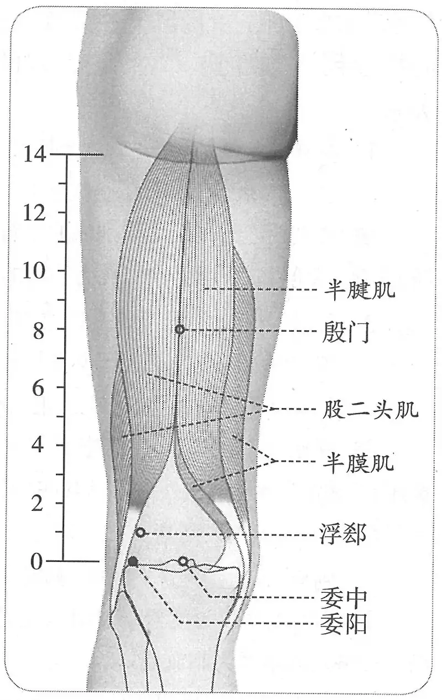

**图2-199　委阳穴图**

　3. 在足太阳之前，少阳之后，出于腘中外廉两筋间，扶承下六寸。（《针灸甲乙经》卷三、《千金要方》、《外台秘要》、《医心方》、《针灸大成》、《针方六集》、《类经图翼》、《循经考穴编》、《针灸逢源》）

　4. 一云屈身而取之。（《针灸甲乙经》卷三、《外台秘要》）

　5. 在足太阳后，出于腘中外廉两筋间，承扶下。（《千金翼方》卷二十六）

　6. 在承扶下六寸，屈身取之。（《铜人腧穴针灸图经》卷上）

　7. 在足太阳之后，出于腘中外廉两筋间，屈伸取之，承扶下六寸，足太阳脉之中。（《铜人腧穴针灸图经》卷下、《圣济总录》、《针灸资生经》、《十四经发挥》中）

　8. 详《铜人》云委阳在扶承下六寸。以今经文考之，当云一尺六寸。又按经文取委阳者，屈伸而索之……委者，曲也。委中即两腘之中央，委阳即曲脉之阳分约纹之尽处，两筋间，推其分野，则正当太阳、少阳之间，内外廉之界。故曰太阳之前，少阳之后，腘中外廉也，其穴正在约纹两筋之间，只正膝与之齐，阳陵泉正对其穴，当为一尺六寸无疑矣。（《医学纲目》）

**按**：楼氏定委阳于“曲脉之阳分约纹之尽处，两筋间”，可谓独具慧眼，然其断言“当为一尺六寸无疑”，却仍未出“络脉、络穴不分”之误区。

　9. 承扶下一尺六寸，屈身取之。足太阳之前，少阳之后，出于腘中外廉两筋间。（《针灸聚英》卷一、《古今医统》）

　10. 膝腘横纹尖外廉两筋间，委中外二寸，屈身取之。（《医学入门》卷一）

　11. 从浮郄下行，仍在承扶穴下六寸，屈伸取之，委阳穴也。而与少阳下合腘中也。（《医宗金鉴·刺灸心法要诀》）

　12. 委中外约一寸筋间陷中。（《针灸十四经穴位考订》）

〔p.719 (인쇄 699)〕

　13. 统编针灸学教材

　　(1) 部位：在委中外开一寸取之。取穴：从委中外开一寸取之（参阅浮郄取穴法）。（1957年南京《针灸学》）

　　(2) 部位：浮郄穴下一寸。取穴：从委中穴外开一寸，两筋间陷中取之。（1版《针灸学讲义》）

　　(3) 部位：在腘中外廉，两筋间。取穴：当腘窝外侧，股二头肌腱内缘，与委中相平，屈膝取之。（2版《针灸学讲义》）

　　(4) 腘横纹外端，股二头肌腱内缘。（4、5版《针灸学》）

　　(5) 在腘横纹外侧端，当股二头肌腱的内侧。（6、7版《针灸学》）

　　(6) 在委中外侧，股二头肌腱内缘。（《中国针灸学》）

**文献分析**：尽管历代文献对于“委阳”穴部位的描述未见实质性分歧，然而历代针灸铜人、铜人图、明堂图对于该穴的定位分歧甚大，而且定位正确者极少。在文献中《医学纲目》最早明确论证该穴的定位法，此后《医学入门》记有明确的正确定位；在中国文献经穴图方面，只有明代《经穴指掌图》定位正确；在针灸铜人方面，只有韩国德寿宫针灸铜人定位正确。日本古医家因较早地注意到了中国明代初期楼英的考证，因而有较多的腧穴文献及腧穴图对于委阳穴的定位正确，如村上宗占《骨度正误图说》、木村修道《校定冈本一抱子引经诀》（1806年）及图等。造成不同时代不同医家对于委阳穴定位理解如此大的差异的根本原因在于对于络穴与络脉关系的误解。十五络穴名原本是络脉名，此外尚有一些别络穴如“委阳”、“大包”等也本为脉名。在早期腧穴书所载这些络穴或别络穴定位文字中还残留一些相应络脉循行部位的描述。

关于本穴的取穴法，《灵枢》作“屈伸而索之”，《铜人腧穴针灸图经》卷下作“屈伸取之”，而卷上作“屈身取穴”，此“屈身”乃“屈伸”声误。

#### 【类属】 

足太阳膀胱经穴；三焦下合穴。

**脉气所发：**

　1. 三焦下腧，在于足大指之前，少阳之后，出于腘中外廉，名曰委阳，是太阳络也。（《灵枢·本输》）

　2. 三焦下辅俞也……此足太阳之别络也。（《黄帝明堂经》）

**归经**：足太阳膀胱经。（《千金要方》卷二十九、《铜人腧穴针灸图经》卷上）

#### 【适应症】 

主治腰腿、前阴病症。常用于腹满，小便不利；腰背痛，腿足痛。

　1. 三焦下腧……名曰委阳，是太阳络也。手少阳经也。实则闭癃，虚则遗溺，遗溺则补之，闭癃则泻之。（《灵枢·本输》）

　2. 主胸满膨膨然，实则闭癃，腋下肿，虚则遗溺，脚急兢兢然，筋急痛，不得大小便，腰痛引腹不得俯仰，痔。（《黄帝明堂经》）

**按**：《黄帝明堂经》载本穴主治中除三焦失调的小便病症，还包括了足太阳经病候“腰痛”和“痔”。

　3. 治腋下肿痛，胸满膨膨，筋急，身热，飞尸遁注，痿厥不仁，小便淋沥。（《铜人腧穴针灸图经》卷下）

　4. 统编针灸学教材

　　(1) 主治腰、脊、腋下肿痛，小便淋漓，腿足痉挛急痛。（1957年南京《针灸学》、1版《针灸学讲义》）

　　(2) 主治腰脊强痛，小腹胀满，小便不利，腿足拘挛疼痛。（2版《针灸学讲义》、4版《针灸学》）

〔p.720 (인쇄 700)〕

　　(3) 主治腹满，小便不利，腰脊强痛，腿足挛痛。（5、6、7版《针灸学》）

　　(4) 主治腰脊强痛，小腹胀满，水肿，小便不利，腿足挛痛。（《中国针灸学》）

#### 附：临床应用举例 

　1. 三焦病者，腹气满，小腹尤坚，不得小便，窘紧，溢则水，留即为胀，候在足太阳之外大络，大络在太阳少阳之间，亦见于脉，取委阳。（《灵枢·邪气藏府病形》）

　2. 小腹痛肿，不得小便，邪在三焦约，取之太阳大络，视其络脉与厥阴小络结而血者，肿上及胃脘，取三里。（《灵枢·四时气》）

　3. 膝筋拘挛不开，两膝外曲纹尖，灸二十七壮，即委阳穴。（《医学纲目》卷十二）

　4. 胃大部切除术后并尿潴留，委阳穴针刺。[成都中医学院学报，1988，11（3）：21-22]

#### 【操作】 

直刺0.5~1.0寸。

　1. 刺入七分，留五呼，灸三壮。（《黄帝明堂经》）

　2. 可灸三壮，针入七分。（《铜人腧穴针灸图经》卷下）

　3. 统编针灸学教材

　　(1) 针五至八分，灸三至七壮。（1957年南京《针灸学》、1版《针灸学讲义》）

　　(2) 直刺5~9分，艾条灸3~7分钟。（2版《针灸学讲义》）

　　(3) 直刺1~1.5寸。（4、5、7版《针灸学》）

　　(4) 直刺1~1.5寸；可灸。（6版《针灸学》）

　　(5) 直刺0.5~1.0寸。可灸。（《中国针灸学》）

　4. 直刺1~1.5寸。针感：酸胀向大腿上部扩散。灸3~7壮；温灸3~6分钟。（上海《针灸学》）

### （四十）委中 Wěizhōng BL40 出《灵枢》 

问题：《素问·骨空论》曰“膝痛痛及拇指，治其腘”，如何理解？取何穴治之？

#### 【提要索隐】 

**部位**：在膝后区，腘横纹中点。

**适应症**：主治腰腿、前阴病症。常用于腰背痛，下肢痿痹；小腹痛，小便不利，遗尿。

**针刺操作**：直刺0.5~1.0寸。勿损伤血管、神经。

#### 【名实考】 

委者，曲也，曲膝时，穴在腘横纹中央，故名委中。

　1. 膀胱出于至阴……入于委中，委中，腘中央，为合，委而取之，足太阳也。（《灵枢·本输》）

　2. 委中者，屈而取之。（《灵枢·邪气藏府病形》）

　3. 腰痛侠脊而痛至头，几几然，目䀮䀮欲僵仆，刺足太阳郄中出血。王冰注曰：郄中，委中。（《素问·刺腰痛》）

　4. 刺郄中出血。王冰曰：古法以委中为郄中。新校正云：详刺“郄中”《甲乙经》作“腘中”。今王氏两注之，当以“腘中”为正。（《素问·刺疟论》）

**按**：由此可见，“郄中”与“腘中”义同，今考《灵枢·经脉》足太阳经脉循行之“腘中”，马王堆出土文献《阴阳十一脉灸经》作“郄中”，正如王冰所说，“郄中”是更古老的说法，新校正则以更通行的“腘中”为正名，说的还是部位名，而不是穴名。

　5. 委中，入于委中，委中者，土也。在腘中央约纹中动脉，足太阳脉之所入也，为合。（《黄

〔p.721 (인쇄 701)〕

帝明堂经》）

　6. 今附委中者，血郄也。热病汗不出，足热，厥逆满，膝不得屈伸，取其经血，立愈。（《铜人腧穴针灸图经》卷下）

**按**：很显然，此书并未将“血郄”作为本穴的别名，而是说，委中穴为血之郄，故实热病可刺取其血。至明代高武正式将其作为委中穴别名，马莳《黄帝内经灵枢注证发微》抄录时又误倒为“郄血”。

　7. 太阳……俱合委中，过膝之后而下行，故曰合阳，以太阳两脉合而得名也。（《经穴解》）

　8. 别名　委中央、血郄、中郄、郄中、腿凹、曲脉内。（1957年南京《针灸学》）

**按**：此传录自日本针灸教材，其中“中郄”为足厥阴经穴“中都”之别名；“委中央”见于《灵枢·邪气藏府病形》，其“央”为衍文，《黄帝内经太素》、《针灸甲乙经》均无；“血郄”见于《铜人腧穴针灸图经》，非指穴名。其余三者悉为部位名，而不是穴名。韩国针灸学教材又从中国针灸教材间接传日本教材之误。

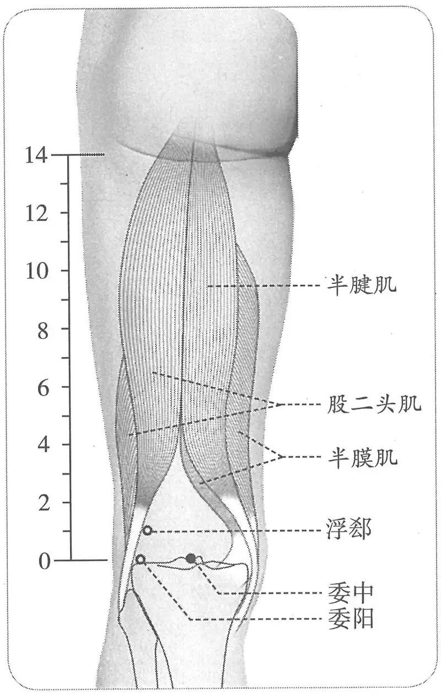

**图2-200　委中穴图**

#### 【定位】 

**部位**：在膝后区，腘横纹中点（图2-200）。

**取穴**：当腘窝横纹中央，于股二头肌腱与半腱肌腱的中间，俯卧取之。

**相关解剖学基础**：一般多认为腘动脉的搏动（popliteal pulse）在全身最难摸，但实验的结果表明其比尺动脉的触诊更容易些。方法：伏卧位，膝关节屈45°~90°使肌肉松弛（即所谓“委而取之”），再沿股骨腘面的中线深摸即可摸到腘动脉的搏动。仰卧位（不及俯卧位清楚），膝关节屈45°~90°，脚倚在椅子的靠背上使紧张的腘筋膜松弛，此时腘窝的中线上，将腘动脉向股骨的腘面深压就能摸到该动脉的搏动。

　1. 膀胱……入于委中，委中腘中央，为合，委而取之。（《灵枢·本输》）

　2. 在腘中央约纹中动脉。（《黄帝明堂经》、《太平圣惠方·针经》、《铜人腧穴针灸图经》、《圣济总录》、《针灸资生经》、《针灸玉龙经》、《十四经发挥》、《针灸聚英》、《古今医统》、《针灸大成》、《类经图翼》、《医宗金鉴·刺灸心法要诀》、《循经考穴编》、《针灸逢源》）

　3. 甄权云曲脷内，两筋两骨宛宛。（《太平圣惠方·针经》）

　4. 在曲脷内，两筋两骨中宛宛是也。令病人合面卧，舒挺两脚取之。（《太平圣惠方·明堂》）

　5. 窦太师针灸遗存

　　(1) 在膝后腘纹中，两筋骨之间动脉处，立地取之。（《窦太师针经》）

　　(2) 在膝下横腘纹中是穴。四畔有紫脉。（《窦太师秘传》）

　　(3) 在膝后约纹中央，两筋之间动脉是穴，伏卧取之。（《针方六集》卷一）

　6. 在足腘中央，两筋间约纹中，动脉应手。（《神应经》、《医学入门》、《针灸大成》）

　7. 当膝腘窝横纹正中央。（《针灸十四经穴位考订》）

　8. 统编针灸学教材

　　(1) 部位：在腘中央约纹中动脉。取穴：在膝腘横纹中央动脉陷中，伏卧取之。（1957年南京《针灸学》）

〔p.722 (인쇄 702)〕

　　(2) 部位：腘横纹中央。取穴：委阳穴内侧一寸，动脉陷中，伏卧取之。（1版《针灸学讲义》）

　　(3) 部位：在腘中央约纹中动脉。取穴：当腘窝横纹中央，于股二头肌腱与半腱肌腱的中间，屈膝或俯卧取之。（2版《针灸学讲义》）

　　(4) 腘横纹中央。（4、5版《针灸学》）

　　(5) 在腘横纹中点，当股二头肌腱与半腱肌腱的中间。（6、7版《针灸学》、《中国针灸学》）

#### 【类属】 

足太阳膀胱经穴；足太阳经合穴。

　1. 膀胱出于至阴……入于委中，委中，腘中央，为合，委而取之，足太阳也。（《灵枢·本输》）

　2. 膀胱合入于委中。（《灵枢·邪气藏府病形》）

　3. 足太阳脉之所入也，为合。（《黄帝明堂经》）

#### 【适应症】 

主治腰腿、前阴病症。常用于腰背痛，下肢痿痹；小腹痛，小便不利，遗尿。

　1. 主腰痛夹脊至头几几然，目䀮䀮。疟，头重，寒从背起，先寒后热，渴，渴止汗乃出。癫疾反折。热病夹脊痛。痔，篡痛。遗溺。筋急，身热，少腹坚肿时满，小便难，尻股寒，髀枢痛，外引季胁，内控八髎。衄血不止。风痉。（《黄帝明堂经》）

**按**：《黄帝明堂经》载本穴主治多已见于《内经》，详见“附：临床应用举例”。

　2. 主凡腰脚重痛于此刺出血，久固宿疹亦皆立已。（《千金要方》卷三十）

　3. 主脚弱无力，风湿痹，半身不遂。（《太平圣惠方·针经》）

　4. 治腰侠脊沉沉然，遗溺，腰重不能举体，风痹髀枢痛。可出血，痼疹皆愈。今附：委中者血郄也。热病汗不出，足热，厥逆满，膝不得屈伸，取其经血，立愈。（《铜人腧穴针灸图经》卷下）

　5. 窦太师针灸遗存

　　(1) 治腰疼，足筋紧急，膝头红肿，半身瘫痪，痈疽发背，便毒等症，并宜出血。若针，不宜补、脚弱不宜出血。（《窦太师针经》）

　　(2) 治腰胁疼痛，脚足生疮；治脚无力，半身不遂。（《大本琼瑶神书》）

　　(3) 治一切腰腿等证。（《窦太师秘传》）

　　(4) 主足筋紧急，膝头红肿，瘫痪，痈疽发背等证，并宜出血，血出痼疾皆愈。脚弱不宜出血。（《针方六集》卷五）

　　(5) 治一切腰脚重痛，风湿痿痹，髀枢不利，膝不得屈伸，背疽流注，浑身疮癞，并宜出血为愈。（《循经考穴编》上）

　　(6) 委中也是腰疼穴，任君取用要相逢。（《针灸玉龙歌》）

　6. 主膝痛及拇指，大风发眉堕落，刺之出血。（《针灸聚英》卷一、《古今医统》、《针灸大成》）

**按**：此二症皆出于《素问》，原文皆未明言取委中穴治之。

　7. 统编针灸学教材

　　(1) 主治腰脚肿痛，髀枢不利，膝不得曲伸，风湿痿痹，半身不遂，急性吐泻，心腹绞痛，大麻风，热病汗不出，遗溺。（1957年南京《针灸学》、1版《针灸学讲义》）

　　(2) 主治腰痛，髋关节屈伸不利，腘筋挛急，下肢痿痹，半身不遂，腹痛，吐泻，丹毒。（2版《针灸学讲义》）

〔p.723 (인쇄 703)〕

　　(3) 主治腰痛，髋关节活动不利，腘筋挛急，下肢痿痹，腹痛，吐泻，丹毒。（4版《针灸学》）

　　(4) 主治腰痛，下肢痿痹，腹痛，吐泻，小便不利，遗尿，丹毒。（5、7版《针灸学》）

　　(5) 主治腰痛，下肢痿痹，中风昏迷，半身不遂，腹痛，呕吐，腹泻，小便不利，遗尿，丹毒。（6版《针灸学》）

　　(6) 主治腰痛，髋关节活动不利，腘筋挛急，下肢痿痹，半身不遂，腹痛，吐泻，丹毒。（《中国针灸学》）

**文献分析**：委中为“四总穴”之一，临床应用很广，早在《内经》中就记载了大量该穴的临床应用。以上委中穴主治中，厥、腰痛、痉、疟虽属于不同的病，但都出现了项背、腰这些特定部位的病变，故同取足太阳委中穴治之。这与中医强调辨证论治的道理相同，但针灸临证更注重根据病变部位的特点辨证取穴，这一点在《内经》以及古代针灸方中反映得非常明显。另一方面，《内经》所述本穴主治中还包括膀胱病症和足太阳经病候“衄”。这反映了阳经下合穴主治的共性规律。从历代文献关于本穴主治病症表述可以明显看出一个从特殊到一般、从具体到抽象的概括过程。首先《千金要方》总结的本穴主治特点“凡腰脚重痛于此刺出血”，已经从本穴所主治的大量纷繁的病症中抓住了“腰脚”这一作用部位特点，此后元代窦太师更明言“治一切腰腿等证”。不论什么病，只要出现这些特定部位症状，特别是腘中血络郁结明显时，皆可取委中穴治之。

1957年南京《针灸学》及1版教材“急性吐泻，心腹绞痛”不见于其所依据的6种古代文献，从“临床应用”所附古今临床应用来看，均明确出自刮痧疗法适应症。本穴所在部位血管丰富，为刮痧极常用部位，而自明清以来，痧证的概念及其刮痧法均有很大变化。有以干霍乱为痧者，即所谓“绞肠痧”；或有以疫喉疹为痧者，即所谓“烂喉痧”等等，皆大面积刺刮治之。故此类病症仍应归于刮痧疗法适应症，不宜于针灸适应症相杂，更不宜作为“基础主治”，今去之。

从《内经》、《黄帝明堂经》总结的本穴主治病症来看，大多为项背、腰腿部病症，这与足太阳经的循行相吻合。此外，古人对本穴的应用还有另类经验，《素问·骨空论》有详细的描述：“膝痛痛及拇指，治其腘”（类似这样带有规律的经验总结，该篇还更多极为精辟的描述）。此用经络学说难以解释，因为拇指处乃足厥阴经、足太阴经行处，不当取足太阳经穴治之。因而这类极有价值的诊疗经验没能总结到委中穴的主治之中。那么这种特征性的疼痛的解剖学基础是什么？对于没有现代解剖学知识背景的古人或者从经络的走行加以解释，如杨上善认为经文中的“拇指”乃小趾（因足太阳经行于此），对于尊经崇古的王冰则只注出经文中“腘”为足太阳经委中穴，疼痛的部位特征则避而不解。而根据现代解剖学的知识可知：L4-5腰痛，疼痛可放散到大腿后外侧，经腘窝到小腿外侧、足背及踇趾。可见，古人的观察非常精细与准确。同时根据腰神经的支配关系，临床上还可以取足太阳背俞的大肠俞、关元俞以及相应的夹脊穴，而且在刺法上也可参照脊神经刺激疗法的针刺方向与角度，若刺激到第4、5腰神经，针感可从腰骶部向下放散到下肢，直至踇趾。

#### 附：临床应用举例 

　1. 腰腿病症

　　(1) 厥夹脊而痛者，至顶头沉沉然，目䀮䀮然，腰脊强，取足太阳腘中血络。（《灵枢·杂病》）

　　(2) 足太阳脉令人腰痛，引项脊尻背如重状，刺其郄中太阳正经出血，春无见血。（《素问·刺腰痛》）

〔p.724 (인쇄 704)〕

　　(3) 足太阳之疟，令人腰痛头重，寒从背起，先寒后热熇熇暍暍然，热止汗出，难已，刺郄中出血。（《素问·刺疟》）

　　(4) 腰痛夹脊而痛，至头几几然，目䀮䀮欲僵仆，刺足太阳郄中出血。（《素问·刺腰痛》）

　　(5) 风痉身反折，先取足太阳及腘中及血络出血；中有寒，取三里。（《灵枢·热病》）

　　(6) 膝痛痛及拇指，治其腘王冰注：腘谓膝解之后，曲脚之中，委中穴。背面取之。（《素问·骨空论》）

　　(7) 苏恭云：脚气初发转筋者，灸承山、承筋二穴。哕逆者灸涌泉。若从头至连背痛，寒热如疟，及腰痛者，灸委中。头项背痛，随身痛即灸，不在正穴也。（《外台秘要》卷十九）

　　(8) 腰痛不可忍，针昆仑及刺委中出血。（《素问病机气宜保命集》卷下）

　　(9) 陕帅郭巨济病偏枯，二指著足底不能伸，迎先师于京，师治之至，则以长针刺委中，深至骨而不知痛，出血一二升，其色如墨，又且缪刺之，如是者六七次，服药三月病良愈。（《东垣试效方》卷九）

　　(10) 中毒风，偏身麻痒如虫啮，极爪之皮肤随手脱落：先灸曲池，更泻委中出血妙。（《针灸集要·盘石金直刺秘传》）

　　(11) 腰脊反折，痛连两臂，或风劳气痛：泻人中、肩井、曲池、委中宜弹针出血（《针灸集要·盘石金直刺秘传》）

　　(12) 环跳独治腿股风，居髎二穴不落空，更有委中出毒血，任君行步显奇功。（《针灸玉龙歌》）

　　(13) 腿胯疼痛，名曰腿叉风：环跳二穴、委中二穴、阳陵泉二穴。（《针灸大全》卷四）

　　(14) 两膝红肿疼痛：膝关、委中、三里。问曰：此证缘何而得？答曰：皆因痹经受湿，痰饮流注，或因痢后寒邪入于经络，及伤寒流注，故如此也。复刺后穴：阳陵泉、中脘、丰隆。（《针灸集成》第四十方）

　　(15) 两腿筋挛不伸：委中、昆仑。此证着地坐卧，风寒湿气侵入筋骨，以致筋紧不能舒缩。就地擦行。故针此穴，立起。（《针灸集成》第六十八方）

　　(16) 肾虚腰痛，久而不已者：灸肾俞二七壮，补之，刺委中；未愈，刺昆仑。（《针灸集要·盘石金直刺秘传》）

　　(17) 脚拗痛：委中出血。（《医学纲目》卷二十二）

　　(18) 治中风半身不遂，腰背拘急：委中二穴，针五分，禁灸。（《乾坤生意》下卷）

　　(19) 腰脚疼，在委中而已矣。（《通玄指要赋》）

　　(20) 脊膂强痛泻人中，挫闪腰疼亦可针，委中也是腰疼穴，任君取用两相通。（《针灸玉龙歌》）

　　(21) 腰背委中求。（《四总穴歌》）

　　(22) 腰背痛相连，委中昆仑穴。（《千金十一穴歌》）

　　(23) 五般腰痛委中安。（《灵光赋》）

　　(24) 委中腰痛脚挛急，取得其经血自调。（《席弘赋》）

　　(25) 委中专治腰间痛，脚膝肿时寻至阴。（《席弘赋》）

　　(26) 腰软如何去得根？神妙委中立见效。（《肘后歌》）

　　(27) 第三腰椎横突综合征：委中穴针刺治疗。[安徽中医学院学报，1987（2）：35]

〔p.725 (인쇄 705)〕

　　(28) 腰痛：委中穴针刺拔罐治疗。[针刺研究，1998（3）：214]

　2. 热病

　　(1) 伤风，浑身发热，或拘急：泻曲池、承山、委中出血。（《针灸集要·盘石金直刺秘传》）

　　(2) 伤寒，身热恶寒：泻曲池，刺委中出血，看虚实补泻。（《针灸集要·盘石金直刺秘传》）

　3. 外科病症

　　(1) 肺经风落，满面生疮：暴者刺少商、委中出血，年久者更泻合谷。（《针灸集要·盘石金直刺秘传》）

　　(2) 发背痈疽：肩井、曲池、委中。急可就疽上灸，法如疽不痛灸至痛，若痛灸至不痛止，多灸为妙。用蒜切片，隔灸。如无蒜，用泥。瘰疬，用草量病人口，凭中折纹安曲池上，灸两头是穴也。（《针灸集成》第五十七方）

　　(3) 乳痈：刺少泽泻之、委中出血。（《针灸集要·盘石金直刺秘传》）

　4. 其他病症

　　(1) 膀胱病者，小腹偏肿而痛，以手按之，即欲小便而不得，肩上热若脉陷，及足小指外廉及胫踝后皆热若脉陷，取委中央。（《灵枢·邪气藏府病形》）

　　(2) 衄血，取手太阳，不已，刺腕骨下，不已，刺腘中出血。（《灵枢·杂病》）

　　(3) 心病者，胸中痛，胁支满，胁下痛，膺背肩甲间痛，两臂内痛；虚则胸腹大，胁下与腰相引而痛。取其经，少阴太阳，舌下血者。其变病，刺郄中血者。（《素问·藏气法时论》）

　　(4) 一切游走气攻胸胁疼痛，语言、咳嗽难，不可转侧：支沟（右疼泻左，左疼泻右）、委中（出血）。（《针灸玉龙经·盘石金直刺秘传》）

　　(5) 浑身发黄，四肢无力：灸至阴、委中出血。（《针灸集要·盘石金直刺秘传》）

　　(6) 有中痧，腹虚胀，或腹中急痛，刺括委中，或夺命穴等处。（《伤寒治例》）

　　(7) 疫喉痧：承山穴、大椎穴、委中穴，针刺治疗。[上海针灸杂志，1987，6（4）：42]

　　(8) 欲吐利而烦躁者，多有痧毒，世俗以刺括委中穴。（《伤寒治例》）

　　(9) 干霍乱，或腹中急痛绞刺，宜刺委中及绞刮夺命穴。（《伤寒治例》）

　　(10) 小儿赤游风：百会、委中。（《针灸大成》卷九）

　　(11) 暴发型胃肠炎：金津穴、委中穴、玉液穴，针灸治疗。[北京中医，1985（3）：51]

　　(12) 蕈样霉菌病：曲池穴、委中穴、风门穴，针刺治疗。[美国针灸杂志，1988，16（3）：221-224]

　　(13) 顽固性产后尿潴留：秩边配委中针刺治疗。[针灸临床杂志，2000，16（3）：57]

#### 【操作】 

直刺0.5~1.0寸。勿损伤血管、神经。

　1. 刺郄中大脉，令人脱色。（《素问·刺禁论》）

　2. 刺入五分，留七呼，灸三壮。（《黄帝明堂经》）

　3. 窦太师针灸遗存

　　(1) 针入二寸半，禁灸，四畔紫脉上宜锋针出血，大络不可。治腰疼，足筋紧急，膝头红肿，半身瘫痪，痈疽发背，便毒等症，并宜出血。若针，不宜补、脚弱不宜出血。此穴最能出血太多，不宜轻用。（《窦太师针经》）

　　(2) 四畔有紫脉，三棱针出血，针入三寸半，宜弹针出血。（《窦太师秘传》）

　　(3) 针入二寸半，但紫脉上皆可锋针出血，禁灸。（《大本琼瑶神书》）

　　(4) 针一寸，见血立愈。（《针灸玉龙歌》注）

〔p.726 (인쇄 706)〕

　4. 针八分。（《神应经》）

　5. 针五分，禁灸。（《针灸十四经穴位考订》）

　6. 统编针灸学教材

　　(1) 针一寸或一寸五分，依取穴法进针，不宜灸只宜刺，凡急性病症之上部充血，内脏及腰背腹腔等之郁血，在四围静脉上刺血。刺血法：使患者直立，两手扶几上，膝腘挺直，就腘之范围内寻取青紫色之络脉，用三棱针刺之约进半分至一分深，一刺而去，污黑之血随针而流，任其自止。如不易寻出青色紫络时，以手之四指相并，在膝腘窝拍击两三下，即有青络显出，出血后以橡皮布封之。注意不能深刺在动脉上。（1957年南京《针灸学》）

　　(2) 针一至一寸五分，禁灸。（1版《针灸学讲义》）

　　(3) 直刺8~15分，或三棱针点刺出血。（2版《针灸学讲义》）

　　(4) 直刺1~1.5寸，或用三棱针在腘静脉上点刺出血。禁灸。（4版《针灸学》）

　　(5) 直刺1~1.5寸，或用三棱针点刺腘静脉出血。（5、6版《针灸学》）

　　(6) 直刺1~1.5寸，或用三棱针点刺腘静脉出血。针刺不宜过快、过强、过深，以免损伤血管和神经。（7版《针灸学》）

　　(7) 直刺0.5~1.0寸，或用三棱针点刺出血。（《中国针灸学》）

　7. ①直刺0.5~1寸。感应：局部酸胀，或有麻电感向足底放散。②急性腰扭伤时，可用三棱针点刺出血。温灸3~5分钟。（上海《针灸学》）

### （四十一）附分 Fùfēn BL41 出《黄帝明堂经》 

#### 【提要索隐】 

**部位**：在脊柱区，第2胸椎棘突下，后正中线旁开3寸。

**适应症**：主治局部病症。常用于肩背拘急，颈项强痛，肘臂麻木。

**针刺操作**：斜刺0.3~0.5寸。勿直刺过深，以防刺伤肺脏。

#### 【名实考】 

足太阳经脉“其支者，从髆内左右，别下贯胛（胂挟脊肉），过髀枢，循髀外从后廉下合腘中”，本穴正当此支脉分出处，故名“附分”。

　1. 附分，在第二椎下，附项内廉两旁各三寸，手、足太阳之会。（《黄帝明堂经》）

　2. 穴名附分者，此太阳支别之络下行者也。（《经穴解》）

#### 【定位】 

**部位**：在脊柱区，第2胸椎棘突下，后正中线旁开3寸（图2-201）。

**取穴**：第2胸椎棘突下旁开3寸，横平风门（BL12）穴。

　1. 在第二椎下，附项内廉两旁各三寸。（《黄帝明堂经》、《太平圣惠方·针经》）

　2. 在第二椎下内廉，两旁相去各三寸。（《铜人腧穴针灸图经》卷上）

　3. 在第二椎下，附项内廉两旁相去各三寸。正坐取之。（《铜人腧穴针灸图经》卷中及卷下“穴腧都数”、《圣济总录》、《医学纲目》、《医学入门》、《针灸大成》、《针方六集》、《类经图翼》、《循经考穴编》、《针灸易学》）

　4. 在第二椎下附项内廉两旁，相去夹脊各三寸。当准《千金方》除脊各三寸取穴。（《针灸资生经》卷一）

　5. 二椎下，附项内廉，两旁相去脊中各三寸，正坐取之。（《针灸聚英》卷一、《古今医统》）

〔p.727 (인쇄 707)〕

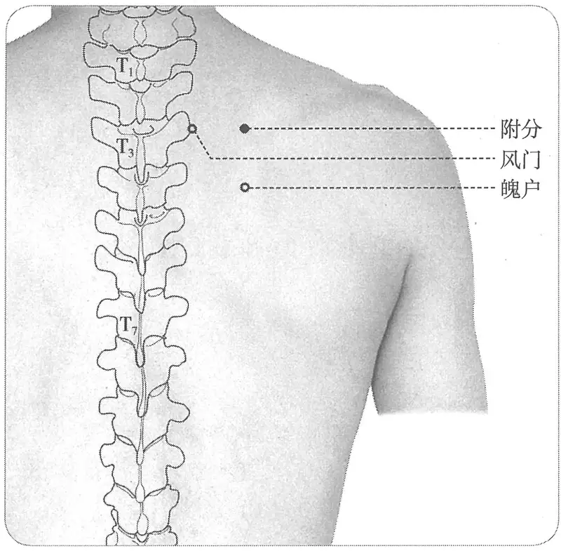

**图2-201　附分穴图**

　6. 在二椎下，附项内廉两旁相去脊中各三寸半。（《类经图翼》卷七、《医宗金鉴·刺灸心法要诀》、《针灸逢源》）

　7. 第二椎下去脊中三寸五分去脊边三寸。（《针灸十四经穴位考订》）

　8. 统编针灸学教材

　　(1) 部位：在第二椎下两旁去脊三寸。取穴：从第二胸椎下外开三寸，与风门穴并行，靠肩胛骨边缘取之。（1957年南京《针灸学》）

　　(2) 部位：项后第二椎下，挟脊六寸。取穴：伏卧或正坐，从第二椎下旁开三寸，靠肩胛骨边缘陷中取之。（1版《针灸学讲义》）

　　(3) 部位：在第二椎下，两旁各三寸。取穴：平第二胸椎棘突下，督脉旁开三寸，于肩胛骨脊柱缘，俯伏取之。（2版《针灸学讲义》）

　　(4) 第二胸椎棘突下，旁开3寸。（4、5、7版《针灸学》）

　　(5) 在背部，当第2胸椎棘突下，旁开3寸。（6版《针灸学》）

　　(6) 第二胸椎棘突下，督脉旁开三寸，于肩胛骨脊柱缘取穴。（《中国针灸学》）

**文献分析**：关于本穴定位去脊中距离的分歧，详见本经“概说”。

#### 【类属】 

足太阳膀胱经穴。

**脉气所发**：手、足太阳之会。（《黄帝明堂经》）

**归经**：足太阳膀胱经。（《外台秘要》卷三十九、《铜人腧穴针灸图经》卷上）

#### 【适应症】 

主治局部病症。常用于肩背拘急，颈项强痛，肘臂麻木。

　1. 主背痛引头。（《医心方》卷二、《千金要方》）

　2. 主背痛引颈。（《外台秘要》卷三十九）

　3. 主背痛引颔。（《太平圣惠方·针经》）

　4. 治肩背拘急，风冷客于腠，颈项强痛不得回顾，风劳臂肘不仁。（《铜人腧穴针灸图经》卷中）

〔p.728 (인쇄 708)〕

**按**：此条主治已见于《铜人腧穴针灸图经》大椎穴主治。

　5. 统编针灸学教材

　　(1) 主治肩背拘急，颈项不得回顾，肘臂不仁。（1957年南京《针灸学》）

　　(2) 主治肩、背、颈项强急，肘臂不仁。（1版《针灸学讲义》）

　　(3) 主治肩背拘急，颈项强痛，肘臂麻木。（2版《针灸学讲义》、4、5、6、7版《针灸学》、《中国针灸学》）

#### 【操作】 

斜刺0.3~0.5寸。勿直刺过深，以防刺伤肺脏。

　1. 刺入八分，灸五壮。（《黄帝明堂经》）

　2. 灸五壮，针入三分。（《太平圣惠方·针经》）

　3. 针三分，灸三壮。（《古今医统》）

　4. 统编针灸学教材

　　(1) 针五分，灸三至七壮。（1957年南京《针灸学》、1版《针灸学讲义》）

　　(2) 向下斜刺3~5分，艾条灸5~15分钟。（2版《针灸学讲义》）

　　(3) 斜刺0.5~0.8寸。（4、5、7版《针灸学》）

　　(4) 斜刺0.5~0.8寸；可灸。（6版《针灸学》）

　　(5) 斜刺0.3~0.5寸。可灸。（《中国针灸学》）

### （四十二）魄户 Pòhù BL42 出《黄帝明堂经》 

#### 【提要索隐】 

**穴名**：魄户，古代针灸文献有误作“魂户”者。

**部位**：在脊柱区，第3胸椎棘突下，后正中线旁开3寸。

**适应症**：主治肺部、局部病症。常用于肺痨，咳嗽，气喘；颈项强痛，肩背痛。

**针刺操作**：斜刺0.3~0.5寸；不宜直刺，以免损伤壁胸膜和肺脏。

#### 【名实考】 

《太平圣惠方·明堂》记有本穴二处，一作“魄户”，一误作“魂户”，后人不识，多有误辨。

　1. 魄户，在第三椎下，两旁各三寸，足太阳脉气所发，正坐取之。（《黄帝明堂经》）

　2. 穴名魄户者，肺藏魄者也，此穴横直肺腧，内穴为系肺之原，此穴乃肺之户也，其主皆肺病。（《经穴解》）

#### “魄户”误作“魂户”例 

《太平圣惠方·明堂》除了载有“魄户”穴外，还载有“魂户”一穴，而“魂户”之名不见于宋以前医籍，宋代王执中对此困惑不解，其实只要与原书稍加对照，便可真相大白：

魄户二穴，在第三椎下两旁各三寸宛宛中，正坐取之是穴。主背胛闷，无气力，劳损萎黄，五尸走疰，项强不得回顾。（《太平圣惠方·针经》）

魄户，在第三椎下两旁各三寸。正坐取之。灸五壮。主肩髆间急，悽厥恶寒，项背痛引颈，咳逆上气，呕吐，烦满，背痛不能引顾。（《外台秘要》卷三十九）

魂户二穴，在第三椎下两边各三寸陷者中，灸三壮。主背甲满闷，项急强不得顾，劳损虚乏，尸厥走疰，胸背连痛也。（《太平圣惠方·明堂》）

魄户二穴，在第三椎下两旁各三寸，正坐取之宛宛中，灸五壮。主肩髆间急痛，背气不能引顾，咳逆上喘也。（《太平圣惠方·明堂》）

〔p.729 (인쇄 709)〕

**按**：明代高武据此将上述“魂户”条主治症归入“魂门”穴下，明以后针灸文献又多沿袭《针灸聚英》之误。

#### “魄户”“魂门”相混例 

筋挛骨痛而补魂门，体热劳嗽而泻魄户。（《标幽赋》）

魄户二穴，治浑身百节疼痛，泻；夜梦鬼交，补。不可久留针。（《窦太师针经》）

魂门二穴，治浑身百节疼痛，体热或劳嗽，泻；气不升降，补。（《窦太师针经》）

魄户二穴，主体热百节痛，夜梦鬼交。（《针方六集》卷五）

魂门二穴，主浑身筋挛骨痛，体热劳嗽，气不升降。（《针方六集》卷五）

**按**：魂门穴属肝而主筋疾，魄户穴属肺而治劳嗽，《标幽赋》说的很清楚，而《窦太师针经》将此二症悉归于魂门穴下，魄户穴主治甚至皆为魂门主症。从《针方六集》完全相同的错误来看，吴崑采用的是相同的《窦太师针经》传本。

#### 【定位】 

**部位**：在脊柱区，第3胸椎棘突下，后正中线旁开3寸（图2-202）。

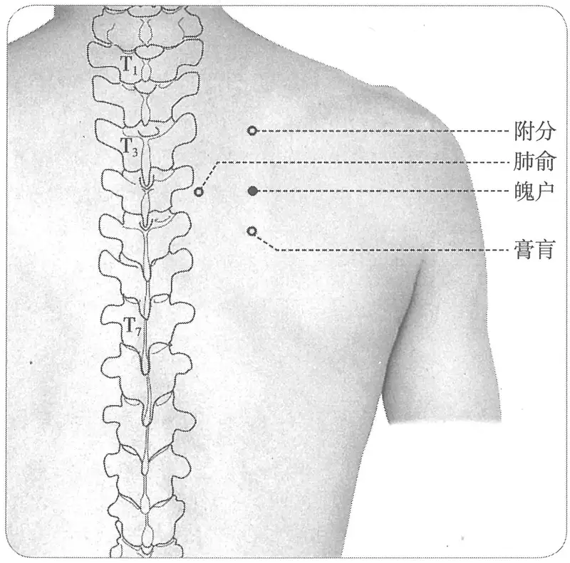

**图2-202　魄户穴图**

**取穴**：在第3胸椎棘突下旁开3寸，平肺俞、身柱穴。

　1. 《黄帝明堂经》佚文

　　(1) 在第三椎下两旁各三寸。（《针灸甲乙经》卷三、《千金要方》、《千金翼方》、《铜人腧穴针灸图经》卷上及卷下“穴腧都数”、《十四经发挥》、《针灸大成》、《针方六集》、《循经考穴编》、《针灸易学》）

　　(2) 在第三椎下两旁各三寸……正坐取之。（《外台秘要》卷三十九、《素问·刺热》王冰注、《医心方》、《太平圣惠方》、《铜人腧穴针灸图经》卷中、《圣济总录》、《窦太师针经》、《医学纲目》、《针方六集》、《循经考穴编》）

　2. 在三椎下两旁各三寸，正坐取之。当准《千金方》除脊各三寸取穴。（《针灸资生经》卷一）

　3. 直附分下，三椎下，两旁相去脊中行各三寸，正坐取之。（《针灸聚英》卷一、《古今医统》）

〔p.730 (인쇄 710)〕

　4. 在三椎下去脊中三寸半陷中，正坐取之。（《类经图翼》卷七、《医宗金鉴·刺灸心法要诀》、《针灸逢源》）

　5. 第三椎下去脊中三寸五分去脊边三寸。（《针灸十四经穴位考订》）

　6. 统编针灸学教材

　　(1) 部位：第三椎下两旁去脊各三寸。取穴：从第三胸椎下身柱穴外开三寸处取之，与肺俞穴平。（1957年南京《针灸学》）

　　(2) 部位：附分穴下。取穴：伏卧或正坐，从第三椎下督脉身柱穴外开三寸陷中取之，与肺俞穴平。（1版《针灸学讲义》）

　　(3) 部位：在第三椎下，两旁各三寸。取穴：平第三胸椎棘突下，身柱督脉旁开三寸，于肩胛骨脊柱缘，俯伏取之。（2版《针灸学讲义》）

　　(4) 第三胸椎棘突下，旁开3寸。（4、5、7版《针灸学》）

　　(5) 在背部，当第3胸椎棘突下，旁开3寸。（6版《针灸学》）

　　(6) 第三胸椎棘突下，督脉旁开三寸，于肩胛骨脊柱缘取穴。（《中国针灸学》）

**文献分析**：关于本穴定位去脊中距离的分歧，详见本经“概说”。

#### 【类属】 

足太阳膀胱经穴。

足太阳脉气所发。（《黄帝明堂经》）

#### 【适应症】 

主治肺部、局部病症。常用于肺痨，咳嗽，气喘；颈项强痛，肩背痛。

　1. 主肩髆间急，悽厥恶寒。咳逆上气。呕吐烦满。项背痛引颈。（《黄帝明堂经》）

　2. 背痛不能引顾。（《外台秘要》卷三十九）

　3. 主背胛闷，无气力，劳损萎黄，五尸走疰，项强不得回顾。（《太平圣惠方·针经》）

　4. 治背髆痛，咳逆上气，呕吐烦满，虚劳肺痿，五尸走疰，项强不得回顾。（《铜人腧穴针灸图经》卷中）

　5. 窦太师针灸遗存

　　(1) 治浑身百节疼痛，泻；夜梦鬼交，补。（《窦太师针经》）

　　(2) 体热劳嗽。（《大本琼瑶神书》）

　　(3) 筋挛骨痛而补魂门，体热劳嗽而泻魄户。（《标幽赋》）

　6. 统编针灸学教材

　　(1) 主治虚劳，肺痿，咳嗽喘息，颈强，肩髆痛。（1957年南京《针灸学》、1版《针灸学讲义》）

　　(2) 主治肺痨，咳嗽，气喘，项强，肩背痛。（2版《针灸学讲义》、4、5、7版《针灸学》）

　　(3) 主治咳嗽，气喘，肺结核，肩背痛。（6版《针灸学》）

　　(4) 主治肺痨，咳嗽，气喘，吐血，盗汗，健忘，遗精。（《中国针灸学》）

#### 【操作】 

斜刺0.3~0.5寸。不宜直刺，以免损伤壁胸膜和肺脏。

　1. 刺入五分，灸五壮。（《黄帝明堂经》）

　2. 针入五分，得气即泻，又宜久留针，灸亦得，日灸七壮至二百罢。（《太平圣惠方·针经》）

　3. 窦太师针灸遗存

　　(1) 针入一分，沿皮向外一寸半，灸二七壮。（《窦太师针经》）

　　(2) 针一分，沿皮向外寸半，灸五壮。（《窦太师秘传》）

　4. 针三分，灸三壮。（《针灸十四经穴位考订》）

〔p.731 (인쇄 711)〕

　5. 统编针灸学教材

　　(1) 针五分，灸三至七壮。（1957年南京《针灸学》、1版《针灸学讲义》）

　　(2) 向下斜刺3~5分，艾条灸5~15分钟。（2版《针灸学讲义》）

　　(3) 斜刺0.5~0.8寸。（4、5、7版《针灸学》）

　　(4) 斜刺0.5~0.8寸；可灸。（6版《针灸学》）

　　(5) 斜刺0.3~0.5寸。可灸。（《中国针灸学》）

