# 《针灸腧穴通考》(上册) — 足太阳膀胱经穴 (3/3) · （四十三）膏肓 Gāohuāng BL43 出《千金要方》~（六十七）至阴 Zhìyīn BL67 出《灵枢》

> 분할본 14/25. 원서: 黄龙祥·黄幼民 编著, 《针灸腧穴通考——〈中华针灸穴典〉研究》(上册), 人民卫生出版社, 2011. 원서 스캔 OCR 판독본을 챗봇 검색용으로 나눈 것이며, 본문과 쪽 표시 〔p.PDF쪽 (인쇄 쪽)〕는 원본 그대로이다.

## 七、足太阳膀胱经穴 (계속)

### （四十三）膏肓 Gāohuāng BL43 出《千金要方》 

#### 【提要索隐】 

**穴名**：一名膏肓输。

**部位**：在脊柱区，第4胸椎棘突下，后正中线旁开3寸。

**适应症**：保健灸的常用穴。主治虚劳及肺部病症。常用于肺痨，咳嗽，气喘，盗汗；遗精。

**针刺操作**：斜刺0.3~0.5寸。不宜深刺，宜向脊椎方向成30°~45°角斜刺。

#### 【名实考】 

本穴名称，宋以前腧穴文献皆作“膏肓俞”，或因脏腑之俞皆在背第一侧行，第二侧行穴不称“俞”，元代《十四经发挥》正式改称“膏肓”，今从之。在此之前，宋代《针灸资生经》目录中已作“膏肓”，然正文中仍作“膏肓俞”。

“膏肓”作为穴名，已见于《华佗针灸经》，观其文意，“膏肓”又名“督脉俞”，皆定于背部第一侧行，《医心方》卷二也将本穴列于第一侧行心俞与膈俞穴之间。然自宋代《铜人腧穴针灸图经》明确将本穴定位于脊旁三寸后，则移出第一侧行，穴名也不再称“俞”字，彻底退出“背俞”穴之列。

　1. 膏肓输无所不治……取身体平复，其穴近第五椎相准望取之。（《千金要方》卷三十）

　2. 膏肓腧二穴，在第四椎下，近五椎上两旁各三寸。出《千金》、《外台》附经。（《铜人腧穴针灸图经》卷上）

　3. 膏肓腧二穴，在第四椎下两旁相去各三寸。（《铜人腧穴针灸图经》卷中）

　4. 膏肓腧二穴，在第四椎下，近第五椎两旁各三寸。（《铜人腧穴针灸图经》卷下“穴腧都数”）

　5. 穴名膏肓者，凝者为脂，释者为膏。肓者，膈也。又心下为膏，乃连心脂膏也。（《经穴解》）

#### 宋以前文献膏肓穴别说 

　1. 《华佗针灸经》曰第六椎名心俞又云督脉俞，又名膏肓。夹脊相去一寸。（《医心方》卷二）

　2. 《扁鹊针灸针》曰第五椎名督脉输。夹脊左右各一寸半或一寸二分。（《医心方》卷二）

#### 【定位】 

**部位**：在脊柱区，第4胸椎棘突下，后正中线旁开3寸（图2-203）。

**取穴**：第4胸椎棘突下旁开3寸，横平厥阴俞（BL14）。

　1. ……其穴近第五椎相准望取之。（《千金要方》卷三十、《千金翼方》、《外台秘要》、《圣济总录》、《医学纲目》、《类经图翼》）

　2. 先令病人正坐曲脊，伸两手以臂著膝前令正直，手大指与膝头齐，以物支肘，勿令臂得动也。从胛骨上角摸索至胛骨下头，其间当有四肋三间，中间依胛骨之里去胛骨容侧指许，摩胆肉之表肋间空处。按之自觉牵引肩中。（《千金翼方》卷二十七、《外

〔p.732 (인쇄 712)〕

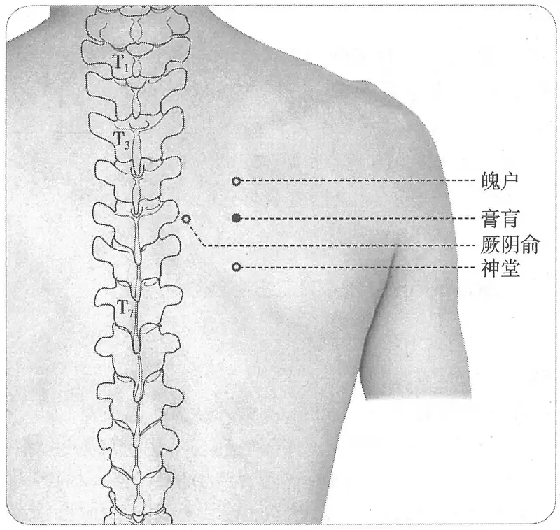

**图2-203　膏肓穴图**

台秘要》、《太平圣惠方·针经》）

　3. 求穴大较以右手后右肩上往指头表所不及者也，左手亦然也。（《医心方》卷二）

　4. 在第四椎下，近五椎上两旁各三寸。（《铜人腧穴针灸图经》卷上及卷下“穴腧都数”）

　5. 在第四椎下两旁相去各三寸。（《铜人腧穴针灸图经》卷中、《圣济总录》、《针灸资生经》、《针灸玉龙经》、《十四经发挥》、《医学纲目》、《针方六集》）

　6. 灸膏肓功效，诸经例能言之，而取穴则未也。《千金》等方之外，庄绰论之最详，然繁而无统，不能定于一。予尝以意取之，令病人两手交在两膊上（灸时亦然），胛骨遂开，其穴立见。以手指摸索第四椎下两旁各三寸，四肋三间之中间按之，酸疼是穴。灸至千百壮，少亦七七壮，当依《千金》立点立灸，坐点坐灸，卧点卧灸云。若只合爪在两膝头中点穴，亦得。当准《千金方》除脊各三寸取穴。（《针灸资生经》卷一）

　7. 且如背俞，前贤书中皆云夹脊各寸半是，共折三寸，分二旁取之。殊不知言夹脊，其夹字是除骨而言。若带脊骨，当以两旁各二寸，共折四寸分两旁。又如膏肓二穴，当除第一椎小骨不算。若连第一椎数下，当在五椎下两旁各三寸半，共折七寸分两旁，按其酸疼处乃是真穴。臣每依此灸疗，多获痊愈。（《神应经》）

　8. 在背部第四椎骨下，微近五椎骨上，两旁各开三寸是穴。（《窦太师针经》、《窦太师秘传》、《循经考穴编》）

　9. 在第四椎下一分微多，五椎上二分微少，以脊骨分中横开两旁各三寸半，离髆骨一指许上角摸索至下角，四筋三间，重按酸应中指是穴。（《乾坤生意》）

　10. 在四椎下微多，第五椎上微少，三七分之说，两旁各开三寸是穴。（《大本琼瑶神书》）

　11. 四椎下，近五椎上两旁相去脊中各三寸，正坐曲脊，伸两手，以臂著膝前，令端直，手大指与膝头齐，以物支肘毋令摇动取之。（《针灸聚英》卷一、《古今医统》、《针灸大成》）

〔p.733 (인쇄 713)〕

　12. 四椎下一分，五椎上二分，两旁去脊二寸。（《针灸易学》下）

　13. 第四椎下去脊中三寸五分去脊边三寸。（《针灸十四经穴位考订》）

　14. 统编针灸学教材

　　(1) 部位：在第四椎下近五椎上两旁相去脊各三寸。取穴：正坐，以左手掌指搭在右肩前，右手掌指搭在左肩前，使肩胛骨外开，医者自第四第五胸椎间外开三寸外，用中指按取第四肋间感痠痛处取之。（1957年南京《针灸学》）

　　(2) 部位：魄户穴下。取穴：正坐，以左手掌搭在右肩，右手掌搭在左肩，使肩胛骨外开，从第四椎下外开三寸，肩胛边缘陷中，用指按压痠痛处取之。（1版《针灸学讲义》）

　　(3) 部位：在第四椎下，两旁各三寸。取穴：平第四胸椎棘突下，督脉旁开三寸，于肩胛骨脊柱缘，两手抱肘，俯伏取穴。（2版《针灸学讲义》）

　　(4) 第四胸椎棘突下，旁开3寸。（4、5、6、7版《针灸学》）

　　(5) 第四胸椎棘突下，督脉旁开三寸，于肩胛骨脊柱缘取穴。（《中国针灸学》）

**文献分析**：背部第一、第二侧行穴定位，皆言第几椎下，而本穴则强调第四椎下近第五椎，似乎横平第四椎节下间再略下方。取穴方面，则强调按压酸痛至肩或至中指，特别是《灸膏肓腧穴法》传邵氏之说曰：“以指节极力按寻其穴，令病者觉中指麻乃是穴。若指不麻，或虽麻而非中指者，皆非也”。这与《灵枢》取背俞的方法一致。

关于本穴定位去脊中距离的分歧，详见本经“概说”。

#### 【类属】 

足太阳膀胱经穴。

**归经**：足太阳膀胱经。（《外台秘要》卷三十九、《铜人腧穴针灸图经》卷上）

#### 【适应症】 

保健灸的常用穴。主治虚劳及肺部病症。常用于肺痨，咳嗽，气喘，盗汗；遗精。

　1. 无所不治，主羸瘦虚损，梦中失精，上气咳逆，狂惑妄误。此灸讫后，令人阳气康盛，当消息以自补养。取身体平复。（《千金要方》卷三十、《千金翼方》、《外台秘要》、《太平圣惠方·针经》、《针灸聚英》）

　2. 主无所不疗，羸瘦虚损，梦中失精，上气咳逆，发狂健忘。（《铜人腧穴针灸图经》卷中）

　3. 窦太师针灸遗存

　　(1) 无所不疗，一切痰饮虚劳，骨蒸，痈疽发背，灸千壮。一切虚劳损伤并治。太师云若针此穴，泄人精气五藏，切忌。（《窦太师针经》）

　　(2) 痰饮虚劳等证。（《大本琼瑶神书》）

　　(3) 无所不疗，一切痰饮虚损劳瘵，传尸骨蒸，痈疽发背，并治之。（《针方六集》卷五）

　　(4) 主诸虚百损，骨蒸盗汗，吐血咳血，举重失力，四肢倦怠，目眩头晕，脾胃虚弱，噎膈翻胃。（《循经考穴编》上）

　　(5) 治五痨七伤，诸虚百损之病。（《窦太师秘传》）

　4. 统编针灸学教材

　　(1) 主治痨瘵，骨蒸，盗汗，咳嗽吐血，健忘，脾胃虚弱，梦遗失精。（1957年南京《针灸学》、1版《针灸学讲义》）

　　(2) 主治肺痨，咳嗽，气喘，吐血，盗汗，健忘，遗精，脾胃虚弱。（2版《针灸学讲义》、4版《针灸学》）

　　(3) 主治咳嗽，气喘，肺痨，健忘，遗精，完谷不化。（5版《针灸学》）

　　(4) 主治咳嗽，气喘，吐血，盗汗，肺结核，健忘，遗精，肩胛背痛。（6版《针灸学》）

〔p.734 (인쇄 714)〕

　　(5) 主治：①咳嗽，气喘，肺痨等肺之虚损证；②肩胛痛；③健忘，遗精，盗汗等虚劳诸疾。（7版《针灸学》）

　　(6) 主治肺痨，咳嗽，气喘，吐血，盗汗，健忘，遗精。（《中国针灸学》）

#### 附：临床应用举例 

　1. 久嗽最宜灸膏肓穴，其次则宜灸肺俞等穴，各随证治之。（《针灸资生经》卷四）

　2. 膈噎灸膏肓，随年数作壮，妙，候火疮，灸或中。（《医方类聚》卷一百七）

　3. 痰涎等证不一而足，惟劳瘵有痰为难治，最宜灸膏肓穴，壮数既多，当有所下咙咙然如流水之状，盖痰下也，余当随证治之。（《针灸资生经》卷四）

　4. 痨瘵四肢消瘦，面色痿黄，筋寒骨热，皮肉干枯，黄疸，并皆治之：灸百劳、膏肓、肺腧、鸠尾、关元、绝骨、足三里，每日灸二七壮，至半月灸毕。然后灸绝骨、足三里，各灸七七壮。（《针灸集要·盘石金直刺秘传》）

　5. 男子遗精白浊：心俞、肾俞、三阴、关元、膏肓。问曰：此证缘何而得？答曰：因房室失宜，惊动于心，内不纳精，外伤于肾；忧思过虑，七情所感，心肾不能交际，人渐尪羸，血气耗散，故如此也。（《针灸集成》第五十八方）

　6. 一法，取痨虫于三椎骨上一穴，并膏肓二穴，各灸七壮。然后以饮食调理，方下取虫等药。（《针灸集要·杂穴治诸病秘法》）

#### 【操作】 

斜刺0.3~0.5寸。不宜深刺，宜向脊椎方向成30°~45°角斜刺。

　1. 至六百壮，多至千壮，当觉气下砻砻然如流水状。亦当有所下出，若无停痰宿疾，则无所下也。（《千金要方》卷三十）

　2. 灸两胛中一处至百壮，多至三百壮。（《铜人腧穴针灸图经》卷中）

　3. 灸至千百壮，少亦七七壮，当依《千金》立点立灸，坐点坐灸，卧点卧灸。（《针灸资生经》卷一）

　4. 禁针，灸二百壮，至三百壮。（《窦太师针经》）

　5. 灸七七壮至百壮。（《医宗金鉴·刺灸心法要诀》）

　6. 针三分，灸三壮。《金鉴》、《大成》、《集成》等书均不言针。（《针灸十四经穴位考订》）

　7. 统编针灸学教材

　　(1) 针五分，灸七至十五壮。按：本穴多灸，可以治一切慢性病与肺痨病，灸后必灸足三里，以降上部充血。（1957年南京《针灸学》、1版《针灸学讲义》）

　　(2) 向肩胛骨下斜刺3~5分；艾炷灸7~15壮，艾条灸7~15分钟。（2版《针灸学讲义》）

　　(3) 斜刺0.5~0.8寸。（4、5、7版《针灸学》）

　　(4) 斜刺0.5~0.8寸；可灸。（6版《针灸学》）

　　(5) 斜刺0.3~0.5寸。可灸。（《中国针灸学》）

　8. 斜刺，从背侧向前外方刺入，深0.5~1寸。感应：局部酸胀，有时可扩散至肩胛部。灸7~15壮，温灸15~30分钟。注意：不宜直刺及针刺过深，以免刺伤肺脏。（上海《针灸学》）

### （四十四）神堂 Shéntáng BL44 出《黄帝明堂经》 

#### 【提要索隐】 

**部位**：在脊柱区，第5胸椎棘突下，后正中线旁开3寸。

〔p.735 (인쇄 715)〕

**适应症**：主治胸肺部病症。常用于咳嗽，气喘，胸闷；腰背痛。

**针刺操作**：斜刺0.3~0.5寸。勿直刺过深，以防刺伤肺脏。

#### 【名实考】 

　1. 神堂，在第五椎下，两旁各三寸陷者中，足太阳脉气所发。（《黄帝明堂经》）

　2. 此穴横与心腧平直，心藏神者，故其横旁之腧，则曰神堂。（《经穴解》）

#### 【定位】 

**部位**：在脊柱区，第5胸椎棘突下，后正中线旁开3寸（图2-204）。

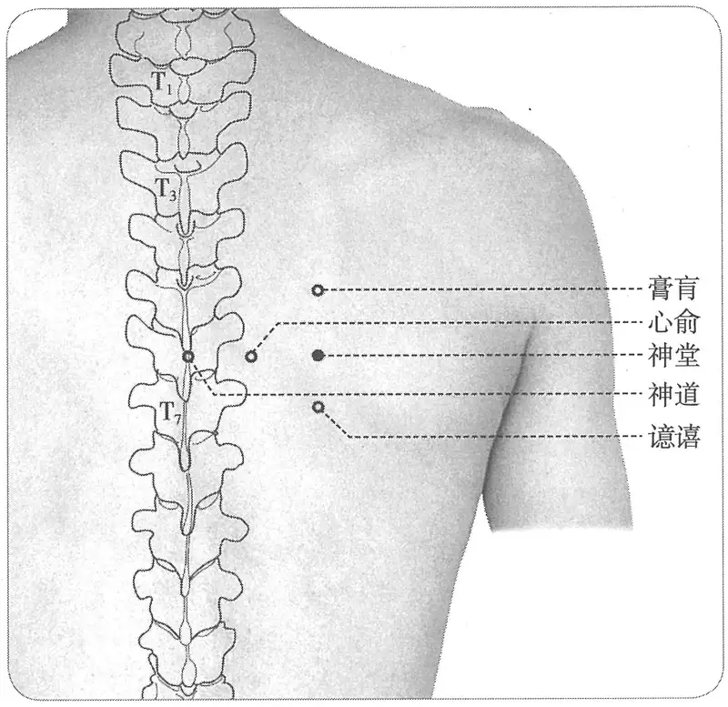

**图2-204　神堂穴图**

**取穴**：第5胸椎棘突下旁开3寸，横平心俞、神道穴。

　1. 在第五椎下两旁各三寸陷者中。（《黄帝明堂经》、《铜人腧穴针灸图经》卷上及卷下“穴腧都数”、《圣济总录》、《十四经发挥》、《医学纲目》、《针方六集》）

　2. 在第五椎下两旁，上直魄户。（《素问·气府论》王冰注）

　3. 在第五椎下两旁各三寸陷者中，正坐取之。（《医心方》卷二、《太平圣惠方》、《铜人腧穴针灸图经》卷中、《针灸大成》、《循经考穴编》）

　4. 在五椎下两旁各三寸陷中，正坐取之。当准《千金方》除脊各三寸取穴。（《针灸资生经》卷一）

　5. 五椎下，两旁相去脊中各三寸陷中，正坐取之。（《针灸聚英》卷一、《古今医统》）

　6. 在五椎下去脊中三寸半陷中，正坐取之。（《类经图翼》卷七、《医宗金鉴·刺灸心法要诀》、《针灸逢源》）

　7. 第五椎下去脊中三寸五分去脊边三寸。（《针灸十四经穴位考订》）

　8. 统编针灸学教材

　　(1) 部位：第五椎下两旁相去脊各三寸。取穴：从第五胸椎下神道穴外开三寸处取之，与心俞平。（1957年南京《针灸学》）

〔p.736 (인쇄 716)〕

　　(2) 部位：在膏肓俞穴下。取穴：伏卧或正坐，从第五椎下督脉神道穴外开三寸陷中取之，与心俞穴平。（1版《针灸学讲义》）

　　(3) 部位：在第五椎下，两旁各三寸。取穴：平第五胸椎棘突下，神道督脉旁三寸，于肩胛骨脊柱缘，俯伏取之。（2版《针灸学讲义》）

　　(4) 第五胸椎棘突下，旁开3寸。（4、5、7版《针灸学》）

　　(5) 在背部，当第5胸椎棘突下，旁开3寸。（6版《针灸学》）

　　(6) 第五胸椎棘突下，神道旁开三寸，于肩胛骨脊柱缘取穴。（《中国针灸学》）

**文献分析**：关于本穴定位去脊中距离的分歧，详见本经“概说”。

#### 【类属】 

足太阳膀胱经穴。

足太阳脉气所发。（《黄帝明堂经》）

#### 【适应症】 

主治胸肺部病症。常用于咳嗽，气喘，胸闷；腰背痛。

　1. 主肩痛，胸腹满，悽厥脊背急强。（《黄帝明堂经》）

　2. 主肩背连胸痛不可俯仰，逆气上攻，时噎。（《太平圣惠方·明堂》）

　3. 治肩痛，胸腹满，洒淅寒热，背脊强急。（《铜人腧穴针灸图经》卷中）

　4. 主多梦，虚惊，狂走。（《针方六集》卷五）

　5. 主咳嗽痰涎。（《循经考穴编》上）

　6. 统编针灸学教材

　　(1) 主治气喘咳嗽，背脊强急。（1957年南京《针灸学》、1版《针灸学讲义》）

　　(2) 主治气喘，咳嗽，胸腹满，脊背强急或疼痛。（2版《针灸学讲义》、4版《针灸学》）

　　(3) 主治咳嗽，气喘，胸闷，脊背强痛。（5、7版《针灸学》）

　　(4) 主治咳嗽，气喘，胸闷，背痛。（6版《针灸学》）

　　(5) 主治气喘，心痛，心悸，胸闷，咳嗽，脊背强痛。（《中国针灸学》）

#### 【操作】 

斜刺0.3~0.5寸。勿直刺过深，以防刺伤肺脏。

　1. 刺入三分，灸五壮。（《黄帝明堂经》）

　2. 灸三壮。（《太平圣惠方·明堂》）

　3. 针三分，灸三壮。（《针灸十四经穴位考订》）

　4. 统编针灸学教材

　　(1) 针五分，灸七至十五壮。（1957年南京《针灸学》、1版《针灸学讲义》）

　　(2) 向下斜刺5分，艾条灸7~15分钟。（2版《针灸学讲义》）

　　(3) 斜刺0.5~0.8寸。（4、5、7版《针灸学》）

　　(4) 斜刺0.5~0.8寸；可灸。（6版《针灸学》）

　　(5) 斜刺0.3~0.5寸。可灸。（《中国针灸学》）

### （四十五）譩譆 Yìxǐ BL45 出《黄帝明堂经》 

#### 【提要索隐】 

**部位**：在脊柱区，第6胸椎棘突下，后正中线旁开3寸。

**适应症**：主治肩背部、肺部病症。常用于肩背拘急引胁；咳嗽，气喘；疟疾，热病。

**针刺操作**：斜刺0.3~0.5寸。勿直刺过深，以防刺伤肺脏。

#### 【名实考】 

取本穴法：以手按之痛，病者言譩譆是穴，故名“譩譆”。《说文》：“譩，痛也。”徐锴曰：“痛而呼之言也”。本穴名及定位虽已见于《素问》，然观其文意，似非指一个确定的穴，而是不定穴，所谓“譩譆”之本义实与“阿是”相仿佛。后来在《黄帝明堂经》中始将“譩譆”之名冠以一个确定的穴——第六椎下两旁三寸处。

〔p.737 (인쇄 717)〕

　1. 大风汗出，灸譩嘻。譩嘻在背下夹脊旁三寸所，厌之令病者呼譩嘻，譩嘻应手。王冰注曰：譩嘻，穴也。在肩髆内廉夹第六椎下两旁，各同身寸之三寸，以手厌之，令病人呼譩嘻之声，则指下动矣，足太阳脉气所发，刺可入同身寸之六分，留七呼，若灸者可灸五壮。譩嘻者因取为名尔。（《素问·骨空论》）

　2. 邪客于足太阳之络，令人拘挛背急，引胁而痛，刺之从项始，数脊椎夹脊，疾按之应手如痛，刺之旁三痏，立已。（《素问·缪刺论》）

**按**：《素问》此二条文字，取穴方法完全相同，皆寻按压痛点为穴，不是一个固定的穴。有意思的是，这两首灸方、针方主治病症，皆被《黄帝明堂经》编者归纳于“譩譆”穴下。

　3. 譩譆在肩膊内廉，夹第六椎下两旁各三寸。以手按之痛，病者言譩譆穴。足太阳脉气所发。（《黄帝明堂经》）

　4. 此穴横与督腧平直，在内则新之下膈之上，空虚处也，故内言而外应手。（《经穴解》）

　5. 别名　五胠俞。（1957年南京《针灸学》）

**按**：此传录自日本针灸教材，出自《素问·刺疟论》，不是一个具体的穴名，王冰注作“譩譆”。

#### 【定位】 

**部位**：在脊柱区，第6胸椎棘突下，后正中线旁开3寸（图2-205）。

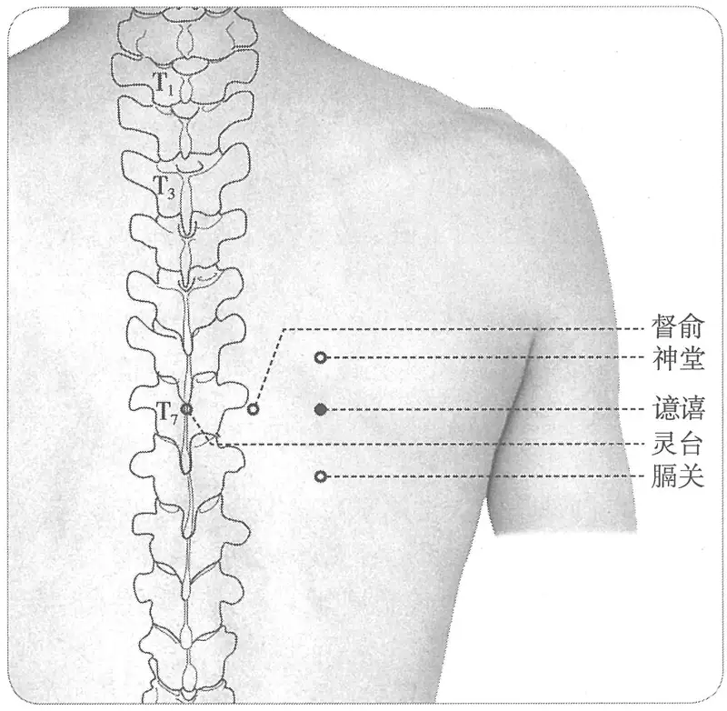

**图2-205　譩譆穴图**

**取穴**：第6胸椎棘突下旁开3寸，横平督俞、灵台穴。

　1. 在肩膊内廉，夹第六椎下两旁各三寸。以手按之痛，病者言譩譆是穴。（《黄帝明堂经》、《太平圣惠方·明堂》、《圣济总录》、《针灸资生经》、《十四经发挥》、《医学纲目》、《针方六集》、《类经图翼》、《医宗金鉴·刺灸心法要诀》、《针灸易学》）

〔p.738 (인쇄 718)〕

　2. 在肩膊内廉，在第六椎两傍三寸。是穴，抱肘取之。（《太平圣惠方·针经》）

　3. 在肩胛内廉夹脊第六椎下，两旁各三寸。（《铜人腧穴针灸图经》卷上及卷下“穴腧都数”）

　4. 在肩膊内廉，夹第六椎下两傍相去各三寸，正坐取之……以手痛按之，病者言譩譆。（《铜人腧穴针灸图经》卷中、《医学纲目》、《针灸大成》、《针方六集》、《循经考穴编》）

　5. 在肩膊内廉，夹（《明堂》作在）六椎下两旁各三寸，正坐取之，以手痛按之，病者言譩譆。当准《千金方》除脊各三寸取穴。（《针灸资生经》卷一）

　6. 肩膊内廉，夹六椎下，两旁相去脊中各三寸，正坐取之，以手重按病人，言譩譆应手。（《针灸聚英》卷一、《古今医统》）

　7. 六节外三寸，胛内廉，以手压之，令病人抱肘呼譩譆之声，则指下动矣。（《医学入门》卷一）

　8. 在肩膊内廉，六椎下去脊中各三寸半，正坐取之。《甲乙经》曰：以手痛按之，病者呼譩譆是穴，盖因其痛也。（《类经图翼》卷七、《医宗金鉴·刺灸心法要诀》、《针灸逢源》）

　9. 第六椎下去脊中三寸五分（去脊边三寸）。（《针灸十四经穴位考订》）

　10. 统编针灸学教材

　　(1) 部位：第六椎下两旁相去脊各三寸。取穴：从第六椎下灵台穴外开三寸处取之，与督俞相平。（1957年南京《针灸学》）

　　(2) 部位：神堂穴下。取穴：伏卧或正坐，从第六椎下督脉灵台穴外开三寸陷中取之，与督俞穴相平。（1版《针灸学讲义》）

　　(3) 部位：在肩膊内廉，侠第六椎下，两旁各三寸。取穴：平第六胸椎棘突下，灵台（督脉）旁开三寸，于肩胛骨脊柱缘，俯伏取之。（2版《针灸学讲义》）

　　(4) 第六胸椎棘突下，旁开3寸。（4、5、7版《针灸学》）

　　(5) 在背部，当第6胸椎棘突下，旁开3寸。（6版《针灸学》）

　　(6) 第六胸椎棘突下，灵台旁开三寸，于肩胛骨脊柱缘取穴。（《中国针灸学》）

**文献分析**：关于本穴定位去脊中距离的分歧，详见本经“概说”。

#### 【类属】 

足太阳膀胱经穴。

足太阳脉气所发。（《黄帝明堂经》）

#### 【适应症】 

主治肩背部、肺部病症。常用于肩背拘急引胁；咳嗽，气喘；疟疾，热病。

　1. 主掖拘挛，暴脉急，引胁而痛，内引心肺。痓，互引，身热。咳逆上气。喘逆，鼽衄，肩胛内廉痛，不可俯仰，眇季胁引少腹而痛胀。小儿食晦，头痛。痎疟。风。（《黄帝明堂经》）

**按**：以上“拘挛……内引心肺”见于《素问·缪刺》，原为不固定的背部压痛穴的主治。“食晦”，又称食亦。《明堂经》曰：“气胀引脊痛，饮食多，身羸瘦，名曰食晦，先取脾俞，后取季胁”。

　2. 热病汗不出，肩背寒热。虚喘。（《外台秘要》卷三十九）

　3. 主温疟寒疟，痎疟，背闷，气满腹胀，气眩。（《太平圣惠方·针经》）

　4. 主胸中气噎，劳损虚乏，不得睡也。（《太平圣惠方·明堂》）

　5. 治腋拘挛，暴脉急引胁痛，热病汗不出，温疟，肩背痛，目眩鼻衄，喘逆腹胀，肩髆内廉痛不得俯仰。（《铜人腧穴针灸图经》卷中）

〔p.739 (인쇄 719)〕

　6. 统编针灸学教材

　　(1) 主治虚损喘咳，胸疼引肩膊内廉痛，热病汗不出。（1957年南京《针灸学》）

　　(2) 主治虚损喘咳，肩背痛，热病汗不出。（1版《针灸学讲义》）

　　(3) 主治咳嗽，气喘，肩背痛，目眩，疟疾，热病汗不出。（2版《针灸学讲义》、4版《针灸学》）

　　(4) 主治咳嗽，气喘，疟疾，热病，肩背痛。（5、6、7版《针灸学》）

　　(5) 主治咳嗽，气喘，肩背痛。（《中国针灸学》）

#### 【操作】 

斜刺0.3~0.5寸。勿直刺过深，以防刺伤肺脏。

　1. 刺入六分，灸五壮。（《黄帝明堂经》）

　2. 针入六分，留三呼，泻五吸……灸亦得，日灸二七壮，至一百止。（《太平圣惠方·针经》）

　3. 针三分，灸三壮。（《针灸十四经穴位考订》）

　4. 统编针灸学教材

　　(1) 针五分，灸三至七壮。（1957年南京《针灸学》、1版《针灸学讲义》）

　　(2) 向下斜刺5分，艾条灸5~10分钟。（2版《针灸学讲义》）

　　(3) 斜刺0.5~0.8寸。（4、5、7版《针灸学》）

　　(4) 斜刺0.5~0.8寸；可灸。（6版《针灸学》）

　　(5) 斜刺0.3~0.5寸。可灸。（《中国针灸学》）

### （四十六）膈关 Géguān BL46 出《黄帝明堂经》 

#### 【提要索隐】 

**部位**：在脊柱区，第7胸椎棘突下，后正中线旁开3寸。

**适应症**：主治胸部、背部病症。常用于胸闷，呕吐，呃逆，嗳气；腰背痛。

**针刺操作**：斜刺0.3~0.5寸。不宜深刺，宜向脊椎方向成30°~45°角斜刺。

#### 【名实考】 

本穴名与“膈俞”字形相近，古代文献中有相混之误，详见膈俞穴“名实考”。

　1. 隔关，在第七椎下两旁各三寸陷者中，足太阳脉气所发。阔肩取之。（《黄帝明堂经》）

　2. 此穴与膈腧横平相直，俱在七椎下，故曰膈关。（《经穴解》）

#### 【定位】 

**部位**：在脊柱区，第7胸椎棘突下，后正中线旁开3寸（图2-206）。

**取穴**：第7胸椎棘突下旁开3寸，横平膈俞、至阳穴。

　1. 在第七椎下两旁各三寸陷者中……阔肩取之。（《针灸甲乙经》卷三、《外台秘要》、《医心方》、《太平圣惠方·针经》、《铜人腧穴针灸图经》卷下“穴腧都数”、《圣济总录》、《十四经发挥》、《医学纲目》、《针灸大成》、《针方六集》、《循经考穴编》）

　2. 在第七椎下两旁各三寸。（《千金要方》卷二十九、《千金翼方》卷二十六、《铜人腧穴针灸图经》卷上）

　3. 在第七椎下两旁相去各三寸陷中，正坐取之。（《铜人腧穴针灸图经》卷中）

　4. 在七椎下两旁各三寸陷中，正坐取之。当准《千金方》除脊各三寸取穴。（《针灸资生经》卷一）

　5. 七椎下，两旁相去脊中行各三寸陷中，正坐开肩取之。（《针灸聚英》卷一、《古今

〔p.740 (인쇄 720)〕

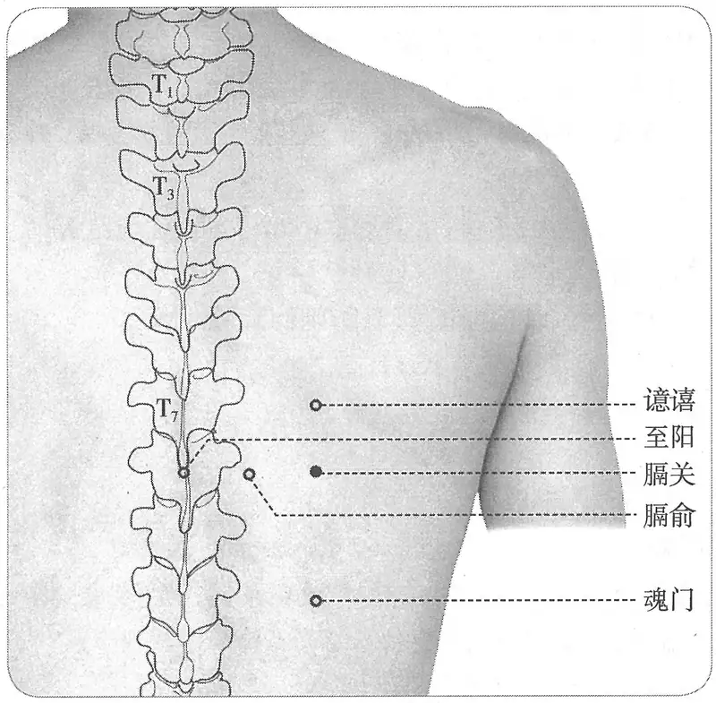

**图2-206　膈关穴图**

医统》）

　6. 在七椎下去脊中各三寸半陷中。正坐开肩取之。（《类经图翼》卷七、《医宗金鉴·刺灸心法要诀》、《针灸逢源》）

　7. 第七椎下去脊中三寸五分去脊边三寸。（《针灸十四经穴位考订》）

　8. 统编针灸学教材

　　(1) 部位：在第七椎下两旁相去脊各三寸。取穴：从第七胸椎下至阳穴旁开三寸，当肩胛骨下端内侧处取之，与膈俞平。（1957年南京《针灸学》）

　　(2) 部位：譩譆穴下。取穴：伏卧或正坐，从第七椎下督脉至阳穴外开三寸，当肩胛骨下端内侧陷中取之，与膈俞穴平。（1版《针灸学讲义》）

　　(3) 部位：在第七椎下，两旁各三寸陷者中。取穴：平第七胸椎棘突下，至阳督脉旁开三寸，于肩胛骨脊柱缘，俯伏取之。（2版《针灸学讲义》）

　　(4) 第七胸椎棘突下，旁开3寸。（4、5、7版《针灸学》）

　　(5) 在背部，当第7胸椎棘突下，旁开3寸。（6版《针灸学》）

　　(6) 第七胸椎棘突下，至阳旁开三寸，约平肩胛骨下角处。（《中国针灸学》）

**文献分析**：关于本穴定位去脊中距离的分歧，详见本经“概说”。

#### 【类属】 

足太阳膀胱经穴。

足太阳脉气所发。（《黄帝明堂经》）

#### 【适应症】 

主治胸部、背部病症。常用于胸闷，呕吐，呃逆，嗳气；腰背痛。

　1. 主背痛恶寒，脊强俯仰难，食不下，呕吐多涎。（《黄帝明堂经》）

　2. 治背痛恶寒，脊强俯仰难，食饮不下，呕哕多涎唾，胸中噎闷。（《铜人腧穴针灸图经》卷中）

　3. 主大便不节，小便黄。（《针灸聚英》卷一、《针灸大成》、《针方六集》）

〔p.741 (인쇄 721)〕

**按**：此乃高武误录《针灸资生经》阳纲穴主治。

　4. 关节不利，浑身疼痛，呕哕噎闷。（《循经考穴编》上）

　5. 统编针灸学教材

　　(1) 主治饮食不下，呕，哕，噎，闷，背痛脊强，浑身疼痛，诸血症。（1957年南京《针灸学》、1版《针灸学讲义》）

　　(2) 主治饮食不下，呕吐，嗳气，脊背强痛。（2版《针灸学讲义》、4版《针灸学》）

　　(3) 主治胸闷，嗳气，呕吐，脊背强痛。（5、7版《针灸学》）

　　(4) 主治呕吐，嗳气，食不下，胸闷，脊背强痛。（6版《针灸学》）

　　(5) 主治饮食不下，呃逆，呕吐，嗳气，脊背强痛。（《中国针灸学》）

#### 【操作】 

斜刺0.3~0.5寸。不宜深刺，宜向脊椎方向成30°~45°角斜刺。

　1. 刺入五分，灸五壮。（《黄帝明堂经》）

　2. 统编针灸学教材

　　(1) 针五分，灸三至七壮。（1957年南京《针灸学》、1版《针灸学讲义》）

　　(2) 向下斜刺5分，艾条灸5~10分钟。（2版《针灸学讲义》）

　　(3) 斜刺0.5~0.8寸。（4、5、7版《针灸学》）

　　(4) 斜刺0.5~0.8寸；可灸。（6版《针灸学》）

　　(5) 斜刺0.3~0.5寸。可灸。（《中国针灸学》）

### （四十七）魂门 Húnmén BL47 出《黄帝明堂经》 

#### 【提要索隐】 

**部位**：在脊柱区，第9胸椎棘突下，后正中线旁开3寸。

**适应症**：主治局部病症。常用于胁痛，背痛；呕吐，泄泻。

**针刺操作**：斜刺0.3~0.5寸。直刺不宜过深，以防刺透胸腔后壁，刺伤肺脏。

#### 【名实考】 

《太平圣惠方·针经》所载“魄户”穴内容采自甄权《针经》，而《太平圣惠方·明堂》所录“魂户”穴主治症与其相类，故知该穴内容亦采自甄权《针经》，只是将穴名“魄户”误抄成“魂户”，并由于这一错误，《太平圣惠方》编者复从《外台秘要·明堂》中抄录了“魄户”穴内容。这样一来，使得本来十分明显的错误变得不易识别了。南宋王执中在编《针灸资生经》卷一时已经判断出《太平圣惠方》所载“魂户”是“魄户”之误，但在卷五仍将“魂户”断为“魂门”，明代高武据此将该条主治症增入“魂门”穴下，明以后针灸文献又多沿袭《针灸聚英》之误。

《太平圣惠方》所出现的更严重的错误是将本穴与“意舍”、“阳纲”二穴的内容完全搞混了。

关于窦太师针灸传本之一《窦太师针经》“魄户”与“魂门”主治相混之误，详见魄户穴“名实考”。

　1. 魂门，在第九椎下，两旁各三寸陷者中。足太阳脉气所，发正坐取之。（《黄帝明堂经》）

　2. 此穴横直平与肝腧等，肝藏魂者也，故此穴亦肝腧之部分，而名曰魂门。曰门、曰关、曰户、曰舍、曰室，若有宅焉。以藏五脏，而此其外见者也。（《经穴解》）

〔p.742 (인쇄 722)〕

#### “魂门”、“意舍”、“阳纲”混淆例 

魂门、意舍、阳纲主治症比较见表2-9。

**表2-9　魂门、意舍、阳纲主治症比较**

| 《太平圣惠方》 | 《外台秘要》 |
|---|---|
| 意舍……主胸胁胀满，背痛恶寒，饮食不下，呕吐不留住也。（卷一百） | 魂门……主胸胁胀满，背痛恶风寒，饮食不下，呕吐不留住。 |
| 阳刚……主食饮不下，腹中雷鸣，腹满胪胀，大便泄，消渴身热，面目黄，不嗜食，怠惰也。（卷一百） | 意舍……主腹满胪胀，大便泄，消渴身热，面目黄，不嗜食，怠隋也。 |
| 魂门……主食饮不下，腹中雷鸣，大便不节，小便赤黄也。（卷九十九） | 阳刚……主饮食不下，腹中雷鸣，大便不节，小便赤黄。 |

从以上文献对照，可清楚地看出：《太平圣惠方》“意舍”穴下所录主治症完全是“魂门”穴的主治；“阳刚”穴主治症中“腹满……怠惰也”乃“意舍”穴主治症，《小儿明堂》所载“阳刚”穴主治症也为“意舍”主症，而卷九十九《针经》所录“阳刚”穴主治症不误；“魂门”穴主治症又完全是“阳刚”穴主治症，可谓混乱不堪。

#### 【定位】 

**部位**：在脊柱区，第9胸椎棘突下，后正中线旁开3寸（图2-207）。

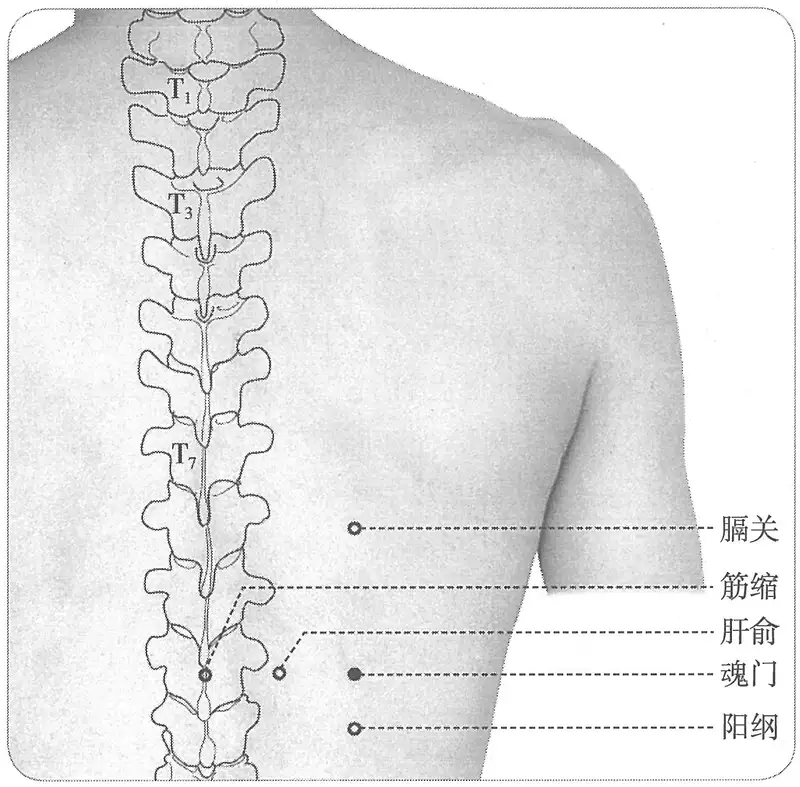

**图2-207　魂门穴图**

**取穴**：在第9胸椎棘突下旁开3寸，横平肝俞、筋缩穴。

　1. 在第九椎下，两旁各三寸陷者中……正坐取之。（《针灸甲乙经》卷三、《外台秘要》、《医心方》、《太平圣惠方·针经》、《铜人腧穴针灸图经》卷中及卷下“穴腧都数”、《圣济总录》、《窦太师针经》、《医学纲目》、《针灸大成》、《针方六集》、《循经考穴编》、《针灸易学》）

　2. 在第九椎下两旁各三寸。（《千金要方》卷二十九、《千金翼方》、《铜人腧穴针灸图经》

〔p.743 (인쇄 723)〕

卷上）

　3. 在九椎下两旁各三寸陷中，正坐取之。当准《千金方》除脊各三寸取穴。（《针灸资生经》卷一）

　4. 在第九椎下，夹脊两旁，相去各三寸。（《十四经发挥》中）

　5. 第九椎下，两旁相去脊中各三寸陷中。正坐取之。（《针灸聚英》卷一、《古今医统》）

　6. 在九椎下，相去脊中各三寸半陷中，正坐取之。（《类经图翼》卷七、《医宗金鉴·刺灸心法要诀》、《针灸逢源》）

　7. 第九椎下去脊中三寸五分去脊边三寸。（《针灸十四经穴位考订》）

　8. 统编针灸学教材

　　(1) 部位：在第九椎下两旁相去脊各三寸。取穴：从第九胸椎下筋缩穴外开三寸取之，与肝俞平。（1957年南京《针灸学》）

　　(2) 部位：膈关穴下。取穴：伏卧或正坐，从第九椎下督脉筋缩穴外开三寸陷中取之。（1版《针灸学讲义》）

　　(3) 部位：在第九椎下，两旁各三寸。取穴：平第九胸椎棘突下，筋缩督脉旁开三寸，俯卧取之。（2版《针灸学讲义》）

　　(4) 第九胸椎棘突下，旁开3寸。（4、5、7版《针灸学》）

　　(5) 在背部，当第9胸椎棘突下，旁开3寸。（6版《针灸学》）

　　(6) 第九胸椎棘突下，筋缩旁开三寸。（《中国针灸学》）

**文献分析**：关于本穴定位去脊中距离的分歧，详见本经“概说”。

#### 【类属】 

足太阳膀胱经穴。

足太阳脉气所发。（《黄帝明堂经》）

#### 【适应症】 

主治局部病症。常用于胁痛，背痛；呕吐，泄泻。

**备选适应症**：全身筋骨挛痛。

　1. 主胸胁胀满，背痛恶风寒，饮食不下，呕吐不留住。（《黄帝明堂经》）

　2. 主腹中雷鸣，大便不节，小便赤黄。（《太平圣惠方·针经》）

**按**：此乃“阳纲”穴主治。

　3. 治食饮不下，腹中雷鸣，大便不节，小便赤黄。（《铜人腧穴针灸图经》卷中）

**按**：此原系“阳纲”穴主治症，王惟一承《太平圣惠方·针经》之误，录于“魂门”穴中。

　4. 窦太师针灸遗存

　　(1) 治浑身百节疼痛，体热或劳嗽，泻；气不升降，补。（《窦太师针经》）

　　(2) 主浑身骨节疼。（《循经考穴编》上）

　　(3) 筋挛骨痛而补魂门，体热劳嗽而泻魄户。（《标幽赋》）

　5. 主尸厥走疰，胸背连心痛。（《针灸聚英》卷一、《古今医统》、《针灸大成》、《针方六集》、《类经图翼》、《循经考穴编》、《针灸逢源》）

**按**：此症录自《针灸资生经·尸厥》卷五。王执中将“魄户”穴误作“魂门”穴，高氏承其误。

　6. 统编针灸学教材

　　(1) 主治肠鸣，大便不节，呕吐，饮食不下，胸连背心痛。（1957年南京《针灸学》）

　　(2) 主治呕吐，饮食不下，肠鸣，大便不节，胸胁胀满，背痛。（1版《针灸学讲义》）

　　(3) 主治胸胁痛，背痛，呕吐，泄泻。（2版《针灸学讲义》、4、5、7版《针灸学》、《中国针灸学》）

〔p.744 (인쇄 724)〕

　　(4) 主治胸胁痛，呕吐，背痛。（6版《针灸学》）

**按**：教材中“肠鸣，大便不节”主治症系承袭《太平圣惠方》等书之误，今去之。

**文献分析**：王惟一编《铜人腧穴针灸图经》时，将《太平圣惠方》“魂门”穴误录的内容全文照抄，宋以后针灸书又都沿袭《铜人腧穴针灸图经》之误。又南宋王执中编撰《针灸资生经》时，将《太平圣惠方》中错误的“魂户”改作“魂门”，抄作“魂门疗尸厥走疰，胸背连痛”。明代高武《针灸聚英》魂门穴主症，在承《铜人腧穴针灸图经》之误的基础上，又增录了《针灸资生经》中这条“魂门”穴主症，乃错上加错也。

#### 【操作】 

斜刺0.3~0.5寸。直刺不宜过深，以防刺透胸腔后壁，刺伤肺脏。

　1. 刺入五分，灸三壮。（《黄帝明堂经》）

　2. 针入一分，沿皮向外一寸半，灸二七壮。（《窦太师针经》）

　3. 统编针灸学教材

　　(1) 针五分，灸三至七壮。（1957年南京《针灸学》、1版《针灸学讲义》）

　　(2) 向下斜刺5分，艾条灸3~7分钟。（2版《针灸学讲义》）

　　(3) 斜刺0.5~0.8寸。（4、5、7版《针灸学》）

　　(4) 斜刺0.5~0.8寸；可灸。（6版《针灸学》）

　　(5) 斜刺0.3~0.5寸。可灸。（《中国针灸学》）

### （四十八）阳纲 Yánggāng BL48 出《黄帝明堂经》 

#### 【提要索隐】 

**穴名**：阳纲，古代文献又写作“阳刚”。

**部位**：在脊柱区，第10胸椎棘突下，后正中线旁开3寸。

**适应症**：主治腹部病症。常用于食饮不下，肠鸣，泄泻；小便黄赤。

**针刺操作**：斜刺0.3~0.5寸。勿直刺过深，以防刺透胸腔后壁，刺伤肺脏。

#### 【名实考】 

阳纲，《太平圣惠方·针经》和《黄帝明堂经》卷均写作“阳刚”。

古代针灸文献中，本穴与“魂门”、“意舍”穴有相混处，详见魂门穴“名实考”。

　1. 阳纲，在第十椎下，两旁各三寸陷者中，足太阳脉气所发，正坐取之。（《黄帝明堂经》）

　2. 此穴横直与胆腧平，胆为少阳，乃三阳之始，故曰阳纲。（《经穴解》）

#### 【定位】 

**部位**：在脊柱区，第10胸椎棘突下，后正中线旁开3寸（图2-208）。

**取穴**：第10胸椎棘突下旁开3寸，横平胆俞、中枢穴。

　1. 在第十椎下两旁，各三寸陷者中……正坐取之。（《黄帝明堂经》、《太平圣惠方·针经》、《铜人腧穴针灸图经》卷中及卷下“穴腧都数”、《圣济总录》、《医学纲目》、《针灸大成》、《针方六集》、《循经考穴编》）

　2. 在第十椎下两旁各三寸。（《千金要方》卷二十九、《千金翼方》、《铜人腧穴针灸图经》卷上）

　3. 在第十椎下，两傍各三寸陷者中。正坐微伏而取之。（《太平圣惠方·明堂》）

　4. 在十椎下两旁各三寸陷中，正坐阔肩取之。当准《千金方》除脊各三寸取穴。（《针灸资生经》卷一）

　5. 在第十椎下，夹脊两旁，相去各三寸。（《十四经发挥》中、《针灸易学》）

〔p.745 (인쇄 725)〕

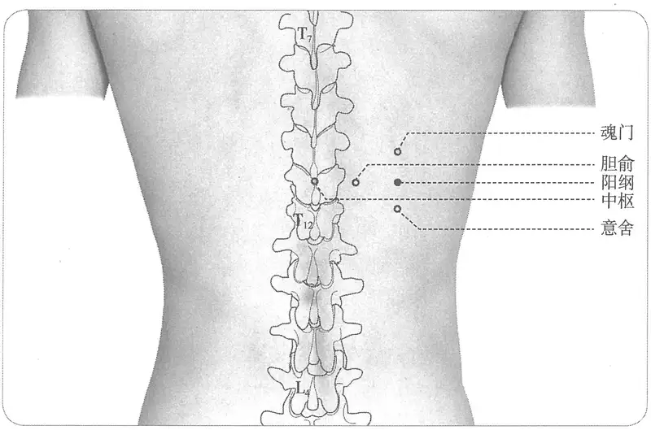

**图2-208　阳纲穴图**

　6. 十椎下两旁相去脊中行各三寸。正坐阔肩取之。（《针灸聚英》卷一、《古今医统》）

　7. 在十椎下，去脊中三寸半陷中，正坐取之。（《类经图翼》卷七、《医宗金鉴·刺灸心法要诀》、《针灸逢源》）

　8. 第十椎下去脊中三寸五分去脊边三寸。（《针灸十四经穴位考订》）

　9. 统编针灸学教材

　　(1) 部位：在第十椎下两旁相去脊各三寸。取穴：从第十胸椎下外开三寸处取之，与胆俞平。（1957年南京《针灸学》）

　　(2) 部位：魂门穴下。取穴：伏卧或正坐，从十椎下督脉中枢穴外开三寸陷中取之，与胆俞穴平。（1版《针灸学讲义》）

　　(3) 部位：在第十椎下，两旁各三寸。取穴：平第十胸椎棘突下，中枢督脉旁开三寸，俯卧取之。（2版《针灸学讲义》）

　　(4) 第十胸椎棘突下，旁开3寸。（4、5、7版《针灸学》）

　　(5) 在背部，当第10胸椎棘突下，旁开3寸。（6版《针灸学》）

　　(6) 第十胸椎棘突下，中枢旁开三寸。（《中国针灸学》）

**文献分析**：关于本穴定位去脊中距离的分歧，详见本经“概说”。

#### 【类属】 

足太阳膀胱经穴。

足太阳脉气所发。（《黄帝明堂经》）

#### 【适应症】 

主治腹部病症。常用于食饮不下，肠鸣，泄泻；小便黄赤。

　1. 主食饮不下，腹中雷鸣，大便不节，小便赤黄。（《黄帝明堂经》）

　2. 肠鸣泄注。（《千金要方》卷三十）

　3. 大小便不节，黄水。（《太平圣惠方·针经》）

　4. 腹满胪胀，大便泄，消渴，身热，面目黄，不嗜食，怠堕也。（《太平圣惠方·明堂》）

**按**：此条主治乃《黄帝明堂经》“意舍”主治，《太平圣惠方·明堂》误录于此，其《针经》卷无误。

　5. 治腹满䐜胀，大便泄利，小便赤涩，身热目黄。（《铜人腧穴针灸图经》卷中）

〔p.746 (인쇄 726)〕

**按**：此原系“意舍”穴主治症，王惟一承《太平圣惠方·明堂》之误，将其抄录于“阳纲”穴中。

　6. 统编针灸学教材

　　(1) 主治饮食不下，肠鸣腹痛，泻利，小便赤涩，身热目黄。（1957年南京《针灸学》、1版《针灸学讲义》）

　　(2) 主治肠鸣，腹痛，泄泻，黄疸，消渴。（2版《针灸学讲义》、4、5、6、7版《针灸学》）

　　(3) 主治肠鸣，腹痛，泄泻，胁痛，黄疸。（《中国针灸学》）

**文献分析**：教材中“黄疸，消渴”、“身热目黄”乃承袭《太平圣惠方·明堂》之误，今去之。

#### 【操作】 

斜刺0.3~0.5寸。勿直刺过深，以防刺透胸腔后壁，刺伤肺脏。

　1. 刺入五分，灸三壮。（《黄帝明堂经》）

　2. 灸七壮。（《太平圣惠方·明堂》）

　3. 统编针灸学教材

　　(1) 针五分，灸三至七壮。（1957年南京《针灸学》、1版《针灸学讲义》）

　　(2) 向下斜刺5分，艾条灸3~7分钟。（2版《针灸学讲义》）

　　(3) 斜刺0.5~0.8寸。（4、5、7版《针灸学》）

　　(4) 斜刺0.5~0.8寸；可灸。（6版《针灸学》）

　　(5) 斜刺0.3~0.5寸。可灸。（《中国针灸学》）

### （四十九）意舍 Yìshě BL49 出《黄帝明堂经》 

#### 【提要索隐】 

**部位**：在脊柱区，第11胸椎棘突下，后正中线旁开3寸。

**适应症**：主治腹部病症。常用于腹胀，泄泻，发热，消渴；目黄。

**针刺操作**：斜刺0.3~0.5寸。勿直刺过深，以防刺透胸腹腔后壁，刺伤肺脏或肾脏。

#### 【名实考】 

古代针灸文献中，本穴与“魂门”、“阳纲”穴有相混处，详见魂门穴“名实考”。

今人或将痞根穴与本穴等同者，详见肓门穴“名实考”。

　1. 意舍，在第十一椎下，两旁各三寸陷者中，足太阳脉气所发，正坐取之。（《黄帝明堂经》）

　2. 此穴与脾腧相对，横直相平，脾藏意，故曰意舍。（《经穴解》）

#### 【定位】 

**部位**：在脊柱区，第11胸椎棘突下，后正中线旁开3寸（图2-209）。

**取穴**：第11胸椎棘突下旁开3寸，横平脾俞、脊中穴。

　1. 在第十一椎下两旁，各三寸陷者中……正坐取之。（《外台秘要》卷三十九、《医心方》、《太平圣惠方·针经》、《铜人腧穴针灸图经》卷中及卷下“穴腧都数”）

　2. 在第十一椎下两旁，各三寸陷者中。（《针灸甲乙经》卷三、《千金要方》、《千金翼方》、《铜人腧穴针灸图经》卷上、《圣济总录》、《医学纲目》、《针方六集》）

　3. 在第十一椎下两旁，上直阳纲，正坐取之。（《素问·气府论》王冰注）

　4. 在第十一椎下，两旁各三寸，陷者中。正坐开肩取之。（《太平圣惠方·明堂》）

　5. 《外台》云九椎下。（《千金要方》卷二十九注）

**按**：传世本《外台秘要》均作“十一椎”，与诸书同。

　6. 在十一椎下两旁各三寸陷中，正坐取之。当准《千金方》除脊各三寸取穴。（《针灸资生经》卷一）

〔p.747 (인쇄 727)〕

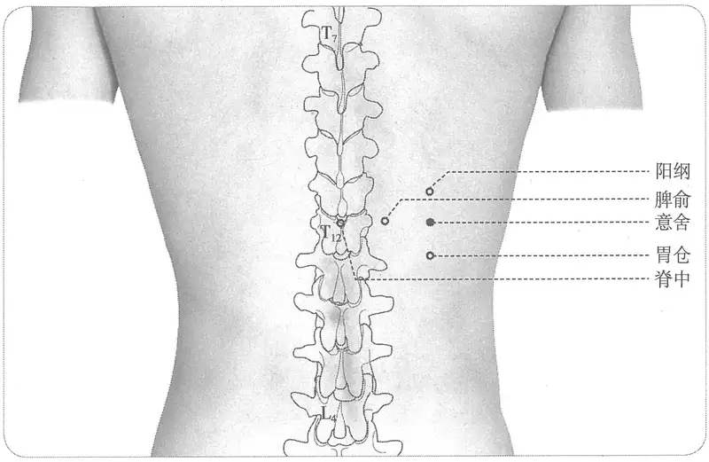

**图2-209　意舍穴图**

　7. 在十一椎下，夹脊两旁相去各三寸。（《十四经发挥》中、《针灸大成》、《循经考穴编》、《针灸易学》）

　8. 十一椎下两旁相去脊中各三寸，正坐取之。（《针灸聚英》卷一、《古今医统》）

　9. 在十一椎下去脊中三寸半陷中，正坐取之。（《类经图翼》卷七、《医宗金鉴·刺灸心法要诀》、《针灸逢源》）

　10. 第十一椎下去脊中三寸五分去脊边三寸。（《针灸十四经穴位考订》）

　11. 统编针灸学教材

　　(1) 部位：在第十一椎下两旁相去脊各三寸。取穴：从第十一胸椎下脊中穴外开三寸取之，与脾俞平。（1957年南京《针灸学》）

　　(2) 部位：阳纲穴下。取穴：伏卧或正坐，从第十一椎下，督脉脊中穴外开三寸陷中取之，与脾俞穴平。（1版《针灸学讲义》）

　　(3) 部位：在第十一椎下，两旁各三寸。取穴：平第十一胸椎棘突下，脊中督脉旁开三寸，俯卧取之。（2版《针灸学讲义》）

　　(4) 第十一胸椎棘突下，旁开3寸。（4、5、7版《针灸学》）

　　(5) 在背部，当第11胸椎棘突下，旁开3寸。（6版《针灸学》）

　　(6) 第十一胸椎棘突下，脊中旁开三寸。（《中国针灸学》）

**文献分析**：关于本穴定位去脊中距离的分歧，详见本经“概说”。

#### 【类属】 

足太阳膀胱经穴。

足太阳脉气所发。（《黄帝明堂经》）

#### 【适应症】 

主治腹部病症。常用于腹胀，泄泻，发热，消渴；目黄。

　1. 主腹满胪胀，大便泄。消渴，身热，面目黄。（《黄帝明堂经》）

　2. 主胸胁胀满，背痛，恶寒，饮食不下，呕吐不留住也。（《太平圣惠方·明堂》）

**按**：此条主治乃《黄帝明堂经》“魂门”穴主治，《太平圣惠方·明堂》误录，而《针经》卷无误。

　3. 治腹满虚胀，大便滑泄，背痛恶风寒，食饮不下，呕吐不止，消渴目黄。（《铜人腧穴针灸图经》卷中）

〔p.748 (인쇄 728)〕

**按**：“背痛恶风寒，食饮不下，呕吐不止”原系“魂门”穴主治症，王惟一承《太平圣惠方·明堂》之误，将其录于“意舍”穴中。

　4. 小便赤黄。（《针灸聚英》卷一、《针灸大成》、《循经考穴编》）

**按**：此乃高武误录《针灸资生经》阳纲穴主治。

　5. 脊膂酸痛，冷嗽，气攻两胁。（《循经考穴编》上）

　6. 统编针灸学教材

　　(1) 主治腹满虚胀，呕吐食不下，消渴，目黄，大便滑泄，小便黄赤。（1957年南京《针灸学》）

　　(2) 主治腹胀虚满，呕吐食不下，消渴，目黄，大便滑泄，小便黄赤，背痛。（1版《针灸学讲义》）

　　(3) 主治腹胀，肠鸣，泄泻，呕吐，饮食不下。（2版《针灸学讲义》、4版《针灸学》）

　　(4) 主治腹胀，肠鸣，泄泻，呕吐。（5、7版《针灸学》）

　　(5) 主治腹胀，肠鸣，呕吐，食不下。（6版《针灸学》）

　　(6) 主治腹胀，肠鸣，呕吐，泄泻，饮食不下。（《中国针灸学》）

**文献分析**：教材中“呕吐食不下”症系承袭《太平圣惠方·明堂》之误；“小便黄赤”乃承袭高武《针灸聚英》之误。今皆去之。

#### 【操作】 

斜刺0.3~0.5寸。勿直刺过深，以防刺透胸腹腔后壁，刺伤肺脏或肾脏。

　1. 刺入五分，灸三壮。（《黄帝明堂经》）

　2. 灸五十壮至一百二十壮。（《太平圣惠方·针经》）

　3. 灸七壮。（《太平圣惠方·明堂》）

　4. 灸五十壮至一百壮，针入五分。（《铜人腧穴针灸图经》卷中）

　5. 统编针灸学教材

　　(1) 针五分，灸三至七壮。（1957年南京《针灸学》、1版《针灸学讲义》）

　　(2) 向下斜刺5分，艾条灸3~7分钟。（2版《针灸学讲义》）

　　(3) 斜刺0.5~0.8寸。（4、5、7版《针灸学》）

　　(4) 斜刺0.5~0.8寸；可灸。（6版《针灸学》）

　　(5) 斜刺0.3~0.5寸。可灸。（《中国针灸学》）

### （五十）胃仓 Wèicāng BL50 出《黄帝明堂经》 

#### 【提要索隐】 

**部位**：在脊柱区，第12胸椎棘突下，后正中线旁开3寸。

**适应症**：主治腹部病症。常用于胃脘痛，腹胀，水肿，小儿食积；腰背痛。

**针刺操作**：斜刺0.3~0.5寸。不宜深刺，宜向脊椎方向成30°~45°角斜刺。

#### 【名实考】 

　1. 胃仓，在第十二椎下，两旁各三寸陷者中，足太阳脉气所发。（《黄帝明堂经》）

　2. 此穴与胃腧横直平对，故曰胃仓。（《经穴解》）

#### 【定位】 

**部位**：在脊柱区，第12胸椎棘突下，后正中线旁开3寸（图2-210）。

〔p.749 (인쇄 729)〕

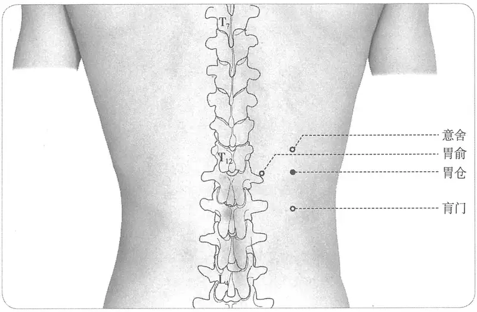

**图2-210　胃仓穴图**

**取穴**：第12胸椎棘突下旁开3寸，横平胃俞穴。

　1. 在第十二椎下，两旁各三寸陷者中。（《黄帝明堂经》、《太平圣惠方·针经》、《铜人腧穴针灸图经》、《圣济总录》、《医学纲目》）

　2. 在第十二椎下，两旁各相去夹脊同身寸之三寸，上直意舍。（《素问》王冰注）

　3. 在十二椎下两旁各三寸。当准《千金方》除脊各三寸取穴。（《针灸资生经》卷一）

　4. 在第十二椎下，夹脊两旁相去各三寸。（《十四经发挥》中、《针灸大成》、《针方六集》、《循经考穴编》）

　5. 十二椎下两旁，相去脊中各三寸，正坐取之。（《针灸聚英》卷一、《古今医统》）

　6. 在十二椎下，去脊中各三寸半，正坐取之。（《类经图翼》卷七、《医宗金鉴·刺灸心法要诀》、《针灸逢源》）

　7. 第十二椎下去脊中三寸五分去脊边三寸。（《针灸十四经穴位考订》）

　8. 统编针灸学教材

　　(1) 部位：在十二椎下两旁相去脊各三寸。取穴：从第十二胸椎下外开三寸处取之，与胃俞平。（1957年南京《针灸学》）

　　(2) 部位：意舍穴下。取穴：伏卧或正坐，从十二椎下外开三寸陷中取之，与胃俞穴平。（1版《针灸学讲义》）

　　(3) 部位：在第十二椎下，两旁各三寸。取穴：平第十二胸椎棘突下，督脉旁开三寸，俯卧取之。（2版《针灸学讲义》）

　　(4) 第十二胸椎棘突下，旁开3寸。（4、5、7版《针灸学》）

　　(5) 在背部，当第12胸椎棘突下，旁开3寸。（6版《针灸学》）

　　(6) 第十二胸椎棘突下，督脉旁开三寸。（《中国针灸学》）

**文献分析**：关于本穴定位去脊中距离的分歧，详见本经“概说”。

#### 【类属】 

足太阳膀胱经穴。

足太阳脉气所发。（《黄帝明堂经》）

〔p.750 (인쇄 730)〕

#### 【适应症】 

主治腹部病症。常用于胃脘痛，腹胀，水肿，小儿食积；腰背痛。

　1. 主胪胀水肿，食饮不下，恶寒。不能俯仰。（《黄帝明堂经》）

　2. 治腹内虚胀水肿，食饮不下，恶寒，背脊不得俯仰。（《铜人腧穴针灸图经》卷中）

　3. 气攻腰胁。（《循经考穴编》上）

　4. 统编针灸学教材

　　(1) 主治腹满虚胀，饮食不下，胃脘痛，背脊痛，水肿。（1957年南京《针灸学》、1版《针灸学讲义》）

　　(2) 主治腹胀，胃脘痛，背脊痛，水肿，小儿食积。（2版《针灸学讲义》、4、5、7版《针灸学》）

　　(3) 主治胃脘痛，腹胀，消化不良，水肿，背痛。（6版《针灸学》）

　　(4) 主治腹胀，胃脘痛，背脊痛，小儿食积。（《中国针灸学》）

#### 【操作】 

斜刺0.3~0.5寸。不宜深刺，宜向脊椎方向成30°~45°角斜刺。

　1. 刺入五分，灸三壮。（《黄帝明堂经》）

　2. 灸五十壮。（《太平圣惠方·针经》）

　3. 灸五十壮，针入五分。（《铜人腧穴针灸图经》卷中）

　4. 统编针灸学教材

　　(1) 针五分，灸三至七壮。（1957年南京《针灸学》）

　　(2) 针五分，灸七至三十壮。（1版《针灸学讲义》）

　　(3) 向下斜刺5分，艾条灸3~7分钟。（2版《针灸学讲义》）

　　(4) 斜刺0.5~0.8寸。（4、5、7版《针灸学》）

　　(5) 斜刺0.5~0.8寸；可灸。（6版《针灸学》）

　　(6) 斜刺0.3~0.5寸。可灸。（《中国针灸学》）

### （五十一）肓门 Huāngmén BL51 出《黄帝明堂经》 

#### 【提要索隐】 

**部位**：在腰区，第1腰椎棘突下，后正中线旁开3寸。

**适应症**：主治腹部病症。常用于腹部积聚，腹痛；产后诸症。

**针刺操作**：斜刺0.3~0.5寸。不宜深刺，宜向脊椎方向斜刺。

#### 【名实考】 

关于“肓”的部位，《素问·腹中论》曰：“肓之原在脐下”，又《黄帝明堂经》曰：“气海，一名下肓。”气海既谓之“下肓”，提示在其上部可能还有称作“肓”的部位，《黄帝明堂经》在脐旁载有“肓俞”一穴，而与“肓俞”相对应的腰背部的本穴名曰“肓门”。这样，“肓俞”、“肓门”与“下肓”三者位置关系非常明确，从而使我们对于《内经》中的“肓”之说有更完整的理解。

《黄帝明堂经》载本穴主治作“心下大坚”，千百年来，古今医家不识为何病，造成种种误解。其实仍与“肓”密切相关，《素问·腹中论》曰：“人有身体髀股䯒皆肿，环脐而痛，是为何病？岐伯曰：病名伏梁，此风根也。其气溢于大肠而著于肓。肓之原在脐下，故环脐而痛也。”伏梁，为心之积，其病状为：积起脐上，大如臂，上至心下。《伤寒论》曰“心下痞坚当刺大椎第一间、肺输、肝输”，即是此病，而取穴不同。后人以脾之积，名曰痞气，而有“痞根”，定位于肓门穴稍外侧，后人常将此二穴视为一穴者。

对于本穴的另一条主治“乳余疾”的误解，更是离奇。“乳”系指“产”，即“分娩”之义。“乳余疾”即指产后杂病。今人或误释为“乳腺炎”，或“妇人乳疾”。

〔p.751 (인쇄 731)〕

　1. 肓门，在第十三椎下，两旁各三寸叉肋间。足太阳脉气所发。（《黄帝明堂经》）

　2. 肓者，膈也。膈非三焦也，而何曰肓门？盖以膈之上为上焦，膈之下为中焦，一膈而焦之上中分焉……而在肾经则有肓腧，肓既为膈，脐之旁又乌有膈焉，而曰肓腧，前后互见之义耳。（《经穴解》）

#### “肓门”、“意舍”与“痞根”、“积聚痞块”穴辨 

　1. 痞根穴专治痞块。十三椎下各开三寸半，多灸左边。如左右俱有，左右俱灸。（《医学入门》卷一）

　2. 积聚痞块，灸背脊中命门穴两旁各四指许，痞在左灸右，在右灸左。（《窦太师秘传》）

　3. 积聚痞块，第二腰椎之下，命门穴旁开四寸。病在左灸左七壮，病在右灸右七壮。（承淡安《中国针灸学》）

　4. 意舍，本穴即医书所称之痞根穴，专治脾肿，中医名痞块，多灸左边。（承淡安《中国针灸学》）

**按**：所以“多灸左边”者，以痞为脾积，脾在左故也。若按《针灸资生经》、《神应经》、《类经图翼》等书关于足太阳经背俞穴皆“除脊”折量的话，那么痞根穴便与肓门穴完全相同，日本《和汉三才图会》（1713年）正是与上述诸书一样主张背俞穴“除脊”折量，因而认为痞根与肓门为同一穴，日本针灸教材遂将痞根穴主治归入肓门穴下，中国针灸学教材也受此影响。有意思的是，承淡安《中国针灸学》将痞根穴与意舍穴等同，盖因痞为脾之积故也。

#### 【定位】 

**部位**：在腰区，第1腰椎棘突下，后正中线旁开3寸（图2-211）。

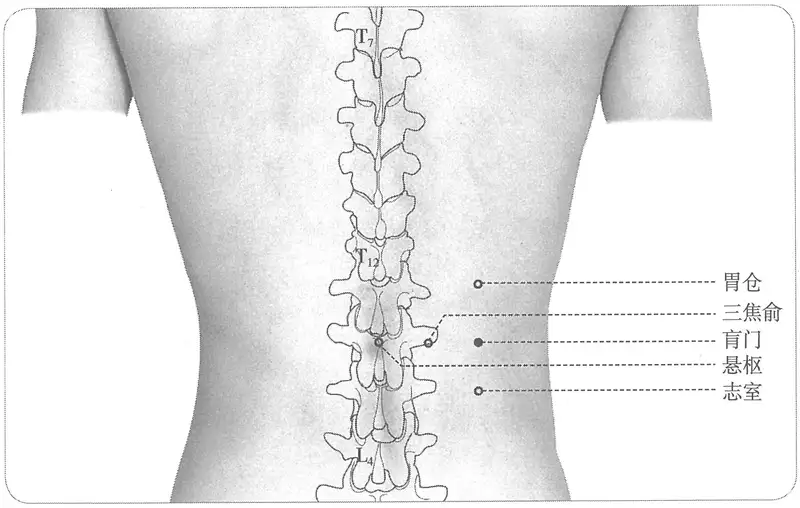

**图2-211　肓门穴图**

**取穴**：第1腰椎棘突下旁开3寸，横平内侧的三焦俞、悬枢穴。

　1. 《黄帝明堂经》佚文

　　(1) 在第十三椎下两旁各三寸，叉肋间。（《针灸甲乙经》卷三、《外台秘要》、《医心方》、《铜人腧穴针灸图经》卷中、《十四经发挥》中）

　　(2) 在第十三椎下两旁各三寸。（《千金要方》卷二十九、《千金翼方》、《铜人腧穴针灸图经》卷上及卷下“穴腧都数”）

〔p.752 (인쇄 732)〕

　2. 在第十三椎下两旁，上直胃仓。（《素问》王冰注）

　3. 在第十三椎下两旁各三寸。《异经》云：与鸠尾相直。（《太平圣惠方·针经》、《铜人腧穴针灸图经》卷中、《圣济总录》、《医学纲目》）

　4. 在十三椎下两旁各三寸叉肋间。其《明堂》作“异”经云：与鸠尾相直。当准《千金方》除脊各三寸取穴。（《针灸资生经》卷一）

　5. 十三椎下，两旁相去脊中行各三寸陷中，叉肋间，与鸠尾相直，正坐取之。（《针灸聚英》卷一、《古今医统》）

　6. 十三椎下两旁，相去脊各三寸陷中。正坐取之。（《针灸大成》卷六、《循经考穴编》）

　7. 在第十三椎下两旁各三寸，平巨阙。（《针方六集》卷一）

　8. 在十三椎下去脊中各三寸半，叉肋间陷中，前与鸠尾相直。正坐取之。（《类经图翼》卷七、《医宗金鉴·刺灸心法要诀》、《针灸逢源》）

　9. 第十三椎下去脊中三寸五分去脊边三寸。（《针灸十四经穴位考订》）

　10. 统编针灸学教材

　　(1) 部位：第十三椎下两旁相去脊各三寸。取穴：从第十三椎第一腰椎下悬枢穴外开三寸处取之，与三焦俞平。（1957年南京《针灸学》）

　　(2) 部位：胃仓穴下。取穴：俯卧或正坐，从第十三椎下督脉悬枢外开三寸陷中取之，与三焦俞穴平。（1版《针灸学讲义》）

　　(3) 部位：在第十三椎下，两旁各三寸，叉肋间。取穴：平第一腰椎棘突下，悬枢督脉旁开三寸，俯卧取之。（2版《针灸学讲义》）

　　(4) 第一腰椎棘突下，旁开3寸。（4、5、7版《针灸学》）

　　(5) 在腰部，当第1腰椎棘突下，旁开3寸。（6版《针灸学》）

　　(6) 第一腰椎棘突下，悬枢旁开三寸。（《中国针灸学》）

**文献分析**：值得注意的是，关于本穴的定位，《太平圣惠方》引别书曰“《异经》云：与鸠尾相直”，这显然是将关于“肓”之原与“膏”（鬲）之原混淆了，《灵枢·九针十二原》曰：“膏（鬲）之原，出于鸠尾，鸠尾一。肓之原，出于脖胦，脖胦一”。可见，膏（鬲）在上，肓在下，不能颠倒。后人不察，皆以讹传讹。

关于本穴定位去脊中距离的分歧，详见本经“概说”。

#### 【类属】 

足太阳膀胱经穴。

足太阳脉气所发。（《黄帝明堂经》）

#### 【适应症】 

主治腹部病症。常用于腹部积聚，腹痛；产后诸症。

　1. 主心下大坚。妇人乳余疾。（《黄帝明堂经》）

　2. 主心下肓大坚，妇人乳有余疾。（《太平圣惠方·针经》、《铜人腧穴针灸图经》卷中）

　3. 主心下痛，大便坚，妇人乳疾。（《针灸聚英》卷一、《古今医统》、《针灸大成》、《针方六集》、《类经图翼》、《针灸逢源》）

**按**：“大便坚”，应据《针灸资生经·心腹坚大》卷四作“大坚”，属上读。

　4. 主心下痛，气攻腰胁，便艰。（《循经考穴编》上）

　5. 统编针灸学教材

　　(1) 主治心下痛，便秘，妇人乳疾。（1957年南京《针灸学》、1版《针灸学讲义》）

　　(2) 主治上腹痛，痞块，便秘，妇人乳疾，心下大坚。（2版《针灸学讲义》、3版《针灸学》）

〔p.753 (인쇄 733)〕

　　(3) 主治腹痛，便秘，痞块，妇人乳疾。（4版《针灸学》）

　　(4) 主治腹痛，便秘，痞块，乳疾。（5、6、7版《针灸学》）

　　(5) 主治腹痛，便秘，痞块。（《中国针灸学》）

**文献分析**：《黄帝明堂经》载本穴主治作“主心下大坚。妇人乳余疾”。考《黄帝明堂经》中以“肓”字命名的“气海”（一名下肓）、“肓俞”皆主“腹中切痛”，则本穴主治“心下大坚”应指心下坚痛，即脐腹积聚；“乳余疾”，汉以后文献又作“产余疾”、“产后余疾”、“产乳余疾”，即产后杂病。《太平圣惠方·针经》肓门穴主治下云：“主心下肓大坚，妇人乳有余疾。”其中“乳有余疾”，现存各传本《黄帝明堂经》佚文均作“乳余疾”。乳，产也，“乳余疾”即产后杂病，可见多种症状。《诸病源候论·产后余疾候》论之甚详。而《太平圣惠方》作“乳有余疾”，则有失“乳余疾”本意。《铜人腧穴针灸图经》中“肓门”穴内容全文照抄《太平圣惠方》，宋以后针灸书，如《针灸聚英》、《针灸大成》等书又改作“乳疾”，今天的针灸教材中也作“妇人乳疾”，而日本《高等针灸学讲义》、承淡安《中国针灸学》等则径作“乳腺炎”，更与“乳余疾”本义相佐。第2版教材中“痞块”主治症，系痞根穴主治；“妇人乳疾”系误解《黄帝明堂经》“乳余疾”所致；“大便坚”系承袭高武《针灸聚英》之误，今皆去之。

#### 【操作】 

斜刺0.3~0.5寸。不宜深刺，宜向脊椎方向斜刺。

　1. 刺入五分，灸三十壮。（《黄帝明堂经》）

　2. 针五分，灸三壮。（《针灸十四经穴位考订》）

　3. 统编针灸学教材

　　(1) 针五分，灸七壮至三十壮。（1957年南京《针灸学》、1版《针灸学讲义》）

　　(2) 向下斜刺5分，艾条灸3~7分钟。（2版《针灸学讲义》）

　　(3) 斜刺0.5~0.8寸。（4、5、7版《针灸学》）

　　(4) 斜刺0.5~0.8寸；可灸。（6版《针灸学》）

　　(5) 斜刺0.3~0.5寸。可灸。（《中国针灸学》）

**刺法及主治的解剖学基础**：本穴位深面恰对肾脏，故直刺时深度以不超过1.2寸为宜。医者具体操作时，如果出现阻力由大变小，或有轻松空软感，应立即停止进针，表明针体从较厚的肌组织和致密的结缔组织进入疏松的肾脂肪囊。再深刺，则针下阻力再次增大，表明针已刺中肾脏，轻则患者有不适感、血尿，重则甚至出现肾脓肿等严重后果。

### （五十二）志室 Zhìshì BL52 出《黄帝明堂经》 

#### 【提要索隐】 

**穴名**：一名精宫；一名神关。

**部位**：在腰区，第2腰椎棘突下，后正中线旁开3寸。

**适应症**：主治局部、前阴病症。常用于腰背痛；遗精，阳痿，小便不利。

**针刺操作**：0.5~0.8寸。不宜深刺，宜向脊柱方向成45°角斜刺。

#### 【名实考】 

《医学入门》卷一“治病奇穴”篇载“精宫”一穴，在十四椎下，各开三寸处。专主梦遗。其定位与志室穴的现代定位同。又《针经摘英集》载“神关”穴，即志室也。

　1. 志室，在第十四椎下两旁各三寸陷者中，足太阳脉气所发，正坐取之。（《黄帝明堂经》）

　2. 足太阳络神关二穴，在背俞部第十四椎下两旁相去各三寸。用毫针针入五分，得气即泻。即志室也。（《针经摘英集》）

〔p.754 (인쇄 734)〕

　3. 精宫，专主梦遗。十四椎下，各开三寸，灸七壮，效。（《医学入门》卷一）

　4. 此穴与肾腧横直平对，肾藏志者也，故曰志室。（《经穴解》）

#### 【定位】 

**部位**：在腰区，第2腰椎棘突下，后正中线旁开3寸（图2-212）。

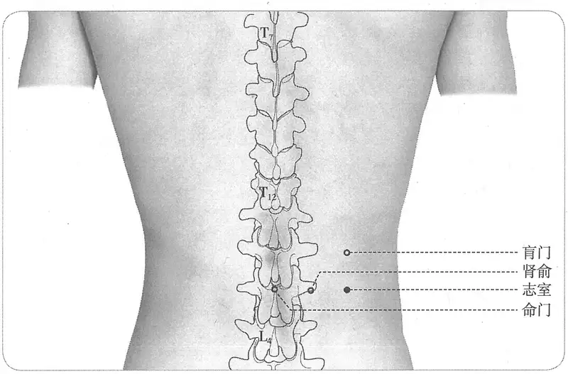

**图2-212　志室穴图**

**取穴**：第2腰椎棘突下旁开3寸，横平内侧的肾俞、命门穴。

　1. 在第十四椎下两旁各三寸陷者中……正坐取之。（《黄帝明堂经》、《太平圣惠方·针经》、《铜人腧穴针灸图经》卷下“穴腧都数”、《圣济总录》、《医学纲目》、《针方六集》）

　2. 在第十四椎下两旁各三寸。（《千金要方》卷二十九、《千金翼方》、《铜人腧穴针灸图经》卷上及卷中）

　3. 在第十四椎下两旁各三寸半陷者中。正坐微俯而取之。（《太平圣惠方·明堂》）

　4. 在十四椎下两旁各三寸陷中，正坐取之。当准《千金方》除脊各三寸取穴。（《针灸资生经》卷一）

　5. 在第十四椎下，并夹脊两旁相去各三寸，坐正取之。（《十四经发挥》中、《针灸大成》、《循经考穴编》、《针灸易学》）

　6. 十四椎下两旁相去脊中行各三寸陷中。正坐取之。（《针灸聚英》卷一、《古今医统》）

　7. 在十四椎下去脊中各三寸半陷中。正坐取之。（《类经图翼》卷七、《医宗金鉴·刺灸心法要诀》、《针灸逢源》）

　8. 第十四椎下去脊中三寸五分去脊边三寸。（《针灸十四经穴位考订》）

　9. 统编针灸学教材

　　(1) 部位：在第十四椎下两旁相去脊各三寸。取穴：从第十四椎第二、第三腰椎间命门穴外开三寸取之，与肾俞平。（1957年南京《针灸学》）

　　(2) 部位：肓门穴下。取穴：俯卧或正坐，从十四椎下督脉命门穴外开三寸陷中取之，与肾俞穴平。（1版《针灸学讲义》）

　　(3) 部位：在第十四椎下，两旁各三寸。取穴：平第二腰椎棘突下，命门督脉旁开三寸，俯卧取之。（2版《针灸学讲义》）

〔p.755 (인쇄 735)〕

　　(4) 第二腰椎棘突下，旁开3寸。（4、5、7版《针灸学》）

　　(5) 在腰部，当第2腰椎棘突下，旁开3寸。（6版《针灸学》）

　　(6) 第二腰椎棘突下，命门旁开三寸。（《中国针灸学》）

**文献分析**：关于本穴定位去脊中距离的分歧，详见本经“概说”。

#### 【类属】 

足太阳膀胱经穴。

足太阳脉气所发。（《黄帝明堂经》）

#### 【适应症】 

主治局部、前阴病症。常用于腰背痛；遗精，阳痿，小便不利。

　1. 主腰痛脊急，胁下满，小腹坚急。（《黄帝明堂经》）

　2. 食不消，腹中坚急，阴痛下肿。（《太平圣惠方·针经》）

**按**：疑是胞肓穴主治误置于此。

　3. 大便难，食饮不下，背痛俯仰不得。（《太平圣惠方·明堂》）

　4. 治腰脊强痛，食饮不消，腹中坚急，阴痛下肿，失精，小便淋沥。（《铜人腧穴针灸图经》卷中、《圣济总录》）

**按**：“腰脊强痛……阴痛下肿”系《太平圣惠方》卷九十九所载“胞肓”穴主治。

　5. 统编针灸学教材

　　(1) 主治遗精，小便淋沥，阴中肿痛，呕吐，饮食不消，水肿，腰背强痛。（1957年南京《针灸学》、1版《针灸学讲义》）

　　(2) 主治遗精，阳痿，小便不利，水肿，腰脊强痛。（2版《针灸学讲义》、4、5、7版《针灸学》）

　　(3) 主治遗精，阳痿，阴痛，小便不利，水肿，腰脊强痛。（6版《针灸学》）

　　(4) 主治遗精，阳痿，遗尿，尿频，小便不利，月经不调，腰膝酸痛，水肿。（《中国针灸学》）

**文献分析**：《太平圣惠方·针经》载本穴主治“食不消，腹中坚急，阴痛下肿”又见于该书同卷“胞肓”穴主治，并与《黄帝明堂经》胞肓穴主治相近，疑是该穴主治误置于此。《铜人腧穴针灸图经》本穴主治“治腰脊强痛，食饮不消，腹中坚急，阴痛下肿，失精，小便淋沥”中“腰脊强痛……阴痛下肿”系《太平圣惠方·针经》所载“胞肓”穴主治症，王惟一误录于此。

1版教材中“阴中肿痛，饮食不消”乃承袭《太平圣惠方》之误，其他各版删之，今从之。

#### 附：临床应用举例 

　1. 治忽然气滞，腰痛不可俯仰，刺足太阳络神关二穴……即志室也，次针足厥阴行间二穴。（《针经摘英集》）

　2. 肾绞痛，针刺志室穴治疗。［中国针灸，1996（12）：44-45］

#### 【操作】 

0.5~0.8寸。不宜深刺，宜向脊柱方向成45°角斜刺。

　1. 刺入五分，灸三壮。（《黄帝明堂经》）

　2. 灸七壮。（《太平圣惠方·明堂》）

　3. 针五分，灸五壮。（《医学入门》卷一）

　4. 统编针灸学教材

　　(1) 针五分，灸七至十五壮。（1957年南京《针灸学》、1版《针灸学讲义》）

　　(2) 直刺7~10分；艾炷灸5~10壮，艾条灸5~10分钟。（2版《针灸学讲义》）

　　(3) 斜刺0.5~0.8寸。（4、5、7版《针灸学》）

　　(4) 斜刺0.5~1寸；可灸。（6版《针灸学》、《中国针灸学》）

　5. ①直刺1.5~2寸。②横刺，治腰部软组织损伤或肾下垂时向肾俞方向进针，深2~3寸。感应：局部酸胀，有时向臀部放散。5~7壮；温灸10~20分钟。（上海《针灸学》）

〔p.756 (인쇄 736)〕

### （五十三）胞肓 Bāohuāng BL53 出《黄帝明堂经》 

#### 【提要索隐】 

**部位**：在骶区，横平第2骶后孔，骶正中嵴旁开3寸。

**适应症**：主治局部、腹部病症。常用于腰背痛；肠鸣，腹胀，便秘，癃闭。

**针刺操作**：直刺0.8~1.2寸。

#### 【名实考】 

　1. 胞肓，在第十九椎下两旁各三寸陷者中，足太阳脉气所发，伏而取之。（《黄帝明堂经》）

　2. 胞者，指膀胱而言也；肓者，膈也。膀胱有下口无上口，亦犹上之膈膜，不与上下相通之义同。其溺乃用下焦之气以渗入者，故亦曰肓也。此穴主渗入之原本，故曰胞肓也。（《经穴解》）

#### 【定位】 

**部位**：在骶区，横平第2骶后孔，骶正中嵴旁开3寸（图2-213）。

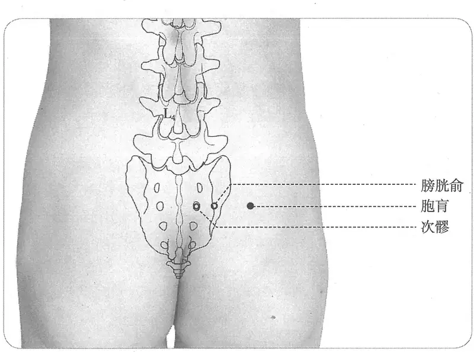

**图2-213　胞肓穴图**

**取穴**：本穴与内侧的膀胱俞、次髎均位于第2骶后孔水平。

　1. 在第十九椎下两旁各三寸陷者中……伏而取之。（《黄帝明堂经》、《太平圣惠方》、《铜人腧穴针灸图经》卷中及卷下“穴腧都数”、《圣济总录》、《医学纲目》、《针方六集》）

　2. 在十九椎下两旁各三寸陷中，伏而取之。当准《千金方》除脊各三寸取穴。（《针灸资生经》卷一）

　3. 在第十九椎下，夹脊两旁相去各三寸。（《十四经发挥》中、《针灸大成》、《循经考穴编》、《针灸易学》）

　4. 十九椎下两旁，相去脊中行各三寸陷中，伏而取之。（《针灸聚英》卷一、《古今医统》）

〔p.757 (인쇄 737)〕

　5. 在十九椎下，去脊中各三寸半陷中，伏而取之。（《类经图翼》卷七、《医宗金鉴·刺灸心法要诀》、《针灸逢源》）

　6. 第十九椎下去脊中三寸五分去脊边三寸。（《针灸十四经穴位考订》）

　7. 统编针灸学教材

　　(1) 部位：在第十九椎下两旁相去脊各三寸。取穴：伏卧，从荐骨正中线第二假棘状突起外开三寸取之，与膀胱俞平，即第十九椎下旁三寸处。（1957年南京《针灸学》）

　　(2) 部位：十九椎下，夹脊六寸。取穴：伏卧，与次髎穴平，在膀胱俞穴外开一寸五分陷中取之。（1版《针灸学讲义》）

　　(3) 部位：在第十九椎下，两旁各三寸。取穴：平第二骶后孔，督脉旁开三寸，俯卧取之。（2版《针灸学讲义》）

　　(4) 第二骶椎棘突下，旁开3寸。（4、5版《针灸学》）

　　(5) 在臀部，平第2骶后孔，骶正中嵴旁开3寸。（6、7版《针灸学》）

　　(6) 平第二骶后孔，督脉旁开三寸。（《中国针灸学》）

**文献分析**：关于本穴定位去脊中距离的分歧，详见本经“概说”。

#### 【类属】 

足太阳膀胱经穴。

足太阳脉气所发。（《黄帝明堂经》）

#### 【适应症】 

主治局部、腹部病症。常用于腰背痛；肠鸣，腹胀，便秘，癃闭。

　1. 主腰脊痛，恶寒，少腹满坚，癃闭下重，不得小便。（《黄帝明堂经》）

　2. 以手按之则欲小便，涩而不得出，肩上热，手足小指外侧及胫踝后皆热，若脉陷取委中央。（《外台秘要》卷三十九）

**按**：此段文字出自《灵枢·邪气藏府病形》之膀胱病症状，非本穴主治。

　3. 主食不消，腹中急，阴痛下肿并疗之。疗恶寒腰背痛。（《太平圣惠方·针经》）

　4. 治腰痛恶寒，少腹坚急，癃闭重，不得小便，涩痛，腰背卒痛。（《铜人腧穴针灸图经》卷中）

　5. 肠鸣，淋沥，不得大小便。（《针灸聚英》卷一、《针灸大成》）

　6. 伛偻。（《针方六集》卷五）

　7. 八字骨疼。（《循经考穴编》上）

　8. 统编针灸学教材

　　(1) 主治肠鸣，不得大小便，淋沥或癃闭，阴肿，腰脊急痛。（1957年南京《针灸学》、1版《针灸学讲义》）

　　(2) 主治肠鸣，腹胀，腰脊痛，癃闭，大便难，阴肿。（2版《针灸学讲义》、4版《针灸学》）

　　(3) 主治肠鸣，腹胀，便秘，癃闭，腰脊急痛。（5、7版《针灸学》）

　　(4) 主治肠鸣，腹胀，腰痛，小便不利，阴肿。（6版《针灸学》）

　　(5) 主治肠鸣，腹胀，腰脊痛，尿闭。（《中国针灸学》）

#### 【操作】 

直刺0.8~1.2寸。

　1. 刺入五分，灸三壮。（《黄帝明堂经》）

　2. 灸五七壮至五十壮。（《太平圣惠方·针经》）

　3. 灸五壮。（《太平圣惠方·明堂》）

　4. 可灸五七壮，针入五分。（《铜人腧穴针灸图经》卷中）

〔p.758 (인쇄 738)〕

　5. 统编针灸学教材

　　(1) 针五分，灸七至十五壮。（1957年南京《针灸学》、1版《针灸学讲义》）

　　(2) 直刺7~13分，艾条灸5~10分钟。（2版《针灸学讲义》）

　　(3) 直刺1~1.5寸。（4、5、7版《针灸学》）

　　(4) 直刺0.8~1.2寸；可灸。（6版《针灸学》、《中国针灸学》）

### （五十四）秩边 Zhìbiān BL54 出《黄帝明堂经》 

#### 【提要索隐】 

**部位**：在骶区，横平第4骶后孔，骶正中嵴旁开3寸。

**适应症**：主治局部及前后阴病症。常用于腰骶痛，下肢痿痹；小便不利，便秘，痔疮，前阴痛。

**针刺操作**：直刺1.5~2寸。

#### 【名实考】 

不论从足太阳经脉，还是经别、经筋的循行分布，皆提示该经在臀部有一穴，疑本穴“秩边”，即“脽边”之借字，即臀边之义。

关于本穴部位有二说，宋代王执中曰：《素问·气府论》注曰：秩边在二十一椎下两旁，上直胞肓，与《铜人经》、《明堂经》“二十椎下”不同。未知其孰是，姑两存之。在王执中之前，王惟一编《铜人腧穴针灸图经》也两存之：其卷上及卷下“穴腧都数”均作“二十一椎”，而卷中作“二十椎”。

今考《素问·气府论》足太阳脉气所发穴中作“夹背以下至尻尾二十一节，十五间各一”，《针灸甲乙经》卷三背部第二侧行标题作“背自第二椎两旁夹脊各三寸下行至二十一椎下两旁夹脊凡二十六穴第九”，皆提示第二十一椎下有穴。还有一个有力的证据：背部三行穴，其横平之穴，在主治上有很高的相关性，而本穴主治恰与二十一椎水平的白环俞、腰俞主治吻合，甚至最早出现本穴定位于二十椎的《太平圣惠方》将白环俞主治辑入本穴之下。故定本穴于“二十一椎”更稳妥。

本穴通过不同针灸角度与深度控制针感可以治疗腰腿、前阴、后阴等不同部位的病症。与“内秩边”、“盆神经刺激点”、“环中”实为同一穴，也与注射疗法的“坐骨神经注射点”、“阴部神经注射点”相近，操作与主治相同，这些不同的体表进针点，通过相同的针尖刺激部位而达到相同的治疗效果，因而可以将它们视为同一个穴位或穴区，犹如同一个神经刺激点有不同的体表进针部位，而实现完全相同的治疗效果一样。参见足少阳经环跳穴“名实考”。

　1. 秩边，在第二十一椎下两旁各三寸陷者中，足太阳脉气所发，伏而取之。（《黄帝明堂经》）

　2. 此穴横与中膂腧相对，中膂者，乃夹脊两行肉也，督脉行于脊之正中，而两旁膂肉夹之。内为夹脊两行之脂膜，所以裹系诸脏腑。外所列太阳左右两行各脏腑腧穴，左右秩秩然成行列。而下至此穴，而太阳在背之穴尽，故名曰秩边。（《经穴解》）

#### 相关穴及刺激点 

　1. 荐强　位于骶部，骶骨管裂孔两侧旁开二寸五分之点下五分处（腰俞穴旁开二寸五分处直下五分）。主治外伤性截瘫。针3~4寸，针感胀、麻至尿道及肛门，有时可传至下肢。（《针灸经外奇穴图谱（续集）》）

　2. 新秩边　在坐骨大切迹下缘凹陷处。主治坐骨神经痛，肋间神经痛。针4~5寸，针感麻、酸至足。（《针灸经外奇穴图谱（续集）》）

　3. 内秩边穴　在秩边穴内1~2cm处按压寻找针刺点，以酸胀为度，在反应点行常规消

〔p.759 (인쇄 739)〕

毒，以4~5寸28号毫针快速叩刺入皮内，针尖指向前阴方向，取酸、胀、重或放射感至阴茎为宜。小幅度提插捻转，留针20分钟。治疗功能性阳萎。［乔晋琳，刘士杰．针刺“内秩边穴”为主治疗42例功能性阳萎临床研究．贵阳中医学院学报，1993（2）：51-52，63］

　4. 盆神经刺激点　秩边穴下0.5寸。主治尿失禁，大便失禁，尿潴留。针稍偏向内侧，针3寸左右，针感会阴部抽、胀。（《针灸经外奇穴图谱（续集）》）

#### 【定位】 

**部位**：在骶区，横平第4骶后孔，骶正中嵴旁开3寸（图2-214）。

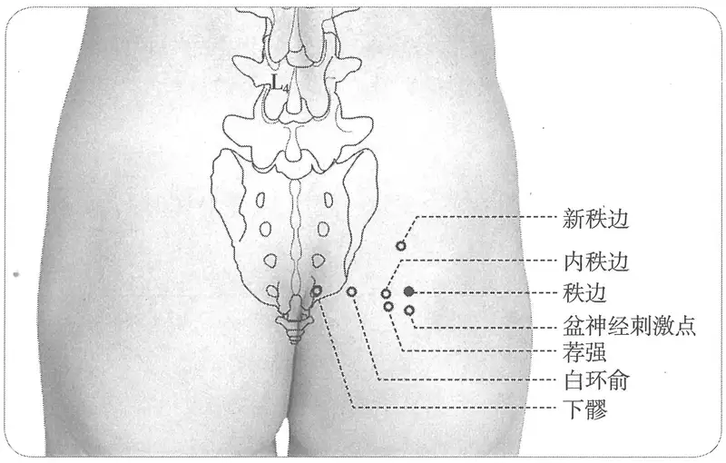

**图2-214　秩边与相关穴及刺激点**

**取穴**：本穴位于骶管裂孔旁开3寸，横平白环俞。

　1. 《黄帝明堂经》佚文

　　(1) 在第二十一椎下两旁各三寸陷者中……伏而取之。（《针灸甲乙经》卷三、《外台秘要》、《医心方》、《铜人腧穴针灸图经》卷下“穴腧都数”）

　　(2) 在第二十一椎下两旁各三寸。（《千金要方》卷二十九、《千金翼方》、《铜人腧穴针灸图经》卷上）

　　(3) 在第二十一椎下两旁，上直胞肓，各相去夹脊同身寸之三寸。伏而取之。（《素问》王冰注）

　2. 在第二十椎下，两旁各三寸。伏而取之。（《太平圣惠方·针经》、《铜人腧穴针灸图经》卷中、《圣济总录》、《医学纲目》、《针灸大成》、《针方六集》、《循经考穴编》）

　3. 在二十椎下两旁各三寸陷中，伏而取之。当准《千金方》除脊各三寸取穴。（《针灸资生经》卷一）

　4. 二十椎下两旁相去脊中行各三寸陷中。伏取之。（《针灸聚英》卷一、《古今医统》）

　5. 在二十一椎下，去脊中各三寸半陷中。伏而取之。（《类经图翼》卷七、《医宗金鉴·刺灸心法要诀》、《针灸逢源》）

　6. 第二十椎下去脊中三寸五分去脊边三寸。（《针灸十四经穴位考订》）

　7. 统编针灸学教材

　　(1) 部位：第二十椎下两旁相去脊三寸。取穴：伏卧，按取第三荐骨假棘状突起外开三寸处取之，与中膂俞相平二十椎下旁三寸。（1957年南京《针灸学》）

〔p.760 (인쇄 740)〕

　　(2) 部位：第二十一椎下，挟脊六寸。取穴：伏卧，在胞肓穴下，从督脉腰俞穴外开三寸陷中取之。（1版《针灸学讲义》）

　　(3) 部位：在第二十一椎下，两旁各三寸陷者中。取穴：胞肓直下方，腰俞督脉旁三寸，当骶骨裂孔旁开四横指处，俯卧取之。（2版《针灸学讲义》）

　　(4) 第四骶椎棘突下，旁开3寸。（4、5版《针灸学》）

　　(5) 在臀部，平第4骶后孔，骶正中嵴旁开3寸。（6、7版《针灸学》）

　　(6) 骶管裂孔外侧，腰俞旁开三寸。（《中国针灸学》）

**文献分析**：关于本穴定位，自宋代始直到现代，皆两说并存，而从《素问》及《针灸甲乙经》背部第二侧行穴标题以及相关穴的主治来看，作“二十一椎”更稳，也与本穴的名称更吻合，故现行教材皆采是说。关于本穴定位去脊中距离的分歧，详见本经“概说”。

#### 【类属】 

足太阳膀胱经穴。

足太阳脉气所发。（《黄帝明堂经》）

#### 【适应症】 

主治局部及前后阴病症。常用于腰骶痛，下肢痿痹；小便不利，便秘，痔疮，前阴痛。

　1. 主腰痛骶寒，俯仰急难，阴痛下重，不得小便。（《黄帝明堂经》）

　2. 主腰痛不能俯仰，小便赤黄，尻重不能举。（《太平圣惠方·针经》）

**按**：此乃《黄帝明堂经》白环俞主治，《太平圣惠方·针经》误置于此。

　3. 治腰背不能俯仰，小便赤涩，腰尻重不能举，五痔发肿。（《铜人腧穴针灸图经》卷中）

　4. 主腿股风疼，肾虚腰痛，遗精带浊。（《循经考穴编》上）

　5. 统编针灸学教材

　　(1) 主治肾虚腰痛，小便赤，痔疾。（1957年南京《针灸学》、1版《针灸学讲义》）

　　(2) 主治腰骶痛，下肢痿、痹，小便不利，阴痛，痔疾，大便难。（2版《针灸学讲义》、4版《针灸学》、《中国针灸学》）

　　(3) 主治小便不利，便秘，痔疾，腰骶痛，下肢痿痹。（5版《针灸学》）

　　(4) 主治腰骶痛，下肢痿痹，阴痛，痔疾。（6版《针灸学》）

　　(5) 主治：①腰骶痛，下肢痿痹等腰及下肢病证；②小便不利；③便秘，痔疾；④阴痛。（7版《针灸学》）

**文献分析**：《太平圣惠方·针经》载本穴主治“主腰痛不能俯仰，小便赤黄，尻重不能举”乃《黄帝明堂经》白环俞主治（主腰脊痛不得俯仰，小便赤黄，尻重不能举）。《铜人腧穴针灸图经》承其误。

#### 附：临床应用举例 

　1. 泌尿系统疾病，秩边穴针灸治疗。［上海针灸杂志，1984（3）：15］

　2. 尿失禁，针刺秩边穴治疗。［云南中医学院学报，1985，8（3）：33］

　3. 急性膀胱炎，针刺秩边穴治疗。［针灸临床杂志，1997，13（10）：34］

　4. 慢性前列腺炎，针刺中极、秩边穴治疗。［针灸临床杂志，1999，15（5）：26］

　5. 术后尿潴留，秩边配委中针刺治疗。［针灸临床杂志，2000，16（3）：57］

　6. 膀胱尿道炎，深刺秩边穴治疗。［上海针灸杂志，2001，20（6）：27］

　7. 湿热淋，针刺秩边为主治疗。［上海针灸杂志，2001，20（4）：29］

　8. 坐骨神经痛，秩边穴针刺治疗。［中国针灸，1987（2）：38］

〔p.761 (인쇄 741)〕

　9. 神经性下肢挛缩症，针刺秩边穴治疗。［中医药研究，1998，14（2）：50-51］

　10. 急性腰部伤筋，针刺秩边穴治疗。［河北中医，2000，22（12）：929］

#### 【操作】 

直刺1.5~2寸。

　1. 刺入五分，灸三壮。（《黄帝明堂经》）

　2. 灸三壮，针入三分。（《太平圣惠方·针经》）

　3. 统编针灸学教材

　　(1) 针五分，灸三至七壮。（1957年南京《针灸学》、1版《针灸学讲义》）

　　(2) 直刺10~15分，艾条灸5~10分钟。（2版《针灸学讲义》）

　　(3) 直刺1.5~2寸。（4、5、7版《针灸学》）

　　(4) 直刺1.5~3寸；可灸。（6版《针灸学》）

　　(5) 直刺1.5~2寸。可灸。（《中国针灸学》）

　4. ①直刺，治坐骨神经痛时，进针2~3寸。感应：局部酸胀，深刺时有麻电感向下肢放散。②斜刺，治生殖器疾病时，向内倾斜45度，进针2~3寸。感应：局部酸胀，有时有麻电感向外生殖器或肛门放散。③斜刺：治肛门病时，向内下方斜约45度，进针2~3寸。感应：酸胀向肛门扩散。④直刺，向外透环跳或跳跃，治臀肌劳损。灸5~7壮；温灸5~20分钟。（上海《针灸学》）

**刺法及主治的解剖学基础**：现代医学盆神经刺激点与本穴定位及主治相同，说明古人的观察与总结十分准确。研究发现，直刺3~3.5寸，针体几乎贴近坐骨神经（本穴相当于俯卧位下的“环跳”穴，详见环跳穴“名实考”），故患者酸麻感有向下肢放射的现象。本穴治疗坐骨神经痛疗效肯定，若是向内倾斜约45°进针，则针感向外生殖器传递，主治泌尿、生殖器疾病（可参照“内秩边”和“盆神经刺激点”的刺法）。近人通过临床实践与解剖实验，对于本穴的刺法及主治相关性进行了较系统的研究，结果证实：当针刺秩边穴深度达4~5寸时，可刺到阴部神经，进而穿过坐骨大孔刺到盆神经丛。从而使得本穴治疗大小便不利，阴痛，痔疾及生殖器疾病的作用从神经的生理解剖和临床实践中得到证实。使该穴在临床运用上有了较全面可信的理论根据。在临床实践中，按以往1.5~3寸的针刺深度，远不及阴部神经和盆神经。因此，治疗以上疾病时，针刺深度必须在4~5寸左右。同时要求针感出现在小腹和阴部，治疗痔疾和肛周疾病，针尖稍斜向肛门方向，让针感出现在肛周。这样，才能收到满意效果。［傅建宁．秩边穴治疗新用初探．云南医药，1990，11（2）：124-125］

### （五十五）合阳 Héyáng BL55 出《黄帝明堂经》 

#### 【提要索隐】 

**部位**：在小腿后区，腘横纹下2寸，腓肠肌内、外侧头之间。

**适应症**：主治腰腿病症、妇科崩漏症。常用于腰背痛，下肢痿痹；疝气；崩漏。

**备选适应症**：痔疾。

**针刺操作**：直刺0.7~1.0寸。

#### 【名实考】 

关于本穴距委中穴的距离，古代文献有“二寸”、“三寸”和“一寸”三说。其中“三寸”说见于《千金要方》，而同一作者的另一书《千金翼方》仍作“二寸”，故王惟一编《铜人腧穴针灸图经》时不采是说；“一寸”说见于《针灸大全》“周身折量法”歌诀，经考察此篇系依据宋代《针灸资生经》编写，而后者作“二寸”。故本穴定位以《黄帝明堂经》“二寸”说更稳，现代针灸学教材从之。

〔p.762 (인쇄 742)〕

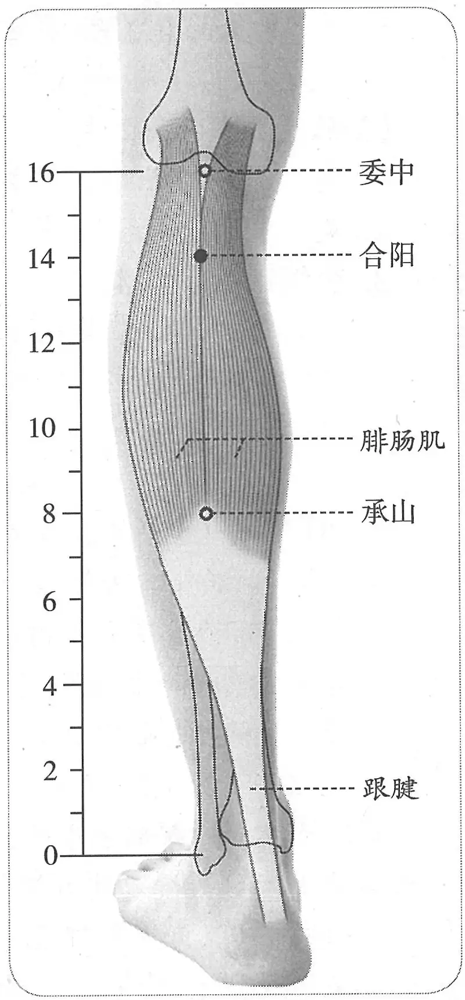

**图2-215　合阳穴图**

　1. 合阳，在膝约纹中央下二寸。（《黄帝明堂经》）

　2. 合阳，在膝约中央下三寸。（《千金要方》卷二十九）

　3. 合阳委中下一寸。（《针灸大全·周身折量法》卷三）

　4. 太阳……俱合委中，过膝之后而下行，故曰合阳，以太阳两脉合而得名也。（《经穴解》）

#### 【定位】 

**部位**：在小腿后区，腘横纹下2寸，腓肠肌内、外侧头之间（图2-215）。

**取穴**：在委中与承山的连线上，委中直下2寸。

　1. 在膝约纹中央下二寸。（《黄帝明堂经》、《针灸资生经》、《医学纲目》、《古今医统》、《针方六集》）

　2. 在膝约中央下三寸。（《千金要方》卷二十九、《十四经发挥》中、《针灸聚英》、《针灸大成》卷六、《循经考穴编》、《医宗金鉴·刺灸心法要诀》、《针灸易学》、《针灸逢源》）

　3. 在膝约中央下二寸。（《铜人腧穴针灸图经》、《圣济总录》、《针灸大成》卷八、《类经图翼》）

　4. 合阳委中下一寸。（《针灸大全》卷三、《医学入门》）

　5. 委中穴下三寸。（《针灸十四经穴位考订》）

　6. 统编针灸学教材

　　(1) 部位：在膝腘约纹下二寸。取穴：正坐垂足，于委中直下二寸取之。（1957年南京《针灸学》）

　　(2) 部位：委中穴下二寸。取穴：伏卧，于委中穴与承山穴之直线上取之。（1版《针灸学讲义》）

　　(3) 部位：在膝约文中央下二寸。取穴：在委中直下二寸，腓肠肌二头之间，当委中与承山之直线上取之。（2版《针灸学讲义》）

　　(4) 委中穴下2寸。（4版《针灸学》）

　　(5) 委中穴直下2寸。（5、7版《针灸学》）

　　(6) 在小腿后面，当委中与承山的连线上，委中下2寸。（6版《针灸学》）

　　(7) 委中直下二寸，腓肠肌二头之间，当委中与承山的连线上。（《中国针灸学》）

#### 【类属】 

足太阳膀胱经穴。

**归经**：足太阳膀胱经。（《外台秘要》卷三十九、《铜人腧穴针灸图经》卷上）

#### 【适应症】 

主治腰腿病症、妇科崩漏症。常用于腰背痛，下肢痿痹；疝气；崩漏。

**备选适应症**：痔疾。

　1. 主癫疾。瘛疭拘急。跟厥。膝急，腰脊痛引腹、篡，阴股热，阴暴痛，寒热，膝酸重。（《黄帝明堂经》）

**按**：跟厥，《医心方》作踝厥，足太阳“是动”病证名。

　2. 主癞疝，崩中，腹上下痛，肠澼。（《千金要方》卷三十）

　3. 主痹厥。（《外台秘要》卷三十九）

〔p.763 (인쇄 743)〕

　4. 治腰脊强引腹痛，阴股热，膝胻酸重，履步难，寒疝阴偏痛，女子崩中。（《铜人腧穴针灸图经》卷下）

　5. 窦太师针灸遗存

　　(1) 治痔漏症。（《窦太师针经》）

　　(2) 便毒。（《循经考穴编》上）

　6. 统编针灸学教材

　　(1) 主治崩中带下，疝痛，腰脊痛，膝胻酸。（1957年南京《针灸学》、1版《针灸学讲义》）

　　(2) 主治腰脊痛，下肢酸痛，麻痹，崩漏，疝痛。（2版《针灸学讲义》、3版《针灸学》）

　　(3) 主治腰脊强痛，下肢痹痛，疝痛，崩漏。（4、5、6、7版《针灸学》）

　　(4) 主治腰脊痛，下肢酸痛、麻痹。（《中国针灸学》）

#### 附：临床应用举例 

　1. 肾疸，当灸合阳五壮。（《痈疽神秘灸经》）

　2. 崩漏，针刺地机、血海；漏症针刺交信、合阳。［江苏中医杂志，1983，4（3）：44］

　3. 小儿急性腘肌损伤，合阳穴、京骨穴针刺。［中国针灸，1985，5（4）：48］

　4. 原发性痛经，取合阳穴，温针治疗。［四川中医，1988，6（11）：46］

　5. 小儿麻痹，肾俞穴、合阳穴，针刺治疗。［新疆中医药，1988（4）：42，40］

#### 【操作】 

直刺0.7~1.0寸。

　1. 刺入六分，灸五壮。（《黄帝明堂经》）

　2. 窦太师针灸遗存

　　(1) 针入二寸半，灸三七壮。（《窦太师针经》）

　　(2) 窦氏针入二寸半，灸二七壮。（《针方六集》卷一）

　3. 统编针灸学教材

　　(1) 针五分至一寸，灸三至七壮。（1957年南京《针灸学》、1版《针灸学讲义》）

　　(2) 直刺7~10分，艾条灸5~10分钟。（2版《针灸学讲义》）

　　(3) 直刺1~2寸。（4、5版《针灸学》）

　　(4) 直刺1~2寸；可灸。（6版《针灸学》）

　　(5) 直刺1.5~2寸。（7版《针灸学》）

　　(6) 直刺0.7~1.0寸。可灸。（《中国针灸学》）

### （五十六）承筋 Chéngjīn BL56 出《黄帝明堂经》 

#### 【提要索隐】 

**穴名**：承筋，一名腨肠，一名直肠；一名真肠。

**部位**：在小腿后区，腘横纹下5寸，腓肠肌两肌腹之间。

**适应症**：主治腰腿部病症。常用于腰背痛，小腿挛痛；痔疮。

**针刺操作**：直刺0.8~1.2寸。

#### 【名实考】 

承筋，一名腨肠，一名直肠。腨肠，又名“腓肠”，即小肠后部的腓肠肌。《灵枢·寒热病》曰：“腓者，腨也”。《说文》曰：“腓，胫腨也。”徐锴曰：“腓，胫中肠也”。一名直肠，《太平圣惠方》作“一名真肠”，形误。

关于本穴的定位，《黄帝明堂经》直接以体表标志定位：腓肠肌中央陷中。宋代《太平圣惠方》别以分寸折量作“足跟上七寸”，显然与小腿部的骨度分寸不合，也与相邻穴的位置关系不合。飞扬穴已在外踝上七寸，其上方的本穴何以反定于其下？故现代教材不从。

〔p.764 (인쇄 744)〕

　1. 承筋，一名腨肠，一名直肠，在腨肠中央陷者中，足太阳脉气所发。（《黄帝明堂经》）

　2. 三焦者，足少阳太阴一本作阳之所将，太阳之别也，上踝五寸，别入贯腨肠。（《灵枢·本输》）

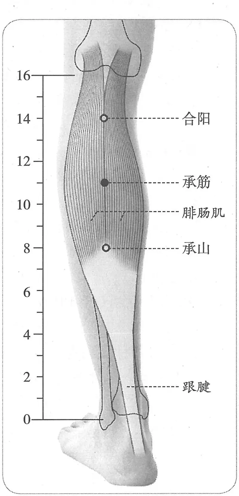

**图2-216　承筋穴图**

　3. 承筋二穴，一名腨肠，一名真肠。在胫后从脚根后到上七寸，腨中央陷者中是穴。足太阳脉气所发。（《太平圣惠方·针经》）

　4. 膝后有大筋二条，下膝合于腨肠之中，而此穴承之，故曰承筋。（《经穴解》）

#### 承筋穴定位异文 

　1. 凡转筋能杀人，起死之法无过于灸，灸法唯三处要穴，第一承筋穴，在腨肠下际，取穴法：以绳从脚心下度至脚踵，便截断度，则回此度从脚踵纵量向上，尽度头，当腨下际宛宛中是穴，灸三七壮则定。（《外台秘要》卷六）

　2. 霍乱已死有暖气者，灸承筋七壮。起死人，取绳量围足从趾至跟，捻取等折一半以度，令一头至跟踏地处，引上至度，头即是穴。又以盐纳脐中，灸二七壮。（《千金要方》卷二十）

**按**：以上《外台秘要》取承筋穴法，似是取承山穴法。相关文字又见于《千金要方》，后者绳量取穴别是一穴，非承筋穴取穴法，王焘未能详察而混为一谈。

#### 【定位】 

**部位**：在小腿后区，腘横纹下5寸，腓肠肌两肌腹之间（图2-216）。

**取穴**：合阳与承山连线的中点处取之。

　1. 在腨肠中央陷者中。（《黄帝明堂经》、《铜人腧穴针灸图经》、《圣济总录》、《针灸资生经》、《十四经发挥》、《医学纲目》、《针方六集》、《循经考穴编》）

　2. 在胫后，从脚跟上七寸，腨中央陷中。（《千金要方》卷二十九、《千金翼方》、《太平圣惠方·针经》、《针灸资生经》、《针灸聚英》、《古今医统》、《医学入门》、《针灸大成》、《类经图翼》、《医宗金鉴·刺灸心法要诀》、《针灸易学》、《针灸逢源》）

　3. 腨中央，如外陷者中也。（《素问·刺腰痛》王冰注）

　4. 广注从仆参量上合九寸。一法：居承山上一寸。（《循经考穴编》上）

　5. 合阳下行，腨肠中央，当合阳与承山之间。（《针灸十四经穴位考订》）

　6. 统编针灸学教材

　　(1) 部位：腨肠中央陷中。取穴：正坐垂足，腓肠肌之中央处取之，当合阳与承山之间。（1957年南京《针灸学》）

　　(2) 部位：腨肠中央陷中。取穴：伏卧，当合阳穴于承山穴直下中间，腿肚之最高处取之。（1版《针灸学讲义》）

〔p.765 (인쇄 745)〕

　　(3) 部位：腨肠中央陷中。取穴：于合阳与承山连线的中点，当腓肠肌肌腹中央取之。（2版《针灸学讲义》）

　　(4) 合阳穴与承山穴连线的中点。（4、5版《针灸学》）

　　(5) 在小腿后面，当委中与承山的连线上，腓肠肌肌腹中央，委中下5寸。（6版《针灸学》）

　　(6) 合阳穴与承山穴的连线的中点，腓肠肌肌腹中央。（7版《针灸学》、《中国针灸学》）

**文献分析**：本穴部位历代文献均定在腨肠中央陷者中，但具体折量尺寸不同，这是由于对小腿部骨度分寸不统一所致。通行本《千金要方》本穴定位作“在胫后从脚跟上七寸腨中央陷中”，而未经宋人校本《孙真人千金方》无“在胫后从脚跟上七寸”字样，《千金翼方》同。则最早记载这一折量取穴法的确切文献是《太平圣惠方·针经》。如果将足跟至腓肠肌中央折作7寸，与小腿部的骨度不合。本穴的定位仍应依据《黄帝明堂经》，采用表面解剖标志。

#### 【类属】 

足太阳膀胱经穴。

足太阳脉气所发。（《黄帝明堂经》）

#### 【适应症】 

主治腰腿部病症。常用于腰背痛，小腿挛痛；痔疮。

　1. 主大肠实则腰背痛，寒痹转筋，头眩痛，虚则鼻衄，癫疾，腰痛濈濈然汗出，令人欲食，欲走。寒热，篡后出，瘛疭，脚腨酸重，战栗不能久立，脚急肿痛，跗筋足挛，少腹痛引喉嗌，大便难。痔，篡痛。霍乱，胫痹不仁。（《黄帝明堂经》）

　2. 主治风劳热，足烦肿痛，转筋急痛，身瘾疹，大小便不止。（《太平圣惠方·针经》）

　3. 治寒痹转筋，肢肿，大便难，脚腨酸重，引少腹痛，鼻鼽衄，腰背拘急，霍乱。（《铜人腧穴针灸图经》卷下）

　4. 主霍乱转筋，并腰脉抽掣不定。脏毒肠风。（《循经考穴编》上）

　5. 统编针灸学教材

　　(1) 主治腨疼，胫痹，痔疾，腰背拘急。（1957年南京《针灸学》、1版《针灸学讲义》）

　　(2) 主治小腿痛，膝酸痛，痔疾，腰背拘急，霍乱转筋。（2版《针灸学讲义》、3版《针灸学》）

　　(3) 主治腿痛转筋，膝酸痛，痔疾，腰背拘急。（4版《针灸学》）

　　(4) 主治痔疾，腰腿拘急疼痛。（5、7版《针灸学》）

　　(5) 主治小腿痛，霍乱转筋，痔疾，腰背拘急。（6版《针灸学》）

　　(6) 主治腿痛转筋，痔疾，腰背拘急。（《中国针灸学》）

**文献分析**：《黄帝明堂经》所载本穴主治为“癫”、“腰痛”、“痔”、“脚腨酸重”等足太阳经脉病候典型症状。值得注意的是，还包括了足太阳络脉病候。《太平圣惠方》新增了“身瘾疹”一症，而《铜人腧穴针灸图经》未采录，宋以后针灸书也均无记载。

#### 附：临床应用举例 

　1. 霍乱已死有暖气者，灸承筋。（《千金要方》卷二十）

　2. 大便难，灸第七椎两旁各一寸七壮。又灸承筋二穴各三壮，在腨中央陷内。（《千金要方》卷十五）

　3. 苏恭云脚气初发转筋者，灸承山、承筋二穴。（《外台秘要》卷十九）

　4. 胫酸寒，足下热，不能久立，湿痹不仁，中都、冲阳、承山、承筋。（《医学纲目》卷十二）

#### 【操作】 

直刺0.8~1.2寸。

　1. 禁不可刺，灸三壮。（《黄帝明堂经》）

　2. 针入三分。（《太平圣惠方·针经》）

　3. 承筋不可伤，伤即令人手脚挛缩，凡针筋皮，须重手按开而取正穴。（《圣济总录》）

〔p.766 (인쇄 746)〕

　4. 一法可平针一寸五分，灸三七壮。（《循经考穴编》上）

　5. 统编针灸学教材

　　(1) 灸三至七壮。（1957年南京《针灸学》）

　　(2) 禁针，灸三至七壮。（1版《针灸学讲义》）

　　(3) 艾条灸5~10分钟。（2版《针灸学讲义》）

　　(4) 直刺1~1.5寸。（4、5、7版《针灸学》）

　　(5) 直刺1~2寸；可灸。（6版《针灸学》）

　　(6) 直刺0.8~1.2寸。可灸。（《中国针灸学》）

### （五十七）承山 Chéngshān BL57 出《黄帝明堂经》 

#### 【提要索隐】 

**穴名**：一名鱼腹，一名肠山，一名肉柱。

**部位**：在小腿后区，腓肠肌两肌腹与肌腱交角处。

**适应症**：主治腰腿拘急及痔疮病症。常用于腰背痛，小腿挛痛；痔疮，便秘。

**针刺操作**：直刺0.8~1.2寸。

#### 【名实考】 

本穴在兑腨肠下分肉，王冰曰：“腨形势如卧鱼之腹，故曰鱼腹”；五卷本《铜人腧穴针灸图经》注曰：“腨，谓胫之鱼腹也。”“兑腨肠下分肉”，即腓肠肌锐端（下端）两肌腹与肌腱交角处，形如山，故本穴一名鱼腹，一名肠山。因“腹”与“腸”、“傷”字形相近，针灸古籍中常见有相混之处。此外，王冰注《素问》将“承山”误写作“承光”。

关于本穴定位，《黄帝明堂经》用体表标志定位，非常明确，而后人或不解“兑腨肠下分肉”之义，另以分寸折量定位，皆不相当也。

关于本穴取穴法，《针灸聚英》引《针经》之文甚详：

　1. 《针经》云取穴须用两手高托按壁上，两足指（跟）离地，用足大指尖竖起，上看足兑腨肠下分肉间。（《针灸聚英》卷一）

**按**：古人虽然不具现代解剖学关于肌肉的起止与功能的相关知识，但却总结出了非常实用的表面解剖学的取穴方法，此法至今仍是在活体显示小腿腓肠肌的经典方法。

　2. 承山，一名鱼腹，一名肠山，一名肉柱，在兑腨肠下分肉间陷者中。（《黄帝明堂经》）

　3. 承山二穴，一名鱼腹山，一名玉柱，一名伤山。在兑腨肠下分肉间陷者中，定腹取之。（《太平圣惠方·针经》）

　4. 刺厥阴之脉，在腨踵鱼腹之外，循之累累然，乃刺之，王冰注曰：腨踵者，言脉在腨外侧，下当足跟也。腨形势如卧鱼之腹，故曰鱼腹之外也。（《素问·刺腰痛》）

　5. 此穴在腿肚之下上，视腿肚之隆，而高有山象，又有下垂之象，故曰承山。（《经穴解》）

　6. 别名　鱼腰。（1957年南京《针灸学》）

**按**：此传录自日本针灸学教材，见于《针方六集》卷一，系“鱼腹”之形误。另有奇穴名“鱼腰”者。

#### “承山”误作“承光”例 

刺阳维之脉，脉与太阳合腨下间，去地一尺所。王冰注曰：腨下去地正同身寸之一尺，是则承光穴，在锐腨肠下肉分间陷者中，刺可入同身寸之七分，若灸者可灸五壮。以其取腨肠下肉分间，故云合腨下间。新校正云：按穴之所在乃承山穴，非承光也。“山”字误为“光”。（《素问·刺腰痛》）

〔p.767 (인쇄 747)〕

#### 【定位】 

**部位**：在小腿后区，腓肠肌两肌腹与肌腱交角处（图2-217）。

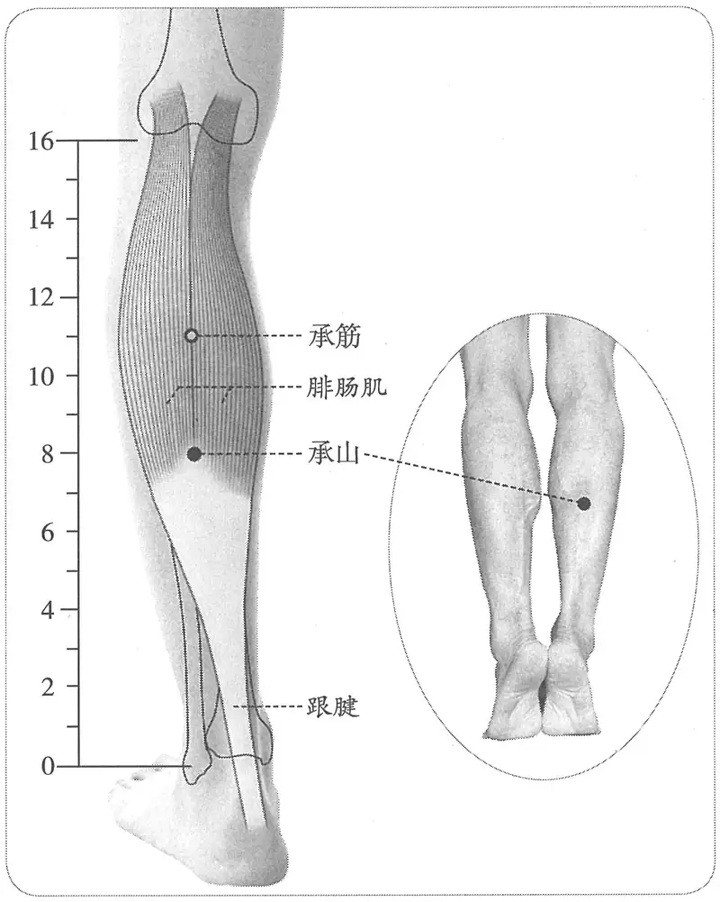

**图2-217　承山穴图**

**取穴**：伸直小腿或足跟上提时，腓肠肌肌腹下出现尖角凹陷中（即腓肠肌内、外侧头分开的地方，呈“人”字形沟）。

　1. 在兑腨肠下分肉间陷者中。（《黄帝明堂经》、《太平圣惠方·明堂》、《铜人腧穴针灸图经》、《圣济总录》、《针灸资生经》、《十四经发挥》、《医学纲目》、《针灸聚英》、《古今医统》、《针灸大成》、《类经图翼》、《循经考穴编》、《医宗金鉴·刺灸心法要诀》）

　2. 在兑腨肠下分肉间陷者中。定腹取之。（《太平圣惠方·针经》）

　3. 窦太师针灸遗存

　　(1) 在足兑腨肠下分肉间陷中，挺腹取之。（《窦太师针经》）

　　(2) 在兑腨肠下分肉间陷中。取法：在腿后分肉间用线一条自委中横文至足赤白肉际，拆中是穴。（《大本琼瑶神书》）

　　(3) 在足鱼腹下腹分肉间陷中，在仆参穴上八寸。（《窦太师秘传》）

　　(4) 在仆参上八寸，腿肚下分肉间。（《针灸玉龙歌》注）

　　(5) 广注：约仆参上八寸。（《循经考穴编》上）

　4. 一云腿肚下分肉间。《针经》云取穴须用两手高托按壁上，两足跟离地，用足大指尖竖起，上看足兑腨肠下分肉间。（《针灸聚英》卷一、《针灸大成》、《循经考穴编》）

　5. 在腿肚尖下分肉间陷中。（《神应经》）

〔p.768 (인쇄 748)〕

　6. 股下分肉间，拱足去地一尺取之。（《医学入门》卷一）

**按**：此所谓“拱足”，即高武所引之《针经》之法也。“去地一尺”出自《素问·刺腰痛》。

　7. 适当腨肠分肉之间陷中。（《针灸十四经穴位考订》）

　8. 统编针灸学教材

　　(1) 部位：在兑腨肠下分肉间陷者中。取穴：直立，两手上举按着墙壁，足尖站着足跟离地，在腓肠肌下出现人字纹下取之；或伏卧，下肢伸直，足掌挺而向上，其腓肠部现人字纹从其尖下取之。（1957年南京《针灸学》）

　　(2) 部位：小腿后面正中，腨肠下分肉间陷中。取穴：伏卧，足跟用力挺直，在腨下分肉间出现人字纹尖端下陷中取之。（1版《针灸学讲义》）

　　(3) 部位：在兑腨肠下分肉间陷者中。取穴：于腓肠肌肌腹下，伸小腿时，当肌腹下出现交角处取之。（2版《针灸学讲义》）

　　(4) 腓肠肌两肌腹之间凹陷的顶端。（4、5版《针灸学》）

　　(5) 在小腿后面正中，委中与昆仑之间，当伸直小腿或足跟上提时腓肠肌肌腹下出现尖角凹陷处。（6版《针灸学》）

　　(6) 在腓肠肌两肌腹之间凹陷的顶端处，约在委中穴与昆仑穴之间中点。（7版《针灸学》）

　　(7) 在腓肠肌肌腹下，委中与跟腱的连线上，约当委中下八寸处。（《中国针灸学》）

**文献分析**：本穴定位，《黄帝明堂经》所述之体表标志法，很明确，后世文献所说折量法皆未当，不从。高武引《针经》之取穴法甚当，至今沿用。

#### 【类属】 

足太阳膀胱经穴。

**归经**：足太阳膀胱经。（《千金要方》卷三十九、《铜人腧穴针灸图经》卷上）

#### 【适应症】 

主治腰腿拘急及痔疮病症。常用于腰背痛，小腿挛痛；痔疮，便秘。

　1. 主寒热篡反出。癫疾瘛疭。鼽衄，腰背痛，脚腨酸重，战栗不能久立，腨如裂，脚急跟痛，足挛，少腹痛引喉咽，大便难，䐜胀。霍乱转筋。（《黄帝明堂经》）

　2. 痔，胫不仁。（《医心方》卷二）

　3. 主脚弱无力，偏固不遂。（《太平圣惠方·针经》）

　4. 治腰背痛，脚腨重，战栗不能立，脚气，膝下肿，霍乱转筋，大便难，久痔肿痛。（《铜人腧穴针灸图经》卷下）

　5. 窦太师针灸遗存

　　(1) 治痔漏便血，藏毒，霍乱转筋，看症补泻。（《窦太师针经》）

　　(2) 治脏毒，便红，脱肛，九痔，两腿转筋。（《大本琼瑶神书》）

　　(3) 便血、脏毒。（《针方六集》卷五）

　　(4) 痔漏便毒。（《循经考穴编》上）

　6. 主急食不通，伤寒水结。（《针灸聚英》卷一、《针灸大成》）

**按**：此辑自《针经摘英集》针方，详见“附：临床应用举例”。

　7. 统编针灸学教材

　　(1) 主治腰痛，转筋，痔疾，大便难，脚气，膝肿，胫酸。（1957年南京《针灸学》、1版《针灸学讲义》）

　　(2) 主治腰痛，腿痛转筋，痔疾，便秘，脚气。（2版《针灸学讲义》、4版《针灸学》、《中国针灸学》）

〔p.769 (인쇄 749)〕

　　(3) 主治痔疾，脚气，便秘，腰腿拘急疼痛。（5版《针灸学》）

　　(4) 主治腰背痛，小腿转筋，痔疾，便秘，腰腿拘急疼痛。（6版《针灸学》）

　　(5) 主治：①腰腿拘急，疼痛；②痔疾，便秘。（7版《针灸学》）

#### 附：临床应用举例 

　1. 腰腿病症

　　(1) 治脚转筋，针内昆仑穴，在内踝后陷中，入六分，气至写之。又灸承山，随年壮神验。（《千金翼方》卷二十七）

　　(2) 苏恭云：脚气初发转筋者，灸承山、承筋二穴。（《外台秘要》卷十九）

　　(3) 脚步难行：曲池、承山，痛则针太冲。（《针灸玉龙经·盘石金直刺秘传》）

　　(4) 贫贱人久卧湿地，寒邪客于肾经，又兼下元虚损，寒湿下注，血脉凝滞，两腿粗肿，行步无力，渐至大如爪，方书皆以消湿利水治之，损人甚多。令灸涌泉、承山各五十壮，即愈。（《扁鹊心书》卷中）

　　(5) 霍乱转筋，灸承山灸二七壮，神效。又法中风，亦灸承山。（《医学纲目》卷十四）

　　(6) 肾虚腰痛：肾俞先提后摄针，搓搓捻捻用其心，委中气下出血愈，再补承山指内循。（《琼瑶神书》地部）

　　(7) 腰痛针承山，得气泻之立愈。（《医方类聚》卷九十四）

　　(8) 霍乱转筋：承山、中封。（《针灸大成》卷九）

　　(9) 筋转而疼，泻承山而在早。（《通玄指要赋》）

　　(10) 后跟痛在仆参求，承山转筋并九痔。（《灵光赋》）

　　(11) 转筋目眩针鱼腹，承山昆仑立便消。（《席弘赋》）

　　(12) 下肢发凉：针刺承山穴治疗。[陕西中医，1984，5(5)：37]

　2. 肛肠病症

　　(1) 五种痔疾，攻痛不已：合阳二穴、长强一穴、承山二穴。（《针灸大全》卷四）

　　(2) 九般痔疾最伤人，穴在承山妙入神，纵饶大痛呻吟者，一刺长强绝病根。（《针灸玉龙歌》）

　　(3) 五痔原因热血作，承山须下病无踪。（《肘后歌》）

　　(4) 脱肛：长强穴、承山穴、大肠俞，针灸治疗。[中国针灸，1986，6(6)：6]

　　(5) 痔疮：长强穴、承山穴针刺。[四川中医，1986，4(8)：42]

　　(6) 小儿直肠脱垂：长强穴、承山穴，针刺治疗。[广西中医药，1986(4)：48]

　　(7) 习惯性便秘：针刺承山穴治疗。[吉林中医药，1988(2)：24]

　3. 其他病症

　　(1) 肠痈之为病，不动摇，灸两承山；又灸足心、两手劳宫；又灸两耳后完骨。各随年壮。又灸脐中五十壮。（《千金要方》卷五）

　　(2) 胃心痛：腹胀胸满，或蛔结痛甚，蛔心痛也。巨阙、大都、太白、足三里连承山，各灸二七壮。（《针灸集要·杂穴治诸病秘法》）

　　(3) 胃痉挛：针刺承山穴治疗。[四川中医，1988，6(8)：41]

　　(4) 伤风，浑身发热，或拘急：泻曲池、承山、委中出血。（《针灸集要·盘石金直刺秘传》）

　　(5) 伤风。头项强，并失枕头项强疼：泻风池，更泻承山、委中出血妙。（《针灸集要·盘石金直刺秘传》）

〔p.770 (인쇄 750)〕

　　(6) 阴陵泉治心胸满，针到承山饮食思。（《席弘赋》）

　　(7) 打扑伤损破伤风，先于痛处下针攻，后向承山立作效，甄权留下意无穷。（《肘后歌》）

　　(8) 肩周炎：条口穴透承山针刺。[江西中医药，1996(增刊)：137]

　　(9) 痛经：针刺承山、三阴交治疗。[四川中医，2002，20(8)：78]

#### 【操作】 

直刺0.8~1.2寸。

　1. 刺入七分，灸五壮。（《黄帝明堂经》）

　2. 针入八分，得气即泻，速出针。灸亦得，然不及针。灸至七七壮止。（《太平圣惠方·针经》）

　3. 窦太师针灸遗存

　　(1) 平针入二寸半，灸三七壮。（《窦太师针经》）

　　(2) 平针二寸半，灸十七壮。（《大本琼瑶神书》）

　　(3) 一云可刺二寸五分，灸二七壮。（《循经考穴编》上）

　4. 针入七分，灸七壮。（《医学纲目》）

　5. 针七分，灸三壮。（《针灸十四经穴位考订》）

　6. 统编针灸学教材

　　(1) 针八分，依取穴法进针，灸五至十壮。（1957年南京《针灸学》、1版《针灸学讲义》）

　　(2) 直刺5~8分，艾条灸5~10分钟。（2版《针灸学讲义》）

　　(3) 直刺1~2寸。（4、5、7版《针灸学》）

　　(4) 直刺1~2寸；可灸。（6版《针灸学》）

　　(5) 直刺0.8~1.2寸。可灸。（《中国针灸学》）

　7. 直刺1~2.5寸。感应：局部酸胀，有时扩散至腘窝；治坐骨神经痛，深刺时有麻电感向足底放散。灸3~5壮；温灸5~15分钟。（上海《针灸学》）

### （五十八）飞扬 Fēiyáng BL58 出《灵枢》 

#### 【提要索隐】 

**穴名**：飞扬，一作“飞阳”，一作“蜚扬”；一名厥阳。

**部位**：在小腿后区，昆仑直上7寸，腓肠肌外下缘与跟腱移行处。

**适应症**：主治头面部、局部病症。常用于头痛，眩晕，鼻衄；腰痛，腿软无力；痔疮。颈椎前路手术、剖宫产手术针麻用穴。

**针刺操作**：直刺1~1.5寸。

**国标修订**：1990年版国标：在小腿后外侧，当昆仑穴直上7寸；或承山外下1寸处。2006年修订版：在小腿后区，昆仑直上7寸，腓肠肌外下缘与跟腱移行处。

**按**：飞扬穴的定位“昆仑穴直上7寸”，是确定的，而“承山外下方1寸”是基于“仆参上八寸”这一不确定说法而来，这样就会出现用这两个尺度折量而得到不同穴点，故新版国标删去了“承山外下方1寸”这一易引起矛盾且多余的取穴法。

#### 【名实考】 

飞扬，《灵枢》作“飞阳”，杨上善引别本作“蜚扬”，一名厥阳。《铜人腧穴针灸图经》误作“厥阴”。

需要注意的是，“飞扬”既是穴名，又是脉名。

　1. 足太阳之别，名曰飞阳，去踝七寸，别走少阴。实则鼽窒头背痛，虚则鼽衄，取之所别

〔p.771 (인쇄 751)〕

也。（《灵枢·经脉》）

　2. 杨上善曰此太阳络，别走向少阴经，迅疾如飞，故曰飞阳也。（《黄帝内经太素·十五络脉》）

　3. 飞扬，一名厥阳，在足外踝上七寸，足太阳络，别走少阴者。（《黄帝明堂经》）

　4. 此穴部在承山直下，而以在下之外踝上七寸为度，其离足少阴之经，尚有所隔，而此络将往通之，有飞扬之象，故曰飞扬。（《经穴解》）

#### “飞阳”之脉 

　1. 飞阳之脉，令人腰痛，痛上拂拂然，甚则悲以恐，刺飞阳之脉，在内踝上五寸。臣亿等按：《甲乙经》作“二寸”。（《素问·刺腰痛》）

　2. 飞扬之脉令人腰痛，痛上弗弗然，甚则悲以恐，刺飞扬之脉，在内踝上二寸太阴之前，与阴维会。足太阳别，名曰飞扬，有本飞作蜚。太阳去外踝上七寸，别走足少阴。当至内踝上二寸，足少阴之前，与阴维会处，是此刺处也。（《黄帝内经太素·腰痛》）

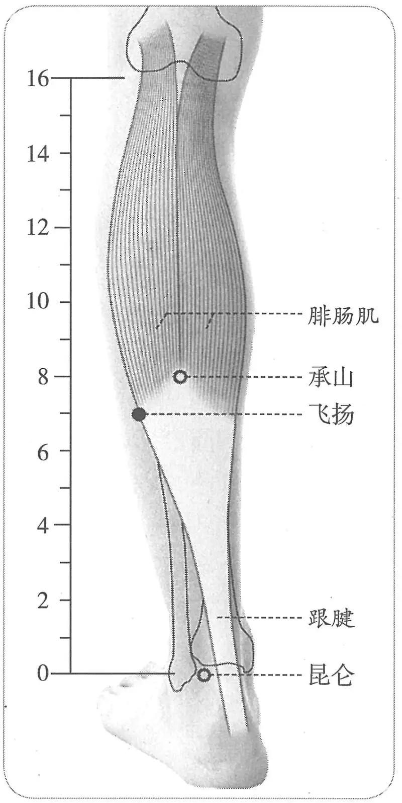

**图2-218　飞扬穴图**

#### 【定位】 

**部位**：在小腿后区，昆仑直上7寸，腓肠肌外下缘与跟腱移行处（图2-218）。

**取穴**：于承山外侧下方，当昆仑直上7寸处取之。

　1. 去踝七寸，别走少阴。（《灵枢·经脉》）

　2. 在足外踝上七寸。（《黄帝明堂经》、《太平圣惠方·针经》、《铜人腧穴针灸图经》、《十四经发挥》、《医学纲目》、《针方六集》、《循经考穴编》）

　3. 在外踝上七寸陷者中。（《太平圣惠方·明堂》）

　4. 在外踝上九寸。《明堂》、《千金》并云七寸。（《针灸资生经》卷一、《针灸大全》）

**按**：已知《针灸资生经》卷一腧穴部位皆据《铜人腧穴针灸图经》，今检《铜人腧穴针灸图经》卷上、中、下均作“七寸”，与诸书同，未详王执中所据何本。

　5. 别走少阴，在踝上九寸。（《针灸玉龙经》）

　6. 外踝上七寸，与承山平，向前一寸。（《大本琼瑶神书》）

　7. 外踝骨上七寸。（《针灸聚英》卷一、《古今医统》、《针灸大成》）

　8. 外踝上七寸骨后。（《医学入门》卷一）

　9. 在外踝上七寸，广注：一法承山下一寸半。（《循经考穴编》上）

　10. 在足外踝上七寸后陷中。（《类经图翼》卷七、《医宗金鉴·刺灸心法要诀》、《针灸逢源》）

　11. 昆仑直上七寸。（《针灸十四经穴位考订》）

　12. 统编针灸学教材

　　(1) 部位：在外踝骨上七寸，直对昆仑穴。取穴：正坐垂足着地，于外踝后直上七寸，当承山穴斜下外开约一寸取之。（1957年南京《针灸学》）

〔p.772 (인쇄 752)〕

　　(2) 部位：外踝骨上七寸。取穴：伏卧，于外踝后昆仑穴直上，当承山穴斜下外开约一寸取之。（1版《针灸学讲义》）

　　(3) 部位：在足外踝上七寸。取穴：于承山外侧下方，当昆仑上七寸处取之。（2版《针灸学讲义》）

　　(4) 昆仑穴直上7寸。（4版《针灸学》）

　　(5) 昆仑穴直上七寸，承山穴外下方。（5版《针灸学》）

　　(6) 在小腿后面，当外踝后昆仑直上7寸，承山外下方1寸处。（6、7版《针灸学》、《中国针灸学》）

**文献分析**：关于本穴定位，《针灸资生经》作“外踝上九寸”，而查其所据之蓝本《铜人腧穴针灸图经》各卷皆为“七寸”，则王执中传抄有误。至于后世文献所述之本穴与承山穴的位置关系，系基于后者不确定的折量定位法，皆不足据。

#### 【类属】 

足太阳膀胱经穴，络穴；足太阳所入。

　1. 足太阳之别，名曰飞阳，去踝七寸，别走少阴。（《灵枢·经脉》）

　2. 足太阳络，别走少阴者。（《黄帝明堂经》）

　3. 足太阳根于至阴，溜于京骨，注于昆仑，入于天柱、飞扬也。（《灵枢·根结》）

#### 【适应症】 

主治头面部、局部病症。常用于头痛，眩晕，鼻衄；腰痛，腿软无力；痔疮。颈椎前路手术、剖腹产手术针麻用穴。

　1. 主下部寒，热病汗不出，体重，逆气，头眩痛。痓，反折。疟，实则腰背痛，虚则鼽衄。间日作。癫狂疾，体痛。腰痛。颈项痛，历节汗出而步失履，寒，腹不仁，腨中痛。痔，篡痛。疟，不渴。（《黄帝明堂经》）

　2. 主身懈寒，少气，热甚恶人，心惕然，取飞阳及绝骨、跗上临泣。淫泺胫酸。（《外台秘要》卷三十九）

**按**：相关文字见于《素问·刺疟》：“足少阳之疟，令人身体解㑊，寒不甚，热不甚，恶见人，见人心惕惕然，热多汗出甚，刺足少阳”。“淫泺胫酸”见于《素问·骨空》：“淫泺胫痠，不能久立治少阳之维，在外踝上五寸”。此二条病症，《黄帝明堂经》皆属于“光明”穴主治，王焘误置于此。

　3. 主起坐不能步，脚腨酸重，战栗不能久立。（《太平圣惠方·明堂》）

　4. 治野鸡痔，历节风，足指不得屈伸，头目眩，逆气，鼽衄，癫疾，寒疟。（《铜人腧穴针灸图经》卷下）

　5. 统编针灸学教材

　　(1) 主治头痛，目眩，鼻塞鼽衄，腰脚痿软无力或肿痛，历节痛风，癫疾，发热汗不出。（1957年南京《针灸学》、1版《针灸学讲义》）

　　(2) 主治头痛，目眩，鼻塞，鼻衄，腰痛，腿软无力。（2版《针灸学讲义》、3版《针灸学》）

　　(3) 主治头痛，目眩，鼽衄，腰背痛，痔疾，腿软无力。（4版《针灸学》）

　　(4) 主治头痛，目眩，鼽衄，腰腿疼痛，痔疾。（5版《针灸学》）

　　(5) 主治头痛，目眩，鼻塞，鼻衄，腰背痛，腿软无力，痔疾，癫狂。（6版《针灸学》）

　　(6) 主治：①头痛，目眩；②腰腿疼痛；③痔疾。（7版《针灸学》）

　　(7) 主治头痛，目眩，鼻塞，鼻衄，腰背痛，痔疾，腿软无力。（《中国针灸学》）

#### 【操作】 

直刺1~1.5寸。

　1. 刺入三分，留十呼，灸三壮。（《黄帝明堂经》）

〔p.773 (인쇄 753)〕

　2. 灸五壮。（《太平圣惠方·明堂》）

　3. 统编针灸学教材

　　(1) 针五分至八分，灸三至七壮。（1957年南京《针灸学》、1版《针灸学讲义》）

　　(2) 直刺7~10分，艾条灸5~10分钟。（2版《针灸学讲义》）

　　(3) 直刺1~1.5寸。（4、5、7版《针灸学》）

　　(4) 直刺1~1.5寸；可灸。（6版《针灸学》）

　　(5) 直刺0.7~1.0寸。可灸。（《中国针灸学》）

　4. 直刺，1.5~2.5寸。感应：局部酸麻胀感或向下传导。灸3~7壮；温灸5~20分钟。（上海《针灸学》）

### （五十九）跗阳 Fūyáng BL59 出《黄帝明堂经》 

#### 【提要索隐】 

**穴名**：一名付阳；一名附阳。

**部位**：在小腿后区，昆仑穴直上3寸，腓骨与跟腱之间。

**适应症**：主治腰腿病症。常用于腰骶痛，下肢痿痹，足踝肿痛；头痛。颈椎前路手术针麻用穴。

**针刺操作**：直刺0.8~1.2寸。

#### 【名实考】 

关于本穴名称，针灸古籍多作“付阳”，又作“附阳”，义通。只有明刊本《针灸甲乙经》和《十四经发挥》有作“跗阳”者，与原“付阳”或“附阳”之义不合，而与足背部“跗阳脉”（又作“趺阳脉”）相重。宋臣校《素问》时已指出《针灸甲乙经》作“付阳”，明抄本《针灸甲乙经》同，则传世本“跗阳”必宋以后人所改也。又查最早的朝鲜刊本《十四经发挥》经穴图及穴歌作“付阳”，循经考穴部分作“附阳”；日本单行刻本，经穴图及歌作“附阳”，而正文已变作“跗阳”；而明刊《薛氏医案》本经穴图及穴歌作“付阳”，循经考穴部分皆作“跗阳”。反映出不同时期《十四经发挥》刊本从“付阳”、“附阳”再到“跗阳”过渡状况，皆说明早期刻本《十四经发挥》也不作“跗阳”。因此，本穴名称作“跗阳”，既缺乏文献依据，又与经穴部位不合，今后应恢复其本名，作“附阳”。

　1. 付阳，阳𫏋之郄，在足外踝上三寸，太阳前，少阳后，筋骨间。（《黄帝明堂经》）

　2. 此穴将近少阳，已有附阳之义，而阳𫏋之脉，又以为郄而上行，故曰附阳，言阳𫏋附太阳之穴而生也。（《经穴解》）

　3. 踝上横二穴。王冰注曰：外踝上，附阳穴也。附阳去外踝上同身寸之三寸，太阳前少阴后筋骨间，阳𫏋之郄，刺可入同身寸之六分，留七呼，若灸者可灸三壮。新校正云：按《甲乙经》“附阳”作“付阳”。（《素问·气穴论》）

#### “附阳”与“阳𫏋”穴辨 

“阳𫏋”作为穴名，见于《素问》，《千金翼方》、《太平圣惠方》更有穴名、定位、主治及刺法的详细描述（详见“申脉”穴），可明确判定乃“申脉”穴别名。而王冰注《素问》“阳𫏋”穴时，一作“申脉”，一作“附阳”，这使王执中大惑不解。

　1. 阴阳𫏋四穴，王冰注曰：阴𫏋穴，在足内踝下，是谓照海，阴𫏋所生，刺可入同身寸之四分，留六呼，若灸者可灸三壮。阳𫏋穴，是谓申脉，阳𫏋所生，在外踝下陷者中。（《素问·气穴论》）

〔p.774 (인쇄 754)〕

　2. 阴阳𫏋各一，王冰注曰：阴𫏋一，谓交信穴也。交信在足内踝上同身寸之一寸，少阴前太阴后筋骨间，阴𫏋之郄，刺可入同身寸之四分，留五呼，若灸者可灸三壮。阳𫏋一，谓附阳穴也。附阳在足外踝上同身寸之三寸，太阳前少阳后筋骨间，谨取之，阳𫏋之郄，刺可入同身寸之六分，留七呼，若灸者可灸三壮，左右四也。（《素问·气府论》）

　3. 《明下》云跗阳在外踝上二寸恐二字当作三后筋骨间宛宛中。灸五壮。《素问·气府论》阴阳𫏋各一，注云：阳𫏋谓跗阳穴也，在外踝上三寸，太阳前，少阳后，筋骨间，阳𫏋之郄。按：《素问·气府论》阳𫏋穴注云，谓跗阳穴也，在外踝上三寸。窃意，阳𫏋即跗阳也。及考《气穴论》阴阳𫏋四穴注云，阳𫏋穴是谓申脉，阳𫏋所出。则足阳𫏋乃申脉，非跗阳矣。故《明堂下经》即有跗阳在外踝上二寸，《上经》又有阳𫏋在外踝前一寸。一寸、二寸即异，是跗阳、阳𫏋各是一穴也。但不知《素问》之注何故前后相背耶。（《针灸资生经》卷一）

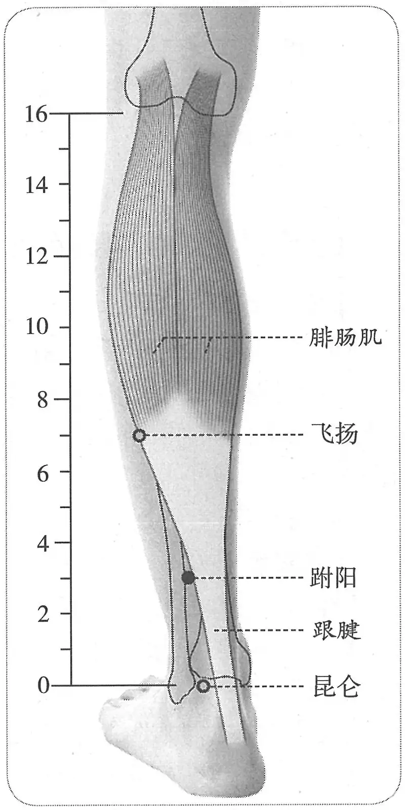

**图2-219　跗阳穴图**

#### 【定位】 

**部位**：在小腿后区，昆仑直上3寸，腓骨与跟腱之间（图2-219）。

**取穴**：从足外踝后昆仑穴直上3寸取之。

　1. 在足外踝上三寸。太阳前，少阳后，筋骨间。（《黄帝明堂经》、《铜人腧穴针灸图经》卷下、《圣济总录》、《针灸资生经》、《十四经发挥》、《医学纲目》、《针灸聚英》、《针灸大成》、《针方六集》、《类经图翼》、《循经考穴编》、《针灸易学》）

　2. 在外踝上二寸后，筋骨间宛宛中。（《太平圣惠方·明堂》）

**按**：王执中已言此“二寸”为“三寸”之误，其实此后还脱“太阳前，少阳”五字。

　3. 在外踝上三寸。（《铜人腧穴针灸图经》卷上及卷下“穴腧都数”）

　4. 在外踝上三寸，阳𫏋郄，太阳后，少阳前，筋骨间。（《针灸玉龙经》）

　5. 外踝上除踝三寸，阳𫏋郄，太阳前，少阳后，前筋间宛中分。（《大本琼瑶神书》）

　6. 在外踝上三寸，太阳前，少阳后，筋骨间。广注：昆仑上二寸。（《循经考穴编》上）

　7. 统编针灸学教材

　　(1) 部位：在外踝上三寸，直对昆仑穴。取穴：从足外踝骨后昆仑穴直上三寸取之。（1957年南京《针灸学》）

　　(2) 部位：在外踝后上三寸。取穴：从足外踝后昆仑穴直上三寸取之。（1版《针灸学讲义》）

　　(3) 部位：在足外踝上三寸。取穴：足外踝后昆仑直上三寸取之。（2版《针灸学讲义》）

　　(4) 昆仑穴直上3寸。（4、5、7版《针灸学》、《中国针灸学》）

　　(5) 在小腿后面，外踝后昆仑直上3寸。（6版《针灸学》）

〔p.775 (인쇄 755)〕

**文献分析**：关于本穴定位，《太平圣惠方》作“外踝上二寸”，其“二寸”系传抄之误。关于“除踝”折量，是所有以内踝、外踝为标志的所有穴的共性问题，详见“总论”。

#### 【类属】 

足太阳膀胱经穴；阳𫏋脉郄穴。

**脉气所发**：阳𫏋之郄。（《黄帝明堂经》）

**归经：**

　1. 足少阳胆经。（《千金要方》卷二十九、《千金翼方》）

　2. 足太阳膀胱经。（《外台秘要》卷三十九、《铜人腧穴针灸图经》卷上）

**按**：跗阳穴为“阳𫏋之郄”，位于“太阳前、少阳后、筋骨间”，不在足太阳脉循行线上，归入“阳𫏋脉”的理由很充分。初唐杨上善对《黄帝明堂经》349穴归经时，将奇经八脉所发之穴专立一卷，其实这一分类方法在杨上善之前就已经产生，例如六朝时期《产经》“十脉图”中便不见有奇经八脉穴。然而这种观点并未被唐以后医家所采纳，除任、督脉穴外，其他奇经穴皆分属于十二经之中。

#### 【适应症】 

主治腰腿病症。常用于腰骶痛，下肢痿痹，足踝肿痛；头痛。颈椎前路手术针麻用穴。

　1. 主痿厥，风头重，頞痛，枢股腨外廉骨痛，瘛疭，痹不仁，振寒，时有热，四肢不举。（《黄帝明堂经》）

　2. 主腰痛不能久立，屈伸难，坐不能起。（《太平圣惠方·针经》）

　3. 治痿厥风中痹，头重頞痛，髀枢股胻痛，瘛疭，风痹不仁，时有寒热，四肢不举。（《铜人腧穴针灸图经》卷下）

　4. 霍乱转筋。（《针灸聚英》卷一、《针灸大成》、《针方六集》、《类经图翼》）

　5. 主瘫痪，外踝红肿，寒湿脚气，两足生疮。（《循经考穴编》上）

　6. 统编针灸学教材

　　(1) 主治头重烦痛，腰尻髀枢痛，外踝红肿，瘫痪痿痹，时有寒热，霍乱转筋。（1957年南京《针灸学》）

　　(2) 主治头重颊肿，腰、尻、髀枢、股、胻痛，外踝红肿，瘫痪痿痹。（1版《针灸学讲义》）

　　(3) 主治头重，头痛，腰骶痛，外踝红肿，瘫痪。（2版《针灸学讲义》、4版《针灸学》、《中国针灸学》）

　　(4) 主治头痛，腰骶疼痛，下肢痿痹，外踝肿痛。（5、7版《针灸学》）

　　(5) 主治头重，头痛，腰腿痛，下肢瘫痪，外踝红肿。（6版《针灸学》）

#### 附：临床应用举例 

　1. 肩周炎，针刺跗阳穴为主治疗。[中国针灸，1995(增刊)：97]

　2. 急性腰肌扭伤，针刺跗阳穴治疗。[中国针灸，1998(5)：284]

　3. 股外侧皮神经炎，患侧跗阳穴为主针刺治疗。[针刺研究，1998(3)：215]

#### 【操作】 

直刺0.8~1.2寸。

　1. 刺入六分，留七呼，灸三壮。（《黄帝明堂经》）

　2. 灸五壮。（《太平圣惠方·明堂》）

　3. 可灸三壮，针入五分，留七呼。（《铜人腧穴针灸图经》卷下）

　4. 统编针灸学教材

　　(1) 针五分，灸三至五壮。（1957年南京《针灸学》、1版《针灸学讲义》）

　　(2) 直刺5~10分，艾条灸5~10分钟。（2版《针灸学讲义》）

〔p.776 (인쇄 756)〕

　　(3) 直刺0.8~1.2寸。（4、5、7版《针灸学》）

　　(4) 直刺0.8~1.2寸；可灸。（6版《针灸学》）

　　(5) 直刺0.5~1.0寸。可灸。（《中国针灸学》）

### （六十）昆仑 Kūnlún BL60 出《灵枢》 

问题1：内昆仑、外昆仑、上昆仑、下昆仑各是何穴，与本穴关系如何？今人有哪些误解？

问题2：昆仑穴与“足太阳”的关系为何？

#### 【提要索隐】 

**穴名**：别名有足太阳、巨阳、上昆仑、外昆仑。

**部位**：在踝区，外踝尖与跟腱之间的凹陷中。

**适应症**：主治头项及腰腿病症。常用于头痛，目痛，鼻衄；颈项强痛，腰痛，足踝肿痛；癫痫；难产。

**针刺操作**：直刺0.5~0.8寸。

#### 【名实考】 

《太平圣惠方》除载有“昆仑”穴外，另有“上昆仑”、“下昆仑”、“内昆仑”、“外昆仑”者，宋人已不能详，后人更难分辨。实则，“外昆仑”、“上昆仑”均为足太阳经穴“昆仑”穴的别名；“内昆仑”即足少阴经“太溪”穴别名；“下昆仑”则是奇穴，大约相当于申脉穴处。

　1. 膀胱出于至阴……行于昆仑，昆仑，在外踝之后，跟骨之上，为经。（《灵枢·本输》）

　2. 行于昆仑，昆仑者，火也。在足外踝后跟骨上陷者中，足太阳脉之所行也，为经。（《黄帝明堂经》）

　3. 中国之山，无大于昆仑者，太阳自睛明而下，所过之穴，其骨而峙起者，无如外踝之大也，既至小指之至阴为井而上行，亦无大于外踝者，故名以昆仑焉。凡《内经》部言名，而止言取太阳之经者，即此穴也。（《经穴解》）

#### “上昆仑”、“下昆仑”、“内昆仑”、“外昆仑”与“昆仑”穴辨 

对于《太平圣惠方》中四个以“昆仑”命名的腧穴，后人难以一一辨明，王惟一编《铜人腧穴针灸图经》时，即误将《太平圣惠方·明堂》“内昆仑”穴的主治症归入“昆仑”穴中。王执中也不明这些穴与足太阳经穴“昆仑”的关系：

　1. 《明堂》有上昆仑，又有下昆仑，《铜人》只云昆仑而不载下昆仑，岂《铜人》不全耶，抑名不同，未可知也。但《上经》云内昆仑在外踝下一寸，《下经》云内昆仑在内踝后五分。未知其孰是？予谓既云内昆仑，则当在内踝后矣。《下经》之穴为通，上昆仑在外踝故也。（《针灸资生经》卷一）

　2. 上昆仑二穴者，火也，足太阳脉之所行，为经也，在腕踝后跟骨上陷者中。（《太平圣惠方·针经》）

　3. 下昆仑二穴，一名内昆仑，在外踝下一寸大筋后内陷者宛宛中是穴……其穴蹲地旁引取之。（《太平圣惠方·针经》）

　4. 关元一穴……若怀胎必不针，若针而落胎，胎多不出，而针外昆仑立出。（《太平圣惠方·针经》）

　5. 小儿阴肿，灸内昆仑二穴各三壮。在内踝后五分筋骨间陷者中（《太平圣惠方·明堂》）。

〔p.777 (인쇄 757)〕

　6. 治脚转筋，针内昆仑穴，在内踝后陷中，入六分，气至泻之（《千金翼方》）

　7. 太溪二穴，在足内踝后跟骨上动脉中，灸三壮（《太平圣惠方·明堂》）

　8. 昆仑者，火也，在足外踝后跟骨上陷者中，足太阳脉之所行也，为经（《外台》）

　9. 昆仑二穴，在足外踝后跟骨上陷者中，灸三壮（《太平圣惠方·明堂》）

**按**：以上其中“上昆仑”即“昆仑”穴；“下昆仑”在外踝下一寸，与下面的“内昆仑”穴的部位明显不同，故原文中“一名内昆仑”应是“一名外昆仑”之误，也就是说，“下昆仑”即“外昆仑”；而“内昆仑”穴实际上相当于“太溪”穴。

《太平圣惠方》“上昆仑”、“下昆仑”、“外昆仑”穴均采自甄权《针经》，“内昆仑”见于《千金翼方》，其四者关系如下：足少阴经之“太溪”与足太阳经之“昆仑”，一阴一阳，内外正相对，故在内在阴之穴名“内昆仑”，在外在阳之穴名“外昆仑”。而“上昆仑”之名则与下方的“下昆仑”穴相对而言。“外昆仑”、“上昆仑”均指足太阳经穴“昆仑”；“下昆仑”则是奇穴，大约相当于申脉穴处。

#### “昆仑”与“足太阳”、“巨阳”穴辨 

　1. 足太阳经治阳，在足小指外侧本节后陷中。即束骨穴也。（《脉经》卷二）

　2. 第五针外踝下白肉际足太阳，名鬼路，火针七锃锃三下。即申脉穴也。（《千金要方》卷十四）

　3. 胞衣不出，针足太阳入四寸，在外踝下后一寸宛宛中。又针足阳𫏋，入三分，在足外踝下白肉际。（《千金翼方》卷二十六）

　4. 腰痛，灸巨阳十壮，巨阳在外踝下。（《千金要方》卷十九、《千金翼方》卷二十七）

　5. 足太阳，在外踝后宛宛中是。（敦煌卷子佚名灸方）

**按**：从《千金翼方》、敦煌卷子灸方来看，古穴名“足太阳”与昆仑穴相当，而《脉经》所述，乃束骨穴，则早期，昆仑、束骨二穴合称“足太阳”。至于或将足太阳或巨阳穴注作“申脉”穴者，当是“外踝下”脱“后”字，当据《千金翼方》补，申脉穴古称“阳𫏋”，而非“足太阳”。

#### “昆仑”与“仆参”穴相混例 

仆参，一名安邪。在跟骨下陷者中，拱足得之。足太阳脉之所行也，为经。刺入五分，留十呼，灸三壮。《刺腰痛论》注云陷者中，细动脉应手。（《针灸甲乙经》卷三）

**按**：“拱足得之”后脱“足太阳、阳𫏋脉所会。刺入三分，留六呼，灸三壮。行于昆仑，昆仑者，火也。在足外踝后跟骨上陷者中”一段，遂使“昆仑”穴的文字与本穴相混。后人以为昆仑穴内容脱失，又于“委中”后，据《素问·刺腰痛》王冰注补入该穴内容，大误。

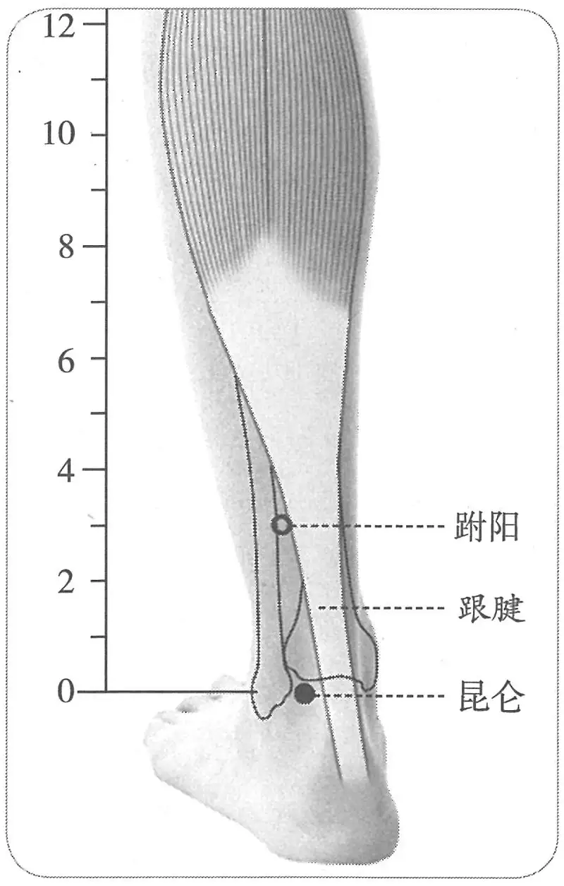

**图2-220　昆仑穴图**

#### 【定位】 

**部位**：在踝区，外踝尖与跟腱之间的凹陷中（图2-220）。

**取穴**：以指按取外踝尖后，在外踝与跟腱之中央凹陷部取之。

　1. 在外踝之后，跟骨之上。（《灵枢·本输》）

　2. 在足外踝后，跟骨上陷中。（《黄帝明堂经》、《太平圣惠方·针经》、《太平圣惠方·明堂》、《铜人腧穴针灸图经》、《圣济总录》、《针灸资生经》、《窦太师针经》、《十四经发挥》）

〔p.778 (인쇄 758)〕

　3. 在足外踝后跟骨上陷中，细脉动应手。（《素问·气穴论》王冰注、《针灸聚英》、《古今医统》、《针方六集》、《循经考穴编》）

　4. 在外踝后跟骨上，大筋后五分，细脉应手。（《针灸玉龙经》）

　5. 在足外踝后五分跟骨陷中。（《神应经》）

　6. 外踝后，跟骨上陷中动脉。（《医学入门》卷一）

　7. 足外踝后五分，跟骨上陷中，细脉动应手。（《针灸大成》卷六、《类经图翼》、《医宗金鉴·刺灸心法要诀》、《针灸逢源》）

　8. 在足外踝骨后下五分，足跟骨上陷中，动脉应手。（《针方六集》卷一）

　9. 广注当外踝骨尖子，过后跟去一寸动脉脉中，穴与太溪相对，针可相透。（《循经考穴编》上）

　10. 统编针灸学教材

　　(1) 部位：在足外踝后，跟骨上陷者中。取穴：以指从跗阳穴按下到达足跟处取之，适当外踝与跟腱之中央部分。（1957年南京《针灸学》）

　　(2) 部位：足外踝后五分。取穴：以指按取外踝尖后，跟间陷中取之。（1版《针灸学讲义》）

　　(3) 部位：在足外踝后，跟骨上陷者中。取穴：在外踝与跟腱之中央凹陷部取之。（2版《针灸学讲义》）

　　(4) 外踝与跟腱之间凹陷中。（4版《针灸学》、《中国针灸学》）

　　(5) 外踝高点与跟腱之间凹陷中。（5、7版《针灸学》）

　　(6) 在足部外踝后方，当外踝尖与跟腱之间的凹陷处。（6版《针灸学》）

#### 【类属】 

足太阳膀胱经穴；五输穴之经穴；足太阳所注。

　1. 膀胱出于至阴……行于昆仑，昆仑，在外踝之后，跟骨之上，为经。（《灵枢·本输》）

　2. 足太阳根于至阴，溜于京骨，注于昆仑，入于天柱、飞扬也。（《灵枢·根结》）

　3. 足太阳脉之所行也，为经。（《黄帝明堂经》）

#### 【适应症】 

主治头项及腰腿病症。常用于头痛，目痛，鼻衄；颈项强痛，腰痛，足踝肿痛；癫痫；难产。

　1. 主痓，脊强，头眩痛，脚如结，腨如裂。寒热。癫疾，目䀮䀮，鼽衄。疟，多汗，腰痛不能俯仰，目如脱，项如拔。大风，头多汗，腰尻腹痛，腨跟肿，上齿痛，脊背尻重不欲起，闻食臭，恶闻人音，狂易。女子字难，若胞衣不出。泄风从头至足。痫，瘛，口闭不能开，每大便腹暴满，按之不下，噫，悲，喘。（《黄帝明堂经》）

**按**：以上多为典型的足太阳经脉病候，特别是“是动”病症状：“脊强，头眩痛，脚如结，腨如裂”、“腰痛不能俯仰，目如脱，项如拔”。此外，还主治妇科病症。“腹暴满，按之不下”见于《素问·通评虚实论》：“腹暴满，按之不下，取手太阳经络者，胃之募也，少阴俞去脊椎三寸旁五，用员利针”。

　2. 厥心痛，与背相引，善瘈如疭，后触其心伛偻者，肾心痛也。脊强。（《外台秘要》卷三十九）

　3. 恶血，风气肿痛，脚肿。（《太平圣惠方·针经》）

　4. 多涕。（《太平圣惠方·明堂》）

　5. 治腰尻痛，足腨肿不得履地，鼽衄，脚如结，踝如裂，头痛，肩背拘急，咳喘暴满，阴肿痛，小儿发痫，瘛疭。（《铜人腧穴针灸图经》卷下）

〔p.779 (인쇄 759)〕

**按**：其中“阴肿痛”系录自《太平圣惠方·明堂》所载之“内昆仑”穴主治症。内昆仑穴相当于足少阴经“太溪”穴，与足太阳经“昆仑”穴不同。

　6. 窦太师针灸秘传

　　(1) 治腰尻胁肋疼，泻。左瘫右痪，半身不遂，四肢拘挛，外踝红肿，寒湿脚气，两生疮看证补泻。（《窦太师针经》）

　　(2) 治两腰腿疼拘挛。（《窦太师秘传》）

　7. 统编针灸学教材

　　(1) 主治头痛，项强，目眩痛，鼻衄，肩背拘急，腰痛不可俯仰，脚痛不能履地，小儿痫发瘛疭，难产，胞衣不下。（1957年南京《针灸学》、1版《针灸学讲义》）

　　(2) 主治头痛，项强，目眩，鼻衄，肩背拘急，腰痛，脚跟痛，小儿痫证，难产。（2版《针灸学讲义》、3版《针灸学》）

　　(3) 主治头痛，项强，目眩，鼻衄，肩背腰尻痛，脚跟肿痛，小儿痫证，难产，胞衣不下。（4版《针灸学》）

　　(4) 主治头痛，项强，目眩，鼻衄，癫痫，难产，腰骶疼痛，脚跟肿痛。（5版《针灸学》）

　　(5) 主治头痛，项强，目眩，鼻衄，疟疾，肩背拘急，腰痛，脚跟痛，小儿痫证，难产。（6版《针灸学》）

　　(6) 主治：①后头痛，项强，腰骶疼痛，足踝肿痛等痛证；②癫痫；③滞产。（7版《针灸学》）

　　(7) 主治头痛，目眩，项强，鼻衄，肩背腰腿痛，脚跟肿痛，难产，痫证。（《中国针灸学》）

#### 附：临床应用举例 

　1. 腰腿病症

　　(1) 阴痹者，按之而不得，腹胀腰痛，大便难，肩背颈项痛，时眩，取之涌泉、昆仑，视有血者尽取之。（《灵枢·五邪》）

　　(2) 腰痛不可忍，针昆仑及刺委中出血。（《素问病机气宜保命集》卷下）

　　(3) 治腰脊内引痛，不得屈伸，近上痛者，刺手阳明经合谷二穴；近下痛者，刺足太阳经昆仑二穴，次刺足少阴经伏白二穴。（《针经摘英集》）

　　(4) 足弱不能行：丘墟、行间、昆仑、太冲。问曰：此证缘何而得？答曰：皆因醉后行房，肾经受亏，以致足弱无力，不能行动。治法如此不效，复刺后穴：三里、阳辅、三阴交、复溜。（《针灸集成》第四十一方）

　　(5) 红肿脚气生疮：行间、三里、照海、昆仑、绝谷、京骨、委中。问曰：脚气之证缘何而得？答曰：皆因劳役过多，热汤泡洗，气血不散，故如此也。但针之不宜灸。复刺后穴：丘墟、昆仑。（《针灸集成》第四十三方）

　　(6) 穿根草鞋风：昆仑、丘墟、照海、商丘。问曰：此证缘何而得？答曰：皆因劳役过多，湿气流注，或因大热行路，凉水浸洗，故如此也。复刺后穴：太冲、解溪。（《针灸集成》第四十四方）两腿筋挛不伸：委中、昆仑。此证着地坐卧，风寒湿气侵入筋骨，以致筋紧不能舒缩。就地擦行。故针此穴，立起。（《针灸集成》第六十八方）

　　(7) 肾虚腰痛，灸而不已者：灸肾俞二七壮，补之，刺委中，未愈，刺昆仑。（《针灸集要·盘石金直刺秘诀》）

　　(8) 五种腰痛：泻尺泽，立效；未愈，昆仑。（《针灸集要·盘石金直刺秘诀》）

　　(9) 治中风、转筋拘急、行步无力疼痛。昆仑二穴，针五分，灸三壮。（《乾坤生意》下卷）

〔p.780 (인쇄 760)〕

　　(10) 大抵脚腕痛，昆仑解愈。（《通玄指要赋》）

　　(11) 脚跟红肿草鞋风，宜向昆仑穴上攻。（《针灸玉龙歌》）

　　(12) 腰背痛相连，委中昆仑穴。（《千金十一穴歌》）

　　(13) 犊鼻治疗风邪疼，住喘脚痛昆仑愈。（《灵光赋》）

　　(14) 转筋目眩针鱼腹，承山昆仑立便消。（《席弘赋》）

　　(15) 脚膝经年痛不休，内外踝边用意求，穴号昆仑并吕细，应时消散即时瘳。（《肘后歌》）

　　(16) 红斑性肢痛症：昆仑穴、三阴交穴，针刺治疗。[新中医，1986，18(7)：33]

　　(17) 急性腰扭伤：后溪穴、昆仑穴针刺治疗。[湖北中医杂志，1986(2)：43]

　　(18) 痹证：昆仑穴、养老穴，针刺。[中医函授通讯，1988(4)：40]

　2. 其他病症

　　(1) 癞，先上卵，引下其皮，以砭穿其脽旁；□□澧及膏□，挠以醇□。有(又)久(灸)其痏，勿令风及，易瘳；而久其泰阴、泰阳□□。（《五十二病方》）

**按**：“泰阳”在外踝后下，相当于昆仑穴。

　　(2) 厥心痛，与背相控，善瘛，如从后触其心，伛偻者，肾心痛也，先取京骨、昆仑，发狂不已，取然谷。（《灵枢·厥病》）

　　(3) (关元)若怀胎必不针，若针而落胎，胎多不出，而针外昆仑立出。（《太平圣惠方·针经》）

　　(4) 腹胀脐突，缺盆中满，尻腰肿：大敦、天牖、昆仑。（《医学纲目》卷二十四）

　　(5) 肩背胛痛：昆仑、悬钟、肩井。（《医学纲目》卷二十）

　　(6) 便毒痈疽：昆仑、承浆、三阴交。（《针灸大成》卷九）

　　(7) 昏厥症：针刺昆仑透太溪穴治疗。[陕西中医，1984，5(7)：45]

　　(8) 眉棱骨痛：昆仑穴针刺治疗。[中国针灸，1986，6(3)：41]

#### 【操作】 

直刺0.5~0.8寸。

　1. 刺入五分，留十呼，灸三壮。（《黄帝明堂经》）

　2. 针入五分，留十呼，灸二壮。（《太平圣惠方·针经》）

　3. 炷如小麦大，可灸三壮，针入三分。（《铜人腧穴针灸图经》卷下）

　4. 窦太师针灸遗存

　　(1) 横针透吕细穴，灸三七壮或五十壮。（《窦太师针经》、《针方六集》）

　　(2) 横针透吕细穴，灸二七壮，泻多补少。（《针灸玉龙歌》注）

　　(3) 针透太溪。（《窦太师秘传》）

　5. 统编针灸学教材

　　(1) 针五分至八分，依取穴法进针，针尖要对向前面之内踝前缘而进。(孕妇禁针)，灸三至七壮。（1957年南京《针灸学》、1版《针灸学讲义》）

　　(2) 直刺5分，艾条灸3~5分钟。（2版《针灸学讲义》）

　　(3) 直刺0.5~1寸。（4版《针灸学》）

　　(4) 直刺0.5~0.8寸。（5、7版《针灸学》）

　　(5) 直刺0.5~0.8寸；可灸。（6版《针灸学》）

　　(6) 直刺0.5~1.0寸。可灸。（《中国针灸学》）

　6. ①直刺，可透太溪，或略偏向外踝，深0.5~1寸。感应：有局部酸胀并向小趾放散。

〔p.781 (인쇄 761)〕

②斜刺，针尖向上透向跗阳穴，可治甲状腺肿大。深1~3寸。感应：局部酸胀可扩散至足跟或足趾，灸3~5壮；温灸5~15分钟。（上海《针灸学》）

### （六十一）仆参 Púcān BL61 出《黄帝明堂经》 

#### 【提要索隐】 

**穴名**：一名安邪，又写作“安耶”。

**部位**：在跟区，昆仑穴直下，跟骨外侧，赤白肉际处。

**适应症**：主治局部病症。常用于腰痛，下肢痿痹，腿痛转筋，足跟痛；癫痫。

**针刺操作**：直刺0.3~0.5寸。

#### 【名实考】 

仆参，一名安邪，《千金要方》、《外台秘要》、《医心方》皆作“安耶”。

本穴定位，《黄帝明堂经》曰“跟骨下陷者中”，再结合其取穴法“拱足得之”，可知其位于跟骨后正中下缘陷中。本穴为足太阳、阳𫏋交会穴，阳𫏋脉正是起于“跟中”。对此，《循经考穴编》说得再明白不过。然或受穴位归经的干扰，后世至今大多将本穴定于昆仑穴直下。

　1. 仆参，一名安邪，在跟骨下陷者中，拱足得之，足太阳、阳𫏋脉所会。（《黄帝明堂经》）

　2. 此穴紧在脚跟，主在前，而仆参在后，仆之所视，主之跟脚也，故曰仆参。参犹立则见其参于前也之义。（《经穴解》）

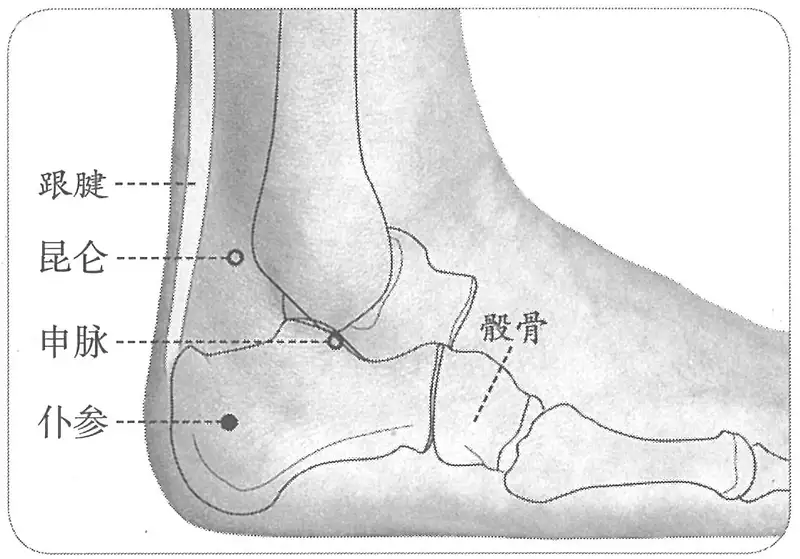

**图2-221　仆参穴图**

#### 【定位】 

**部位**：在跟区，昆仑直下，跟骨外侧，赤白肉际处（图2-221）。

**取穴**：外踝后下方，昆仑直下，当跟骨凹陷中之赤白肉际处取之。

　1. 《黄帝明堂经》

　　(1) 在跟骨下陷者中，拱足得之。（《针灸甲乙经》卷三、《外台秘要》、《素问·刺腰痛》王冰注、《医心方》、《太平圣惠方·明堂》、《铜人腧穴针灸图经》卷下、《圣济总录》、《针灸资生经》、《十四经发挥》、《医学纲目》、《针灸聚英》、《古今医统》、《针灸大成》、《类经图翼》、《循经考穴编》、《针灸易学》、《针灸逢源》）

　　(2) 在足跟骨下陷中。（《千金要方》卷二十九、《千金翼方》、《铜人腧穴针灸图经》卷上及卷下“穴腧都数”）

　2. 在足跟骨下白肉际陷者中，拱足得之。（《太平圣惠方·明堂》）

　3. 足后跟骨下陷中，拱足取之。（《医学入门》卷一、《针方六集》）

　4. 广注居后跟突骨下赤白肉际摺纹陷中。宜拱足而取。（《循经考穴编》上）

　5. 昆仑直下二寸许跟骨上。（《针灸十四经穴位考订》）

　6. 统编针灸学教材

　　(1) 部位：在跟骨下陷者中。取穴：从昆仑穴直下一寸五，当跟骨下陷中取之。（1957年南京《针灸学》）

〔p.782 (인쇄 762)〕

　　(2) 部位：昆仑穴下一寸五分。取穴：昆仑穴直下，当跟骨赤白肉际陷中取之。（1版《针灸学讲义》）

　　(3) 部位：在跟骨下陷者中。取穴：外踝后下方，昆仑直下，当跟骨凹陷中之赤白肉际取之。（2版《针灸学讲义》）

　　(4) 昆仑穴直下，赤白肉际。（4、5版《针灸学》）

　　(5) 在足外侧部外踝后下方，昆仑直下，跟骨外侧赤白肉际处。（6、7版《针灸学》）

　　(6) 外踝后下方，昆仑直下，当跟骨凹陷中，赤白肉际取之。（《中国针灸学》）

#### 【类属】 

足太阳膀胱经穴。

**脉气所发**：足太阳、阳𫏋脉所会。（《黄帝明堂经》）

**归经**：足太阳膀胱经。（《产经》、《千金要方》、《铜人腧穴针灸图经》）

**按**：本穴为“足太阳、阳𫏋脉所会”，《针灸甲乙经》附于足太阳经下，《产经》归入足太阳经，而之后的《黄帝内经明堂》仍将其归入奇经阳𫏋脉。

#### 【适应症】 

主治局部病症。常用于腰痛，下肢痿痹，腿痛转筋，足跟痛；癫痫。

　1. 主腰痛不可举足，跟中踝后痛，脚痿。癫疾僵仆，转筋。恍惚尸厥，头痛。暴霍乱。小儿马痫。（《黄帝明堂经》）

　2. 治足跟痛不得履地，脚痿转筋，尸厥如中恶状，霍乱吐逆，癫痫，狂言见鬼。（《铜人腧穴针灸图经》卷下）

　3. 窦太师针灸遗存

　　(1) 治冻疮，痰壅盛，头重如石，看症补泻。（《窦太师针经》）

　　(2) 主脚跟红肿、痰涎壅盛、头重如石。（《针方六集》卷五）

　　(3) 痰壅，头重如石。（《循经考穴编》上）

　4. 统编针灸学教材

　　(1) 主治尸厥，癫疾，转筋，腰痛，足痿不收，足跟痛。（1957年南京《针灸学》、1版《针灸学讲义》）

　　(2) 主治下肢痿弱，足跟痛，霍乱转筋，癫痫，脚气膝肿。（2版《针灸学讲义》、4、6版《针灸学》）

　　(3) 主治下肢痿痹，足跟痛，癫痫。（5、7版《针灸学》）

　　(4) 主治下肢痿痹，足跟痛。（《中国针灸学》）

#### 附：临床应用举例 

　1. 小儿马痫，张口摇头身反折，马鸣也，灸仆参二穴各三壮，在足跟骨下白肉际陷者中，拱足取之，炷如小麦大。（《太平圣惠方·明堂》）

　2. 后跟痛在仆参求，承山转筋并九痔。（《灵光赋》）

#### 【操作】 

直刺0.3~0.5寸。

　1. 刺入三分，留六呼，灸三壮。（《黄帝明堂经》）

　2. 针入三分，可灸七壮。（《铜人腧穴针灸图经》卷下）

　3. 统编针灸学教材

　　(1) 针二至三分，灸三至五壮。（1957年南京《针灸学》、1版《针灸学讲义》）

　　(2) 直刺3~5分，艾条灸3~5分钟。（2版《针灸学讲义》）

　　(3) 直刺0.3~0.5寸。（4、5、7版《针灸学》）

　　(4) 直刺0.3~0.5寸；可灸。（6版《针灸学》、《中国针灸学》）

〔p.783 (인쇄 763)〕

### （六十二）申脉 Shēnmài BL62 出《黄帝明堂经》 

#### 【提要索隐】 

**穴名**：别名：阳𫏋。

**部位**：在踝区，外踝尖直下，外踝下缘与跟骨之间凹陷中。

**按**：申脉穴为“阳𫏋脉所生”，归于阳𫏋脉理由充分，然而唐以后腧穴书皆归属于足太阳经。

**适应症**：主治头部病症。常用于头痛，眩晕；癫，狂，痫；腰腿脚痛。

**针刺操作**：直刺0.3~0.5寸。

#### 【名实考】 

本穴为“阳𫏋脉所生”，宋以前文献也径作“阳𫏋”穴，然《太平圣惠方》所载之“阳𫏋”穴定位及主治皆与本穴不同，当视作同名异穴。

　1. 申脉，阳𫏋所生也，在足外踝下陷者中，容爪甲。（《黄帝明堂经》）

　2. 太阳标为巨阳，本为寒水，故曰在上则为阳，在下则为水。水之长生在申，故此穴在足踝之下，以申脉名之，言其水所生之源也，其下穴即曰金门，亦金生水之义也。（《经穴解》）

#### “申脉”与“阳𫏋”穴辨 

　1. 阴阳𫏋四穴王冰注：……阳𫏋穴是谓申脉，阳𫏋所生，在外踝下陷者中。（《素问·气穴论》）

　2. 邪气客于足阳𫏋之脉，令人目痛从内眦始，刺外踝之下半寸所各二痏，左刺右，右刺左，如行十里顷而已（《素问·缪刺论》）

　3. 劳冷气逆，腰髋冷痹，脚屈伸难，灸阳𫏋一百壮，在外踝下容爪。（《千金要方》卷十一）

　4. 足阳𫏋，在足外踝下白肉际。（《千金翼方》卷二十六）

　5. 阳𫏋二穴，在外踝前一寸陷者宛宛中是穴。治脚气，肾气，妇人血气。针入三分。（《太平圣惠方·针经》）

**按**：以上《千金要方》、《千金翼方》所载“阳𫏋”穴均指足太阳经“申脉”穴，《千金要方》卷三十“孔穴主对法”也将申脉穴径称作“阳𫏋”。申脉穴系阳𫏋脉所生，故名之“阳𫏋”。需要特别注意的是，《太平圣惠方》所载之“阳𫏋”穴在外踝前一寸，与申脉穴不同，主治症也不相当，盖另有所本。

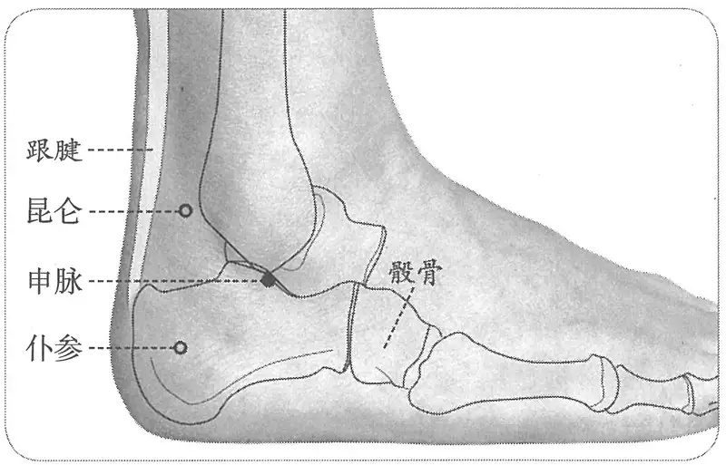

**图2-222　申脉穴图**

#### 【定位】 

**部位**：在踝区，外踝尖直下，外踝下缘与跟骨之间凹陷中（图2-222）。

**取穴**：外踝下方凹陷中，与照海内外相对。

　1. 外踝之下半寸所。王冰注：谓申脉穴，阳𫏋之所生也。（《素问·缪刺论》）

　2. 在足外踝下陷者中，容爪甲。（《黄帝明堂经》、《十四经发挥》、《医学纲目》、《循经考穴编》）

　3. 在外踝下同身寸之五分容爪甲。（《素问·刺腰痛》王冰注、《针灸聚英》、《古今医统》、《循经考穴编》）

　4. 在外踝下陷中。（《铜人腧穴针灸图经》卷上、卷下“穴腧都数”）

　5. 在外踝下陷中，容爪甲，白肉际。（《铜人腧穴针灸图经》卷下、《医学入门》）

〔p.784 (인쇄 764)〕

　6. 窦太师针灸秘传

　　(1) 在外踝骨下赤白肉际，容爪甲指陷中，垂脚取之。或侧卧取之。（《窦太师针经》）

　　(2) 在外踝骨尖下陷中，赤白肉际是穴。（《窦太师秘传》）

　　(3) 足外踝下陷中，容爪甲白肉际，踝骨下一横文如新月形。（《大本琼瑶神书》）

　　(4) 在足外踝骨节下，赤白肉际横纹。（《针灸玉龙歌》注）

　7. 在足外踝下赤白肉陷中。令病人垂脚坐取之，侧卧取亦得，合于后溪穴。（《针经指南》）

　8. 在外踝下陷中容爪甲，白肉际，前后有筋，上有踝骨，下有软骨，其穴居中。（《神应经》）

　9. 一方云取外踝尖下二寸，赤白肉际。（《针方六集》卷一）

　10. 在外踝下五分陷中，容爪甲，白肉际。（《针灸聚英》卷一、《针灸大成》、《类经图翼》卷七、《医宗金鉴·刺灸心法要诀》、《针灸易学》下、《针灸逢源》）

　11. 统编针灸学教材

　　(1) 部位：外踝下五分。取穴：外踝直下五分陷中，容爪甲白肉际，前后有筋，上有踝骨，下有软骨，其穴居中。（1957年南京《针灸学》）

　　(2) 部位：外踝下五分。取穴：外踝直下，以指切之后凹陷处取之。（1版《针灸学讲义》）

　　(3) 部位：在足外踝下陷者中。取穴：于外踝正下方凹陷中取之。（2版《针灸学讲义》）

　　(4) 外踝下缘凹陷中。（4、5版《针灸学》）

　　(5) 在足外侧部，外踝直下方凹陷中。（6版《针灸学》）

　　(6) 外踝直下方凹陷中。（7版《针灸学》、《中国针灸学》）

**文献分析**：本穴定位，《黄帝明堂经》用体表标志定位很明确，后世增加“五分”折量，也大致相当，但又说“白肉际”则位置过低，与“外踝下容爪甲”，显然不在同一位置。

#### 【类属】 

足太阳膀胱经穴；阳𫏋脉所生；八脉交会穴。

**脉气所发：**

　1. 申脉，阳𫏋所生也。（《黄帝明堂经》）

　2. 申脉二穴……合于后溪穴。（《针经指南》）

**归经**：足太阳膀胱经。（《产经》、《千金要方》、《铜人腧穴针灸图经》）

**按**：本穴阳𫏋脉所生，别名“阳𫏋”，《针灸甲乙经》附于足太阳经下，《产经》归入足太阳经，而之后的《黄帝内经明堂》仍将其归入奇经阳𫏋脉。

#### 【适应症】 

主治头部病症。常用于头痛，眩晕；癫，狂，痫；腰腿脚痛。

　1. 主腰痛不能举足，少坐若下车踬地，胫中矫矫然。寒热，颈腋下肿。癫狂互引，僵仆，申脉主之，先取阴𫏋，后取京骨。（《黄帝明堂经》）

　2. 治腰痛不能举体，足胻寒不能久立坐，若下舟车中，癫疾。（《铜人腧穴针灸图经》卷下）

　3. 窦太师针灸遗存

　　(1) 治一切寒湿脚气痛，看症补泻。（《窦太师针经》）

　　(2) 治脚心踭骨痛，脚气红肿，泻；脚弱无力麻木，泻后补。（《大本琼瑶神书》）

　　(3) 主脚踝红肿。（《循经考穴编》上）

　4. 主风眩，腰髋冷痹，脚膝屈伸难，劳极冷气，逆气。洁古曰：痫病昼发，灸阳𫏋。（《针灸聚英》卷一、《针灸大成》）

　5. 统编针灸学教材

　　(1) 主治痫病昼发，恶寒自汗，头痛，眩晕，腰脚酸痛，膝胻寒酸不能久立，如在舟中，以及妇人血气痛。（1957年南京《针灸学》）

〔p.785 (인쇄 765)〕

　　(2) 主治痫病昼发，癫狂，恶寒自汗，头痛，眩晕，腰部酸痛，膝胻寒酸乏力。（1版《针灸学讲义》）

　　(3) 主治痫证，癫狂，头痛，眩晕，腰腿酸痛。（2版《针灸学讲义》、4版《针灸学》）

　　(4) 主治头痛，眩晕，癫狂痫，腰腿酸痛，目赤痛，失眠。（5版《针灸学》）

　　(5) 主治痫证，癫狂，头痛，失眠，眩晕，腰痛，目赤痛，项强。（6版《针灸学》）

　　(6) 主治：①头痛，眩晕；②癫狂痫证，失眠等神志疾患；③腰腿酸痛。（7版《针灸学》、《中国针灸学》）

#### 附：临床应用举例 

　1. 头面病症

　　(1) 邪气客于足阳𫏋之脉，令人目痛从内眦始，刺外踝之下半寸所各二痏，左刺右，右刺左，如行十里顷而已。（《素问·缪刺》）

　　(2) 头风头痛，刺申脉与金门。（《标幽赋》）

　　(3) 金门申脉治头胸，重痛虚寒候不同。（《针灸玉龙歌》）

　　(4) 眼肌痉挛：针刺照海、申脉治疗。[吉林中医药，2001(4)：46]

　　(5) 落枕：针刺后溪、申脉治疗。[现代中西医结合杂志，2001，10(16)：1569]

　　(6) 枕神经痛：针刺申脉穴治疗。[河北中医，2002，24(8)：614]

　2. 腰腿病症

　　(1) 劳冷气逆，腰髋冷痹，脚屈伸难，灸阳𫏋一百壮，在外踝下容爪。（《千金要方》卷十一）

　　(2) 脚跟红肿草鞋风，宜向昆仑穴上攻，再攻太溪共申脉，此针三穴病相同。（《针灸玉龙歌》）

　　(3) 脚弱无力：公孙、三里、绝骨、申脉。（《针灸大成》卷九）

　　(4) 阴𫏋阳𫏋两踝边，脚气四穴先寻取。阴阳陵泉亦主之，阴𫏋阳𫏋与三里，诸穴一般治脚气，在腰玄机宜正取。（《灵光赋》）

　　(5) 急性腰扭伤：后溪、申脉针刺治疗。[实用医学杂志，1995，11(6)：415]

　　(6) 腰腿痛：取申脉、照海对穴针刺。[陕西中医，2001，22(3)：178]

　3. 其他病症

　　(1) 胎衣不出：又针足阳𫏋入三分，在足外踝下白肉际。（《千金翼方》卷二十六）

　　(2) 腋下肿，马刀夹瘿，喉痹：阳辅(五分，灸二七壮)、申脉(一分，灸三壮，立愈)。（《医学纲目》卷十九）

　　(3) 发作性睡病：补申脉、泻照海，针刺治疗。[中医杂志，1984，25(10)：53]

　　(4) 更年期不寐：针刺申脉穴为主治疗，并随证配穴。[中国民间疗法，2000，8(2)：9]

#### 【操作】 

直刺0.3~0.5寸。

　1. 刺入三分，留六呼，灸三壮。（《黄帝明堂经》）

　2. 刺可入同身寸之六分，留十呼，若灸者可灸三壮。（《素问·刺腰痛》王冰注）

　3. 窦太师针灸秘传

　　(1) 针入五分，灸二七壮。（《窦太师针经》）

　　(2) 横针寸半，灸七壮。（《窦太师秘传》）

　　(3) 刺半寸，泻多补少，禁灸。（《针灸玉龙歌》注）

　　(4) 窦氏针入一寸，灸二七壮。（《针方六集》卷一）

〔p.786 (인쇄 766)〕

　4. 针三分，禁灸。（《医学入门》卷一）

　5. 统编针灸学教材

　　(1) 针三分。（1957年南京《针灸学》）

　　(2) 针三分，不宜灸。（1版《针灸学讲义》）

　　(3) 直刺3分，艾条灸3~5分钟。（2版《针灸学讲义》）

　　(4) 直刺0.3~0.5寸。（4、5、7版《针灸学》）

　　(5) 直刺0.3~0.5寸；可灸。（6版《针灸学》、《中国针灸学》）

　6. 针尖向下斜刺0.3~0.5寸。感应：局部酸胀。灸3~5壮；温灸3~5分钟。（上海《针灸学》）

### （六十三）金门 Jīnmén BL63 出《黄帝明堂经》 

#### 【提要索隐】 

**穴名**：一名关梁。

**部位**：在足背，外踝前缘直下，第5跖骨粗隆后方，骰骨下缘凹陷中。

**适应症**：主治头部及腰腿病症。常用于头痛；腰痛，下肢痿痹，足踝痛；小儿惊风。颅脑外科手术（前颅窝）、颅脑外科手术（颞顶枕）、肺切除术针麻用穴。

**针刺操作**：直刺0.3~0.5寸。

#### 【名实考】 

金门，一名关梁。《针灸聚英》误倒作“梁关”。需要特别注意的是《千金要方》等书所载之“金门”与本穴非同一穴。

　1. 金门，一名关梁，足太阳郄，在足外踝下。（《黄帝明堂经》）

　2. 别名　梁关，关梁。（1957年南京《针灸学》）

#### 同名异穴“金门”辨 

　1. 治小儿暴痫，若腹满短气转鸣，灸肺募……次灸金门，金门在谷道、前囊之后当中央是也，从阴囊下度至大孔前，中分之。（《千金要方》卷五）

　2. 瘰疬之发于项耳之间，累累如贯珠者是也。法当灸金门二壮。掌后三寸半是穴。愚考金门穴，诸书不载，乃秘法也，甚效。（《痈疽神秘灸经》）

#### 【定位】 

**部位**：在足背，外踝前缘直下，第5跖骨粗隆后方，骰骨下缘凹陷中（图2-223）。

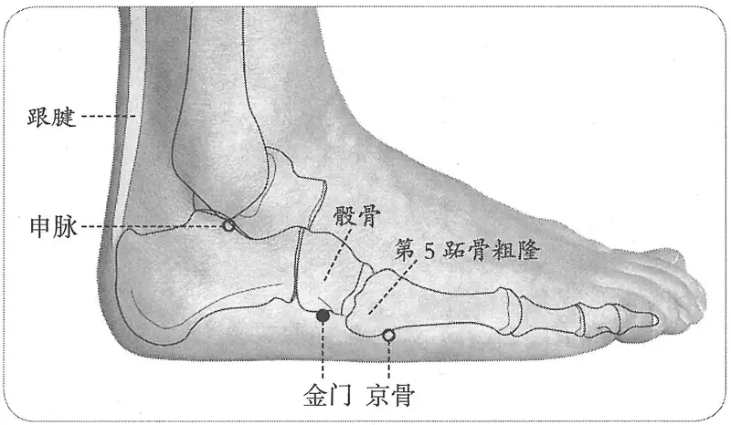

**图2-223　金门穴图**

〔p.787 (인쇄 767)〕

**取穴**：从申脉穴之前下方，当骰骨外侧凹陷处取之。

　1. 在足外踝下。（《黄帝明堂经》、《铜人腧穴针灸图经》、《圣济总录》、《针灸资生经》、《十四经发挥》、《医学纲目》、《针方六集》、《循经考穴编》）

　2. 窦太师针灸遗存

　　(1) 在足外踝下陷中。（《窦太师针经》）

　　(2) 在外踝跗骨下陷中。（《针灸玉龙歌》注）

　3. 在外踝下稍后，丘墟后，申脉前。（《神应经》、《针灸大成》、《针灸易学》）

　4. 外踝下，申脉下一寸。（《针灸聚英》卷一、《古今医统》、《医宗金鉴·刺灸心法要诀》）

　5. 在足外踝下一寸。（《类经图翼》卷七、《针灸逢源》）

　6. 广注合居丘墟之后，申脉之前，外踝下，贴踝陷中。（《循经考穴编》上）

　7. 申脉前五分骨下陷中。（《针灸十四经穴位考订》）

　8. 统编针灸学教材

　　(1) 部位：外踝下，胆经丘墟穴后，本经申脉穴前。取穴：从申脉穴之前下方五分，弯形陷中取之。（1957年南京《针灸学》）

　　(2) 部位：外踝下，胆经丘墟穴后，本经申脉穴前。取穴：从申脉穴之前下方五分，骨边弯形陷中取之。（1版《针灸学讲义》）

　　(3) 部位：在足外踝下。取穴：在申脉前下方，当骰骨外侧凹陷处取之。（2版《针灸学讲义》）

　　(4) 申脉穴前下方，当骰骨外侧凹陷中。（4、7版《针灸学》、《中国针灸学》）

　　(5) 申脉穴与京骨穴连线中点，当骰骨外侧凹陷中。（5版《针灸学》）

　　(6) 在足外侧，当外踝前缘直下，骰骨下缘处。（6版《针灸学》）

**文献分析**：本穴定位，《黄帝明堂经》说“在足外踝下”，与申脉穴的位置关系不甚明确。明代《神应经》谓本穴在“申脉前”，则本穴定于外踝前下方。

#### 【类属】 

足太阳膀胱经穴；足太阳经郄穴。

**脉气所发：**

　1. 足太阳郄。（《黄帝明堂经》）

　2. 足太阳郄，阳维所别属也。（《素问》王冰注、《铜人腧穴针灸图经》卷下）

　3. 足太阳郄，阳维别属。（《针灸聚英》卷一）

**归经**：足太阳膀胱经。（《外台秘要》卷三十九、《铜人腧穴针灸图经》卷上）

#### 【适应症】 

主治头部及腰腿病症。常用于头痛；腰痛，下肢痿痹，足踝痛；小儿惊风。颅脑外科手术（前颅窝）、颅脑外科手术（颞顶枕）、肺切除术针麻用穴。

　1. 主尸厥暴死。霍乱转筋。癫疾。小儿马痫。（《黄帝明堂经》）

　2. 治霍乱转筋，膝胻酸，身战不能久立，癫痫，尸厥，暴疝，小儿发痫，张口摇头，身反折。（《铜人腧穴针灸图经》卷下）

**按**：“小儿发痫，张口摇头，身反折”症，《太平圣惠方·明堂》载为“仆参”穴主治症，王惟一误录于此。

　3. 窦太师针灸遗存

　　(1) 治齿痛，泻；脚红肿，泻，宜三棱针出血。（《窦太师针经》）

　　(2) 主外踝疼，白虎历节风，牙齿痛。（《循经考穴编》上）

　4. 统编针灸学教材

　　(1) 主治癫痫，小儿惊风，外踝痛，膝胻痠，白虎历节风。（1957年南京《针灸学》、1版《针灸学讲义》）

〔p.788 (인쇄 768)〕

　　(2) 主治癫痫，小儿惊风，腰痛，外踝疼，下肢痹痛。（2版《针灸学讲义》、4版《针灸学》）

　　(3) 主治头痛，癫痫，小儿惊风，腰痛，下肢痿痹，外踝痛。（5版《针灸学》）

　　(4) 主治癫痫，小儿惊风，腰痛，下肢痹痛。（6版《针灸学》）

　　(5) 主治：①头痛，腰痛，下肢痿痹，外踝痛等痛证、痹证；②癫痫；③小儿惊风。（7版《针灸学》）

　　(6) 主治癫狂，痫证，小儿惊风，腰痛，外踝痛，下肢痹痛。（《中国针灸学》）

**文献分析**：宋代医官林亿校《千金要方》序曰：宋“惊风”之病名即古之“痫”。而教材中“痫证”、“小儿惊风”并见，今去其一。

#### 附：临床应用举例 

　1. 头风头痛，刺申脉与金门。（《标幽赋》）

　2. 金门申脉治头胸，重痛虚寒候不同。（《针灸玉龙歌》）

　3. 但患伤寒两耳聋，金门听会疾如风。（《席弘赋》）

　4. 疟疾寒热真可畏，须知虚实可用意。间使宜透支沟中，大椎七壮合圣治。连日频频发不休，金门刺深七分是。（《肘后歌》）

　5. 血管性偏头痛，针刺风池，金门治疗。[四川中医，1988，6(10)：45-46]

#### 【操作】 

直刺0.3~0.5寸。

　1. 刺入三分，灸三壮。（《黄帝明堂经》）

　2. 可灸三壮，炷如小麦大，针入一分。（《铜人腧穴针灸图经》卷下）

　3. 窦太师针灸遗存

　　(1) 横针入三分，灸七壮，或三壮。（《窦太师针经》）

　　(2) 针三分，直透申脉。泻实，补虚。灸二七壮。（《针灸玉龙歌》注）

　4. 统编针灸学教材

　　(1) 针三分，灸三至七壮。（1957年南京《针灸学》、1版《针灸学讲义》）

　　(2) 直刺5分，艾条灸3~5分钟。（2版《针灸学讲义》）

　　(3) 直刺0.3~0.5寸。（4、5、7版《针灸学》）

　　(4) 直刺0.3~0.5寸；可灸。（6版《针灸学》、《中国针灸学》）

　　(5) 直刺0.3~0.5寸。（7版《针灸学》）

### （六十四）京骨 Jīnggǔ BL64 出《灵枢》 

#### 【提要索隐】 

**部位**：在跖区，第5跖骨粗隆前下方，赤白肉际处。

**适应症**：主治头项、腰腿部病症。常用于头痛，颈项强痛，腰腿痛；癫痫。**新增**：鼻衄。

**针刺操作**：直刺0.3~0.5寸。

#### 【名实考】 

京骨，既是穴名，也是骨名。

　1. 膀胱出于至阴……过于京骨，京骨，足外侧大骨之下，为原。（《灵枢·本输》）

　2. 京骨，过于京骨，在足外侧大骨下赤白肉际陷者中，足太阳脉之所过也，为原。（《黄帝明堂经》）

　3. 京骨，谓外踝下近前高骨也。京，高大也。（《黄帝内经太素·经脉连环》卷八杨上善注）

〔p.789 (인쇄 769)〕

　4. 京，大也。小指本节后大骨名京骨，穴居其下。（《循经考穴编》上）

　5. 物之大者，多以京称之，小指后之骨，无有大于此者，故曰京骨。（《经穴解》）

#### 【定位】 

**部位**：在跖区，第5跖骨粗隆前下方，赤白肉际处（图2-224）。

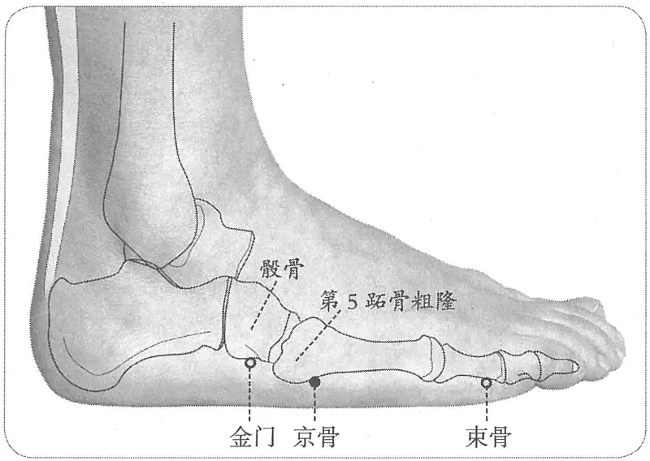

**图2-224　京骨穴图**

**取穴**：在足外侧缘，约当足跟与跖趾关节连线的中点处可触到明显隆起的骨，即第5跖骨粗隆。

　1. 足外侧大骨之下，为原。（《灵枢·本输》）

　2. 京骨，外踝之下也，为原。（《黄帝内经太素·本输》）

　3. 在足外侧大骨下，赤白肉际陷者中。（《黄帝明堂经》、《太平圣惠方·明堂》、《铜人腧穴针灸图经》、《圣济总录》、《针灸资生经》、《十四经发挥》、《针灸聚英》、《医学入门》、《针灸大成》、《针方六集》、《循经考穴编》、《针灸易学》）

　4. 在足外侧大骨下，赤白肉际陷中，按而得之。（《窦太师针经》）

　5. 在足小指外侧，本节后大骨下，赤白肉际陷中，可按而得。（《类经图翼》卷七、《针灸逢源》）

　6. 当以绳量小指至后跟中折取赤白肉际。（《循经考穴编》上）

　7. 足外侧大骨第五跖骨下，赤白肉际陷中，申脉前约三寸。（《针灸十四经穴位考订》）

　8. 统编针灸学教材

　　(1) 部位：足外侧大骨下赤白肉际陷中，小趾本节后大骨名京骨，其穴在骨下。取穴：按取足部外侧跖骨之突起部，在其前下部中取之。（1957年南京《针灸学》）

　　(2) 部位：小趾本节后大骨名京骨之下。取穴：金门穴之前，足外侧大骨下赤白肉际陷中取之。（1版《针灸学讲义》）

　　(3) 部位：在足外侧大骨下，赤白肉际陷者中。取穴：于足跗外侧，第五跖骨粗隆下，赤白肉际取之。（2版《针灸学讲义》）

　　(4) 第五跖骨粗隆下，赤白肉际。（4、5、6、7版《针灸学》、《中国针灸学》）

**文献分析**：古代文献对京骨的描述，相当第5跖骨粗隆，约当足跟与跖趾关节连线的中点处可触到明显隆起的骨，《循经考穴编》的折量取穴略偏前。

〔p.790 (인쇄 770)〕

#### 【类属】 

足太阳膀胱经穴；足太阳经原穴；足太阳所溜。

　1. 膀胱出于至阴……过于京骨，京骨，足外侧大骨之下，为原。（《灵枢·本输》）

　2. 足太阳根于至阴，溜于京骨，注于昆仑，入于天柱、飞扬也。（《灵枢·根结》）

　3. 足太阳脉之所过也，为原。（《黄帝明堂经》）

#### 【适应症】 

主治头项、腰腿部病症。常用于头痛，颈项强痛，腰腿痛；癫痫。**新增**：鼻衄。

　1. 主痎疟。寒热，善唏头重，足寒，不欲食，脚挛。癫疾，狂妄行，振寒。善自啮颊，偏枯，腰髀枢痛，善摇头。鼽衄血不止，淫泺头痛，目白翳，跟尻瘛疭，头肿痛，泄注，上抢心，目赤眦烂无所见，痛从内眦始，腹满，颈项强，腰脊不可俯仰，眩，心痛，肩背相引，如从后触之状，身伛偻。痓，目反，白多，鼻不通利，涕黄，便去血。痿厥，身体不仁，手足偏枯，先取京骨，后取中封、绝骨皆泻之。（《黄帝明堂经》）

**按**：以上所述多为足太阳经病候的典型症状，其中“(目)痛从内眦始”出于《素问·缪刺》“邪气客于足阳𫏋之脉，令人目痛从内眦始，刺外踝之下半寸所各二痏，左刺右，右刺左，如行十里顷而已”，阳𫏋穴为“申脉”，此条主治归于申脉穴主治更为贴切；心痛症状出于《灵枢》“肾心痛”，详见“附：临床应用举例”。

　2. 主善惊悸，腿膝胫痿，膝胫寒也。（《太平圣惠方·明堂》）

　3. 治膝痛不得屈伸，目内眦赤烂，发疟寒热，善惊，不欲食，筋挛，足胻酸，髀枢痛，颈项强，腰背不可俯仰，鼽衄血不止，目眩。（《铜人腧穴针灸图经》卷下）

　4. 窦太师针灸遗存

　　(1) 治红肿痛，两脚燥裂生疮，足心热。又太师云：血妄行者，鼻衄不止，灸之宜泻，立效。（《窦太师针经》）

　　(2) 主治脚气红肿燥裂。（《针方六集》卷五）

　　(3) 主寒湿脚气，两足燥裂，或湿痒生疮。（《循经考穴编》上）

　5. 主头痛如破，腰痛不可屈伸，身后痛，身侧痛。（《针灸聚英》卷一）

**按**：《洁古云岐针法》云：“治腰痛身之后者，取足太阳原穴；身之侧，取足少阳原穴”。此处应作“腰后侧痛”，删“身侧痛”三字。

　6. 统编针灸学教材

　　(1) 主治癫痫，头痛如破，项强，目赤白翳，鼻衄不止，腰足髀枢痛，寒热善惊。（1957年南京《针灸学》）

　　(2) 主治癫痫，头痛，项强，目眩，赤、白翳，鼻衄，腰、背、髀枢痛，疟疾，惊悸。（1版《针灸学讲义》）

　　(3) 主治癫痫，头痛，目翳，项强，腰髀痛，膝痛脚挛。（2版《针灸学讲义》、4版《针灸学》）

　　(4) 主治头痛，项强，目翳，癫痫，腰痛。（5版《针灸学》）

　　(5) 主治头痛，项强，腰腿痛，癫痫，目翳。（6版《针灸学》）

　　(6) 主治：①头痛，项强；②腰腿痛；③癫痫。（7版《针灸学》）

　　(7) 主治头痛，项强，腰腿痛，痫证。（《中国针灸学》）

**文献分析**：《灵枢·杂病》曰：“衄而不止衃，血流，取足太阳”。足太阳经病候也有“鼻衄”，《黄帝明堂经》“鼽衄血不止”确有所本，且窦太师针灸也谓“血妄行者，鼻衄不止，灸之宜泻，立效”。然除1版教材外，其他各版教材皆不录“鼻衄”症，今补之。

#### 附：临床应用举例 

　1. 厥心痛，与背相控，善瘛，如从后触其心，伛偻者，肾心痛也，先取京骨、昆仑，发狂不已，取然谷。（《灵枢·厥病》卷五）

〔p.791 (인쇄 771)〕

　2. 如脉浮而头痛，过在足太阳，刺腕骨、京骨。（《云岐子保命集论类要》卷上）

　3. 红肿脚气生疮，行间、三里、照海、昆仑、绝谷、京骨、委中。问曰：脚气之证缘何而得？答曰：皆因劳役过多，热汤泡洗，气血不散，故如此也。但针之不宜灸。复刺后穴：丘墟、昆仑。（《针灸集成》第四十三方）

　4. 头风，后溪、京骨。（《医学纲目》卷十五）

　5. 腰脊如痓，涌泉一分，阴谷一寸半，京骨一分，行间五分。（《医学纲目》卷二十八）

　6. 小儿急性腘肌损伤，合阳穴、京骨穴，针刺治疗。[中国针灸，1985，5(4)：48]

　7. 足背特多寻常疣，京骨穴、侠溪穴，针灸治疗。[新中医，1987，19(9)：36]

#### 【操作】 

直刺0.3~0.5寸。

　1. 刺入三分，留七呼，灸三壮。（《黄帝明堂经》）

　2. 灸五壮。（《太平圣惠方·明堂》）

　3. 先以左手按穴，刺可入三分，留三呼，进二分，留三呼，徐徐而出针，以手扪其穴也。（《素问亡篇·刺法论》）

　4. 刺入一分半，留三呼，乃进至三分，留一呼，徐徐出针，以手扪其穴也。（《素问亡篇·刺法论》）

　5. 针入三分，可灸七壮。（《铜人腧穴针灸图经》卷下）

　6. 横针入五分，灸七壮。（《窦太师针经》）

　7. 统编针灸学教材

　　(1) 针三至四分，灸三至七壮。（1957年南京《针灸学》、1版《针灸学讲义》）

　　(2) 直刺3~5分，艾条灸3~5分钟。（2版《针灸学讲义》）

　　(3) 直刺0.3~0.5寸。（4、5、7版《针灸学》）

　　(4) 直刺0.3~0.5寸；可灸。（6版《针灸学》、《中国针灸学》）

### （六十五）束骨 Shùgǔ BL65 出《灵枢》 

#### 【提要索隐】 

**部位**：在跖区，第5跖趾关节的近端，赤白肉际处。

**适应症**：主治头、项部病症。常用于头痛，恶风，眩晕；癫狂；颈项强痛，腰腿痛。

**针刺操作**：直刺0.3~0.5寸。

#### 【名实考】 

古穴名“足太阳”包含本穴，详见昆仑穴“名实考”。

　1. 膀胱出于至阴……注于束骨，束骨，本节之后，陷者中也，为腧。（《灵枢·本输》）

　2. 注于束骨，束骨者，木也。在足小指外侧本节后陷者中，足太阳脉之所注也，为输。（《黄帝明堂经》）

　3. 此穴在足之外侧本节后，足之各指骨，在内者碎而多，在外者无以束之，则散而不敛，太阳为一身之巨阳，下行至此，而在外束敛诸骨，故曰束骨。（《经穴解》）

#### 【定位】 

**部位**：在跖区，第5跖趾关节的近端，赤白肉际处（图2-225）。

**取穴**：按其小趾外侧本节之后赤白肉际陷中取之。

　1. 本节之后陷者中也。（《灵枢·本输》）

　2. 在足小指外侧本节后陷中。（《黄帝明堂经》、《太平圣惠方·明堂》、《铜人腧穴针灸

〔p.792 (인쇄 772)〕

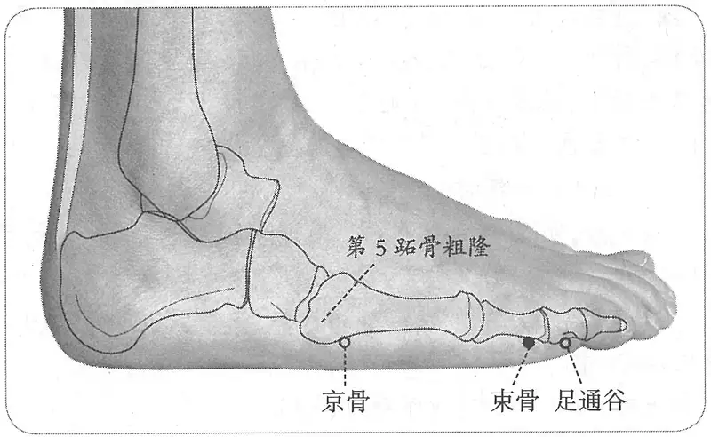

**图2-225　束骨穴图**

图经》卷上及卷下“穴腧都数”、《针灸资生经》、《十四经发挥》、《窦太师针经》、《医学入门》、《类经图翼》、《循经考穴编》）

　3. 在足小指外侧本节后赤白肉际陷者中。（《素问·刺腰痛》王冰注、《针灸聚英》、《古今医统》、《针灸大成》、《针方六集》、《针灸易学》）

　4. 在足下小指外侧本节后陷者中。（《太平圣惠方·明堂》）

　5. 在足小指本节后陷中。（《铜人腧穴针灸图经》卷下）

　6. 广注当取之骨后赤白肉际为真。（《循经考穴编》上、《医宗金鉴·刺灸心法要诀》、《针灸逢源》）

　7. 足小趾外侧，本节后白肉际陷中。（《针灸十四经穴位考订》）

　8. 统编针灸学教材

　　(1) 部位：足小指外侧本节后，赤白肉际陷中。取穴：按其小趾外侧本节之后陷中取之。（1957年南京《针灸学》）

　　(2) 部位：足小趾外侧本节后陷中。取穴：按其小趾外侧本节之后赤白肉际陷中取之。（1版《针灸学讲义》）

　　(3) 部位：足小趾外侧本节后陷中。取穴：于第五跖骨小头后下方，赤白肉际取之。（2版《针灸学讲义》）

　　(4) 第五跖骨小头后缘，赤白肉际。（4、5、7版《针灸学》）

　　(5) 在足外侧，足小趾本节第5跖趾关节的后方，赤白肉际处。（6版《针灸学》）

　　(6) 第五跖骨小头后下方，赤白肉际。（《中国针灸学》）

#### 【类属】 

足太阳膀胱经穴；五输穴之输穴。

足太阳脉之所注也，为输。（《黄帝明堂经》）

#### 【适应症】 

主治头、项部病症。常用于头痛，恶风，眩晕；癫狂；颈项强痛，腰腿痛。

　1. 主身痛，狂，善行，癫疾。寒热，腰痛如折。痓，惊，互引，脚如结，腨如裂。暴病头痛，身热痛，肌肉动，耳聋，恶风，目眦烂赤，项不可以顾，髀枢痛，泄，肠澼。疟从胻起。（《黄帝明堂经》）

　2. 主目眩。（《太平圣惠方·针经》）

　3. 惊痫。秦丞祖云：主风赤，胎赤，两目眦烂也。（《太平圣惠方·明堂》）

　4. 治腰如折，腨如结，耳聋，恶风寒，目眩，项不可回顾，目内眦赤烂。（《铜人腧穴针灸

〔p.793 (인쇄 773)〕

图经》卷下）

　5. 窦太师针灸遗存

　　(1) 治脚背红肿，泻；五指拘挛，看症补泻。（《窦太师针经》）

　　(2) 主本节肿疼，足心发热，宜弹针出血。（《循经考穴编》上）

　6. 主鼻衄，身黄。（《针方六集》卷五）

　7. 统编针灸学教材

　　(1) 主治癫狂，头痛，目眩，项强，目内眦赤烂，耳聋，腰背痛、尻如结、腨如裂，肠澼痔疾，热病恶风寒。（1957年南京《针灸学》）

　　(2) 主治癫狂，头痛，目眩，项强，目内眦赤烂，耳聋，腰、背、尻、腨疼痛，痢疾，痔疾，热病恶风寒。（1版《针灸学讲义》）

　　(3) 主治癫狂，头痛，项强，目眩，腰背及下肢后侧痛。（2版《针灸学讲义》、6版《针灸学》、《中国针灸学》）

　　(4) 主治癫狂，头痛，项强，目眩，腰背及下肢痛。（4版《针灸学》）

　　(5) 主治头痛，项强，目眩，癫狂，腰腿痛。（5、7版《针灸学》）

#### 附：临床应用举例 

　1. 腰胯疼痛，转侧艰难，痛入脾枢，补曲池，泻环跳；麻痒则补曲池、环跳、委中、束骨效。（《针灸集要·盘石金直刺秘传》）

　2. 腰闪挫气痛，尺泽忌灸、委中、人中、阳陵泉、束骨、昆仑、下窌。（《医学纲目》卷二十八）

#### 【操作】 

直刺0.3~0.5寸。

　1. 刺入三分，留三呼，灸三壮。（《黄帝明堂经》）

　2. 横针入三分或五分，灸七壮。（《窦太师针经》）

　3. 统编针灸学教材

　　(1) 针二至三分，灸三至七壮。（1957年南京《针灸学》、1版《针灸学讲义》）

　　(2) 直刺3分，艾条灸3~5分钟。（2版《针灸学讲义》）

　　(3) 直刺0.3~0.5寸。（4、5、7版《针灸学》）

　　(4) 直刺0.3~0.5寸；可灸。（6版《针灸学》、《中国针灸学》）

### （六十六）足通谷 Zútōnggǔ BL66 出《灵枢》 

#### 【提要索隐】 

**部位**：在足趾，第5跖趾关节的远端，赤白肉际处。

**适应症**：主治头项部病症。常用于头痛，颈项强痛，鼻衄；癫狂。

**针刺操作**：直刺0.2~0.3寸。

#### 【名实考】 

本穴，明以前文献皆作“通谷”，与腹部少阴经穴“通谷”同名，千百年来，人们因无法辨识，而常将此二穴相混。

　1. 膀胱出于至阴，至阴者，足小指之端也，为井金；溜于通谷，通谷，本节之前外侧也，为荥。（《灵枢·本输》）

　2. 流于通谷，通谷者，水也。在足小指外侧本节前陷者中，足太阳脉之所流也，为荥。（《黄帝明堂经》）

〔p.794 (인쇄 774)〕

　3. 谷者，水流之处；通者，水之初流未畅，资此窍以通之也。太阳为寒水，此其本也。井位金，以生本水，水流于谷而渐通。（《经穴解》）

#### 同名“通谷”穴辨 

　1. 癫疾呕沫，神庭及兑端、承浆主之；其不呕沫……尺泽、阳溪、外丘、当上脘旁五分通谷、金门、承筋、合阳主之。（《针灸甲乙经》卷十一第二）

**按**：据《针灸甲乙经》腧穴主治条文排列规律，可知此处“通谷”系足部太阳经穴，而古人不察，误断为腹部穴。

　2. 治痰饮法，诸结积，留饮澼囊，胸满饮食不消，灸通谷五十壮。（《千金要方》卷十八、《千金翼方》）

**按**：《医心方》卷九引此方下注曰“在幽门下一寸”。

　3. 《千金》云诸结积留饮，澼囊胸满，饮食不消，灸通谷五十壮。（《类经图翼》卷七）

**按**：根据此灸方主治病症，可知此“通谷”系腹部足少阴经穴，张介宾不察而误附于足部足太阳经穴“通谷”下。先于张氏，宋代王惟一也不能辨而误录此条于足通谷穴下。

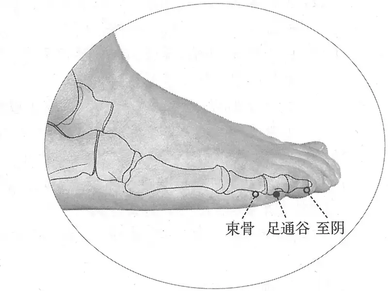

**图2-226　足通谷穴图**

#### 【定位】 

**部位**：在足趾，第5跖趾关节的远端，赤白肉际处（图2-226）。

**取穴**：从小趾外侧本节之前陷中，以趾屈之，当横纹之端取之。

　1. 本节之前外侧也。（《灵枢·本输》）

　2. 在足小指外侧，本节前陷者中。（《黄帝明堂经》、《铜人腧穴针灸图经》、《圣济总录》、《针灸资生经》、《窦太师针经》、《十四经发挥》、《针灸聚英》、《医学入门》、《针灸大成》、《针方六集》、《类经图翼》、《医宗金鉴·刺灸心法要诀》、《针灸易学》、《针灸逢源》）

　3. 统编针灸学教材

　　(1) 部位：小趾外侧本节前陷中，取穴：从小指外侧本节之前陷中，以趾屈之，当横纹之端取之。（1957年南京《针灸学》）

　　(2) 部位：小趾外侧本节前陷中，取穴：屈趾当横纹之端取之。（1版《针灸学讲义》）

　　(3) 部位：小趾外侧本节前陷中，取穴：在第五跖趾关节前下方凹陷处取之。（2版《针灸学讲义》）

　　(4) 第五跖趾关节前缘，赤白肉际。（4、5版《针灸学》）

　　(5) 在足外侧，足小趾本节（第5跖趾关节）的前方，赤白肉际处。（6版《针灸学》）

　　(6) 第5跖趾关节的前方，赤白肉际处。（7版《针灸学》）

　　(7) 第五跖趾关节前下方凹陷处。（《中国针灸学》）

#### 【类属】 

足太阳膀胱经穴；五输穴之荥穴。

足太阳脉之所流也，为荥。（《黄帝明堂经》）

#### 【适应症】 

主治头项部病症。常用于头痛，颈项强痛，鼻衄；癫狂。

〔p.795 (인쇄 775)〕

　1. 主身疼痛，善惊，互引，鼻鼽衄。狂癫疾。寒热，目䀮䀮，善咳喘逆。善唏，头眩项痛，烦满，振寒。痎疟。（《黄帝明堂经》）

　2. 治头重目眩，善惊，互引，鼽衄，颈项痛，目䀮䀮。甄权云：结积留饮，胸满食不化。（《铜人腧穴针灸图经》卷下）

**按**：以上引甄权云文字见于《千金要方》卷十八、卷三十、《千金翼方》卷二十七以及《医心方》卷九，乃“腹通谷”穴。宋以后针灸书皆沿袭《铜人腧穴针灸图经》之误，将此症归于足“通谷”穴中。

　3. 窦太师针灸遗存

　　(1) 治本节肿，心发热，五指疼，弹针出血；脚背红肿，锋针出血。（《窦太师针经》）

　　(2) 本节红肿疼肿，弹针出血。脚背红肿，锋针出血。（《针方六集》卷五）

　4. 主失欠。（《针灸聚英》卷一、《针灸大成》）

**按**：“失欠”一症乃据《针灸资生经》补辑，系误将“腹通谷”主治症抄于此。

　5. 统编针灸学教材

　　(1) 主治头重，项痛，目眩，鼽衄。（1957年南京《针灸学》、1版《针灸学讲义》）

　　(2) 主治头痛，项痛，目眩，鼽衄，癫狂。（2版《针灸学讲义》、5、6版《针灸学》）

　　(3) 主治头项痛，目眩，鼽衄，癫狂。（4版《针灸学》、《中国针灸学》）

　　(4) 主治：①头痛，项强；②鼻衄；③癫狂。（7版《针灸学》）

#### 【操作】 

直刺0.2~0.3寸。

　1. 刺入二分，留五呼，灸三壮。（《黄帝明堂经》）

　2. 横针入三分，灸七壮。（《窦太师针经》）

　3. 统编针灸学教材

　　(1) 针二至三分，灸三至七壮。（1957年南京《针灸学》、1版《针灸学讲义》）

　　(2) 直刺2分，艾条灸3~5分钟。（2版《针灸学讲义》）

　　(3) 直刺0.2~0.3寸。（4、5、7版《针灸学》）

　　(4) 直刺0.2~0.3寸；可灸。（6版《针灸学》、《中国针灸学》）

### （六十七）至阴 Zhìyīn BL67 出《灵枢》 

#### 【提要索隐】 

**部位**：在足趾，小趾末节外侧，趾甲根角侧后方0.1寸（指寸）。

**适应症**：主治头面部、胎产病症。常用于头痛，目痛，鼻塞，鼻衄；胎位不正，难产；足膝肿痛。

**针刺操作**：浅刺0.1寸。

#### 【名实考】 

《太平圣惠方》载灸足小指尖治妇人难产，窦太师针灸有“独阴”穴也治难产，本不是同一穴，后人不辨而多将此二穴相混。

　1. 膀胱出于至阴，至阴者，足小指之端也，为井金。（《灵枢·本输》）

　2. 膀胱出于至阴，至阴者，金也。在足小指外侧，去爪甲角如韭叶，足太阳脉之所出也，为井。（《黄帝明堂经》）

　3. 以其在最下也，故曰至阴。以其将传于少阴经也，亦曰至阴。（《经穴解》）

#### “至阴”与“独阴”穴辨 

　1. 独阴二穴，在足第二指节下横纹缝中。禁针，灸二七壮。治难产，胎衣不下，偏坠木肾，看症补泻。（《窦太师针经》）

〔p.796 (인쇄 776)〕

　2. 独阴二穴，在足第二趾下横纹中。是穴治小肠疝气，又治死胎，胎衣不下，可灸五壮。又治女人干哕呕吐。又治经血不时。（《奇效良方》卷五十五）

　3. 独阴，在足趾下横纹中按《捷法》云即至阴穴。当是足小指也。主治干呕吐，小肠疝气，死胎，胎衣不下。（《类经图翼》卷十）

　4. 妇人产难，不能分娩，三阴交穴、合谷二穴、独阴二穴即至阴穴灸之。（《针灸大全》卷四）

　5. 产妇胎衣不下及死胎不出者，独阴二穴。凡产妇人横生逆生难产者，急灸右脚小指尖头三壮即下，如神妙也。（《针灸捷径》卷下）

**按**：“独阴”穴，《窦太师针经》、《奇效良方》说得很清楚，与“至阴”非同一穴。《针灸大全》、《针灸捷径》注作“至阴”者，误。

#### 【定位】 

**部位**：在足趾，小趾末节外侧，趾甲根角侧后方0.1寸（指寸）（图2-227）。

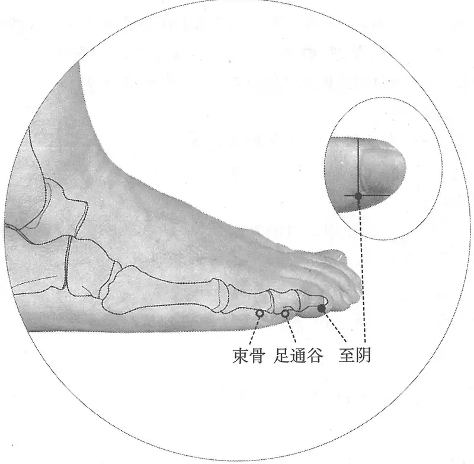

**图2-227　至阴穴图**

**取穴**：足小趾外侧甲根角侧后方（即沿角平分线方向）0.1寸。相当于沿爪甲外侧画一直线与爪甲基底缘水平线交点处取穴。

　1. 至阴者，足小指之端也。（《灵枢·本输》）

　2. 在足小指外侧，去爪甲角如韭叶。（《黄帝明堂经》、《铜人腧穴针灸图经》、《圣济总录》、《针灸资生经》、《针灸玉龙经》、《十四经发挥》、《针灸聚英》、《古今医统》、《医学入门》、《眼科龙木论》、《针灸大成》、《针方六集》、《类经图翼》、《循经考穴编》、《医宗金鉴·刺灸心法要诀》、《针灸易学》、《针灸逢源》）

　3. 足小指尖上。（《千金要方》卷二十四、《太平圣惠方》）

　4. 在足小指外侧，去爪甲角如韭叶，宛宛中。（《太平圣惠方·明堂》）

　5. 在足小指外侧，去爪甲如韭叶大。（《窦太师针经》）

〔p.797 (인쇄 777)〕

　6. 足小趾外侧，去爪甲角一分许。（《针灸十四经穴位考订》）

　7. 统编针灸学教材

　　(1) 部位：在足小趾外侧，去爪甲角如韭叶。取穴：足小趾外侧爪甲角取之。（1957年南京《针灸学》）

　　(2) 部位：足小趾外侧端。取穴：小趾爪甲角外侧约一分取之。（1版《针灸学讲义》）

　　(3) 足小趾外侧，距爪甲角后一分许取之。（2版《针灸学讲义》）

　　(4) 足小趾外侧趾甲角旁约0.1寸。（4、5版《针灸学》）

　　(5) 在足小趾末节外侧，距趾甲角0.1寸（指寸）。（6版《针灸学》）

　　(6) 在足小趾外侧趾甲根角旁0.1寸。（7版《针灸学》）

　　(7) 足小趾外侧，趾甲角后一分许。（《中国针灸学》）

**文献分析**：关于井穴定位的演变、“去爪甲角”的理解，以及“如韭叶”宽度的折算，详见“少商”穴分析。

#### 【类属】 

足太阳膀胱经穴；五输穴之井穴；足太阳之所根。

足太阳根于至阴，溜于京骨，注于昆仑，入于天柱、飞扬也。（《灵枢·根结》）

足太阳脉之所出也，为井。（《黄帝明堂经》）

#### 【适应症】 

主治头面部、胎产病症。常用于头痛，目痛，鼻塞，鼻衄；胎位不正，难产；足膝肿痛。

　1. 主头重鼻衄及瘛疭，汗不出，烦心，足下热，不欲近衣，项痛，目翳，鼻及小便皆不利。痎疟。寒热。疝。风寒从足小指起，脉痹上下带胸胁，痛无常处。（《黄帝明堂经》）

　2. 主小便淋，失精。（《太平圣惠方·明堂》）

　3. 治目生翳，鼻塞头重，风寒从足小指起，脉痹上下带胸胁，痛无常，转筋，寒疟，汗不出，烦心，足下热，小便不利，失精。（《铜人腧穴针灸图经》卷下）

　4. 窦太师针灸遗存

　　(1) 治眼红痛，泻；脚无力，补；难产，灸二七壮。（《窦太师针经》）

　　(2) 治眼目红肿疼痛。（《大本琼瑶神书》）

　　(3) 主妇人难产。（《针方六集》卷五）

　　(4) 治眼目红肿，脚气浮肿不消之症。（《窦太师秘传》）

　5. 主目痛，大眦痛。（《针灸聚英》卷一、《针灸大成》）

**按**：此乃高武辑自《洁古云岐针法》，原方云“眼痛大眦痛，刺手太阳井”，《素问病机气宜保命集》、《此事难知》同。

　6. 至阴穴，今时习用此治妇人寒证。（《类经图翼》卷七）

　7. 主胬肉攀睛，鼻窒，及寒湿脚气，两足生疮，宜弹针出血。（《循经考穴编》上）

　8. 统编针灸学教材

　　(1) 主治小便不利，风寒头重，鼻塞，目痛生翳，胸胁痛无常处，烦心，足下热，难产，失精。（1957年南京《针灸学》）

　　(2) 主治头风，鼻塞，鼻衄，目翳，胁肋痛，心烦，足下热，难产，失精，小便不利。（1版《针灸学讲义》）

　　(3) 主治头痛，鼻塞，鼻衄，目痛，足下热，胞衣不下，难产。（2版《针灸学讲义》、3版《针灸学》）

　　(4) 主治头痛，目痛，鼻塞，鼻衄，胎位不正，难产，胞衣不下。（4、6版《针灸学》、《中国针灸学》）

〔p.798 (인쇄 778)〕

　　(5) 主治头痛，目痛，鼻塞，鼻衄，胎位不正，难产。（5版《针灸学》）

　　(6) 主治：①胎位不正，滞产；②头痛，目痛；③鼻塞，鼻衄。（7版《针灸学》）

#### 附：临床应用举例 

　1. 妇产病症

　　(1) 张仲文救妇人横产，先手出，诸般符药不捷，灸妇人右脚小指尖头三壮，炷如小麦大，下火立产。（《太平圣惠方·明堂》）

　　(2) 妇人产难，子掬母心不能下：巨阙一穴、合谷二穴、三阴交穴、至阴二穴，灸效。（《针灸大全》卷四）

　　(3) 一治横逆难产，危在顷刻，符药不灵者，急于本妇右脚小指尖，灸三壮，炷如小麦，下火立产如神，盖此即至阴穴也。至阴三棱针出血，横者即转直。（《类经图翼》卷十一）

　　(4) 妇人通经泻合谷，三里至阴催孕妊。通经催生，俱宜泻此三穴。虚者补合谷，泻至阴。（《医学入门》卷一）

　　(5) 痛经：针刺至阴穴治疗。[中国民间疗法，1996(4)：24]

　　(6) 胎位不正：艾灸至阴穴纠正。[河北中医，1996，18(5)：40]

　　(7) 催产：针刺至阴等穴。[河南中医，2002，22(6)：75]

　2. 头面病症

　　(1) 膀胱发热风攻，两眼红肿，胬肉攀睛，拳毛倒睫：泻至阴，刺委中出血；未愈，泻足临泣、太阳出血，仍灸大小指骨空；未愈，泻睛明、行间，先补后泻。（《针灸集要·盘石金直刺秘传》）

　　(2) 鸡痫，摇头反折，善惊目摇：至阴、窍阴、厉兑各灸三壮，刺一分。（《杂病治例》）

　　(3) 眼赤肿疼痛：阳谷一分泻之、至阴。（《医学纲目》卷十三）

　　(4) 头目眩运：至阴。（《医学纲目》卷十一）

　　(5) 头面之疾针至阴。（《肘后歌》）

　　(6) 眉棱骨痛：针刺至阴穴治疗。[山东中医杂志，1999，18(10)：477]

　3. 其他病症

　　(1) 浑身发黄，四肢无力：灸至阴、委中出血。（《针灸集要·盘石金直刺秘传》）

　　(2) 委中专治腰间痛，脚膝肿时寻至阴。（《席弘赋》）

　　(3) 尿潴留：针刺井穴至阴治疗。[中国针灸，1995(3)：55]

#### 【操作】 

浅刺0.1寸。

　1. 刺入一分，留五呼，灸三壮。（《黄帝明堂经》）

　2. 针入二分，可灸三壮。（《铜人腧穴针灸图经》卷下）

　3. 针入一分，沿皮向后三分。（《窦太师针经》）

　4. 统编针灸学教材

　　(1) 针一分，针尖向上刺，灸三至五壮。孕妇禁灸。（1957年南京《针灸学》、1版《针灸学讲义》）

　　(2) 斜刺1分；艾炷灸3~5壮，艾条灸3~5分钟。（2版《针灸学讲义》）

　　(3) 浅刺0.1寸。（4版《针灸学》）

　　(4) 浅刺0.1寸。胎位不正用灸法。（5、6、7版《针灸学》）

〔p.799 (인쇄 779)〕

　　(5) 浅刺0.1寸。可灸。（《中国针灸学》）

　5. 斜刺向上，进针0.1~0.2寸，或点刺出血。感应：局部疼痛。灸3~5壮；温灸10~30分钟。（上海《针灸学》）

### 延伸阅读 

　1. 黄龙祥.中国针灸学术史大纲[M].北京：华夏出版社，2001.

　2. 黄龙祥.中国针灸史图鉴[M].青岛：青岛出版社，2003.

　3. 黄龙祥.新编重绘十四经脉经穴图[M].北京：中国中医药出版社，2010.

　4. 石崇俭.疼痛·阻滞与解剖[M].北京：人民卫生出版社；2006.

　5. 金经国.足太阳膀胱经股后循行及腧穴排列考辨[J].针灸临床杂志，1994，10(4)：30.

　6. 尹勇.攒竹穴在眼病中的临床运用[J].眼视光学杂志，1998，16(3)：178-179.

　7. 侯书伟.攒竹穴应用举隅[J].浙江中医杂志，2002(3)：117.

　8. 张俭欣.攒竹穴治疗眶上神经痛[J].牡丹江医学院学报，2000，21(1)：49.

　9. 邓春成.针刺天柱穴治疗腰痛1000例[J].四川中医，2002，20(1)：74-75.

　10. 吴泽森，刘芳稿，金舒白.上天柱、风池穴“气至病所”形态结构的研究[J].上海针灸杂志，1987(2)：28-30.

　11. 傅建宁.秩边穴治疗新用初探[J].云南医药，1990，11(2)：124-126.

　12. 傅建宁.针刺“秩边”穴治疗尿失禁一例报道[J].云南中医学院学报，1985，8(3)：33.

　13. 张远东.秩边穴的针刺法及其临床应用[J].针灸临床杂志，2002，18(4)：41.

　14. 乔晋琳，刘士杰.针刺“内秩边穴”为主治疗42例功能性阳萎临床研究[J].贵阳中医学院学报，1993(2)：51-52，63.

〔p.800 (인쇄 780)〕

〔p.801 (인쇄 773)〕

国家科学技术学术著作出版基金资助出版

针灸腧穴通考

——《中华针灸穴典》研究（下册）

◎黄龙祥　黄幼民　编著

◎协编　李素云　岗卫娟　谭源生　徐青燕

人民卫生出版社

〔p.802 (인쇄 774)〕

〔p.803 (인쇄 775)〕

〔p.804 (인쇄 776)〕

〔p.805 (인쇄 777)〕

〔p.806 (인쇄 778)〕

〔p.807 (인쇄 779)〕

〔p.808 (인쇄 780)〕

〔p.809 (인쇄 781)〕

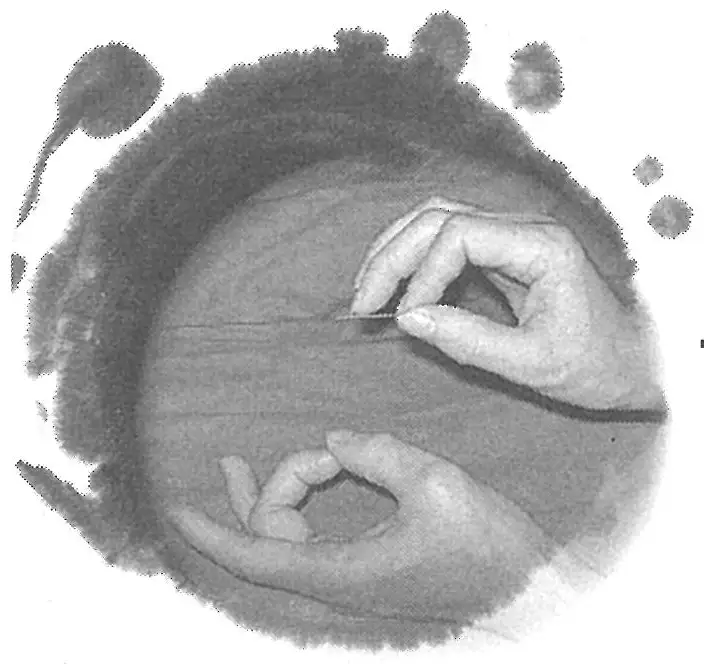

