# 《针灸腧穴通考》(下册) — 足少阴肾经穴  · （一）涌泉 Yǒngquán KI1 出《灵枢》~（二十七）俞府 Shūfǔ KI27 出《黄帝明堂经》

> 분할본 15/25. 원서: 黄龙祥·黄幼民 编著, 《针灸腧穴通考——〈中华针灸穴典〉研究》(下册), 人民卫生出版社, 2011. 원서 스캔 OCR 판독본을 챗봇 검색용으로 나눈 것이며, 본문과 쪽 표시 〔p.PDF쪽 (인쇄 쪽)〕는 원본 그대로이다.

## 八、足少阴肾经穴 

### 概说 

关于足少阴肾经的经脉循行、病候以及腧穴归经，古代文献记载变化不大；在经穴定位方面，最大的分歧在于下腹部穴距腹正中线的横向距离，共有8种不同的说法；在腧穴归经及流注次序方面，由于阴𫏋穴归入足少阴经，从而使得足少阴经穴在足踝部出现多种不同的接连法。

#### 【经脉与经穴】 

#### 经脉循行与病候 

肾足少阴之脉，起于小指之下，邪走足心，出于然谷之下，循内踝之后，别入跟中，以上腨内，出腘内廉，上股内后廉，贯脊，属肾，络膀胱；其直者，从肾上贯肝膈，入肺中，循喉咙，夹舌本；其支者，从肺出络心，注胸中。是动则病饥不欲食，面如漆柴，咳唾则有血，喝喝而喘，坐而欲起，目䀮䀮如无所见，心如悬若饥状，气不足则善恐，心惕惕如人将捕之，是为骨厥。是主肾所生病者，口热舌干，咽肿上气，嗌干及痛，烦心心痛，黄疸，肠澼，脊股内后廉痛，痿厥，嗜卧，足下热而痛。（《灵枢·经脉》）

少阴脉：系于内踝外廉，穿腨，出郄中央，上穿脊之内廉，系于肾，夹舌。是动则病喝喝如喘，坐而起则目䀮䀮如毋见，心如悬，病饥，气不足，善怒，心惕恐人捕之，不欲食，面黭若灺，咳则有血，此为骨厥。是少阴脉主治。其所产病：口热，舌坼，嗌干，上气，噎，嗌中痛，瘅，嗜卧，咳，喑，为十病。少阴之脉，灸则强食产肉，缓带，被发，大杖，重履而步，灸几息则病已矣。（《阴阳十一脉灸经》）

足少阴脉：出内踝娄中，上贯腨，入郄，出股，入腹，循脊内□廉，出肝，入胠，系舌□。其病：病足热，腨内痛，股内痛，腹街、脊内廉痛，肝痛。心痛，烦心，洇□□□舌辂□旦尚□□□数喝，牧牧嗜卧而咳。诸病此物者，皆灸足少阴脉。（《足臂十一脉灸经》）

**所属经穴**：涌泉　然谷　太溪　大钟　水泉　照海　复溜　交信　筑宾　阴谷　横骨　大赫　气穴　四满　中注　肓俞　商曲　石关　阴都　腹通谷　幽门　步廊　神封　灵墟　神藏　彧中　俞府

#### 【归经与起止穴】 

关于足少阴经穴的归经，宋以前文献不尽一致，自宋代王惟一重新厘定为二十七穴，宋以后皆从之。

〔p.810 (인쇄 782)〕

《针灸甲乙经》足少阴及股并阴𫏋四穴阴维二穴凡二十穴：涌泉、然谷、太溪、大钟、水泉、照海（阴𫏋穴）、复溜、交信（阴𫏋穴）、筑宾（阴维穴）、阴谷；杨上善则是将奇经穴单独分类，而不附属于十二经穴中。

《千金要方》、《千金翼方》足少阴肾经十一穴第六，在包括所有《针灸甲乙经》足少阴经七穴、阴𫏋二穴、阴维一穴的基础上，增加“会阴”一穴。

《外台秘要》归入“肾人”的经穴，除包括《针灸甲乙经》全部十穴外，另归入如下十七穴：俞府、彧中、神藏、神封、灵墟、步廊、幽门、通谷、阴都、石关、商曲、肓俞、中注、四满、气穴、大赫、横骨。

宋代《铜人腧穴针灸图经》重新厘定的“足少阴肾经穴”为二十七穴，与《外台秘要》相同。

会阴一穴，宋以后皆据《铜人腧穴针灸图经》归入任脉穴。

#### 足部足少阴经穴连接次序 

　1. 然谷—太溪—大钟—照海—水泉—复溜—交信：见日本东京博物馆铜人、明成化史素铜人图、明弘治丘濬铜人图、《针灸甲乙经》、《外台秘要》、《铜人腧穴针灸图经》卷上、《十四经发挥》、日本本间祥白十四经穴图、《骨度正误图说》。

　2. 然谷—太溪—大钟—水泉—照海—复溜—交信：见嘉靖铜人、韩国铜人、明太医院铜人图、明·赵文炳刊铜人图、《千金要方》、《千金翼方》、《铜人腧穴针灸图经》卷下、《针灸资生经》、明·施沛《经穴指掌图》、董德懋铜人图、1957年南京《针灸学》、程莘农《中国针灸学》。

　3. 然谷—太溪—水泉—大钟—照海—复溜—交信：见《铜人腧穴针灸图经》卷下“穴腧都数”。

　4. 然谷—照海—水泉—大钟—太溪—交信—复溜：见中国计量院人体经穴模型、朱琏《新针灸学》、中国中医研究院（现名中国中医科学院）1956年《针灸学》、《针灸学简编》、1966年英文版经穴图。

　5. 然谷—照海—太溪—水泉—大钟—复溜—交信：见《类经图翼》。

　6. 然谷—太溪—照海—大钟—水泉—交信—复溜：见元代《明堂图》。

按照《针灸甲乙经》卷七至十二的腧穴条文排列次序，足部少阴经穴依次为：然谷、照海、水泉、大钟、太溪。由此看来，以上第4种中国计量院经穴模型的排穴法值得重视。这一分歧的出现，主要是由人们对于腧穴归经的误解所引起。在唐以前，如唐代杨上善《黄帝内经明堂》、六朝《产经》脉图以及魏晋《针灸甲乙经》等经典文献中，奇经八脉穴均不归入十二经穴；又十五络穴原本也不属于经穴，其归入经穴完全可以采用分支连接的形式处理。如果去除“照海”、“交信”两个阴𫏋穴，络穴“大钟”用分支处理，那么然谷、水泉、太溪、复溜、筑宾……将连出一条非常流畅的经穴连线，就不会出现现在这种奇怪的绕圈和曲折线。

#### 【经穴定位与主治】 

腹部穴纵向距离的变化反映在腹部第一、二、三侧行。引起这种变化的原因主要是后世医家取穴完全依据《灵枢·骨度》尺寸作为周身各部折量取穴的基准尺度。但《黄帝明堂经》所载腧穴出自不同时期、不同医家，其不同部位的腧穴取穴尺度不一定相同，自然与《骨度》篇也不完全相合，若将两者不加区别地简单等同，必然会出现矛盾。为解决这些矛盾，便只好改动原来腧穴定位的尺寸数。

〔p.811 (인쇄 783)〕

至于腹部穴横向定位的差异，今据《千金要方》录之于下：

　1. 幽门，去巨阙两边各半寸，一云一寸。（卷十三，按：日本藏宋本正作“一寸”）

　2. 四满，夹丹田两旁相去三寸。（卷三、卷十六）

　3. 大赫，夹屈骨端三寸。（卷十九）

　4. 承满，夹巨阙相去五寸。（卷十八）

　5. 天枢，夹脐相去三寸。大法在脐旁一寸，合脐相去可三寸也。（卷十五）

　6. 归来，夹玉泉五寸。（卷三）

以上《千金要方》所载腹部穴横向定位与《黄帝明堂经》不同，出自隋唐诸家“明堂”（包括甄权针灸书）。分歧的原因除了各家的临床实践不同外，对于“去脐”、“合脐”折量的不同理解也是一个重要因素，正如宋以后由于对“去脊”、“合脊”折量的不同理解而引起背俞穴定位分歧的情况一样。

宋代《太平圣惠方》所载腹部肾经穴的横寸也与《黄帝明堂经》明显不同，原文如下：

　1. 幽门二穴，在巨阙旁各一寸半陷者中。（卷九十九）

　2. 通谷二穴，在夹上管两旁相去三寸是穴。（卷九十九）

　3. 阴都二穴，在胃管两旁各一寸半。（卷五十五）

以上腧穴距腹中行的尺寸均为一寸半，与《黄帝明堂经》所记“半寸”有较大的差异。旁开“一寸半”的定位法对宋代及宋以后的针灸书影响很大，例如南宋王执中即明确主张：腹部肾经穴旁开一寸半；五卷本《铜人腧穴针灸图经》卷四“幽门”穴部位“夹巨阙旁各五分”被后人改作“夹巨阙旁一寸五分”。然而，这一问题比较复杂，决不是将“五分”改作“一寸五分”就可以简单解决的。在研究这一问题时必须要考虑这样一个问题：如果认为“一寸五分”说比“五分”说更合理，那么，我们应当将腹部肾经穴中的脉气所发内容“冲脉、足少阴之会”做相应的改动，同时还要将腹部的胃经、脾经穴的横寸进行相应改动，更重要的是，所有这些穴的主治病症也应采用“一寸五分”学派所总结的内容，我们只能根据“一寸五分”的定位，进行大量、长期的临床观察，重新总结腹部穴的主治病症，而这绝非易事。所以，王惟一当年编《铜人腧穴针灸图经》时，对于腹部穴定位，并未采用《太平圣惠方》中肾经穴的定位法，这一方面是因为王氏是奉敕编书，不可能改动过多，另一方面《太平圣惠方》所载腹部穴定位本身也不统一，例如腹部胃经穴“天枢”部位仍作“夹脐两旁各二寸”，与《黄帝明堂经》同，并未改作“夹脐两旁各三寸”。

关于腹部穴横向尺寸，古代针灸文献、针灸图有以下8种说法：

　1. 肾经半寸、胃经一寸半、脾经三寸半。（明正统仿宋铜人、湖北博物馆铜人、日本东京博物馆铜人、明成化史素铜人图以及《针灸甲乙经》、《千金要方》、《外台秘要》、《铜人腧穴针灸图经》、《类经图翼》等）

　2. 上腹肾经半寸、胃经三寸；下腹肾经一寸半、胃经二寸，脾经四寸半。（《针灸聚英》）

　3. 肾经一寸半，胃经上腹部三寸、下腹部二寸，脾经四寸半。（《医学入门》）

　4. 上腹部肾经、胃经各一寸半，下腹部肾经、胃经各一寸；脾经四寸半。（《针灸大成》、明嘉靖铜人、赵文炳重刊铜人图、清光绪铜人）

　5. 肾经半寸，胃经上腹部三寸（正文作“任脉旁二寸五分”）、下腹部二寸，脾经四寸。（《针方六集》）

〔p.812 (인쇄 784)〕

　6. 上腹部肾经、胃经、脾经各一寸半，下腹部肾经、胃经各一寸，脾经三寸半。（《医统大全》腹部穴图、《针灸大成》腹部穴图、《循经考穴编》腹部穴图）

　7. 肾经、胃经、脾经各一寸半。（《针灸资生经》、《经穴指掌图》图）

　8. 上腹肾、胃、脾经各一寸半，下腹肾经五分、胃经二寸、脾经四寸半。（韩国德寿宫藏针灸铜人）

关于腹部穴横向定位，元以前文献较一致，至元代《十四经发挥》一书关于腹部穴的横向尺寸记载较混乱，且未作任何说明，使得后世医家难以取舍，于是根据各自的理解，取不同的说法，而造成了多种不同的定位方法。（表2-10）

**表 2-10　《十四经发挥》腹部穴横向定位**

| 足少阴 | 足阳明 | 足太阴 |
|---|---|---|
| ①四满：气海旁一寸。②肓俞，去脐旁五分。③自横骨至肓俞考之《资生经》，去中行各一寸半。 | ①自不容至滑肉门去中行各三寸。②自天枢至归来去中行各二寸。 | 冲门、府舍、腹结、大横、腹哀：去腹中行各四寸半。 |

滑氏上述定位法实在令人费解，仅足少阴经穴距中行的尺寸就有三种不同的说法，其中第一种说法见于《千金翼方》卷二十六，而相同的条文在《千金要方》卷三却作“一寸半”，《千金翼方》卷二十七也作“一寸半”，可见作“一寸”者系传抄之误；第三种说法引自《资生经》注文，正文仍作“五分”，与宋以前诸家文献同。可见，肾经穴距中线的距离只有两种，其中作“一寸半”者只是一家言，且未被系统论述，故北宋王惟一编定《铜人腧穴针灸图经》时，未采是说。此外，《十四经发挥》足阳明腹部穴距中行的距离也作不同处理，不知有何依据。高武在肾经穴定位上采用了《十四经发挥》第三种，即距中行“一寸半”说。若如此，则足阳明穴距肾经穴的距离只有五分，而足太阴经穴距足阳明经穴的距离却多达二寸五分，难以理解。后世医家各取《十四经发挥》一说，通过不同的组合法，而出现不同腧穴横向定位。

#### 【脉口病候、经脉是动病候与经脉穴主治】 

足少阴标脉：舌下两脉。

足少阴本脉：太溪脉（太溪穴所在）。

“足少阴”穴：太溪。

关于足少阴经脉的“是动”病（源出于足少阴脉口的诊断病候）与“足少阴”穴太溪主治病症的比较见表2-11。

**表 2-11　足少阴脉是动病候与经脉穴主治的相关性**

| 《阴阳十一脉灸经》是动病候 | 《灵枢·经脉》是动病候 | 《黄帝明堂经》经脉穴主治 |
|---|---|---|
| 是动则病喝喝如喘，坐而起则目䀮䀮如毋见，心如悬，病饥，气不足，善怒，心惕恐人捕之，不欲食，面黭若灺，咳则有血，此为骨厥。是少阴脉主治。 | 是动则病饥不欲食，面如漆柴，咳唾则有血，喝喝而喘，坐而欲起，目䀮䀮如无所见，心如悬若饥状，气不足则善恐，心惕惕如人将捕之，是为骨厥。 | 足少阴脉口处穴“然谷”主治：“不嗜食，心如悬……心惕惕恐如人将捕之，多涎出，喘，少气，吸吸不足以息……咳唾有血”；又照海穴主治“病饥不欲食”。 |

从表2-11对照可见，“足少阴”穴——太溪穴主治病症与经脉“是动”病相关程度很高，可以明显看出从诊脉、经脉病候而来的胎记。

〔p.813 (인쇄 785)〕

#### 【诊络病候、络脉病候与络穴主治】 

足少阴之别，名曰大锺，当踝后绕跟，别走太阳；其别者，并经上走于心包，下外贯腰脊。其病气逆则烦闷，实则闭癃，虚则腰痛，取之所别者也。（《灵枢·经脉》）

大钟，在足跟后冲中，别走太阳，足少阴络。实则闭隆，虚则腰痛，烦心闷。（《黄帝明堂经》）

《黄帝明堂经》载足少阴络穴“大钟”主治病症完整包含了《灵枢·经脉》足少阴络脉的诊络病候，可以十分清楚地看出两者源流脉络。

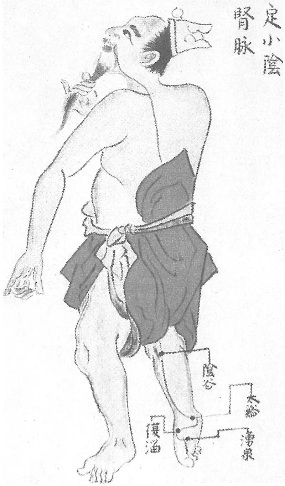

**图 2-228　《环中图》足少阴肾脉图**

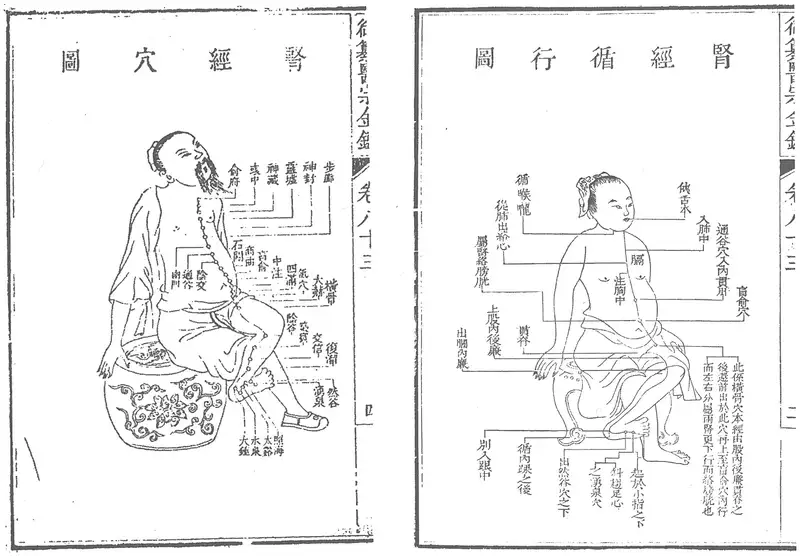

**图 2-229　《医宗金鉴》足少阴肾经脉、经穴分图**

〔p.814 (인쇄 786)〕

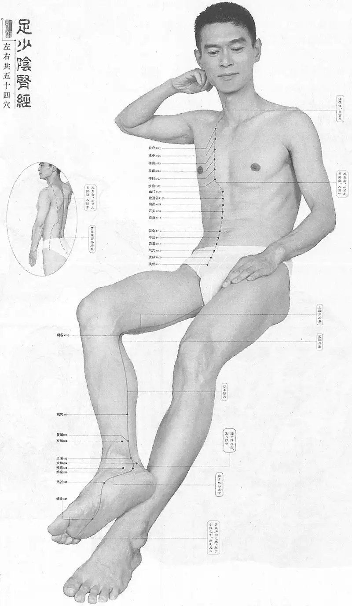

**图 2-230　黄龙祥编足少阴肾经脉、经穴合图**

〔p.815 (인쇄 787)〕

### （一）涌泉 Yǒngquán KI1 出《灵枢》 

#### 【提要索隐】 

**穴名**：一名地冲。

**部位**：在足底，屈足卷趾时足心最凹陷中。

**适应症**：主治热病，咽、腰及二阴病症。常用于发热、心烦，惊风；咽喉肿痛，咳嗽，气喘；足心热，腰脊痛；大便难，小便不利。

**备选适应症**：鼻衄，肺痨；癫痫；不孕。

**针刺操作**：直刺0.5~1寸。针刺不宜过深和刺激过强。

#### 【名实考】 

虽然“涌泉”穴名及定位见于《灵枢》，但此穴早已被发现并用于临床，《素问》、《灵枢》、《史记·扁鹊仓公列传》以及其他早期文献针灸方中“足心”、“足下中央之脉”等，皆为本穴。《素问》中还记载了本穴的取穴法。

　1. 肾出于涌泉者，涌泉者足心也，为井木……足少阴经也。（《灵枢·本输》）

　2. 取膝上外者使之拜，取足心者使之跪。（《素问·骨空论》）

　3. 肾出涌泉，涌泉者，木也，一名地冲。在足心陷者中，屈足卷指宛宛中。足少阴脉之所出也，为井。（《黄帝明堂经》）

　4. 穴名涌泉者，此穴受太阳、少阴之交，而趋足心，又将上行，肾为水也，故为泉，自足下上行，有涌泉之象也，故曰涌泉。（《经穴解》）

#### “涌泉”、“曲泉”穴相混例 

　1. 丈夫癞疝，阴跳痛引篡中不得溺，腹中支，胁下榰满，闭癃阴痿，后时泄，四肢不收，实则身热头痛，汗不出，目䀮䀮然无所见，怒欲杀人，暴痛引髌下节，时有热气，筋挛膝痛不可屈伸，狂如新发，衄，不食，喘呼，少腹痛引嗌，足厥痛，涌泉主之。（《针灸甲乙经》卷九第十一）

　2. 涌泉　丈夫癞疝，阴跳痛，篡中不得溺，腹䐜，胁下支满，闭癃，阴痿，后时少泄，四肢不举。实则身头痛，汗不出，目䀮䀮然无可见，怒欲杀人，暴痛引髌下节，时有热气，筋挛膝痛不可屈伸，狂如新发，衄，不食，喘呼，少腹痛引嗌，足厥痛。（《外台秘要》）

　3. 曲泉　癞疝，阴跳痛引脐中不得尿，阴痿，腹胁下支满，癃闭，后时少泄，四肢不举。实则身热头眩痛，汗不出，目䀮䀮，筋挛，膝不可屈伸，发狂，衄血，喘呼，少腹痛引喉咽。（《外台秘要》）

以上《针灸甲乙经》条文中“涌泉主之”系“曲泉主之”之误，这样的穴名错误如果发生在腧穴专书中，很容易被发现，而在像《针灸甲乙经》这种部位与主治分列的针灸书中，穴名抄错，则很难发现。《外台秘要》所据之《针灸甲乙经》本原文已误作“涌泉主之”，王焘亦未加考察，仍将此条主治症归入“涌泉”穴下。

#### 【定位】 

**部位**：在足底，屈足卷趾时足心最凹陷中（图2-231）。

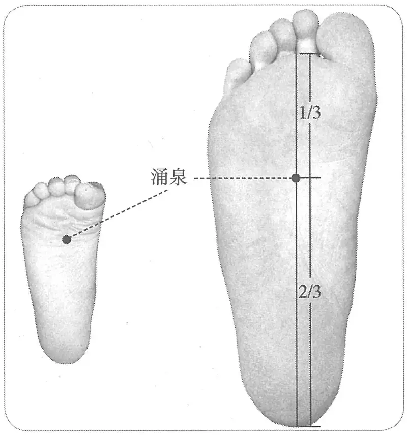

**图 2-231　涌泉穴图**

〔p.816 (인쇄 788)〕

**取穴**：卧位或伸腿坐位或跪取，卷足，约当足底第2趾蹼缘与足跟连线的前1/3与后2/3交点凹陷中。

　1. 涌泉者，足心也。（《灵枢·本输》）

　2. 在足心陷者中，屈足卷指宛宛中。（《黄帝明堂经》、《太平圣惠方·针经》、《素问亡篇·刺法论》、《铜人腧穴针灸图经》、《圣济总录》、《针灸资生经》、《窦太师秘传》、《十四经发挥》、《神应经》、《针经节要》、《医学入门》、《类经图翼》、《针灸逢源》）

　3. 甄权云在脚心底宛宛中，白肉际。（《外台秘要》卷三十九、《太平圣惠方·明堂》）

　4. 窦太师针灸遗存

　　(1) 在足底心陷中，屈足蹉指宛宛中，在足底第三缝中间线，于中指量至后跟，折中是穴。（《窦太师针经》）

　　(2) 在脚底心，转足三缝中。又以二指至足跟尽处折中是穴。（《针灸玉龙歌》注）

　　(3) 在脚底心陷中屈掌第三缝中是穴。（《大本琼瑶神书》）

　　(4) 足第三缝中，与大指本节平等。一方用线于中指量至后跟尽处，折中是穴。（《针方六集》卷一）

　　(5) 足心陷中，屈足卷指宛宛中，跪取之。（《针灸聚英》卷一、《古今医统》、《针灸大成》、《针方六集》、《针灸易学》）

　5. 针灸方腧穴定位

　　(1) 在足心下当拇指大筋上。（《千金要方》卷二十、《外台秘要》、《医心方》）

　　(2) 足踵聚筋上白肉际。（《千金翼方》卷二十七）

　　(3) 足掌心中央约当足的前五分之二处。（《针灸十四经穴位考订》）

　6. 统编针灸学教材

　　(1) 部位：在足心陷中，屈足卷指宛宛中。取穴：足底去跟取足掌部之中央处，以趾卷屈，在其中心发现凹陷处取之。（1957年南京《针灸学》）

　　(2) 部位：足心陷中。取穴：从足中趾至跟前三分之一处，或以趾卷屈时在脚心发现凹陷处取之。（1版《针灸学讲义》）

　　(3) 部位：在足心陷中，屈足卷指宛宛中。取穴：于足底去趾前1/3处，蹉足时呈凹陷处取之。（2版《针灸学讲义》）

　　(4) 足底中，足趾跖屈时呈凹陷处。（4版《针灸学》）

　　(5) 于足底去趾前1/3处，足趾跖屈时呈凹陷。（5版《针灸学》）

　　(6) 在足底部，卷足时足前部凹陷处，约当足底第2、第3趾趾缝纹头端与足跟连线的前1/3与后2/3交点上。（6版《针灸学》）

　　(7) 足趾跖屈时，约当足底去趾前1/3凹陷处。（7版《针灸学》）

　　(8) 在足底，足趾跖屈时呈凹陷处，约当足底去趾前1/3与后2/3交点。（《中国针灸学》）

**文献分析**：历代文献记载基本一致，均说在足心陷中，屈足时呈凹陷处。凹陷处，不在正足底中点而稍近前。嘉靖铜人上“涌泉”即在足底前部（约当前1/3处）凹陷中。故今人定为足底2、3趾缝纹头端与足跟连线的前1/3与后2/3的交点处，在第2、3跖骨之间，平对足大趾本节后。

#### 【类属】 

足少阴肾经穴；五输穴之井穴；足少阴之根。

　1. 肾出于涌泉者，涌泉者足心也，为井木……足少阴经也。（《灵枢·本输》）

〔p.817 (인쇄 789)〕

　2. 少阴根起于涌泉，名曰阴中之少阴。（《素问·阴阳离合论》）

　3. 少阴根于涌泉，结于廉泉。（《灵枢·根结》）

　4. 足少阴脉之所出也，为井。（《黄帝明堂经》）

#### 【适应症】 

主治热病，咽、腰及二阴病症。常用于发热，心烦，惊风；咽喉肿痛，咳嗽，气喘；足心热，腰脊痛；大便难，小便不利。

**备选适应症**：鼻衄，肺痨；癫痫；不孕。

　1. 主热病者，先腰痛胫酸，善渴数饮，身热，热争则项痛而强，胫寒且酸，足下热，不欲言，头痛颠颠然。腰痛，大便难，肩背颈痛，时眩。少腹中满一本作痛，小便不利。热中少气，厥寒，灸之热去，烦心不嗜食，咳而短气善喘，喉痹，身热痛，脊胁相引，忽忽善忘。足厥喘逆，足下清至膝。男子如蛊，女子如阻，身体腰脊如解，不欲食。妇人无子。咽中痛，不可内食。风入腹中，夹脐急，胸胁支满，衄不止，五指端尽痛，足不得践地。癫疾。瘖不能言。（《黄帝明堂经》）

**按**：以上病症虽似复杂，共性是多伴有足下、舌咽、腰脊、少腹部症状以及烦、咳、气短等足少阴经病候特异症状。其中“热病者……头痛颠颠然”系《素问·刺热》“肾热病”症状，原方取“刺足少阴、太阳”，故可见有大量足太阳经症状，取足少阴的主要依据为“足下热”；“男子如蛊，女子如阻，身体腰脊如解，不欲饮食”、“夹脐急”诸症见于《灵枢·热病》；“咽中痛，不可内食”见于《素问·缪刺论》；“腰痛，大便难，肩背颈项强痛，时眩”乃阴痹证，见于《灵枢·五邪》。原文皆详见于“附：临床应用举例”。

　2. 主小便不通，心中结热，脚底白肉际不得履地，刺风，疹风，风痫。（《太平圣惠方·针经》）

　3. 治腰痛，大便难，心中结热，风疹，风痫，心痛，不嗜食，妇人无子，咳嗽，身热，喉痹，胸胁满，目眩，男子如蛊，女子如妊娠，五指端尽痛，足不得践地。（《铜人腧穴针灸图经》卷下）

　4. 窦太师针灸遗存

　　(1) 传尸劳病最难医，涌泉穴内莫忧疑。注曰：伤寒劳瘵有血可疗，无则危，先补后泻。（《针灸玉龙歌》）

　　(2) 治脚气红肿，泻；传尸痨，针无血不可治。伤寒足底麻木及无汗，补；足底心热，补泻，禁灸。（《窦太师针经》）

　　(3) 治脚气红肿，入三分，留三呼，三壮，宜泻；若治传尸劳瘵，此穴无不可疗也。（《大本琼瑶神书》）

　　(4) 主尸厥。面黑如炭，咳吐有血，喝而喘，坐欲起，善恐，惕惕如人将捕之，舌干，咽肿，上气，嗌干，烦心，心痛，黄疸，肠澼，股内后廉痛，痿厥，嗜卧。善悲欠，舌急，转胞不得尿。（《针灸聚英》卷一、《针灸大成》）

**按**：以上“尸厥”症系高武从《针灸资生经》转录《千金要方》灸方主治；“面黑如炭……痿厥，嗜卧”此段文字悉为足少阴经病候，高武据其对“母子补泻”的理解，将足少阴病候归于本穴中；“转胞不得尿”系从《针灸资生经》辑自《千金要方》。

　　(5) 主肾家一切病，尸厥，癫风，冲头痛，足心热。（《循经考穴编》下）

　5. 统编针灸学教材

　　(1) 主治头顶痛，头眩，咽肿喉痹，咽干，喑不能言，鼻衄，咳嗽唾血，转胞不得尿，小便不利，大便难或泄泻，疝气，奔豚，水肿，股内后廉痛，小儿惊风，足心热。（1957年南京《针灸学》）

　　(2) 主治头顶痛，头旋，目昏花，心惕惕不安，咽肿喉痹，咽干，喑不能言，鼻衄，咳嗽唾血，转胞不得尿，大便难或泄泻，疝气，奔豚，水肿，股内后廉痛，小儿惊风，足心热，黄疸。（1版《针灸学讲义》）

〔p.818 (인쇄 790)〕

　　(3) 主治头顶痛，头眩，目昏花，咽喉痛，舌干，失音，小便不利，大便难，小儿惊风，足心热，癫疾，霍乱转筋。（2版《针灸学讲义》）

　　(4) 主治头痛目眩，头昏，咽痛，失音，小便不利，大便难，小儿惊风，足心热痛，癫疾。（4版《针灸学》）

　　(5) 主治头痛，头昏，失眠，目眩，咽喉肿痛，失音，便秘，小便不利，小儿惊风，癫狂，昏厥。（5版《针灸学》）

　　(6) 主治头痛，头晕，小便不利，便秘，小儿惊风，足心热，癫证，昏厥。（6版《针灸学》）

　　(7) 主治：①昏厥、中暑、小儿惊风、癫狂痫等急症及神志病患；②头痛，头晕，目眩，失眠；③咯血、咽喉肿痛、喉痹等肺系病证；④大便难，小便不利；⑤奔豚气；⑥足心热。（7版《针灸学》）

　　(8) 主治头痛，目眩，头昏，咽喉痛，舌干，失音，大便难，小便不利，小儿惊风，足心热，昏厥。（《中国针灸学》）

**文献分析**：《黄帝明堂经》本穴主治大多见于《内经》。1版教材明显受到高武《针灸聚英》错误的影响。

#### 附：临床应用举例 

　1. 热病、神志病症

　　(1) 仓公治热蹶方：刺其足心各三所，按之无出血，病旋已。（《史记·扁鹊仓公列传》）

　　(2) 热病挟脐急痛，胸胁满，取之涌泉与阴陵泉。（《灵枢·热病》）

　　(3) 尸厥。刺其足大指内侧爪甲去端入韭叶谓隐白穴，后刺足心谓涌泉穴，足少阴之井也，后刺足中指爪甲上各一痏……（《素问·缪刺论》王冰注、《全生指迷方》）

　　(4) 肠痈之为病，不动摇，灸两承山，又灸足心、两手劳宫，又灸两耳后完骨各随年壮，又灸脐中五十壮。（《千金要方》卷五上）

　　(5) 癫狂二三十年者，灸天窗，次肩井、次风门……次涌泉各五百壮，日七壮。（《千金翼方》卷二十七、敦煌医学卷子佚名灸方）

　　(6) 鸠尾能治五般痫，若下涌泉人不死。（《席弘赋》）

　2. 咽喉五官病症

　　(1) 邪客于足少阴之络，令人嗌痛，不可内食，无故善怒，气上走贲上，刺足下中央之脉，各三痏。（《素问·缪刺论》）

　　(2) 治喉痹刺足阳明经丰隆二穴，足少阴经涌泉二穴。（《针经摘英集》）

　　(3) 功能性失音：合谷穴、天突穴、涌泉穴针刺治疗。［上海针灸杂志，1987，6（4）：9］

　　(4) 衄，时痒痒……又灸涌泉二穴各百壮。（《千金要方》卷六、《千金翼方》）

　　(5) 治口疮，舌下肿难言，舌纵涎出，及舌根急缩，刺任脉廉泉一穴，一名舌本，在颔下结喉上。阳维之会，可灸三壮，针入三分，得气即泻，次针足少阴经涌泉二穴。（《针经摘英集》）

　　(6) 顶心头痛眼不开，涌泉下针是安泰。（《肘后歌》）

　3. 心胸病症

　　(1) 心中懊侬痛，针涌泉入三分。（《千金翼方》卷二十六）

　　(2) 心痛，针少阴经太溪、涌泉及足厥阴原穴。（《素问病机气宜保命集》卷下）

〔p.819 (인쇄 791)〕

　　(3) 又若心胸气满，已灸身胫诸穴，及服汤药，而气犹不下，烦急欲死者，宜灸两足心下当中陷处各七炷，气即下。（《外台秘要》卷十九）

　　(4) 伤寒结胸，身发黄：泻大陵，刺涌泉。（《针灸集要·盘石金直刺秘传》）

　　(5) 胸结身黄，取涌泉而即可。（《通玄指要赋》）

　　(6) 伤寒痞气结胸中，两目昏黄汗不通，涌泉妙穴三分许，速使周身汗自通。（《肘后歌》）

　　(7) 呃逆：针刺涌泉穴治疗。［上海中医药杂志，1996（7）：20］

　4. 腰腿病症

　　(1) 邪在肾，则病骨痛阴痹。阴痹者，按之而不得，腹胀腰痛，大便难，肩背颈项痛，时眩。取之涌泉、昆仑，视有血者尽取之。（《灵枢·五邪》）

　　(2) 男子如蛊，女子如阻，身体腰脊如解，不欲饮食，先取涌泉见血。（《灵枢·热病》）

　　(3) 治霍乱转筋诸方：灸脚心下，名涌泉。（《补辑肘后方》上卷）

　　(4) 转筋，灸涌泉六七壮，在足心下当拇指大筋上。（《千金要方》卷二十、《千金翼方》、《医心方》）

　　(5) 又治转筋方：灸涌泉，涌泉在脚心下，当大踇指大筋，灸七壮。亦可灸大都，在足大踇指本节内侧白肉际，灸七壮。（《外台秘要》卷十六）

　　(6) 疗转脚筋及入腹方：随所患脚大拇指，灸当脚心急筋上七壮。（《医心方》卷八）

　　(7) 脚气少力，或顽麻疼痛，灸涌泉穴五十壮。（《扁鹊心书》卷上）

　　(8) 久患脚气，灸涌泉五十壮。（《扁鹊心书》卷上）

　　(9) 贫贱人久卧湿地，寒邪客于肾经，又兼下元虚损，寒湿下注，血脉凝滞，两腿粗肿，行步无力，渐至大如瓜瓠，方书皆以消湿利水治之，损人甚多。令灸涌泉、承山各五十壮，即愈。（《扁鹊心书》卷中）

　　(10) 足掌下去寻涌泉，此法千金莫妄传。此穴多治妇人疾，男蛊女孕两病痊。（《灵光赋》）

　5. 其他病症

　　(1) 肩背颈项腋前痛，与胸相引者；涌泉一分，见血，妙、前腋刺面上一寸。（《医学纲目》卷二十七）

　　(2) 小肠气撮痛连脐，速泻阴交莫再迟，良久涌泉针取气，此中玄妙少人知。（《席弘赋》）

　　(3) 中风后遗症：涌泉、环跳针刺治疗。［陕西中医，1992，13（4）：177-178］

#### 【操作】 

直刺0.5~1寸。针刺不宜过深和刺激过强。

　1. 刺入三分，留三呼，灸三壮。（《黄帝明堂经》）

　2. 灸三壮，针入五分，无令出血。（《铜人腧穴针灸图经》卷下）

　3. 刺可同身寸之三分，留三呼，动气至，急出之，先左后右。（《素问亡篇·刺法论》）

　4. 窦太师针灸遗存

　　(1) 直针入三分。治脚气红肿，泻传尸痨，针无血不可治。伤寒足底麻木及无汗，补；足底心热补泻，禁灸。（《窦太师针经》）

　　(2) 窦氏针入一分，沿皮向后三分。（《针方六集》）

　5. 统编针灸学教材

　　(1) 针三至五分，灸三至七壮。（1957年南京《针灸学》、1版《针灸学讲义》）

　　(2) 直刺3~5分，艾条灸3~7分钟。（2版《针灸学讲义》）

〔p.820 (인쇄 792)〕

　　(3) 直刺0.5~1寸。（4、5版《针灸学》）

　　(4) 直刺0.5~1寸；可灸。（6版《针灸学》）

　　(5) 刺入0.5~0.8寸。（7版《针灸学》）

　　(6) 刺入0.3~0.5寸。可灸（《中国针灸学》）

　6. 直刺0.5~1寸。感应：局部痛、酸胀；或向上扩散至踝部。灸1~3壮；温灸5~10分钟。（上海《针灸学》）

### （二）然谷 Rángǔ KI2 出《灵枢》 

#### 【提要索隐】 

**穴名**：然谷，又作“然骨”。一名龙渊；一名龙泉。

**部位**：在足内侧，足舟骨粗隆下方，赤白肉际处。

**适应症**：主治前阴及咽部病症。常用于咳血，咽喉肿痛，消渴，黄疸，泄泻；遗精，阳痿；月经不调，阴痒，子宫脱垂；小儿脐风；足跗肿痛。

**针刺操作**：直刺0.5~0.8寸。

#### 【名实考】 

然谷，古代文献也写作“然骨”，非是，“然骨”为骨名，“然谷”乃穴名。又别名龙渊，唐人避讳改作“龙泉”（《黄帝内经太素·本输》杨上善注、《千金要方》）。

关于本穴定位，《黄帝明堂经》说得很明确，后人或不知然骨为何，以及“内踝前起大骨”指何处，遂画蛇添足别以分寸折量定穴，皆失其真。

　1. 肾出涌泉……溜于然谷，然谷者，然骨之下也，为荥。杨上善注曰：《明堂》一名龙泉，在足内踝前起大骨下陷中。即此大骨为然骨。（《黄帝内经太素·本输》）

　2. 流于然谷，然谷者，火也，一名龙渊。在足内踝前起大骨下陷者中，足少阴脉之所流也，为荥。（《黄帝明堂经》）

　3. 穴名然谷者，火之始灼曰然，此穴接涌泉之脉上行，涌泉为木，然谷为火，水之所溜为谷，故曰然谷。（《经穴解》）

#### 【定位】 

**部位**：在足内侧，足舟骨粗隆下方，赤白肉际处（图2-232）。

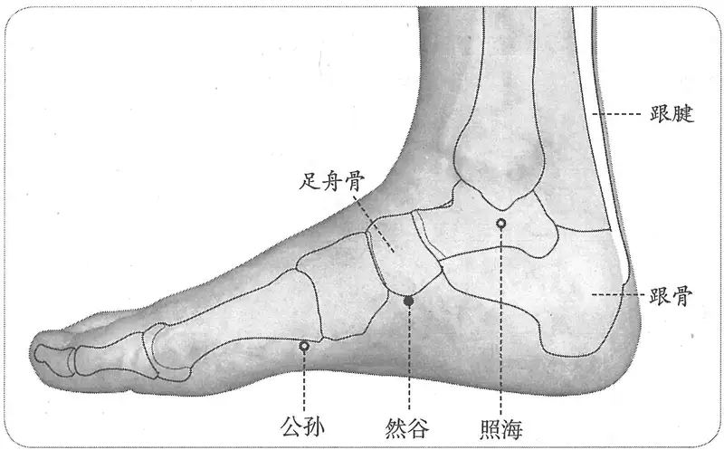

**图 2-232　然谷穴图**

〔p.821 (인쇄 793)〕

**取穴**：在踝前高骨下，当脾经公孙穴后一寸骨边陷中取之。

　1. 然骨之下者也。（《灵枢·本输》）

　2. 在足内踝前，起大骨下陷者中。（《黄帝明堂经》、《素问亡篇·刺法论》、《铜人腧穴针灸图经》卷下、《圣济总录》、《针灸资生经》、《窦太师针经》、《十四经发挥》、《针灸聚英》、《古今医统》、《医学入门》、《针灸大成》、《针方六集》、《类经图翼》、《医宗金鉴·刺灸心法要诀》、《针灸易学》）

　3. 穴在内踝前直下一寸。（《千金要方》卷二、《千金翼方》）

　4. 在足踝前大骨下陷中。（《铜人腧穴针灸图经》卷上、卷下“穴腧都数”）

　5. 在足踝前大骨下陷中，去照海一寸，赤白肉际，与外侧京骨相对，较涌泉当微前些。（《循经考穴编》下）

　6. 足内踝前之高骨下陷中，公孙穴后约一寸。（《针灸十四经穴位考订》）

　7. 统编针灸学教材

　　(1) 部位：足内踝前大骨下陷中。取穴：在足内踝之前大骨下方，即足踝前高骨（舟状骨）之下，当公孙后一寸取之。（1957年南京《针灸学》）

　　(2) 部位：足内踝前大骨下陷中。取穴：在踝前高骨下，当脾经公孙穴后一寸骨边陷中取之。（1版《针灸学讲义》）

　　(3) 部位：足内踝前起大骨下陷者中。取穴：在舟骨粗隆下缘凹陷中取之。（2版《针灸学讲义》）

　　(4) 足舟骨粗隆前下缘凹陷中。（4、5版《针灸学》）

　　(5) 在足内侧缘，足舟骨粗隆下方，赤白肉际。（6版《针灸学》）

　　(6) 在足内踝前下方，足舟骨粗隆前下缘凹陷中。（7版《针灸学》、《中国针灸学》）

**文献分析**：关于本穴定位，《黄帝明堂经》说得很清楚，即内踝前下方第一个突起之骨下陷中。后人或不明于此，另以分寸折量，皆未得其真也。

#### 【类属】 

足少阴肾经穴；五输穴之荥穴。

　1. 肾出于涌泉者，涌泉者足心也，为井木，溜于然谷，然骨之下者也，为荥……足少阴经也。（《灵枢·本输》）

　2. 足少阴脉之所流也，为荥。（《黄帝明堂经》）

#### 【适应症】 

主治前阴及咽部病症。常用于咳血，咽喉肿痛，消渴，黄疸，泄泻；遗精，阳痿；月经不调，阴痒，子宫脱垂；小儿脐风；足跗肿痛。

　1. 主不嗜食，心如悬，哀而乱，善恐，嗌内肿，心惕惕恐如人将捕之，多涎出，喘，少气，吸吸不足以息。胸中寒，脉代时不至，上重下轻，足不能安地，少腹胀，上抢心，胸胁支满，咳唾有血。喉痹。癃疝。石水。女子不字，阴暴出，经水漏。男子精溢，胫酸不能久立。寒热。消渴，黄瘅，足一寒一热，舌纵烦满。小儿脐风，口不开，善惊。痿厥，癫疾，洞泄。热病烦心，足寒清，多汗，先取然谷，后取太溪、大指间动脉，皆先补之。痓，互引，身热。舌纵，多涎出，烦满。（《黄帝明堂经》）

**按**：以上病症除了典型的足少阴经病候外，还包括妇人经、带，男子前阴病，以及消渴、黄瘅。上文中的“舌纵，多涎出，烦满”诸症见于《灵枢·寒热病》。

　2. 心痛如似刺，厥心痛如锥刺其心，心痛甚者脾心痛也。（《外台秘要》卷三十九）

**按**：此条病症《黄帝明堂经》归入“太溪”穴下。

　3. 治咽内肿，心恐惧如人将捕，涎出，喘呼少气，足跗肿不得履地，寒疝少腹胀，上抢胸胁，咳唾血，喉痹，淋沥，女子不孕，男子精溢，胻酸不能久立，足一寒一热，舌纵烦满，消渴，初生小儿脐风口噤，痿厥，洞泄。（《铜人腧穴针灸图经》卷下）

〔p.822 (인쇄 794)〕

　4. 窦太师针灸遗存

　　(1) 治寒湿脚气，脚腕红肿痛，看症补泻。（《窦太师针经》）

　　(2) 主寒湿脚气，肾家一切证及横骨红肿。（《循经考穴编》下）

　　(3) 自汗，盗汗出，坠堕恶血留血腹中，阴挺出，月事不调，阴痒。（《针灸聚英》卷一、《针灸大成》）

　　(4) 此穴主泻肾脏之热，若治伤寒，亦宜出血。（《类经图翼》卷七）

　5. 统编针灸学教材

　　(1) 主治阴痒，阴挺，月经不调，遗精，咳血，黄疸，泄泻，消渴，足跗肿痛，小儿脐风口噤。（1957年南京《针灸学》、1版《针灸学讲义》）

　　(2) 主治喉痹，唾血，阴痿，阴痒，阴挺出，月经不调，遗精，白浊，小儿脐风口噤，温疟，癃，消渴，自汗，盗汗，足跗肿不得履地。（2版《针灸学讲义》）

　　(3) 主治月经不调，带下，遗精，消渴，泄泻，咳血，咽喉肿痛，小便不利，小儿脐风，口噤。（4版《针灸学》）

　　(4) 主治月经不调，带下，遗精，消渴，泄泻，胸胁胀痛，咳血，小便不利，小儿脐风，口噤不开，黄疸，下肢萎痹，足跗痛。（5版《针灸学》）

　　(5) 主治喉痹，咽肿，唾血，阴痿，阴痒，阴挺，月经不调，遗精，白浊，小儿脐风口噤，温疟，洞泄，癃闭，消渴，黄疸，自汗，盗汗，足跗肿不得履地。（6版《针灸学》）

　　(6) 主治：①月经不调，阴痒，阴挺，白浊等妇科病证；②遗精，阳痿、小便不利等泌尿生殖系疾患；③咯血、咽喉肿痛；④消渴；⑤腹泻；⑥小儿脐风、口噤。（7版《针灸学》）

　　(7) 主治阴痒，阴挺，月经不调，遗精，咳血，消渴，泄泻，足背肿痛，小儿脐风。（《中国针灸学》）

**文献分析**：《黄帝明堂经》所载本穴主治主要是足少阴经病候，还包括妇人经、带，男子前阴病，临床应用也集中在这几方面，而元代窦太师针灸却偏重于治疗局部病症。

#### 附：临床应用举例 

　1. 心胸病症

　　(1) 厥心痛，与背相控，善瘛，如从后触其心，伛偻者，肾心痛也，先取京骨、昆仑，发狂不已，取然谷。厥心痛，痛如以锥针刺其心，心痛甚者，脾心痛也，取之然谷、太溪。（《灵枢·厥病》、《黄帝内经太素》）

　　(2) 邪客于足少阴之络，令人卒心痛，暴胀，胸胁支满无积者，刺然骨之前出血，如食顷而矣；不已，左取右，右取左，病新发者，取五日已。（《素问·缪刺论》）

　　(3) 肾心痛悲惧相控：太溪、然谷。（《针灸集要·盘石金直刺秘传》）

　　(4) 胸痛：少商、然谷、太冲、灵道、阴陵泉，流注针法治疗。［中国骨伤，1990，3（1）：40］

　2. 妇人病症

　　(1) 妇人绝子，灸然谷五十壮，在内踝前且下一寸。（《千金要方》卷二、《千金翼方》）

　　(2) 女子不字，阴暴出，经漏，刺然谷。（《千金要方》卷三十）

　3. 其他病症

　　(1) 热病烦心，足寒清，多汗，先取然谷，后取太溪、大指间动脉，皆先补之。（《针灸甲乙经》卷七）

〔p.823 (인쇄 795)〕

　　(2) 石水，灸然谷、气冲、四满、章门。（《千金翼方》卷二十八）

　　(3) 初生小儿脐风撮口，灸然谷穴三壮，在内踝前起大骨下陷中，针入三分，不宜见血，立效。（《卫生宝鉴》卷十九）

　　(4) 木肾，红肿疼痛：然谷半寸，泻之。（《医学纲目》卷十四）

　　(5) 固知腕骨祛黄，然骨泻肾。（《通玄指要赋》）

　　(6) 腕缓不收，覆足不任，胫酸：然谷、浮白、昆仑。（《医学纲目》卷二十二）

　　(7) 头癣：曲池穴、然谷穴，针刺治疗。［中医杂志，1987，28（8）：51］

#### 【操作】 

直刺0.5~0.8寸。

　1. 刺入三分，留三呼，灸三壮，刺之多见血，使人立饥欲食。（《黄帝明堂经》）

　2. 刺可同身寸之三分，留三呼，动气至而出之。（《素问亡篇·刺法论》）

　3. 灸三壮，针入三分，不宜见血。（《铜人腧穴针灸图经》卷下）

　4. 横针入五分，灸七二壮。（《窦太师针经》）

　5. 统编针灸学教材

　　(1) 针五至八分，灸三至七壮。（1957年南京《针灸学》、1版《针灸学讲义》）

　　(2) 直刺3分，艾条灸3~7分钟。（2版《针灸学讲义》）

　　(3) 直刺0.8~1.2寸。（4、5版《针灸学》）

　　(4) 直刺0.5~0.8寸；可灸。（6版《针灸学》）

　　(5) 直刺0.5~0.8寸。（7版《针灸学》）

　　(6) 直刺0.3~0.5寸。可灸。（《中国针灸学》）

　6. 直刺0.5~1.5寸。感应：局部酸胀，有时胀麻至足底。灸3壮；温灸5~10分钟。（上海《针灸学》）

### （三）太溪 Tàixī KI3 出《灵枢》 

问题：吕细穴的来历如何？又是如何与太溪穴发生联系的？

#### 【提要索隐】 

**穴名**：古称“足少阴”或“少阴”；一名内昆仑。

**部位**：在踝区，内踝尖与跟腱之间的凹陷中。

**适应症**：主治二阴、少腹、咽部病症。常用于遗精，阳痿；咳嗽，气喘，咳血，胸痛；咽喉肿痛，齿痛；消渴，便秘；月经不调；腰背痛，下肢厥冷。

**针刺操作**：直刺0.3~0.5寸。

#### 【名实考】 

内踝附近的穴位，有涌泉、水泉、照海、太溪、复溜，其穴名多取义于水，本穴位于内踝后深陷处，故名“太溪”，为足少阴原穴，古称“足少阴”穴。此处又是足少阴诊脉处——脉口，名“太溪脉”。

由于本穴与足太阳经的“昆仑”穴恰好内外相对，故后世又名“内昆仑”；因字形上与“天溪”很相近，故针灸古籍中此二穴时有相混者。

关于吕细穴的来历颇曲折：俗言丈母腹痛灸女婿脚后跟，渐渐“女膝”便成了“脚后跟”的代名词，后来又音变为“女须”、“吕细”。从部位上看，所谓“吕细”穴与古代定位的足太阳经“仆参”及足少阴经“大钟”相近，至于如何阴差阳错地与“太溪”穴发生关系，可能只是由于罗天益《卫生宝鉴》的一个未加推详的注“吕细，膀胱经，一名太溪”。然而尽管自元代吕细穴就被看成是太溪穴的别名，但其治疗牙痛的功效却一直没有被纳入到太溪穴主治中。

〔p.824 (인쇄 796)〕

　1. 肾出于涌泉者，涌泉者足心也，为井木，溜于然谷，然谷然骨之下者也，为荥；注于太溪，太溪内踝之后跟骨之上陷中者也，为腧；行于复溜，复溜上内踝二寸动而不休，为经；入于阴谷，阴谷辅骨之后，大筋之下，小筋之上也，按之应手，屈膝而得之，为合。足少阴经也。（《灵枢·本输》）

　2. 阴中之太阴，肾也，其原出于太溪，太溪二。（《灵枢·九针十二原》）

　3. 注于太溪，太溪者，土也。在足内踝后跟骨上动脉陷者中，足少阴脉之所注也，为输。（《黄帝明堂经》）

　4. 小儿阴肿，灸内昆仑二穴各三壮，在内踝后五分筋骨陷者中，炷如小麦大。（《太平圣惠方·明堂》）

**按**：足少阴经之“太溪”与足太阳经之“昆仑”，一阴一阳，内外正相对，故在内在阴之穴名“内昆仑”，在外在阳之穴名“外昆仑”。而“上昆仑”之名则与下方的“下昆仑”穴相对而言：下昆仑二穴，在外踝下一寸大筋后内陷者宛宛中是穴（《太平圣惠方·针经》）。对于这内外上下之“昆仑”今人多有混淆，特辨识于此。

　5. 肾为人身之水，自涌泉发源，尚未见动之形，溜于然谷，亦未见动之形，至此而有动脉可见；溪乃水流之处，有动脉则水之形见，故曰太溪。（《经穴解》）

#### “太溪”与“足少阴”脉、“足少阴”穴辨 

　1. 刺足少阴脉，重虚出血，为舌难以言。（《素问·刺禁》）

　2. 中寒厥，取[^30-1]踝后少阴也。（《灵枢·官针》）

**按**：《灵枢·官针》讲病症取穴，指明取穴部位，因而此处“少阴”必指“足少阴”穴（位于足内踝后足少阴脉口，当太溪穴处）。《刺禁》篇所记乃一个个具体的部位（包括刺脉部位或诊脉部位——脉口），故其中“手太阴”、“足少阴”无疑是指脉口名，而不是相应的经脉名。所以，在阅读早期医学文献时，对于“手太阴”、“手少阴”、“足少阴”这类三阴三阳之名，凡见于针灸方者，多为“经脉穴”穴名；凡见于针灸方而缀以“脉”字者，多为十二（或十一）经脉脉口名，切不可想当然地将其一概理解为经脉名。

　3. 刺足少阴经治阴在足内踝下动脉，即太溪穴也。（《脉经》卷二、《千金要方》卷二十）

　4. 月生二日，虾蟆生左肩，人气在足内踝后足小阴，皆不可灸判。（《黄帝虾蟆经》）

　5. 足少阴穴，在足内踝后微近下前动脉是也。（《诸病源候论》卷四十一）

**按**：这个描述极为精确，正是太溪脉（胫后动脉）的体表触诊点。

#### “太溪”与“吕细”辨 

　1. 刘汉卿即中患牙槽风，久之颔穿，脓血淋漓，医皆不效。在维阳有丘经历，益都人，妙针法，与汉卿针委中及女膝穴，是夕脓血即止。旬日后，颔骨蜕去，别生新者……委中穴在腿脉中，女膝穴在足后跟。俗言：丈母腹痛灸女婿脚后跟。乃舛而至。亦女膝是也。然灸经无此穴。又云女须穴。（宋·周密《癸辛杂识》，中华书局，1988年版）

　2. 牙齿痛吕细堪治。注曰：吕细，膀胱经。一名太溪。（《卫生宝鉴·通玄指要赋》卷二十）

　3. 风牙虫蛀夜无眠，吕细寻之痛可蠲。注曰：吕细：在足内踝骨肉下陷中。针三分，大泻尽，方补，

[^30-1]: 取：原作“足”，据《太素·十二刺》卷二十二、《针灸甲乙经》卷五第二改。

〔p.825 (인쇄 797)〕

痛定出针，灸二七壮。（《针灸玉龙歌》）

　4. 太溪二穴，一名细吕，土也。在足内踝后踝骨上动脉陷中。足少阴脉所注为俞。直透针昆仑穴，灸五十壮。治牙疼红肿，泻股内湿痒生疮，便毒，先补后泻。又治疝气木肾，先泻后补。经事不调，气血闭结，又通利小便。（《窦太师针经》）

　5. 太溪，一名吕细。（《针灸聚英》卷一）

　6. 右《流注指要赋》，罗谦甫谓窦子声裁就，今自《卫生宝鉴》表录于此，所可疑者，旧注“牙齿痛吕细堪治”，云：吕细，膀胱经，一名太溪。今按《资生经》、《千金》、《铜人》俱无太溪为吕细别名，而太溪为足少阴肾经，非膀胱经也。（《针灸聚英》卷四）

#### “天溪”误作“太溪”例 

　1. 胸胁榰满，不得俯仰，咳唾陈脓秽浊，周荣主之。胸中满痛，乳肿，溃痈，咳逆上气，咽喉喝有声，太溪主之。咳逆不止，三焦有水气，不能食，维道主之。（《针灸甲乙经》卷九第三）

　2. 太溪　胸中满痛，乳肿溃痈，咳逆上气，喉咽喝有声。（《外台秘要》卷三十九）

　3. 天溪　主胸中满痛，乳肿贲痈，咳逆上气，喉鸣。（《医心方》卷二）

**按**：《针灸甲乙经》“太溪主之”条文之前为“周荣主之”，之后为“维道主之”，则据该书腧穴主治条文排列规律，此二条之间不可能为“太溪主之”，查《医心方》、《千金要方》等其他《黄帝明堂经》传本，知此处为“天溪主之”，王焘编《外台秘要·明堂》未加考辨，仍将此条主治抄于“太溪”穴下，另据其他传本补录了“天溪”穴下主治。

#### 【定位】 

**部位**：在踝区，内踝尖与跟腱之间的凹陷中（图2-233）。

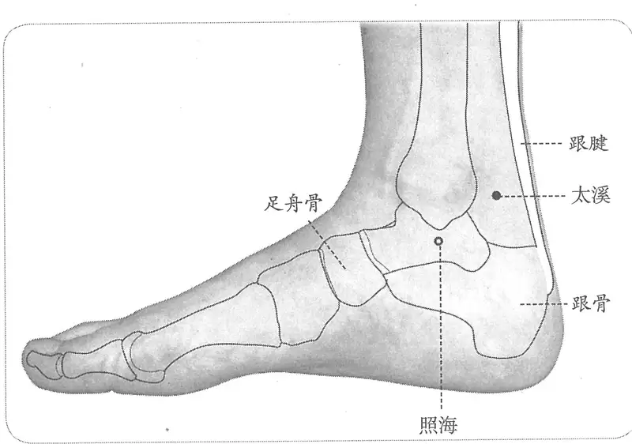

**图 2-233　太溪穴图**

**取穴**：在内踝与跟腱之间凹陷中，平对内踝尖取之。

　1. 内踝之后，跟骨之上陷中。（《灵枢·本输》）

　2. 在足内踝后，跟骨上动脉陷者中。（《黄帝明堂经》、《太平圣惠方·明堂》、《铜人腧穴针灸图经》、《圣济总录》、《针灸资生经》、《窦太师针经》、《十四经发挥》、《针灸聚英》、《古今医统》、《医学入门》、《针方六集》、《循经考穴编》）

〔p.826 (인쇄 798)〕

　3. 在足内踝后跟骨上平过一寸是穴。（《窦太师秘传》）

　4. 在足内踝后五分，跟骨上动脉陷中。（《神应经》、《针灸聚英》、《针灸大成》、《类经图翼》、《医宗金鉴·刺灸心法要诀》、《针灸易学》、《针灸逢源》）

　5. 广注入踝骨尖平，过后跟去约一寸动脉中，与昆仑对。（《循经考穴编》下）

　6. 针灸方腧穴定位

　　(1) 内昆仑穴在内踝后陷中。（《千金翼方》卷二十七）

　　(2) 内昆仑，在内踝后五分筋骨间陷者中。（《太平圣惠方·明堂》）

　　(3) 内踝骨后五分，筋间陷中。（《针灸十四经穴位考订》）

　7. 统编针灸学教材

　　(1) 部位：足内踝后，跟骨上陷中。取穴：从内踝后侧与跟骨筋腱之间陷中取之（适与昆仑穴相对）。（1957年南京《针灸学》）

　　(2) 部位：足内踝后，跟骨上陷中。取穴：从内踝后上侧，骨边陷中取之，适与膀胱经昆仑穴相对。（1版《针灸学讲义》）

　　(3) 部位：不在足内踝后跟骨上，动脉陷者中。取穴：在内踝与跟腱之间凹陷中，平对内踝尖取之。（2版《针灸学讲义》）

　　(4) 内踝与跟腱之间凹陷中。（4版《针灸学》）

　　(5) 内踝高点与跟腱之间凹陷中。（5版《针灸学》）

　　(6) 在内侧内踝后方，当内踝与跟腱之间的凹陷处。（6版《针灸学》）

　　(7) 内踝高点与跟腱后缘连线的中点凹陷处。（7版《针灸学》）

　　(8) 内踝与跟腱之间的凹陷中，与内踝高点平。（《中国针灸学》）

**文献分析**：太溪，在足内踝后，跟骨上，动脉陷者中（《黄帝明堂经》）。“内昆仑”之名首见于《千金翼方》，又见于《太平圣惠方》，盖其部位与足太阳经昆仑穴正相对而得名。也恰与今之太溪穴相当。骨性标志很明确，不必再折作分寸。这一描述本身已经很明确，所述部位与现代解剖学关于胫后动脉的体表触诊点相合。在此部位不仅可以明显触摸到胫后动脉的搏动，而且在不少被检查者还能看到它的搏动。可是，在进行针灸腧穴定位标准化时，专家们认为古典文献的描述不够明确，换成用内踝最凸点与跟腱之间来描述，应当看到这种转换与古典文献本意不完全等值，此处也感觉不到动脉的明显搏动（更看不到）——这也是现代描述中去掉“动脉搏动”标志的重要因素。

#### 【类属】 

足少阴肾经穴；五输穴之输穴；肾之原穴。

　1. 阴中之太阴，肾也，其原出于太溪，太溪二。（《灵枢·九针十二原》）

　2. 肾出于涌泉者，涌泉者足心也……注于太溪，太溪内踝之后跟骨之上陷中者也，为腧……足少阴经也。（《灵枢·本输》）

　3. 足少阴脉之所注也，为输。（《黄帝明堂经》）

　4. 肾之源，出于太溪。在足内踝下跟骨之前陷者中，足少阴之所过为源。（《素问亡篇·刺法论》）

#### 【适应症】 

主治二阴、少腹、咽部病症。常用于遗精，阳痿；咳嗽，气喘，咳血，胸痛；咽喉肿痛；消渴，便秘；月经不调；腰背痛，下肢厥冷。

　1. 主热病汗不出，默默嗜卧，溺黄，少腹热，嗌中痛，腹胀内肿，涎下，心痛如锥针刺。疟，咳逆心闷不得卧，呕甚，热多寒少，欲闭户牖而处，寒厥，足热。胞中有大疝瘕积聚，与阴相引而痛，苦涌泄上下出，补尺泽、太溪、手阳明寸口，皆补之。消瘅，善噫，气

〔p.827 (인쇄 799)〕

走喉咽而不能言，手足清，溺黄，大便难，嗌中肿痛，唾血，口中热，唾如胶。（《黄帝明堂经》）

　2. 主霍乱出泄不自知。胸中满痛，乳肿溃，喉咽喝有声。厥气上支。（《外台秘要》卷三十九）

**按**：“霍乱出泄不自知”系《黄帝明堂经》“中脘”穴主治；“胸中满痛，乳肿溃，喉咽喝有声”系“天溪”穴主治；“厥气上支”系“解溪”穴主治，皆因《针灸甲乙经》唐代传本穴名错误，王焘误归于此。

　3. 主鼻衄不止。（《太平圣惠方·明堂》）

　4. 治久疟，咳逆，心痛如锥刺其心，手足寒至节，喘息者死。呕吐，口中如胶，善噫，寒疝，热病汗不出，默默嗜卧，溺黄，消瘅，大便难，咽肿唾血。今附：痃癖寒热，咳嗽，不嗜食，腹胁痛，瘦瘠，手足厥冷。（《铜人腧穴针灸图经》卷下）

　5. 窦太师针灸遗存

　　(1) 治牙疼红肿，泻股内湿痒生疮，便毒，先补后泻。又治疝气木肾，先泻后补。经事不调，气血闭结，又通利小便。（《窦太师针经》）

　　(2) 肾家虚冷，阴痿不起，月事乱期，血气闭塞，或肾家邪热，两腿生疮痒甚，或脚跟肿痛，并宜泻之，牙齿疼痛，伤寒脉不至。（《循经考穴编》下）

　　(3) 主手足痿，女人经事不调，血留凝结。（《针方六集》卷五）

　6. 统编针灸学教材

　　(1) 主治咽肿，齿痛，咳嗽唾血，肾虚阳痿不起，月经不调，消渴，寒疝，痃癖，大便难，乳痈，心疼，伤寒手足厥冷，热病汗不出。（1957年南京《针灸学》）

　　(2) 主治咽肿，齿痛，咳嗽唾血，乳痈，心痛，肾虚阳痿不起，月经不调，消渴，寒疝，大便难，伤寒手足厥冷，热病汗不出，嗜卧。（1版《针灸学讲义》）

　　(3) 主治咽喉痛，齿痛，耳聋，咳血，气喘，消渴，月经不调，失眠，遗精，阳痿，小便频数，腰脊痛。（2版《针灸学讲义》、4版《针灸学》）

　　(4) 主治月经不调，遗精，阳痿，小便频数，便秘，消渴，咳血，气喘，咽喉肿痛，齿痛，失眠，腰痛，耳聋，耳鸣。（5版《针灸学》）

　　(5) 主治头痛目眩、咽喉肿痛、齿痛、耳聋、耳鸣、气喘、胸痛咳血、消渴、月经不调、失眠、健忘、遗精、阳痿、小便频数、腰脊痛、下肢厥冷、内踝肿痛。（6版《针灸学》）

　　(6) 主治：①头痛，目眩，失眠、健忘、遗精、阳痿等肾虚证；②咽喉肿痛，齿痛，耳鸣、耳聋等阴虚性五官病证；③咳嗽、气喘、咯血、胸痛等肺部疾患；④消渴，小便频数、便秘；⑤月经不调；⑥腰脊痛，下肢厥冷。（7版《针灸学》）

　　(7) 主治咽喉干痛，齿痛，耳聋，耳鸣，头晕，咳血，气喘，消渴，月经不调，不寐，遗精，阳痿，小便频数，腰脊痛。（《中国针灸学》）

**文献分析**：以上病症除嗜卧、少腹热、嗌中痛、足热、嗌中肿痛、唾血、口中热等典型的足少阴经病候外，还包括脾心痛、足少阴疟、女子疝瘕、消渴等病。其中“脾心痛”症状见于《灵枢·厥病》；足少阴疟症状见于《素问·刺疟》；“气走喉咽……唾如胶”症状见于《灵枢·杂病》。针灸教材“乳痈”主治，系传《针灸甲乙经》、《外台秘要》之误。

由于本穴的古称作“足少阴”或“少阴”，故早期文献针灸方中这类穴名即为本穴的早期临床应用。

由于吕细穴与本穴通过一系列的讹传发生关系，故有关吕细穴的临床应用不列于本穴下。

〔p.828 (인쇄 800)〕

#### 附：临床应用举例 

　1. 舌咽部病症

　　(1) 厥气走喉而不能言，手足清，大便不利，取足少阴……嗌干，口中热如胶，取足少阴。（《灵枢·杂病》）

　　(2) 舌纵涎下，烦悗，取足少阴。（《灵枢·寒热病》）

　　(3) 太阳喘满痰实，口中如胶，针太溪穴。（《扁鹊心书》卷下）

　　(4) 治一男子喉痹，于太溪穴刺出黑血半盏而愈。由是言之，喉痹以恶血不散故也。（《医学纲目》卷十五）

　　(5) 口热咽干，唾如粘胶，口苦，嗌中介介然：太溪五分、阳陵泉二寸半。（《医学纲目》卷二十一）

　2. 心肺病症

　　(1) 心痛引背不得息，刺足少阴；不已，取手少阳。（《灵枢·杂病》）

　　(2) 中热而喘，取足少阴、腘中血络。（《灵枢·杂病》）

　　(3) 厥心痛，痛如以锥针刺其心，心痛甚者，脾心痛也，取之然谷、太溪。（《灵枢·厥病》）

　　(4) 心痛，针少阴经太溪、涌泉及足厥阴原穴。（《素问病机气宜保命集》卷下）

　　(5) 肺主为哕，取手太阴、足少阴。噫者，补足太阴、阳明。（《灵枢·口问》）

　　(6) 气在于肺者，取之手太阴荥、足少阴输。（《灵枢·五乱》）

　　(7) 短气，息短不属，动作气索，补足少阴，去血络也。（《灵枢·癫狂》）

　　(8) 心动过缓症：太溪穴针刺治疗。［江苏中医，1988，9（5）：19］

　3. 腹部积聚

　　(1) 胞中有大疝瘕积聚，与阴相引而痛，苦涌泄上下出，补尺泽、太溪、手阳明、寸口，皆补之。（《针灸甲乙经》卷八）

　　(2) 癥瘕，灸内踝后宛宛中随年壮。又灸气海百壮。（《千金要方》卷十一、《千金翼方》）

　　(3) 少妇坚打如盘盂，胸腹中胀满，饮食不消，妇人癥聚瘦瘠……灸内踝后宛宛中，随年壮。（《千金翼方》卷二十六）

　　(4) 腹满，大便不利，腹大，亦上走胸嗌，喘息喝喝然，取足少阴。（《灵枢·杂病》）

　4. 腰腿病症

　　(1) 腰痛……中热而喘，刺足少阴。大便难，刺足少阴；引脊内廉，刺足少阴。（《素问·刺腰痛》）

　　(2) 热病烦心，足寒清，多汗，先取然谷，后取太溪、大指间动脉，皆先补之。（《针灸甲乙经》卷七）

　　(3) 治脚转筋，针内昆仑穴，在内踝后陷中，入六分，气至写之。又灸承山，随年壮神验。（《千金翼方》卷二十七）

　　(4) 脚跟红肿草鞋风，宜向昆仑穴上攻，再攻太溪共申脉，此针三穴病相同。（《针灸玉龙歌》）

　　(5) 脚膝经年痛不休，内外踝边用意求，穴号昆仑并吕细，应时消散即时瘳。（《肘后歌》）

　5. 肾、膀胱、前阴病症

　　(1) 肾咳，刺足太溪。（《千金翼方》卷二十七）

〔p.829 (인쇄 801)〕

　　(2) 肾绞痛：照海配行间、太溪穴治疗。［广西中医药，1996，19（3）：28］

　　(3) 小儿阴肿，灸内昆仑二穴各三壮，在内踝后五分，筋骨间陷者中，炷如小麦大。（《太平圣惠方·明堂》）

　　(4) 玉茎中痛：中极、三阴交、太溪、复溜。问曰：此证缘何而得？答曰：因少年之时，过用金石之药，有伤茎孔，使阴阳交感不能发泄，故如此也。宜刺后穴：中极、阴陵泉、关元、血海。（《针灸集成》第五十二方）

　　(5) 内闭不得溲，刺足少阴、太阳与骶上以长针。（《灵枢·癫狂》）

　　(6) 输尿管结石：关元穴、中极穴、太溪穴，针灸疗法。［天津中医，1988（5）：29-30］

　　(7) 女性尿闭：中极穴、三阴交穴、太溪穴，针灸疗法。［福建中医药，1988，19（5）：69］

　　(8) 尿石所致绞痛：太溪穴针刺治疗。［中国针灸，1986，6（5）：21］

　　(9) 遗尿：太溪穴针刺治疗。［福建中医药，1984，4（6）：28］

　6. 其他病症

　　(1) 少气，身漯漯也，言吸吸也，骨酸体重，懈惰不能动，补足少阴。（《灵枢·癫狂》）

　　(2) 热病先身重骨痛，耳聋好瞑，刺足少阴，病甚为五十九刺。热病先眩冒而热，胸胁满，刺足少阴少阳。（《素问·刺热论》）

　　(3) 霍乱，泄出不自知，先取太溪，后取太仓之原。（《针灸甲乙经》卷十一）

**按**：本条主症，《黄帝明堂经》原归于中脘穴主症中。

　　(4) 痉，先取太溪，后取太仓之原。（《针灸甲乙经》卷七）

**按**：本条病症，《黄帝明堂经》原归入中脘穴主症中。

　　(5) 疟，刺足少阴，血出愈。（《千金要方》卷十）

　　(6) 少阴发热，灸太溪。（《伤寒治例》）

　　(7) 少阴吐利，手足不冷，反发热，脉不至，灸少阴太溪穴。（《伤寒治例》）

　　(8) 糖尿病：肾俞、太溪穴针灸疗法。［陕西中医，1985，6（10）：459-460］

　　(9) 重症肌无力：太冲穴、太溪穴，针灸疗法。［湖南中医杂志，1988，4（3）：30］

　　(10) 三叉神经痛：针刺冲阳、太溪穴治疗。［中国针灸，2000（12）：728］

　　(11) 视疲劳综合征：针刺太溪穴为主治疗。［河南中医，2001，21（5）：54］

　　(12) 鼻出血：独针太溪。［中国针灸，2002，22（9）：611］

#### 【操作】 

直刺0.3~0.5寸。

　1. 刺入三分，留七呼，灸三壮。（《黄帝明堂经》）

　2. 先以左手按穴，刺入三分，留一呼，进一分，留一呼，徐徐出针，以手扪其穴。（《素问亡篇·刺法论》）

　3. 灸三壮，针入五分，无令出血。（《铜人腧穴针灸图经》卷下）

　4. 窦太师针灸遗存

　　(1) 直透针昆仑穴，灸五十壮。（《窦太师针经》）

　　(2) 针透昆仑穴，灸七壮。（《窦太师秘传》）

　　(3) 横刺昆仑穴，先补后泻，三分，七呼，五壮。（《大本琼瑶神书》）

　5. 统编针灸学教材

　　(1) 针五分，针尖对向外踝前缘而进，灸三至七壮。（1957年南京《针灸学》、1版《针灸学讲义》）

　　(2) 直刺3分，艾条灸3~7分钟。（2版《针灸学讲义》）

〔p.830 (인쇄 802)〕

　　(3) 直刺0.5~1寸。（4、5版《针灸学》）

　　(4) 直刺0.5~1寸；可灸。（6版《针灸学》）

　　(5) 直刺0.5~0.8寸。（7版《针灸学》）

　　(6) 直刺0.3~0.5寸。可灸（《中国针灸学》）

　6. ①直刺，可透昆仑，深0.5~1寸。感应：酸胀。有时可麻向足底。②治足底病时，针尖略向内踝，深0.5~1寸。感应：有麻电感向足底放散。灸3~5壮；温灸5~15分钟。（上海《针灸学》）

### （四）大钟 Dàzhōng KI4 出《灵枢》 

#### 【提要索隐】 

**穴名**：大钟，又作“太钟”。

**部位**：在跟区，内踝后下方，跟骨上缘，跟腱附着部前缘凹陷中。

**适应症**：主治腰、咽、前阴及神志病症。常用于腰背痛；癃闭，便秘；咳血，气喘；痴呆，嗜卧；足跟痛。**新增**：心烦。

**针刺操作**：直刺0.3~0.5寸。

#### 【名实考】 

大钟，古代文献也写作“太钟”（如《千金翼方》）。关于本穴定位，《黄帝明堂经》作“在足跟后冲中，别走太阳，足少阴络”。杨上善曰：有本作在足跟后踵中（转引自《医心方》卷二）。《说文解字》曰：“跟，足踵也”；《释名》曰：“踵，锺也”。可见，本穴本应定于足后跟部，这从《灵枢·经脉》、《灵枢·经筋》的描述可以看得更加清楚。日本针灸书多明确将本穴定于后跟上，与足太阳经仆参穴一上一下相对。

中国针灸教材关于本穴定位，多受明代《医学入门》的影响，后又有所调整，已接近《黄帝明堂经》之本义，至2006年版国家标准《腧穴名称与定位》进一步调整为“跟骨上缘，跟腱附着部前缘凹陷中”，已经不提“内侧”、“外侧”。之所以后人对于本穴定位有不同理解，主要是以为足少阴为阴经，其穴不至阳经分野。但本穴为络穴，别出至阳经很自然。

　1. 肾足少阴之脉，起于小指之下，邪走足心，出于然谷之下，循内踝之后，别入跟中，以上腨内。（《灵枢·经脉》）

　2. 足少阴之别，名曰大锺，当踝后绕跟，别走太阳。（《灵枢·经脉》）

　3. 足太阳之筋，起于足小指上，结于踝，邪上结于膝，其下循足外踝，结于踵，上循跟，结于腘……足少阴之筋，起于小指之下，并足太阴之筋邪走内踝之下，结于踵，与太阳之筋合而上结于内辅之下。（《灵枢·经筋》）

　4. 大钟，在足跟后冲中，别走太阳，足少阴络。（《针灸甲乙经》卷三）

　5. 大钟，在足跟后冲中。有本作“在足跟后踵中”。（转引自《医心方》卷二）

　6. 穴名大钟者，言其部分之形也，其穴在内踝后，有细动脉应手，在太溪之上，其形空悬如钟，所以吸肾脉之上行者，故曰大钟。（《经穴解》）

#### 【定位】 

**部位**：在跟区，内踝后下方，跟骨上缘，跟腱附着部前缘凹陷中（图2-234）。

**取穴**：于内踝后下方，当跟腱附着部的内侧凹陷中取之。

　1. 《黄帝明堂经》佚文

在足跟后冲中。（《针灸甲乙经》卷三、《千金要方》、《外台秘要》、《医心方》、《铜

〔p.831 (인쇄 803)〕

**图 2-234　大钟穴图**

人腧穴针灸图经》、《圣济总录》、《针灸资生经》、《窦太师针经》、《针方六集》）

在足内踝后冲中。（《素问·刺疟》王冰注）

在足跟后冲中动脉。（《素问·刺腰痛》王冰注）

有本作在足跟后踵中。（《医心方》卷二、《十四经发挥》、《循经考穴编》）

　2. 足跟后踵中大骨上两筋间。（《针灸聚英》卷一、《古今医统》、《针灸大成》、《类经图翼》、《医宗金鉴·刺灸心法要诀》、《针灸易学》、《针灸逢源》）

　3. 太溪下五分。（《医学入门》卷一）

　4. 广注后跟陷中，约居太溪下五分，赤白肉际。（《循经考穴编》下）

　5. 统编针灸学教材

部位：足跟后踵中，大骨上两筋间。取穴：从太溪穴下五分略向后侧之后跟筋腱侧边取之。（1957年南京《针灸学》）

部位：足跟后踵筋间。取穴：从太溪穴下五分斜向后侧，足跟大筋边缘取之。（1版《针灸学讲义》）

在足跟后冲中。取穴：于内踝后下方，当跟腱附着部的内侧凹陷中取之。（2版《针灸学讲义》）

太溪穴下0.5寸稍后，跟腱内缘。（4、5、7版《针灸学》）

在足内侧内踝后下方，当跟腱附着部的内侧前方凹陷处。（6版《针灸学》、《中国针灸学》）

**文献分析**：本穴定位，《黄帝明堂经》直接有体表标志定位作“足跟后踵中”，结合足少阴经脉、络脉、经筋循行，定于足后跟部乃合古意。此处只有一大筋，没有“两筋”，也不能触及动脉，故王冰、高武之说非是，《医学入门》之说缺乏依据。

#### 【类属】 

足少阴肾经穴；络穴。

**脉气所发**：别走太阳，足少阴络。（《黄帝明堂经》）

#### 【适应症】 

主治腰、咽、前阴及神志病症。常用于腰背痛；癃闭，便秘；咳血，气喘；痴呆，嗜卧；足跟痛。**新增**：心烦。

　1. 主疟多寒少热，凄凄然腰脊痛，宛转，目循循然。咳，喉中鸣，咳唾血。腹满，大便难，时上走胸中鸣，喘，少气不足以息。胀满，口舌干，口中吸吸，善惊，咽中痛，不可内食，善怒，惊恐不乐。实则闭癃，嗜卧，口中热，虚则腰痛，寒厥，烦心闷。（《黄帝明堂经》）

〔p.832 (인쇄 804)〕

**按**：以上病症主要为咳唾血，口舌干，口中热，咽中痛，嗜卧等足少阴经典型症状，以及足少阴络脉病候。此外还包括腹满、疟病症状。其腹满一组症状见于《灵枢·杂病》：“腹满，大便不利，腹大，亦上走胸嗌，喘息喝喝然，取足少阴”；疟病症状见于《素问·刺疟》：“肾疟者，令人洒洒然，腰脊痛宛转，大便难，目眴眴然，手足寒，刺足太阳、少阴。”

　2. 主大肠结。（《外台秘要》卷三十九）

　3. 治实则小便淋闭，洒洒腰脊强痛，大便秘涩，嗜卧，口中热；虚则呕逆，多寒，欲闭户而处，少气不足，胸胀喘息，舌干，咽中食噎不得下，善惊恐不乐，喉中鸣，咳唾血。（《铜人腧穴针灸图经》卷下）

**按**：“呕逆，多寒，欲闭户而处”乃“太溪”穴主治。

　4. 窦太师针灸遗存

　　(1) 治脚冻疮，泻；脚后跟肿，宜三棱针出血；寒湿脚气，补泻。（《窦太师针经》）

　　(2) 主腨胫酸，寒湿脚气。（《针方六集》卷五）

　　(3) 主心性痴呆，足跟痛。（《循经考穴编》下）

　5. 统编针灸学教材

　　(1) 主治咳血，气喘，腰脊强痛，痴呆，足跟痛。（1957年南京《针灸学》）

　　(2) 主治咳唾气逆，胸胀，喘息，喉痹，小便淋沥，大便秘结，腰脊强痛，足跟痛，痴呆，嗜卧，口热舌干。（1版《针灸学讲义》）

　　(3) 主治咳唾气逆，胸胀，喘息，喉痹，小便淋沥，大便秘结，足跟痛，痴呆。（2版《针灸学讲义》）

　　(4) 主治癃闭，遗尿，便秘，咳血，气喘，痴呆，足跟痛。（4版《针灸学》）

　　(5) 主治咳血，腰脊强痛，痴呆，嗜卧，月经不调，足跟痛。（5版《针灸学》）

　　(6) 主治咳逆，唾血，胸胀，喘息，癃闭，便秘，腰痛，足跟痛，痴呆，嗜卧。（6版《针灸学》）

　　(7) 主治：①痴呆；②癃闭，遗尿，便秘；③月经不调；④咯血，气喘；⑤腰脊强痛、足跟痛。（7版《针灸学》）

　　(8) 主治咳血，气喘，腰脊强痛，二便不利，足跟痛，痴呆。（《中国针灸学》）

**文献分析**：本穴既是足少阴络穴，则络脉病候“心烦”不当删，今补之。教材中“月经不调”一症，未详所出，今去之。

#### 附：临床应用举例 

　1. 足少阴之别，名曰大锺，当踝后绕跟，别走太阳；其别者，并经上走于心包，下外贯腰脊。其病气逆则烦闷，实则闭癃，虚则腰痛，取之所别者也。（《灵枢·经脉》）

　2. 肾疟者，令人洒洒然，腰脊痛宛转，大便难，目眴眴然，手足寒，刺足太阳、少阴。（《素问·刺疟》）

　3. 足少阴疟，呕吐甚，欲闭户牖，刺大钟。（《医学入门》卷一）

　4. 大钟、郄门，主惊恐畏人，神气不足。（《千金翼方》卷二十六）

　5. 用大钟治心内之呆痴。（《标幽赋》）

　6. 小儿遗尿，艾灸通里、大钟穴治疗。［中国针灸，1995（2）：35］

#### 【操作】 

直刺0.3~0.5寸。

〔p.833 (인쇄 805)〕

　1. 刺入二分，留七呼，灸三壮。（《黄帝明堂经》）

　2. 窦太师针灸遗存

　　(1) 针入三分，灸七壮。（《窦太师针经》）

　　(2) 一法横针五分，灸七壮。（《循经考穴编》下）

　3. 统编针灸学教材

　　(1) 针二至三分，灸三至七壮。（1957年南京《针灸学》、1版《针灸学讲义》）

　　(2) 直刺3分，艾条灸3~7分钟。（2版《针灸学讲义》）

　　(3) 直刺0.3~0.5寸。（4、5、7版《针灸学》）

　　(4) 直刺0.3~0.5寸；可灸。（6版《针灸学》、《中国针灸学》）

### （五）水泉 Shuǐquán KI5 出《黄帝明堂经》 

#### 【提要索隐】 

**穴名**：一名水原，又作“水源”。

**部位**：在跟区，太溪直下1寸，跟骨结节内侧凹陷中。

**适应症**：主治妇科病症。常用于月经不调，痛经，子宫脱垂；小便不利；视物不清。

**针刺操作**：直刺0.3~0.5寸。

#### 【名实考】 

水泉，《针灸甲乙经》卷三及十二、宋校本《千金要方》卷二十九、《千金翼方》同；《外台秘要》、《医心方》、《千金要方》卷三十作“水原”，未校本《孙真人千金方》卷二十九作“水源”，卷三十作“水泉”，可见《黄帝明堂经》不同传本，以及相同传本的不同版本间早有异文，且两种异文义通，故以通行的“水泉”做正名，以“水源”、“水原”做别名。

又《千金要方》卷二十一曰：“又灸水泉三十壮。足大敦是也”，然《医心方》、《千金翼方》引录时皆无此说，当系传抄之误，故不以“大敦”作为本穴别名。特别是《医心方》还注明大敦穴的部位，与水泉穴无关。

　1. 水泉，足少阴郄，去太溪下一寸，在足内踝下。（《黄帝明堂经》）

　2. 肾之脉为大钟，既吸之而上，又折而下行为水泉，为少阴郄者，以此穴受大钟下降之水，肾之脉至此而大见，故为郄也。（《经穴解》）

#### “水泉”与“足大敦”辨 

　1. 石淋，脐下三十六种病不得小便，灸关元三十壮。又灸气门三十壮。又灸水泉三十壮。足大敦是也。（《千金要方》卷二十一）

　2. 病石淋，脐下三十六种病不得小便方：灸关元三十壮《千金方》同之。又方：灸大敦三十壮。在足大指端，去爪甲如韭叶。（《医心方》卷十二）

#### 【定位】 

**部位**：在跟区，太溪直下1寸，跟骨结节内侧凹陷中（图2-235）。

**取穴**：在太溪直下方1寸，跟骨内侧陷中取之。

　1. 去太溪下一寸，在足内踝下。（《黄帝明堂经》、《铜人腧穴针灸图经》、《圣济总录》、《十四经发挥》、《医学纲目》、《针灸聚英》、《古今医统》、《针灸大成》、《针方六集》、《类经图翼》、《医宗金鉴·刺灸心法要诀》、《针灸逢源》）

　2. 广注居内踝贴骨下，就足跟两骨陷中。（《循经考穴编》下）

　3. 足跟后，大骨上，两筋间，太溪下五分许。（《针灸十四经穴位考订》）

〔p.834 (인쇄 806)〕

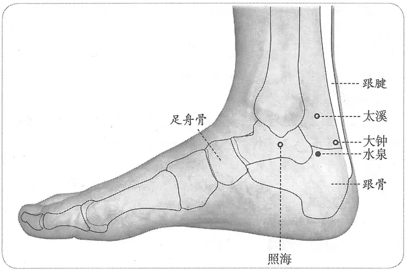

**图2-235　水泉穴图**

　4. 统编针灸学教材

　　(1) 部位：太溪下方一寸，内踝贴骨下就足跟两骨陷中。取穴：照海之后，太溪之下，跟骨之内侧陷中取之。（1957年南京《针灸学》）

　　(2) 部位：太溪穴下一寸。取穴：太溪穴直下，跟骨内侧陷中取之。（1版《针灸学讲义》）

　　(3) 部位：在太溪下一寸，在足内踝下。取穴：在太溪直下方一寸，当跟骨结节之内侧前上部凹陷中取之。（2版《针灸学讲义》）

　　(4) 太溪穴下一寸。（4版《针灸学》）

　　(5) 太溪穴直下1寸。（5版《针灸学》）

　　(6) 在足内侧内踝后下方，当太溪直下1寸指寸，跟骨结节内侧凹陷处。（6版《针灸学》、《中国针灸学》）

　　(7) 太溪直下1寸，当跟骨结节内侧上缘。（7版《针灸学》）

#### 【类属】 

足少阴肾经穴；郄穴。《千金要方》又作为原穴。

　1. 水泉，足少阴郄。（《黄帝明堂经》）

　2. 肾出于涌泉为井，足少阴脉也，流于然谷为荥，注于太溪为输，过于水泉为源，行于复溜为经，入于阴谷为合。（《千金要方》卷二十九）

**按**：此以水泉穴为“原穴”，别为一说。

#### 【适应症】 

主治妇科病症。常用于月经不调，痛经，子宫脱垂；小便不利；视物不清。

　1. 主月水不来，来而多，少闭，心下痛，目䀮䀮不可远视。（《黄帝明堂经》）

　2. 不字，阴暴出，淋漏。（《千金要方》卷三十）

　3. 治阴挺出，小便淋沥，腹中痛。（《铜人腧穴针灸图经》卷下）

　4. 窦太师针灸遗存

　　(1) 治内踝肿脚气，踝骨疼，偏坠木肾，看症补泻。（《窦太师针经》）

　　(2) 主脚气，踝骨酸痛，偏坠木肾。（《针方六集》卷五）

　　(3) 若踝骨痛，宜弹针出血。（《循经考穴编》下）

　　(4) 水泉穴乃肾之原，脐腹连阴痛可蠲。（《针灸玉龙歌》）

　5. 统编针灸学教材

〔p.835 (인쇄 807)〕

　　(1) 主治月事不来，来即心下多闷痛，阴挺出，小便淋沥，目不能远视。（1957年南京《针灸学》）

　　(2) 主治月经不调，痛经，阴挺，小便不利，目昏花。（1、2版《针灸学讲义》、4版《针灸学》、《中国针灸学》）

　　(3) 主治月经不调，痛经，经闭，阴挺，小便不利。（5、7版《针灸学》）

　　(4) 主治月经不调，痛经，小便不利，腹痛，头昏目花。（6版《针灸学》）

#### 【操作】 

直刺0.3~0.5寸。

　1. 刺入四分，灸五壮。（《黄帝明堂经》）

　2. 针二分，灸三壮。（《医学入门》卷一）

　3. 一法横针入三分，灸七壮。（《循经考穴编》下）

　4. 统编针灸学教材

　　(1) 针二至三分，灸三至七壮。（1957年南京《针灸学》、1版《针灸学讲义》）

　　(2) 直刺4分，艾条灸3~7分钟。（2版《针灸学讲义》）

　　(3) 直刺0.3~0.5寸。（4、5版《针灸学》）

　　(4) 直刺0.3~0.5寸；可灸。（6版《针灸学》、《中国针灸学》）

　　(5) 直刺0.5~0.8寸（7版《针灸学》）

### （六）照海 Zhàohǎi KI6 出《黄帝明堂经》 

#### 【提要索隐】 

**穴名**：一名阴𫏋；一名太阴𫏋；一名漏阴。

**部位**：在踝区，内踝尖下1寸，内踝下缘边际凹陷中。

**适应症**：主治目疾、咽喉、前阴及妇科病症。常用于目赤肿痛；咽干、咽痛；月经不调，赤白带下，子宫脱垂，疝气，癃闭；癫痫。

**针刺操作**：直刺0.5~0.8寸。

#### 【名实考】 

《太平圣惠方·针经》、卷一百所载“阴𫏋”穴的部位及主治症均与“照海”穴同，两者显为同一穴。“照海”为阴𫏋脉所生，《千金要方》卷三十“孔穴主对法”即称照海穴做“阴𫏋”。照海穴为“阴𫏋脉所生”，归于阴𫏋脉有充分的理由，然而唐以后皆归属于足少阴经。

关于本穴定位，《黄帝明堂经》所说非常明确：内踝下缘下陷中。后人或误以内踝最凸点（俗称“内踝尖”）为标志，而改作“内踝下一寸”，现代教材也受此误导，并专门设立了定穴标志点——内踝尖。详见本书“总论”。

　1. 照海，阴𫏋脉所生，在足内踝下。（《黄帝明堂经》）

　2. 以此穴又折而上，俯视涌泉、水泉，有海之象焉，而穴居其上，有以上照下之义，故曰照海。（《经穴解》）

#### “照海”、“阴𫏋”、“漏阴”穴辨 

　1. 阴阳𫏋四穴，王冰注曰：阴𫏋穴，在足内踝下，是谓照海，阴𫏋所生，刺可入同身寸之四分，留六呼，若灸者可灸三壮。（《素问·气穴论》）

　2. 经逆，四肢淫泺，阴暴跳，疝，小腹偏痛，刺阴𫏋入三分，灸三壮。在内踝下容爪甲，即照海穴也。（《千金要方》卷三十）

〔p.836 (인쇄 808)〕

　3. 阴𫏋，在足内踝下陷者宛宛中是穴。主卒疝，小腹痛。病者左取右，右取左，立已。女子不月水，惊，喜悲不乐，如堕坠，汗出，面黑，病饥不欲食，妇人淋沥，阴挺出，四肢淫泺，心闷，暴疟，及诸淋，目痛，小腹偏痛，呕逆嗜卧，偏枯不能行，大风暴不知人，卧惊视如见星，尿黄水，小腹热，咽干也。灸三壮，针入三分。（《太平圣惠方·针经》）

　4. 阴𫏋，在足内踝下陷者中。灸三壮。主卒疝，小腹痛，左取右，右取左，立已。女子月水不调，嗜卧怠堕，善悲不乐，手足偏枯不能行，及小便难也。（《太平圣惠方·明堂》）

　5. 阴𫏋二穴，在内踝下向前宛宛中是。（《医心方》卷八）

　6. 太阴𫏋二穴，在内踝下向宛宛中是。（《外台秘要》卷十九）

　7. 女人漏下赤白，四肢酸削，灸漏阴三十壮。穴在内踝下五分，微动脉上。（《千金要方》卷四）

可见，以上诸书所述之“阴𫏋”、“太阴𫏋”、“漏阴”定位、主治相同，皆与“照海”为同一穴也。今人不察，于照海之外另立“太阴𫏋”、“漏阴”穴，归入奇穴类。

#### 【定位】 

**部位**：在踝区，内踝尖下1寸，内踝下缘边际凹陷中（图2-236）。

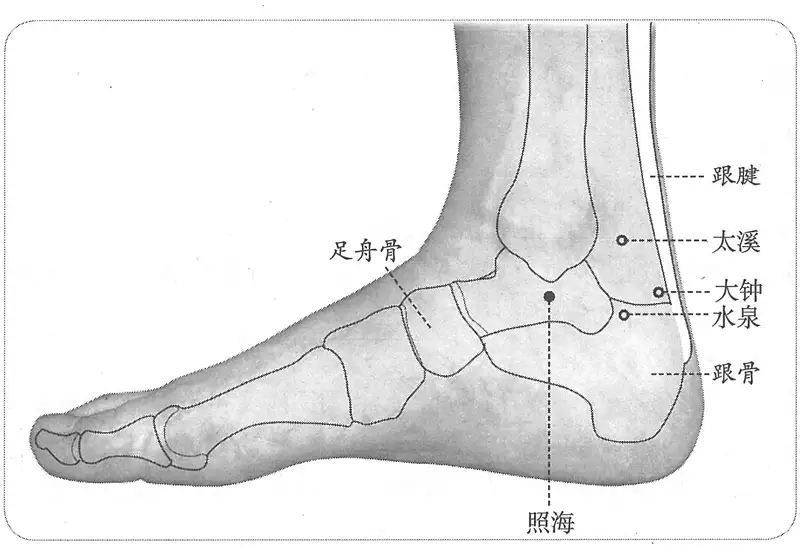

**图2-236　照海穴图**

**取穴**：由内踝尖向下推，至其下缘凹陷中。与申脉穴内外相对。

　1. 《黄帝明堂经》佚文

　　(1) 在足内踝下一寸。（《针灸甲乙经》卷三、《针方六集》、《类经图翼》）

　　(2) 在足内踝下。（《千金要方》卷二十九、《千金翼方》、《外台秘要》、《素问·气穴论》王冰注、《医心方》、《铜人腧穴针灸图经》、《圣济总录》、《针灸资生经》、《窦太师针经》、《十四经发挥》、《针灸聚英》、《古今医统》、《医学入门》、《针灸大成》、《循经考穴编》）

　　(3) 在内踝下四分。（《千金要方》卷三十）

　　(4) 在足内踝尖下二寸白肉际是穴。（《窦太师秘传》）

〔p.837 (인쇄 809)〕

　　(5) 足内踝下白肉际。（《针灸玉龙经》、《医学纲目》）

　　(6) 在内踝下四分，前后有筋，上有踝骨，下有软骨，其穴居中。（《神应经》、《针灸大成》、《医宗金鉴·刺灸心法要诀》、《针灸易学》、《针灸逢源》）

　　(7) 内踝边下四分许陷中。（《针灸十四经穴位考订》）

　2. 统编针灸学教材

　　(1) 部位：足内踝下四分，前后两筋，上又踝骨，下又软骨，其穴居中。取穴：坐稳，两足跖底相对合，从内踝骨下陷中取之。（1957年南京《针灸学》）

　　(2) 部位：内踝下四分。取穴：坐位，两足底相对合，从内踝骨下缘凹陷中取之。（1版《针灸学讲义》）

　　(3) 部位：在内踝下一寸。取穴：在内踝正下缘之凹陷中取穴。（2版《针灸学讲义》）

　　(4) 内踝下缘凹陷中。（4、5版《针灸学》）

　　(5) 在足内侧，内踝尖下方凹陷处。（6版《针灸学》）

　　(6) 内踝高点正下缘凹陷处。（7版《针灸学》）

　　(7) 内踝下缘凹陷中，即内踝下一寸。（《中国针灸学》）

**文献分析**：本穴定位，《黄帝明堂经》直接以体表标志描述很明确，后世由于“除踝”、“含踝”之分歧，而别以分寸折量，作“内踝下一寸”，皆失古义。详见本书“总论”。

#### 【类属】 

足少阴肾经穴；阴𫏋脉所生。

**脉气所发**：阴𫏋脉所生。（《黄帝明堂经》）

**归经**：足少阴经。（《千金要方》卷二十九、《铜人腧穴针灸图经》卷上）

#### 【适应症】 

主治目疾、咽喉、前阴及妇科病症。常用于目赤肿痛；咽干、咽痛；月经不调，赤白带下，子宫脱垂，疝气，癃闭；癫痫。

　1. 主目痛引眦，少腹偏痛，背一作脊伛瘛疭，视昏，嗜卧，照海主之。写左阴𫏋，取足左右少阴俞，先刺阴𫏋，后刺少阴，气在横骨上。惊，善悲不乐如堕坠，汗不出，面尘黑，病饥不欲食。卒疝少腹痛，照海主之，病在左取右，右取左，立已。阴暴起疝。痹。偏枯不能行，大风默默不知所痛，视如见星，溺黄，小腹热，咽干，照海主之，写左阴𫏋，右少阴俞，先刺阴𫏋，后刺少阴，在横骨中。女子不下月水。妇人淋沥，阴挺出，四肢淫泺，身闷。（《黄帝明堂经》）

**按**：《内经》载阴𫏋脉病候主目疾，相应的针灸方也为目痛；《脉经》载阴𫏋脉病候为“苦少腹痛，里急，腰及髋窌下相连阴中痛，男子阴疝，女子漏下不止”，而《黄帝明堂经》载本穴主治正主目疾和男科、妇科病症。

　2. 治嗌干，四肢懈惰，善悲不乐，久疟，卒疝少腹痛，呕吐，嗜卧，大风偏枯，半身不遂，女子淋沥，阴挺出。（《铜人腧穴针灸图经》卷下）

　3. 窦太师针灸遗存

　　(1) 治偏坠木肾，泻；大便不通，腹内一切气痛，泻。（《窦太师针经》）

　　(2) 治偏坠木肾肿痛，泻之；大便闭结不通，泻之立通；但腹中气痛，泻中。（《大本琼瑶神书》）

　　(3) 治大便闭结不通，热症。看虚实治。（《窦太师秘传》）

　　(4) 主腹内一切隐疾。（《针方六集》卷五）

　4. 统编针灸学教材

　　(1) 主治经逆，月经不调，阴挺，阴痒，疝气腹痛，痫病夜发，咽干，失眠，嗜卧。（1957年南京《针灸学》、1版《针灸学讲义》）

〔p.838 (인쇄 810)〕

　　(2) 主治月经不调，赤白带下，阴挺，阴痒，疝气，小便频数，癫痫，咽喉干痛，失眠。（2版《针灸学讲义》）

　　(3) 主治月经不调，赤白带下，阴挺，阴痒，小便频数，癃闭，便秘，脚气红肿，痫证，不寐。（4版《针灸学》）

　　(4) 主治月经不调，带下，阴挺，小便频数，癃闭，便秘，咽喉干痛，癫痫，失眠。（5版《针灸学》）

　　(5) 主治痫证，失眠，小便不利，小便频数，咽干咽痛，目赤肿痛，月经不调，痛经，赤白带下。（6版《针灸学》）

　　(6) 主治：①癫痫，失眠等精神、神志疾患；②咽干咽痛，目赤肿痛等五官热性疾患；③月经不调，赤白带下，阴挺等妇科疾证；④小便频数，癃闭。（7版《针灸学》）

　　(7) 主治月经不调，赤白带下，阴挺，阴痒，小便频数，癃闭，便秘，痫证，不寐，咽喉干痛，气喘。（《中国针灸学》）

**文献分析**：《黄帝明堂经》及窦太师针灸载本穴主治反复提到阴疝，《脉经》载阴𫏋脉病候也主阴疝，1、2版《针灸学讲义》从之，而其余各版教材皆未收录，今补之。

#### 附：临床应用举例 

　1. 目疾

　　(1) 目中赤痛从内眦始，取之阴𫏋。（《灵枢·热病》）

**按**：这里的“阴𫏋”是穴名，相当于照海穴。

　　(2) 目痛引眦，少腹偏痛，背伛瘛疭，视昏嗜卧，照海主之。泻左阴𫏋，取足左右少阴俞，先刺阴𫏋，后刺少阴。（《针灸甲乙经》卷七）

　　(3) 眼肌痉挛：针刺照海、申脉治疗。［吉林中医药，2001(4):46］

　2. 咽喉病症

　　(1) 喉痹乳蛾：少商针入一分，卧针向后三分、照海、太冲。（《医学纲目》卷十五）

　　(2) 必准者，取照海治喉中之闭塞。（《标幽赋》）

　　(3) 咽喉最急先百会，太冲照海及阴交。（《席弘赋》）

　　(4) 梅核气：针刺照海穴治疗。［针灸临床杂志，1995，11(2):46］

　　(5) 急性咽炎：针刺照海穴治疗。［山东中医杂志，1999，18(11):523］

　　(6) 舌咽神经痛：针刺列缺、照海为主治疗。［中国针灸，1998(10):622］

　　(7) 声音嘶哑：双侧照海穴直刺。［针灸临床杂志，2001，17(4):43］

　3. 妇科病症

　　(1) 治月经不断方……灸内踝下白肉际青脉上，随年壮。（《千金要方》卷四）

　　(2) 女人漏下赤白，四肢酸削，灸漏阴三十壮，穴在内踝下五分，微动脉上。（《千金要方》卷四、《千金翼方》）

　　(3) 阴𫏋阴维，而下胎衣。（《标幽赋》）

　　(4) 不孕症：针刺照海穴治疗。［中国针灸，2001，21(6):361］

　4. 大小便病症

　　(1) 癃，取之阴𫏋及三毛上及血络出血。（《灵枢·热病》）

**按**：“阴𫏋”为“照海”穴别名。

　　(2) 手术后尿潴留：深刺照海穴。［上海针灸杂志，2002，21(4):48］

　　(3) 《产经》云：治小儿白痢，灸足内踝下骨际三壮，随儿小大增减。（《医心方》卷二十五）

〔p.839 (인쇄 811)〕

　　(4) 中风后大便不通，泻照海二穴。（《针灸集要·盘石金直刺秘传》）

　　(5) 伤寒，大便闭结：刺足三里；未愈，泻照海。（《针灸集要·盘石金直刺秘传》）

　　(6) 中风后大小便闭结不通：泻支沟二穴。小便不通：泻阴谷二穴。大便不通，泻照海二穴。（《针灸集要·盘石金直刺秘传》）

　　(7) 大便闭塞不能通，照海分明在足中。（《针灸玉龙歌》）

　5. 局部病症

　　(1) 红肿脚气生疮：行间、三里、照海、昆仑、绝谷、京骨、委中。问曰：脚气之证缘何而得？答曰：皆因劳役过多，热汤泡洗，气血不散，故如此也。但针之，不宜灸。复刺后穴：丘墟、昆仑。（《针灸集成》第四十三方）

　　(2) 穿根草鞋风：昆仑、丘墟、照海、商丘。问曰：此证缘何而得？答曰：皆因劳役过多，湿气流注，或因大热行路，凉水浸洗，故如此也。复刺后穴：太冲、解溪。（《针灸集成》第四十四方）

　　(3) 但见两肘之拘挛，仗曲池而平扫，四肢之懈惰，凭照海以消除。（《通玄指要赋》）

　　(4) 阴𫏋阳𫏋两踝边，脚气四穴先寻取。阴阳陵泉亦主之，阴𫏋阳𫏋与三里，诸穴一般治脚气，在腰玄机宜正取。（《灵光赋》）

**按**：阴𫏋，相当于照海；阳𫏋，相当于申脉穴。

　6. 腹痛疝气

　　(1) 腹痛，并治气块：内关、支沟、照海。（《医学纲目》卷二十二）

　　(2) 缠肠痧证：大肠俞、内关、中管、天枢、照海。（《针灸捷径》卷之下）

　　(3) 卒疝少腹痛不可忍：大敦三分，陷六呼，灸七壮、阴市三分，灸五壮、照海三分，灸七壮。（《医学纲目》卷十四）

　　(4) 若是七疝小肠痛，照海阴交曲泉针。（《席弘赋》）

　7. 其他病症

　　(1) 戊辰岁，户部王缙庵公乃弟，患心痫疾数载矣。徐堂翁召予视之，须行八法开阖方可，公如其言。而刺照海、列缺，灸心俞等穴，其针待气至，乃行生成之数而愈。凡治此症，须分五痫，此卷前载之详矣，兹不悉录。（《针灸大成》）

　　(2) 肾绞痛：照海配行间、太溪穴针刺治疗。［广西中医药，1996，19(3):28］

#### 【操作】 

直刺0.5~0.8寸。

　1. 刺入四分，留六呼，灸三壮。（《黄帝明堂经》）

　2. 灸三壮，针入三分。（《太平圣惠方·针经》）

　3. 针入三分，可灸七壮。（《铜人腧穴针灸图经》卷下）

　4. 窦太师针灸遗存

　　(1) 横针入五分，灸二七壮。（《窦太师针经》）

　　(2) 横刺入四分，二七壮，留六呼。（《大本琼瑶神书》）

　5. 统编针灸学教材

　　(1) 针三至五分，依取穴式进针，灸三至七壮。（1957年南京《针灸学》、1版《针灸学讲义》）

　　(2) 直刺3~5分，艾条灸3~7分钟。（2版《针灸学讲义》）

　　(3) 直刺0.5~1寸。（4版《针灸学》）

〔p.840 (인쇄 812)〕

　　(4) 直刺0.3~0.5寸。（5版《针灸学》）

　　(5) 直刺0.5~1寸，可灸。（6版《针灸学》）

　　(6) 直刺0.5~0.8寸。（7版《针灸学》）

　　(7) 直刺0.3~0.5寸，可灸。（《中国针灸学》）

　6. 直刺0.5~1寸。感应：酸麻向小腿及踝部。灸3壮；温灸5~10分钟。（上海《针灸学》）

### （七）复溜 Fùliū KI7 出《灵枢》 

问题：本穴与交信穴皆在内踝上二寸，那么究竟复溜在前，还是交信在前？

#### 【提要索隐】 

**穴名**：一名伏白，一名昌阳；一名外命。

**部位**：在小腿内侧，内踝尖上2寸，跟腱的前缘。

**适应症**：主治汗证及腹、腰脊部病症。常用于腹痛、泄泻；水肿，多汗或少汗；腰背痛，下肢痿痹；脉微细时止。**新增**：小便不利。

**针刺操作**：直刺0.5~1寸。

#### 【名实考】 

复溜，宋以前文献，如《针灸甲乙经》、《千金要方》、《太平圣惠方》、《医心方》作“复留”，义通。本穴又名“昌阳”，而昌阳也是脉名，在早期脉、穴同名现象很普遍，例如本经之“太溪”、“大钟”皆此类。

关于本穴定位，《黄帝明堂经》作“内踝上二寸”，而“内踝上”现在的定义是指内踝的最凸点，定名为“内踝尖”。而古典文献“内踝上”的本义是指内踝上缘上，《神应经》的理解是正确的。如果理解为内踝的最凸点，那么内踝上下“容爪甲”，或“四分”便无法解释了——只能是针刺骨上了。同样，《黄帝明堂经》所说“膝上”不能理解为髌骨中点上；“目上”不能理解为瞳仁上等等。关于对古代文献所述折量取穴基准点的理解，详见本书“总论”。

本穴与交信穴均内踝上二寸，其前后位置关系，古今文献长期分歧，古代针灸铜人也不一致。其实两者的关系，《黄帝明堂经》于交信穴下说得很明确：“在足内踝上二寸，少阴前，太阴后廉，筋骨间，阴𫏋之郄”，显然是交信在前，复溜在后。

　1. 肾出于涌泉者，涌泉者足心也……行于复溜，复溜上内踝二寸，动而不休，为经……足少阴经也。（《灵枢·本输》）

　2. 行于复留，复留者，金也，一名伏白，一名昌阳，在足内踝上二寸陷者中，足少阴脉之所行也，为经。（《黄帝明堂经》）

　3. 复溜二穴，在内踝上二寸是。苏、徐云名曰外命。（《外台秘要》）

**按**：“苏”、“徐”指苏敬、徐思恭，出唐代《三家脚气论》，原书不存，佚文见《外台秘要》、《医心方》。

　4. 此穴承照海之脉而上行，流而不居，故曰复溜。又脉绝者，取此穴则脉生，亦有复溜之义。（《经穴解》）

#### 【定位】 

**部位**：在小腿内侧，内踝尖上2寸，跟腱的前缘（图2-237）。

**取穴**：太溪直上2寸，前平交信穴。

　1. 上内踝二寸，动而不休。（《灵枢·本输》）

　2. 在足内踝上二寸陷者中。（《黄帝明堂经》、《铜人腧穴针灸图经》卷下及“穴腧都数”、《圣济总录》、《窦太师针经》、《针方六集》、《循经考穴编》、《针灸易学》）

〔p.841 (인쇄 813)〕

　3. 在足内踝上二寸，动脉中陷者是也。（《太平圣惠方·明堂》、《针灸资生经》、《针灸玉龙经》、《十四经发挥》、《医学入门》）

　4. 在足内踝上二寸。（《铜人腧穴针灸图经》卷上）

　5. 在内踝上除踝二寸，踝后五分，与太溪相直。（《神应经》）

　6. 足内踝上二寸筋骨陷中，前旁骨是复溜，后旁筋是交信，二穴止隔一条筋。（《针灸聚英》卷一、《古今医统》、《黄帝内经灵枢注证发微》、《针灸大成》、《类经图翼》、《医宗金鉴·刺灸心法要诀》、《针灸逢源》）

　7. 踝上二寸复溜名，溜前筋骨取交信，亦曰踝上二寸行。（《针灸聚英》卷四、《针灸问对》、《古今医统》）

　8. 当比阴交微前些，前旁骨是复溜，后旁筋是交信，二穴止隔筋一条耳。（《循经考穴编》下）

　9. 针灸铜人定位

　　(1) 明正统仿宋铜人：交信在前，复溜在后。

　　(2) 明嘉靖铜人：复溜在前，交信在后。

　　(3) 光绪铜人：交信在前，复溜在后。

　　(4) 日本东京博物馆铜人：复溜在前，交信在后。

　　(5) 韩国德寿宫铜人：交信在复溜的后上方。

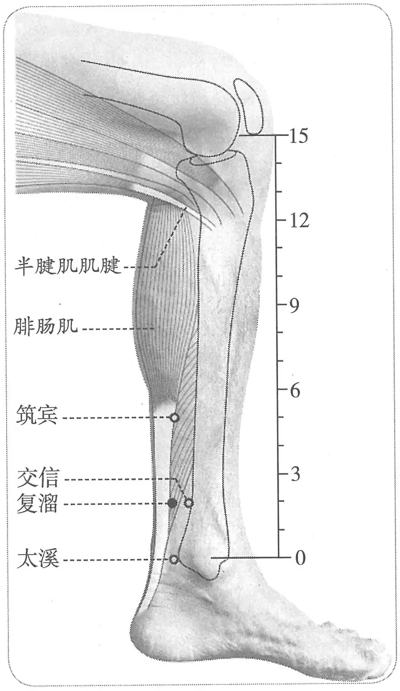

**图2-237　复溜穴图**

　10. 太溪直上二寸，前旁胫骨后缘。（《针灸十四经穴位考订》）

　11. 统编针灸学教材

　　(1) 部位：内踝上二寸。取穴：从内踝骨后太溪穴外侧筋腱边直上二寸取之。（1957年南京《针灸学》）

　　(2) 部位：内踝上二寸。取穴：从太溪穴直上二寸取之。（1版《针灸学讲义》）

　　(3) 部位：在足内踝上二寸陷者中。取穴：在太溪上二寸，当跟腱之前缘取之。（2版《针灸学讲义》）

　　(4) 太溪穴上2寸。（4、5版《针灸学》）

　　(5) 太溪穴上2寸，当跟腱的前缘。（7版《针灸学》）

　　(6) 在小腿内侧，太溪直上2寸，跟腱的前方。（6版《针灸学》、《中国针灸学》）

**文献分析**：关于本穴定位，纵向位置无分歧，横向位置的分歧在于没有综合考察交信的定位描述，根据后者的定位，可以明确判定：交信穴在前，复溜穴在后。

#### 【类属】 

足少阴肾经穴；五输穴之经穴。

　1. 肾出于涌泉者，涌泉者足心也……行于复溜，复溜上内踝二寸，动而不休，为经……足少阴经也。（《灵枢·本输》）

　2. 足少阴脉之所行也，为经。（《黄帝明堂经》）

#### 【适应症】 

主治汗证及腹、腰脊部病症。常用于腹痛、泄泻；水肿，多汗或少汗；腰背痛，下肢痿痹；脉微细时止。**新增**：小便不利。

〔p.842 (인쇄 814)〕

　1. 主疟热，少气，足胻寒不能自温，腹膜切痛引心。心如悬，阴厥，脚腨后廉急，不可前却，血癃，肠澼便脓血，足跗上痛，舌卷不能言，善笑，足痿不收履，溺青、赤、白、黄、黑。青取井，赤取荥，黄取输，白取经，黑取合。血痔，泄后重，腹痛如癃状，狂仆必有所扶持，及大气涎出，鼻孔中痛，腹中雷鸣。骨寒热无所安，汗出不休。嗌干，腹瘈痛，坐起目䀮䀮，善怒多言。腰痛引脊内廉，复留主之，春无见血，出血太多，虚不可复。风逆，四肢肿。乳难。（《黄帝明堂经》）

**按**：“骨寒热无所安，汗出不休”症状见于《灵枢·寒热病》；“腰痛引脊内廉……虚不可复”、“舌卷不能言”症状见于《素问·刺腰痛》；“风逆，四肢肿”症状见于《灵枢·癫狂》。“乳难”即难产。

　2. 治腹鼓，十水病，女子赤白漏下，五淋小便如散灰色。（《太平圣惠方·明堂》）

　3. 治腰脊内引痛，不得俯仰起坐，目䀮䀮，善怒多言，舌干涎自出，足痿不收履，胻寒不自温，腹中雷鸣，腹胀如鼓，四肢肿，十水病，溺青赤黄白黑。青取井，赤取荥，黄取腧，白取经，黑取合。血痔泄后肿，五淋，小便如散火，骨寒热，汗注不止。（《铜人腧穴针灸图经》卷下）

　4. 窦太师针灸遗存

　　(1) 伤寒无汗，补合谷穴泻此穴立出；伤寒汗多，补此穴泻合谷穴立止，此大回六脉，六脉俱无补之。不见脉，不可疗也。（《窦太师针经》）

　　(2) 治伤寒无汗，补合谷泻此穴汗立出；伤寒汗多，泻合谷补此穴汗立止；大回六脉，补；盗汗不止，补。（《大本琼瑶神书》）

　　(3) 伤寒无汗，补合谷穴，泻此穴，汗立出；伤寒汗多，补此穴，泻合谷穴，汗立止。（《针方六集》卷五）

　　(4) 此穴大能回六脉，决死生，若脉微或绝，补之不见者，不可疗也。又主伤寒无汗，疟疾寒多，宜补合谷而泻此。（《循经考穴编》下）

　　(5) 伤寒无汗泻复溜，汗多最用合谷收。若还六脉俱微细，下针才补脉还浮。复溜二穴针入一分，沿皮顺骨向下一寸半，看症虚实补泻，灸二七壮，大回六脉补之。（《针灸玉龙歌》）

　　(6) 盗汗，脉微细不见或时无脉。（《针灸聚英》卷一、《针灸大成》、《针方六集》、《循经考穴编》、《类经图翼》、《针灸逢源》）

　5. 统编针灸学教材

　　(1) 主治五淋，肠澼，肠中雷鸣，水肿腹胀，四肢肿，腰脊痛，足痿寒，盗汗，伤寒无汗脉微细时止。（1957年南京《针灸学》）

　　(2) 主治小便淋沥，肠澼，肠中雷鸣，口干舌燥，水肿腹胀，四肢肿，腰脊痛，足痿寒，盗汗，伤寒无汗脉微细时止。（1版《针灸学讲义》）

　　(3) 主治泄泻，肠鸣，水肿，腹胀，腿肿，足痿，盗汗，脉微细时无，身热无汗。（2版《针灸学讲义》）

　　(4) 主治水肿，腹胀，泄泻，肠鸣，腿肿，足痿，盗汗，热病汗不出，汗出不止。（4版《针灸学》）

　　(5) 主治水肿，腹胀，泄泻，盗汗，热病汗不出，下肢痿痹。（5版《针灸学》）

　　(6) 主治泄泻，肠鸣，水肿，腹胀，腿肿，足痿，盗汗，身热无汗，腰脊强痛。（6版《针灸学》）

　　(7) 主治：①水肿，汗证（无汗或多汗）等津液输布失调疾患；②腹胀、腹泻等胃肠疾患；③腰脊强痛，下肢痿痹。（7版《针灸学》）

〔p.843 (인쇄 815)〕

　　(8) 主治水肿，腹胀，泄泻，肠鸣，足痿，盗汗，自汗，热病汗不出。（《中国针灸学》）

**文献分析**：《黄帝明堂经》、《太平圣惠方》都强调了本穴主小便的症状，且有明确的临床应用，教材中除1957年南京《针灸学》、1版《针灸学讲义》外，其余各版均未收录，今补之。

#### 附：临床应用举例 

　1. 汗证

　　(1) 伤寒有阴有阳，用意参详，不问阴阳，七日过经不汗：合谷补、复溜泻，汗出立愈，此穴解表发汗神妙。（《针灸玉龙经·盘石金直刺秘传》）

　　(2) 伤寒不论阴阳，日过不汗：补合谷，泻复溜在足内踝上二寸皮顺骨下半寸；汗出：补复溜，泻合谷，刺委中血出；少愈，更泻合谷。（《针灸集要·盘石金直刺秘传》）

　　(3) 自汗发黄复溜凭。（《肘后歌》）

　　(4) 手足多汗症：复溜穴、合谷穴，针刺治疗。［新中医，1984(11):27］

　　(5) 顽固盗汗：复溜穴、三阴交穴、阴郄，针灸疗法。［上海针灸杂志，1986，5(4):43］

　　(6) 汗症：针刺合谷、复溜治疗。［河南中医，1994，14(1):53］

　　(7) 治汗证：合谷、复溜为主穴，针灸治疗。［国医论坛，2001，16(1):37］

　2. 腰腿病症

　　(1) 足少阴令人腰痛，痛引脊内廉，刺少阴于内踝上二痏，春无见血。出血太多，不可复也。（《素问·刺腰痛》）

　　(2) 昌阳之脉令人腰痛，痛引膺，目䀮䀮然，甚则反折，舌卷不能言，刺内筋为二痏，在内踝上大筋前太阴后，上踝二寸所。（《素问·刺腰痛》）

　　(3) 治腰脊内引痛，不得屈伸，近上痛者，刺手阳明经合谷二穴；近下痛者，刺足太阳经昆仑二穴，次刺足少阴经伏白二穴。（《针经摘英集》）

**按**：伏白，复溜穴别名。

　　(4) 髀枢脚痛泻丘墟，复溜治肿如神医。（《灵光赋》）

　　(5) 髋骨腿疼三里泻，复溜气滞便离腰。（《席弘赋》）

　　(6) 伤寒四肢厥逆冷，脉气无时仔细看，神奇妙穴真有二，复溜半寸顺骨行。四肢回还脉气浮，须晓阴阳倒换求，寒则须补绝骨是，热则绝骨泻无忧。（《肘后歌》）

　　(7) 腰反折：针刺复溜治疗。［中国针灸，2000(4):226］

　　(8) 肾虚腰痛：针刺复溜治疗。［河北中医，2001，23(7):531］

　3. 前阴、膀胱病症

　　(1) 血淋，灸丹田随年壮，又灸复溜五十壮，一云随年壮。（《千金要方》卷二十一、《千金翼方》）

　　(2) 玉茎中痛：中极、三阴交、太溪、复溜。问曰：此证缘何而得？答曰：因少年之时，过用金石之药，有伤茎孔，使阴阳交感不能发泄，故如此也。宜刺后穴：中极、阴陵泉、关元、血海。（《针灸集成》第五十二方）

　　(3) 老年性阴道炎：复溜穴、关元穴，针刺治疗。［河北中医，1985(3):44］

　4. 其他病症

　　(1) 治脉微细不见，或时无脉者：以圆利针刺足少阴经复溜二穴，在内踝上二寸陷中。针至骨顺针往下刺之，候回阳脉生大，乃出针。（《针经摘英集》）

　　(2) 伤寒六脉不应手者：泻合谷，补复溜。（《针灸集要·盘石金直刺秘传》）

　　(3) 经行水肿：针刺复溜治疗。［中国针灸，2002，22(9):612］

〔p.844 (인쇄 816)〕

#### 【操作】 

直刺0.5~1寸。

　1. 刺入三分，留三呼，灸五壮。（《黄帝明堂经》）

　2. 窦太师针灸遗存

　　(1) 刺入一分，沿皮顺骨下一寸，灸二七壮。（《窦太师针经》）

　　(2) 针一分，沿皮顺骨下寸半，灸七壮。（《窦太师秘传》）

　　(3) 刺入一分，沿皮顺下一寸半。治伤寒无汗，补合谷泻此穴，汗立出，伤寒汗多，泻合谷补此穴，汗立止，大回六脉，补盗汗不止，补六呼，三壮。（《大本琼瑶神书》）

　　(4) 以圆利针……针至骨，顺针往下刺之，候回肠脉生大，乃出针。（《针经摘英集》）

　　(5) 针一分，沿皮向骨下一寸半，灸二七壮。（《针灸玉龙经》）

　　(6) 一法刺入一分，沿皮顺骨下一寸，可灸二十壮。（《循经考穴编》下）

　3. 统编针灸学教材

　　(1) 针三至五分，灸七至十五壮。（1957年南京《针灸学》、1版《针灸学讲义》）

　　(2) 直刺3~5分，艾条灸3~7分钟。（2版《针灸学讲义》）

　　(3) 直刺0.6~1.2寸。（4版《针灸学》）

　　(4) 直刺0.6~1寸。（5版《针灸学》）

　　(5) 直刺0.5~1寸；可灸。（6版《针灸学》）

　　(6) 直刺0.5~1寸（7版《针灸学》）

　　(7) 直刺0.5~0.7寸。可灸。（《中国针灸学》）

　4. 直刺1~1.5寸。感应：局部酸胀，有时麻向足底。灸5~7壮；温灸5~10分钟。（上海《针灸学》）

### （八）交信 Jiāoxìn KI8 出《黄帝明堂经》 

#### 【提要索隐】 

**部位**：在小腿内侧，内踝尖上2寸，胫骨内侧缘后际凹陷中。

**适应症**：主治前阴及妇科病症。常用于癃闭，疝气，前阴急痛引股膝内侧；月经不调；泄泻，便秘。

**针刺操作**：直刺0.8~1.2寸。

#### 【名实考】 

关于本穴名称，《循经考穴编》曰“一名内筋”，经考此乃误解王冰《素问》注所致，故不从之。

关于本穴与复溜穴的前后位置关系，自古就有分歧。其实，《黄帝明堂经》说得很明确：交信在“少阴前，太阴后廉，筋骨间”，即近骨者为交信，远骨者为复溜。宋代王惟一创制针灸铜人，此二穴的位置关系标注正确无误，而自明代开始，却将此二穴的前后关系颠倒了。

　1. 交信，在足内踝上二寸，少阴前，太阴后廉，筋骨间，阴𫏋之郄。（《黄帝明堂经》）

　2. 按各经之穴，皆未有一经之穴，两穴并立一处者，此穴与复溜，俱在内踝上二寸，仅隔一条筋，一在筋里，一在筋外，有交之义焉。脉之不见取复溜，女人之月事不来取交信，有信之义焉，故曰交信。（《经穴解》）

#### 别名“内筋”辨 

　1. 昌阳之脉，令人腰痛，痛引膺，目䀮䀮然，甚则反折，舌卷不能言，刺内筋为二痏，在内踝上大筋前，太阴后，上踝二寸所。王冰注曰：内筋，谓大筋之前分肉也。太阴后大筋前，

〔p.845 (인쇄 817)〕

即阴𫏋之郄交信穴也。（《素问·刺腰痛》）

　2. 交信，一名内筋，穴在内踝上二寸，少阴前，太阴后，筋骨间。广注：当较阴交微后些。阴𫏋之郄。（《循经考穴编》下）

**按**：从《素问》原文及王冰注文来看，此处“内筋”皆非穴名，《循经考穴编》作者理解有误。

#### 【定位】 

**部位**：在小腿内侧，内踝尖上2寸，胫骨内侧缘后际凹陷中（图2-238）。

**取穴**：在太溪上2寸，当复溜与胫骨内侧缘之间取之。

　1. 《黄帝明堂经》佚文

　　(1) 在足内踝上二寸，少阴前，太阴后，筋骨间。（《针灸甲乙经》卷三、《素问》王冰注、《铜人腧穴针灸图经》卷上、《类经图翼》、《循经考穴编》）

　　(2) 在足内踝上二寸，少阴前，太阴后廉筋骨间。（《千金要方》卷二十九、《千金翼方》、《外台秘要》、《铜人腧穴针灸图经》卷下、《圣济总录》、《针灸资生经》、《十四经发挥》、《针灸聚英》、《古今医统》、《医学纲目》、《针灸大成》、《针方六集》、《针灸逢源》）

**图2-238　交信穴图**

　　(3) 在内踝上二寸。（《医心方》卷二、《铜人腧穴针灸图经》卷下“穴腧都数”）

　　(4) 在内踝上二寸后廉筋间陷者中。（《太平圣惠方·明堂》）

　2. 内踝上二寸，复溜前三阴交后，筋骨间。（《医学入门》卷一）

　3. 在内踝上二寸，少阴前，太阴后筋骨间。居复溜之后，二穴相平，前旁骨是复溜，后旁筋是交信，两穴只隔一筋。（《针方六集》卷一）

　4. 从复溜斜外，上行复溜穴之后二寸许，后旁筋，交信穴也。（《医宗金鉴·刺灸心法要诀》）

　5. 复溜之后约三分许，后旁筋腱。（《针灸十四经穴位考订》）

　6. 统编针灸学教材

　　(1) 部位：足内踝骨上二寸，少阴前太阴后筋骨间。取穴：复溜穴前五分胫骨后缘取之。（1957年南京《针灸学》）

　　(2) 部位：复溜穴前五分。取穴：内踝上二寸，当复溜穴与足太阴经之间取之。（1版《针灸学讲义》）

　　(3) 部位：在足内踝上二寸，筋骨间。取穴：在太溪上二寸，当复溜与胫骨内侧缘之间取之。（2版《针灸学讲义》）

　　(4) 复溜穴前约0.5寸。（4、5版《针灸学》）

　　(5) 在小腿内侧，当太溪直上2寸，复溜前0.5寸，胫骨内侧缘的后方。（6版《针灸学》）

　　(6) 太溪穴上2寸，胫骨内侧面后缘，约当复溜穴前0.5寸。（7版《针灸学》）

　　(7) 复溜前约五分，太溪上二寸，胫骨内侧缘的后方。（《中国针灸学》）

#### 【类属】 

足少阴肾经穴；阴𫏋脉郄穴。

〔p.846 (인쇄 818)〕

阴𫏋之郄。（《黄帝明堂经》）

**归经：**

　1. 足少阴经。（《千金要方》卷二十九、《铜人腧穴针灸图经》卷上）

　2. 阴𫏋脉。（《黄帝内经明堂》）

**按**：交信穴为“阴𫏋之郄”，位于“少阴前、太阴后廉筋骨间”，归于阴𫏋脉理由充分。然而自唐以后皆归属于足少阴肾经。

#### 【适应症】 

主治前阴及妇科病症。常用于癃闭，疝气，前阴急痛引股膝内侧；月经不调；泄泻，便秘。

　1. 主气癃，癞疝，阴急，股枢腨内廉痛。（《黄帝明堂经》）

　2. 主泄利赤白，漏血。（《千金要方》卷三十）

　3. 大小便难。（《太平圣惠方·明堂》）

　4. 治气淋癞疝，阴急股引腨内廉骨痛。又泄利赤白，女子漏血不止。（《铜人腧穴针灸图经》卷下）

　5. 阴汗，阴挺出，月水不来，小腹偏痛，四肢淫泺，盗汗出。（《针灸聚英》卷一、《针灸大成》、《针方六集》）

**按**：以上诸症乃高武从《针灸资生经》录自《千金要方》“阴𫏋”穴主治，高氏或以为“交信”为阴𫏋之郄，故归于本穴下。实则《千金要方》、《太平圣惠方》中“阴𫏋”穴皆系照海穴。

　6. 统编针灸学教材

　　(1) 主治气淋，女子血漏不止，阴挺，月经不调，泻利赤白，大便难，癞疝。（1957年南京《针灸学》）

　　(2) 主治阴挺，月经不调，漏下，小便淋沥，癞疝，泻利赤白，大便难。（1版《针灸学讲义》）

　　(3) 主治月经不调，崩漏，阴挺，泄泻，大便难，睾丸肿痛。（2版《针灸学讲义》、4版《针灸学》）

　　(4) 主治月经不调，崩漏，阴挺，疝气，泄泻，便秘。（5版《针灸学》）

　　(5) 主治月经不调，崩漏，阴挺，泄泻，大便难，睾丸肿痛，五淋，疝气，阴痒，泻利赤白和膝，股，腘内廉痛。（6版《针灸学》）

　　(6) 主治：①月经不调，崩漏，阴挺，阴痒等妇科病证；②疝气；③五淋；④腹泻，便秘，痢疾等胃肠病证。（7版《针灸学》）

　　(7) 主治月经不调，痛经，崩漏，阴挺，泄泻，便秘，睾丸肿痛。（《中国针灸学》）

**文献分析**：《黄帝明堂经》所载本穴主治“气癃，癞疝，阴急，股枢腨内廉痛”，系一组阴疝的典型症状。教材中“月经不调，痛经，阴挺”诸症系承袭高武《针灸聚英》之误，今去之。

#### 附：临床应用举例 

　1. 腰膝强痛交信凭。（《肘后歌》）

　2. 崩漏之崩症，地机、血海；漏症，交信、合阳。［江苏中医杂志，1983，4(3):44］

#### 【操作】 

直刺0.8~1.2寸。

　1. 刺入四分，留五呼，灸三壮。（《黄帝明堂经》）

　2. 统编针灸学教材

　　(1) 针五至八分，灸三至七壮。（1957年南京《针灸学》、1版《针灸学讲义》）

　　(2) 直刺4分，艾条灸3~7分钟。（2版《针灸学讲义》）

　　(3) 直刺0.6~1.2寸。（4、5版《针灸学》）

　　(4) 直刺0.6~1.2寸；可灸。（6版《针灸学》）

〔p.847 (인쇄 819)〕

　　(5) 直刺0.8~1.2寸（7版《针灸学》）

　　(6) 直刺0.5~0.7寸。可灸。（《中国针灸学》）

### （九）筑宾 Zhùbīn KI9 出《黄帝明堂经》 

#### 【提要索隐】 

**部位**：在小腿内侧，太溪直上5寸，比目鱼肌与跟腱之间。

**国标修订**：1990年版国标：在小腿内侧，当太溪与阴谷的连线上，太溪上5寸，腓肠肌肌腹的内下方。2006年修订版：在小腿内侧，太溪直上5寸，比目鱼肌与跟腱之间。

**按**：1990年版国标的描述欠准确，故2006年版修订如上。

**适应症**：主治癫狂及局部病症。常用于癫痫、吐舌；呕吐；疝气；小腿内侧痛。

**针刺操作**：直刺1~1.5寸。

#### 【名实考】 

关于本穴定位，需正确理解《黄帝明堂经》“腨分中”。已知承山穴定位描述为“兑腨肠下分肉间”，承筋穴作“在腨肠中央”，则此处“腨分中”是指腓肠肌（腨肠）下端与内侧肌肉之间，正是“比目鱼肌与跟腱之间”陷中。然而，仅仅根据这样的描述，还不能定出一个确定的穴位，宋代王惟一创制针灸铜人时，将本穴标于内踝上五寸处，明代高武从之。可是明中期流行的十四经步穴歌却将本穴定于内踝上六寸处。这两种说法的依据皆不详，现代定位遵从宋代针灸铜人的定位法。

关于本穴定位，明代《医学入门》将阴谷穴内容与本穴相混，后人不辨，将二穴混杂。

　1. 筑宾，阴维之郄，在足内踝上腨分中。（《黄帝明堂经》）

　2. 足少阴肾之经，而阴维始于此，有宾之象焉。维者，所以维内防出也，有墙之象，有筑之义，故曰筑宾。（《经穴解》）

#### “阴谷”误作“筑宾”例 

内踝上腨分中，骨后大筋上，小筋下，屈膝取之。（《医学入门》卷一）

**按**：此系将下一穴“阴谷”定位文字混入本穴中。该书原文作“筑宾，内踝上腨分中骨后，大筋上、小筋下，屈膝取之。阴谷，膝内辅骨后，大筋下、小筋上动脉，屈膝取之”。传抄之误的痕迹十分明显。

#### 【定位】 

**部位**：在小腿内侧，太溪直上5寸，比目鱼肌与跟腱之间（图2-239）。

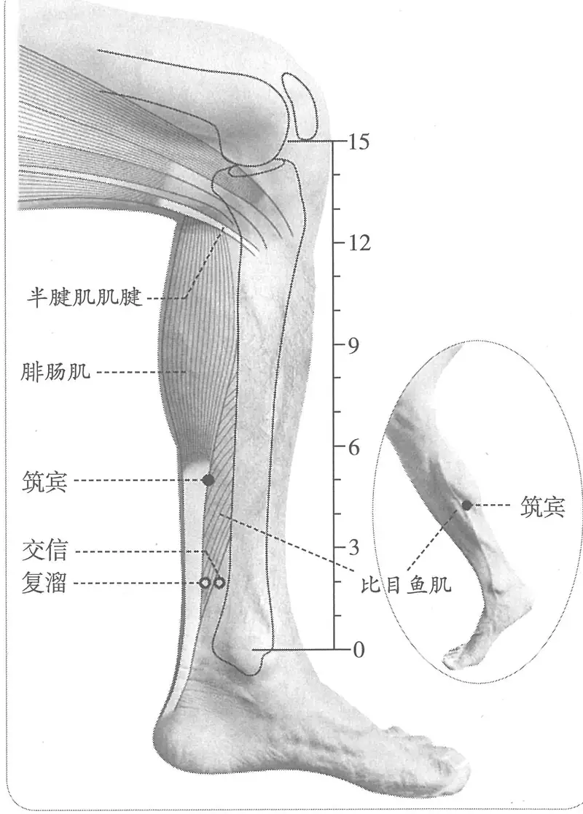

**图2-239　筑宾穴图**

**取穴**：屈膝，小腿抗阻力绷紧，胫骨内侧缘后呈现一条明显的窄条形肌肉，即比目鱼肌。筑宾穴即在该肌与跟腱之间，内踝尖上5寸，横平蠡沟穴。

〔p.848 (인쇄 820)〕

**相关解剖学基础**：比目鱼肌体表显示技法，根据该肌的作用，任何表现为抗阻力跖屈的动作均可显示出比目鱼肌。

技法一：抬起足跟，利用身体的自重产生一个抗阻力跖屈的运动，可非常清楚地显示出该肌。或者脚掌着地，前脚掌用力下压，坐位、立体均可，也可起到同样的效果。

技法二：最简单而有效的动作是，于任何体位，绷紧小腿肌肉，在小腿后面中部显现出明显的腓肠肌肌腹和比目鱼肌。

　1. 在足内踝上腨分中。（《黄帝明堂经》、《铜人腧穴针灸图经》、《圣济总录》、《针灸资生经》、《十四经发挥》、《医学纲目》、《针灸大成》、《类经图翼》、《医宗金鉴·刺灸心法要诀》、《针灸易学》、《针灸逢源》）

　2. 在足内踝上。（《太平圣惠方·明堂》）

　3. 内踝上五寸腨分中。（《针灸聚英》卷一、《古今医统》）

　4. 亦曰踝上二寸行，筑宾六寸腨分处。（《针灸聚英》卷四、《针灸问对》、《古今医统》、《针方六集》、《循经考穴编》）

　5. 太溪直上约五寸。（《针灸十四经穴位考订》）

　6. 统编针灸学教材

　　(1) 部位：内踝上腨分中。取穴：正坐垂足，从太溪穴直上腨分中，直对阴谷取之。（1957年南京《针灸学》）

　　(2) 部位：内踝上腨分中。取穴：正坐垂足，从太溪穴于阴谷穴成直线，腿肚边缘取之。（1版《针灸学讲义》）

　　(3) 部位：在足内踝上腨分中。取穴：于太溪、阴谷之连线上，当腓肠肌内侧肌腹下端取之（2版《针灸学讲义》）

　　(4) 太溪穴直上5寸。（4版《针灸学》）

　　(5) 太溪穴上5寸，在太溪与阴谷的连线上。（5版《针灸学》）

　　(6) 在小腿内侧，当太溪与阴谷的连线上，太溪上5寸，腓肠肌肌腹的内下方。（6版《针灸学》）

　　(7) 太溪穴与阴谷穴的连线上，太溪穴直上5寸，约当腓肠肌内侧肌腹下缘处。（7版《针灸学》）

　　(8) 太溪直上五寸，腓肠肌肌腹下方，当太溪与阴谷之连线上。（《中国针灸学》）

#### 【类属】 

足少阴肾经穴；阴维脉郄穴。

**脉气所发**：阴维之郄。（《黄帝明堂经》）

**归经**：足少阴肾经。（《千金要方》卷二十九、《铜人腧穴针灸图经》卷上）

#### 【适应症】 

主治癫狂及局部病症。常用于癫痫、吐舌；呕吐；疝气；小腿内侧痛。

　1. 主狂癫疾。大疝，绝子。（《黄帝明堂经》）

　2. 呕吐。（《外台秘要》卷三十九）

　3. 主小儿胎疝，癫病，吐舌。（《太平圣惠方·明堂》）

　4. 治小儿胎疝痛，不得乳，癫疾狂言，呕吐沫，足腨痛。（《铜人腧穴针灸图经》卷下）

　5. 主脚软无力，瘿瘤。（《循经考穴编》下）

　6. 统编针灸学教材

〔p.849 (인쇄 821)〕

　　(1) 主治癫狂，小儿疝，足内痛。（1957年南京《针灸学》、1版《针灸学讲义》）

　　(2) 主治癫狂，呕吐涎沫，疝痛，小儿胎疝，小腿内侧痛。（2版《针灸学讲义》）

　　(3) 主治癫狂，呕吐涎沫，疝痛，足胫痛。（4、5版《针灸学》）

　　(4) 主治癫狂，痫证，呕吐，疝气，小腿内侧痛。（6版《针灸学》）

　　(5) 主治：①癫狂；②疝气；③呕吐涎沫，吐舌；④小腿内侧痛。（7版《针灸学》）

　　(6) 主治癫狂，足胫痛，疝痛。（《中国针灸学》）

**按**：《太平圣惠方》“小儿胎疝，癫病，吐舌”一组症状中“吐舌”是小儿癫痫的一个伴随症状，而不是独立的症状，不能不言“痫”而单言“吐舌”。

#### 附：临床应用举例 

　1. 气疝，其状上连肾区，下及阴囊，或因号哭忿怒，则气郁之而胀，怒哭号罢，则气散者是也……或小儿亦有此疾，欲曰偏气，得于父已年老，或年少多病，阴痿精怯，强力入房，因而有子，胎中病也。此疝不治，惟筑宾一穴灸之。（《古今医统》卷六十）

　2. 齿痈之发在脐上五寸许，其形长如鹅子，令人寒战咬牙，痛连两胁，当灸筑宾二七壮。（《痈疽神秘灸经》）

　3. 赫痈在当脐大如瓜，突出红甚如瘿瘤，当灸阴谷七壮、筑宾二七壮。（《痈疽神秘灸经》）

#### 【操作】 

直刺1~1.5寸。

　1. 刺入三分，灸五壮。（《黄帝明堂经》）

　2. 一法横针五分，可灸七壮。（《循经考穴编》下）

　3. 统编针灸学教材

　　(1) 针五至八分，灸三至七壮。（1957年南京《针灸学》、1版《针灸学讲义》）

　　(2) 直刺5~8分，艾条灸3~7分钟。（2版《针灸学讲义》）

　　(3) 直刺1~1.5寸。（4、5、7版《针灸学》）

　　(4) 直刺1~1.5寸；可灸。（6版《针灸学》）

　　(5) 直刺0.5~0.7寸。可灸。（《中国针灸学》）

　4. 直刺1~2寸，酸麻上至大腿，下至足底。灸3壮；温灸5~15分钟。（上海《针灸学》）

### （十）阴谷 Yīngǔ KI10 出《灵枢》 

#### 【提要索隐】 

**部位**：在膝后区，腘横纹上，半腱肌肌腱外侧缘。

**适应症**：主治前阴及妇科病症。常用于阳痿，小便不利；月经不调，崩漏；腰脊痛，少腹、前阴、膝股内侧引痛；癫狂。

**针刺操作**：直刺1~1.5寸。

#### 【名实考】 

确定本穴的位置，应与足厥阴经曲泉穴一并考察，根据《黄帝明堂经》的描述，此二穴只相隔一条“大筋”，按说正确定位并不困难，而实际上此二穴，特别是曲泉穴的现代定位，分歧很大。关键问题在于：除了一条“大筋”之外，《黄帝明堂经》还提到了两条“小筋”，而在活体上确认这两条“小筋”，对于没有表面解剖学经验的人来说，有相当的难度，这从《循经考穴编》引述的各家之说可以感知。于是有人主张本穴定位，直接以“大筋”定位，不用“小筋”，我们在进行了严格的表面解剖学实验和尸体解剖观察的基础上，认为此法可行。

〔p.850 (인쇄 822)〕

关于本穴及曲泉穴的文献考证，详见曲泉穴“名实考”。

　1. 肾出于涌泉者，涌泉者足心也……入于阴谷，阴谷辅骨之后，大筋之下，小筋之上也，按之应手，屈膝而得之，为合。足少阴经也。（《灵枢·本输》）

　2. 入于阴谷，阴谷者，水也。在膝内辅骨后，大筋之下，小筋之上，按之应手，屈膝得之，足少阴脉之所入也，为合。（《黄帝明堂经》）

　3. 曲泉，在膝内辅骨下，大筋上，小筋下陷者中，屈膝得之。（《黄帝明堂经》）

　4. 按曲泉曰大筋上，小筋下；阴谷曰大筋下，小筋上。曲泉既间处两筋之间矣，则阴谷在下，与小筋无涉矣。宜竟曰“大筋之下”为是，“小筋之上”则误也。焉有两筋而颠倒可换者乎？故前于阴谷条已僭去“小筋上”三字。若曲泉，则凌岑青先生曰：迳取膝股内侧，屈膝缝尖为是。（《循经考穴编》下）

　5. 此穴为少阴经所入，冲脉由上而下行者，亦由于此。阴维脉由下而上行者，亦由于此，并本经之上行者，俱入于此穴。谷，言其深也；阴，言众阴之所聚也，故曰阴谷。（《经穴解》）

#### 【定位】 

**部位**：在膝后区，腘横纹上，半腱肌肌腱外侧缘（图2-240）。

**取穴**：当腘窝内侧，和委中相平，在半腱肌肌腱与半膜肌肌腱之间，屈膝取之。

　1. 辅骨之后，大筋之下，小筋之上也，按之应手，屈膝而得之。（《灵枢·本输》）

　2. 在膝下内辅骨后，大筋之下，小筋之上，按之应手，屈膝得之。（《黄帝明堂经》、《铜人腧穴针灸图经》卷下、《圣济总录》、《针灸资生经》、《十四经发挥》、《针灸聚英》、《古今医统》、《针灸大成》、《类经图翼》、《医宗金鉴·刺灸心法要诀》、《针灸易学》、《针灸逢源》）

　3. 在膝内辅骨后，大筋下，小筋上。（《铜人腧穴针灸图经》卷上及卷下“穴腧都数”）

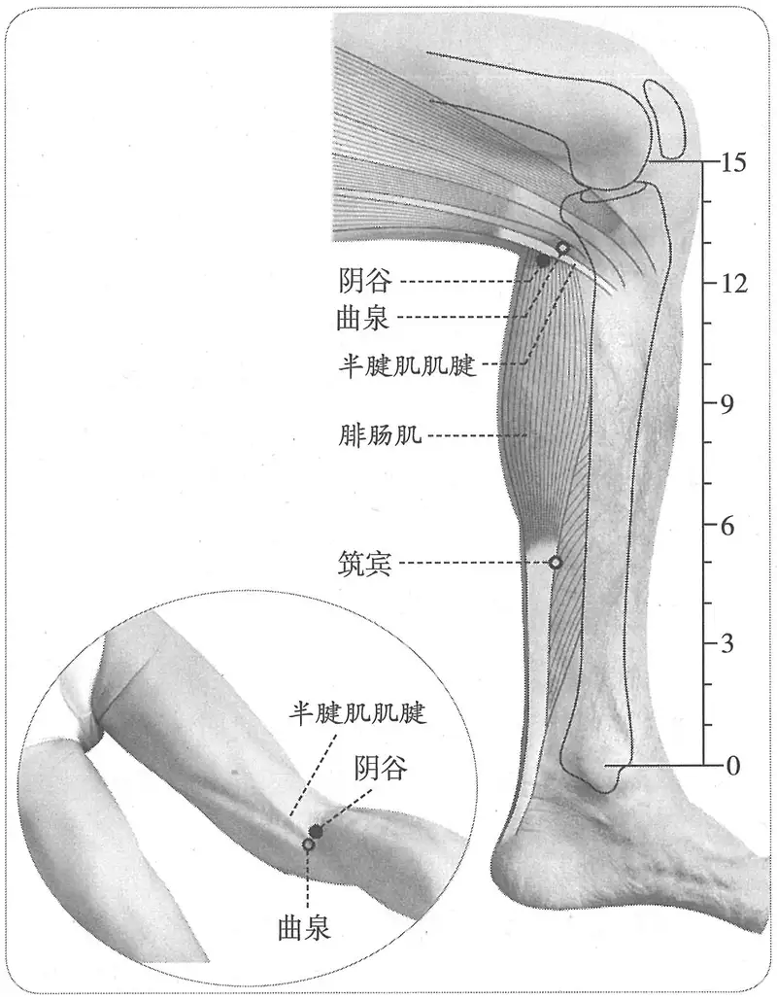

**图2-240　阴谷穴图**

　4. 窦太师针灸遗存

　　(1) 在膝内附骨后，大筋下，小筋上，按之动脉应手，屈膝取之。（《窦太师针经》）

　　(2) 膝内辅骨后，大筋下，小筋上，动脉，屈膝取之。（《针方六集》卷一）

〔p.851 (인쇄 823)〕

　　(3) 广注：当在曲泉前横纹尖处。岐伯云：屈膝有两缝尖，上为曲泉，下为阴谷。（《循经考穴编》下）

　　(4) 膝下内辅骨之后下方筋间陷中。（《针灸十四经穴位考订》）

　5. 统编针灸学教材

　　(1) 部位：膝内侧辅骨后大筋下小筋上，按之动脉应手。取穴：正坐垂足，从腘横纹内侧端按取，小筋于大筋之间陷中取之。（1957年南京《针灸学》）

　　(2) 屈膝，腘窝内侧，当半腱肌和半膜肌之间，有腘动脉分枝，分布着胫神经的分枝及股后皮神经和股内侧皮神经。（1957年南京《针灸学》）

　　(3) 部位：腘横纹内侧端二筋间。取穴：屈膝，从内辅骨后大筋下，小筋上，陷中取之。（1版《针灸学讲义》）

　　(4) 部位：在膝下内辅骨后，大筋之下，小筋之上，按之应手，屈膝得之。取穴：当腘窝内侧，和委中相平，在半腱肌腱、半膜肌腱之间屈膝取之。（2版《针灸学讲义》）

　　(5) 屈膝，腘窝内侧，当半腱肌与半膜肌之间。（4、5、6、7版《针灸学》）

　　(6) 屈膝，腘窝内侧，与委中平，当半腱肌与半膜肌之间。（《中国针灸学》）

**文献分析**：历代文献记载基本一致。“辅骨”，指胫骨内侧髁；“大筋”、“小筋”，分别指半腱肌肌腱与半膜肌肌腱。此处不能触及动脉搏动，现代针灸教材所说“按之动脉应手”，系沿袭古人的错误。

#### 【类属】 

足少阴肾经穴；五输穴之合穴。

　1. 肾出于涌泉者，涌泉者足心也……入于阴谷，阴谷辅骨之后，大筋之下，小筋之上也，按之应手，屈膝而得之，为合。足少阴经也。（《灵枢·本输》）

　2. 足少阴脉之所入也，为合。（《黄帝明堂经》）

　3. 足少阴之合，阴谷穴也……足少阴之所入也。（《素问亡篇·刺法论》）

#### 【适应症】 

主治前阴及妇科病症。常用于阳痿，小便不利；月经不调，崩漏；腰脊痛，少腹、前阴、膝股内侧引痛；癫狂。

　1. 主男子如蛊，女子如阻，寒热腹遍肿。狂癫。脊内廉痛，溺难，阴痿不用，少腹急引阴及脚内廉痛。舌纵涎下，烦闷。妇人漏血，腹胀满不得息，小便黄。（《黄帝明堂经》）

**按**：“男子如蛊，女子如阻”，《灵枢·热病》取涌泉穴治之。“舌纵涎下，烦闷”症状见于《灵枢·寒热病》：“舌纵涎下，烦闷，取足少阴”。

　2. 治膝痛如离，不得屈伸，舌纵涎下，烦逆，溺难，少腹急引阴痛，股内廉痛，妇人漏血不止，腹胀满不得息，小便黄，男子如蛊，女子如妊娠。（《铜人腧穴针灸图经》卷下）

　3. 窦太师针灸遗存

　　(1) 治小便不通，先补后泻，膝头红肿，泻；坐立艰难，阴囊湿痒，妇人阴中湿痒，亦宜泻之效。（《窦太师针经》）

　　(2) 阴部湿痒。（《针方六集》卷五、《循经考穴编》）

　　(3) 治小便闭结，膝痛如锥，孕妇能转胞胎，宜泻。（《窦太师秘传》）

　4. 统编针灸学教材

　　(1) 主治阴痿，小便急引阴痛，崩漏不止，膝股内廉痛，舌纵涎下，疝痛。（1957年南京《针灸学》）

　　(2) 主治阴痿，崩漏疝痛，小便不利，膝腿内廉痛，舌纵涎下。（1版《针灸学讲义》）

　　(3) 主治阳痿，疝痛，崩漏，尿难，癫狂，膝股内侧痛。（2版《针灸学讲义》、《中国针灸学》）

〔p.852 (인쇄 824)〕

　　(4) 主治阳痿，疝痛，崩漏，小便不利，膝腘酸痛。（4、5版《针灸学》）

　　(5) 主治阳痿，疝气，月经不调，崩漏，小便难，阴中痛，癫狂，膝股内侧痛。（6版《针灸学》）

　　(6) 主治：①癫狂；②阳痿，小便不利，月经不调，崩漏等泌尿生殖系疾患；③膝股内侧痛。（7版《针灸学》）

**文献分析**：教材中除第7版外，皆言主疝痛，文献虽未明言主疝，然“少腹急引阴及脚内廉痛”常见于阴疝的典型症状。

#### 附：临床应用举例 

　1. 足太阴肾经中阴谷二穴……妇人漏血不止，少腹急引阴痛，腹胀如蛊，女子如妊娠，可灸三壮。（《兰室秘藏》卷四）

　2. 中风后大小便闭结不通，泻支沟二穴；小便不通，泻阴谷二穴。（《针灸集要·盘石金直刺秘传》）

　3. 伤寒，小便不通，刺支沟；未愈，泻阴谷、阴陵泉。（《针灸集要·盘石金直刺秘传》）

　4. 五淋，气海、关元、阴谷、阴陵泉。问曰：此证缘何而得？答曰：皆因色欲不节，少年之过，用诸枪药之类；或小便急行，房正合欢之际，被人冲破不能泻，阴阳不舒通，故成砂淋、血淋、热淋、冷淋、气淋。善治医者当详审，治无不效也。（《针灸集成》第六十二方）

　5. 阴痿，关元补、阴湿、阴谷寸半，泻，灸。（《医学纲目》卷十四）

　6. 治妇人产后，忽小腹胀如蛊，大小便不通，气海、三里、关元、三阴交、阴谷主之。（《医学纲目》卷二十三）

　7. 顽固性癃闭，三阴交穴、阴谷穴，针刺治疗。［上海针灸杂志，1986，5(4):43］

#### 【操作】 

直刺1~1.5寸。

　1. 刺入四分，灸三壮。（《黄帝明堂经》）

　2. 刺可同身寸之四分，留三呼，动气应手，可刺，急出之，先刺左，后刺右。（《素问亡篇·刺法论》）

　3. 灸三壮，针入四分，留七呼。（《铜人腧穴针灸图经》卷下）

　4. 窦太师针灸遗存

　　(1) 横针入五分，灸二七壮。（《窦太师针经》）

　　(2) 一法针可一寸五分，灸二七壮。（《循经考穴编》下）

　5. 统编针灸学教材

　　(1) 针三至八分，依取穴法进针，灸三至五壮。（1957年南京《针灸学》、1版《针灸学讲义》）

　　(2) 直刺5~8分，艾条灸3~7分钟。（2版《针灸学讲义》）

　　(3) 直刺1~1.5寸。（4、5、7版《针灸学》）

　　(4) 直刺1~1.5寸；可灸。（6版《针灸学》）

　　(5) 直刺0.8~1.0寸。可灸。（《中国针灸学》）

### （十一）横骨 Hénggǔ KI11 出《黄帝明堂经》 

#### 【提要索隐】 

**穴名**：一名下极。

〔p.853 (인쇄 825)〕

**部位**：在下腹部，脐中下5寸，前正中线旁开0.5寸。

**适应症**：主治前阴、少腹部病症。常用于疝气，少腹胀痛；小便不利，遗精，阳痿。

**针刺操作**：直刺1~1.5寸；针前应排尿。

#### 【名实考】 

需要特别注意的是，“横骨”作为穴名和作为骨名，是不同的两个概念。作为骨名，横骨相当于耻骨联合（因其形状横卧而得名）。《黄帝明堂经》将横骨中央之穴名“曲骨”（或屈骨，或屈骨端），横骨两旁之穴名“横骨”。《千金要方》、《千金翼方》针灸方中“横骨”多是骨名，后人不解，多有混淆，例如宋臣注《千金要方》针灸卷横骨穴曰：“横骨，在大赫下一寸。肾脏卷云：名屈骨，在阴上横骨中央，宛曲如却月中央是”，这一错误又经明代高武的承袭对后世产生很大影响。

本穴的纵向定位：肓俞穴下五寸，古今无分歧，而与腹中线横向距离，有五分（《黄帝明堂经》等）、一寸（《针灸大成》等）和一寸半（《针灸资生经》等）三说。本穴的横向距离是以肓俞为依据的，而后者位于脐旁五分，此处的“脐旁”是指脐边缘之旁，而不是脐的中心点旁开，这样所谓“五分”与“一寸”实际是统一的。因为后世肾经穴的主治病症都是基于《黄帝明堂经》的定位总结的，故现代定位仍从“五分”（除脐）之说。

关于本穴主治，明代《针灸聚英》载有“目赤痛从内眦始”一条，原文出自《灵枢·热病》：“目中赤痛，从内眦始，取之阴𫏋”，高武在《针灸节要·目痛》卷二也引录此条。这里的“阴𫏋”是指穴名（照海），而不是指脉名，第一部腧穴专著《黄帝明堂经》所载照海穴正主此症。今高武不但将《灵枢》针方中“阴𫏋”理解为脉名，而且将其主治症归入横骨、大赫、气穴、四满、中注、肓俞、商曲、石关、阴都、通谷、幽门等所有冲脉交会穴中，《针灸聚英》之后针灸书多沿袭其误。

　1. 横骨，一名下极。在大赫下一寸，冲脉、足少阴之会。（《黄帝明堂经》）

　2. 肾经由股后廉直上，行至此穴，则横入里行，故曰横骨。（《经穴解》）

　3. 别名　曲骨、屈骨。（1957年南京《针灸学》）

**按**：此将骨名误作穴名。

#### “横骨”穴与横骨辨 

　1. 横骨，在大赫下一寸。宋臣注曰：肾藏卷云在阴上横骨中央，宛曲如却月中央是。（《千金要方》卷二十九注）

**按**：此乃宋臣将“横骨”穴与横骨混为一谈。在《内经》、《黄帝明堂经》、《千金要方》等早期文献中“横骨”一词多用作骨名，切不可与穴名“横骨”相混。

　2. 曲骨，在横骨上，中极下一寸，毛际陷者中，动脉应手。（《黄帝明堂经》）

　3. 冲门，一名慈宫，上去大横五寸，在府舍下，横骨两端约中动脉。（《黄帝明堂经》）

　4. 气冲，在腹脐下横骨两端，鼠鼷上同身寸之一寸，动脉应手（《素问·水热穴论》王冰注）

　5. 妇人绝嗣不生，漏赤白，灸泉门十壮，三报之，穴在横骨当阴上际。（《千金要方》卷二）

　6. 治妇人遗尿不知出时方　又方灸横骨当阴门七壮。（《千金要方》卷二）

　7. 失精，五脏虚竭，灸屈骨端五十壮。阴上横骨中央，宛曲如却月中央是也。此名横骨。男子虚劳失精，阴上缩，茎中痛，灸大赫三十壮。穴在屈骨端三寸。（《千金要方》卷十九）

　8. 泄利所伤，烦欲死者，灸慈宫二十七壮，在横骨两边各二寸半。横骨在脐下，横门骨是。（《千金要方》卷二十）

　9. 男阴卵大，癞病，又灸横骨两边夹茎是。（《千金要方》卷二十四）

〔p.854 (인쇄 826)〕

#### 相关穴及刺激点 

夜尿：在曲骨上五分旁开1寸处。主治遗尿症、尿失禁。针3~5分，针感抽、胀，可达外生殖器。（《针灸经外奇穴图谱（续集）》）

#### 【定位】 

**部位**：在下腹部，脐中下5寸，前正中线旁开0.5寸（图2-241）。

**取穴**：在下腹部，耻骨联合上际，曲骨穴旁0.5寸处取之。

　1. 在大赫下一寸。（《黄帝明堂经》、《铜人腧穴针灸图经》）

　2. 腹中行旁开一寸五分

　　(1) 在大赫下一寸。以上二十二穴（从幽门到横骨）去腹中行皆当为寸半。（《针灸资生经》卷一）

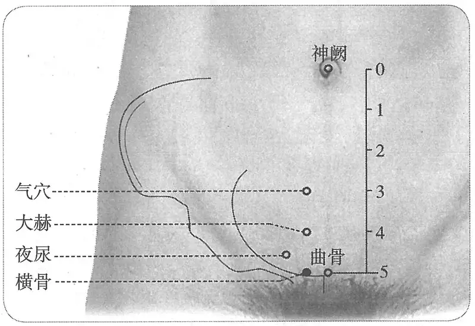

**图2-241　横骨穴与相关穴图**

　　(2) 大赫下一寸，肓俞下五寸，阴上横骨中，宛曲如仰月中央，去腹中行各一寸半。（《针灸聚英》卷一、《古今医统》、《医学入门》）

　3. 腹中行旁开一寸（脐旁五分）

　　(1) 大赫下一寸，去脐旁五分。（《十四经发挥》卷中、《医学纲目》、《针灸易学》）

　　(2) 大赫下一寸，阴上横骨中宛曲如仰月中央，去腹中行各一寸。（《针灸大成》卷六、《循经考穴编》、《针灸逢源》）

　4. 腹中行旁开五分

　　(1) 在腹部大赫下一寸，肓俞下五寸，直脐中两旁各五分。（《针方六集》卷一）

　　(2) 在大赫下一寸，肓俞下五寸，去中行五分，阴上横骨中。（《类经图翼》卷七）

　　(3) 阴上横骨中，宛曲如仰月中央。夫任脉之中行旁开五分。（《医宗金鉴·刺灸心法要诀》）

　　(4) 曲骨穴旁开五分。（《针灸十四经穴位考订》）

　5. 统编针灸学教材

　　(1) 部位：大赫穴下一寸。取穴：仰卧，按小腹毛际耻骨上缘正中，曲骨旁五分处取之。（1957年南京《针灸学》）

　　(2) 部位：大赫穴下一寸。取穴：仰卧，在横骨上缘任脉经曲骨穴旁开五分取之。（1版《针灸学讲义》）

　　(3) 部位：大赫穴下一寸。取穴：在下腹部，耻骨联合上际，曲骨（任脉）旁五分取之。（2版《针灸学讲义》）

　　(4) 脐下5寸，旁开0.5寸。（4版《针灸学》）

　　(5) 脐下5寸，耻骨联合上际，前正中线旁开0.5寸。（5、7版《针灸学》）

　　(6) 在下腹部，当脐中下5寸，前正中线旁开0.5寸。（6版《针灸学》）

　　(7) 脐下5寸，耻骨联合上缘，曲骨旁开五分脐下5寸。（《中国针灸学》）

**文献分析**：明代文献所说“阴上横骨中宛曲如仰月中央”系误引《千金要方》曲骨穴之文。本穴与腹中线距离，有五分（《针灸六集》等）、一寸（《针灸大成》等）和一寸半（《针灸资生经》等）三说，由于“五分”说是除脐之后的分寸，故与“一寸”说实际一致，现代本穴定位即以此为准。

〔p.855 (인쇄 827)〕

#### 【类属】 

足少阴肾经穴。

**脉气所发**：冲脉、足少阴之会。（《黄帝明堂经》）

**归经**：足少阴肾经。（《外台秘要》卷三十九、《铜人腧穴针灸图经》卷上）

#### 【适应症】 

主治前阴、少腹部病症。常用于疝气，少腹胀痛；小便不利，遗精，阳痿。

　1. 主少腹满，溺难，阴下纵。（《黄帝明堂经》）

　2. 卵中痛。（《外台秘要》卷三十九）

　3. 此穴诸经缺疗病法。《外台》云：治腹胀小便难，阴器纵，伸痛。（《铜人腧穴针灸图经》卷中）

　4. 主目赤痛从内眦始，五脏虚竭，失精。（《针灸聚英》卷一、《古今医统》、《针灸大成》、《针方六集》、《类经图翼》）

**按**：“目赤痛从内眦始”系高武误解《灵枢》经文所致；“五脏虚竭，失精”症见于《千金要方》卷十九曰：“失精，五脏虚竭，灸屈骨端五十壮。阴上横骨中央宛曲如却月中央是也。此名横骨。”这里的灸疗部位与今天的“曲骨”穴相当。而明代高武将此方中“横骨”误作穴名，而将此方主治症归于“横骨”穴主治症中，明以后针灸书多沿袭其误。

　5. 主竖痃偏坠，木肾肿大，阴气入腹，肾气冲心，妇人月事闭绝，小腹攻注疼痛，灸之立效。（《循经考穴编》下）

　6. 统编针灸学教材

　　(1) 主治阴器下纵引痛，五淋，失精，小便不通，目赤痛从内眦始。（1957年南京《针灸学》）

　　(2) 主治阴痛，失精，少腹痛，小便不通或淋沥，目赤痛。（1版《针灸学讲义》）

　　(3) 主治阴部痛，遗精，阳痿，遗尿，少腹痛，小便不通。（2版《针灸学讲义》、《中国针灸学》）

　　(4) 主治少腹满痛，小便不利，遗尿，遗精，阳痿，睾丸痛。（4版《针灸学》）

　　(5) 主治少腹胀痛，小便不利，遗尿，遗精，阳痿，疝气。（5、6、7版《针灸学》）

**文献分析**：关于本穴的主治，腧穴文献与治疗文献均集中于前阴、少腹部。古治小便难，今治夜尿，乃针灸双向调节作用的实例。教材中“目赤痛从内眦始”、“目赤痛”乃承袭高武《针灸聚英》之误，今去之。

#### 附：临床应用举例 

　1. 尺脉数，恶寒，脐下热痛，小便赤黄，针横骨泻之。尺脉缓，脚弱下肿，小便难，有余沥，针横骨泻之。尺脉浮，下热风，小便难。针横骨、关元泻之。（《脉经》卷二）

　2. 气滞腰痛不能立，横骨大都宜急救。（《席弘赋》）

　3. 阳痿，针刺横骨、会阳治疗。［天津中医学院学报，2000，19(1):34］

　4. 子宫肌瘤，横骨穴、曲骨穴、子宫穴，针刺治疗。［中国针灸，1986，6(1):27］

#### 【操作】 

直刺1~1.5寸；针前应排尿。

　1. 针入一寸，灸五壮。（《黄帝明堂经》）

　2. 灸三壮。（《铜人腧穴针灸图经》卷中）

　3. 针五分，灸三壮。孕妇禁针。（《针灸十四经穴位考订》）

　4. 统编针灸学教材

〔p.856 (인쇄 828)〕

　　(1) 针五至八分，灸三至五壮。（1957年南京《针灸学》、1版《针灸学讲义》）

　　(2) 直刺5~8分，艾条灸3~5分钟。（2版《针灸学讲义》）

　　(3) 直刺1~1.5寸。（4、5、7版《针灸学》）

　　(4) 直刺1~1.5寸；可灸。（6版《针灸学》）

　　(5) 直刺0.5~1寸。可灸。（《中国针灸学》）

### （十二）大赫 Dàhè KI12 出《黄帝明堂经》 

#### 【提要索隐】 

**穴名**：一名阴维，一名阴关。

**部位**：在下腹部，脐中下4寸，前正中线旁开0.5寸。

**适应症**：主治前阴、妇科病症。常用于遗精，阳痿；阴囊挛缩；子宫脱垂，带下。

**针刺操作**：直刺1~1.5寸；针前让患者排尿，孕妇禁针灸。

#### 【名实考】 

本穴定位纵向分寸无分歧，横向定位有“五分”、“一寸”、“一寸半”三说，详见横骨穴“名实考”。

　1. 大赫，一名阴维，一名阴关。在气穴下一寸，冲脉、足少阴之会。（《黄帝明堂经》）

　2. 前名横骨之穴，部分犹在骨际，至此穴，初入腹中，内之所藏，深广布测，故曰大赫。又名阴关，以足少阴之脉，离骨入腹，有关之象焉。（《经穴解》）

#### 【定位】 

**部位**：在下腹部，脐中下4寸，前正中线旁开0.5寸（图2-242）。

**取穴**：仰卧，中极穴旁0.5寸处取之。

　1. 在气穴下一寸。（《黄帝明堂经》、《铜人腧穴针灸图经》）

　2. 腹中行旁开一寸五分

　　(1) 穴在夹屈骨端三寸。（《千金要方》卷十九、《千金翼方》）

　　(2) 气穴下一寸。以上二十二穴（从幽门到横骨）去腹中行皆当为寸半。（《针灸资生经》卷一、《针灸聚英》、《古今医统》、《医学入门》）

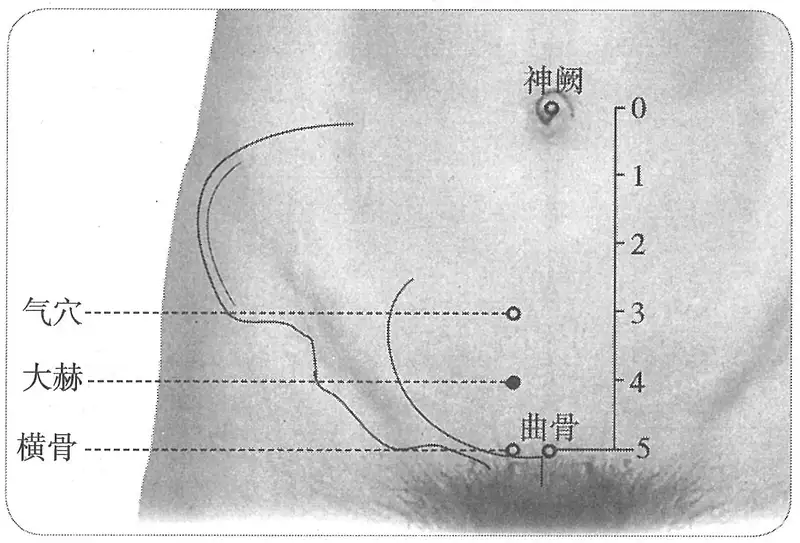

**图2-242　大赫穴图**

　　(3) 气穴下一寸，去腹中行各一寸。（《十四经发挥》卷中、《医学纲目》、《针灸大成》、《循经考穴编》、《针灸易学》、《针灸逢源》）

　3. 腹中行旁开五分

　　(1) 在气穴下一寸，夹任脉两旁各五分。（《针方六集》卷一、《类经图翼》、《医宗金鉴·刺灸心法要诀》）

　　(2) 中极旁开五分。（《针灸十四经穴位考订》）

　4. 统编针灸学教材

　　(1) 部位：在气穴下一寸。取穴：仰卧，从横骨上一寸，中极旁五分取之。（1957年南京《针灸学》）

〔p.857 (인쇄 829)〕

　　(2) 部位：横骨穴上一寸。取穴：仰卧，任脉中极穴旁五分取之。（1版《针灸学讲义》）

　　(3) 部位：在气穴下一寸。取穴：在横骨上一寸，中极任脉旁五分取之。（2版《针灸学讲义》）

　　(4) 脐下4寸，旁开0.5寸。（4版《针灸学》）

　　(5) 脐下4寸，前正中线旁开0.5寸。（5、7版《针灸学》）

　　(6) 在下腹部，当脐中下4寸，前正中线旁开0.5寸。（6版《针灸学》）

　　(7) 脐下四寸，中极旁开五分。（《中国针灸学》）

#### 【类属】 

足少阴肾经穴。

**脉气所发**：冲脉、足少阴之会。（《黄帝明堂经》）

**归经**：足少阴肾经。（《外台秘要》卷三十九、《铜人腧穴针灸图经》卷上）

#### 【适应症】 

主治前阴、妇科病症。常用于遗精，阳痿；阴囊挛缩；子宫脱垂，带下。

　1. 主男子精溢，阴上缩。女子赤淫。（《黄帝明堂经》）

**按**：“阴上缩”有两种情况：其一见于阴疝，如归来穴主治“卵上入引茎中痛、少腹痛”即是；另一种指肝经终、厥证（见于《内经》），参考《千金要方》卷十九灸方“男子虚劳失精，阴缩，灸中封五十壮。男子虚劳失精，阴上缩，茎中痛，灸大赫三十壮”，此处“阴上缩”指后一种情况，明高武不解其义，改作“阴痿”。

　2. 治男子阴器结缩，女子赤带。（《铜人腧穴针灸图经》卷中）

　3. 主虚劳失精，阴痿，茎中痛。目赤痛从内眦始。（《针灸聚英》卷一、《针灸大成》）

**按**：前一条主治乃高武从《针灸资生经》辑录《千金要方》灸方主治，“阴痿”原方作“阴上缩”，详见“附：临床应用举例”。第二条主治乃误解《内经》原文，参见“横骨”穴“名实考”。

　4. 主小腹急胀疼痛，肾气冲心。（《循经考穴编》下）

　5. 统编针灸学教材

　　(1) 主治阴缩，阴茎痛，男子虚痨失精，女子赤白带下，目赤痛。（1957年南京《针灸学》、1版《针灸学讲义》）

　　(2) 主治阴部痛，子宫脱垂，遗精，带下。（2版《针灸学讲义》）

　　(3) 主治遗精，阳痿，阴茎痛，阴挺，带下。（4版《针灸学》）

　　(4) 主治遗精，阳痿，阴挺，带下。（5、7版《针灸学》）

　　(5) 主治阴挺，遗精，带下，月经不调，痛经，泄泻。（6版《针灸学》）

　　(6) 主治遗精，阳痿，带下，阴部痛，阴挺。（《中国针灸学》）

**按**：教材中“目赤痛”乃承袭高武《针灸聚英》之误，今去之。

**文献分析**：本穴的主治病症范围，腧穴文献与治疗文献均集中于前阴部。现行国家标准《腧穴名称与定位》关于本穴的定位依据《黄帝明堂经》，因此本穴的主治病症的总结应根据定位与此相同的腧穴文献及治疗文献。需要注意的是，“附：临床应用举例”中《千金要方》、《千金翼方》关于本穴的主治，其腧穴定位与现行国家标准不同。

#### 附：临床应用举例 

　1. 男子虚劳失精，阴上缩，茎中痛，灸大赫三十壮。在夹屈骨端三寸。（《千金要方》卷十九、《千金翼方》）

　2. 胞下垂注阴下脱，灸夹玉泉三寸，随年壮。三报之。（《千金要方》卷三、《千金翼方》）

　3. 气淋，灸关元五十壮。又，夹玉泉相去一寸半，灸三十壮。（《千金要方》卷二十一、《千金翼方》）

〔p.858 (인쇄 830)〕

　4. 虚劳失精，阴缩，茎中痛，大赫三七壮、中封灸。（《医学纲目》卷二十九）

　5. 尿潴留，大赫穴、三阴交穴、中极穴，针灸疗法。［皖南医学院学报，1986，5(3):197］

　6. 产后癃闭，中极、关元、大赫，针灸疗法。［陕西中医，1993，14(6):272］

#### 【操作】 

直刺1~1.5寸。针前让患者排尿，孕妇禁针灸。

　1. 刺入一寸，灸五壮。（《黄帝明堂经》）

　2. 灸五壮，针入三分。（《铜人腧穴针灸图经》卷中）

　3. 针五分，灸三壮。孕妇禁针。（《针灸十四经穴位考订》）

　4. 统编针灸学教材

　　(1) 针五至八分，灸三至五壮。（1957年南京《针灸学》、1版《针灸学讲义》）

　　(2) 直刺5~8分，艾条灸3~7分钟。（2版《针灸学讲义》）

　　(3) 直刺1~1.5寸。（4、5、7版《针灸学》）

　　(4) 直刺1~1.5寸；可灸。（6版《针灸学》）

　　(5) 直刺0.5~1寸。可灸。（《中国针灸学》）

### （十三）气穴 Qìxué KI13 出《黄帝明堂经》 

#### 【提要索隐】 

**穴名**：一名胞门，一名子户。

**部位**：在下腹部，脐中下3寸，前正中线旁开0.5寸。

**适应症**：主治妇科病症。常用于月经不调，带下，腹痛引腰脊。**新增**：不孕。

**针刺操作**：直刺1~1.5寸。针前让患者排尿，孕妇禁针灸。

#### 【名实考】 

本穴一名胞门，一名子户，需要特别注意的是，中医古籍中关于“胞门”、“子户”有不同的含义，不能相混。例如，窦太师针灸有“子宫”穴，位于中极穴旁三寸，乃窦氏治疗妇人病的常用穴，后人误以为即“气穴”（因其别名“胞门”、“子户”）。再者，《千金要方》针灸方中“胞门”多相当于现代定位的“水道”穴，而不是“气穴”的别名，需特别注意。

本穴定位纵向分寸无分歧，横向定位有“五分”、“一寸”、“一寸半”三说，详见“横骨”穴“名实考”。

　1. 气穴，一名胞门，一名子户。在四满下一寸，冲脉、足少阴之会。（《黄帝明堂经》）

　2. 以冲脉之上行，而此穴其始。曰气者，指冲脉而言也。（《经穴解》）

#### “胞门”、“子户”别说 

　1. 肝部在左手关上是也，足厥阴经也，与足少阳为表里，以胆合为府，合于中焦名曰胞门，在大仓左右三寸。（《脉经》卷一）

　2. 妇人妊子不成，若堕落，腹痛，漏见赤，灸胞门五十壮，在关元左边二寸是也。（《千金要方》卷二）

　3. 胞门，在关元左边二寸是也，右边二寸名子户。（《千金翼方》卷二十六）

　4. 胞门，关元左右各二寸是也。（《医心方》卷二十二）

　5. 任脉起于胞门、子户，夹脐上行至胸中。（《脉经》卷二）

#### “子户”与“子宫”穴辨 

　1. 子宫二穴，在中极穴两旁各开三寸，针入二寸半。疗血崩漏下，及男子妇人无子，灸三七壮，看虚实补泻。（《窦太师针经》）

〔p.859 (인쇄 831)〕

　2. 《集》血崩并漏下，中极补、子宫二寸半。（《医学纲目》卷三十四）

　3. 《集》妇人无子，子宫在中极傍各开三寸，针入二寸，灸三七壮、中极。（《医学纲目》卷三十五）

　4. ［第九十二］妇人无子，子宫、中极。（《针灸大成》卷九）

　5. ［第九十六］血崩漏下，中极、子宫。（《针灸大成》卷九）

　6. ［第一百一］妇女血崩不止，丹田、中极、肾俞、子宫。（《针灸大成》卷九）

**按**：《医学纲目》、《针灸大成》以上针灸方皆出自元代《针灸集成》（引文中简称《集》）一书。

　7. 妇人无子及胎冷不孕，关元、中极、子宫一穴即气穴，在四满下一寸。灸一壮，针三分、子户一穴。（《针灸捷径》卷之下）

**按**：《针灸捷径》针灸方主要据窦太师针灸改编，其“子宫”一穴，显然出自窦氏，该书编者不识，而注作“即气穴”，大误。

#### 【定位】 

**部位**：在下腹部，脐中下3寸，前正中线旁开0.5寸（图2-243）。

**取穴**：仰卧，关元穴旁0.5寸处取之。

　1. 在四满下一寸。（《黄帝明堂经》、《铜人腧穴针灸图经》）

　2. 四满下一寸。以上二十二穴（从幽门到横骨）去腹中行皆当为寸半。（《针灸资生经》卷一、《针灸聚英》、《古今医统》、《医学入门》）

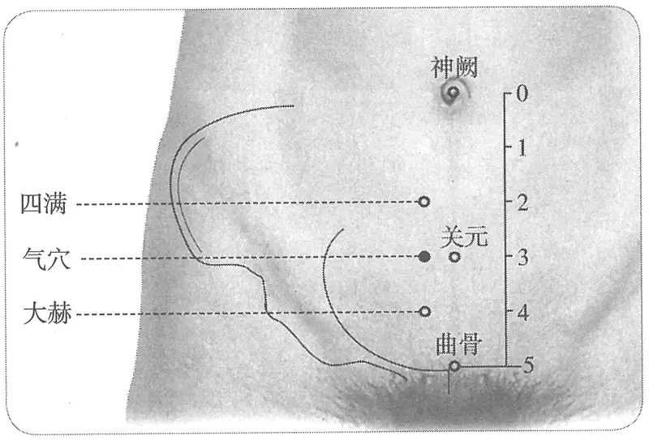

**图2-243　气穴穴图**

　3. 四满下一寸，去腹中行各一寸。（《十四经发挥》卷中、《琼瑶神书》、《针灸大成》、《循经考穴编》、《针灸易学》、《针灸逢源》）

　4. 在四满下一寸，夹任脉各五分。（《针方六集》卷一、《类经图翼》、《医宗金鉴·刺灸心法要诀》）

　5. 关元旁开五分。（《针灸十四经穴位考订》）

　6. 统编针灸学教材

　　(1) 部位：在四满下一寸。取穴：仰卧，横骨之上二寸，关元穴旁五分取之。（1957年南京《针灸学》）

　　(2) 部位：横骨穴上二寸。取穴：仰卧，任脉关元穴旁五分取之。（1版《针灸学讲义》）

　　(3) 部位：在四满下一寸。取穴：在横骨上二寸，关元任脉旁五分取之。（2版《针灸学讲义》）

　　(4) 脐下3寸，旁开0.5寸。（4版《针灸学》）

　　(5) 脐下3寸，前正中线旁开0.5寸。（5、7版《针灸学》）

　　(6) 在下腹部，当脐下3寸，前正中线旁开0.5寸。（6版《针灸学》）

　　(7) 脐下三寸，关元旁开五分。（《中国针灸学》）

#### 【类属】 

足少阴肾经穴。

**脉气所发**：冲脉、足少阴之会。（《黄帝明堂经》）

〔p.860 (인쇄 832)〕

**归经**：足少阴肾经。（《外台秘要》卷三十九、《铜人腧穴针灸图经》卷上）

#### 【适应症】 

主治妇科病症。常用于月经不调，带下，腹痛引腰脊。**新增**：不孕。

　1. 主腹中痛，月水不通，奔泄，气上下引腰脊痛。（《黄帝明堂经》）

　2. 治月事不调，泄利不止，贲气上下引腰脊痛。（《铜人腧穴针灸图经》卷中）

**按**：“泄利不止”《黄帝明堂经》作“奔泄，气上下引腰脊痛”，是指奔豚气的症状，王惟一解作“泄利不止”，欠妥。

　3. 目赤痛从内眦始。（《针灸聚英》卷一、《针灸大成》、《针方六集》、《循经考穴编》）

**按**：此乃高武误解《内经》原文之义，考证详见“横骨”穴“名实考”。

　4. 主妇人子宫久冷不能成孕，赤白淋沥，月事不调，败血，逆气攻冲两胁疼痛。（《循经考穴编》下）

　5. 统编针灸学教材

　　(1) 主治月经不调，泄利，腰脊痛，奔豚，目赤痛。（1957年南京《针灸学》、1版《针灸学讲义》）

　　(2) 主治月经不调，白带，小便不通，泄泻。（2版《针灸学讲义》，5、6版《针灸学》）

　　(3) 主治经闭，月经不调，崩漏，带下，不孕，小便不利，泄泻。（4版《针灸学》）

　　(4) 主治：①奔豚气；②月经不调，带下；③小便不利；④腹泻。（7版《针灸学》）

　　(5) 主治月经不调，痛经，小便不利，腹痛，泄泻。（《中国针灸学》）

**文献分析**：不论是腧穴文献，还是治疗文献所载本穴主治，其作用部位均集中于子宫。《黄帝明堂经》载本穴又名“胞门”、“子户”，提示该穴对于妇科病有较好的作用，《循经考穴编》突出了这一治疗特点，古今临床皆有应用，而教材除第4版外，皆未收录，今补之；又教材中“目赤痛从内眦始”，“目赤痛”乃承袭高武《针灸聚英》之误，今去之。

#### 【操作】 

直刺1~1.5寸。针前让患者排尿，孕妇禁针灸。

　1. 刺入一寸，灸五壮。（《黄帝明堂经》）

　2. 可灸五壮，针入三分。（《铜人腧穴针灸图经》卷中）

　3. 针五分，灸三壮。孕妇禁针。（《针灸十四经穴位考订》）

　4. 统编针灸学教材

　　(1) 针五分至八分，灸三至五壮。（1957年南京《针灸学》、1版《针灸学讲义》）

　　(2) 直刺5~8分，艾条灸3~7分钟。（2版《针灸学讲义》）

　　(3) 直刺1~1.5寸。（4、5、7版《针灸学》）

　　(4) 直刺1~1.5寸；可灸。（6版《针灸学》）

　　(5) 直刺0.5~1.0寸。可灸。（《中国针灸学》）

### （十四）四满 Sìmǎn KI14 出《黄帝明堂经》 

#### 【提要索隐】 

**穴名**：一名髓府；一名髓中。

**部位**：在下腹部，脐中下2寸，前正中线旁开0.5寸。

**适应症**：主治妇科、前阴病症。常用于月经不调，带下；腹中包块；遗精；遗尿，泄泻、腹痛，水肿。

**针刺操作**：直刺1~1.5寸。孕妇不宜针。

〔p.861 (인쇄 833)〕

#### 【名实考】 

本穴定位，纵向分寸无分歧，横向定位有“五分”、“一寸”、“一寸半”三说，详见横骨穴“名实考”。

　1. 四满，一名髓府。在中注下一寸，冲脉、足少阴之会。（《黄帝明堂经》）

　2. 四满一名髓中，中注下一寸，气穴上一寸，去腹中行各一寸半。足少阴脉、冲脉之会。（《针灸聚英》卷一）

　3. 穴名四满者，盖足少阴之经，自横骨入腹，至此穴为四，而适当小腹饱满之处，乃大肠回叠层积之所，故曰满也。又小肠、大肠、膀胱、广肠，皆在其内，其数亦为四，故曰四满。（《经穴解》）

#### 【定位】 

**部位**：在下腹部，脐中下2寸，前正中线旁开0.5寸（图2-244）。

**取穴**：在横骨上3寸，石门穴旁0.5寸处取之。

　1. 在中注下一寸。（《黄帝明堂经》、《铜人腧穴针灸图经》卷上及卷中）

　2. 在中注下一寸，气海旁一寸。（《铜人腧穴针灸图经》卷下“穴腧都数”、《十四经发挥》）

**按**：气海旁一寸：与“中注下一寸”不能同时成立，《铜人腧穴针灸图经》卷上、卷中均无。

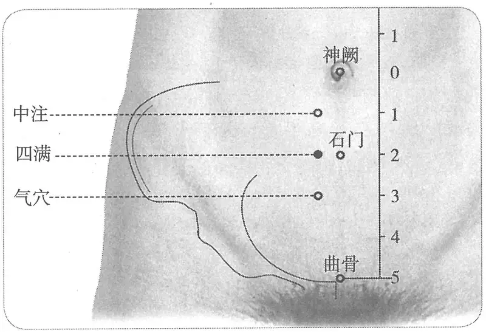

**图2-244　四满穴图**

　3. 在中注下一寸，气穴上一寸。以上二十二穴（从幽门到横骨）去腹中行皆当为寸半。（《针灸资生经》卷一、《针灸聚英》、《古今医统》、《医学入门》）

　4. 中注下一寸，去腹中行各一寸。（《针灸大成》卷六、《循经考穴编》、《针灸易学》、《针灸逢源》）

　5. 在中注下一寸，夹任脉各五分。（《针方六集》卷一、《类经图翼》、《医宗金鉴·刺灸心法要诀》）

　6. 针灸方腧穴定位

　　(1) 穴夹丹田两旁，相去三寸。即心下八寸脐下横纹是也。（《千金要方》卷十七）

**按**：《千金翼方》无“即心下八寸脐下横纹是也”句。

　　(2) 穴在丹田两边相去各一寸半，丹田在脐下二寸是也。（《千金要方》卷三）

**按**：《千金翼方》作“丹田两边相去各一寸”。

　　(3) 石门旁五分。（《针灸十四经穴位考订》）

　7. 统编针灸学教材

　　(1) 部位：在中注下一寸。取穴：仰卧，横骨上三寸，石门穴旁五分取之。（1957年南京《针灸学》）

　　(2) 部位：横骨穴上三寸。取穴：仰卧，任脉石门穴旁五分取之。（1版《针灸学讲义》）

　　(3) 部位：在中注下一寸。取穴：在横骨上三寸，石门任脉旁五分取之。（2版《针灸学讲义》）

〔p.862 (인쇄 834)〕

　　(4) 脐下2寸，旁开0.5寸。（4版《针灸学》）

　　(5) 脐下2寸，前正中线旁开0.5寸。（5、7版《针灸学》）

　　(6) 在下腹部，当脐中下2寸，前正中线旁开0.5寸。（6版《针灸学》）

　　(7) 脐下二寸，石门旁开五分。（《中国针灸学》）

#### 【类属】 

足少阴肾经穴。

**脉气所发**：冲脉、足少阴之会。（《黄帝明堂经》）

**归经**：足少阴肾经。（《外台秘要》卷三十九、《铜人腧穴针灸图经》卷上）

#### 【适应症】 

主治妇科、前阴病症。常用于月经不调，带下，腹中包块；遗精，遗尿；泄泻，腹痛，水肿。

　1. 主脐下积，疝瘕，胞中有血。振寒，大腹石水。肠澼泄，切痛。（《黄帝明堂经》）

**按**：疝瘕，《说文解字》曰：“瘕，女病也”。《灵枢·水胀》曰：“石瘕生于胞中，寒气客于子门，子门闭塞，气不得通，恶血当泻不泻，衃以留止，日以益大，状如怀子，月事不以时下。皆生于女子，可导而下。”分言之，气聚为疝，血凝为瘕。而汉以前“疝瘕”合言多为偏义复词，偏于“瘕”，《黄帝明堂经》“疝瘕”一词用法即是，如太溪穴之“胞中有大疝瘕积聚”，阴陵泉、曲泉之“女子疝瘕”，水道穴“胞中瘕，子门有寒引髌髀”皆是此例。本穴主治“疝瘕”，义同此，指妇人腹部肿积。

　2. 肾痛。（《外台秘要》卷三十九）

**按**：此处“肾痛”盖指外肾痛（即阴囊痛）。

　3. 治脐下积聚疝瘕，肠澼切痛，振寒，大腹石水，妇人恶血疞痛。（《铜人腧穴针灸图经》卷中）

　4. 大肠有水，目内眦赤痛。（《针灸聚英》卷一、《针灸大成》、《针方六集》、《类经图翼》）

**按**：“大肠有水”未详所出，疑为“大腹石水”之形误。“目内眦赤痛”乃高武误解《内经》原文之义，考证详见“横骨”穴“名实考”。

　5. 男子遗精，白浊，妇人血崩月病，及小便不禁，气攻两胁疼痛。（《循经考穴编》下）

　6. 统编针灸学教材

　　(1) 主治血崩，月经病，恶血痛，白浊，遗精，肠澼，脐下切痛，疝瘕石水，目内眦赤痛。（1957年南京《针灸学》）

　　(2) 主治血崩，月经病，产后腹痛，白浊，遗精，肠澼，脐下切痛，痞块，鼓胀，目内眦赤痛。（1版《针灸学讲义》）

　　(3) 主治月经不调，小腹痛，便秘，遗精，疝气。（2版《针灸学讲义》）

　　(4) 主治水肿，疝气，腹痛，泄泻，经闭，不孕，遗精，带下。（4版《针灸学》）

　　(5) 主治月经不调，带下，遗尿，遗精，疝气，便秘，腹痛，水肿。（5、6版《针灸学》）

　　(6) 主治：①月经不调，崩漏、带下、产后恶露不净等妇产科病证；②遗精、遗尿；③小腹痛、脐下积、聚、疝、瘕等腹部疾患；④便秘、水肿。（7版《针灸学》）

　　(7) 主治腹痛，腹胀，泄泻，遗精，月经不调，痛经，产后腹痛。（《中国针灸学》）

**文献分析**：古代针灸文献所载本穴主治均集中于妇科与前阴病症。又汉魏以前，“瘕”指妇人腹部肿瘤（血之积），汉魏以后，相同的概念以“癥”表示。本穴主治之“疝瘕”与汉魏以后的“积、聚、疝、瘕”概念不同。教材中“目内眦赤痛”乃承袭高武《针灸聚英》之误，今去之。《黄帝明堂经》原文“肠澼泄，切痛”，是两个相关联的症状，4版教材以后改作“便秘，腹痛”，欠妥。

〔p.863 (인쇄 835)〕

#### 附：临床应用举例 

　1. 月水不利，奔豚上下，并无子，灸四满三十壮，穴在丹田两边相去各一寸半，丹田在脐下二寸是也。（《千金要方》卷三、《千金翼方》）

　2. 奔肫上下。灸四满二七壮，穴夹丹田两旁，相去三寸，即心下八寸脐下横纹是也。（《千金要方》卷十七）

**按**：以上灸方中“四满”穴定位与现代定位不同，其临床应用仅供参考。

　3. 石水，灸然谷、气冲、四满、章门。（《千金翼方》卷二十八）

　4. 妇人月水不利，灸四满二穴，在丹田两边相去各一寸。（《圣济总录》卷一百九十四）

#### 【操作】 

直刺1~1.5寸。孕妇不宜针。

　1. 刺入一寸，灸五壮。（《黄帝明堂经》）

　2. 灸七壮。（《外台秘要》卷三十九）

　3. 针入三分，可灸三壮。（《铜人腧穴针灸图经》卷中）

　4. 一法可五十壮。（《循经考穴编》下）

　5. 针五分，灸三壮。孕妇禁针。（《针灸十四经穴位考订》）

　6. 统编针灸学教材

　　(1) 针五至八分，灸三至五壮。（1957年南京《针灸学》、1版《针灸学讲义》）

　　(2) 直刺5~8分，艾条灸5~7分钟。（2版《针灸学讲义》）

　　(3) 直刺1~1.5寸。（4、5、7版《针灸学》）

　　(4) 直刺1~1.5寸；可灸。（6版《针灸学》）

　　(5) 直刺0.5~1.0寸。可灸。（《中国针灸学》）

### （十五）中注 Zhōngzhù KI15 出《黄帝明堂经》 

#### 【提要索隐】 

**部位**：在下腹部，脐中下1寸，前正中线旁开0.5寸。

**适应症**：主治胃肠病症。常用于便秘、腹痛。

**针刺操作**：直刺0.5~1.0寸。针刺不宜过深，以免损伤内脏。

#### 【名实考】 

本穴名称“中注”，与手少阳经穴“中渚”同音，古代文献中此二穴名称有混淆者。

本穴定位，宋以前文献皆作“肓俞下五分”，自《铜人腧穴针灸图经》始改作“肓俞下一寸”，明正统仿宋针灸铜人的本穴定位与此相合。但该书下卷“穴腧都数”篇仍作“肓俞下五分”，保留着宋以前文献的旧貌。所以发生这样的变化，主要是由于对于《黄帝明堂经》下腹部不同侧行穴骨度的不同理解所致，详见本书“总论”。

本穴定位，纵向分寸无分歧，横向定位有“五分”、“一寸”、“一寸半”三说，详见“横骨”穴“名实考”。

　1. 中注，在肓俞下五分，冲脉、足少阴之会。（《黄帝明堂经》）

　2. 中注二穴，在肓腧下一寸。（《铜人腧穴针灸图经》卷上、卷下）

　3. 中渚二穴，在肓腧下五分。（《铜人腧穴针灸图经》卷下“穴腧都数”）

**按**：“中渚”，与手少阳腧穴名重，应据卷上及卷中正文改作“中注”。

　4. 乃人腹之上下，以脐为中，肓腧仅夹脐旁一寸，而此穴乃肓腧之下，为肓腧之所注，故曰中注。（《经穴解》）

〔p.864 (인쇄 836)〕

#### 本穴主治相混例 

　1. 泄气，上下引腰脊痛，女子月事不调；目内眦赤痛。（《针灸聚英》卷一）

　2. 气穴，治月事不调，泄利不止，贲气上下引腰脊痛。（《针灸资生经》卷七）

　3. 目中赤痛，从内眦始，取之阴𫏋。（《灵枢·热病》）

**按**：《针灸聚英》本穴主治“泄气，上下引腰脊痛，女子月事不调”系误引《针灸资生经》“气穴”穴主治；“目内眦赤痛”乃高武误解《内经》原文之义，考证详见“横骨”穴“名实考”。高武这一错误，经之后的《针灸大成》承袭，对明以后乃至现代针灸学教材都产生了较大的负面影响。

#### 【定位】 

**部位**：在下腹部，脐中下1寸，前正中线旁开0.5寸（图2-245）。

**取穴**：在横骨穴上4寸，阴交穴旁0.5寸处取之。

　1. 在肓俞下五分。（《黄帝明堂经》、《铜人腧穴针灸图经》卷下“穴腧都数”）

　2. 在脐下同身寸之五分，两旁相去任脉同身寸之五分。（《素问·水热穴论》王冰注）

　3. 肓俞下一寸。（《铜人腧穴针灸图经》卷上、卷中）

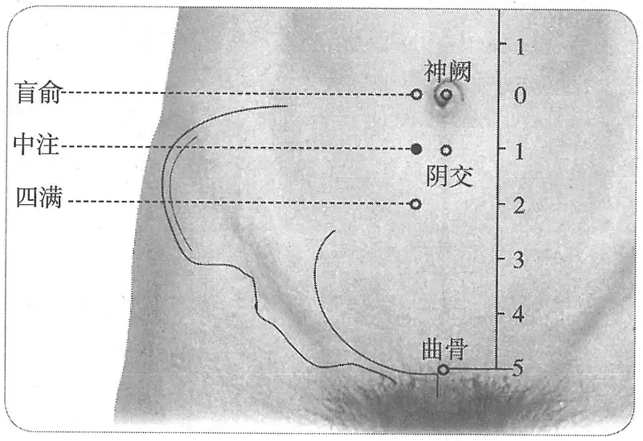

**图2-245　中注穴图**

　4. 肓俞下一寸。以上二十二穴（从幽门到横骨）去腹中行皆当为寸半。（《针灸资生经》卷一、《针灸聚英》、《古今医统》、《医学入门》）

　5. 肓俞下一寸，去腹中行各一寸。（《针灸大成》卷六、《循经考穴编》、《针灸易学》、《针灸逢源》）

　6. 在肓俞下一寸，夹任脉各五分。（《针方六集》卷一、《类经图翼》、《医宗金鉴·刺灸心法要诀》）

　7. 阴交旁开五分。（《针灸十四经穴位考订》）

　8. 统编针灸学教材

　　(1) 部位：在肓俞下一寸。取穴：仰卧，从脐旁五分下行一寸处，即阴交穴旁五分取之。（1957年南京《针灸学》）

　　(2) 部位：横骨穴下四寸。取穴：仰卧，任脉阴交穴旁五分取之。（1版《针灸学讲义》）

　　(3) 部位：在肓俞下一寸。取穴：在横骨穴上四寸，阴交穴任脉旁五分取之。（2版《针灸学讲义》）

　　(4) 脐下1寸，旁开0.5寸。（4版《针灸学》）

　　(5) 脐下1寸，前正中线旁开0.5寸。（5、7版《针灸学》）

　　(6) 在下腹部，当脐中下1寸，前正中线旁开0.5寸。（6版《针灸学》）

　　(7) 脐下一寸，阴交旁开五分。（《中国针灸学》）

#### 【类属】 

足少阴肾经穴。

**脉气所发**：冲脉、足少阴之会。（《黄帝明堂经》）

〔p.865 (인쇄 837)〕

**归经**：足少阴肾经。（《外台秘要》卷三十九、《铜人腧穴针灸图经》卷上）

#### 【适应症】 

主治胃肠病症。常用于便秘、腹痛。

　1. 主少腹有热，大便难。（《黄帝明堂经》）

**按**：“大便难”，《医心方》卷二引杨上善注本《黄帝内经明堂》作“大小便难”。

　2. 治小腹有热，大便坚燥不利。（《铜人腧穴针灸图经》卷中）

　3. 泄气，上下引腰脊痛，目内眦赤痛，女子月事不调。（《针灸聚英》卷一、《针灸大成》）

**按**：“泄气，上下引腰脊痛……女子月事不调”系误引“气穴”穴主治；“目内眦赤痛”乃高武误解《内经》原文所致。

　4. 面黑如炧，肠澼，小腹胀。（《针方六集》卷五）

　5. 主脾泄不止，小便淋沥，腰腹疼痛。（《循经考穴编》下）

**按**：此乃自《针灸聚英》之误的基础上化裁而来。

　6. 统编针灸学教材

　　(1) 主治月经不调，腰腹疼痛，大便燥结，目赤痛。（1957年南京《针灸学》、1版《针灸学讲义》）

　　(2) 主治月经不调，腰腹疼痛，大便燥结。（2版《针灸学讲义》）

　　(3) 主治月经不调，腹痛，便秘，疝气痛，泄泻。（4版《针灸学》）

　　(4) 主治月经不调，腹痛，便秘，泄泻。（5、6、7版《针灸学》）

　　(5) 主治月经不调，腹痛，便秘。（《中国针灸学》）

**文献分析**：教材中“月事不调”、“目赤痛”乃承袭高武《针灸聚英》之误，今去之。

#### 【操作】 

直刺0.5~1.0寸。针刺不宜过深，以免损伤内脏。

　1. 刺入一寸，灸五壮。（《黄帝明堂经》）

　2. 针五至七分，灸五壮。孕妇禁针。（《针灸十四经穴位考订》）

　3. 统编针灸学教材

　　(1) 针五至八分，灸三至五壮。（1957年南京《针灸学》、1版《针灸学讲义》）

　　(2) 直刺5~8分，艾条灸5~7分钟。（2版《针灸学讲义》）

　　(3) 直刺1~1.5寸。（4、5、7版《针灸学》）

　　(4) 直刺1~1.5寸；可灸。（6版《针灸学》）

　　(5) 直刺0.5~1.0寸。可灸。（《中国针灸学》）

### （十六）肓俞 Huāngshū KI16 出《黄帝明堂经》 

#### 【提要索隐】 

**穴名**：肓俞，有古代文献写作“肓输”（《黄帝内经太素》）、“肓腧”（《铜人腧穴针灸图经》）。

**部位**：在腹部，脐中旁开0.5寸。

**适应症**：主治胃肠病症。常用于腹痛，便秘。

**针刺操作**：直刺1~1.5寸。

#### 【名实考】 

“肓俞”之“肓”字，《千金要方》、《外台秘要》、《医宗金鉴》等书误作“盲”，《针灸资生经》误作“育”。又“肓俞”与“肓门”在古医籍中也有相混者。

本穴定位，纵向分寸无分歧，横向定位有“五分”、“一寸”、“一寸半”三说，详见“横骨”穴“名实考”。

〔p.866 (인쇄 838)〕

　1. 肓俞，在商曲下一寸，直脐旁五分，冲脉、足少阴之会。（《黄帝明堂经》）

　2. 此穴仅夹脐旁，肓者，隔也，膈所以遮上下，分清浊也……而膈之气血始备，故曰肓腧，所以别背之膈腧。（《经穴解》）

#### “肓门”误作“肓俞”例 

心下大坚，肓俞、期门及中脘主之。（《针灸甲乙经》卷八）

**按**：据《千金要方》、《医心方》及《针灸甲乙经》腧穴主治条文排列体例，上文中“肓俞”系“肓门”之误。王焘辑录时未加考辨，将此条文字分别归于“肓俞”、“肓门”二穴下。

#### 【定位】 

**部位**：在腹部，脐中旁开0.5寸（图2-246）。

**取穴**：仰卧，神阙穴旁0.5寸处取之。

　1. 在商曲下一寸，直脐旁五分。（《黄帝明堂经》、《铜人腧穴针灸图经》、《圣济总录》、《医学纲目》、《针灸聚英》、《古今医统》、《针方六集》）

　2. 商曲下一寸。以上二十二穴(从幽门到横骨)去腹中行皆当为寸半。（《针灸资生经》卷一、《医学入门》）

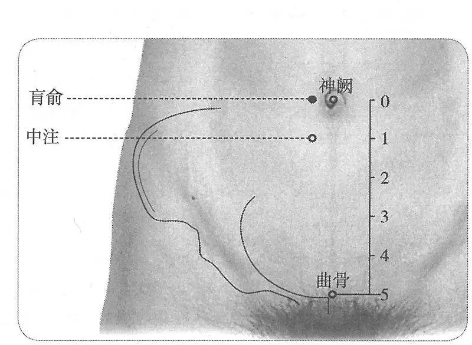

**图2-246　肓俞穴图**

　3. 商曲下一寸，去腹中行各一寸。（《针灸大成》卷六、《循经考穴编》）

　4. 在商曲下一寸当作二寸。（《类经图翼》卷七、《医宗金鉴·刺灸心法要诀》、《针灸逢源》）

　5. 脐心旁开五分。（《针灸十四经穴位考订》）

　6. 统编针灸学教材

　　(1) 部位：神阙旁五分。取穴：从脐旁五分取之。（1957年南京《针灸学》）

　　(2) 部位：中注穴上一寸。取穴：仰卧，任脉神阙旁五分取之。（1版《针灸学讲义》）

　　(3) 部位：在商曲下一寸。取穴：与神阙相平，任脉旁五分取之。（2版《针灸学讲义》）

　　(4) 脐旁0.5寸。（4、5、7版《针灸学》）

　　(5) 在腹中部，当脐中旁开0.5寸。（6版《针灸学》）

　　(6) 脐中旁五分，平神阙。（《中国针灸学》）

#### 【类属】 

足少阴肾经穴。

**脉气所发**：冲脉、足少阴之会。（《黄帝明堂经》）

**归经**：足少阴肾经。（《外台秘要》卷三十九、《铜人腧穴针灸图经》卷上）

#### 【适应症】 

主治胃肠病症。常用于腹痛，便秘。

　1. 主大肠寒中，大便干，腹中切痛。（《黄帝明堂经》）

　2. 主大腹寒疝。（《千金要方》卷三十）

　3. 治大腹寒疝，大便干燥，腹中切痛。（《铜人腧穴针灸图经》卷中）

　4. 肠满响响然不便，心下有寒，目赤痛从内眦始。（《针灸聚英》卷一、《针灸大成》）

**按**：“肠满响响然不便，心下有寒”乃高武从《针灸资生经》误录《千金要方》商丘穴主治；“目赤痛从内眦始”乃高武误解《内经》原文之义，考证详见“横骨”穴“名实考”。

〔p.867 (인쇄 839)〕

　5. 主善饥不欲食，心如悬。（《针方六集》卷五）

　6. 统编针灸学教材

　　(1) 主治腹满切痛，寒疝，大便燥，目赤痛从内眦始。（1957年南京《针灸学》）

　　(2) 主治腹满痛疼，寒疝，大便燥，目赤痛。（1版《针灸学讲义》）

　　(3) 主治腹痛，呕吐，腹胀，便秘，疝痛。（2版《针灸学讲义》、4版《针灸学》）

　　(4) 主治腹痛，腹胀，呕吐，便秘，泄泻。（5、6版《针灸学》、《中国针灸学》）

　　(5) 主治：①腹痛，腹胀，腹泻、便秘等胃肠病证；②月经不调；③疝气。（7版《针灸学》）

**按**：教材中“目赤痛从内眦始”、“目赤痛”乃承袭高武《针灸聚英》之误，今去之。《千金要方》“大腹寒疝”是指“腹中切痛”，而今之疝则特指“阴疝”，两者所指不同。7版教材“月经不调”未详所出，暂不收录。

#### 附：临床应用举例 

　1. 胃下垂，巨阙穴、肓俞，针灸疗法。［上海针灸杂志，1985（2）：7］

　2. 二便失调，取双侧肓俞、太溪针刺补法。［针灸临床杂志，1997，13（10）：34］

#### 【操作】 

直刺1~1.5寸。

　1. 刺入一寸，灸五壮。（《黄帝明堂经》）

　2. 针入三分，灸五壮。（《医学纲目》卷八）

　3. 针五至七分，灸五壮。孕妇禁针。（《针灸十四经穴位考订》）

　4. 统编针灸学教材

　　(1) 针五分至一寸，灸五至十壮。（1957年南京《针灸学》、1版《针灸学讲义》）

　　(2) 直刺5~8分，艾条灸5~7分钟。（2版《针灸学讲义》）

　　(3) 直刺1~1.5寸。（4、5、7版《针灸学》）

　　(4) 直刺1~1.5寸；可灸。（6版《针灸学》）

　　(5) 直刺0.5~1.0寸。可灸。（《中国针灸学》）

### （十七）商曲 Shāngqū KI17 出《黄帝明堂经》 

#### 【提要索隐】 

**部位**：在上腹部，脐中上2寸，前正中线旁开0.5寸。

**适应症**：主治胃肠病症。常用于腹中包块，腹痛，泄泻，便秘。

**针刺操作**：直刺1~1.5寸。

#### 【名实考】 

“商曲”，《千金要方》注有“一名高曲”，疑为“商曲”形误，故不做本穴别名。

本穴定位，纵向分寸无分歧，横向定位有“五分”、“一寸半”二说，详见“横骨”穴“名实考”。

　1. 商曲，在石关下一寸，冲脉、足少阴之会。（《黄帝明堂经》）

　2. 商曲，在石阙下一寸。一名高曲。（《千金要方》卷二十九）

　3. 此穴在脐上第一穴，夹中行任脉水分穴一寸五分，正大、小肠会处，自此际渗入膀胱，而为溺便，谷之渣秽，则自阑门而传送于大肠，肺属金，大肠亦属金，金为商，故曰商曲。（《经穴解》）

　4. 别名　商舍。（1957年南京《针灸学》）

**按**：此传录自日本针灸学教材，云出自《宝鉴》，经查系《东医宝鉴》，原书作“商谷”，标注的引文出处为“铜人”，而后者作“商曲”无误，且《东医宝鉴》前一穴仍作“商曲”，也无误，足证此处“商谷”系“商曲”之形误。韩国针灸学教材不明“商谷”之来历，又受中国针灸教材影响重犯了这一十分明显的错误。

〔p.868 (인쇄 840)〕

#### 【定位】 

**部位**：在上腹部，脐中上2寸，前正中线旁开0.5寸（图2-247）。

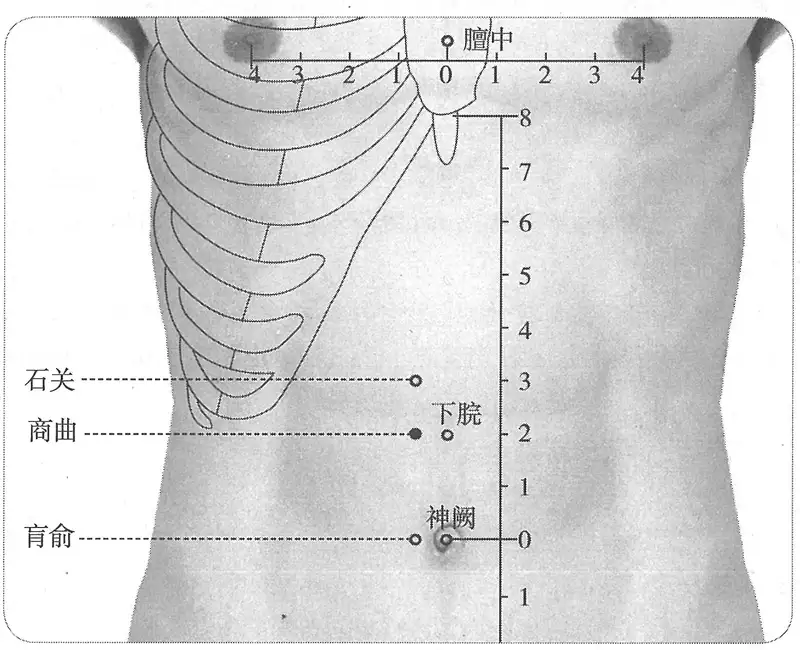

**图2-247　商曲穴图**

**取穴**：仰卧，下脘穴旁0.5寸处取之。

　1. 在石关下一寸。（《黄帝明堂经》、《铜人腧穴针灸图经》、《圣济总录》、《十四经发挥》、《医学纲目》、《针灸聚英》卷一、《古今医统》、《针方六集》、《类经图翼》）

　2. 石关下一寸。以上二十二穴(从幽门到横骨)去腹中行皆当为寸半。（《针灸资生经》卷一、《医学入门》、《针灸大成》、《循经考穴编》、《针灸易学》）

　3. 从肓俞上行二寸，亦去中行旁开五分。（《医宗金鉴·刺灸心法要诀》、《针灸逢源》）

　4. 下脘旁开五分。（《针灸十四经穴位考订》）

　5. 统编针灸学教材

　　(1) 部位：在石关下一寸。取穴：在肓俞上二寸下脘任脉旁五分取之。（1957年南京《针灸学》、2版《针灸学讲义》）

　　(2) 部位：肓俞穴上二寸。取穴：仰卧，任脉下脘穴旁五分取之。（1版《针灸学讲义》）

　　(3) 脐上2寸，旁开0.5寸。（4版《针灸学》）

　　(4) 脐上2寸，前正中线旁开0.5寸。（5、7版《针灸学》）

　　(5) 在上腹部，当脐中上2寸，前正中线旁开0.5寸。（6版《针灸学》）

　　(6) 脐上二寸，下脘旁开五分。（《中国针灸学》）

#### 【类属】 

足少阴肾经穴。

**脉气所发**：冲脉、足少阴之会。（《黄帝明堂经》）

**归经**：足少阴肾经。（《外台秘要》卷三十九、《铜人腧穴针灸图经》卷上）

#### 【适应症】 

主治胃肠病症。常用于腹中包块，腹痛，泄泻，便秘。

〔p.869 (인쇄 841)〕

　1. 腹中积聚，时切痛。（《黄帝明堂经》）

　2. 治腹中积聚，肠中切痛，不嗜食。（《铜人腧穴针灸图经》卷中）

　3. 目赤痛从内眦始。（《针灸聚英》卷一、《古今医统》、《针灸大成》、《针方六集》、《类经图翼》）

**按**：此乃高武误解《内经》原文之义，考证详见“横骨”穴“名实考”。

　4. 大便或泻或闭。（《循经考穴编》下）

　5. 统编针灸学教材

　　(1) 主治腹中积聚，肠中切痛，大便或泄或闭，目赤痛从内眦始。（1957年南京《针灸学》）

　　(2) 主治不嗜食，腹中积聚，肠中切痛，大便或泄或闭，目赤痛。（1版《针灸学讲义》）

　　(3) 主治腹痛，泄泻，便秘，腹中积聚。（2版《针灸学讲义》、4版《针灸学》）

　　(4) 主治腹痛，泄泻，便秘。（5、6版《针灸学》、《中国针灸学》）

　　(5) 主治胃痛、腹痛，腹胀、腹泻，便秘等胃肠病证；腹中积聚。（7版《针灸学》）

**按**：教材中“目赤痛从内眦始”、“目赤痛”乃承袭高武《针灸聚英》之误，今去之。

#### 【操作】 

直刺1~1.5寸。

　1. 刺入一寸，灸五壮。（《黄帝明堂经》）

　2. 一法针二寸，灸三七壮。（《循经考穴编》下）

　3. 一云刺五分。（《类经图翼》卷七）

　4. 针五分，灸三壮。（《针灸逢源》）

　5. 针五至七分，灸五壮。孕妇禁针。（《针灸十四经穴位考订》）

　6. 统编针灸学教材

　　(1) 针五分至一寸，灸五至十壮。（1957年南京《针灸学》、1版《针灸学讲义》）

　　(2) 直刺5~8分，艾条灸5~7分钟。（2版《针灸学讲义》）

　　(3) 直刺1~1.5寸。（4、5、7版《针灸学》）

　　(4) 直刺1~1.5寸；可灸。（6版《针灸学》）

　　(5) 直刺0.5~1.0寸。可灸。（《中国针灸学》）

### （十八）石关 Shíguān KI18 出《黄帝明堂经》 

#### 【提要索隐】 

**按**：石关，有古代文献误作“石阙”（《千金要方》）、“石门”（《西方子明堂灸经》）。

**部位**：在上腹部，脐中上3寸，前正中线旁开0.5寸。

**适应症**：主治腹部病症。常用于腹痛，便秘；多唾，嗳气。

**针刺操作**：直刺1~1.5寸。

#### 【名实考】 

石关，《针方六集》作“食关”，其他文献不从，疑为同音借代，故不做本穴别名。此外，“石关”与“石门”字形相近，古医籍中有相混之例。

本穴定位，纵向分寸无分歧，横向定位有“五分”、“一寸半”二说，详见“横骨”穴“名实考”。

　1. 石关二穴，在阴都下一寸。冲脉、足少阴之会。（《黄帝明堂经》）

　2. 食关二穴，在阴都下一寸，夹任脉各五分。冲脉、足少阴之会。（《针方六集》卷一）

〔p.870 (인쇄 842)〕

　3. 水皆下行，而肾水独上行，以成水火既济之象，肾之经至胃，下脘之旁曰幽门者，乃胃之下口，小肠之上口也，水遇土，有关之象焉。水穿土而上行，亦有关之象。不曰土关，而曰石关，盖肾经由大肠部分而上行至此，则离大肠之金而入胃土，其曰石者，指阳明金大肠而言，肾之穴曰石关，任之穴曰石门，皆指大肠而言也。（《经穴解》）

#### “石门”误作“石关”例 

　1. 石关，主气淋，小便黄。（《针灸聚英》卷一）

　2. 石门，疗气淋，小便黄。（《针灸资生经》卷三）

**按**：《针灸聚英》本穴主治“气淋，小便黄”系误将《针灸资生经》一条“石门”穴主治文字误归入本穴下。

#### 【定位】 

**部位**：在上腹部，脐中上3寸，前正中线旁开0.5寸（图2-248）。

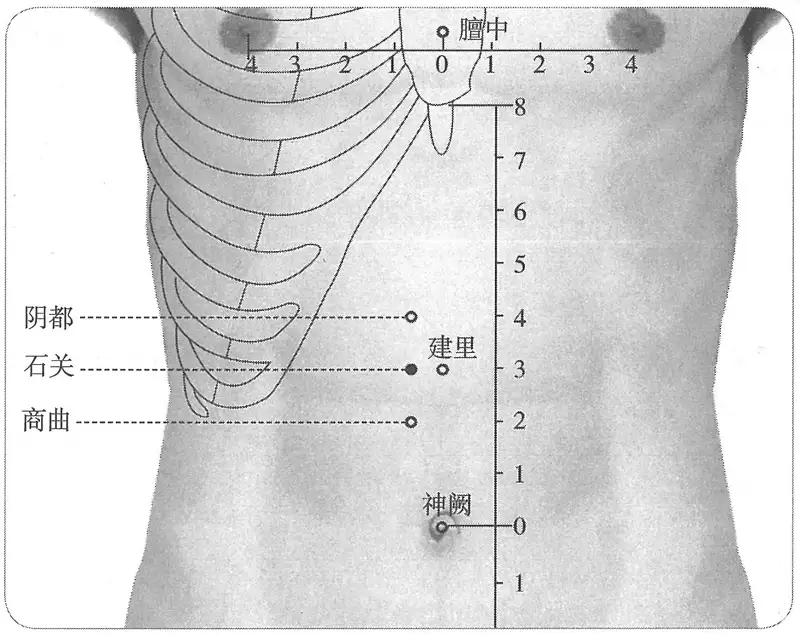

**图2-248　石关穴图**

**取穴**：仰卧，建里穴旁0.5寸处取之。

　1. 在阴都下一寸。（《黄帝明堂经》、《太平圣惠方·明堂》、《铜人腧穴针灸图经》、《圣济总录》、《十四经发挥》、《医学纲目》、《针灸聚英》、《古今医统》、《针方六集》、《类经图翼》、《医宗金鉴·刺灸心法要诀》、《针灸逢源》）

　2. 阴都下一寸。以上二十二穴(从幽门到横骨)去腹中行皆当为寸半。（《针灸资生经》卷一、《医学入门》、《针灸大成》、《循经考穴编》、《针灸易学》）

　3. 建里旁开五分。（《针灸十四经穴位考订》）

　4. 统编针灸学教材

　　(1) 部位：在阴都下一寸。取穴：在肓俞上三寸，建里任脉旁五分取之。（1957年南京《针灸学》、2版《针灸学讲义》）

　　(2) 部位：肓俞穴上三寸。取穴：仰卧，任脉建里穴旁五分取之。（1版《针灸学讲义》）

　　(3) 脐上3寸，旁开0.5寸。（4版《针灸学》）

〔p.871 (인쇄 843)〕

　　(4) 脐上3寸，前正中线旁开0.5寸。（5、7版《针灸学》）

　　(5) 在上腹部，当脐中上3寸，前正中线旁开0.5寸。（6版《针灸学》）

　　(6) 脐上三寸，建里旁开五分。（《中国针灸学》）

#### 【类属】 

足少阴肾经穴。

**脉气所发：**

　1. 冲脉、足少阴之会。（《黄帝明堂经》、《铜人腧穴针灸图经》卷中）

　2. 足少阴之会。（《铜人腧穴针灸图经》卷上）

**归经**：足少阴肾经。（《外台秘要》卷三十九、《铜人腧穴针灸图经》卷上）

#### 【适应症】 

主治腹部病症。常用于腹痛，便秘；多唾，嗳气。

　1. 主痓，脊强，口不可开，多唾，大便难。妇人子藏中有恶血，内逆满痛。（《黄帝明堂经》）

　2. 多唾呕沫，大便难，妇人无子脏有恶血，腹厥痛，绞痛不可忍也。（《太平圣惠方·明堂》）

　3. 疗脊强，不开，多唾，大便秘涩，妇人无子脏有恶血，上冲腹中，痛不可忍。（《铜人腧穴针灸图经》卷中）

**按**：“不开”，此前，王惟一在抄录《太平圣惠方·明堂》原文时，脱一“口”字，遂使文义不通。

　4. 治腹胀满，蛊气血块，久痢不止。（《窦太师秘传》）

　5. 主哕噫呕逆，气淋，小便黄，目赤痛从内眦始。（《针灸聚英》卷一）

**按**：“哕噫呕逆”系从《针灸资生经》转录《千金要方》灸方；“气淋，小便黄”系误将《针灸资生经》卷三“石门”穴主治文字误归入本穴下；“目赤痛从内眦始”乃高武误解《内经》原文之义，考证详见“横骨”穴“名实考”。

　6. 气喘，脾胃虚寒，饮食不消，翻胃吐食，口出清涎。（《循经考穴编》下）

　7. 统编针灸学教材

　　(1) 主治呕逆，腹痛，大便不通，妇人无子，恶血上冲腹痛，目赤痛从内眦始。（1957年南京《针灸学》）

　　(2) 主治呕吐，腹痛，大便不通，妇人不妊，产后痛，目赤痛。（1版《针灸学讲义》）

　　(3) 主治呕吐，腹痛，便秘，产后腹痛，妇人不孕。（2版《针灸学讲义》、《中国针灸学》）

　　(4) 主治呕吐，腹痛，便秘，不孕。（4、5、6版《针灸学》）

　　(5) 主治胃痛、呕吐、腹痛、腹胀、便秘等胃肠病证；不孕。（7版《针灸学》）

**按**：教材中“妇人无子，产后腹痛”皆系承袭《太平圣惠方》之误；“目赤痛从内眦始”、“目赤痛”乃承袭高武《针灸聚英》之误，今皆去之。

**文献分析**：《黄帝明堂经》所载本穴主治“主痓，脊强，口不可开，多唾，大便难。妇人子藏中有恶血，内逆满痛”，其中“主痓，脊强，口不可开”主治症与腧穴主治的一般规律不符，经考察见于“上关”主症中，故此“石关”疑为“上关”之误。但这类失误还不能排除这样的可能性，即《黄帝明堂经》所采用的针灸方中穴名已经有误；原文“子脏”指“胞中”、“胞宫”也，即今之“子宫”，而《太平圣惠方》于“子”前添一“无”字，“脏”属下读，全失原文之本意。《太平圣惠方》之后的《铜人腧穴针灸图经》、《圣济总录》、《针灸大成》、《类经图翼》乃至今天的针灸腧穴学教材均沿袭了这一错误。

#### 附：临床应用举例 

　1. 哕噫呕逆，灸石关百壮。（《千金要方》卷十六、《千金翼方》卷二十七）

　2. 《小品方》治豌方，又方灸石关穴五十壮。（《医心方》卷九）

〔p.872 (인쇄 844)〕

　3. 《小品方》治大便闭塞，气结心满方：灸石关百壮。（《医心方》卷十二）

　4. 膈噎，初病者，取天突，针石关。（《杂病治例》）

　5. 癖块，针中脘、建里、石关、商曲。（《杂病治例》）

#### 【操作】 

直刺1~1.5寸。

　1. 刺入一寸，灸五壮。（《黄帝明堂经》）

　2. 灸三壮。（《太平圣惠方·明堂》）

　3. 窦太师针灸遗存

　　(1) 针入一分，沿皮向外一寸半，灸三七壮。（《窦太师针经》）

　　(2) 一法：针二寸，灸三七壮。（《循经考穴编》下）

　　(3) 针五至七分，灸五壮。孕妇禁针。（《针灸十四经穴位考订》）

　4. 统编针灸学教材

　　(1) 针五分至一寸，灸五至十五壮。（1957年南京《针灸学》、1版《针灸学讲义》）

　　(2) 直刺5~8分，艾条灸5~7分钟。（2版《针灸学讲义》）

　　(3) 直刺1~1.5寸。（4、5、7版《针灸学》）

　　(4) 直刺1~1.5寸；可灸。（6版《针灸学》）

　　(5) 直刺0.5~1.0寸。可灸。（《中国针灸学》）

### （十九）阴都 Yīndū KI19 出《黄帝明堂经》 

#### 【提要索隐】 

**穴名**：一名食宫；一名通关。

**部位**：在上腹部，脐中上4寸，前正中线旁开0.5寸。

**适应症**：主治胃肠病症。常用于肠鸣，腹痛，腹胀。

**针刺操作**：直刺1~1.5寸。

#### 【名实考】 

《针经摘英集》载“通关”穴与本穴定位与归经皆相同，故列入本穴别名。需要注意的是，古医籍中“都”与“郄”常混淆，故手少阴经之“阴郄”有误写作“阴都”者。更奇特的是，本穴别名“食宫”，或写作“石宫”，今人不察，将误写的别名“石宫”作为同样误写的阴郄穴的别名。

本穴定位，纵向分寸无分歧，横向定位有“五分”、“一寸半”二说，详见“横骨”穴“名实考”。

　1. 阴都，一名食宫。在通谷下一寸，冲脉、足少阴之会。（《黄帝明堂经》）

　2. 足少阴经通关二穴，在中脘穴两旁同身寸之相去各五分。用长针针入八分，左捻针能进饮食，右捻针能和脾胃。（《针经摘英集》）

　3. 此阴乃足太阴脾也，部分乃足太阴所治之地，而少阴有过之，故曰阴都。都者，会也。一名食宫，乃胃藏食之所，故曰食宫。（《经穴解》）

　4. 别名　食吕。（1957年南京《针灸学》）

**按**：此传录自日本针灸学教材，云出自《针灸甲乙经》，经查《针灸甲乙经》作“食宫”，无误。

#### 【定位】 

**部位**：在上腹部，脐中上4寸，前正中线旁开0.5寸（图2-249）。

**取穴**：仰卧，中脘穴旁0.5寸处取之。

〔p.873 (인쇄 845)〕

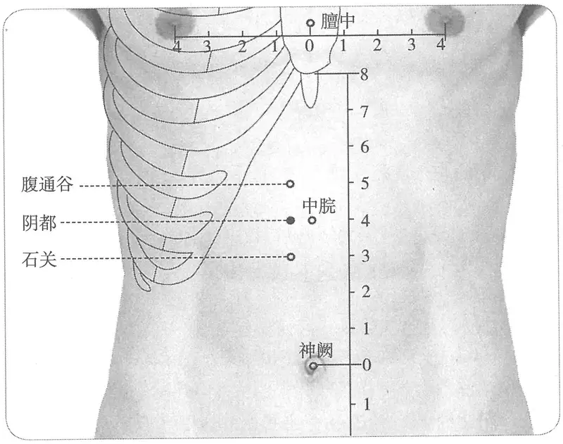

**图2-249　阴都穴图**

　1. 在通谷下一寸。（《黄帝明堂经》、《太平圣惠方·明堂》、《铜人腧穴针灸图经》、《圣济总录》、《十四经发挥》、《医学纲目》、《针灸聚英》、《古今医统》、《针方六集》、《类经图翼》、《医宗金鉴·刺灸心法要诀》、《针灸逢源》）

　2. 穴在胃管相去三寸。（《千金翼方》卷二十八、《太平圣惠方》）

　3. 在通谷下一寸。以上二十二穴(从幽门到横骨)去腹中行皆当为寸半。（《针灸资生经》卷一、《医学入门》、《针灸大成》、《循经考穴编》）

　4. 中脘旁开五分。（《针灸十四经穴位考订》）

　5. 统编针灸学教材

　　(1) 部位：在通谷下一寸。取穴：在肓俞上四寸，中脘任脉旁五分取之。（1957年南京《针灸学》、2版《针灸学讲义》）

　　(2) 部位：肓俞穴上四寸。取穴：仰卧，任脉中脘穴旁五分取之。（1版《针灸学讲义》）

　　(3) 脐上4寸，旁开0.5寸。（4版《针灸学》）

　　(4) 脐上4寸，前正中线旁开0.5寸。（5、7版《针灸学》）

　　(5) 在上腹部，当脐中上4寸，前正中线旁开0.5寸。（6版《针灸学》）

　　(6) 脐上四寸，中脘旁开五分。（《中国针灸学》）

#### 【类属】 

足少阴肾经穴。

**脉气所发**：冲脉、足少阴之会。（《黄帝明堂经》）

**归经**：足少阴肾经。（《外台秘要》卷三十九、《铜人腧穴针灸图经》卷上）

#### 【适应症】 

主治胃肠病症。常用于肠鸣，腹痛，腹胀。

　1. 主身寒热，痎疟，心满气逆。（《黄帝明堂经》）

　2. 肠鸣。（《千金要方》卷三十）

　3. 主心恍惚。（《太平圣惠方·明堂》）

　4. 治身寒热，疟病，心下烦满气逆。（《铜人腧穴针灸图经》卷中）

　5. 肺胀，气抢胁下热痛，目赤痛从内眦始。（《针灸聚英》卷一、《古今医统》、《针灸大成》）

〔p.874 (인쇄 846)〕

**按**：“肺胀，气抢胁下热痛”系从《针灸资生经》卷四转录《千金要方》灸方主治；“目赤痛从内眦始”乃高武误解《内经》原文之义，考证详见“横骨”穴“名实考”。

　6. 腹胀。（《循经考穴编》下）

**按**：此从《针灸聚英》“肺胀”变化而来。

　7. 统编针灸学教材

　　(1) 主治肠鸣腹胀，逆气腹痛，肺胀气呛，胁下热痛，目赤痛从内眦始。（1957年南京《针灸学》）

　　(2) 主治肠鸣腹胀，逆气腹痛，胁下热痛，目赤痛。（1版《针灸学讲义》）

　　(3) 主治肠鸣，腹胀，便秘，腹痛，妇人不孕。（2版《针灸学讲义》）

　　(4) 主治肠鸣，腹痛，便秘，不孕。（4、5版《针灸学》）

　　(5) 主治腹痛，腹泻，月经不调，不孕，便秘。（6版《针灸学》）

　　(6) 主治胃痛、腹胀、便秘等胃肠病证。（7版《针灸学》）

　　(7) 主治肠鸣，腹痛，胃脘痛，便秘，呕吐。（《中国针灸学》）

**文献分析**：《黄帝明堂经》载本穴主治“主身寒热，痎疟，心满气逆”，与腧穴主治的一般规律不符，经考察与手少阴经穴“阴郄”主症相近，则“阴都”似为“阴郄”之误。

教材中“目赤痛从内眦始”、“目赤痛”乃承袭高武《针灸聚英》之误；“月经不调”、“妇人不孕”疑是将上一穴“石关”穴主治误录于此。今皆不取。

#### 附：临床应用举例 

　1. 小肠热满，灸阴都，随年壮，穴夹中管两边相去一寸。（《千金要方》卷十四）

　2. 肺胀，气抢胁下热痛，灸夹胃管相去一寸，名阴都，随年壮。（《千金要方》卷十七）

　3. 治五噎，黄瘅，醋心，多睡，呕吐不止，刺任脉天突一穴……次针足少阴经通关二穴，在中腕穴两旁同身寸之相去各五分。用长针针入八分，左捻针能进饮食，右捻针能和脾胃。（《针经摘英集》）

　4. 盗汗，阴都、五里、间使。（《医学纲目》卷十七）

#### 【操作】 

直刺1~1.5寸。

　1. 刺入一寸，灸五壮。（《黄帝明堂经》）

　2. 灸三壮。（《太平圣惠方·明堂》）

　3. 灸三壮，针入三分。（《铜人腧穴针灸图经》卷中）

　4. 针入八分。（《针经摘英集》）

　5. 一法针入二寸五分，灸三七壮。（《循经考穴编》下）

　6. 针五至七分，灸三壮。孕妇禁针。（《针灸十四经穴位考订》）

　7. 统编针灸学教材

　　(1) 针五分至一寸，灸五至十壮。（1957年南京《针灸学》、1版《针灸学讲义》）

　　(2) 直刺5~8分，艾条灸5~7分钟。（2版《针灸学讲义》）

　　(3) 直刺1~1.5寸。（4、5、7版《针灸学》）

　　(4) 直刺1~1.5寸；可灸。（6版《针灸学》）

　　(5) 直刺0.5~1.0寸。可灸。（《中国针灸学》）

〔p.875 (인쇄 847)〕

### （二十）腹通谷 Fùtōnggǔ KI20 出《黄帝明堂经》 

#### 【提要索隐】 

**部位**：在上腹部，脐中上5寸，前正中线旁开0.5寸。

**适应症**：主治腹部病症。常用于腹中包块，腹痛，腹胀，呕吐。

**针刺操作**：直刺0.5~1寸。

#### 【名实考】 

本穴出自《黄帝明堂经》名曰“通谷”，与足太阳经之“通谷”同名。“腹通谷”之名见于明代《针灸大全》。需要注意的是，早期文献中存在同名异穴之“通谷”。

本穴定位，纵向分寸无分歧，横向定位有“五分”、“一寸半”二说，详见“横骨”穴“名实考”。

　1. 通谷，在幽门下一寸陷者中，冲脉、足少阴之会。（《黄帝明堂经》）

　2. 论一名有两穴：腹通谷、足通谷。（《针灸大全》卷六）

　3. 谷者，水所行之地，有虚象焉，穴以谷名，正在中脘之旁，胃属土而中虚，有谷象焉，足少阴自下而上行，同冲脉以过之，故曰通谷。（《经穴解》）

#### 同名异穴“通谷”辨 

　1. 癫疾呕沫，神庭及兑端、承浆主之；其不呕沫……尺泽、阳溪、外丘、当上脘旁五分通谷、金门、承筋、合阳主之。（《针灸甲乙经》卷十一第二）

**按**：根据《针灸甲乙经》腧穴排列序例，一眼便可看出此条中“通谷”系足部太阳经穴，而古人不察，误断为腹部穴，遂于该穴前注以“当上脘旁五分”六字。《医学纲目》引宋本此条时此六字也作大字，则此注系宋以前人所注，误在宋以前也。

　2. 治痰饮法，诸结积，留饮澼囊，胸满饮食不消，灸通谷五十壮。（《千金要方》卷十八、《千金翼方》）

**按**：据此方主治病症，应是腹部“通谷”，《医心方》卷九引此方下注曰“在幽门下一寸”，极是。然宋代王惟一、明代张介宾皆将此方之“通谷”误作足部“通谷”。

　3. 心痛，恶气，上胁痛急，灸通谷五十壮，在乳下二寸。（《千金要方》卷十三、《千金翼方》）

**按**：此通谷定位与足少阴肾经之“通谷”相差较大，应视为不同的腧穴。

#### 【定位】 

**部位**：在上腹部，脐中上5寸，前正中线旁开0.5寸（图2-250）。

**取穴**：仰卧，上脘穴旁0.5寸处取之。

　1. 在幽门下一寸陷者中。（《黄帝明堂经》、《太平圣惠方·明堂》、《铜人腧穴针灸图经》、《圣济总录》、《医学纲目》、《针灸聚英》、《古今医统》、《针方六集》、《类经图翼》、《针灸逢源》、《医宗金鉴·刺灸心法要诀》）

　2. 在夹上管两旁，相去三寸是穴。（《太平圣惠方·针经》）

　3. 幽门下一寸。以上二十二穴(从幽门到横骨)去腹中行皆当为寸半。（《针灸资生经》卷一、《医学入门》、《针灸大成》、《循经考穴编》、《针灸易学》）

　4. 上脘旁开五分。（《针灸十四经穴位考订》）

　5. 统编针灸学教材

　　(1) 部位：幽门下一寸。取穴：在肓俞上五寸，上脘任脉旁五分取之。（1957年南京《针灸学》）

〔p.876 (인쇄 848)〕

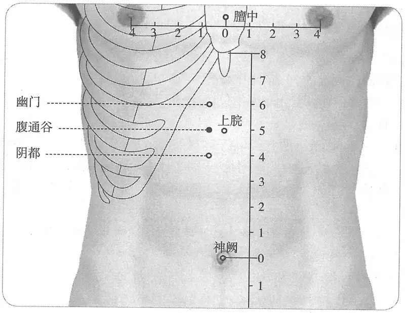

**图2-250　腹通谷穴图**

　　(2) 部位：肓俞穴上五寸。取穴：仰卧，任脉上脘穴旁五分取之。（1版《针灸学讲义》）

　　(3) 部位：在幽门下一寸陷者中。取穴：在肓俞上五寸，上脘任脉旁五分取之。（2版《针灸学讲义》）

　　(4) 脐上5寸，旁开0.5寸。（4版《针灸学》）

　　(5) 脐上5寸，前正中线旁开0.5寸。（5、7版《针灸学》）

　　(6) 在上腹部，当脐中上5寸，前正中线旁开0.5寸。（6版《针灸学》）

　　(7) 脐上五寸，上脘旁开五分。（《中国针灸学》）

#### 【类属】 

足少阴肾经穴。

**脉气所发**：冲脉、足少阴之会。（《黄帝明堂经》）

**归经**：足少阴肾经。（《外台秘要》卷三十九、《铜人腧穴针灸图经》卷上）

#### 【适应症】 

主治腹部病症。常用于腹中包块，腹痛，腹胀，呕吐。

　1. 《黄帝明堂经》佚文

　　(1) 舌下肿，难言，舌纵，㖞戾不端。一云：失欠，口㖞僻不端，不能言。（《针灸甲乙经》卷十二）

　　(2) 主失欠，口㖞僻不端，食饮善呕，不得言。一云舌下肿，难以言，舌纵，㖞戾不端。（《外台秘要》卷三十九）

　　(3) 主失欠，口噼㖞不端，食饮善呕，不能言。（《医心方》卷二）

　2. 治干呕又无所吐。又治劳食饮隔结。（《太平圣惠方·针经》）

　3. 主失欠，口㖞，善呕，暴哑。（《太平圣惠方·明堂》）

　4. 治失欠，口㖞，食饮善呕，暴哑不能言。（《铜人腧穴针灸图经》卷中）

　5. 心恍惚，目赤痛从内眦始。（《针灸聚英》卷一、《针灸大成》）

**按**：“心恍惚”系高武从《针灸资生经》误录《太平圣惠方·明堂》“阴都”穴主治；“目赤痛从内眦始”乃高武误解《内经》原文之义，考证详见“横骨”穴“名实考”。

　6. 主心气攻注两胁疼痛，口吐清涎。（《循经考穴编》下）

〔p.877 (인쇄 849)〕

**按**：此系误录上一穴“阴都”穴主治。

　7. 统编针灸学教材

　　(1) 主治积聚留饮，胸满，呕吐，食不化，目赤痛。（1957年南京《针灸学》、1版《针灸学讲义》）

　　(2) 主治腹痛，腹胀，呕吐，脾胃虚弱。（2版《针灸学讲义》、4版《针灸学》）

　　(3) 主治腹痛，腹胀，呕吐。（5、6版《针灸学》）

　　(4) 主治：①腹痛，腹胀，胃痛、呕吐等胃肠病症；②心痛、心悸、胸痛等心胸疾患。（7版《针灸学》）

　　(5) 主治腹痛，腹胀，呕吐，消化不良。（《中国针灸学》）

**文献分析**：《黄帝明堂经》所载本穴主治“失欠，口㖞僻不端”一条，很早就出现异文，然而两条文字所描述的主治均与腧穴主治的一般规律不合，疑《黄帝明堂经》所依据的针灸方文献中穴名有误。因此，本穴的主治应主要依据《黄帝明堂经》的另一条文字，以及《千金要方》卷三十辑录的别家“明堂”，参照历代治疗文献而定。教材中“心悸”、“目赤痛”诸症乃承袭高武《针灸聚英》之误，今去之。又1版教材有“积聚留饮”，古代文献有相应的临床应用，今从之。

#### 附：临床应用举例 

　1. 治痰饮法，诸结积，留饮澼囊，胸满饮食不消，灸通谷五十壮。（《千金要方》卷十八、《千金翼方》）

　2. 《德贞常方》治张口不合方，灸通谷穴，在上管旁半寸。（《医心方》卷五）

　3. 内中水肿，面痿黄，胃脘、通谷、气海、水分。（《医学纲目》卷二十四）

　4. 噎塞膈气，通谷。（《医学纲目》卷二十二）

#### 【操作】 

直刺0.5~1寸。

　1. 刺入五分，灸五壮。（《黄帝明堂经》）

　2. 灸三壮。（《太平圣惠方·明堂》）

　3. 针五至七分，灸三壮。孕妇禁针。（《针灸十四经穴位考订》）

　4. 统编针灸学教材

　　(1) 针五分至一寸，灸五至十壮。（1957年南京《针灸学》、1版《针灸学讲义》）

　　(2) 直刺5~8分，艾条灸5~7分钟。（2版《针灸学讲义》）

　　(3) 直刺1~1.5寸。（4版《针灸学》）

　　(4) 直刺0.5~1寸。（5、7版《针灸学》）

　　(5) 直刺0.5~1寸；可灸。（6版《针灸学》、《中国针灸学》）

### （二十一）幽门 Yōumén KI21 出《黄帝明堂经》 

#### 【提要索隐】 

**穴名**：一名上门。

**部位**：在上腹部，脐中上6寸，前正中线旁开0.5寸。

**适应症**：主治胃肠病症。常用于呃逆，呕吐，腹痛，腹胀，泄泻。

**针刺操作**：直刺0.5~1寸。

#### 【名实考】 

幽门，《普济方》曰：“明堂经云一名幽关”，查宋本《太平圣惠方·明堂》作“幽门”，无误。“门”与“关”繁体字形相近，古医籍中常混淆，如本穴别名“上门”，也有误作“上关”者。

〔p.878 (인쇄 850)〕

本穴定位，纵向分寸无分歧，横向定位有“五分”、“一寸半”二说，详见“横骨”穴“名实考”。

　1. 幽门，一名上门。在巨阙两旁各五分陷者中，冲脉、足少阴之会。（《黄帝明堂经》）

　2. 肾经至此，将入胸中清净之所，故曰幽门，言其深远难测也。（《经穴解》）

#### 【定位】 

**部位**：在上腹部，脐中上6寸，前正中线旁开0.5寸（图2-251）。

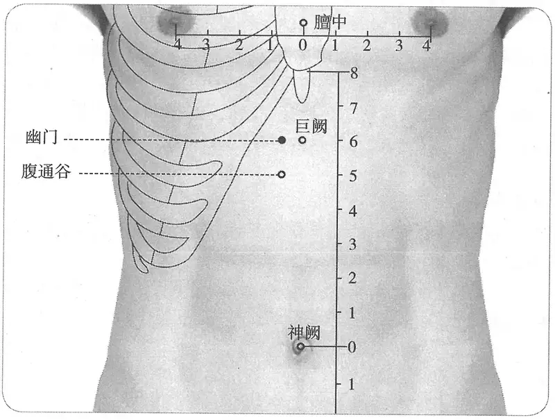

**图2-251　幽门穴图**

**取穴**：仰卧，巨阙穴旁0.5寸处取之。

　1. 在巨阙两旁各五分陷者中。（《黄帝明堂经》、《铜人腧穴针灸图经》、《圣济总录》、《医学纲目》、《针灸聚英》、《古今医统》、《针方六集》、《类经图翼》）

　2. 在巨阙旁各一寸半陷者中。（《太平圣惠方·明堂》、《医学入门》、《针灸大成》、《循经考穴编》、《针灸易学》）

　3. 《铜人》云：幽门夹巨阙，肓俞夹脐旁各五分相去一寸。《明堂》乃云：幽门在巨阙旁寸半，通谷夹上管旁相去三寸。按《千金》四满第二行穴在丹田今石门两边各寸半，与《明堂》合。始知《铜人》误云。以上二十二穴(从幽门到横骨)去腹中行皆当为寸半。（《针灸资生经》卷一）

　4. 巨阙旁开五分。（《针灸十四经穴位考订》）

　5. 统编针灸学教材

　　(1) 部位：在巨阙旁五分。取穴：在肓俞上六寸，巨阙任脉旁五分取之。（1957年南京《针灸学》）

　　(2) 部位：肓俞穴上六寸。取穴：仰卧，任脉巨阙穴旁五分取之。（1版《针灸学讲义》）

　　(3) 部位：在巨阙两旁各五分陷中。取穴：在肓俞上六寸，巨阙任脉旁五分取之。

〔p.879 (인쇄 851)〕

（2版《针灸学讲义》）

　　(4) 脐上6寸，旁开0.5寸。（4版《针灸学》）

　　(5) 脐上6寸，前正中线旁开0.5寸。（5、7版《针灸学》）

　　(6) 在上腹部，当脐中上6寸，前正中线旁开0.5寸。（6版《针灸学》）

　　(7) 脐上六寸，巨阙旁开五分。（《中国针灸学》）

#### 【类属】 

足少阴肾经穴。

**脉气所发**：冲脉、足少阴之会。（《黄帝明堂经》）

**归经**：足少阴肾经。（《外台秘要》卷三十九、《铜人腧穴针灸图经》卷上）

#### 【适应症】 

主治胃肠病症。常用于呃逆，呕吐，腹痛，腹胀，泄泻。

　1. 主胸胁背相引痛，心下溷溷，呕吐多唾，饮食不下。善哕支满，积不能食，数咳善忘，泄有脓血，呕沫吐涎，少腹坚，善唾，女子心疝逆气，善吐，食不下。（《黄帝明堂经》）

　2. 治胸中引痛，心下烦闷，逆气里急，支满不嗜食，数咳，健忘，泄利脓血，少腹胀满，呕沫吐涎，喜唾，女子心痛，逆气善吐，食不下。（《铜人腧穴针灸图经》卷中）

　3. 主目赤痛从内眦始。（《针灸聚英》卷一、《针灸大成》、《针方六集》）

**按**：“目赤痛从内眦始”乃高武误解《内经》原文之义，考证详见“横骨”穴“名实考”。

　4. 妇人乳汁不通，乳痈乳疖。（《循经考穴编》下）

　5. 统编针灸学教材

　　(1) 呕吐涎沫，泄利脓血，胸痛引痛，目赤痛从内眦始。（1957年南京《针灸学》）

　　(2) 呕吐，胃痛，胸痛，烦闷，泄利，目赤痛。（1版《针灸学讲义》）

　　(3) 腹痛，呕吐，善哕，消化不良，泄泻。（2版《针灸学讲义》）

　　(4) 胸胁痛，心烦，呕哕，腹胀，积聚疼痛，便脓血。（4版《针灸学》）

　　(5) 腹痛，腹胀，呕吐，泄泻。（5、6版《针灸学》）

　　(6) 善哕、呕吐、腹痛、腹胀、腹泻等胃肠病证。（7版《针灸学》）

　　(7) 腹痛，腹胀，消化不良，呕吐，泄泻，恶阻。（《中国针灸学》）

#### 附：临床应用举例 

　1. 主胸中痛引腰背，心下呕逆，面无滋润，灸幽门随年壮。（《千金要方》卷十三、《千金翼方》）

　2. 呕吐恶心，灸胃俞、幽门、商丘、中府、石门、膈俞、阳关。（《杂病治例》）

　3. 胃下垂，针刺幽门治疗。［中国针灸，1994（3）：33］

#### 【操作】 

直刺0.5~1寸。

　1. 刺入五分，灸五壮。（《黄帝明堂经》）

　2. 一法刺可二寸五分，灸三七壮。（《循经考穴编》下）

　3. 针五至七分，灸三壮。孕妇禁针。（《针灸十四经穴位考订》）

　4. 统编针灸学教材

　　(1) 针五分至一寸，灸五至十壮。（1957年南京《针灸学》、1版《针灸学讲义》）

　　(2) 直刺3~7分，艾条灸5~7分钟。（2版《针灸学讲义》）

　　(3) 直刺0.7~1寸。（4版《针灸学》）

　　(4) 直刺0.5~1寸。（5版《针灸学》）

　　(5) 直刺0.5~1寸；可灸。本穴不可深刺，以免伤及肝脏。（6版《针灸学》）

　　(6) 直刺0.5~1寸。不可向上深刺，以免伤及内脏。（7版《针灸学》）

〔p.880 (인쇄 852)〕

　　(7) 直刺0.3~0.7寸。不可深刺，以免伤及肝脏。（《中国针灸学》）

### （二十二）步廊 Bùláng KI22 出《黄帝明堂经》 

#### 【提要索隐】 

**部位**：在胸部，第5肋间隙，前正中线旁开2寸。

**适应症**：主治胸肺部病症。常用于胸胁胀满，咳嗽，气喘。

**针刺操作**：斜刺或平刺0.5~0.8寸。不宜深刺和直刺，以免刺伤心肺。

#### 【名实考】 

“步廊”之“廊”字，宋以前文献如《针灸甲乙经》、《千金要方》、《外台秘要》、《医心方》、《太平圣惠方》、《圣济总录》、《针灸资生经》均作“郎”。明刊本《针灸甲乙经》卷三作“步廊”，而治疗卷仍作“步郎”；《铜人腧穴针灸图经》卷上作“步廊”，其余各卷作“步郎”。

　1. 步郎，在神封下一寸六分陷者中，足少阴脉气所发，仰而取之。（《黄帝明堂经》）

　2. 肾经至此而入胸，胸中为清净之府，有廊之象焉，与中行任之中庭横直，庭在中，而廊在旁，自下而上，故曰步廊。（《经穴解》）

#### 【定位】 

**部位**：在胸部，第5肋间隙，前正中线旁开2寸（图2-252）。

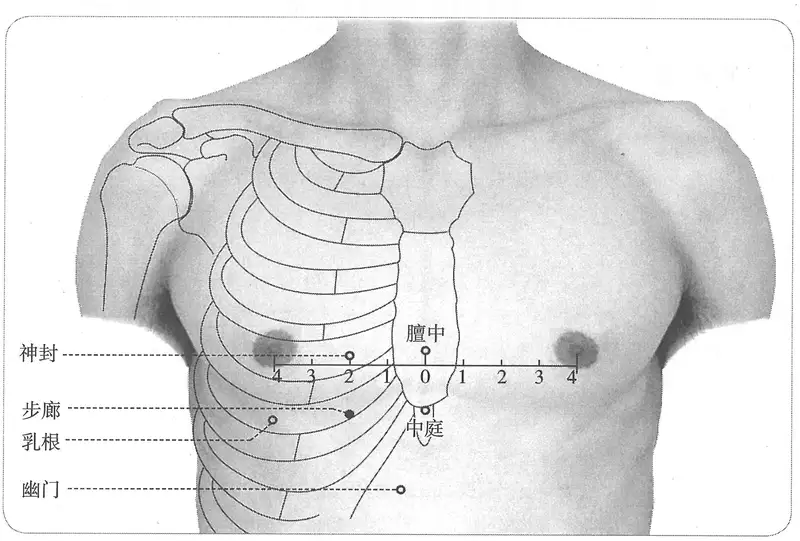

**图2-252　步廊穴图**

**取穴**：仰卧，在第5肋间隙，当乳根穴（胃经）与中庭穴（任脉）之肋间中央取之。

　1. 在神封下一寸六分陷者中……仰而取之。（《黄帝明堂经》、《太平圣惠方·针经》、《铜人腧穴针灸图经》卷中、《圣济总录》、《针灸资生经》、《十四经发挥》、《医学纲目》、《针灸大成》、《针方六集》、《循经考穴编》、《针灸易学》）

　2. 在神封下一寸六分。（《铜人腧穴针灸图经》卷上、卷下“穴腧都数”）

〔p.881 (인쇄 853)〕

　3. 神封下一寸六分陷中，去胸中行二寸，仰而取之。（《针灸聚英》卷一、《古今医统》）

　4. 神封下一寸六分，去中庭外二寸。（《医学入门》卷一、《类经图翼》、《医宗金鉴·刺灸心法要诀》、《针灸逢源》）

　5. 中庭旁开二寸，当第五肋骨下间。（《针灸十四经穴位考订》）

　6. 统编针灸学教材

　　(1) 部位：在神封下一寸六分，去中行二寸。取穴：仰卧，按取两乳相距之正中膻中穴，下一寸六分为中庭穴，从中庭旁开二寸肋间陷中取之。（1957年南京《针灸学》）

　　(2) 部位：第五、第六肋之间，去中行二寸。取穴：仰卧，在胃经乳根穴与任脉中庭穴之肋间中央取之。（1版《针灸学讲义》）

　　(3) 部位：在神封下一寸六分陷者中。取穴：在第五肋间隙，任脉旁二寸，当胸骨中线（任脉）与乳中线之间取之。（2版《针灸学讲义》）

　　(4) 第五肋间隙，前正中线旁开2寸。（4、5、7版《针灸学》）

　　(5) 在胸部，当第5肋间隙，前正中线旁开2寸。（6版《针灸学》）

　　(6) 第五肋间隙，任脉旁开二寸。（《中国针灸学》）

#### 【类属】 

足少阴肾经穴。

足少阴脉气所发。（《黄帝明堂经》）

#### 【适应症】 

主治胸肺部病症。常用于胸胁胀满，咳嗽，气喘。

　1. 主胸胁榰满，膈逆不通，呼吸少气，喘息，不得举臂。（《黄帝明堂经》）

　2. 鼻塞不通。（《太平圣惠方·针经》）

**按**：“鼻”系“鬲”之形误。

　3. 治胸胁支满，鼻塞不通，呼吸少气，喘息，不得举臂。（《铜人腧穴针灸图经》卷中）

　4. 咳逆，呕吐，不嗜食。（《针灸聚英》卷一、《古今医统》、《针灸大成》、《类经图翼》）

**按**：此条主治系高武将《针灸资生经》卷五一条“灵墟”穴主治误做本穴主治。原文为“灵墟治胸胁支满，痛引胸不得息，咳逆，呕吐，胸满不嗜食（《明》同）。步郎治胸胁支满，鼻塞不通，呼吸少气，喘息，不得举臂（《明》同）。”

　5. 主伤寒过经不解，闭闷。（《循经考穴编》下）

　6. 统编针灸学教材

　　(1) 主治咳嗽，气喘，胸痛，呕吐，不嗜食。（1957年南京《针灸学》、2版《针灸学讲义》）

　　(2) 主治咳嗽，胸满，喘息，呕吐，不嗜食。（1版《针灸学讲义》、4版《针灸学》）

　　(3) 主治咳嗽，气喘，胸胁胀满，呕吐。（5版《针灸学》）

　　(4) 主治胸痛，咳嗽，气喘，呕吐，乳痈。（6版《针灸学》）

　　(5) 主治：①胸痛，咳嗽，气喘等胸肺疾患；②乳痈。（7版《针灸学》）

　　(6) 主治咳嗽，气喘，胸胁胀满，呕吐，纳呆。（《中国针灸学》）

**按**：教材“呕吐，不嗜食”系传《针灸聚英》之误，今不取。

#### 【操作】 

斜刺或平刺0.5~0.8寸。不宜深刺和直刺，以免刺伤心肺。

　1. 刺入四分，灸五壮。（《黄帝明堂经》）

　2. 灸三壮。（《外台秘要》卷三十九）

　3. 针入三分，灸五壮。（《太平圣惠方·针经》）

　4. 针三分，灸三壮。（《针灸十四经穴位考订》）

　5. 统编针灸学教材

〔p.882 (인쇄 854)〕

　　(1) 针三至五分，灸三至五壮。（1957年南京《针灸学》、1版《针灸学讲义》）

　　(2) 直刺3分，艾条灸3~5分钟。（2版《针灸学讲义》）

　　(3) 斜刺或平刺0.5~0.8寸。不可深刺，以免伤及心、肺。（4、5、7版《针灸学》）

　　(4) 斜刺或平刺0.5~0.8寸；可灸。不可深刺，以免伤及内脏。（4、5、7版《针灸学》）

　　(5) 斜刺0.3~0.5寸。不可深刺，以免伤及心、肺。可灸。（《中国针灸学》）

### （二十三）神封 Shénfēng KI23 出《黄帝明堂经》 

#### 【提要索隐】 

**部位**：在胸部，第4肋间隙，前正中线旁开2寸。

**适应症**：主治胸肺部病症。常用于胸胁胀满，咳嗽，气喘；呕吐；乳痈。

**针刺操作**：斜刺或平刺0.5~0.8寸。不宜深刺和直刺，以免刺伤心脏。

#### 【名实考】 

　1. 神封，在灵墟下一寸六分陷者中，足少阴脉气所发，仰而取之。（《黄帝明堂经》）

　2. 穴名神封者，盖心藏神，此穴近心，乃神藏之所，封者，界也，故曰神封。又以神藏于内，故曰神封。（《经穴解》）

#### 【定位】 

**部位**：在胸部，第4肋间隙，前正中线旁开2寸（图2-253）。

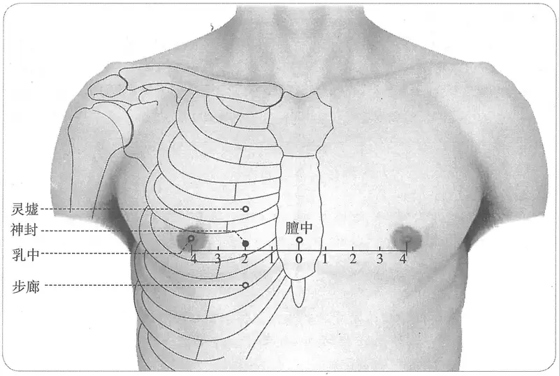

**图2-253　神封穴图**

**取穴**：仰卧，在第4肋间隙，膻中穴（任脉）与乳中穴（胃经）之肋间中央取之。

　1. 在灵墟下一寸六分陷者中……仰而取之。（《黄帝明堂经》、《铜人腧穴针灸图经》卷中、《圣济总录》、《针灸资生经》、《十四经发挥》、《医学纲目》、《针灸聚英》、《古今医统》、《针方六集》、《类经图翼》、《循经考穴编》、《针灸逢源》、《医宗金鉴·刺

〔p.883 (인쇄 855)〕

灸心法要诀》、《针灸易学》）

　2. 在灵墟下一寸六分。（《千金要方》卷二十九、《千金翼方》、《外台秘要》、《医心方》、《太平圣惠方·针经》、《铜人腧穴针灸图经》卷上及卷下“穴腧都数”、《医学入门》）

　3. 膻中旁开二寸，当第四肋骨下间。（《针灸十四经穴位考订》）

　4. 统编针灸学教材

　　(1) 部位：在灵墟下一寸六分，即膻中旁开二寸。取穴：膻中旁开二寸，肋间陷中取之。（1957年南京《针灸学》）

　　(2) 部位：第四、第五肋骨之间。取穴：仰卧，任脉膻中穴与胃经乳中穴之肋间陷中取之。（1版《针灸学讲义》）

　　(3) 部位：在灵墟下一寸六分陷者中。取穴：在第四肋间隙，当胸骨中线与乳中线之间取之。（2版《针灸学讲义》）

　　(4) 第四肋间隙，前正中线旁开2寸。（4、5、7版《针灸学》）

　　(5) 在胸部，当第4肋间隙，前正中线旁开2寸。（6版《针灸学》）

　　(6) 第四肋间隙，任脉旁开二寸。（《中国针灸学》）

#### 【类属】 

足少阴肾经穴。

足少阴脉气所发。（《黄帝明堂经》）

#### 【适应症】 

主治胸肺部病症。常用于胸胁胀满，咳嗽，气喘；呕吐；乳痈。

　1. 主胸胁榰满不得息，咳逆，乳痈，洒淅恶寒。（《黄帝明堂经》）

　2. 治胸满不得息，咳逆，乳痈，洒淅恶寒。（《铜人腧穴针灸图经》卷中）

　3. 咳逆呕吐。（《针灸聚英》卷一、《针灸大成》、《针方六集》）

　4. 肺痈。（《循经考穴编》下）

　5. 统编针灸学教材

　　(1) 主治咳逆胸满不得息，呕吐，不嗜食，乳痈。（1957年南京《针灸学》）

　　(2) 主治咳嗽胸满，呕吐，不嗜食，乳痈。（1版《针灸学讲义》）

　　(3) 主治咳嗽，气喘，胸胁支满，乳痈，呕吐，不嗜食。（2版《针灸学讲义》，4、6、7版《针灸学》）

　　(4) 主治咳嗽，气喘，腹胁胀满，呕吐，乳痈。（5版《针灸学》）

　　(5) 主治咳嗽，气喘，胸胁胀满，乳痈。（《中国针灸学》）

#### 【操作】 

斜刺或平刺0.5~0.8寸。不宜深刺和直刺，以免刺伤心脏。

　1. 刺入四分，灸五壮。（《黄帝明堂经》）

　2. 针入三分，灸五壮。（《太平圣惠方·针经》）

　3. 统编针灸学教材

　　(1) 针三至五分，灸三至五壮。（1957年南京《针灸学》、1版《针灸学讲义》）

　　(2) 斜刺3~5分，艾条灸3~7分钟。（2版《针灸学讲义》）

　　(3) 斜刺或平刺0.5~0.8寸，不可深刺，以免伤及心、肺。（4、5、7版《针灸学》）

　　(4) 斜刺或平刺0.5~0.8寸；可灸。（6版《针灸学》）

　　(5) 斜刺或平刺0.3~0.5寸。可灸。（《中国针灸学》）

〔p.884 (인쇄 856)〕

### （二十四）灵墟 Língxū KI24 出《黄帝明堂经》 

#### 【提要索隐】 

**穴名**：一名灵墙。

**部位**：在胸部，第3肋间隙，前正中线旁开2寸。

**适应症**：主治胸肺部病症。常用于胸胁胀满，咳嗽，气喘；呕吐，不思饮食。

**针刺操作**：斜刺或平刺0.5~0.8寸。不宜深刺和直刺，以免刺伤心肺。

#### 【名实考】 

《千金要方》卷二十九注曰：“墟，或作墙”，《医心方》卷二即作“灵墙”。

　1. 灵墟，在神藏下一寸六分陷者中，足少阴脉气所发，仰而取之。（《黄帝明堂经》）

　2. 心之神最灵，此穴乃心神所致之所，故曰灵墟。（《经穴解》）

#### 【定位】 

**部位**：在胸部，第3肋间隙，前正中线旁开2寸（图2-254）。

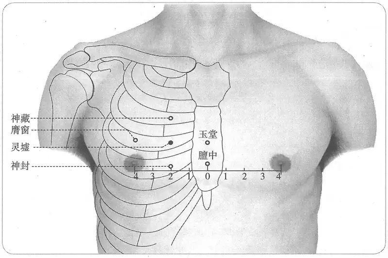

**图2-254　灵墟穴图**

**取穴**：仰卧，在第3肋间隙，当膺窗穴（胃经）与玉堂穴（任脉）之肋间中央取之。

　1. 在神藏下一寸六分陷者中……仰而取之。（《黄帝明堂经》、《太平圣惠方·针经》、《铜人腧穴针灸图经》、《圣济总录》、《针灸资生经》、《十四经发挥》、《医学纲目》、《针灸聚英》、《古今医统》、《医学入门》、《针灸大成》、《针方六集》、《类经图翼》、《循经考穴编》、《医宗金鉴·刺灸心法要诀》、《针灸易学》、《针灸逢源》）

　2. 玉堂旁开二寸，当第三肋骨下间。（《针灸十四经穴位考订》）

　3. 统编针灸学教材

　　(1) 部位：神藏下一寸六分，去胸中行二寸。取穴：从神封穴按上以肋陷中取之(当第三肋之下)。（1957年南京《针灸学》）

　　(2) 部位：第三、第四肋骨之间。取穴：仰卧，在胃经膺窗穴与任脉玉堂穴之肋间中央取之。（1版《针灸学讲义》）

〔p.885 (인쇄 857)〕

　　(3) 部位：在神藏下一寸六分陷者中。取穴：在第三肋间隙，当胸骨中线与乳中线之间取之。（2版《针灸学讲义》）

　　(4) 第三肋间隙，前正中线旁开2寸。（4、5、7版《针灸学》）

　　(5) 在胸部，当第3肋间隙，前正中线旁开2寸。（6版《针灸学》）

　　(6) 第三肋间隙，任脉旁开二寸。（《中国针灸学》）

#### 【类属】 

足少阴肾经穴。

足少阴脉气所发。（《黄帝明堂经》）

#### 【适应症】 

主治胸肺部病症。常用于胸胁胀满，咳嗽，气喘；呕吐，不思饮食。

　1. 主胸胁支满痛引膺，不得息，闷乱，呕吐烦满，不得饮食。（《黄帝明堂经》）

　2. 治胸胁支满，痛引胸不得息，咳逆呕吐，胸满，不嗜食。（《铜人腧穴针灸图经》卷中）

　3. 主痰涎壅塞，呕噎等证。（《循经考穴编》下）

　4. 乳痈，洒淅恶寒。（《类经图翼》卷七）

**按**：此乃“神封”穴主治。

　5. 统编针灸学教材

　　(1) 主治咳嗽，胸胁痛，呕吐，不嗜食，乳痈。（1957年南京《针灸学》、1版《针灸学讲义》）

　　(2) 主治咳嗽，气喘，胸胁胀痛，呕吐，乳痈。（2版《针灸学讲义》，4、5、6、7版《针灸学》）

　　(3) 主治咳嗽，气喘，胸胁胀满，乳痈。（《中国针灸学》）

**按**：各版教材皆有“乳痈”一症，经考察此乃前一穴“神封”穴主治，今去之。

#### 【操作】 

斜刺或平刺0.5~0.8寸。不宜深刺和直刺，以免刺伤心肺。

　1. 刺入四分，灸五壮。（《黄帝明堂经》）

　2. 刺入三分，灸五壮。（《太平圣惠方·针经》）

　3. 统编针灸学教材

　　(1) 针三至五分，灸三至五壮。（1957年南京《针灸学》、1版《针灸学讲义》）

　　(2) 斜刺3~5分，艾条灸3~5分钟。（2版《针灸学讲义》）

　　(3) 斜刺或平刺0.5~0.8寸。（4、5版《针灸学》）

　　(4) 斜刺或平刺0.5~0.8寸；可灸。（6版《针灸学》）

　　(5) 斜刺或平刺0.5~0.8寸，不可深刺，以免伤及心、肺。（7版《针灸学》）

　　(6) 斜刺或平刺0.3~0.5寸。可灸。（《中国针灸学》）

### （二十五）神藏 Shéncáng KI25 出《黄帝明堂经》 

#### 【提要索隐】 

**部位**：在胸部，第2肋间隙，前正中线旁开2寸。

**适应症**：主治胸肺部病症。常用于胸胁胀满，咳嗽，气喘；呕吐，不思饮食。

**针刺操作**：斜刺或平刺0.5~0.8寸。不宜深刺和直刺，以免损伤壁胸膜和肺脏。

#### 【名实考】 

　1. 神藏，在彧中下一寸六分陷者中，足少阴脉气所发，仰而取之。（《黄帝明堂经》）

〔p.886 (인쇄 858)〕

　2. 此穴乃近心之所，而心之神藏于其内，故曰神藏。（《经穴解》）

#### 【定位】 

**部位**：在胸部，第2肋间隙，前正中线旁开2寸（图2-255）。

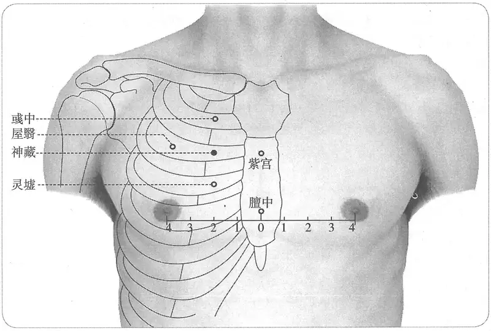

**图2-255　神藏穴图**

**取穴**：仰卧，在第2肋间隙，当屋翳穴（胃经）与紫宫穴（任脉）之肋间中央取之。

　1. 在彧中下一寸六分陷者中……仰而取之。（《黄帝明堂经》、《太平圣惠方·针经》、《铜人腧穴针灸图经》、《圣济总录》、《针灸资生经》、《十四经发挥》、《医学纲目》、《针灸聚英》、《古今医统》、《医学入门》、《针灸大成》、《针方六集》、《类经图翼》、《循经考穴编》、《医宗金鉴·刺灸心法要诀》、《针灸易学》、《针灸逢源》）

　2. 紫宫旁开二寸，当第二肋骨下间。（《针灸十四经穴位考订》）

　3. 统编针灸学教材

　　(1) 部位：彧中下一寸六分，去胸中行二寸。取穴：从灵墟穴按上一肋间陷中取之当第二肋之下。（1957年南京《针灸学》）

　　(2) 部位：第二、第三肋骨之间。取穴：仰卧，在胃经屋翳穴与任脉紫宫穴之肋间中央取之。（1版《针灸学讲义》）

　　(3) 部位：在彧中下一寸六分陷者中。取穴：在第二肋间隙，当胸骨中线与乳中线之间取之。（2版《针灸学讲义》）

　　(4) 在胸部，第二肋间隙，前正中线旁开2寸。（4、5、6、7版《针灸学》）

　　(5) 第二肋间隙，任脉旁开二寸。（《中国针灸学》）

#### 【类属】 

足少阴肾经穴。

足少阴脉气所发。（《黄帝明堂经》）

#### 【适应症】 

主治胸肺部病症。常用于胸胁胀满，咳嗽，气喘；呕吐，不思饮食。

　1. 主胸满咳逆，喘不得息，呕吐，烦满，不得饮食。（《黄帝明堂经》）

〔p.887 (인쇄 859)〕

**按**：《黄帝明堂经》载本穴主治与邻近的灵墟、俞府、气户等主治几乎相同。

　2. 治胸胁支满，咳逆喘不得息，呕吐，胸满，不嗜食。（《铜人腧穴针灸图经》卷中）

　3. 主心悬病饥，善恐心惕，口热，舌干，咽肿，上气。（《针方六集》卷五）

**按**：此条主治全出于足少阴经病候，归入本穴下，不知其所据。

　4. 统编针灸学教材

　　(1) 主治咳逆喘满，呕吐，不嗜食。（1957年南京《针灸学》、1版《针灸学讲义》）

　　(2) 主治咳逆，气喘，胸痛，呕吐，烦满不嗜食。（2版《针灸学讲义》，4、6版《针灸学》）

　　(3) 主治咳嗽，气喘，胸痛，呕吐。（5版《针灸学》）

　　(4) 主治①胸胁支满，咳嗽，气喘；②呕吐，不嗜食。（7版《针灸学》）

　　(5) 主治咳嗽，气喘，胸痛。（《中国针灸学》）

#### 【操作】 

斜刺或平刺0.5~0.8寸。不宜深刺和直刺，以免损伤壁胸膜和肺脏。

　1. 刺入四分，灸五壮。（《黄帝明堂经》）

　2. 灸五壮，针入三分。（《太平圣惠方·针经》）

　3. 统编针灸学教材

　　(1) 针三至五分，灸三至五壮。（1957年南京《针灸学》、1版《针灸学讲义》）

　　(2) 斜刺3~5分，艾条灸3~5分钟。（2版《针灸学讲义》）

　　(3) 斜刺或平刺0.5~0.8寸。（4、5版《针灸学》）

　　(4) 斜刺或平刺0.5~0.8寸；可灸。（6版《针灸学》）

　　(5) 斜刺或平刺0.5~0.8寸，不可深刺（7版《针灸学》）

　　(6) 斜刺或平刺0.3~0.5寸。可灸。（《中国针灸学》）

### （二十六）彧中 Yùzhōng KI26 出《黄帝明堂经》 

#### 【提要索隐】 

**穴名**：彧中，宋以前文献作“或中”。

**部位**：在胸部，第1肋间隙，前正中线旁开2寸。

**适应症**：治胸肺部病症。常用于胸胁胀满，咳嗽，气喘，痰多。

**针刺操作**：斜刺或平刺0.5~0.8寸。不宜深刺和直刺，以免损伤壁胸膜和肺脏。

#### 【名实考】 

宋以前文献均作“或中”，宋代《太平圣惠方·针经》始作“彧中”，传世本《针灸甲乙经》也作“彧中”，应是宋以后人改。明抄本《针灸甲乙经》仍作“或中”。

　1. 或中，在输府下一寸六分陷者中，足少阴脉气所发，仰卧而取之。（《黄帝明堂经》）

　2. “彧”字之义，《说文》解同“郁”字。（《经穴解》）

#### 【定位】 

**部位**：在胸部，第1肋间隙，前正中线旁开2寸（图2-256）。

**取穴**：仰卧。在第1肋间隙，当库房穴（胃经）与华盖穴（任脉）之肋间中央取之。

　1. 在输府下一寸六分陷者中……仰卧而取之。（《黄帝明堂经》、《太平圣惠方·针经》、《铜人腧穴针灸图经》、《圣济总录》、《十四经发挥》、《医学纲目》、《针灸聚英》、《古今医统》、《医学入门》、《针灸大成》、《针方六集》、《类经图翼》、《循经考穴编》、《医宗金鉴·刺灸心法要诀》、《针灸易学》、《针灸逢源》）

　2. 在输府下一寸陷者中，仰而取之。（《太平圣惠方·明堂》、《窦太师针经》）

〔p.888 (인쇄 860)〕

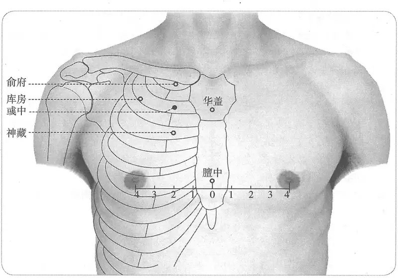

**图2-256　彧中穴图**

　3. 在腧府下一寸六分陷中，仰头取之。（《铜人腧穴针灸图经》卷下“穴腧都数”）

　4. 华盖旁开二寸，当第一肋骨下间。（《针灸十四经穴位考订》）

　5. 统编针灸学教材

　　(1) 部位：俞府下一肋，去胸中行二寸。取穴：从神藏穴按上一肋间陷中取之(当第一肋间处取之)。（1957年南京《针灸学》）

　　(2) 部位：第一、第二肋骨之间。取穴：仰卧，在胃经库房穴与任脉华盖穴之肋间中央取之。（1版《针灸学讲义》）

　　(3) 部位：在俞府下一寸六分陷者中。取穴：在第一肋间隙，当胸骨中线与乳中线之间取之。（2版《针灸学讲义》）

　　(4) 在胸部，第一肋间隙，前正中线旁开2寸。（4、5、6、7版《针灸学》）

　　(5) 第一肋间隙，任脉旁开二寸。（《中国针灸学》）

#### 【类属】 

足少阴肾经穴。

足少阴脉气所发。（《黄帝明堂经》）

#### 【适应症】 

主治胸肺部病症。常用于胸胁胀满，咳嗽，气喘，痰多。

　1. 主咳逆上气，涎出多唾，呼吸喘悸，坐不得安。（《黄帝明堂经》）

　2. 主胸胁支满，不能食饮。（《太平圣惠方·针经》）

　3. 治胸胁支满，咳逆，喘，不能食饮。（《铜人腧穴针灸图经》卷中）

　4. 窦太师针灸遗存

　　(1) 治嗽喘，痰涎盛，乳痈胸疼，泻；紫白癜风，吹乳，详补泻。（《窦太师针经》）

　　(2) 主嗽喘痰涎，胸痛不能食，及乳痈之近少阴者。（《针方六集》卷五）

　　(3) 主哮喘气逆，痰涎壅塞，胸膈疼痛，妇人吹乳乳痈，及紫白癜风。（《循经考穴编》）

　5. 统编针灸学教材

〔p.889 (인쇄 861)〕

　　(1) 主治咳逆，喘息，胸胁支满。（1957年南京《针灸学》、1版《针灸学讲义》、5版《针灸学》）

　　(2) 主治咳嗽，气喘，痰壅，胸胁胀满，不嗜食。（2版《针灸学讲义》、4版《针灸学》）

　　(3) 主治咳嗽，气喘，胸胁胀满，不嗜食。（6版《针灸学》）

　　(4) 主治胸胁支满，咳嗽，气喘，痰涌等肺系病证。（7版《针灸学》、《中国针灸学》）

#### 附：临床应用举例 

　1. 转筋在两臂及胸中者，灸手掌白肉际七壮。又灸或中、中府、巨阙、胃管、尺泽。并治筋拘头足皆愈。（《千金要方》卷二十）

　2. 治卒哕，灸或中、中府、胃管各数十壮，灸尺泽、巨阙各七壮。（《千金翼方》卷二十七）

　3. 《小品方》灸咳嗽法，又方灸或中。（《医心方》卷九）

　4. 足心水肿，从足起，白环俞、水分、彧中。（《医学纲目》卷二十四）

　5. 治肺痿方，太冲、彧中、中府、肺俞。（《医方类聚》卷十二）

#### 【操作】 

斜刺或平刺0.5~0.8寸。不宜深刺和直刺，以免损伤壁胸膜和肺脏。

　1. 刺入四分，灸五壮。（《黄帝明堂经》）

　2. 灸五壮，针入三分。（《太平圣惠方·针经》）

　3. 灸三壮。（《太平圣惠方·明堂》）

　4. 针入一分，沿皮向外一寸半，灸二七壮。（《窦太师针经》）

　5. 统编针灸学教材

　　(1) 针三至五分，灸三至五壮。（1957年南京《针灸学》、1版《针灸学讲义》）

　　(2) 斜刺3~5分，艾条灸3~5分钟。（2版《针灸学讲义》）

　　(3) 斜刺或平刺0.5~0.8寸。（4、5、6版《针灸学》）

　　(4) 斜刺或平刺0.5~0.8寸，不可深刺（7版《针灸学》）

　　(5) 斜刺或平刺0.3~0.5寸。可灸。（《中国针灸学》）

### （二十七）俞府 Shūfǔ KI27 出《黄帝明堂经》 

#### 【提要索隐】 

**穴名**：俞府，又作“输府”，又作“腧府”。

**部位**：在胸部，锁骨下缘，前正中线旁开2寸。

**适应症**：主治胸肺部病症。常用于咳嗽，气喘，胸痛，呕吐。

**针刺操作**：斜刺或平刺0.5~0.8寸。不宜深刺和直刺，以免造成气胸。

#### 【名实考】 

　1. 输府，在巨骨下，去璇玑旁各二寸陷者中，足少阴脉气所发，仰卧而取之。（《黄帝明堂经》）

　2. 腧府二穴，在巨骨下，璇玑旁各二寸陷中，仰而取之。足少阴脉气所发。（《铜人腧穴针灸图经》卷中）

　3. 腧者，输也。足少阴之经自涌泉而上输至此穴，肾经之穴已尽，故曰腧府。（《经穴解》）

#### 【定位】 

**部位**：在胸部，锁骨下缘，前正中线旁开2寸（图2-257）。

**取穴**：仰卧，锁骨下端之凹陷中，当气户穴（胃经）与璇玑穴（任脉）之肋间中央取之。

〔p.890 (인쇄 862)〕

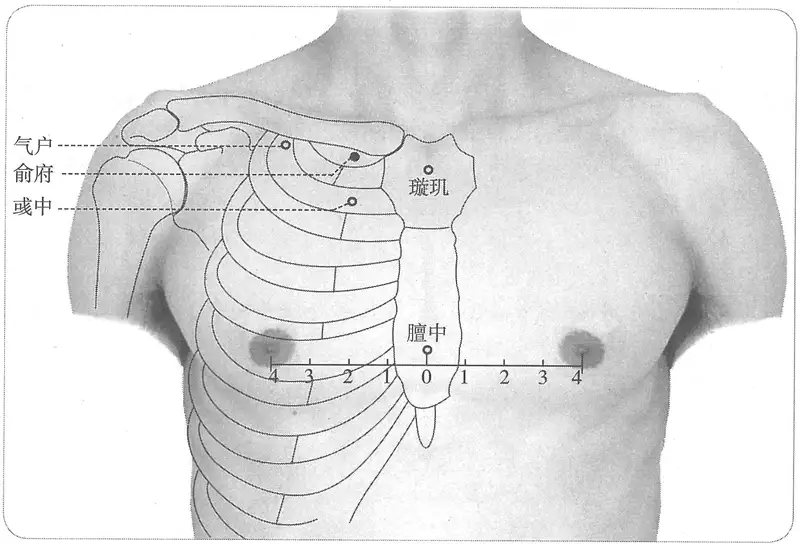

**图2-257　俞府穴图**

　1. 在巨骨下，去璇玑旁各二寸陷者中……仰卧而取之。（《黄帝明堂经》、《太平圣惠方》、《铜人腧穴针灸图经》、《圣济总录》、《针灸资生经》、《针灸玉龙经》、《十四经发挥》、《针灸聚英》、《古今医统》、《医学纲目》、《针方六集》、《循经考穴编》、《医宗金鉴·刺灸心法要诀》、《针灸逢源》）

　2. 气舍下，璇玑旁各二寸陷中。仰而取之。（《针灸大成》卷六、《针灸易学》）

　3. 璇玑旁开二寸，当锁骨下间。（《针灸十四经穴位考订》）

　4. 统编针灸学教材

　　(1) 部位：璇玑旁开二寸。取穴：仰卧，从锁骨下端之凹陷中，胸骨正中二寸处取之。（1957年南京《针灸学》）

　　(2) 部位：彧中穴上一肋，锁骨下缘之凹陷中。取穴：仰卧，胃经气户穴与任脉璇玑穴之肋间中央取之。（1版《针灸学讲义》）

　　(3) 在巨骨下，去璇玑旁各二寸陷者中。（2版《针灸学讲义》）

　　(4) 在胸部，锁骨下缘，前正中线旁开2寸。（4、5、6、7版《针灸学》）

　　(5) 锁骨下缘之凹陷中，任脉旁开二寸。（《中国针灸学》）

#### 【类属】 

足少阴肾经穴。

足少阴脉气所发。（《黄帝明堂经》）

#### 【适应症】 

主治胸肺部病症。常用于咳嗽，气喘，胸痛，呕吐。

　1. 咳逆上气，喘不得息。呕吐，胸满，不得饮食。（《黄帝明堂经》）

　2. 胸中痛。（《太平圣惠方·明堂》）

　3. 治咳逆上喘，呕吐，胸满，不得饮食。（《铜人腧穴针灸图经》卷中）

　4. 腹胀。（《针灸聚英》卷一、《针灸大成》、《针方六集》）

　5. 窦太师针灸遗存

　　(1) 治嗽喘，热泻，冷补。吐血痰涎，妇女血妄行。（《窦太师针经》）

〔p.891 (인쇄 863)〕

　　(2) 治咳嗽，气急，哮喘；热咳泻，冷咳补。（《大本琼瑶神书》）

　　(3) 主痰涎上气，喉咙疼，舌本强。（《针方六集》卷五）

　　(4) 主久嗽吐痰，亦治骨蒸及妇人血热妄行。（《循经考穴编》下）

　　(5) 哮喘咳嗽痰饮多，才下金针疾便和，俞府乳根一般刺，气喘风痰渐渐磨。俞府，痰浓，泻；痰清，补。（《针灸玉龙歌》）

　6. 统编针灸学教材

　　(1) 主治咳逆上气，久喘，胸中痛。（1957年南京《针灸学》、1版《针灸学讲义》）

　　(2) 主治咳嗽，气喘，胸胁支，呕吐，食欲不振。（2版《针灸学讲义》，4、6版《针灸学》）

　　(3) 主治咳嗽，气喘，胸痛，呕吐。（5版《针灸学》）

　　(4) 主治咳嗽，气喘，胸痛等胸肺疾患。（7版《针灸学》、《中国针灸学》）

#### 附：临床应用举例 

　1. 久嗽不愈，肺俞、三里、乳根、风门、百劳一椎上陷中、列缺。问曰：此证缘何而得？答曰：因咸物咳嗽伤脾，兼房事过多，酒食不节，伤风不解，痰饮流入肺经，故如此也。宜刺后穴：胆中、三里、乳根、输府。（《针灸集成》第五十方）

　2. 心房纤颤复律，针刺俞府穴。［中医杂志，1986，27（9）：30］

#### 【操作】 

斜刺或平刺0.5~0.8寸。不宜深刺和直刺，以免造成气胸。

　1. 刺入四分，灸五壮。（《黄帝明堂经》）

　2. 灸五壮，针入三分。（《太平圣惠方·针经》）

　3. 针入一分，沿皮向外一寸半，灸二七壮。（《窦太师针经》、《针方六集》）

　4. 统编针灸学教材

　　(1) 针三至五分，灸三至五壮。（1957年南京《针灸学》、1版《针灸学讲义》）

　　(2) 斜刺3~5分，艾条灸3~7分钟。（2版《针灸学讲义》）

　　(3) 斜刺或平刺0.5~0.8寸。（4、5版《针灸学》）

　　(4) 斜刺或平刺0.5~0.8寸；可灸。（6版《针灸学》）

　　(5) 斜刺或平刺0.5~0.8寸，不可深刺。（7版《针灸学》）

　　(6) 斜刺或平刺0.3~0.5寸。可灸。（《中国针灸学》）

### 延伸阅读 

　1. 黄龙祥.中国针灸学术史大纲［M］.北京：华夏出版社，2001.

　2. 黄龙祥.新编重绘十四经脉经穴图［M］.北京：中国中医药出版社，2010.

　3. 魏晓日.足少阴肾经井穴定位考辨［J］.中国针灸，1994（6）：48.

　4. 张善忱.对几个经穴定位之我见［J］.山东中医学院学报，1982，6（1）：46-54.

〔p.892 (인쇄 864)〕

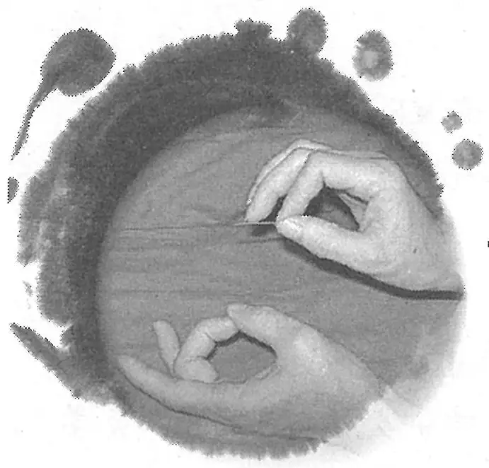

