# 《针灸腧穴通考》(下册) — 手厥阴心包经穴  · （一）天池 Tiānchí PC1 出《灵枢》~（九）中冲 Zhōngchōng PC9 出《灵枢》

> 분할본 16/25. 원서: 黄龙祥·黄幼民 编著, 《针灸腧穴通考——〈中华针灸穴典〉研究》(下册), 人民卫生出版社, 2011. 원서 스캔 OCR 판독본을 챗봇 검색용으로 나눈 것이며, 본문과 쪽 표시 〔p.PDF쪽 (인쇄 쪽)〕는 원본 그대로이다.

## 九、手厥阴心包经穴 

### 概说 

手厥阴经的经脉循行、病候以及腧穴归经古代文献记载变化不大；经穴定位的最大分歧在于“中冲”、“劳宫”二穴；最晚确定的是本经的募穴。

需要指出的是，本经脉名称原作“手厥阴心主脉”，与心相关，而不是与心包相关。

#### 【经脉与经穴】 

由于“厥阴”一词原特指前阴，因而当手六经比照足六经采用三阴三阳命名时，惟独行手少阴、手太阴之间的脉无法名曰“手厥阴”，而只得称做“手心主”或“心主”。此时的“心主”是指心，而不是心包络。“心包络”一词出现并与三焦相配是比较晚的事。“手厥阴”一词出现也较晚，后来与心包络相属，但并没有被当时的人们普遍接受。例如，不仅汉代的《黄帝明堂经》无手厥阴的俞、募穴，六朝时《产经》所载“手心主脉图”中仍径称“心主者，内属于心”，而且以“巨阙”、“心俞”作为手心主之俞、募穴，可见此书仍将“心主”视为心而不是心包络。至明代高武提出“厥阴俞”即为心包之背俞穴，吴崑从其说，将“厥阴俞”改作“心包俞”，以与其他脏腑背俞穴命名法一致。然而，对于心包经的募穴，古代腧穴文献中均无记载。

《脉经·心手少阴经病证》卷六、古宋本《千金要方·心脏脉论》卷十三均只记有“手心主脉之循行与病候”，而未载“手少阴脉”文字。至于心之病候的治疗取“手心主”或手心主经五输穴更是多不胜举。从字义上分析，“心主”指君主，即“心者，五脏六腑之大主也”（《灵枢·邪客》）；“心者，五脏六腑之主也”（《灵枢·口问》）；“五脏六腑，心为之主”（《灵枢·师传》）；“心者，君主之官也”（《素问·灵兰秘典论》）之义也。所以，“心主”一词在早期只能指“心脏”而言，而不可能指“心包”，或“心包络”。例如《灵枢·胀论》所谓“膻中者，心主之宫城也”。其中“心主”是指心而言，有人误以为指心包，又将“膻中”误作腧穴，故以膻中穴作为心包之募。

#### 经脉循行与病候 

心主手厥阴心包络之脉，起于胸中，出属心包络，下膈，历络三膲；其支者，循胸出胁，下腋三寸，上抵腋，下循臑内，行太阴少阴之间，入肘中，下臂行两筋之间，入掌中，循中指出其端；其支者，别掌中，循小指次指出其端。是动则病手心热，臂肘挛急，腋肿，甚则胸胁支满，心中憺憺大动，面赤目黄，喜笑不休。是主脉所生病者，烦心心痛，掌中热。（《灵枢·经脉》）

〔p.893 (인쇄 865)〕

**所属经穴**：中冲　劳宫　大陵　内关　间使　郄门　曲泽　天泉　天池

#### 【归经与起止穴】 

《针灸甲乙经》载手厥阴心主及臂凡一十六穴：中冲、劳宫、大陵、内关、间使、郄门、曲泽、天泉；

六朝《产经》将此八穴全部归入“手心主心脉”，唐代《千金要方》、《千金翼方》、《外台秘要》同；

宋代《铜人腧穴针灸图经》在此八穴基础上增加“天池”一穴，厘定为九穴。

《灵枢·本输》与心相关联的是手心主五输，其相应的募、俞为巨阙和心俞。至《灵枢·经脉》手心主脉与心包相关，手少阴脉与心相关，虽然相关的五输穴也相应置换，但募、俞穴却长期未变，一直到唐代《千金翼方》仍然将“巨阙”、“心俞”归于心主手厥阴脉，而心手少阴脉下的募、俞穴空缺。在现代人的眼中，一直以为空缺的是手厥阴的募、俞穴，而在古人眼中，缺少的是手少阴的募、俞穴。直到宋代将“厥阴俞”归入足太阳经，明代高武始提出“厥阴俞”即为心包之背俞穴，吴崑从其说，将“厥阴俞”改作“心包俞”，以与其他脏腑背俞穴命名法一致。然而，对于心包之募，古代腧穴文献中均无记载，千百年过后，这个空缺依然没有填补上。

#### 【经穴定位与主治】 

手厥阴经经穴定位的古代文献记载变化不大。然而后人对古代文献的理解有所不同，经穴定位的最大分歧在于“中冲”、“劳宫”二穴。

#### 【脉口病候、经脉是动病候与经脉穴主治】 

手厥阴标脉：腋下三寸（天池穴所在）；

手厥阴本脉：大陵至内关间脉（大陵穴所在）；

“手心主”穴：大陵。

关于手厥阴经脉的“是动”病（源出于手厥阴脉口的诊断病候）与“手心主”穴（冲阳）主治病症的比较见表2-12。

**表2-12　手心主经脉是动病候与经脉穴主治的相关性**

| 《灵枢·经脉》是动病候 | 《黄帝明堂经》经脉穴主治 |
|---|---|
| 是动则病手心热，臂肘挛急，腋肿，甚则胸胁支满，心中憺憺大动，面赤目黄，喜笑不休。 | 大陵：主肘挛掖肿，善笑不休，心中痛，目赤黄，心澹澹而惊。两手挛不伸及腋偏枯不仁。 |

从上表对照可见，“手心主”穴——大陵穴主治病症与手厥阴经“是动”病相关程度很高，可以明显看出从诊脉与经脉病候而来的胎记。

#### 【诊络病候、络脉病候与络穴主治】 

手心主之别，名曰内关，去腕二寸，出于两筋之间，循经以上系于心包，络心系。实则心痛，虚则为头强，取之两筋间也。（《灵枢·经脉》）

内关，手心主络，在掌后去腕二寸，别走少阳。实则心暴痛，虚则烦。（《黄帝明堂经》）

值得注意的是，《黄帝明堂经》载手心主络穴“内关”主治病症虽有《灵枢·经脉》手心主络脉特有的句式，但可见明显的异文，说明汉代流行的“十五络脉”学说有不同的传本，《灵枢·经脉》传承的只是其中的一种传本。

〔p.894 (인쇄 866)〕

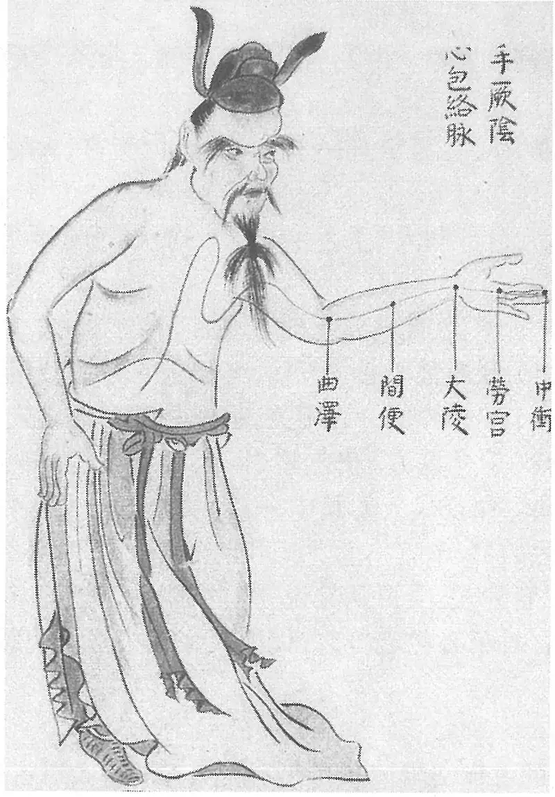

**图2-258　《环中图》手厥阴心包络脉图**

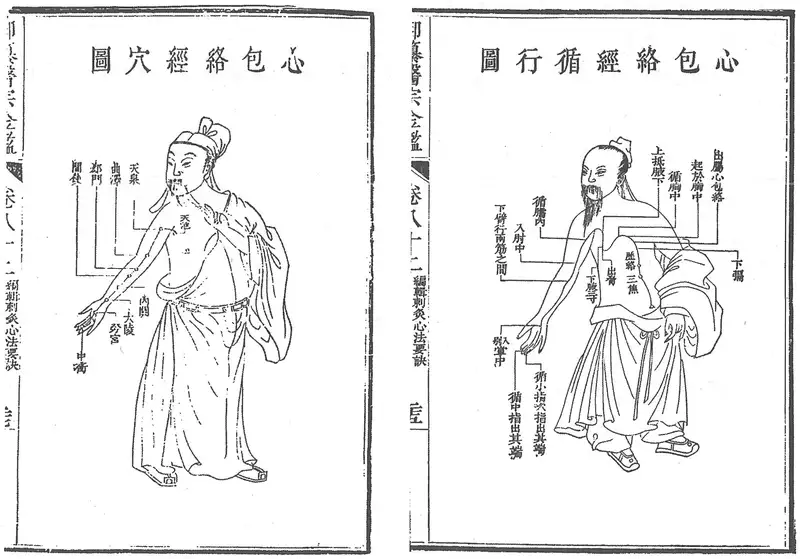

**图2-259　《医宗金鉴》手厥阴心包经脉、经穴分图**

〔p.895 (인쇄 867)〕

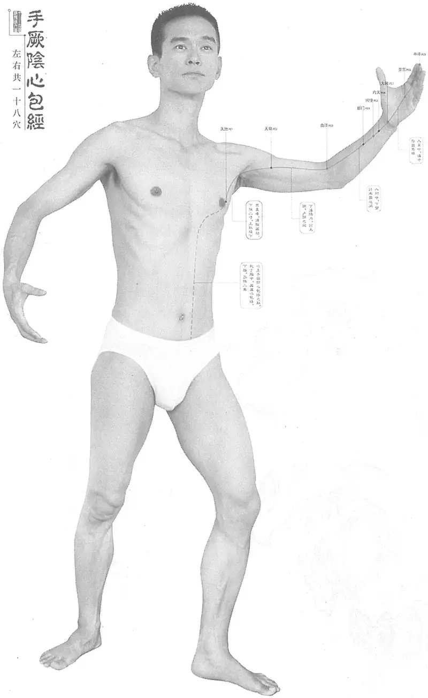

**图2-260　黄龙祥编手厥阴心包经脉、经穴合图**

〔p.896 (인쇄 868)〕

### （一）天池 Tiānchí PC1 出《灵枢》 

问题1：《黄帝明堂经》谓本穴“腋下三寸，著胁直掖撅肋间”，撅肋为何肋？

问题2：天府、天池、大包、渊腋皆“腋下三寸”，何以别之？

#### 【提要索隐】 

**穴名**：与任脉承浆穴别名同名。一名天会。

**部位**：在胸部，第4肋间隙，前正中线旁开5寸。

**归经**：手厥阴心包经。**按**：宋以前文献本穴归经不统一。

**适应症**：主治胸肺部病症。常用于咳嗽，痰多，气喘，胸闷，胸痛；腋下肿，瘰疬。

**针刺操作**：斜刺或平刺。不宜深刺和直刺，以免刺伤心肺。

#### 【名实考】 

一名天会。《灵枢·本输》记有颈项部九穴：天突、扶突、人迎（天五会）、天窗、天容、天牖、天柱、风府、天府、天池，穴名中多冠以“天”字，所指多为明堂建筑名称。参见“扶突”穴“名实考”。

《黄帝明堂经》载任脉承浆穴，一名“天池”，与本穴同名。

关于本穴定位，《灵枢》只说“腋下三寸”，不明确，但综合考察《灵枢》关于手主心脉的循行，可以判定本穴在腋下三寸着胁处。《黄帝明堂经》关于本穴定位的描述，较《灵枢》详细，但所说“撅肋”，后人不解。今查《医心方》卷二注曰：撅，求月反，棱也；《医宗金鉴》作“胁之撅起肋骨”。可知，所谓“撅肋”即侧胁部肋骨，此处肋骨明显较他处肋骨突显，故名“撅肋”。

　1. 腋下三寸，手心主也，名曰天池。（《灵枢·本输》）

　2. 心主手厥阴心包络之脉，起于胸中，出属心包络，下膈，历络三膲；其支者，循胸出胁，下腋三寸，上抵腋，下循臑内，行太阴少阴之间，（《灵枢·经脉》）

　3. 手心主之正，别下渊腋三寸，入胸中，别属三焦。（《灵枢·经别》）

　4. 手心主之本，在掌后两筋之间二寸中，标在腋下三寸也。（《灵枢·卫气》）

　5. 天池，一名天会。在乳后一寸，腋下三寸，著胁直掖撅肋间。（《黄帝明堂经》）

　6. 此经之直者，既下膈历络三焦矣，而支者，自属心包处，上循胸，横出腋，结为此行……而此穴则近乳一寸，独在前矣，乃本经初见之穴，而为本经最高之处，有天之象焉。三焦主气，此经主血，血之所行，有水象焉，故曰天池。（《经穴解》）

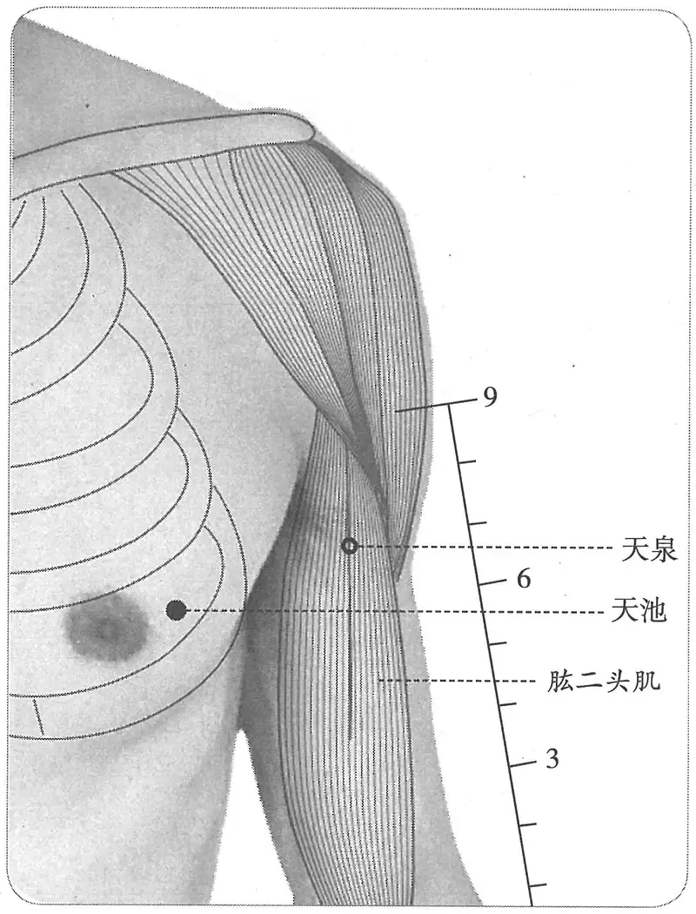

**图2-261　天池穴图**

#### 【定位】 

**部位**：在胸部，第4肋间隙，前正中线旁开5寸（图2-261）。

〔p.897 (인쇄 869)〕

**取穴**：从乳头外开一寸，当第四肋间陷中取之。

1.《黄帝明堂经》佚文

　　(1) 在乳后一寸，腋下三寸，著胁直掖撅肋间。（《针灸甲乙经》卷三、《千金翼方》、《外台秘要》、《医心方》、《铜人腧穴针灸图经》、《圣济总录》、《针灸资生经》、《十四经发挥》、《医学纲目》、《针灸聚英》、《古今医统》、《针灸大成》、《针方六集》、《类经图翼》、《循经考穴编》、《针灸易学》）

　　(2) 在乳后一寸，腋下，著胁直掖撅肋间。（《千金要方》卷二十九）

　2. 在乳后一寸，腋下，着胁直腋屈肋间。（《千金翼方》卷二十八）

　3. 在乳后同身寸之二寸新校正云：按《甲乙经》作一寸，掖下三寸，搓胁直掖撅肋间。（《素问·气府论》王冰注）

　4. 在乳后一寸，著胁直腋撅肋间。（《太平圣惠方·明堂》）

　5. 在腋下三寸陷者中。（《太平圣惠方·明堂》）

　6. 乳外二寸侧胁陷中。（《医学入门》卷一）

　7. 在乳旁一、二寸许，直腋下行三寸，胁之撅起肋骨间。（《医宗金鉴·刺灸心法要诀》）

　8. 在腋下三寸，乳后一寸，直腋，撅肋间有动脉，去中六寸所。（《针灸逢源》）

　9. 乳后一寸，腋下三寸，第四与第五肋间。（《针灸十四经穴位考订》）

　10. 统编针灸学教材

　　(1) 部位：在乳后一寸，腋下三寸。取穴：从乳头外开一寸，当第四肋间陷中取之。（1957年南京《针灸学》）

　　(2) 部位：腋下三寸，乳头外一寸。取穴：从乳头外开一寸，当第四、五肋骨之间陷中取之。（1版《针灸学讲义》）

　　(3) 部位：在乳后一寸，腋下三寸。取穴：乳头外侧一寸，当第四肋间凹陷取之。（2版《针灸学讲义》）

　　(4) 第四肋间隙，乳头外侧1寸。（4、5版《针灸学》、《中国针灸学》）

　　(5) 在胸部，当第4肋间隙，乳头外1寸，前正中线旁开5寸。（6版《针灸学》）

　　(6) 乳头外侧1寸，当第四肋间隙中。（7版《针灸学》）

**文献分析**：本穴定位，古代文献均作“腋下三寸”，而距乳头的距离，《黄帝明堂经》作“一寸”，王冰注作“二寸”，《医宗金鉴》折中作“一二寸许”，当以“上直腋”为准。

#### 【类属】 

手厥阴心包经穴。

**脉气所发**：手心主、足少阳脉之会。（《黄帝明堂经》）

**归经：**

　1. 足少阳。（《外台秘要》卷三十九、王冰《素问注》）

　2. 手厥阴。（《铜人腧穴针灸图经》卷上）

**按**：本穴虽为“手心主、足少阳脉之会”，但《灵枢·本输》明确以“天池”为手心主脉之标脉，故归于手厥阴经更合适。宋以后针灸书多从《铜人腧穴针灸图经》之说，将本穴归入手厥阴经。

#### 【适应症】 

主治胸肺部病症。常用于咳嗽，痰多，气喘，胸闷，胸痛；腋下肿，瘰疬。

　1. 主寒热，胸满颈痛，四肢不举，掖下肿，上气，胸中有声，喉中鸣。（《黄帝明堂经》）

　2. 主寒热痎疟，热病汗不出，胸满，头痛。上气咳嗽。（《太平圣惠方·明堂》）

　3. 治寒热，胸膈烦满，头痛，四肢不举，腋下肿，上气，胸中有声，喉中鸣。（《铜人腧穴针灸图经》卷中）

〔p.898 (인쇄 870)〕

　4. 主心中澹澹大动，烦心，心痛，喜笑不休。（《针方六集》卷五）

**按**：此悉为手厥阴经脉病候，不知吴崑何以全归于本穴下。

　5. 主胁肋疼痛，马刀瘰疬。（《循经考穴编》）

　6. 统编针灸学教材

　　(1) 主治胸膈烦闷，胸肋痛，腋下肿，瘰疬，马刀夹瘿。（1957年南京《针灸学》）

　　(2) 主治胸膈烦闷，胸肋痛，瘰疬，马刀夹瘿。（1版《针灸学讲义》）

　　(3) 主治胸闷，肋痛，腋下肿痛，瘰疬。（2版《针灸学讲义》、4版《针灸学》）

　　(4) 主治咳嗽，气喘，胸闷，胁肋疼痛，瘰疬，乳痈。（5版《针灸学》）

　　(5) 主治咳嗽，气喘，胸闷，心烦，胁肋疼痛。（6版《针灸学》）

　　(6) 主治：①咳嗽，痰多，胸闷，气喘，胸痛等肺心病证；②乳痈；③瘰疬。（7版《针灸学》）

　　(7) 主治胸闷，肋痛，腋下肿痛。（《中国针灸学》）

**文献分析**：5、7版教材“乳痈”一症未详所出，疑将“天溪”穴主治误入本穴也，今去之。

#### 附：临床应用举例 

　1. 颈漏，灸天池百壮。（《千金翼方》卷二十八）

**按**：颈漏，即瘰疬。

　2. 腋下颈项肿，天池顺皮三分，灸七壮，如颔肿，加后溪二分，灸五壮。（《医学纲目》卷十九）

#### 【操作】 

斜刺或平刺。不宜深刺和直刺，以免刺伤心肺。

　1. 刺入七分，灸三壮。（《黄帝明堂经》）

　2. 刺可入同身寸之三分。（《素问·气府论》王冰注）

　3. 一法刺一分，沿皮向后五分。（《循经考穴编》）

　4. 针三分，灸三壮。（《针灸十四经穴位考订》）

　5. 统编针灸学教材

　　(1) 针二至三分（左乳之侧，内为心脏位置，不可深刺），灸三至五壮；一法刺入一分，沿皮顺肋间向后刺五分。（1957年南京《针灸学》）

　　(2) 针二至三分（胸部内是重要脏器，不宜深刺），灸三至五壮。（1版《针灸学讲义》）

　　(3) 针刺2分，不宜深刺；艾条灸3~5分钟。（2版《针灸学讲义》）

　　(4) 斜刺或平刺0.3~0.5寸。（4、5、7版《针灸学》）

　　(5) 斜刺或平刺0.3~0.5寸，不可深刺，以免伤及肺脏；可灸。（6版《针灸学》）

　　(6) 斜刺0.2~0.4寸。不可深刺。可灸。（《中国针灸学》）

### （二）天泉 Tiānquán PC2 出《黄帝明堂经》 

问题：天泉究竟是腋下二寸，还是肘上二寸？

#### 【提要索隐】 

**穴名**：一名天湿。

**部位**：在臂前区，腋前纹头下2寸，肱二头肌的长、短头之间。

**归经**：古今文献记载无分歧，均归于手厥阴心包经。

**针刺操作**：直刺0.5~0.8寸。

#### 【名实考】 

天泉，一名天湿。明刊本《针灸甲乙经》作“天温”，与正名“泉”字不合，当系传抄之误。

〔p.899 (인쇄 871)〕

关于本穴定位，《黄帝明堂经》原文作“在曲腋下二寸，举腋取之”，或本作“在曲腋下臂二寸，举腋取之”，而传世本《针灸甲乙经》却作“曲腋下去臂二寸，举臂取之”，宋以后其他针灸文献也见有类似说法，与《黄帝明堂经》原文之义相去甚远。然而，非常奇怪的是，中国传世的针灸铜人、铜人图、明堂图对于该穴的定位皆无误，与《黄帝明堂经》原文相合。只有日本经穴委员会编纂的《标准经穴学》将本穴定于肘上二寸，定位的依据正是《针灸甲乙经》和《铜人腧穴针灸图经》，并谓东京博物馆藏传自中国的针灸铜人上天泉穴的定位已如此。

　1. 天泉，一名天湿。在曲腋下二寸，举腋取之。（《黄帝明堂经》）

　2. 天泉，一名天温。曲腋下去臂二寸，举臂取之。（明刊本《针灸甲乙经》卷三）

　3. 穴在本经初入臂而下行，自中冲而视之，乃最高焉。天池在胸，有停水之象，故曰天池。此穴乃注水而下行，故曰天泉。（《经穴解》）

#### 【定位】 

**部位**：在臂前区，腋前纹头下2寸，肱二头肌的长、短头之间（图2-262）。

**取穴**：从腋横纹头前端与曲泽穴成直线，在肘上七寸，分肉间，举臂取之。

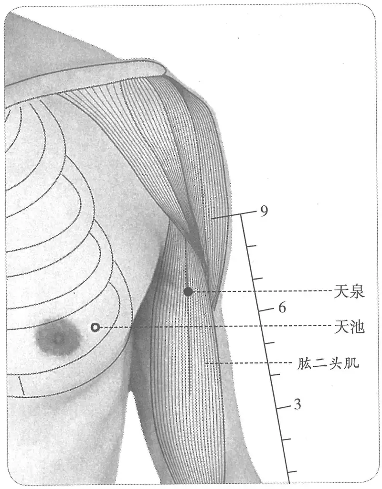

**图2-262　天泉穴图**

1.《黄帝明堂经》佚文

　　(1) 在曲腋下去臂二寸，举臂取之。（《针灸甲乙经》卷三、《铜人腧穴针灸图经》卷上、《医学纲目》、《类经图翼》、《循经考穴编》）

　　(2) 在腋下二寸，举腋取之。（《千金要方》卷二十九、《外台秘要》、《铜人腧穴针灸图经》卷下、《圣济总录》、《针灸资生经》、《针灸聚英》、《古今医统》、《医学入门》、《针灸大成》、《针灸易学》、《针灸逢源》）

　　(3) 在曲腋下臂三寸，举腋取之。有本在腋下前隅两骨间陷者中。（《医心方》卷二）

　2. 在曲腋下去肩二寸。（《铜人腧穴针灸图经》卷下“穴腧都数”）

　3. 窦太师针灸遗存

　　(1) 曲腋下二寸，自曲泽循肉分而大筋去臂二寸，动脉应手，举臂取之。（《大本琼瑶神书》）

　　(2) 在曲腋下，去腋，居臑间二寸，举臂取之。（《针方六集》卷一）

　　(3) 在曲腋下臂二寸。广注：着腋间对缝处量下二寸。（《循经考穴编》下）

　4. 从天池穴斜上，循腋，循臂内廉下行二寸，举臂取之。（《医宗金鉴·刺灸心法要诀》）

〔p.900 (인쇄 872)〕

　5. 曲腋下二寸，膊内侧直对曲泽穴。（《针灸十四经穴位考订》）

　6. 统编针灸学教材

　　(1) 部位：曲腋下二寸。取穴：从腋窝横纹之前端与曲泽穴，相对成直线，直上七寸，横纹端下二寸处，当二头膊肌沟中取之。（1957年南京《针灸学》）

　　(2) 部位：曲腋下二寸。取穴：从腋横纹头前端与曲泽穴成直线，在肘上七寸，分肉间取之。（1版《针灸学讲义》）

　　(3) 部位：在曲腋下去臂二寸。取穴：腋纹头下二寸，在肱二头肌的二头之间取之。（2版《针灸学讲义》）

　　(4) 上臂掌侧，腋前皱襞顶端水平线下2寸，肱二头肌长、短头之间。（4、5版《针灸学》）

　　(5) 在臂内侧，当腋前纹头下2寸，肱二头肌的长、短头之间。（6版《针灸学》）

　　(6) 腋前纹头下2寸，肱二头肌长、短头之间。（7版《针灸学》）

　　(7) 腋前横纹头下二寸，肱二头肌长、短头之间。（《中国针灸学》）

**文献分析**：综合分析各传本《黄帝明堂经》佚文，可知其原文作“在曲腋下[臂]二寸，举腋取之”。本穴的取穴法“举腋取之”也确定本穴定位的一个重要参考，如果本穴位置像明刊本《针灸甲乙经》所述“去臂二寸”，则完全没有必要“举腋取之”。

#### 【类属】 

手厥阴心包经穴。

**归经：**

　1. 手心主心脉。（《产经》）

　2. 手厥阴心包经。（《外台秘要》卷三十九、《铜人腧穴针灸图经》卷上）

#### 【适应症】 

本穴主治症暂缺。

　1. 主石水。足不收，痛不可以行。（《黄帝明堂经》）

　2. 主心痛，胸中痛，胁支满痛，咳逆，膺背甲间两臂内廉痛，虚则胸腹大，胁下与腰相引而痛。取其经少阴水天泉主之。（《外台秘要》卷三十九）

**按**：以上症状为《素问·脏气法时论》所载之心病证候，《素问》、《千金要方》作“取其经少阴、太阳、舌下血者”。今王焘改作“取其经少阴水天泉主之”，则与原文之义相去甚远，而且“天泉”也根本不是少阴经水穴。这一错误经《铜人腧穴针灸图经》的传承而影响很大。

　3. 治心病，胸胁支满，咳逆，膺背胛间臂内廉痛。（《铜人腧穴针灸图经》卷中）

　4. 主目䀮䀮不明，恶风寒。（《针灸聚英》卷一、《针灸大成》）

**按**：此系误录《千金要方》卷三十“大泉”穴主治症，原文为“肾输……大泉……胃输主目䀮䀮不明，恶风寒”。“大泉”即“太渊”穴，为避唐太祖名讳而改名。高武在引录《千金要方》腧穴主治症时，因不明该书特殊的体例及对腧穴辨识不准，出现了不少错误，而这些错误基本上均为明以后针灸腧穴书所沿袭。

　5. 统编针灸学教材

　　(1) 主治心痛，胸胁支满，咳逆，膺连背胛及臂内廉痛。（1957年南京《针灸学》）

　　(2) 主治心痛，胸胁支满，膺、背、胛、臂内廉痛。（1版《针灸学讲义》）

　　(3) 主治心痛，胁胀，咳嗽，胸背及上臂内侧痛。（2版《针灸学讲义》、7版《针灸学》、《中国针灸学》）

　　(4) 主治心痛，咳嗽，胸胁支满，臂痛。（4、5、6版《针灸学》）

**文献分析**：唐以后腧穴文献所载本穴主治传《外台秘要》，或《针灸聚英》之误，而《黄帝明堂经》所载之主治也不无疑问，又无一临床应用资料可借鉴，故存疑待考，暂不确定其主治。

〔p.901 (인쇄 873)〕

#### 【操作】 

直刺0.5~0.8寸。

　1. 刺入六分，灸三壮。（《黄帝明堂经》）

　2. 针三分，灸三壮。（《医学入门》卷一）

　3. 统编针灸学教材

　　(1) 针五至八分，举臂取之，灸三至七壮。（1957年南京《针灸学》）

　　(2) 针五至八分，灸三至七壮。（1版《针灸学讲义》）

　　(3) 直刺5~7分，艾条灸3~7分钟。（2版《针灸学讲义》）

　　(4) 直刺1~1.5寸。（4、5、7版《针灸学》）

　　(5) 直刺0.5~0.8寸；可灸。（6版《针灸学》）

　　(6) 直刺0.5~0.7寸。可灸。（《中国针灸学》）

### （三）曲泽 Qūzé PC3 出《灵枢》 

问题：曲泽与尺泽穴的位置发生了什么变化？为什么？

#### 【提要索隐】 

**部位**：在肘前区，肘横纹上，肱二头肌腱的尺侧缘凹陷中。

**适应症**：主治心胃病症。常用于心痛，心悸，善惊；胃脘痛，吐血，呕吐；发热，口干；肘、血管。

**针刺操作**：直刺0.8~1寸，或点刺出血。不宜反复提插捻转，以免损伤神经出血。

#### 【名实考】 

肘中动脉处，原本是手太阴尺泽穴所在，由于受《灵枢·经脉》经脉循行的影响，手太阴肘、上臂部穴皆向桡侧移位，曲泽穴便移于原先的尺泽穴处，于是有“大筋内侧，横纹中动脉”的描述。

曲泽，与“尺泽”字形相近，针灸古籍中有相混之处。

　1. 心出于中冲……入于曲泽，曲泽，肘内廉下陷者之中也，屈而得之，为合，手少阴也。（《灵枢·本输》）

　2. 入于曲泽，曲泽者，水也。在肘内廉下陷者中，屈肘得之，手心主脉之所入也，为合。（《黄帝明堂经》）

　3. 水所聚者为泽，此穴乃在肘臂曲折之处，故曰曲泽。又为本经所入为合水，亦为泽象。（《经穴解》）

#### “曲泽”误作“尺泽”例 

心澹澹然善惊，身热烦心，口干，手清，逆气，呕血，肘瘛，善摇头，颜清，汗出不过眉，伤寒温病，尺泽主之。（《针灸甲乙经》卷七第一）

**按**：《针灸甲乙经》该篇本条主治之前为“内关主之”条，据该书取穴体例，此处不可能为“尺泽主之”条文，据《医心方》、《外台秘要》、《千金要方》，可知此“尺泽主之”系“曲泽主之”之误。

#### 相关穴及刺激点 

　1. 动脉跳动点　曲泽与少海之间。主治哮喘。针一二分深，针感局部胀。（《针灸经外奇穴图谱（续集）》）

　2. 喉感　曲泽下2寸。主治风湿性心脏病，心动过速，急性喉头炎，喉头发痒，支气管哮喘，淋巴结结核。针1.0~2.0寸，针感麻、酸至手。（《针灸经外奇穴图谱（续集）》）

〔p.902 (인쇄 874)〕

#### 【定位】 

**部位**：在肘前区，肘横纹上，肱二头肌腱的尺侧缘凹陷中（图2-263）。

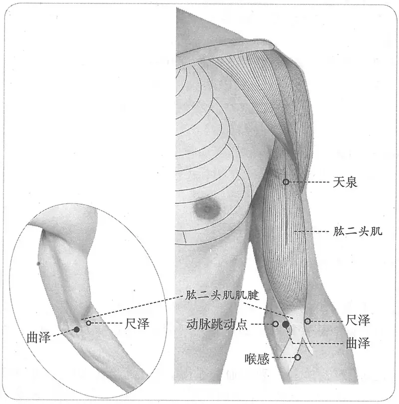

**图2-263　曲泽穴与相关穴图**

**取穴**：仰掌，屈肘45°，尺泽尺侧肌腱旁。

　1. 肘内廉下陷者之中也。屈肘得之。（《灵枢·本输》、《黄帝明堂经》、《太平圣惠方》、《铜人腧穴针灸图经》、《圣济总录》、《针灸资生经》、《针灸玉龙经》、《十四经发挥》、《针灸聚英》、《古今医统》、《针方六集》、《循经考穴编》）

　2. 在肘后内廉下陷中，屈肘得之。（《千金翼方》卷二十六）

　3. 窦太师针灸遗存

　　(1) 在手肘内廉陷中，屈肘取之，横纹两筋中间。用手如弓方可下针。（《窦太师针经》）

　　(2) 肘内廉下陷中，屈肘取大筋内侧横文中。（《大本琼瑶神书》）

　　(3) 在手肘内廉下陷中，屈肘，得之横纹两筋中间。用手拄腰，便于下针。（《针方六集》卷一）

　　(4) 广注：肘内廉下横纹尽处大筋间，与尺泽相并，约去寸许，屈手如弓方可下针。（《循经考穴编》下）

　4. 在肘横纹筋里，与尺泽穴对，筋外尺泽穴，筋内曲泽穴。（《针灸玉龙歌》注）

　5. 在肘内廉陷中，屈肘取之。大筋内侧横纹中动脉。（《神应经》、《针灸大成》、《类经图翼》、《针灸易学》、《针灸逢源》）

　6. 肘腕内中央横纹动脉，曲肘取之。（《医学入门》卷一）

　7. 肘内横纹中之陷凹处，尺泽之内侧，相隔一筋。（《针灸十四经穴位考订》）

〔p.903 (인쇄 875)〕

　8. 统编针灸学教材

　　(1) 部位：肘窝之正中。取穴：伸肘从肘窝横纹正中，大筋二头膊肌腱内侧取之，在尺泽与少海两穴之间。（1957年南京《针灸学》）

　　(2) 部位：肘窝之正中。取穴：屈肘，在横纹正中，大筋内侧，尺泽与心经少海二穴之间取之。（1版《针灸学讲义》）

　　(3) 部位：在肘内廉下陷者中，曲肘得之。取穴：在肘横纹中，肱二头肌腱尺侧缘，当尺泽手太阴经与少海手少阴经之间取之。（2版《针灸学讲义》）

　　(4) 肘横纹中，肱二头肌腱尺侧缘。（4、5版《针灸学》）

　　(5) 在肘横纹中，当肱二头肌腱侧尺侧缘。（6版《针灸学》）

　　(6) 肘微屈，肘横纹中，肱二头肌腱尺侧缘。（7版《针灸学》）

　　(7) 肘横纹上，肱二头肌腱尺侧缘。（《中国针灸学》）

#### 【类属】 

手厥阴心包经穴；五输穴之合穴。

　1. 心出于中冲……入于曲泽……为合，手少阴也。（《灵枢·本输》）

　2. 入于曲泽，曲泽者，水也……手心主脉之所入也，为合。（《黄帝明堂经》）

#### 【适应症】 

主治心胃病症。常用于心痛，心悸，善惊；胃脘痛，吐血，呕吐；发热，口干；肘臂痛。

　1. 主心痛，卒咳逆。心澹澹然善惊，身热，烦心，口干，手清，逆气，呕唾，肘瘛，善摇头，颜清，汗出不过眉，伤寒温病。（《黄帝明堂经》）

　2. 呕血。（《外台秘要》卷三十九）

　3. 治心痛善惊，身热烦渴，口干，逆气呕血，风疹，臂肘手腕善动摇。（《铜人腧穴针灸图经》卷下）

　4. 窦太师针灸遗存

　　(1) 治九种心疼及风冷臂疼肘痛，看虚实补泻。（《窦太师针经》）

　　(2) 一切疼痛，先补后泻；心胸疼，宜泻。（《大本琼瑶神书》）

　　(3) 主九种心痛及风冷，臂疼肘痛，腋肿，胸胁支满。（《针方六集》卷五）

　　(4) 主九种心痛，肘腕掣摇疼痛。（《循经考穴编》下）

　5. 统编针灸学教材

　　(1) 主治心痛，惊悸，臂、肘、手腕时时摇掣，烦热口干，头渍汗出不过肩，伤寒逆气呕吐。（1957年版、1版《针灸学讲义》）

　　(2) 主治胃痛，呕吐，热病，烦躁，心痛，心悸，肘臂痛，手臂震颤。（2版《针灸学讲义》、《中国针灸学》）

　　(3) 主治心痛，心悸，烦热，口干，胃痛，呕吐，肘臂酸痛。（4版《针灸学》）

　　(4) 主治心痛，心悸，胃痛，呕吐，泄泻，热病，肘臂挛痛。（5、6版《针灸学》）

　　(5) 主治：①心痛，心悸，善惊等心系病证；②胃痛、呕血、呕吐等热性胃疾；③暑热病；④肘臂挛痛。（7版《针灸学》）

#### 附：临床应用举例 

　1. 心胃痛，内关、大陵、曲泽。问曰：此证缘何而得？答曰：皆因饮食胃脘冷积作心痛，非一种，亦有虫食痛者，有痰注痛者，有心脾痛者，有阴阳不升降者，怒气冲心，以致如此。医者仔细推详而治，复刺后穴：中脘、上脘、三里。（《针灸集成》第三十五方）

　2. 臂细无力转动难，筋寒骨痛夜无眠。曲泽一针依补泻，更将通里保平安。（《针灸玉龙歌》）

〔p.904 (인쇄 876)〕

　3. 咳嗽，针曲泽，治咳喘出血立已。（《杂病治例》）

　4. 下肢病证痛在膝内侧，取曲泽、尺泽。［广西中医药，1989，12（1）：31］

#### 【操作】 

直刺0.8~1寸，或点刺出血。不宜反复提插捻转，以免损伤神经、血管。

　1. 刺入三分，留七呼，灸三壮。（《黄帝明堂经》）

　2. 用手如弓方可下针。针入五分，灸二七壮。（《窦太师针经》）

　3. 禁灸。（《针灸玉龙歌》注）

　4. 针五分，灸三壮。（《针灸十四经穴位考订》）

　5. 统编针灸学教材

　　(1) 针三至五分，灸三至七壮。（1957年南京《针灸学》、1版《针灸学讲义》）

　　(2) 直刺5~8分，或三棱针点刺出血；艾条灸3~7分钟。（2版《针灸学讲义》）

　　(3) 直刺1~1.5寸，或点刺出血。（4、5、7版《针灸学》）

　　(4) 直刺0.8~1寸；或用三棱针刺血。（6版《针灸学》）

　　(5) 直刺0.5~0.7寸，或三棱针点刺出血。可灸。（《中国针灸学》）

　6. ①直刺0.5~1寸。感应：局部酸胀，有时可酸麻扩散至中指。②点刺，治急性胃肠炎。中暑高热时，可用三棱针在肘部静脉上点刺放血。灸1~3壮；温灸5~15分钟。（上海《针灸学》）

### （四）郄门 Xìmén PC4 出《黄帝明堂经》 

问题：“郄门”、“金门”、“二白”穴究竟有什么关系？

#### 【提要索隐】 

**部位**：在前臂前区，腕掌侧远端横纹上5寸，掌长肌腱与桡侧腕屈肌腱之间。

**适应症**：主治心胸部病症。常用于心痛，心悸，心烦，胸痛；咳血，吐血，衄血。心脏手术的针麻用穴。

**针刺操作**：直刺0.5~1寸。

#### 【名实考】 

本穴与奇穴“二白”本不相合，而自明代《奇效良方》曰：“二白四穴，即郄门也”，后世或将此二穴混为一谈，非是。

　1. 郄门，手心主郄，去腕五寸。（《黄帝明堂经》）

　2. 此穴乃手厥阴经之郄也，界在手少阴、手厥阴两脉之间，而有郄焉，有门象，故曰郄门。（《经穴解》）

#### “郄门”与“二白”穴辨 

　1. 痔漏之疾亦可针，里急后重最难禁，或痒或痛或下血，二白穴从掌后寻。注曰：二白在掌后横纹上四寸，两穴对并，一穴在筋中间，一穴在大筋外。有一法：用草从项后转至结喉骨尖骨尽，折了；将草折于两，中对大指虎口缝，双圈转两头点掌后臂上，草尽处是穴。灸二七壮，泻之，禁刺。（《针灸玉龙歌》注）

　2. 二白四穴，在手腕上四寸，有一穴在大筋内，有一穴在大筋外。针入五分，灸七壮。又法：用线量转胫间，除下，将于手虎口度量，到两头点尽处是穴。治五种痔漏，便血。（《窦太师针经》）

　3. 二白四穴，即郄门也，在掌后横纹中，直上四寸。一手有二穴：一穴在筋内两筋间，即

〔p.905 (인쇄 877)〕

间使后一寸；一穴在筋外，与筋内之穴相并。治久痔脱肛。（《奇效良方》卷五十五）

　4. 郄门一名四白。（《循经考穴编》下）

#### 相关穴及刺激点 

　1. 丁肿　灸掌后横纹后五指，男左女右，七壮即瘥。已用得效。疔肿灸法虽多，然此一法甚验，出于意表也。（《千金要方》卷二十二）

　2. 金门　瘰疬之发于项耳之间，累累如贯珠者是也，法当灸金门二壮，掌后三寸半是穴。愚考：金门穴诸书不载，乃秘法也，甚效，肩尖亦效。（《痈疽神秘灸经》）

#### 【定位】 

**部位**：在前臂前区，腕掌侧远端横纹上5寸，掌长肌腱与桡侧腕屈肌腱之间（图2-264）。

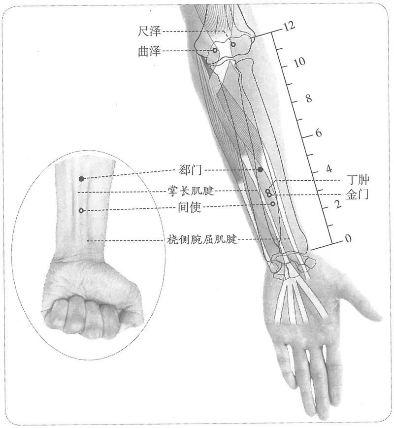

**图2-264　郄门穴与相关穴图**

**取穴**：①握拳，手外展，微屈腕时，显现两肌腱。本穴在曲泽与大陵连线中点下1寸，两肌腱之间。②若两手的一侧或双侧摸不到掌长肌腱，则以桡侧腕屈肌腱尺侧定穴。

　1. 去腕五寸。（《黄帝明堂经》、《铜人腧穴针灸图经》、《圣济总录》、《针灸资生经》、《针灸玉龙经》）

　2. 在掌后去腕五寸。（《千金要方》卷二十九、《十四经发挥》、《医学纲目》、《针灸聚英》、《古今医统》、《针灸大成》、《针方六集》、《类经图翼》、《针灸易学》、《针灸逢源》）

3.《外台》云去内关五寸。（《千金要方》卷二十九注）

〔p.906 (인쇄 878)〕

**按**：传世本《外台秘要》无此说。

　4. 大陵后五寸（《医学入门》卷一）

　5. 广注合掌横纹上去五寸，两筋间。（《循经考穴编》下）

　6. 大陵穴上五寸，即去腕五寸之两筋中。（《针灸十四经穴位考订》）

　7. 统编针灸学教材

　　(1) 部位：掌后去腕五寸。取穴：伸手，从肘窝横纹中央向下量七寸五分，腕横纹向上五寸取之。（1957年南京《针灸学》）

　　(2) 部位：掌后去腕五寸。取穴：握拳，从腕横纹正中向上五寸两筋间取之。（1版《针灸学讲义》）

　　(3) 部位：去腕五寸。取穴：腕横纹上五寸，当曲泽与大陵之连线上，于掌长肌腱和桡侧腕屈肌腱之间取之。（2版《针灸学讲义》）

　　(4) 腕横纹上5寸，掌长肌腱与桡侧腕屈肌腱之间。（4、5、7版《针灸学》）

　　(5) 在前臂掌侧，当曲泽与大陵的连线上，腕横纹上5寸。（6版《针灸学》）

　　(6) 腕横纹上五寸，曲泽与大陵之连线上，掌长肌腱与桡侧腕屈肌腱之间。（《中国针灸学》）

#### 【类属】 

手厥阴经郄穴。

**脉气所发**：手心主郄。（《黄帝明堂经》）

#### 【适应症】 

主治心胸部病症。常用于心痛，心悸，心烦，胸痛；咳血，吐血，衄血。心脏手术的针麻用穴。

　1. 主心痛，衄，哕，呕血，惊恐畏人，神气不足。（《黄帝明堂经》）

　2. 治心痛，衄血，呕哕，惊恐畏人，神气不足。（《铜人腧穴针灸图经》卷下）

　3. 主久疟不瘥，心胸疼痛，五心烦热。（《循经考穴编》下）

　4. 统编针灸学教材

　　(1) 主治心胸疼痛，五心烦热，惊恐畏人，神气不足，心痛呕哕，呕血，衄血。（1957年南京《针灸学》）

　　(2) 主治心胸疼痛，呕哕，五心烦热，惊悸，神气不足，呕血，衄血，肘、腕痛。（1版《针灸学讲义》）

　　(3) 主治心痛，心悸，呕血，衄血，疔疮，癫疾。（2版《针灸学讲义》）

　　(4) 主治心痛，心悸，衄血，呕血，咳血，疔疮，癫疾。（4版《针灸学》）

　　(5) 主治心痛，心悸，呕血，咳血，疔疮，癫疾。（5版《针灸学》）

　　(6) 主治心痛，胸痛，呕血，咳血，癫痫。（6版《针灸学》）

　　(7) 主治：①急性心痛，心悸，心烦、胸痛等心疾；②咯血，呕血，衄血等热性出血证；③疔疮；④癫痫。（7版《针灸学》）

　　(8) 主治心痛，心悸，衄血，呕血，咳血，胸痛，疔疮，痫证。（《中国针灸学》）

**文献分析**：教材中“疔疮”之症未详所出，盖出自《千金要方》疔疮灸法。今去之。

#### 附：临床应用举例 

　1. 胸疽之发，在于两乳之中上二寸许，发而头痛，心虚体倦，其色赤肿痛引十指者是也。当灸郄门二七壮，艾如绿豆大。（《痈疽神秘灸经》）

　2. 呕血，肋痛口干不可咳，引肾痛：不容旁刺向外、上脘三寸半、大陵、郄门、神门。（《医学纲目》卷十七）

〔p.907 (인쇄 879)〕

　3. 心绞痛，郄门、大陵、内关针刺治疗。［上海针灸杂志，1989，8（2）：13–14］

　4. 胸肋损伤，针刺郄门，丘墟治疗。［四川中医，1987，5（3）：42］

　5. 胸胁痛，内关透外关，或支沟透间使，或三阳络透郄门，或取相应夹脊穴。并视病因相应取穴。［河南中医，1990，10（1）：40］

　6. 心剧痛，郄门、大陵、内关，随症加取配穴。［上海针灸杂志，1989，8（2）：13］

#### 【操作】 

直刺0.5~1寸。

　1. 刺入三分，灸三壮。（《黄帝明堂经》）

　2. 灸五壮。（《外台秘要》卷三十九）

　3. 针五分，灸五壮。（《医学入门》卷一）

　4. 一法刺一寸五分，灸二七壮。（《循经考穴编》下）

　5. 统编针灸学教材

　　(1) 针五至八分，灸三至七壮。（1957年南京《针灸学》、1版《针灸学讲义》）

　　(2) 直刺5~8分；艾炷灸3~7壮，艾条灸3~7分钟。（2版《针灸学讲义》）

　　(3) 直刺0.8~1.2寸。（4、5版《针灸学》）

　　(4) 直刺0.5~1寸；可灸。（6版《针灸学》、《中国针灸学》）

　　(5) 直刺0.5~1寸。（7版《针灸学》）

　6. 直刺1~1.5寸。感应：局部酸胀，或麻胀向指端放散。灸5~7壮；温灸5~15分钟。（上海《针灸学》）

### （五）间使 Jiānshǐ PC5 出《灵枢》 

问题1：间使穴与间使脉有何不同？

问题2：间使何以成为治疗马刀的秘穴——剑巨？

#### 【提要索隐】 

**穴名**：又名鬼路，又名剑巨。

**部位**：在前臂前区，腕掌侧远端横纹上3寸，掌长肌腱与桡侧腕屈肌腱之间。

**适应症**：主治心胃病症。常用于心痛，心悸，心烦；胃脘痛，呕吐；癫，狂，痫；失音；热病，疟疾。

**针刺操作**：直刺0.5~1寸，不宜反复提插捻转，以免损伤正中神经。

#### 【名实考】 

“间使”既是穴名，又是脉名，两者的概念不同。作为脉名，间使是一个具有一定区间的动态位点，是手厥阴经本脉所在。又《痈疽神秘灸经》所载之秘穴“剑巨”与本穴实为同一穴。

关于本穴定位，《灵枢》所述是一个动态位点，而《黄帝明堂经》则确定为一个固定的点：掌后三寸两筋间陷。后世皆从之。

　1. 行于间使，间使道，两筋之间，三寸之中也，有过则至，无过则止，为经。杨上善注：三寸之中者，三寸之际也。有虚实之过，则气使至此；无过不至，故止也。（《黄帝内经太素·本输》）

　2. 手心主之本，在掌后两筋之间二寸中，标在腋下三寸。杨上善注：手心主脉出中指之端，上行至于掌后两筋之间，间使上下二寸之中为根也。（《黄帝内经太素·经脉标本》）

　3. 扁鹊曰百邪所病者，针有十三穴……第九次下针，从手横纹三寸两筋间针度之，名鬼路，此名间使。（《千金翼方》卷二十七）

〔p.908 (인쇄 880)〕

　4. 行于间使，间使者，金也。在掌后三寸两筋间陷者中，手心主脉之所行也，为经。（《黄帝明堂经》）

　5. 此穴在两阴经之间，而本经乃心主臣使之官，故曰间使。（《经穴解》）

#### “间使”与“剑巨”穴辨 

马刀之发在耳后，侵入发际，微肿坚硬如石，甚者引项痛也。当灸剑巨二七壮，在掌后三寸二分是穴。愚按：剑巨穴书所不载，盖秘法也。（《痈疽神秘灸经》）

**按**：此剑巨定位并主治皆与间使穴相近，完全可视为间使穴的异名同穴，因为据《灵枢》经文，及杨上善注文，间使穴本身就是一个动态位点。

#### 【定位】 

**部位**：在前臂前区，腕掌侧远端横纹上3寸，掌长肌腱与桡侧腕屈肌腱之间（图2-265）。

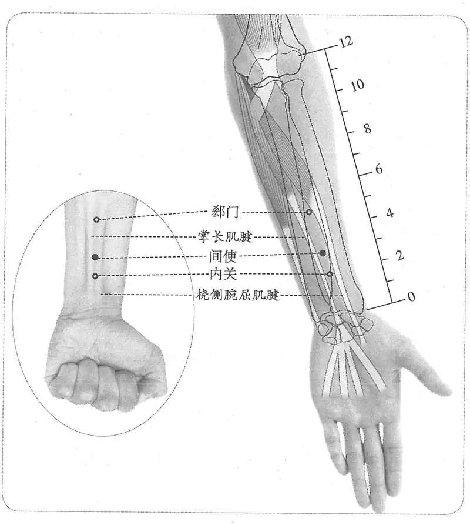

**图2-265　间使穴图**

**取穴**：握拳，手外展，微屈腕时，显现两肌腱。本穴在大陵直上3寸，两肌腱之间。若两手的一侧或双侧摸不到掌长肌腱，则以桡侧腕屈肌腱尺侧定穴。

　1. 两筋之间，三寸之中也。（《灵枢·本输》）

　2. 在掌后三寸，两筋间陷者中。（《黄帝明堂经》、《太平圣惠方》、《铜人腧穴针灸图经》、《圣济总录》、《针灸资生经》、《针经摘英集》、《针灸玉龙经》、《十四经发挥》、《乾坤生意》、《针灸聚英》、《古今医统》、《针灸大成》、《循经考穴编》、《类经图翼》、《针

〔p.909 (인쇄 881)〕

灸易学》、《针灸逢源》）

　3. 在掌后横纹直上三寸两筋间，直透支沟。（《针灸玉龙歌》注、《窦太师针经》、《大本琼瑶神书》）

　4. 大陵后三寸。（《医学入门》卷一）

　5. 广注内关上去一寸也。（《循经考穴编》下）

　6. 大陵穴上三寸，两筋间。（《针灸十四经穴位考订》）

　7. 统编针灸学教材

　　(1) 部位：掌后三寸两筋间。取穴：从腕纹正中直上三寸，两筋间取之。（1957年南京《针灸学》）

　　(2) 部位：大陵穴后三寸。取穴：从腕横纹正中直上三寸，两筋间取之。（1版《针灸学讲义》）

　　(3) 部位：在掌后三寸，两筋腱陷者中。取穴：腕横纹上三寸，当掌长肌腱于桡侧腕屈肌腱之间取穴。（2版《针灸学讲义》）

　　(4) 腕横纹上3寸，掌长肌腱与桡侧腕屈肌腱之间。（4、5、7版《针灸学》，《中国针灸学》）

　　(5) 在前臂掌侧，当曲泽与大陵的连线上，腕横纹上3寸，掌长肌腱与桡侧腕屈肌腱之间。（6版《针灸学》）

#### 【类属】 

手厥阴经穴，五输穴之经穴。

**脉气所发：**

　1. 行于间使，间使之道，两筋之间，三寸之中也，有过则至，无过则止，为经。（《灵枢·本输》）

　2. 手心主之本，在掌后两筋之间二寸中，标在腋下三寸。手心主脉出中指之端，上行至于掌后两筋之间，间使上下二寸之中为根也。（《黄帝内经太素·经脉标本》）

　3. 行于间使，间使者，金也……手心主脉之所行也，为经。（《黄帝明堂经》）

#### 【适应症】 

主治心胃病症。常用于心痛，心悸，心烦；胃脘痛，呕吐；癫，狂，痫；失音；热病，疟疾。

　1. 主心痛善悲，厥逆。悬心如饥之状，心澹澹而惊。面赤目黄。热病烦心，善哕，胸中澹澹善动而热。善呕，怵惕，寒中少气，掌中热，肘挛腋肿。卒心中痛，狂，瘛疭互相引，肘内廉痛，心敖敖然。胸痹引背时寒。瘖不能语，咽中哽。头身风热。头大浸淫。（《黄帝明堂经》）

　2. 卒狂，惊悸，臂中肿痛，屈伸难。岐伯云：可灸鬼邪。（《太平圣惠方·明堂》）

　3. 治心悬如饥，卒狂，胸中澹澹，恶风寒，呕吐怵惕，寒中少气，掌中热，腋肿肘挛，卒心痛，多惊，喑不得语，咽中如鲠。（《铜人腧穴针灸图经》卷下）

　4. 窦太师针灸遗存

　　(1) 治一切脾寒，看证补泻。久疟不愈，心疼，五心热，先补后泻。（《窦太师针经》）

　　(2) 治一切脾寒，看症虚实补泻；且如寒多，先泻后补；热多，先补后泻。（《大本琼瑶神书》）

　　(3) 治疟疾。已发未发，针效。（《窦太师秘传》）

　5. 主伤寒结胸，中风气塞，涎上昏危，霍乱，妇人月水不调，血结成块，少儿客忤。（《针灸聚英》卷一）

〔p.910 (인쇄 882)〕

**按**：此乃高武辑录《针经摘英集》转录《千金要方》、《千金翼方》针灸方主治，详见“附：临床应用举例”。

　6. 脾寒证九种心痛，脾疼，疟疾，口渴，如瘰疬久不愈，患左灸右，患右灸左。（《医学入门》卷一）

　7. 统编针灸学教材

　　(1) 主治卒心痛，卒狂，多惊善恐，呕吐，寒中少气，中风涎上气塞，咽中如哽，喑不能言，腋肿肘挛，掌中热，热病烦心善呕，久疟。（1957年南京《针灸学》）

　　(2) 主治卒心痛，癫狂，惊悸呕吐，中风涎上气塞，咽中如哽，暴喑，腋肿肘挛，掌中热，热病烦心，久疟。（1版《针灸学讲义》）

　　(3) 主治心痛，心悸，胃痛，呕吐，热病，烦躁，疟疾，癫狂，痫证，腋肿，肘挛，臂痛。（2版《针灸学讲义》、4版《针灸学》、《中国针灸学》）

　　(4) 主治心痛，心悸，胃痛，呕吐，热病，疟疾，癫狂痫。（5、7版《针灸学》）

　　(5) 主治心痛，心悸，胃痛，呕吐，热病，疟疾，癫狂痫，臂痛。（6版《针灸学》）

**文献分析**：《医学入门》所载之主治“如瘰疬久不愈，患左灸右，患右灸左”，与《痈疽神秘灸经》所述如出一辙。另从“附：临床应用举例”的取穴加减的规律来看，本穴有明显的“止吐”作用。

#### 附：临床应用举例 

　1. 心及神志病症

　　(1) 治鬼魅，灸间使、手心主各五十壮。（《千金翼方》卷二十七）

　　(2) 健忘忽忽，针间使入五分，掌后三寸。（《千金翼方》卷二十七）

　　(3) 烦躁恍惚，灸间使三十壮，针入三分。（《千金翼方》卷二十七）

　　(4) 狂言恍惚，灸天枢百壮，又灸间使三十壮。（《千金翼方》卷二十七）

　　(5) 甄权治卒暴心痛，厥逆欲死者，灸掌后三寸两筋间，左右各十四壮，依图取穴。（《备急灸法》）

　　(6) 水沟间使治邪癫。（《灵光赋》）

　　(7) 狂言盗汗如见鬼，惺惺间使便下针。（《肘后歌》）

　　(8) 狂证取风府、间使、四神聪、大陵。［云南中医杂志，1983，4（4）：43］

　　(9) 精神分裂症：间使穴、内关穴、中渚穴，针刺治疗。［山东中医杂志，1986（2）：38］

　2. 胃部病症

　　(1)（霍乱）干呕者，灸手腕后三寸两筋间是，左右各七壮。若正厥呕绝，灸之便通。（《补辑肘后方》上卷、《千金要方》）

　　(2) 小儿中马客忤而呕不止者，灸手心主、间使、大都、隐白、三阴交各三壮。（《千金要方》卷五、《千金翼方》）

　　(3) 干呕不止，粥食汤药皆吐不停，灸手间使三十壮。若四厥脉沉不至者，灸之便通，此起死人法。（《千金要方》卷十六、《千金翼方》）

　3. 疟疾

　　(1) 五种疟疾：刺间使，寒多补之，热多泻之；未愈灸百劳，未发前已发后效。（《针灸集要·盘石金直刺秘传》）

　　(2) 脾寒发疟：间使、后溪、百劳一椎上陷中。问曰：脾寒之证，有先寒后热，有先热后寒，有发热亦单发寒者，何也？答曰：先寒后热者，痰盛气弱；先热后寒者，气盛痰少；单热者则饮流脾经，充动血气也；单寒者饮流胃间，停聚不散而然也。或一日一发，或二日一发。若一日一发易治也，若间两、三日一发者难愈也。故人之疟、痢、嗽，医师问之则不喜也，再后针以上穴法，仍用补之剂调理之，则无不效也。先寒后热：中脘、曲池、公孙；单寒单热：曲池、绝骨、百劳；先热后寒：间使、百劳。（《针灸集成》第六十三方）

〔p.911 (인쇄 883)〕

　　(3) 寒热兮，仗间使以扶持。（《通玄指要赋》）

　　(4) 疟疾脾寒最可怜，有寒有热两相煎。须将间使金针泻，泻热补寒方可痊。（《针灸玉龙歌》）

　　(5) 疟疾寒热真可畏，须知虚实可用意；间使宜透支沟中，大狂七壮合圣治。（《肘后歌》）

　　(6) 疟疾三日得一发，先寒后热无他语，寒多热少取复溜，热多寒少用间使。（《肘后歌》）

　　(7) 疟疾：大椎为主穴，间使、后溪为配穴。［中国针灸，1986，6（5）：18］

　4. 中风病症

　　(1) 风邪，灸间使随年壮。（《千金要方》卷十四、《千金翼方》）

　　(2) 治中风，气塞涎上，不语昏危者，针百会、风池，在颞颥后发际陷中，足少阳、阳维之会。针入七分。大椎，在第一椎上陷中，手足三阳、督脉之会。针入五分。肩井，在肩上，缺盆上大骨前一寸半，以三指按取之，当中指下陷中者是。手足少阳、阳维之会。只可针入五分。曲池具在前。间使，在掌后三寸两筋间陷中，厥阴手经。针入三分。三里等七穴，左治右，右治左，以取尽风气，神清为度。（《针经摘英集》）

　5. 其他病症

　　(1) 带下，灸间使三十壮。又淋，小便赤，尿道痛，脐下结块如覆杯，或因食得或因产得，恶露不下，遂为疝瘕，或因月事不调血结成块，皆针之如上。（《千金翼方》卷二十六）

　　(2) 治伤寒结胸者，别使人以手于心蔽骨下，正痛处左伴揉之，以毫针刺左伴手少阳经支沟二穴，在腕后三寸两骨之间，坐而侧臂取之。针入二分。次至手厥阴经间使穴即止，名曰双关刺。次针右伴足厥阴经行间穴，在足大指间动脉应手陷中，卧而取之。针入六分。此支沟、行间穴下针至分数，内捻针令病人五吸，次外捻针三呼，又次内捻针五吸讫，长呼一口气出针，即左伴一壁结胸立效。右伴依上刺之，慢慢呼吸停腾用针，获时而愈，无有不效。（《针经摘英集》）

　　(3) 失音：天鼎、间使穴治疗。［湖北中医杂志，1996，18（4）：50］

#### 【操作】 

直刺0.5~1寸，不宜反复提插捻转，以免损伤正中神经。

　1. 刺入六分，留七呼，灸三壮。（《黄帝明堂经》）

　2. 灸七壮。（《太平圣惠方·明堂》）

　3. 灸五壮，针入三分。（《铜人腧穴针灸图经》卷下）

　4. 窦太师针灸遗存

　　(1) 针透支沟穴。（《窦太师针经》）

　　(2) 针透飞虎，灸七壮，针三分。（《窦太师秘传》）

　　(3) 灸二七壮，热多泻，寒多补，针入半寸。刺一寸五分，透支沟，灸可二七壮。（《循经考穴编》下）

〔p.912 (인쇄 884)〕

　5. 针五分，灸三壮。（《针灸十四经穴位考订》）

　6. 统编针灸学教材

　　(1) 针五分，灸五至七壮。（1957年南京《针灸学》、1版《针灸学讲义》）

　　(2) 直刺5~7分，艾条灸3~7分钟。（2版《针灸学讲义》）

　　(3) 直刺0.5~1寸。（4、5、7版《针灸学》）

　　(4) 直刺0.5~1寸；可灸。（6版《针灸学》、《中国针灸学》）

　7. ①直刺0.5~1.5寸。感应：局部酸胀，或麻胀感向指端放散。②斜刺，治躯干病时，向上，略偏桡侧，进针1.5~2寸。感应：得气后用大幅度捻转，酸胀感可扩散到肘，有时可上达腋部。（上海《针灸学》）

### （六）内关 Nèiguān PC6 出《灵枢》 

#### 【提要索隐】 

**部位**：在前臂前区，腕掌侧远端横纹上2寸，掌长肌腱与桡侧腕屈肌腱之间。

**适应症**：主治心胃病症。常用于心痛，心悸，胸闷；胃脘痛，呕吐，呃逆，痞块；癫、狂、痫；上肢痹痛。心脏手术、甲状腺手术、剖宫产手术、胃大部切除术的针麻用穴。

**针刺操作**：直刺0.5~1寸，不宜大幅度提插、捻转，以免损伤正中神经。

#### 【名实考】 

内关既是穴名，又是络脉名。窦太师针灸谓本穴“一名阴维”，考《针经指南》载窦氏交经八穴，内关穴只是合于阴维脉，而不是“阴维”穴。故不作为本穴别名。

　1. 手心主之别，名曰内关，去腕二寸，出于两筋之间，循经以上系于心包，络心系。实则心痛，虚则为头强，取之两筋间也。（《灵枢·经脉》）

　2. 内关，手心主络，在掌后去腕二寸，别走少阳。（《黄帝明堂经》）

　3. 手心主之别，名曰内关。杨上善注：手心主至此太阴少阴之内，起于别络，内通心包，入于少阳，故曰内关也。（《黄帝内经太素·十五络脉》）

　4. 第四穴名郄门，而间使穴在于其中，既过门，而复有关焉。内者，与外相对也，皆离肘而入掌骨节交经之处，有关象焉，故曰关。又受厥阴别走手少阳之络，亦有关象。（《经穴解》）

#### 相关穴及刺激点 

内关下：在内关下0.5寸。主治呼吸困难。针3~5分，针感麻酸至腕。（《针灸经外奇穴图谱（续集）》）

#### 【定位】 

**部位**：在前臂前区，腕掌侧远端横纹上2寸，掌长肌腱与桡侧腕屈肌腱之间（图2-266）。

**取穴**：握拳，手外展，微屈腕时，显现两肌腱。本穴在大陵直上2寸，两肌腱之间，与外关相对。若两手的一侧或双侧摸不到掌长肌腱，则以桡侧腕屈肌腱尺侧定穴。

　1. 去腕二寸，出于两筋之间，循经以上系于心包络。（《灵枢·经脉》）

　2. 在掌后去腕二寸。（《黄帝明堂经》、《铜人腧穴针灸图经》、《圣济总录》、《针灸资生经》）

3.《外台》作五寸。（《千金要方》卷二十九注）

**按**：传世本《外台秘要·明堂》作“二寸”。

〔p.913 (인쇄 885)〕

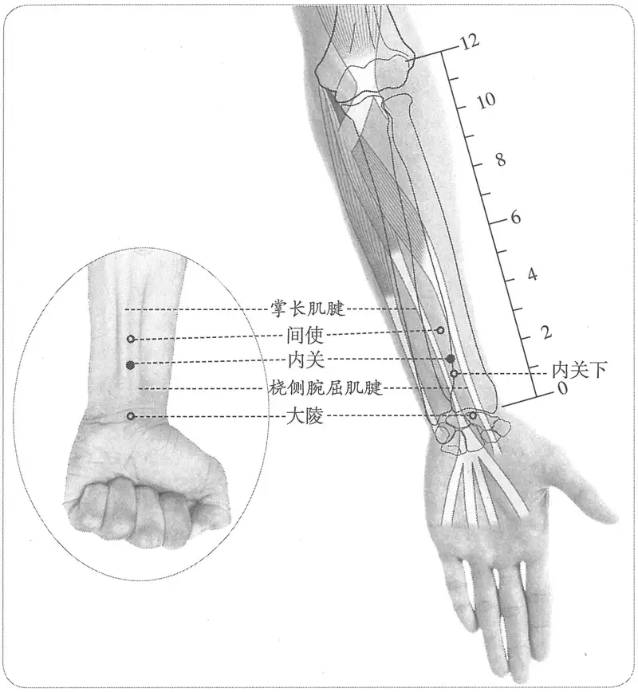

**图2-266　内关穴与相关穴图**

　4. 在掌后横纹后去大陵穴二寸两筋间陷中。（《窦太师针经》）

　5. 在手掌后横纹二寸两筋间。（《针灸玉龙经》、《神应经》、《医学纲目》、《针灸易学》）

　6. 在手掌横纹后二寸两筋两骨之间是穴。（《乾坤生意》）

　7. 掌后去腕二寸两筋间，与外关相对。（《针灸聚英》卷一、《古今医统》、《针灸大成》、《类经图翼》、《循经考穴编》、《针灸逢源》）

　8. 去掌二寸两筋间，紧握拳取之。（《针灸大成》卷五、《针方六集》）

　9. 大陵上二寸，两筋间。（《针灸十四经穴位考订》）

　10. 统编针灸学教材

　　(1) 部位：掌后去腕二寸两筋间。取穴：从腕后横纹正中上二寸，两筋之间取之。（1957年南京《针灸学》）

　　(2) 部位：大陵穴后二寸。取穴：从腕后横纹正中直上二寸，两筋间取之。（1版《针灸学讲义》）

　　(3) 部位：在掌后去腕二寸。取穴：腕横纹上二寸，空当掌长肌腱与桡侧腕屈肌腱之间取之。（2版《针灸学讲义》）

　　(4) 腕横纹上2寸，掌长肌腱与桡侧腕屈肌腱之间。（4、5、7版《针灸学》，《中国针灸学》）

　　(5) 在前臂掌侧，当曲泽与大陵的连线上，腕横纹上2寸，掌长肌腱与桡侧腕屈肌腱之间。（6版《针灸学》）

〔p.914 (인쇄 886)〕

**文献分析**：值得注意的是，古代文献还记载了本穴的取穴法——在体表显示“两筋”的方法：紧握拳取之。在此状态下，再微屈腕，则“两筋”显示更加明显。

#### 【类属】 

手厥阴经络穴。八脉交会穴。

　1. 手心主络，别走少阳。（《黄帝明堂经》）

　2. 名阴维穴，应照海穴。（《针灸玉龙歌》注）

　3. 通阴维，别走少阳。（《针灸玉龙经》）

　4. 内关二穴，又名阴维，通阴𫏋脉。（《窦太师针经》）

**按**：窦氏《针经指南》载流注八穴中“内关”穴只合于阴维脉。

　5. 内关为八法之一，以其合阴维，而会冲脉于心胸也。（《针方六集》卷一）

#### 【适应症】 

主治心胃病症。常用于心痛，心悸，胸闷；胃脘痛，呕吐，呃逆，痞块；癫、狂、痫；上肢痹痛。心脏手术、甲状腺手术、剖宫产手术、胃大部切除术的针麻用穴。

　1. 主面赤皮热，热病汗不出，中风热，目赤黄，肘挛腋肿，实则心暴痛，虚则烦，心惕惕不能动，失智。心澹澹而善惊恐，心悲。（《黄帝明堂经》）

　2. 治目赤，支满，中风肘挛。实则心暴痛，虚则心烦惕惕。（《铜人腧穴针灸图经》卷下）

　3. 窦太师针灸遗存

　　(1) 治腹内一切疼痛，补；心虚疼。（《窦太师针经》）

　　(2) 主心腹一切痛苦。（《针方六集》卷五）

　　(3) 主翻胃隔气，脾胃不和，脏腑胸胁一切疾病。（《循经考穴编》下）

　4. 诸病宜吐不得吐者取此。（《针方六集》卷一）

　5. 又主癫痫狂妄，痞块疟疾。（《循经考穴编》下）

　6. 统编针灸学教材

　　(1) 主治实则心暴痛，虚则心烦惕惕，癫狂，呕吐翻胃，膈中满，痞胀，脾胃不和，胸胁痛，腋肿肘挛，热病，疟疾。（1957年版、1版《针灸学讲义》）

　　(2) 主治心痛，心悸，胃痛呕吐，癫狂，痫证，肘臂挛痛，热病，疟疾。（2版《针灸学讲义》）

　　(3) 主治心痛，心悸，胃痛，呕吐，癫狂，痫证，热病，肘臂挛痛。（4版《针灸学》）

　　(4) 主治心痛，心悸，胸闷，胃痛，呕吐，癫痫，热病，上肢痹痛，偏瘫，失眠，眩晕，偏头痛。（5、6版《针灸学》）

　　(5) 主治：①心痛，胸闷，心动过速或过缓等心疾；②胃痛、呕吐、呃逆等胃腑病证；③中风；④失眠、郁证、癫狂痫等神志病证；⑤眩晕症；⑥肘臂挛痛。（7版《针灸学》）

　　(6) 主治心痛，心悸，胸闷，胁痛，胃痛，恶心，呕吐，呃逆，癫狂，痫症，失眠，热病，烦躁，疟疾，肘臂挛痛。（《中国针灸学》）

**文献分析**：《黄帝明堂经》载本穴主治重在心及心神的病症，自金元窦太师针灸载本穴主治的重点由心转为心胃，且更偏于脾胃，并且当时及此后的临床应用为这种转变提供了相应的临床依据，现代针灸学教材从之。

教材中“中风”症出自《铜人腧穴针灸图经》，《黄帝明堂经》原作“中风热”。如果要理解成现在意义上的“中风”，须注明手臂部的伴随症状。

#### 附：临床应用举例 

　1. 心肺、胸部病症

〔p.915 (인쇄 887)〕

　　(1) 手心主之别，名曰内关，去腕二寸，出于两筋之间，循经以上系于心包，络心系。实则心痛，虚则为头强，取之两筋间也。（《灵枢·经脉》）

　　(2) 寒气入脾，心痛不可忍：刺大陵、内关、内庭，俱泻之，各灸七壮。（《针灸集要·盘石金直刺秘传》）

　　(3) 寒气伤积于心，痛不可忍，或伤生冷即发：灸心俞、刺中脘、足三里泻之；未愈，灸内关。（《针灸集要·盘石金直刺秘传》）

　　(4) 胸满腹痛刺内关，胁疼肋痛针飞虎。（《标幽赋》）

　　(5) 冠心病心绞痛：指压内关穴治疗。［中国民间疗法，1997（5）：23］

　　(6) 室上性心动过速：合谷穴、内关穴针刺治疗。［中医杂志，1986，27（7）：44］

　　(7) 肺结核咯血：孔最穴、内关穴电针治疗。［中国针灸，1986，6（1）：9-11］

　　(8) 急性乳腺炎：针刺内关穴治疗。［中国针灸，1986，6（3）：8］

　2. 胃、腹部病症

　　(1) 胃气不和，心胸注闷，嗳气不时：泻中脘、内关、足三里，灸二七壮。（《针灸集要·盘石金直刺秘传》）

　　(2) 食伤脾气，不思饮食：刺内关，灸膻中，补公孙，各灸二七壮；未愈，灸大都刺之。（《针灸集要·盘石金直刺秘传》）

　　(3) 心胃痛：内关、大陵、曲泽。问曰：此证缘何而得？答曰：皆因饮食胃脘冷积作心痛，非一种，亦有虫食痛者，有痰注痛者，有心脾痛者，有阴阳不升降者，怒气冲心，以致如此。医者仔细推详而治，复刺后穴：中脘、上脘、三里。（《针灸集成》第三十五方）

　　(4) 腹内痛：三里、中脘、内关。问曰：此证缘何而得？答曰：因冷湿，失饥伤饱，荣不调，五脏不安，或冒风被雨后行，饮食不化，无为肾败，毒气冲归脐肠，故如此也。（《针灸集成》第三十七方）

　　(5) 寒气入脾，心痛不可忍：刺大陵、内关、内庭，俱泻之，各灸七壮。（《针灸集要·盘石金直刺秘传》）

　　(6) 气攻心胸连腹疼痛：泻公孙；未愈，灸中脘、足三里、内关，各灸七壮泻之。（《针灸集要·盘石金直刺秘传》）

　　(7) 腹中气块最为难，须把金针刺内关。（《针灸玉龙歌》）

　　(8) 腹痛，并治气块：内关、支沟、照海。（《医学纲目》卷二十二）

　　(9) 呃逆：电针内关、足三里穴治疗。［中国针灸，2002，22（7）：470］

　　(10) 呕吐：针刺内关穴治疗。［中国针灸，2000（10）：619］

　　(11) 胃脘痛：内关穴、中脘穴、足三里穴针灸治疗。［广西中医药，1986（3）：19］

　3. 其他病症

　　(1) 产后血晕：神门、内关。（《医学纲目》卷三十五）

　　(2) 治中风半身不遂肘挛不能伸：内关二穴在手掌横纹后二寸，两筋两骨之间是穴。针五分，灸五壮。（《乾坤生意》下卷）

　　(3) 高脂血症：内关、足三里针刺治疗。［新中医，1993，25（11）：33-34］

#### 【操作】 

直刺0.5~1寸，不宜大幅度提插、捻转，以免损伤正中神经。

　1. 刺入二分，灸三壮。（《黄帝明堂经》）

　2. 针入五分，可灸三壮。（《铜人腧穴针灸图经》卷下）

〔p.916 (인쇄 888)〕

　3. 窦太师针灸遗存

　　(1) 直针透外关穴。又法：可灸二七壮。凡下针，须用指抵外关穴，则针易透此穴。出针得血效。（《窦太师针经》）

　　(2) 针透外关，灸七壮。（《窦太师秘传》）

　　(3) 窦氏针透外关穴。（《针方六集》）

　　(4) 一法，宜刺一寸，透外关，可灸三七壮。（《循经考穴编》）

　4. 针六分，灸三壮。（《医学入门》卷一）

　5. 针五分，灸五壮。（《针灸十四经穴位考订》）

　6. 统编针灸学教材

　　(1) 针五分，灸三至七壮。（1957年南京《针灸学》、1版《针灸学讲义》）

　　(2) 直刺5~7分，艾条灸3~7分钟。（2版《针灸学讲义》）

　　(3) 直刺0.5~1寸。（4、5、7版《针灸学》）

　　(4) 直刺0.5~1寸；可灸。（6版《针灸学》）

　　(5) 直刺0.5~0.8寸。可灸。（《中国针灸学》）

　7. ①直刺0.5~1.5寸，可透外关。感应：局部酸胀，麻感可扩散至指端。②斜刺，治躯干病时，针尖向上，进针1~2寸。感应：麻胀感有时可扩散至肘及腋、胸等处。③治手指麻木时，针尖略偏桡侧，进针0.3~0.5寸。感应：有麻电感向指端放散。灸量：灸3~7壮；温灸5~15分钟。（上海《针灸学》）

### （七）大陵 Dàlíng PC7 出《灵枢》 

问题：大陵、心主、手心主、手厥阴是什么关系？

#### 【提要索隐】 

**穴名**：古称“心主”、“手心主”、“手厥阴”；又名“鬼心”。

**部位**：在腕前区，腕掌侧远端横纹中，掌长肌腱与桡侧腕屈肌腱之间。

**适应症**：主治心胃病症。常用于心痛，心悸，胸胁痛；胃脘痛，呕吐，吐血；悲恐善笑，癫、狂、痫；上肢痹痛。**新增**：疮肿。

**针刺操作**：直刺0.3~0.5寸。不宜反复提插捻转，以免损伤正中神经。

#### 【名实考】 

古穴名“心主”，或“手心主”、“手厥阴”即指本穴，《千金要方》卷三十直接用“手心主”记述本穴的主治病症。又《千金要方》载“十三鬼穴”之一“鬼心”也相当于本穴。故皆归入本穴别名。

　1. 阳中之太阳，心也，其原出于大陵，大陵二。（《灵枢·九针十二原》）

　2. 心出于中冲……注于大陵，大陵，掌后两骨之间方下者也，为腧……手少阴也。（《灵枢·本输》）

　3. 注于大陵，大陵者，土也。在掌后两筋间陷者中，手心主脉之所注也，为输。（《黄帝明堂经》）

　4. 扁鹊曰：百邪所病，针有十三穴，凡针先从鬼宫起……第四针掌后横纹，名鬼心。（《千金要方》卷十四）

　5. 陵者，土也，以此穴为本经之腧穴，故曰陵。又其穴在掌后骨下，其上骨肉丰隆，而穴在其下，故曰大陵。（《经穴解》）

〔p.917 (인쇄 889)〕

#### “大陵”与“心主”、“手心主”、“手厥阴”穴辨 

　1. 尸厥，刺其足大指内侧爪甲上，去端如韭叶，后刺足心，后刺足中指爪甲上各一痏，后刺手大指内侧，去端如韭叶，后刺手心主、少阴锐骨之端各一痏，立已。（《素问·缪刺论》）

　2. 苦脐痹，小腹中有疝瘕，王月即冷上抢心。刺手心主经治阴。心主在掌后横理中。（《脉经》卷二）

3.（霍乱）若啘者，灸手腕第一约理中七壮，名心主，当中指。（《肘后备急方》卷二）

　4. 治卒干呕不息方，灸两腕后两筋中一穴，名间使各七壮。灸心主、尺泽，亦佳。（《肘后备急方》卷四）

　5. 手心主穴，在掌后横文是。（《诸病源候论》卷四十一）

　6. 吐血呕逆，灸手心主五十壮。《千金翼》云大陵是。（《千金要方》卷十二）

　7. 心主，在手腕后第一约横纹当中指。（《千金要方》卷十二）

　8. 消渴咳逆，灸手厥阴，随年壮。（《千金要方》卷二十一）

　9. 胸堂、脾俞、手心主、间使、胃管、天枢、肝俞、鱼际、劳宫、肩俞、太溪，主唾血吐血。（《千金要方》卷三十）

**按**：从以上唐以前文献所述，可知“心主”、“手心主”、“手厥阴”同为一穴，即大陵穴。

#### 相关穴及刺激点 

　1. 横门　在大陵上0.5寸。主治呕吐，腹泻。针五分，针感酸麻至指尖，灸3~7壮。（《针灸经外奇穴图谱（续集）》）

　2. 新止喘　在大陵与神门之间，主治风湿性心脏病。针3~5分，局部胀、麻。（《针灸经外奇穴图谱（续集）》）

　3. 内阳池　在大陵穴下1寸，主治口腔炎，鹅掌风。针3~5分，针感麻、酸至指尖。（《针灸经外奇穴图谱（续集）》）

#### 【定位】 

**部位**：在腕前区，腕掌侧远端横纹中，掌长肌腱与桡侧腕屈肌腱之间（图2-267）。

**取穴**：握拳，手外展，微屈腕时，显现两肌腱。本穴在腕掌远侧横纹的中点，两肌腱之间，横平豌豆骨上缘处的神门。若两手的一侧或双侧摸不到掌长肌腱，则以桡侧腕屈肌腱尺侧定穴。如果某些患者腕横纹不明显，可以腕尺侧的豌豆骨与桡侧的手舟骨结节连线为标志。

　1. 掌后两骨之间方下者也。（《灵枢·本输》）

2.《黄帝明堂经》佚文

　　(1) 在掌后两筋间陷者中。（《针灸甲乙经》卷三、《千金翼方》、《外台秘要》、《铜人腧穴针灸图经》、《圣济总录》、《针灸资生经》、《十四经发挥》）

　　(2) 在掌后两骨之间陷者中。（《千金要方》卷二十九、《医心方》）

　3. 窦太师针灸遗存

　　(1) 在掌后横纹中两筋间陷中。（《窦太师针经》、《窦太师秘传》、《针方六集》）

　　(2) 广注：掌横纹两筋间陷中，仰手而取之。（《循经考穴编》下）

　4. 掌后骨下两筋间陷中。（《针灸聚英》卷一、《古今医统》、《针灸大成》、《类经图翼》、《针灸易学》、《针灸逢源》）

　5. 掌后两筋两骨陷中。（《医学入门》卷一）

　6. 从内关穴下行，掌后骨下横纹中两筋间陷中。（《医宗金鉴·刺灸心法要诀》）

〔p.918 (인쇄 890)〕

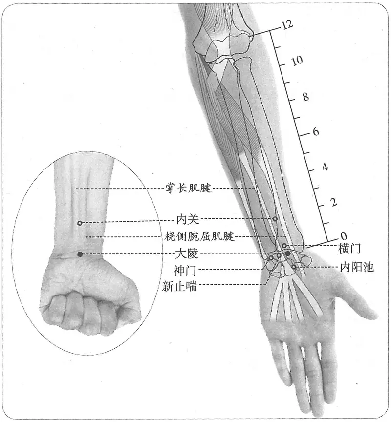

**图2-267　大陵穴与相关穴图**

　7. 统编针灸学教材

　　(1) 部位：掌后横纹两筋间陷中。取穴：从腕横纹正中两筋间陷中取之。（1957年南京《针灸学》）

　　(2) 部位：内关穴下二寸。取穴：从掌后第一条横纹正中两筋间陷中取之。（1版《针灸学讲义》）

　　(3) 部位：在掌后两筋间陷中。取穴：腕横纹正中，当掌长肌腱与桡侧腕屈肌腱之间取之。（2版《针灸学讲义》）

　　(4) 腕横纹中央，掌长肌腱与桡侧腕屈肌腱之间。（4、5、7版《针灸学》，《中国针灸学》）

　　(5) 在腕掌横纹的中点处，当掌长肌腱与桡侧腕屈肌腱之间。（6版《针灸学》）

#### 【类属】 

手厥阴输穴、原穴。

**脉气所发：**

　1. 阳中之太阳，心也，其原出于大陵，大陵二。（《灵枢·九针十二原》）

　2. 心出于中冲……注于大陵，大陵，掌后两骨之间方下者也，为腧……手少阴也。（《灵枢·本输》）

　3. 注于大陵，大陵者，土也。在掌后两筋间陷者中，手心主脉之所注也，为输。（《黄帝明堂经》）

#### 【适应症】 

主治心胃病症。常用于心痛，心悸，胸胁痛；胃脘痛，呕吐，吐血；悲恐善笑，癫、狂、痫；上肢痹痛。**新增**：疮肿。

〔p.919 (인쇄 891)〕

　1. 主心痛，善悲，厥逆，悬心如饥之状，心澹澹而惊。热病烦心而汗不出，肘挛掖肿，善笑不休，心中痛，目赤黄，小便如血，欲呕，胸中热，狂言，不乐，太息，喉痹嗌干，喘逆，身热如火，头痛如破，短气胸痛。两手挛不伸及腋偏枯不仁，手瘈偏小，筋急。呕血。瘃蛘。耳鸣。（《黄帝明堂经》）

　2. 治热病汗不出，臂挛腋肿，善笑不休，心悬若饥，喜悲泣惊恐，目赤，小便如血，呕逆，狂言不乐，喉痹口干，身热头痛，短气，胸胁痛。（《铜人腧穴针灸图经》卷下）

　3. 窦太师针灸遗存

　　(1) 治心胸痛，妇人乳痈，泻；手生疮，破裂者，灸之。（《窦太师针经》）

　　(2) 治心痛宜泻，手掌生疮宜灸。（《大本琼瑶神书》）

　　(3) 主脓疮疥癣，妇人乳痈，手痛皴裂。（《针方六集》卷五）

　　(4) 主心胸疼痛，两胁攻注，妇人乳痈，手臂生疮。俗呼为疥门，此穴是也（《循经考穴编》下）

　4. 统编针灸学教材

　　(1) 主治心烦心痛，心悬如饥，善笑不休，善悲泣惊恐，胸胁痛，呕逆无度，喉痹，肘臂挛急，热病汗不出，腋肿，吐血。（1957年南京《针灸学》）

　　(2) 主治心烦心痛，心悬如饥，呕吐，吐血，胸胁痛，喉痹，腋肿，肘臂挛急，掌中热，善笑不休，善悲泣惊恐，热病。（1版《针灸学讲义》）

　　(3) 主治心痛，心悸，胃痛，呕吐，惊悸，癫狂，痫证，胸胁痛。（2版《针灸学讲义》）

　　(4) 主治心痛，心悸，胃痛，呕吐，癫狂，痫证，胸胁痛。（4、5版《针灸学》）

　　(5) 主治心痛，心悸，胃痛，呕吐，癫狂，疮疡，胸胁痛，桡腕关节疼痛。（6版《针灸学》）

　　(6) 主治：①心痛，心悸胸胁满痛；②胃痛，呕吐，口臭等胃腑病证；③喜笑悲恐，癫狂痫等神志疾患；④臂、手挛痛。（7版《针灸学》）

　　(7) 主治心痛，心悸，胃痛，呕吐，癫狂，痫证，胸闷，胁痛，惊悸，失眠，烦躁，口臭。（《中国针灸学》）

**按**：《黄帝明堂经》载本穴主治重在心及心神的病症，而《千金要方》载唐以前针灸方（特别是其加减用穴经验）及宋以后临床应用则将本穴主治的重点由心转为胃，特别是呕吐症状。窦太师针灸谓本穴主疥疮，《循经考穴编》更谓本穴“俗呼为疥门”，足见其影响之大，且临床上也有明确的相关应用。而教材除6版外，均未收录，今据以补之。

#### 附：临床应用举例 

　1. 心、胸部病症

　　(1) 气在于心者，取之手少阴、心主之输。（《灵枢·五乱》）

　　(2) 心痫之为病，面赤，心下有热，短气息微，数灸心下第二肋端宛宛中，此为巨阙也。又灸手心主及少阴各三壮。（《千金要方》卷五）

　　(3) 鬼魅，灸入发一寸百壮；又灸间使、手心主各五十壮。（《千金要方》卷十四、《千金翼方》）

　　(4) 癫狂二、三十年者，灸天窗……次灸手心主。（《千金翼方》卷二十七）

**按**：此处“天窗”乃“囟会”穴别名。

　　(5) 寒气入脾，心痛不可忍：刺大陵、内关、内庭，俱泻之，各灸七壮。（《针灸集要·盘石金直刺秘传》）

　　(6) 心胸痛：内关、大陵、曲泽。问曰：此证缘何而得？答曰：皆因饮食胃脘冷积作心痛，非一种，亦有虫食痛者，有痰注痛者，有心脾痛者，有阴阳不升降者，怒气冲心，以致如此。医者仔细推详而治，复刺后穴：中脘、上脘、三里。（《针灸集成》第三十五方）

〔p.920 (인쇄 892)〕

　　(7) 心胸痛，并气攻：劳宫、大陵各三分，泻之、内关。（《医学纲目》卷十六）

　　(8) 喜笑欲死者，针列缺及大陵，针三分。（《医方类聚》卷一百五十八）

　　(9) 抑又闻心胸痛，求掌后之大陵。（《通玄指要赋》）

　　(10) 心闷之疾大陵泻，气攻胸腹一般针。（《针灸玉龙歌》）

　　(11) 大陵穴共人中泻，心脏清凉口气清。（《针灸玉龙歌》）

　　(12) 脏躁病：大陵穴、内关穴、神门穴，针刺治疗。［铁道医学，1985，13（5）：261］

　　(13) 顽固性失眠：针刺大陵穴治疗。［中国针灸，1995（增刊）：91］

　　(14) 心绞痛：郄门、大陵、内关，针灸治疗。［上海针灸杂志，1989，8（2）：13-14］

　　(15) 慢性心功能不全：大陵穴、肺俞、曲池穴，针灸治疗。［护士进修杂志，1987，2（5）：24］

　2. 胃、腹部病症

　　(1) 左手关前寸口阳绝者，无小肠脉也，苦脐痹，小腹中有疝瘕，王月即冷上抢心，刺手心主经，在掌后横理中即太陵穴也。（《脉经》卷二、《千金要方》）

　　(2) 治卒干呕不息方：灸两腕后两筋中一夫名间使，各七壮。灸心主、尺泽亦佳。（《补辑肘后方》上卷）

　　(3) 小儿中马客忤而吐不止者，灸手心主、间使、大都、隐白、三阴交各三壮。（《千金要方》卷五）

　　(4) 吐血呕逆，灸手心主五十壮。（《千金要方》卷十二、《千金翼方》）

　　(5)（霍乱）若呕啘者，灸心主各七壮，在掌腕上约中。吐不止更灸如前数。（《千金要方》卷二十及卷十六、《千金翼方》）

　　(6) 吐逆霍乱吐血，灸手心主五十壮。（《千金要方》卷十六、《千金翼方》）

　　(7) 哕呕无度，针手厥阴太陵穴。（《素问病机气宜保命集》卷下）

　　(8) 寒气攻灌心脾疼痛，时口吐酸水，饮食不进：灸中脘，刺大陵泻之。（《针灸集要·盘石金直刺秘传》）

　　(9) 呕盛无度并干呕：大陵、间使。（《医学纲目》卷二十）

　　(10) 腹中疼痛最难当，宜刺大陵并外关。（《针灸玉龙歌》）

　3. 疮疡

　　(1) 口烂生疮，齿出血：刺人中、大陵泻之。（《针灸集要·盘石金直刺秘传》）

　　(2) 手疥：劳宫（灸）、大陵（灸）。（《医学纲目》卷二十）

　　(3) 复发性口腔溃疡：针刺水沟大陵治疗。［中医外治杂志，1997（5）：24］

　4. 其他病症

　　(1) 消渴咳逆，灸手厥阴随年壮。（《千金要方》卷十六、卷二十一，《千金翼方》）

　　(2) 伤寒结胸，身发黄：泻大陵，刺涌泉。（《针灸集要·盘石金直刺秘传》）

　　(3) 中风偏瘫痉挛状态：针刺大陵缓解。［针刺研究，1998（3）：196］

　　(4) 胸胁闪挫伤：针刺大陵穴治疗，先取健侧，后取患侧。［中国针灸，2002，22（1）：41］

#### 【操作】 

直刺0.3~0.5寸。不宜反复提插捻转，以免损伤正中神经。

　1. 刺入六分，留七呼，灸三壮。（《黄帝明堂经》）

〔p.921 (인쇄 893)〕

　2. 针入五分，可灸三壮。（《铜人腧穴针灸图经》卷下）

　3. 窦太师针灸遗存

　　(1) 针入三分，灸七壮。（《窦太师针经》）

　　(2) 针五分，灸二七壮。（《窦太师秘传》）

　　(3) 一法：直刺三分，可灸七壮。（《循经考穴编》下）

　4. 针五分，灸五壮（《神应经》）

　5. 针三分，灸三壮。（《针灸十四经穴位考订》）

　6. 统编针灸学教材

　　(1) 针三至五分；灸三至五壮。（1957年南京《针灸学》、1版《针灸学讲义》）

　　(2) 直刺3~5分，艾条灸3~5分钟。（2版《针灸学讲义》）

　　(3) 直刺0.5~0.8寸。（4、5版《针灸学》）

　　(4) 直刺0.3~0.5寸；可灸。（6版《针灸学》、《中国针灸学》）

　　(5) 直刺0.3~0.5寸。（7版《针灸学》）

　7. ①直刺，深0.3~0.5寸。感应：局部酸胀或有麻电感向指端放散。②斜刺，治腕管综合征时，进针刺入腕管内。感应：局部胀痛，有时可有麻电感向指端放散。灸量：灸1~2壮；温灸5~15分钟。（上海《针灸学》）

### （八）劳宫 Láogōng PC8 出《灵枢》 

问题：古代文献劳宫穴取法有屈无名指、屈中指，以及屈无名指、中指三种，究竟哪一种更合《灵枢》、《黄帝明堂经》本义？

#### 【提要索隐】 

**穴名**：一名五里；一作五星；一名掌中。

**部位**：在掌区，横平第3掌指关节近端，第2掌骨之间偏于第3掌骨。

**适应症**：主治心胃病症。常用于口疮，口臭；鹅掌风；癫，狂，痫；心痛，心烦；呕吐，吐血；热病，口渴。

**备选适应症**：黄疸。

**针刺操作**：直刺0.3~0.5寸。

#### 【名实考】 

劳宫，一名五里，又作“五星”；《千金要方》谓“鬼路”穴即劳宫，而据其定位及《千金翼方》同条文字，乃间使穴，故不作为劳宫穴别名。

关于本穴部位，《黄帝明堂经》只说“在掌中央动脉”，不很明确，于是后世分别提出三种不同的简便取穴法：屈无名指；屈中指；屈无名指与中指，当二指尖之间。《灵枢·本输》曰：“掌中，中指本节之内间”，根据针灸取穴的标准体位，参照《灵枢》少商穴定位（“少商者，手大指端内侧也”，是指桡侧），可知此处的“内间”是指桡侧。由此可知，三种简易取穴法中，以“屈中指”之说为当。屈无名指指尖处，以及屈无名指、中指二指指尖之间处，皆在中指尺侧。

　1. 心出于中冲，中冲，手中指之端也，为井木；溜于劳宫，劳宫，掌中中指本节之内间也，为荥……手少阴也。（《灵枢·本输》）

　2. 流于劳宫，劳宫者，火也，一名五里。在掌中央动脉，手心主脉之所流也，为荥。（《黄帝明堂经》）

　3. 人劳于思，则此穴之脉大动，盖以此穴为本经之火，心劳则火动，或动则脉大动于此穴，故曰劳宫。（《经穴解》）

〔p.922 (인쇄 894)〕

　4. 劳宫，《明堂》云一名五星。（《黄帝内经太素·本输》杨上善注、《医心方》）

**按**：旧抄零本《医心方》作“五里”。

　5. 劳宫二穴，火也，一名五里。在掌中央横纹动脉中，屈无名指着处是。注曰：一名掌中。赵峻释《孟子》云：无名之指，手第四指也。今曰屈无名指着处是穴，盖屈第四指也。无名指当屈中指为是，今说屈第四指，非也。（《针灸资生经》卷一）

　6. 劳宫在掌中央，屈无名指取之，《资生经》云屈中指。以今观之，莫若屈中指无名指两者之间取之为妥。（《十四经发挥》卷中）

　7. 扁鹊曰百邪所病，针有十三穴，凡针先从鬼宫起……第九针手横纹上三寸，两筋间，名鬼路。即劳宫穴也。（《千金要方》卷十四）

　8. 第九次下针，从手横纹三寸两筋间针度之，名鬼路。此名间使。（《千金翼方》卷二十七）

#### 相关穴及刺激点 

　1. 外劳宫　位于手背中央，第3掌骨背侧，腕背横纹至掌骨小头连线之中点。主治：粪白不变，五谷不消，肚腹泄泻。掌指麻痹、五指不能伸屈、小儿脐风、手背红肿疼痛。针灸：针2~3分，得气时酸麻胀感觉至指尖。灸3壮。（《针灸经外奇穴图谱》）

　2. 旁劳宫　位于手掌第2、3掌骨后缘凹陷中。主治扁桃体炎。灸7壮。（《针灸经外奇穴图谱》）

**按**：此穴定位及主治并与“劳宫”穴同，所以名“旁劳宫”者，是因为当时“劳宫”穴定于第三、四掌骨间。

　3. 中平　在手中指根接掌处之横纹中央。针2分，灸1~3壮。主治口腔炎。（《针灸经外奇穴图谱》）

#### 【定位】 

**部位**：在掌区，横平第3掌指关节近端，第2、3掌骨之间偏于第3掌骨（图2-268）。

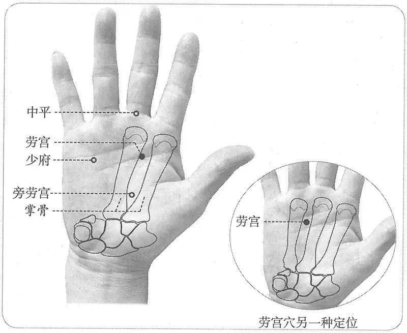

**图2-268　劳宫穴与相关穴图**

〔p.923 (인쇄 895)〕

**取穴**：握拳屈指时，中指尖点到处，第3掌骨桡侧。另一种取穴：在掌区，横平第3掌指关节近端，第3、4掌骨之间偏于第3掌骨。

　1. 掌中中指本节之内间也。（《灵枢·本输》

2.《黄帝明堂经》佚文

　　(1) 在掌中央动脉。（《针灸甲乙经》卷三、《千金要方》、《千金翼方》、《外台秘要》、《素问》王冰注）

　　(2) 在掌中央。（《医心方》卷二）

　3. 在两手掌心动脉是。（《太平圣惠方》卷五十五）

　4. 在掌中央，横纹动脉中，以屈无名指头著处即是穴。（《太平圣惠方·针经》、《针灸资生经》、《窦太师针经》、《针灸玉龙经》）

　5. 在手心中，以名指屈指头着处是也。（《太平圣惠方·明堂》、《针灸玉龙经》、《神应经》）

　6. 在掌中央动脉中，以屈无名指取之。（《铜人腧穴针灸图经》、《圣济总录》、《针灸聚英》、《古今医统》、《针灸大成》、《针方六集》、《针灸逢源》）

　7. 赵岐释孟子云，无名之指，手第四指也，今日屈无名指著处是穴，盖屈第四指也原注：无名指当屈中指为是。今说屈第四指，非也。（《针灸资生经》卷一）

　8. 在掌中央，屈无名指取之。《资生经》云屈中指。以今观之，莫若屈中指、无名指两者之间取之为妥。（《十四经发挥》卷中、《针灸聚英》、《针灸大成》、《循经考穴编》、《医宗金鉴·刺灸心法要诀》）

　9. 掌内中央凹陷处。（《针灸十四经穴位考订》）

　10. 统编针灸学教材

　　(1) 部位：在掌中央。取穴：以中指与四指屈向掌心，当两指尖所着指中间取之。（1957年南京《针灸学》）

　　(2) 部位：掌中心。取穴：中指与无名指屈向掌心，当两指尖所着中间陷中取之。（1版《针灸学讲义》）

　　(3) 部位：在掌中央动脉中。取穴：仰掌，在第二、三指掌关节之后的掌骨尖，握拳时当中指与无名指之间的掌心中取之。（2版《针灸学讲义》）

　　(4) 手掌心横纹中，第二、三掌骨之间。（4版《针灸学》）

　　(5) 第二、三掌骨之间，握拳，中指尖下是穴。（5版《针灸学》）

　　(6) 在手掌心，当第2、第3掌骨之间偏于第3掌骨，握拳屈指时中指尖处。（6版《针灸学》）

　　(7) 掌心横纹中，第2、3掌骨之间。简便取穴法：握拳，中指尖下是穴。（7版《针灸学》）

　　(8) 手掌心横纹中，第二、三掌骨之间偏于第三掌骨桡侧。或握拳，中指尖所指处。（《中国针灸学》）

**按**：本穴定位的分歧在于对《灵枢》“本节之内间”的理解。参照《灵枢》“少商”穴定位，此处“内间”当指桡侧。

#### 【类属】 

手厥阴经荥穴。

　1. 心出于中冲……溜于劳宫，劳宫，掌中中指本节之内间也，为荥……手少阴也。（《灵枢·本输》）

　2. 流于劳宫，劳宫者，火也……手心主脉之所流也，为荥。（《黄帝明堂经》）

#### 【适应症】 

主治心胃病症。常用于口疮，口臭；鹅掌风；癫，狂，痫；心痛，心烦，呕吐，吐血；热病，口渴。

〔p.924 (인쇄 896)〕

**备选适应症**：黄疸。

　1. 主热病发热，烦满而欲呕，哕，三日以往不得汗，怵惕，胸胁痛，不可反侧，咳满溺赤，大便血，衄不止，呕吐血，气逆，噫不止，嗌中痛，食不下，善渴，口中烂，掌中热。善怒，心中悲。喜思慕歔欷，善笑不休。烦心，咳，寒热，善哕。少腹积聚。胸胁榰满。风热，黄瘅目黄。大人小儿口中腥臭。热，痔。（《黄帝明堂经》）

　2. 主手掌厚痛痹，手皮白屑起。（《太平圣惠方·针经》）

　3. 治中风，善怒悲，笑不休，手痹，热病三日汗不出，怵惕，胸胁痛不可转侧，大小便血，衄血不止，气逆呕哕，烦渴，食饮不下，大小人口中腥臭，胸胁支满，黄疸目黄。（《铜人腧穴针灸图经》卷下）

　4. 窦太师针灸遗存

　　(1) 治心疼，手掌生疮，泻；中风，喜怒不时，体热病汗不出，胸胁疼，看症补泻。（《窦太师针经》）

　　(2) 主两手风燥，九种心疼。（《循经考穴编》下）

　5. 一传癫狂灸此穴效。（《类经图翼》卷七）

　6. 统编针灸学教材

　　(1) 主治心痛，中风善怒，善笑不休，烦渴，饮食不下，气逆呕哕，鹅掌风，手颤，小儿口疮龈烂。（1957年南京《针灸学》）

　　(2) 主治心痛，烦心口渴，食欲不下，气逆呕哕，鹅掌风，手颤，小儿口疮牙疳，心悸不宁，喜笑不休。（1版《针灸学讲义》）

　　(3) 主治心痛，癫狂，痫证，呕吐，口疮，口臭。（2版《针灸学讲义》，4、5、6版《针灸学》）

　　(4) 主治：①中风昏迷，中暑等急症；②心痛，烦闷，癫狂痫等神志疾患；③口疮，口臭；④鹅掌风。（7版《针灸学》）

　　(5) 心痛，癫狂，痫证，口疮，口臭，鹅掌风，呕吐，翻胃。（《中国针灸学》）

**文献分析**：《黄帝明堂经》载本穴主治热病和血证的症状较突出：“热病发热，善渴，掌中热，黄瘅”；“大便血，衄不止，呕吐血”，教材在这两方面似体现不够，今补之。

#### 附：临床应用举例 

　1. 心系病症

　　(1) 肠痫之病不动摇，灸两承山，又灸足心，两手劳宫，又灸两耳后完骨，各随年壮，又灸脐中五十壮。（《千金要方》卷五）

　　(2) 犬痫之为病，手屈拳挛，灸两手心一壮，灸足太阳一壮，灸肋户一壮。（《千金要方》卷五）

**按**：手心相当于劳宫穴。

　　(3) 心中懊憹痛，针劳宫入五分，补之。（《千金翼方》卷二十六）

　　(4) 心胸痛，并气攻：劳宫、大陵各三分，泻之、内关。（《医学纲目》卷十六）

　2. 口腔病症

　　(1) 小儿口有疮蚀，龈烂，臭秽气冲人，灸劳宫二穴各一壮，在手心中，以名指屈指头著处是也，炷如小麦大。（《太平圣惠方·明堂》）

　　(2) 小儿口臭气，灸手心一壮。（《幼幼新书》卷三十四）

　　(3) 中焦有热，口生疮：灸劳宫。（《针灸集要·盘石金直刺秘传》）

〔p.925 (인쇄 897)〕

　　(4) 口臭：针刺劳宫治疗。［针灸临床杂志，1994，10（6）：47］

　3. 其他病症

　　(1) 妇人伤胎怀身，腹满，不得小便，从腰以下重，如有水气状，怀身七月，太阴当养不养，此心气实，当刺泻劳宫及关元，小便微利则愈。（《金匮要略》卷下）

　　(2) 若脚气盛发时，自腰以上，并不得针灸，当引风气上则杀人……若气上击心不退，急灸手心三七炷，气即便退。（《外台秘要》卷十九）

　　(3)《经心方》治黄疸，灸两手心各七壮。（《医心方》卷十）

　　(4) 手疥：劳宫灸、大陵灸。（《医学纲目》卷二十）

　　(5) 劳宫穴在掌中心，满手生疮不可禁。（《针灸玉龙歌》）

　　(6) 劳宫医得身劳倦。（《灵光赋》）

#### 【操作】 

直刺0.3~0.5寸。

　1. 刺入三分，留六呼，灸三壮。（《黄帝明堂经》）

　2. 针入二分，留三呼，得气即泻。针之只一度，针过两度令人虚。不得灸，灸即令息肉日加。（《太平圣惠方·针经》）

　3. 针入一分，灸七壮。（《窦太师针经》）

　4. 统编针灸学教材

　　(1) 针三至五分，灸三至七壮。（1957年南京《针灸学》、1版《针灸学讲义》）

　　(2) 直刺3~5分，艾条灸3~7分钟。（2版《针灸学讲义》）

　　(3) 直刺0.3~0.5寸。（4、5、7版《针灸学》）

　　(4) 直刺0.3~0.5寸；可灸。（6版《针灸学》、《中国针灸学》）

　5. 直刺，从手掌向对侧手背进针，深0.5寸左右。感应：局部胀痛。灸量：灸1~3壮；温灸5~10分钟。（上海《针灸学》）

### （九）中冲 Zhōngchōng PC9 出《灵枢》 

#### 【提要索隐】 

**部位**：在手指，中指末端最高点。

**适应症**：主治热病、急症。常用于中风，舌强不语；神昏；心痛，心烦；中暑，热病；小儿惊风。

**针刺操作**：浅刺0.1寸，或点刺出血。

#### 【名实考】 

本穴最后定于中指尖桡侧，一方面受劳宫穴定位的影响（劳宫，掌中中指本节之内间也。劳宫在内间，则中冲亦当在中指内侧也），另一方面经脉循行的影响也是一个重要因素。《灵枢·邪客》曰：“心主之脉，出于中指之端，内屈循中指内廉，以上留于掌中”，既曰“中指内廉”，则知是中指内侧爪甲角。

关于本穴定位的演变过程，详见手太阴经井穴少商“名实考”。

　1. 心出于中冲，中冲，手中指之端也，为井木……手少阴也。（《灵枢·本输》）

　2. 心主出中冲，中冲者，木也。在手中指之端，去爪甲如韭叶陷者中，手心主脉之所出也，为井。（《黄帝明堂经》）

　3. 以中指而得名，言心包之脉，在两阴之间，而直冲于手中指之端也，故曰中冲。（《经穴解》）

〔p.926 (인쇄 898)〕

#### 【定位】 

**部位**：在手指，中指末端最高点（图2-269）。

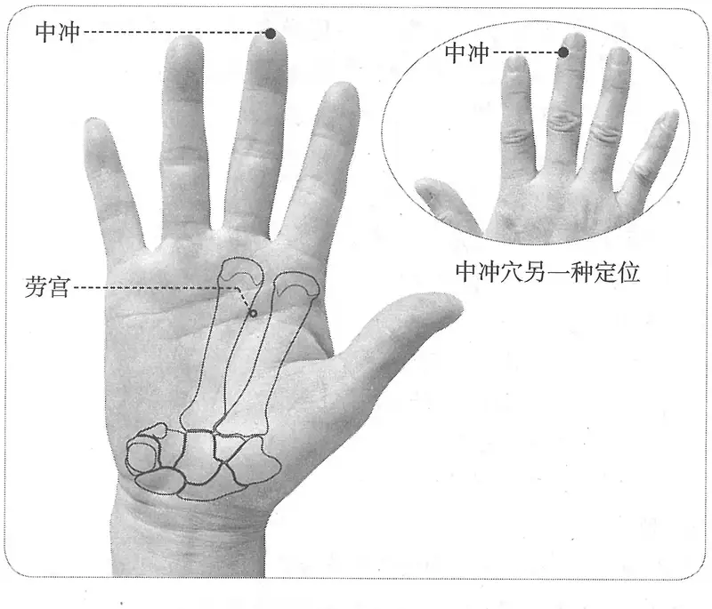

**图2-269　中冲穴图**

**取穴**：另一种取穴：在手指，中指末节桡侧指甲根角侧上方0.1寸（指寸）。

　1. 中冲，手中指之端也。（《灵枢·本输》）

　2. 在手中指之端，去爪甲如韭叶陷者中。（《黄帝明堂经》、《太平圣惠方》、《铜人腧穴针灸图经》、《圣济总录》、《针灸资生经》、《窦太师秘传》、《针灸玉龙经》、《十四经发挥》、《神应经》、《乾坤生意》、《医学入门》、《针灸大成》、《针方六集》、《类经图翼》、《医宗金鉴·刺灸心法要诀》、《针灸易学》、《循经考穴编》、《针灸逢源》）

　3. 中指甲后一分中。（《太平圣惠方·明堂》）

　4. 在手中指之端，去爪甲角如韭叶。（《铜人腧穴针灸图经》卷下“穴腧都数”、《针灸聚英》、《古今医统》）

　5. 在手中指端内侧，去爪甲如韭叶大陷中（《窦太师针经》）

　6. 中指尖端去爪甲一分许。（《针灸十四经穴位考订》）

　7. 统编针灸学教材

　　(1) 在手中指之端去爪甲如韭叶。（1957年南京《针灸学》、《中国针灸学》）

　　(2) 部位：手中指之端。取穴：于中指尖端去爪甲一分许取之一说在中指内侧去爪甲角如韭叶。（1版《针灸学讲义》）

　　(3) 部位：在手中指之端，去爪甲如韭叶陷者中。取穴：在手中指尖端之中央取穴。（2版《针灸学讲义》）

　　(4) 中指尖端的中央。（4、5、7版《针灸学》）

　　(5) 在手中指末节尖端中央。（6版《针灸学》）

#### 【类属】 

手厥阴经井穴。

　1. 心出于中冲，中冲，手中指之端也，为井木……手少阴也。（《灵枢·本输》）

〔p.927 (인쇄 899)〕

　2. 手心主脉之所出也，为井。（《黄帝明堂经》）

#### 【适应症】 

主治热病、急症。常用于中风，舌强不语；神昏；心痛，心烦；中暑，热病；小儿惊风。

　1. 主热病烦心，心闷而汗不出，掌中热，心痛，身热如火，浸淫烦满，舌本痛。（《黄帝明堂经》）

　2. 头痛如破。秦承祖云：兼主神气不足失志也。（《太平圣惠方·明堂》）

　3. 治热病烦闷，汗不出，掌中热，身如火，心痛烦满，舌强。（《铜人腧穴针灸图经》卷下、《圣济总录》、《针灸聚英》、《古今医统》、《针灸大成》）

　4. 窦太师针灸遗存

　　(1) 治中风不省人事，补；心痛，先补后泻。（《窦太师针经》）

　　(2) 主中风，中暑，中气等证，不省人事，喉舌等证，出血为妙。（《循经考穴编》下）

　5. 统编针灸学教材

　　(1) 主治心痛烦满，中风急救，热病烦闷汗不出，掌中热，舌强，小儿惊风。（1957年南京《针灸学》）

　　(2) 主治中风昏迷，心痛烦满，热病烦闷汗不出，舌强，掌中热。（1版《针灸学讲义》）

　　(3) 主治心痛，心烦，中风昏迷，舌强不语，热病，中暑，小儿惊风，掌中热。（2版《针灸学讲义》）

　　(4) 主治心痛，昏迷，舌强肿痛，热病，小儿夜啼，中暑，昏厥。（5、6版《针灸学》）

　　(5) 主治中风昏迷，舌强不语、中暑、昏厥、小儿惊风等急症。（7版《针灸学》）

　　(6) 主治心痛，心烦，昏厥，舌强肿痛，热病，中暑，惊厥，掌中热。（《中国针灸学》）

**文献分析**：《黄帝明堂经》载本穴主治重点在于热病，至金元窦太师针灸则重在中风、中暑、昏厥等急症，并有相应的临床应用，现代针灸学教材从之。

#### 附：临床应用举例 

　1. 头面病症

　　(1) 耳鸣，取手中指爪甲上，左取右，右取左，先取手，后取足。（《灵枢·厥病》）

　　(2) 邪客于手阳明之络，令人耳聋，时不闻音，刺手大指次指爪甲上去端如韭叶各一痏，立闻。不已刺中指爪甲上与肉交者，立闻。其不时闻者，不可刺也。耳中生风者亦刺之如此数，左刺右，右刺左。（《素问·缪刺论》）

　　(3) 喉咙闭塞，饮食艰难：刺少泽、合谷、中渚、委中出血；未愈，泻中冲。（《针灸集要·盘石金直刺秘传》）

　　(4) 喉闭：少泽、中冲、委中。（《针灸玉龙经·盘石金直刺秘传》）

　　(5) 麦粒肿：中冲穴刺血治疗。［中医外治杂志，1999，8（2）：49］

　2. 中风

　　(1) 中风，口噤齿紧，牙关不开，昏闷不省人事：先针中冲泻之，次针人中亦泻之，略醒可治，百病百得生也。（《针灸集要·盘石金直刺秘传》）

　　(2) 中风不语，不省人事……又撮要法：中冲一分，补之、大敦灸，一分、百会一分，泻。（《医学纲目》卷十）

　　(3) 中风之症症非轻，中冲二穴可安宁。（《针灸玉龙歌》）

　3. 急症、热症

　　(1) 卒心痛方：灸手中央长指端三壮。（《肘后备急方》卷一）

〔p.928 (인쇄 900)〕

　　(2) 论曰：若暴厥，卒然不知人事……又刺手心主，谓中冲穴也。又刺掌后锐骨之端，谓神门穴也。（《全生指迷方》卷三）

　　(3) 小儿高热惊厥：内关穴、中冲穴，针刺治疗。［云南中医杂志，1985，6（4）：30］

　4. 其他病症

　　(1) 小儿夜啼，上灯啼，鸡鸣止者，灸中指甲后一分中冲穴一壮，炷如小麦大。（《太平圣惠方·明堂》）

　　(2) 小儿夜啼症：针刺中冲穴治疗。［上海中医药杂志，1999（1）：43］

　　(3) 痛经：针刺中冲治疗。［中国针灸，2002，22（9）：612］

#### 【操作】 

浅刺0.1寸，或点刺出血。

　1. 刺入一分，留三呼，灸一壮。（《黄帝明堂经》）

　2. 针入一分，沿皮向后三分，灸七壮。（《窦太师针经》、《窦太师秘传》、《针方六集》）

　3. 统编针灸学教材

　　(1) 针一分，灸一壮。（1957年南京《针灸学》、1版《针灸学讲义》）

　　(2) 斜刺1分，或三棱针点刺出血；艾条灸2分钟。（2版《针灸学讲义》）

　　(3) 浅刺0.1寸，或点刺出血。（4、5、7版《针灸学》）

　　(4) 浅刺0.1寸，或用三棱针点刺出血。（6版《针灸学》）

　　(5) 浅刺0.1寸，或三棱针点刺出血。可灸。（《中国针灸学》）

### 延伸阅读 

　1. 黄龙祥．中国针灸学术史大纲［M］．北京：华夏出版社，2001.

　2. 黄龙祥．新编重绘十四经脉经穴图［M］．北京：中国中医药出版社，2010.

　3. 张善忱．对几个经穴定位之我见［J］．山东中医学院学报，1982，6（1）：48-56.

　4. 黄泳，宋远斌，赖新生．内关穴皮部浅刺和常规针刺脑功能磁共振成像比较［J］．山东中医药大学学报，2009，33（3）：243-245.

　5. 张建斌，王玲玲．“心包经”质疑［J］．中国针灸，2001，21（3）：165-166.

　6. 李岩，王燕．试谈手厥阴心包经的沿革与完善［J］．天津中医学院学报，1999，18（1）：38-39.

〔p.929 (인쇄 901)〕

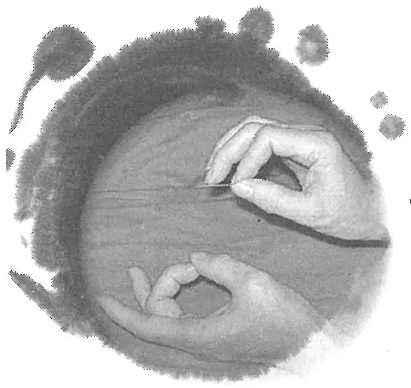

