# 《针灸腧穴通考》(下册) — 手少阳三焦经穴  · （一）关冲 Guānchōng TE1 出《灵枢》~（二十三）丝竹空 Sīzhúkōng TE23 出《黄帝明堂经》

> 분할본 17/25. 원서: 黄龙祥·黄幼民 编著, 《针灸腧穴通考——〈中华针灸穴典〉研究》(下册), 人民卫生出版社, 2011. 원서 스캔 OCR 판독본을 챗봇 검색용으로 나눈 것이며, 본문과 쪽 표시 〔p.PDF쪽 (인쇄 쪽)〕는 원본 그대로이다.

## 十、手少阳三焦经穴 

### 概说 

手少阳经的经脉循行、病候以及腧穴归经的古代文献记载变化不大，而在穴名方面，由于传抄错误，“清泠渊”被误写作“清冷渊”，音义与原名相差较远，直到2006年版国家标准《腧穴名称与定位》才被纠正；在定位方面，支沟与会宗穴的位置关系，存在不同的理解而长期存在定位的分歧。

#### 【经脉与经穴】 

#### 经脉循行与病候 

三焦手少阳之脉，起于小指次指之端，上出两指之间，循手表腕，出臂外两骨之间，上贯肘，循臑外上肩，而交出足少阳之后，入缺盆，布膻中，散落心包，下膈，循属三焦；其支者，从膻中上出缺盆，上项，系耳后直上，出耳上角，以屈下颊至䪼；其支者，从耳后入耳中，出走耳前，过客主人前，交颊，至目锐眦。是动则病耳聋浑浑焞焞，嗌肿喉痹。是主气所生病者，汗出，目锐眦痛，颊痛，耳后肩臑肘臂外皆痛，小指次指不用。（《灵枢·经脉》）

耳脉：起于手背，出臂外两骨之间，上骨下廉，出肘中，入耳中。是动则病耳聋煇煇焞焞，嗌肿，是耳脉主治。其所产病：目外眦痛，颊痛，耳聋，为三病。（《阴阳十一脉灸经》）

臂少阳脉：出中指，循臂上骨下廉，走耳。其病：产聋，颊痛。诸病此物者，皆灸臂少阳之脉。（《足臂十一脉灸经》）

**按**：由于《灵枢》在帛书经脉的基础上，引入经别的内容，使6条阳经也得以行于体内与相关六腑相联系，同时为实现十二经脉的循环流注，人为地增加一些分支以便于经脉依次交接，并使6条经脉改变了循行方向。但却忘记了对“经”、“别”，“直”、“支”加以调整，以形成统一的体例，顺应上述这些变化，因而使得通篇文字前后关系混乱，难以理解。关于《灵枢·经脉》手少阳三焦经循行的经、别、直、支正确关系应如下：

三焦手少阳之脉，起于小指次指之端，上出两指之间，循手表腕，出臂外两骨之间，上贯肘，循臑外上肩，而交出足少阳之后；其别者，入缺盆，布膻中，散落心包，下膈，循属三焦；其支者，从膻中上出缺盆；其直者，从缺盆上项，系耳后直上，出耳上角，以屈下颊至䪼；其支者，从耳后入耳中，出走耳前，过客主人前，交颊，至目锐眦。

**所属经穴**：关冲　液门　中渚　阳池　外关　支沟　会宗　三阳络　四渎　天井　清泠渊　消泺　臑会　肩髎　天髎　天牖　翳风　瘈脉　颅息　角孙　丝竹空　耳和髎　耳门

〔p.930 (인쇄 902)〕

#### 【归经与起止穴】 

《针灸甲乙经》手少阳及臂凡二十四穴：关冲、液门、中渚、阳池、外关、支沟、会宗、三阳络、四渎、天井、清泠渊、消泺；

至六朝《产经》始将此十二穴全部归入“手少阳三焦脉”；

唐代《千金要方》、《千金翼方》在此十二穴基础上，增加如下五穴：天宗、臑俞、肩外俞、肩中俞、曲垣；

《外台秘要》“三焦人”经穴，除包括《针灸甲乙经》全部十二穴外，另归入如下十六穴：和髎、听会、听宫、角孙、瘈脉、翳风、天牖、天容、颧髎、肩井、天髎、肩贞、肩外俞、肩中俞、曲垣、缺盆；

宋代王惟一《铜人腧穴针灸图经》重新厘定为二十三穴：关冲、液门、中渚、阳池、外关、支沟、会宗、三阳络、四渎、天井、清泠渊、消泺、臑会、肩髎、天髎、天牖、翳风、瘈脉、颅息、角孙、丝竹空、和髎、耳门。

关于宋代上述二十三穴的归经，值得探讨的是臑会穴，《黄帝明堂经》曰“手阳明之络”，按络穴归属于同名经穴的规律，应当归入手阳明经。宋代《铜人腧穴针灸图经》卷上始归入手少阳经，卷下“穴腧都数”却归入手阳明经，然宋以后文献腧穴归经皆从《铜人腧穴针灸图经》卷上。

关于本经经穴起止，最后四穴的排列次序主要有以下两种：

角孙、耳门、和髎、丝竹空。（《十四经发挥》）

角孙、丝竹空、和髎、耳门。（《铜人腧穴针灸图经》卷上、《医学入门》、明代十四经步穴歌、明嘉靖针灸铜人、明靳贤修铜人图）

由此可见，现代针灸教材虽然采用的是《十四经发挥》的排序，但《铜人腧穴针灸图经》的排序法在古代的影响更大。

#### 【经穴定位与主治】 

在定位方面，支沟与会宗穴的位置关系，存在不同的理解。而在主治方面，会宗穴是《黄帝明堂经》中唯一一个分不同层次分述经穴主治的经穴，其临床意义值得重视。

#### 【脉口病候、经脉是动病候与经脉穴病候】 

手少阳标脉：耳后上外眦。

手少阳本脉：小指次指间上二寸（中渚穴所在）。

“手少阳”穴：中渚、阳池。

关于手少阳经脉的“是动”病（源出于手少阳脉口的诊断病候）与“手少阳”穴（阳池、中渚）主治病症的比较见表2-13。

**表2-13　手少阳经脉是动病候与经脉穴主治的相关性**

| 《阴阳十一脉灸经》是动病候 | 《灵枢·经脉》是动病候 | 《黄帝明堂经》经脉穴主治 |
|---|---|---|
| 是动则病耳聋煇煇焞焞，嗌肿，是耳脉主治。 | 是动则病耳聋浑浑焞焞，嗌肿喉痹。 | 手少阳”穴——中渚主治：“耳聋耳鸣，嗌外肿”；又手少阳络穴“外关”主治：“耳淳淳浑浑无所闻”。 |

从上表对照可见，“手少阳”穴——中渚穴主治病症兼具了《阴阳十一脉灸经》和《灵枢·经脉》的特征，可以明显看出从诊脉与经脉病候而来的胎记。

〔p.931 (인쇄 903)〕

#### 【诊络病候、络脉病候与络穴主治】 

手少阳之别，名曰外关，去腕二寸，外绕臂，注胸中，合心主。病实则肘挛，虚则不收，取之所别也。（《灵枢·经脉》）

外关，手少阳络，在腕后二寸陷者中，别走心主。主口僻噤。肘中濯濯，臂内廉痛，不可及头。耳淳淳浑浑无所闻。（《黄帝明堂经》）

《黄帝明堂经》载手少阳络穴主治未见与十五络脉病候特有的“虚则……实则……”句式，内容也与《灵枢》之文不相应，可能是现存《黄帝明堂经》佚文不全的缘故。

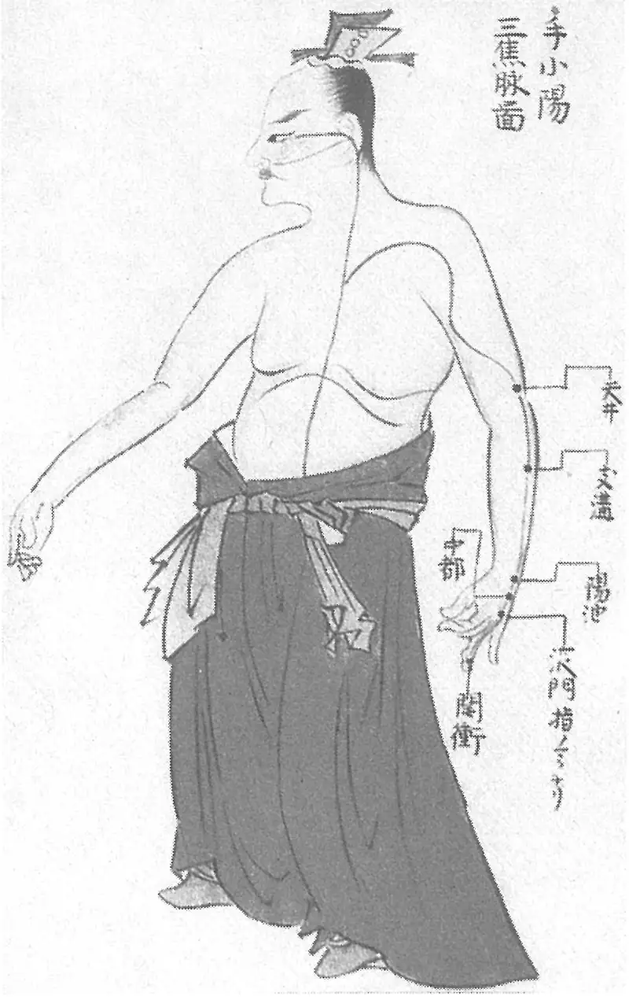

**图2-270　《环中图》手少阳三焦脉图**

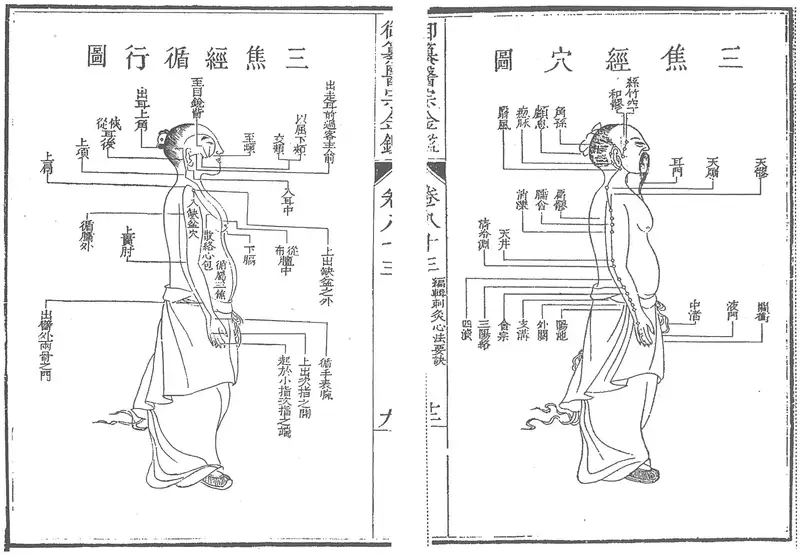

**图2-271　《医宗金鉴》手少阳三焦经脉、经穴分图**

〔p.932 (인쇄 904)〕

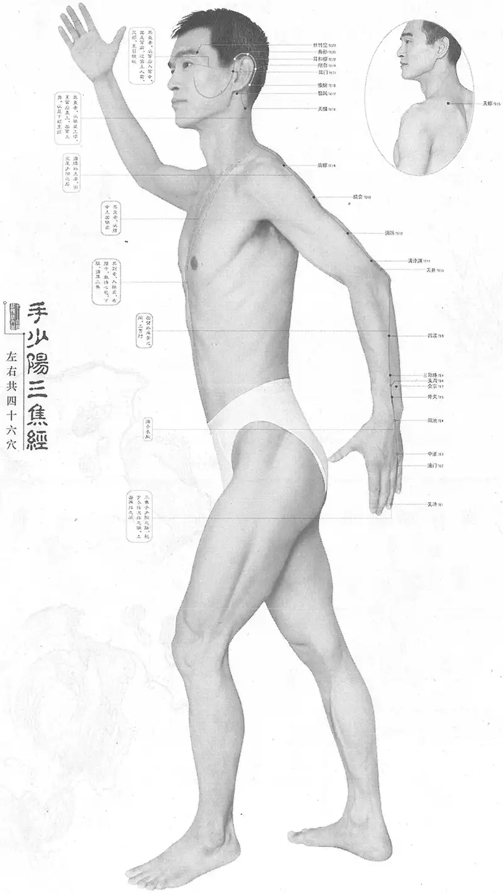

**图2-272　黄龙祥编手少阳三焦经脉、经穴合图**

〔p.933 (인쇄 905)〕

### （一）关冲 Guānchōng TE1 出《灵枢》 

#### 【提要索隐】 

**部位**：在手指，第4指末节尺侧，指甲根角侧上方0.1寸（指寸）。

**适应症**：主治头面五官部病症。常用于头痛，目翳，耳鸣，耳聋，咽喉肿痛；热病，口渴，唇干。

**针刺操作**：浅刺0.1寸，或点刺出血。

#### 【名实考】 

关于本穴定位，《素问·缪刺论》有“刺手中指次指爪甲上，去端如韭叶各一痏”。王冰注曰“谓关冲穴”，检经文只有“大指次指”和“小指次指”的说法，而无“中指次指”的说法。新校正已指出其误，殊不知《灵枢·热病》作“取手小指次指爪甲下，去端如韭叶”，正确无误，《黄帝内经太素》也无误。

本穴为十二井穴之一，关于井穴定位的演变过程，详见手太阴井穴少商“名实考”。

　1. 三焦者，上合手少阳，出于关冲，关冲者，手小指次指之端也，为井金……手少阳经也。（《灵枢·本输》）

　2. 三焦上合手少阳，出于关冲，关冲者，金也。在手小指之端，去爪甲角如韭叶，手少阳脉之所出也，为井。（《黄帝明堂经》）

　3. 三焦经行于手太阳、手阳明两脉之间中，有关象焉，冲而上行，故曰关冲，以与包络之中冲者对。（《经穴解》）

#### “小指次指”与“中指次指”辨 

　1. 喉痹舌卷，口中干，烦心心痛，臂内廉痛，不可及头，取手小指次指爪甲下，去端如韭叶。（《灵枢·热病》）

　2. 邪客于手少阳之络，令人喉痹舌卷，口干心烦，臂外廉痛，手不及头，刺手中指次指爪甲上，去端如韭叶各一痏。

王冰注曰：谓关冲穴，少阳之井也，刺可入同身寸之一分，留三呼，若灸者可灸三壮。左右手皆刺之，故言各一痏。痏，疮也。新校正云：按《甲乙经》关冲穴出手小指次指之端，今言中指者，误也。（《素问·缪刺论》）

**按**：手中指次指，《黄帝内经太素·量缪刺》作“手小指次指”，无误。

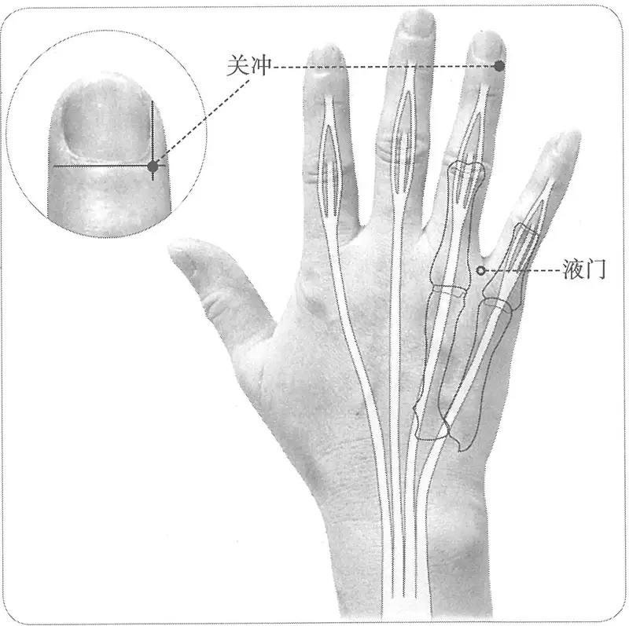

**图2-273　关冲穴图**

#### 【定位】 

**部位**：在手指，第4指末节尺侧，指甲根角侧上方0.1寸（指寸）（图2-273）。

**取穴**：第4指末节尺侧指甲根角侧上方（即沿角平分线方向）0.1寸。相当于沿爪甲尺侧画一直线与爪甲基底缘水平线交点处取穴。

〔p.934 (인쇄 906)〕

　1. 手小指次指之端。（《灵枢·本输》）

　2. 在手小指次指之端，去爪甲角如韭叶。（《黄帝明堂经》、《铜人腧穴针灸图经》、《圣济总录》、《针灸资生经》、《十四经发挥》、《针方六集》、《循经考穴编》）

　3. 窦太师针灸遗存

　　(1) 在手小指次指端内侧，去爪甲如韭叶大。（《窦太师针经》）

　　(2) 在手小指次指内侧端，去爪甲角如韭叶大。（《针灸玉龙歌》注）

　4. 在手小指次指外侧，去爪甲角韭叶许。（《乾坤生意》）

　5. 手四指端外侧，去爪甲角如韭叶。（《医学入门》卷一、《针灸大成》、《类经图翼》、《医宗金鉴·刺灸心法要诀》、《针灸易学》、《针灸逢源》）

　6. 去无名指外侧近小指侧一面之爪甲角一分许。（《针灸十四经穴位考订》）

　7. 统编针灸学教材

　　(1) 部位：手四指外侧去爪甲角如韭叶。取穴：从第四指端小指侧爪角一分许取之。（1957年南京《针灸学》）

　　(2) 部位：无名指外侧端。取穴：无名指外侧去爪甲角一分许取之。（1版《针灸学讲义》）

　　(3) 部位：在手小指次指之端，去爪甲角如韭叶。取穴：无名指外侧端，距爪甲角后一分许取之。（2版《针灸学讲义》）

　　(4) 第四指尺侧指甲角旁约0.1寸。（4、5版《针灸学》）

　　(5) 在手环指末节尺侧，距指甲角0.1寸。（6版《针灸学》）

　　(6) 无名指尺侧指甲根角旁0.1寸。（7版《针灸学》）

　　(7) 第四指尺侧，指甲角后一分许。（《中国针灸学》）

**文献分析**：本穴位置在手无名指端外侧（尺侧），而窦太师针灸则谓在“手小指次指端内侧”，应是指仰掌位而言。

#### 【类属】 

手少阳三焦经井穴。手少阳之根。

　1. 三焦者，上合手少阳，出于关冲，关冲者，手小指次指之端也，为井金……手少阳经也。（《灵枢·本输》）

　2. 手少阳根于关冲，流于阳池，注于支沟，入天牖、外关也。（《灵枢·根结》）

　3. 手少阳脉之所出也，为井。（《黄帝明堂经》）

#### 【适应症】 

主治头面五官部病症。常用于头痛，目翳，耳鸣，耳聋，咽喉肿痛；热病，口渴，唇干。

　1. 主喉痹，舌卷，口干，烦心，心痛，臂表痛不可及头。热病汗不出。耳聋鸣，肘痛不能自带衣起，头眩颔痛，面黑，渴，风肩背痛不可顾。霍乱。寒热。（《黄帝明堂经》）

**按**：“喉痹，舌卷……臂表痛不可及头”见于《灵枢·热病》。

　2. 治喉痹，舌卷，口干，头痛，霍乱，胸中气噎，不嗜食，臂肘痛不可举，目生翳膜，视物不明。（《铜人腧穴针灸图经》卷下）

　3. 窦太师针灸遗存

　　(1) 治三焦邪热，口渴唇焦裂，泻。宜弹针出血。（《窦太师针经》）

　　(2) 主邪热口渴，唇焦气口，宜泻多血。（《大本琼瑶神书》）

　　(3) 主治三焦邪热，口唇焦裂。（《针方六集》卷五）

〔p.935 (인쇄 907)〕

　　(4) 主三焦邪热，唇干舌裂，口吐酸水。宜弹针出血为妙。（《循经考穴编》下）

　4. 统编针灸学教材

　　(1) 主治头痛，目翳，喉痹，唇干舌裂，膊痛，三焦邪热，心中烦闷。（1957年南京《针灸学》）

　　(2) 主治头痛，头眩，目翳，喉痹，唇干舌裂，膊痛，心中烦闷，热病汗不出。（1版《针灸学讲义》）

　　(3) 主治头痛，目赤，咽喉肿痛，舌强，热病，心烦。（2版《针灸学讲义》、4版《针灸学》、《中国针灸学》）

　　(4) 主治头痛，目赤，耳聋，咽喉肿痛，热病，昏厥。（5、6版《针灸学》）

　　(5) 主治：①头痛，目赤，耳鸣、耳聋，喉痹、舌强等头面五官病证；②热病、中暑。（7版《针灸学》）

#### 附：临床应用举例 

　1. 耳聋，取手小指次指爪甲上与肉交者，先取手，后取足。（《灵枢·厥病》）

　2. 喉痹舌卷，口中干，烦心心痛，臂内廉痛。不可及头，取手小指次指爪甲下，去端如韭叶。（《灵枢·热病》）

　3. 耳聋不得眠……又针关冲，入一分半，补之。（《千金翼方》卷二十六）

　4. 又手无名指甲后韭叶名关冲，主喉痹不得下食饮，心热噏噏，常以缪刺之，患左刺右，患右刺左也，都患刺两畔。（《千金翼方》卷二十六）

　5. 眼小眦痛，刺少阳井穴关冲。（《素问病机气宜保命集》卷下）

　6. 治喉痹，刺足阳明经丰隆二穴，足少阴经涌泉二穴。次手少阳经关冲二穴，在手小指次指之端，去爪甲角如韭叶。（《针经摘英集》）

　7. 淡红喉风，此症肺脾感冒风邪而发。肿连小舌，喉塞不通，声音不清，右寸关脉弦紧。针少商、少冲、关冲。（《喉科指掌》卷五）

　8. 三焦邪气壅上焦，舌干口苦不和调。针刺关冲出毒血，口生津液气俱消。（《针灸玉龙歌》）

　9. 咽喉肿痛，少商、商阳、关冲。三棱针点刺出血。［上海中医药杂志，1981(6):24］

　10. 喑哑，哑门、廉泉、关冲、通里。［黑龙江中医药，1988(4):27］

　11. 痄腮，主穴少商、关冲；配穴商阳。点刺放血。［江西中医药，1988，19(3):44］

　12. 耳带状疱疹，取患侧关冲穴点刺出血治疗。［针灸临床杂志，1999，15(10):46］

#### 【操作】 

浅刺0.1寸，或点刺出血。

　1. 刺入一分，留三呼，灸三壮。（《黄帝明堂经》）

　2. 针入一分，可灸一壮。（《铜人腧穴针灸图经》卷下）

　3. 针入一分，沿皮向后三分。治三焦邪热，口渴唇焦裂，泻。宜弹针出血。（《窦太师针经》）

　4. 针一分，沿皮向后三分，泻，禁灸。（《针灸玉龙歌》注）

　5. 针一分，灸一壮。（《针灸十四经穴位考订》）

　6. 统编针灸学教材

　　(1) 针一分，灸三壮。（1957年南京《针灸学》、1版《针灸学讲义》）

　　(2) 针1分，艾炷灸2~5壮。（2版《针灸学讲义》）

　　(3) 浅刺0.1寸，或点刺出血。（4、5、7版《针灸学》）

　　(4) 浅刺0.1寸，或用三棱针点刺出血。（6版《针灸学》）

〔p.936 (인쇄 908)〕

　　(5) 浅刺0.1寸，或三棱针点刺出血。可灸。（《中国针灸学》。

### （二）液门 Yèmén TE2 出《灵枢》 

问题1：液门的别名究竟是“中都”，还是“下都”？

问题2：腋门穴有几？

#### 【提要索隐】 

**穴名**：宋以前文献又作“腋门”、“掖门”。

**部位**：在手背，第4、5指间，指蹼缘上方赤白肉际凹陷中。

**适应症**：主治头面五官部病症。常用于头痛，耳鸣，耳聋，目赤，咽喉肿痛；热病，疟疾；手臂肿痛。

**针刺操作**：直刺0.3~0.5寸。

#### 【名实考】 

液门，宋以前文献或作“腋门”（如《外台秘要》）、“掖门”（如《黄帝内经太素》、《千金要方》、《医心方》），今从《灵枢》、《针灸甲乙经》作“液门”，以与本经之“中渚”、“阳池”、“四渎”、“清泠渊”诸穴名之义合，也与奇穴之“腋门”区分。

《奇效良方》谓窦氏奇穴“八邪”之一“中都”穴又名液门，今考两者定位实不同，故不作为本穴别名。而与本穴相重的实为其中的“下都”穴。又《千金要方》亦有“腋门”一穴，定位与主治皆与本穴不同，系同名异穴也，不可相混也。

本穴定位，《灵枢》、《黄帝明堂经》都只说在小指次指间，而“小指次指”是指无名指，一个手指谈不上“之间”，而只能说是“内间”或“外间”，因此严谨的说法应当是“小指、小指次指间”，或“小指次指外间”。可能是前一种说法不大自然，即使曾出现过，后人也会以为衍文而删去。后一种说法一般用于指尖部，而不用于指根部。

　1. 三焦者，上合手少阳，出于关冲，关冲者，手小指次指之端也，为井金；溜于液门，液门，小指次指之间也，为荥。（《灵枢·本输》）

　2. 流于腋门，腋门者，水也。在手小指次指间陷者中，手少阳脉之所流也，为荥。（《黄帝明堂经》）

　3. 液者，水之称，本经为火而主气，本穴乃水穴也，则亦液而已，在歧骨之间，有门象焉，故曰液门。（《经穴解》）

#### “液门”与“下都”穴辨 

　1. 中都二穴，在手次指本节陷中。针入一分，沿皮透阳池穴。治手背红肿疼，泻；宜三棱针出血。（《窦太师针经》）

　2. 八邪八穴，在手五指歧骨间，左右手各四穴。其一大都二穴，在手大指次指虎口，赤白肉际，握拳取之。可灸七壮，针入一分，治头风牙痛；其二上都二穴，在手食指中指本节歧骨间，握拳取之。治手臂红肿，针入一分，可灸五壮；其三中都二穴，在手中指无名指本节歧骨间，又名液门也。治手臂红肿，针入一分，可灸五壮；其四下都二穴，在手无名指小指本节歧骨间，一名中渚也。中渚之穴，本在液门下五分。治手背红肿，针入一分，可灸五壮。两手共八穴，故名八邪。（《奇效良方》卷五十五）

　3. 八邪八穴，在左右手十指歧骨间缝中。其一大都二穴，在手大指次指虎口，赤白肉际间，握拳取之，针入一分，灸七壮，治头风牙痛。其二上都二穴，在手食指中指本节歧骨间缝中，握拳取之，针入一分，灸五壮，治手臂红肿。其三中都二穴，在手中指无名

〔p.937 (인쇄 909)〕

指本节歧骨间缝中，一名液门，针入一分，灸五壮，治手臂红肿。其四下都二穴，在手无名指小指本节歧骨间缝中，一名中渚穴，中渚在液门下五分，针入一分，灸五壮，治手背红肿。窦氏针八邪穴，针入一分，更沿皮向后一寸五分，宜出血。治手膊红肿，手上诸疾。（《针方六集》）

　4. 八邪，在手指缝中是穴。针一分，沿皮向后二寸半。治诸风，能散手背诸疮，热毒风邪。（《窦太师秘传》）

**按**：综合诸文献所述，八邪穴定于手十指间赤白肉际缝中，与经穴“液门”相重合的是“下都”穴。而无论是《窦太师针经》之“中都”，还是《奇效良方》诸书之“中都”，皆与本穴之“液门”定位不同，故不可作为本穴别名。

#### 经穴“腋门”与奇穴“腋门”辨 

　1. 掖门在腋下攒毛中一寸，名太阳阴，一名掖间。灸五十壮，主风。（《千金要方》卷八）

　2. 中风卷云腋门在腋下攒毛中，一名泉腋，即渊腋是也。（《千金要方》卷二十九注）

　3. 腋门二穴，主风，灸五十壮，亦可九壮。（《千金翼方》卷二十六）

**按**：此“腋门”（掖门、渊腋）穴与手少阴经“极泉”穴相当，而与本经之“腋门”无涉。

#### 【定位】 

**部位**：在手背，第4、5指间，指蹼缘上方赤白肉际凹陷中（图2-274）。

**取穴**：握拳，在小指与无名指歧缝之间取之。

　1. 小指次指之间也。（《灵枢·本输》）

　2. 在手小指次指间陷者中。（《黄帝明堂经》、《太平圣惠方》、《铜人腧穴针灸图经》、《圣济总录》、《针灸资生经》、《窦太师针经》、《十四经发挥》、《针方六集》、《类经图翼》、《循经考穴编》）

　3. 在手小指次指奇间。（《千金翼方》卷二十六）

　4. 在手小指、次指间，屈拳取之。（《神应经》）

　5. 手小指次指间陷中，握拳取之。（《针灸聚英》卷一、《古今医统》）

　6. 手小指次指本节前陷中。（《医学入门》卷一）

　7. 手小指次指歧骨间陷中，握拳取之。（《针灸大成》卷七、《医宗金鉴·刺灸心法要诀》、《针灸易学》、《针灸逢源》）

　8. 小指与无名指之间，本节前陷中。（《针灸十四经穴位考订》）

　9. 统编针灸学教材

　　(1) 部位：在小指次指间陷者中。取穴：握拳于小指四指歧缝之间取之。（1957年南京《针灸学》）

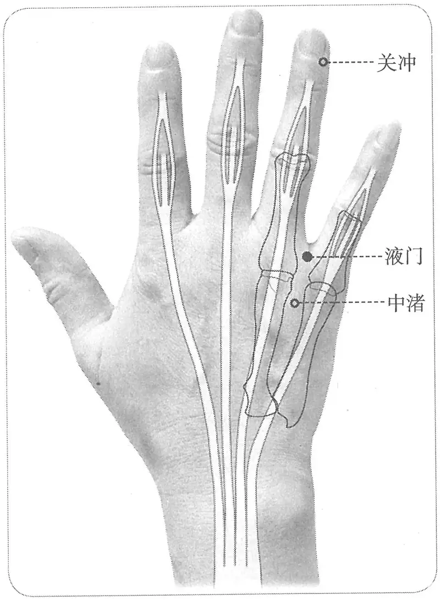

**图2-274　液门穴图**

〔p.938 (인쇄 910)〕

　　(2) 部位：中渚穴下一寸。取穴：握拳在小指与无名指歧缝之间取之。（1版《针灸学讲义》）

　　(3) 部位：在小指次指间陷者中。取穴：在第四、五指缝间，指蹼缘的后方，握拳取之。（2版《针灸学讲义》）

　　(4) 握拳，第四、五指之间，掌指关节前凹陷中。（4、5版《针灸学》）

　　(5) 在手背部，当第4、第5指间，指蹼缘后方赤白肉际处。（6版《针灸学》）

　　(6) 第4、5掌指关节之间的前缘凹陷中。（7版《针灸学》）

　　(7) 在手背部，当第4、第5指缝间，指蹼缘后方。（《中国针灸学》）

#### 【类属】 

手少阳三焦经荥穴。

　1. 三焦者，上合手少阳，出于关冲……溜于液门，液门，小指次指之间也，为荥。（《灵枢·本输》）

　2. 手少阳脉之所流也，为荥。（《黄帝明堂经》）

#### 【适应症】 

主治头面五官部病症。常用于头痛，耳鸣，耳聋，目赤，咽喉肿痛；热病，疟疾；手臂肿痛。

　1. 主热病汗不出。风寒热。狂疾。疟，头痛，目涩暴变。耳聋鸣。眩，寒厥，手臂痛，面赤泣出，下齿龋，则上齿痛。胆善惊，妄言。（《黄帝明堂经》）

　2. 主肘痛不能自上下。（《太平圣惠方·明堂》）

　3. 治惊悸忘言，咽外肿，寒厥，手臂痛不能自上下，痎疟寒热，目眩头痛，暴得耳聋，目赤涩，齿龋痛。（《铜人腧穴针灸图经》卷下）

　4. 窦太师针灸遗存

　　(1) 治五指无力，补；手背红肿，泻宜弹针出血；四肢肿满出水。（《窦太师针经》）

　　(2) 治五指五力，宜补；手背红肿痛，宜泻弹针出血。（《大本琼瑶神书》）

　　(3) 主五指无力。手臂红肿宜此出血；四肢肿满，宜此出水。（《针方六集》卷五）

　　(4) 手背红肿，五指拘弯，腕中无力，四肢浮肿。（《循经考穴编下）

　5. 统编针灸学教材

　　(1) 主治头痛，目赤，耳聋，咽肿，手臂痛，疟疾寒热。（1957年南京《针灸学》）

　　(2) 主治头痛，目赤，耳聋，咽痛，手臂痛，疟疾。（1、2版《针灸学讲义》，4版《针灸学》、《中国针灸学》）

　　(3) 主治头痛，目赤，耳聋，咽喉肿痛，疟疾。（5版《针灸学》）

　　(4) 主治头痛，目赤，耳聋，耳鸣，喉痹，疟疾，手臂痛。（6版《针灸学》）

　　(5) 主治：①头痛，目赤，耳聋，耳鸣，喉痹等头面五官热性病证；②疟疾；③手臂痛。（7版《针灸学》）

**文献分析**：窦太师针灸本穴主治着重于手局部，其中“手背（臂）红肿”症与奇穴“中都”、“下都”相同，或有相混之处。另外，第7版教材本穴主治与“中渚”穴相同，疑有混淆处。

#### 附：临床应用举例 

　1. 头面病症

　　(1) 耳聋不得眠……又针液门，在手小指次指奇间，入三分，补之。（《千金翼方》卷二十六）

　　(2) 中风失音，舌缩，泻哑门穴；舌缓不语，泻风府穴；如不应，泻合谷、液门穴。（《针灸集要·盘石金直刺秘传》）

　　(3) 颊肿如升，咽喉闭塞，水粒不下：刺少商，灸天突，泻液门、合谷。（《针灸集要·盘石金直刺秘传》）

〔p.939 (인쇄 911)〕

　　(4) 头痛：液门穴针刺治疗。［中国针灸，2001，21(3):189］

　　(5) 头晕：针刺液门穴治疗。［云南中医杂志，1988，9(6):46］

　　(6) 口舌痛：针刺液门穴治疗。［湖北中医杂志，1988(2):34］

　　(7) 急性扁桃体炎：针鱼际、液门治疗。［中国针灸，1994（增刊）:249］

　2. 局部病症

　　(1) 手背生疮红肿疼痛：阳池、上廉、曲池、液门、中渚、合谷。问曰：此证从何而得？答曰：气血壅滞，皮肤瘙痒，用热汤泡洗而红肿，如此久而不治，变成手背疮。复刺后穴：上廉、阳池。（《针灸集成》第三十四方）

　　(2) 四肢浮肿：中渚、液门、合谷、中都、曲池、三里、三阴交。问曰：此证缘何而得？答曰：只因醉饱乘风取快，有兼房事劳动脏腑，食饱不化，遂成痰饮，则注于四肢，故如此也。复刺后穴：中脘、丰隆、阴陵泉、行间。（《针灸集成》第四十八方）

　　(3) 手臂相连手腕疼，液门穴内下针明。（《针灸玉龙歌》）

　3. 其他病症

　　(1) 妇人无乳法：初针两手小指外侧近爪甲深一分，两手腋门深三分，两手天井深六分。若欲试之，先针一指即知之，神验不传。（《千金翼方》卷二十六）

　　(2) 感冒：液门穴为主治疗。［四川中医，2002，20(3):74］

　　(3) 退高热：针刺液门穴。［中国针灸，2001，21(4):224］

　　(4) 急性上呼吸道感染：针刺液门穴治疗。［中西医结合实用临床急救，1998，5(1):36］

#### 【操作】 

直刺0.3~0.5寸。

　1. 刺入二分，留三呼，灸三壮。（《黄帝明堂经》）

　2. 刺入三分，灸三壮。（《针灸甲乙经》卷三）

　3. 窦太师针灸遗存

　　(1) 针入一分，沿皮向后透中渚穴，治五指无力，补；手背红肿，泻，宜弹针出血，四肢肿满出水。（《窦太师针经》）

　　(2) 入一分，沿皮向后透阳池，治五指无力，宜补；手背红肿痛，宜泻，弹针出血为妙。三呼，三壮。（《大本琼瑶神书》）

　　(3) 针入一分，沿皮向后透入阳池，泻之。（《针灸玉龙歌》注）

　4. 统编针灸学教材

　　(1) 针三至五分，灸三壮至五壮。（1957年南京《针灸学》、1版《针灸学讲义》）

　　(2) 直刺3~5分，艾条灸3~5分钟。（2版《针灸学讲义》）

　　(3) 直刺0.3~0.5寸。（4、5、7版《针灸学》）

　　(4) 直刺0.3~0.5寸；可灸。（6版《针灸学》）

　　(5) 向掌骨间斜刺0.3~0.5寸。可灸。（《中国针灸学》）

### （三）中渚 Zhōngzhǔ TE3 出《灵枢》 

#### 【提要索隐】 

**穴名**：又名“下都”。又本穴与“中注”音近，古代文献有相混者。

〔p.940 (인쇄 912)〕

**部位**：在手背，第4、5掌骨间，第4掌指关节近端凹陷中。

**适应症**：主治头面五官部病症。常用于头痛，目痛，耳聋，耳鸣，咽喉肿痛；肩背、肘臂痛，手指不能屈伸；热病。

**针刺操作**：直刺0.3~0.5寸。

#### 【名实考】 

本穴名称“中渚”，与足少阴经穴“中注”同音，古代文献中此二穴名称有混淆者。《奇效良方》谓窦氏奇穴“八邪”之一“下都”穴又名“中渚”，今考两者定位实不同也，故不作为本穴别名。详见液门穴“名实考”。

　1. 三焦者，上合手少阳，出于关冲……注于中渚，中渚，本节之后陷者中也，为腧。（《灵枢·本输》）

　2. 注于中渚，中渚者，木也。在手小指次指本节后［间］陷者中，手少阳脉之所注也，为输。（《黄帝明堂经》）

　3. 渚者，水所留之称也，中乃三焦之脉，行乎两经之中也，故曰中渚。（《经穴解》）

#### “中注”误作“中渚”例 

　1. 中注二穴，在肓腧下一寸。（《铜人腧穴针灸图经》卷上、卷中）

　2. 中渚二穴，在肓腧下五分。（《铜人腧穴针灸图经》卷下“穴腧都数”）

**按**：“中渚”为“中注”之声误，应据卷上及卷中正文改作“中注”。

#### 【定位】 

**部位**：在手背，第4、5掌骨间，第4掌指关节近端凹陷中（图2-275）。

**取穴**：握拳于4、5掌骨间中央处取之。

　1. 本节之后陷者中也。（《灵枢·本输》）

　2. 在手小指次指本节后间陷者中。（《黄帝明堂经》、《太平圣惠方》、《铜人腧穴针灸图经》、《圣济总录》、《针灸资生经》、《窦太师针经》、《十四经发挥》、《神应经》）

　3. 手小指次指歧骨间，本节后。（《针灸玉龙歌》注、《医学入门》、《针灸大成》、《循经考穴编》、《类经图翼》、《针灸易学》、《针灸逢源》）

　4. 小指与无名指之间，本节后陷凹中。（《针灸十四经穴位考订》）

　5. 统编针灸学教材

　　(1) 部位：在手小指次指本节后陷者中。取穴：握拳于四、五掌骨间中央处取之。（1957年南京《针灸学》）

　　(2) 部位：中渚穴上一寸。取穴：握拳于小指无名指本节后两骨间陷中取之。（1版《针灸学讲义》）

　　(3) 部位：在手小指次指本节后陷者中。取穴：在手背第四、五指掌关节后的掌骨间，当液门后一寸，握拳取之。（2版《针灸学讲义》）

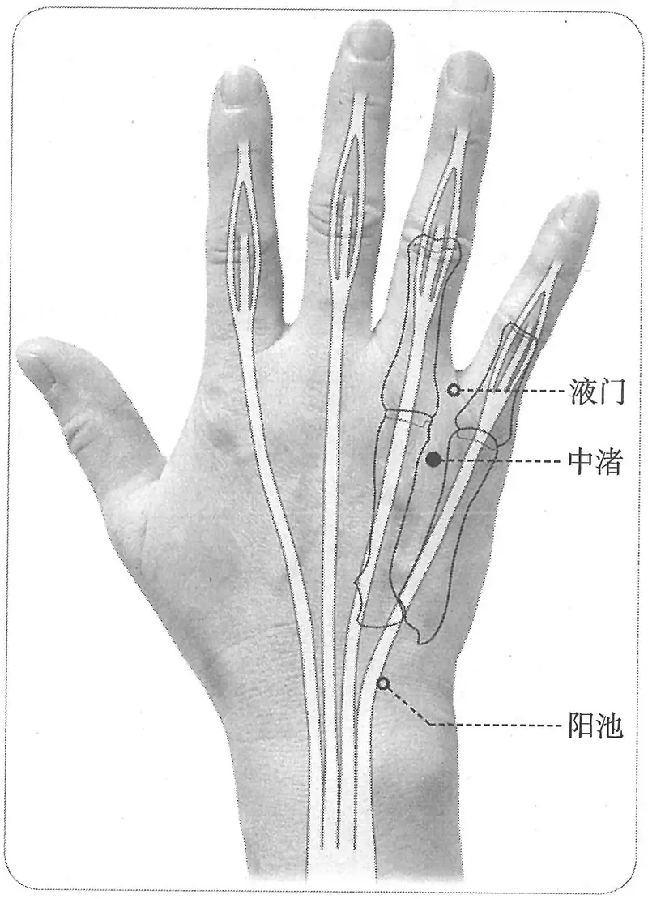

**图2-275　中渚穴图**

〔p.941 (인쇄 913)〕

　　(4) 握拳，第四、五掌骨小头后缘之间凹陷中，液门穴后1寸。（4、5版《针灸学》）

　　(5) 在手背部，当环指本节（掌指关节）的后方，第4、第5掌骨间凹陷处。（6版《针灸学》）

　　(6) 手背，第四、五掌骨小头后缘之间凹陷中，液门穴后1寸。（7版《针灸学》）

　　(7) 握拳，第四、五掌骨间，掌指关节后方凹陷中。（《中国针灸学》）

#### 【类属】 

手少阳三焦经输穴。

　1. 三焦者，上合手少阳，出于关冲……注于中渚，中渚，本节之后陷者中也，为腧。（《灵枢·本输》）

　2. 手少阳脉之所注也，为输。（《黄帝明堂经》）

#### 【适应症】 

主治头面五官部病症。常用于头痛，目痛，耳聋，耳鸣，咽喉肿痛；肩背、肘臂痛，手指不能屈伸；热病。

　1. 主头痛耳鸣，狂，互引，耳聋，目痛。疟，寒热，嗌外肿，肘臂痛，手上类类也，五指瘈不可屈伸，头眩，颔额颅痛。两颞颥痛，发有四时，面上赤，目䀮䀮无所见。喉痹。（《黄帝明堂经》）

　2. 热病汗不出，身面痒，项痛。（《外台秘要》卷三十九）

　3. 治热病汗不出，目眩头痛，耳聋，目生翳膜，久疟咽肿，肘臂痛，手五指不得屈伸。（《铜人腧穴针灸图经》卷下）

　4. 窦太师针灸遗存

　　(1) 治脾积心疼，先补后泻；手背疼，泻出血。（《窦太师针经》）

　　(2) 治髀脊心痛，先补后泻；手背红肿，宜泻出血。（《大本琼瑶神书》）

　　(3) 主脊间心后痛。（《循经考穴编》下）

　5. 主目锐眦痛，耳后肩臑肘臂外皆痛，无名指不用。（《针方六集》卷五）

**按**：此悉为手少阳经脉病候，吴崑归于本经之“输”。

　6. 统编针灸学教材

　　(1) 主治头痛，目翳，耳聋，耳鸣，咽肿，咽痛，肘臂痛，手指不能屈伸，热病汗不出。（1957年南京《针灸学》、1版《针灸学讲义》）

　　(2) 主治头痛，目赤，耳聋，耳鸣，咽喉肿痛，肘臂痛，手指不能屈伸，热病。（2版《针灸学讲义》、4版《针灸学》、《中国针灸学》）

　　(3) 主治头痛，目赤，耳鸣，耳聋，咽喉肿痛，热病，手指不能屈伸。（5、6版《针灸学》）

　　(4) 主治：①头痛，目赤，耳聋，耳鸣，喉痹等头面五官病证；②热病；③肩背肘臂酸痛，手指不能屈伸。（7版《针灸学》）

#### 附：临床应用举例 

　1. 头面五官病症

　　(1) 目暗不明，针中渚入二分，留三呼，泻五吸，灸七壮，炷如雀矢大。（《千金要方》卷十八、《千金翼方》卷二十七）

　　(2) 小儿目涩怕明，状如青盲，灸中渚二穴各一壮，在手小指次指本节后陷者中，炷如小麦大。（《太平圣惠方·明堂》卷一百）

　　(3) 急缠喉风：刺少商，灸天突、合谷、中渚，俱泻。（《针灸集要·盘石金直刺秘传》）

　　(4) 喉咙闭塞，饮食艰难：刺少泽、合谷、中渚、委中出血；未愈，泻中冲。（《针灸集要·盘石金直刺秘传》）

〔p.942 (인쇄 914)〕

　　(5) 脑源性头痛：针刺中渚穴治疗。［河南中医，2002，22(2):58］

　2. 手臂病症

　　(1) 手臂肿痛不可忍：泻曲池、合谷、中渚。手臂红肿：同治。（《针灸集要·盘石金直刺秘传》）

　　(2) 肩脊痛不可忍：刺中渚泻之；少愈，刺肩井。（《针灸集要·盘石金直刺秘传》）

　　(3) 手臂红肿痛：五里、中渚、曲池、通里。问曰：此证从何而得？答曰：气壅滞不散，关节闭塞，经不通，故如此也。复刺后穴：合谷、尺泽。（《针灸集成》第三十一方）

　　(4) 肩背红肿：肩井、风门、中渚。问曰：此证从何而得？答曰：皆因腠理不密，风邪串入经络，寒湿相搏，血气相胜，故如此也。复刺后穴：大椎、肺俞、膏肓。（《针灸集成》第三十二方）

　　(5) 手背生疮红肿疼痛：阳池、上廉、曲池、液门、中渚、合谷。问曰：此证从何而得？答曰：气血壅滞，皮肤瘙痒，用热汤泡洗而红肿，如此久而不治，变成手背疮。复刺后穴：上廉、阳池。（《针灸集成》第三十四方）

　　(6) 手臂相连手腕疼，液门穴内下针明。更有一穴名中渚，泻多勿补疾如轻。（《针灸玉龙歌》）

　　(7) 五指不伸中渚取。（《灵光赋》）

　　(8) 肩背诸疾中渚下。（《肘后歌》）

　　(9) 肩凝症：针刺中渚一穴治疗。［新疆中医药，1998，16(1):31］

　3. 其他病症

　　(1) 四肢浮肿：中渚、液门、合谷、中都、曲池、三里、三阴交。问曰：此证缘何而得？答曰：只因醉饱乘风取快，有兼房事劳动脏腑，食饱不化，遂成痰饮，则注于四肢，故如此也。复刺后穴：中脘、丰隆、阴陵泉、行间。（《针灸集成》第四十八方）

　　(2) 脾脊后心疼痛：中渚泻之，忌补，灸心痛背上穴：心俞、鬲俞。（《医学纲目》卷十六）

　　(3) 脊间心后者，针中渚而立痊。（《通玄指要赋》）

　　(4) 肋间神经痛：针刺中渚穴缓解。［针灸临床杂志，1995，11(7):44］

　　(5) 急性臂上皮神经损伤：针刺中渚穴加手法弹拨治疗。［北京中医药大学学报，1994，17(6):35］

　　(6) 胆绞痛：针刺中渚穴治疗。［针灸临床杂志，1997，13(8):42］

#### 【操作】 

直刺0.3~0.5寸。

　1. 刺入二分，留三呼，灸三壮。（《黄帝明堂经》）

　2. 针入三分，可灸三壮。（《铜人腧穴针灸图经》卷下）

　3. 窦太师针灸遗存

　　(1) 针入一分，沿皮向后透腕骨，泻之。（《针灸玉龙歌》注）

　　(2) 针入一分，沿皮向后一寸半。（《窦太师针经》）

　　(3) 针一分，沿皮向后透阳池穴。（《窦太师秘传》）

　　(4) 窦氏：针入一分，沿皮向后一寸半。（《针方六集》卷一）

　4. 凌氏直刺八分，禁灸。（《循经考穴编》下）

　5. 统编针灸学教材

　　(1) 针三至五分，灸三壮。（1957年南京《针灸学》、1版《针灸学讲义》）

　　(2) 直刺3~5分，艾条灸3~5分钟。（2版《针灸学讲义》）

〔p.943 (인쇄 915)〕

　　(3) 直刺0.3~0.5寸。（4、5、7版《针灸学》）

　　(4) 直刺0.3~0.5寸；可灸。（6版《针灸学》、《中国针灸学》）

　6. 直刺或向腕部斜刺0.5~1.5寸。感应：局部酸胀，向远端或近端扩散，有时麻电感向指端放散。灸3~5壮；温灸5~10分钟。（上海《针灸学》）

### （四）阳池 Yángchí TE4 出《灵枢》 

问题：在早期针灸学教材中，阳池定于指总伸肌肌腱尺侧，而外关、支沟却定于指总伸肌的桡侧？何以上下相直的经穴却定于同一肌的不同侧？

#### 【提要索隐】 

**穴名**：一名别阳。

**部位**：在腕后区，腕背侧远端横纹上，指伸肌腱的尺侧缘凹陷中。

**适应症**：主治局部病症。常用于手腕痛，肩臂痛；疟疾；口干。

**针刺操作**：直刺0.3~0.5寸。

#### 【名实考】 

通过对古今文献的系统分析，发现“阳池”、“中泉”、“外关”定位描述很难自洽。因为既定阳池穴在指伸肌腱的尺侧缘，则此穴直上2寸正当尺骨桡侧缘，不会在尺骨与桡骨间隙的中点。早期的古典针灸文献对于外关的位置描述有作“两筋间”，但此处的指伸肌腱靠的很紧，难以刺入两肌腱之间，故至元代的针灸文献《针经》明确指出：“针外关须向外廉些，则无筋碍。灸则取中”，这的确符合临床实际。而且中国早期的统编针灸学教材《针灸学》和对外针灸培训教材《中国针灸学》于“支沟”穴下也明确说明在“指总伸肌腱的桡侧”。从腕背远端横纹处的结构来看，比起指伸肌腱的尺侧，指伸肌腱的桡侧更靠近横纹的中点，阳池定于指伸肌腱的桡侧凹陷处更合理。那么，为何国家标准、国际标准文本将“阳池”穴定于“指伸肌腱的尺侧缘”呢？主要是受“中泉”定位的干扰。既然定中泉于指伸肌腱的桡侧，则阳池只能被挤到尺侧了。关于中泉的位置，《类经图翼》原文为“在手腕外间，阳池、阳溪中间陷中”。则阳溪、中泉、阳池三穴的关系为：拇长伸肌腱的桡侧为阳溪穴，尺侧为中泉穴，再隔一肌腱的最明显凹陷处（桡侧腕短伸肌肌腱与指部伸肌肌腱之间）为阳池穴。3穴之间正好隔2条肌腱，关系很明确。从而阳池与大陵相对，阳池直上外关与内关相对的位置关系也不会出现矛盾。

**建议**：国家标准、国际标准在修订时重新考虑上述3穴的位置关系，使之既合于古典文献本义，又切合临床实际。

　1. 三焦者，上合手少阳，出于关冲……过于阳池，阳池，在腕上陷者之中也，为原。（《灵枢·本输》）

　2. 手少阳根于关冲，溜于阳池，注于支沟，入于天牖、外关也。（《灵枢·根结》）

　3. 过于阳池，一名别阳，在手表腕上陷者中，手少阳脉之所过也，为原。（《黄帝明堂经》）

　4. 水之所聚者为池，此穴上自关冲，至腕陷中，有聚象，故曰池，阳指三焦而言。（《经穴解》）

#### “阳池”、“中泉”、“阳溪”三穴位置关系辨 

　1. 阳池在手表腕上陷者中。（《黄帝明堂经》）

　2. 阳池，在手背掌后宛宛中，两筋两骨之间横纹中是穴。（《乾坤生意》）

　3. 阳溪，在腕中上侧两筋间陷者中。（《黄帝明堂经》）

〔p.944 (인쇄 916)〕

　4. 中泉二穴，在手背腕中，在阳溪、阳池中间陷中。是穴可灸二七壮，治心痛，及腹中诸气痛不可忍者。（《奇效良方》卷五十五）

　5. 阳池二穴，在手表腕上陷中。一方：透大陵，虚实皆拔之，肿痛宜弹针出血。（《针方六集》）

**按**：手背腕中最大、最明显的凹陷正是在指总伸肌腱的桡侧，此处也正与腕掌横纹两筋间的大陵穴相对。现代针灸学教材之所以定于尺侧，可能是受前一穴“中渚”定位（四、五指之间）的影响。

#### 【定位】 

**部位**：在腕后区，腕背侧远端横纹上，指伸肌腱的尺侧缘凹陷中（图2-276）。

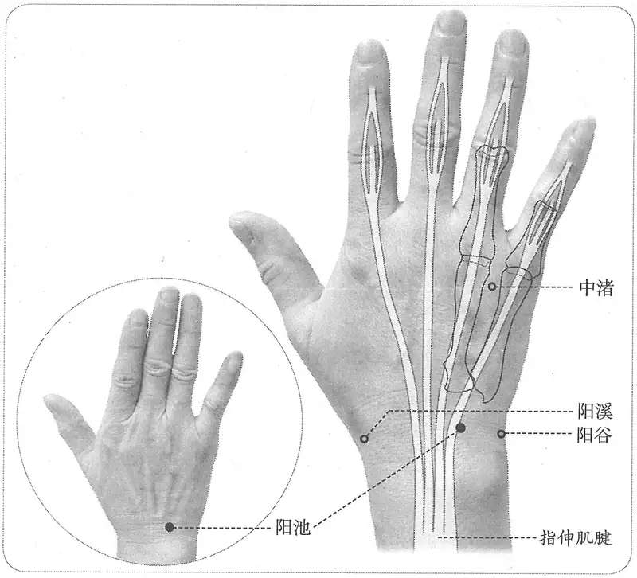

**图2-276　阳池穴图**

**取穴**：俯掌，沿第4、5掌骨间向上至腕背侧远端横纹处的凹陷中，横平阳溪、阳谷。

**相关解剖学基础**：指伸肌腱体表定位技法。指伸肌腱，伸指伸腕时可看到并明显触及，特别是在抗阻力伸指伸腕时。

　1. 在腕上陷者之中也。（《灵枢·本输》）

　2. 在手表腕上陷者中。（《黄帝明堂经》、《铜人腧穴针灸图经》、《圣济总录》、《针灸资生经》、《窦太师针经》、《针灸集成》、《十四经发挥》、《神应经》、《医学入门》、《针方六集》、《循经考穴编》、《针灸易学》）

　3. 支沟下一夫覆腕当文宛宛中。（《千金翼方》卷二十六）

　4. 在手背掌后宛宛中，两筋两骨之间，横纹中是穴。（《乾坤生意》）

　5. 在手表腕上同骨陷中。（《神应经》）

**按**：据该书腕上手少阳穴定位，此处“同骨”当和“两骨”。

　6. 手表腕上陷中，从指本节直摸下至腕中心。（《针灸聚英》卷一、《针灸大成》、《类经

〔p.945 (인쇄 917)〕

图翼》、《针灸逢源》）

　7. 广注指本节直下至腕背中心两筋间。（《循经考穴编》下）

　8. 从中渚由第四指本节直上行手表腕上陷中。（《医宗金鉴·刺灸心法要诀》）

　9. 手表腕上横纹陷中，第四掌骨根部。（《针灸十四经穴位考订》）

　10. 统编针灸学教材

　　(1) 部位：手表腕上陷中。取穴：按取第四掌骨之上端横纹中间，上直第四指，下为尺骨上髁陷中取之。（1957年南京《针灸学》）

　　(2) 部位：手表腕上陷中。取穴：中渚穴直上，手背腕横纹陷中取之。（1版《针灸学讲义》）

　　(3) 部位：手表腕上陷中。取穴：在尺腕关节部，当指总伸肌腱的尺侧凹陷处取之。（2版《针灸学讲义》）

　　(4) 腕背横纹中，指总伸肌腱尺侧缘凹陷中。（4、5、6、7版《针灸学》，《中国针灸学》）

#### 【类属】 

手少阳三焦经原穴。手少阳所流。

　1. 三焦者，上合手少阳，出于关冲……过于阳池，阳池，在腕上陷者之中也，为原。（《灵枢·本输》）

　2. 手少阳脉之所过也，为原。（《黄帝明堂经》）

　3. 手少阳根于关冲，溜于阳池，注于支沟，入于天牖、外关也。（《灵枢·根结》）

#### 【适应症】 

主治局部病症。常用于手腕痛，肩臂痛；疟疾；口干。

　1. 主寒热。痎疟。肩痛不能自举，汗不出，颈痛。（《黄帝明堂经》）

　2. 主或因损后把捉不得。（《千金翼方》卷二十六）

　3. 治寒热疟，或因折伤手腕捉物不得，肩臂痛不得举。（《铜人腧穴针灸图经》卷下）

　4. 窦太师针灸遗存

　　(1) 治手腕无力，补；手臂手腕肿痛，泻，弹针出血。手腕折伤亦治。（《窦太师针经》）

　　(2) 主头晕，臂腕无力，肿痛宜弹针出血。折伤恶血不出亦治。（《针方六集》卷五）

　　(3) 主腕痛无力，或红肿不可屈伸。（《循经考穴编》下）

　5. 主消渴口干，烦闷。（《针灸聚英》卷一、《针灸大成》、《针方六集》、《类经图翼》）

**按**：此乃高武从《针灸资生经》辑录《千金要方》灸方主治。详见“附：临床应用举例”。

　6. 统编针灸学教材

　　(1) 主治腕痛，肩臂痛不得举，消渴，疟疾，耳聋，喉痹，目红肿。（1957年南京《针灸学》、1版《针灸学讲义》）

　　(2) 主治腕痛，肩臂痛，疟疾，耳聋，消渴口干。（2版《针灸学讲义》、4版《针灸学》）

　　(3) 主治目赤肿痛，耳聋，咽喉肿痛，疟疾，腕痛，消渴。（5、6版《针灸学》）

　　(4) 主治：①目赤肿痛，耳聋，喉痹等五官病证；②消渴，口干；③腕痛，肩臂痛。（7版《针灸学》）

　　(5) 主治肩臂痛，腕痛，疟疾，耳聋，消渴。（《中国针灸学》）

**文献分析**：教材中“目赤肿痛，耳聋，喉痹”见于《针灸大成》“主客原络歌”，说的是三焦的病候，取阳池、内关穴，而《针方六集》归于中渚穴主治，故暂不采录：

三焦为疾耳中聋，喉痹咽干目肿红，耳后肘疼并出汗，脊间心后痛相从，肩背风生连膊肘，大便坚闭及遗癃，前病治之何穴愈，阳池内关法理同。

#### 附：临床应用举例 

　1. 消渴口干烦闷，灸足厥阴百壮。又灸阳池五十壮。（《千金要方》卷二十一、《千金翼方》）

〔p.946 (인쇄 918)〕

　2. 十指拘挛两手筋紧不开，手三里、曲池、尺泽、合谷、肩髃、阳池、中渚、少商。问曰：此证从何而得？答曰：皆因湿处睡卧，暑月夜行，风露相搏，或醉酒行房，行房之处露天而睡故也。复刺后穴：肩髃、中渚、少商、手三里。（《针灸集成》第三十三方）

　3. 手背生疮红肿疼痛，阳池、上廉、曲池、液门、中渚、合谷。问曰：此证从何而得？答曰：气血壅滞，皮肤瘙痒，用热汤泡洗而红肿，如此久而不治，变成手背疮。复刺后穴：上廉、阳池。（《针灸集成》第三十四方）

　4. 治中风偏枯、手不能举。阳池二穴在手背掌后宛宛中，两筋两骨之间，横纹中是穴。针入二分，灸三壮。（《乾坤生意》下卷）

　5. 前伸肩痛，取阳池、清冷渊，采用缪刺法。［江苏中医，1988，9(2):24］

　6. 急性踝关节扭伤，阳池穴针刺。［中国针灸，1985，5(6):8］

#### 【操作】 

直刺0.3~0.5寸。

　1. 刺入二分，留六呼，灸三壮。（《黄帝明堂经》）

　2. 针入三分，留三呼，泻五吸，忌灸。（《千金翼方》卷二十六）

　3. 针入二分，留三呼，不可灸。（《铜人腧穴针灸图经》卷下）

　4. 针入三分，灸二七壮。（《窦太师针经》）

　5. 统编针灸学教材

　　(1) 针三分。（1957年南京《针灸学》）

　　(2) 针三分，灸三壮。（1版《针灸学讲义》）

　　(3) 直刺三分，艾条灸3~5分钟。（2版《针灸学讲义》）

　　(4) 直刺0.3~0.5寸。（4、5、7版《针灸学》）

　　(5) 直刺0.3~0.5寸；可灸。（6版《针灸学》、《中国针灸学》）

　6. ①直刺0.3~0.5寸。感应：局部酸胀，有时可扩散至中指。②横刺，治腕关节病时，针尖探向左右，进针0.5~1寸。感应：酸胀可扩散至整个腕关节。灸3~5壮；温灸5~10分钟。（上海《针灸学》）

### （五）外关 Wàiguān TE5 出《灵枢》 

问题：龙玄穴从何而来？与外关穴有何关系？

#### 【提要索隐】 

**部位**：在前臂后区，腕背侧远端横纹上2寸，尺骨与桡骨间隙中点。

**适应症**：主治耳部病症。常用于耳鸣，耳聋；胸胁痛；上肢痹痛。颈椎前路手术、颞颌关节手术等头颈部手术的针麻用穴。

**针刺操作**：直刺0.5~1寸。

#### 【名实考】 

窦太师针灸谓本穴“一名阳维”，考《针经指南》载窦氏交经八穴，外关穴只是通阴维脉，而不以“阳维”为名，故不作为本穴别名。

本穴与专治牙痛的“龙玄”本不相干，却由于宋代王执中的误解，阴差阳错地发生了关系。

　1. 手少阳根于关冲，溜于阳池，注于支沟，入于天牖、外关也。（《灵枢·根结》）

　2. 手少阳之别，名曰外关，去腕二寸，外绕臂，注胸中，合心主。病实则肘挛，虚则不收，

〔p.947 (인쇄 919)〕

取之所别也。（《灵枢·经脉》）

　3. 外关，手少阳络，在腕后二寸陷者中，别走心主。（《黄帝明堂经》）

　4. 外关者对内关而言也，此穴在八法中，以为通带脉，而与足少阳胆经之临泣穴通阳维，为男女主客相应。（《经穴解》）

#### “外关”与“龙玄”穴辨 

“龙玄”穴名始见于《窦太师针经》，专治牙痛，又名龙渊，又名龙虎。而此穴却早见于《千金要方》牙痛灸方，原方作“外踝上高骨前交脉”，而窦太师释作“手侧腕交叉紫脉”。考《脉经》曰从鱼至高骨却行一寸，其中名曰寸口。《人镜经》曰：上踝为骨。可见，窦氏对《千金要方》原文的理解基本正确。由此可知，王执中记载的老妇人所传灸牙痛之穴，正是此“龙玄”穴。可是由于王氏对取穴法的误解，却将此穴当成了外关穴。有意思的是，这一误解，却有助于发掘《千金要方》所载的治疗牙痛的另一穴。

　1. 风齿疼痛，灸外踝上高骨前交脉三壮。又以线量手中指至掌后横纹，折为四分，量横纹后当臂中灸二壮，愈，随左右。（《千金要方》卷六）

　2. 齿疼，灸外踝上高骨前交脉上七壮。风牙疼逐左右，以绳量手中指头至掌后第一横纹，折为四分，以度横纹后，当臂两筋间。当度头灸三壮，随左右灸之。两厢患，灸两臂至验。（《千金翼方》卷二十六）

　3. 龙渊二穴，在手侧腕交叉紫脉上。灸七壮。治牙齿疼，泻。又名龙玄穴。（《窦太师针经》）

　4. 有老妇人旧患牙疼，人教将两手掌交叉，以中指头尽处为穴，灸七壮，永不疼，恐是外关穴也穴。（《针灸资生经》卷六按语）

**按**：此处王氏理解为两手掌同向正叠交，而不是侧交叉。值得注意的是，《千金要方》记载的治疗牙痛的另一穴：手掌折量为八寸，四分之一为二寸，然而仅从原文上看，无法判定是从腕掌横纹量，还是从腕背横纹量。从经脉循行及主病来看，倾向于阳经，即从腕背横纹上二寸，正是外关穴，竟与王执中的误解不谋而合。有待临床上检验。

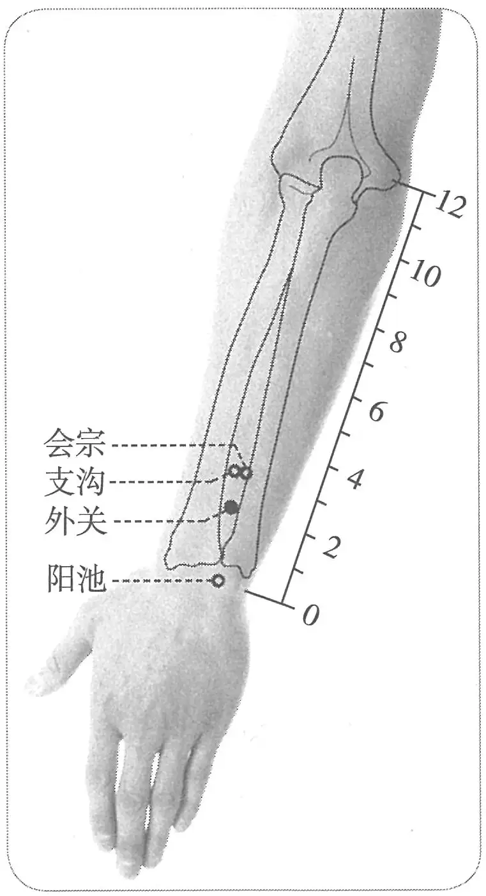

**图2-277　外关穴图**

#### 【定位】 

**部位**：在前臂后区，腕背侧远端横纹上2寸，尺骨与桡骨间隙中点（图2-277）。

**取穴**：阳池上2寸，两骨之间凹陷中。与内关相对。临床上取外关大多采用屈肘旋后位，此时可以于两骨间隙的中点处取穴，进针很顺畅，不会刺在肌腱上。

　1. 去腕二寸。（《灵枢·经脉》）

　2. 在腕后二寸陷者中。（《黄帝明堂经》、《太平圣惠方》、《铜人腧穴针灸图经》、《窦太师秘传》、《圣济总录》、《十四经发挥》、《神应经》、《医学纲目》、《类经图翼》、《医宗金鉴·刺灸心法要诀》、《针灸逢源》）

　3. 在手腕兑骨上二寸，腕后陷中。（《窦太师针经》）

　4. 在手腕后二寸。令病人稳坐，覆手取之。（《针经指南》、《针方六集》）

　5. 在腕后二寸前踝骨尖后两筋中。覆手取。（《针灸玉龙经》）

〔p.948 (인쇄 920)〕

　6. 在手背掌后，在阳池腕后二寸两骨之间是穴。（《乾坤生意》）

　7. 腕后二寸两筋间，阳池上一寸。（《针灸聚英》卷一、《古今医统》）

　8. 阳池后二寸。（《医学入门》卷一）

　9. 腕后二寸两骨间，与内关相对。（《针灸大成》卷七、《针灸易学》）

　10. 两筋骨罅间，与内关相对。（《循经考穴编》下）

　11. 阳池上二寸两筋间。（《针灸十四经穴位考订》）

　12. 统编针灸学教材

　　(1) 部位：腕后二寸两骨间。取穴：从阳池穴上二寸，两骨缝间取之。（1957年南京《针灸学》）

　　(2) 部位：腕后二寸。取穴：阳池穴直上二寸，二骨间陷中取之。（1版《针灸学讲义》）

　　(3) 部位：在腕后二寸陷者中。取穴：阳池上二寸，当尺、桡两骨间取之。（2版《针灸学讲义》）

　　(4) 腕横纹上2寸，桡骨与尺骨之间。（4、5版《针灸学》）

　　(5) 在前臂背侧，当阳池与肘尖的连线上，腕背横纹上2寸，尺骨与桡骨之间。（6版《针灸学》）

　　(6) 腕横纹上2寸，桡骨与尺骨正中间。（7版《针灸学》）

　　(7) 在阳池上二寸，桡骨与尺骨之间。（《中国针灸学》）

**文献分析**：《针灸聚英》既云“腕后二寸”，又曰“阳池上一寸”，自相抵牾，“一寸”疑为“二寸”之误。

#### 【类属】 

手少阳三焦经络穴。手少阳所入。

　1. 手少阳根于关冲，溜于阳池，注于支沟，入于天牖、外关也。（《灵枢·根结》）

　2. 手少阳之别，名曰外关，去腕二寸，外绕臂，注胸中，合心主。病实则肘挛，虚则不收，取之所别也。（《灵枢·经脉》）

　3. 手少阳络，别走心主。（《黄帝明堂经》）

　4. 又名阳维穴。通阳𫏋脉也。（《窦太师针经》）

**按**：此说非是。外关通阳维脉，不通阳𫏋脉。

　5. 外关为八法之一，以其合阳维而会带脉也。（《针方六集》卷一）

　6. 八法配临泣，通阳维为女。（《循经考穴编》下）

#### 【适应症】 

主治耳部病症。常用于耳鸣，耳聋；胸胁痛；上肢痹痛。颈椎前路手术、颞颌关节手术等头颈部手术的针麻用穴。

**备选适应症**：胁痛。

　1. 主肘中濯濯，耳淳淳浑浑无所闻。臂内廉痛，不可及头。口僻噤。（《黄帝明堂经》）

　2. 主肘腕酸重屈伸难，手十指尽痛不得握。（《太平圣惠方·明堂》）

　3. 治肘臂不得屈伸，手五指尽痛不能握物，耳聋无所闻。（《铜人腧穴针灸图经》卷下）

　4. 窦太师针灸遗存

　　(1) 治胁痛，泻；手臂红肿；泻。（《窦太师针经》）

　　(2) 治胁肋痛，泻；手背红肿，先补后泻。（《大本琼瑶神书》）

　5. 实则肘挛泻之，虚则不收补之。（《针灸聚英》卷一、《针灸大成》、《循经考穴编》）

　6. 目翳，颊痛嗌肿，耳后痛，胁肋肘臂肿痛，无名指不用；伤寒无汗，寒热往来。（《针方

〔p.949 (인쇄 921)〕

六集》卷五）

　7. 亦主耳聋鼻衄。（《循经考穴编》下）

　8. 统编针灸学教材

　　(1) 主治头痛，耳聋耳鸣，肘臂不能屈伸，手指痛不能握，手颤，热病，瘰疬，腹痛便秘。（1957年南京《针灸学》）

　　(2) 主治头痛，耳聋，耳鸣，瘰疬，肘臂不能屈伸，手指痛不能握，手颤，热病。（1版《针灸学讲义》）

　　(3) 主治热病，头痛，颊痛，胁痛，耳聋，耳鸣，肘臂屈伸不利，手指痛，手颤。（2版《针灸学》）

　　(4) 主治热病，头痛，耳聋，耳鸣，目赤肿痛，瘰疬，胸胁痛，肘臂屈伸不利，手指疼痛。（4版《针灸学》）

　　(5) 主治热病，头痛，目赤肿痛，耳聋，耳鸣，瘰疬，胸胁病，上肢痹痛。（5版《针灸学》）

　　(6) 主治热病，头痛，颊痛，目赤肿痛，耳鸣，耳聋，瘰疬，胸胁病，上肢痹痛。（6、7版《针灸学》）

　　(7) 主治热病，头痛，颊痛，落枕，耳聋，耳鸣，胸胁痛，肘臂屈伸不利，手指疼痛，手颤。（《中国针灸学》）

**文献分析**：《针方六集》所载之主治病症皆系手少阳经脉及阳维脉病候。教材中“热病，头痛”、“便秘”、“瘰疬”均出自歌赋及“八穴”主治，无其他文献依据，暂不采录。

#### 附：临床应用举例 

　1. 手少阳之别，名曰外关，去腕二寸，外绕臂，注胸中，合心主。病实则肘挛，虚则不收，取之所别也。（《灵枢·经脉》）

　2. 胁肋下痛，外关、行间、中封、支沟、阳陵泉、章门、期门。问曰：此证缘何而得？答曰：因怒气伤肝血不归，故如此也。亦有伤寒胁痛者，亦有推闪胁痛不可一列取之。宜详推治之，复刺后穴：支沟、外关、章门。（《针灸集成》第三十六方）

　3. 臂膊疼痛，肩髃、手三里、外关。（《医学纲目》卷十二）

　4. 里急后重，合谷、外关。（《医学纲目》卷二十三）

　5. 伤寒自汗表烘烘，独会外关为重。（《流注指微赋》）

　6. 腹中疼痛最难当，宜刺太陵并外关。（《针灸玉龙歌》）

　7. 耳聋，肾俞、翳风、外关、听会后刺。［中国针灸，1986，6(1):28］

　8. 无汗症，内关补法、外关泻法。［上海针灸杂志，1989，8(2):48］

#### 【操作】 

直刺0.5~1寸。

　1. 刺入三分，留七呼，灸三壮。（《黄帝明堂经》）

　2. 窦太师针灸遗存

　　(1) 针透内关穴，禁灸。（《窦太师针经》）

　　(2) 直刺透内关穴，禁灸。（《大本琼瑶神书》）

　　(3) 针透内关穴。（《窦太师秘传》）

　3. 针外关须向外廉些，则无筋碍；灸则取中。（《窦太师针经》按语）

　4. 统编针灸学教材

　　(1) 针五至八分，灸三至七壮。（1957年南京《针灸学》、1版《针灸学讲义》）

　　(2) 直刺5~8分，艾条灸3~7分钟。（2版《针灸学讲义》）

　　(3) 直刺0.5~1寸。（4、5、7版《针灸学》）

〔p.950 (인쇄 922)〕

　　(4) 直刺0.5~1寸；可灸。（6版《针灸学》、《中国针灸学》）

　5. ①直刺1~1.5寸，或透内关。感应：局部酸胀，有时可扩散至指端。②斜刺，治躯干病肘，向上，进针1.5~2寸。感应：酸胀感向上肘，用大幅度捻针数下，有时可扩散至肘、肩。灸3~5壮；温灸5~15分钟。（上海《针灸学》）

### （六）支沟 Zhīgōu TE6 出《灵枢》 

#### 【提要索隐】 

**穴名**：一名飞虎。

**部位**：在前臂后区，腕背侧远端横纹上3寸，尺骨与桡骨间隙中点。

**适应症**：主治耳、咽部病症。常用于耳鸣、耳聋，失音；瘰疬；胁肋痛；呕吐，便秘；热病。上颌窦手术、二尖瓣扩张分离术的针麻用穴。

**针刺操作**：直刺0.5~1寸。

#### 【名实考】 

支沟，《窦太师针经》乙抄本注曰“即飞虎”，考“飞虎”之名见于窦氏《标幽赋》，徐凤注作“飞虎穴即章门穴也，又云是支沟穴”，但给出的解释只是支沟何以名“飞虎”的文字，故该书“一穴二名”类只录“支沟，一名飞虎”，后世文献皆从。

　1. 三焦者，上合手少阳，出于关冲，关冲者……行于支沟，支沟，上腕三寸，两骨之间陷者中也，为经。（《灵枢·本输》）

　2. 手少阳根于关冲，溜于阳池，注于支沟，入于天牖、外关也。（《灵·根结》）

　3. 行于支沟，支沟者，火也。在腕后三寸两骨之间陷者中，手少阳脉之所行也，为经。（《黄帝明堂经》）

　4. 胸满腹痛刺内关；胁痛肋疼针飞虎。徐氏注：飞虎穴即章门穴也，又云是支沟穴，以手于虎口一飞，中指尽处是穴也。（《针灸大全》卷一）

　5. 飞虎，支沟也。以虎口交叉，中指飞到处是穴，故曰飞虎。（《针方六集·玉龙歌》注）

　6. 沟者，水之所行也，此穴在手臂之外，如木有枝，故曰支沟。（《经穴解》）

#### 【定位】 

**部位**：在前臂后区，腕背侧远端横纹上3寸，尺骨与桡骨间隙中点（图2-278）。

**取穴**：外关上1寸，两骨之间，横平会宗。

　1. 上腕三寸，两骨之间陷者中。（《灵枢·本输》、《黄帝明堂经》、《太平圣惠方》、《铜人腧穴针灸图经》、《圣济总录》、《十四经发挥》、《神应经》、《医学入门》、《针方六集》、《类经图翼》、《循经考穴编》、《针灸逢源》）

　2. 穴在手腕后臂外三寸，两骨间是。（《千金要方》卷八）

　3. 在手腕后二寸，两骨间陷中。（《千金翼方》卷二十六）

　4. 阳池上一夫，两筋间陷中。（《千金翼方》卷二十六）

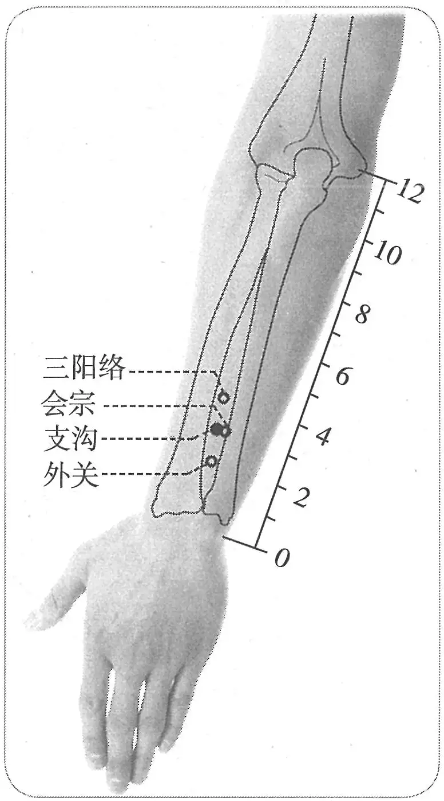

**图2-278　支沟穴图**

〔p.951 (인쇄 923)〕

　5. 一云在阳池上一寸。（《千金翼方》卷二十六注）

　6. 窦太师针灸遗存

　　(1) 在腕后三寸，对间使。（《针灸玉龙歌》注）

　　(2) 在手腕骨上三寸，两筋间陷中。（《窦太师针经》）

　　(3) 在手背腕后三寸，两骨间。（《窦太师秘传》、《大本琼瑶神书》）

　7. 腕后臂外三寸，两骨间陷中。（《针灸聚英》卷一、《古今医统》、《针灸大成》、《针灸易学》）

　8. 外关上行一寸，两骨间陷中。（《医宗金鉴·刺灸心法要诀》）

　9. 阳池上三寸，两筋间。（《针灸十四经穴位考订》）

　10. 统编针灸学教材

　　(1) 部位：腕后臂外三寸，两骨间陷中。取穴：从阳池穴上三寸取之。（1957年南京《针灸学》）

　　(2) 部位：外关穴上一寸。取穴：阳池穴上三寸，二骨间陷中。（1版《针灸学讲义》）

　　(3) 部位：在腕后三寸两骨之间陷者中。取穴：阳池上三寸，尺、桡两骨之间，指总伸肌的桡侧取之。（2版《针灸学讲义》）

　　(4) 腕背横纹上3寸，桡骨与尺骨之间。（4、5版《针灸学》）

　　(5) 在前臂背侧，当阳池与肘尖的连线上，腕背横纹上3寸，尺骨与桡骨之间。（6版《针灸学》）

　　(6) 腕背横纹上3寸，尺骨与桡骨正中间。（7版《针灸学》）

　　(7) 在阳池上三寸，桡骨与尺骨之间，当指总伸肌的桡侧取之。（《中国针灸学》）

**文献分析**：本穴定位，古今腧穴文献描述无分歧，皆定于腕上三寸两骨间。《千金翼方》注有“一云在阳池上一寸”，查其后针灸方有注作“阳池上一夫”，可知“一寸”为“一夫”之误。又该书角弓反张灸法中“支沟”注作“手腕后二寸两骨间”，经查此方出自《千金要方》卷八，原方作“三寸”无误。

#### 【类属】 

手少阳三焦经经穴。手少阳所注。

　1. 三焦者，上合手少阳，出于关冲，关冲者……行于支沟，支沟，上腕三寸，两骨之间陷者中也，为经。（《灵枢·本输》）

　2. 手少阳根于关冲，流于阳池，注于支沟，入天牖、外关也。（《灵枢·根结》）

　3. 行于支沟，支沟者，火也……手少阳脉之所行也，为经。（《黄帝明堂经》）

#### 【适应症】 

主治耳、咽部病症。常用于耳鸣、耳聋，失音；瘰疬；胁肋痛；呕吐，便秘；热病。上颌窦手术、二尖瓣扩张分离术的针麻用穴。

　1. 主热病汗不出，互引，颈嗌外肿，肩臂酸重，胁腋急痛，四肢不举，痂疥，项不可顾。霍乱。马刀肿瘘，目痛，肩不举，心痛榰满，逆气，汗出，口噤不可开。暴瘖不能言，男子脊急，目赤。咳，面赤热。（《黄帝明堂经》）

　2. 主刺风，热风，耳聋鸣，手不仁，冷风手战，偏风，半身不遂。（《千金翼方》卷二十六）

　3. 治热病汗不出，肩臂酸重，胁腋痛，四肢不举，霍乱呕吐，口噤不开，暴哑不能言。（《铜人腧穴针灸图经》卷下、《圣济总录》）

　4. 治大小便闭塞，气不能通。（《琼瑶神书》卷三）

　5. 窦太师针灸遗存

　　(1) 治大便闭，泻；腰胁腿叉脚酸，先补后泻；脚腰重，先泻后补。（《窦太师针经》）

〔p.952 (인쇄 924)〕

　　(2) 大便秘结不通，宜泻大；治腰肋腿肞脚股痛，先泻后补；腰脚重，则先补而后泻。（《大本琼瑶神书》）

　　(3) 治小便闭结，伤寒胁疼。（《窦太师秘传》）

　6. 主心闷不已，卒心痛，鬼击，伤寒结胸，瘑疮疥癣，妇人妊脉不通，产后血晕，不省人事。（《针灸聚英》卷一、《针灸大成》、《针方六集》、《循经考穴编》）

**按**：以上病症辑自《针灸摘英集》针灸方主治。详见“附：临床应用举例”。

　7. 上焦胁肋疼痛，胸膈闭闷；下焦二便秘塞；中焦霍乱呕吐，及四肢浮肿。（《循经考穴编》下）

　8. 针痔疮云效。（《针灸集成》）

　9. 统编针灸学教材

　　(1) 主治暴喑，肩臂酸痛，胁肋疼痛，卒心痛，呕吐，霍乱，热病汗不出，产后血晕，目痛，颈咽外肿。（1957年南京《针灸学》）

　　(2) 主治暴喑，胁肋疼痛，卒心痛，呕吐，肩臂酸痛，颈咽外肿，热病汗不出，产后血晕，大便秘。（1版《针灸学讲义》）

　　(3) 主治暴喑，耳鸣，耳聋，肩背酸痛，胸胁痛，呕吐，便秘，热病。（2版《针灸学讲义》、《中国针灸学》）

　　(4) 主治暴喑，耳鸣，耳聋，瘰疬，胁肋痛，呕吐，便秘，热病。（4版《针灸学》）

　　(5) 主治耳鸣，耳聋，暴喑，瘰疬，胁肋痛，便秘，热病。（5、6、7版《针灸学》）

**文献分析**：明初医官在《针灸集成》中注曰“针痔疮云效”，记载的应是当时医家的经验，结合窦太师针灸，也是以大便秘结为本穴的治疗重点，皆提示这一经验值得重视，应在临床上进一步检验。

#### 附：临床应用举例 

　1. 大、小便病症

　　(1) 伤寒，小便不通：刺支沟；未愈，泻阴谷、阴陵泉。（《针灸集要·盘石金直刺秘传》）

　　(2) 中风后大小便闭结不通：泻支沟二穴。小便不通：泻阴谷二穴。大便不通，泻照海二穴。（《针灸集要·盘石金直刺秘传》）

　　(3) 若是腹痛兼闭结，支沟奇穴保平安。（《针灸玉龙歌》）

　　(4) 大便闭塞不能通，照海分明在足中。更把支沟来泻动，方知医士有神功。（《针灸玉龙歌》）

　　(5) 习惯性便秘：针支沟穴治疗。［新中医，1991，23(12):32-33］

　　(6) 癃闭：关元穴、支沟穴、足三里穴，针刺治疗。［上海针灸杂志，1984(4):31］

　2. 胸胁部病症

　　(1) 治伤寒结胸者，别使人以手于心蔽骨下正痛处左伴揉之，以毫针刺左伴。手少阳经支沟二穴，在腕后三寸，两骨之间，坐而侧臂取之，针入二分。次至手厥阴经，间使穴即止，名曰双关刺。（《针经摘英集》）

　　(2) 治心闷不已，刺手少阳经支沟二穴、足阳明经三里二穴。（《针经摘英集》）

　　(3) 一切游气攻冲，胸膈疼痛，咳嗽不可转侧：泻支沟，左泻右，右泻左，委中出血。（《针灸集要·盘石金直刺秘传》）

　　(4) 伤寒结胸，并气攻胁肋：泻合谷、曲池、委中、支沟。（《针灸集要·盘石金直刺秘传》）

　　(5) 胁肋下痛：外关、行间、中封、支沟、阳陵泉、章门、期门。问曰：此证缘何而得？答

〔p.953 (인쇄 925)〕

曰：因怒气伤肝血不归，故如此也。亦有伤寒胁痛者，亦有推闪胁痛，不可一列取之。宜详推治之，复刺后穴：支沟、外关、章门。（《针灸集成》第三十六方）

　　(6) 胸胁痛不堪：期门沿皮二寸、支沟、胆俞沿皮一寸五分。（《医学纲目》卷十六）

　　(7) 胸满腹痛刺内关，胁疼肋痛针飞虎。（《标幽赋》）

　　(8) 伤寒痞结胁积痛，宜用期门见深功，当汗不汗合谷泻，自汗发黄复溜凭。飞虎一穴通痞气，祛风引气使安宁。（《肘后歌》）

　　(9) 胁痛：针刺支沟穴治疗。［陕西中医，1988，9(4):186］

　3. 风证

　　(1) 主偏风，针风池一穴，肩髃一穴，曲池一穴，支沟一穴，五枢一穴，阳陵泉一穴，巨虚下廉一穴，凡针七穴即差。（《千金要方》卷八）

　　(2) 治猥退风偏风半身不随法……阳池上一夫两筋间陷中，主刺风热风，耳鸣聋，手不仁，冷风手战，偏风，半身不随。（《千金翼方》卷二十六）

　　(3) 有贵人手中指挛，已而无名指、小指亦挛，医为灸肩髃、曲池、支沟而愈。支沟在腕后三寸。或灸风疾，多有不灸支沟，只灸合谷云。（《针灸资生经》卷五）

　4. 其他病症

　　(1) 灸漏法……又灸章门、临泣、支沟、阳辅各百壮。（《千金翼方》卷二十八）

　　(2) 治产妇血晕，不省人事，针手少阳经支沟二穴、足阳明经三里二穴、足太阴经三阴交二穴。（《针经摘英集》）

　　(3) 治鬼击，刺足阳明三里二穴、手少阳经支沟二穴，立愈，不愈复刺。（《针经摘英集》）

　　(4) 水蛊四肢浮肿：支沟泻、水分、关元。（《针灸玉龙经·盘石金直刺秘传》）

　　(5) 疟疾寒热真可畏，须知虚实可用意。间使宜透支沟中，大椎七壮合圣治。（《肘后歌》）

　　(6) 落枕：支沟。［河北中医，1990，12(3):48］

　　(7) 急性腰扭伤：针刺支沟穴治疗。［河北中医，1986(3):24］

　　(8) 急性腰扭伤：针刺支沟治愈。［浙江中医杂志，1988，23(3):132］

#### 【操作】 

直刺0.5~1寸。

　1. 刺入二分，留七呼，灸三壮。（《黄帝明堂经》）

　2. 灸五壮。（《太平圣惠方》）

　3. 可灸二七壮，针入二分。（《铜人腧穴针灸图经》卷下）

　4. 针透间使。（《窦太师针经》、《窦太师秘传》）

　5. 针三分，透间使，灸七壮。（《针灸玉龙经》）

　6. 针五分，灸三壮。（《针灸十四经穴位考订》）

　7. 统编针灸学教材

　　(1) 针五至八分，灸三至七壮。（1957年南京《针灸学》、1版《针灸学讲义》）

　　(2) 直刺5~8分，艾条灸3~7分钟。（2版《针灸学讲义》）

　　(3) 直刺0.8~1.2寸。（4、5版《针灸学》）

　　(4) 直刺0.5~1寸；可灸。（6版《针灸学》）

　　(5) 直刺0.5~1寸。（7版《针灸学》）

　　(6) 直刺0.8~1.2寸。可灸。（《中国针灸学》）

〔p.954 (인쇄 926)〕

　8. 直刺1~1.5寸。感应：局部酸胀或向上扩至肘，有时有麻电感往指端放散。（上海《针灸学》）

### （七）会宗 Huìzōng TE7 出《黄帝明堂经》 

问题1：会宗、支沟皆曰“在腕上三寸”，二穴位置如何确定？

问题2：会宗一穴，有上空、中空、下空，所主各有不同，如何理解？一穴之浅深不同而主治有别，是腧穴的普遍规律，还是仅见于本穴的特例？

#### 【提要索隐】 

**部位**：在前臂后区，腕背侧远端横纹上3寸，尺骨的桡侧缘。

**适应症**：主治耳部病症。常用于耳聋；癫痫。

**按**：此为《黄帝明堂经》所载349穴中唯一根据上、中、下不同层次而分主不同病症的腧穴。如果现代临床能够证明这种现象的确存在，那么腧穴的主治就不仅仅取决于腧穴的部位，还取决于它的深浅。

**针刺操作**：直刺0.5~1寸。

#### 【名实考】 

《黄帝明堂经》所载之“会宗”，不论是定位、刺法，还是主治的描述都具有非常特殊的意义，能给当今针灸腧穴研究提供许多重要的启示。

关于会宗穴名之义，杨上善早有解释，勾玄索隐，发前人所未知。而关于本穴的定位，《黄帝明堂经》谓腕后三寸，与支沟穴部位描述相同，如何理解，特别是在明堂图和针灸铜人上如何表现？明代程衍道在校刊《外台秘要》把这种困惑表达得十分到位。虽然从文字描述上，看不出本穴定位有多大差异，而实际取穴却差异很大，在中国针灸统编教材之前，主要有两种理解，三种表现形式。其一，将会宗理解为腕后“三寸五分”，排于支沟与三阳络穴之间；其二，是将会宗与支沟并列，排列方法上又有两种：一种将本穴排在尺侧，另一种则排在桡侧，至朱琏《新针灸学》确定为支沟穴的尺侧。

从《黄帝明堂经》原文来看，支沟穴明确在腕后三寸两骨间，且下一穴三阳络也是直接以支沟穴为基点折量，说明支沟穴与其上下之穴外关、三阳络呈一直线，而会宗穴不在线上，在线外。从马王堆两种十一脉文献来看，手少阳经在前臂背侧的循行皆于“上骨下廉”，则会宗穴偏于支沟穴尺侧更合理，也只有尺侧才有空。

　1. 会宗，手少阳郄，在腕后三寸空中。（《黄帝明堂经》）

　2. 杨上善注曰空中一寸有上、中、下，总名会宗。（《医心方》卷二）

　3. 后此穴为三阳络，三阳者，手太阳、少阳、阳明也，仅离支沟一寸，而此穴乃去腕三寸五分之中，三阳络在腕后四寸之中，与此穴仅去五分，则三阳之络，俱会于三阳络之穴，而此穴乃其将会之穴，故曰会宗。（《经穴解》）

#### 会宗穴定位的古今演变 

程敬通曰：支沟，在腕后三寸两骨陷中；会宗亦在腕后三寸空中。腕后空，唯两骨陷中耳，别无有空也。一云在腕后三寸空中一寸，而三阳络，又在支沟上一寸。会宗故未易取也，俟高明者订之。（明刊本《外台秘要》注）

#### 针灸铜人定位 

　1. 定于支沟穴桡侧。（明正统仿宋铜人（图2-279）、日本东京博物馆藏针灸铜人）

　2. 定于支沟穴尺侧。（朝鲜古铜人、经穴指掌图、承淡安《重绘人体经穴图》）

　3. 定于支沟与三阳络之间，腕后三寸五分。（清光绪铜人、明·靳贤修铜人图）

〔p.955 (인쇄 927)〕

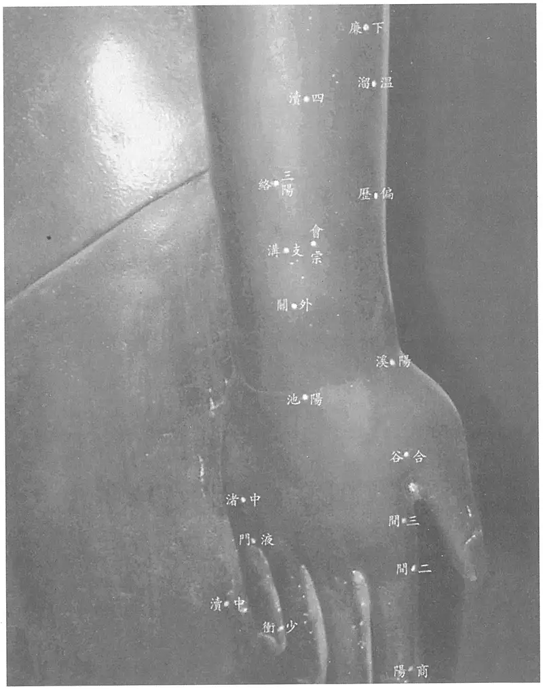

**图2-279　正统铜人会宗定位**

**按**：以上三种处理方式只是大概，各家在具体处理上还有不少细节上的差异，例如嘉靖铜人会宗在支沟与三阳络中点的桡侧，赵尔康1954年完成的《人体经穴模型》原稿会宗在支沟与三阳络中点的尺侧（图2-280），1955年修订稿改在支沟的尺侧（图2-281）。这也说明直到20世纪50年代初，中国针灸界关于本穴的定位，意见还不一致。

#### 【定位】 

**部位**：在前臂后区，腕背侧远端横纹上3寸，尺骨的桡侧缘（图2-282）。

**取穴**：从支沟穴外侧，骨缝陷中取之。

　1. 腕后三寸空中。（《黄帝明堂经》）

　2. 腕后三寸，空中一寸。（《铜人腧穴针灸图经》卷下、《圣济总录》、《针灸资生经》、《十四

〔p.956 (인쇄 928)〕

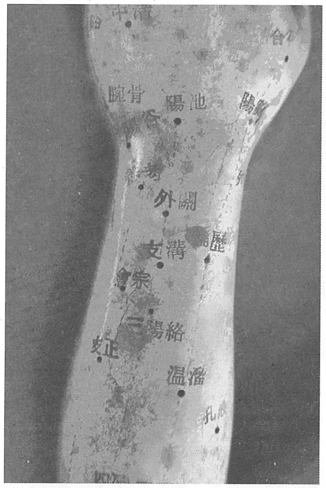

**图2-280　赵尔康《人体经穴模型》原稿会宗穴定位**

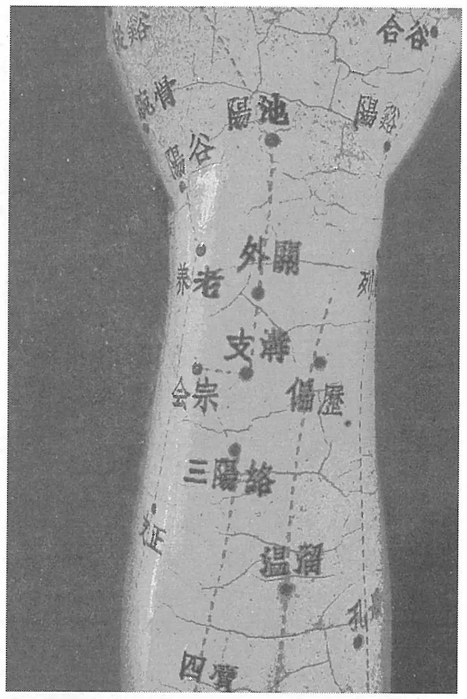

**图2-281　赵尔康《人体经穴模型》修订稿会宗穴定位**

经发挥》、《针灸聚英》、《古今医统》、《针灸大成》、《针灸易学》）

　3. 支沟外旁一寸空中。（《医学入门》卷一、《类经图翼》）

　4. 腕后三寸，如外五分。（《针方六集》卷一）

　5. 腕后三寸，空中一寸。广注：合去前穴五分。（《循经考穴编》下）

　6. 从支沟外开一寸，会宗穴也。以支沟会宗二穴相并平直，空中相离一寸也。（《医宗金鉴·刺灸心法要诀》）

　7. 腕后三寸空中。一曰：空中一寸。按：支沟、会宗皆腕后三寸，但支沟穴在外关斜向臂侧，会宗穴在外关直上一寸之空中，为别。（《针灸逢源》）

　8. 支沟向外开一寸。（《针灸十四经穴位考订》）

　9. 统编针灸学教材

　　(1) 部位：在支沟外侧一横指空中。取穴：在支沟穴旁尺骨侧，第五掌骨之直上，以指爪切之微有上下缝处取之尺骨缘。（1957年南京《针灸学》）

　　(2) 部位：支沟穴外侧一横指处。取穴：从支沟穴外侧，骨缝陷中取之。（1版《针灸学讲义》）

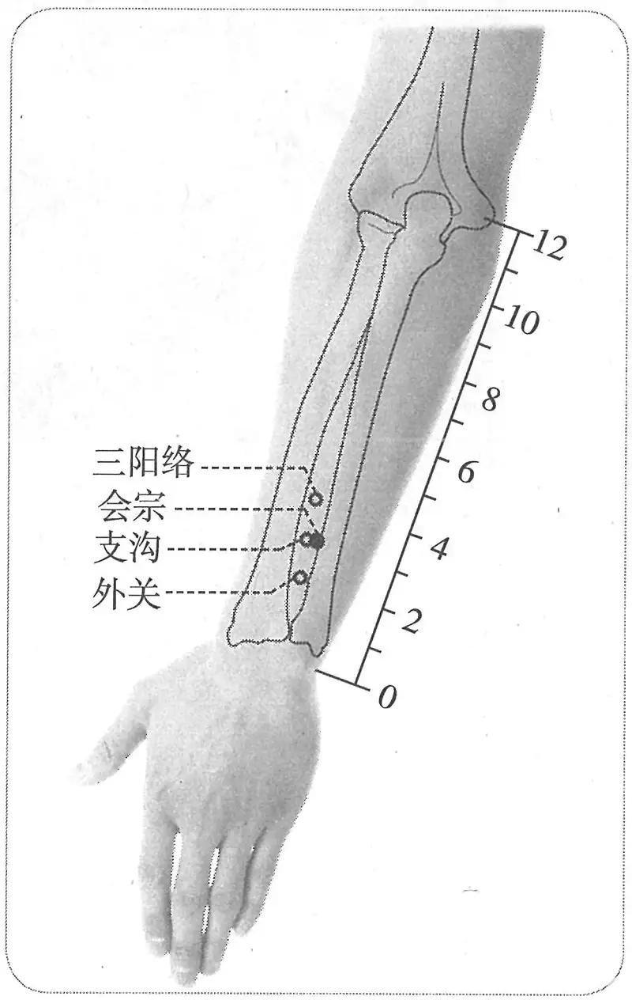

**图2-282　会宗穴图**

〔p.957 (인쇄 929)〕

　　(3) 部位：在腕后三寸空中。取穴：会宗与支沟同高，于支沟尺侧约一横指，尺骨的桡侧缘取之。（2版《针灸学讲义》）

　　(4) 支沟穴尺侧1寸。（4版《针灸学》）

　　(5) 支沟穴尺侧约1寸，于尺骨的桡侧缘取之。（5版《针灸学》）

　　(6) 在前臂背侧，当腕背横纹上3寸，支沟尺侧，尺骨的桡侧缘。（6版《针灸学》）

　　(7) 腕横纹上3寸，支沟穴尺侧，当尺骨桡侧缘。（7版《针灸学》）

　　(8) 会宗与支沟同高，于支沟尺侧约一横指，当尺侧之桡侧缘。（《中国针灸学》）

#### 【类属】 

手少阳三焦经郄穴。

手少阳郄。（《黄帝明堂经》）

#### 【适应症】 

主治耳部病症。常用于耳聋；癫痫。

　1. 上空主皮毛，中空主肌肉，下空主耳聋，羊痫。（《黄帝明堂经》）

　2. 治肌肤痛，耳聋，风痫。（《铜人腧穴针灸图经》卷下）

　3. 主三焦邪热上壅，气滞喘满。（《循经考穴编》下）

　4. 统编针灸学教材

　　(1) 主治耳聋，肌肤痛，癫痫。（57年版、1版《针灸学讲义》）

　　(2) 主治耳聋，上肢肌肤痛，痫证。（2版《针灸学讲义》）

　　(3) 主治耳聋，痫证，臂痛。（4版《针灸学》）

　　(4) 主治耳聋，癫痫，上肢痹痛。（5、6、7版《针灸学》）

　　(5) 主治耳聋，耳痛，痫症，臂痛。（《中国针灸学》）

**文献分析**：现存《黄帝明堂经》佚文关于本穴主治有如下几条：

主皮毛，中肌肉，耳聋，羊痫。（《外台秘要》）

上空主皮毛，中空肌肉，下空耳聋，羊痫。（《医心方》卷二）

聋，翳风及会宗下空主之。（《针灸甲乙经》卷十二第五）

小儿羊痫，会宗下空主之。（《圣济总录》卷一九四引《针灸甲乙经》）

“会宗”一穴有上、中、下空，其上空、中空不主治具体病症，故皇甫谧编《针灸甲乙经》时未加辑录，《外台秘要》此穴下主治内容当抄自其他《明堂经》传本，因其不明“上空”、“中空”、“下空”之义，而予删除，只是原“中空”处还留有一“中”字。王惟一也不明上、中、下三空之义，将中空主肌肉理解“肌肉痛”，现代针灸学教材则改作“肌肤痛”，皆非《黄帝明堂经》本义。值得思考的是，会宗一穴，据针刺深度而有上、中、下三空之分，主治各异。那么，对于灸法而言，是否就没有这样的区分？现代教材不分深浅，直言主治，是否合适？

#### 【操作】 

直刺0.5~1寸。

　1. 刺入三分，灸三壮。（《黄帝明堂经》）

　2. 以毫针刺左伴手少阳经支沟二穴，在腕后三寸两骨之间，坐而侧臂取之。针入二分。次至手厥阴经间使穴即止，名曰双关刺。（《针经摘英集》）

　3. 《铜人》灸七壮，《明堂》灸五壮，禁针。（《针灸聚英》卷一）

　4. 禁针，灸七壮。（《针灸十四经穴位考订》）

　5. 统编针灸学教材

　　(1) 针三分，灸三至七壮。（1957年南京《针灸学》、1版《针灸学讲义》）

　　(2) 直刺3~5分，艾条灸3~7分钟。（2版《针灸学讲义》）

　　(3) 直刺0.5~1寸。（4、5、7版《针灸学》）

〔p.958 (인쇄 930)〕

　　(4) 直刺0.5~1寸；可灸。（6版《针灸学》、《中国针灸学》）

**文献分析**：《针经摘英集》所述之“双关刺”，值得重视；《针灸聚英》刺灸法内容系误抄《针灸资生经》“三阳络”刺灸法，此后文献大多沿袭此误，而不自知。

### （八）三阳络 Sānyángluò TE8 出《黄帝明堂经》 

#### 【提要索隐】 

**穴名**：一名通间。

**部位**：在前臂后区，腕背侧远端横纹上4寸，尺骨与桡骨间隙中点。

**适应症**：主治腰胁部病症。常用于腰胁痛；上肢痹痛。

**针刺操作**：直刺0.5~1寸。

#### 【名实考】 

本穴王冰谓“通间”，《针灸聚英》作“通门”，形误。需要特别指出的是，《太平圣惠方》将“三阳络”与“四渎”二穴的文字混抄于“三阳络”名下，宋以后乃至现代针灸学教材皆传此误。

　1. 三阳络，在臂上大交脉，支沟上一寸。（《黄帝明堂经》）

　2. 臂骨空在臂阳，去踝四寸两骨空之间。王冰注：在支沟上同身寸之一寸，是谓通间。新校正云：按《甲乙经》支沟上一寸名三阳络，通间岂其别名欤。（《素问·骨空论》）

　3. 手太阳、阳明俱有络，与本经会于此穴，故曰三阳络。（《经穴解》）

#### “三阳络”与“四渎”相混例 

　1. 三阳络二穴，在肘前五寸外廉陷者中，支沟上一寸。灸五壮。主嗜卧，身不欲动；卒聋暴哑，及齿痛也。（《太平圣惠方·明堂》）

　2. 三阳络，在臂上大交脉，支沟上一寸。不可刺，灸九壮。主嗜卧，身体不能动摇，大温，内伤不足。（《黄帝明堂经》）

　3. 四渎，在肘前五寸外廉陷者中。刺入六分，留七呼，灸三壮。主卒气聋，齿痛。（《黄帝明堂经》）

**按**：对照《黄帝明堂经》文字，可以明显看出，《太平圣惠方》“三阳络”穴下的文字，包含两个穴的部位及主治内容。

#### 相关穴及刺激点 

中桡（一名下牙痛）：位于前臂伸侧正中线，腕背横纹上四寸，桡、尺骨之间与“三阳络”穴同位。但“三阳络”穴文献记载针刺深度较浅，或言禁针。主治癫症、下牙痛。治疗癫症可直刺2.5~3寸，以不穿透对侧皮肤为原则。好转患者和慢性精神病，可浅刺1寸。治下牙痛，可灸5壮，浅刺1寸。（《针灸经外奇穴图谱》）

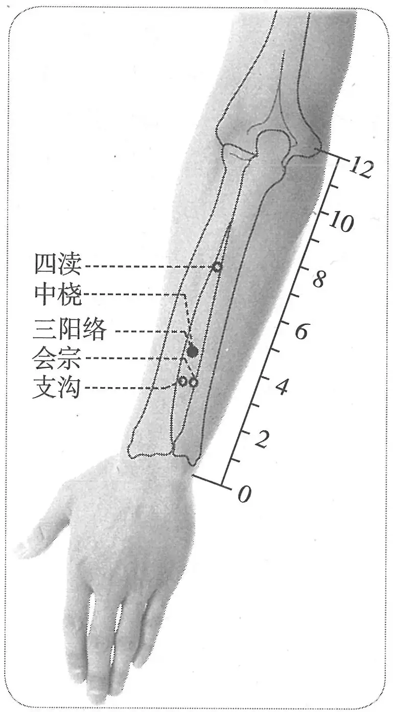

**图2-283　三阳络穴与相关穴图**

#### 【定位】 

**部位**：在前臂后区，腕背侧远端横纹上4寸，尺骨与桡骨间隙中点（图2-283）。

**取穴**：阳池与肘尖连线的上2/3与下1/3的交点处，两骨之间。

　1. 在臂上大交脉，支沟上一寸。（《黄帝明堂经》、《铜

〔p.959 (인쇄 931)〕

人腧穴针灸图经》、《圣济总录》、《十四经发挥》、《医学纲目》、《针灸聚英》、《古今医统》、《针灸大成》、《针方六集》、《类经图翼》、《循经考穴编》、《针灸易学》、《针灸逢源》）

　2. 在肘前五寸外廉陷者中，支沟上一寸。（《太平圣惠方·明堂》）

　3. 在手腕骨上四寸两筋间陷中。又法在支沟穴上一寸。（《窦太师针经》）

　4. 在臂上大交脉之处，支沟上一寸。广注：一云上支沟二寸，透郄门。（《循经考穴编》下）

　5. 腕后四寸。（《医学入门》卷一）

　6. 从会宗内斜上行一寸，臂上大交脉。（《医宗金鉴·刺灸心法要诀》）

　7. 统编针灸学教材

　　(1) 部位：支沟穴上一寸。取穴：从阳池直上四寸，骨罅间取之。（1957年南京《针灸学》、1版《针灸学讲义》）

　　(2) 部位：在臂上大交脉，支沟上一寸。取穴：阳池上四寸，当尺、桡两骨之间取之。（2版《针灸学讲义》）

　　(3) 支沟穴上1寸，桡骨与尺骨之间。（4、5版《针灸学》）

　　(4) 在前臂背侧，腕背横纹上4寸，尺骨与桡骨之间。（6版《针灸学》）

　　(5) 在腕背横纹上4寸，支沟穴上1寸，尺骨与桡骨之间。（7版《针灸学》）

　　(6) 阳池上四寸，尺、桡骨之间。（《中国针灸学》）

**文献分析**：关于本穴定位，《太平圣惠方》混入了“四渎”穴的文字，显误；《循经考穴编》载一说作“支沟二寸，透郄门”，郄门在腕后四寸，与“支沟上二寸”不合，非是。

#### 【类属】 

手少阳三焦经穴。

#### 【适应症】 

主治腰胁部病症。常用于腰胁痛；上肢痹痛。肺切除术、心脏手术的针麻用穴。

**备选适应症**：嗜卧，内伤。

　1. 主嗜卧，身体不能动摇，大温一本作湿。内伤不足。（《黄帝明堂经》）

　2. 卒聋，暴哑，及齿痛也。（《太平圣惠方·明堂》）

　3. 治嗜卧，身体不欲动，耳卒聋，齿龋，暴哑不能言。（《铜人腧穴针灸图经》卷下）

　4. 窦太师针灸遗存

　　(1) 治大便闭结，泻。专疗挫闪胁痛，弹针出血。（《窦太师针经》）

　　(2) 主臂痹不举。一云：挫闪腰疼，宜弹针出血。（《循经考穴编》下）

　5. 统编针灸学教材

　　(1) 主治耳聋，暴喑，肘、臂疼痛不能举动。（1957年南京《针灸学》、1版《针灸学讲义》）

　　(2) 主治暴喑，耳聋，手臂痛，龋齿痛。（2版《针灸学讲义》，5、6版《针灸学》）

　　(3) 主治暴聋，暴喑，齿痛，手臂痛。（4、7版《针灸学》）

　　(4) 主治耳聋，暴喑，胸胁痛，手臂痛，齿痛。（《中国针灸学》）

**文献分析**：《黄帝明堂经》载本穴主治与肘以下手少阳经穴主治规律不合，现代针灸学教材未采录，且附存备考；《太平圣惠方》所载主治又系四渎穴主治的混入，故本穴主治暂以窦太师针灸归纳。

#### 【操作】 

直刺0.5~1寸。

　1. 不可刺，灸九壮。（《黄帝明堂经》）

〔p.960 (인쇄 932)〕

　2. 可灸七壮，禁不可针。（《铜人腧穴针灸图经》卷下）

　3. 针入二寸，透郄门穴，灸七壮。（《窦太师针经》）

　4. 统编针灸学教材

　　(1) 禁针，灸三至七壮。（1957年南京《针灸学》）

　　(2) 针五分，灸三至七壮。（1版《针灸学讲义》）

　　(3) 艾条灸3~7分钟。（2版《针灸学讲义》）

　　(4) 直刺0.8~1.2寸。（4、5版《针灸学》）

　　(5) 直刺0.8~1.2寸；可灸。（6版《针灸学》）

　　(6) 直刺0.5~1寸。（7版《针灸学》）

　　(7) 直刺0.5~1寸。可灸。（《中国针灸学》）

　5. ①直刺1~1.5寸。感应：酸胀向肘部。②斜刺，透向郄门穴，深2~3寸。感应：前臂觉麻胀并向指端传导，有时可上至肘部。灸量：灸5~7壮；温灸5~15分钟。（上海《针灸学》）

### （九）四渎 Sìdú TE9 出《黄帝明堂经》 

#### 【提要索隐】 

**部位**：在前臂后区，肘尖下5寸，尺骨与桡骨间隙中点。

**适应症**：主治耳、齿部病症。常用于耳聋，齿痛；上肢痹痛。

**针刺操作**：直刺0.5~1寸。

#### 【名实考】 

　1. 四渎，在肘前五寸外廉陷者中。（《黄帝明堂经》）

　2. 三焦者，决渎之官，水道出焉……决渎者，如四渎入大海，不离其水，百川入海，只江河淮济入海，不变其道，故曰四渎也。（《素问亡篇·刺法论》）

　3. 三阳加手厥阴与本经相为表里，故曰四渎。渎者，通水之名也。（《经穴解》）

#### 【定位】 

**部位**：在前臂后区，肘尖下5寸，尺骨与桡骨间隙中点（图2-284）。

**取穴**：鹰嘴的下方五寸，在尺、桡两骨间取之。

　1. 在肘前五寸外廉陷者中。（《黄帝明堂经》、《铜人腧穴针灸图经》、《圣济总录》、《十四经发挥》、《医学纲目》、《针灸聚英》、《古今医统》、《医学入门》、《针灸大成》、《针方六集》、《类经图翼》、《循经考穴编》、《医宗金鉴·刺灸心法要诀》、《针灸易学》、《针灸逢源》）

　2. 在肘前一寸外廉陷中。（《针灸资生经》）

　3. 肘前五寸外廉陷中，内并三阳络，外并下廉，其穴中央。（《琼瑶神书》）

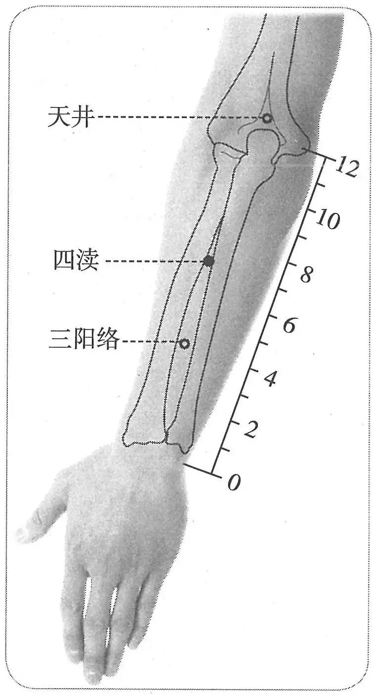

**图2-284　四渎穴图**

〔p.961 (인쇄 933)〕

　4. 广注合肘尖骨来前五寸，筋骨陷间。（《循经考穴编》下）

　5. 肘尖之前五寸。（《针灸十四经穴位考订》）

　6. 统编针灸学教材

　　(1) 部位：在肘前五寸，外廉陷者中。取穴：从阳池穴直上七寸五分取之。（1957年南京《针灸学》）

　　(2) 部位：肘前五寸。取穴：会宗穴直上二骨间陷中取之。（1版《针灸学讲义》）

　　(3) 部位：在肘前五寸，外廉陷者中。取穴：鹰嘴的下方五寸，在尺、桡两骨间，当指总伸肌与尺侧腕伸肌之间取之。（2版《针灸学讲义》）

　　(4) 前臂背侧，肘下5寸，尺骨后缘。（4版《针灸学》）

　　(5) 尺骨鹰嘴下5寸，桡骨与尺骨之间。（5、7版《针灸学》）

　　(6) 在前臂背侧，当阳池与肘尖的连线上，肘尖下5寸，尺骨与桡骨之间。（6版《针灸学》）

　　(7) 在前臂背侧，尺骨鹰嘴下五寸，桡、尺骨之间。（《中国针灸学》）

#### 【类属】 

手少阳三焦经穴。

#### 【适应症】 

主治耳、齿部病症。常用于耳聋，齿痛；上肢痹痛。

　1. 主卒气聋。齿痛。（《黄帝明堂经》）

　2. 治暴气耳聋，齿龋痛。（《铜人腧穴针灸图经》卷下）

　3. 项瘿。（《针方六集》卷五）

　4. 主臂膊疼痛。（《循经考穴编》下）

　5. 统编针灸学教材

　　(1) 主治耳聋，暴喑，下齿痛，前臂痛。（1957年版南京《针灸学》，1、2版《针灸学讲义》，6版《针灸学》）

　　(2) 主治耳聋，齿痛，咽肿，暴喑，前臂痛。（4、5、7版《针灸学》）

　　(3) 主治耳聋，齿痛，偏头痛，暴喑，手臂痛。（《中国针灸学》）

**文献分析**：教材中“暴喑”、“咽肿”、“偏头痛”诸症未详所出，暂不采录。

#### 【操作】 

直刺0.5~1寸。

　1. 刺入六分，留七呼，灸三壮。（《黄帝明堂经》）

　2. 一法直刺入二寸，可灸七壮。（《循经考穴编》下）

　3. 针五分，灸三壮。（《针灸十四经穴位考订》）

　4. 统编针灸学教材

　　(1) 针五至六分，灸三至七壮。（1957年南京《针灸学》、1版《针灸学讲义》）

　　(2) 直刺5~8分，艾条灸3~7分钟。（2版《针灸学讲义》）

　　(3) 直刺1~1.5寸。（4版《针灸学》）

　　(4) 直刺0.5~1寸。（5、7版《针灸学》）

　　(5) 直刺0.5~1寸；可灸。（6版《针灸学》、《中国针灸学》）

　5. 直刺1~2寸。感应：酸胀可向肘部及手背处放散。灸3壮；温灸5~10分钟。（上海《针灸学》）

**文献分析**：《循经考穴编》刺灸法内容见于《窦太师针经》三阳络穴，当有混淆处。

〔p.962 (인쇄 934)〕

### （十）天井 Tiānjǐng TE10 出《灵枢》 

问题1：天井与肘髎穴位置关系如何？

问题2：大肘尖与小肘尖各是何穴，与天井穴关系如何？

#### 【提要索隐】 

**部位**：在肘后区，肘尖上1寸凹陷中。

**适应症**：主治心神及胸部病症。常用于癫痫；胸胁痛；瘰疬，瘿瘤；肩臂痛。

**针刺操作**：直刺0.5~1寸。

#### 【名实考】 

《黄帝明堂经》以“肘外大骨”（尺骨鹰嘴）定天井穴，“肘内大骨”（肱骨内上髁）定小海穴。肘外大骨尖也是一穴，名曰“肘尖”，见于《窦太师针经》，肘内大骨尖也曰“肘尖”，而非穴名。为区别此二“肘尖”，古人将前者称作“大肘尖”，后者称作“小肘尖”。

　1. 三焦者，上合手少阳，出于关冲……入于天井，天井，在肘外大骨之上陷者中也，为合，屈肘乃得之。（《灵枢·本输》）

　2. 入于天井，天井者，土也。在肘外大骨之后，肘后一寸两筋间陷者中，屈肘得之，手少阳脉之所入也，为合。（《黄帝明堂经》）

　3. 此穴以本节自关冲而上，入于是穴，以为合土，入焉，有井象，其位在乎上也，故曰天井。（《经穴解》）

#### “天井”、“(大)肘尖”、“(小)肘尖”穴辨 

　1. 肘尖二穴，在手尖肘大骨尖上是穴。禁针，灸七壮。治眼目疼痛，上星翳膜，冷泪常流，风沿烂眼。（《窦太师针经》）

　2. 肘尖二穴，在手肘骨尖上，是穴屈肘得之。治瘰疬，可灸七壮。（《奇效良方》卷五十五）

　3. 所云肘尖穴在臂内侧小尖骨间，前图见外侧腕骨乃画之误也，故复具此图以便用者。二穴以指目按之，若患处酸麻方是真穴。（《痈疽神秘灸经》）

**按**：清代《外科大成》卷一曰：“此乃大肘尖之旁小肘尖。仰手与小指对直者是也。按此骨尖小指即麻为验”。原书明言肘尖穴在“臂内侧小尖骨间”，此处又说明按之酸麻至小指，显然为小海穴。

　4. 小海在肘大骨外，去肘端五分内，与少海隔一小肘尖，外与肘髎隔一大肘尖，相去不远，又当知肘髎在曲肘外，曲池在曲肘里，以骨为界是。（明抄本《针灸秘法全书》）

#### 【定位】 

**部位**：在肘后区，肘尖上1寸凹陷中（图2-285）。

**取穴**：屈肘90°时，鹰嘴窝中。

　1. 肘外大骨之上陷者中，屈肘乃得之。（《灵枢·本输》）

2.《黄帝明堂经》佚文

　　(1) 在肘外大骨之后，两筋间陷者中，屈肘得之。（《针灸甲乙经》卷三、《医学纲目》）

　　(2) 在肘后外大骨后一寸，两筋间陷者中，屈肘得之。（《千金要方》卷二十九、《千金翼方》、《素问·气穴论》王冰注、《太平圣惠方》、《针经节要》、《神应经》、《医学入门》、《类经图翼》）

　　(3) 在肘外大骨之后，肘后一寸，两筋间陷者中，屈肘得之。（《外台秘要》卷三十九、

〔p.963 (인쇄 935)〕

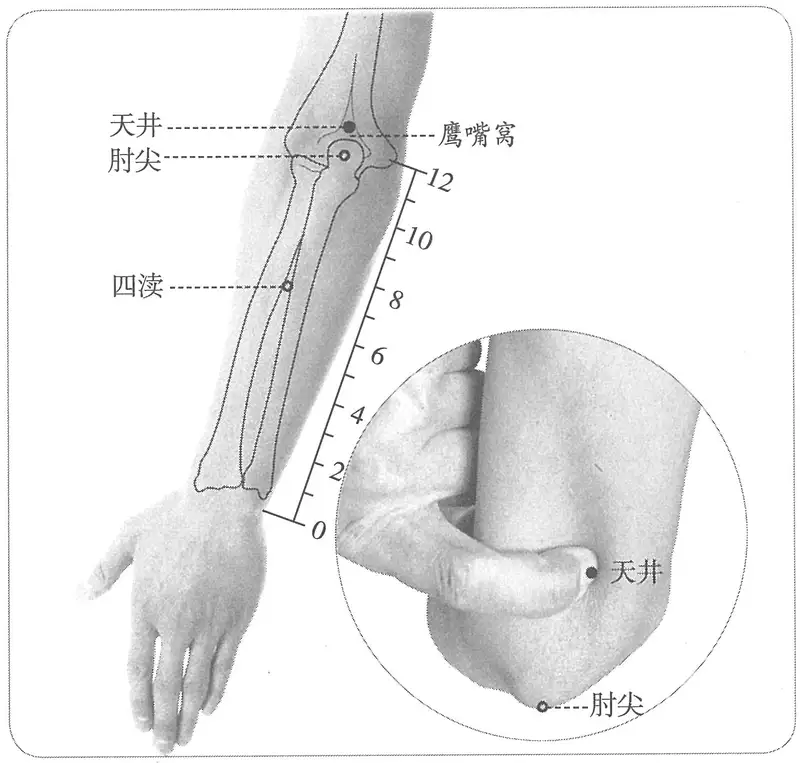

**图2-285　天井穴图**

《太平圣惠方》）

　　(4) 在肘外大骨之后，肘后一寸两节间陷者中，屈肘得之。（《医心方》卷二）

　3. 在肘外大骨后，肘后上一寸两筋间陷中，屈肘得之。甄权云：曲肘后一寸，叉手按膝头取之，两筋骨罅。（《铜人腧穴针灸图经》、《圣济总录》、《十四经发挥》）

　4. 在肘外大骨后，肘上《明堂》作“后”一寸两筋间陷中，屈肘得之。（《针灸资生经》卷一）

　5. 窦太师针灸遗存

　　(1) 在肘尖骨上陷中。取法用手叉腰，方可下针，内少海穴，外小海穴。（《针灸玉龙歌》注）

　　(2) 在肘后大骨一寸两筋骨间。叉手按膝上取。（《针灸玉龙经》）

　　(3) 在手肘尖骨上后一寸，两筋间陷中，屈肘取之。（《窦太师针经》）

　　(4) 肘外大骨尖一寸两筋间陷中，屈肘得之，叉手按膝取之。（《大本琼瑶神书》）

　　(5) 在肘尖骨上后一寸，两筋间陷中，屈肘拱胸取之。甄权：叉手按膝取之。（《针方六集》卷一）

　6. 肘外大骨后，肘上一寸，辅骨上两筋叉骨罅中，屈肘拱胸取之。（《针灸聚英》卷一、《古今医统》、《针灸大成》、《针方六集》、《循经考穴编》、《医宗金鉴·刺灸心法要诀》、《针灸逢源》、《外科大成》）

　7. 肘上一寸陷凹中。（《针灸十四经穴位考订》）

　8. 统编针灸学教材

　　(1) 部位：在肘外大骨之后，两筋间陷者中。取穴：曲肘，右手按左肩头，于肘尖鹰嘴突起直上一寸关节罅陷中取之。（1957年南京《针灸学》）

　　(2) 部位：肘外大骨后一寸。取穴：曲肘，在肘外二骨间陷中取之。（1版《针灸学讲义》）

　　(3) 部位：在肘外大骨之后，两筋间陷者中。取穴：在尺骨鹰嘴后上方，曲肘时呈凹陷处取之。（2版《针灸学讲义》）

〔p.964 (인쇄 936)〕

　　(4) 屈肘，尺骨鹰嘴上1寸凹陷中。（4、5、7版《针灸学》）

　　(5) 在臂外侧，屈肘时当肘尖直上1寸凹陷处。（6版《针灸学》）

　　(6) 屈肘，尺骨鹰嘴上一寸许凹陷中。（《中国针灸学》）

**文献分析**：关于本穴定位，古今文献记载一致，均定于肘尖后一寸。需要注意的是，取本穴须屈肘，伸肘则无凹陷。《针灸聚英》所述之“辅骨上两筋叉骨罅中，屈肘拱胸取之”，系将曲池穴定位文字混入于此。

#### 【类属】 

手少阳三焦经合穴。

　1. 三焦者，上合手少阳，出于关冲……入于天井，天井，在肘外大骨之上陷者中也，为合，屈肘乃得之。（《灵枢·本输》）

　2. 手少阳脉之所入也，为合。（《黄帝明堂经》）

#### 【适应症】 

主治心神及胸部病症。常用于癫痫；胸胁痛；瘰疬，瘿气；肩臂痛。

　1. 主肘痛引肩，不可屈伸，振寒热，颈项肩背痛，臂痿痹不仁。大风默默不知所痛，嗜卧，善惊，瘛疭。胸痹心痛，肩肉麻木。疟，食时发，心痛，悲伤不乐。癫疾吐舌沫出，羊鸣，戾颈。（《黄帝明堂经》）

**按**：《黄帝明堂经》载本穴主治除肩臂部局部症状外，多为心及心神的病症。

　2. 治心胸痛，咳嗽上气，唾脓，不嗜食，惊悸瘛疭，风痹，臂肘痛捉物不得。（《铜人腧穴针灸图经》卷下）

　3. 窦太师针灸遗存

　　(1) 治小腹冷痛，先泻后补；一切疬核疮肿，宜泻之。（《窦太师针经》、《大本琼瑶神书》）

　　(2) 瘰疬肿痛。（《针方六集》卷五）

　　(3) 颈项瘰疬。（《循经考穴编》下）

　4. 主短气不得语，寒热凄凄不得卧；耳聋，嗌肿，喉痹，汗出，目锐眦痛，颊肿痛，耳后臑臂肿痛；扑伤，腰髋疼，脚气上攻。（《针灸聚英》卷一、《针灸大成》）

**按**：高武据其对“母子补泻”的理解，将手少阳经病候“耳聋，嗌肿，喉痹，汗出，目锐眦痛，颊肿痛，耳后臑臂肿痛”归于本穴主治；“扑伤，腰髋疼，脚气上攻”一组症从《针灸资生经》辑自《铜人腧穴针灸图经》“肩井”穴主治症。

　5. 统编针灸学教材

　　(1) 主治偏头痛，目锐眦痛，耳聋，喉痹，颈、项、肩、肘痛，瘰疬，癫痫，瘛疭。（1957年南京《针灸学》、1版《针灸学讲义》）

　　(2) 主治偏头痛，胁肋、颈项、肩臂痛，肘痛，瘰疬，瘿气，癫痫。（2版《针灸学讲义》）

　　(3) 主治偏头痛，耳聋，颈项肩肘痛，瘰疬，癫痫。（4版《针灸学》）

　　(4) 主治偏头痛，耳聋，瘰疬，癫痫。（5版《针灸学》）

　　(5) 主治偏头痛，耳聋，瘰疬，胸胁痛，癫痫。（6版《针灸学》）

　　(6) 主治：①耳聋；②癫痫；③瘰疬，瘿气；④偏头痛、胁肋痛、颈项肩臂痛等痛证。（7版《针灸学》）

　　(7) 主治偏头痛，颈项、肩臂痛，痫证，瘰疬，气瘿。（《中国针灸学》）

**文献分析**：《黄帝明堂经》载本穴主治多为心及心神的病症，此后宋代《铜人腧穴针灸图经》另增有肺部症状；至金元窦太师针灸则突出了该穴治疗瘰疬、疮肿等作用，现代针灸学从之。教材中“偏头痛，目锐眦痛，耳聋，喉痹”诸证乃承袭高武《针灸聚英》之误。今去之。

〔p.965 (인쇄 937)〕

#### 附：临床应用举例 

　1. 短气不得语……灸天井百壮，穴在肘后两筋间。（《千金要方》卷十七、《千金翼方》）

　2. 妇人无乳法，初针两手小指外侧近爪甲深一分，两手腋门深三分，两手天井深六分，若欲试之，先针一指即知之，神验不传。（《千金翼方》卷二十六）

　3. 瘰疬由来隐疹同，疗之还要择医工。肘间有穴名天井，一用金针便有功。（《针灸玉龙歌》）

　4. 耳鸣，天井、阳辅、行间。［北京中医，1983(4):62］

　5. 落枕，针刺天井穴治疗。［四川中医，2002，20(4):78］

　6. 急性阑尾炎，大肠俞、天井穴，针灸治疗。［中国针灸，1986，6(2):22］

　7. 顽固性瘾疹，大椎穴、天井穴、血海穴，针刺治疗。［浙江中医杂志，1984，19(2):64］

#### 【操作】 

直刺0.5~1寸。

　1. 刺入一寸，留七呼，灸三壮。（《黄帝明堂经》）

　2. 可灸三壮，针入三分。（《铜人腧穴针灸图经》卷下）

　3. 窦太师针灸遗存

　　(1) 针入五分，灸二七壮。（《窦太师针经》）

　　(2) 窦氏：针入五分，灸二七壮。（《针方六集》卷一）

　　(3) 一法：直刺五分，灸七壮。（《循经考穴编》下）

　4. 统编针灸学教材

　　(1) 针三至五分，依取穴法进针，灸三至十五壮。（1957年南京《针灸学》、1版《针灸学讲义》）

　　(2) 直刺3~5分，艾炷灸3~7壮，艾条灸3~7分钟。（2版《针灸学讲义》）

　　(3) 直刺0.5~1寸。（4、5、7版《针灸学》）

　　(4) 直刺0.5~1寸；可灸。（6版《针灸学》）

　　(5) 直刺0.3~0.5寸。可灸。（《中国针灸学》）

　5. 直刺0.5~1寸。感应：局部酸胀。灸3~5壮；温灸5~15分钟。（上海《针灸学》）

### （十一）清泠渊 Qīnglíngyuān TE11 出《黄帝明堂经》 

问题1：本穴的正确写法与读法是什么？

问题2：清泠渊如何变成青灵穴？

#### 【提要索隐】 

**部位**：在臂后区，肘尖与肩峰角连线上，肘尖上2寸。

**适应症**：主治局部病症。常用于头痛；上肢痹痛。

**针刺操作**：直刺0.5~1寸。

#### 【名实考】 

清泠渊，又作“青泠渊”，唐人避讳改作清泠泉（《千金要方》），宋代王执中对此有详细的说明。唐人避讳还有一种缺字法，则“青泠渊”又作“青泠”或“青灵”，王惟一不识此中变故，以为别是一穴，而归入手少阴心经，讹传千年而难以回改。考证详见手少阴经“青灵”穴。

从本穴一名“青灵”，也可以判定，本穴名的正确写法应据《针灸甲乙经》卷三作“清泠渊”，《千金要方》、《千金翼方》作“清泠泉”，也无误，而后人不识多误写作“清冷渊”或“清冷泉”。

〔p.966 (인쇄 938)〕

关于本穴定位，现存《黄帝明堂经》佚文多作“肘上三寸”，而明刊本《针灸甲乙经》却作“肘上一寸（一本作二寸）”，经查核，明抄本《针灸甲乙经》作“肘上三寸”，与其他《黄帝明堂经》佚文合。作“肘上二寸”者，见于《太平圣惠方·针经》，《铜人腧穴针灸图经》从之。后人以此注《针灸甲乙经》，甚至径改经文，如宋本《外台秘要》作“肘上三寸”，明刊本改作“肘上二寸”。而见于《太平圣惠方·明堂》的“青灵”部位仍作“肘上三寸”无误，这一阴差阳错的变化，造成了一个更大的错误——“青灵”从本穴的别名，变成了另一条经的一个新穴！

　1. 清泠泉，在肘上三寸，伸肘举臂取之。泉亦是渊字。（《千金要方》卷二十九）

　2. 王执中曰：《铜人》曰太渊，《明堂》曰太泉，疑是二穴也。予按《千金方》注云：太泉即太渊也，避唐祖名改之。于是书之，以示世医。泉腋、清冷泉同。（《针灸资生经》卷一）

　3. 清冷渊，又名清冷泉、青灵。（《西方子明堂灸经》卷五）

　4. 此经主火者也，而于是穴，谓之清冷渊者，其以本经过天井之后，火气稍息欤？抑以在肘之外，常为风寒所袭欤？尚俟高明。（《经穴解》）

　5. 清泠渊，在肘上三寸，伸肘举臂取之。（《黄帝明堂经》）

#### 【定位】 

**部位**：在臂后区，肘尖与肩峰角连线上，肘尖上2寸（图2-286）。

**取穴**：伸肘，肘尖上2寸取之。

　1. 肘上一寸一本作二寸，伸肘举臂取之。（《针灸甲乙经》卷三）

　2. 在肘上三寸，伸肘举臂取之。（《千金要方》卷二十九、《千金翼方》、《外台秘要》、《医心方》、《医学纲目》、《医学入门》）

　3. 在肘上二寸，伸肘举臂取之。（《太平圣惠方·针经》、《铜人腧穴针灸图经》卷下及“穴腧都数”、《圣济总录》、《针灸资生经》、《十四经发挥》、《针灸聚英》、《古今医统》、《针灸大成》、《针方六集》、《类经图翼》、《医宗金鉴·刺灸心法要诀》、《针灸易学》、《针灸逢源》）

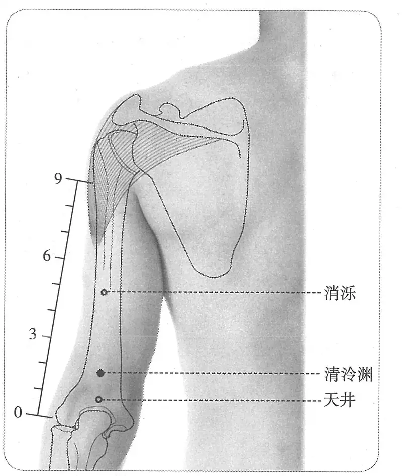

**图2-286　清泠渊穴图**

　4. 肘上三寸清冷渊。（《针灸大全》卷五）

　5. 天井上一寸。（《针灸十四经穴位考订》）

　6. 统编针灸学教材

　　(1) 部位：在肘上二寸处。取穴：如上穴之取穴法，于肘尖上行二寸取之。（1957年南京《针灸学》）

　　(2) 部位：天井上一寸。取穴：如天井取穴法，于肘尖上行二寸取之。（1版《针灸学讲义》）

〔p.967 (인쇄 939)〕

　　(3) 部位：在肘上一寸，伸肘举臂取之。取穴：天井上一寸，曲肘取之。（2版《针灸学讲义》）

　　(4) 尺骨鹰嘴上2寸。（4版《针灸学》）

　　(5) 曲肘，天井穴上1寸。（5、7版《针灸学》）

　　(6) 在臂外侧，曲肘时当肘尖直上2寸，即天井上1寸。（6版《针灸学》）

　　(7) 天井上一寸，曲肘取之。（《中国针灸学》）

**文献分析**：本穴定位，《黄帝明堂经》本作“肘上三寸”，唯《太平圣惠方·针灸》作“肘上二寸”，《铜人腧穴针灸图经》从之，宋以后文献除《医学纲目》、《针灸大全》以及间接出自《千金要方》的《医学入门》外，皆作“肘上二寸”，如今已难以回改。

#### 【类属】 

手少阳三焦经穴。

**归经**：手少阳三焦经。（《产经》、《外台秘要》卷三十九、《铜人腧穴针灸图经》卷上）

#### 【适应症】 

主治局部病症。常用于头痛；上肢痹痛。

　1. 主肩不可举，不能带衣。头痛振寒。（《黄帝明堂经》）

　2. 主臑纵肩臂不举，不得带衣。（《铜人腧穴针灸图经》卷下、《圣济总录》）

　3. 主目黄，胁痛。（《西方子明堂灸经》卷五、《医学入门》）

**按**：西方子云，清冷渊，又名“青灵”，故录《铜人腧穴针灸图经》青灵穴主治于此。

　4. 主肩痹痛。（《针灸聚英》卷一、《针灸大成》）

　5. 统编针灸学教材

　　(1) 主治肩臂痛痹不得上下。（1957年南京《针灸学》）

　　(2) 主治肩臂疼痛。（1版《针灸学讲义》）

　　(3) 主治肩臑痛不能举，头痛，目黄。（2版《针灸学讲义》、4版《针灸学》）

　　(4) 主治头痛，上肢痹痛，目黄。（5、6版《针灸学》）

　　(5) 主治头痛、目痛、胁痛、肩臂痛等痛证。（7版《针灸学》）

　　(6) 主治肩臂痛不举，偏头痛。（《中国针灸学》）

**按**：教材中“目黄”、“胁痛”系将《铜人腧穴针灸图经》“青灵”穴主治误置于此。今去之。

#### 附：临床应用举例 

　1. 肩不可动，臂不可举，肩髃二寸半、巨骨五分、清冷渊一寸，关冲五分。（《医学纲目》卷二十七）

　2. 五般肘痛寻尺泽，冷渊针后即收功。（《席弘赋》）

　3. 漏肩风，前伸肩痛，取阳池、清冷渊。采用缪刺法。［江苏中医，1988，9(2):24］

#### 【操作】 

直刺0.5~1寸。

　1. 刺入三分，留三呼，灸三壮。（《黄帝明堂经》）

　2. 针五分，灸三壮。（《针灸十四经穴位考订》）

　3. 统编针灸学教材

　　(1) 针二至三分，灸三至七壮。（1957年南京《针灸学》、1版《针灸学讲义》）

　　(2) 直刺3分，艾条灸3~7分钟。（2版《针灸学讲义》）

　　(3) 直刺0.8~1.2寸。（4、5、7版《针灸学》）

　　(4) 直刺0.5~1寸；可灸。（6版《针灸学》）

　　(5) 直刺0.3~0.5寸。可灸。（《中国针灸学》）

〔p.968 (인쇄 940)〕

### （十二）消泺 Xiāoluò TE12 出《黄帝明堂经》 

#### 【提要索隐】 

**部位**：在臂后区，肘尖与肩峰角连线上，肘尖上5寸。

**适应症**：主治头项部病症。常用于头痛，颈项强痛，肩背痛。

**针刺操作**：直刺1~1.5寸。

#### 【名实考】 

消泺，宋以后文献或作“消铄”（《黄帝内经灵枢注证发微》）、“消烁”（《经穴解》）、“消沥”（《针灸大全》）。

关于本穴定位，《黄帝明堂经》曰“在肩下臂外开腋斜肘分下行”，描述的完全是脉的循行，而不是穴的部位。手少阳经脉“贯肘，循臑外上肩”；手少阳络脉“外绕臂”；手少阳经筋“结于肘，上绕臑外廉”，皆提示手少阳脉自肘后，行向外上肩，但皆没有像其他络穴一样，提示所“出”之部位，根据经穴我们只能得到这样的判断：消泺在臑会穴下，略偏外侧。已知臑会偏桡侧，则本穴应偏尺侧，沿三角肌后缘。偏向尺侧的另一个证据是“开腋”，如偏向桡侧，则无须开腋。因此，上臂手少阳经穴连线应是一个逞S形的弧线，而不是肩髎与天井相连的直线。基于此，可以进一步判断：伸臂用力握拳（即古籍所说“握拳举臂取之”），上臂后面出现三条纵行隆起肌肉（肱三头肌），本穴应在肱三头肌内侧头与长头交叉处，此处可以满足经文所说“肩下”、“臂外”、“斜肘分”各项特征。由于古代文献关于本穴定位没有明确的描述，后世医家皆根据各自的理解取穴。现代中国针灸学教材的定位主要依据的是《勉学堂针灸集成》的说法，而该文字是根据对明正统仿宋针灸铜人的消泺穴目测结果的描述，反映的是宋代王惟一的理解。今核查明正统仿宋铜人，消泺穴在臑会下二寸，臂臑后开一寸少。因此，赵尔康《中华针灸学》关于本穴定位，直接作“臑会下二寸”。然而，王惟一的这个理解不尽合理，因为臑会穴为“手阳明络”，王冰注作“手阳明、少阳之会”，则知此穴定位偏向手阳明经（上臂桡侧），而消泺穴则斜向外（上臂尺侧），不仅在臑会穴外侧，更在手少阳经穴连线之外，而不是臑会“微后”。

　1. 消泺，在肩下臂外开腋斜肘分下行。（《黄帝明堂经》）

　2. 消烁，此寒冷之义也，火经而以此名穴，命名之义，想有所指，尚俟高明。（《经穴解》）

　3. 三焦手少阳之脉，起于小指次指之端，上出两指之间，循手表腕，出臂外两骨之间，上贯肘，循臑外上肩。（《灵枢·经脉》）

　4. 手少阳之别，名曰外关，去腕二寸，外绕臂，注胸中，合心主。（《灵枢·经脉》）

　5. 手少阳之筋，起于小指次指之端，结于腕，中循臂结于肘，上绕臑外廉，上肩走颈。（《灵枢·经筋》）

　6. 消泺在臂臑下二寸，后开一寸少。臑会在消泺上二寸微前。（《勉学堂针灸集成》卷四）

**按**：根据对明正统铜人的实际比量，以及该书臑会穴定位的描述，可知消泺穴定位描述应作“臑会下二寸，臂臑后开一寸少”。

#### 【定位】 

**部位**：在臂后区，肘尖与肩峰角连线上，肘尖上5寸（图2-287）。

**取穴**：正坐，在肩髎穴与天井穴连线上，清冷渊穴上3寸处取之。

　1. 在肩下臂外，开腋斜肘分下行。（《黄帝明堂经》、《针灸聚英》、《古今医统》、《医学入门》、《针灸大成》、《针方六集》、《类经图翼》、《针灸易学》）

　2. 在肩下外，关腋斜肘分下行是穴。（《太平圣惠方·针经》）

〔p.969 (인쇄 941)〕

　3. 在肩下臂外腋斜肘分下行。（《铜人腧穴针灸图经》卷下、《圣济总录》、《针灸资生经》、《十四经发挥》、《医学纲目》）

　4. 肩下背（臂）外间（開）腋，针（斜）附（肘）分下行，握拳举臂取之。（《大本琼瑶神书》）

　5. 在肩下臂外间（開）腋，斜肘分下行。广注：肩下三寸，肘尖约去六寸，臂外骨内肘斜分间。（《循经考穴编》下）

　6. 臑会下二寸。（《针灸十四经穴位考订》）

　7. 统编针灸学教材

　　(1) 部位：在上膊外面，三角肌停止部之后下方一寸处。取穴：正坐，自肩端后侧直下，从肘尖上四寸五分处取之。试以手握拳平伸，拳掌向下，再以拳握紧与前膊尽力转向背方，则肩膊向肘斜下之处有肌肉一股高起，当起肉所止之处是穴位。（1957年南京《针灸学》）

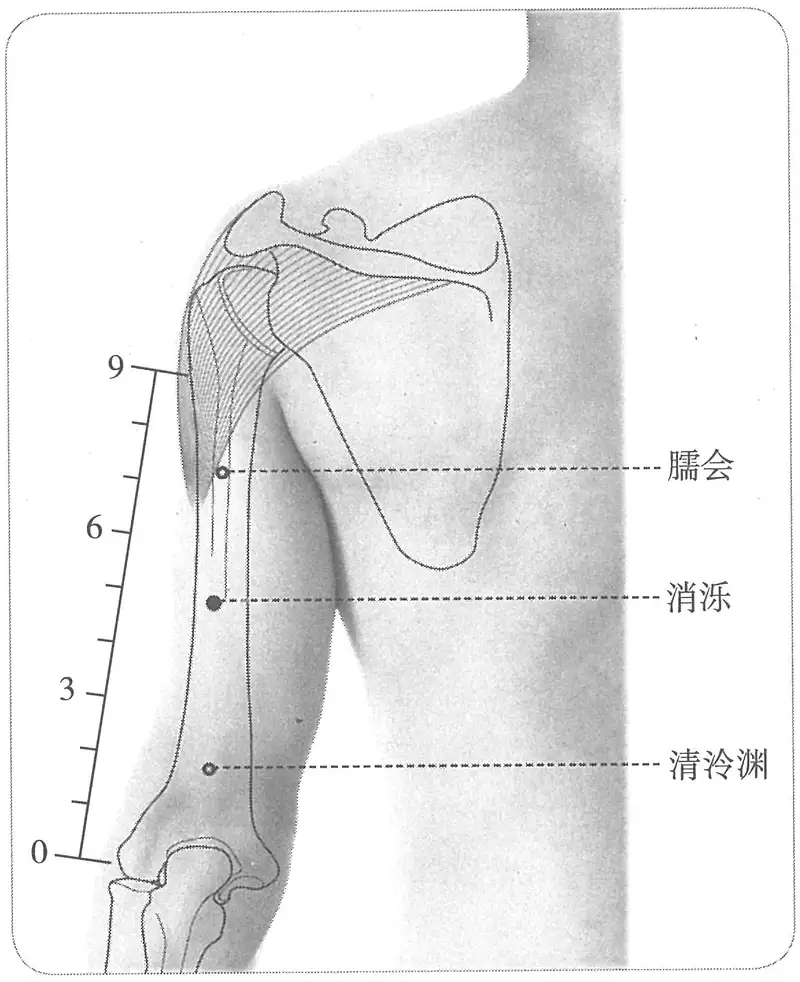

**图2-287　消泺穴图**

　　(2) 部位：上臂外侧，约当腘肉端之后下方。取穴：肩髎穴直下，在臑会、清冷渊二穴直线中间取之。（1版《针灸学讲义》）

　　(3) 部位：在肩下臂外，开腋斜肘分下肵。取穴：在尺骨鹰嘴于肩髎连线上，当清冷渊与臑会之中点。（2版《针灸学讲义》）

　　(4) 清冷渊穴上3寸。（4版《针灸学》）

　　(5) 在尺骨鹰嘴与肩髎穴连线上，清冷渊穴上3寸。（5版《针灸学》）

　　(6) 在臂外侧，当清冷渊与臑会连线的中点处。（6版《针灸学》）

　　(7) 肩髎穴与天井穴连线上，清冷渊穴上3寸。（7版《针灸学》）

　　(8) 在尺骨鹰嘴与肩髎连线上，当清冷渊与臑会之中点。（《中国针灸学》）

**文献分析**：在古代文献中，只有《大本琼瑶神书》给出了显示体表标志定位的取穴法，承淡安《中国针灸学》对此取穴法有更具体的说明，1957年南京《针灸学》采用此法定位，然另附折量取穴法“肘尖上四寸五分处”（出自日本针灸教材），此处骨度不明，难以判定此折量点是否与体表标志取穴相合。今则舍去体表标志取穴，而以折量法定穴，而且不分内外，直接定于“肩髎穴与天井穴连线上”。

#### 【类属】 

手少阳三焦经穴。

**脉气所发**：手少阳脉之会。（《素问》王冰注）

**归经**：手少阳三焦经。（《产经》、《外台秘要》卷三十九、《铜人腧穴针灸图经》卷上）

#### 【适应症】 

主治头项部病症。常用于头痛，颈项强痛，肩背痛。

　1. 主寒热。痹。头痛，项背急。（《黄帝明堂经》）

　2. 主项如拔不可左右顾。（《千金要方》卷三十）

〔p.970 (인쇄 942)〕

　3. 治寒热风痹，项痛，肩背急。（《铜人腧穴针灸图经》卷下）

　4. 主颈项强急肿痛，癫疾。（《针灸聚英》卷一、《古今医统》、《针灸大成》）

　5. 主肩肿引胛中痛，臂痛不能举，项瘿气瘤。（《针方六集》卷五）

**按**：此乃《针灸聚英》“臑会”穴主治。

　6. 一传海南治牙疼，灸此穴。（《类经图翼》卷七）

　7. 主臂外廉肿痛或麻，风冷痹及眼花头晕，臂疽等证。（《循经考穴编》下）

　8. 统编针灸学教材

　　(1) 主治头痛，颈项强急肿痛，癫疾，风痹。（1957年南京《针灸学》）

　　(2) 主治头痛，颈项强急，肿痛，癫疾。（1版《针灸学讲义》）

　　(3) 主治头痛，颈项强急，臂痛，齿痛，癫疾。（2版《针灸学讲义》）

　　(4) 主治头痛，项强，齿痛，肩背痛。（4、5、6版《针灸学》）

　　(5) 主治头痛，齿痛，项背痛等痛证。（7版《针灸学》）

　　(6) 主治头痛、颈项强痛，臂痛不举。（《中国针灸学》）

#### 【操作】 

直刺1~1.5寸。

　1. 刺入六分，灸三壮。（《黄帝明堂经》）

　2. 针一分，灸二壮。（《针灸资生经》）

　3. 针五分，灸三壮。（《针灸十四经穴位考订》）

　4. 统编针灸学教材

　　(1) 针三至五分，灸三至七壮。（1957年南京《针灸学》）

　　(2) 针五至八分，灸三至七壮。（1版《针灸学讲义》）

　　(3) 直刺5~7分，艾条灸3~7分钟。（2版《针灸学讲义》）

　　(4) 直刺1~1.5寸。（4、5、7版《针灸学》）

　　(5) 直刺1~1.5寸；可灸。（6版《针灸学》）

　　(6) 直刺0.5~0.7寸。可灸。（《中国针灸学》）

### （十三）臑会 Nàohuì TE13 出《黄帝明堂经》 

问题：本穴究竟归哪一经合适？

#### 【提要索隐】 

**穴名**：一名臑窌。

**部位**：在臂后区，肩峰角下3寸，三角肌的后下缘。

**适应症**：主治局部病症。常用于瘿瘤，瘰疬，上肢痹痛。

**针刺操作**：直刺1~1.5寸。

#### 【名实考】 

臑会，一名臑窌，《针灸聚英》误作“臑交”。本穴为手阳明之络，会于手阳明之经，与臂臑穴定位、主治皆相近，故名“臑会”。又“臑会”与“臑俞”，一字之差，古医籍中有相混之例。

关于本穴的归经，《黄帝明堂经》载臑会穴为“手阳明之络”，应归入手阳明经，宋以前归经之所以会出现多种分歧，盖因为络穴一般多合于其表里经，故《千金要方》将其归入与手阳明相表里的手太阴经；王冰注《素问·气府论》臑会穴作“手阳明、少阳二络气之会”，故《铜人腧穴针灸图经》卷上将此穴归入手少阳经，然而该书卷中仍作“手阳明之络”，卷下附篇同样归入手阳明经，足证此穴当归入手阳明经。本穴归入手少阳经，带来一个新问题：上臂手少阳经穴连线会呈一个从清泠渊折向尺侧（消泺）、再折向桡侧（臑会），最后又回到上臂正中（肩髎）的一个S形弧线。可能是为了消除这个弧线，现代针灸学教材采用削足适履的做法——将消泺、臑会皆定于肩髎与天井连线上。

〔p.971 (인쇄 943)〕

本穴归经的变化还直接导致了其定位的改变。其定位描述，古代文献皆作“臂前廉”，或“肩前廉”，因其归入手少阳经后，其现代定位描述，在不知不觉中，自然而然地变成了“肩后廉”。

　1. 臑会，一名臑窌，在臂前廉，去肩头三寸，手阳明之络。（《黄帝明堂经》）

　2. 在臂前廉，去肩端同身寸之三寸，手阳明、少阳二络气之会。（《素问》王冰注）

　3. 臑会一名臑交，肩前廉，去肩头三寸宛宛中。手少阳、阳维之会。（《针灸聚英》卷一）

　4. 肘之内为臑，此穴所在，虽为肩之外廉，有肉斜生，势与臑会，而又奇经阳维自足下起，上会本经，经于此穴，故曰臑会。（《经穴解》）

**按**：此解牵强。又阳维之会说法晚出于《针灸聚英》，何以解汉以前之名？

#### “臑俞”误作“臑会”例 

　1. 臑俞，治寒热，肩肿引胛中痛，臂酸无力。（《针灸资生经》卷五）

　2. 臑会，主臂痛酸无力，寒热，肩肿引胛中痛。（《针灸聚英》卷一）

**按**：《针灸聚英》腧穴主治大多从《针灸资生经》辑录，此条臑会主治乃误录臑俞主治，明以后文献多传此误。

#### 【定位】 

**部位**：在臂后区，肩峰角下3寸，三角肌的后下缘（图2-288）。

**取穴**：正坐，在肩髎穴下3寸，三角肌的后缘取穴。

　1. 在臂前廉，去肩头三寸。（《黄帝明堂经》、《铜人腧穴针灸图经》、《圣济总录》、《十四经发挥》、《医学入门》、《针方六集》、《循经考穴编》）

　2. 在臂前廉，去肩头三寸宛宛中。（《太平圣惠方·明堂》、《针灸资生经》、《针灸聚英》、《针灸大成》、《类经图翼》、《针灸易学》、《针灸逢源》）

　3. 在肩前廉，去肩头三寸。广注：肩之前廉骨下，去肩头三寸。（《循经考穴编》下）

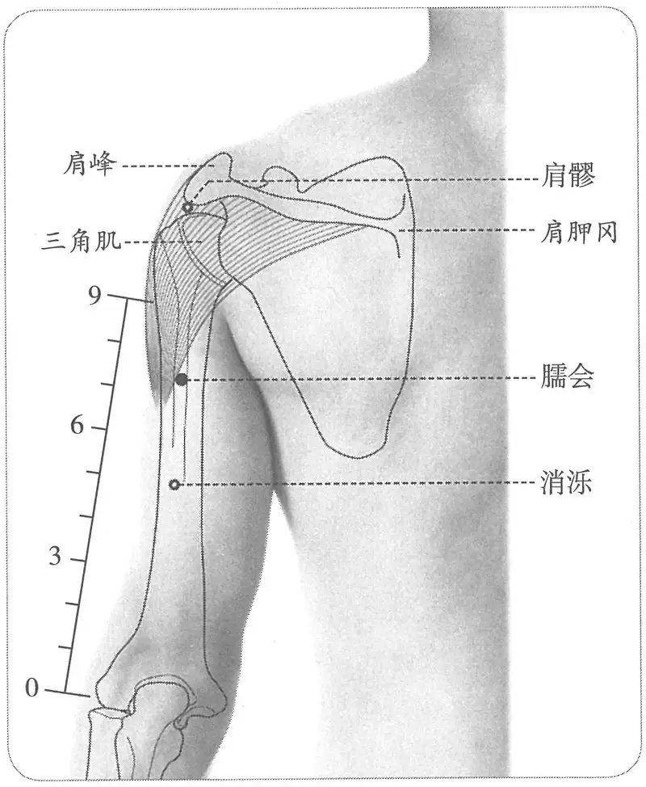

**图2-288　臑会穴图**

　4. 从消泺上行臑外，去肩端三寸宛宛中。（《医宗金鉴·刺灸心法要诀》）

　5. 肩头后廉肩髎穴下，去肩头三寸。（《针灸十四经穴位考订》）

　6. 统编针灸学教材

　　(1) 部位：肩后廉去肩头三寸。取穴：正坐，从肩头后侧肩髎穴直下三寸取之与天井穴成直线。（1957年南京《针灸学》）

〔p.972 (인쇄 944)〕

　　(2) 部位：肩髎穴下三寸。取穴：从肩髎至天井穴直线上取之。（1版《针灸学讲义》）

　　(3) 部位：在臂前廉，去肩头三寸。取穴：在肩髎与尺骨鹰嘴的连线上，当三角肌之后缘取穴。（2版《针灸学讲义》）

　　(4) 肩髎穴下3寸，三角肌后缘。（4版《针灸学》）

　　(5) 在尺骨鹰嘴与肩髎穴连线上，肩髎穴下3寸，三角肌的后缘。（5版《针灸学》）

　　(6) 在臂外侧，当肘尖与肩髎的连线上，肩髎下3寸，三角肌后下缘。（6版《针灸学》）

　　(7) 肩髎穴与天井穴连线上，肩髎穴下3寸，三角肌后缘。（7版《针灸学》）

　　(8) 在肩髎与尺骨鹰嘴的连线上，三角肌之后缘取穴。（《中国针灸学》）

#### 【类属】 

手少阳三焦经穴。

**脉气所发：**

　1. 手阳明之络。（《黄帝明堂经》）

　2. 手阳明、少阳二络气之会。（《素问·气府论》王冰注）

　3. 手少阳、阳维之会。（《针灸聚英》卷一）

**归经：**

　1. 手阳明经。（《外台秘要》卷三十九、《铜人腧穴针灸图经》卷下“穴腧都数”）

　2. 手少阳经。（《铜人腧穴针灸图经》卷上，宋以后腧穴书多同之）

　3. 手太阴。（《千金要方》、《千金翼方》、《西方子明堂灸经》）

**按**：臑会穴，《铜人腧穴针灸图经》上卷归于手少阳三焦经穴，但中卷仍作“手阳明之络”，与宋以前多数针灸文献相同，卷下“穴腧都数”则直接将其归入手阳明大肠经。

#### 【适应症】 

主治局部病症。常用于瘿瘤，瘰疬，上肢痹痛。

　1. 主瘿。腠理气。（《黄帝明堂经》）

　2. 治项瘿气瘤，臂痛不能举，气肿痓痛。（《铜人腧穴针灸图经》卷中）

　3. 主肩肿引胛中痛。（《针灸聚英》卷一、《针灸大成》、《针方六集》）

　4. 主臂膊不仁。（《循经考穴编下）

　5. 统编针灸学教材

　　(1) 主治肩痛引胛，项瘿气瘤。（1957年南京《针灸学》）

　　(2) 主治肩臂痛，项瘿气瘤。（1版《针灸学讲义》、《中国针灸学》）

　　(3) 主治肩臂痛不能举，瘿气，肩肿胛痛，目疾。（2版《针灸学讲义》）

　　(4) 主治瘿气，瘰疬，肩臂酸痛。（4版《针灸学》）

　　(5) 主治瘿气，瘰疬，上肢痹痛。（5、6、7版《针灸学》）

**文献分析**：《黄帝明堂经》本穴定位与手阳明经之臂臑穴相近，故主治亦极相似。《针灸聚英》将《针灸资生经》臑俞穴主治混入本穴中，现代针灸教材亦传此误。又2版教材中“目疾”未详所出（或为臂臑治目疾的错入），暂不采录。

#### 【操作】 

直刺1~1.5寸。

　1. 刺入五分，灸五壮。（《黄帝明堂经》）

　2. 灸七壮。（《太平圣惠方·明堂》）

　3. 针入七分，留十呼，得气即泻，可灸七壮。（《铜人腧穴针灸图经》卷中）

　4. 刺五分，灸五壮。（《针灸十四经穴位考订》）

　5. 统编针灸学教材

〔p.973 (인쇄 945)〕

　　(1) 针五至八分，灸三至七壮。（1957年南京《针灸学》、1版《针灸学讲义》）

　　(2) 直刺5~8分，艾条灸3~7分钟。（2版《针灸学讲义》）

　　(3) 直刺1~1.5寸。（4、5、7版《针灸学》）

　　(4) 直刺1~1.5寸；可灸。（6版《针灸学》）

　　(5) 直刺0.5~0.8寸。可灸。（《中国针灸学》）

### （十四）肩髎 Jiānliáo TE14 出《黄帝明堂经》 

#### 【提要索隐】 

**穴名**：肩髎，宋以前文献作“肩窌”，或“肩聊”。

**部位**：在三角肌区，肩峰角与肱骨大结节两骨间凹陷中。

**适应症**：主治局部病症。常用于肩痛、活动受限。

**针刺操作**：直刺1~1.5寸。

#### 【名实考】 

本穴定位，《黄帝明堂经》作“肩端臑上”，肩端，可以理解为肩峰处；臑上，可以理解为三角肌上端（起点），后世文献理解为“臑会上”，非是。臑会在臂前廉，近手阳明经行处。需要注意的是，本穴的取穴法“斜举臂取之”，当臂外展时，肩峰外侧缘前后端呈现两个凹陷，前一较深凹陷为肩髃，后一凹陷即本穴。

#### 相关穴及刺激点 

腋神经刺激点三角肌点（后点）：位于肩胛冈外1/3与内2/3交点和三角肌止点连线的中点。主治上肢瘫痪（抬肩障碍），举臂障碍。直刺2.0~3.0cm。（《实用神经干电刺激疗法》）

#### 【定位】 

**部位**：在三角肌区，肩峰角与肱骨大结节两骨间凹陷中（图2-289）。

**取穴**：屈臂外展时，肩峰外侧缘前后端呈现两个凹陷，前一较深凹陷为肩髃，后一凹陷即本穴。垂肩时，肩髃后约1寸。

　1. 在肩端臑上，斜举臂取之。（《黄帝明堂经》、《铜人腧穴针灸图经》、《圣济总录》、《针灸资生经》、《十四经发挥》、《医学纲目》、《针灸聚英》、《古今医统》、《针灸大成》、《针方六集》、《类经图翼》、《针灸易学》、《针灸逢源》）

　2. 在肩臑上，举肩取之陷者中。（《太平圣惠方·明堂》）

　3. 在肩端陷中是穴。（《窦太师

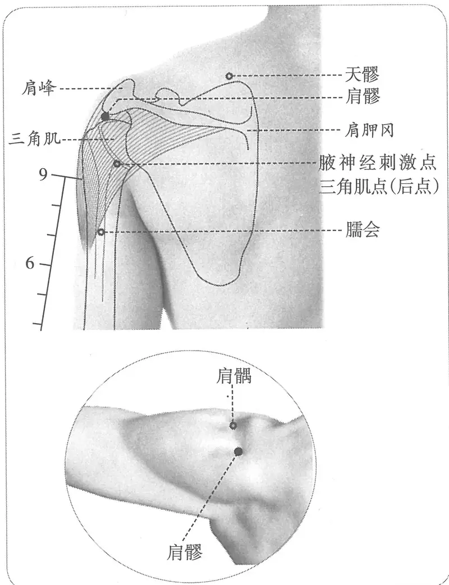

**图2-289　肩髎穴与相关刺激点**

〔p.974 (인쇄 946)〕

秘传》）

　4. 肩端外陷，臑会上，斜举臂取之。（《医学入门》卷一）

　5. 从臑会上行，肩端臑上陷中，斜举臂取之。（《医宗金鉴·刺灸心法要诀》）

　6. 肩峰突起之后下际，肩膊关节部。（《针灸十四经穴位考订》）

　7. 统编针灸学教材

　　(1) 部位：肩端臑斜上陷中。取穴：正坐，从肩髃后一寸余，当肩后侧端，试将臂膊上举，肩端后侧有陷凹处取之。（1957年南京《针灸学》）

　　(2) 部位：肩外端臑上凹陷中。取穴：正坐，举臂，在大肠经肩髃穴后一寸余，肩端后侧有凹陷处取之。（1版《针灸学讲义》）

　　(3) 部位：在肩端臑上，斜举臂取之。取穴：在肩峰的后下际，上臂外展，当肩髃（手阳明经）后寸许的凹陷处取之。（2版《针灸学讲义》）

　　(4) 肩峰外下方，肩髃穴后寸许凹陷中。（4版《针灸学》）

　　(5) 肩峰后下方，上臂外展，当肩髃穴后寸许的凹陷中。（5、7版《针灸学》）

　　(6) 在肩部，肩髃后方，当臂外展时，于肩峰后下方呈现凹陷处。（6版《针灸学》）

　　(7) 肩峰外下方，肩髃穴后寸许，上臂外展平举时肩后呈现凹陷处。（《中国针灸学》）

#### 【类属】 

手少阳三焦经穴。

**脉气所发**：手少阳脉气所发。（《素问·气府论》王冰注）

**归经：**

　1. 手阳明经。（《黄帝内经明堂》、《千金要方》、《千金翼方》、《外台秘要》、《西方子明堂灸经》）

　2. 手少阳经。（《铜人腧穴针灸图经》卷上）

**按**：肩髎穴，《黄帝明堂经》未记脉气所发，后人归经只能据腧穴的部位比照经脉循行部位判定。奇怪的是，宋以前诸家归经都很统一，多归入手阳明经，只有王冰注《素问·气府论》时注曰“手少阳脉气所发”，《铜人腧穴针灸图经》从之，宋以后针灸书皆从之。

#### 【适应症】 

主治局部病症。常用于肩痛、活动受限。

　1. 主肩重不举，臂痛。（《黄帝明堂经》）

　2. 治肩重不可举臂肘。（《铜人腧穴针灸图经》卷中）

　3. 统编针灸学教材

　　(1) 主治肩重臂痛不能举。（1957年南京《针灸学》，1、2版《针灸学讲义》，4、6版《针灸学》）

　　(2) 主治肩臂挛痛不遂。（5、7版《针灸学》）

　　(3) 主治肩臂疼痛不举，上肢痿痹。（《中国针灸学》）

#### 【操作】 

直刺1~1.5寸。

　1. 刺入七分，灸三壮。（《黄帝明堂经》）

　2. 灸五壮。（《太平圣惠方·明堂》）

　3. 一法针寸半，灸七壮；宜弹针出血。（《循经考穴编》下）

　4. 统编针灸学教材

　　(1) 针三至七分，灸三至七壮。（1957年南京《针灸学》、1版《针灸学讲义》）

　　(2) 直刺或斜刺5~8分，艾条灸3~7分钟。（2版《针灸学讲义》）

　　(3) 向肩关节直刺1~1.5寸。（4、5版《针灸学》）

〔p.975 (인쇄 947)〕

　　(4) 向肩关节直刺1~1.5寸；可灸。（6版《针灸学》）

　　(5) 直刺1~1.5寸。（7版《针灸学》）

　　(6) 直刺0.7~1.0寸。可灸。（《中国针灸学》）

　5. ①直刺，治肘关节炎时，臂外展，沿肩峰与肱骨大结节之间对准极泉，深1.5~2寸，或透极泉穴。感应：酸胀扩散至整个关节腔。②斜刺，治肩关节周围炎时，向下，进针2~3寸。感应：针尖向两旁探索，使酸胀感扩散至肩部，或麻电感放散至手指。灸3~7壮；温灸5~15分钟。（上海《针灸学》）

### （十五）天髎 Tiānliáo TE15 出《黄帝明堂经》 

#### 【提要索隐】 

**穴名**：天髎，宋以前文献作“天扇”、“天窌”。

**部位**：在肩胛区，肩胛骨上角骨际凹陷中。

**适应症**：主治局部病症。常用于肩臂痛，颈项强痛。

**针刺操作**：直刺0.5~1寸。

#### 【名实考】 

本穴定位，《黄帝明堂经》作“在肩缺盆中上毖骨之际陷者中”，王冰注作“伏骨”，按“毖”、“伏”古通。张介宾谓肩端两叉骨间有秘伏之小骨，此间伏骨只有肩胛骨上角。

　1. 在肩缺盆中上毖骨之际陷者中。手足少阳、阳维之会。（《黄帝明堂经》）

　2. 穴在缺盆之上，自腹中视之，固为高处，即以本经自关冲来者，上肩则亦为高处矣，故曰天髎。（《经穴解》）

#### 【定位】 

**部位**：在肩胛区，肩胛骨上角骨际凹陷中（图2-290）。

**取穴**：正坐垂肩，肩井与曲垣连线的中点。

　1. 在肩缺盆中上，毖骨之际陷者中。（《黄帝明堂经》、《铜人腧穴针灸图经》、《圣济总录》、《针灸资生经》、《十四经发挥》、《医学纲目》、《医学入门》、《针方六集》）

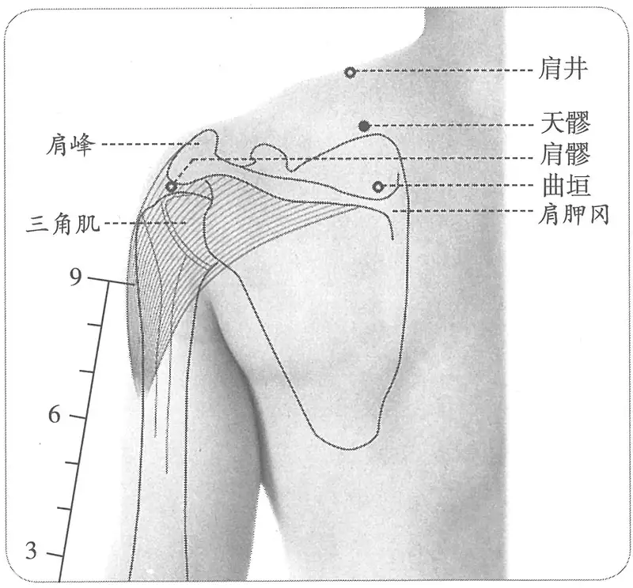

**图2-290　天髎穴图**

　2. 缺盆外骨空各一。王冰注：谓天髎二穴也。在肩缺盆中，上伏骨之际陷者中。（《素问·气府论》王冰注）

　3. 在肩上缺盆中上毖骨之际陷中，直肩井后一寸。（《大本琼瑶神书》）

　4. 广注须取缺盆上毖骨际，肩壅肉上，与大杼、附分约间寸许。（《循经考穴编》下）

　5. 在肩缺盆中上毖骨之际陷中央，须缺盆陷处上有空起肉上是穴。（《针灸聚英》卷一、《古今医统》、《针灸大成》、《针灸易学》、《针灸逢源》）

　6. 肩井之后一寸。（《针灸十四经穴位考订》）

〔p.976 (인쇄 948)〕

　7. 统编针灸学教材

　　(1) 部位：在肩胛骨之上部，肩胛棘中央之前方一寸处。取穴：肩胛骨之上部，从曲垣上一寸或肩井后一寸取之。（1957年南京《针灸学》）

　　(2) 部位：肩胛骨内角上方。取穴：于督脉大椎穴与肩峰后端外缘之中点，在小肠经曲垣穴与胆经肩井穴之间取之。（1版《针灸学讲义》）

　　(3) 部位：在肩缺盆中毖骨之间陷者中。取穴：肩胛骨上角处，当肩井足少阳经与曲垣手阳明经连线之中点取穴。（2版《针灸学讲义》）

　　(4) 肩井穴下1寸。（4版《针灸学》）

　　(5) 肩胛骨上角，曲垣穴上1寸。（5版《针灸学》）

　　(6) 在肩胛部，肩井与曲垣的中间，当肩胛骨上角处。（6版《针灸学》、《中国针灸学》）

　　(7) 肩井穴与曲垣穴连线的中点，当肩胛骨上角凹陷处。（7版《针灸学》）

#### 【类属】 

手少阳三焦经穴。

**脉气所发：**

　1. 手少阳、阳维之会。（《针灸甲乙经》卷三、《铜人腧穴针灸图经》卷中）

　2. 足少阳、阳维之会。（《外台秘要》卷三十九）

　3. 手足少阳、阳维三脉之会。（《素问·气府论》王冰注、《医心方》）

**归经：**

　1. 手阳明。（《千金要方》卷二十九、《千金翼方》、《西方子明堂灸经》）

　2. 手少阳。（《黄帝内经明堂》、《外台秘要》、《铜人腧穴针灸图经》卷上）

**按**：《外台秘要》作“足少阳、阳维之会”，然该穴却归入手少阳经，疑“足少阳”前脱“手”字；王冰注《素问·气府论》天髎穴作“手足少阳、阳维三脉之会”；《铜人腧穴针灸图经》卷中作“手少阳、阳维之会”。根据现有资料，本穴只能归入手少阳或足少阳经，而不能归入手阳明经。是否孙思邈依据新修的《明堂经》关于本穴的脉气所发而将其归入手阳明经，不得而知。

#### 【适应症】 

主治局部病症。常用于肩臂痛，颈项强痛。

　1. 主肩痛引项，寒热，缺盆中痛，汗不出，胸中热满。（《黄帝明堂经》）

　2. 治肩肘痛引颈项急，寒热，缺盆中痛，汗不出，胸中烦满。（《铜人腧穴针灸图经》卷中）

　3. 气项肿大。（《循经考穴编》下）

**按**：此条主治系臑会穴主治的误录。

　4. 统编针灸学教材

　　(1) 主治肩臂酸痛，颈项急，身热汗不出。（1957年南京《针灸学》、1版《针灸学讲义》）

　　(2) 主治肩臂酸痛，颈项强急。（2版《针灸学讲义》，5、6、7版《针灸学》）

　　(3) 主治肩肘痛，缺盆中痛，颈项强急。（4版《针灸学》）

　　(4) 主治肩肘痛，颈项强痛。（《中国针灸学》）

#### 【操作】 

直刺0.5~1寸。

　1. 刺入八分，灸三壮。（《黄帝明堂经》）

　2. 针五分，灸三壮。（《针灸十四经穴位考订》）

　3. 统编针灸学教材

　　(1) 针三至五分，不可太深。（1957年南京《针灸学》）

　　(2) 针三至五分，不宜太深，灸三至七壮。（1版《针灸学讲义》）

　　(3) 直刺3~5分，艾条灸3~7分钟。（2版《针灸学讲义》）

〔p.977 (인쇄 949)〕

　　(4) 直刺0.5~0.8寸。（4、5版《针灸学》）

　　(5) 直刺0.5~0.8寸；可灸。（6版《针灸学》）

　　(6) 直刺0.5~1寸。（7版《针灸学》）

　　(7) 直刺0.3~0.5寸。可灸。（《中国针灸学》）

### （十六）天牖 Tiānyǒu TE16 出《灵枢》 

#### 【提要索隐】 

**部位**：在颈部，横平下颌角，胸锁乳突肌的后缘凹陷中。

**适应症**：主治头面颈项部病症。头痛，眩晕，颈项强痛，视物不清，耳聋，咽喉肿痛；瘰疬。

**针刺操作**：直刺0.5~1寸。

#### 【名实考】 

《灵枢·本输》记有颈项部九穴：天突、扶突、人迎（天五会）、天窗、天容、天牖、天柱、风府、天府、天池，穴名中多冠以“天”字，所指多为明堂建筑名称。参见“扶突”穴下“名实考”。

　1. 缺盆之中，任脉也，名曰天突，一。次任脉侧之动脉，足阳明也，名曰人迎，二。次脉手阳明也，名曰扶突，三。次脉手太阳也，名曰天窗，四。次脉足少阳也，名曰天容，五。次脉手少阳也，名曰天牖……手少阳出耳后，上加完骨之上。（《灵枢·本输》）

　2. 颈侧之动脉人迎。人迎，足阳明也，在婴筋之前。婴筋之后，手阳明也，名曰扶突。次脉，足少阳脉也，名曰天牖。次脉，足太阳也，名曰天柱。腋下动脉，臂太阴也，名曰天府……此为天牖五部。（《灵枢·寒热病》）

　3. 天牖在颈筋，缺盆上，天容后，天柱前，完骨下，发际上，手少阳脉气所发。（《黄帝明堂经》）

　4. 天者，言其高也，各经之穴在颈者，多以天名之。以其在颈之侧，则以牖名之，入室之有牖，乃在室之侧也……此穴，上直完骨之下，平直天柱之前，前直曲颊下天容之后，在胃经之缺盆则尚远，无须考焉。（《经穴解》）

#### 【定位】 

**部位**：在颈部，横平下颌角，胸锁乳突肌的后缘凹陷中（图2-291）。

**取穴**：正坐，从风池穴与天容穴之中间，当乳突后直下取之。

1.《黄帝明堂经》佚文

　　(1) 在颈筋间缺盆上，天容后，天柱前，完骨后，发际上。（《针灸甲乙经》卷三）

　　(2) 在颈筋，缺盆上，天容后，天柱前，完骨下，发际上一寸。（宋校本《千金要方》卷二十九）

　　(3) 在颈筋缺盆上，天容后，天柱前，完骨下，发际上。（《黄帝内经太素·寒热杂说》、《千金翼方》、《外台秘要》、《素

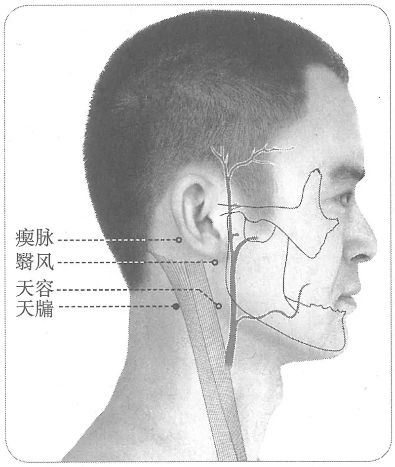

**图2-291　天牖穴图**

〔p.978 (인쇄 950)〕

问·气穴》王冰注、《医心方》卷二、《铜人腧穴针灸图经》、《圣济总录》、《针灸资生经》、《医学纲目》、《针灸聚英》、《古今医统》、《医学入门》、《针灸大成》、《针方六集》、《循经考穴编》、《针灸逢源》）

　2. 一云在风池上一寸。（《千金翼方》卷二十六）

　3. 在颈筋缺盆上，天容后，天柱前，完骨下，发际上一寸，陷者宛宛中是也。（《太平圣惠方·针经》）

　4. 在完骨穴下发际宛宛中。（《太平圣惠方·明堂》）

　5. 在颈大筋外，缺盆上，天窗后天窗后，《资生经》作天容后，天柱前，完骨下，发际上。（《十四经发挥》中）

　6. 在颈大筋外，缺盆上，天容后，天柱前，完骨下，发际上。广注：约上发际寸许，居翳风下，颌骨尽处壅肉上为是。又法：约结喉旁开七寸五分。（《循经考穴编》）

　7. 在颈大筋外，缺盆上，天容后，天柱前，完骨下，发际中，上夹耳后一寸。（《类经图翼》）

　8. 从天髎上行，颈大筋外，缺盆上，手太阳经天容穴后，足太阳经天柱穴前，足少阳胆经完骨穴下，发际中，上斜侠耳后一寸，天牖穴也。（《医宗金鉴·刺灸心法要诀》、《针灸逢源》）

　9. 风池穴下约一寸许，微外些，天柱、天容二穴之间。（《针灸十四经穴位考订》）

　10. 统编针灸学教材

　　(1) 部位：在颈大筋外后方。取穴：正坐，从风池穴属胆经与天容穴小肠经之中间，当乳嘴突起完骨之下取之。（1957年南京《针灸学》）

　　(2) 部位：小肠经天容穴后，胆经完骨穴下。取穴：正坐，以颈横纹为标准，在小肠经天容穴至膀胱经天柱穴三分之一处，大筋后缘取之。（1版《针灸学讲义》）

　　(3) 部位：在颈筋间，缺盆上，天容后，天柱前，完骨后，发际上。取穴：在乳突后下部，胸锁乳突肌后缘，位于天容手太阳经与天柱足太阳经的平行线上取之。（2版《针灸学讲义》）

　　(4) 乳突后下方，胸锁乳突肌后缘，约平下颌角处。（4、5、7版《针灸学》）

　　(5) 在颈侧部，当乳突的后方直下，平下颌角，胸锁乳突肌的后缘。（6版《针灸学》）

　　(6) 乳突后下部，胸锁乳突肌后缘，与天容、天柱相平。（《中国针灸学》）

**文献分析**：本穴定位，现存《黄帝明堂经》佚文，只有《针灸甲乙经》作“天容后，天柱前，完骨后，发际上”，其他各传本佚文“完骨后”皆作“完骨下”。今考原文当作“完骨下”，不然“天容后”就多余了。具体取穴应在完骨后下。至于宋校本《千金要方》作“发际上一寸”中之“一寸”二字，当系后人添加，未经宋人校刊本无此二字。又《千金翼方》注“一云风池上一寸”，一寸过于拘泥，《太平圣惠方·针经》明言“如后发际亦有项脚长者，其毛直至头骨，亦有无项脚者，毛齐至天牖穴。即无毛根，何而取穴也？答曰：其毛不可辄定，大约如此”，况且本穴与风池穴的位置关系也不是在一直线上。《十四经发挥》“天窗后”之“窗”显系“容”字形误。

#### 【类属】 

手少阳三焦经穴。手少阳所人。

　1. 手少阳脉气所发。（《黄帝明堂经》）

　2. 手少阳根于关冲，流于阳池，注于支沟，入天牖、外关也。（《灵枢·根结》）

#### 【适应症】 

主治头面颈项部病症。常用于头痛，眩晕，颈项强痛，视物不清，耳聋，咽喉肿痛；瘰疬。

　1. 主肩背痛，寒热，瘰疬，颈有大气，暴聋气蒙瞀，耳目不明，头颔痛，泪出，洞鼻不知香

〔p.979 (인쇄 951)〕

臭，风眩，喉痹。（《黄帝明堂经》）

**按**：“洞鼻”，又作“鼻洞”，指涕出不收。“暴聋气蒙瞀，耳目不明”见于《灵枢·寒热病》。

　2. 三焦病，腹气满，少腹尤其坚，不得小便，窘急，溢则为水，留则为胀。（《外台秘要》卷三十九）

**按**：此乃《灵枢·邪气藏府病形》所载之“三焦病”症状，原文取三焦下合穴“委阳”穴治之，王焘归于本穴，欠妥。

　3. 主头风面肿，项强不得回转，夜梦颠倒，面青黄无颜色。（《太平圣惠方·针经》）

　4. 头有积气，头风，目眩。（《太平圣惠方·明堂》）

　5. 治头风面肿，项强不得回顾。（《铜人腧穴针灸图经》卷中）

　6. 目中痛。（《针灸聚英》卷一、《古今医统》、《针灸大成》）

　7. 统编针灸学教材

　　(1) 主治耳暴聋，目昏，头风面肿，项强。（1957年南京《针灸学》、1版《针灸学讲义》）

　　(2) 主治头晕，面肿，暴聋，目昏，项强。（2版《针灸学讲义》）

　　(3) 主治头痛，面肿，目昏，暴聋，瘰疬，项强。（4版《针灸学》）

　　(4) 主治头痛，目痛，耳聋，瘰疬，项强。（5版《针灸学》）

　　(5) 主治头痛，头晕，目痛，耳聋，瘰疬，项强。（6版《针灸学》）

　　(6) 主治：①头痛，头眩，项强、目不明，暴聋，鼻衄、喉痹等头项、五官病证；②瘰疬；③肩背痛。（7版《针灸学》）

　　(7) 主治头痛，项强，面肿，目昏，暴聋。（《中国针灸学》）

#### 附：临床应用举例 

　1. 暴聋气蒙，耳目不明，取天牖。（《灵枢·寒热病》）

　2. 瘰疬，颈有大气，灸天牖五壮。（《圣济总录》卷一百九十四）

　3. 腹胀脐突，缺盆中满，尻腰肿，大敦、天牖、昆仑。（《医学纲目》卷二十四）

#### 【操作】 

直刺0.5~1寸，不宜深刺。

　1. 刺入一寸，留七呼，灸三壮。（《黄帝明堂经》）

　2. 针入五分，得气即泻，泻尽更留三呼，泻三吸。不宜补之，亦不宜灸。若灸面肿眼合，先取谚语，后针天牖、风池，其病即瘥。若不先针谚语，难瘳其疾也。（《太平圣惠方·针经》）

3.《明》云针五分，得气即泻，泻尽更留三呼，泻三吸，不宜补，亦不宜灸。《铜人》、《明堂上经》皆云不宜灸，《下经》、《素问注》乃云灸三壮。恐凡禁穴许灸一至三壮也。（《针灸资生经》卷一）

　4. 禁用针灸。（《医学入门》卷一）

　5. 针五分，不宜灸。《铜人》不宜灸。（《针灸十四经穴位考订》）

　6. 统编针灸学教材

　　(1) 针三至五分，不宜过深。（1957年南京《针灸学》）

　　(2) 针三至五分，不宜深刺，灸三壮。（1版《针灸学讲义》）

　　(3) 直刺3~5分，艾条灸3~7分钟。（2版《针灸学讲义》）

　　(4) 直刺0.5~1寸。（4、5、7版《针灸学》）

　　(5) 直刺0.5~1寸；可灸。（6版《针灸学》）

　　(6) 直刺0.3~0.5寸。可灸。（《中国针灸学》）

〔p.980 (인쇄 952)〕

　7. 直刺0.5~1寸。感应：局部酸胀。灸3壮；温灸3~5分钟。（上海《针灸学》）

### （十七）翳风 Yìfēng TE17 出《黄帝明堂经》 

#### 【提要索隐】 

**部位**：在颈部，耳垂后方，乳突下端前方凹陷中。

**国标修订**：1990年版国标：在耳垂后方，乳突与下颌角之间的凹陷处。2006年修订版：在颈部，耳垂后方，乳突下端前方凹陷中。

**按**：更准确地说，应当表述为“乳突下端前方的下颌后窝（retromandibular fossa）凹陷中”。下颌后窝的境界：前为下颌颈、后为乳突前外侧、上为外耳道下壁。本穴原本是很容易定位的一个腧穴，但由于1990年版国家标准《经穴部位》的表述不明确，加上一个文字上的失误，对腧穴定位造成了一定的混乱，以至于在制定腧穴定位的国际标准时，经过了多次讨论，费了很长时间，才发现并更正了由于国标失误所造成的影响。

**适应症**：主治局部病症。常用于耳鸣，耳聋；口眼㖞斜，口噤；颊肿，瘰疬。**新增**：习惯性下颌关节脱位。颅脑外科手术、腭裂整复术的针麻用穴。

**针刺操作**：直刺0.5~1寸，不宜深刺。

#### 【名实考】 

关于本穴定位，《黄帝明堂经》只说“耳后陷者中”，《太平圣惠方》则具体说“耳后尖角陷者中”，可知所说乃耳后乳突尖也，也即《灵枢·本输》所说“手少阳出耳后，上加完骨之上”之义。

关于本穴取穴法，元代《针经摘英集》令病人口咬铜钱而刺；明代《针灸秘法全书》曰“开口有大空”。其解剖学原理如下：下颌头之后，耳后乳突之前的下颌凹陷上界为外耳道下壁，故用手指向内上方按压则应于耳。而当张口时，下颌髁突向前下方移动，其后方空出一个较大的凹陷，故张口取穴，凹陷更明显。

　1. 翳风，在耳后陷者中，按之引耳中，手足少阳之会。（《黄帝明堂经》）

　2. 此穴在耳之下后，乃无物遮蔽之所，风之自后者，入风池、风府之穴，皆常中风之所也，故曰翳风。（《经穴解》）

　3. 刺手少阳经翳风二穴，在耳后陷中，按之引耳中。令病人持钱二十四文，口咬侧卧取之。针透口中，令病人闭口鼻，摇头，其怒气从耳中出。（《针经摘英集》）

　4. 翳风穴，经曰在耳后尖角陷中，按之应手耳中痛，今考此穴开口有大空，可容一指。（《针灸秘法全书》）

#### 相关穴及刺激点 

　1. 翳明　位于头颞部，胸锁乳突肌停止部乳突下陷中。主治维生素甲缺乏症、老视、近视、绿内障、白内障等症。针刺七分至一寸五分。用捻针法微斜向耳后方进针，刺入五至六分时，问患者是否有麻木感，如有，同时再问患者针侧眼睛有何感觉。如觉眼发亮，视物清晰，留针三十分钟后退针。如无感觉，应再捻进二至三分深。如仍无效，可改用中强度刺激法，缓行雀啄术，将针提出三至四分后，再次捻进，反复二至三次。如仍无效，即应将针退至皮下，在皮下微移方向再次捻进。不应刺激过强。（《针灸经外奇穴图谱》）

　2. 耳后发际　位于耳廓后下方发际边缘，当颞骨乳突下缘凹陷处。翳风穴与完骨穴之间。主治瘰疬、瘿。灸三至七壮。（《针灸经外奇穴图谱》）

〔p.981 (인쇄 953)〕

　3. 扁桃体穴　位于下颌角直下0.5寸处。向上斜刺2寸，针感喉部、颈部热、麻。主治急、慢性喉炎、咽炎、扁桃体炎、声音嘶哑。（《针灸经外奇穴图谱（续集）》）

　4. 白喉穴　位于颈外侧部之上份，当耳垂后下方，下颌角与颞骨乳突尖连线之中上三分之一点。翳风穴下约五分处，下颅骨角侧。主治白喉。针三至五分，不留针。（《针灸经外奇穴图谱》）

　5. 面神经刺激点乳突前点　位于：①耳垂后方的凹陷（翳风穴）处；②耳垂后方，下颌骨髁状突与乳突尖连线的中点；③下颌角与乳突连线的中点；④乳突尖前方0.5cm处。主治：面神经麻痹，面肌痉挛，耳鸣，耳聋，腮腺炎。刺法：针刺方向是从前面看与正中线呈30°，侧面看与额中央至人中线平行，刺入1.5~3.0cm。当针尖触及面神经干时，引起耳深部和面部疼痛，有时发生面部痉挛。（《实用神经干电刺激疗法》）

　6. 面神经刺激点乳突后点　在乳突尖后上0.4~0.8cm处。主治面神经麻痹、面肌痉挛、耳鸣、耳聋、腮腺炎。沿乳突的内侧面刺入。针尖向内前上方，对着眉间（印堂穴）刺入2.5~3.0cm时，针尖可触及茎突的基底部，将针拔出少许，略斜向上方，即可到达茎乳孔，刺中面神经干。针刺不宜过深，以免伤及颈内静脉。（《实用神经干电刺激疗法》）

　7. 舌咽神经刺激点　下颌角与乳突尖连线的中点。主治咽炎，扁桃体炎，舌咽神经麻痹。刺法：直刺2.5~3.0cm。当针刺深达2.0~2.5cm时可刺中茎突，将针稍改变方向，从茎突前缘或后缘再进0.5cm，即可刺中舌咽神经和迷走神经，局部酸胀，并传导至咽部。（《实用神经干电刺激疗法》）

　8. 迷走神经刺激点　定位、刺法同上。主治迷走神经损伤引起的软腭瘫痪，咽喉瘫痪和感觉丧失，声音嘶哑，吞咽困难，心动过速，呼吸缓慢和不规律。（《实用神经干电刺激疗法》）

#### 【定位】 

**部位**：在颈部，耳垂后方，乳突下端前方凹陷中（图2-292）。

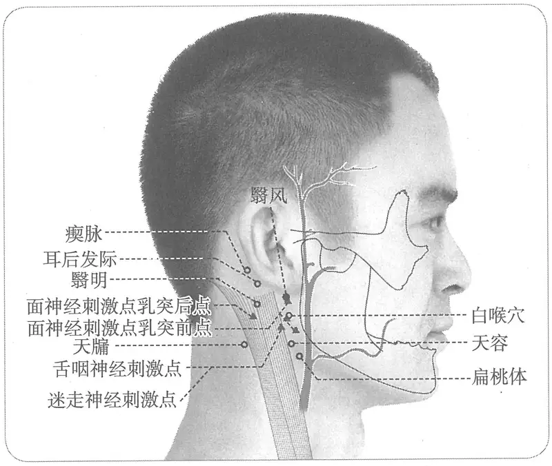

**图2-292　翳风穴与相关穴及刺激点**

〔p.982 (인쇄 954)〕

**取穴**：在乳突前下颌后窝凹陷中。如凹陷不明显可微张口取之。

#### 相关解剖学基础 

**下颌后窝（retromandibular fossa）的体表触诊技法**：从下颌支后缘向上可摸到位于耳垂的深面的髁突（condylar process）。用手指在髁突后方向内探查，可进入下颌后窝（retromandibular fossa）。在下颌后窝的前方可摸到下颌颈（mandibular neck），上方是外耳道（external acoustic meatus）的下壁，向后方可摸到乳突（mastoid process）尖的前外侧面。

　1. 在耳后陷者中，按之引耳中。（《黄帝明堂经》、《铜人腧穴针灸图经》卷中、《圣济总录》、《针灸资生经》）

　2. 耳后陷中各一。王冰注：谓翳风二穴也。（《素问·气穴论》王冰注）

　3. 在耳后尖角陷者中，按之引耳是也。（《太平圣惠方·明堂》、《铜人腧穴针灸图经》卷上、《针灸资生经》、《类经图翼》、《循经考穴编》、《针灸逢源》）

　4. 在耳后尖角陷中，按之引耳中痛是也。（《铜人腧穴针灸图经》卷下“都数”、《十四经发挥》、《医学纲目》、《针灸聚英》、《针灸大成》、《刺灸心法要诀》）

　5. 窦太师针灸遗存

　　(1) 在耳后陷中，按之引耳中，开口得穴。又法在耳后尖角陷中，按引耳取之。（《窦太师针经》）

　　(2) 耳后尖角陷中，按之引耳后中痛。取耳法后陷中，开口得之穴。（《琼瑶神书》）

　　(3) 在耳坠后陷中，按之引耳中动是穴。（《窦太师秘传》）

　　(4) 在耳后尖角陷中，按之引耳中。开口得穴。（《针方六集》卷一）

　　(5) 穴在耳后尖前陷中，按之引耳中痛。广注：耳下尖角贴耳坠后骨下陷中，开口有空。（《循经考穴编》下）

　6. 耳后五分陷中，按之引耳。（《针灸集成》）

　7. 耳珠后陷中，按之引耳中。（《医学入门》卷一）

　8. 经曰在耳后尖角陷中，按之引耳中痛。今考此穴开口有大空，可容一指。（《针灸秘法全书》卷二）

　9. 耳垂后距耳约五分处，骨边陷凹中。（《针灸十四经穴位考订》）

　10. 统编《针灸学》教材

　　(1) 部位：耳后尖前陷中，按之引耳中痛。取穴：正坐，从耳翼根之后下部当完骨之下边，以耳垂按点，于其边际处取之。（1957年南京《针灸学》）

　　(2) 部位：耳后尖角陷中。取穴：正坐，以耳垂按点之边际，于完骨穴下前方凹陷中，开口取之。（1版《针灸学讲义》）

　　(3) 部位：在耳后陷者中，按之引耳中。取穴：耳垂后，下颌角与乳突之间凹陷中取之。（2版《针灸学讲义》）

　　(4) 乳突前下方，平耳垂下缘的凹陷中。（4、5版《针灸学》）

　　(5) 在耳垂后方，当乳突与下颌角之间的凹陷处。（6版《针灸学》）

　　(6) 乳突前下方与下颌角之间的凹陷中。（7版《针灸学》）

　　(7) 乳突后下部，胸锁乳突肌后缘，与天容、天柱相平。（《中国针灸学》）

#### 【类属】 

手少阳三焦经穴。

**脉气所发**：手足少阳之会。（《黄帝明堂经》）

**归经**：手少阳三焦经。（《外台秘要》卷三十九、《铜人腧穴针灸图经》卷上）

〔p.983 (인쇄 955)〕

#### 【适应症】 

主治局部病症。常用于耳鸣，耳聋；口眼㖞斜，口噤；颊肿，瘰疬。**新增**：习惯性下颌关节脱位。颅脑外科手术、腭裂整复术的针麻用穴。

　1. 主聋。口僻不正，失欠，口不开，痉。喑不能言。（《黄帝明堂经》）

　2. 耳聋，口眼为噼不正，牙车引口噤不开，喑不能言。（《医心方》卷三）

　3. 耳鸣聋，暴哑不能言。及口吻㖞也。（《太平圣惠方·明堂》）

　4. 治耳聋，口眼㖞斜，失欠脱颔，口禁不开，吃不能言，颊肿，牙车急痛。（《铜人腧穴针灸图经》卷中）

**按**：“吃不能言”系“喑不能言”之误。

　5. 窦太师针灸遗存

　　(1) 治耳红肿，泻；耳内虚鸣，补，补多泻少。又治耳出清水，湿痒，耳闭，瘰疬，项强痛，看症补泻。（《窦太师针经》）

　　(2) 治耳红肿痛，宜泻；内虚鸣，宜补多泻少。（《大本琼瑶神书》）

　　(3) 耳中脓，瘰疬，项强。（《针方六集》卷五）

　　(4) 耳中湿痒。（《循经考穴编》下）

　　(5) 治耳聋虚作蝉鸣。（《窦太师秘传》）

　6. 口吃，小儿喜欠。（《针灸聚英》卷一）

**按**：“口吃”系传《铜人腧穴针灸图经》“吃不能言”之误；“小儿喜欠”，是对“失欠”的误解。

　7. 统编针灸学教材

　　(1) 主治耳鸣，耳聋，口眼㖞斜，口噤，颊肿。（1957年南京《针灸学》、1版《针灸学讲义》）

　　(2) 主治耳鸣，耳聋，口眼㖞斜，牙关紧闭，颊肿，瘰疬。（2版《针灸学》）

　　(3) 主治耳鸣，耳聋，口㖞，口噤，脱颔，齿痛，颊肿，瘰疬。（4版《针灸学》）

　　(4) 主治耳鸣，耳聋，口眼歪斜，牙关紧闭，齿痛，颊肿，瘰疬。（5、6、7版《针灸学》）

　　(5) 主治耳鸣，耳聋，聤耳，口眼歪斜，齿痛，颊肿，瘰疬，牙关不利。（《中国针灸学》）

**文献分析**：《金针梅花诗钞》谓本穴“为聋哑，颜面偏风，口眼㖞斜，腮颊肿痛之妙穴。尤以痄腮及龋齿为好”；《黄帝明堂经》、《外台秘要》、《铜人腧穴针灸图经》皆谓本穴主治“失欠脱颔”，古方应用中也有明确记载，而教材只有4版教材载有此主治症。盖因现代人对于针灸能否治疗关节脱位缺乏了解，又没有进行系统的临床实验的缘故。其实，《黄帝明堂经》记载治疗下颌关节脱位的穴位还有：下关、大迎、颊车、腹通谷，现代临床实践也提示，针灸对于下颌关节脱位，特别是习惯性脱位有良好的治疗效果。值得重视。教材中“齿痛”盖从《铜人腧穴针灸图经》“牙车急痛”而来，欠妥。

《圣济总录》卷一九四曰：“颐下不可伤，伤即令人舌根不转，宜治耳后宛宛处五分，过之亦伤也。”说明本穴是治疗舌强的要穴。此外，本穴针感明确至咽部，古代源头文献明确记载治疗失音，当代临床有应用，并有新穴“扁桃体”及神经刺激疗法舌咽神经刺激点及迷走神经刺激点主治症的支持，当补咽喉部病症。

#### 附：临床应用举例 

　1. 耳部病症

　　(1) 治耳聋耳鸣，刺手少阳经翳风二穴，在耳后陷中，按之引耳中，令病人取钱二十四文，口咬侧卧取之，针透口中，令病人闭口鼻，摇头，其怒气从耳中出。（《针经摘英集》）

〔p.984 (인쇄 956)〕

　　(2) 聤耳生疮出脓：翳风、合谷、耳门。（《针灸集成》第二十七方）

　　(3) 耳聋气闭：听会、听宫、翳风。（《针灸集成》第二十八方）

　　(4) 若人患耳即成聋，下手先须觅翳风，项上倘然生疬子，金针泻动号良工。（《针灸玉龙歌》）

　　(5) 耳聋：听宫、翳风。［四川中医，1985，3(10):43］

　2. 口面病症

　　(1) 治风着人面，引口偏者着，牙车急，舌不得转方……又方：翳风穴灸三壮。（《医心方》卷三）

　　(2) 治张口不合方：灸通谷穴，在上管旁半寸。又方灸翳风穴，在耳后陷中，按之引耳中也。（《医心方》卷五）

　　(3) 面瘫：地仓、合谷、承浆、人中、颊车、翳风、听会。问曰：此证用前穴针效，或一月、半月，再发，何也？答曰：必是有犯禁忌，房事不节，饮食过多，痰饮复生，证再作矣。再刺已。上穴法复刺后穴无不效。㖞左，泻左补右；㖞右，补左泻右。（《针灸集成》第二方）

　　(4) 周围性面瘫：艾灸翳风、下关穴治疗。［上海针灸杂志，1998，17(4):28］

　3. 其他病症

　　(1) 下颌痛：听宫、听会、翳风。［中医杂志，1990，31(12):40］

　　(2) 呃逆：翳风。指压或针刺。［新中医，1980(4):39］

　　(3) 昏厥：按压翳风穴急救。［中国针灸，1997(4):151］

　　(4) 假性球麻痹：针刺翳风为主治疗。［针灸临床杂志，1996，11(9):43］

　　(5) 慢性胆囊炎急性发作：翳风穴治疗。［中国针灸，1999(1):39］

　　(6) 牙痛：针刺翳风穴治疗。［甘肃中医，2000(3):44］

　　(7) 哮喘急性发作：针刺翳风穴治疗。［中国针灸，2002，22(9):611］

#### 【操作】 

直刺0.5~1寸不宜深刺。治目疾参考翳明穴刺法。

　1. 刺入四分，灸三壮。（《黄帝明堂经》）

　2. 针入七分，可灸七壮。（《铜人腧穴针灸图经》卷中）

　3. 窦太师针灸遗存

　　(1) 针入五分，灸七壮。（《窦太师针经》、《循经考穴编》）

　　(2) 针入半寸，泻之，灸七壮。（《针灸玉龙歌》注）

　4. 令病人持钱二十四文，口咬侧卧取之。针透口中，令病人闭口鼻，摇头，其怒气从耳中出。（《针经摘英集》）

　5. 针三分，禁灸。（《医宗金鉴·刺灸心法要诀》）

　6. 针五分，灸三壮。（《针灸十四经穴位考订》）

　7. 统编针灸学教材

　　(1) 针三至五分，灸三至五壮。（1957年南京《针灸学》）

　　(2) 针三至五分开口进针，灸三至五壮。（1版《针灸学讲义》）

　　(3) 直刺5~10分，艾条灸3~5分钟。（2版《针灸学讲义》）

　　(4) 直刺0.8~1.2寸。（4、5版《针灸学》）

　　(5) 直刺0.8~1.2寸；可灸。（6版《针灸学》）

　　(6) 直刺0.5~1寸。（7版《针灸学》）

〔p.985 (인쇄 957)〕

　　(7) 直刺0.5~1寸。可灸。（《中国针灸学》）

　8. ①斜刺，治聋哑时，斜向内前下方，深1.5~2寸。局部酸胀，有时向咽部扩散，咽部有发紧发热感。②直刺，治面瘫及腮腺炎时，向对侧眼球方向刺入，深0.5~1寸。感应：耳底胀痛，有时酸胀感可扩散至舌前部。（上海《针灸学》）

**刺法及主治解剖学基础**：近年来对于本穴的主治研究较深入，研究发现本穴不仅是治疗面瘫的不可替代的要穴，对于头痛、三叉神经痛、牙痛等也有显著疗效。形态学研究结果表明翳风穴区解剖结构的特殊性、复杂性，决定了其重要而多样的临床应用价值[^31-1]。该穴深处是面神经从茎乳孔出颅部位，穴下分布有耳大神经、耳颞神经、颈外动静脉、腮腺、面神经干、迷走神经、舌下神经、舌咽神经。穴位的作用与重要的临床应用与穴区的解剖结构、生理功能密切相关。关于本穴刺法，元以前文献多只刺几分，而元代《针经摘英集》记载的特殊刺法可刺透口中，晚清《金针梅花诗钞》也谓“后牙痛不论上下，须深针一寸五至二寸，其效方显，浅刺则无功也”。当代针灸医师更有直接刺茎乳孔外，由乳突切迹下三分之一处向鼻尖方向刺入，进针3~4.5cm即有针感，可传至同侧上下牙槽、前额、颜面及耳内[^32-2]。

### （十八）瘈脉 Chìmài TE18 出《黄帝明堂经》 

问题1：瘈脉、颅息一脉相生，主治相同，何时分为二穴，主治有何变化？

问题2：瘈脉、颅息二穴的画线折量取穴法的文字描述出自何时，见于何书？

#### 【提要索隐】 

瘈脉，在其获有专用穴名之前，与“颅息”并称作“耳后青脉”，是诊断、治疗小儿惊痫专用脉。瘈脉、颅息虽由此脉所演，然千百年来很少变化，几乎完整保留了其脱胎而来的诊脉、刺脉的所有特征，是今人考察腧穴起源与演变的一个极有说服力的实例。

**穴名**：一名资脉。

**部位**：在头部，乳突中央，角孙与翳风沿耳轮弧形连线的上2/3与下1/3的交点处。

**适应症**：主治小儿惊痫。

**针刺操作**：平刺0.3~0.5寸，或点刺出血。

#### 【名实考】 

瘈脉，原作“瘛脉”，以其主治小儿瘛疭而得名，故《灵枢·五邪》解曰：“取耳间青脉，以去其掣”。考此穴实源出于早期的诊脉部位，《灵枢·论疾诊尺》载曰：“婴儿病……耳间青脉起者，掣痛”，初唐《千金要方》也专以此脉诊候小儿惊痫病：“耳后完骨上有青络盛卧不静是痫候”（《千金要方·少小婴孺方·候痫法》卷五）。早期针灸诊疗实践有一个突出的特点：对于某脉所诊之病症的治疗，即刺或灸该诊脉处，因此早期诊脉处大多演变成腧穴，而且往往是一些重要腧穴，原先的诊脉病候自然成为相应腧穴的主治病症。而最早的针灸腧穴经典《黄帝明堂经》所载此二穴即为“耳后青脉”，并主治小儿痫病。这样由诊候小儿惊痫的耳后青络脉演变而成两个固定的经穴：瘈脉、颅息，二穴都主治小儿惊痫。后世针灸文献对此更有明确的注释。然而人群的实验调查结果表明耳后静脉不很清楚。后来发现在小儿能显示清楚，年龄越小越明显。而且进一步调查还得知，小儿的耳后静脉较为固定，且稍粗直，或略带弯曲，显露清楚。在小儿临床，耳后静脉已成为小儿采血部位最常用、最安全的部位[^33-1]（古典文献的描述也提示，病儿的耳后静脉更显著）。由此可知，古典文献的记载完全来自临床实践的观察。

[^31-1]: 杨玉光，闫颖智．翳风穴的形态学特征及其临床意义．翳风穴在临床中的运用概况［J］．针灸临床杂志，2006，22(6):57；孟培燕．翳风穴刺法初探．翳风穴证治机理浅探［J］．湖北中医杂志，2001，23(8):40.

[^32-2]: 石靖．介绍一新穴——茎乳孔外穴［J］．山西医药杂志，1977(3):53.

〔p.986 (인쇄 958)〕

由于瘈脉与颅息源出于耳后青脉，主要用于小儿惊痫的诊断与治疗，因而直接以体表标志定位，刺法也为刺血。关于此二穴的连线折量定位的文字描述先见于日本文献如《挨穴捷径》（1761年）、《腧穴折衷》（1764年）、《俞穴捷径》（1793年）、《经穴纂要》（1810年）等，云源于其师堀元昌之说。

　1. 按瘈脉、颅息二穴，诸书未谓寸法，难求正穴。先定翳风、角孙二穴，而后得之。其法：取一绳当翳风穴自耳后斜上至角孙穴截断之，复以其绳三折之，第一折处瘈脉，第二折处颅息是也。（日本《俞穴捷径》）

　2. 瘈脉，一名资脉，在耳本鸡足青络。（《黄帝明堂经》）

　3. 瘈疭之症，在下则肝胆之经为之，在上则手厥阴、手少阳为之，以四经皆木火相生之经，而瘛疭之症，非火不作，穴名瘈脉者，言此乃瘈疭之本也。（《经穴解》）

#### 耳后青脉与“瘈脉”、“颅息” 

　1. 婴儿病，其头毛皆逆上者，必死。耳间青脉起者，掣痛。（《灵枢·论疾诊尺》）

　2. 邪在肝，则两胁中痛，寒中，恶血在内，行善掣，节时脚肿，取之行间以引胁下，补三里以温胃中，取血脉以散恶血，取耳间青脉，以去其掣。（《灵枢·五邪》）

　3. 耳后完骨上有青络盛，卧不静，是痫候。青脉刺之令血出也。（《千金要方·候痫法》卷五）

　4. 治小儿暴痫者……次灸两耳后完骨上青脉，亦可以针刺令血出。（《千金要方·惊痫》卷五）

　5. 颅息穴，在耳后间青络，今考颅者脑骨也，即耳后突骨发际间白肉上有青络是；瘈脉穴，经曰在耳本鸡足青络上，耳本者即耳根也，其青络自耳根生起入于耳轮后上，其形如鸡足，小儿若鸡足青色太盛者，将发瘛疭，急用锋针刺出血如墨汁，待红则止，不可去多，多即令人目昏，禁灸。按颅息、瘈脉二穴，治小儿惊痫最要之穴，如欲发搐，只看此二穴青络是，手足少阳脉络过此，瘈脉自颅生起入耳后分为三歧犹如鸡足。（《针灸秘法全书》）

#### 相关穴及刺激点 

耳后静脉三条：位于耳壳内侧三条静脉是。系手少阳三焦经的“瘈脉”穴的三个分枝点。主治目疔、目赤痛。针法：针挑出血。（《针灸经外奇穴图谱》）

#### 【定位】 

**部位**：在头部，乳突中央，角孙与翳风沿耳轮弧形连线的上2/3与下1/3的交点处（图2-293）。

**取穴**：在耳孔之直对耳翼后面，乳突之中央骨边际取之。

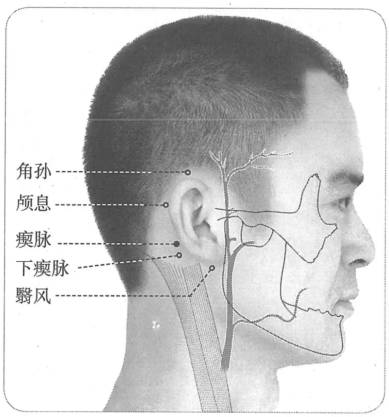

**图2-293　瘈脉穴图**

[^33-1]: 唐华荣，陈红建．抓采血相关管理，提高门诊服务质量［J］．实用医学杂志，2000(9):801-802；丁芳艳，王丽杰．浅谈2岁以下小儿耳后静脉穿刺采集血标本的护理［J］．黑龙江医药，2006(3):229.

〔p.987 (인쇄 959)〕

1.《黄帝明堂经》佚文

　　(1) 在耳本后鸡足青络脉，刺出血如豆许。（《针灸甲乙经》、《铜人腧穴针灸图经》、《圣济总录》、《针灸资生经》、《十四经发挥》、《医学纲目》、《针灸聚英》、《针灸问对》、《古今医统》、《医学入门》、《针灸大成》、《针方六集》、《类经图翼》、《医宗金鉴·刺灸心法要诀》、《针灸易学》、《针灸逢源》）

　　(2) 在耳本鸡足青脉。（《千金要方》卷二十九、《千金翼方》、《外台秘要》、《医心方》）

　2. 在耳内鸡足青脉。（《太平圣惠方·针经》）

**按**：“耳内”系“耳本”之误。

　3. 在耳本后，鸡足青络之间。广注：一法，贴耳后翳风上前，与听会相平。（《循经考穴编》下）

　4. 翳风上一寸，稍近耳根青络中。（《针灸十四经穴位考订》）

　5. 统编针灸学教材

　　(1) 部位：耳后鸡足青络之间。取穴：在耳孔之直对耳翼后面，乳嘴突起之中央骨边际取之。（1957年南京《针灸学》）

　　(2) 部位：耳后青络之间。取穴：以耳翼向紧按，在耳翼边际直对耳孔之处取之。又从角孙穴至翳风穴假设一弧形线，瘈脉穴在翳风穴上三分之一，颅息穴在上三分之二处。（1版《针灸学讲义》）

　　(3) 部位：在耳本后鸡足青络脉。取穴：在乳突之中央，当翳风于角孙沿耳翼连成一线，三折之，近翳风穴之一折处。（2版《针灸学讲义》）

　　(4) 乳突中央，适当翳风穴与角孙穴沿耳轮连线的下1/3与上2/3交界处。（4、5版《针灸学》）

　　(5) 在头部，耳后乳突中央，当角孙至翳风之间，沿耳轮连线的中、下1/3的交点处。（6版《针灸学》）

　　(6) 耳后，当翳风穴与角孙穴沿耳轮连线的下1/3与上2/3交界处。（7版《针灸学》）

　　(7) 乳突中央，当翳风与角孙沿耳翼连线的中、下1/3交界处。（《中国针灸学》）

#### 【类属】 

手少阳三焦经穴。

**归经**：手少阳三焦经。（《外台秘要》卷三十九、《铜人腧穴针灸图经》卷上）

#### 【适应症】 

主治小儿惊痫。

　1. 主小儿痫，瘛疭，呕吐，泄注，惊恐失精，视瞻不明，眵䁾。（《黄帝明堂经》）

**按**：马王堆出土帛书《五十二病方·婴儿病痫》曰：“痫者，身热而数惊，颈脊强而腹大”；同书“婴儿瘛”篇又曰：“婴儿瘛者，目系斜然，息嘤嘤然，屎不化而青”；《灵枢·论疾诊尺》曰：“婴儿病，其头毛皆逆上者，必死。耳间青脉起者，掣痛。大便赤瓣飧泄，脉小者，手足寒，难已；飧泄，脉小，手足温，泄易已”；《千金要方》卷五曰：“……吐岘而喘，是痫候；身热，目时直视，是痫候；卧惕惕而惊，手足振摇，是痫候；卧梦笑，手足动摇，是痫候；意气下而妄怒，是痫候；咽乳不利，是痫候；目瞳子卒大黑于常，是痫候；喜欠，目上视，是痫候；身热，小便难，是痫候；身热，目视不精，是痫候；吐痢不止，厥痛时起，是痫候；弄舌摇头，是痫候”。由此可见，《黄帝明堂经》所载之瘛脉穴主治是关于小儿痫病的一组症状。《针灸甲乙经》、《千金要方》均将“瘛脉”穴的这组病症作为完整的一条归入“小儿杂病”篇，也就是说在皇甫谧、孙思邈眼中，《黄帝明堂经》所载瘛脉穴主治是一组病症。

　2. 主风头耳后痛。（《千金要方》卷三十）

**按**：此条主治系误录《黄帝明堂经》“完骨”穴主治，这一错误经宋代《太平圣惠方》，特别是《铜人腧穴针灸图经》误传，宋以后针灸文献皆沿袭其误，并从“耳后痛”演变为“耳鸣，耳聋”。尽管从瘛脉穴的部位来看，治疗“耳后痛”或者“耳鸣，耳聋”可能也有效，但毕竟缺乏文献依据与临床经验。

〔p.988 (인쇄 960)〕

　3. 治头风耳鸣，小儿惊痫瘛疭，呕吐，泄痢无时，惊恐，眵瞢，目睛不明。（《铜人腧穴针灸图经》卷中）

　4. 统编针灸学教材

　　(1) 头风，耳鸣耳聋，目不明，小儿惊痫，呕吐。（1957年南京《针灸学》、1版《针灸学讲义》）

　　(2) 头痛，耳鸣，耳聋，小儿惊痫，呕吐，泻痢。（2版《针灸学讲义》、4版《针灸学》）

　　(3) 头痛，耳鸣，耳聋，小儿惊风。（5、6、7版《针灸学》）

　　(4) 头痛，耳鸣，耳聋，小儿惊痫。（《中国针灸学》）

**文献分析**：本穴并颅息穴，皆由诊候小儿惊痫的耳后青络脉演化而来，二穴都主治小儿惊痫，明代《针灸秘法全书》也明言：“颅息、瘈脉二穴，治小儿惊痫最要之穴，如欲发搐，只看此二穴青络是”。只是由于最早的针灸腧穴经典《黄帝明堂经》对于此二穴主治病症的表述形式不统一，后人不易正确理解而造成二穴的主治向不同的方向演化，而在现代针灸教材中此二穴的主治又呈现出相互靠近的趋势。据《黄帝明堂经》，现代针灸教材所列之“目不明”、“呕吐”、“泻痢”皆是小儿惊痫的伴随症状，而不是独立症状；“头痛，耳鸣，耳聋”乃承袭《千金要方》、《铜人腧穴针灸图经》之误。

#### 附：临床应用举例 

　1. 邪在肝，则两胁中痛，寒中，恶血在内，行善掣，节时脚肿，取之行间以引胁下，补三里以温胃中，取血脉以散恶血。取耳间青脉，以去其掣。（《灵枢·五邪》）

　2. 耳后完骨上有青络盛卧不静是痫候。青脉刺之令血出。（《千金要方》卷五）

　3. 治小儿暴痫者……若目反上视，眸子动，当灸囟中……次灸两耳后完骨上青脉。亦可以针刺令血出。（《千金要方》卷五上）

　4. 小儿惊痫者，先惊怖啼叫，后乃发也。灸顶上旋毛中三壮，及耳后青络脉，炷如小麦大。（《太平圣惠方·明堂》）

**按**：以上4首方皆治小儿痫病，前3方皆用刺血法，主治与治法皆与《黄帝明堂经》完全吻合。而《太平圣惠方·明堂》只录灸法，故所载之方用灸。

#### 【操作】 

平刺，或点刺出血。

　1. 刺出血如豆。（《黄帝明堂经》）

　2. 禁灸。（《千金要方》卷二十九）

　3. 禁用针灸。（《医学入门》卷一）

　4. 小儿若鸡足青色太盛者，将发瘈疭，急用锋针刺出血如墨汁，待红则止，不可去多，多即令人目昏。禁灸。（《针灸秘法全书》）

　5. 针一分，灸三壮。《铜人》：禁灸。（《针灸十四经穴位考订》）

　6. 统编针灸学教材

　　(1) 针一分，可以刺血，灸三壮。（1957年南京《针灸学》、1版《针灸学讲义》）

　　(2) 斜刺1分或点刺出血，艾条灸3分钟。（2版《针灸学讲义》）

　　(3) 平刺0.3~0.5寸。（4版《针灸学》）

　　(4) 平刺0.3~0.5寸，或点刺出血。（5版《针灸学》）

　　(5) 平刺0.3~0.5寸，或点刺出血；可灸。（6版《针灸学》、《中国针灸学》）

〔p.989 (인쇄 961)〕

　　(6) 平刺0.3~0.5寸，或点刺静脉出血。（7版《针灸学》）

**文献分析**：鉴于本穴本身源出于诊痫之络脉，再综合考察腧穴文献与治疗文献，此穴以点刺出血为宜。对于小儿高热，仍宜用古法，直接在耳后静脉选取充血最盛者用三棱针放血，而不必拘于上述几分之几的取穴法限制。参照同源穴“颅息”穴刺法。

### （十九）颅息 Lúxī TE19 出《黄帝明堂经》 

#### 【提要索隐】 

**穴名**：一名颅囟；一名阳维。

**部位**：在头部，角孙与翳风沿耳轮弧形连线的上1/3与下2/3的交点处。

**适应症**：主治小儿惊痫。常用于小儿惊风；耳鸣。

**针刺操作**：平刺，或点刺出血。

#### 【名实考】 

本穴名称，宋以前文献皆作“颅息”，宋代《针灸资生经》目录以“颅囟”为正名，以“颅息”为别名，卷三至卷七的腧穴证治也均以“颅囟”为正名，只有卷一腧穴部分作“颅息”。此外，《千金翼方》所载“阳维”穴者，与颅息定位相当，主治相合，可视为同穴异名。

关于本穴的来历及其与瘈脉穴的关系，详见瘈脉穴“名实考”。

　1. 颅息，在耳后间青脉，足少阳脉气所发。（《黄帝明堂经》）

　2. 耳风聋雷鸣，灸阳维五十壮，在耳后引耳令前弦弦筋上是。（《千金翼方》卷二十六）

　3. 耳之窍，皆头颅出息之所也，此穴在耳后青络脉，正颅中与耳相通之处，故曰颅息，气之往来曰息。（《经穴解》）

#### 相关穴及刺激点 

后聪：位于颞部，耳廓背侧之根部，将耳廓牵引向前，耳廓背面根部出现弦筋之略上方，在耳根与发际之间点，即颅息穴内侧。主治耳聋。针斜刺鼻梁中部方向，刺三至五分，针感局部胀、酸。（《针灸经外奇穴图谱（续集）》）

#### 【定位】 

**部位**：在头部，角孙与翳风沿耳轮弧形连线的上1/3与下2/3的交点处（图2-294）。

　1. 在耳后间青脉。（《黄帝明堂经》、《铜人腧穴针灸图经》、《圣济总录》、《针灸资生经》、《十四经发挥》、《医学纲目》、《针灸聚英》、《医学入门》、《针灸大成》、《针方六集》、《类经图翼》、《循经考穴编》、《针灸易学》、《针灸逢源》）

　2. 在耳后青脉间。（《千金要方》卷二十九、《千金翼方》、《外台秘要》、《太平圣惠方·针经》）

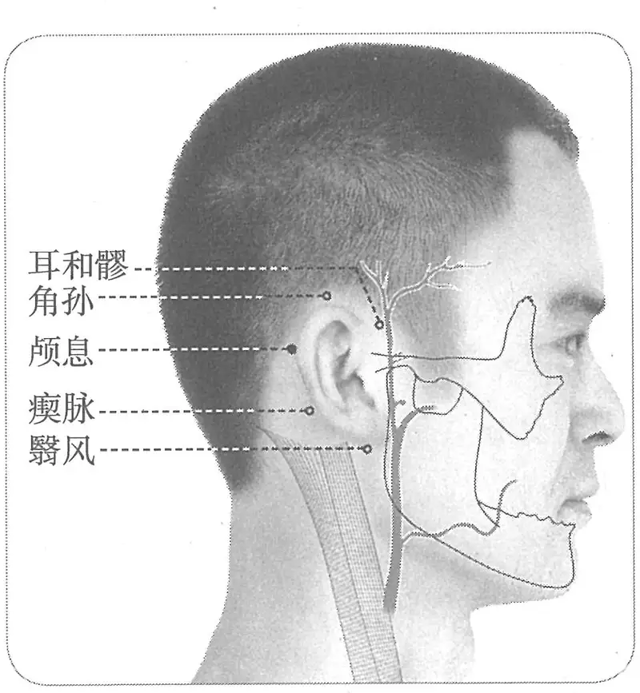

**图2-294　颅息穴图**

　3. 耳后青脉中直上出耳上角。（《大本琼瑶神书》）

　4. 在耳后青脉中，广注：须耳后上头些，去瘈脉约一寸。（《循经考穴编》下）

　5. 从瘈脉行耳后上间青络脉中。（《医宗金鉴·刺灸心法要诀》）

　6. 瘛脉上一寸余青络中。（《针灸十四经穴位考订》）

〔p.990 (인쇄 962)〕

　7. 统编针灸学教材

　　(1) 部位：耳后青络脉上。取穴：从瘈脉上行一寸取之。（1957年南京《针灸学》）

　　(2) 部位：耳后青络脉上。取穴：从瘈脉穴上行一寸取之。（1版《针灸学讲义》）

　　(3) 部位：在耳后间青络脉。取穴：耳后，当翳风与角孙沿耳翼连成一线，三折之，近角孙穴之一折处。（2版《针灸学讲义》）

　　(4) 耳后，当翳风穴与角孙穴沿耳轮连线的1/3与下2/3交界处。（4、5、7版《针灸学》）

　　(5) 在头部，当角孙至翳风之间，沿耳轮连线的上、中1/3的交点处。（6版《针灸学》）

　　(6) 耳后，当翳风与角孙沿耳翼连线的上、中1/3交界处。（《中国针灸学》）

#### 【类属】 

手少阳三焦经穴。

**脉气所发**：足少阳脉气所发。（《针灸甲乙经》卷三、《外台秘要》、《铜人腧穴针灸图经》卷中）

**归经：**

　1. 手少阳经。（《黄帝内经明堂》、《铜人腧穴针灸图经》卷上）

　2. 足少阳经。（《外台秘要》卷三十九）

**按**：本穴脉气所发，古代文献皆作“足少阳脉气所发”，故归入足少阳经更加合理。然而本穴与瘈脉穴由同一脉演化而来，不应分入两条不同的经。从经脉循行来看，归入手少阳经更加切合。

#### 【适应症】 

主治小儿惊痫。常用于小儿惊风；耳鸣。

　1. 主身热头胁痛，不可反侧。小儿惊痫，喘不得息。耳鸣，不闻人言。（《黄帝明堂经》）

　2. 主耳聋。（《太平圣惠方·针经》）

　3. 治身热头重，胁痛不得转侧，风痉，耳聋，小儿发痫瘛疭，呕吐涎沫，惊恐失精，瞻视不明。（《铜人腧穴针灸图经》卷中）

**按**：“风痉”、“瘛疭，呕吐涎沫，惊恐失精，瞻视不明”此组症状为《黄帝明堂经》瘈脉穴主治。

　4. 主头风偏正，面痒如虫行，额角红肿，两颐生疮。（《循经考穴编》下）

　5. 统编针灸学教材

　　(1) 主治头风，耳鸣，耳痛，小儿呕吐，瘛疭，惊恐。（1957年南京《针灸学》、1版《针灸学讲义》）

　　(2) 主治头痛，耳鸣，耳痛，小儿惊痫，呕吐涎沫。（2版《针灸学讲义》）

　　(3) 主治头痛，耳鸣，小儿惊痫。（4版《针灸学》）

　　(4) 主治头痛，耳鸣，耳痛，小儿惊风。（5、6、7版《针灸学》）

　　(5) 主治头痛，耳鸣，耳聋，耳痛，小儿惊痫。（《中国针灸学》）

**文献分析**：瘈脉、颅息二穴所出同一脉，皆主小儿惊风。所不同者，颅息所主之惊风伴有喘不得息症状。

#### 附：临床应用举例 

　1. 邪在肝，则两胁中痛，寒中，恶血在内，行善掣，节时脚肿，取之行间以引胁下，补三里以温胃中，取血脉以散恶血。取耳间青脉，以去其掣。（《灵枢·五邪》）

　2. 耳风聋雷鸣，灸阳维五十壮，在耳后引耳令前弦弦筋上是。（《千金翼方》卷二十六）

　3. 小儿惊痫，先惊怖啼叫，后乃发也。灸顶上旋毛中三壮，及耳后青络脉，炷如小麦大。（《太平圣惠方·明堂》）

**按**：参看“瘈脉”穴“附：临床应用举例”。

#### 【操作】 

平刺，或点刺出血。

〔p.991 (인쇄 963)〕

　1. 刺入一分，出血多则杀人，灸三壮。（《黄帝明堂经》）

　2. 禁不可刺，大凶。（《千金翼方》卷二十六）

　3. 不宜针，即可灸七壮。（《铜人腧穴针灸图经》卷中）

　4. 针一分，灸三壮。《铜人》禁针。（《针灸十四经穴位考订》）

　5. 统编针灸学教材

　　(1) 灸三壮。（1957年南京《针灸学》、1版《针灸学讲义》）

　　(2) 斜刺1分，艾条灸3分钟。（2版《针灸学讲义》）

　　(3) 平刺0.3~0.5寸。（4、5、7版《针灸学》）

　　(4) 平刺0.3~0.5寸；可灸。（6版《针灸学》、《中国针灸学》）

**文献分析**：像其他由表浅静脉演变而来的腧穴一样，古今临床最常用的刺法是放血。对于小儿高热，仍宜用古法，直接在耳后静脉选取充血最盛者用三棱针放血，而不必拘于上述几分之几的取穴法限制。《千金翼方》等书去“禁不可刺”乃误解《黄帝明堂经》原文之义。

### （二十）角孙 Jiǎosūn TE20 出《黄帝明堂经》 

#### 【提要索隐】 

**部位**：在头部，耳尖正对发际处。

**适应症**：主治齿、面部病症。常用于齿痛，颊肿，目翳。

**针刺操作**：平刺0.3~0.5寸。

#### 【名实考】 

需要注意的是，角孙既是穴名，也是脉名，而且脉与穴位置不同，切不可混淆。

关于本穴定位，现存《黄帝明堂经》佚文中，明刊《针灸甲乙经》及宋校本《千金要方》作“耳廓中间”，故近来有人提出本穴定位应在耳郭中，而不是在耳上方[^34-1]。而最早明确提出这一观点的是明代《针灸秘法全书》。这一点可以从《针灸甲乙经》穴位排列次序上得到有力的支持：

耳前后凡二十穴第十一：上关、下关、和髎、听会、听宫、角孙、瘈脉、颅息、翳风。（《针灸甲乙经》卷三）

天冲、率谷、曲鬓、角孙、和髎、耳门、听会、听宫。（《千金要方》卷二十九）

首先，从《针灸甲乙经》的穴位排列次序看，角孙穴没有被列入“头缘耳上却行至完骨凡十二穴第五”的耳上部穴中，而是列入“耳前后”部穴之耳前穴的最后一穴，因此不可能定位于耳上部；其次，从其主治病症看：齿牙不可嚼，龈肿，完全是手阳明经的病候；第三，从脉气所发来看，《针灸甲乙经》作“手足少阳、手阳明之会”，其部位、主治与脉气所发三者完全相合，并与《灵枢》“角孙”脉相应。

然而从《千金要方》的穴位排列次序看，最晚在初唐，角孙穴已经被定于耳上，此外《黄帝明堂经》其他各传本也多改作“耳廓中间上”（其实如果本穴原本就定于耳上，其“廓中间”三字在此显得费解），王冰有更明确的描述，传世的针灸铜人、铜人图、明堂图皆标注于耳上。现代本穴定位采用“耳上说”。

　1. 臂阳明有入頄遍齿者，名曰大迎，下齿龋取之。臂恶寒补之，不恶寒泻之。足太阳有入頄遍齿者，名曰角孙，上齿龋取之，在鼻与頄前。方病之时其脉盛，盛则泻之，虚则补之。一曰取之出鼻外。（《灵枢·寒热病》）

[^34-1]: 高耀华，何崇．“角孙”穴位置浅议［J］．中医文献杂志，1997，(4):13-14.

〔p.992 (인쇄 964)〕

　2. 角孙，在耳郭中间上开口有孔，手足少阳、手阳明之会。（《黄帝明堂经》）

　3. 名角孙者，当在耳角之下也。（《经穴解》）

　4. 角孙穴，经云在郭中间，开口有空□□郭中间明，非在外，开口有空，以指头直探之□□□□□合□之自见。其穴在贴耳肉内相去五分有□□□□□少阳之会也。（《针灸秘法全书》）

**部位**：在头部，耳尖正对发际处（图2-295）。

**取穴**：以耳翼向前方折曲，当耳翼尖所着之处取之。

　1. 在耳廓中间，开口有孔。（《针灸甲乙经》卷三、《千金要方》、《太平圣惠方·针经》）

　2. 在耳廓中间上，开口有孔。（《千金翼方》卷二十六、《外台秘要》、《医心方》、《铜人腧穴针灸图经》、《圣济总录》、《针灸资生经》、《琼瑶神书》、《十四经发挥》、《神应经》、《医学纲目》、《针灸大成》、《针灸易学》）

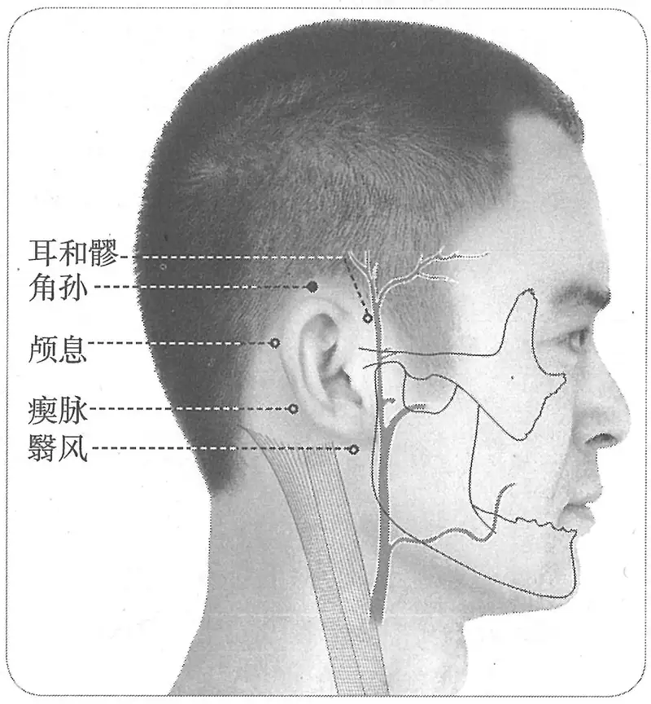

**图2-295　角孙穴图**

　3. 在耳上廓表之中间上，发际之下，开口有空。（《素问·气府论》王冰注、《针灸聚英》、《医学入门》、《针方六集》、《类经图翼》、《循经考穴编》、《审视瑶函》、《医宗金鉴·刺灸心法要诀》、《针灸逢源》）

　4. 侧头部在耳上者六穴，率谷最上，天冲次之，角孙最下。（《医学纲目》卷八）

　5. 耳壳上角之发际，陷凹处，张口微有空。（《针灸十四经穴位考订》）

　6. 统编针灸学教材

　　(1) 部位：耳廓上尖中间。取穴：以耳翼向前方折曲，当耳翼尖所着之处取之，或以指按着使口张合，其处牵动者是。（1957年南京《针灸学》）

　　(2) 部位：耳廓上正中，发际处。取穴：以耳翼向前方折曲，当耳翼尖所着之处取之。（1版《针灸学讲义》）

　　(3) 部位：在耳廓中间，开口有空。取穴：在耳尖正上方，颞颥部入发际处取之。（2版《针灸学讲义》）

　　(4) 当耳尖处的发际。（4、5版《针灸学》）

　　(5) 在头部，折耳廓向前，当耳尖直上入发际处。（6、7版《针灸学》）

　　(6) 当耳尖正上方入发际处。（《中国针灸学》）

#### 【类属】 

手少阳三焦经穴。

**脉气所发：**

　1. 手足少阳、手阳明之会。（《针灸甲乙经》卷三）

　2. 手太阳、手足少阳三脉之会。（《素问·气府论》王冰注、《太平圣惠方·针经》）

　3. 手足少阳之会。（《铜人腧穴针灸图经》卷中）

〔p.993 (인쇄 965)〕

**归经：**

　1. 手少阳经。（《外台秘要》卷三十九、《铜人腧穴针灸图经》卷上）

　2. 足少阳经。（《黄帝内经明堂》）

#### 【适应症】 

主治齿、面部病症。常用于齿痛，颊肿，目翳。

　1. 主齿牙不可嚼，龈肿。（《黄帝明堂经》）

　2. 主颈颔柱满。主颈肿项痛不可顾。（《千金要方》卷三十）

　3. 治目生肤翳，齿龈肿。（《铜人腧穴针灸图经》卷中）

　4. 头项强，唇吻强。（《针灸聚英》卷一、《针灸大成》、《针方六集》、《循经考穴编》）

**按**：此二症皆高武从《针灸资生经》误录《千金要方》之文。

　5. 主耳廓红肿，牙车不利。（《循经考穴编》下）

　6. 统编针灸学教材

　　(1) 主治耳廓红肿，目翳，齿痛，齿龈肿，牙车不利。（1957年南京《针灸学》、1版《针灸学讲义》）

　　(2) 主治耳部红肿，目翳，齿痛，唇燥，颈项强。（2版《针灸学讲义》）

　　(3) 主治耳鸣，目翳，龈肿，唇燥，项强。（4版《针灸学》）

　　(4) 主治颊肿，目翳，齿痛，项强。（5、6版《针灸学》）

　　(5) 主治：①头痛、项强；②目赤肿痛、目翳；③齿痛、颊肿。（7版《针灸学》）

　　(6) 主治耳鸣，目赤肿痛，龈肿，齿痛，痄腮。（《中国针灸学》）

**文献分析**：教材中“头痛、项强”，乃承袭高武《针灸聚英》之误，今去之。

#### 附：临床应用举例 

　1. 治小儿暴痫……次灸两耳门当耳，开口则骨解开动张陷是也。次灸两耳上，卷耳取之，当卷耳上头是也。（《千金要方》卷五）

　2. 流行腮腺炎，灯火灸角孙穴治疗。[江西中医药，1996（增刊）：134]

　3. 咽喉肿痛，角孙、翳风。用火柴划燃迅速点穴，刹时离穴。[中国针灸，1988，8（6）：55]

#### 【操作】 

平刺0.3~0.5寸。

　1. 刺入三分，灸三壮。（《黄帝明堂经》）

　2. 《明》云针八分。（《针灸资生经》卷一）

**按**：《太平圣惠方》作“针三分”，王执中抄录有误。

　3. 禁针。（《医学入门》卷一）

　4. 不宜针，灸三壮。明堂：针八分。（《针灸十四经穴位考订》）

　5. 统编针灸学教材

　　(1) 针一分，沿皮刺，灸三壮。（1957年南京《针灸学》、1版《针灸学讲义》）

　　(2) 向下斜刺1分，艾条灸3分钟。（2版《针灸学讲义》）

　　(3) 平刺0.3~0.5寸。（4、5、7版《针灸学》）

　　(4) 平刺0.3~0.5寸；可灸。（6版《针灸学》、《中国针灸学》）

### （二十一）耳门 Ěrmén TE21 出《黄帝明堂经》 

#### 【提要索隐】 

**穴名**：耳门，古代文献中有“同名异穴”现象。

〔p.994 (인쇄 966)〕

**部位**：在耳区，耳屏上切迹与下颌骨髁突之间的凹陷中。

**适应症**：主治耳、齿部病症。常用于耳鸣，耳聋，齿痛，颊肿痛。

**针刺操作**：张口，直刺0.5~1寸。

#### 【名实考】 

需要注意的是，《千金翼方》所载“耳门”穴与本穴非同一穴。

　1. 耳门在耳前起肉当耳缺者。（《黄帝明堂经》）

　2. 以穴在耳门旁，故曰耳门。（《经穴解》）

#### 耳门与听宫、听会毗邻关系 

此三穴均以下颌头髁突前后的凹陷定位，向前移动而堵上原先的凹陷，因此取下关穴时要闭口；耳门、听宫、听会3穴均从上而下分列在髁突后的很小的凹陷中，当张口时，髁突向前移动，显现出较大的凹陷，即古人所说“开口则骨解开，动张陷是也”（《千金要方》卷八）。因此取髁突后的这3个穴，要张口取之。微张口时，耳屏正中前缘凹陷中为听宫穴，其上方凹陷即耳门穴，下方凹陷为听会穴。耳门的前上方颞浅动脉触诊点的后缘为耳和髎穴。翼点处脑膜中动脉触诊点处为太阳穴。

取准这三穴的关键在于下颌骨髁突的体表定位以及颌关节开合时髁突的位置变化规律。髁突（condylar process）在耳屏前可以摸到。当张口和闭口时，可感觉到颞下颌关节运动。张口时髁突向前下降，指尖可以放入空出的窝内。在正常下颌开闭运动时，可触到髁突前后滑动。

#### “耳门”同名异穴辨 

听会在上关下一寸动脉宛宛中，一名耳门，针入三分，主耳聋、耳中如蝉鸣。通耳灸，日五壮至七壮止。十日后还依前灸之。（《千金翼方》卷二十六）

**按**：此处“耳门”是作为听会穴的别名，今考此段文字出自甄权《针经》，《太平圣惠方·针经》在引录时无“一名耳门”四字。

#### 相关穴及刺激点 

耳颞神经刺激点：位于耳屏上切迹前方的沟中，颞浅动脉的后侧。主治偏头痛，耳颞神经痛，耳鸣，耳聋。刺法：先在耳屏前摸及颞浅动脉的跳动，在其后侧缘进针，平刺1.5~2.0cm。刺中时，耳前、颞部有麻胀感，有时有鼓膜向外鼓胀感。（《实用神经干电刺激疗法》）

#### 【定位】 

**部位**：在耳区，耳屏上切迹与下颌骨髁突之间的凹陷中（图2-296）。

**取穴**：微张口，耳屏上切迹前的凹陷中，听宫直上。

　1. 在耳前起肉，当耳缺者。（《黄帝明堂经》、《太平圣惠方·针经》、《铜人腧穴针灸图经》、《圣济总录》、《针灸资生经》、《针灸集成》、《琼瑶神书》、《十四经发挥》、《神应经》、《医学纲目》、《针灸聚英》、《古今医统》、《医学入门》、《针灸大成》、《针方六集》、《类经图翼》、《循经考穴编》、《医宗金鉴·刺灸心法要诀》、《针灸易学》、《针灸逢源》）

　2. 在耳前起肉，当缺陷者中。（《太平圣惠方·明堂》）

　3. 在耳前当耳缺处起肉。（《窦太师针经》）

　4. 耳前肉峰上缺口前之陷凹中。（《针灸十四经穴位考订》）

　5. 统编针灸学教材

　　(1) 部位：耳前起肉当耳缺者陷中。取穴：于耳翼前方，耳珠之上部缺口处微前陷中取之。（1957年南京《针灸学》）

〔p.995 (인쇄 967)〕

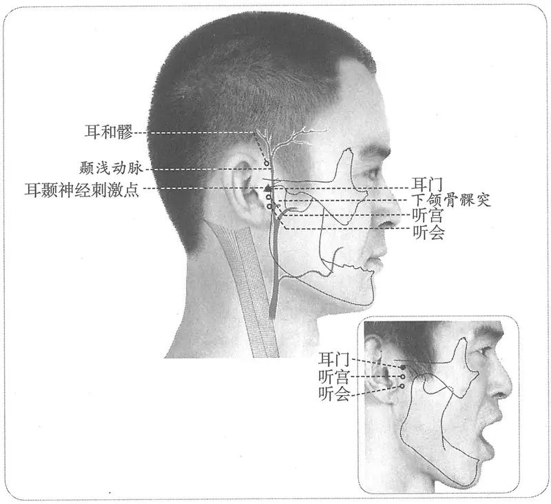

**图2-296　耳门穴与相关刺激点**

　　(2) 部位：耳缺前陷中。取穴：在小肠经听宫穴上方，耳珠之上部缺口处，微前陷中取之。（1版《针灸学讲义》）

　　(3) 部位：在耳前起肉当耳缺者。取穴：在耳屏上切迹之前与下颌髁状突稍上方之凹陷处，开口取穴。（2版《针灸学讲义》）

　　(4) 耳屏上切迹前，下颌骨髁状突后缘凹陷中。（4、5版《针灸学》）

　　(5) 在面部，当耳屏上切迹的前方，下颌骨髁状突后缘，张口有凹陷处。（6、7版《针灸学》）

　　(6) 耳屏上切迹前方下颌骨髁正突稍上方之凹陷中，张口取之。（《中国针灸学》）

**文献分析**：本穴定位，《黄帝明堂经》作“在耳前起肉当耳缺者”，所说“耳前起肉”指耳屏，“耳缺”指耳屏上切迹。《针灸秘法全书》曰：“耳门穴，经曰在耳前起肉当耳缺者。今详此穴与听会相近，耳前起肉者即耳掩耳肉也，其肉中突，起如豆，各有缺。耳门穴正当下缺之前隐隐微有动脉”。

#### 【类属】 

手少阳三焦经穴。

**归经：**

　1. 足阳明经。（《外台秘要》卷三十九、《黄帝内经明堂》）

　2. 手少阳经。（《铜人腧穴针灸图经》卷上）

**按**：耳门穴，《黄帝明堂经》未注明脉气所发之经，故归经难以一致。杨上善、王焘归入足阳明，王惟一归入手少阳。从该穴部位看，似与少阳经更相近。宋以后腧穴书多从《铜人腧穴针灸图经》之说，将该穴归于手少阳经。

#### 【适应症】 

主治耳、齿部病症。常用于耳鸣，耳聋，齿痛，颊肿痛。

　1. 主耳聋鸣，上齿龋，头颔痛。（《黄帝明堂经》）

〔p.996 (인쇄 968)〕

　2. 耳痛。（《外台秘要》卷三十九）

　3. 主耳有脓及底耳、聤耳。（《太平圣惠方》）

　4. 耳有脓汁出，生疮，聤耳聤耳，耳鸣如蝉声，重听无所闻，齿龋。（《铜人腧穴针灸图经》卷中）

　5. 唇吻强。（《针灸聚英》卷一、《古今医统》、《针灸大成》）

**按**：此乃高武从《针灸资生经》误录《千金要方》兑端穴主治。

　6. 窦太师针灸遗存

　　(1) 治牙疼，口噤不开，两颔红肿，宜泻之则效。（《窦太师针经》）

　　(2) 主牙疼口噤不开，两目红肿。（《针方六集》卷五）

　　(3) 主口噤天吊。（《循经考穴编》下）

　7. 统编针灸学教材

　　(1) 主治耳聋，耳鸣，耵耳，齿痛。（1957年南京《针灸学》，1版《针灸学讲义》，5、6版《针灸学》）

　　(2) 主治耳聋，耳鸣，耵耳，齿痛，颈颔痛，唇吻强。（2版《针灸学讲义》）

　　(3) 主治耳鸣，耳聋，耵耳，齿痛，颈颔痛。（4、7版《针灸学》）

　　(4) 主治耳鸣，耳聋，耵耳，齿痛，唇吻强。（《中国针灸学》）

**文献分析**：《太平圣惠方》所载本穴主治，乃误录自《外台秘要》卷三十九“耳门”穴禁忌症“耳中有脓及底耳，聤耳，皆不宜灸”（此说出《灵枢·厥病》，原作“不可刺”）。因此句置于原《黄帝明堂经》耳门穴主治症之前，句首又衍一“主”字，故《针经》、《明堂》皆将其抄录于耳门穴主治症中，宋以后针灸书皆沿袭此误。教材中“耵耳”、“唇吻强”乃承袭《太平圣惠方》、《针灸聚英》之误，今去之。

#### 附：临床应用举例 

　1. 治小儿暴痫……次灸两耳门当耳，开口则骨解开，动张陷是也。次灸两耳上，卷耳取之，当卷耳上头是也。（《千金要方》卷五）

　2. 美尼尔氏病，耳门穴、听宫穴，针刺治疗。[陕西中医，1985，6（8）：365]

#### 【操作】 

张口，直刺0.5~1寸。

　1. 耳痛不可刺者，耳中有脓，若有干耵聍，耳无闻也。（《灵枢·厥病》）

　2. 刺入三分，留三呼，灸三壮。（《针灸甲乙经》卷三）

　3. 耳中有脓，禁不可灸。（《针灸甲乙经》卷五）

　4. 耳中有脓及适低无灸。（《千金要方》卷二十九、《外台秘要》）

**按**：“适低”即耵聍。《外台秘要》作“底耳聤耳”。

　5. 禁不宜灸，有病不过三壮。（《太平圣惠方·明堂》）

　6. 横针入半寸，灸二七壮。（《窦太师针经》）

　7. 针三分，灸三壮。（《针灸十四经穴位考订》）

　8. 统编针灸学教材

　　(1) 针一至二分，灸二至三壮。（1957年南京《针灸学》、1版《针灸学讲义》）

　　(2) 直刺3~5分，艾条灸3~5分钟。（2版《针灸学讲义》）

　　(3) 张口，直刺0.5~1寸。（4、5、7版《针灸学》）

　　(4) 张口，直刺0.5~1寸；可灸。（6版《针灸学》）

　　(5) 直刺0.3~0.5寸。可灸。（《中国针灸学》）

〔p.997 (인쇄 969)〕

　9. 斜刺，张口时，向下透听宫、听会，进针1.5~2.5寸。感应：局部酸胀，有时可扩散至半侧面部。温灸3~5分钟。（上海《针灸学》）

**文献分析**：本穴只是当耳中有脓及耵聍时，不宜灸，后人不解而将本穴归入禁灸穴。

### （二十二）耳和髎 Ěrhéliáo TE22 出《黄帝明堂经》 

#### 【提要索隐】 

**穴名**：耳和髎，古称“和窌”、“和髎”。

**部位**：在头部，鬓发后缘，耳郭根的前方，颞浅动脉的后缘。

**适应症**：主治头面部病症。常用于头痛，耳鸣，口噤。

**针刺操作**：避开动脉，斜刺或平刺。

#### 【名实考】 

和髎，与“禾髎”音同形近，古医籍中常混淆，王执中编《针灸资生经》已为此所困，今人更真伪难辨，干脆说“和髎，一名禾髎”（如承淡安《中国针灸学》）。

　1. 锐发下各一。王冰注曰：谓和髎二穴也。（《素问·气府论》）

　2. 和髎，在耳前兑发下动脉。手足少阳、手太阳之会。（《黄帝明堂经》）

#### “和髎”与“禾髎”相混例 

　1. 禾窌，在耳前兑发下动脉，手足少阳、手太阳之会。（通行本《针灸甲乙经》卷三）

　2. 迎香，在和窌上一寸，鼻孔旁。（《千金要方》卷二十九）

　3. 迎香二穴，在和窌上一寸，鼻下孔旁是穴。（《太平圣惠方·针经》）

　4. 和窌，直鼻孔下，夹水沟旁五分。（未经宋人校本《孙真人千金方》卷二十九）

　5. 和窌二穴，在鼻孔下，夹水沟旁五分是穴。手阳明脉气所发。（《太平圣惠方·针经》）

　6. 禾髎耳前兑发从。（《针灸问对》）

　7. 和髎，耳门前兑发下横动脉。（《医学入门》卷一、《循经考穴编》）

**按**：以上各书所说“和髎”、“禾髎”皆相混。有些错误是由版本因素造成，例如明抄本《针灸甲乙经》上条作“和髎”，无误；《孙真人千金方》“和窌”，宋校本作“禾髎”，无误。

#### “巨髎”误作“和髎”例 

和髎见鼻涕疗口僻《明》，列缺《下》同、地仓见偏风疗口㖞，巨髎疗面风寒鼻准上肿、痈痛招摇视瞻瘈疭口僻。（《针灸资生经》卷六）

面风寒，鼻准上肿，痈痛，招摇视瞻，瘈疭，口噼。（《针灸聚英》、《针灸大成》、《针方六集》）

**按**：高武《针灸聚英》本穴主治显然是误录《针灸资生经》“巨髎”穴主治。

#### 相关穴及刺激点 

颞颥：位于耳轮棘前发际的稍后方，即和髎穴微后方。主治牙痛。针5分，针感局部酸胀。（《针灸经外奇穴图谱（续集）》）

#### 【定位】 

**部位**：在头部，鬓发后缘，耳郭根的前方，颞浅动脉的后缘（图2-297）。

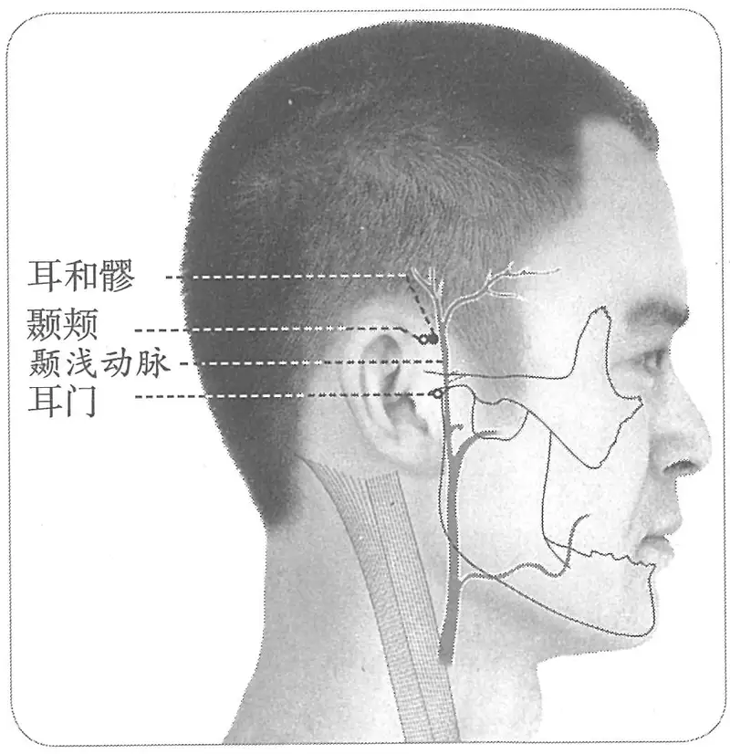

**图2-297　耳和髎与相关穴图**

〔p.998 (인쇄 970)〕

**取穴**：在耳门穴上方，平耳郭根前，鬓发后缘，当颞浅动脉后方取之。

　1. 在耳前兑发下动脉。（《黄帝明堂经》、《铜人腧穴针灸图经》、《圣济总录》、《针灸资生经》、《窦太师针经》、《琼瑶神书》、《十四经发挥》、《医学纲目》、《针灸聚英》、《医学入门》、《针灸大成》、《针灸六集》、《类经图翼》、《循经考穴编》、《医宗金鉴·刺灸心法要诀》、《针灸易学》、《针灸逢源》）

　2. 耳门前上方、耳前锐发际。（《针灸十四经穴位考订》）

　3. 统编针灸学教材

　　(1) 部位：耳前锐发下，横动脉中。取穴：从耳门之前微上方，锐发下动脉处取之。（1957年南京《针灸学》）

　　(2) 部位：耳前锐发下。取穴：在耳门穴之微上方一横指发际动脉处取之。（1版《针灸学讲义》）

　　(3) 部位：在耳前兑发下横动脉。取穴：在耳门之前上方，平耳廓根前，鬓发后缘，当颞浅动脉后方取之。（2版《针灸学讲义》）

　　(4) 鬓发后缘，平目外眦，颞浅动脉后缘。（4版《针灸学》）

　　(5) 鬓发后缘，平耳廓根前，当颞浅动脉后缘。（5、7版《针灸学》）

　　(6) 在头侧部，当鬓发后缘，平耳廓根之前方，颞浅动脉的后缘。（6版《针灸学》）

　　(7) 在耳门之前上方，平耳廓根前，鬓发后缘，于颞浅动脉后缘取穴。（《中国针灸学》）

**文献分析**：历代文献记载基本一致。在耳前兑发下横动脉，出《黄帝明堂经》，《千金要方》等书从之。“耳前兑发”指鬓发，“横动脉”指颞浅动脉。在耳屏的前方颞浅动脉（superficial temporal artery）越过颧弓，在此处可摸到该动脉的搏动，和髎穴定位之“动脉”即此脉。耳屏和对耳屏之间是屏间切迹，切迹的前方是面动脉（facial nerve）出颅部位的表面标志，听会穴定位之“动脉”即此脉。

#### 【类属】 

手少阳三焦经穴。

**脉气所发：**

　1. 手足少阳、手太阳之会。（《针灸甲乙经》卷三、《黄帝内经明堂》）

　2. 手足少阳二脉之会。（《外台秘要》卷三十九、《素问·气府论》王冰注）

　3. 手少阳脉气所发。（《铜人腧穴针灸图经》卷中）

**归经**：手少阳经。（《外台秘要》卷三十九、《铜人腧穴针灸图经》卷上）

#### 【适应症】 

主治头面部病症。常用于头痛，耳鸣，口噤。

　1. 主头重颔痛，引耳中聤聤嘈嘈。（《黄帝明堂经》）

　2. 治牙车引急，头重痛，耳中嘈嘈，颔颊肿。（《铜人腧穴针灸图经》卷中、《圣济总录》、《针灸聚英》、《针灸大成》、《类经图翼》）

　3. 窦太师针灸遗存

　　(1) 治头角痛，发秃，发颐痈疽，小儿疮疮。（《窦太师针经》）

　　(2) 主头角痛。（《针方六集》卷五）

　4. 面风寒，鼻准上肿，痈痛，招摇视瞻，瘈疭，口噼。（《针灸聚英》卷一、《针灸大成》、《针方六集》）

**按**：此乃高武从《针灸资生经》误录《太平圣惠方·明堂》“巨髎”穴主治。

　5. 统编针灸学教材

　　(1) 主治耳鸣，头重痛，牙车急。（1957年南京《针灸学》、1版《针灸学讲义》）

〔p.999 (인쇄 971)〕

　　(2) 主治耳鸣，头重痛，牙关拘急，颈颔肿，鼻准肿痛，口㖞。（2版《针灸学讲义》）

　　(3) 主治头重痛，耳鸣，牙关拘急，颈颔肿，口㖞。（4版《针灸学》）

　　(4) 主治头痛，耳鸣，牙关紧闭，口㖞。（5、6、7版《针灸学》）

　　(5) 主治偏头痛，耳鸣，牙关拘急。（《中国针灸学》）

**文献分析**：教材中“鼻准肿痛，口㖞”症乃承袭高武《针灸聚英》之误，误录“巨髎”穴主治。

#### 【操作】 

避开动脉，斜刺或平刺。

　1. 刺入三分，灸三壮。（《黄帝明堂经》）

　2. 针入七分，可灸三壮。（《铜人腧穴针灸图经》卷中）

　3. 针入一分，沿皮向后一寸五分。（《窦太师针经》、《循经考穴编》）

　4. 禁灸。（《医学入门》卷一）

　5. 统编针灸学教材

　　(1) 针一至二分，灸一至二壮。（1957年南京《针灸学》、1版《针灸学讲义》）

　　(2) 斜刺1~3分，艾条灸1~3分钟。（2版《针灸学讲义》）

　　(3) 避开动脉，斜刺或平刺0.3~0.5寸。（4、5版《针灸学》）

　　(4) 避开动脉，斜刺或平刺0.3~0.5寸；可灸。（6版《针灸学》）

　　(5) 避开动脉，平刺0.3~0.5寸。（7版《针灸学》）

　　(6) 避开动脉，斜刺0.1~0.3寸。可灸。（《中国针灸学》）

### （二十三）丝竹空 Sīzhúkōng TE23 出《黄帝明堂经》 

> **(23) 사죽공(絲竹空) Sīzhúkōng (TE23) — 『황제명당경(黃帝明堂經)』에 처음 보임**

#### 【提要索隐】 

> **【요점 정리(提要索隱)】**

**穴名**：丝竹空，一名目窌。

> **혈명**: 사죽공(絲竹空). 다른 이름은 목료(目窌)이다.

**部位**：在面部，眉梢凹陷中。

> **부위**: 얼굴에 있으며, 눈썹꼬리의 오목한 곳 가운데이다.

**归经**：手少阳三焦经。**按**：宋以前文献归经不一致。

> **귀경**: 수소양삼초경(手少陽三焦經). **안(按)**: 송나라 이전 문헌에서는 귀경이 일치하지 않는다.

**适应症**：主治头目部病症。常用于头痛，眩晕，目赤肿痛，眼睑瞤动；癫痫、目上视。

> **적응증**: 머리와 눈 부위의 병증을 주치한다. 두통, 현훈(眩暈), 눈이 붉고 붓고 아픈 것[目赤腫痛], 눈꺼풀 떨림[眼瞼瞤動]; 전간(癲癇), 눈이 위로 치켜뜨이는 것[目上視]에 흔히 쓴다.

**针刺操作**：平刺。

> **자침 조작**: 평자(平刺).

#### 【名实考】 

> **【이름과 실체 고증(名實考)】**

丝竹空，一名目窌，传世本《针灸甲乙经》误作“巨窌”；《针灸大全》误作“月髎”，而该书另一传本《杨敬斋针灸全书》作“目髎”，无误。又窦太师针灸将瞳子髎与本穴相混。

> 사죽공은 다른 이름이 목료인데, 전해 오는 판본[傳世本] 『침구갑을경(鍼灸甲乙經)』에는 “거료(巨窌)”로 잘못 적혀 있고, 『침구대전(鍼灸大全)』에는 “월료(月髎)”로 잘못 적혀 있으나, 이 책의 다른 전본인 『양경재침구전서(楊敬齋鍼灸全書)』에는 “목료(目髎)”로 되어 있어 잘못이 없다. 또 두태사(竇太師) 침구는 동자료(瞳子髎)를 이 혈과 혼동하였다.

　1. 丝竹空，一名目髎，在眉后陷者中，足少阳脉气所发。（《黄帝明堂经》）

> 1. 사죽공은 다른 이름이 목료이다. 눈썹 뒤 오목한 곳 가운데에 있으며, 족소양맥(足少陽脈)의 기가 나오는 곳[脈氣所發]이다. （『황제명당경』）

　2. 此穴虽在目旁，而实通耳之窍以听声者，故曰丝竹空。（《经穴解》）

> 2. 이 혈은 눈 옆에 있지만 실은 귀의 구멍과 통하여 소리를 듣게 하므로 사죽공이라 한다. （『경혈해(經穴解)』）

#### 丝竹空、瞳子髎、鱼尾穴辨 

> **사죽공·동자료·어미혈 변별(絲竹空、瞳子髎、魚尾穴辨)**

　1. 丝竹空二穴，一名目髎。在眉后入发际陷中。足少阳脉气发。针一分，沿皮向前透率谷穴。（《窦太师针经》）

> 1. 사죽공 두 혈. 다른 이름은 목료이다. 눈썹 뒤 발제(髮際)로 들어간 오목한 곳 가운데에 있다. 족소양맥의 기가 나온다. 1푼 찌르고 피부를 따라 앞쪽으로 솔곡혈(率谷穴)까지 투자(透刺)한다. （『두태사침경(竇太師鍼經)』）

　2. 鱼尾，即瞳子髎。在目上眉外尖。针一分，沿皮向内透鱼腰，泻。禁灸。（《针灸玉龙歌》）

> 2. 어미(魚尾)는 곧 동자료이다. 눈 위 눈썹 바깥 끝에 있다. 1푼 찌르고 피부를 따라 안쪽으로 어요(魚腰)까지 투자하며, 사(瀉)한다. 뜸은 금한다. （『침구옥룡가(鍼灸玉龍歌)』）

　3. 瞳子窌二穴，在眉外五分尖尽处。手太阳、足少阳之会。针一分，沿皮内透鱼腰。治目红肿，冷泪，补；垂廉翳膜；泻胬肉扳睛，泻。（《窦太师针经》）

> 3. 동자료(瞳子窌) 두 혈은 눈썹 바깥 5푼, 끝이 다하는 곳에 있다. 수태양(手太陽)·족소양(足少陽)의 회혈이다. 1푼 찌르고 피부를 따라 안쪽으로 어요까지 투자한다. 눈이 붉게 붓는 것과 냉루(冷淚)를 치료할 때는 보(補)한다. 수렴예막(垂廉翳膜). 노육반정(胬肉扳睛)은 사하는데, 사법을 쓴다. （『두태사침경』）

　4. 瞳子窌二穴，面部四行第六穴。在眉外尖尽处是穴。刺入一分，刺沿皮向内一寸。治目红肿痛，泻；冷泪出，宜补，禁灸。（乙抄本《窦太师针经》）

> 4. 동자료 두 혈은 얼굴 부위 넷째 줄의 여섯째 혈이다. 눈썹 바깥 끝이 다하는 곳이 이 혈이다. 1푼 찔러 넣고, 피부를 따라 안쪽으로 1촌 찌른다. 눈이 붉게 붓고 아픈 것을 치료할 때는 사하고, 냉루가 나올 때는 보해야 하며, 뜸은 금한다. （을초본(乙抄本) 『두태사침경』）

　5. 瞳子髎，一名前关。在目眦外五分陷中，眉尖尽处。一分，沿皮向内一寸。治目肿红痛，宜泻；冷泪出，常宜补，禁灸。（《大本琼瑶神书》）

> 5. 동자료는 다른 이름이 전관(前關)이다. 눈초리 바깥 5푼 오목한 곳 가운데, 눈썹 끝이 다하는 곳에 있다. 1푼 찌르고 피부를 따라 안쪽으로 1촌 [찌른다]. 눈이 붓고 붉고 아픈 것을 치료할 때는 사해야 하고, 냉루가 나올 때는 늘 보해야 하며, 뜸은 금한다. （『대본경요신서(大本瓊瑤神書)』）

〔p.1000 (인쇄 972)〕

　6. 瞳子髎二穴，一名太阳，一名前关。在目外去眦五分，尖尽处是穴。手太阳、手足少阳之会。《针经》刺入三分，灸三壮。窦氏针入一分，沿皮向上透鱼腰穴。（《针方六集》卷一）

> 6. 동자료 두 혈은 다른 이름이 태양(太陽), 또 다른 이름이 전관이다. 눈 바깥으로 눈초리에서 5푼 떨어진 곳, 끝이 다하는 곳이 이 혈이다. 수태양·수족소양의 회혈이다. 『침경(鍼經)』에서는 3푼 찔러 넣고 뜸 3장을 뜬다고 하였다. 두씨(竇氏)는 1푼 찔러 넣고 피부를 따라 위쪽으로 어요혈까지 투자한다. （『침방육집(鍼方六集)』 권1）

**按**：《黄帝明堂经》眉头为“攒竹”穴，眉尾为“丝竹空”穴，后世又以眉中为“鱼腰”穴，故又称眉尾为“鱼尾”，近人则称眉头攒竹为“鱼头”穴。是则“鱼尾”实为丝竹空穴的俗称。因《针灸玉龙歌》、《窦太师针经》将鱼尾穴与瞳子髎穴混同，丝竹空穴便只能移位——眉后入发际，位于率谷穴之后了。至于《大本琼瑶神书》、《针方六集》则将《黄帝明堂经》所载之瞳子髎与窦氏错会之瞳子髎定位文字拧在一起，显得更加混乱。理清了窦太师针灸这阴差阳错的关系之后，我们可以直接将其瞳子髎穴下主治及刺灸法内容归入丝竹空穴即可。

> **안(按)**: 『황제명당경』에서는 눈썹머리를 “찬죽(攢竹)”혈, 눈썹꼬리를 “사죽공”혈이라 하였는데, 후세에 다시 눈썹 가운데를 “어요”혈이라 하였으므로 눈썹꼬리를 “어미”라고도 부르게 되었고, 근래 사람들은 눈썹머리의 찬죽을 “어두(魚頭)”혈이라 부른다. 그렇다면 “어미”는 실은 사죽공혈의 속칭이다. 『침구옥룡가』와 『두태사침경』이 어미혈을 동자료혈과 혼동하였기 때문에 사죽공혈은 자리를 옮길 수밖에 없었다 — 눈썹 뒤 발제 안으로 들어가 솔곡혈 뒤에 놓이게 된 것이다. 『대본경요신서』와 『침방육집』에 이르러서는 『황제명당경』에 실린 동자료와 두씨가 잘못 이해한 동자료의 위치 문장을 한데 꼬아 놓아 더욱 혼란스러워졌다. 두태사 침구의 이 엇갈린 관계를 정리하고 나면, 그 동자료혈 아래의 주치와 자구법(刺灸法) 내용을 곧바로 사죽공혈로 옮겨 넣으면 된다.

#### 【定位】 

> **【위치(定位)】**

**部位**：在面部，眉梢凹陷中（图2-298）。

> **부위**: 얼굴에 있으며, 눈썹꼬리의 오목한 곳 가운데이다（그림 2-298）.

**取穴**：瞳子髎穴直上，眉毛外端陷中取之。

> **취혈**: 동자료혈 바로 위, 눈썹 바깥 끝의 오목한 곳 가운데에서 잡는다.

　1. 在眉后陷者中。（《黄帝明堂经》、《铜人腧穴针灸图经》、《圣济总录》、《针灸资生经》《针灸集成》《十四经发挥》、《神应经》、《医学纲目》、《针灸聚英》、《古今医统》、《针灸大成》、《类经图翼》、《循经考穴编》、《医宗金鉴·刺灸心法要诀》、《针灸易学》、《针灸逢源》）

> 1. 눈썹 뒤 오목한 곳 가운데에 있다. （『황제명당경』, 『동인수혈침구도경(銅人腧穴鍼灸圖經)』, 『성제총록(聖濟總錄)』, 『침구자생경(鍼灸資生經)』, 『침구집성(鍼灸集成)』, 『십사경발휘(十四經發揮)』, 『신응경(神應經)』, 『의학강목(醫學綱目)』, 『침구취영(鍼灸聚英)』, 『고금의통(古今醫統)』, 『침구대성(鍼灸大成)』, 『유경도익(類經圖翼)』, 『순경고혈편(循經考穴編)』, 『의종금감(醫宗金鑑)』 「자구심법요결(刺灸心法要訣)」, 『침구이학(鍼灸易學)』, 『침구봉원(鍼灸逢源)』）

　2. 眉毛骨后陷中。（《医学入门》卷一）

> 2. 눈썹뼈 뒤 오목한 곳 가운데. （『의학입문(醫學入門)』 권1）

　3. 眉尾端陷中。（《针灸十四经穴位考订》）

> 3. 눈썹꼬리 끝의 오목한 곳 가운데. （『침구 십사경 혈위 고정[鍼灸十四經穴位考訂]』）

　4. 统编针灸学教材

> 4. 통편(統編) 침구학 교재

　　(1) 部位：眉之外端陷中。取穴：从眉毛稍外端陷中取之。（1957年南京《针灸学》）

> (1) 부위: 눈썹 바깥 끝의 오목한 곳 가운데. 취혈: 눈썹꼬리 바깥 끝의 오목한 곳 가운데에서 잡는다. （1957년 난징(南京) 『침구학[鍼灸學]』）

　　(2) 部位：眉之外端陷中。取穴：胆经瞳子髎直上端陷中取之。（1版《针灸学讲义》）

> (2) 부위: 눈썹 바깥 끝의 오목한 곳 가운데. 취혈: 담경(膽經) 동자료 바로 위 끝의 오목한 곳 가운데에서 잡는다. （1판 『침구학 강의[鍼灸學講義]』）

　　(3) 部位：在眉后陷者中。取穴：眉毛外端，略入于眉毛的颧突之后缘凹陷处取之。（2版《针灸学讲义》）

> (3) 부위: 눈썹 뒤 오목한 곳 가운데에 있다. 취혈: 눈썹 바깥 끝, 눈썹 안으로 조금 들어간 관골 돌기[顴突]의 뒤 가장자리 오목한 곳에서 잡는다. （2판 『침구학 강의』）

　　(4) 眉梢处凹陷中。（4、5版《针灸学》）

> (4) 눈썹꼬리의 오목한 곳 가운데. （4·5판 『침구학』）

　　(5) 在面部，当眉梢凹陷处。（6版《针灸学》）

> (5) 얼굴에 있으며, 눈썹꼬리의 오목한 곳에 해당한다. （6판 『침구학』）

　　(6) 眉梢的凹陷处。（7版《针灸学》）

> (6) 눈썹꼬리의 오목한 곳. （7판 『침구학』）

　　(7) 眉梢外端凹陷中。（《中国针灸学》）

> (7) 눈썹꼬리 바깥 끝의 오목한 곳 가운데. （『중국침구학[中國鍼灸學]』）

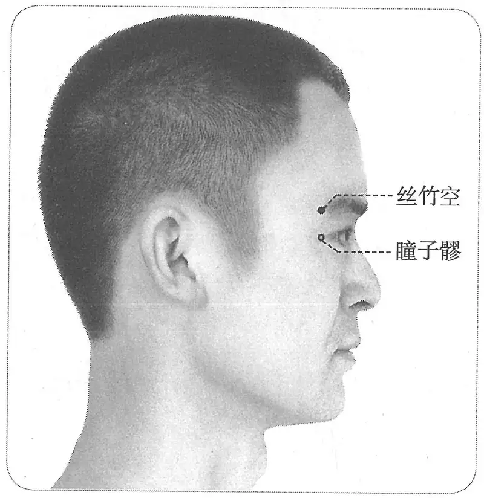

**图2-298　丝竹空穴图**

> **그림 2-298** 사죽공혈 그림

**文献分析**：《黄帝明堂经》之在眉后陷者中，即意在眉梢凹陷处。多数文献从之。《针方六集》“在眉后入发际凹中”之说，与发际内穴相混，不可从。

> **문헌 분석**: 『황제명당경』의 「눈썹 뒤 오목한 곳 가운데에 있다」는 곧 눈썹꼬리의 오목한 곳을 뜻한다. 대부분의 문헌이 이를 따랐다. 『침방육집』의 “눈썹 뒤 발제로 들어간 오목한 곳 가운데에 있다”는 설은 발제 안의 혈과 혼동한 것이므로 따를 수 없다.

#### 【类属】 

> **【분류(類屬)】**

手少阳三焦经穴。

> 수소양삼초경의 혈이다.

**脉气所发：**

> **맥기가 나오는 곳[脈氣所發]:**

　1. 足少阳脉气所发。（《针灸甲乙经》卷三、《外台秘要》）

> 1. 족소양맥의 기가 나오는 곳이다. （『침구갑을경』 권3, 『외대비요(外臺秘要)』）

　2. 手少阳脉气所发。（《素问·气府论》王冰注）

> 2. 수소양맥의 기가 나오는 곳이다. （『소문(素問)』 「기부론(氣府論)」 왕빙(王冰)의 주）

**归经：**

> **귀경:**

　1. 足少阳经。（《外台秘要》卷三十九）

> 1. 족소양경. （『외대비요』 권39）

　2. 手少阳经。（《铜人腧穴针灸图经》卷上）

> 2. 수소양경. （『동인수혈침구도경』 권상）

〔p.1001 (인쇄 973)〕

**文献分析**：丝竹空穴，《针灸甲乙经》、《外台秘要》均作“足少阳脉气所发”，故王焘归入足少阳经；王冰注《素问·气府论》作“手少阳脉气所发”，王惟一《铜人腧穴针灸图经》卷上从之，而卷中仍作“足少阳脉气所发”。宋以后针灸书皆从《铜人腧穴针灸图经》卷上之说。日本针灸教学参考书《针灸医学》将本穴归入足少阳经。

> **문헌 분석**: 사죽공혈은 『침구갑을경』과 『외대비요』에서 모두 “족소양맥의 기가 나오는 곳”이라 하였으므로 왕도(王燾)는 족소양경에 넣었다. 왕빙은 『소문』 「기부론」에 주를 달면서 “수소양맥의 기가 나오는 곳”이라 하였고, 왕유일(王惟一)의 『동인수혈침구도경』 권상이 이를 따랐으나 권중에서는 여전히 “족소양맥의 기가 나오는 곳”이라 하였다. 송 이후의 침구서는 모두 『동인수혈침구도경』 권상의 설을 따랐다. 일본의 침구 교육 참고서 『침구의학[鍼灸醫學]』은 이 혈을 족소양경에 넣었다.

#### 【适应症】 

> **【적응증(適應症)】**

主治头目部病症。常用于头痛，眩晕，目赤肿痛、眼睑瞤动；癫痫、目上视。

> 머리와 눈 부위의 병증을 주치한다. 두통, 현훈, 눈이 붉고 붓고 아픈 것, 눈꺼풀 떨림; 전간, 눈이 위로 치켜뜨이는 것에 흔히 쓴다.

　1. 主眩，头痛。互引，目中赤䀮䀮。小儿脐风，目上插。痓，反目，憎风寒。风痫，癫疾，狂，烦满。（《黄帝明堂经》）

> 1. 어지럼[眩]과 두통을 주치한다. 서로 당기고[互引], 눈 속이 붉고 침침하다[目中赤䀮䀮]. 소아의 제풍(臍風)으로 눈이 위로 치켜 올라간다[目上插]. 치(痓)로 눈을 뒤집고[反目] 바람과 추위를 싫어한다. 풍간(風癇), 전질(癲疾), 광(狂), 번만(煩滿). （『황제명당경』）

**按**：以上病症主要为痓、痫、癫狂，其共有的特点是伴随“目上插”、“反目”、“目中赤䀮䀮”等目部症状，这是由本穴的部位所决定的，实际上主治的还是局部症状。

> **안(按)**: 위의 병증은 주로 치·간(癇)·전광(癲狂)인데, 공통적으로 “눈이 위로 치켜 올라감”, “눈을 뒤집음”, “눈 속이 붉고 침침함” 같은 눈 부위 증상을 동반한다. 이는 이 혈의 부위가 결정하는 것으로, 실제로 주치하는 것은 여전히 국소 증상이다.

　2. 治目眩头痛，目赤视物䀮䀮，风痫，目戴上不识人，眼睫毛倒，发狂吐涎沫，发即无时。（《铜人腧穴针灸图经》卷中）

> 2. 눈이 어지럽고 머리가 아픈 것, 눈이 붉고 사물이 침침하게 보이는 것, 풍간으로 눈이 위로 치켜뜨이고[目戴上] 사람을 알아보지 못하는 것, 속눈썹이 거꾸로 난 것[眼睫毛倒], 발광하여 거품 섞인 침을 토하며 발작이 때 없이 일어나는 것을 치료한다. （『동인수혈침구도경』 권중）

　3. 窦太师针灸遗存

> 3. 두태사 침구의 남은 자료[竇太師鍼灸遺存]

　　(1)（瞳子髎）治目红肿，冷泪；垂廉翳膜，胬肉扳睛。（《窦太师针经》）

> (1)（동자료）눈이 붉게 붓는 것, 냉루; 수렴예막, 노육반정을 치료한다. （『두태사침경』）

　　(2)（瞳子髎）主目痒冷泪，垂帘翳膜，胬肉扳睛，患由外眦始者。（《针方六集》卷五）

> (2)（동자료）눈 가려움과 냉루, 수렴예막(垂簾翳膜), 노육반정 가운데 병이 바깥 눈초리에서 시작된 것을 주치한다. （『침방육집』 권5）

　　(3)（瞳子髎）主目肿红痛；冷泪出。（《大本琼瑶神书》）

> (3)（동자료）눈이 붓고 붉고 아픈 것; 냉루가 나오는 것을 주치한다. （『대본경요신서』）

　4. 统编针灸学教材

> 4. 통편 침구학 교재

　　(1) 主治偏正头痛，目眩，目赤痛，眼睫毛倒，视物不明，面掣眉跳。（1957年南京《针灸学》）

> (1) 편두통과 정두통[偏正頭痛], 목현(目眩), 눈이 붉고 아픈 것, 속눈썹이 거꾸로 난 것, 사물이 잘 보이지 않는 것, 얼굴이 당기고 눈썹이 떨리는 것[面掣眉跳]을 주치한다. （1957년 난징 『침구학』）

　　(2) 主治偏正头痛，目疾，面掣眉跳。（1版《针灸学讲义》）

> (2) 편두통과 정두통, 눈병[目疾], 얼굴이 당기고 눈썹이 떨리는 것을 주치한다. （1판 『침구학 강의』）

　　(3) 主治头痛，目眩，目赤痛，眼睑瞤动，牙痛，癫痫。（2版《针灸学讲义》、4、7版《针灸学》）

> (3) 두통, 목현, 눈이 붉고 아픈 것, 눈꺼풀 떨림, 치통[牙痛], 전간을 주치한다. （2판 『침구학 강의』, 4·7판 『침구학』）

　　(4) 主治头痛，目赤肿痛，眼睑瞤动，齿痛，癫狂痫。（5、6版《针灸学》）

> (4) 두통, 눈이 붉고 붓고 아픈 것, 눈꺼풀 떨림, 치통[齒痛], 전광간(癲狂癇)을 주치한다. （5·6판 『침구학』）

　　(5) 主治头痛，目赤痛，目眩，眼睑瞤动，齿痛，口眼歪斜。（《中国针灸学》）

> (5) 두통, 눈이 붉고 아픈 것, 목현, 눈꺼풀 떨림, 치통, 구안와사(口眼喎斜)를 주치한다. （『중국침구학』）

**文献分析**：教材中“齿痛”一症未详所出，暂不收录。

> **문헌 분석**: 교재의 “치통” 한 증상은 출처가 분명하지 않으므로 일단 싣지 않는다.

#### 附：临床应用举例 

> **부: 임상 응용 예(臨床應用擧例)**

　1. 头痛

> 1. 두통

　　(1) 头风两额角痛不已：泻丝竹空、两攒竹出血、合谷。（《针灸集要·盘石金直刺秘传》）

> (1) 두풍(頭風)으로 양쪽 이마 모서리가 그치지 않고 아플 때: 사죽공을 사하고, 양쪽 찬죽을 찔러 피를 내며, 합곡(合谷)을 [찌른다]. （『침구집요(鍼灸集要)』 「반석금직자비전(盤石金直刺秘傳)」）

　　(2) 治偏正头痛，刺手少阳经丝竹空二穴，在眉后陷中，禁灸，以患人正坐，举手下针，针入三分。（《针经摘英集》）

> (2) 편두통·정두통을 치료할 때는 수소양경의 사죽공 두 혈을 찌른다. 눈썹 뒤 오목한 곳 가운데에 있으며, 뜸은 금한다. 환자를 바르게 앉혀 손을 들게 하고 침을 놓으며, 3푼 찔러 넣는다. （『침경적영집(鍼經摘英集)』）

　　(3) 偏正头风：中脘、风池、三里、合谷、丝竹空、解溪。问曰：已上穴法针之不效者，何也？答曰：亦有痰饮停滞胸膈，贼风窜入脑户，偏正头风，发来连年，皮向疼痛，或手足沉冷久而不治，变为瘫痪，亦分阴阳，针之或针力未到，故不动也。可针中脘，以舒下其痰，三里泻之，以去风。后针穴及前四穴，中脘、丝竹空、三里、解溪。（《针灸集成》第六方）

> (3) 편정두풍(偏正頭風): 중완(中脘)·풍지(風池)·삼리(三里)·합곡·사죽공·해계(解谿). 묻기를, 위의 혈법으로 침을 놓아도 효과가 없는 것은 어째서인가? 답하기를, 담음(痰飮)이 흉격(胸膈)에 머물러 막히고 적풍(賊風)이 뇌호(腦戶)로 스며든 경우도 있다. 편정두풍이 해마다 이어서 발작하고 피부가 아프거나[皮向疼痛], 손발이 무겁고 차가운데 오래 치료하지 않으면 탄탄(癱瘓)으로 바뀐다. 이것도 음양을 나누어야 하는데, 침을 놓았어도 침의 힘이 미치지 못했기 때문에 움직이지 않은 것이다. 중완을 찔러 담을 풀어 내려 주고, 삼리를 사하여 풍을 없앤다. 그 뒤 혈과 앞의 네 혈, 곧 중완·사죽공·삼리·해계를 찌른다. （『침구집성』 제6방） 〔역주: 원서의 「皮向」은 뜻이 서지 않는다 — 「皮肉」의 오식일 가능성이 있다.〕

　　(4) 丝竹疗头疼不忍。（《通玄指要赋》）

> (4) 사죽공은 참기 어려운 두통을 다스린다. （『통현지요부(通玄指要賦)』）

　　(5) 偏头痛：丝竹空透率谷治疗。[河北医学，1998，4（2）：65]

> (5) 편두통: 사죽공에서 솔곡으로 투자하여 치료한다. [『하북의학(河北醫學)』, 1998, 4（2）: 65]

　2. 眼疾

> 2. 눈병

　　(1) 眼暴赤肿痛：太阳、睛明、合谷、三里。问曰：此证从何而得？答曰：时气壅滞，当风卧睡，饥饱劳役，复刺后穴，不宜补：攒竹、丝竹空、太阳。（《针灸集成》第十六方）

> (1) 눈이 갑자기 붉게 붓고 아플 때[眼暴赤腫痛]: 태양·정명(睛明)·합곡·삼리. 묻기를, 이 증은 무엇으로 생기는가? 답하기를, 시기(時氣)가 막혀 정체되거나, 바람을 맞으며 누워 자거나, 굶주림과 포식과 과로[饑飽勞役] 때문이다. 다시 다음 혈을 찌르되 보해서는 안 된다: 찬죽·사죽공·태양. （『침구집성』 제16방）

〔p.1002 (인쇄 974)〕

　　(2) 目眩晕不能坐：人中、合谷、丝竹空南京宝钞提举司裴公，光州固始人，得此疾，诸医□□治断日，此为疾晕。徒服药，难治。须针可治，针此立愈。（《针灸集成》第六十五方）

> (2) 눈이 어지러워 앉아 있지 못할 때: 인중(人中)·합곡·사죽공. 남경(南京) 보초제거사(寶鈔提擧司)의 배공(裴公)은 광주(光州) 고시(固始) 사람인데, 이 병을 얻어 여러 의사가 [?][?] 치료하였다. 진단하여 말하기를[斷日], 이는 질훈(疾暈)이라 약만 먹어서는 치료하기 어렵고 반드시 침을 놓아야 치료할 수 있다고 하였는데, 이 혈들을 찌르자 곧바로 나았다. （『침구집성』 제65방） 〔역주: 원서의 「断日」은 「断曰」(진단하여 말하다)의 오식으로 보이고, 「疾晕」은 「痰晕」의 오식일 가능성이 있다.〕

　　(3) 头风偏正最难医，丝竹金针亦可施。更要沿皮透率谷，一针两穴世间稀。（《针灸玉龙歌》）

> (3) 편정두풍은 가장 치료하기 어려운데, 사죽공에 금침을 놓을 수도 있다. 다시 피부를 따라 솔곡까지 투자해야 하니, 한 침으로 두 혈을 꿰는 법은 세상에 드물다. （『침구옥룡가』）

　　(4) 斜视：外斜取攒竹配鱼腰或眉中；内斜取瞳子髎配眉梢或丝竹空。[福建中医药，1981，1（1）：32]

> (4) 사시(斜視): 외사시는 찬죽에 어요 또는 미중(眉中)을 배합하고, 내사시는 동자료에 미초(眉梢) 또는 사죽공을 배합한다. [『복건중의약(福建中醫藥)』, 1981, 1（1）: 32]

　　(5) 电光性眼炎：丝竹空穴、阳白穴、攒竹穴，针刺治疗。[中国针灸，1987（1）：28]

> (5) 전광성 안염(電光性眼炎): 사죽공혈·양백혈(陽白穴)·찬죽혈에 자침하여 치료한다. [『중국침구(中國鍼灸)』, 1987（1）: 28]

　　(6) 青少年真性近视：丝竹空穴、攒竹穴，针灸疗法。[陕西中医，1985，6（9）：415]

> (6) 청소년 진성 근시(眞性近視): 사죽공혈·찬죽혈, 침구 요법. [『섬서중의(陝西中醫)』, 1985, 6（9）: 415]

#### 【操作】 

> **【조작(操作)】**

平刺。

> 평자한다.

　1. 刺入三分，留三呼，不可灸，不幸，令人目小及盲。（《黄帝明堂经》）

> 1. 3푼 찔러 넣고 3호흡 동안 머문다. 뜸을 떠서는 안 되니, 잘못되면 눈이 작아지거나 실명하게 된다. （『황제명당경』）

　2. 针入三分，留三呼，宜泻不宜补。（《铜人腧穴针灸图经》卷中）

> 2. 3푼 찔러 넣고 3호흡 동안 머물며, 사해야 하고 보해서는 안 된다. （『동인수혈침구도경』 권중）

　3. 窦太师针灸遗存

> 3. 두태사 침구의 남은 자료

　　(1)（瞳子髎）针一分，沿皮内透鱼腰。治目红肿，冷泪，补；垂廉翳膜；泻胬肉扳睛，泻。（《窦太师针经》）

> (1)（동자료）1푼 찌르고 피부를 따라 안쪽으로 어요까지 투자한다. 눈이 붉게 붓는 것과 냉루를 치료할 때는 보한다. 수렴예막. 노육반정은 사하는데, 사법을 쓴다. （『두태사침경』）

　　(2)（瞳子髎）针入一分，沿皮向内透鱼腰。羞明先补后泻，红肿单泻，冷泪常流单补。禁灸。（《针方六集·玉龙歌》注）

> (2)（동자료）1푼 찔러 넣고 피부를 따라 안쪽으로 어요까지 투자한다. 수명(羞明)에는 먼저 보하고 뒤에 사하며, 붉게 붓는 데는 사만 하고, 냉루가 늘 흐르는 데는 보만 한다. 뜸은 금한다. （『침방육집』 「옥룡가(玉龍歌)」 주）

　　(3)（瞳子髎）一分，沿皮向内一寸。治目肿红痛，宜泻；冷泪出，常宜补，禁灸。（《大本琼瑶神书》）

> (3)（동자료）1푼 찌르고 피부를 따라 안쪽으로 1촌. 눈이 붓고 붉고 아픈 것을 치료할 때는 사해야 하고, 냉루가 나올 때는 늘 보해야 하며, 뜸은 금한다. （『대본경요신서』）

　　(4) 一法：刺一分，沿皮向内透鱼腰。（《循经考穴编》下）

> (4) 다른 방법: 1푼 찌르고 피부를 따라 안쪽으로 어요까지 투자한다. （『순경고혈편』 하）

　4. 针三分，禁灸。（《针灸十四经穴位考订》）

> 4. 3푼 찌르고 뜸은 금한다. （『침구 십사경 혈위 고정』）

　5. 统编针灸学教材

> 5. 통편 침구학 교재

　　(1) 针三至五分，针尖向眉中央沿皮进针。（1957年南京《针灸学》）

> (1) 3~5푼 찌르며, 침끝을 눈썹 가운데로 향하게 하여 피부를 따라 진침한다. （1957년 난징 『침구학』）

　　(2) 沿皮横刺，三至五分。（1版《针灸学讲义》）

> (2) 피부를 따라 횡자(橫刺)로 3~5푼. （1판 『침구학 강의』）

　　(3) 向后沿皮刺3分。（2版《针灸学讲义》）

> (3) 뒤쪽으로 피부를 따라 3푼 찌른다. （2판 『침구학 강의』）

　　(4) 平刺0.5~1寸。禁灸。（4版《针灸学》）

> (4) 0.5~1촌 평자한다. 뜸은 금한다. （4판 『침구학』）

　　(5) 平刺0.5~1寸。（5、6版《针灸学》）

> (5) 0.5~1촌 평자한다. （5·6판 『침구학』）

　　(6) 平刺0.3~0.5寸。（7版《针灸学》、《中国针灸学》）

> (6) 0.3~0.5촌 평자한다. （7판 『침구학』, 『중국침구학』）

　6. 横刺，向后或向鱼腰沿皮刺，深0.5~1寸。感应：局部胀感。（上海《针灸学》）

> 6. 횡자한다. 뒤쪽 또는 어요 쪽으로 피부를 따라 찌르며, 깊이는 0.5~1촌이다. 감응: 국소에 뻐근한 느낌[脹感]. （상하이(上海) 『침구학』）

### 延伸阅读 

　1. 黄龙祥．中国针灸学术史大纲[M]．北京：华夏出版社，2001.

　2. 黄龙祥．新编重绘十四经脉经穴图[M]．北京：中国中医药出版社，2010.

　3. 黄龙祥，黄幼民．元代珍稀针灸三种[M]．北京：人民卫生出版社，2008.

　4. 郃浩清，姜文方．面瘫的分类与针灸选穴[J]．南京中医药大学学报，2008，26（4）：417-418.

　5. 徐恒昭．清冷渊穴名略考[J]．贵阳医学院学报，1985，10（2）：148-149.

　6. 高耀华，何崇．角孙穴位置浅议[J]．中医文献杂志，1997（4）：13-14.

　7. 胡佩孺，赵志远．手少阳三焦经主要穴位的局部解剖学研究[J]．锦州医学院学报，1980（3）：1-10.

〔p.1003 (인쇄 975)〕

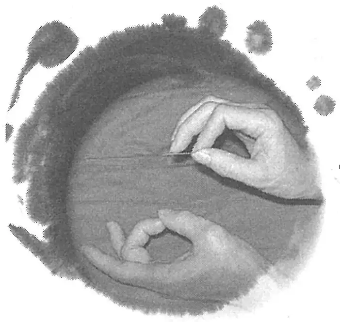

