# 《针灸腧穴通考》(下册) — 足少阳胆经穴 (1/2) · （一）瞳子髎 Tóngzǐliáo GB1 出《黄帝明堂经》~（二十二）渊腋 Yuānyè GB22 出《黄帝明堂经》

> 분할본 18/25. 원서: 黄龙祥·黄幼民 编著, 《针灸腧穴通考——〈中华针灸穴典〉研究》(下册), 人民卫生出版社, 2011. 원서 스캔 OCR 판독본을 챗봇 검색용으로 나눈 것이며, 본문과 쪽 표시 〔p.PDF쪽 (인쇄 쪽)〕는 원본 그대로이다.

## 十一、足少阳胆经穴 

### 概说 

足少阳经的经脉循行、病候以及腧穴归经、经穴定位的古代文献记载变化不大，然而后人对古代文献的理解有所不同，在经穴连接与流注次序方面存在较大分歧，主要表现在侧头部穴，长期存在两种明显不同的排列法。在经穴定位方面，变化较大的为阳交与外丘位置的前后关系，存在着两种分歧。“悬厘”、“悬颅”、“颔厌”三穴，定位文字描述未见分歧，而实际定位出入较大，特别是明正统仿宋针灸铜人中此三穴的位置与我们今天定位出入很大。环跳穴，古典文献只说在“髀枢中”，至于具体如何取穴，现代人有种种不同的理解。

由于腧穴别名的影响而引起经穴定位及主治的改变，则是对“绝骨”穴的理解，元以前文献，或以之为悬钟穴，或以之为阳辅穴。受此影响，阳辅穴由宋以前的“外踝上七寸”变为“外踝上四寸”，其排列次序也由光明穴之上，变为光明穴之下。

#### 【经脉与经穴】 

#### 经脉循行与病候 

**新校正文字**：胆足少阳之脉，起于目锐眦，上抵角，下耳后，循颈行手少阳之前，至肩上，却交出手少阳之后，入缺盆；其支者，别目锐眦[^35-1]，下大迎，合手少阳于颇，下加颊车，下颈合缺盆；其别者，从缺盆以下胸中贯膈，络肝属胆，循胁里，出气街，绕毛际，横入髀厌中；其直者，从缺盆下腋，循胸，过季胁，下合髀厌中，以下循髀阳，出膝外廉，下外辅骨之前，直下抵绝骨之端，下出外踝之前，循足跗上，入小指次指之间；其支者，别跗上，入大指之间，循大指歧骨内出其端，还贯爪甲，出三毛。是动则病口苦，善太息，心胁痛不能转侧，甚则面微有尘，体无膏泽，足外反热，是为阳厥。是主骨所生病者，头痛颔痛，目锐眦痛，缺盆中肿痛，腋下肿，马刀侠瘿，出振寒，疟，胸胁肋髀外至胫绝骨外髁前及诸节皆痛，小指次指不用。（《灵枢·经脉》）

少阳脉系于外踝之前廉，上出鱼股之外廉，出胁上，出目前。是动则病心与胁痛，不可以反侧，甚则无膏，足外反。此为阳厥。是少阳脉主治。其所产病：足中指痹，膝外廉痛，鱼股痛，□痛，髀外廉痛，节尽痛，胁痛，头颈痛，□□痛，疟，汗出，振寒。为十二病。（《阴阳十一脉灸经》）

[^35-1]: 其支者，别目锐眦：此前原有“其支者，从耳后入耳中，出走耳前，至目锐眦后”，此节文字与手少阳脉循行分支几乎完全相同，且支脉下再接支脉，也与通篇体例不合，疑有误，《灵枢·经筋》、帛书《阴阳十一脉灸经》、《足臂十一脉灸经》均无此类文字，据删之。

〔p.1004 (인쇄 976)〕

足少阳脉：出于踝前，枝于骨间，上贯膝外廉，出于股外廉，出胁；枝之肩薄（髆）；其直者贯腋，出于项、耳，出湛（䪼），出目外眦。其病：病足小指次指废，胻外廉痛，胻寒，膝外廉痛，股外廉痛，髀外廉痛，胁痛，□痛，产马，缺盆痛，瘘，聋，湛（䪼）痛，耳前痛，目外眦痛。胁外肿。诸病此物者，皆灸少阳脉。（《足臂十一脉灸经》）

**所属经穴**：足窍阴　侠溪　地五会　足临泣　丘墟　悬钟　阳辅　光明　外丘　阳交　阳陵泉　膝阳关　中渎　风市　环跳　居髎　维道　五枢　带脉　京门　日月　辄筋　渊腋　肩井　风池　脑空　承灵　正营　目窗　头临泣　阳白　本神　完骨　头窍阴　浮白　天冲　率谷　曲鬓　悬厘　悬颅　颔厌　上关　听会　瞳子髎

#### 【归经与起止穴】 

《针灸甲乙经》足少阳及股并阳维四穴凡二十八穴：窍阴、侠溪、地五会、临泣、丘墟、悬钟、阳辅、光明、外丘、阳交、阳陵泉、阳关、中渎、环跳。

六朝《产经》将上述十四穴除“阳交”外，全部正式归入“足少阳胆脉”。

唐代《千金要方》、《千金翼方》在《针灸甲乙经》十四穴基础上又增入“附阳”一穴。

唐代《外台秘要》“胆人”穴下又增加如下三十一穴：本神、头维、临泣、目窗、正营、承灵、脑空、风池、颅息、悬颅、颔厌、悬厘、阳白、丝竹空、瞳子髎、天冲、率谷、曲鬓、浮白、窍阴、完骨、渊腋、大包、辄筋、天池、章门、带脉、五枢、京门、维道、居髎。

宋代王惟一重新厘定为四十三穴：窍阴、侠溪、地五会、临泣、丘墟、悬钟、阳辅、光明、外丘、阳交、阳陵泉、阳关、中渎、环跳、居髎、维道、五枢、带脉、京门、日月、辄筋、渊腋、肩井、风池、脑空、承灵、正营、目窗、临泣、阳白、本神、完骨、窍阴、浮白、天冲、率谷、曲鬓、悬厘、悬颅、颔厌、客主人、听会、瞳子髎。

至明代《医经小学》、《神应经》、《医学入门》等书以及嘉靖针灸铜人、明代十四经步穴歌又将“风市”一穴归入足少阳经，至此本经穴总计四十四穴。

自《铜人腧穴针灸图经》之后，足少阳经的经穴基本确定，但个别经穴的归属仍有不同意见，主要有听会、上关等穴。

#### 头部足少阳穴排列法 

　1. 瞳子髎、听会、上关、颔厌、悬颅、悬厘、曲鬓、率谷、天冲、浮白、窍阴、完骨；本神、阳白、临泣、目窗、正营、承灵、脑空、风池。（《铜人腧穴针灸图经》卷上、《十四经发挥》等）

　2. 瞳子髎、听会、上关、颔厌、悬颅、悬厘、曲鬓、率谷、本神、阳白、临泣、目窗、正营、承灵、天冲、浮白、窍阴、完骨、脑空、风池。（明·成化史素铜人图、明·弘治丘濬铜人图、《医经小学》、《针灸捷径》、《经穴指掌图》及明中期广为流行的“十四经穴步穴歌”）

《医经小学》撰成于洪武二十一年（1388年），其“周身经穴赋”未注明出处，此时尚未有成化十年史素图，只有石藏用图的早期传本。此赋所收不见于《铜人腧穴针灸图经》之穴仅有“接脊”、“风市”、“羊矢”三穴，未详此赋系据石藏用铜人图编，还是根据某种已佚针灸文献编。上述第二种连接法为单线连接，看起来比第一种更为流畅。对于第一种腧穴连接法，明代医家早就提出了批评，例如楼英《医学纲目·阴阳》卷一按语以相当长的篇幅历数滑寿《十四经发挥》的不合理之处，在论及滑氏排穴法时说：“又按经云，足少阳之脉起于目锐眦，上抵头角，下耳后。未尝言其脉有曲折也。今《发挥》谓足少阳脉起目锐眦，作三折，从目锐眦至完骨是一折，又自完骨至睛明是一折，自睛明至风池是一折。则是《内经》以经脉之曲折朦胧者为直行也。”汪机在注《读素问钞》时，重申了楼英的观点。其实，腧穴并不都位于体表经脉循行线上，并不一定非得按经脉的体表循行次序规定腧穴的排列次序。经穴连线与经脉循行线本不相同，但滑氏于经穴连线上又标以经脉循行的文字，将两者合而为一，很容易使人误解，现代不少从事经络实验研究的人员正是将这种腧穴图作为经络图加以考察的。值得注意的是，在针灸穴名国际标准化方案颁布之前，英国、法国、德国针灸文献对于头面部足少阳经穴的排列，普遍采用上述第二种方法。另外，王雪苔《针灸学手册》的处理方法也有明显的优点，值得重视。

〔p.1005 (인쇄 977)〕

由于第一种经穴连接法较复杂，不便记忆，滑伯仁《十四经发挥》还专门为前二十个穴编了序号：

一瞳子髎，二听会，三客主人，四颔厌，五悬颅，六悬厘，七曲鬓，八率谷，九天冲，十浮白，十一窍阴，十二完骨，十三本神，十四阳白，十五临泣，十六目窗，十七正营，十八承灵，十九脑空，二十风池。

明代马莳则编写了歌诀以助记：

歌曰：一瞳子髎二听会，三主人兮颔厌四。五悬颅兮六悬厘，第七数兮曲鬓随。八率谷兮九天冲，十浮白兮之穴从。十一窍阴亦相继，十二完谷一折终。又自十三本神始，十四阳白二折随。十五临泣目上穴，十六目窗之穴宜。十七正营十八灵，十九脑空廿风池。依次细心量取之，胆经头上穴吾知。

靳贤修明太医院“铜人明堂图”时，在新增的侧人图中头部足少阳经穴也增加了编号。（图2-299、图2-300）

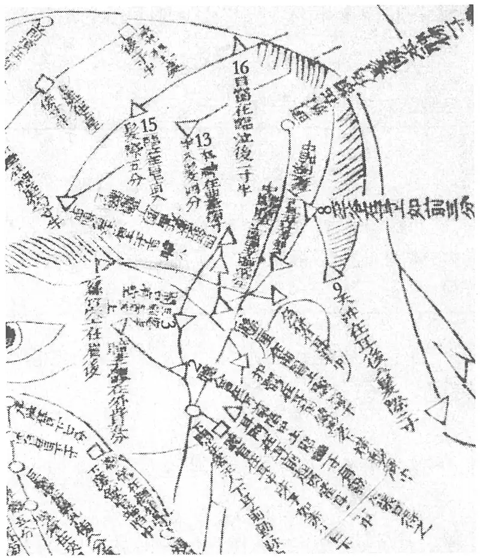

**图2-299　靳贤《明堂图》头部（一）**

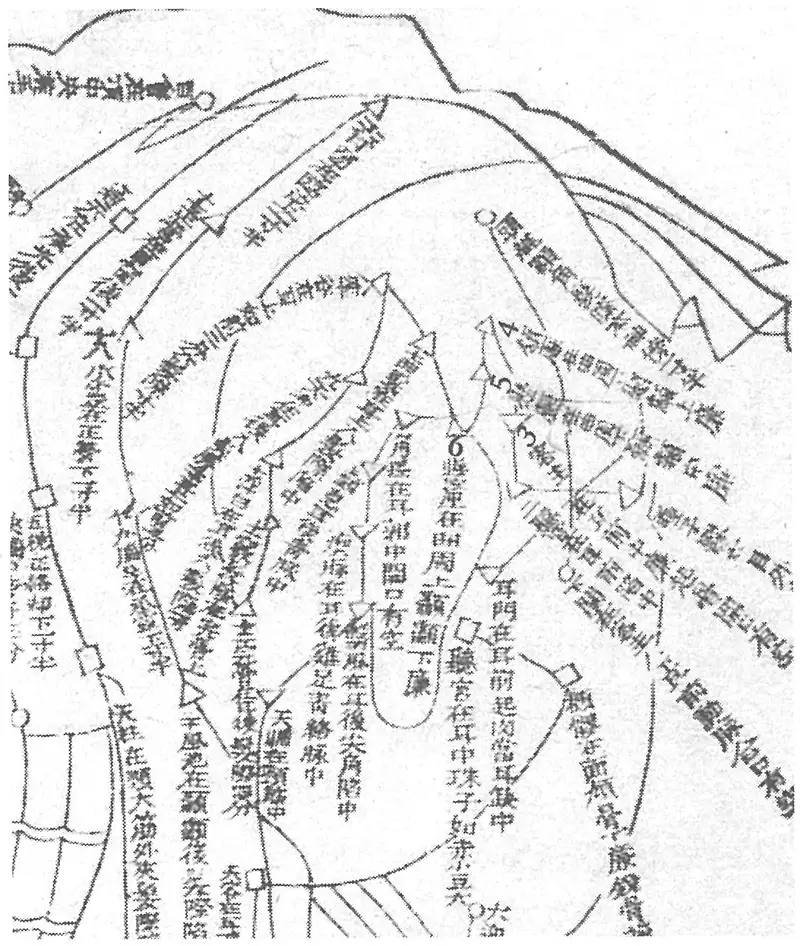

**图2-300　靳贤《明堂图》（二）**

关于侧头部足少阳经穴的连线，最自然也最合理的方案是依据《黄帝明堂经》的本来定位（如天冲穴）和宋以前的归经方案（如听会归入手少阳经，上关归入足阳明经，天容归足少阳经）如下排列：瞳子髎、阳白、本神、临泣、目窗、正营、承灵、脑空、风池、完骨、窍阴、浮白、曲鬓、率谷、天冲、颔厌、悬颅、悬厘、天容、肩井、渊腋……

〔p.1006 (인쇄 978)〕

#### 【经穴定位与主治】 

足少阳经穴定位变化较大的为阳交与外丘位置的前后关系，主要分歧有以下几种：

① 阳交在前，外丘在后：见黄竹斋《针灸经穴图考》、1957年南京《针灸学》、二版教材《针灸学讲义》、北京中医学院1965年《人体经穴挂图》。

② 外丘在前，阳交在后：见明靳贤修铜人图、承淡安《人体经穴图》、上海《针灸学讲义》。

③ 外丘在前上方，阳交在后下方：明正统仿宋铜人。

④ 阳交在上，外丘在下：清光绪铜人。

“悬厘”、“悬颅”、“颔厌”三穴，定位文字描述未见分歧，而实际定位出入较大，特别是明正统仿宋铜人皆定耳后部。所以出现如此大的分歧，关键在于对于《黄帝明堂经》此三穴定位描述中的“颞颥”一词的不同理解。

然而，更大且至今不为人所察觉的分歧却是天冲、浮白二穴。自宋代至今，关于前者的定位就有九种不同说法，现代教材采用的是宋代王惟一“耳后入发际二寸”的错误说法，而且今人的理解还与王惟一的本义相去甚远，实乃从一种错误引出的新错误；浮白穴定位的文字描述历代分歧虽不多，但现代定位却不折不扣地继承了王惟一错误理解的本义——重复了近一千年前古人的错误。

#### 【脉口病候、经脉是动病候与经脉穴病候】 

足少阳标脉：两额动脉（大迎穴所在）。

足少阳本脉：足外踝下如前陷中（丘墟穴所在）。

“足少阳”穴：丘墟。

关于足少阳经脉的“是动”病（源出于足少阳脉口的诊断病候）与“足少阳”穴主治病症的比较见表2-14。

**表2-14　足少阳经脉是动病候与经脉穴主治的相关性**

| 《阴阳十一脉灸经》是动病候 | 《灵枢·经脉》是动病候 | 《黄帝明堂经》经脉穴主治 |
|---|---|---|
| 是动则病心与胁痛，不可以反侧，甚则无膏，足外反。此为阳厥。是少阳脉主治。 | 是动则病口苦，善太息，心胁痛不能转侧，甚则面微有尘，体无膏泽，足外反热，是为阳厥。 | 临泣主治：“厥，足外皮痛，胸痛心痛不得息”；又地五会主治“外无膏泽”。 |

从上表对照可见，足临泣、地五会穴主治病症兼具了《阴阳十一脉灸经》和《灵枢·经脉》的特征，可以明显看出从诊脉与经脉病候而来的胎记。

#### 【诊络病候、络脉病候与络穴主治】 

足少阳之别，名曰光明，去踝五寸，别走厥阴，下络足跗。实则厥，虚则痿躄，坐不能起，取之所别也。（《灵枢·经脉》）

光明，足少阳络，在足外踝上五寸，别走厥阴者。虚则痿躄，坐不能起；实则厥。（《黄帝明堂经》）

《黄帝明堂经》载足少阳络穴“光明”主治病症完整包含了《灵枢·经脉》足少阳络脉的诊络病候，可以十分清楚地看出两者源流脉络。

〔p.1007 (인쇄 979)〕

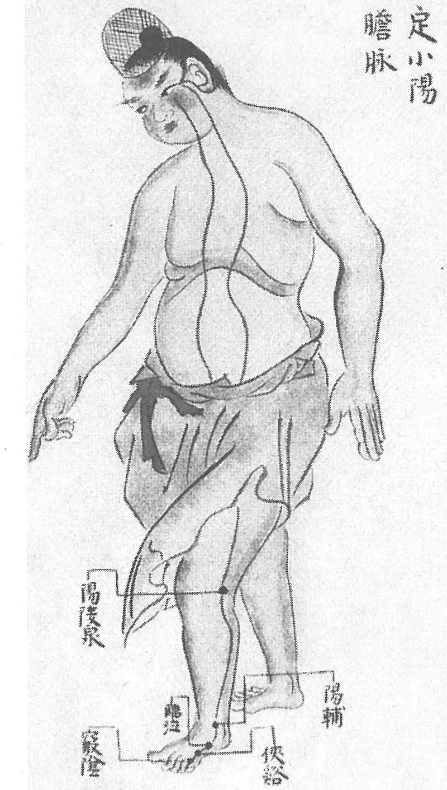

**图2-301　《环中图》足少阳胆脉图**

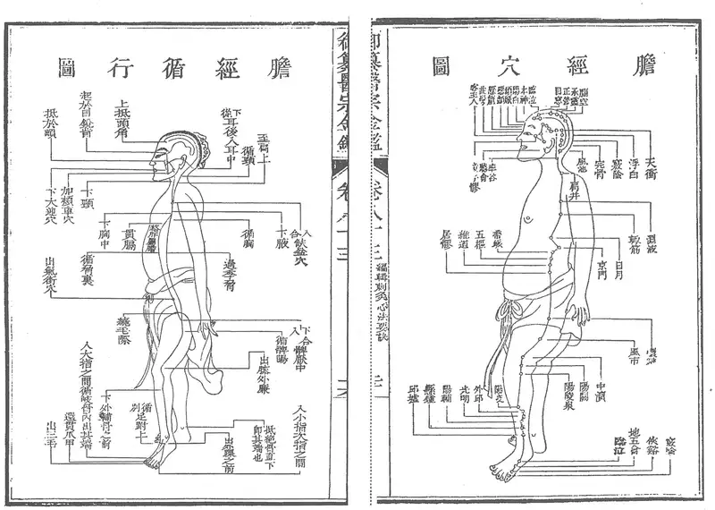

**图2-302　《医宗金鉴》足少阳胆经脉、经穴分图**

〔p.1008 (인쇄 980)〕

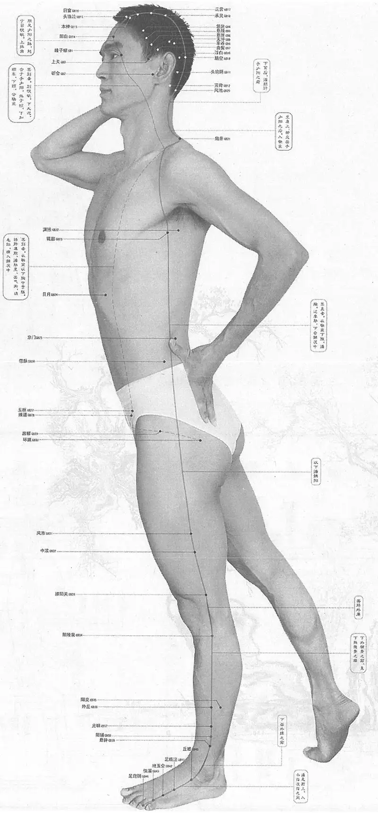

**图2-303　黄龙祥编足少阳胆经脉、经穴合图**

〔p.1009 (인쇄 981)〕

### （一）瞳子髎 Tóngzǐliáo GB1 出《黄帝明堂经》 

问题：本穴与前关、太阳、鱼尾、丝竹空穴究竟是什么关系？

#### 【提要索隐】 

**穴名**：一名后曲；一名前关。**按**：“瞳子髎”，在古代，特别是宋以前文献中，有不同的写法。

**部位**：在面部，目外眦外侧0.5寸凹陷中。

**适应症**：主治头目部病症。常用于头痛；目赤肿痛，内障，青盲，目翳，流泪。

**针刺操作**：平刺，或三棱针点刺出血。

#### 【名实考】 

瞳子髎，一名后曲；一名前关。“瞳”字，古代文献也写作“童”；“髎”，宋以前文献作“窌”，自宋代《铜人腧穴针灸图经》之后，统一作“髎”。

需要注意的是，窦太师针灸将本穴与“丝竹空”、“鱼尾”穴相混同。

　1. 瞳子窌，在目外去眦五分，手太阳、手足少阳之会。（《黄帝明堂经》）

　2. 以穴在目锐眦后五分，此穴之内与瞳仁相近，故曰瞳子髎。（《经穴解》）

#### “瞳子髎”与“前关”、“太阳” 

《太平圣惠方》载有“前关”、“太阳”穴，而无“瞳子髎”穴，宋臣校《千金要方》则认为此三穴为同一穴，现将有关原文列于下：

　1. 瞳子窌，在目外去眦五分。一名后曲。（《外台秘要》卷三十九）

　2. 瞳子窌，一名太阳、一名前关。（《千金要方》卷二十九注）

　3. 前关二穴，在目后半寸是穴，亦名太阳之穴。（《太平圣惠方·针经》）

**按**：从这三条文字看，《太平圣惠方·针灸》所载“前关”（一名太阳）穴部位与“瞳子窌”完全相同，故《千金要方》注文无误。然而，关于“太阳”穴定位，古代文献有不同的描述：

　4. 颞颥穴，在眉眼尾中间上下有来去络脉是。针灸之，治四时寒暑所苦疸气温病等。（《千金要方》卷十）

　5. 肝劳邪气眼赤，灸当容百壮，两边各尔，穴在眼小眦近后当耳前，三阳三阴之会处，以两手按之，有上下横脉，则是与耳门相对是也。（《千金要方》卷六）

　6. 太阳二穴，在眉外五分。（《太平圣惠方》卷五十五）

　7. 眼小眦后一寸，太阳穴。（《圣济总录》）

　8. 太阳，在额紫脉上。出血，三棱针刺之。（《针灸玉龙歌》注）

　9. 太阳二穴，在额角际发下紫脉是穴。治目疼羞明，用三棱针出血。（《窦太师针经》）

　10. 太阳二穴，在头额角发际下紫脉上。用三棱针出血，治目疼。（《针方六集》卷一）

　11. 太阳二穴在眉后陷中，太阳紫脉上。是穴治眼红肿及头痛，宜用三棱针出血。出血之法，用帛一条，紧缠其项，紫脉即见，刺见血立愈。又法以手紧扭其领，令紫脉见，却于紫脉上刺见血，立愈。（《奇效良方》卷五十五）

**按**：太阳穴现代定位为“眉梢与目外眦之间，向后一寸”。实际上是综合了《千金要方》“颞颥”与《圣济总录》“太阳”的定位描述，然而主治病症采用的却是窦太师针灸。在窦氏针法中，太阳一穴主治实热眼疾，多用三棱针刺血，故其描述的穴位并不是一个固定的点，这与《千金要方》所述之“颞颥”及“当容”穴定位相似。可见，现代教材所说之“太阳”已非《太平圣惠方》所述之“太阳”，为避免混淆，“太阳”不作为瞳子髎穴的别名。需要注意的是，瞳子髎穴“一名太阳”的说法对后世有较大的影响，例如元代《针灸集成》一书针灸方中大量应用“太阳”穴，明初医家则以太阳与瞳子髎为同一穴，直接将原方中的“太阳”穴名替换为“瞳子髎”。

〔p.1010 (인쇄 982)〕

#### 窦太师针灸“瞳子髎”穴辨 

　1. 眼睛红肿痛难熬，怕日羞明心自焦，但刺睛明鱼尾穴，太阳出血病全消。原注：鱼尾，即瞳子髎。在目上眉外尖。针一分，沿皮向内透鱼腰，泻。禁灸。（《针灸玉龙歌》注）

　2. 瞳子髎二穴，在眉外五分尖尽处。手太阳、足少阳之会。针一分，沿皮内透鱼腰。治目红肿，冷泪，补；垂廉翳膜；泻胬肉扳睛，泻。（《窦太师针经》）

　3. 鱼尾穴在眉外，即瞳子髎尖是穴。针入一分，沿皮向内透鱼腰。羞明先补后泻，红肿单泻，冷泪常流单补。禁灸。（《医经会元·玉龙歌》）

**按**：以上窦太师针灸所述之“瞳子髎”实为《黄帝明堂经》之丝竹空穴。“鱼尾”显然是相对于“鱼腰”而言，刺法也明言“沿皮向内透鱼腰”，该穴应同丝竹空，而不是瞳子髎。之所以窦太师针灸将鱼尾穴与瞳子髎等同，也是因为《窦太师针经》瞳子髎的定位在眉尖处。鉴于此，本穴不收录窦太师针灸之“瞳子髎”穴内容。

#### 相关穴及刺激点 

丝竹空　见本书“十、手少阳三焦经”。

#### 【定位】 

**部位**：在面部，目外眦外侧0.5寸凹陷中（图2-304）。

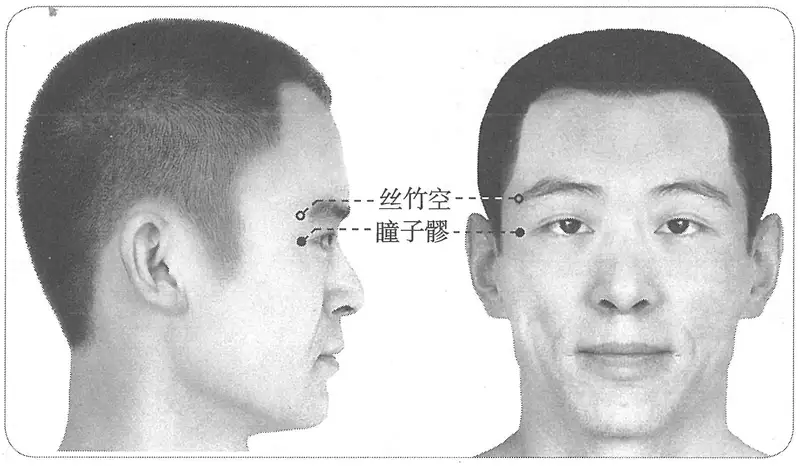

**图2-304　瞳子髎穴与相关穴图**

**取穴**：闭眼，当眼外角纹止处取穴。

　1. 在目外去眦五分。（《黄帝明堂经》、《铜人腧穴针灸图经》、《圣济总录》、《针灸资生经》、《十四经发挥》、《医学纲目》、《针灸聚英》、《古今医统》、《医学入门》、《针灸大成》、《针方六集》、《类经图翼》、《循经考穴编》、《医宗金鉴·刺灸心法要诀》、《针灸易学》）

　2. 目外眦角后五分。（《针灸十四经穴位考订》）

　3. 统编针灸学教材

　　(1) 部位：目外眦角五分。取穴：令患者闭目，当外角纹之终止处取之。（1957年南京《针灸学》）

　　(2) 部位：距目外眦角五分。取穴：令患者闭目，当外眦角纹之终止处凹中取之。（1版《针灸学讲义》）

　　(3) 部位：在目外去眦五分。取穴：在目外眦外方，眶骨外侧缘凹陷中取之。（2版《针灸学讲义》）

〔p.1011 (인쇄 983)〕

　　(4) 目外眦旁0.5寸。（4版《针灸学》）

　　(5) 目外眦旁0.5寸，眶骨外缘凹陷中。（5版《针灸学》）

　　(6) 在面部，目外眦旁，当眶外侧缘处。（6版《针灸学》）

　　(7) 目外眦外侧约0.5寸，眶骨外缘凹陷中。（7版《针灸学》）

　　(8) 目外之旁五分，眶骨外侧缘凹陷中。（《中国针灸学》）

#### 【类属】 

足少阳胆经穴。

**脉气所发：**

　1. 手太阳、手足少阳之会。（《针灸甲乙经》卷三、《黄帝内经明堂》、《素问》王冰注）

　2. 手足少阳之会。（《外台秘要》卷三十九）

**归经**：足少阳经。（《外台秘要》卷三十九、《铜人腧穴针灸图经》卷上）

#### 【适应症】 

主治头目部病症。常用于头痛；目赤肿痛，内障，青盲，目翳，流泪。

　1. 主青盲无所见，远视，目中淫肤白膜。（《黄帝明堂经》）

　2. 治青盲，目无所见，远视，目中肤翳白膜，头痛，目外眦赤痛。（《铜人腧穴针灸图经》）

　3. 主目痒，赤痛泪出，多眵䁾，内眦痒。（《针灸聚英》卷一、《针灸大成》）

**按**：以上病症乃高武从《针灸资生经》误录《千金要方·孔穴主对法》之文。

　4. 统编针灸学教材

　　(1) 主治头痛，目痛如脱，目翳，青盲，远视䀮䀮，赤痛，泪出。（1957年南京《针灸学》、1版《针灸学讲义》）

　　(2) 主治头痛，目痛，目翳，视力衰退，目赤流泪。（2版《针灸学讲义》）

　　(3) 主治头痛，目赤痛，目翳，青盲。（4、5、6版《针灸学》）

　　(4) 主治①头痛；②目赤肿痛、羞明流泪、内障、目翳等目疾。（7版《针灸学》）

　　(5) 主治头痛，目赤痛，迎风流泪，视力衰退，口眼歪斜。（《中国针灸学》）

#### 附：临床应用举例 

　1. 斜视，内斜，取瞳子髎，配眉梢或丝竹空。[福建中医药，1981，1（1）：32]

　2. 中风偏瘫，针刺攒竹、瞳子髎穴为主治疗。[天津中医，1995，12（1）：9]

#### 【操作】 

平刺，或三棱针点刺出血。

　1. 刺入三分，灸三壮。（《黄帝明堂经》）

　2. 禁用针灸。（《医学入门》卷一）

　3. 针三分，灸三壮。明堂云：不可灸。（《针灸十四经穴位考订》）

**按**：此处“明堂”是指《西方子明堂灸经》。

　4. 统编针灸学教材

　　(1) 针二至三分，针尖沿皮刺向外方，灸二至三壮。（1957年南京《针灸学》、1版《针灸学讲义》）

　　(2) 沿皮向外方横刺2~3分。（2版《针灸学讲义》）

　　(3) 平刺0.3~0.5寸。（4、5版《针灸学》）

　　(4) 平刺0.3~0.5寸。或三棱针点刺出血。（6、7版《针灸学》）

　　(5) 横刺0.3~0.5寸。（《中国针灸学》）

　5. 横刺，向太阳穴方向，进针0.5~1寸。感应：局部胀感，有时可放射至耳道。温灸5~10分钟。（上海《针灸学》）

〔p.1012 (인쇄 984)〕

**文献分析**：《医学入门》本穴内容辑自《西方子明堂灸经》，后者凡不可灸之穴，皆不列主治病症，故《医学入门》则说“禁用针灸”。

### （二）听会 Tīnghuì GB2 出《黄帝明堂经》 

#### 【提要索隐】 

**穴名**：听会，一名耳门；一名听呵、后关。

**部位**：在面部，耳屏间切迹与下颌骨髁突之间的凹陷中。

**归经**：足少阳胆经。**按**：本穴《针灸甲乙经》作“手少阳脉气所发”，宋以前归属手少阳经。

**适应症**：主治耳部病症。常用于耳鸣，耳聋；齿痛；下颌关节脱位；口眼㖞斜。

**备选适应症**：癫，狂，痫病。

**针刺操作**：微张口，直刺0.5~0.8寸。

#### 【名实考】 

听会，一名耳门；一名听呵、后关。

关于本穴定位，古代文献的描述均提及可触及动脉搏动，在耳屏间切迹前方是面动脉出颅部位的表面标志，听会穴定位之“动脉”即此脉。

　1. 听会，在耳前陷者中，张口得之，动脉应手，手少阳脉气所发。（《黄帝明堂经》）

　2. 一云听呵，一云后关。（《针灸资生经》卷一）

　3. 以此穴专主乎听事，故曰听会。（《经穴解》）

　4. 听会，在上关下一寸，动脉宛宛中，一名耳门。（《千金翼方》卷二十六）

　5. 听会，主牙车急及脱臼相离二寸，在上关下一寸，一名耳门。（《千金翼方》卷二十六）

　6. 别名　机关。（1957年南京《针灸学》）

**文献分析**：“机关”见于《千金要方》、《千金翼方》，作为“颊车”穴的别穴，归于听会穴下，误也。此乃沿袭日本柳谷素灵《针灸医学全书》之误，韩国《针灸学》又从中国文献重复了这一错误。

#### “囟会”误作“听会”例 

　1. 寒热头痛，喘喝，目不能视，神庭主之。其目泣出，头不痛者，听会主之。寒热，头痛如破，目痛如脱，喘逆烦满，呕吐，流汗，难言，头维主之。寒热，刺脑户。（《针灸甲乙经》卷八第一）

　2. 主寒热，喘喝，目视不能视，目泣出。（《外台秘要》卷三十九）

**按**：根据《针灸甲乙经》腧穴主治序例，在“头维主之”条文之前，不会出现“听会主之”条文，据《医心方》录《黄帝内经明堂》佚文，知《针灸甲乙经》此处“听会主之”系“囟会主之”之误，王焘也传唐代传本《针灸甲乙经》之误。

#### 听会与下关、耳门、听宫的位置关系 

此四穴均以下颌头髁突前后的凹陷定位，其位置关系为：下关在髁突前的较大的半月形凹陷中，需要注意的是当张口时，髁突会向前移动而堵上原先的凹陷，因此取下关穴时要闭口；耳门、听宫、听会3穴均从上而下分列在髁突后的很小的凹陷中，当张口时，髁突向前移动，显现出较大的凹陷，因此取髁突后的这3个穴，要张口取之。

宋以前文献耳前穴排列均为：“耳门”在上，“听会”在下，而宋代《铜人腧穴针灸图经》正相反，明正统仿宋铜人与《铜人腧穴针灸图经》相合，说明王惟一改动是有意识的，但后人乃至现代针灸教材却并没有普遍接受这一改变，例如明嘉靖针灸铜人，依然是耳门穴在上，听会穴在下。

〔p.1013 (인쇄 985)〕

　1. 右侧面部在耳前十二穴，头维居上，和髎、客主人次之，耳门又次之，听会又次之，下关居下。（《医学纲目》卷八）

　2. 耳前三穴，听会近内，是手少阳三焦经□□□□□□关微去听会之外，是胆胃二脉所过。二□□□□□□各不同也。听会上一寸是上关，有动脉，开□□□□□□下是下关，无动脉。耳前有上廉下廉，有起骨有动脉□□□下廉者以耳前起骨为界，骨上为上廉是上关，骨下为下廉是下关，乃胆胃二脉所会也。今考三穴惟起骨上廉有动脉，起骨下廉无动脉。三穴者，上关在上，听会居中，下关在下。听会贴近耳前陷中，开口有大空，可容一指，合口反有骨掩其空，此三穴，人所难明，故详辩之，但上关下关须侧卧刺之。（《针灸秘法全书》）

#### 相关穴及刺激点 

听聪（下0.2寸）、下听会（下0.5寸）、听灵1（听宫与听会之间，再向耳侧2mm处）、听灵（听宫与听会连线下3/4处）、听灵2（听宫与听会连线下3/4，再向耳侧0.2cm处）。

**按**：这些在听会上下半寸之内新发现的新穴皆主治耳聋、耳鸣。此外，与听廓相对的耳郭背面的“后听”、“后听会”穴，虽然进针部位不同，但由于进针的角度使得针尖到达的部位相同或相近，因而主治也相同。实际上听会、听宫周围的这些穴都可视为同一穴，这些新发现的穴可提供两方面的启示：第一，听会穴存在不同的针刺角度与方向；第二，听会的主要适应症为耳疾。

#### 【定位】 

**部位**：在面部，耳屏间切迹与下颌骨髁突之间的凹陷中（图2-305）。

**取穴**：张口，耳屏间切迹前方的凹陷处取穴，听宫直下。

　1. 《黄帝明堂经》佚文

　　(1) 在耳前陷者中，张口得之，动脉应手。（《针灸甲乙经》卷三、《太平圣惠方·明堂》、《铜人腧穴针灸图经》卷上）

　　(2) 在耳前陷中，张口得之。（《千金要方》卷二十九、《千金翼方》、《外台秘要》、《医心方》）

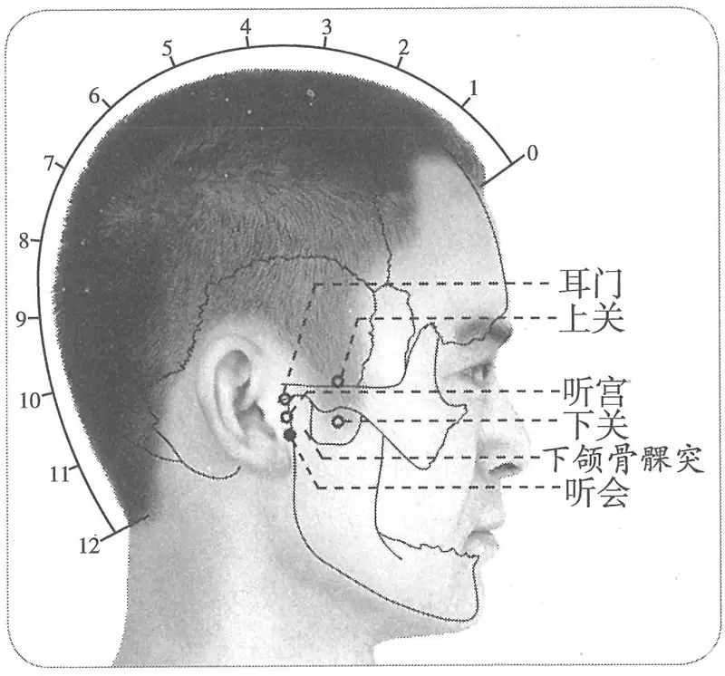

**图2-305　听会穴与相关穴图**

　2. 甄权《针经》佚文

　　(1) 在上关下一寸，动脉宛宛中。侧卧张口乃得之。（《千金翼方》卷二十六、《铜人腧穴针灸图经》卷中）

　　(2) 在耳前陷中，上关下一寸，动脉宛宛中，张口得之。（《太平圣惠方·针经》、《针灸资生经》、《十四经发挥》、《神应经》、《针灸聚英》、《古今医统》、《针灸大成》、《针灸易学》）

　　(3) 在耳前陷中，客主人下一寸，动脉宛宛中，去耳珠下，开口有空，侧卧张口取之。（《类经图翼》、《医宗金鉴·刺灸心法要诀》、《针灸逢源》）

　3. 窦太师针灸遗存

　　(1) 在耳珠前陷中，上关穴下一寸，动脉宛宛中，开口得穴。（《窦太师针经》）

〔p.1014 (인쇄 986)〕

　　(2) 在耳珠尖前开口陷中动脉宛宛中是穴。（《窦太师秘传》）

　　(3) 在耳微前陷中，上关下一寸动脉中，云耳珠下陷中开口。（《大本琼瑶神书》）

　　(4) 耳前陷中，张口得之。上关下一寸，动脉应手。（《针方六集》卷一）

　　(5) 在耳前陷中，张口得之，动脉应手。广注：约居上关下一寸，张口有空。令人咬尺方可下针。一法：正当耳门掩耳肉前，开口取之，动脉宛宛中。（《循经考穴编》下）

　4. 耳珠下微前陷中，客主人下约一寸，开口有空。（《针灸十四经穴位考订》）

　5. 统编针灸学教材

　　(1) 部位：耳前微陷中。取穴：以指按取耳前小瓣即耳珠下，当颧骨弓与下腭骨接合之所，张口有孔出现处取之。（1957年南京《针灸学》）

　　(2) 部位：耳前小瓣下方陷中。取穴：小肠经听宫穴下方陷中，张口取之。（1版《针灸学讲义》）

　　(3) 部位：在耳前陷者中。取穴：在耳屏间切迹前，当听宫手太阳经直下，下颌髁状突之后缘，张口有空处取之。（2版《针灸学讲义》）

　　(4) 耳屏间切迹前，下颌髁状突的后缘，张口有孔。（4、5、7版《针灸学》、《中国针灸学》）

　　(5) 在面部，当耳屏间切迹的前方，下颌骨髁状突的后缘，张口有凹陷处。（6版《针灸学》）

**文献分析**：甄权针经谓本穴“在上关下一寸动脉宛宛中”，按照现代上关穴的定位，此听会穴定位明显偏前，此处也无法触及动脉搏动。而《黄帝明堂经》、《甄权针经》的上关定位较现代的定位明显近耳侧，在开口有孔、动脉搏动处。

#### 【类属】 

足少阳胆经穴。

**脉气所发：**

　1. 手少阳脉气所发。（《针灸甲乙经》卷三、《外台秘要》、《铜人腧穴针灸图经》）

　2. 手太阳、少阳脉气所发。（《医心方》卷二）

**归经：**

　1. 手少阳经。（《外台秘要》卷三十九、杨玄操《难经》注）

　2. 足少阳经。（《铜人腧穴针灸图经》卷上）

**文献分析**：听会穴，《针灸甲乙经》作“手少阳脉气所发”（吴勉学刊本脱“手”字，而明抄本未脱，与《圣济总录》卷一九三引《针灸甲乙经》之文合），《外台秘要》、《太平圣惠方》并同，故王焘、杨玄操将其归入手少阳经；《医心方》作“手太阳，又手少阳三焦”，《黄帝内经太素·量缪刺》卷二十三杨氏注曰“巨刺手太阳出走耳听会之穴”，可见杨氏或将该穴归入“手太阳经”。《铜人腧穴针灸图经》卷上虽将此穴归于足少阳，但卷中该穴下仍记作“手少阳脉气所发”，可见该穴归入手少阳经更加合理。如果上述“听会”、“上关”穴不是归入足少阳经，那么当后世将同一经之穴连成一线时，足少阳胆经在头面部就不会出现那么多的折转，也就不会遭到楼英等人的激烈批评。日本教学参考书《针灸医学》将听会归入手少阳经，上关归入足阳明经。

#### 【适应症】 

主治耳部病症。常用于耳鸣，耳聋；齿痛；下颌关节脱位；口眼㖞斜。

**备选适应症**：癫，狂，痫病。

　1. 主聋，耳中颠飕颠飕者若风。齿龋痛。狂，惊，瘈疭，眩仆，瘖不能言，羊鸣吐沫。（《黄帝明堂经》）

　2. 主牙车急及脱臼相离二寸。（《千金翼方》卷二十六、《太平圣惠方·针经》）

〔p.1015 (인쇄 987)〕

　3. 耳中状如蝉声通耳。（《千金翼方》卷二十六、《太平圣惠方·针经》）

　4. 治耳聋，耳中状如蝉声通耳，食，牙车脱臼，相离一二寸。（《铜人腧穴针灸图经》卷中、《圣济总录》）

**按**：“食”字前，王惟一在抄录《太平圣惠方·针经》原文时，脱“牙车急疼痛，不得嚼”八字，而使文义不全。

　5. 窦太师针灸遗存

　　(1) 治耳聋气闭，先泻后补；耳内肿疼生疮，泻；耳内鸣，先补后泻。痒则补，痛则泻。耳内脓出，先泻后补。（《窦太师针经》）

　　(2) 治耳闭气聋，先泻后补；耳内红肿生疮，宜泻。（《大本琼瑶神书》）

　　(3) 主耳聋气闭，出脓。（《针方六集》卷五）

　　(4) 此穴大能宣通耳气。主聋气闭，或鸣或湿或痒，腮肿。（《循经考穴编》下）

　6. 恍惚不乐。中风口㖞斜，手足不随。（《针灸聚英》卷一、《针灸大成》、《针方六集》）

**按**：“恍惚不乐”乃高武从《针灸资生经》误录《千金要方》之文；其余二症乃辑录《针经摘英集》针灸方主治，详见“附：临床应用举例”。

　7. 统编针灸学教材

　　(1) 主治耳鸣，耳聋，齿痛，牙车脱臼。（1957年南京《针灸学》、1版《针灸学讲义》）

　　(2) 主治耳鸣，耳聋，齿痛，下颌骨脱臼，腮肿，口眼㖞斜。（2版《针灸学》）

　　(3) 主治耳聋，耳鸣，齿痛，口㖞，腮肿。（4版《针灸学》）

　　(4) 主治耳鸣，耳聋，齿痛，口㖞。（5版《针灸学》）

　　(5) 主治耳鸣，耳聋，聤耳、面痛、齿痛，口㖞。（6版《针灸学》）

　　(6) 主治耳鸣，耳聋，聤耳等耳疾；齿痛、口眼歪斜。（7版《针灸学》）

　　(7) 主治耳聋，耳鸣，齿痛，牙关不利，痄腮，口眼歪斜。（《中国针灸学》）

**文献分析**：《黄帝明堂经》载本穴主治症除了耳、齿部症状外，还详述癫、狂、痫病症状，但因唐代传本《针灸甲乙经》已脱漏相关文字，故后世文献鲜有载录。今附存备考。本穴治疗下颌关节脱位出于初唐针灸大家甄权的经验，而且还明言既可治关节拘急不开，又可治关节脱位，宋代两部官修针灸标准文献也均收录。此外，《黄帝明堂经》记载治疗下颌关节脱位的穴位还有：下关、大迎、颊车、翳风、通谷，现代临床实践也提示，针灸对于下颌关节脱位，特别是习惯性脱位有良好的治疗效果，值得重视。

#### 附：临床应用举例 

　1. 耳部病症

　　(1)《小品方》治耳聋方……又方灸听会穴，在耳前陷中。（《医心方》卷五）

　　(2) 耳聋气闭，肾家虚败，邪气攻上：肾俞灸、听会泻。（《针灸玉龙经·盘石金直刺秘传》）

　　(3) 伤寒耳鸣：泻合谷、听会、足三里。（《针灸集要·盘石金直刺秘传》）

　　(4) 头风年久不愈，耳虚鸣：泻合谷、听会、足三里。（《针灸集要·盘石金直刺秘传》）

　　(5) 耳内脓出，或生珠气，痒不可当：刺合谷泻之，次灸听会。如前症虚，灸肾俞立效。（《针灸集要·盘石金直刺秘传》）

　　(6) 耳聋气闭：听会、听宫、翳风。问曰：此证从何而得？答曰：伤大热，汗闭，气不舒通，故得此证。复刺后穴：三里、合谷。（《针灸集成》第二十八方）

　　(7) 耳闭须听会而治也。（《通玄指要赋》）

　　(8) 耳聋气痞听会间。（《灵光赋》）

〔p.1016 (인쇄 988)〕

　　(9) 但患伤寒两耳聋，金门听会疾如风。耳聋气痞听会针，迎香穴泻功如神。（《席弘赋》）

　　(10) 聋哑病：听宫穴、听会穴，针刺电疗。[中国针灸，1987（6）：46]

　2. 中风

　　(1) 治中风口眼㖞斜：刺足少阳经听会二穴，在耳前陷中，上关下一寸，动脉宛宛中，张口得之。次足阳明经颊车二穴、地仓二穴，夹口吻旁四分，外如近下有脉微微动，𫏋脉、手足阳明之交会。左取右，右取左，宜频针灸，以取尽风气，口眼正为度。针入四分。（《针经摘英集》）

　　(2) 治中风手足不随：针百会穴，在前顶后一寸五分，顶中央旋毛中可容豆。督脉、足太阳交会于巅上。针入二分。听会穴，手少阳脉气所发。针入七分，留三呼，得气即泻。肩髃穴，在肩端两骨间陷中宛宛中，举臂取之，手阳明、𫏋脉之会。曲池穴，在肘外辅骨屈肘曲骨之中，以手拱胸取之。针入七分。三里穴，在曲池下二寸，按手肉起兑肉之端。针入三分。悬钟穴，在外踝上三寸动脉中，足三阳之大络。针入六分。风市穴，在腿外两筋间，正身舒下两手著腿，当中指头陷中。其七穴左治右，右治左，以取尽风气轻安为度。（《针经摘英集》）

**按**：此方源出于《太平圣惠方·明堂》，“听会”原方作“耳前发际”。

#### 【操作】 

微张口，直刺0.5~0.8寸。

　1. 刺入四分，灸三壮。（《黄帝明堂经》）

　2. 针入七分，留三呼，得气即泻，不须补。灸亦良，日可灸五壮，至二七壮止。十日后，依前报灸之即愈。（《铜人腧穴针灸图经》卷中）

　3. 横针入半寸，可灸七壮。治耳聋气闭，先泻后补；耳内肿疼生疮，泻；耳内鸣，先补后泻。痒则补，痛则泻。耳内脓出，先泻后补。口衔尺方可下针。（《窦太师针经》）

　4. 针三分，灸三壮。（《针灸十四经穴位考订》）

　5. 统编针灸学教材

　　(1) 针二至三分，依取穴法用笔杆横咬口中而后进针，灸三壮。按：治疗聋哑成年人，可以针八分至一寸二分。（1957年南京《针灸学》、1版《针灸学讲义》）

　　(2) 直刺5~7分，艾炷灸3壮。（2版《针灸学讲义》）

　　(3) 张口，直刺0.5~1寸。（4、5、6版《针灸学》）

　　(4) 微张口，直刺0.5~0.8寸。（7版《针灸学》）

　　(5) 直刺0.5~0.7寸。可灸。（《中国针灸学》）

　6. 直刺，张口，微向后斜，深1~1.5寸。感应：局部酸胀。温灸3~5分钟。（上海《针灸学》）

### （三）上关 Shàngguān GB3 出《黄帝明堂经》 

#### 【提要索隐】 

**穴名**：一名客主人。

**部位**：在面部，颧弓上缘中央凹陷中。

**归经**：足少阳胆经。**按**：宋以前文献或将本穴归入足阳明经，或手少阳经者。

**适应症**：主治耳部、口齿部病症。常用于耳鸣，耳聋，聤耳；齿痛；口眼㖞斜；张口困难、张口时有弹响。

〔p.1017 (인쇄 989)〕

**针刺操作**：直刺0.3~0.5寸。

#### 【名实考】 

关于本穴两个穴名“上关”与“客主人”，颇难判断哪个是正名，哪个是别名。在《黄帝明堂经》是将前者定为正名，后者定为别名，而在《内经》中，除《素问·气穴论》和《灵枢·本输》作“上关”外，其余各篇均作“客主人”。宋以前明堂文献如《甄权针经》也以“客主人”为正名，“上关”作“别名”，与《黄帝明堂经》所载本穴之正名、别名，正好颠倒。王冰注《素问·气府论》曰：“客主人，穴名也。今名上关”，说明王冰所见的唐代流行的文献是以“上关”为正名。《铜人腧穴针灸图经》卷上及卷中均作“客主人，一名上关”，只下卷“穴腧都数”作“上关”。综合分析各家文献，可以得到这样的印象：“客主人”是比“上关”更早的名称（《黄帝明堂经》下关穴定位作“在客主人下”，也提示了这一点），而当本穴之下的穴定名为“下关”后，“上关”被定为正名，以与“下关”之名相应。1957年南京《针灸学》仍坚持以“客主人”为正名，以古为尊，大可不必。此外，《太平圣惠方·针经》作“客主”，脱一“人”字，王执中不察而谓上关“一名客主”，宋以后文献也传此误。

　1. 上关二穴。（《素问·气穴论》）

　2. 足少阳脉气所发者六十二穴……锐发下各一，客主人各一。（《素问·气府论》）

　3. 上关，一名客主人。在耳前上廉起骨，开口有孔，手少阳、足阳明之会。（《黄帝明堂经》）

　4. 客主人，一名上关。（《千金翼方》卷二十七）

　5. 手少阳为火，而生胃土，足少阳为木，而克胃土。土木有相克之理，而胃经自下而上会十一穴，有客与主人之义，故曰客主人。（《经穴解》）

　6. 上关　客主人、客主。（《针灸资生经》卷首目录）

　7. 客主人　上关、客主、太阳。（1957年南京《针灸学》）

**按**：“太阳”一名，此已作为前“瞳子髎”别名，此又复出，乃传日本《针灸经穴全书》之误。韩国《针灸学》又从中国教材间接传此误。

#### 【定位】 

**部位**：在面部，颧弓上缘中央凹陷中（图2-306）。

**取穴**：下关直上，颧弓上缘凹陷中。

　1. 在耳前上廉起骨端，开口有孔。（《黄帝明堂经》、《铜人腧穴针灸图经》、《圣济总录》、《针灸资生经》、《十四经发挥》、《医学纲目》、《针灸聚英》、《古今医统》、《医学入门》、《针灸大成》、《针方六集》、《类经图翼》、《循经考穴编》、《针灸易学》、《针灸逢源》）

　2. 在听会上一寸动脉宛宛中。（《千金翼方》卷二十六、《医宗金鉴·刺灸心法要诀》）

　3. 客主人，一名上关……侧卧张口取之。（《千金翼方》卷二十七）

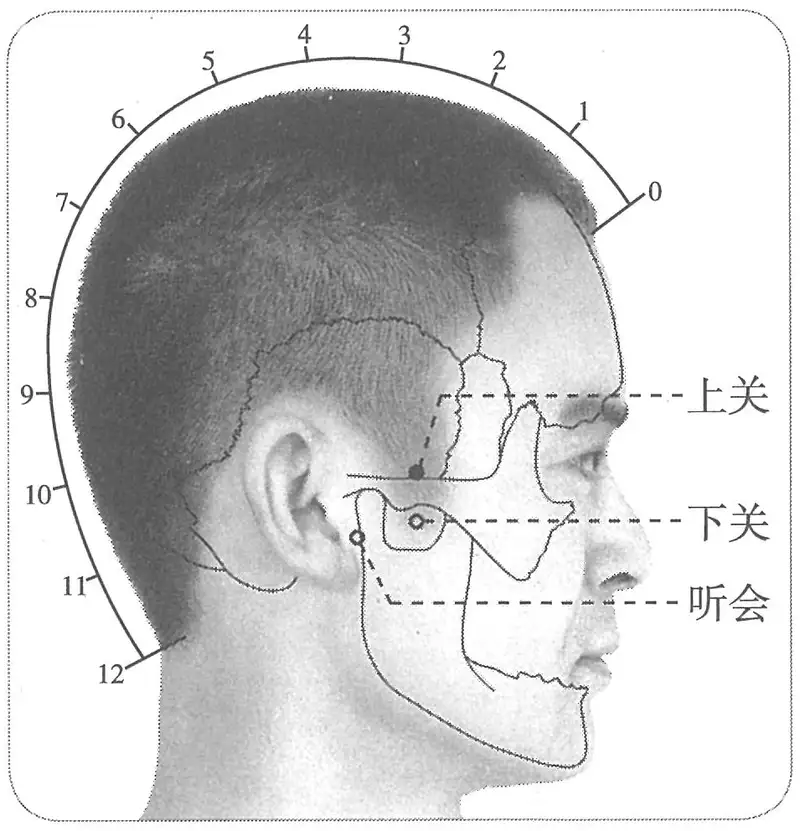

**图2-306　上关穴图**

　4. 在耳前上廉起骨，开口有穴动脉宛宛中。（《太平圣惠方·针经》、《窦太师针经》）

　5. 耳前起骨上廉颧骨桥上缘发际，开口有空。（《针灸十四经穴位考订》）

　6. 统编针灸学教材

　　(1) 部位：耳前骨上，开口有空。取穴：按取耳前颧骨弓上侧，张口有空取之。（1957年南京《针灸学》）

〔p.1018 (인쇄 990)〕

　　(2) 部位：耳前起骨上廉，开口时稍有空隙。取穴：耳前颧骨弓上缘陷中，开口取之。（1版《针灸学讲义》）

　　(3) 部位：在耳前上廉起骨端，开口有空。取穴：在耳前，去颧骨弓上缘，当下关足阳明经直上方取之。（2版《针灸学讲义》）

　　(4) 颧弓上缘，下关穴直上。（4版《针灸学》）

　　(5) 下关穴直上，当颧弓的上缘。（5版《针灸学》）

　　(6) 在耳前，下关直上，当颧弓的上缘凹陷处。（6、7版《针灸学》）

　　(7) 在耳前，颧弓上缘，下关直上方凹陷处。（《中国针灸学》）

#### 【类属】 

足少阳胆经穴。

**脉气所发：**

　1. 三焦手少阳之脉，起于小指次指之端……其支者，从耳后入耳中，出走耳前，过客主人前，交颊，至目锐眦。（《灵枢·经脉》）

　2. 黄帝曰：足之阳明何因而动？岐伯曰：胃气上注于肺，其悍气上冲头者，循咽，上走空窍，循眼系，入络脑，出顑，下客主人，循牙车，合阳明，并下人迎，此胃气别走于阳明者也。（《灵枢·动输》）

　3. 胃足阳明之脉，起于鼻之交頞中……出大迎，循颊车，上耳前，过客主人，循发际，至额颅。（《灵枢·经脉》）

　4. 足少阳脉气所发者六十二穴 两角上各二，直目上发际内各五，耳前角上各一，耳前角下各一，锐发下各一，客主人各一……（《素问·气府论》）

　5. 手少阳、足阳明之会。（《针灸甲乙经》卷三、《素问》王冰注）

　6. 手足少阳、足阳明三脉之会。新校正云：按《甲乙经》及《气穴》注、《刺禁》注并云：手少阳足阳明之会，与此异。（《素问·气府论》）

　7. 足阳明之会。（《太平圣惠方·针经》）

　8. 足阳明、少阳之会。（《铜人腧穴针灸图经》卷中）

**归经：**

　1. 足阳明经。（《黄帝内经明堂》、《黄帝内经太素·寒热杂说》杨上善注、《外台秘要》）

　2. 足少阳经。（《铜人腧穴针灸图经》卷中）

**文献分析**：上关穴，《针灸甲乙经》注作“手少阳、足阳明之会”，《素问·气穴论》王冰注及《医心方》并同，故杨上善、王焘均将此穴归入足阳明经，是有所本。如果说有分歧，最多是还可将此穴归入手少阳经，如三国时吕广即有此说（吕广注《难经·一难》谓“手少阳动客主人”）。然而问题是，早于《黄帝明堂经》的《素问·气府论》于足少阳脉所发穴下记有“客主人各一”，故王冰随文注作“手足少阳、足阳明三脉之会”（王冰注《素问》腧穴，主要依据一种《明堂经》古传本，本来其所注内容应与杨上善《黄帝内经明堂》、《针灸甲乙经》、《外台秘要·明堂》相合，然而王氏或恪守“注不破经”的传统，遇有《明堂》与《素问》经文不合时，每牵就后者，此即一例），王惟一从王氏之说，将该穴归属于足少阳经，一直沿袭至今，从而使上关、下关这两个一上一下密切相关的穴分属两条不同的经。日本针灸教学参考教材《针灸医学》仍遵从《黄帝内经明堂》等书，将上关穴归入足阳明经。

#### 【适应症】 

主治耳部、口齿部病症。常用于耳鸣，耳聋，耵耳；齿痛；口眼㖞斜；张口困难、张口时有弹响。

　1. 主耳痛聋鸣。上齿龋痛，口僻噤不开。瘈疭，口沫出。寒热。痓。青盲，䁾目，恶风寒。

〔p.1019 (인쇄 991)〕

（《黄帝明堂经》）

　2. 主耳聋鸣如蝉。又聤耳脓出。（《千金翼方》卷二十六）

**按**：“聤耳脓出”，不见于《太平圣惠方·针经》引甄权《针经》，考此症系《黄帝明堂经》下关穴的禁忌症，《外台秘要》误归入下关穴的主治症。是则《千金翼方》卷二十六所引甄权之文疑有误。

　3. 主眯目，偏风，眼㖞通睛，耳聋。（《千金翼方》卷二十七）

　4. 主唇吻强。（《外台秘要》卷三十九）

　5. 主风牙疼，牙车不开，嚼食鸣。（《太平圣惠方·针经》）

**按**：此乃颞颌关节功能紊乱综合征的典型症状。

　6. 治唇吻强，耳聋，瘈疭，口沫出，目眩，牙车不开，口噤，嚼食鸣，偏风口眼㖞斜，耳中状如蝉声。（《铜人腧穴针灸图经》卷中）

　7. 统编针灸学教材

　　(1) 主治偏头风痛，耳鸣，耳聋，齿痛，口眼㖞斜。（1957年南京《针灸学》、1版《针灸学讲义》）

　　(2) 主治头痛，耳聋，耳鸣，耵耳，齿痛，口眼㖞斜，瘈疭，惊痫。（2版《针灸学讲义》）

　　(3) 主治头痛，耳聋，耳鸣，口眼㖞斜，齿痛，口噤，惊痫。（4版《针灸学》）

　　(4) 主治偏头痛，耳鸣，耳聋，口眼㖞斜，齿痛，口噤。（5版《针灸学》）

　　(5) 主治偏头痛，耳鸣，耳聋，耵耳，口眼㖞斜，齿痛，口噤。（6版《针灸学》）

　　(6) 主治①耳鸣、耳聋、耵耳等耳疾；②齿痛、面痛、口眼㖞斜、口噤等面口病证。（7版《针灸学》）

　　(7) 主治头痛，耳聋，耳鸣，耵耳，口眼歪斜，齿痛。（《中国针灸学》）

**文献分析**：《黄帝明堂经》载本穴主治就有“口噤不开”，而《太平圣惠方》更记载了颞颌关节功能紊乱综合征的典型症状，现代临床也有相关应用的报道。教材中“聤耳”主治，所依据的古典文献有疑问，且未见相关临床应用的记载，暂不收录。关于耳耵聍，如果是片状的，不必处理；如果栓结，较大，较硬，一般去耳鼻喉科用专用工具取出，或软化后取出。针灸科很少有处理该症的机会。

#### 附：临床应用举例 

　1. 人之耳中鸣者……补客主人，手大指爪甲上与肉交者也。（《灵枢·口问》）

　2. 耳聋鸣，客主人一名上关，在听会上一寸动脉宛宛中针入一分，主耳聋鸣如蝉。（《千金翼方》卷二十六）

　3. 治中风口眼㖞斜，刺足少阳经听会二穴，在耳前陷中，上关下一寸，动脉宛宛中，张口得之。（《针经摘英集》）

　4. 颞下颌关节功能紊乱综合征，上关穴、下关穴，针刺治疗。[中医杂志，1986（1）：34]

#### 【操作】 

直刺0.3~0.5寸。

　1. 刺客主人内陷，中脉，为内漏为聋。（《素问·刺禁》）

　2. 刺入三分，留七呼，灸三壮，刺太深，令人耳无闻。（《黄帝明堂经》）

　3. 入一分，久留之，得气即泻，亦宜灸，日三七壮至二百壮，炷如细竹筋大。（《千金翼方》卷二十七）

　4. 上关……禁不可刺，大凶。（《千金翼方》卷二十八）

　5. 针入二（一）分留之，得气即泻，灸亦得，日灸七壮，至二百壮罢。艾炷不用大作，一一依筋头大。其针灸，必须侧卧张口取之，及得其穴，避风。又上关不得深……上关若深，令人得欠不得故，目随针瞶。（《太平圣惠方·针经》）

〔p.1020 (인쇄 992)〕

　6. 灸一壮。（《太平圣惠方·明堂》）

　7. 禁针，灸二七壮。侧卧张口取之。（《窦太师针经》）

　8. 灸七壮，不针，即针不可深。艾如筋头，针深令人欠而不得故，即张口也。（《窦太师秘传》）

　9. 针一分，灸三壮。（《针灸十四经穴位考订》）

　10. 统编针灸学教材

　　(1) 此穴《铜人》禁针，《明堂》针一分，《素问》禁深针，注云：针三分，深则耳聋。灸三壮。（1957年南京《针灸学》）

　　(2) 针三分，不宜深刺，灸三壮。（1版《针灸学讲义》）

　　(3) 直刺3分，不宜深刺；艾炷灸3壮。（2版《针灸学讲义》）

　　(4) 直刺0.5~1寸。（4、5、6版《针灸学》）

　　(5) 直刺0.3~0.5寸。（7版《针灸学》）

　　(6) 此穴古书禁针，针不宜超过三分，深则耳聋。灸三、五壮。（《中国针灸学》）

### （四）颔厌 Hànyàn GB4 出《黄帝明堂经》 

问题：颔厌、悬颅、悬厘三穴定位均以“曲周颞颥”为标志，千百年来古今医家皆为此四字所困，并直接造成了此三穴定位的分歧。那么，如何正确理解此术语？此三穴定位的现代描述又是何时完成的？

#### 【提要索隐】 

**部位**：在头部，从头维至曲鬓的弧形连线（其弧度与鬓发弧度相应）的上1/4与下3/4的交点处。

**按**：古代文献对于“颔厌”、“悬颅”、“悬厘”三穴定位的文字描述无分歧，而不同时代的医家对于“曲周颞颥”术语有不同的理解，其中与现代人理解相差最大的是宋代《铜人腧穴针灸图经》的编纂者。

**适应症**：主治头面部病症。常用于偏头痛，目外眦痛，眩晕；耳鸣。

**针刺操作**：平刺。

#### 【名实考】 

“颔厌”之义，颇耐人寻味。髀关节凹陷为“髀厌”，膝关节凹陷为“骸厌”，微笑时面颊部凹陷为“笑厌”，骶部两侧凹陷（腰眼）为“骶厌”，以此类推，“颔厌”似应指颔部凹陷。对于同在曲周颞颥中的悬颅，《灵枢》曰“足阳明有侠鼻入于面者，名曰悬颅”，杨上善于该穴下注曰“在曲颔骨上”。该穴以及“一名颞颥”的脑空穴又皆治“颔”部病症，似乎提示了“颞颥”与颔的关系，“颔厌”之名隐含了这层关系。

关于本穴定位，《黄帝明堂经》作“在曲周颞颥上廉”。“颞颥”此词原指耳前动处，又指穴名，约相当于耳前“太阳”穴（见《千金要方》卷十），如明代《经穴指掌图》曰：“颞颥，耳前动处，一曰鬓骨，俗云两太阳”。古人进而将耳后动应手处也称作“颞颥”，故“脑空”穴又名“颞颥”。杨上善《明堂经》注曰：“顶骨相接之处，每鼓颔则颞颥然而动，故以为名”（转引自《医家千字文》）。杨氏本义盖指顶骨与枕骨相接之处，此处无颞肌覆盖，因此鼓颔时，不像耳前部那样肌动应手，但此处能够感觉到明显的脉动应手（枕动脉）。《黄帝明堂经》明言脑空穴在“枕骨下”，不在颞部，所以名“颞颥”者，或者耳前、耳后动处皆称“颞颥”，耳前者称“曲周颞颥”以区别之。

〔p.1021 (인쇄 993)〕

“颞颥”穴也是由刺脉部位演变为穴位的（见《脉经》、《千金要方》等书）。《黄帝明堂经》将此脉分作三穴，其上廉为“颔厌”，其中部为“悬颅”，下廉为“悬厘”。而主症很相似，均主治“热病，偏头痛引目外眦急”。以今之腧穴概念目之是为三穴，而依古代腧穴观念，以上、中、下三穴总为一穴统称作“颞颥”可也。

要给出本穴以及相关的悬颅、悬厘穴正确定位，关键在于正确理解《黄帝明堂经》“曲周颞颥”一词。所谓“曲周”者，是指自额角下耳前的发际，其形呈弧形者。宋以前文献仅王冰注作“曲角”[^36-1]。明·楼英《医学纲目》从之。而《铜人腧穴针灸图经》卷上及卷中均作“曲周”，仅卷下“穴腧都数”作“曲角”。此后，明人还将《外台秘要》中此三穴定位文字中之“曲周”改作“曲角”，不论是中国的《内经》注家，还是日本的考据大家如丹波元简、森立之等，皆认为此三穴中之“曲周”系“曲角”之误。可是《内经》也有“曲周”，却独不见“曲角”一词，怎么这么巧，《黄帝明堂经》和《内经》中所有的“曲周”都是“曲角”之误呢？其实，表达“曲角”这个概念，《黄帝明堂经》用“曲隅”一词（与《周髀算经》用例相同），见于曲鬓穴。而颔厌等三穴沿耳前上圆弧形发际分布，并不在曲角处，故用“曲周”一词描述恰当。若言“角”，似乎不能用“上廉”、“中廉”、“下廉”来分角。因此，宋以前文献作“曲周”者义胜。王惟一当年编《铜人腧穴针灸图经》没有采用一向遵从的王冰之说“曲角”很有见地，然而宋天圣铜人点穴者却将耳前颞颥理解成耳后颞颥，将“颔厌”、“悬颅”、“悬厘”三穴定在了耳后（可能编《铜人腧穴针灸图经》与铸铜人非同一人主持），造成了千古错案，引起后人不知为此打了多少笔墨官司，至今不明真相。

宋代王执中编《针灸资生经》时，想必见过当时的宋“天圣铜人”，因而在抄录《铜人腧穴针灸图经》腧穴时，将“颔厌”、“悬颅”、“悬厘”三穴定位文字中“颞颥上廉”、“颞颥中廉”、“颞颥下廉”之“颞颥”均径直改作了“脑空”，在明正统仿宋铜人发现之前，这一直是一个不解之谜。也幸亏宋“天圣铜人”在宋以后历尽沧桑，一般针灸医家无缘得见，否则以该铜人的影响力，恐怕流传至今的这三个穴早已不在其位了。可见，由于对一个术语的误解，直接造成宋代针灸经穴国家标准中三个穴位的误定。

与现代定位相同的关于此三穴的折量定位的文字描述先见于日本文献如《挨穴捷径》（1761年）、《腧穴折衷》（1764年）、《经穴纂要》（1810年）等。

　1. 颔厌，在曲周颞颥上廉，手足少阳、足阳明之会。（《黄帝明堂经》）

　2. 此穴有载曲角之下，脑空之上者……颔厌穴在额角之端，按之口动，则此穴亦动，乃下与颔相关之所，故曰颔厌。（《经穴解》）

**按**：并非按颔厌穴处，口动穴也动，而是咬牙鼓颔，则穴处鼓动（颞肌收缩使然）。

　3. 按三穴诸书未谓寸法，欲求其穴，则先定胃经头维穴与曲鬓穴而后得之。即以一绳当头维穴、曲鬓穴截断之，复以其绳四折之，第一折处颔厌，第二折处悬颅，第三折处悬厘是也。（日本《挨穴捷径》）

#### 古代针灸铜人颔厌、悬颅、悬厘三穴定位 

明正统仿宋铜人：脑空穴外侧，自上而下分别为颔厌、悬颅、悬厘。（图2-307）

明嘉靖铜人：额角发际上自前往后分别为：悬厘、悬颅、颔厌。（图2-308）

朝鲜铜人：现代的折量定位与此完全相同。（图2-309）

日本铜人：率谷之前横向一字排开，由后往前分别为：悬厘、悬颅、颔厌。（图2-310）

[^36-1]: 明程衍道本《外台秘要》作“曲角”系后人所改，宋本作“曲周”与《针灸甲乙经》同。

〔p.1022 (인쇄 994)〕

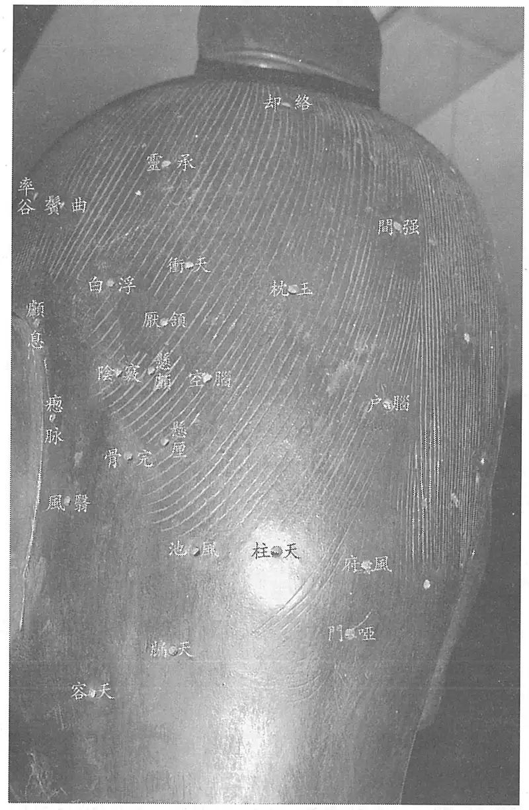

**图2-307　明正统仿宋铜人（头部）**

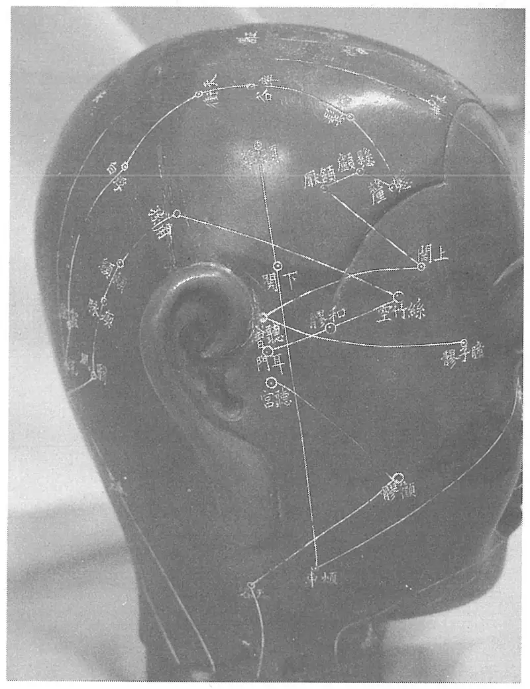

**图2-308　明·嘉靖铜人（头部）**

〔p.1023 (인쇄 995)〕

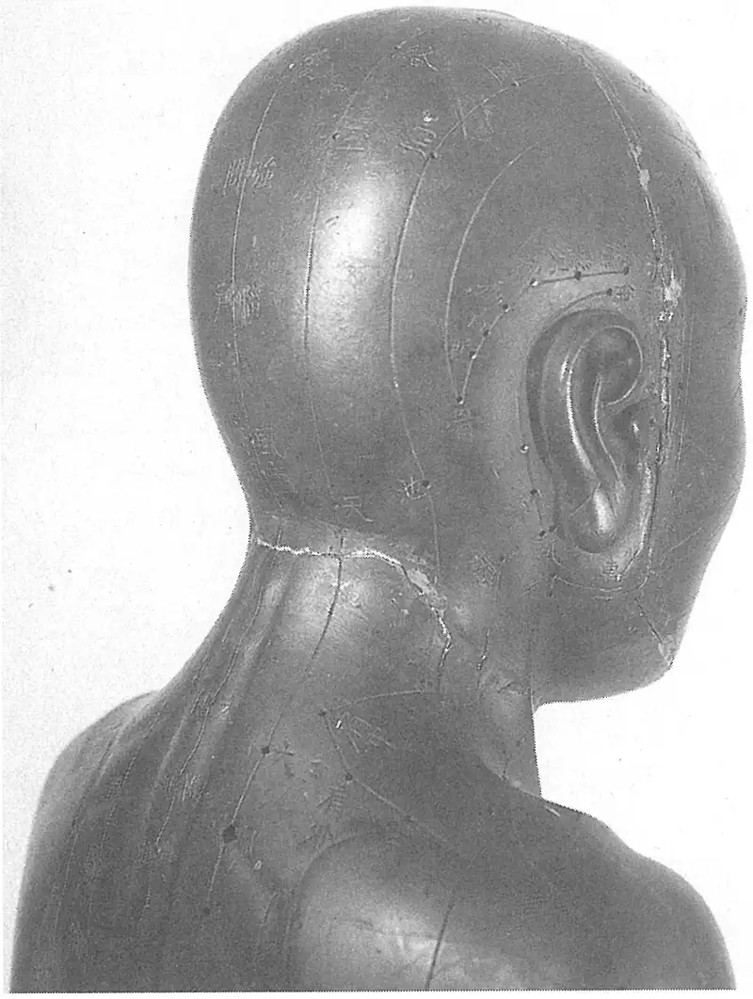

**图2-309　朝鲜铜人（侧头部）**

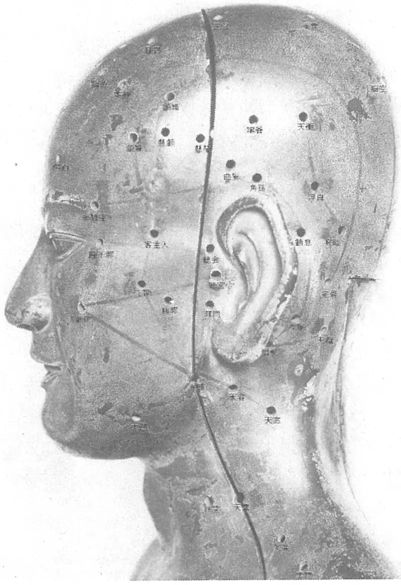

**图2-310　日本铜人（侧头部）**

〔p.1024 (인쇄 996)〕

#### 【定位】 

**部位**：在头部，从头维至曲鬓的弧形连线（其弧度与鬓发弧度相应）的上1/4与下3/4的交点处（图2-311）。

**取穴**：先定头维和曲鬓，从头维向曲鬓凸向前做弧线，于弧线之中部定悬颅，再在头维与悬颅之间取颔厌。试作咀嚼食物状，其处随咀嚼而微动。

　1. 在曲周颞颥上廉。（《黄帝明堂经》、《太平圣惠方》、《铜人腧穴针灸图经》、《圣济总录》、《十四经发挥》、《针灸聚英》、《古今医统》、《针灸大成》、《针方六集》、《循经考穴编》、《针灸易学》）

　2. 在曲周下脑空上廉。（《针灸资生经》卷一、《医学纲目》、《类经图翼》、《针灸逢源》）

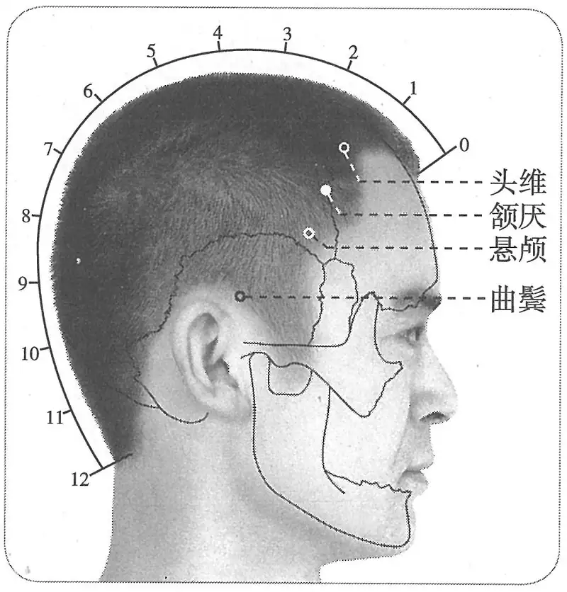

**图2-311　颔厌穴图**

　3. 对耳额角外。（《医学入门》卷一）

　4. 从客主人上内斜行，两太阳曲角上廉。（《医宗金鉴·刺灸心法要诀》）

　5. 曲周下，颞颥上廉。（《针灸十四经穴位考订》）

　6. 统编针灸学教材

　　(1) 部位：额角发际之后上部。取穴：从发际曲角旧名“曲周”入三分，当头维穴下一寸下取之。又一取法：试作咀嚼食物状，其处随咀嚼而微动。（1957年南京《针灸学》）

　　(2) 部位：额角发际之后上部。取穴：从曲角入发际三分，当胃经头维穴下五分取之。（1版《针灸学讲义》）

　　(3) 部位：在曲周颞颥上廉。取穴：在鬓发中，当头维足阳明经与曲鬓连线的上1/2段的中点取之。（2版《针灸学讲义》）

　　(4) 头维穴至曲鬓穴弧形连线的上1/4与下3/4交界处。（4、5、7版《针灸学》）

　　(5) 在头部鬓发上，当头维与曲鬓弧形连线的上1/4与下3/4交点处。（6版《针灸学》、《中国针灸学》）

**文献分析**：《铜人腧穴针灸图经》第一次将“颔厌”、“悬颅”、“悬厘”三穴排在侧头部，正统铜人中此三穴也正在侧头部。元代滑伯仁编《十四经发挥》直接以《金兰循经》为依据，在此三穴的定位上没有直接受到《铜人腧穴针灸图经》的影响，其述足少阳经循经考穴作：“足少阳经：起目锐眦之瞳子髎，于是循听会，客主人，上抵头角，循颔厌，下悬颅，悬厘，曲悬厘外循耳上发际，至曲鬓……”明显可以看出，颔厌、悬颅、悬厘三穴沿头维至曲鬓的弧形曲线（曲周）自上而下排列。

日本东博铜人中此三穴在耳颞呈几乎水平的排列，由于以往学术界多将此铜人误认为是宋天圣铜人，故日本针灸教材依此定穴——最新版已经改正。其实与中国现代定位相同的折量定位的文字描述早见于日本文献如《挨穴捷径》（1761年）、《腧穴折衷》（1764年）、《经穴纂要》（1810年）等。

#### 【类属】 

足少阳胆经穴。

**脉气所发：**

　1. 手少阳、阳明之会。（《针灸甲乙经》卷三）

〔p.1025 (인쇄 997)〕

　2. 足少阳、阳明之会。（《外台秘要》卷三十九）

　3. 手足少阳、足阳明三脉之会。（《素问·气府论》王冰注）

　4. 手足少阳、阳明之交会。（《太平圣惠方·针经》、《铜人腧穴针灸图经》卷中）

**归经**：足少阳经。（《外台秘要》卷三十九、《铜人腧穴针灸图经》卷上）

#### 【适应症】 

主治头面部病症。常用于偏头痛，目外眦痛，眩晕；耳鸣。

　1. 主善嚏，头痛身寒热。目眩无所见，偏头痛引目外眦而急，耳鸣。（《黄帝明堂经》）

　2. 颈痛。（《医心方》卷二）

　3. 治头风眩，目无所见，偏头痛引目外眦急，耳鸣，多嚏，颈项痛。（《铜人腧穴针灸图经》卷中）

　4. 主惊痫，手拳，手腕痛，颈痛，历节风汗出。（《针灸聚英》卷一、《针灸大成》）

**按**：“惊痫，手拳，手腕痛”，《针灸资生经》原文作“颔厌（见偏头痛）疗风眩（《千》）。阳谷主风眩，惊，手卷（《甲乙》手卷作手腕痛），泄风汗出，腰项急”，高武不察误将阳谷穴主治归于本穴下；“颈痛，历节风汗出”乃高武从《针灸资生经》误录《千金要方·明堂》之文。

　5. 颈项强急。（《针方六集》卷五）

　6. 一云两耳珠痛，头风两太阳痛。俱宜泻之，或弹针出血。（《循经考穴编》下）

　7. 统编针灸学教材

　　(1) 主治偏头痛，头风，目眩，外眦痛，耳鸣。（1957年南京《针灸学》、1版《针灸学讲义》）

　　(2) 主治偏头痛，目眩，目外眦痛，耳鸣，齿痛，搐搦，惊痫。（2版《针灸学讲义》、《中国针灸学》）

　　(3) 主治偏头痛，目眩，耳鸣，齿痛，惊痫。（4、5、6版《针灸学》）

　　(4) 主治①偏头痛，眩晕；②惊痫；③耳鸣、目外眦痛、齿痛等五官病证。（7版《针灸学》）

**文献分析**：“颔厌”、“悬颅”、“悬厘”三穴分别在“颞颥”之上、中、下廉。《玉篇》曰：“颞颥者，耳前动也”，此可有两种理解：其一，理解为咀嚼时耳前上颞肌动；其二，耳前上脉动。《灵枢·杂病》曰：“颔痛，刺足阳明曲周动脉见血，立已”，而悬颅穴正在曲周颞颥中，《灵枢·寒热病》、《素问·气府论》王冰注、杨上善《明堂经》、《黄帝内经太素》注皆谓本穴为“足阳明脉气所发”，且《黄帝明堂经》载悬颅穴正主“痛引颔齿”。则《灵枢》所谓“曲周动脉”与《明堂经》所谓“曲周颞颥”正相当也。又按《灵枢·热病》曰：“热病头痛，颞颥、目瘛脉痛，善衄，厥热病也”，杨上善注曰：“热病头痛，颞颥及目边脉瘛，此为厥热者也”，据杨氏注文，《黄帝内经太素》原文作“颞颥、目脉瘛”（《脉经》卷七引作“颞颥、目脉紧”）。《千金要方》、《千金翼方》均谓“颞颥穴在眉眼尾中间，上下有来去络脉是”。又《灵枢·厥病》曰：“厥头痛，头痛甚，耳前后脉涌有热（一本云有动脉），泻出其血，后取足少阳。”颔厌除主治“颞颥”上三穴共有的病症“热病偏头痛引目外眦急”外，还主治“耳鸣”症，此当出自另一针灸方主治，而《灵枢·厥病》恰好同时载有相应的针灸方：“耳鸣，取耳前动脉”，由此可知，“颞颥”脉原本也作为热病、头痛的诊脉部位，之后演变为治疗部位——穴位，其脉诊病候则成为穴位的主治病症。此“颞颥”一脉演为三穴，其主治自然相近，其共同的特点是均主治“热病偏头痛引目外眦急”。其不同点在于：颔厌穴兼治“耳鸣”；悬颅穴主头痛引齿、颔痛（齿、颔为足阳明脉行处，这与本穴原本归属于足阳明经有关）。

教材中“搐搦，惊痫”、“癫痫”诸症乃承袭高武《针灸聚英》之误，今去之。

〔p.1026 (인쇄 998)〕

#### 【操作】 

平刺。

　1. 刺入七分，留七呼，灸三壮。（《针灸甲乙经》卷三）

　2. 刺深令人耳无所闻。（《素问·气府论》王冰注）

　3. 刺入三分，留七呼，灸三壮。（《医心方》卷二）

　4. 刺入二分，留七呼，灸三壮。（《太平圣惠方·针经》）

　5. 针二分，灸三壮。（《针灸十四经穴位考订》）

　6. 统编针灸学教材

　　(1) 针二至三分，针尖沿皮向下方，灸二至三壮。（1957年南京《针灸学》、1版《针灸学讲义》）

　　(2) 向后沿皮刺3~4分，艾条灸3分钟。（2版《针灸学讲义》）

　　(3) 平刺0.5~0.8寸。（4、5、7版《针灸学》）

　　(4) 平刺0.3~0.5寸；可灸。（6版《针灸学》、《中国针灸学》）

### （五）悬颅 Xuánlú GB5 出《黄帝明堂经》 

问题1：本穴今归足少阳经，为何宋以前文献多谓“足阳明脉气所发”？

问题2：《灵枢·寒热病》“足阳明有侠鼻入于面者，名曰悬颅”中之“悬颅”如何理解？

#### 【提要索隐】 

**穴名**：悬颅，既是穴名，又是脉名，两者概念不同。

**部位**：在头部，从头维至曲鬓的弧形连线（其弧度与鬓发弧度相应）的中点处。

**归经**：足少阳胆经。**按**：宋以前文献关于本穴归经不统一。

**适应症**：主治头面部病症。常用于热病，偏头痛引目、颔、齿痛。

**针刺操作**：平刺。

#### 【名实考】 

“悬颅”既是穴名，也是脉名，不得相混。又“悬颅”与“悬厘”一字之差，古医籍中有混淆之例。

古代文献对于“颔厌”、“悬颅”、“悬厘”三穴的定位无分歧，而不同时代的医家对于相同的定位描述却有不同的理解，其中与现代人理解相差最大的是宋代《铜人腧穴针灸图经》的编纂者。

1957年南京《针灸学》于本穴下载有“髓空”、“米啮”别名，其中“髓空”一说，日本《经穴汇解》已说辨其误；而“米啮”一名，遍寻古今中国针灸文献未得，却在日本文献查出它的来历。

关于本穴的折量分寸定位法见于日本文献《挨穴捷径》（1761年）、《腧穴折衷》（1764年）、《经穴纂要》（1810年），均源于堀元昌之说。

本穴在颞颥中，脑空穴一名颞颥，如果一首汉以前的针灸方中出现“颞颥”穴，或者以颞颥为名的主治，《黄帝明堂经》编者会归到哪个穴下呢？或者随意归入其中一穴？或者无法抉择，干脆分别归入二穴之中呢？这两种可能都存在，详见脑空穴“名实考”。

关于本穴定位的历代分歧及其原因，详见颔厌穴“名实考”。

　1. 悬颅，在曲周颞颥中。足少阳脉气所发。（《黄帝明堂经》）

　2. 足阳明有夹鼻入于面者，名曰悬颅，属口，对入系目本，视有过者取之。（《灵枢·寒热病》）

〔p.1027 (인쇄 999)〕

**按**：此“悬颅”乃脉名，非穴名。

　3. 以其悬于头颅之侧，故曰悬颅。（《经穴解》）

　4. 别名　髓孔、髓中、米啮。（1957年南京《针灸学》）

**按**：关于1957年南京《针灸学》所载之3别名，查得相关文献如下：

　　(1) 髓空在脑后三分，在颅际锐骨之下。王冰注曰：是谓风府，通脑中也。（《素问骨空论》）

　　(2) 云门、髃骨、委中、髓空，此八者以写四支之热也。王冰注曰：髓空者，正名腰俞，在脊中第二十一椎节下间，督脉气所发。（《素问·水热穴论》）

　　(3) 大迎，一名髓孔。（《黄帝明堂经》）

　　(4) 腰俞，一名背解，一名髓空，一名腰柱，一名腰户。（《黄帝明堂经》）

　　(5) 颔厌在胃头维下旁，颞颥上廉发际角。注：颞颥，邦俗呼米咀。（日本《校定引经诀》）

　　(6) “颞颥”，注家多误为“脑空”。盖“脑空”一名“颞颥”，遂以相混耳。既有“上廉”等之语。非穴名者可见也，即俗所谓“米嚼”（コメカミ）也。（日本原昌克《经穴汇解》卷一）

看到上述日本文献的解释，虽然知道“米嚼”（コメカミ）是日本人“颞颥”一词的俗称，而不是“悬颅”穴的别名。不过中国人（可能也包括大多日本人在内）还是不明白，为什么日本人把“颞颥”称作“米啮”。《广辞苑》有非常明确的解释，在こめかみ条目下，第一词为“米啮み”，第二个是颞颥、蟀谷：“本指啮米时动的地方。此指啮物时耳颞与目之间动的部位”。

至此，“米啮”（コメカミ）的意义水落石出。联想到《玉篇》的解释“颞颥，耳前动也”，也更加深了《黄帝明堂经》蟀谷穴取穴法“嚼而取之”的意义。其实口中什么也不含，就嚼齿，耳颞部的鼓动就很明显。

“髓中”作为本穴的别名见于日本《针灸经穴全书》，云出自《素问直解》，查此书只是将上述《素问·骨空论》之“髓空”注作“悬颅”，未提及“髓中”一词。

综上所述，1957年南京《针灸学》所载3个别名都是错误的，这一错误系沿袭日本《针灸经穴全书》之误，韩国《针灸学》又从中国教材重复了这一错误。

#### “悬颅”误作“悬厘”例 

　1. 热病头痛引目外眦而急，烦满汗不出，引颔齿，面赤皮痛，悬厘主之《千金》有热病头痛身重悬颅主之。（《针灸甲乙经》卷七第一）

**按**：此条主治病症，《圣济总录》引《针灸甲乙经》之文作“悬颅主之”，《外台秘要》、《医心方》中该条病症亦均为“悬颅所主”，可见传世本《针灸甲乙经》此处“悬厘主之”系“悬颅主之”之误。

　2. 悬厘主面皮赤痛。（《千金要方》卷三十）

　3. 悬厘、束骨主癫疾互引，善惊，羊鸣。（《千金要方》卷三十）

**按**：《千金要方》此两条文字中之“悬厘”均系“悬颅”之误。

#### 【定位】 

**部位**：在头部，从头维至曲鬓的弧形连线（其弧度与鬓发弧度相应）的中点处（图2-312）。

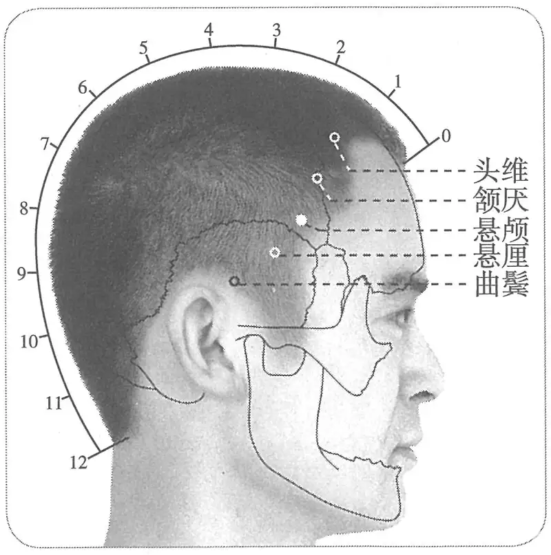

**图 2-312　悬颅穴图**

〔p.1028 (인쇄 1000)〕

**取穴**：按取颔厌穴下，当头维至曲鬓的弧形连线的中点处。

　1. 在曲周颞颥中。（《黄帝明堂经》、《太平圣惠方》、《铜人腧穴针灸图经》、《圣济总录》、《十四经发挥》、《针灸大成》、《类经图翼》、《循经考穴编》、《针灸易学》、《针灸逢源》）

　2. 在曲周颞颥上廉中。（《千金翼方》卷二十六、《外台秘要》、《针灸聚英》、《古今医统》）

　3. 在曲周上，脑空中。（足少阳穴同，《明堂》无上字）《素注》云：在曲角上，脑空下廉。新校正云：按后手少阳中云角上，此云角下，必有一误。悬颅二穴，在曲角上是也（《针灸资生经》卷一）

　4. 斜上额角中，在悬厘间。（《医学入门》卷一）

　5. 从颔厌后行耳前曲角上，两太阳之中。（《医宗金鉴·刺灸心法要诀》）

　6. 曲周下，颞颥中廉。（《针灸十四经穴位考订》）

　7. 统编针灸学教材

　　(1) 部位：在颔厌穴下方之处。取穴：按取颔厌穴直下六分，向后一分处取之，当咀嚼时该处筋动之正中部。（1957年南京《针灸学》）

　　(2) 部位：颔厌穴之后下方。取穴：当胃经头维穴与曲鬓的弧形线中央取之。（1版《针灸学讲义》）

　　(3) 部位：在曲周颞颥中。取穴：在鬓发中，当头维与曲鬓之间，沿鬓发弧形连线之中点取穴。（2版《针灸学讲义》）

　　(4) 头维穴至曲鬓穴弧行连线的中点。（4、5、7版《针灸学》）

　　(5) 在头部鬓发上，当头维与曲鬓弧形连线的中点处。（6版《针灸学》、《中国针灸学》）

**文献分析**：关于本穴定位的所有分歧都出自对“曲周颞颥”的不同理解上。分析详见“颔厌”穴。

#### 【类属】 

足少阳胆经穴。

**脉气所发：**

　1. 足少阳脉气所发。（《针灸甲乙经》卷三、《外台秘要》、《铜人腧穴针灸图经》卷中）

　2. 足阳明脉气所发。（《素问·气府论》王冰注、《医心方》、《太平圣惠方》）

　3. 足阳明有夹鼻入于面者，名曰悬颅，属口，对入系目本。（《灵枢·寒热病》）

**归经：**

　1. 足阳明经。（《黄帝内经明堂》）

　2. 足少阳经。（《外台秘要》卷三十九、《铜人腧穴针灸图经》卷上）

#### 【适应症】 

主治头面部病症。常用于热病，偏头痛引目、颔、齿痛。

　1. 主热病头痛，身热，烦满汗不出，甚者偏头痛引目外眦而急，引颔齿，面赤皮痛。（《黄帝明堂经》）

　2. 齿痛。（《太平圣惠方·针经》）

　3. 治热病烦满，汗不出，头偏痛引目外眦赤，身热齿痛，面肤赤痛。（《铜人腧穴针灸图经》卷中）

　4. 主鼻洞浊下不止传为鼽，目昏瞢瞑目。（《针灸聚英》卷一、《针灸大成》）

　5. 统编针灸学教材

　　(1) 主治偏头痛，目外眦痛，齿颊疼痛，颜面赤肿。（1957年南京《针灸学》）

　　(2) 主治偏头痛，目痛，齿颊疼痛，面肿。（1版《针灸学讲义》）

　　(3) 主治偏头痛，目外眦痛，齿痛，面肿。（2版《针灸学讲义》）

〔p.1029 (인쇄 1001)〕

　　(4) 主治偏头痛，目外眦痛，齿痛。（4版《针灸学》）

　　(5) 主治偏头痛，目赤肿痛，齿痛。（5、6、7版《针灸学》）

　　(6) 主治偏头痛，目外眦痛，面肿。（《中国针灸学》）

**文献分析**：《针灸聚英》所载主治乃《素问·气厥论》文字，原文作“胆移热于脑，则辛颎鼻渊，鼻渊者，浊涕下不止也，传为衄蔑瞑目”，未详高武何以归入本穴之下。现代针灸教材未传此误。

#### 附：临床应用举例 

　1. 颔痛，刺足阳明曲周动脉见血，立已；不已，按人迎于经，立已。（《灵枢·杂病》）

**按**：曲周动脉，相当于悬颅穴（在曲周颞颥中）处。《灵枢·寒热病》、《素问·气府论》王冰注、杨上善《明堂经》注皆谓本穴为“足阳明脉气所发”，故《黄帝明堂经》载本穴主治有“痛引颔齿”。

　2. 偏头痛，颔厌穴、悬颅穴、悬厘穴，针刺治疗。［上海针灸杂志，1988，7（1）：15-16］

#### 【操作】 

平刺。

　1. 刺入三分，留三呼，灸三壮。（《黄帝明堂经》）

　2. 针二分，灸三壮。（《针灸十四经穴位考订》）

　3. 统编针灸学教材

　　(1) 针二至三分，针灸沿皮向下方，灸二至三壮，不宜深刺。（1957年南京《针灸学》）

　　(2) 针二至三分，针尖沿皮向下方。（1版《针灸学讲义》）

　　(3) 向后沿皮刺3~4分，艾条灸3分钟。（2版《针灸学讲义》）

　　(4) 平刺0.5~0.8寸。（4、5、6、7版《针灸学》）

　　(5) 横刺0.3~0.5寸。可灸。（《中国针灸学》）

### （六）悬厘 Xuánlí GB6 出《黄帝明堂经》 

#### 【提要索隐】 

**部位**：在头部，从头维至曲鬓的弧形连线（其弧度与鬓发弧度相应）的上3/4与下1/4的交点处。

**按**：古代文献对于“颔厌”、“悬颅”、“悬厘”三穴的定位无分歧，而不同时代的医家对于相同的定位描述却有不同的理解，其中与现代人理解相差最大的是宋代《铜人腧穴针灸图经》的编纂者。

**适应症**：主治头目部病症。常用于偏头痛，目外眦痛。**新增**：热病。

**针刺操作**：平刺0.5~0.8寸。

#### 【名实考】 

悬厘之“厘”，《千金翼方》作“釐”，异体字。又“悬颅”与“悬厘”一字之差，古医籍中有混淆之例，详见悬颅穴“名实考”。

关于本穴定位的历代分歧及其原因，详见颔厌穴“名实考”。

　1. 悬厘，在曲周颞颥下廉，手足少阳、阳明之会。（《黄帝明堂经》）

　2. 悬厘，厘，发毛也，谓发也。毛垂悬下耳角前之下是穴也。（明刊建阳刻本《医学纲目》卷八）

#### 【定位】 

**部位**：在头部，从头维至曲鬓的弧形连线（其弧度与鬓发弧度相应）的上3/4与下1/4的交点处（图2-313）。

**取穴**：在侧头部，当悬颅与曲鬓之间取穴。

〔p.1030 (인쇄 1002)〕

　1. 在曲周颞颥下廉。（《黄帝明堂经》、《十四经发挥》、《针灸聚英》、《古今医统》、《针灸大成》、《针方六集》、《类经图翼》、《循经考穴编》、《针灸易学》、《针灸逢源》）

　2. 在曲周上颞颥下廉。（《铜人腧穴针灸图经》卷中、《圣济总录》）

　3. 在曲周上，脑空下廉。（《针灸资生经》卷一、《医学纲目》）

　4. 从额斜上头角下陷。（《医学入门》卷一）

　5. 从悬颅后行，耳前曲角上，两太阳下廉。（《医宗金鉴·刺灸心法要诀》）

　6. 曲周下，颞颥下廉。（《针灸十四经穴位考订》）

　7. 统编针灸学教材

　　(1) 部位：悬颅穴之后下方；取穴：从悬颅下五分，微向后一分取之。（1957年南京《针灸学》）

　　(2) 部位：悬颅穴之后下方；取穴：从悬颅与曲鬓二穴之间取之。（1版《针灸学讲义》）

　　(3) 部位：在曲周颞颥下廉。取穴：在鬓角之上际，当悬颅与曲鬓之中点取之。（2版《针灸学讲义》）

　　(4) 头维穴至曲鬓穴弧形连线的下1/4与上3/4交界处。（4、5、7版《针灸学》）

　　(5) 在头部鬓发上，当头维与曲鬓弧形连线的上3/4与下1/4交点处。（6版《针灸学》、《中国针灸学》）

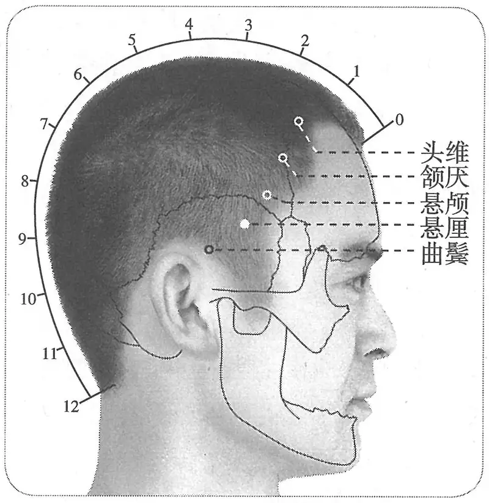

**图 2-313　悬厘穴图**

#### 【类属】 

足少阳胆经穴。

**脉气所发：**

　1. 手足少阳、阳明之会。（《针灸甲乙经》卷三、《外台秘要》、《素问·气府论》王冰注）

　2. 足阳明、少阳之会。（《黄帝内经明堂》）

**归经**：足少阳经。（《外台秘要》卷三十九、《铜人腧穴针灸图经》卷上）

#### 【适应症】 

主治头目部病症。常用于偏头痛，目外眦痛。**新增**：热病。

　1. 主热病，偏头痛，引目外眦。（《黄帝明堂经》）

　2. 悬厘主面皮赤痛。（《千金要方》卷三十）

　3. 悬厘、束骨主癫疾互引，善惊，羊鸣。（《千金要方》卷三十）

**按**：《千金要方》此两条文字中之“悬厘”均系“悬颅”之误。

　4. 耳鸣，善嚏。（《外台秘要》卷三十九）

**按**：此皆《针灸甲乙经》“颔厌主之”病症，王焘误置于此。

　5. 治热病汗不出，头偏痛，烦心不欲食，目锐眦赤痛。（《铜人腧穴针灸图经》卷中）

　6. 中焦客热。（《针灸聚英》卷一、《针灸大成》、《针方六集》）

**按**：此乃高武从《针灸资生经》误录《太平圣惠方》悬钟穴主治。

　7. 统编针灸学教材

　　(1) 主治偏头痛，目锐眦痛，面红肿。（1957年南京《针灸学》、1版《针灸学讲义》）

　　(2) 主治偏头痛，目外眦痛，耳鸣，善嚏，面红肿。（2版《针灸学讲义》）

　　(3) 主治偏头痛，目外眦痛，耳鸣。（4版《针灸学》）

〔p.1031 (인쇄 1003)〕

　　(4) 主治偏头痛，目赤肿痛，耳鸣。（5、6、7版《针灸学》）

　　(5) 主治偏头痛，目外眦痛，耳鸣，善嚏。（《中国针灸学》）

**文献分析**：治疗“热病头痛”是颔厌、悬颅、悬厘三穴的共有特征，教材不收“热病”一症，欠妥，今补之。又教材中“耳鸣，善嚏，面红肿”系承袭《千金要方》《外台秘要》之误，将悬颅、颔厌穴主治误置于此，今去之。

#### 【操作】 

平刺。

　1. 刺入三分，留七呼，灸三壮。（《黄帝明堂经》）

　2. 针二分，灸三壮。（《针灸十四经穴位考订》）

　3. 统编针灸学教材

　　(1) 针二至三分，针灸沿皮向下方，灸二至三壮，不宜深刺。（1957年南京《针灸学》）

　　(2) 针二至三分，针尖沿皮向下方。（1版《针灸学讲义》）

　　(3) 向后沿皮刺2~3分，艾条灸3分钟。（2版《针灸学讲义》）

　　(4) 平刺0.5~0.8寸。（4、5、6、7版《针灸学》）

　　(5) 横刺0.3~0.5寸。可灸。（《中国针灸学》）

### （七）曲鬓 Qūbìn GB7 出《黄帝明堂经》 

#### 【提要索隐】 

**穴名**：曲鬓，古医籍有误作“曲发”者。

**部位**：在头部，耳前鬓角发际后缘与耳尖水平线的交点处。

**适应症**：主治头面部病症。常用于头痛、齿痛；颊肿，口噤。

**针刺操作**：平刺。

#### 【名实考】 

曲鬓，又有写作“曲髩”者，乃“鬓”之异体。《太平圣惠方·明堂》误作“曲发”，后人不辨而作为本穴之别名。

　1. 曲鬓在耳上入发际曲隅陷者中鼓颔有空足太阳少阳之会。（《黄帝明堂经》）

　2. 曲髮二穴，在耳上发际曲禺陷者中。（《太平圣惠方·明堂》）

　3. 《铜人》云曲鬓，足少阳穴同，《素问》亦同。《明堂下经》云曲发，疑“发”字误也。曲鬓穴是，曲发字误。（《针灸资生经》卷一）

　4. 曲髩，一名曲发。（《针灸聚英》卷一、《古今医统》、吴文炳《针灸大成》）

　5. 此穴虽在二耳际，乃在耳微前，发际曲隅陷中，以鼓颔有空证之。耳上发际，鼓颔而不动，耳微前发际，鼓颔而有动处，穴名曲鬓，则在耳上微前，不在正耳上矣。（《经穴解》）

　6. 别名　曲发。（1957年南京《针灸学》）

**文献分析**：髩、鬂，为“鬓”的异体字。“髮”为“鬓”的误字。对于这一错误，早在宋代王执中就已经指出，之后佚名氏的注解更明确。后人不察，仍有写作“曲发”者，1957年南京《针灸学》又写入别名中。

#### 【定位】 

**部位**：在头部，耳前鬓角发际后缘与耳尖水平线的交点处（图2-314）。

**取穴**：在耳前上方入鬓发内，约当角孙前一横指处取之。

　1. 在耳上入发际，曲隅陷者中，鼓颔有空。（《针灸甲乙经》卷三、《外台秘要》、《素问·气府论》王冰注）

〔p.1032 (인쇄 1004)〕

　2. 在耳上发际，曲隅陷者中，鼓颔有空。（《千金要方》卷二十九、《千金翼方》、《医心方》、《太平圣惠方》、《铜人腧穴针灸图经》、《圣济总录》、《针灸资生经》、《十四经发挥》、《医学纲目》、《针灸聚英》、《医学入门》、《针灸大成》、《针方六集》、《类经图翼》、《循经考穴编》、《针灸易学》、《针灸逢源》）

　3. 《指迷》在耳上，将耳掩前正尖上。（《针灸资生经》卷一、《大本琼瑶神书》、《医学入门》）

　4. 从悬厘后行，耳前入发际曲隅陷中，鼓颔有空。（《医宗金鉴·刺灸心法要诀》）

　5. 上耳根微前入发际，曲隅陷中。（《针灸十四经穴位考订》）

　6. 统编针灸学教材

　　(1) 部位：颧骨弓之后上方。取穴：从耳上微前入发际一寸处，当三焦经角孙之前约一寸取之。（1957年南京《针灸学》）

　　(2) 部位：悬厘穴后下方。取穴：在三焦经和髎穴之上，角孙之前，发际陷中取之。（1版《针灸学讲义》）

　　(3) 部位：在耳上入发际曲隅陷者中，鼓颔有空。取穴：在耳前上方入鬓发内，约当角孙手少阳经前一横指处取之。（2版《针灸学讲义》）

　　(4) 耳前鬓发后缘直上，平角孙穴处。（4、5、7版《针灸学》）

　　(5) 在头部，当耳前鬓角发际后缘的垂线与耳尖水平线交点处。（6版《针灸学》）

　　(6) 耳前鬓发后缘直上，约当角孙前一横指处。（《中国针灸学》）

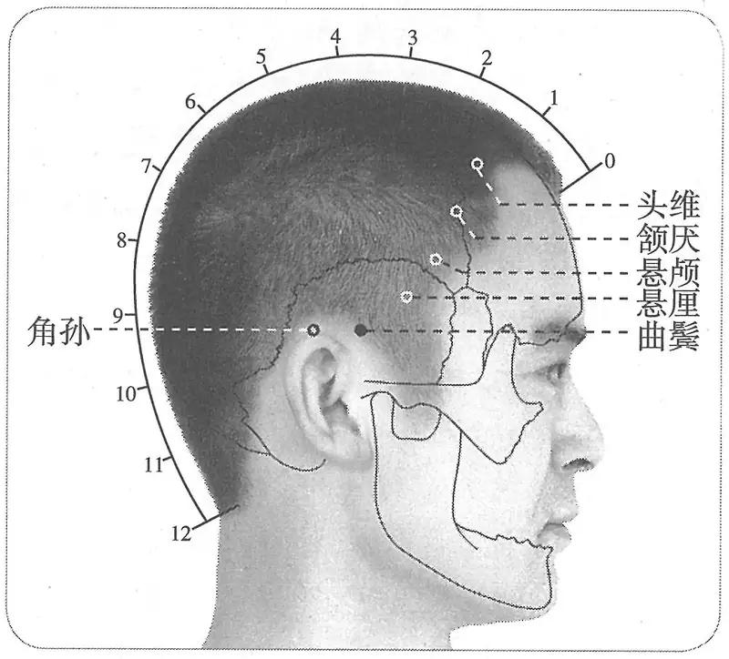

**图 2-314　曲鬓穴图**

#### 【类属】 

足少阳胆经穴。

**脉气所发**：足太阳、少阳之会。（《黄帝明堂经》）

**归经**：足少阳经。（《外台秘要》卷三十九、《铜人腧穴针灸图经》）

#### 【适应症】 

主治头面部病症。常用于头痛、齿痛；颊肿，口噤。

　1. 主颈颔支满，痛引牙齿，口噤不开，急痛不能言。（《黄帝明堂经》）

　2. 颈项急强不得顾，引牙齿痛。（《太平圣惠方·明堂》）

　3. 治颊颔肿，引牙车不得开，急痛，口噤不能言。（《铜人腧穴针灸图经》卷中、《圣济总录》、《针灸聚英》、《古今医统》、《针灸大成》、《针方六集》、《类经图翼》、《针灸逢源》）

　4. 脑两角痛为巅风，引目眇。（《针灸聚英》卷一、《古今医统》、《针灸大成》、《针方六集》、《类经图翼》、《针灸逢源》）

**按**：此乃高武从《针灸资生经》误引《铜人腧穴针灸图经》脑空穴主治。

　5. 口眼㖞斜。（《循经考穴编》）

　6. 统编针灸学教材

　　(1) 主治头两角痛，颔颊肿，口噤。（1957年南京《针灸学》、1版《针灸学讲义》）

　　(2) 主治鬓角痛，颔颊肿，牙关紧闭，颈项强急，小儿痉挛，暴喑不语。（2版《针灸学讲义》）

〔p.1033 (인쇄 1005)〕

　　(3) 主治头痛连齿，颔颊肿，口噤，暴喑。（4版《针灸学》）

　　(4) 主治头痛，齿痛，牙关紧闭，暴喑。（5、6版《针灸学》）

　　(5) 主治头痛连齿、颊颔肿、口噤等头面病证。（7版《针灸学》）

　　(6) 主治头痛，颔颊肿，牙关紧闭，鬓角痛，小儿惊风。（《中国针灸学》）

**文献分析**：教材中“小儿惊风”未详所出，疑有误，暂不收录。

#### 附：临床应用举例 

　1. 治头痛连齿，时发时止，连年不已：又灸曲鬓一穴，在耳上，将耳掩前正当尖上。可灸七壮，左痛灸左，右痛灸右。（《鸡峰普济方》卷十四）

　2. 复视，单眼复视，取患侧曲鬓穴，若双眼复视，则取两侧曲鬓穴。患者取坐位或仰卧位。［针灸临床杂志，1994，10（1）：46］

#### 【操作】 

平刺。

　1. 刺入三分，灸三壮。（《黄帝明堂经》）

　2. 刺入四分，灸三壮。（《医心方》卷二）

　3. 可灸七壮，针入三分。（《铜人腧穴针灸图经》卷中）

　4. 一法针一分，沿皮向下透听会，或平针五分，灸五壮。（《循经考穴编》下）

　5. 针二分，灸三壮。（《针灸十四经穴位考订》）

　6. 统编针灸学教材

　　(1) 针二至三分，沿皮刺。灸三至五壮。（1957年南京《针灸学》、1版《针灸学讲义》）

　　(2) 向后沿皮刺2~3分，艾条灸3分钟。（2版《针灸学讲义》）

　　(3) 平刺0.5~0.8寸。（4、5、6、7版《针灸学》）

　　(4) 横刺0.3~0.5寸。可灸。（《中国针灸学》）

### （八）率谷 Shuàigǔ GB8 出《黄帝明堂经》 

#### 【提要索隐】 

**穴名**：率谷，宋以前文献多作“蟀谷”。《针灸大全》作“率骨”，同音借代，其另一传本《杨敬斋针灸全书》仍作“率谷”，无误。

**部位**：在头部，耳尖直上入发际1.5寸。**按**：《十四经发挥》将“天冲”穴定位文字错入本穴中。

**归经**：足少阳胆经。**按**：本穴为足少阳、太阳二脉交会穴。

**适应症**：主治头部病症。常用于偏头痛，眩晕，呕吐；小儿惊风。

**针刺操作**：平刺。

#### 【名实考】 

宋以前文献多作“蟀谷”，今从《针灸甲乙经》、《铜人腧穴针灸图经》作“率谷”。1957年南京《针灸学》将本穴正名定为“率角”，“率谷”作别名，不知何据。

关于本穴的取法，《黄帝明堂经》作“嚼而取之”，是指做咀嚼动作时，颞肌收缩，而耳前上方（颞颥部）鼓动，犹如蟋蟀鸣叫时侧头部鼓动状。从这个意义上说，本穴名作“蟀谷”为是。《玉篇》曰“颞颥，耳前动也”，也指此义。

　1. 蟀谷，在耳上入发际一寸五分，足太阳、少阳之会。嚼而取之。（《黄帝明堂经》）

　2. 足太阳之脉……支别者，从巅之百会，抵耳上角，过率谷，浮白，窍阴穴，所以散养于经脉也。率谷，浮白，窍阴三穴，见足少阳经，足太阳、少阳之会也。（《十四经发挥》卷中）

〔p.1034 (인쇄 1006)〕

　3. 足少阳经，起目锐眦之瞳子髎，于是循听会，客主人，上抵头角，循颔厌，下悬颅、悬厘，由悬厘外循耳上发际，至曲鬓、率谷，由率谷外折，下耳后，循天冲，浮白，窍阴，完骨，又自完骨外折，上过角孙，循本神，过曲差，下至阳白会睛明。（《十四经发挥》卷中）

　4. 此穴在曲鬓之上，有跃然上行之势，故曰率谷。（《经穴解》）

　5. 率角别名　蟀容。（1957年南京《针灸学》）

**文献分析**：此转抄日本《针灸经穴全书》，云出自《外台》，今查非是。韩国《针灸学》不明真相，又从中国教材转抄了这一错误。

#### 【定位】 

**部位**：在头部，耳尖直上入发际1.5寸（图2-315）。

**取穴**：角孙直上，入发际1.5寸。咀嚼时，以手按之有肌肉鼓动。

　1. 在耳上入发际一寸五分，嚼而取之。（《针灸甲乙经》卷三、《外台秘要》、《医心方》、《太平圣惠方·明堂》、《针灸资生经》、《针灸聚英》、《古今医统》、《针灸大成》、《类经图翼》、《针灸易学》、《针灸逢源》）

　2. 在耳上入发际一寸五分。（《千金要方》卷二十九、《千金翼方》、《铜人腧穴针灸图经》、《圣济总录》、《医学纲目》、《医学入门》、《针方六集》）

　3. 在耳上如前三分，入发际一寸五分陷者宛宛中。（《十四经发挥》中）

　4. 窦太师针灸佚文

　　(1) 在头部卷耳尖上一寸，入发际一寸半。（《窦太师针经》）

　　(2) 在耳上入发际寸半陷中，嚼而取之，云耳尖上一寸是穴。（《大本琼瑶神书》）

　　(3) 在耳尖上入发际一寸五分。（《窦太师秘传》）

　5. 一法卷耳尖向前点著处宛宛中。（《循经考穴编》下）

　6. 耳直上入发际约一寸五分。（《针灸十四经穴位考订》）

　7. 统编针灸学教材

　　(1) 部位：耳尖上入发际一寸五分。取穴：从耳上入发际一寸五分取之，角孙穴直上曲鬓穴向后斜上一寸之处，以指按之咀嚼时随之而动。（1957年南京《针灸学》）

　　(2) 部位：耳尖上入发际一寸五分。取穴：三焦经角孙穴直上一寸之处取之。（1版《针灸学讲义》）

　　(3) 部位：在耳上入发际一寸五分。取穴：在耳廓尖上方，角孙手少阳经上，入发际两横指取之。（2版《针灸学讲义》）

　　(4) 耳尖直上，入发际1.5寸。（4、5、7版《针灸学》，《中国针灸学》）

　　(5) 在头部，当耳尖直上入发际1.5寸，角孙直上方。（6版《针灸学》）

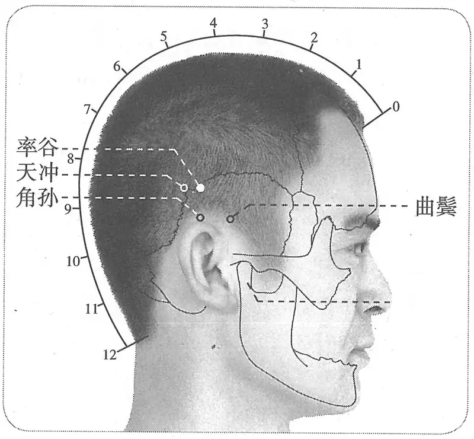

**图 2-315　率谷穴图**

**文献分析**：本穴的取穴法“嚼而取之”，是指咀嚼鼓颔时，耳上方的颞肌收缩鼓动，如果不能触及鼓动，则说明超出颞肌的上界，取穴偏高。《十四经发挥》“耳上如前三分”六字系下一穴“天冲”定位文字的错入；《循经考穴编》所说之“一法”乃前一穴“曲鬓”的取穴法。

〔p.1035 (인쇄 1007)〕

#### 【类属】 

足少阳胆经穴。

**脉气所发**：足太阳、少阳之会。（《黄帝明堂经》）

**归经**：足少阳经。（《外台秘要》卷三十九、《铜人腧穴针灸图经》卷上）

#### 【适应症】 

主治头部病症。常用于偏头痛，眩晕，呕吐；小儿惊风。

　1. 主醉酒风热发，两角一作两目眩痛，不能饮食，烦满呕吐。（《黄帝明堂经》）

　2. 主头重，皮肤肿。（《太平圣惠方·明堂》）

　3. 治膈胃寒痰，伤酒风发，脑两角弦痛，不能饮食，烦满，呕吐不止。（《铜人腧穴针灸图经》卷中）

　4. 窦太师针灸遗存

　　(1) 偏正头风痛，泻。又云针一分，沿皮向后透丝竹空穴，治两眉骨疼，补泻。（《窦太师针经》）

　　(2) 主偏正头风，目痛。（《针方六集》卷五）

　　(3) 主偏正头风，眼疾。（《循经考穴编》下）

　　(4) 治眼目痛，头痛等症。（《窦太师秘传》）

　5. 统编针灸学教材

　　(1) 主治偏正头痛，眼疾。（1957年南京《针灸学》、1版《针灸学讲义》）

　　(2) 主治偏头痛，烦满呕吐，小儿急慢惊风。（2版《针灸学讲义》、4版《针灸学》）

　　(3) 主治偏头痛，眩晕，小儿急、慢惊风。（5、6、7版《针灸学》）

　　(4) 主治偏头痛，眩晕，呕吐，小儿惊风。（《中国针灸学》）

#### 附：临床应用举例 

　1. 小儿但是风病，诸般医治不瘥，灸耳上入发际一寸五分，嚼而取之，蟀谷穴也。（《太平圣惠方·明堂》）

　2. 头风偏正最难医，丝竹金针亦可施。更要沿皮透率谷，一针两穴世间稀。（《针灸玉龙歌》）

　3. 偏头痛，取率谷、太阳、列缺穴。［中医函授通讯，1988（6）：39］

　4. 偏头痛，苍龟探穴刺率谷治疗。［针灸临床杂志，1995，11（6）：29］

　5. 中风偏瘫，针刺率谷穴治疗。［湖北中医杂志，1995，17（2）：44］

　6. 神经性头痛，针刺率谷穴治疗。［现代康复，2000，4（6）：952］

#### 【操作】 

平刺。治偏头痛，宜向前透向丝竹空，使针感向前额放散；眩晕透向曲鬓、角孙，使针感向颞部及耳部放散。针后注意压迫止血。

　1. 刺入四分，灸三壮。（《黄帝明堂经》）

　2. 可灸三壮，针入三分。（《铜人腧穴针灸图经》卷中）

　3. 针三分，灸七壮。偏正头风痛，泻。又云针一分，沿皮向后透丝竹空穴，治两眉骨疼，补泻。（《窦太师针经》）

　4. 针入五分，沿皮向前一寸，灸七壮。（《窦太师秘传》）

　5. 一法刺一分，沿皮向前透丝竹空。（《循经考穴编》下）

　6. 针二分，灸三壮。（《针灸十四经穴位考订》）

　7. 统编针灸学教材

　　(1) 针尖向后或向前沿皮刺入二至三分，灸三至五壮。（1957年南京、1版《针灸学讲义》）

〔p.1036 (인쇄 1008)〕

　　(2) 沿皮刺3分，艾条灸3~5分钟。（2版《针灸学讲义》）

　　(3) 平刺0.5~0.8寸。（4、5、7版《针灸学》）

　　(4) 平刺0.5~1寸；可灸。（6版《针灸学》）

　　(5) 横刺0.3~0.5寸。可灸。（《中国针灸学》）

**文献分析**：关于本穴刺法与主治的关系，《窦太师针经》明确提出，治偏头痛，刺一分，沿皮向前透丝竹空。《针灸玉龙歌》也记载丝竹空透率谷治疗偏正头痛的经验；现代临床经验：治眩晕、呕吐、小儿惊风，可向下或前下平刺。

### （九）天冲 Tiānchōng GB9 出《黄帝明堂经》 

问题：关于本穴定位，宋以后文献的说法有八种之多，同一书前后不一，同一种说法或自相矛盾，为什么会出现如此多、如此令人费解的分歧？

#### 【提要索隐】 

**部位**：在头部，耳根后缘直上，入发际2寸。

**适应症**：主治头部病症。常用于头痛，癫痫，牙龈肿痛。

**针刺操作**：平刺。

#### 【名实考】 

《黄帝明堂经》耳上穴中本穴最高，直冲头部（天部），与“通天”穴相望，故名“天冲”。

天冲，《千金要方》卷二十九作“天衢”，而未经宋人校改本《孙真人千金方》仍作“天衝”，卷三十也均作“天衝”。又同一作者同样内容的《千金翼方》也作“天衝”，足证通行本《千金要方》卷二十九“天衢”系“天衝”之形误。明代吴文炳《针灸大成》误作“天牕”。

本穴定位，历代文献描述分歧颇大，关键在于不能正确理解《黄帝明堂经》“耳上如前三寸”特殊句式，特举相关句式如下：

　1. 天冲在耳上如前三寸。

　2. 丘墟在足外踝下如前陷者中，去临泣三寸。

　3. 阳辅者火也，在足外踝上，辅骨前，绝骨端如前三分许，去丘墟七寸。

　4. 地仓，一名胃维，夹口旁四分如近下是。

可见，《黄帝明堂经》“如”字用法有“稍”、“略”之义（地仓穴用例十分明显），其后不会跟随“三寸”这样长的距离。所谓“耳上如前三寸”，义即耳上稍前上三寸，更准确的表达如作“耳上三寸如前”。这一点从《针灸甲乙经》的腧穴排序可以得到进一步的证实：

　5. 头缘耳上却行至完骨凡十二穴第五　天冲、蟀谷、曲鬓、浮白、窍阴、完骨。

**按**：这里在耳上折返至耳后下的这一行穴中，天冲穴在最上，也就是说在耳上的尺寸一定比蟀谷穴（一寸半）要大，足证“耳上如前三寸”是指耳上三寸略前的意思。千百年来由于人们不解此义，关于本穴的定位引出种种分歧，而不同时代的人又根据当时影响大的针灸书妄改以前的经典，甚至用挖改的方式改石刻经文，从而使得真相更加难以考辨：

　1. 天冲，在耳上如前三分。（明刊本《针灸甲乙经》卷三、《铜人针灸腧穴图经》卷中）

　2. 天冲二穴，在耳后入发际二寸。（《铜人针灸腧穴图经》卷上、卷下“穴腧都数”）

　3. 天冲，在耳后发际二寸耳上，如前三分。（《十四经发挥》卷中、《针灸大成》）

　4. 耳后发际二寸，耳上如前三寸。（《针灸聚英》卷一、《古今医统》）

〔p.1037 (인쇄 1009)〕

　5. 右侧头部，在耳上者六穴。率谷最上，天冲次之，角孙最下。（《医学纲目》卷八）

　6. 天冲，承灵后一寸半，耳上如前三分。（《医学入门》卷一）

　7. 天冲二穴，在耳上入发际二寸，如前三分。（《针方六集》卷一）

　8. 天冲穴，在耳平后三分，入发际二寸。（《循经考穴编》下）

**文献分析**：以上宋以后文献（《针灸甲乙经》文字乃宋以后人所改）关于本穴定位竟提出八种不同的说法，甚至同一书中的说法也不同，如《铜人腧穴针灸图经》卷上及卷下作“耳后入发际二寸”，平耳尖向后入发际二寸（明正统仿宋铜人即依此定穴），同时将本穴第一次排在了率谷穴之后（之后《圣济总录》、《十四经发挥》的排序同此），但卷中却作“耳上如前三分”，定位截然相反！后人发现了这个矛盾，遂将明正统石刻《铜人腧穴针灸图经》卷中“耳上如前三分”挖改成“耳后入发际二寸”，以与卷上一致。对传世本《针灸甲乙经》的改动出于同样的心理，却依据不同说法。《铜人腧穴针灸图经》前后两卷的主编或主审谁也没考虑这样一个问题，不论依其中哪种说法定“天冲”穴，如果成立的话，那么《黄帝明堂经》必定将此穴置于“耳前后凡二十穴第十一”穴中，而不可能列入“头缘耳上却行至完骨凡十二穴第五”穴类，且置于第一穴。最不可思议的是，元代滑伯仁竟然将《铜人腧穴针灸图经》这两种截然相反的说法合为一说，古人在此问题上所表现出来的迷惘与挣扎，由此可见一斑。

“天冲”穴的现代定位，显然采用了《铜人腧穴针灸图经》卷上及卷下的说法，然而却与原作者的本义完全不同（当时尚未发现明正统仿宋针灸铜人，出现这样的误解并不奇怪）。由于这一定位上的失误，不仅改变了本穴与率谷穴的位置关系，同时也使“天冲”穴名的寓意隐而不彰。

天冲，在耳上如前三寸，足太阳、少阳之会。（《黄帝明堂经》）

此穴去率谷而又高矣，有冲上之义，故曰天冲。（《经穴解》）

#### 【定位】 

**部位**：在头部，耳根后缘直上，入发际2寸（图2-316）。

**取穴**：率谷之后0.5寸处取之。

　1. 在耳上如前三寸。（《千金要方》卷二十九、《千金翼方》、《外台秘要》、《医心方》）

　2. 在耳上如前三分。（《针灸甲乙经》卷三、《素问·气府论》王冰注、《铜人腧穴针灸图经》卷中、《圣济总录》、《医学纲目》）

　3. 在耳后入发际二寸。（《铜人腧穴针灸图经》卷上、卷下“穴腧都数”）

　4. 在耳上如前三寸。足少阳穴同。（《针灸资生经》卷一）

　5. 在耳后入发际二寸，耳上如前三分。（《十四经发挥》中、《针灸大成》、《针灸易学》）

　6. 在耳后略向前直上三分，与百会相直。（《大本琼瑶神书》）

　7. 耳后发际二寸，耳上如前三寸。（《针灸聚英》卷一、《古今医统》）

　8. 承灵后一寸半，耳上如前三分。（《医学入门》卷一）

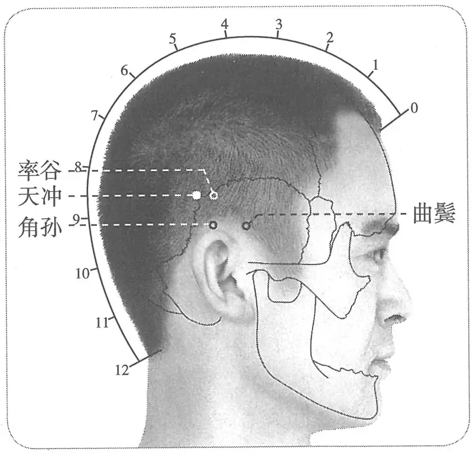

**图 2-316　天冲穴图**

〔p.1038 (인쇄 1010)〕

　9. 天冲二穴，在耳上，入发际二寸，如前三分。（《针方六集》卷一）

　10. 在耳后入发际二寸。一曰在耳上如前三分。（《类经图翼》）

　11. 天冲穴在耳平后三分，入发际二寸。（《循经考穴编》下）

　12. 从率谷后行耳后三分许，入发际二寸。（《医宗金鉴·刺灸心法要诀》、《针灸逢源》）

　13. 率谷之后约三分许，上行入发际二寸。（《针灸十四经穴位考订》）

　14. 统编针灸学教材

　　(1) 部位：当率角穴之后方。取穴：从耳翼上入发际二寸，再向后五分处取之。（1957年南京《针灸学》）

　　(2) 部位：在率角穴后方。取穴：在耳廓后缘直上与率角穴向后之交点处取之。（1版《针灸学讲义》）

　　(3) 部位：在耳上如前三分。取穴：在耳廓根后上方，入发际二寸，率谷后约五分处取之。（2版《针灸学讲义》）

　　(4) 耳根后缘直上，入发际2寸。（4、5版《针灸学》）

　　(5) 在头部，当耳根后缘直上，入发际2寸，率谷后0.5寸处。（6、7版《针灸学》、《中国针灸学》）

**文献分析**：《医学入门》“承灵后一寸半”系将“脑空”穴定位文字混入；值得注意的是《针灸资生经》卷一腧穴定位正文皆系抄自《铜人腧穴针灸图经》，然王执中此处二条引文与各种版本《铜人腧穴针灸图经》皆不同，系所据版本不同，还是王氏误记，尚难断定。

#### 【类属】 

足少阳胆经穴。

**脉气所发**：足太阳、少阳之会。（《黄帝明堂经》）

**归经**：足少阳经。（《外台秘要》卷三十九、《铜人腧穴针灸图经》）

#### 【适应症】 

主治头部病症。常用于头痛，癫痫，牙龈肿痛。

　1. 主头痛。癫疾。痓互引善惊。（《黄帝明堂经》）

　2. 治头痛癫疾，风痓，牙龈肿，善惊恐。（《铜人腧穴针灸图经》卷中）

　3. 偏头风，头角痛。（《针方六集》卷五）

　4. 主偏正头疼，耳虚鸣湿痒。（《循经考穴编》下）

　5. 统编针灸学教材

　　(1) 主治头痛，牙龈肿，癫疾风痉。（1957年南京《针灸学》）

　　(2) 主治头痛，牙龈肿，癫狂。（1版《针灸学讲义》）

　　(3) 主治头痛，齿龈痛，癫疾，惊恐，瘿气。（2版《针灸学讲义》）

　　(4) 主治头痛，惊悸，癫疾，齿龈肿痛。（4版《针灸学》）

　　(5) 主治头痛，癫疾，牙龈肿痛。（5、6、7版《针灸学》）

　　(6) 主治头痛，痫证，齿龈肿痛，善惊。（《中国针灸学》）

#### 【操作】 

平刺。

　1. 刺入三分，灸九壮。（《黄帝明堂经》）

　2. 可灸七壮，针入三分。（《铜人腧穴针灸图经》卷中）

　3. 针二分，灸三壮。（《针灸十四经穴位考订》）

　4. 统编针灸学教材

　　(1) 针三分，针尖向后穴或向前穴。（1957年南京《针灸学》）

　　(2) 针三分，针尖向后或向前沿皮刺入。（1版《针灸学讲义》）

〔p.1039 (인쇄 1011)〕

　　(3) 沿皮刺3分。（2版《针灸学讲义》）

　　(4) 平刺0.5~0.8寸。（4、5、6、7版《针灸学》）

　　(5) 横刺0.3~0.5寸。（《中国针灸学》）

### （十）浮白 Fúbái GB10 出《黄帝明堂经》 

#### 【提要索隐】 

**部位**：在头部，耳后乳突的后上方，从天冲至完骨的弧形连线（其弧度与耳郭弧度相应）的上1/3与下2/3交点处。

**适应症**：主治头面部病症。常用于头痛，目痛，齿痛。

**按**：传世本《外台秘要》中误将《黄帝明堂经》“天容”穴部位及主治混入本穴内容中，唐以后针灸文献皆传其误，今据《黄帝明堂经》，参照《类经图翼》所传别说，确定本穴主治。

**针刺操作**：平刺。

#### 【名实考】 

本穴定位，《黄帝明堂经》曰“耳后入发际一寸”，单看此文，可有两种理解：第一，沿耳廓后缘向上入发际一寸；第二，从耳背根部水平向头正中线方向入发际一寸。可以确定最早理解为第二种定位法的是宋代王惟一，现代承淡安图、朱琏《新针灸学》图、马继兴图，以及现代针灸学教材大多与王惟一的理解相同。至于古今医家还有多少是基于第二种理解定“浮白”，因无图可查，难以确定。其实判断这一理解是否正确，只要看看《黄帝明堂经》完骨穴定位“耳后入发际四分”，则知这一理解显然不能成立，因为照此理解，完骨穴便与浮白穴同高，且在其外侧。对于这个结论，大概不会有人接受。

需要注意的是，《外台秘要》将天容穴内容混入本穴中，王惟一编《铜人腧穴针灸图经》也传此误，而且消除了二穴相混的痕迹，若不查考《外台秘要》的原始文献，这一“移花接木”的错误根本无法发现。

　1. 浮白，在耳后入发际一寸，足太阳、少阳之会。（《黄帝明堂经》）

　2. 此穴在天冲之下，斜曲在后，乃降而不遂降，有浮之象焉，故曰浮白。（《经穴解》）

#### “天容”混作“浮白”例 

　1. 浮白，在耳后，入发际一寸。下曲颊后，灸三壮。主足缓不收，痿不能行，不能言。寒热，喉痹，咳逆吐，疝积，胸中满，不得喘息，胸痛，耳聋嘈嘈无所闻，颈项痈肿，不能言，及瘿肩不能举。齿牙龋痛。（《外台秘要》卷三十九）

　2. 天容，在耳下曲颊后，手少阳脉气所发。刺入一寸，灸三壮。主寒热。疝积，胸中痛，不得穷屈。咳逆上气唾沫。肩痛不可举。颈项痈肿不能言。耳聋嘈嘈无所闻。喉痹。瘿。咽肿。（《黄帝明堂经》）

**按**：《外台秘要》浮白穴下此条内容，实际包含了《黄帝明堂经》“天容”穴的部位及主治症，只是于“入发际一寸”后脱漏了“天容，在耳”四字而已。唐以后文献如《太平圣惠方》及《铜人腧穴针灸图经》等皆传此误。

#### 【定位】 

**部位**：在头部，耳后乳突的后上方，从天冲至完骨的弧形连线（其弧度与耳郭弧度相应）的上1/3与下2/3交点处（图2-317）。

　1. 在耳后入发际一寸。（《针灸甲乙经》卷三、《千金翼方》、《铜人腧穴针灸图经》、《圣济总录》、《针灸资生经》、《十四经发挥》、《医学纲目》、《针灸聚英》、《古今医统》、《医学入门》、《针灸大成》、《针方六集》、《类经图翼》、《循经考穴编》、《针灸易学》、《针灸逢源》）

〔p.1040 (인쇄 1012)〕

　2. 此穴在翳风前，窍阴后。（《千金翼方》卷二十六）

**按**：此处说明的是《千金要方》卷二十九的穴位排序：浮白穴排于翳风穴之前、窍阴穴之后，不关定位，切不可误解。

　3. 在耳后入发际一寸，下曲颊后。（《外台秘要》卷三十九）

　4. 从天冲下行耳后，入发际一寸。（《医宗金鉴·刺灸心法要诀》）

　5. 耳后入发际一寸，天冲下方后斜约寸许。（《针灸十四经穴位考订》）

　6. 统编针灸学教材

　　(1) 部位：天冲穴下一寸处。取穴：从天冲穴之下方一寸处取之当耳翼上角之后陷中。（1957年南京《针灸学》）

　　(2) 部位：天冲穴下一寸处。取穴：在窍阴与天冲二穴之间取之，适与耳廓上端相平。（1版《针灸学讲义》）

　　(3) 部位：在耳后入发际一寸。取穴：在耳后乳突后上方，当天冲与头窍阴的弧形连线的中点取穴。（2版《针灸学讲义》）

　　(4) 耳根上缘向后入发际横量1寸。（4、5版《针灸学》）

　　(5) 在头部，当耳后乳突的后上方，天冲与完骨的弧形连线的中1/3与上1/3交点处。（6、7版《针灸学》）

　　(6) 在耳后，乳突后上方，当天冲与头窍阴的弧形连线中点。（《中国针灸学》）

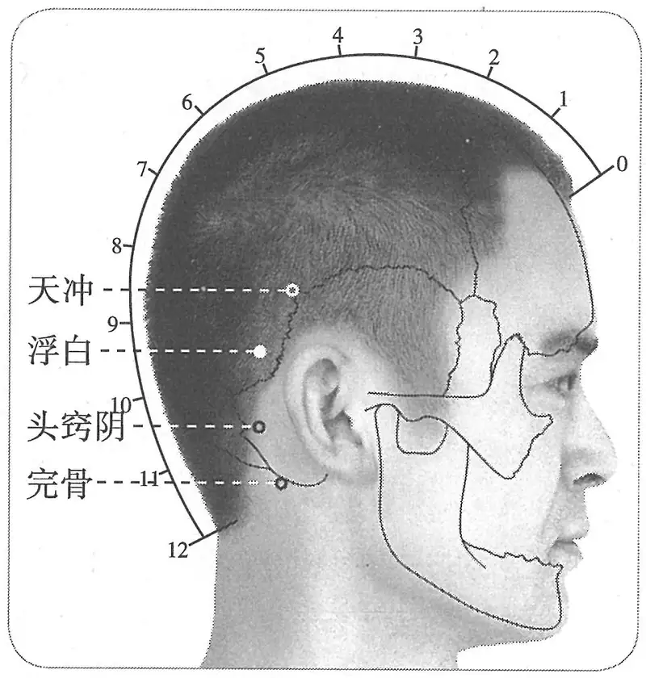

**图 2-317　浮白穴图**

**文献分析**：《外台秘要》所说“下曲颊后”，系将“天容”穴内容与本穴相混；《千金翼方》注文“翳风前、窍阴后”，说的是本穴在《千金要方》卷二十九中的排列次序，切不可误解为本穴定位描述。

#### 【类属】 

足少阳胆经穴。

**脉气所发**：足太阳、少阳之会。（《黄帝明堂经》）

**归经**：足少阳经。（《外台秘要》卷三十九、《铜人腧穴针灸图经》卷上）

#### 【适应症】 

主治头面部病症。常用于头痛，目痛，齿痛。

　1. 主足缓不收，痿不能行。齿牙龋痛，不能言。（《黄帝明堂经》）

　2. 浮白，在耳后，入发际一寸。下曲颊后，灸三壮。主足缓不收，痿不能行，不能言。寒热，喉痹，咳逆吐，疝积，胸中满，不得喘息，胸痛，耳聋嘈嘈无所闻，颈项痈肿，不能言，及瘿肩不能举。齿牙龋痛。（《外台秘要》卷三十九）

**按**：此条主治包含了《黄帝明堂经》“天容”穴的部位及主治症。

　3. 浮白二穴，在耳后入发际一寸。足太阳、少阳之会。治发寒热，喉痹，咳逆痰沫，胸中满不得喘息，耳鸣嘈嘈无所闻，颈项痈肿及瘿气，肩背不举，悉皆治之。（《铜人腧穴

〔p.1041 (인쇄 1013)〕

针灸图经》卷中）

**按**：此穴内容系抄自《外台秘要》卷三十九，“浮白”穴下错入了“天容”穴的部位及主治病症文字。王惟一抄录时只抄录了其中“浮白”穴的部位及“天容”穴的主治症，而“浮白”穴的主治症则一字未录，出现更加奇特的错误。

　4. 颈强。（《针方六集》卷五）

　5. 主头重如石。（《循经考穴编》下）

　6. 一传治眼四时疼痛，头风痛。（《类经图翼》卷八）

　7. 统编针灸学教材

　　(1) 主治头重如石，耳鸣，耳聋，颈项瘿气，痈肿。（1957年南京《针灸学》）

　　(2) 主治头重，耳鸣，耳聋，瘿气。（1版《针灸学讲义》）

　　(3) 主治头痛，耳鸣，耳聋，颈项肿痛，瘿气，足痿不能行。（2版《针灸学讲义》）

　　(4) 主治头痛，耳鸣，耳聋，目痛，瘿气。（4、5、6版《针灸学》）

　　(5) 主治①头痛、耳鸣、耳聋、齿痛等头面病证；②瘿气。（7版《针灸学》）

　　(6) 主治头痛，耳鸣，耳聋。（《中国针灸学》）

**文献分析**：教材所录本穴主治多承袭王焘之误，今去之。

#### 附：临床应用举例 

　1. 牙疼方，灸浮白穴，在耳后入发际一寸。（《医心方》卷五）

　2. 太阳中风，脉缓，颈项强急，不得转侧，可针风池、风府、浮白穴，则痛移也。（《云岐子七表八里九道脉诀论并治法》）

　3. 猪痫，吐浊沫，口动摇，浮白三壮，刺一分。（《医学纲目》卷十一）

　4. 腕缓不收，履足不任，胫酸，然谷、浮白、昆仑。（《医学纲目》卷二十二）

　5. 胆囊炎疼痛，单刺右侧浮白穴治疗。［中国针灸，2002，22（11）：762］

#### 【操作】 

平刺。

　1. 刺入三分，灸三壮。（《黄帝明堂经》）

　2. 刺入五分。可灸七壮。（《铜人腧穴针灸图经》卷中）

　3. 针二分，灸三壮。（《针灸十四经穴位考订》）

　4. 统编针灸学教材

　　(1) 针三分，针尖向下沿皮刺，灸三至七壮。（1957年南京《针灸学》、1版《针灸学讲义》）

　　(2) 沿皮刺3分，艾条灸3~7分钟。（2版《针灸学讲义》）

　　(3) 平刺0.5~0.8寸。（4、5、6、7版《针灸学》）

　　(4) 横刺0.3~0.5寸。可灸。（《中国针灸学》）

### （十一）头窍阴 Tóuqiàoyīn GB11 出《黄帝明堂经》 

#### 【提要索隐】 

**穴名**：本穴穴名，宋以前文献作“窍阴”，与足部“窍阴”穴同名，宋代《圣济总录》作“首窍阴”，《针灸资生经》作“头窍阴”，今从之。

**部位**：在头部，耳后乳突的后上方，从天冲到完骨的弧形连线（其弧度与耳郭弧度相应）的上2/3与下1/3交点处。

〔p.1042 (인쇄 1014)〕

**适应症**：主治头项部病症。常用于头痛，颈项强痛。

**针刺操作**：平刺。

#### 【名实考】 

需要注意枕骨、枕骨穴的关系，明代高武正因为不明此区别，误解四明陈氏所谓“枕骨穴”，将“枕骨”作为本穴的别名，非是。

本穴与足部“窍阴”同名，对于部位与主治一体的腧穴专书，不存在鉴别的困难，而对于像《针灸甲乙经》、《千金要方》、《针灸资生经》类文献以及宋以前针灸方，两个同名“窍阴”的鉴别就是一个千古难题，因鉴别错误而使二穴相混者，在古医籍中不乏其例，最为严重者当数明代高武《针灸聚英》一书。

本穴应与脑空穴合看。从定位看，二穴皆以枕骨为标志，脑空穴“一名颞颥”，而窍阴穴“摇动应手而取之”；从穴名上看，前者为“脑空”，孔之旁者为“窍阴”；从主治上看，窍阴穴的主治正见于脑空穴，只是由于脑空穴与脑的特殊联系，因而又主治目、鼻（古人认为此二官与脑通）疾与癫疾。

　1. 脑空，一名颞颥，在承灵后一寸五分，夹玉枕旁，枕骨下陷者中，足少阳、阳维之会。刺入四分，灸五壮。主头痛身热引两颔急一作痛。脑风目瞑，头痛，风眩目痛。癫疾大瘦。鼻管疽，发为厉鼻。（《黄帝明堂经》）

　2. 窍阴，在完骨上，枕骨下，摇动应手而取之，足太阳、少阳之会。刺入四分，灸五壮。主项痛引颈。管疽发厉。（《黄帝明堂经》）

　3. 首窍阴二穴，在枕骨下摇动有空，足太阳、少阳之会。（《圣济总录》卷一九一）

　4. 窍阴二穴在枕骨下，摇动有空。注：此有窍阴矣，足少阳胆经亦有此穴，此当为头窍阴也。（《针灸资生经》卷一）

　5. 论一名有两穴，头窍阴、足窍阴。（《针灸大全》卷六）

　6. 以此穴有空，可按而得，故曰窍，下浮白而在于阴，故曰窍阴。（《经穴解》）

#### 枕骨与枕骨穴；髓空与髓会之辨 

　1. 窍阴，一名枕骨，完骨上，枕骨下，动摇有空。足太阳、手足少阳之会。陈氏云：髓会绝骨，髓属肾主骨，于足少阳无所关，脑为髓海，脑有枕骨穴，则当会枕骨，绝骨误也。髓病治此。按：窍阴正足少阳经，不知陈氏何以云此？岂《素问》云枕骨二穴者，指督脉后顶、脑户，而王注误之欤？（《针灸聚英》卷一）

　2. 脑户，一名匝风，一名会颅，在枕骨上，强间后一寸五分。督脉、足太阳之会，此别脑之会。（《黄帝明堂经》）

　3. 脑户，穴名也。在枕骨上，通于脑中。然脑为髓之海，真气之所聚，针入脑则真气泄，故立死。（《素问·刺禁》王冰注）

　4. 枕骨二穴，王冰注：窍阴穴也。在完骨上，枕骨下，摇动应手。（《素问·气穴论》）

**按**：高武所引之“陈氏云”之说见于滑伯仁《难经本义》第四十五难；引“王注”之文见于《素问·气穴论》王冰注。所说皆为“枕骨”，所指不同。《素问·骨空论》曰：“头横骨为枕。髓空在脑后三分，在颅际锐骨之下”，首先说后头部横骨为枕骨，并说髓空所在——枕外隆凸下。正当《黄帝明堂经》脑户穴，也即四明陈氏所说之“枕骨穴”，王冰对此有明确而详细的注释。而《黄帝明堂经》以枕骨定位的穴还有：玉枕、脑空、窍阴，故王冰谓《素问·气穴》之“枕骨二穴”为窍阴，高武只知其一，不知其二，反疑陈氏之说不确，并误将所说之“枕骨”作窍阴穴别名，皆非。

#### （头）窍阴与（足）窍阴穴相混例 

痈疽，窍阴主之。（《针灸甲乙经》卷十一）

〔p.1043 (인쇄 1015)〕

**按**：以上《针灸甲乙经》“窍阴主之”条文前为足部阳明经穴主治条文，据《针灸甲乙经》腧穴主治条文排列序例，此处“窍阴”只能是足部少阳经穴，而不可能为头部“窍阴”穴。核之《千金要方》卷三十，也为足部“窍阴”主治，而王焘编《外台秘要·明堂》卷三十九时，却将上述《针灸甲乙经》主治条文误辑入头部“窍阴”穴中。

由于高武编《针灸聚英》一书时，以经穴主治大多从宋代王执中《针灸资生经》辑录，对于其中的大量同名穴证治，高氏因无法辨识，只好分别归入同名二穴中，明以后乃至现代针灸学教材又大多直接或间接传高武之误。

#### 【定位】 

**部位**：在头部，耳后乳突的后上方，从天冲到完骨的弧形连线（其弧度与耳郭弧度相应）的上2/3与下1/3交点处（图2-318）。

　1. 在完骨上，枕骨下，摇动应手而取之。（《黄帝明堂经》、《太平圣惠方·针经》、《铜人腧穴针灸图经》卷下“穴腧都数”）

　2. 在枕骨下，摇动有空。（《铜人腧穴针灸图经》卷中、《圣济总录》、《针灸资生经》、《十四经发挥》、《医学纲目》、《针灸聚英》、《古今医统》、《针灸大成》、《针方六集》、《类经图翼》、《循经考穴编》、《针灸易学》、《针灸逢源》）

　3. 完骨上，枕骨下，摇耳有空。（《医学入门》卷一）

　4. 从浮白下行耳后，高上枕骨下，摇动有空。（《医宗金鉴·刺灸心法要诀》）

　5. 完骨穴之上，枕骨之下，浮白下约一寸。（《针灸十四经穴位考订》）

　6. 统编针灸学教材

　　(1) 部位：完骨上，枕骨下。取穴：从浮白穴下一寸取之。（1957年南京《针灸学》）

　　(2) 部位：耳后完骨上。取穴：从浮白穴下一寸取之，与三焦经颅息穴平。（1版《针灸学讲义》）

　　(3) 部位：完骨上，枕骨下。取穴：在乳突后上方，当浮白与完骨的连线上取穴。（2版《针灸学讲义》）

　　(4) 浮白穴下，乳突根部。（4、5版《针灸学》）

　　(5) 在头部，当耳后乳突的后上方，天冲与完骨的中1/3与下1/3交点处。（6版《针灸学》）

　　(6) 乳突后上缘，当天冲穴与完骨穴的中1/3与下1/3交点处。（7版《针灸学》）

　　(7) 乳突后上方，浮白与完骨的连线上。（《中国针灸学》）

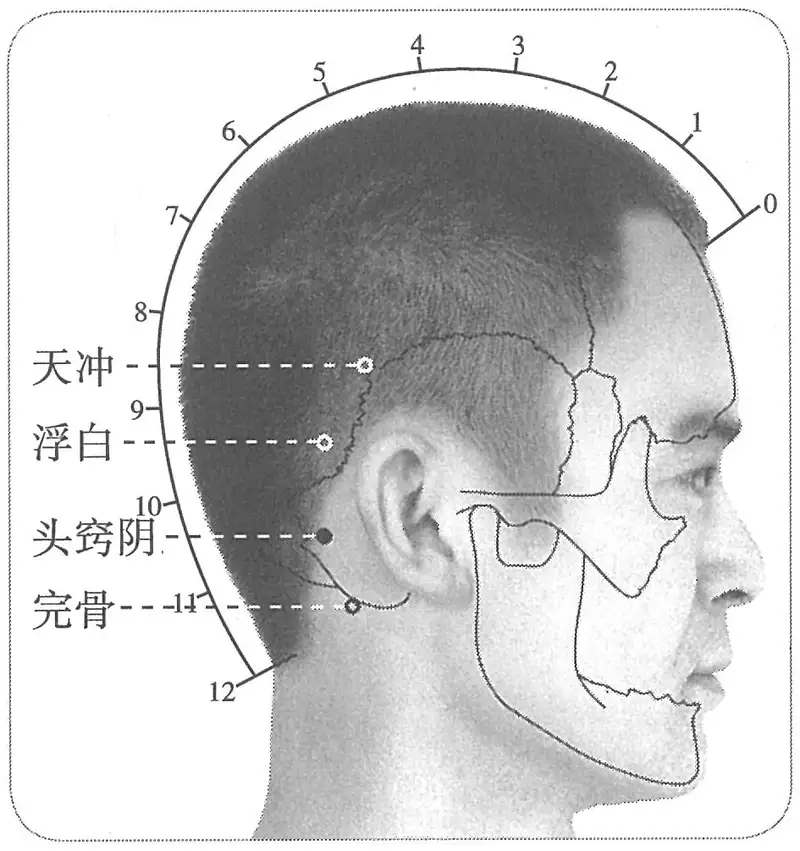

**图 2-318　头窍阴穴图**

#### 【类属】 

足少阳胆经穴。

**脉气所发**：足太阳、少阳之会。（《黄帝明堂经》）

**归经**：足少阳经。（《外台秘要》卷三十九、《铜人腧穴针灸图经》卷上）

#### 【适应症】 

主治头项部病症。常用于头痛，颈项强痛。

　1. 主管疽发厉。项痛引颈。（《黄帝明堂经》）

　2. 主骨疽发厉，项痛引头也。（《太平圣惠方·针经》）

　3. 治劳疽发厉，项痛引头目痛。（《铜人腧穴针灸图经》卷中、《圣济总录》）

〔p.1044 (인쇄 1016)〕

　4. 主四肢转筋，目痛，头项颔痛，引耳嘈嘈，耳鸣无所闻，舌本出血，骨劳，手足烦热，汗不出，舌强，胁痛，咳逆，喉痹，口中恶苦。（《针灸聚英》卷一、《针灸大成》）

**按**：此处所录主治症多系足部“窍阴”穴主治症，高武从《针灸资生经》辑录时因难以辨识而误归于此。

　5. 主眩晕。（《循经考穴编》下）

　6. 统编针灸学教材

　　(1) 主治头项痛，耳疼，耳聋，耳鸣。（1957年南京《针灸学》，1、2版《针灸学讲义》，《中国针灸学》）

　　(2) 主治头痛，耳鸣，耳聋。（4、5、6版《针灸学》）

　　(3) 主治①头痛、眩晕、颈项强痛等头项病证；②耳鸣，耳聋。（7版《针灸学》）

**文献分析**：教材载本穴主治多承袭高武《针灸聚英》之误，将足窍阴穴主治误置于此，今去之。

#### 【操作】 

平刺。

　1. 刺入四分，灸五壮。（《黄帝明堂经》）

　2. 刺可入同身寸之三分，若灸者，可灸三壮。（《素问·气穴论》王冰注）

　3. 针入三分，可灸七壮。（《铜人腧穴针灸图经》卷中）

　4. 一法横针入五分，灸二七壮。（《循经考穴编》下）

　5. 针二分，灸三壮。（《针灸十四经穴位考订》）

　6. 统编针灸学教材

　　(1) 针三分，针尖向下沿皮刺，灸三至七壮。（1957年南京、1版《针灸学讲义》）

　　(2) 沿皮刺3分，艾条灸3~5分钟。（2版《针灸学讲义》）

　　(3) 平刺0.5~0.8寸。（4、5、6、7版《针灸学》）

　　(4) 横刺0.3~0.5寸。可灸。（《中国针灸学》）

### （十二）完骨 Wángǔ GB12 出《素问》 

#### 【提要索隐】 

**部位**：在头部，耳后乳突的后下方凹陷中。

**适应症**：主治头项、口齿部病症。常用于头痛，颈项强痛，咽喉肿痛，颊肿，齿痛；癫狂；中风、口眼㖞斜。

**针刺操作**：平刺。

#### 【名实考】 

完骨，既是穴名，又是骨名。作为骨名是指耳后乳突，是后头横向骨度的基准点。

本穴名曰“完骨”，却未以完骨定位，《黄帝明堂经》以完骨定位之穴为：窍阴、天牖。“完骨”一词既见于《灵枢》，又见于《素问》，而前者多指骨名，所定之穴为手少阳经“天牖”，而不是完骨穴；作为穴名只见于《素问》，且定位与后来的《黄帝明堂经》相当。

需要注意的是，日本卷子本《黄帝内经太素》手太阳经“腕骨”也写作“完骨”，勿相混。

关于本穴定位，《黄帝明堂经》只说“耳后入发际四分”，不很明确，且与相邻之“窍阴”、“天牖”二穴的位置关系也不明。参照《针灸甲乙经》穴位排序“头缘耳上却行至完骨凡十二穴第五”，以及“天牖”的定位描述，可以判定：本穴在完骨后下方，沿耳后缘弧度于窍阴穴之下，天牖穴外上。

〔p.1045 (인쇄 1017)〕

　1. 完骨，在耳后入发际四分，足太阳、少阳之会。（《黄帝明堂经》）

　2. 耳后高起之骨为完骨，入发际四分，正当此骨之上，故名以志之。（《经穴解》）

　3. 天牖二穴，在颈筋缺盆上，天容后，天柱前，完骨下，发际上一寸陷者宛宛中是也。（《太平圣惠方·针经》）

　4. 天牖二穴，在完骨穴下发际宛宛中。（《太平圣惠方·明堂》）

#### 《内经》“完骨”及“完骨”穴辨 

　1. 次脉手少阳也，名曰天牖……足阳明夹喉之动脉也，其腧在膺中。手阳明次在其腧外，不至曲颊一寸。手太阳当曲颊。足少阳在耳下曲颊之后。手少阳出耳后，上加完骨之上。（《灵枢·本输》）

　2. 手少阳之正……出耳后，合少阳完骨之下。（《灵枢·经别》）

　3. 手太阳之筋……循胫出走太阳之前，结于耳后完骨。（《灵枢·经筋》）

　4. 完骨二穴……天牖二穴。（《素问·气穴论》）

　5. 手少阳脉气所发者三十二穴：鼽骨下各一，眉后各一，角上各一，下完骨后各一。王冰注曰：谓天牖二穴也。（《素问·气府论》）

　6. 天牖，在颈筋缺盆上，天容后，天柱前，完骨下，发际上，手少阳脉气所发。（《黄帝明堂经》）

**按**：以上《灵枢》所说之“完骨”皆骨名，所定之穴为手少阳经之“天牖”。《素问·气穴论》指明穴名，且“完骨”与“天牖”并见，则可判定，此“完骨”即是《黄帝明堂经》之完骨穴。

#### 《黄帝内经太素》“完骨”辨 

　1. 小肠上合于手太阳，出于少泽。少泽者，小指之端也，为井；过于完骨，完骨者在手外侧捥骨之前也为原。杨上善注：《明堂》在手外侧捥前起骨下陷中，即此起骨为捥骨，此经名完骨，胡端反。（《黄帝内经太素·本输》）

　2. 舸，取手太阳，不已刺捥骨下。注曰：取之捥骨，手捥前起骨名完骨，非捥也。（《黄帝内经太素·衄血》卷三十）

**按**：以上《黄帝内经太素》经文之“完骨”皆手太阳经原穴“腕骨”，即杨上善注文所说之“捥骨”也。

#### 相关穴及刺激点 

　1. 新义　位于颞部，乳突下缘凹陷后三分处。主治精神分裂症。针0.5~1寸，针感局部胀、麻。（《针灸经外奇穴图谱（续集）》）

　2. 耳大神经刺激点　乳突后缘。主治神经衰弱，失眠，头痛，耳鸣，耳聋，精神病。向枕骨面垂直进针2.0cm。刺中神经时，局部有明显的酸麻感，并向头顶放散。（《实用神经干电刺激疗法》）

#### 【定位】 

**部位**：在头部，耳后乳突的后下方凹陷中（图2-319）。

**取穴**：从窍阴穴向下，摸到耳后乳突下缘的凹陷中取之。

　1. 在耳后入发际四分。（《黄帝明堂经》、《太

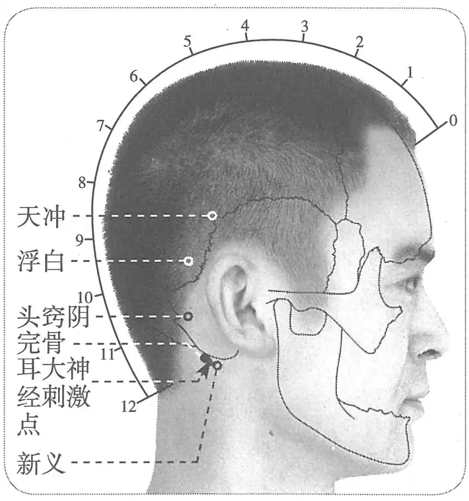

**图 2-319　完骨穴与相关穴及刺激点**

〔p.1046 (인쇄 1018)〕

平圣惠方·针经》、《铜人腧穴针灸图经》、《圣济总录》、《针灸资生经》、《十四经发挥》、《医学纲目》、《针灸聚英》、《古今医统》、《医学入门》、《针灸大成》、《针方六集》、《类经图翼》、《循经考穴编》、《针灸易学》、《针灸逢源》）

　2. 从窍阴行耳后，入发际四分。（《医宗金鉴·刺灸心法要诀》）

　3. 耳后入发际四分，窍阴下约七分。（《针灸十四经穴位考订》）

　4. 统编针灸学教材

　　(1) 部位：耳后入发际四分。取穴：从窍阴穴下七分取之。（1957年南京《针灸学》）

　　(2) 部位：耳后入发际四分。取穴：从窍阴穴下方，耳后完骨下缘陷中取之。（1版《针灸学讲义》）

　　(3) 部位：耳后入发际四分。取穴：在乳突后下方凹陷中取之。（2版《针灸学讲义》）

　　(4) 乳突后下方凹陷中。（4、5版《针灸学》，《中国针灸学》）

　　(5) 在头部，当耳后乳突的后下方凹陷处。（6版《针灸学》）

　　(6) 耳后，乳突后下方凹陷处。（7版《针灸学》）

**文献分析**：《勉学堂针灸集成》所述本穴部位“在窍阴下七分发际中”，系清代医官目测明正统仿宋针灸铜人腧穴的记录，只能供参考，文献分析还是以《铜人腧穴针灸图经》文本为准。《针灸十四经穴位考订》及第4版之前的针灸教材皆未详察，径以此作定穴依据。

#### 【类属】 

足少阳胆经穴。

**脉气所发**：足太阳、少阳之会。（《黄帝明堂经》）

**归经**：足少阳经。（《外台秘要》卷三十九、《铜人腧穴针灸图经》卷上）

#### 【适应症】 

主治头项、口齿部病症。常用于头痛，颈项强痛，咽喉肿痛，颊肿，齿痛；癫狂；中风、口眼㖞斜。

　1. 主风头耳后痛，烦心。足不收失履，口㖞僻。头项摇瘛，牙车急。癫疾僵仆，疟，面有气。齿牙龋痛。小便黄赤。喉痹。及项肿不可俯仰，颊肿引耳，痎疟，狂。（《黄帝明堂经》）

　2. 主风眩，项痛，头强，寒热。（《太平圣惠方·针经》）

　3. 治头痛烦心，癫疾，头面虚肿，齿龋，偏风，口眼㖞斜，颈项痛不得回顾，小便赤黄，喉痹颊肿。（《铜人腧穴针灸图经》卷中）

　4. 主中风不遂，手足挛痿。（《循经考穴编》下）

　5. 统编针灸学教材

　　(1) 主治头风，颈项肿痛，颊肿，喉痹，齿痛，口眼㖞斜。（1957年南京《针灸学》、1版《针灸学讲义》）

　　(2) 主治头痛，颈项强痛，颊肿，齿痛，口眼㖞斜。（2版《针灸学讲义》）

　　(3) 主治头痛，颊肿，耳后痛，口㖞，齿痛。（4版《针灸学》）

　　(4) 主治头痛，颈项强痛，齿痛，口㖞，疟疾，癫痫。（5、6版《针灸学》）

　　(5) 主治①癫痫；②头痛、颈项强痛、喉痹、颊肿、齿痛、口歪等头项五官病证。（7版《针灸学》）

　　(6) 主治头痛，失眠，颊肿，耳后痛，口眼歪斜，齿痛。（《中国针灸学》）

**文献分析**：从《黄帝明堂经》所载本穴主治看，其“口㖞僻”是中风的症状之一，故《铜人腧穴针灸图经》直接冠以“偏风”二字以统之，极是。今从之。

《黄帝明堂经》本穴主治“小便黄赤”症，见于《针灸甲乙经》卷九第十一，根据其在该篇中位置，取“完骨主之”，与《针灸甲乙经》取穴体例不合，而该书及其他古医籍中，“腕骨”有误作“完骨”者，疑此症本作“腕骨主之”，现代针灸教材未录是症，极是。

〔p.1047 (인쇄 1019)〕

#### 附：临床应用举例 

　1. 肠痫之为病，不动摇，灸两承山；又灸足心、两手劳宫；又灸两耳后完骨。各随年壮。又灸脐中五十壮。（《千金要方》卷五上）

　2. 周围性面瘫，针刺完骨穴为主治疗。［上海针灸杂志，1992，11（1）：3-4］

#### 【操作】 

平刺。

　1. 刺入二分，留七呼，灸七壮。（《针灸甲乙经》卷三）

　2. 刺入二分，留七呼，灸三壮。（《医心方》卷二）

　3. 刺可入同身寸之三分，留七呼，若灸者可灸三壮。（《素问·气穴论》王冰注）

　4. 针入五分，可灸七壮。（《铜人腧穴针灸图经》卷中）

　5. 针二分，灸三壮。（《针灸十四经穴位考订》）

　6. 统编针灸学教材

　　(1) 针三至四分，灸三至五壮。（1957年南京《针灸学》、1版《针灸学讲义》）

　　(2) 向下斜刺3~5分，艾条灸3~5分钟。（2版《针灸学讲义》）

　　(3) 斜刺0.5~0.8寸。（4、5、6、7版《针灸学》）

　　(4) 斜刺0.3~0.5寸。可灸。（《中国针灸学》）

### （十三）本神 Běnshén GB13 出《黄帝明堂经》 

#### 【提要索隐】 

**部位**：在头部，前发际上0.5寸，头正中线旁开3寸。

**适应症**：主治头目部病症。常用于头痛，颈项强痛，眩晕；小儿惊风，癫痫。

**针刺操作**：平刺。

#### 【名实考】 

本穴的名称及定位，从文字描述本身无分歧，但本穴定位是间接以神庭穴为坐标点，而神庭穴自宋代有变动，因而本穴也随之而变。

本穴定位，本来《黄帝明堂经》说得很明确，但后世文献却生出种种异说，问题出在《针灸甲乙经》等传本的注文“一曰直耳上入发际四分”，这与“曲差两旁各一寸五分”的本神穴相去甚远，不可能是同一个穴，宋代《针灸资生经》注文已经指出了这一点。可为什么这一注文见于不同传本的《黄帝明堂经》佚文呢？有两种可能：第一，两个不同的穴皆名曰“本神”（还有第三个名曰“本神”的穴，即《西方子明堂灸经》所说足太阳经大杼穴又名“本神”），而且《千金要方》卷八的确记载了这个与足少阳经“本神”同名的穴“本神穴在耳正直上入发际二分是”，宋人在此句后还注有“又云四分”四字；第二，“一曰直耳上入发际四分”中之“耳”为“目”之形误。《黄帝明堂经》位于前发际的穴位，后来渐渐移至发际上，如前发际正中的神庭穴即有一个从“在发际”，到“发际上一分、二分、五分”的演变过程，其旁开的“本神”穴有一个从“在发际”到“入发际二分、四分”的变化，也是很自然的，最直接的证据为《太平圣惠方·明堂》所传岐伯灸法：“疗头旋目眩及偏头不可忍，牵眼𥉂𥉂不远视，灸两眼小眦上发际各一壮，立瘥”，所说定位与本神穴正相当。后人不明其中变故，生了种种异文，硬是将一个定位十分明确的穴，弄得混乱不堪。

　1. 本神，在曲差两旁各一寸五分，在发际，足少阳、阳维之会。（《黄帝明堂经》）

〔p.1048 (인쇄 1020)〕

　2. 惟木有本，此穴乃本经自完骨外折四，上至于额之上，与督之神庭横直，先取神庭为中，后旁一寸五分，为太阳之曲差，又再旁取一寸五分为此穴，三穴横列而稍向后，故曰本神，言胆经之神所在也。（《经穴解》）

#### 【定位】 

**部位**：在头部，前发际上0.5寸，头正中线旁开3寸（图2-320）。

**取穴**：神庭与头维弧形连线（其弧度与前发际弧度相应）的内2/3与外1/3的交点处取之。

　1. 在曲差两旁各一寸五分，在发际。（《黄帝明堂经》、《铜人腧穴针灸图经》、《圣济总录》、《针灸资生经》、《十四经发挥》、《医学纲目》、《针灸聚英》、《古今医统》、《针灸大成》、《针方六集》、《类经图翼》、《针灸易学》）

　2. 一曰直耳上入发际四分。（《针灸甲乙经》卷三、《千金要方》、《外台秘要》、《铜人腧穴针灸图经》、《类经图翼》）

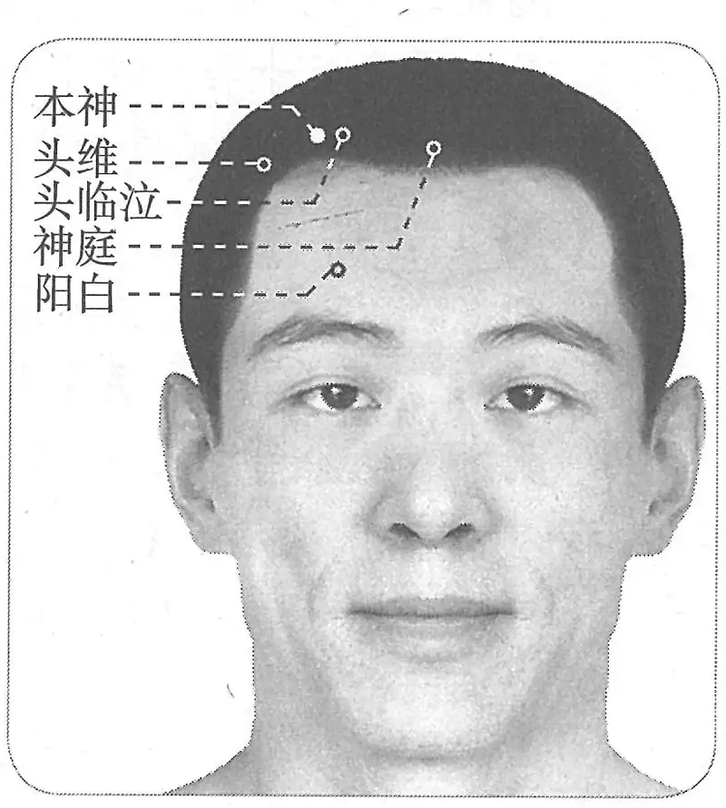

**图 2-320　本神穴图**

　3. 穴在耳正直上入发际二分是。（《千金要方》卷八、《千金翼方》）

　4. 在曲差旁一寸半。（《千金翼方》卷二十六、《医心方》）

　5. 曲差旁一寸五分，入发际四分。（《铜人腧穴针灸图经》卷下“穴腧都数”、《十四经发挥》、《针方六集》）

　6. 在曲差旁一寸五分，直耳上入发际。（《医学纲目》卷八）

　7. 本神入发际四分，穴在耳上率谷前。（《针灸问对》）

　8. 本神耳上入发际，四分平横向前是。（《针灸聚英》卷四、《古今医统》）

　9. 临泣外一寸半。（《医学入门》卷一）

　10. 曲差旁一寸五分，直耳上入发际四分。（《针灸聚英》卷一、《针灸大成》、《循经考穴编》、《针灸易学》）

　11. 从完骨折上行，神庭旁三寸，直耳上入发际四分。（《医宗金鉴·刺灸心法要诀》）

　12. 在神庭旁三寸，横直耳上入发际四分。（《针灸逢源》）

　13. 曲差旁一寸五分，入前发际五分。（《针灸十四经穴位考订》）

　14. 统编针灸学教材

　　(1) 部位：神庭旁开三寸。取穴：正坐，从神庭旁开三寸，当丝竹空穴之直上入发际五分取之。（1957年南京《针灸学》）

　　(2) 部位：督脉神庭穴旁开三寸。取穴：正坐，从胃经头维内侧一寸五分，入发际五分处取之。（1版《针灸学讲义》）

　　(3) 部位：在曲差两旁各一寸五分，在发际。取穴：在前额发际内五分，当神庭督脉与头维足阳明经连线上，中1/3与外1/3连接点取之。（2版《针灸学讲义》）

　　(4) 神庭穴旁开3寸。（4版《针灸学》）

　　(5) 神庭穴督脉旁3寸，当神庭穴与头维穴连线的内2/3与外1/3连接点处。（5版《针灸学》）

　　(6) 在头部，当前发际上0.5寸，神庭旁开3寸，神庭与头维连线的内2/3与外1/3的交点处。（6版《针灸学》）

〔p.1049 (인쇄 1021)〕

　　(7) 入前发际0.5寸，督脉神庭穴旁开3寸。（7版《针灸学》）

　　(8) 前额入发际五分，神庭旁开三寸。（《中国针灸学》）

**文献分析**：《铜人腧穴针灸图经》卷下“穴腧都数”移花接木式的处理将注文与正文合为一体作“本神二穴，曲差旁一寸五分，入发际四分”；《针灸聚英》卷一则只删去了注文的标识，仍正文、注文各说各事；《针灸问对》、《针灸聚英》卷四等书则采用《针灸甲乙经》注文的定位描述；《医学入门》既定曲差距神庭一寸半，头维又距本神一寸半，又说本神距临泣一寸半，那么临泣只能被挤到足太阳经线上，显然有误；而《针灸逢源》的说法实在不知所云。再加上一些书因版本的错误，更增添了本穴定位的混乱，例如四库本《普济方》卷四百十三作“本神在曲差旁一寸半，发际一分，直耳上入发际四分”，一个穴竟出来三个位置，明抄本《普济方》作“本神在曲差旁一寸半发际，一曰直耳上入发际四分”，与宋本《外台秘要》同。

#### 【类属】 

足少阳胆经穴。

**脉气所发**：足少阳、阳维之会。（《黄帝明堂经》）

**归经**：足少阳经。（《外台秘要》卷三十九、《铜人腧穴针灸图经》卷上）

#### 【适应症】 

主治头目部病症。常用于头痛，颈项强痛，眩晕；小儿惊风，癫痫。

　1. 主头痛，目眩痛，颈项强急，胸胁相引不得倾。癫疾。小儿惊痫。（《黄帝明堂经》）

　2. 治目眩，颈项强急痛，胸胁相引不得转侧，癫疾，呕吐涎沫。（《铜人腧穴针灸图经》卷中）

　3. 偏风。（《针灸聚英》卷一、《古今医统》、《针灸大成》、《针方六集》、《类经图翼》）

**按**：此乃高武从《针灸资生经》辑录《千金要方》灸方主治。

　4. 统编针灸学教材

　　(1) 主治头项急痛，目眩，惊痫，癫疾。（1957年南京《针灸学》）

　　(2) 主治头项急痛，目眩，小儿惊风，癫狂。（1版《针灸学讲义》）

　　(3) 主治头痛，目眩，癫痫，呕吐涎沫，颈项强急。（2版《针灸学讲义》）

　　(4) 主治头痛，目眩，颈项强急，癫疾，小儿惊痫。（4版《针灸学》）

　　(5) 主治头痛，目眩，癫痫，小儿惊风。（5、6版《针灸学》）

　　(6) 主治癫痫、小儿惊风、中风、头痛、目眩等内、外风邪为患。（7版《针灸学》）

　　(7) 主治头痛，失眠，目眩，痫证。（《中国针灸学》）

#### 附：临床应用举例 

　1. 猥退风，半身不遂，失音不语者，灸百会，次灸本神，次灸承浆，次灸风府，次灸肩髃，次灸心输，次灸手五册，次灸手髓孔，次灸手少阳，次灸足五册，次灸足髓孔，次灸足阳明各五百壮。（《千金要方》卷八、《千金翼方》、《敦煌卷子S.6168》）

　2. 岐伯灸法，疗头旋目眩及偏头不可忍，牵眼𥉂𥉂不远视，灸两眼小眦上发际各一壮，立瘥。（《太平圣惠方·明堂》）

#### 【操作】 

平刺。

　1. 刺入三分，灸五壮。（《黄帝明堂经》）

　2. 针入三分，可灸七壮。（《铜人腧穴针灸图经》卷中）

　3. 针二分，灸三壮。（《针灸十四经穴位考订》）

　4. 统编针灸学教材

　　(1) 针三至四分，针尖斜向上或向下沿皮而进，灸三至五壮。（1957年南京《针灸学》、1版《针灸学讲义》）

〔p.1050 (인쇄 1022)〕

　　(2) 向后沿皮刺3~5分，艾条灸3~5分钟。（2版《针灸学讲义》）

　　(3) 平刺0.3~0.5寸。（4版《针灸学》）

　　(4) 平刺0.5~0.8寸。（5、6、7版《针灸学》）

　　(5) 斜刺0.3~0.5寸。可灸。（《中国针灸学》）

### （十四）阳白 Yángbái GB14 出《黄帝明堂经》 

#### 【提要索隐】 

**穴名**：一名板眉。

**部位**：在头部，眉上1寸，瞳孔直上。

**适应症**：主治头目部病症。常用于头痛，目痛，目痒，目翳。斜视矫正术、青光眼手术的针麻用穴。

**针刺操作**：平刺。

#### 【名实考】 

敦煌卷子佚名灸方作“板眉”与本穴定位完全相同，故作为本穴别名。

　1. 灸人面上浮风如似虫相习习，起则癫旋眼□□□□□□□□［灸］天窗，灸板眉，灸曲眉，灸两风府，［灸手阳明］，［灸］足阳明，凡十处，左右灸二百［壮］。（敦煌卷子佚名灸方）

　2. 面上游风如虫行习习然，起则头旋眼暗，头中沟垄起，灸天窗，次两肩上一寸当瞳仁，次曲眉在两眉间，次手阳明，次足阳明，各灸二百壮。（《千金翼方》）

**文献分析**：据敦煌卷子灸方及附图可知，《千金翼方》此方中第二穴前脱穴名“板眉”，当据补。又据该穴名及附图所标之部位，可知《千金翼方》所记该穴部位条中“肩”字系“眉”字形误，当改。从部位看“板眉”实相当于“阳白”穴，这种同穴异名的现象在隋唐流行的腧穴书中普遍存在。

　3. 阳白，在眉上一寸，直瞳子，足少阳、阳维之会。（《黄帝明堂经》）

　4. 阳者，少阳也。此穴上不入发，下不入眉，乃在眉发之间，发眉皆黑，而此在其白处，故曰阳白。（《经穴解》）

#### 相关穴及刺激点 

　1. 面神经刺激点额肌点　眉毛中点直上1.5~2.5cm。主治面神经麻痹抬眉障碍，前额痛。平刺1.5cm。（《实用神经干电刺激疗法》）

　2. 鱼上　位于额部，眉弓中心点直上0.5寸，在阳白穴下0.5寸处。主治近视。针2~3分，针感局部胀、麻。（《针灸经外奇穴图谱（续集）》）

　3. 阳白内一寸　位于额部，眉中点上一寸再向内开1寸处，在阳白穴内侧1寸。主治面神经麻痹。针沿皮向下斜刺透至眉，针感局部胀、麻。（《针灸经外奇穴图谱（续集）》）

　4. 新明2　位于额部，眉外端直上1寸，外开5分，在丝竹空穴直上1寸，外开5分。主治视网膜炎，急性视神经炎，角膜溃疡，角膜炎，急性充血性青光眼，结合膜炎。针尖向额部平刺5~8分，针感热、胀，可达眼球。（《针灸经外奇穴图谱（续集）》）

#### 【定位】 

**部位**：在头部，眉上1寸，瞳孔直上（图2-321）。

**取穴**：目正视，瞳孔直上，眉上1寸处取之。

〔p.1051 (인쇄 1023)〕

　1. 在眉上一寸，直瞳子。（《黄帝明堂经》、《铜人腧穴针灸图经》、《圣济总录》、《针灸资生经》、《十四经发挥》、《医学纲目》、《针灸聚英》、《古今医统》、《医学入门》、《针灸大成》、《针方六集》、《类经图翼》、《循经考穴编》、《医宗金鉴·刺灸心法要诀》、《针灸易学》、《针灸逢源》）

　2. 眉上一寸，直对瞳孔。（《针灸十四经穴位考订》）

　3. 统编针灸学教材

　　(1) 部位：眉上一寸，直对瞳子。取穴：在眉之中部直上一寸，下与瞳子相对直取之。（1957年南京《针灸学》）

　　(2) 部位：眉上一寸。取穴：正视，从瞳子直上，眉与前发际之间下三分之一处取之。（1版《针灸学讲义》）

　　(3) 部位：眉上一寸，直瞳子。取穴：在前额眉毛中点上一寸，约当前发际与眉毛之间，中1/3与下1/3连线点，正视时直对瞳孔处取之。（2版《针灸学讲义》）

　　(4) 目正视，瞳孔直上，眉上1寸。（4、5、7版《针灸学》）

　　(5) 在前额部，当瞳孔直上，眉上1寸。（6版《针灸学》）

　　(6) 在前额，眉毛中央直上一寸。（《中国针灸学》）

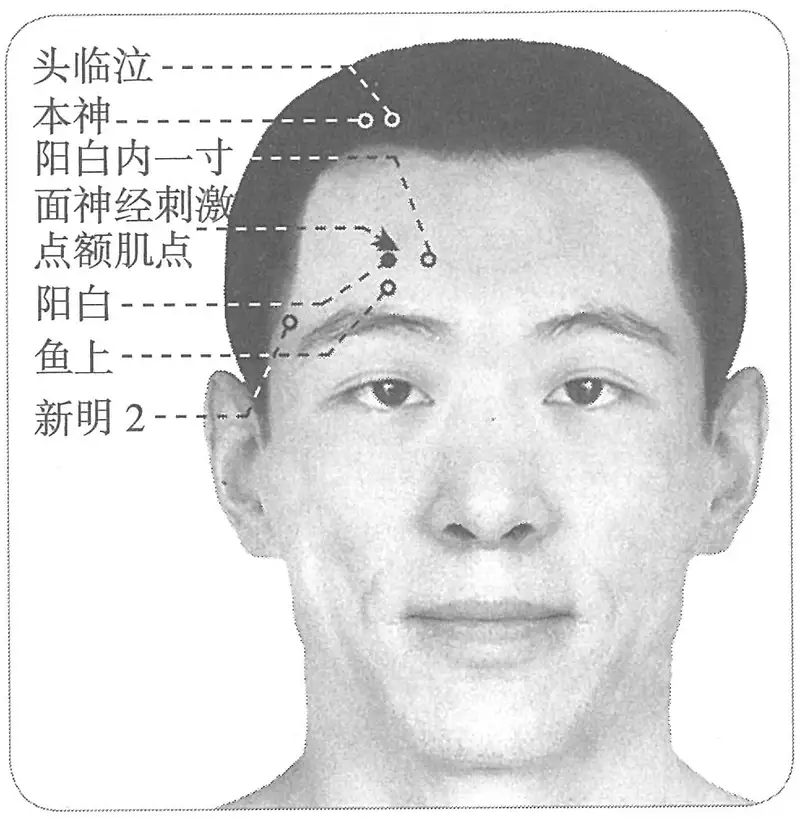

**图 2-321　阳白穴与相关穴及刺激点**

#### 【类属】 

足少阳胆经穴。

**脉气所发：**

　1. 足少阳、阳维之会。（《黄帝明堂经》）

　2. 王冰注曰，阳白，在眉上同身寸之一寸直瞳子，足阳明、阴维之会。新校正曰：详此在足阳明脉气所发中，则足阳明近是。然阳明经不到此，又不与阴维会，疑王注非，《甲乙经》为得矣。（《素问·气府论》）

**归经**：足少阳经。（《外台秘要》卷三十九、《铜人腧穴针灸图经》卷上）

#### 【适应症】 

主治头目部病症。常用于头痛，目痛，目痒，目翳。斜视矫正术、青光眼手术的针麻用穴。

　1. 主头目瞳子痛不可以视，夹项强急不可以顾。（《黄帝明堂经》）

　2. 阳白……前谷、攒竹、玉枕主目系急，目上插。（《千金要方》卷三十）

**按**：此症为《黄帝明堂经》攒竹穴所主。据未经宋人校改之宋刊本《千金要方》，此条“前谷”穴下脱“阳谷、太冲、昆仑主目急痛赤肿”一行，遂与下一条主治相混。

　3. 治头目痛，目眵，背膝寒栗，重衣不得温。（《铜人腧穴针灸图经》卷中）

　4. 窦太师针灸遗存

　　(1) 治目内红肿，胬肉，热泪，泻；目湿烂，冷泪，补。（《窦太师针经》）

　　(2) 目内红肿，胬肉热泪，湿烂冷泪，呕吐痰沫。（《针方六集》卷一）

　　(3) 主赤脉贯睛，胬肉攀珠，或赤肿，或冷眵及风寒头痛。（《循经考穴编》下）

　5. 远视𥉂𥉂，昏夜无所见。（《针灸聚英》卷一、《针灸大成》）

**按**：此乃高武从《针灸资生经》误录《千金要方》之文。

〔p.1052 (인쇄 1024)〕

　6. 统编针灸学教材

　　(1) 主治头痛，目昏，多眵，目瞤动，夜盲。（1957年南京《针灸学》、1版《针灸学讲义》）

　　(2) 主治前额痛，目眩，流泪，外眦疼痛，眼睑瞤动。（2版《针灸学讲义》）

　　(3) 主治头痛，目痛，目昏，眼睑瞤动。（4版《针灸学》）

　　(4) 主治头痛，目痛，视物模糊，眼睑瞤动。（5、7版《针灸学》）

　　(5) 主治头痛，目眩，目痛，视物模糊，眼睑瞤动。（6版《针灸学》）

　　(6) 主治①前头痛；②目痛、视物模糊、眼睑瞤动等目疾。（7版《针灸学》）

　　(7) 主治前额痛，眉棱骨痛，目痛，目眩，眼睑瞤动，眼睑下垂，迎风流泪。（《中国针灸学》）

**文献分析**：教材中“眼睑瞤动”、“视物模糊”诸症乃承袭《千金要方》、《针灸聚英》之误。今去之。本穴为面神经刺激点额肌点所在处，提示可以主治面神经麻痹所引起的抬眉障碍，前额痛。

#### 附：临床应用举例 

　1. 头风如破，眉目间痛，阳白、解溪、合谷，并泻。（《针灸玉龙经·盘石金直刺秘传》）

　2. 面瘫，地仓穴、阳白穴，针刺治疗。［辽宁中医杂志，1987，11（9）：36］

　3. 电光性眼炎，丝竹空穴、阳白穴、攒竹穴，针刺治疗。［中国针灸，1987（1）：28］

　4. 咀嚼睁眼综合征，阳白穴、鱼腰穴、攒竹穴，针灸治疗。［上海针灸杂志，1987，6（1）：46］

　5. 面神经麻痹，四白穴、阳白穴、攒竹穴，针灸治疗。［中医函授通讯，1987（1）：43-44］

　6. 原发性眶上神经痛，阳白穴、印堂穴，针刺治疗。［安徽医学，1987（3）：21］

#### 【操作】 

平刺。

　1. 刺入三分，灸三壮。（《黄帝明堂经》）

　2. 可灸三壮，针入二分。（《铜人腧穴针灸图经》卷中、《针灸十四经穴位考订》）

　3. 针入三分，禁灸。治目内红肿，胬肉，热泪，泻；目湿烂，冷泪，补。（《窦太师针经》）

　4. 统编针灸学教材

　　(1) 针二至三分，针尖向下，灸三壮。（1957年南京《针灸学》、1版《针灸学讲义》）

　　(2) 向下沿皮刺3~5分，艾条灸3分钟。（2版《针灸学讲义》）

　　(3) 平刺0.3~0.5寸。（4、5版《针灸学》）

　　(4) 平刺0.5~0.8寸；可灸。（6版《针灸学》）

　　(5) 平刺0.5~0.8寸。（7版《针灸学》）

　　(6) 横刺0.3~0.5寸。可灸。（《中国针灸学》）

　5. 横刺，从上向下沿皮可透鱼腰，治疗面神经麻痹时，可向左右透至攒竹、丝竹空穴。深1~1.5寸。感应：额区胀感，有时扩散至头顶部。温灸3~5分钟。（上海《针灸学》）

### （十五）头临泣 Tóulínqì GB15 出《黄帝明堂经》 

#### 【提要索隐】 

**穴名**：本穴名称，宋以前文献作“临泣”与足部“临泣”穴同名。

**部位**：在头部，前发际上0.5寸，瞳孔直上。

**适应症**：主治头目部病症。常用于头痛，眩晕；目痛，流泪，目翳；鼻塞，鼻渊；小儿惊风、目上视。

〔p.1053 (인쇄 1025)〕

**针刺操作**：平刺。

#### 【名实考】 

头临泣，宋以前文献作“临泣”与足部“临泣”穴同名，宋代《针灸资生经》作“头临泣”，今从之。对于这对同名“临泣”穴的辨识，古医籍中错误较多，最为严重者为明代高武《针灸聚英》一书。

关于本穴定位，《针灸甲乙经》作“当目上眦直上，入发际五分陷者中”，虽然杨上善对“目上眦”有注解，但与此例并不相同。而《针灸甲乙经》关于本穴的分行排列的描述非常明确“头直目上入发际五分却行至脑空凡十穴第四”，与《素问·气府论》的描述相合，依此可见在《黄帝明堂经》传本佚文中，以《黄帝内经明堂》，尤以王冰注最为明确：头直目上入发际同身寸之五分。后世及现代针灸教材从之。

《太平圣惠方·针经》同时记载了“临泣”与“当阳”二穴，主治完全相同，定位相差0.5寸。因这两条文献来源不同：前者出自《黄帝明堂经》，后者出自另一种《明堂》，定位上的半寸之差，很可能与前发际上穴位的位置变动有关，应视为同一穴。

　1. 临泣，当目上眦直上，入发际五分陷者中，足太阳、少阳、阳维之会。（《黄帝明堂经》）

　2. 目眦外决于面者，为兑眦；在内近鼻者，上为外眦，下为内眦。杨上善注：人之目眦有三：外决为兑眦，内角上为外眦，下为内眦。准《明堂》兑眦为外，近鼻者为内眦也。（《黄帝内经太素·目痛》）

　3. 直目上发际内各五，王冰注：谓临泣、目窗、正营、承灵、脑空，左右是也。（《素问·气府论》）

　4. 在当目上眦直目上入发际五分。（《医心方》卷二）

　5. 在头直目上入发际同身寸之五分。（《素问·刺热》王冰注）

　6. 临泣二穴，当目上眦直目上入发际五分陷中。（《铜人腧穴针灸图经》卷下“穴腧都数”）

　7. 临泣二穴，在目上直入发际五分陷中。注：足少阳有临泣穴矣，此亦有之，盖此乃头临泣穴也。（《针灸资生经》卷一）

　8. 以此穴正在睛上，故曰临泣。（《经穴解》）

#### “临泣”与“当阳”穴辨 

　1. 临泣二穴，在目上眦入发际五分陷者中是穴。足太阳、少阳之会。理卒不识人，风眩，鼻塞。针入三分，留七呼，得气即泻。（《太平圣惠方·针经》）

　2. 当阳二穴，在当瞳仁直上入发际一寸是穴。理卒不识人，风眩，鼻塞。针入三分。（《太平圣惠方·针经》）

　3. 眼急痛不可远视，灸当瞳子上入发际一寸，随年壮。穴名当阳。（《千金要方》卷六）

　4. 治小儿暴痫……若目反上视，眸子动，当灸囟中……次灸当额上入发二分许，直望鼻为正。次灸其两边，当目瞳子直上入发际二分许。（《千金要方》卷五）

**按**：以上《太平圣惠方》所载之“临泣”、“当阳”的主治完全相同；《千金要方》卷五所载之穴也与“临泣”穴部位相近，主治相同，皆当视为同一穴。

#### 头、足“临泣”相混例 

　1. 足临泣治胸满，缺盆中及腋下肿《明下》同，马刀疡瘘，善啮唇，天牖中肿，淫泺胻酸，目眩，枕骨合颅痛。（《针灸资生经》卷五）

　2. 临泣主大风目痛，《甲》云目外痛。（《针灸资生经》卷四）

**按**：以上两条“临泣”主治皆系《铜人腧穴针灸图经》足部“临泣”主治，高武当时手边没有《铜人腧穴针灸图经》、《针灸甲乙经》等腧穴专书，无法鉴别，因而将第一条中“枕骨合颅痛”主治分别辑入头临泣与足临泣二穴下，将第二条误录于头临泣穴下。

〔p.1054 (인쇄 1026)〕

#### 【定位】 

**部位**：在头部，前发际上0.5寸，瞳孔直上（图2-322）。

**取穴**：两目平视，瞳孔直上，正当神庭与头维弧形连线（其弧度与前发际弧度相应）的中点处。

　1. 当目上眦直上，入发际五分陷者中。（《针灸甲乙经》卷三、《千金要方》、《千金翼方》、《外台秘要》、《太平圣惠方》）

　2. 在头直目上入发际同身寸之五分。（《素问·刺热》王冰注）

　3. 在当目上眦直目上入发际五分。（《医心方》卷二、《铜人腧穴针灸图经》卷下“穴腧都数”）

　4. 在目上直入发际五分陷中。（《铜人腧穴针灸图经》卷上及卷中、《圣济总录》、《针灸资生经》、《十四经发挥》、《神应经》、《医学纲目》）

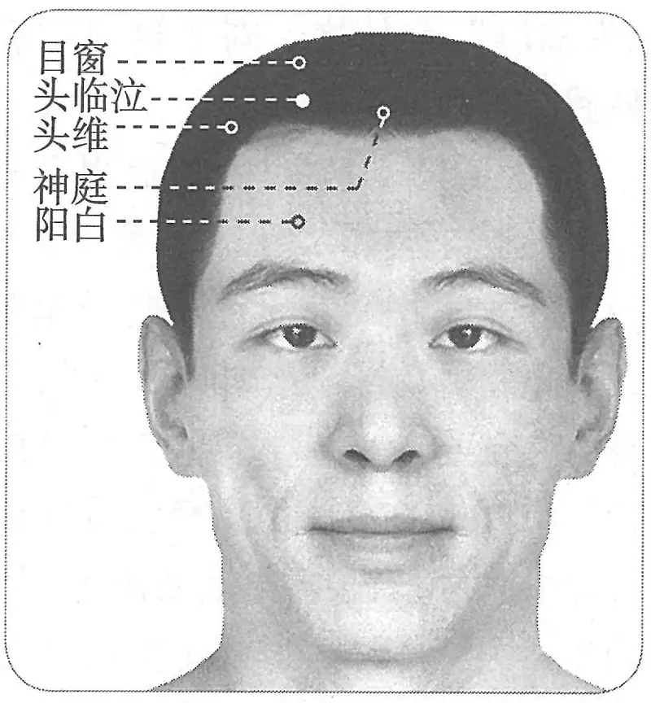

**图 2-322　头临泣穴图**

　5. 目上直入发际五分陷中，令患人正睛取穴。（《针灸聚英》卷一、《古今医统》、《医学入门》、《针灸大成》、《针方六集》、《类经图翼》、《循经考穴编》、《医宗金鉴·刺灸心法要诀》、《针灸易学》、《针灸逢源》）

　6. 阳白直上入发际五分。（《针灸十四经穴位考订》）

　7. 统编针灸学教材

　　(1) 部位：目直上入发际五分。取穴：从阳白直上入发际五分处取之。（1957年南京《针灸学》）

　　(2) 部位：阳白穴直上，入发际五分。取穴：当督脉神庭穴与胃经头维穴之间取之。（1版《针灸学讲义》）

　　(3) 部位：当目上眦直入发际五分陷者中。取穴：在前头部，阳白直上，入发际五分，当神庭督脉与头维足阳明经之间取之。（2版《针灸学讲义》）

　　(4) 阳白穴直上，入发际0.5寸。（4、5版《针灸学》）

　　(5) 在头部，当瞳孔直上入前发际0.5寸，神庭与头维连线的中点处。（6版《针灸学》）

　　(6) 目正视，瞳孔直上入前发际0.5寸，神庭与头维连线的中点。（7版《针灸学》）

　　(7) 阳白直上，入发际五分，当神庭与头维之间。（《中国针灸学》）

#### 【类属】 

足少阳胆经。

**脉气所发：**

　1. 足太阳、少阳、阳维之会。（《黄帝明堂经》）

　2. 足太阳、少阳之会。（《太平圣惠方·针经》、《铜人腧穴针灸图经》卷中）

**归经**：足少阳经。（《外台秘要》卷三十九、《铜人腧穴针灸图经》卷上）

#### 【适应症】 

主治头目部病症。常用于头痛，眩晕；目痛，流泪，目翳；鼻塞，鼻渊；小儿惊风、目上视。

　1. 主颊清不得视，口沫泣出，两目眉头痛，小儿惊痫，反视。（《黄帝明堂经》）

　2. 理卒不识人，风眩，鼻塞。（《太平圣惠方·针经》）

〔p.1055 (인쇄 1027)〕

　3. 治卒中风不识人，目眩鼻塞，目生白翳，多泪。（《铜人腧穴针灸图经》卷中）

　4. 窦太师针灸遗存

　　(1) 治鼻流清涕浊涕，鼻痔，弹针出血。（《窦太师针经》）

　　(2) 主鼻塞渊涕。（《针方六集》卷五）

　　(3) 主鼻渊，棱针出血，则目自明。（《循经考穴编》下）

　5. 枕骨合颅痛；大风，目外眦痛。（《针灸聚英》卷一、《针灸大成》）

**按**：此处所录病症多系从《针灸资生经》辑录足部“临泣”穴主治症。

　6. 统编针灸学教材

　　(1) 主治目眩，目翳，多泪，外眦疼痛，鼻塞，惊痫。（1957年南京《针灸学》、1版《针灸学讲义》）

　　(2) 主治头痛，目眩，流泪，外眦疼痛，鼻塞，鼻渊。（2版《针灸学讲义》、《中国针灸学》）

　　(3) 主治头痛，目翳多泪，鼻塞，小儿惊痫反视。（4版《针灸学》）

　　(4) 主治头痛，目眩，流泪，鼻塞，小儿惊痫。（5、6版《针灸学》）

　　(5) 主治①头痛；②目痛、目眩、流泪、目翳等目疾；③鼻塞、鼻渊；④小儿惊痫。（7版《针灸学》）

**文献分析**：《针灸甲乙经》卷十二曰：“小儿惊痫，本神及前顶、百会、天柱主之；如反视，临泣主之”，可见“反视”是取本穴治疗小儿惊痫的一个重要伴随症状。

#### 附：临床应用举例 

　1. 眼病

　　(1) 两眼昏花，头晕，羞明，迎风冷眼：泻临泣，灸肝俞穴二七壮，泻合谷、委中出血。（《针灸集要·盘石金直刺秘传》）

　　(2) 眼外障：太阳、睛明、合谷、小谷空。问曰：此证从何而得？答曰：头风灌注瞳人，血气涌溢，上盛下虚，故得此证也。刺前穴不效，复刺后穴：临泣、攒竹、三里。（《针灸集成》第十三方）

　　(3) 眼红肿疼痛：睛明、合谷、四白、临泣。问曰：此证从何而得？答曰：或因伤寒未解，却有房室之事，上盛下虚，气血上壅，或头风不早治，则血灌瞳人，或暴赤肿痛，或因怒气伤肝，心火炎上，故不散，及妇人产后怒气所伤，产眼未满房事，触毒心肝二经，饮食不节，饥饱醉劳，皆有此证也。证非一时可疗，渐而为之，无不效也。复刺后穴：风池、行间、期门、太阳。（《针灸集成》第十七方）

　　(4) 眵𥌂冷泪，临泣尤准。（《通玄指要赋》）

　　(5) 眼睑下垂：陷谷针后加灸、头临泣。［上海针灸杂志，1987，6（1）：45］

　2. 急性腰扭伤，针刺头临泣治疗。［陕西中医，1993，14（5）：225］

#### 【操作】 

平刺。

　1. 刺入三分，留七呼，灸三壮。（《黄帝明堂经》）

　2. 针入三分，禁灸。治鼻流清涕浊涕，鼻痔，弹针出血。（《窦太师针经》）

　3. 针二分，禁灸。（《针灸十四经穴位考订》）

　4. 统编针灸学教材

　　(1) 针三至五分，针尖向上或向下沿皮而进，灸三壮。（1957年南京《针灸学》、1版《针灸学讲义》）

　　(2) 向上沿皮刺3~5分，艾条灸3分钟。（2版《针灸学讲义》）

〔p.1056 (인쇄 1028)〕

　　(3) 平刺0.3~0.5寸。（4、5版《针灸学》）

　　(4) 平刺0.5~0.8寸；可灸。（6、7版《针灸学》）

　　(5) 横刺0.3~0.5寸。可灸。（《中国针灸学》）

### （十六）目窗 Mùchuāng GB16 出《黄帝明堂经》 

#### 【提要索隐】 

**部位**：在头部，前发际上1.5寸，瞳孔直上。

**适应症**：主治头目部病症。常用于头痛，眩晕；目痛，近视。

**针刺操作**：平刺。

#### 【名实考】 

天窗之旁，目之上，故曰目窗。《针灸甲乙经》作“一名至荣”，《外台秘要》作“一名至营”，皆与目窗之义联系不上，疑是下一穴“正营”（古籍中“荣”与“营”通）之形误而错入于此。

　1. 目窗，一名至荣，在临泣后一寸，足少阳、阳维之会。（《黄帝明堂经》）

　2. 杨上善曰，目上一寸五分是目之窗牖，故曰之。（《医心方》卷二）

　3. 以此穴正在目之上，刺之目明，如目之有窗者然，故曰目窗。（《经穴解》）

#### 【定位】 

**部位**：在头部，前发际上1.5寸，瞳孔直上（图2-323）。

**取穴**：头临泣直上1寸处取之。

　1. 在临泣后一寸。（《黄帝明堂经》、《铜人腧穴针灸图经》、《圣济总录》、《针灸资生经》、《十四经发挥》、《神应经》、《医学纲目》、《针灸聚英》、《古今医统》、《医学入门》、《针方六集》、《类经图翼》、《医宗金鉴·刺灸心法要诀》）

　2. 临泣后寸半。（《针灸大成》卷七、《循经考穴编》、《针灸易学》、《针灸逢源》）

　3. 临泣后一寸五分。（《针灸十四经穴位考订》）

　4. 统编针灸学教材

　　(1) 部位：临泣穴后一寸五分。取穴：从临泣上一寸五分取之。（1957年南京《针灸学》）

　　(2) 部位：临泣穴后一寸五分。取穴：临泣与正营二穴之间取之。（1版《针灸学讲义》）

　　(3) 部位：在临泣后一寸。取穴：在临泣后一寸，当临泣与风池的连线上取之。（2版《针灸学讲义》）

　　(4) 头临泣穴后一寸。（4、5版《针灸学》）

　　(5) 在头部，当前发际上1.5寸，头正中线旁开2.25寸。（6版《针灸学》）

　　(6) 头正中线旁开2.25寸，头临泣穴后1寸。（7版《针灸学》）

　　(7) 头临泣后一寸五分，当头临泣与风池之连线上。（《中国针灸学》）

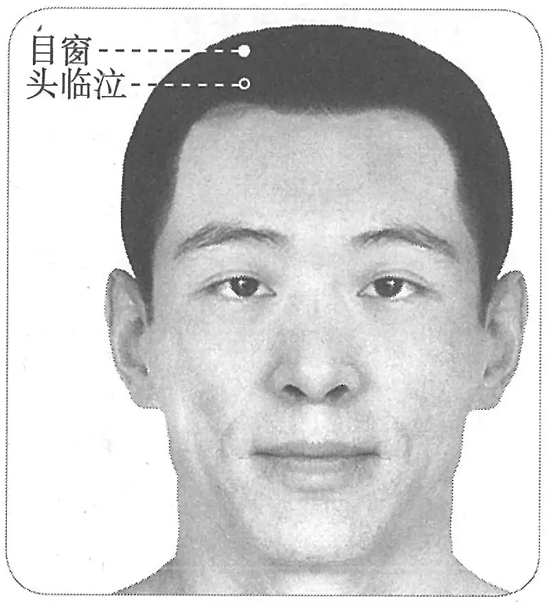

**图 2-323　目窗穴图**

**文献分析**：本穴定位，明代以前文献皆作“临泣后一寸”，明代《针灸大成》改作“临泣后寸半”，今查该书共载有目窗穴定位三处：目窗泣上寸半存（《针灸大成》卷三“百穴法歌《神应经》”）；目窗，临泣后寸半（《针灸大成》卷七，录自《针灸聚英》）；目窗，在临泣后寸半（《针灸大成》卷八“穴法图《神应经》”），原文皆为“临泣后一寸”，三处皆径改古人原文，显然是有意所为。能够查及的唯一依据是明嘉靖针灸铜人的目窗穴定位于临泣后寸半。早期针灸教材采用了《针灸大成》的定位法，而自第2版始又加以改正。

〔p.1057 (인쇄 1029)〕

#### 【类属】 

足少阳胆经穴。

**脉气所发**：足少阳、阳维之会。（《黄帝明堂经》）

**归经**：足少阳经。（《外台秘要》卷三十九、《铜人腧穴针灸图经》卷上）

#### 【适应症】 

主治头目部病症。常用于头痛，眩晕；目痛，近视。

　1. 主头痛，目瞑，远视䀮䀮。上齿龋痛，龈肿。（《黄帝明堂经》）

　2. 目窗、中渚、完骨、命门、丰隆、太白、外丘、通谷、京骨、临位、小海、承筋、阳陵泉，主头痛，寒热，汗出不恶寒。（《千金要方》卷三十）

　3. 治头面浮肿，痛引目外眦赤痛，忽头旋，目䀮䀮远视不明。针入三分，可灸五壮。今附：三度刺，目大明。（《铜人腧穴针灸图经》卷中）

　4. 寒热汗不出，恶寒。（《针灸聚英》卷一、《针灸大成》）

**按**：此乃高武从《针灸资生经》误录《千金要方》之文。

　5. 主一切目疾，青盲内障，宜先泻后补；暴赤肿疼，宜单泻之。（《循经考穴编》下）

　6. 统编针灸学教材

　　(1) 主治头痛，目眩，面目浮肿，目赤痛，恶寒鼻塞，惊痫，卒中。（1957年南京《针灸学》、1版《针灸学讲义》）

　　(2) 主治头痛，目眩，目赤痛，惊痫，鼻塞。（2版《针灸学讲义》）

　　(3) 主治头痛，目赤痛，青盲，鼻塞，头面浮肿，惊痫。（4版《针灸学》）

　　(4) 主治头痛，目赤肿痛，青盲，鼻塞，癫痫，面浮肿。（5、6版《针灸学》）

　　(5) 主治①头痛；②目痛、目眩、远视、近视等目疾；③小儿惊痫。（7版《针灸学》）

　　(6) 主治头痛，眩晕，目赤痛，鼻塞。（《中国针灸学》）

**文献分析**：从《铜人腧穴针灸图经》新附本穴主治“三度刺，目大明”来看，本穴的主要作用部位在于目。故《循经考穴编》谓“主一切目疾”。教材中“惊痫，鼻塞”、“卒中”诸症未详所出，疑将上一穴“临泣”穴主治混于此也，今去之。

#### 【操作】 

平刺。

　1. 刺入三分，灸五壮。（《黄帝明堂经》）

　2. 针入三分，可灸五壮。今附：三度刺，目大明。（《铜人腧穴针灸图经》卷中）

　3. 针二分，灸三壮。（《针灸十四经穴位考订》）

　4. 统编针灸学教材

　　(1) 针三至四分，沿皮刺，灸三至五壮。（1957年南京《针灸学》、1版《针灸学讲义》）

　　(2) 向后沿皮刺3~5分，艾条灸3~5分钟。（2版《针灸学讲义》）

　　(3) 平刺0.3~0.5寸。（4、5版《针灸学》，《中国针灸学》）

　　(4) 平刺0.5~0.8寸；可灸。（6、7版《针灸学》）

### （十七）正营 Zhèngyíng GB17 出《黄帝明堂经》 

#### 【提要索隐】 

**部位**：在头部，前发际上2.5寸，瞳孔直上。

〔p.1058 (인쇄 1030)〕

**适应症**：主治头目部病症。常用于头痛，眩晕，齿痛。

**针刺操作**：平刺。

#### 【名实考】 

　1. 正营在目窗后一寸，足少阳、阳维之会。（《黄帝明堂经》）

　2. 正当头顶之偏，故曰正营。（《经穴解》）

#### 【定位】 

**部位**：在头部，前发际上2.5寸，瞳孔直上（图2-324）。

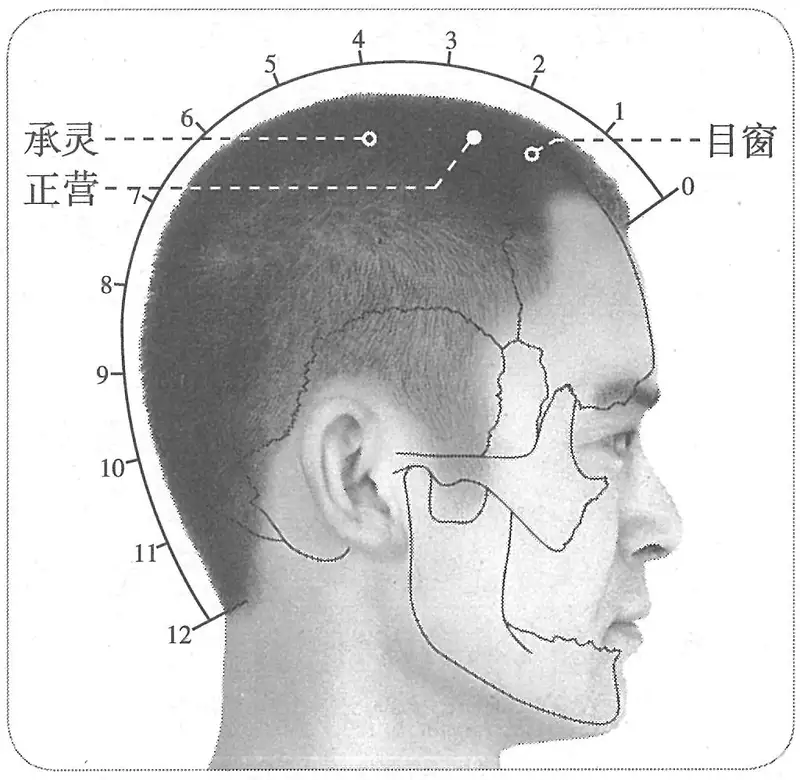

**图 2-324　正营穴图**

**取穴**：头临泣穴直上2寸处取之。

　1. 在目窗后一寸。（《黄帝明堂经》、《铜人腧穴针灸图经》、《圣济总录》、《针灸资生经》、《十四经发挥》、《医学纲目》、《针灸聚英》、《古今医统》、《医学入门》、《针方六集》、《类经图翼》、《医宗金鉴·刺灸心法要诀》）

　2. 目窗后寸半。（《针灸大成》、《循经考穴编》、《针灸易学》、《针灸逢源》）

　3. 目窗后一寸五分。（《针灸十四经穴位考订》）

　4. 统编针灸学教材

　　(1) 部位：目窗穴后一寸五分。取穴：从临泣穴上三寸取之。（1957年南京《针灸学》、1版《针灸学讲义》）

　　(2) 部位：在目窗后一寸。取穴：在目窗后一寸，当头临泣与风池之连线上取之。（2版《针灸学讲义》）

　　(3) 在目窗后一寸。（4、5版《针灸学》）

　　(4) 在头部，当前发际上2.5寸，头正中线旁开2.25寸。（6版《针灸学》）

　　(5) 头正中线旁开2.25寸，目窗穴后1寸。（7版《针灸学》）

　　(6) 目窗后一寸五分，当头临泣与风池之连线上。（《中国针灸学》）

**文献分析**：本穴定位，明代以前文献皆作“目窗后一寸”，明代《针灸大成》改作“目窗后寸半”，今查该书共载有正营穴定位三处，皆录自前代文献，原文皆为“临泣后一寸”，三处皆径改古人原文，显然是有意所为。能够查及的唯一依据是明嘉靖针灸铜人的目窗穴定位于临泣后寸半。早期针灸教材采用了《针灸大成》的定位法，而自第2版始又加以改正。

#### 【类属】 

足少阳胆经穴。

**脉气所发**：足少阳、阳维之会。（《黄帝明堂经》）

**归经**：足少阳经。（《外台秘要》卷三十九、《铜人腧穴针灸图经》卷上）

#### 【适应症】 

主治头目部病症。常用于头痛，眩晕，齿痛。

　1. 主上齿龋痛，恶寒。（《黄帝明堂经》）

　2. 兑端、目窗、正营、耳门主唇吻强，上齿龋痛。（《千金要方》卷三十）

**按**：《千金要方》体例，此条主治录自第一穴“兑端”主治，经查的确为《明堂经》兑端穴主治。

　3. 主牙齿痛，唇吻急强。（《外台秘要》卷三十九）

〔p.1059 (인쇄 1031)〕

**按**：此乃王焘不明《千金要方》体例而误录其文也。

　4. 治牙齿痛，唇吻急强，齿龋痛，头项偏痛。（《铜人腧穴针灸图经》卷中）

　5. 主目眩瞑。（《针灸聚英》卷一、《针灸大成》、《针方六集》）

　6. 主痰饮头晕，呕吐不已，恶闻人声，名曰醉头风，宜先泻后补。（《循经考穴编》下）

　7. 统编针灸学教材

　　(1) 主治偏头痛，眩晕呕吐，齿疼，唇吻急强。（1957年南京《针灸学》、1版《针灸学讲义》）

　　(2) 主治偏头痛，头晕，目眩，齿痛，唇吻急强。（2版《针灸学讲义》）

　　(3) 主治偏头痛，目眩，齿痛，唇吻急强。（4版《针灸学》）

　　(4) 主治头痛，目眩，唇吻急强，齿痛。（5、6版《针灸学》）

　　(5) 主治头痛、头晕、目眩等头目病证。（7版《针灸学》）

　　(6) 主治偏头痛，眩晕。（《中国针灸学》）

**文献分析**：教材中“唇吻急强”症乃承袭《外台秘要》之误，误录“兑端”穴主治于此，今去之。

#### 【操作】 

平刺。

　1. 刺入三分，灸五壮。（《黄帝明堂经》）

　2. 针二分，灸三壮。（《针灸十四经穴位考订》）

　3. 统编针灸学教材

　　(1) 针三至四分，沿皮刺，灸三至五壮。（1957年南京《针灸学》、1版《针灸学讲义》）

　　(2) 向后沿皮刺3~5分，艾条灸3~5分钟。（2版《针灸学讲义》）

　　(3) 平刺0.3~0.5寸。（4、5版《针灸学》，《中国针灸学》）

　　(4) 平刺0.5~0.8寸；可灸。（6、7版《针灸学》）

### （十八）承灵 Chénglíng GB18 出《黄帝明堂经》 

#### 【提要索隐】 

**部位**：在头部，前发际上4寸，瞳孔直上。

**适应症**：主治外感病症。常用于头痛、恶寒、鼻衄、鼻塞。

**针刺操作**：平刺。

#### 【名实考】 

本穴伴“通天”穴（足太阳入脑之处）之侧，故曰承灵，而治脑病与鼻疾（古人认为鼻与脑相通，故凡与脑相关的穴皆治鼻疾）。

　1. 承灵在正营后一寸五分，足少阳、阳维之会。刺入三分，灸五壮。主脑风头痛，恶见风寒，鼽衄，鼻窒，喘息不通。（《黄帝明堂经》）

　2. 灵指百会而言，有君象焉，此穴与之横直，有承君之象，故曰承灵。（《经穴解》）

#### 【定位】 

**部位**：在头部，前发际上4寸，瞳孔直上（图2-325）。

**取穴**：正营穴后1.5寸，横平通天穴。

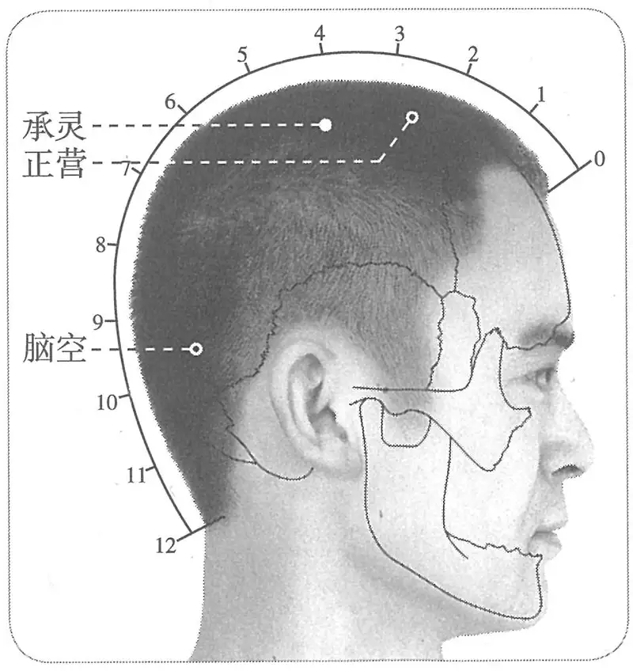

**图 2-325　承灵穴图**

〔p.1060 (인쇄 1032)〕

　1. 在正营后一寸五分。（《黄帝明堂经》、《铜人腧穴针灸图经》、《圣济总录》、《针灸资生经》、《十四经发挥》、《医学纲目》、《针灸聚英》、《古今医统》、《医学入门》、《针灸大成》、《针方六集》、《类经图翼》、《循经考穴编》、《医宗金鉴·刺灸心法要诀》、《针灸逢源》）

　2. 在正营后一寸。（《千金翼方》卷二十六）

　3. 正营后一寸五分，对百会穴。（《针灸十四经穴位考订》）

　4. 统编针灸学教材

　　(1) 部位：正营穴后一寸五分。取穴：从正营穴向后一寸五分取之。（1957年南京《针灸学》）

　　(2) 部位：正营穴后一寸五分。取穴：从临泣穴向后四寸五分取之。（1版《针灸学讲义》）

　　(3) 部位：正营穴后一寸五分。取穴：当头临泣与风池之连线上取之。（2版《针灸学讲义》）

　　(4) 正营穴后1.5寸。（4、5版《针灸学》）

　　(5) 在头部，当前发际上4寸，头正中线旁开2.25寸。（6版《针灸学》）

　　(6) 头正中线旁开2.25寸，正营穴后1.5寸。（7版《针灸学》）

　　(7) 正营后一寸五分，当头临泣与风池之连线上。（《中国针灸学》）

**文献分析**：本穴定位，唯《千金翼方》作“一寸”者，盖系承前穴正营定位“一寸”之误。《针灸十四经穴位考订》谓“对百会穴”者，是因为该书定百会、承灵距前发际皆五寸处。

#### 【类属】 

足少阳胆经穴。

**脉气所发**：足少阳、阳维之会。（《黄帝明堂经》）

**归经**：足少阳经。（《外台秘要》卷三十九、《铜人腧穴针灸图经》卷上）

#### 【适应症】 

主治脑病与鼻疾。常用于头痛目眩，鼻衄，鼻塞。

　1. 主脑风头痛，恶见风寒，鼽衄，鼻窒，喘息不通。（《黄帝明堂经》）

　2. 治脑风头痛，恶风寒，鼽衄，鼻塞息不利。（《铜人腧穴针灸图经》卷中）

　3. 统编针灸学教材

　　(1) 主治脑风头痛，鼻塞，鼻衄，多涕。（1957年南京《针灸学》、1版《针灸学讲义》）

　　(2) 主治头痛，鼻渊，鼻衄，目痛，眩晕。（2版《针灸学讲义》）

　　(3) 主治头痛，鼻衄，鼻塞，目痛。（4版《针灸学》）

　　(4) 主治头痛，眩晕，目痛，鼻塞，鼻衄。（5、6版《针灸学》）

　　(5) 主治①头痛，眩晕；②目痛；③鼻塞、鼻衄、鼻窒、多涕等鼻疾。（7版《针灸学》）

　　(6) 主治头痛，眩晕，鼻衄，鼻渊。（《中国针灸学》）

**文献分析**：本穴名曰“承灵”提示其与脑相关，故治脑病与鼻疾。而所述之症状也见于伤寒表证，并与主治外感风寒的足太阳经“风门”、“攒竹”主治相类，可相参：

风门，主风眩头痛，鼻鼽不利，时嚏，清涕自出。（《黄帝明堂经》）

攒竹，主风头痛，恶风寒，鼻鼽衄，眉头痛，善嚏泣出。（《黄帝明堂经》）

#### 【操作】 

平刺。

　1. 刺入三分，灸五壮。（《黄帝明堂经》）

　2. 灸三壮。（《铜人腧穴针灸图经》卷中）

　3. 禁针，灸三壮。（《针灸大成》卷七）

　4. 统编针灸学教材

　　(1) 针三分，灸三至五壮。（1957年南京《针灸学》、1版《针灸学讲义》）

〔p.1061 (인쇄 1033)〕

　　(2) 向后沿皮刺3~5分，艾条灸3~5分钟。（2版《针灸学讲义》）

　　(3) 平刺0.3~0.5寸。（4、5版《针灸学》、《中国针灸学》）

　　(4) 平刺0.5~0.8寸；可灸。（6、7版《针灸学》）

**文献分析**：本穴针灸法，《铜人腧穴针灸图经》只言灸法，未及针法，《圣济总录·灸刺禁忌论》卷一九四遂将其列入“偏宜灸”穴之列，明初《医经小学》则列入“禁针穴”之类。

### （十九）脑空 Nǎokōng GB19 出《黄帝明堂经》 

#### 【提要索隐】 

**部位**：在头部，横平枕外隆凸的上缘，风池直上。

**适应症**：主治头面五官部病症。常用于发热、头痛、颈项强痛；眩晕，目痛，鼻衄，鼻部疮疡，耳聋；癫、狂、痫。

**针刺操作**：平刺。

#### 【名实考】 

脑空，“空”与“孔”音义同，故本穴名的拼音标注当读作第三声。本穴在“脑户”之旁，因名“脑空（孔）”。也因为本穴通于脑，因而主治目疾、鼻疾、癫疾。古人很早就形成了这样的认识：目、鼻与脑相通，故凡与脑相关穴皆治脑、目、鼻之疾。

关于本穴别名“颞颥”之义，杨上善《黄帝内经明堂》注曰：“顶骨相接之处，每鼓颔则颞颥然而动，故以为名”（转引自《医家千字文》）。杨氏本义盖指顶骨与枕骨相接之处，此处无颞肌覆盖，因此鼓颔时，不像耳前部那样肌动应手，而是在此处能够感觉到明显的脉动应手，正是枕后动脉（耳大动脉）触诊处。因此，此处“颞颥”之义或指脉动而不是肉动。

需要特别注意的是，古医籍中名“颞颥”者有三：经穴别名（脑空）、奇穴名（在眉、眼尾之间）、部位名（耳部动处，即颔厌、悬颅、悬厘三穴所在处）。如果只知其一，不知其二、其三，我们就会犯宋代王惟一、王执中的错误——将耳前“颞颥”误解为脑空穴别名，造成了颔厌、悬颅、悬厘三穴从耳前移至耳后的大错！

本穴一名颞颥，悬颅穴在颞颥中，在宋以前文献如《千金要方》、《千金翼方》以及敦煌卷子针灸文献中，皆见含有“颞颥”穴的针灸方，如果这样的针灸方出现在汉以前文献，或者直接以“颞颥”为名的穴位主治，《黄帝明堂经》编者会归到哪个穴下呢？是随意归入其中一穴？还是分别归入二穴之中呢？这两种可能都存在，据我们实际考察的结果来看，一般情况下，该书编者倾向于采用第一种处理方式，而就本例而言，很可能是对不同来源的同类方或腧穴主治采用了不同的处理方式：

脑空，一名颞颥。主头痛身热引两颔急一作痛。脑风目瞑，头痛，风眩目痛。癫疾大瘦。鼻管疽，发为厉鼻。（《黄帝明堂经》）

悬颅，在曲周颞颥中。主热病头痛，身热，甚者偏头痛引目外眦而急，烦满汗不出，引颔齿，面赤皮痛。（《黄帝明堂经》）

**按**：脑空穴主治“头痛身热引两颔急（痛）”，又见于悬颅穴下，根据腧穴主治的一般规律，该主治应当归属于悬颅穴，而不应辑入脑空穴。此二穴中的相关主治义同而字不同，显然不是出自同一首针灸方，或同一条腧穴主治，《黄帝明堂经》编者失于详察，或因无法分辨，而分别归入不同穴下。王焘、高武在处理同穴名的主治条文的归属时，常采用这种处理方式。

还存在另一种可能：耳前之颞颥（颔厌、悬颅、悬厘）与耳后之颞颥，皆可治疗此症。现代研究提示了这种可能性：上斜方肌激发点引起乳突和耳上方至颞部疼痛，也可引起下颌角疼痛。

〔p.1062 (인쇄 1034)〕

关于“颞颥”一词的理解，详见颔厌穴“名实考”。

　1. 脑空，在承灵后一寸五分，夹玉枕旁，枕骨下陷者中，足少阳、阳维之会。（《黄帝明堂经》）

　2. 此穴虽与太阳经玉枕穴、督经后顶穴横直，然至此，则头之形削而下，故此穴在玉枕骨下有陷中者是，以指掐之甚痛者是也。（《经穴解》）

#### 【定位】 

**部位**：在头部，横平枕外隆凸的上缘，风池直上（图2-326）。

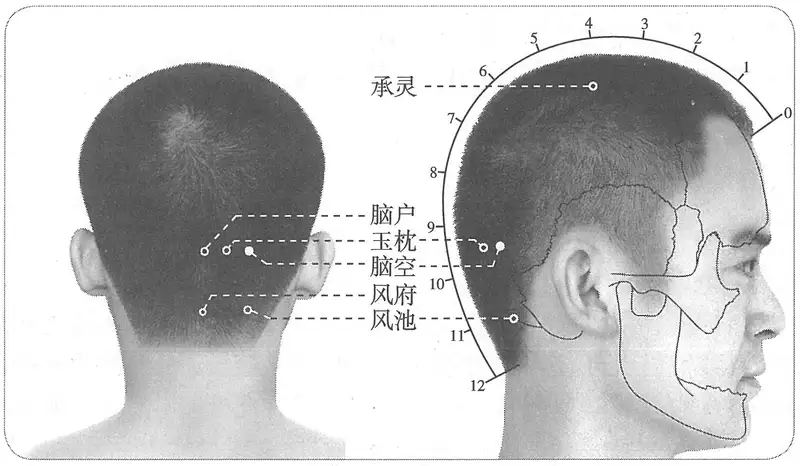

**图 2-326　脑空穴图**

**取穴**：风池直上，横平脑户、玉枕处取之。

　1. 在承灵后一寸五分，夹玉枕骨下陷者中。（《针灸甲乙经》卷三、《千金翼方》、《外台秘要》、《太平圣惠方》、《铜人腧穴针灸图经》、《圣济总录》、《针灸资生经》、《十四经发挥》、《针灸聚英》、《古今医统》、《针灸大成》、《针方六集》、《类经图翼》、《医宗金鉴·刺灸心法要诀》、《针灸易学》、《针灸逢源》）

　2. 在承灵后一寸五分，夹玉枕旁，枕骨下陷者中。（《千金要方》卷二十九、《医心方》、《医学纲目》）

　3. 王冰注：在承灵后同身寸之一寸半，夹枕骨后枕骨上。新校正云：按“脑空”在“枕骨后枕骨上”。《甲乙经》作“玉枕骨下”。（《素问·气府论》）

　4. 在头后风府穴上一寸半，玉枕骨下陷中。（《窦太师针经》）

　5. 承灵后，夹玉枕旁，枕骨下陷中，摇耳有空。（《医学入门》卷一）

　6. 一法云风池上二寸，与耳尖平。（《循经考穴编》下）

　7. 承灵后约四寸五分，对脑户穴。（《针灸十四经穴位考订》）

　8. 统编针灸学教材

　　(1) 部位：在风池穴之直上，承灵之后二寸五分，当后头结节之外侧。取穴：从承灵后二寸五分脑户旁二寸取之，以三指并排在耳翼边角上缘所着之处，当三指之侧边是穴。（1957年南京《针灸学》）

　　(2) 部位：承灵穴之后下方，挟玉枕骨陷中。取穴：风池穴直上，与脑户穴成直角处陷中取之。（1版《针灸学讲义》）

〔p.1063 (인쇄 1035)〕

　　(3) 部位：在承灵后一寸五分，夹玉枕骨下陷者中。取穴：在风池直上与脑户督脉相平处取之。（2版《针灸学讲义》）

　　(4) 风池穴直上1.5寸。（4、5版《针灸学》）

　　(5) 在头部，当枕外隆凸的上缘外侧，头正中线旁开2.25寸，平脑户。（6版《针灸学》）

　　(6) 头正中线旁开2.25寸，当枕外隆凸的上缘外侧，与督脉脑户穴相平处。（7版《针灸学》）

　　(7) 风池直上与脑户相平处，当枕外粗隆之外侧。（《中国针灸学》）

**文献分析**：本穴定位，现存《黄帝明堂经》佚文有二说：一作“承灵后一寸五分，夹玉枕骨下陷者”，一作“承灵后一寸五分，夹玉枕旁，枕骨下陷者中”，后者定位更加明确。其中体表标志定位的描述已经提供了本穴定位的两个要素，至于折量法“承灵后一寸五分”，因不明采用的是哪一种何时何种骨度，而无法确定其具体定位。后人套用《灵枢·骨度》的头部骨度而不合，故提出多种修订方案加以调整：或作“同风府上一寸半”；或作“风池上二寸”者，皆未明确。至于王冰所说“枕骨后枕骨上”，于文理、医理皆难合，当有误。

#### 【类属】 

足少阳胆经穴。

**脉气所发**：足少阳、阳维之会。（《黄帝明堂经》）

**归经**：足少阳经。（《外台秘要》卷三十九、《铜人腧穴针灸图经》卷上）

#### 【适应症】 

主治头面五官部病症。常用于发热、头痛、颈项强痛；眩晕，目痛，鼻衄，鼻部疮疡，耳聋；癫、狂、痫。

　1. 主头痛身热引两颔急一作痛。脑风目瞑，风眩头痛，目痛。鼻管疽，发为疠鼻。癫疾大瘦。（《黄帝明堂经》）

**按**：“癫疾大瘦”类似《灵枢·癫狂》所述之“骨癫疾”症。

　2. 主癫狂病，身寒热引项强急，鼻衄不止，耳鸣聋。（《太平圣惠方·明堂》）

　3. 治脑风头痛不可忍，目瞑心悸，发即为癫，风引目眇，劳疾羸瘦，体热，颈项强，不得回顾。（《铜人腧穴针灸图经》卷中）

　4. 鼻痛。（《针灸聚英》卷一、《古今医统》、《针灸大成》）

　5. 治脑项头晕。（《窦太师针经》）

　6. 主头面虚肿，气盛耳胀。（《循经考穴编》下）

　7. 统编针灸学教材

　　(1) 主治脑风头痛，颈项强直不得回顾。（1957年南京《针灸学》）

　　(2) 主治脑风头痛，颈项强直。（1版《针灸学讲义》）

　　(3) 主治头痛，风眩，颈项强直，目痛，耳鸣，癫痫。（2版《针灸学讲义》）

　　(4) 主治头痛，项强，目眩，心悸，鼻瘤。（4版《针灸学》）

　　(5) 主治头痛，目眩，癫狂痫，颈项强痛。（5、6版《针灸学》）

　　(6) 主治①热病；②头痛，颈项强痛；③目眩、目赤肿痛、鼻痛、耳聋等五官病证；④惊悸，癫痫。（7版《针灸学》）

　　(7) 主治头痛，项强，眩晕，目痛，耳鸣，痫证。（《中国针灸学》）

**文献分析**：《针灸聚英》所载本穴主治“鼻痛”辑自《针灸资生经·鼻痛》卷六，原文作“脑空、窍阴主鼻管疽发为厉鼻”，可知此处仍为“鼻痛”，高武以其载于“鼻痛”项，而改作“鼻痛”。

〔p.1064 (인쇄 1036)〕

#### 附：临床应用举例 

　1. 两眼暴障，头痛头重，搐目失明，灸脑空，泻合谷；未愈，泻睛明。（《针灸集要·盘石金直刺秘传》）

　2. 头顶痛，名曰正头风，上星一穴，百会一穴，脑空二穴，涌泉二穴，合谷二穴。（《针灸大全》卷四）

#### 【操作】 

平刺。

　1. 刺入四分，灸五壮。（《黄帝明堂经》）

　2. 灸七壮。（《太平圣惠方》）

　3. 针入五分，得气即泻，可灸三壮。（《铜人腧穴针灸图经》卷中）

　4. 针入三分，灸二七壮。（《窦太师针经》）

　5. 针三分，灸五壮。（《针灸十四经穴位考订》）

　6. 统编针灸学教材

　　(1) 针三至四分，灸三至五壮。（1957年南京《针灸学》、1版《针灸学讲义》）

　　(2) 向下沿皮刺3~5分，艾条灸3~5分钟（2版《针灸学讲义》）

　　(3) 平刺0.3~0.5寸。（4、5、6版《针灸学》，《中国针灸学》）

　　(4) 平刺0.5~0.8寸。（7版《针灸学》）

### （二十）风池 Fēngchí GB20 出《黄帝明堂经》 

#### 【提要索隐】 

**部位**：在颈后区，枕骨之下，胸锁乳突肌上端与斜方肌上端之间的凹陷中。

**适应症**：主治脑部、耳目部病症。常用于中风，癫、狂、痫，眩晕；耳鸣、耳聋，目赤肿痛；发热、头痛、鼻塞、鼻衄；颈项强痛。颅脑外科手术的针麻用穴。

**针刺操作**：针尖微下，向鼻尖斜刺0.8~1.2寸，或平刺透风府穴。针刺不宜过深，禁止大幅度提插、捻转，以免损伤椎动脉及延髓。

#### 【名实考】 

本穴在风府之外侧，故曰“风池”。出入脑之门户曰“府”，府之外卫为“池”（风池），为“门”（风门）。详见风府穴“名实考”。

本穴定位，《黄帝明堂经》曰“颞颥后发际陷者中”，其“颞颥”是指脑空穴别名，后世有注作“颞颥骨”者，非是。所说“后发际陷者中”，古人很早就发现，在不同的个体后发际变异很大，因而提出：若确切定位，当横平风府穴。

　1. 所谓五十九刺者……巅上一，囟会一，发际一，廉泉一，风池二，天柱二。（《灵枢·热病》）

　2. 风池，在颞颥后发际陷者中，足少阳、阳维之会。（《黄帝明堂经》）

　3. 风之中人，多在身之后，则头之上，头之后，皆其所也。然风每中于身之虚处，如……风府……风池。（《经穴解》）

　4. 别名　热府。（1957年南京《针灸学》）

**按**：“热府”乃足太阳经“风门”穴别名。

#### 相关穴及刺激点 

　1. 天梁　位于头枕部，斜方肌外缘，枕骨下际处，风池内上方，指压酸胀感至鼻腔，止鼻衄。（《针灸经外奇穴图谱（续集）》）

　2. 下风池　风池穴下0.5寸。针斜向第1颈椎刺1.5~2寸，针感麻酸至额部。治后头痛，

〔p.1065 (인쇄 1037)〕

青光眼，视网膜色素变性。（《针灸经外奇穴图谱（续集）》）

　3. 池前　风池穴前0.5寸。针斜向耳垂后方凹陷刺2~2.5寸，针感酸胀至耳中。主治耳聋。（《针灸经外奇穴图谱（续集）》）

　4. 枕小神经刺激点　两乳突连线上，后正中线旁开4.0cm处。主治后头痛，枕小神经痛，精神病，高血压，失眠。直刺2.0cm。（《实用神经干电刺激疗法》）

#### 【定位】 

**部位**：在颈后区，枕骨之下，胸锁乳突肌上端与斜方肌上端之间的凹陷中（图2-327）。

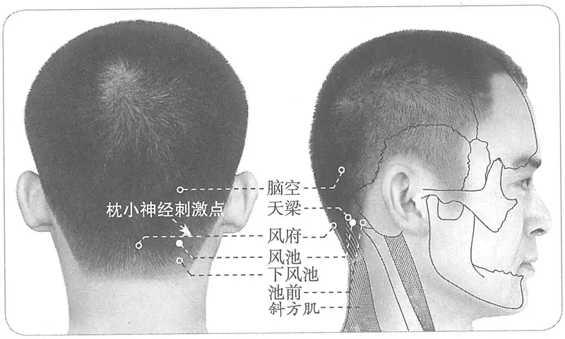

**图 2-327　风池穴与相关穴及刺激点**

**取穴**：项部枕骨下两侧，横平风府，胸锁乳突肌与斜方肌两肌之间凹陷中取之。

　1. 在颞颥后发际陷者中。（《黄帝明堂经》、《太平圣惠方》、《铜人腧穴针灸图经》、《圣济总录》、《针灸资生经》、《乾坤生意》、《十四经发挥》、《医学纲目》、《循经考穴编》）

　2. 在项后两辕动筋外，发际陷中。（《千金要方》卷五、《外台秘要》）

　3. 夹项两边，耳上发际。（《千金要方》卷二十四、《千金翼方》）

　4. 在耳后陷者中，按之引于耳中。（《素问·气府论》王冰注、《类经图翼》、《针灸逢源》）

　5. 在项后发际陷中。如后发际亦有项脚长者，其毛直至头骨；亦有无项脚者，毛齐至天牖穴。即无毛根，何而取穴也？答曰：其毛不可辄定，大约如此。若的的定，中（风）府正相当，即是侧相去各二寸，此之定穴。（《太平圣惠方·针经》）

**按**：《千金要方》卷五曰：“风府当项中央发际，亦可与风池三处高下相等”。

　6. 窦太师针灸遗失存

　　(1) 在耳后颞颥骨下，大筋上，入发际陷中。（《窦太师针经》）

　　(2) 在耳后颞颥骨筋下入发际。（《针灸玉龙歌》注）

　　(3) 耳后颞颅后发际大筋外廉陷中。（《大本琼瑶神书》）

　　(4) 在后项颞颥骨下入后际两边各二寸。（《窦太师秘传》）

　7. 在脑空下发际陷中。（《针灸聚英》卷一、《古今医统》、《针灸大成》、《类经图翼》、《医宗金鉴·刺灸心法要诀》、《针灸易学》）

　8. 耳后一寸半，横夹风府。（《医学入门》卷一）

　9. 广注脑空下，哑门旁，平耳坠微上，大筋外发际陷中，与翳风相齐，按之引于耳间……（《循经考穴编》下）

〔p.1066 (인쇄 1038)〕

　10. 脑空之后，骨下陷凹处。（《针灸十四经穴位考订》）

　11. 统编针灸学教材

　　(1) 部位：脑空下发际陷中。取穴：以指按取脑空穴直下，到达后头骨下之陷凹处是穴，适当项肌之外侧陷中。（1957年南京《针灸学》）

　　(2) 部位：脑空下发际陷中。取穴：以指按取脑空穴直下，到达后头骨下之陷凹处取之。（1版《针灸学讲义》）

　　(3) 部位：在颞颥后发际陷者中。取穴：在风府督脉外侧，当胸锁乳突肌和斜方肌上端之间的凹陷中取之。（2版《针灸学讲义》）

　　(4) 胸锁乳突肌与斜方肌之间，平风府穴处。（4版《针灸学》）

　　(5) 胸锁乳突肌与斜方肌之间凹陷中，平风府穴处。（5、7版《针灸学》，《中国针灸学》）

　　(6) 在项部，当枕骨之下，与风府相平，胸锁乳突肌与斜方肌上端之间的凹陷处。（6版《针灸学》）

**文献分析**：“动筋外”，指斜方肌外侧；“颞颥”，脑空穴别名，故后世文献有直接换作“脑空”者。古人发现，后发际的个体差异较大，而以“风府”穴为基准定位，今从之；王冰注文系将“翳风”穴与本穴相混。后世文献受此影响，多将此两者部位混为一谈。

#### 【类属】 

足少阳胆经穴。

**脉气所发**：足少阳、阳维之会。（《黄帝明堂经》）

**归经**：足少阳胆经。（《外台秘要》卷三十九、《铜人腧穴针灸图经》卷上）

#### 【适应症】 

主治脑部、目、鼻、耳部病症。常用于中风，癫、狂、痫，眩晕；耳鸣、耳聋，目赤肿痛；发热、头痛、鼻塞、鼻衄；颈项强痛。颅脑外科手术的针麻用穴。

　1. 主寒热。癫疾，僵仆，狂，疟。热病汗不出。头痛。痎疟。颈项痛，不得顾，目泣出，多眵䁾，鼻鼽衄，目内眦赤痛，气厥，耳目不明，咽喉偻引项，筋挛不收。（《黄帝明堂经》）

**按**：咽喉偻引项，《外台秘要》作“喉痹偻引项”。“偻”即“瘘”，汉以前指“瘰疬”已溃，谓之瘰疬瘘，隋唐时又用作“痔瘘”，别用作“伛偻”（又作“瘘痀”、“痀偻”），一名而三用，每致混淆，如宋代王惟一即将此“咽喉偻”理解为“腰伛偻”。

　2. 主喉痹。（《外台秘要》卷三十九）

　3. 主肺风，面赤，面肿，皮软，脑疼痛。（《太平圣惠方·针经》）

　4. 治洒淅寒热，温病汗不出，目眩，苦头痛，痎疟，颈项痛不得回顾，目泪出，欠气多，鼻鼽衄，目内眦赤痛，气发耳塞，目不明，腰伛偻，引项筋无力不收。（《铜人腧穴针灸图经》卷中）

　5. 窦太师针灸遗存

　　(1) 治偏头风，补泻；治脚无力，补，灸二七壮。头肿晕，泻补；眼红肿，泻此穴。（《窦太师针经》）

　　(2) 治偏正头风，先补后泻；治脚软无力，宜补。（《大本琼瑶神书》）

　　(3) 治头风伤寒症。（《窦太师秘传》）

　6. 主偏正头痛，腰背俱疼，大风中风，气塞涎上不语，昏危。瘿气。（《针灸聚英》卷一、《针灸大成》）

**按**：以上“瘿气”乃高武从《针灸资生经》辑自《千金要方》灸方主治，其余各症均辑自《针经摘英集》针灸方主治，详见“附：临床应用举例”。

〔p.1067 (인쇄 1039)〕

　7. 主中风偏枯，目翳赤肿。（《循经考穴编》下）

　8. 统编针灸学教材

　　(1) 主治偏正头痛，颈项强直，目内眦赤痛，目眩，泪出，鼻衄，气发耳塞，腰背肩俱痛，中风气塞涎上不语，热病汗不出。（1957年南京《针灸学》）

　　(2) 主治偏正头痛，颈项强直，目赤痛，目眩，泪出，鼻衄，耳鸣，腰、背、肩俱痛，中风，热病汗不出。（1版《针灸学讲义》）

　　(3) 主治头痛，眩晕，颈项强痛，目赤痛，鼻渊，肩背痛，热病，感冒。（2版《针灸学讲义》）

　　(4) 主治头项强痛，目赤痛，鼻衄，耳鸣，癫痫。（4版《针灸学》）

　　(5) 主治头痛，眩晕，目赤痛，鼻渊，鼻衄，耳鸣，颈项强痛，感冒，癫痫，中风，热病，疟疾，瘿气。（5版《针灸学》）

　　(6) 主治头痛，眩晕，目赤肿痛，鼻渊，鼻衄，耳鸣，耳聋，颈项强痛，感冒，癫痫，中风，热病，疟疾，瘿气。（6版《针灸学》）

　　(7) 主治①中风、癫痫、头痛、眩晕、耳鸣、耳聋等内风所致的病证；②感冒、鼻塞、鼽衄、目赤肿痛、口眼歪斜等外风所致的病证；③颈项强痛。（7版《针灸学》）

　　(8) 主治头痛，眩晕，失眠，颈项强痛，目视不明，青盲，目赤痛，耳鸣，抽搐，痫证，小儿惊风，热病，感冒，鼻塞，鼻渊。（《中国针灸学》）

**文献分析**：从本穴名称“风池”提示其与脑相关，故主治脑、目、鼻部病症，针刺本穴时针感的确可以传至眼部、鼻部，说明古人“脑与目、鼻”相关的认识是有临床基础的。

#### 附：临床应用举例 

　1. 外感热病

　　(1) 太阳病，初服桂枝汤，反烦不解者，先刺风池、风府，却与桂枝汤，则愈。（《伤寒论》卷二）

　　(2) 伤风，头项强，并失枕头项强疼：泻风池，更泻承山、委中出血妙。（《针灸集要·盘石金直刺秘传》）

　　(3) 伤寒项强，腠理不密，风邪流注经络，以致不得位：泻人中，灸百劳、合谷、风池。（《针灸集要·盘石金直刺秘传》）

　　(4) 风府风池寻得到，伤寒百病一时消。（《席弘赋》）

　2. 五官病症

　　(1) 治眼疼不可忍：刺足少阳经风池二穴、手阳明合谷二穴立愈。（《针经摘英集》）

　　(2) 突眼症：风池穴、三阴交穴、足三里穴。［上海针灸杂志，1984(2):9-10］

　　(3) 电光性眼炎：风池穴、合谷穴、太阳穴，针灸疗法。［陕西中医函授，1986(4):35］

　　(4) 声门闭合不良：风池穴、天突穴，针刺治疗。［上海针灸杂志，1986(1):32］

　　(5) 突眼症：风池穴针刺治疗。［陕西中医，1987(6):273-274］

　　(6) 中风引起双眼视力减退：风池穴、攒竹穴，针灸治愈。［辽宁中医杂志，1987，11(4):45］

　　(7) 视神经萎缩：针刺风池等穴气至病所治疗。［中医药国际学术会议论文集，1987:397］

　　(8) 五官科疾病视神经萎缩、耳鸣、嗅觉丧失、舌短缩，以风池为主穴治。［江西中医药，1998，29(1):42］

　　(9) 假性球麻痹：针刺风池、配廉泉治疗。［天津中医，1999，16(5):26］

〔p.1068 (인쇄 1040)〕

　　(10) 过敏性鼻炎：取风池、印堂穴治疗。［福建中医药，2000，31(6):29］

　3. 头部病症

　　(1) 风眩，善呕烦满，神庭主之；如颜青者，上星主之，取上星者，先取譩譆，后取天牖、风池；如头痛颜青者，囟会主之。（《针灸甲乙经》卷十）

　　(2) 治偏正头痛：刺手少阳经丝竹空二穴，在眉后陷中。禁灸，以患人正坐举手下针，针入三分。次针足少阳经风池二穴，在脑后风府穴两旁，同身寸之各二寸。针入七分，吸气五口，顶上痛为效。次针手阳明经合谷二穴，在手大指歧骨间陷中。随患人咳嗽一声下针，刺五分，内捻针，令病人吸气三口；次外捻针，呼气三口；次又内捻针，吸气五口，令人觉针下一道痛如线，上至头为度，长呼一口气出针。（《针经摘英集》）

　　(3) 口风头晕面赤，不欲人言：攒竹泻、三里泻。未愈泻合谷、风池。（《针灸玉龙经·盘石金直刺秘传》）

　　(4) 晕头风，面赤耳痛，视物羞明，昏闷头旋，不欲人语：泻攒竹，次泻足三里、合谷、风池妙穴。（《针灸集要·盘石金直刺秘传》）

　　(5) 偏正头风：中脘、风池、三里、合谷、丝竹空、解溪。问曰：已上穴法针之不效者，何也？答曰：亦有痰饮停滞胸膈，贼风窜入脑户，偏正头风，发来连年，皮肉疼痛，或手足沉冷久而不治，变为瘫痪，亦分阴阳，针之或针力未到，故不动也。可针中脘，以舒下其痰，三里泻之，以去风。后针穴及前四穴，中脘、丝竹空、三里、解溪。（《针灸集成》第六方）

　　(6) 头晕怕寒，些少风寒，则目暗僵仆，不分冬夏，常用绵帽包，日夜不离，一去帽即发：百会、惺惺一分，恐上星、风池二寸半，主头大热、丰隆二寸半。（《医学纲目》卷十一）

　　(7) 头眩：针上星、风池、天柱。（《杂病治例》）

　　(8) 头晕目眩，要觅于风池。（《通玄指要赋》）

　　(9) 偏正头风有两般，风池穴内泻因痰。（《针灸玉龙歌》）

　　(10) 眩晕：风池穴、百会穴，辨证针治。［江苏中医杂志，1986，7(7):30］

　　(11) 阻塞性及交通性脑积水：风池穴、风府穴，针刺泻法、灸法。［中国针灸，1986，6(3):13-15］

　　(12) 脑外伤后遗症：风池穴、绝骨穴，针治。［江苏中医杂志，1986，7(3):11］

　　(13) 高血压病：丰隆穴、风池穴、曲池穴，针灸治疗。［上海针灸杂志，1986(1):14-15］

　　(14) 头摇证：风池穴、合谷穴，针刺治疗。［河南中医，1987，7(4):19］

　　(15) 神经性头痛：风池穴、太阳穴，按摩治疗。［天津中医，1987(6):25］

　　(16) 雷头风：风池穴、太冲穴，针刺治愈。［陕西中医，1987(1):31］

　　(17) 血管性偏头痛：深刺风池穴治疗。［针灸临床杂志，1993，9(1):18-19］

　　(18) 头痛：针刺风池太冲为主治疗。［中国针灸，1995(1):17］

　　(19) 高血压病：针刺行间、风池治疗。［天津中医学院学报，2001，20(1):17］

　4. 面部病症

　　(1) 面胕肿，上星主之，先取譩譆，后取天牖、风池。（《针灸甲乙经》卷八）

　　(2) 三叉神经痛：风池穴、太阳穴，针灸疗法。［陕西中医，1985，6(10):460-461］

　　(3) 面瘫：风池穴、阳白穴针灸疗法。［云南中医杂志，1985，6(5):38］

〔p.1069 (인쇄 1041)〕

　　(4) 面肌痉挛：风池穴、合谷穴，针灸辨证取穴治疗。［中国针灸，1988，8(5):22］

　　(5) 带状疱疹性三叉神经痛：风池穴、阳陵泉穴，针灸治疗。［广西中医药，1988，11(6):247］

　5. 颈项部病症

　　(1) 伤寒项强，腠理不密，风邪流注经络，以致不得位：泻人中，灸百劳、合谷、风池。（《针灸集要·盘石金直刺秘传》）

　　(2) 枕神经痛：风池穴、列缺穴，针灸治疗。［中医杂志，1984，25(1):6］

　　(3) 颈疲劳症：风池温针灸治疗。［针灸临床杂志，1998，14(8):47］

　6. 中风病症

　　(1) 治中风，气塞涎上，不语昏危者，针百会，风池，大椎，肩井，曲池，间使，三里等七穴，左治右，右治左，以取尽风气，神清为度。（《针经摘英集》）

　　(2) 脑血栓形成：风池穴、肩髃穴，针刺治疗。［中国康复医学杂志，1987(2):75］

　　(3) 中风高血脂症：风池穴、曲池穴，内关穴，针刺治疗。［中国针灸，1988，8(4):28-32］

　7. 其他病症

　　(1) 痎疟，上星主之，先取譩譆，后取天牖、风池。（《针灸甲乙经》卷七）

　　(2)《婴童宝鉴》灸法：小儿半身不遂灸百会在头中心，次灸风池，次灸曲池肘横纹上，曲腕取之，次灸膝腿并三里各三壮。（《幼幼新书》卷十三）

　　(3) 治腰背俱疼不可忍，刺足少阳经风池二穴。次针手阳明经合谷二穴。次足太阳经昆仑二穴，在足外踝后跟骨上陷中。针入五分。（《针经摘英集》）

　　(4) 腰胫项强不能舒：风府、风池、人中。金陵仓巷刘，十年前入川，与客择行，冒暑下水取凉逼腠理，流入经络，深至筋骨，故成此疾。针之汗出遍身，即时关外畅通，腰直身舒，四顾左右。（《针灸集成》第六十九方）

　　(5) 脚膝痛筋急：风池、三间、三阴交、三里。（《医学纲目》卷二十二）

　　(6) 痹证：百会穴、风池穴刺法。［浙江中医学院学报，1984，8(3):25］

　　(7) 小儿舞蹈病：风池穴、太冲穴、阳陵泉穴，针灸治疗。［江西中医药，1985(4):48］

　　(8) 顽固性呃逆：风池穴、风府穴，穴位按压疗法。［四川中医，1985，3(2):35］

　　(9) 瘘症：风池穴、肩井穴，针刺治疗。［内蒙古中医药，1985(1):26］

　　(10) 神经性皮炎：风池穴、风门穴，针刺治疗。［临床皮肤科杂志，1985(2):80］

　　(11) 哮喘：大椎穴、风池穴，针刺治疗。［上海针灸杂志，1986(1):21］

　　(12) 血痹：风池穴、曲池穴，针刺治疗。［四川中医，1986，4(2):40］

　　(13) 足跟痛：风池穴针刺治疗。［中医杂志，1986，27(11):35］

　　(14) 银屑病：风池穴、曲池穴、血海穴，针刺治疗。［上海针灸杂志，1987，6(2):47］

　　(15) 颈肩痛：风池穴、肩井穴，针刺治疗。［中医杂志，1987，28(2):52］

　　(16) 痹痛：风池穴、阳陵泉穴，针刺治疗。［四川中医，1987，5(3):47］

　　(17) 经行癫痫：风池穴、内关穴，针刺治疗。［江苏中医杂志，1987，8(4):24］

#### 【操作】 

针尖微下，向鼻尖斜刺0.8~1.2寸，或平刺透风府穴。针刺不宜过深，禁止大幅度提插、捻转，以免损伤椎动脉及延髓。

　1. 刺入三分，留三呼，灸三壮。（《黄帝明堂经》）

　2. 针入七分，留七呼，可灸七壮。（《铜人腧穴针灸图经》卷中）

　3. 针一寸二分，大患风者，先补后泻，少可患者，以经取之……留五呼，泻七吸。灸不及针，日灸七壮，灸炷不用大，根细筋头为之，灸至一百五壮。忌如前法。（《太平圣惠方·针经》）

〔p.1070 (인쇄 1042)〕

　4. 窦太师针灸遗存

　　(1) 横针入二寸半。治偏头风，补泻；脚无力，补，灸二七壮。头肿晕，泻补；眼红肿，泻此穴。又法：去风府穴两旁各二寸。（《窦太师针经》）

　　(2) 横刺二寸半，治偏正头风先补后泻，治脚软无力宜补，可灸二七百壮，云入四分七呼吸，艾炷宜小□七壮。（《大本琼瑶神书》）

　5. 凌氏带斜刺一寸如八字。（《循经考穴编》下）

　6. 统编针灸学教材

　　(1) 针五至八分，刺左风池，针尖对向右眼窝而进；刺右风池，针尖对左眼窝而进，灸三至七壮。（1957年南京《针灸学》、1版《针灸学讲义》）

　　(2) 针向对侧眼球方向刺5~8分，艾条灸3~7分钟。（2版《针灸学讲义》）

　　(3) 针尖微下，向鼻尖斜刺0.8~1.2寸；或平刺透风府穴。（4、5版《针灸学》）

　　(4) 针尖微下，向鼻尖斜刺0.8~1.2寸，或平刺透风府穴，深部为延髓，必须严格掌握针刺角度与深度；可灸。（6、7版《针灸学》）

　　(5) 向鼻尖方向针0.5~0.8寸。可灸。（《中国针灸学》）

　7. ①直刺，平耳垂水平，略斜向下，深1~1.5寸。局部酸胀并向头顶、颞部、前额或眼眶扩散。②斜刺，向对侧风池透刺，深2~3寸。局部酸胀，可扩散项部。灸3~7壮；温灸5~10分钟。注意：内部中间为延髓，禁深刺。（上海《针灸学》）

**刺法与主治的解剖学基础**：关于本穴针灸方向、深度的形态学研究[^37-1]，以及相关临床研究[^38-2]较多、较深入。在进针角度即针刺的方向，有向对侧眼眶刺者，有向同侧眼眶刺者，更有横刺透风府等多种针刺方向。不同的针刺方向，在针刺感应和主治作用方面有所不同，临床上应根据病症的不同部位特征，选择合适的针刺方向与深度。

关于本穴以及相邻穴“玉枕”、“天柱”作用部位所反映的头枕部、眼、鼻之间的相关联系，古人是用脑与目、鼻的联系来解释的，现代除了用神经的联系说明之外，还发现肌肉、肌腱在这种联系中所起的作用：枕骨下肌通过帽状腱膜与额肌成一整体，因此枕肌也称作“额枕肌”。额肌向下与眼轮匝肌连接。枕肌的疼痛可放散到头后部和顶部，并可涉及同侧眼部。因此通过枕肌激发点可以治疗眼部症状。

### （二十一）肩井 Jiānjǐng GB21 出《黄帝明堂经》 

问题1：最早、最明确的针刺晕针及解法的记录见于何书？

问题2：本穴为何禁深刺？孕妇禁刺？

问题3：本穴的现代定位是如何确定的？

#### 【提要索隐】 

**穴名**：一名膊井。

**部位**：在肩胛区，第7颈椎棘突与肩峰最外侧点连线的中点。

[^37-1]: 许平.风池穴的不同针刺方向运用体会.实用中医药杂志[J].2000，91(8):59.

[^38-2]: 张建华，等.风池穴的解剖结构和针刺深度.针刺研究[J].2003，28(2):141-143.

〔p.1071 (인쇄 1043)〕

**归经**：足少阳胆经。**按**：本穴为“手足少阳、阳维之会”，宋以前文献关于本穴的归经不同，自《铜人腧穴针灸图经》之后，皆归于足少阳经。

**适应症**：主治局部病症。常用于颈项强痛，肩背痛；中风、上肢不遂；瘰疬；难产，乳痈，产后缺乳。

**针刺操作**：直刺0.5~0.8寸。不可向前下方刺入或直刺过深，以免损伤胸膜顶和肺尖引起气胸。本穴针感反应较强，易发生晕针，不可突然强刺激。

#### 【名实考】 

肩井，一名膊井，又写作“髆井”，字异义同。

关于本穴定位，《黄帝明堂经》作“在肩上陷解中，缺盆上大骨前”，其中“大骨”一词，《黄帝明堂经》还有两处：“臑俞在肩窌后大骨下胛上廉陷者中”；“天宗在秉风后大骨下陷者中”，综合这三处“大骨”的描述，可知系指肩胛冈，故杨上善注曰：“大骨，谓胛上廉骨”（转引自《医心方》卷二）。肩胛冈有较大的宽度，不是一个确定的点，因而后人一般将《黄帝明堂经》原文“缺盆”理解为穴名，而不是骨名。然而仅知缺盆穴和肩胛冈这两个标志依然不能确定一个穴点，故《太平圣惠方·针经》又于“大骨前”补充了“一寸半”，从形式上看，确定一个穴点的信息已经具备。然而肩部厚度的骨度折量寸没有预先确定，这个“一寸半”也就无法确定。于是该书又提供了取穴法的描述，但依然不明确，直到《圣济总录》才给出了具体的说明。根据这个取穴法，实际折量得知穴约在肩部的中央处，相当于肩髃与第七颈椎连线的中点处。根据这个结果，本穴的定位规范表述应作：肩井，在肩部中央。注：在肩髃与大椎穴连线的中点处取穴。然而“肩部中央”没有明确定义，不能直接采用，不得已本穴的定位描述只给出了取穴法的内容，而没有相应的“部位”描述。

关于本穴的刺法，《太平圣惠方》引甄权《针经》如下：

针入四分，先补而后泻之。特不宜灸，针不得深，深即令人闷。《甲乙经》云：针只可五分。此膊井脉，足阳明之会，乃连入五藏。气若深，便引五藏之气，乃令人短寿。大肥人亦可倍之。若闷倒不识人，即须三里下气，先补而不用泻，须臾即平复如故。虽不闷倒，但针膊井即须三里下气大良。若妇人怀胎落讫，觉后微损手足弱者，针肩井，手足立瘥。若有灼然解针者遣针，不解针者不可遣针。灸乃胜针，日灸七壮，至一百罢。若针肩井，必三里下气。如不灸三里，即拔气上，其针膊井。出甄权《针经》。

这段文字实际上记录了针刺临床上最常见的两种不良反应：第一，气胸；第二，晕针。关于前者的预后提到“乃令人短寿”，给出的解释是“此膊井脉，足阳明之会，乃连入五藏，便引五藏之气”，今天我们知道真正的原因是本穴下正当肺尖，刺太深易刺穿胸膜，引起气胸。据现代临床报道，针刺引起的气胸几乎九成发生于针刺肩井穴；关于晕针反应的不仅描述较详细，而且给出了处理方案，由此也可知，古人临床上很早就应用足三里穴解救晕针。关于晕针及其处理方法更详细的记载，见于宋代《圣济总录》“误伤禁穴救针法”篇，可参看。

　1. 在肩上陷罅中，缺盆上，大骨前一寸半。以三指按之，当其中指下陷者中是也。（《太平圣惠方·针经》）

　2. 坐以手指从膊骨罅向项筋上捺之，中指下即是也。（《圣济总录》卷一百九十三）

　3. 患肩膊重，抬手不起，取左右膊井上灸各二七壮，名膊井穴。（敦煌卷子《新集备急灸经》）

　4. 此穴在肩之上，其下内五脏，其深不测，如井然，故曰肩井。（《经穴解》）

#### 《千金要方》“肩井”穴辨误 

卵偏大癞病，灸肩井，在肩解臂接处，随年壮。（《千金要方》卷二十四）

〔p.1072 (인쇄 1044)〕

**按**：此肩井定位显然与《黄帝明堂经》不同，经核查，未经宋校刊本《孙真人千金方》“在”字作“及”，并非肩井穴的部位描述（《千金要方》、《千金翼方》对于凡见于《黄帝明堂经》之穴，一般不注明部位），《千金翼方》同，可知宋校本《千金要方》此条“在”字系“及”之误，将二穴混作一穴。

#### 【定位】 

**部位**：在肩胛区，第7颈椎棘突与肩峰最外侧点连线的中点（图2-328）。

**取穴**：在肩胛冈上方，当督脉大椎穴与大肠经肩髃穴直线之中点处取之。

　1. 在肩上陷解中，缺盆上，大骨前。（《黄帝明堂经》、《铜人腧穴针灸图经》、《针灸资生经》、《十四经发挥》、《神应经》、《医学纲目》、《针灸聚英》、《古今医统》、《针灸大成》、《类经图翼》、《循经考穴编》、《医宗金鉴·刺灸心法要诀》、《针灸易学》、《针灸逢源》）

　2. 在肩上陷罅中，缺盆上，大骨前一寸半。以三指按之，当其中指下陷者中是也。（《太平圣惠方·针经》、《乾坤生意》、《医学入门》）

　3. 坐以手指从膊骨罅向项筋上捺之，中指下即是也。（《圣济总录》卷一百九十三）

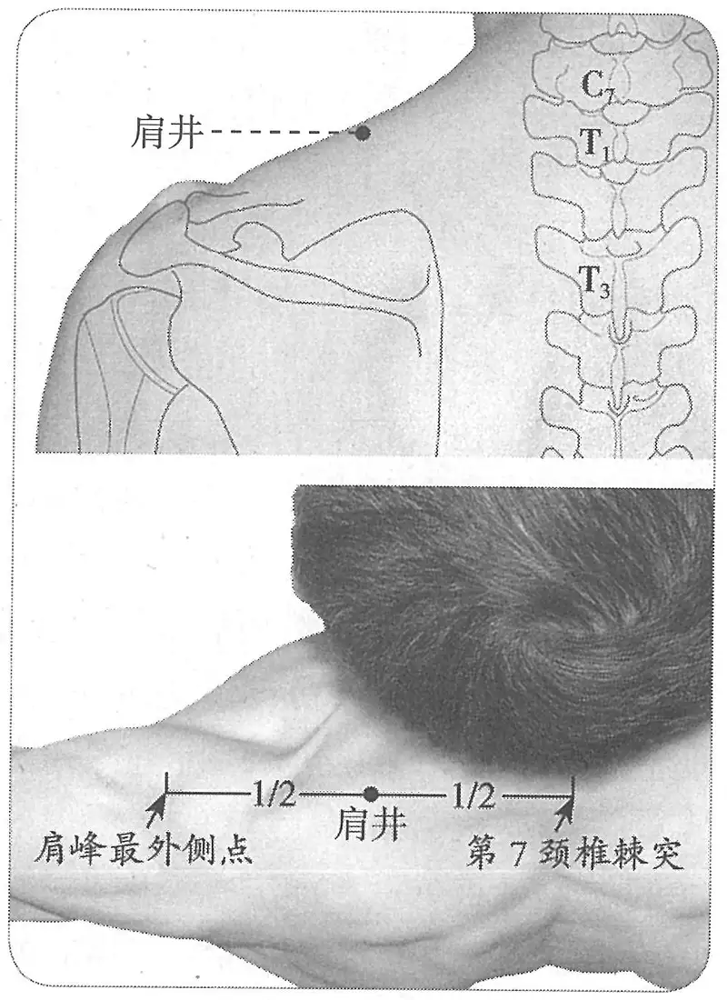

**图 2-328　肩井穴图**

　4. 窦太师针灸遗存

　　(1) 在肩上缺盆大骨前一寸半，以手三指排按取之，是中指下陷中。又法：用手按肩柱骨尖上，第三指外是穴。（《窦太师针经》）

　　(2) 在肩陷中，缺盆上大骨前寸半。取法：用小指按定在肩骨尖上，取中指二节是穴。（《窦太师秘传》）

　　(3) 在肩上陷中，缺盆上，大骨前寸半，以三指按取之，当中指下陷中是穴，与缺盆骨尖相对是穴。（《大本琼瑶神书》）

　　(4) 肩上陷是缺盆，其上一寸半是柱骨，如取左穴，用本人右手小指，按于左肩柱骨尖上，平排三指，取中指下第一节中是穴。取右穴亦如是。（《针方六集》卷一）

　　(5) 一法，以我小指按定肩突骨尖上，取中指第二节下是。（《循经考穴编》下）

　5. 缺盆上，肩胛骨前约一寸五分。（《针灸十四经穴位考订》）

　6. 统编针灸学教材

　　(1) 部位：在大椎肩髃两穴之正中略向前些，当缺盆之直上。取穴：在肩上陷中，缺盆上大骨前一寸半，以三指平肩按之，当中指下陷处取之。（1957年南京《针灸学》）

　　(2) 部位：当缺盆直上肩上陷中。取穴：在肩部缺盆上大骨前，当督脉大椎穴与大肠经肩髃穴直线之中，以三指依颈平肩按之，当中指下陷处取之。（1版《针灸学讲义》）

　　(3) 部位：在肩上陷者中，缺盆上大骨前。取穴：在肩上，约当大椎督脉与肩峰连线的中央取穴。（2版《针灸学讲义》）

〔p.1073 (인쇄 1045)〕

　　(4) 大椎穴与肩峰连线的中点。（4、5、7版《针灸学》）

　　(5) 在肩上，前直乳中，当大椎与肩峰端连线的中点。（6版《针灸学》）

　　(6) 大椎与肩峰连线中点，肩部高处取之。（《中国针灸学》）

#### 【类属】 

足少阳胆经穴。

**脉气所发：**

　1. 手足少阳、阳维之会。（《针灸甲乙经》卷三、《外台秘要》、《素问》王冰注、《太平圣惠方》）

　2. 手阳明大肠、又阳维、又足少阳胆。（《医心方》卷二）

　3. 此膊井脉，足阳明之会，乃连入五藏。（《太平圣惠方·针经》）

**归经：**

　1. 手阳明。（《千金要方》卷二十九、《千金翼方》）

　2. 手少阳。（《外台秘要》卷三十九）

　3. 足少阳。（《铜人腧穴针灸图经》卷上）

**按**：“肩井”穴的脉气所发，《针灸甲乙经》、《外台秘要》作“手足少阳、阳维之会”；故归经也有不同。但从腧穴部位上看，更近于少阳经。

#### 【适应症】 

主治局部病症。常用于颈项强痛，肩背痛；中风、上肢不遂；瘰疬；难产，乳痈，产后缺乳。

　1. 主肩背痹痛，臂不举，寒热凄索。气上不得眠卧。（《黄帝明堂经》）

　2. 主五劳七伤，头项不得回顾，背膊闷，两手不得向头，或因马扑伤腰髋疼，脚气……若妇人怀胎落讫，觉后微损手足弱者，针肩井手足立瘥。若有灼然解针者遣针，不解针者不可遣针。（《太平圣惠方·针经》）

　3. 治五劳七伤，颈项不得回顾，背髆闷，两手不得向头，或因扑伤腰髋疼，脚气上攻。（《铜人腧穴针灸图经》卷中）

　4. 窦太师针灸遗存

　　(1) 治两脾疼，腰胁痛，泻。（《窦太师针经》）

　　(2) 治病髀痛，宜泻；腰肋痛，亦宜泻。（《大本琼瑶神书》）

　　(3) 主目锐眦痛，缺盆中痛，马刀，寒疟。（《针方六集》卷五）

　　(4) 主两肩畏冷，风寒咳嗽，痈疽瘰疬。（《循经考穴编》下）

　5. 主中风气塞，涎上不语，肾虚腰痛。九漏，上气，短气，逆气，风劳百病。（《针灸聚英》卷一）

**按**：以上“中风气塞，涎上不语，肾虚腰痛”辑自《针经摘英集》针灸方主治；“九漏，上气，短气，逆气，风劳百病”乃从《针灸资生经》辑自《千金要方》灸方主治。详见“附：临床应用举例”。非常奇怪的是，对于高武的这一失误，直接或间接抄录此书的《古今医统》，吴文炳《针灸大成》，杨继洲、靳贤《针灸大成》三书几乎没传此误。

　6. 统编针灸学教材

　　(1) 主治头项强，肩背痛，手臂不举，畏寒，乳痈，中风气塞，涎上不语，妇人难产，坠胎后手足厥冷。（1957年南京《针灸学》）

　　(2) 主治头项强，肩背痛，手臂不举，畏寒，乳痈，卒中，妇人难产，堕胎后手足厥冷。（1版《针灸学讲义》）

　　(3) 主治头项强，肩背痛，手臂不举，乳痈，瘰疬，中风，难产。（2版《针灸学讲义》）

〔p.1074 (인쇄 1046)〕

　　(4) 主治颈项强，肩背痛，臂不举，瘰疬，难产，乳汁不下，乳痈。（4版《针灸学》）

　　(5) 主治头项强痛，肩背疼痛，上肢不遂，难产，乳痈，乳汁不下，瘰疬。（5、6版《针灸学》）

　　(6) 主治①颈项强痛，肩背疼痛，上肢不遂；②难产、乳痈、乳汁不下、乳癖等妇产科及乳房疾患；③瘰疬。（7版《针灸学》）

　　(7) 主治颈项强痛，肩背痛，臂不举，乳汁不下，乳痈，瘰疬，中风，难产。（《中国针灸学》）

**文献分析**：《黄帝明堂经》载本穴主治多为肩臂痹痛不举等局部病症，自甄权开始治疗产后手足弱症，仍以局部症状为主。而《千金要方》、《千金翼方》载针肩井穴治难产效验，金元时又以此穴治乳疾，逐渐使本穴的治疗范围向妇科方面转变，且现代临床也有较多的相关应用报道，故现代针灸学教材增补相应的主治症，今从之。

#### 附：临床应用举例 

　1. 肩臂病症

　　(1) 气冲腰背，痛连脊背，久而不已者：刺肩井、曲池泻之，委中出血。（《针灸集要·盘石金直刺秘传》）

　　(2) 腰脊反折，痛连两臂，或风劳气痛：泻人中、肩井、曲池，委中宜弹针出血。（《针灸集要·盘石金直刺秘传》）

　　(3) 手臂风冷痛：肩井、曲池、三里、下廉。问曰：此证缘何而得？答曰：盖因寒邪之气流入经络，夜睡凉枕或竹簟金漆登上冷处，睡着不知，湿气入内，故如此也。复刺后穴：三里、经渠、上兼。（《针灸集成》第三十方）

　　(4) 肩背红肿：肩井、风门、中渚。问曰：此证从何而得？答曰：皆因腠理不密，风邪串入经络，寒湿相搏，血气相胜，故如此也。复刺后穴：大椎、肺俞、膏肓。（《针灸集成》第三十二方）

　　(5) 肩背胛痛：昆仑、悬钟、肩井。（《医学纲目》卷二十七）

　　(6) 肩井曲池，甄权刺臂痛而复射。（《标幽赋》）

　　(7) 肩井除两臂难任。（《通玄指要赋》）

　　(8) 两胛疼痛气攻胸，肩井二穴最有功，此穴由来真聚气，泻多补少应针中。（《针灸玉龙歌》）

　　(9) 颈肩痛：风池穴、肩髃、肩井穴针刺治疗。［中医杂志，1987，28(2):52］

　2. 妇人病症

　　(1) 难产，针两肩井入一寸，泻之，须臾即分娩。（《千金要方》卷二、《千金翼方》）

　　(2) 治气少力弱，无乳汁：又方针肩井亦效。（《卫生易简方》卷十一）

　　(3) 治妇人堕胎后手足逆冷，刺少阳经肩井二穴，立愈。（《针经摘英集》）

　　(4) 妇人乳根痛：灸肩井，泻少泽、合谷、三阴交。（《针灸集要·盘石金直刺秘传》）

　　(5) 乳头生疮，名曰妒乳：乳根二穴、少泽二穴、肩井二穴、膻中一穴。（《针灸大全》卷四）

　　(6) 乳腺增生：肝俞、肩井穴、天宗穴，针刺治疗。［陕西中医，1985，6(6):272-273］

　　(7) 急性乳腺炎：肩井穴放血疗法。［中国针灸，1986，6(4):7-8］

　　(8) 乳痛：肩井穴、内关穴，指针治疗。［中国针灸，1988，8(2):19］

　　(9) 乳腺炎：肩井穴治疗。［新中医，1992，24(3):34］

〔p.1075 (인쇄 1047)〕

　3. 其他病症

　　(1) 上气咳逆，短气，风劳百病，灸肩井二百壮。（《千金要方》卷十八）

　　(2) 九漏，灸肩井二百壮。（《千金要方》卷二十三）

　　(3) 治肾虚腰痛久不已，刺足少阳经肩井二穴，次针足太阳经肾俞二穴。（《针经摘英集》）

　　(4) 治中风，气塞涎上，不语昏危者，针百会，风池，大椎，肩井，曲池，间使，三里七穴，左治右，右治左，以取尽风气，神清为度。（《针经摘英集》）

　　(5) 瘰疬：天井、肩井。（《医学纲目》卷十九）

　　(6) 脱肛：百会、肩井。（《医学纲目》卷二十七）

　　(7) 疮疡：针刺肩井治疗。［中国针灸，1995(1):5］

　　(8) 鼻衄：捏肩井穴治疗。［广西中医药，1987，10(1):23］

　　(9) 肋软骨炎：肩井穴、内关穴，针刺治疗。［中国针灸，1985，5(2):7］

　　(10) 瘘症：风池穴、肩井穴，针刺治疗。［内蒙古中医药，1985(1):26］

#### 【操作】 

直刺0.5~0.8寸。不可向前下方刺入或直刺过深，以免损伤胸膜顶和肺尖引起气胸。本穴针感反应较强，易发生晕针，不可突然强刺激。

　1. 刺入五分，灸三壮。（《黄帝明堂经》）

　2. 灸肩井得二百壮，即灸三里三壮，若五壮以下气也。（《千金翼方》卷二十六）

　3. 灸五壮。（《外台秘要》）

　4. 针不得深，深即令人闷。《甲乙经》云：针只可五分。此膊井脉，足阳明之会，乃连入五藏。气若深，便引五藏之气，乃令人短寿。大肥人亦可倍之。若闷倒不识人，即须三里下气，先补而不用泻，须臾即平复如故。虽不闷倒，但针膊井即须三里下气大良。若针肩井，必三里下气。如不灸三里，即拔气上。（《太平圣惠方·针经》）

　5. 针入二寸半，灸二七壮。此穴五藏六府气之所聚之地，不可补，补则令人晕针，只可泻。针三遍，便不运矣。（《窦太师针经》、《针方六集》）

　6. 针六分，灸七壮。（《医学入门》）

　7. 孕妇禁针。（《类经图翼》卷八）

　8. 肩井……凌氏针一寸。（《循经考穴编》）

　9. 针四分，灸五壮。针不可深。《铜人》禁针；孕妇禁针，一说禁针灸。（《针灸十四经穴位考订》）

　10. 统编针灸学教材

　　(1) 针五分，过深令人晕，灸三至五壮。（1957年南京《针灸学》、1版《针灸学讲义》）

　　(2) 直刺5分，艾条灸3~7分钟。（2版《针灸学讲义》）

　　(3) 直刺0.5~0.8寸。（4、5版《针灸学》）

　　(4) 直刺0.5~0.8寸，深部正当肺尖，不可深刺，孕妇禁针；可灸。（6、7版《针灸学》）

　　(5) 直刺0.3~0.5寸。可灸。（《中国针灸学》）

　11. 直刺0.5~1寸。感应：酸胀至肩背部。灸3~7壮；温灸10~30分钟。（上海《针灸学》）

**文献分析**：窦太师针灸谓本穴“针入二寸半”，若为直刺，恐太深。《类经图翼》“孕妇禁针”，是从本穴治疗难产的角度出发，现代教材也从之。然而当代有关这方面的临床观察还缺乏，有待实证研究。

〔p.1076 (인쇄 1048)〕

### （二十二）渊腋 Yuānyè GB22 出《黄帝明堂经》 

#### 【提要索隐】 

**穴名**：一名泉腋。

**部位**：在胸外侧区，第4肋间隙中，当腋中线上。

**适应症**：主治局部病症。常用于胸胁胀痛，上肢痹痛，腋下肿。

**针刺操作**：斜刺或平刺。不宜深刺和直刺，以免损伤壁胸膜和肺脏。

#### 【名实考】 

渊腋，又写作“渊掖”；唐人避讳改作“泉腋”；宋代及以下文献又有写作“渊液”者。

腋窝，又名“曲腋”，又名“渊腋”，本穴当腋下，因名“渊腋”。《内经》中所说之“渊腋”多指腋窝，而非穴名，切不可相混。详见大包穴“渊腋”与“渊腋”穴辨。

　1. 渊腋，在腋下三寸宛宛中，举臂取之。（《黄帝明堂经》）

　2. 渊掖，一名泉掖。（《医心方》卷二）

　3. 泉腋，在腋下三寸宛宛中，举臂取之。中风卷云，腋门在腋下攒毛中，一名泉腋，即渊腋是也。（《千金要方》卷二十九）

**按**：现行本《千金要方》卷八中风卷作“掖门（在腋下攒毛中一寸，名太阳阴，一名掖间），灸五十壮，主风。”需要说明的是，“泉腋”、“渊腋”是腋窝的别名，而不是腋门穴的别名，宋臣此注极易使人误解。

　4. 此穴在腋下，有渊深之象，故曰渊液。（《经穴解》）

　5. 别名　腋门、液门。（1957年南京《针灸学》）

**按**：腋门穴相当于极泉穴，而与本穴不同。此乃传日本针灸教材之误，皆受《千金要方》宋臣注误导。韩国针灸书又从中国教材传此误。

#### 【定位】 

**部位**：在胸外侧区，第4肋间隙中，当腋中线上（图2-329）。

**取穴**：举臂，从腋窝直下，当腋中线与第4肋间隙的交点处取之。

　1. 在腋下三寸宛宛中，举臂取之。（《黄帝明堂经》、《铜人腧穴针灸图经》、《圣济总录》、《针灸资生经》、《十四经发挥》、《医学纲目》、《针灸聚英》、《古今医统》、《医学入门》、《针灸大成》、《针方六集》、《类经图翼》、《循经考穴编》、《医宗金鉴·刺灸心法要诀》、《针灸易学》、《针灸逢源》）

　2. 腋下三寸与乳头平。（《针灸十四经穴位考订》）

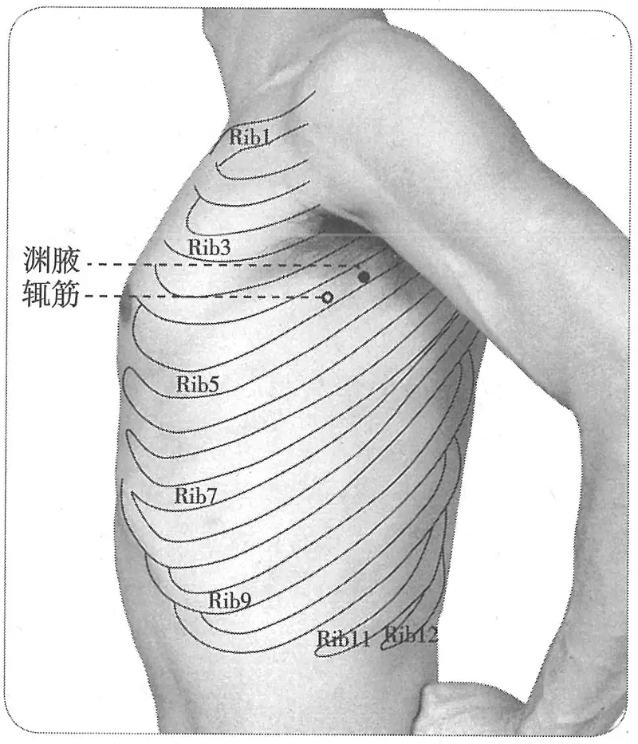

**图 2-329　渊腋穴图**

　3. 统编针灸学教材

　　(1) 部位：腋下三寸。取穴：举臂，从腋窝直下约三寸处与乳相平微上些，可以指按乳头下之肋罅，循肋罅移向外侧，直对腋窝处取之。（1957年南京《针灸学》）

〔p.1077 (인쇄 1049)〕

　　(2) 部位：腋下三寸。取穴：举臂，从腋窝直下约三寸处与乳头相平微上些，可以指按乳头下之肋间移向外侧，直对腋窝处取之。（1版《针灸学讲义》）

　　(3) 部位：在腋下三寸宛宛中，举臂取之。取穴：当腋中线上，第四肋间隙取之。（2版《针灸学讲义》）

　　(4) 举臂，腋中线上，第四肋间隙。（4、5、7版《针灸学》）

　　(5) 在侧胸部，举臂，当腋中线上，腋下3寸，第4肋间隙中。（6版《针灸学》）

　　(6) 举臂，腋中线上，腋下三寸。（《中国针灸学》）

#### 【类属】 

足少阳胆经穴。

**归经**：足少阳胆经。（《外台秘要》卷三十九、《铜人腧穴针灸图经》卷上）

#### 【适应症】 

主治局部病症。常用于胸胁胀痛，上肢痹痛，腋下肿。

　1. 主胸满，马刀，臂不得举。马刀疡，内溃者死，寒热生马疡可治。（《黄帝明堂经》）

　2. 治胸满无力，臂不举。禁不宜灸，灸之不幸令人生肿蚀马疡。内溃者死，寒热生马疡可治。（《铜人腧穴针灸图经》卷中）

　3. 主胁肋红肿，马刀夹瘿。（《循经考穴编》下）

　4. 统编针灸学教材

　　(1) 主胁痛红肿，马刀夹瘿。（1957年南京《针灸学》、1版《针灸学讲义》）

　　(2) 主治胁痛，腋下肿，胸满，臂痛不得举。（2版《针灸学讲义》、《中国针灸学》）

　　(3) 主治胸满，腋肿，胁痛，臂痛不举。（4版《针灸学》）

　　(4) 主治胸满，胁痛，上肢痹痛。（5、6版《针灸学》）

　　(5) 主治胸满，胁痛；上肢痹痛，腋下肿。（7版《针灸学》）

#### 【操作】 

斜刺或平刺。不宜深刺和直刺，以免损伤壁胸膜和肺脏。

　1. 刺入三分，不可灸，灸之不幸，生肿蚀。（《黄帝明堂经》）

　2. 禁用针灸。（《医学入门》卷一）

　3. 刺三分，禁灸，灸之不幸，生肿蚀马刀疡，内溃者死。（《类经图翼》卷八）

　4. 针三分，禁灸。（《针灸十四经穴位考订》）

　5. 统编针灸学教材

　　(1) 针三分。（1957年南京《针灸学》）

　　(2) 针三分，不宜灸。（1版《针灸学讲义》）

　　(3) 斜刺3分。（2版《针灸学讲义》）

　　(4) 斜刺或平刺0.5~0.8寸。（4、5版《针灸学》）

　　(5) 斜刺或平刺0.5~0.8寸，不可深刺，以免伤及内部重要脏器。（6、7版《针灸学》）

　　(6) 斜刺0.3~0.5寸。（《中国针灸学》）

