# 《针灸腧穴通考》(下册) — 足少阳胆经穴 (2/2) · （二十三）辄筋 Zhéjīn GB23 出《黄帝明堂经》~（四十四）足窍阴 Zúqiàoyīn GB44 出《灵枢》

> 분할본 19/25. 원서: 黄龙祥·黄幼民 编著, 《针灸腧穴通考——〈中华针灸穴典〉研究》(下册), 人民卫生出版社, 2011. 원서 스캔 OCR 판독본을 챗봇 검색용으로 나눈 것이며, 본문과 쪽 표시 〔p.PDF쪽 (인쇄 쪽)〕는 원본 그대로이다.

## 十一、足少阳胆经穴 (계속)

### （二十三）辄筋 Zhéjīn GB23 出《黄帝明堂经》 

问题：本穴名称，《针灸聚英》作“一名神光、一名胆募”，明以后文献多沿袭，何以出现如此突然变化？

#### 【提要索隐】 

**部位**：在胸外侧区，第4肋间隙中，腋中线前1寸。

**适应症**：主治胸部病症。常用于胸胁胀满、气喘、不能平卧。

〔p.1078 (인쇄 1050)〕

**针刺操作**：斜刺或平刺。不可直刺、深刺，以免损伤壁胸膜和肺脏。

#### 【名实考】 

唐代甄权谓《秦承祖图》的“旁廷”穴与《针灸甲乙经》某穴异名同穴，今考与“辄筋”穴相当。

需要特别注意的是，《针灸聚英》“辄筋”下的全部文字以及“日月”穴名全部脱失，因而“辄筋”二字下均为足少阳经穴“日月”的内容。这一原本十分明显的错误，徐春甫、吴文炳在抄录时竟然都没发现，直到靳贤重辑《针灸大成》时才发现了错误，然而其修订不当又造成更大、更离奇的错误：据王惟一《铜人腧穴针灸图经》补辑了“辄筋”穴的内容，但高武的原错入文字却没有删去，与补的文字混杂一起，明以后针灸腧穴书皆沿袭此误。

　1. 辄筋，在腋下三寸，复前行一寸著胁，足少阳脉气所发。（《黄帝明堂经》）

　2. 足少阳所主筋骨，而本经之筋……此穴乃本经上胁之筋所行处，故曰辄筋。（《经穴解》）

　3. 别名　神光，胆募。（1957年南京《针灸学》）

**按**：此传日本教材之误，韩国针灸教材又从中国教材传此误，皆受高武《针灸聚英》错误影响。

#### “日月”混作“辄筋”例 

　1. 辄筋一名神光，一名胆募，期门下五分陷中，第三肋端，横直蔽骨旁二寸五分，上直两乳，侧卧屈上足取之，胆之募。足太阳、少阳之会。《铜人》灸五壮，针五分。《素注》七分。主太息善悲，小腹热，欲走，多唾，言语不正，四肢不收，呕吐宿汁，吞酸。（《针灸聚英》卷一、《古今医统》、吴文炳《针灸大成》）

　2. 辄筋一名神光，一名胆募，腋下三寸，复前一寸三肋端，横直蔽骨旁七寸五分，平直两乳，侧卧屈上足取之，胆之募，足太阳、少阳之会。《铜人》灸三壮，针六分。《素注》针七分。主胸中暴满不得卧，太息善悲，小腹热，欲走，多唾，言语不正，四肢不收，呕吐宿汁，吞酸。（《针灸大成》卷七）

**按**：如果说高武《针灸聚英》因文字脱漏所造成的错误还容易识别的话，那么经过靳贤的“修正”，反而错更甚，更不容易发现。

#### “辄筋”与“旁廷”穴辨 

　1. 旁廷，在腋下四肋间，高下正与乳相当，乳后二寸陷中，俗名注市，举腋取之，刺入五分，灸五十壮。主卒中恶，飞尸遁注，胸胁满。（《千金要方》卷三十）

**按**：甄权校订《黄帝明堂经》及图时，曾以《针灸甲乙经》对照《秦承祖图》，后者“旁廷”、“藏会”等一十九，《针灸甲乙经》“有目无名”（说见《千金翼方》卷二十六卷前小序），也就是说，甄权认为《秦承祖图》中的“旁廷”穴就是《针灸甲乙经》中的某穴，只是穴名不同而已。今检《针灸甲乙经》349穴中，定位与“旁廷”相近者有二：辄筋、天溪。进一步考察其他相关文献，则更支持“辄筋”穴。

　2. 凡飞尸恶疰，旁廷主之。（《孙真人千金方》卷三十）

　3. 凡五尸者，飞尸、遁尸、风尸、沉尸、尸疰也，今皆取一方兼治之，其状腹痛胀急不得气息，上冲心胸旁攻两胁，或块垒踊起，或挛引腰背，治之之法，灸乳后三寸，男左女右，可二七壮。不止者，多其壮数，取愈止。（《千金要方》卷十七）

　4. 灸一切注，无新久者，先仰卧，灸两乳两边斜下三寸，名注市，随年壮。（《千金翼方》卷二十七）

**按**：综合以上三条文献，可以判定，旁廷穴定位应在乳后三寸处，与辄筋穴相当。最后一条文献“两乳两边斜下三寸”，义即乳边沿肋间斜向外三寸。

〔p.1079 (인쇄 1051)〕

#### 【定位】 

**部位**：在胸外侧区，第4肋间隙中，腋中线前1寸（图2-330）。

**取穴**：在侧胸部，渊腋前1寸，第4肋间隙中取之。

　1. 在腋下三寸，复前行一寸，著胁。（《黄帝明堂经》、《铜人腧穴针灸图经》、《圣济总录》、《针灸资生经》、《十四经发挥》、《医学纲目》、《针方六集》、《类经图翼》、《循经考穴编》、《针灸逢源》）

　2. 辄筋，期门下五分陷中，第三肋端，横直蔽骨旁二寸五分，上直两乳，侧卧屈上足取之。（《针灸聚英》卷一、《古今医统》）

　3. 渊液前一寸。（《医学入门》卷一、《针灸十四经穴位考订》）

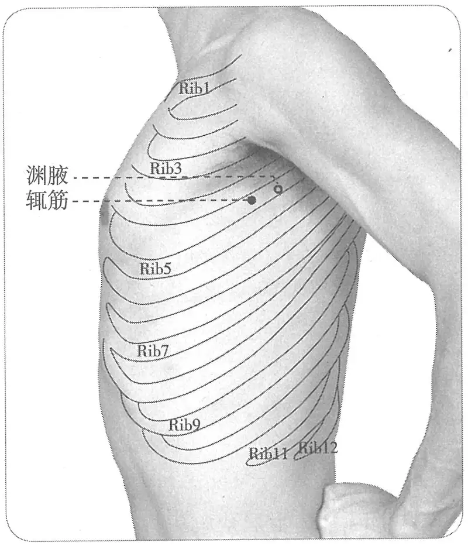

**图 2-330　辄筋穴图**

　4. 腋下三寸，复前一寸三肋端，横直蔽骨旁七寸五分，平直两乳，侧卧屈上足取之。（《针灸大成》卷七、《医宗金鉴·刺灸心法要诀》、《针灸易学》）

　5. 一法合蔽骨平开七寸五分，三肋端，侧卧屈上足取之。又云：合居日月上三分。此说亦与蔽骨平开合。（《循经考穴编》下）

　6. 统编针灸学教材

　　(1) 部位：腋下三寸，前行一寸。取穴：从渊腋穴前一寸取之。（1957年南京《针灸学》、1版《针灸学讲义》）

　　(2) 部位：在腋下三寸，复前行一寸著胁。取穴：在渊腋前一寸，当第四肋间隙取之。（2版《针灸学讲义》）

　　(3) 渊腋穴前1寸，第四肋间隙。（4、5、7版《针灸学》）

　　(4) 在侧胸部，渊腋前1寸，平乳头，第4肋间隙。（6版《针灸学》）

　　(5) 渊腋前一寸，约平乳头。（《中国针灸学》）

**文献分析**：本穴定位，明以下文献皆直接或间接传高武《针灸聚英》之误，而现代针灸教材未受影响。

#### 【类属】 

足少阳胆经穴。

足少阳脉气所发。（《黄帝明堂经》）

#### 【适应症】 

主治胸部病症。常用于胸胁胀满、气喘、不能平卧。

　1. 主胸中暴满不得卧，喘息。（《黄帝明堂经》、《铜人腧穴针灸图经》）

　2. 治胸中暴满不得卧。（《针灸甲乙经》卷三）

　3. 主太息，善悲，小腹热，欲走多唾，言语不正，四肢不收，呕吐宿汁，吞酸。（《针灸聚英》卷一、《古今医统》、《针灸大成》）

**按**：此条主治文字均为足少阳胆经穴“日月”的内容，明以后针灸腧穴书皆沿袭此误。

　4. 主马刀瘘疬。（《循经考穴编》下）

〔p.1080 (인쇄 1052)〕

　5. 统编针灸学教材

　　(1) 主治胸暴满，喘息不得卧，吞酸呕吐。（1957年南京《针灸学》、1版《针灸学讲义》）

　　(2) 主治胸满，气喘，吞酸，呕吐，四肢不遂。（2版《针灸学讲义》）

　　(3) 主治胸满，胁痛，气喘，呕吐，吞酸。（4、5、6版《针灸学》）

　　(4) 主治①胸满，气喘；②呕吐，吞酸；③胁痛，腋肿，肩背痛。（7版《针灸学》）

　　(5) 主治胸满，胁痛，气喘。（《中国针灸学》）

**文献分析**：以上教材除《中国针灸学》外，皆承袭了《针灸聚英》的错误，将“日月”穴的主治归于本穴下，今去之。

#### 【操作】 

斜刺或平刺。不可直刺、深刺，以免损伤壁胸膜和肺脏。

　1. 刺入六分，灸三壮。（《黄帝明堂经》）

　2. 一法刺一分，沿皮向外一寸五分，可灸七壮。（《循经考穴编》下）

　3. 针三分，灸三壮。（《针灸十四经穴位考订》）

　4. 统编针灸学教材

　　(1) 针三至四分侧卧针之，灸三至五壮。（1957年南京《针灸学》、1版《针灸学讲义》）

　　(2) 斜刺3~5分，艾条灸3~5分钟。（2版《针灸学讲义》）

　　(3) 斜刺或平刺0.5~0.8寸。（4、5版《针灸学》）

　　(4) 斜刺或平刺0.5~0.8寸，不可深刺，以免伤及内部重要脏器。（6、7版《针灸学》）

　　(5) 斜刺0.3~0.5寸。可灸。（《中国针灸学》）

### （二十四）日月 Rìyuè GB24 出《黄帝明堂经》 

#### 【提要索隐】 

**穴名**：一名神光。

**部位**：在胸部，第7肋间隙中，前正中线旁开4寸。

**适应症**：主治胁部病症。常用于胁痛；多唾、吞酸；黄疸。

**针刺操作**：斜刺或平刺。不宜深刺和直刺，切忌大幅度提插捻转，以免损伤壁胸膜和肺脏。

#### 【名实考】 

日月，《千金要方》作“神光”，其义相通。又谓“一名胆募”，实则“胆募”是说穴的属性，而不是穴名，故不作为别名。

　1. 日月，胆募也，在期门下五分，足太阴、少阳之会。（《黄帝明堂经》）

　2. 此穴在肝经期门之下，人身南面而立，此穴正在东西，犹日月之出没东西也，别无所取义也。（《经穴解》）

　3. 吐呕宿汁，吞酸，灸神光，一名胆募，百壮。（《千金要方》卷十六）

　4. 呕吐宿汁，吞酸，灸神光，一名胆募，百壮，三报之。《甲乙经》云：日月，胆募也，在期门下五分。（《千金翼方》卷二十七）

#### 相关穴及刺激点 

呃逆：位于胸部，从左右乳头直下第7、8肋骨之间处，在日月穴直上5分处。主治：呃逆、胸膜炎、肋间神经痛。针3~5分，得气时有酸麻感觉至腹部正中线。灸3~5壮。（《针灸经外奇穴图谱》）

〔p.1081 (인쇄 1053)〕

#### 【定位】 

**部位**：在胸部，第7肋间隙中，前正中线旁开4寸（图2-331）。

**取穴**：仰卧，乳头直下，在期门穴下一肋处取之。

　1. 在期门下一寸五分。腹自期门上直两乳夹不容两旁各一寸五分下行至冲门凡十四穴。（《针灸甲乙经》卷三）

　2. 在期门下五分。（《千金要方》卷二十九、《千金翼方》、《外台秘要》、《医心方》、《太平圣惠方》、《铜人腧穴针灸图经》卷中及卷下“都数”、《圣济总录》、《针灸资生经》、《窦太师针经》、《十四经发挥》、《医学纲目》、《古今医统》、《针灸大成》、《针灸十四经穴位考订》）

　3. 在第三肋端，横直心蔽骨旁各同身寸之二寸五分，上直两乳。新校正云：按《甲乙》云：日月在期门下五分。（《素问·气府论》王冰注、《医学入门》、《针灸逢源》）

　4. 期门下五分，直乳第二肋下。（《铜人腧穴针灸图经》卷上）

　5. 期门下五分陷中，第三肋端，横直蔽骨旁二寸五分，上直两乳，侧卧屈上足取之。（《针灸聚英》卷一）

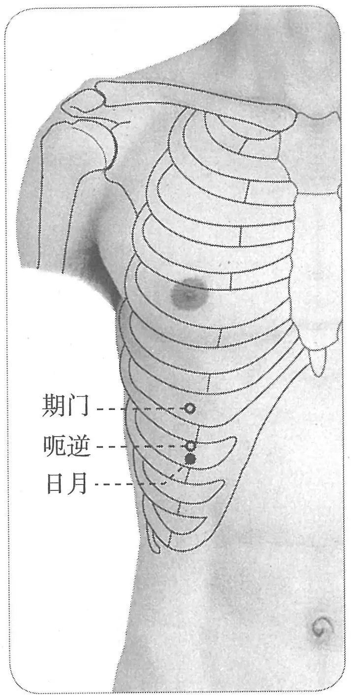

**图 2-331　日月穴与相关穴图**

　6. 日月期门一寸半，直下五分细求之。（《针灸问对》卷下）

　7. 在期门穴下五分，夹任脉两旁各四寸，平蔽骨。（《针方六集》卷一）

　8. 在期门旁一寸五分，直下五分。《铜人》、《素注》皆云：期门下五分，岂有误欤。又一说云：章门下二寸，与中脘平。（《循经考穴编》下）

　9. 统编针灸学教材

　　(1) 部位：在期门下一寸五分。取穴：仰卧，乳下三肋端，即期门下一寸五分相隔一肋取之。（1957年南京《针灸学》）

　　(2) 部位：期门穴下一肋。取穴：仰卧，乳下三肋，第七、第八肋间陷中取之。（1版《针灸学讲义》）

　　(3) 部位：在期门下一寸五分。取穴：在乳头下方，当第七、八肋软骨间取之。（2版《针灸学讲义》）

　　(4) 期门穴直下一肋。（4版《针灸学》）

　　(5) 乳头下方，第七肋间隙。（5版《针灸学》）

　　(6) 在上腹部，当乳头直下，第7肋间隙，前正中线旁开4寸。（6版《针灸学》）

　　(7) 乳头之下，第7肋间隙。（7版《针灸学》）

　　(8) 期门下一肋，即乳头直下，第七肋间隙。（《中国针灸学》）

**文献分析**：我们认为在确定单个腧穴部位时，须综合考察如下相关腧穴的定位：

腹哀：在日月下一寸五分。（《针灸甲乙经》卷三）

大横：在腹哀下三寸，直脐旁。（《针灸甲乙经》卷三）

已知期门（平不容穴）至大横的距离为6寸，则日月距期门的距离只能是一寸五分，而不能是五分。故本穴定位，应据《素问》王冰注定位于乳下第三肋端，即第7肋间。要之，胸胁部穴定位，以肋间为准，而不拘分寸。《针灸甲乙经》明言“腹自期门上直两乳夹不容两旁各一寸五分下行至冲门凡十四穴”，诸书也皆序日月与期门穴为同一行——腹部第四行，故曰“期门旁一寸半”者，非是。

〔p.1082 (인쇄 1054)〕

#### 【类属】 

足少阳胆经穴。

**脉气所发：**

　1. 足太阴、少阳之会。（《黄帝明堂经》）

　2. 足太阴、少阳、阳维之会。（《铜人腧穴针灸图经》卷中）

**归经：**

　1. 足太阴经。（《外台秘要》卷三十九）

　2. 足少阳经。（《铜人腧穴针灸图经》卷上）

#### 【适应症】 

主治胁部病症。常用于胁痛；多唾、吞酸；黄疸。

　1. 主太息善悲，少腹有热，欲走。多唾，言语不正，四肢不收。（《黄帝明堂经》）

**按**：《黄帝明堂经》载本穴主治与胆经下合穴主治颇相似，可参看。

　2. 治太息善悲，小腹热欲走，多唾，言语不正，四肢不收。（《铜人腧穴针灸图经》卷中）

　3. （辄筋）主呕吐宿汁，吞酸。（《针灸聚英》卷一、《古今医统》、《针灸大成》）

**按**：此乃高武从《针灸资生经》辑自《千金要方》灸方主治，详见“附：临床应用举例”。

　4. 主胁肋疼痛，肾气冲心。（《循经考穴编》下）

　5. 统编针灸学教材

　　(1) 主治胁肋疼痛，呕吐宿汁，吞酸，黄疸，呃逆。（1957年南京《针灸学》）

　　(2) 主治胁肋疼痛，呕吐，吞酸，黄疸，呃逆。（1、2版《针灸学讲义》，4、5、6版《针灸学》）

　　(3) 主治①黄疸、胁肋疼痛等肝胆病证；②呕吐、吞酸、呃逆等肝胆犯胃病证。（7版《针灸学》）

　　(4) 主治胁痛，呕吐，吞酸，呃逆，黄疸，乳痈。（《中国针灸学》）

**文献分析**：教材主“呃逆”或受奇穴“呃逆”影响。

#### 附：临床应用举例 

　1. 帝曰：有病口苦，取阳陵泉，口苦者病名为何？何以得之？岐伯曰：病名曰胆瘅。夫肝者，中之将也。取决于胆，咽为之使。此人者，数谋虑不决，故胆虚气上溢而口为之苦，治之以胆募俞，治在“阴阳十二官相使”中。（《素问·奇病论》）

　2. 吐呕宿汁吞酸，灸神光，一名胆募，百壮。（《千金要方》卷十六、《千金翼方》）

　3. 四肢水肿，变身浮：胆募。（《医学纲目》卷二十四）

　4. 蛔厥，胆俞、日月、阳陵泉。［中医杂志，1987，28(10):46］

#### 【操作】 

斜刺或平刺。不宜深刺和直刺，切忌大幅度提插捻转，以免损伤壁胸膜和肺脏。

　1. 刺入七分，灸五壮。（《黄帝明堂经》）

　2. 针入一分，沿皮向外一寸半。（《窦太师针经》、《针方六集》）

　3. 针三分，灸五壮。（《针灸十四经穴位考订》）

　4. 统编针灸学教材

　　(1) 针三至五分，灸三至七壮。（1957年南京《针灸学》、1版《针灸学讲义》）

　　(2) 斜刺3~5分，艾条灸3~7分钟。（2版《针灸学讲义》）

　　(3) 斜刺或平刺0.5~0.8寸。（4、5版《针灸学》）

〔p.1083 (인쇄 1055)〕

　　(4) 斜刺或平刺0.5~0.8寸，不可深刺，以免伤及内部重要脏器；可灸。（6、7版《针灸学》）

　　(5) 斜刺0.3~0.5寸。可灸。（《中国针灸学》）

### （二十五）京门 Jīngmén GB25 出《黄帝明堂经》 

#### 【提要索隐】 

**穴名**：一名气俞，一名气府。

**部位**：在上腹部，第12肋骨游离端的下际。

**适应症**：主治胁部、二便病症。常用于腰胁痛；肠鸣、泄泻、腹胀；小便不利，水肿。

**针刺操作**：直刺0.5~1寸。不宜深刺和直刺，以免损伤肾脏及结肠。

#### 【名实考】 

关于本穴定位，《黄帝明堂经》曰在“季肋本”，杨上善注曰：“胁有前后，最近下后者为季胁。有本作肋”（《黄帝内经太素·经脉连环》）。需要注意的是，明刊本《针灸甲乙经》将带脉穴内容与本穴相混。

　1. 京门，肾募也，一名气府，一名气输。在监骨下腰中季肋本夹脊。（《黄帝明堂经》）

　2. 以此穴在后，为身最虚之处，犹门焉。京者，大也。（《经穴解》）

#### “带脉”与“京门”相混例 

在监骨下腰中，挟脊季肋下一寸八分。（《针灸甲乙经》卷三）

**按**：此与带脉穴部位相重，显误。明抄本作“在监骨中腰季本夹脊”，虽也有误倒与漏字，但大意与《千金要方》、《外台秘要》、《医心方》等其他《黄帝明堂经》传本相合。

#### 【定位】 

**部位**：在上腹部，第12肋骨游离端的下际（图2-332）。

**取穴**：侧卧举臂，从腋后线的肋弓软骨缘下方，向后触及第12肋骨游离端，在其下方取穴。

1.《黄帝明堂经》佚文

　　(1) 在监骨下腰中，夹脊季肋下一寸八分。（《针灸甲乙经》卷三、《医学纲目》、《针方六集》）

　　(2) 在监骨腰中季肋本夹脊。（《千金要方》卷二十九、《千金翼方》、《外台秘要》、《医心方》、《铜人腧穴针灸图经》卷中及卷下“穴腧都数”、《圣济总录》、《针灸资生经》）

　2. 两季肋之间。杨上善注，季肋本夹脊，京门穴也。（《黄帝内经太素·灸寒热法》、《素问·骨空论》王冰注）

　3. 注云穴当十一椎。（《医心方》卷二）

　4. 在腰目中季肋本，侠腴肉前宛宛中。

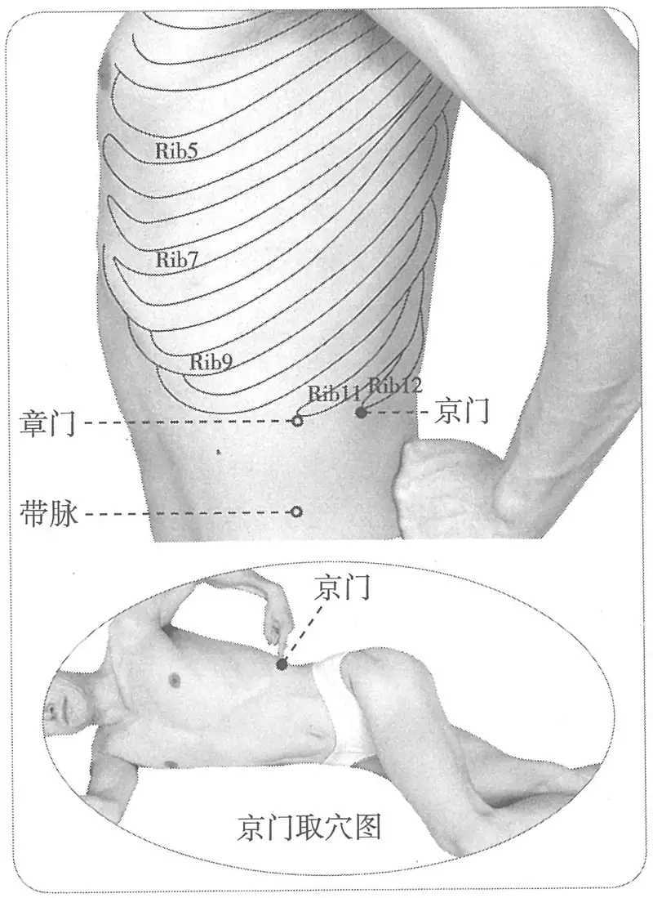

**图 2-332　京门穴图**

〔p.1084 (인쇄 1056)〕

（《医心方》卷二十二）

　5. 在监骨腰中，夹脊季肋本外。（《铜人腧穴针灸图经》卷上）

　6. 在竖骨，腰中季肋本夹脊，与水分相平。（《窦太师针经》）

　7. 在监骨下腰中，夹脊季肋本。（《十四经发挥》中、《针灸聚英》、《古今医统》、《医学入门》、《针灸大成》、《针灸易学》）

　8. 一法，一头齐神阙，一头齐命门，折中是穴。（《循经考穴编》下）

　9. 一云，在脐上五分，旁九寸半，季肋本夹脊，侧卧，屈上足伸下足，举臂取之。（《类经图翼》卷八、《医宗金鉴·刺灸心法要诀》、《针灸逢源》）

　10. 第十二肋之端旁五分。（《针灸十四经穴位考订》）

　11. 统编针灸学教材

　　(1) 部位：当第十二肋前端之下际。取穴：侧卧，按取第十二肋骨端之下际，屈上足伸下足取之。（1957年南京《针灸学》）

　　(2) 部位：当第十二肋端之下际。取穴：侧卧，屈上足伸下足，于肝经章门穴向后一肋下端陷中取之。（1版《针灸学讲义》）

　　(3) 部位：在监骨下，腰中挟脊，季肋下一寸八分。取穴：在侧腹部，当十二肋骨游离端下际取之。（2版《针灸学讲义》）

　　(4) 第十二肋端。（4、5版《针灸学》）

　　(5) 在侧腰部，章门后1.8寸，当第12肋骨游离端的下方。（6版《针灸学》）

　　(6) 侧腰部，第12肋游离端下际处。（7版《针灸学》、《中国针灸学》）

**文献分析**：关于本穴定位，诸家文献的共同点为：季肋本夹脊，今据此定本穴于第12肋骨游离端的下际。

#### 【类属】 

足少阳胆经穴。

**归经**：足少阳经。（《外台秘要》卷三十九、《铜人腧穴针灸图经》）

#### 【适应症】 

主治胁部、二便病症。常用于腰胁痛；肠鸣、泄泻、腹胀；小便不利，水肿。

　1. 主痓，脊强反折。腰痛不可以久立俯仰。寒热，腹䐜胀怏怏然不得息。溢饮，水道不通，溺黄，小腹痛，里急肿，洞泄，髀痛引背。（《黄帝明堂经》）

**按**：《黄帝明堂经》载本穴主治中，除“溢饮，水道不通，溺黄”外，其他诸症均可于“肾俞”穴主治症中见有相同或相类的病症。

　2. 治腰痛不得俯仰，寒热䐜胀，引背不得息，水道不利，溺黄，少腹急肿，肠鸣洞泄，髀枢引痛。（《铜人腧穴针灸图经》卷中）

　3. 主肩背寒，痓，肩胛内廉痛。（《针灸聚英》卷一、《古今医统》、《针灸大成》）

**按**：此乃高武从《针灸资生经》误录《千金要方》之文也。

　4. 胁疼。（《窦太师针经》）

　5. 统编针灸学教材

　　(1) 主治肠鸣洞泄，腹胀，腰胁痛，髀枢引痛。（1957年南京《针灸学》、1版《针灸学讲义》）

　　(2) 主治肠鸣，泄泻，腹胀，腰胁痛。（2版《针灸学讲义》、4版《针灸学》、《中国针灸学》）

　　(3) 主治小便不利，水肿，腰痛，胁痛，腹胀，泄泻。（5、6版《针灸学》）

　　(4) 主治①小便不利、水肿等水液代谢失调的病证；②腹胀、肠鸣、腹泻等胃肠病证；③腰痛，胁痛。（7版《针灸学》）

〔p.1085 (인쇄 1057)〕

#### 【操作】 

直刺0.5~1寸。不宜深刺和直刺，以免损伤肾脏及结肠。

　1. 刺入三分，留七呼，灸三壮。（《黄帝明堂经》）

　2. 针五分，灸七壮。（《铜人腧穴针灸图经》卷中）

　3. 针入一分，沿皮向外一寸半，灸七壮。（《窦太师针经》、《针方六集》）

　4. 针入八分，留七呼，可灸三壮。（《医学纲目》卷八）

　5. 针三分，灸三壮。（《针灸十四经穴位考订》）

　6. 统编针灸学教材

　　(1) 针三至五分，依取穴法进针，灸三至七壮。（1957年南京《针灸学》）

　　(2) 针三至五分，灸三至七壮。（1版《针灸学讲义》）

　　(3) 直刺3~5分，艾条灸3~7分钟。（2版《针灸学讲义》）

　　(4) 直刺0.5~1寸。（4、5、7版《针灸学》）

　　(5) 直刺0.3~0.5寸，不可深刺，以免伤及内部重要脏器；可灸。（6版《针灸学》、《中国针灸学》）

### （二十六）带脉 Dàimài GB26 出《黄帝明堂经》 

#### 【提要索隐】 

**部位**：在侧腹部，第11肋骨游离端垂线与脐水平线的交点上。

**适应症**：主治妇科病症。常用于月经不调、赤白带下；少腹疼痛，疝气，腰胁痛。

**针刺操作**：刺入1~1.5寸。不宜深刺，以免刺伤腹腔内脏。

#### 【名实考】 

“带脉”一词虽见于《灵枢》、《素问》，但多指脉名，有具体部位描述者，又与历代所传之《黄帝明堂经》定位不同，故本穴的出处为《黄帝明堂经》。

　1. 脉癫疾者，暴仆，四肢之脉皆胀而纵。脉满，尽刺之出血；不满，灸之夹项太阳，灸带脉于腰相去三寸，诸分肉本输。（《灵枢·癫狂》）

　2. 带脉，在季肋下一寸八分。（《黄帝明堂经》）

　3. 凡有此病者注：带脉之病，每按此穴，莫不应手酸痛，令灸之，无有不愈。（《经穴解》）

#### 【定位】 

**部位**：在侧腹部，第11肋骨游离端垂线与脐水平线的交点上（图2-333）。

**取穴**：侧卧，按取第十一肋前端（章门穴），直下与脐相平处取之。

　1. 在季肋下一寸八分。（《黄帝明堂经》、《太平圣惠方·明堂》、《铜人腧穴针灸图经》、《圣济总录》、《针灸资生经》、《窦太师针经》、《十四经发挥》、《医学纲目》、《针灸聚英》、《古今医统》、《医学入门》、《针方六集》、《类经图翼》、《循经考穴编》）

　2. 在季肋下一寸八分，脐上二分，两旁各七寸半。（《神应经》、《针灸大成》、《针灸易学》、《针灸逢源》）

　3. 在季肋下一寸八分陷中。一云在脐旁八寸半，肥人九寸，瘦人八寸。（《类经图翼》卷八、《医宗金鉴·刺灸心法要诀》）

　4. 距离脐旁八寸之处。（《针灸十四经穴位考订》）

　5. 统编针灸学教材

　　(1) 部位：在章门下一寸八分。取穴：侧卧，按取第十一肋前端直下与脐相平处取之。

〔p.1086 (인쇄 1058)〕

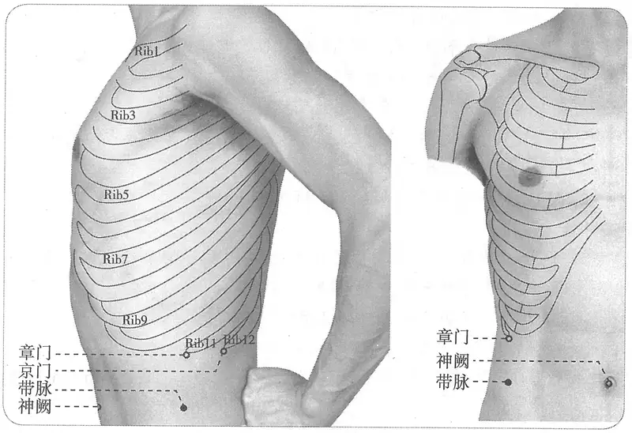

**图 2-333　带脉穴图**

（1957年南京《针灸学》）

　　(2) 部位：肝经章门穴下一寸八分。取穴：侧卧，按取第十一肋前端直下与脐相平处取之。（1版《针灸学讲义》）

　　(3) 部位：在季肋下一寸八分。取穴：在十一肋端与十二肋端连线之中点下，与脐相平，侧卧取穴。（2版《针灸学讲义》）

　　(4) 章门穴直下平脐处。（4版《针灸学》）

　　(5) 第十一肋端直下平脐处。（5版《针灸学》）

　　(6) 在侧腹部，章门下1.8寸，当第11肋骨游离端下方垂线与脐水平线的交点上。（6版《针灸学》）

　　(7) 侧腹部，第11肋骨游离端直下平脐处。（7版《针灸学》）

　　(8) 第十一肋端章门直下，与脐相平处。（《中国针灸学》）

**文献分析**：季肋下，指章门穴所在。带脉即在腰侧和脐平，章门下一寸八分。所说脐上二分是依章门在脐上二寸而来。

#### 【类属】 

足少阳胆经穴。

**脉气所发**：足少阳、带脉二经之会。（《素问·刺法论》王冰注、《针灸聚英》卷一、《针灸大成》）

**归经**：足少阳经。（《外台秘要》卷三十九、《铜人腧穴针灸图经》）

#### 【适应症】 

主治妇科病症。常用于月经不调、赤白带下；少腹疼痛，疝气，腰胁痛。

　1. 主妇人少腹坚痛，月水不通。（《黄帝明堂经》）

　2. 主带下赤白，两胁下气转连背痛不可忍也。（《太平圣惠方·明堂》）

　3. 治妇人少腹坚痛，月脉不调，带下赤白，里急瘛疭。（《铜人腧穴针灸图经》卷中）

**按**：“里急瘛疭”乃王惟一误将《明堂经》“五枢”穴主治录于本穴下也。

　4. 窦太师针灸遗存

　　(1) 小肠疝气攻筑，两胁疼痛，泻之。（《窦太师针经》）

〔p.1087 (인쇄 1059)〕

　　(2) 主逆气攻冲如筑，男子七疝偏坠。（《循经考穴编》下）

　5. 主腰腹纵，溶溶如囊水之状；里急后重。（《针灸聚英》卷一、《针灸大成》）

**按**：“腰腹纵，溶溶如囊水之状”此乃带脉病候，高武录于此，系将脉与穴相混也；“里急后重”，此乃在王惟一之误上另加二字，乃错上加错也。

　6. 主治疝气偏坠，木肾。（《医学入门》卷一、《医宗金鉴·刺灸心法要诀》）

　7. 统编针灸学教材

　　(1) 主治月事不调，赤白带下，七疝，偏坠，腰溶溶如坐水中，腰肋皆痛。（1957年南京《针灸学》）

　　(2) 主治月事不调，赤白带下，七疝，偏坠，腰溶溶如坐水中，侧腹痛，腰、肋皆痛。（1版《针灸学讲义》）

　　(3) 主治月经不调，带下，疝气，腰胁痛。（2版《针灸学讲义》）

　　(4) 主治经闭腹痛，月经不调，赤白带下，疝气，腰胁痛。（4、5、6版《针灸学》，《中国针灸学》）

　　(5) 主治①月经不调、经闭、赤白带下等妇科病证；②疝气；③腰痛，胁痛。（7版《针灸学》）

#### 附：临床应用举例 

　1. 冲心肾疝最难为，须用神针病自治。若得关元并带脉，功成处处显良医。（《针灸玉龙歌》）

　2. 肾气冲心，关元二寸半，补、带脉一分，沿皮向外二寸半，泻。（《医学纲目》卷十六）

　3. 乳弦疝气，发时冲心痛，带脉二穴、涌泉二穴、太溪二穴、大敦二穴。（《针灸大全》卷四）

#### 【操作】 

刺入1~1.5寸。不宜深刺，以免刺伤腹腔内脏。

　1. 刺入六分，灸五壮。（《黄帝明堂经》）

　2. 灸七壮。（《太平圣惠方·明堂》）

　3. 直针入三分，灸二七壮。（《窦太师针经》）

　4. 针五分，灸五壮。（《针灸十四经穴位考订》）

　5. 统编针灸学教材

　　(1) 针五至八分，灸五至七壮。（1957年南京《针灸学》、1版《针灸学讲义》）

　　(2) 直刺5~8分，艾条灸3~7分钟。（2版《针灸学讲义》）

　　(3) 刺入1~1.5寸。（4、5、6、7版《针灸学》）

　　(4) 直刺0.5~0.8寸。可灸。（《中国针灸学》）

　6. 直刺1~1.5寸。感应：侧腰部酸胀感。5~7壮；温灸10~20分钟。（上海《针灸学》）

### （二十七）五枢 Wǔshū GB27 出《黄帝明堂经》 

#### 【提要索隐】 

**部位**：在下腹部，横平脐下3寸，髂前上棘内侧。

**归经**：足少阳胆经。**按**：五枢穴，《黄帝明堂经》未注明脉气所发之经，故后世归经有差异。唐以后此穴皆归于足少阳经。

**适应症**：主治局部、妇科病症。常用于疝气，少腹痛，腰胯痛；赤白带下，月经不调。全子宫切除术的针麻用穴。

〔p.1088 (인쇄 1060)〕

**针刺操作**：直刺1~1.5寸。针刺不宜过深，以防刺伤腹腔内脏。

#### 【名实考】 

《针经摘英集》有“五区”一穴，主治与本穴相近而定位不同，后人不识多混为一穴。

　1. 五枢，在带脉下三寸。一曰在水道下一寸五分。（《黄帝明堂经》）

　2. 少阳为枢，带脉下三寸，正当腰际，乃一身曲折之所，故曰五枢，言五脏之枢也。（《经穴解》）

#### “五区”与“五枢”穴辨 

　1. 五枢，主痃癖，小肠、膀胱、肾余。（《针灸聚英》卷一、《针灸大成》）

**按**：以上主治乃辑自《针经摘英集》针灸方，原方如下：

　2. 治痃癖，小肠、膀胱、肾余疝气等疾，刺任脉气海一穴，次针五区二穴，在气海两旁相去各三寸三分，一并三穴。燔针刺五分，可灸百壮即止。次以毫针刺足阳明经三里二穴，足太阴经三阴交二穴。（《针经摘英集》）

**按**：高武不仅将“五区”混作“五枢”，而且所录之主治也有误。或问：五枢穴定位，不同文献本有分歧，何以判定《针经摘英集》此处“五区”不是“五枢”之形误呢？很简单，如果是“五枢”，那么按照该书的体例，会像其他经穴一样，前面有“足少阳经”字样。

　3. 痃癖，小肠、膀胱、肾余疝气，气海、五枢各用燔针刺入五分，灸百壮，三里、三阴交刺之。（《医学纲目》卷十四）

**按**：这里更是直接将原方“五区”改作“五枢”，经查明建阳刻本仍作“五区”，无误。

#### 【定位】 

**部位**：在下腹部，横平脐下3寸，髂前上棘内侧（图2-334）。

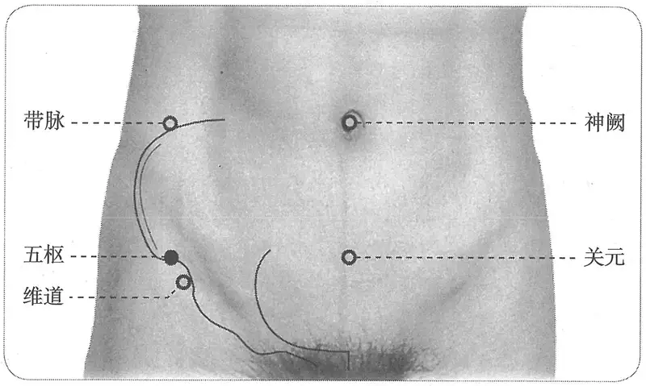

**图 2-334　五枢穴图**

**取穴**：带脉穴下3寸处，横平关元穴处取之。

　1. 在带脉下三寸。（《黄帝明堂经》、《铜人腧穴针灸图经》、《圣济总录》、《十四经发挥》、《医学纲目》、《针灸聚英》、《针灸大成》、《类经图翼》、《医宗金鉴·刺灸心法要诀》、《针灸易学》、《针灸逢源》）

　2. 一云在水道下一寸半。（《黄帝明堂经》、《千金要方》、《千金翼方》、《外台秘要》）

　3. 一曰在水道旁一寸五分。（《针灸甲乙经》卷三）

　4. 在带脉下二寸，水道旁一寸陷者中。（《太平圣惠方·明堂》）

〔p.1089 (인쇄 1061)〕

　5. 窦太师针灸遗存

　　(1) 在带脉下三寸，环跳穴上五寸。又法：在水道穴之旁一寸半。入背部白环俞相近。（《窦太师针经》）

　　(2) 带脉下三寸，一曰水道旁一寸半，环跳上五寸，入背部白环腧穴相近。（《大本琼瑶神书》）

　　(3) 水道外一寸半。（《医学入门》卷一）

　　(4) 带脉下三寸，水道旁五寸五分。（《针灸大成》卷七）

　6. 带脉下约三寸，微向前，平关元穴，髂前上棘内缘。（《针灸十四经穴位考订》）

　7. 统编针灸学教材

　　(1) 部位：带脉下三寸。取穴：侧卧，从带脉斜向前棘肠骨上际下行三寸处取之。（1957年南京《针灸学》）

　　(2) 部位：带脉穴下三寸。取穴：侧卧，从带脉穴斜向胯骨直下，维道穴上五分取之。（1版《针灸学讲义》）

　　(3) 部位：在带脉下三寸，水道旁。取穴：在腹侧，髂前上棘之前五分，约平脐下三寸处取之。（2版《针灸学讲义》）

　　(4) 带脉穴前下3寸，平关元穴。（4版《针灸学》）

　　(5) 在侧腹，髂前上棘之前0.5寸，约平脐下3寸处。（5、7版《针灸学》）

　　(6) 在侧腹部，在髂前上棘的前方，横平脐下3寸处。（6版《针灸学》、《中国针灸学》）

**文献分析**：本穴定位，《黄帝明堂经》曰“带脉下三寸”，而不同传本或注曰“水道下寸半”，则与足阳明经穴相混，或正因此有传本注曰“水道旁寸半”，仍与“带脉下三寸”不同位。如果注文的确传承有自而非讹传，因视为同名异穴。至于《针灸大成》所说“水道旁五寸五分”，乃据嘉靖针灸铜人定位。不同文献共同处在于：带脉下三寸，也是现代本穴定位的依据。至于定于髂前上棘内侧，先见于日本针灸书，此点是否与带脉下三寸处相合，还需要人体测量学的数据支持。

#### 【类属】 

足少阳胆经穴。

　1. 带脉。（《黄帝内经明堂》）

　2. 足少阳胆经。（《外台秘要》卷三十九、《铜人腧穴针灸图经》卷上）

#### 【适应症】 

主治局部、妇科病症。常用于疝气，少腹痛，腰胯痛；赤白带下，月经不调。全子宫切除术的针麻用穴。

　1. 主男子阴疝，两丸上下，小腹痛。妇人下赤白。里急，瘛疭。（《黄帝明堂经》）

　2. 主膀胱气攻两胁也。（《太平圣惠方·明堂》）

　3. 治男子寒疝，阴卵上入小腹痛。（《铜人腧穴针灸图经》卷中）

**按**：《铜人腧穴针灸图经》五枢穴主治症为“治男子寒疝，阴卵上入小腹痛”。这里只录有男人病症，而无妇人病症，显然有脱文。经核查，该穴所主之妇人病症“妇人下赤白，里急，瘛疭”被混入“带脉”穴中作“带下赤白，里急，瘛疭”。

　4. 治肩柱骨疼，泻；半身不遂，泻补；手臂冷气疼，补；腰背痛疽症，看症补泻。（《窦太师针经》）

　5. 腰背痛，曲不能伸。（《循经考穴编》下）

　6. 统编针灸学教材

　　(1) 主治赤白带下，腰背痛，寒疝，阴卵上缩。（1957年南京《针灸学》）

〔p.1090 (인쇄 1062)〕

　　(2) 主治赤白带下，寒疝，睾丸上缩，腰胯痛，少腹痛。（1版《针灸学讲义》）

　　(3) 主治带下，腰胯痛，疝气，腹痛，便秘。（2版《针灸学讲义》）

　　(4) 主治小腹痛，疝气，赤白带下，便秘。（4版《针灸学》）

　　(5) 主治腹痛，疝气，带下，便秘，阴挺。（5、6版《针灸学》）

　　(6) 主治①阴挺、赤白带下、月经不调等妇科病证；②疝气；③少腹痛，腰胯痛。（7版《针灸学》）

　　(7) 主治赤白带下，腰胯痛，少腹痛，疝气，便秘。（《中国针灸学》）

**文献分析**：教材中“便秘”、“阴挺”二症未详所出，也未见古今临床应用，暂不收录。

#### 附：临床应用举例 

　1. 腿股风不能转动举止，环跳、风市、委中、昆仑、居髎、三里、阳陵泉。问曰：此证缘何而得？答曰：皆因房事过多，寒湿流注，推闪后腰痛疼动心。复刺后穴：五枢、阳辅。（《针灸集成》第四十五方）

　2. 腰胯疼痛，名曰寒疝：五枢二穴、委中二穴、三阴交二穴。（《针灸大全》卷四）

　3. 妇人四旬，因小产成病，百节痛，无常处，卧床不起，八字五分、环跳四寸半、五枢三寸半、曲池、液门各寸半、绝骨二寸半。（《医学纲目》卷十二）

　4. 肩臂风连背亦疼，用针胛缝妙通灵，五枢本治腰疼病，入穴分明疾顿轻。（《针灸玉龙歌》）

#### 【操作】 

直刺1~1.5寸。针刺不宜过深，以防刺伤腹腔内脏。

　1. 刺入一寸，灸五壮。（《黄帝明堂经》）

　2. 灸三壮。（《太平圣惠方·明堂》）

　3. 针入一寸半，可灸二七壮。（《窦太师针经》、《针方六集》）

　4. 针七分，灸三壮。（《针灸十四经穴位考订》）

　5. 统编针灸学教材

　　(1) 针五分至一寸，灸五至十壮。（1957年南京《针灸学》、1版《针灸学讲义》）

　　(2) 直刺5~10分，艾条灸5~10分钟。（2版《针灸学讲义》）

　　(3) 直刺1~1.5寸。（4、5、6、7版《针灸学》，《中国针灸学》）

　6. 针1~2寸。感应：局部有酸胀。灸5壮；温灸10~15分钟。（上海《针灸学》）

### （二十八）维道 Wéidào GB28 出《黄帝明堂经》 

#### 【提要索隐】 

**部位**：在下腹部，髂前上棘内下0.5寸。

**适应症**：主治腰腿部、腹部病症。常用于腰腿痛；呕吐，不思欲食，水肿。腹股沟斜疝修补术、全子宫切除术的针麻用穴。

**针刺操作**：直刺1~1.5寸。

#### 【名实考】 

　1. 维道，一名外枢。在章门下五寸三分，足少阳、带脉之会。（《黄帝明堂经》）

　2. 带脉之横束诸经也，上下凡三穴，而此穴乃其最下穴也，又向里折斜而下。阳维自循膝外廉，上髀厌，抵小腹侧，会本经于居髎之后，上循胁肋斜上，此正其自下斜上之处，故曰维道。（《经穴解》）

〔p.1091 (인쇄 1063)〕

#### 相关穴及刺激点 

　1. 维胞　位于髂前上棘下方之凹陷处，在维道穴斜下1寸处。主治子宫下垂。针5~8分。（《针灸经外奇穴图谱》）

　2. 维宫　位于腹股沟与胸部乳头垂线相交之点。主治子宫下垂，睾丸炎。针1.5~2寸，针感耻骨联合部麻、胀。（《针灸经外奇穴图谱（续集）》）

#### 【定位】 

**部位**：在下腹部，髂前上棘内下0.5寸（图2-335）。

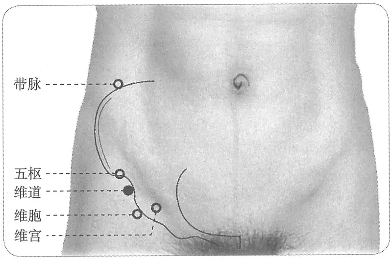

**图2-335　维道穴与相关穴图**

**取穴**：五枢内下0.5寸处取之。

　1. 在章门下五寸三分。（《黄帝明堂经》、《铜人腧穴针灸图经》、《圣济总录》、《针灸资生经》、《窦太师针经》、《十四经发挥》、《医学纲目》、《针灸聚英》、《古今医统》、《医学入门》、《针灸大成》、《类经图翼》、《循经考穴编》、《医宗金鉴·刺灸心法要诀》、《针灸易学》、《针灸逢源》）

　2. 在章门下五寸三分。广注：又法，居髎上二寸五分。（《循经考穴编》下）

　3. 在章门下五寸三分，一曰在中极旁八寸五分。（《类经图翼》卷八）

　4. 在章门下五寸三分。当脐下三寸三分，旁开六寸。（《针灸逢源》）

　5. 五枢下五分。（《针灸十四经穴位考订》）

　6. 统编针灸学教材

　　(1) 部位：在章门穴下五寸三分。取穴：从五枢下五分取之。（1957年南京《针灸学》）

　　(2) 部位：章门穴下五寸三分。取穴：按取胯骨内廉五枢穴下五分取之。（1版《针灸学讲义》）

　　(3) 部位：在章门穴下五寸三分。取穴：在髂骨前五分，五枢前下五分处取之。（2版《针灸学讲义》）

　　(4) 五枢穴前下0.5寸。（4、5、7版《针灸学》）

　　(5) 在侧腹部，当髂前上棘的前下方，五枢前下0.5寸。（6版《针灸学》）

　　(6) 髂前上棘之前下方，五枢前下五分。（《中国针灸学》）

#### 【类属】 

足少阳胆经穴。

**脉气所发**：足少阳、带脉之会。（《黄帝明堂经》）

〔p.1092 (인쇄 1064)〕

**归经**：足少阳经。（《外台秘要》卷三十九、《铜人腧穴针灸图经》卷上）

#### 【适应症】 

主治腰腿部、腹部病症。常用于腰腿痛；呕吐，不思欲食，水肿。腹股沟斜疝修补术、全子宫切除术的针麻用穴。

　1. 主呕，咳逆不止，三焦有水气，不能食。（《黄帝明堂经》）

　2. 治呕逆不止，三焦不调，水肿，不嗜食。（《铜人腧穴针灸图经》卷中）

　3. 窦太师针灸遗存

　　(1) 专治臀疽，腰疼，腿肿痛，泻之。（《窦太师针经》）

　　(2) 主腰腿一切痛。（《循经考穴编》下）

　4. 统编针灸学教材

　　(1) 主治三焦不调，呕逆水肿，腰腿痛，妇人带下，少腹痛。（1957年南京《针灸学》）

　　(2) 主治呕吐，腰腿痛，妇人带下，少腹痛。（1版《针灸学讲义》）

　　(3) 主治腰胯痛，带下，少腹痛，阴挺，疝痛。（2版《针灸学讲义》）

　　(4) 主治小腹痛，疝气，带下，阴挺。（4、5、6版《针灸学》，《中国针灸学》）

　　(5) 主治①阴挺、赤白带下、月经不调等妇科病证；②疝气；③少腹痛，腰胯痛。（7版《针灸学》）

**文献分析**：教材中“带下，少腹痛，阴挺，疝痛”诸症未详所出，经对照与上一穴“五枢”穴主治极相近（其中第7版竟完全相同），疑将二穴主治相混。也可能与奇穴“维宫”、“维胞”相混。今据《黄帝明堂经》、《铜人腧穴针灸图经》、《循经考穴编》，重新归纳本穴主治。

#### 【操作】 

直刺1~1.5寸。

　1. 刺入八分，灸三壮。（《黄帝明堂经》）

　2. 针三寸半，灸三七壮。（《窦太师针经》、《循经考穴编》）

　3. 针七分，灸三壮。（《针灸十四经穴位考订》）

　4. 统编针灸学教材

　　(1) 针五至八分，灸五至十壮。（1957年南京《针灸学》、1版《针灸学讲义》）

　　(2) 直刺5~10分，艾条灸5~10分钟。（2版《针灸学讲义》）

　　(3) 直刺1~1.5寸。（4版《针灸学》）

　　(4) 直刺或向前下方斜刺1~1.5寸。（5、6、7版《针灸学》）

　　(5) 直刺0.5~1寸。可灸。（《中国针灸学》）

### （二十九）居髎 Jūliáo GB29 出《黄帝明堂经》 

#### 【提要索隐】 

**部位**：在臀区，髂前上棘与股骨大转子最凸点连线的中点处。

**适应症**：主治局部病症。常用于疝气、腰痛引小腹；腰腿痛。

**针刺操作**：直刺1~1.5寸。

#### 【名实考】 

需要注意的是，《外台秘要》本穴下附有奇穴“前腋”文字，因脱漏穴名“前腋”二字，而混入居髎穴下，唐以后文献多传此误。

中国针灸教材居髎穴定位相当于日本的环跳穴定位。

　1. 骶之上夹脊十七至二十节起骨，曰“腰髁骨”，曰“两髁”。其旁临两股者曰“监骨”，曰“大骨”，曰“髂”，一身之伸屈司焉。故通曰“机关”，关之旁曰“髀枢”，亦曰“枢”；

〔p.1093 (인쇄 1065)〕

机者，髀骨之入枢者也。（《释骨》）

　2. 居髎，在长平下八寸三分，监骨上陷者中，阳𫏋、足少阳之会。（《黄帝明堂经》）

　3. 居者，坐也。人坐则此穴而在腹与肢折曲之处，故曰居髎。（《经穴解》）

#### “居髎”与“前腋”相混例 

居髎，在长平下八寸三分监骨上陷者中，阳𫏋、足少阳之会，灸三壮。主腰引痛少腹。在腋前两筋间，主肩前痛与胸相引，臂里挛急，手不得上举至肩。（《外台秘要》卷三十九）

**按**：以上文字中分别有两个腧穴部位及两段主治病症，显然系两个穴的内容。第二个腧穴部位“在腋前两筋间”前脱漏了穴名，根据《千金要方》记载，这里脱落的穴名为“前腋”，《千金要方》卷三十原文如下：

前腋，主臂里挛急，手不上举。

前腋，主肩腋前痛，与胸相引。

前腋，主腋前廉两筋痛，手不上头（未经宋人校本）。

从以上文字不难看出，《外台秘要》居髎穴下所脱漏穴名为“前腋”，与下一穴“后腋”正相对应。由于天圣年间王惟一引《外台秘要》之文已如是，故此脱误早在孙兆、林亿校正之前，而孙、林校正时又皆未发现这一十分明显的脱误，经历代腧穴文献辗转引录，一直延误至今。

#### 【定位】 

**部位**：在臀区，髂前上棘与股骨大转子最凸点连线的中点处（图2-336）。

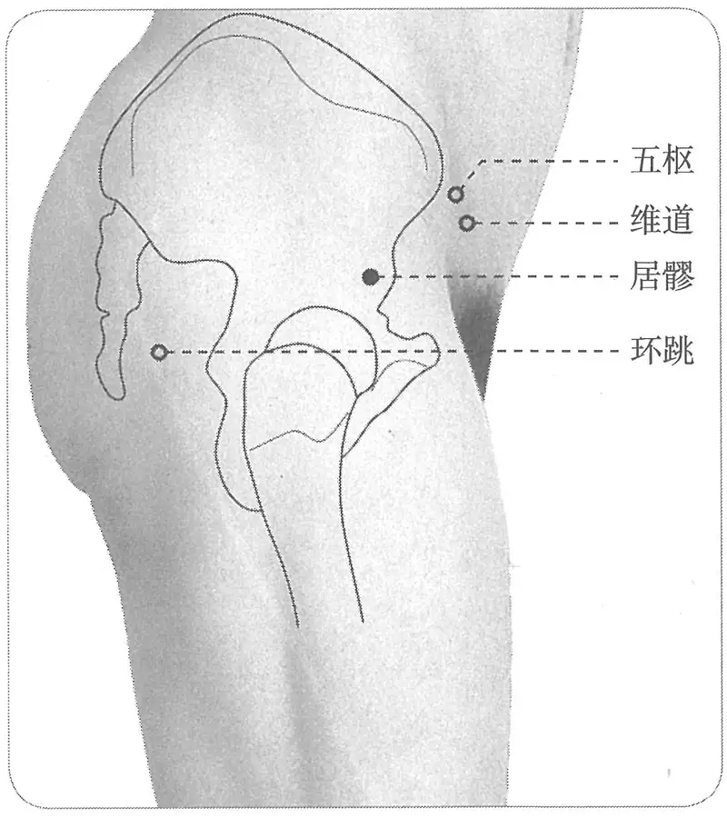

**图2-336　居髎穴图**

#### 相关解剖学基础 

　　(1) 髂前上棘体表定位技法：在较瘦的被检查者可在任何体位下被清楚地观察到。如果被检查者较胖，可采用俯卧位，小腿悬垂于诊床侧面，在这一体位下，髂前上棘骨突更明显，更易触诊。

　　(2) 股骨大转子体表定位技法：①侧卧，伸下腿，上腿屈髋屈膝，此时股大转子突向髋部外侧面。②俯卧位，大腿外展，小腿悬垂于诊床侧面，此时在髋外侧显现的明显凹陷中即可清楚触及股骨大转子。

　1. 《黄帝明堂经》佚文

　　(1) 在章门下八寸三分，监骨上陷者中。（《针灸甲乙经》卷三、《铜人腧穴针灸图经》、《圣济总录》、《针灸资生经》、《十四经发挥》、《医学纲目》、《针灸聚英》、《古今医统》、《医学入门》、《针灸大成》、《类经图翼》、《医宗金鉴·刺灸心法要诀》、《针灸易学》、《针灸逢源》）

　　(2) 在长平下八寸三分，监骨上。（《千金要方》卷二十九、《千金翼方》、《外台秘要》、《医心方》）

　2. 在章门下同身寸之四寸三分，髂骨上。新校正云：按《甲乙经》作监骨上陷者中。（《素问·气府论》王冰注）

　3. 窦太师针灸遗存

〔p.1094 (인쇄 1066)〕

　　(1) 在环跳上二寸。又法：在章门穴下八寸三分竖骨上陷中。（《窦太师针经》）

　　(2) 在环跳上一寸。（《针灸玉龙歌》注）

　　(3) 在章门下八寸刺三寸，监骨上陷中，在环跳上一寸。（《大本琼瑶神书》）

　　(4) 在章门下八寸三分，髂骨上陷中。居腹部，度与环跳穴一寸相平。（《针方六集》卷一）

　4. 广注合居环跳上两寸五分。（《循经考穴编》下）

　5. 维道下行向外斜三寸。（《针灸十四经穴位考订》）

　6. 统编针灸学教材

　　(1) 部位：章门穴下八寸三分。取穴：侧卧，从维道穴斜向下行三寸处取之。（1957年南京《针灸学》）

　　(2) 部位：肝经章门穴下八寸三分。取穴：从维道穴斜向下行三寸处取之，约当胯骨前上缘与大转子之最高点之中间。（1版《针灸学讲义》）

　　(3) 部位：在章门下八寸三分，监骨上陷者中。取穴：髂前上棘与大转子最高点连线的中点凹陷处取之。（2版《针灸学讲义》）

　　(4) 髂前上棘与股骨大转子连线的中点。（4、5版《针灸学》、《中国针灸学》）

　　(5) 在髋部，当髂前上棘与股骨大转子最凸点连线的中点处。（6、7版《针灸学》）

**文献分析**：王冰谓本穴在章门下四寸三分，与穴位排序关系不合（上一穴维道已在章门下五寸三分），显然有误。至窦太师针灸又补充了本穴与环跳穴的位置关系，而后世文献又有不同说法，仅供参考。

#### 【类属】 

足少阳胆经穴。

**脉气所发**：阳𫏋、足少阳之会。（《黄帝明堂经》）

**归经**：足少阳胆经。（《外台秘要》卷三十九、《铜人腧穴针灸图经》卷上）

#### 【适应症】 

主治局部病症。常用于疝气、腰痛引小腹；腰腿痛。

　1. 主腰痛引少腹。（《黄帝明堂经》）

　2. 主腰引痛，少腹。（《外台秘要》卷三十九）

　3. 治腰引少腹痛，肩引胸，臂挛急手臂不得举而至肩。（《铜人腧穴针灸图经》卷中）

　4. 窦太师针灸遗存

　　(1) 腿疼，脚叉风，腰弱无力，半身不遂。（《窦太师针经》）

　　(2) 治腰腿酸疼，先泻后补；腿股风痛，先补后泻，泻多与环跳同用。（《大本琼瑶神书》）

　　(3) 瘫痪足痿，腰腿诸疾。（《循经考穴编》下）

　　(4) 中风半身瘫痪，疼痛，麻木，不遂，中风半身不遂，麻木拘挛筋急。（《窦太师秘传》）

　5. 统编针灸学教材

　　(1) 主治腰引小腹痛，瘫痪，痿弱，腿足诸疾。（1957年南京《针灸学》、1版《针灸学讲义》）

　　(2) 主治腰腿痹痛，瘫痪足痿，疝气。（2版《针灸学讲义》、4版《针灸学》）

　　(3) 主治腰痛，下肢痿痹，疝气。（5版《针灸学》）

　　(4) 主治腰痛，下肢痿痹，瘫痪，疝气。（6版《针灸学》）

　　(5) 主治腰腿痹痛，瘫痪；疝气，少腹痛。（7版《针灸学》）

　　(6) 主治腰腿痹痛，瘫痪，下肢痿痹。（《中国针灸学》）

**文献分析**：《外台秘要》载本穴主治文字中有两个表明腧穴部位的“在”字及两个表明腧穴主治的“主”字，显然是两个腧穴的内容。第二个穴，“在”字前，脱落了穴名“前腋”（经外奇穴，其部位与主治均见于《千金要方》卷三十）。至宋代王惟一在编写《铜人腧穴针灸图经》时，竟不加考察，仍将上述二穴主治症均置于“居髎”穴下，并且删去了原文中“前腋”穴的部位文字，遂使后人无以识别，而《铜人腧穴针灸图经》以后针灸文献，如宋代《圣济总录》、《西方子明堂灸经》，明代《普济方》、《针灸大全》、《针灸聚英》、《古今医统》、《医学入门》、《针灸大成》、《针方六集》、《循经考穴编》、《类经图翼》，清代《针灸逢源》，现代《针灸传真》、《针灸指南》、《会元针灸学》等，均沿袭此误，未见更正。

〔p.1095 (인쇄 1067)〕

#### 附：临床应用举例 

　1. 中风半身瘫痪，疼痛麻木，不遂：针合谷、手三里、曲池、肩井、环跳、血海、阳陵泉、阴陵泉、足三里、绝骨、居髎、昆仑。（《窦太师秘传》）

　2. 腿股风不能转动举止：环跳、风市、委中、昆仑、居髎、三里、阳陵泉。问曰：此证缘何而得？答曰：皆因房事过多，寒湿流注，推闪后腰痛疼动心。复刺后穴：五枢、阳辅。（《针灸集成》第四十五方）

　3. 两膝肿痛莫能动止：膝眼、居髎、环跳、三里。金陵仓巷人姓蒋，扶双拐，经月痛甚，针此数穴，抛拐而走。（《针灸集成》第六十六方）

　4. 环跳为能治腿风，居髎二穴亦相同。（《针灸玉龙歌》）

#### 【操作】 

直刺1~1.5寸。

　1. 刺入八分，灸三壮。（《黄帝明堂经》）

　2. 直针入三寸半，灸五十壮。（《窦太师针经》

　3. 针八分，灸三壮。（《针灸十四经穴位考订》）

　4. 统编针灸学教材

　　(1) 针五分至一寸，灸五至十壮。（1957年南京《针灸学》、1版《针灸学讲义》）

　　(2) 斜刺5~10分，艾条灸5~10分钟。（2版《针灸学讲义》）

　　(3) 直刺1~1.5寸。（4、5、6、7版《针灸学》）

　　(4) 直刺0.5~1寸。可灸。（《中国针灸学》）

　5. 斜刺，向髋关节进针2~3寸。感应：酸胀扩散至髋关节。灸5~7壮；温灸5~15分钟。（上海《针灸学》）

### （三十）环跳 Huántiào GB30 出《黄帝明堂经》 

问题1：1957年南京《针灸学》关于本穴定位的传统语言描述、现代解剖学术语描述不是同一个部位，与穴区的层次解剖也不相同。为什么会出现这种传统与现代“两层皮”现象？

问题2：环跳穴的现代解剖学定位是何时以及如何确定的？

问题3：环跳常用取穴体位有两种，进针点不同，针刺方向也相差几十度，可获得相同的针感。临床治疗作用是否相同？如果最终的结果是肯定的，应视为同一个穴，还是不同的穴？究竟如何理解“穴位”的概念？就环跳穴而言，这是一个绕不过去的问题！

问题4：皆知环跳穴是治疗坐骨神经痛的要穴，临床上根据疼痛部位的特点，或取太阳经穴，或取阳明穴，而经验丰富的大夫对于不同经坐骨神经疼痛皆取环跳穴治之，道理何在？

问题5：几年前京城一位针灸大家告诉我：环跳治前阴病有特效，古代文献无记载，经络学说也不好解释，与腧穴主治规律也不符合。根据现有的知识能否给老中医满意的解释？

〔p.1096 (인쇄 1068)〕

#### 【提要索隐】 

本穴的定位、主治、刺灸法古今变化较大，别名情况混乱。中国与日本的定位有明显不同。

**穴名**：一名环铫。“环跳”的写法，在宋以前文献中有3种。另1957年南京《针灸学》记载本穴的别名8个，经考察，皆不能算作严格意义上的别名。

**部位**：在臀区，股骨大转子最凸点与骶管裂孔连线的外1/3与内2/3交点处。

**按**：特别要注意在不同体位下本穴进针点的差异。

**归经**：足少阳胆经。**按**：本穴为“足少阳、足太阳之会”。

**适应症**：主治腰腿部病症。常用于腰胯痛，下肢痿痹、麻木，半身不遂。**按**：注意本穴主治与秩边主治的异同。

**针刺操作**：注意不同体位以及不同主治病症的进针部位及针法的差异。

**相关解剖学基础**：坐骨神经层次解剖、体表投影及相关解剖标志的体表定位；阴部神经、股后皮神经的解剖定位。

**相关穴及刺激点**：理解居髎、新建、新环跳、新环跳1、环跳1、中跳、臀中，以及坐骨神经常用穿刺点、盆神经刺激点与本穴的关系。

#### 【名实考】 

环跳，一名环铫。宋以前文献《针灸甲乙经》、《外台秘要》、《太平圣惠方》作“环跳”；《产经》、《黄帝内经太素》、《千金翼方》、《素问》王冰注、《医心方》均写作“环铫”；《千金要方》卷二十九作“镮铫”。异写出现的过程可能是“环跳”二字之一的偏旁先发生变化，另一个连带改变，就像“温溜”之“溜”字，宋以前文献皆作“留”，宋以后文献，受前一字偏旁影响，渐渐又写作“溜”。所不同者，“温溜”的这一字形变化为后人接受，而“镮铫”的写法没有采纳。经查，《千金要方》只是卷二十九和卷八两处作“镮铫”，卷三十有4处皆作“环铫”，另从未经宋人校改的宋本《千金要方》仍作“环铫”或“环跳”来看，这一连带改动很可能还出自宋人之手。宋代国家针灸经穴标准《铜人腧穴针灸图经》定作“环跳”，宋以后至今皆遵从，是以“环跳”为正名，“环铫”为别名，“镮铫”作为“环铫”的异写，不入别名。1957年南京《针灸学》载别名8个，经考或有误，或不确定。

关于本穴的部位，古典文献只有“髀枢中”，对于“髀枢”的解释，杨上善说得很清楚，历代医家皆从之。然而关于取髀枢中的方法与技巧的文献没有传下来，加上宋以前的明堂图也没有传世，于是现代人，特别是日本学者，对于“髀枢中”三字提出了种种不同的理解，其中“股骨大转子前”一说，因出自1918年日本文部省颁布针灸定位标准《改正孔穴》，而成为日本针灸教科书的标准文本，但这种说法对于中国早期针灸书的影响很小，反而是其他两种说法因有较多的古代文献支持而更多地被中国早期针灸书引用。最终中国针灸教材关于本穴的定位，完全走出了日本文献的影响，而是更多地受到现代解剖学关于坐骨神经刺激点体表定位法的影响。

　1. 足少阳脉气所发者六十二穴……髀枢中、旁各一，膝以下至足小指次指各六俞。（《素问·气府论》）

　2. 环跳，在髀枢中，侧卧伸下足屈上足取之，足少阳脉气所发。刺入一寸，留二十呼，灸五十壮。（《黄帝明堂经》）

　3. 杨上善曰：髋骨如臼，髀骨如枢，髀转于中，故曰髀枢也。（《黄帝内经太素·经筋》注）

　4. 曰环跳者，骨缝错扣之处，上如环以扣其骨，股之能屈伸往来者，以环故也，跳则走动之象。（《经穴解》）

〔p.1097 (인쇄 1069)〕

　5. 别名　环谷、髋骨、髀枢、分中、膑骨、髀厌、枢合中、枢中。（1957年南京《针灸学》）

**按**：1957年南京《针灸学》所载本穴别名系间接抄自日本文献，其中“髀枢”“髀厌”“枢合中”、“枢中”、“环谷”、“分中”皆系《内经》中部位名称，后人注作“环跳”穴者，不能视为别名。其中“分中”作为环跳穴的别名，见于吴崑《针方六集》，更是误断误解经文的产物。按《气穴论》原文作“两髀厌分中”，与《内经》别处所言“髀厌中”以及《明堂》所言“髀枢中”同义，王冰注为“环铫穴”，吴氏误断句，以“分中”为专用术语，此一误，又将其作为环跳穴别名，此错上加错也；“髋骨”作为针灸部位最早见于窦氏《通玄指要赋》“髋骨将腿疼以祛残”，罗天益注作“在腿砚骨上”，而传世的《窦太师针经》载主治腿疼的“髋骨”穴在梁丘穴两旁一寸半，《针灸玉龙歌》不同传本或作“梁丘”穴旁一寸，或五分，皆与环跳穴相差较大，故今不视作环跳穴别名，以免引起混乱；“髌骨”则是《针灸大全》在传抄、刊刻过程中出现的“髋骨”一名的讹误，更不足据。可见，《针灸学》收录的8个“环跳”别名，按照本书别名判定标准，皆不属于别名，而唯一属于别名的“环铫”一名却未收录。

关于本穴的部位，古代文献描述只“髀枢中”三字，古今中外不同人有不同理解，特举早期针灸教材关于环跳穴的取穴法如下：

　1. 股骨大转子前

　　(1) 大腿外侧上方，股关节前部。（1918年日本文部省《改正孔穴》）

　　(2) 大转子之前方。（1931年中文版日本猪又启严《高等针灸学讲义》）

　　(3) 大腿关节外侧横纹头，侧卧屈上足取之。（1921年玉森贞助《针灸经穴医典》）

　　(4) 部位：在大腿部之外侧，大转子之前上部。取穴法：侧卧，屈上足，伸下足，股关节外侧之横纹头取之。（1955年承淡安《中国针灸学》）

　　(5) 取穴：侧卧，伸下足屈上足，股关节外侧之横纹头取之。解剖定位：在股骨大粗隆、坐骨结节和髂后上棘联成的三角形中间部。（1957年南京《针灸学》）

**按**：南京《针灸学》所载之“取穴”与“解剖定位”不在同一点，前者承袭承淡安《中国针灸学》之说，出自日本教材。今考这一取穴法实与《新针灸学》“新建”穴相同，与居髎穴相近：新建在髂骨外侧，股骨大粗隆前上方。解剖部位：在股骨大粗隆与髂前上棘之间，阔筋膜张肌中，深部正对股关节。（1954年朱琏《新针灸学》）；居髎：约当髂前上棘与大转子间之中央（1959年上海《常用经穴位解剖学定位》、1960年上海《针灸学讲义》）；而所述“解剖定位”却与坐骨神经体表刺激点定位法之一相同（详见下文）。

　2. 股骨大转子后上方

　　(1) 髀枢头外脊方略后，两足双踏立则有陷，此乃环跳也。（1713年日本寺岛良安《和汉三才图会》）

　　(2) 在大腿骨大转子与髀臼关节上缘中间之后部。（1931年中文版日本猪又启严《高等针灸学讲义》）

　　(3) 股骨大转子后上方之凹陷处。（1959年中医研究院针灸所《针灸学简编》）

　　(4) 侧卧，伸下足屈上足，当股骨大转子之上后方取之。（1960年上海《针灸学讲义》）

　　(5) 在股骨大转子与髋关节上缘中间后部。（1958年田占元《实用针灸学》）

　3. 两足并立有陷凹处

　　(1) 通京门之下，并两足而立，腰部有陷凹处即是也。（1914年日本版《实习针灸科全书》——1915年中文译本书名作《最新实习西法针灸》）

　　(2) 在髀枢中通京门之下，并两足而立，腰下部有陷凹处是也。（1931年承淡安《中国针灸治疗学》、1940年承淡安《中国针灸学讲义》）

　　(3) 股骨上端的关节部，并两足立正时的凹陷处。（1951年朱琏《新针灸学》）

　　(4) 在髀枢中，两足并立有陷凹处。（1955年王野枫《针灸十四经穴考订》）

〔p.1098 (인쇄 1070)〕

**按**：此说与第2说文异而定位实相同。

　4. 现行中国针灸教材取穴法　股骨大转子最凸点与骶管裂孔连线的外1/3与中1/3交点处。

　5. 坐骨神经阻滞体表进针点　最常用的有侧卧位和俯卧位，较常用的进针点体表定位法有以下几种：

　　(1) 侧卧位

1) 病人取患侧在上侧卧位，对侧下肢伸直。患侧髋、膝关节略屈曲，亦称半俯卧位。触到股骨大转子上缘和髂后上棘，在这两点连线中点做一90°垂线，再从此连线中点向内下方做一90°垂直线，此线与股骨大转子至骶骨裂孔的连线交点，即为进针点。（《神经阻滞学——100种神经阻滞术图解》）

2) 肥胖及体表标志不明显者，侧卧，大转子和坐骨结节为底边做一等边三角形，其顶点即穿刺点。进针方向：与臀部侧面呈90°角直刺。（石崇俭．疼痛·阻滞与解剖彩色图谱．北京：人民卫生出版社，2006）

3) 小儿患者取侧卧位，患侧下肢在上屈髋屈膝，术者触及大转子和坐骨结节，在两者间做一连线，连线中点即为穿刺点。（《神经阻滞学——100种神经阻滞术图解》）

　　(2) 新环跳穴法：侧卧，患肢在上，屈膝90°，屈髋45°，骶管裂孔旁四横指，与皮肤垂直进针。［孙正庭．下肢神经阻滞在骨科手术中的应用．中华麻醉学杂志，1981（1）：31-32］

　　(3) 俯卧位：病人取俯卧位，双腿伸直，取坐骨结节点与同侧股骨大转子点连线内1/3点，垂直皮肤刺入皮下。（《神经阻滞学——100种神经阻滞术图解》）

**文献分析**：从以上所列文献可以看出，在中国统编针灸学教材出版之前，中国影响较大、带有教材性质的针灸书，关于环跳穴的定位几乎都采用了日本文献，而从1957年南京《针灸学》始，环跳穴的定位为之一变——但犹可见明显从日本文献脱胎而来的痕迹，改变的原因一方面有较早、较明确的中国古代文献的依据，另一方面则明显受了现代解剖学关于坐骨神经体表投影定位的影响。之所以侧卧位进针成为临床上坐骨神经阻滞最常采用的入路，是因为在这种特定体位下，坐骨神经距皮表最近。几千年前中国针灸医家就认识到了这一点——尽管没有现代神经解剖知识，非常了不起。

关于坐骨神经进针点的体表定位，似乎有两点当时编纂针灸学教材的人没有明确认识到：第一，由于受体位的影响，在侧卧位和俯卧位下，进针点是不同的。由于《黄帝明堂经》只记载了取环跳穴的侧卧位，针灸学教材至今也只规定了在侧卧位下的取穴法，然而针灸临床上，俯卧位下针环跳也是较常用的选择。20世纪60、70年代在环跳穴附近发现的那些新穴，都是俯卧取穴，这些穴正是我们今天确定俯卧位环跳穴体表定位的足资借鉴的临床数据。第二，坐骨神经阻滞进针点的确定还受体型与年龄的影响。经过长期的临床实践，中国针灸人终于认识到环跳穴的定位还与体位和体形密切相关，并通过大样本的临床实验，补上了俯卧位以及肥胖体形的环跳穴取穴法：

取穴法1：伏位。坐骨结节和大转子连线中点。进针方向：从背面向腹侧面直刺，与臀部皮面成90°角。（常用经穴解剖学定位．上海：上海科学技术出版社，1959年）

取穴法2：患者俯卧平躺，双下肢自然平伸，找到骶管裂孔处后，向外平行旁开3寸（4横指）凹陷中即是该穴。适应症：急性腰扭伤、腰骶椎间盘膨（突）出症、梨状肌综合征、强直性脊柱炎、隐性骶椎裂。操作：直刺50~70mm，艾炷灸5~10壮，或温针20~30分钟。［刘本立．环跳穴不同体位取穴法与临床应用．湖南中医杂志，2002，18（6）：24-25］

〔p.1099 (인쇄 1071)〕

**按**：此与上述“新环跳”取穴法完全相同。

俯卧位环跳取穴法有几种，总的规律是皆较侧卧位的取法靠内侧或内上侧，“新环跳穴”、“中跳”、“臀中”、“盆神经刺激点”在秩边穴的稍下方。其中有一种俯卧位环跳取穴法竟与秩边穴完全相同，并与一种坐骨神经阻滞体表定位完全相同（名曰“新环跳阻滞法”）。这样一来，足太阳经的秩边穴就与足少阳经的环跳穴合二为一了？这是接受传统针灸经络、腧穴教育的人根本无法理解、无法接受的。从《黄帝明堂经》来看，秩边与环跳的主治不完全相同，但早在金元时期《窦太师针经》、《针灸玉龙歌》已明言“环跳主治同秩边”，现代不但主治越来越接近，最后连定位也相同了——作为两个不同穴位的最后界限也被打破了。正是这个无情的事实让针灸人开始反思“穴位”概念，提出新的定义，详见总论“腧穴的概念”。

之所以俯卧位下取环跳穴，进针点比侧卧位时偏向内侧，是因为在那个特定的侧卧位下，针刺时有一个向内20°~30°角，而俯卧位时，针刺的方向是与臀部皮面成90°角，从背面向腹侧面直刺。这样俯卧与侧卧的进针点虽不同，但针尖到达的位置可相同，因而治疗相同的病症——坐骨神经痛。提示：环跳与秩边由于体位的关系，进针点虽不同，但通过进针方向及深度的调整，可使针尖到达相同的部位，产生相同的针感，治疗相同的病症。可见，金元针灸大家窦太师关于环跳与秩边主治相同的经验是有可靠的实践基础的。

中国针灸关于居髎的定位与日本现行针灸教材环跳穴定位很相近，而新穴“新建”则与日本环跳穴定位相同，这大概也是中国早期针灸书很少受日本针灸书第一种定位法影响的一个重要因素。

#### 相关穴及刺激点 

　1. 中跳　位于股骨大转子与骶管裂孔腰俞穴所在连线的中点，即奇穴环中与足少阳胆经环跳穴的中点。针刺时患者站立，上半身前屈，用2.5~3寸毫针，垂直于体表缓慢进针约2寸后，改用雀啄法缓缓进针至2.5寸。主治坐骨神经痛。［王映辉．立位针刺“中跳”穴治疗坐骨神经痛的体会．针灸临床杂志，1995，11（11/12）：64-65］

**按**：经在人体实际点穴发现，按此取穴法所得之体表点，与环跳1重合，实为同穴异名。唯一不同在于，环跳穴是俯卧取穴，中跳则是正立取穴。

　2. 臀中　侧卧，位于大转子后上方。此穴所在点与大转子和坐骨结节联成一等边三角形。进针方向：与臀部侧面成90°角直刺。深度：6~8cm。感觉及放射方向：麻向足背及足底。主治坐骨神经痛、下肢偏瘫、小儿麻痹症、荨麻疹、足冷。（常用经穴解剖学定位．上海科学技术出版社，1959年）

**按**：此“臀中”穴与坐骨神经阻滞临床常用进针点之一相同（见石崇俭《疼痛·阻滞与解剖彩色图谱》一书，人民卫生出版社，2006年），所述针感也明显是刺中坐骨神经的反应，主治症也完全是环跳穴的主治，可视为侧卧位环跳的备选进针点，此处肌肉不丰满，触之有空虚感，适合于较肥胖及骨性标志不明显的患者。

　3. 新环跳　见前面【名实考】下的“新环跳穴法”。

**按**：针灸环跳穴的解剖学定位，借鉴了现代医学坐骨神经阻滞的体位定位，而后者也在吸纳针灸环跳穴定位方法，作为坐骨神经阻滞俯卧位进针点之一，正是这种互动的交流，促进了彼此的发展。

　4. 新环跳1　位于尾骨尖旁开3寸。取俯卧位。快速进针，深刺3~4寸，使针感传至足部，中、强刺激，提插捻转，不留针。每日一次。（《针灸经外奇穴图谱（续集）》）

〔p.1100 (인쇄 1072)〕

　5. 环跳1　环跳穴内上一寸处，主治：小儿麻痹后遗症坐骨神经痛，腿痛。针法：直刺3~4寸。针感放散至脚尖。（《针灸经外奇穴图谱（续集）》）

　6. 盆神经刺激点　秩边穴下0.5cm处。主治：尿失禁，大便失禁，尿潴留。针法：针稍偏向内侧，针三寸左右，针感会阴部抽、胀。（《针灸经外奇穴图谱（续集）》）

　7. 坐骨神经压痛点　秩边、环跳、承扶、委阳、阳陵泉、昆仑，坐骨神经痛时，以上各穴或同时，或先后出现压痛，可以选择最痛点针刺。

**文献分析**：据上述各穴的定位描述，并在人体实际点穴比对后发现：中跳与环跳1；新环跳（骶管裂孔旁开3寸）与俯卧位环跳、秩边；新环跳1（尾骨尖旁开3寸）与盆神经刺激点；臀中与坐骨神经穿刺点（石氏改良法）实为同穴异名。这种现象的出现，主要是新穴的数量太多，人们在提出一个新穴时，或不知已有哪些新穴，后人也不曾将所有的新穴的定位加以比较，因而出现重复而长期不被察觉。

#### 【定位】 

**部位**：在臀区，股骨大转子最凸点与骶管裂孔连线的外1/3与内2/3交点处（图2-337）。

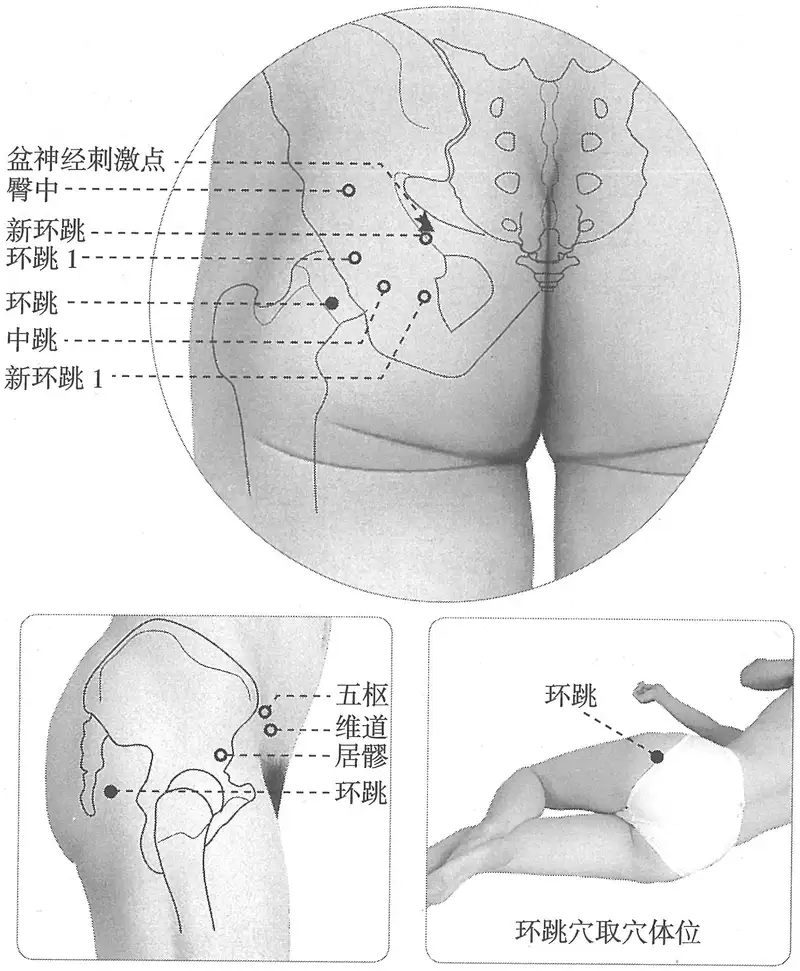

**图2-337　环跳穴与相关穴及刺激点**

**取穴**：侧卧，伸下腿，上腿屈髋屈膝，当股骨大转子最凸点与骶管裂孔连线的外1/3与内2/3交点处取穴。

**相关解剖学基础**：坐骨神经体表投影及相关解剖标志的体表定位。

　　(1) 坐骨神经：是身体最粗大的神经（起始部宽2cm），由腰4神经前支一部分和腰5神经前支组成腰骶干，再与骶1-3的前支组成的坐骨神经被臀大肌覆盖。一般其自梨状肌下孔穿出至臀部，在坐骨粗隆和股骨大转子之间中点处下降。经股后部坐骨神经行于内收肌和股二头肌长头之间并降至腘窝。于腘窝上角分为内侧支为胫神经，外侧支为腓总神经。

〔p.1101 (인쇄 1073)〕

　　(2) 坐骨神经体表投影：从髂后上棘和坐骨结节之间的中点略向外弧形向下、经股骨大转子，与坐骨结节之间的中点，然后沿大腿后面的中线垂直向下，直到腘窝的上角。如果坐骨神经不在高处分支，它在腘窝上角分为胫神经和腓总神经。（《格氏解剖学》第四十版第1344页）

环跳穴的体表定位点，与坐骨神经体表投影线很接近，而且侧卧位，伸下腿，上腿屈髋屈膝这种特定体位下，坐骨神经被向体表顶压，距皮表最近，因而最便于针刺操作。

　　(3) 髂后上棘：多数个体在骶部呈现出两个明显的凹陷——骶凹（sacral dimple），而有些个体表现为两个尖锐的突起。

　　(4) 坐骨结节：在俯卧位时，在臀沟中点处可触及一尖锐的骨性结节即坐骨结节；在坐位时，人体重心落在坐骨结节上，因此在坐位时，用手很容易触及。

　　(5) 股骨大转子：在取环跳穴的侧卧位时，股骨大转子向髋部外突出，非常明显；而在仰卧位时，屈膝髋外展形成的明显凹陷处，可触及股骨大转子。

　1. 在髀枢中，侧卧，伸下足屈上足取之。（《黄帝明堂经》、《铜人腧穴针灸图经》、《圣济总录》、《针灸资生经》、《十四经发挥》、《医学纲目》、《医宗金鉴·刺灸心法要诀》）

　2. 髀枢中旁各一。王冰注曰：谓环铫二穴也。在髀枢后。新校正云：按王氏云，在髀枢后。按《甲乙经》云“在髀枢中”，“后”，当作“中”。（《素问·气府论》）

　3. 刺枢中以毫针，寒则久留针，以月死生为数，立已。王冰注曰：髀枢之后，则环铫穴也，正在髀枢后，故言刺髀枢后也。新校正云：按《甲乙经》“环铫在髀枢中”，《气穴论》云：“在两髀厌分中”，此经云“刺枢中”，而王氏以谓“髀枢之后”者，误也。（《素问·缪刺论》）

　4. 在砚子骨宛宛中。（《太平圣惠方·明堂》、《针灸资生经》、《神应经》、《针灸逢源》）

　5. 窦太师针灸遗存

　　(1) 在髀枢中，臀枢砚子骨下外一指，侧卧，屈上足，伸下足取之，握脚陷中。（《窦太师针经》）

　　(2) 在髀枢臀中。侧卧，伸下足，屈上足，大骨尖后一寸是穴。（《窦太师秘传》）

　　(3) 广注：法须令侧卧，屈伸上下足，取髀枢骨尖后一指许摇按之，当有深陷。（《循经考穴编》下）

　6. 在髀枢研骨下一指。侧卧，伸下足，屈上足方可。（《针灸玉龙歌》注）

　7. 髀枢中，侧卧，伸下足，屈上足，以右手摸穴，左摇撼取之。（《针灸聚英》卷一、《古今医统》、《针灸大成》、《针方六集》、《针灸易学》）

　8. 髀枢碾子骨后宛宛中，侧卧，蜷上足，伸下足取之。（《医学入门》卷一）

　9. 铜人及铜人图

　　(1) 在居髎后三寸，稍低。（明正统仿宋针灸铜人）（图2-338）

　　(2) 居髎穴后下约三寸，股骨大转子后。图注原文：在髀枢砚子骨下宛宛中。（明万历新修铜人明堂图）（图2-339）

　　(3) 图注原文：碾子骨后侧，蜷上足取。（《经穴指掌图》）

　　(4) 居髎后下约三寸，股骨大转子后。（承淡安《人体经穴图》）（图2-340）

　　(5) 高度约平股骨头，比现在的定位略高。（北京中医学院图）（图2-341）

　10. 髀枢中，两足并立有陷凹处。（《针灸十四经穴位考订》）

〔p.1102 (인쇄 1074)〕

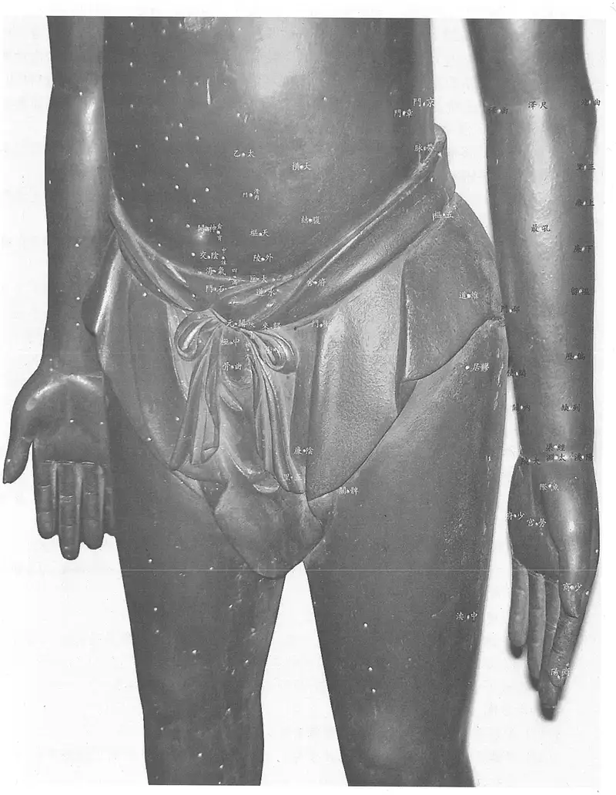

**图2-338　明正统仿宋铜人（环跳穴）**

〔p.1103 (인쇄 1075)〕

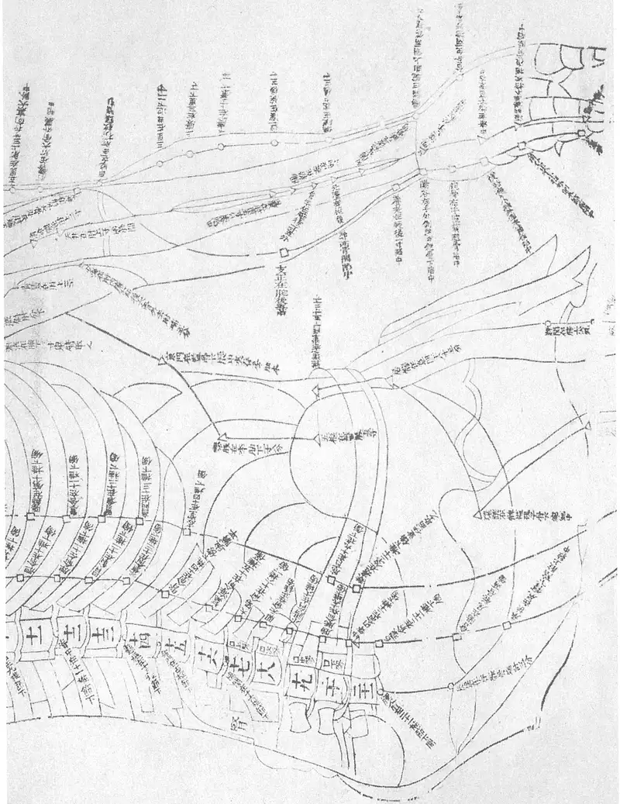

**图2-339　明万历《明堂图》（环跳穴）**

〔p.1104 (인쇄 1076)〕

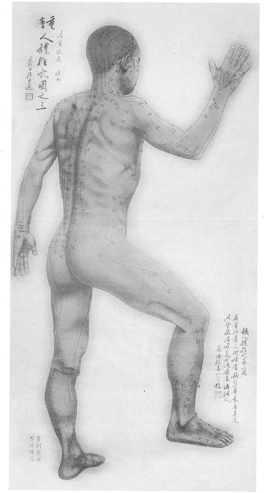

**图2-340　承淡安《人体经穴图》（环跳穴）**

〔p.1105 (인쇄 1077)〕

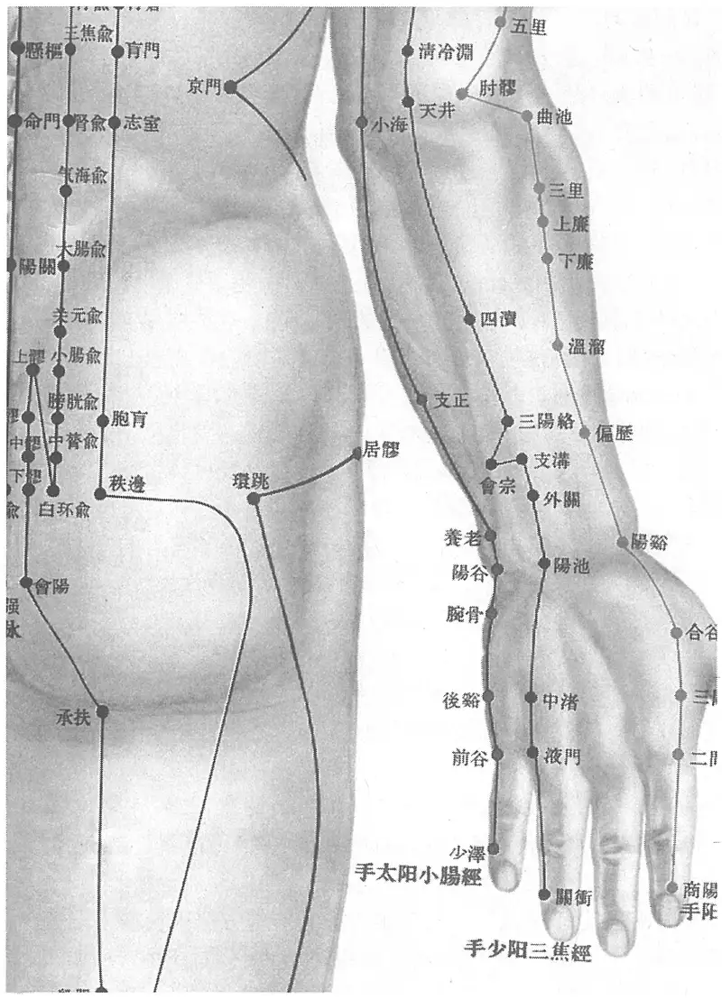

**图 2-341　北京中医学院挂图（环跳穴）**

　11. 统编针灸学教材

　　(1) 部位：在髀枢中。取穴：侧卧，伸下足屈上足，股关节外侧之横纹头取之。（1957年南京《针灸学》）

　　(2) 部位：髀枢中。取穴：侧卧，伸下足屈上足，在大转子高处与督脉腰俞穴之直线上，近大转子侧三分之一处陷中取之。（1版《针灸学讲义》）

　　(3) 部位：在髀枢中，侧卧，伸下足，屈上足取之。取穴：股骨大转子最高点与骶管裂孔腰俞，属督脉的连线上，中1/3与外1/3连接点，侧卧屈股取之。（2版《针灸学讲义》）

　　(4) 股骨大转子与骶管裂孔连线的外1/3与内2/3交界处。（4、5版《针灸学》）

　　(5) 在股外侧部，侧卧曲股，当股骨大转子最凸点与骶管裂孔连线的外1/3与中1/3交点处。（6、7版《针灸学》）

　　(6) 股骨大转子与骶管裂孔的连线上，中1/3与外1/3交界处，侧卧曲股取穴。（《中国针灸学》）

〔p.1106 (인쇄 1078)〕

**文献分析**：关于本穴定位，《黄帝明堂经》只说“髀枢中”，并明确了取穴的体位，但如何确定进针点，没有明确。从王冰始多次注明本穴在“髀枢后”，王冰本人并没有针灸临床的背景，但对穴位的取穴有非常详细的描述，提示两点：或者王冰注《素问》时手头有古图（如注文反复提及的《中诰孔穴图经》、《黄帝中诰图经》），或者手头有关于如何取穴的专门文献。宋代编纂《铜人腧穴针灸图经》，遇到宋以前文献有分歧，每取王冰之说，也是另一个证据。金元文献《窦太师针经》、《针灸玉龙歌》更明确本穴在髀枢骨后凹陷（“砚子骨下外一指”与“大骨尖后一寸”文异义同）。此外，传世的针灸铜人、明堂图中环跳穴的标注也都在股关节后。中国现代针灸学教材对于环跳穴部位的确定，除了这些古典文献依据外，还直接或间接地受到西医坐骨神经穿刺点体表定位的影响。这是因为在临床上针刺环跳穴，针灸医生很早就发现有意或无意地通过刺中坐骨神经可获得显著的“针感”。直到这时，针灸人才惊奇地发现，西医坐骨神经阻滞时，病人的体位，与几千年前古典文献记载的针刺环跳时，病人的体位完全相同。根据现代解剖学的知识可知，在这种特殊的体位下，坐骨神经距离皮下最浅，最便于针刺。这也为自唐代王冰以下对《黄帝明堂经》环跳穴定位的理解的正确性，以及中国现代针灸教材关于本穴的解剖学定位的科学性提供了有力的证据。最后，从本穴的脉气所发“足少阳、太阳之会”来看，也支持将本穴定位于“股骨大转子后”的观点。由此，可得到如下3点判断：第一，中国现代针灸学教材关于环跳穴的定位，有充分、明确的古典文献依据；第二，有坚实的临床实践基础；第三，有现代解剖学的支持。

中国针灸教材关于环跳穴定位的现代表述，固然有较坚实的文献依据与临床基础，但也在很大程度上受到现代医学治疗坐骨神经痛的启发。从民国初期翻译的西洋医学《贺氏疗学》即可看出：

针刺法（Acupuncture）此法乃以针刺身，为止痛、消肿、袪水之用，又可为外惹内效之法，如腰痹（lumbago）与髋大系痛（sciatica）其效最显……医髋大系痛，宜刺髋大系，即透入系鞘亦可。

这种直接用针刺激坐骨神经干以治疗坐骨神经痛的方法很快被中国针灸界所接受，其坐骨神经穿刺点体表定位的体位恰好与《黄帝明堂经》记载的环跳穴的取穴体位相同，自然被用作确定坐骨神经痛的要穴——环跳穴的定位重要参照。于是1956年出版的朱琏《新针灸学》中关于环跳穴的解剖学定位就直接采用了20世纪50年代流行的一种侧卧位坐骨神经穿刺点体表定位法，1957年南京《针灸学》也采用了这一解剖定位法，1959年北京中医学院《简明针灸学》虽然解剖学定位仍采用此法，但增补了一种传统折量取穴法，即现行教材一直沿用的通行取穴法。自20世纪60年代中期之后，原先的解剖学定位法在教材中不再出现，消去了环跳穴现代定位法脱胎而来的坐骨神经体表刺激点定位印迹。

关于环跳穴的取穴体位，古典文献只提到侧卧位——这也是针灸临床及西医疼痛门诊坐骨神经阻滞最常用的体位。然而，俯卧位下取环跳穴也是一种较常用的体位，中国解剖学家和针灸家通过临床实践，结合解剖学知识，总结了几种常用的环跳穴俯卧位下的定位法，这些定位与新医疗法发现的治疗坐骨神经痛的新穴之间有很高的吻合度，建议今后的针灸学教材修订版中，在环跳穴下增补俯卧位的取穴法，以合临床之实际。

#### 【类属】 

足少阳胆经穴。足少阳、足太阳之会。

**脉气所发：**

　1. 足少阳脉气所发。（《黄帝明堂经》）

〔p.1107 (인쇄 1079)〕

　2. 足少阳、太阳二脉之会。（《素问·气穴论》王冰注、《针灸聚英》、《针方六集》、《循经考穴编》）

**归经**：足少阳胆经。（《产经》、《外台秘要》卷三十九、《铜人腧穴针灸图经》卷上）

**按**：有人根据本穴针感所至路线，提出本穴为足少阳、足太阳、足阳明三脉之会[^39-1]。

#### 【适应症】 

主治腰腿部病症。常用于腰胯痛，下肢痿痹、麻木，半身不遂。

　1. 主髀枢中痛，不可举。腰胁相引急痛，髀筋瘈，胫痛不可屈伸，痹不仁。（《黄帝明堂经》）

**按**：“髀枢中痛，不可举”见于《素问·缪刺论》，详见“附：临床应用举例”。

　2. 主胸胁痛无常处。（《千金要方》卷三十）

　3. 主冷痹，风湿，偏风半身不遂，腰胯疼痛，岐伯云：主睡卧伸缩、回转不得也。（《太平圣惠方·明堂》）

　4. 治冷风湿痹，风疹，偏风半身不遂，腰胯痛不得转侧。（《铜人腧穴针灸图经》卷下、《圣济总录》）

**按**：除“风疹”一症，《铜人腧穴针灸图经》本穴主治尽出于《太平圣惠方》，而后者所述悉为偏风，下肢痿痹症状，夹入“风疹”一症，颇为不类，疑王惟一误置。

　5. 治腿疼，脚叉风，腰弱无力，补泻，泻多。（《窦太师针经》）

　6. 主蹇膝不得转侧伸缩。（《针灸聚英》卷一、《针灸大成》）

　7. 针灸歌赋　躄足；腿风；冷痹。

　　(1) 悬钟环跳，华佗刺躄足而立行。（《标幽赋》）

　　(2) 环跳为能治腿风，居髎二穴亦相同，更有委中出毒血，任君行步显奇功。（《针灸玉龙歌》）

　　(3) 冷风冷痹疾难愈，环跳腰间针与烧。（《席弘赋》）

　8. 统编针灸学教材

　　(1) 主治腰胯痛，脚膝冷风湿痹，偏枯不遂。（1957年南京《针灸学》、1版《针灸学讲义》）

　　(2) 主治腰胯痛，下肢痿痹，半身不遂，遍身风疹，膝不得伸。（2版《针灸学讲义》）

　　(3) 主治风湿痹痛，下肢瘫痪，腰胯痛，膝胫痛。（4版《针灸学》）

　　(4) 主治下肢痿痹，腰痛。（5版《针灸学》）

　　(5) 主治腰胯疼痛，半身不遂，下肢痿痹。（6版《针灸学》）

　　(6) 主治①腰胯疼痛，下肢痿痹，半身不遂等腰腿疾患；②风疹。（7版《针灸学》）

　　(7) 主治腰腿痛，下肢痿痹，半身不遂。（《中国针灸学》）

**文献分析**：教材中“风疹”一症见于《铜人腧穴针灸图经》，疑问颇多，暂不收录。

古代文献记载本穴主治腰腿病症，而现代临床发现，通过调整针刺的角度与深度使针感达前阴部，可以治疗该部的病症，若取俯卧位，与“环中”、“新环跳”实为同一穴，并与注射疗法的“坐骨神经注射点、阴部神经注射点”相近，操作与主治相同，可互参。其实，环跳、环中、秩边、内秩边等穴虽然体表定位不在同一点，但针尖到达的位置相同——在阴部神经、坐骨神经附近，因而可治疗相同的病症。

#### 附：临床应用举例 

　1. 腰腿部病症

　　(1) 邪客于足少阳之络，令人留于枢中痛，髀不可举，刺枢中以毫针。（《素问·缪刺论》）

[^39-1]: 高学全，赵克蕊．环跳穴浅析[J]．天津中医药，2010，27(2)：123-124.

〔p.1108 (인쇄 1080)〕

**按**：“枢中”即髀枢中，相当于“环跳”穴部位。

　　(2) 足髀不可举，侧而取之，在枢合中，以员利针，大针不可刺。（《灵枢·厥病》卷五）

　　(3) 仁寿宫患脚气偏风，甄权奉敕针镮铫、阳陵泉、巨虚下廉、阳辅，即起行。（《千金要方》卷八）

　　(4) 治腰胯疼痛，不得转侧，刺足少阳经环跳二穴……用长针刺入一寸，次针丘墟二穴。（《针经摘英集》）

　　(5) 腰胯疼痛，转侧艰难，痛入髀枢：补曲池，泻环跳；麻痒则补曲池、环跳、委中、束骨，效。（《针灸集要·盘石金直刺秘传》）

　　(6) 腿股风不能转动举止：环跳、风市、委中、昆仑、居髎、三里、阳陵泉。问曰：此证缘何而得？答曰：皆因房事过多，寒湿流注，推闪后腰痛疼动心。复刺后穴：五枢、阳辅。（《针灸集成》第四十五方）

　　(7) 两膝肿痛莫能动止：膝眼、居髎、环跳、三里。金陵仓巷人姓蒋，扶双拐，经月痛甚，针此数穴，抛拐而走。（《针灸集成》第六十六方）

　　(8) 坐骨神经痛：取穴以环跳穴为主穴，腰部病变加气海俞、关元俞、大肠俞，臀部病变加秩边、新建、环中，髋部病变加居髎、髀关。[宁夏医学院学报，2001，23(6)：460]

　　(9) 腰腿痛：环跳穴、小肠经穴位电针治疗。[新中医，1984(12)：31]

　　(10) 坐骨神经痛：环跳穴针刺结合按摩治疗。[中国针灸，1987(2)：23]

　　(11) 腰椎间盘突出症：大肠俞、环跳穴、秩边穴，针刺、推拿治疗。[中国针灸，1987(3)：21]

　　(12) 腰痛：针环跳穴治疗。[四川中医，1986，4(4)：55]

　　(13) 牵掣髋：环跳穴、秩边穴，针刺治疗。[江苏中医，1988，9(7)：22]

　　(14) 急性腰脊软组织损伤：环跳穴针灸疗法。[中医研究，1993，6(3)：35-36]

　2. 中风病症

　　(1) 中风半身瘫痪，疼痛麻木，不遂：针合谷、手三里、曲池、肩井、环跳、血海、阳陵泉、阴陵泉、足三里、绝骨、居髎。（《针灸集要·盘石金直刺秘传》）

　　(2) 治中风半身不遂，腰胯疼痛不得转侧，腰胁相引不能屈伸，麻木不仁，环跳二穴，针二寸，灸七壮。（《乾坤生意》下卷）

　　(3) 中风环跳而宜刺。（《标幽赋》）

　　(4) 类中风后偏瘫：环跳穴、天鼎穴，上下配穴治疗。[吉林中医药，1985(5)：21]

　　(5) 偏瘫：肩髃、环跳、足三里，针刺治疗。[陕西中医，1991，12(10)：469]

　　(6) 中风后遗症：涌泉、环跳，针刺治疗。[陕西中医，1992，13(4)：177-178]

　3. 其他病症　癔瘫：针刺环跳。[浙江中医杂志，1984，19(3)：106]

#### 【操作】 

治疗单纯性坐骨神经痛，侧卧位直刺1.5~3寸，使针感至足，通过针尖细微的调整，可控制针感分别沿大腿外侧、后侧、前外侧传导，以治疗不同部位的疼痛。在这一体位下，针刺的深度与体位设计密切相关[^40-1]。采用俯卧位，取内侧的中跳或新环跳穴更容易刺激坐骨神经使针感至足；治疗丛型坐骨神经痛，疼痛以阴部为主时，或治疗其他阴部病症时，针尖应刺向内下方，使针感至前阴部。或者采用俯卧位，取秩边、新秩边（20世纪50年代文献曾作为环跳穴的位置）更易使针感至少腹、会阴、前阴部；治疗梨状肌型坐骨神经痛时，进针点稍向外上方，获得针感（传至足）后，将针提到皮下，分别向梨状肌的止点、肌腹和止点斜刺；治疗髋关节型坐骨神经痛，进针点应稍靠近髋关节，使针感扩散至髋关节。

[^40-1]: 薛立功．环跳穴刍议[J]．中国针灸，1998(10)：601-602.

〔p.1109 (인쇄 1081)〕

注意：针刺环跳穴刺激坐骨神经宜采用王映辉的经验[^41-1]：刺中坐骨神经后，退针少许，再单向捻针，用巧劲使被肌纤维缠绕的针尖缓缓“顶向”神经，这种间接的、和缓的神经刺激，既能取得预期的疗效，又不造成神经损伤和病人不必要的痛苦。总之，不宜反复、大幅度、用针直接捣刺坐骨神经干。

　1. 刺入一寸，留二十呼，灸五十壮……髀枢中痛，不可举，以毫针寒留之，以月生死为痏数立已。长针亦可。（《黄帝明堂经》）

　2. 刺入一寸，留二十呼，灸十壮。（《医心方》卷二）

　3. 灸三壮。（《太平圣惠方·明堂》）

　4. 窦太师针灸遗存

　　(1) 直针入三寸半，灸五十壮。（《窦太师针经》）

　　(2) 针三寸半深，补少泻多，随症而治，可灸三七壮。（《针灸玉龙歌》注）

　　(3) 针四寸，灸五十壮。（《窦太师秘传》）

　5. 针一寸五分，灸五壮。（《针灸十四经穴位考订》）

　6. 统编针灸学教材

　　(1) 针一寸五分至二寸五分，灸十至二十壮。（1957年南京《针灸学》、1版《针灸学讲义》）

　　(2) 直刺15~25分，艾条灸5~10分钟。（2版《针灸学讲义》）

　　(3) 直刺2~3寸。（4、5、6、7版《针灸学》）

　　(4) 直刺1.5~2.5寸。可灸。（《中国针灸学》）

　7. 直刺，治坐骨神经痛时，针尖向外生殖器方向，深2~2.5寸。感应：局部酸胀，或麻电感向下肢放散；治髋关节及周围软组织疾病时，可直刺或向左右探刺，深2~3寸。感应：酸胀可扩散至髋关节。灸5~10壮；温灸15~30分钟。（上海《针灸学》）

#### 刺法及主治的解剖学基础 

构成骶丛的脊神经腹侧支又分为背侧股和腹侧股，于坐骨大孔处集中并相互交织、混合成上、下两束。上束较大，是由腰骶干、第1、2骶神经腹侧支及第3骶神经腹侧支大部分纤维联合构成，主要形成了坐骨神经；下束较小，且呈丛状，主要由第2~3骶神经腹侧支部分纤维和第4骶神经腹侧支部分纤维联合而成，主要形成阴部神经。坐骨神经包含股神经和腓总神经，两神经一般在股后部分开，但在坐骨神经起始部也能将它们分开，并能证明胫神经是由腰骶干的腹侧股和上3个骶神纤腹侧支的腹侧股联合构成，而腓总神经是由腰骶干的背侧股和上2个骶神经腹侧支的背侧股构成。

坐骨神经胫神经支在偏内侧，腓总神经支偏外侧；坐骨神经的背侧或背内侧是股后皮神经，内上方是阴部神经。因此有经验的针灸医生针环跳穴出现至足部的放散针感后，通过针刺角度与深度的细微变化，可以使针感向大腿外侧、后侧、前侧传导；或向会阴部传导，从而治疗不同部位的病症。

需要注意的是，本穴深层有坐骨神经，刺中后产生强烈的向大腿、小腿后、外侧放射的触电样感，故针刺本穴时，到一定深度应慎重大幅度提插、捻转，以免损伤该神经。

[^41-1]: 王映辉．立位针刺中跳穴治疗坐骨神经痛的体会[J]．针灸临床杂志，1995，11(11/12)：64-65.

〔p.1110 (인쇄 1082)〕

本穴是当前治疗坐骨神经痛的要穴、名穴，但对不同型的坐骨神经痛，针刺体位、进针点，针刺角度与深度，以及配穴和疗法的选择都有不同的特点。只有选择正确，才能提高疗效，并保证疗效的确定性。一般而言，治疗单纯型坐骨神经痛，即按环跳穴的常规刺法操作；梨状肌型坐骨神经痛，在适当角度与深度获得针感（传至足）后，将针提到皮下，分别向梨状肌的止点、肌腹和止点斜刺。采用俯卧位时进针点较侧卧位偏内些，或直接取秩边穴；丛型坐骨神经痛，针尖需偏内侧多次探刺，使针感到达病痛部位，如果疼痛部位主要在阴部，而不是下肢，可直接针向内下方，重点刺激股后皮神经或阴部神经；骶髂关节源性坐骨神经痛，进针点较一般环跳穴取法稍高些，刺及坐骨神经后，将针提至皮下，再向骶髂关节的下缘及背面斜刺；髋关节型坐骨神经痛，进针点应稍靠近髋关节，这样既可刺激到坐骨神经，又能刺激髋关节背面，使针感扩散至髋关节。对于环跳穴局部疼痛剧烈者，可先远端取穴，强刺激，再取环跳穴；病程长者，先取远端穴，再取环跳穴，最后再配合灸法，或埋线疗法。

本穴治疗坐骨神经痛机制主要通过刺激坐骨神经改善关节、肌肉、神经的失衡。治疗丛型坐骨神经痛，疼痛以阴部为主时，通过调整环跳穴的针刺方向，或选择适宜的体位及进针点，可刺激到阴部神经，使针感至阴部和小腹。这也是针环跳穴治疗前阴部病症的解剖学基础。

需要说明的是，关节、肌肉、神经位置关系的失衡，既可以通过刺激神经，也可能通过刺激肌肉，或调整关节来恢复。这也是治疗坐骨神经痛，刺神经、刺肌肉，以及按摩等多种疗法皆有效的原因。以往从神经角度考虑的比较多，近年随着肌筋膜触发点（myofascial trigger point，MTrP）及相关干针疗法（dry needling）研究的不断深入，人们开始更多地从肌肉、肌筋膜角度考虑。那么，哪一种途径最直接、最有效？或者说多种途径综合应用更好？还是不同的情况，从不同的途径入手为宜？这有待于医学界对于坐骨神经痛本身认识的深化。

### （三十一）风市 Fēngshì GB31 出《肘后备急方》 

#### 【提要索隐】 

**部位**：关于本穴的部位，古代文献只有关于取穴法的记载，而没有关于部位的描述。

**国标修订**：1990年国标：在大腿外侧的中线上，当腘横纹上7寸。或直立垂手时，中指尖处。2006年修订版国标：在股部，直立垂手，掌心贴于大腿时，中指尖所指凹陷中，髂胫束后缘。

**按**：1990年版风市穴定位：“在大腿外侧部的中线上，当腘横纹上7寸。或直立垂手时，中指尖处”，这里一个腧穴出现了两种定位，显然不合规范，2006年版国标改作“风市在股部，直立垂手，掌心贴于大腿时，中指尖所指凹陷中，髂胫束后缘”，但严格来说这还是一个取穴法的内容，而不是一个“部位”的描述，有待于人体实测结果出来后补上。

**适应症**：主治腰腿部病症。常用于半身不遂，腰腿痛，下肢痿痹；遍身瘙痒。

**针刺操作**：直刺1~1.5寸。

#### 【名实考】 

本穴为“治风之要穴”，故名“风市”。又元代《针灸集成》以本穴处为“风俞”，内为“风海”，外为“风市”，也是一说。需要注意的是，“风市”与“阴市”一字之差，古医籍中易混淆，而因混淆所造成的定位的改变为双向改变：一方面阴市穴误作“风市”而定位上移，另一方面风市穴误作“阴市”而定位下移。这种奇怪的变化所引起二穴关系的混乱，令后世医家困惑不解。

关于本穴定位，早期文献只记有取穴法的内容，而无部位的描述，元代窦太师针灸补上了这个空缺：膝上七寸。这里的“膝上”是指膝盖骨上缘（髌尖）之上，而现代以腘横纹为基准，但忽略了“腘横纹”与“髌尖”有二寸之差，不在同一水平，1990年版国标《经穴部位》正是由于这一疏忽，所定出之穴出现了二寸的误差。2006年修订版国标更正了这一错误，但由于缺乏可靠的人体实测数据，依然没能补出本穴的部位描述。

〔p.1111 (인쇄 1083)〕

　1. 脚气……次乃灸风市百壮。在两髀外，可平倚垂手直掩髀上，当中指头大筋上，捻之自觉好也。（《肘后备急方》卷三）

　2. 风市，亦治风之要穴。（《针灸资生经》卷一）

　3. 风市，腿外两筋间，平立而取，垂手中指尖尽处为风俞，内为风海，外为风市。（《针灸集成》）

　4. 少阳之所主病……皆风病也。风之所中，在下体入此穴者多，故曰风市。（《经穴解》）

#### “风市”与“阴市”穴辨 

　1. 膝疼无力腿如瘫，穴法由来风市间，更兼阴市奇穴妙，纵步能行任往还。注：风市在膝外廉上七寸，垂手中指尽处是穴。针入半寸，多补少泻，灸七壮。（《针灸玉龙歌》注）

　2. 风市二穴，在膝上七寸股外侧两筋间，垂手中指点到处是穴。针入五分，灸五十壮。治腿叉风，及腿股内酸疼，补泻；腰无力，半身不遂，补泻。又法治头晕，腿脚重。（《窦太师针经》）

　3. 阴市二穴，又名阴鼎。在膝盖上七寸，垂手中指点到处是穴。针入五分，灸五十壮。治腿脚疼，泻；腰足无力，补；左瘫右痪，补。（《窦太师针经》）

　4. 阴市二穴，又名阴鼎。在膝盖上三寸。垂手中指点到处是穴。（《针方六集》卷一）

　5. 风市，大腿外廉两筋间，令平身垂手，取中指点到是，与阴市相平。中渎，一本序此穴在风市之前，且云风市上一寸。《明堂》取阴市在膝上三寸，垂手正面点到处是，而风市亦然，且言与阴市相平。盖阴市在正面，而风市在腿外廉也。然二市既相齐，阴市上膝止三寸，中渎上膝乃五寸，则一本之序此穴在风市前，得无是欤？考诸《灵枢》、《经度》等书，自是中渎在后，其膝上五寸之说，或有误耶？宜再细考。（《循经考穴编》下）

**文献分析**：《窦太师针经》所载之“风市”、“阴市”二穴的定位、刺灸法及主治病症皆极相似，显然有误。后人不察，既曰阴市在“膝上三寸”，又说“垂手中指点到处是穴”，将两个相差甚远的部位强注于一穴之下，更让人费解，《循经考穴编》作者所说正反映了当时医家对这种混乱的困惑不解。之所以出现这种混乱，可能是因为此二穴同见于《针灸玉龙歌》同一首方中，注家不慎误注，而后人传讹。

#### 【定位】 

**部位**：在股部，直立垂手，掌心贴于大腿时，中指尖所指凹陷中，髂胫束后缘（图2-342）。

**取穴**：在大腿外侧，直立两手下垂，中指尖所至之处取之。

　1. 在两髀外，可平倚垂手直掩髀上，当中指头大筋上，捻之，自觉好也。（《肘后备急方》卷三、《千金要方》、《千金翼方》、《医心方》、《太平圣惠方》、《针灸资生经》、《神应经》、《针灸逢源》）

　2. 在膝外两筋间，平立舒下两手著腿，当中指头陷者宛宛中。（《太平圣惠方·明堂》、《医学入门》、《针灸大成》、《医宗金鉴·刺灸心法要诀》、《针灸易学》）

　3. 窦太师针灸遗存

　　(1) 在膝外廉上七寸，垂手中指尽处是穴。（《针灸玉龙歌》注）

〔p.1112 (인쇄 1084)〕

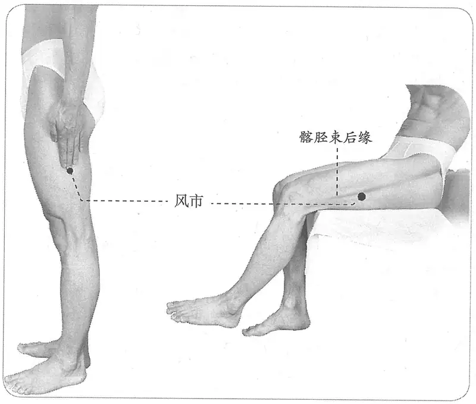

**图 2-342　风市穴图**

　　(2) 在膝上七寸股外侧两筋间，垂手中指点到处是穴。（《窦太师针经》、《针方六集》）

　　(3) 在膝上七寸，股外侧两筋间，垂手中指点到处是穴。（《大本琼瑶神书》）

　4. 在腿外廉，垂手中指尽处，广注：大腿外廉两筋间，令平身垂手，取中指点到处是，与阴市相平。（《循经考穴编》下）

　5. 膝上外廉两筋中，膝上约七寸处，直立垂手中指尽处。（《针灸十四经穴位考订》）

　6. 统编针灸学教材

　　(1) 部位：在腿外廉，垂手中指尽处。取穴：直立两手下垂，中指尖所至之处取之约在中渎穴上二寸。（1957年南京《针灸学》）

　　(2) 部位：股外侧，中渎穴上的二寸处。取穴：直立两手下垂，中指尖所至之处取之。（1版《针灸学讲义》）

　　(3) 部位：在膝上七寸，外侧两筋间。取穴：大腿外侧，腘横纹上七寸，股外侧肌与股二头肌之间，当直立垂手时中指止点处取之。（2版《针灸学讲义》）

　　(4) 大腿外侧中间，腘横纹水平线上7寸。（4、5版《针灸学》）

　　(5) 在大腿外侧部的中线上，当腘横纹上7寸，或直立垂手时，中指尖处。（6、7版《针灸学》，《中国针灸学》）

**文献分析**：关于本穴定位，古籍中元以前文献只有取穴法的描述，而无部位的描述：

风市，在膝外两筋间，平立舒下两手著腿，当中指头陷者宛宛中。（《太平圣惠方》）

中渎，在髀骨外膝上五寸分肉间陷者中。（《太平圣惠方》）

中渎穴定位“分肉间”，是指两块肌肉之间；风市定位“两筋间”或指两块肌肉之间，也可指两条肌腱之间。在大腿外侧部，两肌之间，或肌与腱之间，有两种可能：其一，为股外侧肌与股二头肌之间；其二，股外侧肌与髂胫束之间；如果是指前者，则与“平立舒下两手著腿，当中指头陷者宛宛中”所示不符，再者直立位时，也感受不到股二头肌的紧张。排除第一种可能性，就只能是股外侧肌与髂胫束之间。那么是在髂胫束前缘，还是后缘呢？这需要实验来判定，活体表面解剖学实验的结果表明：在髂胫束后缘。

〔p.1113 (인쇄 1085)〕

根据古典文献，我们只能确定本穴的横向位置，纵向位置，至元代文献虽有描述，但据此描述本穴与阴市的关系不正确。这样只能依据人体测量的数据确定，而不同研究者报道的相关数据出入较大[^42-1]，难以抉择，因此2006年版国标《腧穴名称与定位》依然没能补上关于部位的规范表述。

#### 【类属】 

足少阳胆经穴。

**归经**：足少阳胆经。（《医经小学》、《神应经》、《医学入门》等书以及嘉靖针灸铜人）

#### 【适应症】 

主治腰腿部病症。常用于半身不遂，腰腿痛，下肢痿痹；遍身瘙痒。

　1. 主两膝挛痛引胁拘急，䠶躄或青或焦或枯或黧如腐木。主缓纵痿痹，腨肠疼冷不仁。（《千金要方》卷三十）

　2. 主冷痹，脚胫麻，腿膝酸痛，腰尻重，起坐难。（《太平圣惠方·明堂》）

　3. 窦太师针灸遗存

　　(1) 治腿叉风，及腿股内酸疼，补泻；腰无力，半身不遂，补泻。又法治头晕，腿脚重。（《窦太师针经》）

　　(2) 治腰腿酸疼，起坐艰难，先泻后补；腿股风疼，先补后泻；治头晕，脚重。（《大本琼瑶神书》）

　　(3) 主中风瘫痪，顽麻，一切股膝胻足酸疼肿重，动履艰难之疾，又治浑身瘙痒疠风恶疮。（《循经考穴编》下）

　　(4) 治半身不随，瘫痪风湿之症。（《窦太师秘传》）

　4. 统编针灸学教材

　　(1) 主治中风瘫痪，半身不遂，顽麻冷痹，腿膝无力，遍身瘙痒，疠风。（1957年南京《针灸学》、1版《针灸学讲义》）

　　(2) 主治半身不遂，下肢痿痹、麻木，遍身瘙痒，脚气。（2版《针灸学讲义》）

　　(3) 主治腰腿酸痛，下肢痿痹，脚气。（4、5版《针灸学》）

　　(4) 主治半身不遂，下肢痿痹，遍身瘙痒，脚气。（6版《针灸学》）

　　(5) 主治下肢痿痹、麻木及半身不遂等下肢疾患；遍身瘙痒。（7版《针灸学》）

　　(6) 主治腰腿酸痛，下肢痿痹，脚气，全身瘙痒。（《中国针灸学》）

#### 附：临床应用举例 

　1. 腰腿部病症

　　(1) 凡脚气初得脚弱，初灸风市、次灸伏兔、次灸犊鼻、次灸膝两眼、次灸三里、次灸上廉、次灸下廉、次灸绝骨。（《千金要方》卷七）

　　(2) 若始觉脚弱，速灸风市、三里二穴，各一二百壮。若觉热闷，慎不可灸。（《全生指迷方》卷二）

　　(3) 两腿股瘫痪：内痛针血海，外痛针风市，泻之。（《针灸集要·盘石金直刺秘传》）

　　(4) 腿股风不能转动举止：环跳、风市、委中、昆仑、居髎、三里、阳陵泉。问曰：此证缘何而得？答曰：皆因房事过多，寒湿流注，推闪后腰痛疼动心。复刺后穴：五枢、阳辅。（《针灸集成》第四十五方）

[^42-1]: 胡智海，潘守伦．指导：潘山鹰．风市穴定位的人群抽样分析[J]．中国针灸，2001，21(2)：85-86；王启才．风市定穴取穴疑误[J]．上海针灸杂志，1985(3)：36.

〔p.1114 (인쇄 1086)〕

　　(5) 膝疼无力腿如瘫，穴法由来风市间，更兼阴市奇穴妙，纵步能行任往还。（《针灸玉龙歌》）

　　(6) 脚弱无力，行步艰难：太冲、厉兑补灸、风市灸。（《医学纲目》卷二十八）

　　(7) 足麻，足腿膝无力：风市在腿外廉垂手中指点到处是穴，针五分，补多泻少，留五呼，先泻成，后补生。（《医学纲目》卷二十八）

　　(8) 腰痛针承山，得气泻之立愈。或连胯痛，于风市、足三里兼泻之。（《医方类聚》卷九十四）

　2. 其他病症

　　(1) 或饮食不节，酒色过度，忽中此风，言语謇涩，半身不遂，宜于七处一齐下火，灸三壮。如风在左灸右，在右灸左：一百会穴，二耳前发际，三肩井穴，四风市穴，五三里穴，六绝骨穴，七曲池穴。右件七穴，神效极多，不能具录，依法灸之，无不获愈。（《太平圣惠方·明堂》）

　　(2) 治肾气外肾肿，小肠气痛，腹内虚鸣，灸风市穴五七壮，灸气海穴七壮，灸脐左右各去一寸半，两穴各七壮，灸之立效，后永不发，名外陵穴。（《世医得效方》卷三）

　　(3) 湿疹：风市、血海、曲池，针后施灸。[上海针灸杂志，1990，9(3)：封3]

#### 【操作】 

直刺1~1.5寸。

　1. 灸百壮。（《肘后备急方》卷三、《千金要方》、《千金翼方》）

　2. 刺入三分，灸二壮。（《医心方》卷二）

　3. 灸三壮。（《太平圣惠方·明堂》）

　4. 窦太师针灸遗存

　　(1) 针入五分，灸五十壮。（《窦太师针经》、《针方六集》、《大本琼瑶神书》）

　　(2) 针一寸，灸五壮。（《窦太师秘传》）

　5. 针五分，灸五壮。（《针灸十四经穴位考订》）

　6. 统编针灸学教材

　　(1) 针五至八分，灸五至七壮。（1957年南京《针灸学》、1版《针灸学讲义》）

　　(2) 直刺5~8分，艾条灸5~7分钟。（2版《针灸学讲义》）

　　(3) 直刺1~2寸。（4、5、6版《针灸学》）

　　(4) 直刺1~1.5寸。（7版《针灸学》）

　　(5) 直刺0.7~1.2寸。可灸。（《中国针灸学》）

　7. 直刺1.5~2.5寸。感应：局部酸胀，有时向下扩散。灸5~7壮；温灸5~20分钟。（上海《针灸学》）

### （三十二）中渎 Zhōngdǔ GB32 出《黄帝明堂经》 

#### 【提要索隐】 

**部位**：在股部，腘横纹上7寸，髂胫束后缘。

**适应症**：主治局部病症。常用于下肢痿痹，半身不遂。

**针刺操作**：直刺1~1.5寸。

#### 【名实考】 

中渎，明刊本《针灸甲乙经》卷三作“中犊”，卷十作“中渎”，与其他《黄帝明堂经》传本佚文同。

〔p.1115 (인쇄 1087)〕

关于本穴定位，《黄帝明堂经》作“膝上五寸分肉间”，所说“分肉间”是指股外侧肌与髂胫束之间。

　1. 中渎，在髀骨外，膝上五寸分肉间陷者中，足少阳脉气所发也。（《黄帝明堂经》）

　2. 渎者，行水之名，足太阳在其后，足阳明在其前，故曰中渎。（《经穴解》）

#### 【定位】 

**部位**：在股部，腘横纹上7寸，髂胫束后缘（图2-343）。

**取穴**：在股外侧，当风市穴下约2寸处分肉间陷中取之。

　1. 在髀骨外，膝上五寸分肉间陷者中。（《针灸甲乙经》卷三、宋校本《千金要方》、《铜人腧穴针灸图经》、《圣济总录》、《针灸资生经》、《十四经发挥》、《医学纲目》、《医学入门》、《针方六集》、《类经图翼》、《循经考穴编》、《医宗金鉴·刺灸心法要诀》）

　2. 在髀外，膝上五寸分肉间陷者中。（《千金翼方》卷二十六、《外台秘要》、《医心方》、《针灸聚英》、《古今医统》、《针灸大成》）

　3. 膝上五寸。（《针灸十四经穴位考订》）

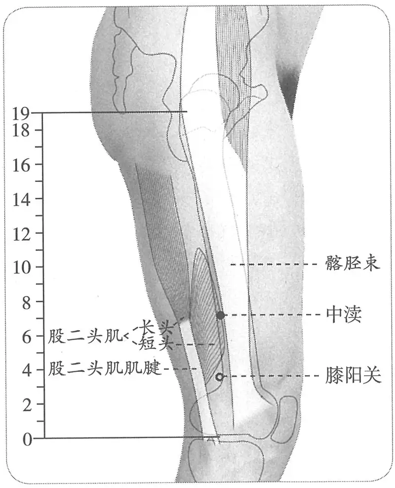

**图 2-343　中渎穴图**

　4. 广注一本序此穴在风市之前，且云风市上一寸。按《明堂》取阴市在膝上三寸，垂手正面点到处是。而风市亦然，且言与阴市相平。盖阴市在正面，而风市在腿外廉也，然二市既相齐，阴市上膝止三寸，中渎上膝乃五寸。则一本之序此穴在风市前，得无是欤。考诸《灵枢》、《经度》等书自是中渎在后，其膝上五寸之说，或有误耶？宜再细考。（《循经考穴编》下）

　5. 统编针灸学教材

　　(1) 部位：在髀外膝上五寸分肉间陷中。取穴：屈膝，从膝横纹头直上五寸处，与环跳穴成直线。（1957年南京《针灸学》）

　　(2) 部位：股外侧，膝上五寸。取穴：屈膝，从外辅骨上廉直上，于风市下约二寸处分肉间陷中取之。（1版《针灸学讲义》）

　　(3) 部位：在髀骨外，膝上五寸，分肉间陷中。取穴：在大腿外侧，腘横纹上五寸，当股外侧肌与股二头肌间取之。（2版《针灸学讲义》）

　　(4) 风市穴下2寸。（4、5版《针灸学》）

　　(5) 在大腿外侧，当风市下2寸，或腘横纹上5寸，股外侧肌与股二头肌之间。（6版《针灸学》）

　　(6) 大腿外侧正中，风市下2寸，或腘横纹上5寸。（7版《针灸学》）

　　(7) 在大腿外侧，腘横纹上五寸，当股外侧肌与股二头肌之间。（《中国针灸学》）

**文献分析**：“髀骨外”，明抄本《针灸甲乙经》、未经宋人校改之《孙真人千金方》皆作“髀外”，与其他《黄帝明堂经》传本同。《循经考穴编》所说或有将本穴排于风市穴之上者，皆因窦太师针灸将风市与阴市二穴相混，后人不察遂定风市与阴市同高——膝上三寸，则反低于中渎穴也。

〔p.1116 (인쇄 1088)〕

#### 【类属】 

足少阳胆经穴。

足少阳脉气所发也。（《黄帝明堂经》）

#### 【适应症】 

主治局部病症。常用于下肢痿痹，半身不遂。

　1. 主寒气在分肉间，痛上下者，苦痹不仁。（《黄帝明堂经》）

　2. 治寒气客于分肉之间，痛攻上下，筋痹不仁。（《铜人腧穴针灸图经》卷下）

　3. 主腿叉风痛连胯。（《循经考穴编》下）

　4. 统编针灸学教材

　　(1) 主治腿膝风痛，筋痹不仁，半身不遂。（1957年南京《针灸学》）

　　(2) 主治腿膝痛不仁，半身不遂，遍身瘙痒。（1版《针灸学讲义》）

　　(3) 主治下肢痿痹、麻木，半身不遂，痛上下痹不仁。（2版《针灸学讲义》）

　　(4) 主治腿膝酸痛，筋痹不仁，半身不遂。（4版《针灸学》）

　　(5) 主治下肢痿痹。（5版《针灸学》）

　　(6) 主治下肢痿痹、麻木，半身不遂。（6版《针灸学》）

　　(7) 主治下肢痿痹、麻木及半身不遂等下肢疾患。（7版《针灸学》）

　　(8) 主治腰腿痠痛，痿痹不仁，半身不遂。（《中国针灸学》）

#### 附：临床应用举例 

　1. 髀筋急胫痛，纵缓痿痹，腨疼膝冷，外廉不可屈伸，湿痹流肿，风市、中渎、阳关、悬钟。（《医学纲目》卷十二）

　2. 痿证，灸三里、肺俞，须停待气至一二时或三时方可针中渎、环跳。（《杂病治例》）

#### 【操作】 

直刺1~1.5寸。

　1. 刺入五分，留七呼，灸三壮。（《黄帝明堂经》）

　2. 禁用针灸。（《医学入门》卷一）

　3. 针五分，灸三壮。（《针灸十四经穴位考订》）

　4. 统编针灸学教材

　　(1) 针五至八分，灸五至七壮。（1957年南京《针灸学》、1版《针灸学讲义》）

　　(2) 直刺5~8分，艾条灸5~7分钟。（2版《针灸学讲义》）

　　(3) 直刺1~2寸。（4、5版《针灸学》）

　　(4) 直刺1~1.5寸；可灸。（6、7版《针灸学》）

　　(5) 直刺0.7~1.0寸。可灸。（《中国针灸学》）

### （三十三）膝阳关 Xīyángguān GB33 出《黄帝明堂经》 

#### 【提要索隐】 

**穴名**：一名关陵，一名关阳。

**部位**：在膝部，股骨外上髁后上缘，股二头肌腱与髂胫束之间的凹陷中。

**适应症**：主治局部病症。常用于膝腘肿痛、挛急，小腿麻木。

**针刺操作**：直刺1~1.5寸。

#### 【名实考】 

膝外陷中为寒府，《素问·六元正纪大论》曰：“太阳所至为寒府”，故曰“阳关”。

〔p.1117 (인쇄 1089)〕

膝阳关，古代文献均作“阳关”，与腰部“阳关”穴同名，后人难以分辨，每致二穴主治相混（详见“腰阳关”穴“名实考”）。又《千金要方》误倒作“关阳”，未经宋人校改之《孙真人千金方》无误，后人不察将其作为“阳关”穴的别名，非是。

　1. 阳关在阳陵泉上三寸，犊鼻外陷者中。（《黄帝明堂经》）

　2. 关阳，在阳陵泉上三寸，犊鼻外。一本云关陵。（《千金要方》卷二十九）

**按**：“关陵”疑为“阳陵”形误，而后者为阳陵泉穴的省写，明代高武误以此作“阳关”穴别名。

　3. 阳关，一名阳陵。（《针灸聚英》卷一）

　4. 寒府在附膝外解营。王冰注：膝外骨间也。屈伸之处，寒气喜中，故名寒府也。（《素问·骨空论》

　5. 此穴在膝之外，上下两骨之间，上下之脉过之，下交于上，上交于下，如关然。以足少阳之所统也，故曰阳关。（《经穴解》）

　6. 别名　寒府、关陵、阳陵、关阳。（南京《针灸学》）

**按**：此皆传日本针灸教材之误，韩国教材又从中国教材重复此误。

#### 【定位】 

**部位**：在膝部，股骨外上髁后上缘，股二头肌腱与髂胫束之间的凹陷中（图2-344）。

**取穴**：膝外侧，当阳陵泉直上三寸，股骨外上髁的上方凹陷中取之。

　1. 在阳陵泉上三寸，犊鼻外陷者中。（《黄帝明堂经》、《铜人腧穴针灸图经》、《圣济总录》、《十四经发挥》、《医学纲目》、《针灸聚英》、《古今医统》、《医学入门》、《针灸大成》、《针方六集》、《类经图翼》、《循经考穴编》、《针灸易学》）

　2. 在阳陵泉上五寸，犊鼻外陷中。（《千金翼方》卷二十六）

　3. 在阳陵泉上二寸，犊鼻外陷中。（《针灸资生经》卷一）

　4. 与膝关相对，即俗名膝眼者也。（《循经考穴编》下）

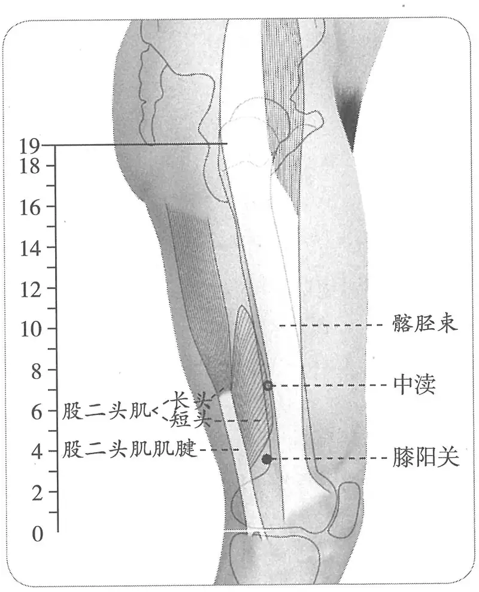

**图 2-344　膝阳关穴图**

　5. 从中渎下行膝上二寸，犊鼻外陷中。（《医宗金鉴·刺灸心法要诀》）

　6. 在阳陵泉上三寸陷者中。（《针灸逢源》）

　7. 阳陵泉上约三寸，犊鼻外骨后两筋间陷中。（《针灸十四经穴位考订》）

　8. 统编针灸学教材

　　(1) 部位：在阳陵泉上三寸外陷中。取穴：在膝关节外侧，屈膝于横纹至上端陷中，当阳陵泉直上三寸取之。（1957年南京《针灸学》）

　　(2) 部位：阳陵泉穴上三寸。取穴：中渎穴直下，于膝外辅骨之上两筋间陷中伸而取之。（1版《针灸学讲义》）

　　(3) 部位：在阳陵泉上三寸，犊鼻外陷者中。取穴：阳陵泉直上，股骨外上髁的上方凹陷中取之。（2版《针灸学讲义》）

〔p.1118 (인쇄 1090)〕

　　(4) 阳陵泉穴上3寸，股骨外上髁边缘凹陷中。（4、5、7版《针灸学》）

　　(5) 在膝外侧，当阳陵泉上3寸，股骨外上髁上方的凹陷处。（6版《针灸学》）

　　(6) 阳陵泉穴上3寸，股骨外上髁外上方凹陷中。（7版《针灸学》）

　　(7) 在阳陵泉上三寸，膝关节外侧，筋骨之间取之。（《中国针灸学》）

**文献分析**：《千金翼方》“阳陵泉上五寸”之“五”字系“三”之形误，五寸处则与“犊鼻外”不相当；《针灸资生经》卷一腧穴皆录自《铜人腧穴针灸图经》，所说“阳陵泉上二寸”，与《铜人腧穴针灸图经》不符，有误；本穴在膝眼之外侧，《循经考穴编》说“即俗名膝眼者也”，非是。

#### 【类属】 

足少阳胆经穴。

**归经**：足少阳经。（《产经》、《外台秘要》卷三十九、《铜人腧穴针灸图经》卷上）

#### 【适应症】 

主治局部病症。常用于膝腘肿痛、挛急，小腿麻木。

　1. 主膝外廉痛，不可屈伸，胫痹不仁。（《黄帝明堂经》）

　2. 治膝外痛不可屈伸，风痹不仁。（《铜人腧穴针灸图经》卷下）

　3. 主膝头红肿，不能屈伸，鹤膝风毒等证。（《循经考穴编》下）

　4. 统编针灸学教材

　　(1) 主治鹤膝风，膝红肿不能屈伸。（1957年南京《针灸学》、1版《针灸学讲义》）

　　(2) 主治膝肿痛，腘筋挛急，小腿麻木。（2版《针灸学讲义》、4版《针灸学》、《中国针灸学》）

　　(3) 主治膝腘肿痛挛急，小腿麻木。（5、6版《针灸学》）

　　(4) 主治膝腘肿痛、挛急及小腿麻木等下肢、膝关节疾患。（7版《针灸学》）

#### 【操作】 

直刺1~1.5寸。

　1. 刺入五分，禁不可灸。（《针灸甲乙经》）

　2. 刺入七分，灸三壮。（《医心方》卷二）

　3. 一法，横针入一寸五分，透膝关，可灸七壮。凌氏针法：此与膝关及委中三穴，刺之须使针锋相向为妙。（《循经考穴编》下）

　4. 针五分，禁灸。（《针灸十四经穴位考订》）

　5. 统编针灸学教材

　　(1) 针五分。（1957年南京《针灸学》）

　　(2) 针五分，禁灸。（1版《针灸学讲义》）

　　(3) 直刺5分。（2版《针灸学讲义》）

　　(4) 直刺1~1.5寸。（4、5、7版《针灸学》）

　　(5) 直刺0.8~1寸。（6、7版《针灸学》）

　6. 直刺1.5~2.5寸。感应：酸胀向大腿内侧。（上海《针灸学》）

### （三十四）阳陵泉 Yánglíngquán GB34 出《灵枢》 

#### 【提要索隐】 

**部位**：在小腿外侧，腓骨头前下方凹陷中。

**适应症**：主治胆、胁部病症。常用于胁痛，口苦，呕吐，吞酸；膝肿痛，下肢痿痹及麻木。

**针刺操作**：直刺1~1.5寸。不宜大幅度提插、捻转，避免刺中胫前动、静脉。

〔p.1119 (인쇄 1091)〕

#### 【名实考】 

膝下内外辅骨尖之突起如陵，骨下凹陷如泉，在内者曰“阴陵泉”，在外者曰“阳陵泉”。

有关本穴的名称、部位、取穴法、主治诸项，在《内经》中皆有论述，其取穴法内容甚至可补之后的腧穴经典《黄帝明堂经》之未备。

关于本穴定位，《灵枢》、《黄帝明堂经》所述皆不甚明确，今考《灵枢》多将本穴与阴陵泉对举如：“疾高而内者，取之阴之陵泉；疾高而外者，取之阳之陵泉也。”故阴陵泉的定位描述可供参考：膝下内侧辅骨下陷者中。则本穴定位当以膝外侧辅骨——腓骨小头为基准，综合各家之说，结合足少阳经脉循行部位，确定本穴定位为：腓骨小头前下凹陷中。

需要特别指出的是，《铜人腧穴针灸图经》将“阴陵泉”刺法及“巨虚下廉”取穴法内容混入本穴下，后人不察多传其误。

　1. 阳之陵泉，在膝外陷者中也，为合，伸而得之。（《灵枢·本输》）

　2. 阳陵泉者，正竖膝予之齐下至委阳之阳取之；取诸外经者，揄申而从之。（《灵枢·邪气藏府病形》）

**按**：正屈膝（90°）时，本穴与委阳穴平齐。

　3. 入于阳陵泉，阳陵泉者，土也。在膝下一寸外廉陷者中，足少阳脉之所入也，为合。（《黄帝明堂经》）

　4. 穴之称陵者，以仅在膝下，膝有高陵之象焉，故曰陵。阳者，以本经而得名也。泉者，乃本经之脉至此下注，有泉之象焉。如本经自下而上升，又为所入为合土，脉自土中出，又有泉象。（《经穴解》）

　5. 别名　筋会、阳之陵泉、阳陵。（《针灸学》）

**按**：筋会，与“下合穴”一样，是穴位的属性而不是名称；如果“阳之陵泉”也视作别名的话，那么别名何其多？诸如“足之临泣”、“地之五会”、“膝之阳关”皆是；“阳陵”是“阳陵泉”之省。此皆传日本教材之误。

#### 相关穴及刺激点 

　1. 胆囊　位于小腿腓侧，腓骨小头前缘下凹陷直下1.5寸处，即阳陵泉穴直下1.5寸处。主治胆道蛔虫症，胆囊炎，胸胁痛，腰腿痛，下肢瘫痪，口限歪斜。针1~2寸，针感麻、酸至外踝。灸三至五壮。（《针灸经外奇穴图谱（续集）》）

　2. 陵下　位于小腿腓侧，腓骨小头前缘下凹陷直下二寸。阳陵泉穴直下二寸。主治聋哑，胆囊炎，胆石症，胆道蛔虫症。针1.5~2寸，针感麻、酸至外踝。灸3~5壮。（《针灸经外奇穴图谱（续集）》）

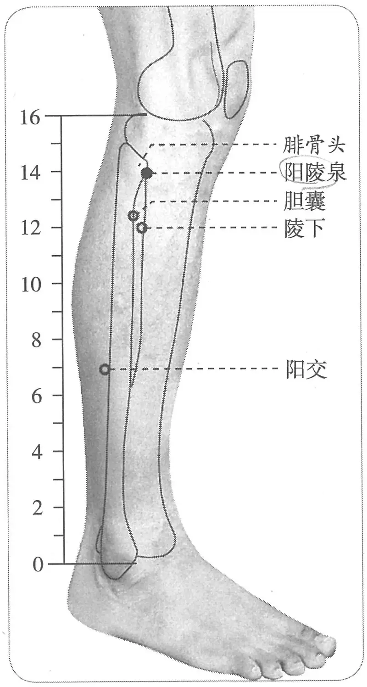

**图 2-345　阳陵泉穴与相关穴图**

#### 【定位】 

**部位**：在小腿外侧，腓骨头前下方凹陷中（图2-345）。

**取穴**：屈膝，从膝外腓骨小头前下端陷中取之。

　1. 在膝外陷者中也，为合。伸而得之。（《灵枢·本输》）

　2. 《黄帝明堂经》佚文

　　(1) 在膝下一寸，外廉陷中。（《千金要方》卷二十九、《千金翼方》、《外台秘要》、《医心方》、《太平圣惠方》、《铜人腧穴针灸图经》卷上、《圣济总录》、《针灸资生经》、《十四经发挥》、《循经考穴编》）

〔p.1120 (인쇄 1092)〕

　　(2) 在膝下一寸，胻外廉陷者中。（《针灸甲乙经》卷三、《素问·痹论》王冰注、《针灸聚英》、《古今医统》、《针灸大成》、《针方六集》、《针灸易学》、《针灸逢源》）

　3. 穴在膝下外尖骨前陷者中是。（《千金要方》卷八、《千金翼方》、《外台秘要》、《针灸资生经》）

　4. 在膝上外陷者中也。（《素问·通评虚实论》王冰注）

**按**：“膝上”乃“膝下”之误也，其注《痹论》作“膝下”无误。

　5. 膝外侧骨下宛宛陷者是。（《医心方》卷八）

　6. 又以蹲坐取之。（《铜人腧穴针灸图经》卷下、《针灸聚英》、《针灸入门》、《针灸大成》、《类经图翼》、《循经考穴编》、《医宗金鉴·刺灸心法要诀》、《针灸易学》）

　7. 窦太师针灸遗存

　　(1) 在膝外辅骨下一指陷中。（《针灸玉龙歌》注）

　　(2) 在膝下一寸，膝外辅骨下一指陷中。（《窦太师针经》）

　　(3) 在膝下外廉辅骨下陷中。（《窦太师秘传》）

　8. 在膝下一寸，外廉胻骨下微侧陷中。（《针灸玉龙经》）

　9. 膝品骨下一寸，外廉两骨陷中，以蹲坐取之。（《医学入门》卷一）

　10. 在膝下一寸外廉陷中，尖骨前筋骨间。（《类经图翼》卷八、《医宗金鉴·刺灸心法要诀》）

　11. 在膝下一寸外廉陷中。广注：膝下胻骨外廉，辅骨即小圆骨下寸许，大筋微前陷中，蹲坐取之。（《循经考穴编》下）

　12. 膝下胻骨外廉腓骨头前下方陷中。（《针灸十四经穴位考订》）

　13. 统编针灸学教材

　　(1) 部位：膝下一寸外辅骨陷中。取穴：正坐屈膝垂足，从膝外侧关节之下，按取腓骨小头微前下陷中取之。（1957年南京《针灸学》）

　　(2) 部位：膝下一寸外辅骨陷中。取穴：屈膝，从膝外辅骨下廉小头前下端陷中取之。（1版《针灸学讲义》）

　　(3) 部位：在膝下一寸，胻外廉陷者中。取穴：在腓骨小头之前下方凹陷处取之。（2版《针灸学讲义》）

　　(4) 腓骨小头前下方凹陷中。（4、5、7版《针灸学》，《中国针灸学》）

　　(5) 在小腿外侧，当腓骨头前下方凹陷处。（6版《针灸学》）

**文献考证**：关于本穴定位，古代文献有三说，要确定这三说的关系，关键是要确定第二说的“膝下外尖骨”，与第3说的“膝下外辅骨”是不是同一个概念。所说“膝下外尖骨”显然是指腓骨小头，而“外辅骨”，《灵枢·经脉》谓足少阳胆经“循髀阳，出膝外廉，下外辅骨之前，直下抵绝骨之端，下出外踝之前”，则可判定，这里的“外辅骨”是指腓骨小头，《循经考穴编》将其注作“小圆骨”，非常正确。那么，究竟是在腓骨小头前，或下，或前下方呢？综合《千金要方》“尖骨前”、《医心方》“膝外侧骨下宛宛陷者”、《窦太师针经》“外辅骨下一指”三说，再结合本穴与“阴陵泉”的横向关系，定于腓骨小头前下际凹陷处，最稳。

〔p.1121 (인쇄 1093)〕

需要注意的是，《铜人腧穴针灸图经》载本穴取穴法“又以蹲坐取之”，系将《太平圣惠方·针经》巨虚下廉穴取穴法混入本穴下，原文作“蹲地坐而取之”，后人不察皆传其误。今人则以此法为正法，复以今之“坐”之概念理解古义，又见传世本《针灸甲乙经》“外廉”有“胻”字，并理解为胫骨，进而谓本穴当定于腓骨小头之前[^43-1]。

#### 【类属】 

足少阳经合穴。

足少阳脉之所入也，为合。（《黄帝明堂经》）

#### 【适应症】 

主治胆、胁部病症。常用于胁痛，口苦，呕吐，吞酸；膝肿痛，下肢痿痹及麻木。

　1. 主善太息，口苦，呕宿汁，心下澹澹，恐如人将捕之，嗌中吤吤然，数唾。胁下支满，呕吐逆。髀痹引膝股外廉痛，不仁，筋急。胆胀。（《黄帝明堂经》）

**按**：以上病症包括“胆病”（见《灵枢·邪气藏府病形》）、“胆胀”（见《灵枢·胀论》），两者共同的症状是“口苦，善太息”，此外，胆病部位在胁下，故“胆胀”有“胁下痛胀”；呕吐有“胁下楮满”，皆系胆病的典型的症状，也就是说不论何病，只要出现“口苦”、“太息”及胁下症状，即取阳陵泉穴治之。

　2. 喉中鸣。（《太平圣惠方·明堂》）

　3. 治膝伸不得屈，冷痹，脚不仁，偏风半身不遂，脚冷无血色。（《铜人腧穴针灸图经》卷下）

　4. 窦太师针灸遗存

　　(1) 治鹤膝风肿痛，泻；腰胁肿疼，筋紧拘挛痛，先泻后补。（《窦太师针经》）

　　(2) 鹤膝红肿，胁肋痛，遍身麻木。（《循经考穴编》下）

　　(3) 治膝盖红肿，半身不随，脚冷无血色。（《窦太师秘传》）

　5. 脚气。（《针灸聚英》卷一、《针灸大成》）

**按**：此为高武从《针灸资生经》卷五辑录《千金要方》治脚气方主治。

　6. 统编针灸学教材

　　(1) 主治头面肿，苦嗌中介然，胁肋痛，半身不遂，膝股内外廉不仁，鹤膝红肿不能屈伸。（1957年南京《针灸学》）

　　(2) 主治头面肿，口苦，胁肋痛，半身不遂，膝股内外廉不仁，鹤膝红肿不能屈伸。（1版《针灸学讲义》）

　　(3) 主治半身不遂，下肢痿痹、麻木，膝肿痛，脚气，胁肋痛，口苦，呕吐，黄疸，小儿惊风。（2版《针灸学讲义》）

　　(4) 主治下肢痿痹，脚气，口苦，呕吐，胁痛。（4版《针灸学》）

　　(5) 主治胁痛，口苦，呕吐，下肢痿痹，脚气，黄疸，小儿惊风。（5版《针灸学》）

　　(6) 主治胁痛，口苦，呕吐，半身不遂，下肢痿痹，脚气，黄疸，小儿惊风。（6版《针灸学》）

　　(7) 主治①黄疸、胁痛、口苦、呕吐、吞酸等肝胆犯胃病证；②膝肿痛、下肢痿痹及麻木等下肢、膝关节疾患；③小儿惊风。（7版《针灸学》）

　　(8) 主治半身不遂，下肢痿痹、麻木，膝膑肿痛，脚气，胁肋痛，口苦，呕吐，黄疸，小儿惊风。（《中国针灸学》）

**文献分析**：教材中“黄疸”一症，盖依据《素问·奇病论》“胆瘅”，此为胆热之义，与现行之“黄疸”概念不尽相同，且《素问》原文“治之以胆募俞”，未明言取下合穴。又教材中“小儿惊风”症未详所出，暂不收录于本穴主治。

[^43-1]: 徐立，王卫．阳陵泉、曲池穴取穴方法初探．天津中医，1990（2）：22-23.

〔p.1122 (인쇄 1094)〕

#### 附：临床应用举例 

　1. 胆、胁部病症

　　(1) 胆病者，善太息，口苦，呕宿汁，心下澹澹，恐人将捕之，嗌中吤吤然，数唾，在足少阳之本末，亦视其脉之陷下者灸之，其寒热者取阳陵泉。（《灵枢·邪气藏府病形》）

　　(2) 帝曰：有病口苦，取阳陵泉，口苦者病名为何？何以得之？岐伯曰：病名曰胆瘅。夫肝者，中之将也。取决于胆，咽为之使。此人者，数谋虑不决，故胆虚气上溢而口为之苦，治之以胆募俞，治在“阴阳十二官相使”中。（《素问·奇病论》）

　　(3) 胆咳之状，咳呕胆汁。治府者治其合。（《素问·咳论》）

　　(4) 胁下肋边者，刺阳陵而即止。（《通玄指要赋》）

　　(5) 肋间神经痛：内关穴、阳陵泉穴、阴陵泉穴，留针拔罐法治疗。［云南中医杂志，1985，6（4）：33］

　　(6) 急性胆囊炎：期门穴、阳陵泉穴，针刺治疗。［中国针灸，1986，6（4）：5-6］

　　(7) 肋间神经痛：阳陵泉穴，针刺治疗。［四川中医，1987，5（12）：50］

　　(8) 急性胆囊炎：期门穴、阳陵泉穴，针灸疗法。［浙江中医杂志，1987，22（3）：115］

　2. 下肢病症

　　(1) 仁寿宫备身患脚，奉敕针环跳、阳陵泉、巨虚下廉、阳辅，即起行。（《千金要方》卷八）

　　(2) 中风半身瘫痪，疼痛麻木，不遂：针合谷、手三里、曲池、肩井、环跳、血海、阳陵泉、阴陵泉、足三里、绝骨、居髎。（《针灸集要·盘石金直刺秘传》）

　　(3) 两膝红肿疼痛：膝关、委中、三里。问曰：此证缘何而得？答曰：皆因痹经受湿，痰饮流注，或因痢后寒邪入于经络，及伤寒流注，故如此也。复刺后穴：阳陵泉、中脘、丰隆。（《针灸集成》第四十方）

　　(4) 腿股风不能转动举止：环跳、风市、委中、昆仑、居髎、三里、阳陵泉。问曰：此证缘何而得？答曰：皆因房事过多，寒湿流注，推闪后腰痛疼动心。复刺后穴：五枢、阳辅。（《针灸集成》第四十五方）

　　(5) 膝盖肿起：曲池一寸半、阳陵泉一寸半。（《医学纲目》卷十二）

　　(6) 红肿名为鹤膝风，阳陵二穴便宜攻，阴陵亦是通神穴，针到方知有俊功。（《针灸玉龙歌》）

　　(7) 环跳与阳陵，膝前兼腋胁。（《千金十一穴歌》）

　　(8) 阴𫏋阳𫏋两踝边，脚气四穴先寻取。阴阳陵泉亦主之，阴𫏋阳𫏋与三里，诸穴一般治脚气，在腰玄机宜正取。（《灵光赋》）

**按**：阴𫏋，相当于照海；阳𫏋，相当于申脉穴。

　　(9) 最是阳陵泉一穴，膝间疼痛用针烧。（《席弘赋》）

　　(10) 脚痛膝肿针三里，悬钟二陵三阴交，更向太冲须引气，指头麻木自轻飘。（《席弘赋》）

　　(11) 急性腰扭伤：阳陵泉穴，推拿结合针刺。［浙江中医学院学报，1984，8（1）：30］

　　(12) 踝扭伤：阳陵泉穴，针刺。［四川中医，1985，3（12）：51］

　　(13) 腓总神经损伤：环跳穴、阳陵泉穴，针灸疗法。［上海针灸杂志，1986，5（4）：18］

　　(14) 外踝关节扭伤：针刺足三里、阳陵泉，治愈。［贵阳中医学院学报，1995，17（1）：22］

〔p.1123 (인쇄 1095)〕

　　(15) 踝关节韧带损伤：透刺阳陵泉治疗。［国医论坛，2000，15（5）：41］

　　(16) 坐骨神经痛：主刺阳陵泉穴治疗。［武汉市职工医学院学报，2000，28（1）：37］

　　(17) 踝内翻扭伤：深刺阳陵泉治疗。［江西中医药，2001，32（6）：34］

　3. 其他病症

　　(1) 虚劳尿精，灸第七椎两旁各三十壮……又灸阳陵泉、阴陵泉各随年壮。（《千金要方》卷十九）

　　(2) 遗尿，灸遗道，夹玉泉五寸。随年壮。又灸阳陵泉，随年壮。又灸足阳明，随年壮。（《千金要方》卷二十一）

　　(3) 遗尿失禁：阴陵泉、阳陵泉二寸半、大敦七壮。（《医学纲目》卷十四）

　　(4) 口热咽干，唾如粘胶，口苦，嗌中介介然：太溪五分、阳陵泉二寸半。（《医学纲目》卷二十一）

　　(5) 肩痛：肩髃穴、阳陵泉穴，针灸疗法。［中医药研究，1984（创）：21］

　　(6) 上肢痹证：针刺阳陵泉治疗。［山东中医杂志，1999，18（10）：455］

　　(7) 痹痛：风池穴、阳陵泉穴，针刺治疗。［四川中医，1987，5（3）：47］

　　(8) 肩周炎：活动态下针刺阳陵泉治疗。［成都中医药大学学报，1997，20（3）：36］

　　(9) 带状疱疹：合谷穴、阳陵泉穴、支沟穴，针刺治疗。［上海针灸杂志，1985（3）：6］

　　(10) 阵发性抽搐：太冲穴、阳陵泉穴，针刺治疗。［上海针灸杂志，1986，5（4）：43］

　　(11) 带状疱疹性三叉神经痛：风池穴、阳陵泉穴，针灸治疗。［广西中医药，1988，11（6）：247］

　　(12) 痉挛瘫痪：针刺阳陵泉为主治疗。［中国医刊，1999，34（3）：52］

　　(13) 周围性面瘫：针刺阳陵泉、太冲穴为主治疗。［针灸临床杂志，2000，16（10）：49］

#### 【操作】 

直刺1~1.5寸。不宜大幅度提插、捻转，避免刺中胫前动、静脉。

　1. 刺入六分，留十呼，灸三壮。（《黄帝明堂经》）

　2. 灸一壮。（《太平圣惠方·明堂》）

　3. 针入六分，得气即泻，又宜久留针为要也。又以蹲坐取之。灸亦良，日可灸七壮，至七七壮即止。（《铜人腧穴针灸图经》卷下）

**按**：“又宜久留针为要也”乃《灵枢》阴陵泉穴刺法（《灵枢·四时气》“补阴陵泉，皆久留之，热行乃止”），王惟一误作“阳陵泉”；“又以蹲坐取之。灸亦良，日可灸七壮，至七七壮即止”句，见于《太平圣惠方·针经》“巨虚下廉”穴下，王惟一错入于此。

　4. 窦太师针灸遗存

　　(1) 横针透阴陵泉，针入二寸，看病补泻。（《针灸玉龙歌》注）

　　(2) 横针透阴陵泉穴。治鹤膝风肿痛，泻；腰胁肿疼，筋紧拘挛痛，先泻后补。（《窦太师针经》）

　　(3) 横针透阴陵泉，灸三七壮。（《窦太师秘传》）

　5. 凌氏横针一寸五分，可灸。（《循经考穴编》下）

**按**：此“凌氏”是指明代针灸大家“凌云”。

　6. 统编针灸学教材

　　(1) 针八分至一寸余，依取穴法进针，灸五至七壮。（1957年南京《针灸学》、1版《针灸学讲义》）

　　(2) 直刺8~12分，艾条灸5~7分钟。（2版《针灸学讲义》）

〔p.1124 (인쇄 1096)〕

　　(3) 直刺1~1.5寸。（4、5、6、7版《针灸学》）

　　(4) 直刺0.8~1.2寸。可灸。（《中国针灸学》）

　7. 直刺，向胫骨后缘斜下刺入，深1~3寸。感应：酸胀感向下扩散。（上海《针灸学》）

### （三十五）阳交 Yángjiāo GB35 出《黄帝明堂经》 

#### 【提要索隐】 

**穴名**：一名别阳，一名足窌。

**部位**：在小腿外侧，外踝尖上7寸，腓骨后缘。

**适应症**：主治神志、局部病症。常用于胸满，咽喉肿痛；癫狂，抽搐；下肢痿痹、转筋。

**针刺操作**：直刺0.5~0.8寸。

#### 【名实考】 

阳交，一名别阳，一名足窌。本穴为阳维之郄，位于足少阳、足太阳之间，故曰“阳交”；又因其“斜属三阳分肉间”，故又名“别阳”。

本穴与外丘穴定位，皆在“外踝上七寸”，根据《黄帝明堂经》关于阳交穴的归经与定位描述，不难判定两者的位置关系为：外丘在前、阳交在后。然而不同时代不同医家对此有种种不同理解。

　1. 阳交，一名别阳，一名足窌，阳维之郄。在外踝上七寸，斜属三阳分肉间。（《黄帝明堂经》）

　2. 阳交，又名阳维。（《窦太师针经》）

**按**：另一抄本无，疑是将“阳维郄”误抄作“阳维”。

　3. 阳维自下来者，以此穴为郄，而遇少阳过之，此穴两阳相遇，故曰阳交。（《经穴解》）

#### “阳交”与“外丘”位置关系 

足少阳经穴定位变化较大的为阳交与外丘位置的前后关系，主要分歧有以下几种：

　1. 阳交在前，外丘在后　见黄竹斋《针灸经穴图考》、1957年南京《针灸学》、2版教材《针灸学讲义》、北京中医学院1965年《人体经穴挂图》。

　2. 外丘在前，阳交在后　见明靳贤修铜人图、承淡安《人体经穴图》、1960年上海《针灸学讲义》。

　3. 外丘在前上方，阳交在后下方。（明正统仿宋铜人）

　4. 阳交在上，外丘在下。（清光绪铜人）

#### 【定位】 

**部位**：在小腿外侧，外踝尖上7寸，腓骨后缘（图2-346）。

**取穴**：外踝尖与腘横纹外侧端连线中点下1寸，外丘后，腓骨后缘处取之。

　1. 在外踝上七寸，斜属三阳分肉间。（《黄帝明堂经》、《铜人腧穴针灸图经》、《圣济总录》、《针灸资生经》、《窦太师针经》、《窦太师秘传》、《针

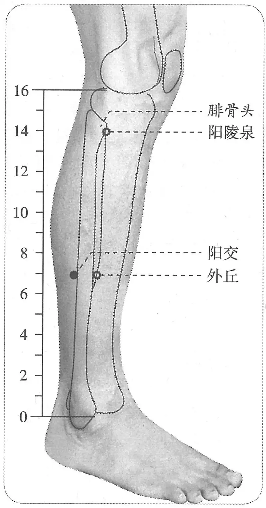

**图2-346　阳交穴图**

〔p.1125 (인쇄 1097)〕

灸玉龙经》、《十四经发挥》、《医学纲目》、《针灸聚英》、《古今医统》、《针灸大成》、《针方六集》、《类经图翼》、《医宗金鉴·刺灸心法要诀》、《针灸易学》、《针灸逢源》）

　2. 一本云踝上三寸。（《千金要方》卷二十九注）

　3. 与外丘并，斜向三阳分肉间。（《医学入门》卷一）

　4. 外丘当在光明直上，而阳交微在外丘里许，上对阳陵泉。阳维之郄也。（《循经考穴编》下）

　5. 外踝直上七寸。（《针灸十四经穴位考订》）

　6. 统编针灸学教材

　　(1) 部位：外踝上七寸。取穴：取丘墟与阳陵泉相直，从丘墟直上七寸取之在外丘之前。（1957年南京《针灸学》）

　　(2) 部位：外踝上七寸。取穴：在阳陵泉穴下方，辅骨前缘取之。（1版《针灸学讲义》）

　　(3) 部位：在外踝上七寸，斜属三阳分肉间。取穴：在外踝尖上七寸，腓骨前缘，当外踝尖与阳陵泉的连线上取之。（2版《针灸学讲义》）

　　(4) 外丘穴后1寸。（4版《针灸学》）

　　(5) 外踝高点上7寸，腓骨后缘。（5、7版《针灸学》，《中国针灸学》）

　　(6) 在小腿外侧，当外踝尖上7寸，腓骨后缘。（6版《针灸学》）

**文献分析**：《千金要方》注文“一本云踝上三寸”，疑是将“三阴交”部位误注于此，未经宋人校改本《孙真人千金方》无此注。

#### 【类属】 

足少阳胆经穴。

**脉气所发**：阳维之郄。（《黄帝明堂经》）

**归经**：足少阳经。（《外台秘要》卷三十九、《铜人腧穴针灸图经》卷上）

#### 【适应症】 

主治神志、局部病症。常用于胸满，咽喉肿痛；癫狂，抽搐；下肢痿痹、转筋。

　1. 主寒厥，癫疾，噤蚧，瘛疭，惊狂。喉痹。胸满面肿。寒热，髀胫不收。瘖不能言。（《黄帝明堂经》）

　2. 治寒厥，惊狂，喉痹，胸满面肿，寒痹膝胻不收。（《铜人腧穴针灸图经》卷下）

　3. 窦太师针灸遗存

　　(1) 治霍乱吐泻，足转筋疼。（《窦太师针经》）

　　(2) 转筋痹痛。（《针方六集》卷五）

　　(3) 治霍乱转筋。（《循经考穴编》下）

　4. 统编针灸学教材

　　(1) 主治面肿，喉痹，胸满，膝痛酸痹，足缓不收。（1957年南京《针灸学》、1版《针灸学讲义》）

　　(2) 主治胸胁胀满，膝痛，足痿无力，惊狂，面肿。（2版《针灸学讲义》）

　　(3) 主治胸胁胀满，足胫痿痹，惊狂癫疾，喑不能言。（4版《针灸学》）

　　(4) 主治胸胁胀满，下肢痿痹，癫狂。（5、6版《针灸学》）

　　(5) 主治①惊狂、癫痫等神志病症；②瘛疭；③胸胁胀满；④下肢痿痹。（7版《针灸学》）

　　(6) 主治胸胁胀满，下肢痿痹。（《中国针灸学》）

#### 【操作】 

直刺0.5~0.8寸。

　1. 刺入六分，留七呼，灸三壮。（《黄帝明堂经》）

　2. 窦太师针灸遗存

〔p.1126 (인쇄 1098)〕

　　(1) 针入五分，灸七壮。治霍乱吐泻，足转筋疼，泻补。又法横针入二分半，灸七壮。（《窦太师针经》）

　　(2) 窦氏：刺入二寸半，透中都穴，灸二七壮。（《针方六集》卷一）

　　(3) 针七分，灸二七壮，多补少泻。（《窦太师秘传》）

　3. 统编针灸学教材

　　(1) 针五至八分，灸五至七壮。（1957年南京《针灸学》、1版《针灸学讲义》）

　　(2) 直刺5~8分，艾条灸3~5分钟。（2版《针灸学讲义》）

　　(3) 直刺1~1.5寸。（4、5版《针灸学》）

　　(4) 直刺0.5~0.8寸，可灸。（6、7版《针灸学》，《中国针灸学》）

### （三十六）外丘 Wàiqiū GB36 出《黄帝明堂经》 

#### 【提要索隐】 

**部位**：在小腿外侧，外踝尖上7寸，腓骨前缘。

**适应症**：主治胸胁部、局部病症。常用于胸胁胀满，下肢痿痹；癫，狂，痫。

**针刺操作**：直刺0.5~0.8寸。

#### 【名实考】 

关于本穴与阳交穴的位置关系，详见阳交穴“名实考”。

　1. 外丘，足少阳郄，少阳所生。在外踝上七寸。（《黄帝明堂经》）

　2. 阳交之下于此穴稍高，乃向后稍自外踝而上六寸，而稍斜向后，得其肉之稍高处是穴，故曰外丘。（《经穴解》）

#### 【定位】 

**部位**：在小腿外侧，外踝尖上7寸，腓骨前缘（图2-347）。

**取穴**：外踝尖与腘横纹外侧端连线中点下1寸，阳交前，腓骨前缘处取之。

　1. 在外踝上七寸。（《黄帝明堂经》、《铜人腧穴针灸图经》、《圣济总录》、《针灸资生经》、《十四经发挥》、《医学纲目》、《针灸聚英》、《古今医统》、《医学入门》、《针灸大成》、《针方六集》、《类经图翼》、《循经考穴编》、《针灸易学》）

　2. 从阳交行外踝上七寸外斜。（《医宗金鉴·刺灸心法要诀》）

　3. 在外踝上六寸，外斜。旧本踝上七寸，误。（《针灸逢源》）

　4. 阳交穴前行约五分许。（《针灸十四经穴位考订》）

　5. 统编针灸学教材

　　(1) 部位：外踝上七寸。取穴：从外踝骨中央线直上七寸处取之，与阳交穴相并，阳交在前，外丘在后。（1957年南京《针灸学》）

　　(2) 部位：外踝上七寸。取穴：从外踝骨中央线直上，于辅骨后缘取之，阳交穴在前，外丘穴在后。（1版《针灸学讲义》）

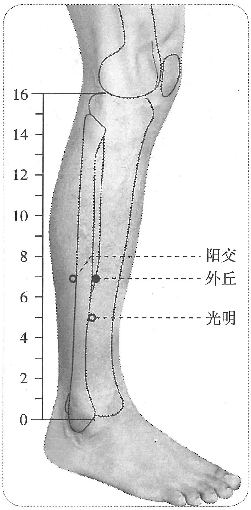

**图2-347　外丘穴图**

〔p.1127 (인쇄 1099)〕

　　(3) 部位：外踝上七寸。取穴：与阳交同高，当阳交之后约一横指，腓骨后缘取之。（2版《针灸学讲义》）

　　(4) 外踝上七寸，腓骨前缘。（4、5、6版《针灸学》，《中国针灸学》）

　　(5) 在小腿外侧，当外踝尖上7寸，腓骨前缘，平阳交。（6版《针灸学》）

**文献分析**：关于本穴与阳交穴的横向位置关系，古今文献一直存在分歧，关键在于没有正确理解《黄帝明堂经》关于阳交穴的定位描述，也没有考虑二穴不同归经属性。《针灸逢源》对本穴折量寸所做的调整，也是由于未正确理解两者的位置关系。

#### 【类属】 

足少阳胆经郄穴。

足少阳郄，少阳所生。（《黄帝明堂经》）

#### 【适应症】 

主治胸胁部、局部病症。常用于胸胁胀满，下肢痿痹；癫，狂，痫。

　1. 主肤痛痿痹。胸胁支满，头痛，项内寒热。癫疾。（《黄帝明堂经》）

　2. 治肤痛痿痹，胸胁胀满，颈项痛，恶风寒，癫疾……今附：猘犬所伤，毒不出，发寒热，速以三姓人可灸所啮之处，立愈。（《铜人腧穴针灸图经》卷下）

**按**：此灸法出于《素问·寒热病》，原文作“犬所啮之处灸之三壮，即以犬伤病法灸之”，原未明言取“外丘”穴，观明拓本《铜人腧穴针灸图经》原文，及《针灸资生经》引文“速以三壮艾可灸啮处”，均是犬所啮处，与《素问》同，未详王惟一何以附于“外丘”穴下，疑文字有误。

　3. 小儿龟胸。（《针灸聚英》卷一、《针灸大成》、《针方六集》、《循经考穴编》）

**按**：《针灸资生经》载外丘穴虽见于“龟胸”篇中，但所录乃《铜人腧穴针灸图经》主治“胸胁胀满”，未言主“小儿龟胸”，疑此乃高武辑录有误。

　4. 阳厥，足外热，腰膝外踝皆痛，足小指次指不用。（《针方六集》卷五）

**按**：此悉为足少阳经脉病候文字，未详吴崑何以归于本穴主治中。

　5. 主寒湿脚气。（《循经考穴编》下）

　6. 统编针灸学教材

　　(1) 主治颈项痛，胸痛，湿脚气，小儿龟胸，癫疾，猘犬伤而发寒热者灸之。（1957年南京《针灸学》）

　　(2) 主治颈项痛，胸痛，湿脚气，小儿龟胸，癫疾。按文献记载：本穴可灸疗狂犬咬伤而发寒热者。（1版《针灸学讲义》）

　　(3) 主治颈项痛，胸胁痛，猘犬伤毒不出，肤痛痿痹。（2版《针灸学讲义》）

　　(4) 主治胸胁支满，肤痛痿痹，癫疾呕沫。（4版《针灸学》）

　　(5) 主治胸胁胀满，下肢痿痹，癫狂。（5、7版《针灸学》）

　　(6) 主治颈项强痛，胸胁胀满，下肢痿痹，癫狂。（6版《针灸学》）

　　(7) 主治胸胁痛，颈项痛，腿痛，猘犬伤毒不出。（《中国针灸学》）

**文献分析**：“猘犬伤毒不出”虽出于《铜人腧穴针灸图经》新附之主治，但颇有疑问，暂不收录。而“小儿龟胸”乃承袭高武《针灸聚英》之误，今去之。

#### 【操作】 

直刺0.5~0.8寸。

　1. 刺入三分，灸三壮。（《黄帝明堂经》）

　2. 针入三分，可灸三壮。今附：猘犬所伤，毒不出，发寒热，速以三姓人可灸所啮之处，立愈。（《铜人腧穴针灸图经》卷下）

　3. 针五分，灸三壮。（《针灸十四经穴位考订》）

　4. 统编针灸学教材

〔p.1128 (인쇄 1100)〕

　　(1) 针五至八分，灸三至七壮。（1957年南京《针灸学》、1版《针灸学讲义》）

　　(2) 直刺5~8分，艾条灸3~5分钟。（2版《针灸学讲义》）

　　(3) 直刺1~1.5寸。（4、5、6版《针灸学》）

　　(4) 直刺0.5~0.8寸。（7版《针灸学》、《中国针灸学》）

### （三十七）光明 Guāngmíng GB37 出《灵枢》 

#### 【提要索隐】 

**部位**：在小腿外侧，外踝尖上5寸，腓骨前缘。

**适应症**：主治目疾。常用于目痛，夜盲，近视，目翳；下肢痿痹。

**针刺操作**：直刺0.5~0.8寸。

#### 【名实考】 

光明，既是穴名，又是脉名。又敦煌卷子《新集备急灸法》、《银海精微》以眉中为“光明”；《黄帝明堂经》谓攒竹穴别名为“明光”，《铜人腧穴针灸图经》作“光明”，皆关乎目。在阅读这些文献时，应注意鉴别，切不可将同名之“光明”误作本穴。

　1. 足少阳之别，名曰光明，去踝五寸，别走厥阴，下络足跗。实则厥，虚则痿躄，坐不能起，取之所别也。（《灵枢·经脉》）

　2. 足少阳根于窍阴，溜于丘墟，注于阳辅，入于天容、光明也。（《灵枢·根结》）

　3. 光明，足少阳络，在足外踝上五寸，别走厥阴者。（《黄帝明堂经》）

　4. 杨上善曰：光明，即眼也。少阳、厥阴主眼，故少阳络得其名也。（《黄帝内经太素·十五络脉》）

　5. 光明之义，无所发明，岂阳有络以通于阴，以气相通，有光明之可见耶？（《经穴解》）

#### 【定位】 

**部位**：在小腿外侧，外踝尖上5寸，腓骨前缘（图2-348）。

**取穴**：从外踝尖直上5寸处取之。

　1. 在足外踝上五寸。（《黄帝明堂经》、《太平圣惠方·明堂》、《铜人腧穴针灸图经》、《圣济总录》、《针灸资生经》、《窦太师针经》、《十四经发挥》、《医学纲目》、《针灸聚英》、《古今医统》、《医学入门》、《针灸大成》、《针方六集》、《医宗金鉴·刺灸心法要诀》、《针灸易学》、《针灸逢源》）

　2. 阳交下行二寸，足外踝上五寸。（《针灸十四经穴位考订》）

　3. 统编针灸学教材

　　(1) 部位：足外踝上五寸。取穴：从外踝正中线直上五寸，阳交穴下二寸处取之。（1957年南京《针灸学》）

　　(2) 部位：足外踝上五寸。取穴：从外踝尖直上，于阳交穴下二寸处取之。（1版《针灸学讲义》）

　　(3) 部位：足外踝上五寸。取穴：外踝尖直上五寸，当腓骨前缘，趾长伸肌和腓骨短肌之间取

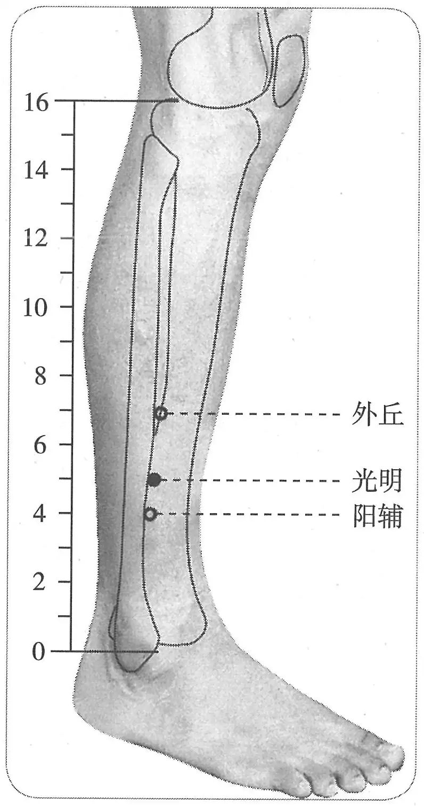

**图2-348　光明穴图**

〔p.1129 (인쇄 1101)〕

穴。（2版《针灸学讲义》）

　　(4) 外踝上5寸，腓骨前缘。（4版《针灸学》）

　　(5) 外踝高点上5寸，腓骨前缘。（5、7版《针灸学》，《中国针灸学》）

　　(6) 在小腿外侧，当外踝尖上5寸，腓骨前缘。（6版《针灸学》）

#### 【类属】 

足少阳胆经络穴。足少阳所入。

　1. 足少阳根于窍阴，溜于丘墟，注于阳辅，入于天容、光明也。（《灵枢·根结》

　2. 足少阳络……别走厥阴者。（《黄帝明堂经》）

#### 【适应症】 

主治目疾。常用于目痛，夜盲，近视，目翳；下肢痿痹。

　1. 主身懈㑊，寒，少气，热甚，恶人，心惕惕然，取光明及绝骨、跗上临泣立已，淫泺胫酸，热病汗不出。狂疾。虚则痿躄，坐不能起，实则厥，胫热膝痛，身体不仁，手足偏小，善啮颊。痓。（《黄帝明堂经》）

**按**：“身懈……跗上临泣立已”，《素问·刺疟》作“身体解（㑊），寒不甚，热不甚，恶见人，见人心惕惕然，热多汗出甚，刺足少阳”；“淫泺胫酸”，《素问·骨空论》作“淫泺胫酸，不能久立，治少阳之维，在外踝上五寸”；“虚则痿躄，坐不能起，实则厥”见于《灵枢·经脉》。

　2. 治身解寒，淫泺胻酸，不能久立。与阳辅疗病法同。热病汗不出，卒狂。虚则痿痹，坐不能起；实则足胻热，膝痛，身体不仁，善啮颊。（《铜人腧穴针灸图经》卷下）

**按**：“与阳辅疗病法同”，此语抄自《外台秘要》卷三十九。因《针灸甲乙经》载治“身解寒……不能久立”原方取“光明”、“绝骨”、“临泣”三穴（方见《素问·刺疟》），王焘将此方抄于“光明”穴下，并注曰“与阳辅疗病法同”，王惟一不解其义，也一并抄于“光明”穴中。

　3. 窦太师针灸遗存

　　(1) 治目青昏，泻补；胬肉拔睛，红肿，泻。（《窦太师针经》）

　　(2) 主目青昏，胬肉扳睛红肿。（《针方六集》）

　　(3) 一切目疾。（《循经考穴编》）

　　(4) 治眼目红肿，冷泪风弹等症。（《窦太师秘传》）

　4. 统编针灸学教材

　　(1) 主治目疾，膝痛胻热，痿痹不仁，热病汗不出。（1957年南京《针灸学》、1版《针灸学讲义》）

　　(2) 主治膝痛，下肢痿痹，目痛，夜盲，乳胀痛。（2版《针灸学讲义》、4版《针灸学》）

　　(3) 主治目痛，夜盲，下肢痿痹，乳房胀痛。（5、6版《针灸学》）

　　(4) 主治①目痛、夜盲、近视、目花等目疾；②胸乳胀痛；③下肢痿痹。（7版《针灸学》）

　　(5) 主治膝痛，下肢痿痹，目视不明，目痛，夜盲，乳胀痛。（《中国针灸学》）

**按**：教材中“乳胀痛”未详所出，暂不收录。

**文献分析**：《黄帝明堂经》载本穴主治多为足少阳经脉、络脉病候，而至金元窦太师针灸所述之本穴主治为之一变，重在治目疾，并且同时期乃至后世出现大量治疗目疾的临床应用，说明这一转变有较充分的临床依据。现代针灸学教材从之。

#### 附：临床应用举例 

　1. 目疾

　　(1) 青盲，雀目视物不见：刺足三里，泻委中出血、光明泻。（《针灸集要·盘石金直刺秘传》）

　　(2) 目中生膜：睛明、太阳、合谷、四白、光明。问曰：已上穴法刺之不效，何也？答曰：此证受病既深，未可一时便能针愈，须是三次针之方可效。复刺后穴：睛明、合谷、四白。（《针灸集成》第十方）

〔p.1130 (인쇄 1102)〕

　　(3) 睛内障：太阳、合谷、临泣、睛明、光明、风池、天府。问曰：此证从何而得？用此法针之不效，何也？答曰：怒气伤肝，血不就舍，肾水枯竭，血气耗散，初患时不能节，将恣意房室，用心过多，故得证者难治，可刺后穴：太阳、合谷、临泣、睛明、光明、风池、天府。（《针灸集成》第十方）

　　(4) 眼痒眼痛，泻光明与地五。（《标幽赋》）

　　(5) 睛明治眼未效时，合谷光明安可缺。（《席弘赋》）

　　(6) 风牵偏视：以光明穴为主诊治。［针灸临床杂志，1995，11（10）：21］

　2. 其他病症

　　(1) 淫泺胫痠，不能久立治少阳之维，在外踝上五寸。（《素问·骨空论》）

　　(2) 足腕不用痿躄，坐不起，髀脚痛：光明沿皮五分、丘墟直五分。（《医学纲目》卷二十二）

　　(3) 回乳症：光明穴、足临泣穴，针灸治疗。［中国针灸，1985，5（4）：48］

#### 【操作】 

直刺0.5~0.8寸。

　1. 刺入六分，留七呼，灸五壮。（《黄帝明堂经》）

　2. 灸七壮。（《太平圣惠方·明堂》）

　3. 针入二寸半，灸七壮。治目青昏，泻补；胬肉拔睛，红肿，泻。（《窦太师针经》）

　4. 针六分，灸七壮。（《针灸十四经穴位考订》）

　5. 统编针灸学教材

　　(1) 针五至六分，灸三至五壮。（1957年南京《针灸学》、1版《针灸学讲义》）

　　(2) 直刺7~9分，艾条灸3~5分钟。（2版《针灸学讲义》）

　　(3) 直刺1~1.5寸。（4、5、6版《针灸学》）

　　(4) 直刺0.5~0.8寸。（7版《针灸学》）

　　(5) 直刺0.7~1.0寸。可灸。（《中国针灸学》）

　6. 直刺1~1.5寸。感应：酸感向膝关节及足背外侧扩散。灸3~5壮；温灸5~20分钟。（上海《针灸学》）

### （三十八）阳辅 Yángfǔ GB38 出《灵枢》 

问题：“绝骨”究竟是指“阳辅”穴，还是“悬钟”穴，或者两者皆非？

#### 【提要索隐】 

**部位**：在小腿外侧，外踝尖上4寸，腓骨前缘。

**适应症**：主治咽喉部、胸胁部病症。常用于咽喉肿痛；胸胁胀痛，腋下肿痛，瘰疬；腰痛，下肢痿痹、麻木；中风瘫痪，筋急拘挛。肺切除术的针麻用穴。

**针刺操作**：直刺0.5~0.8寸。

#### 【名实考】 

本穴在胻之外，辅骨之前，故名阳辅。

关于本穴定位，《黄帝明堂经》曰“在足外踝上、辅骨前，绝骨端如前三分，去丘墟七寸”，由于早期文献对“绝骨”一词，没有明确的描述，后世又以悬钟穴为“绝骨”，致二穴常相混。隋唐时将外踝上三四寸小骨头绝陷中定为“绝骨”，后人或以悬钟当此穴，或以阳辅当此穴，并将《针灸甲乙经》阳辅穴定位“在足外踝上”之后加“四寸”，如此既与后文“去丘墟七寸”不两立，也与该穴的排列次序不合（排于外丘穴之上）。

〔p.1131 (인쇄 1103)〕

　1. 胆出于窍阴……行于阳辅，阳辅，外踝之上，辅骨之前，及绝骨之端也，为经……足少阳也。（《灵枢·本输》）

　2. 足少阳根于窍阴，溜于丘墟，注于阳辅，入于天容、光明也。（《灵枢·根结》）

　3. 行于阳辅，阳辅者，火也。在足外踝上，辅骨前，绝骨端，如前三分许，去丘墟七寸，足少阳脉之所行也，为经。（《黄帝明堂经》）

　4. 辅骨，谓辅佐胻骨之骨，在胻之外。（五卷本《铜人腧穴针灸图经》卷一）

　5. 此穴乃少阳之经穴为火，乃本经所生，曰阳辅者，乃阳极盛之称，木旺极则生火之义也。（《经穴解》）

　6. 别名　绝骨、分肉。（1957年南京《针灸学》）

**按**：本穴在绝骨端前三分，分肉在绝骨端后二分，非同一穴；“绝骨”隋唐时作为悬钟穴别名。此皆传日本教材之误，韩国针灸教材又从中国教材重复此误。

#### “阳辅”、“悬钟”与“绝骨”穴辨 

足少阳经腿部穴排序：悬钟、光明、外丘、阳辅、阳交、阳陵泉。（《针灸甲乙经》、《千金要方》、《千金翼方》、《外台秘要》）

**按**：直到《铜人腧穴针灸图经》“阳辅”才被移至“悬钟”穴后，宋校本《千金要方》同，当系宋臣私改，未经校改本与其他《黄帝明堂经》传本同。

　1. 阳辅，在外踝上辅骨前，绝骨端如前三分许，去丘墟七寸。（《黄帝明堂经》）

　2. 悬钟，在足外踝上三寸动者中，足三阳络，按之阳明脉绝乃取之。（《黄帝明堂经》）

　3. 阳辅，在绝骨前寸半少下是也。（《外台秘要》卷十九、《医心方》）

　4. 绝骨穴，在脚外踝上一夫，亦云四寸是。（《千金要方》卷七）

　5. 绝骨在外踝上三寸，灸百壮，治风身重、心烦、足胫疼。（《千金要方》卷八）

　6. 逆气，虚劳，寒损，忧恚，筋骨挛痛，心中咳逆，泄疰，腹满，喉痹，颈项强，肠痔，痔血，阴急，鼻衄，骨痛，大小便涩，鼻中干，烦满，狂走，易气，凡二十二病，皆灸绝骨五十壮。穴在外踝上三寸宛宛中。（《千金要方》卷十八）

　7. 悬钟，一名绝骨，在外踝上三寸动者中，足三阳络。（《千金要方》卷二十九）

　8. 徐云《明堂》无绝骨名，有阳辅二穴，在膝盖下外侧三寸傍廉骨当小指两筋间是也。《黄帝三部针灸经》丙卷：阳辅二穴，在足外踝上四寸，辅骨前，绝骨端前三分，与此不同。（《外台秘要》卷十九）

　9. 辅骨前，绝骨端如前，足外踝上四指，名绝骨穴，掐时与𫏋脉相应处。（敦煌卷子医方，编号：P.3596）

　10. 绝骨二穴：在外踝正上寻小骨头绝陷中是同前。阳辅二穴：在绝骨前半寸少下是。苏徐云：明堂无绝骨名，有阳辅。（《医心方》卷八）

**按**：“绝骨”穴不见于《黄帝明堂经》，后世医家或以之为悬钟穴，或以之为阳辅穴。综合考察古代文献，不难发现不同时期文献所说之“绝骨”，所指不同：早期文献所说“绝骨”为外踝上七寸之上，说的最明确者乃初唐徐思恭《脚气论》引《明堂》之文；隋唐以下所说之“绝骨”多指外踝上三四寸。《千金要方》谓悬钟穴“一名绝骨”，意即此绝骨穴，而非《黄帝明堂经》之“绝骨”。悬钟穴，《黄帝明堂经》本不以骨定位，而是以脉定位：足外踝上三寸动者中，足三阳络，按之阳明脉绝乃取之。既是“按之阳明脉绝”处，则定位宜略偏向胫侧，按此脉动处可使足阳明趺阳脉搏动消失或显著减弱。受《千金要方》影响，后世悬钟穴定位在不知不觉中发生了改变，相应的针灸法及主治并未完全置换为“绝骨”穴的内容，因而出现了名实分离的现象。非但如此，《千金要方》卷三十载“绝骨”穴主治共五条，悉为《黄帝明堂经》“阳辅”穴主治。可见，同一作者的同一书在此问题上的认识也不相同。

〔p.1132 (인쇄 1104)〕

正确的做法是，阳辅、悬钟二穴均按《黄帝明堂经》定位，前者定于外踝上七寸，外丘穴之前；后者定于外踝上三寸脉动处。“绝骨”归入奇穴类。

#### 【定位】 

**部位**：在小腿外侧，外踝尖上4寸，腓骨前缘（图2-349）。

**取穴**：在外踝尖直上4寸，腓骨前缘处取之。

　1. 外踝之上，辅骨之前及绝骨之端也。（《灵枢·本输》）

　2. 《黄帝明堂经》佚文

　　(1) 在外踝上辅骨前，绝骨端如前三分许，去丘墟七寸。（《千金要方》卷二十九、《千金翼方》、《素问·气穴论》王冰注、《医心方》、《医学纲目》）

　　(2) 在足外踝上四寸辅骨前，绝骨端如前三分，去丘墟七寸。（《针灸甲乙经》卷三、《外台秘要》、《铜人腧穴针灸图经》卷上及卷下、《圣济总录》、《针灸资生经》、《针灸玉龙经》、《窦太师针经》、《十四经发挥》、《神应经》、《针灸聚英》、《古今医统》、《针灸大成》、《针方六集》、《循经考穴编》、《针灸逢源》、《针灸易学》）

　3. 穴在外踝上绝骨端陷者中是。（《千金要方》卷八、《千金翼方》）

　4. 在足踝上辅骨前，绝骨端前如韭叶。（《铜人腧穴针灸图经》卷下“穴腧都数”）

　5. 在绝骨前寸半少下是也。（《外台秘要》卷十九、《医心方》）

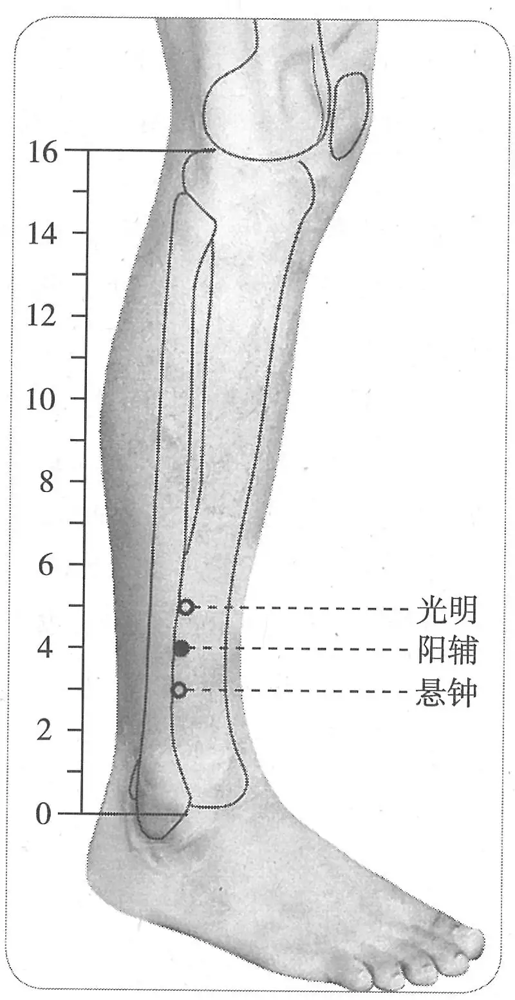

**图2-349　阳辅穴图**

　6. 在足外踝上四寸，辅骨前，绝骨端三分。（《类经图翼》卷八）

　7. 从光明下行一寸，辅骨前，绝骨端，内斜三分。（《医宗金鉴·刺灸心法要诀》）

　8. 足外踝上四寸微前些，外丘下三寸处。（《针灸十四经穴位考订》）

　9. 统编针灸学教材

　　(1) 部位：足外踝上四寸。取穴：从外踝上四寸微前三分处取之。（1957年南京《针灸学》）

　　(2) 部位：足外踝上四寸。取穴：从外踝前缘与阳交穴成直线，光明穴下一寸微前三分取之。（1版《针灸学讲义》）

　　(3) 部位：在足外踝上四寸，辅骨前，绝骨端，如前三分，去丘墟七寸。取穴：外踝尖上四寸，微向前，当腓骨前缘，趾长伸肌与腓骨短肌之间取穴。（2版《针灸学讲义》）

　　(4) 外踝上4寸，腓骨前缘稍前处。（4版《针灸学》）

　　(5) 外踝高点上4寸，腓骨前缘稍前处。（5、7版《针灸学》）

　　(6) 在小腿外侧，当外踝尖上4寸，腓骨前缘稍前方。（6版《针灸学》）

〔p.1133 (인쇄 1105)〕

　　(7) 外踝高点上四寸，微向前，当腓骨前缘，趾长伸肌与腓骨短肌之间。（《中国针灸学》）

#### 【类属】 

足少阳胆经经穴。足少阳所注。

　1. 足少阳根于窍阴，溜于丘墟，注于阳辅，入于天容、光明也。（《灵枢·根结》

　2. 足少阳脉之所行也，为经。（《黄帝明堂经》）

#### 【适应症】 

主治咽喉部、胸胁部病症。常用于咽喉肿痛；胸胁胀痛，腋下肿痛，瘰疬；腰痛，下肢痿痹、麻木；中风瘫痪，筋急拘挛。肺切除术的针麻用穴。

　1. 主腰痛如小锤居其中，怫然肿痛，不可以咳，咳则筋缩急。诸节痛，上下无常处。寒热，酸痟，四肢不举，腋下肿，马刀瘘，髀膝胫骨摇酸痹不仁，喉痹。（《黄帝明堂经》）

**按**：“腰痛……咳则筋缩急”见于《素问·刺腰痛》，详见“附：临床应用举例”。

　2. 治腰溶溶如坐水中，膝下肤肿，筋挛，诸节尽痛，痛无常处，腋下肿瘘，马刀，喉痹，膝胻酸，风痹不仁。（《铜人腧穴针灸图经》卷下）

**按**：“腰溶溶如坐水中”系带脉病候，归于此处欠妥。

　3. 窦太师针灸遗存

　　(1) 治一切中风瘫痪，筋脉拳挛，膝下生疮。（《窦太师针经》）

　　(2) 主一切中风瘫痪，筋急拘挛，膝下生疮。（《针方六集》卷五）

　　(3) 主瘫痪，痿痹，筋脉拘挛。（《循经考穴编》下）

　4. 厥逆，口苦太息，心胁痛，面尘，头角颔痛，目锐眦痛，缺盆中肿痛，汗出振寒，疟，胸中胁肋髀膝外至绝骨外踝前痛。善洁面青。（《针灸聚英》卷一、《针灸大成》）

**按**：高武据其对“母子补泻”的理解，将足少阳经脉病候归于本穴主治；“善洁面青”出于《洁古云岐针法》“假令胆病”症状，并非取阳辅穴治疗，归于此欠妥。

　5. 统编针灸学教材

　　(1) 主治头角痛，目锐眦痛，喉痹，缺盆中痛，腋下肿，马刀夹瘿，胸胁髀膝外踝前皆痛，筋脉拘挛，百节酸痛。（1957年南京《针灸学》）

　　(2) 主治头角痛，目锐眦痛，喉痹，缺盆中痛，马刀侠瘿，胸、胁、髀、膝外踝前皆痛，筋脉拘挛，百节酸痛。（1版《针灸学讲义》）

　　(3) 主治偏头痛，目外眦痛，缺盆中痛，腋下痛，瘰疬，胸、胁、下肢外侧痛，疟疾。（2版《针灸学讲义》）

　　(4) 主治腋下肿，腰痛，膝胻酸痛，脚气。（4版《针灸学》）

　　(5) 主治偏头痛，目外眦痛，瘰疬，脚气，腋下肿痛，咽喉肿痛，胸胁胀痛，下肢痿痹。（5、7版《针灸学》）

　　(6) 主治偏头痛，目外眦痛，咽喉肿痛，瘰疬，胸胁胀痛，脚气，下肢痿痹，半身不遂。（6版《针灸学》）

　　(7) 主治①偏头痛，目外眦痛，咽喉肿痛，腋下肿痛，胸胁满痛等头面躯体痛证；②瘰疬；③下肢痿痹。（7版《针灸学》）

　　(8) 主治偏头痛，目外眦痛，腋下痛，瘰疬，腰痛，胸胁及下肢外侧痛，疟疾。（《中国针灸学》）

**文献分析**：教材明显受到高武《针灸聚英》错误的影响，今正之。

#### 附：临床应用举例 

　1. 同阴之脉令人腰痛，痛如小锤居其中，怫然肿，刺同阴之脉，在外踝上绝骨之端，为三痏。（《素问·刺腰痛》）

〔p.1134 (인쇄 1106)〕

　2. 仁寿宫患脚气偏风，甄权奉敕针环跳、阳陵泉、巨虚下廉、阳辅，即起行。（《千金要方》卷八）

　3. 两腿麻木，泻曲池，补髋骨、阳辅。（《针灸集要·盘石金直刺秘传》）

　4. 足弱不能行，丘墟、行间、昆仑、太冲。问曰：此证缘何而得？答曰：皆因醉后行房，肾经受亏，以致足弱无力，不能行动。治法如此不效，复刺后穴：三里、阳辅、三阴交、复溜。（《针灸集成》第四十一方）

　5. 腋下肿马刀夹瘿喉痹，阳辅五分，灸二七壮、申脉一分，灸三壮，立愈。（《医学纲目》卷十）

　6. 身热如火，足冷如水，可灸阳辅穴。又云胻酸冷，绝骨主之。（《医学纲目》卷二十八）

#### 【操作】 

直刺0.5~0.8寸。

　1. 刺入五分，留七呼，灸三壮。（《黄帝明堂经》）

　2. 横针透二寸半，灸二七壮。（《窦太师针经》）

　3. 凌氏直针一寸，宜灸。（《循经考穴编》下）

　4. 针三分，灸三壮。（《针灸十四经穴位考订》）

　5. 统编针灸学教材

　　(1) 针三至五分，灸三至七壮。（1957年南京《针灸学》、1版《针灸学讲义》）

　　(2) 直刺5~7分，艾炷灸3~7壮，艾条灸3~7分钟。（2版《针灸学讲义》）

　　(3) 直刺1~1.5寸。（4、5版《针灸学》）

　　(4) 直刺0.8~1寸；可灸。（6版《针灸学》）

　　(5) 直刺0.5~0.8寸。（7版《针灸学》）

　　(6) 直刺0.5~0.7寸。可灸。（《中国针灸学》）

### （三十九）悬钟 Xuánzhōng GB39 出《黄帝明堂经》 

问题：本穴无论是部位还是主治都更近于足阳明经，何以归入足少阳经？

#### 【提要索隐】 

**穴名**：一名绝骨。

**部位**：在小腿外侧，外踝尖上3寸，腓骨前缘。

**归经**：足少阳胆经。**按**：本穴归经虽然历代皆无分歧，但并不合理。

**适应症**：主治脾胃、局部病症。常用于腹满，不思饮食；半身不遂，下肢痿痹，足胫挛痛。

**针刺操作**：直刺0.5~0.8寸。

#### 【名实考】 

本穴的定位，隋唐之后大多基于骨性标志，而在《黄帝明堂经》原本是以脉动作为定穴标志：

　1. 悬钟穴，足三阳络，按之阳明脉绝乃取之。主腹满，胃中有热不嗜食，小儿腹满不能食饮。（《黄帝明堂经》）

同样的方法，王冰说得更明确：

　2. 足三里穴，正在膝下三寸，胻外两筋肉分间。极重按之，则足跗上动脉止矣。（《素问·针解》王冰注）

由此可见，《黄帝明堂经》所谓“阳明脉”即王冰所说的“足跗上动脉”，也即足背动脉，由于它是胫前动脉的下行支，故于位于胫前动脉之上方的“悬钟”、“足三里”穴处用力按压，则于足背当“冲阳脉”处摸不到足背动脉的搏动。人体测量学调查的结果表明：在外踝上三寸，靠近足阳明经脉行处，用力按压，则冲阳脉搏动消失（“按之阳明脉绝”），同时在较瘦的人群此处本身也能触及动脉的搏动。说明两千多年前古人的观察非常准确。后人及今人不识此，不仅将悬钟穴定于足少阳经脉线上，而且较阳辅穴更靠外侧，此处不仅不能触及动脉搏动，通过按压也不能使足背处的冲阳脉搏动消失，这也是现代对于本穴的定位描述不再提及“脉动”的重要因素。

〔p.1135 (인쇄 1107)〕

还有一个重要信息被人们长期忽略，即本穴主治足阳明经胃经的病症，而非足少阳经病候，这与该穴的定位是相吻合的。由于这一疏忽，本穴被归入足少阳经，并与“绝骨”穴相混，原先的部位、归经、主治三位一体的规律便被破坏了。

关于本穴与“阳辅”、“绝骨”三者关系详见阳辅穴“名实考”。

　3. 悬钟，一名绝骨，在外踝上三寸动者中，足三阳络。（《千金要方》卷二十九）

　4. 以其上悬肉开分如钟形，穴在其内，故曰悬钟。（《经穴解》）

#### “悬钟”与“阳辅”相混例 

　1. 悬钟二穴，在外踝上三寸宛宛中，灸五壮。主腹满，中焦客热，不嗜食。兼腿胯连膝胫痹麻，屈伸难也。（《太平圣惠方·明堂》）

　2. 悬钟二穴，在足外踝上三寸动脉中，灸三壮。主心腹胀满，胃中热，不嗜食，膝胫连腰痛，筋挛急，足不收履，坐不能起。（《太平圣惠方·明堂》）

**按**：以上“悬钟”穴的部位及主治症同而灸疗壮数不同，或采自不同文献，但两者于“不嗜食”后均误录有“阳辅”穴的主治症，前一条“悬钟”于“不嗜食”后增一“兼”字以示区别，后一“悬钟”则无任何区别。

#### 【定位】 

**部位**：在小腿外侧，外踝尖上3寸，腓骨前缘（图2-350）。

**取穴**：从外踝尖向上触摸，在外踝尖上约3寸处的凹陷中取之。

　1. 在足外踝上三寸动者中，足三阳络，按之阳明脉绝乃取之。（《黄帝明堂经》、《太平圣惠方》、《铜人腧穴针灸图经》、《圣济总录》、《针灸资生经》、《针灸玉龙经》、《十四经发挥》、《医学纲目》、《针灸聚英》、《医学入门》、《针灸大成》、《针方六集》）

　2. 在外踝上三寸宛宛中。（《太平圣惠方·明堂》）

　3. 窦太师针灸遗存

　　(1) 在足外踝上三寸动脉是穴。（《窦太师针经》）

　　(2) 在外踝骨上三寸。（《窦太师秘传》）

　　(3) 在足外踝上三寸动脉中。（《乾坤生意》）

　4. 虽曰外踝上除踝三寸，必以绝陇处属穴。（《神应经》）

　5. 足外踝上三寸动脉中。《针灸经》：寻摸尖骨者乃是绝骨两分开，足三阳之大络，按之阳明脉绝乃取之。前寻摸绝骨间尖如前离三分，高一寸许是阳辅穴，后寻摸绝骨间尖筋骨缝中是悬钟穴。（《针

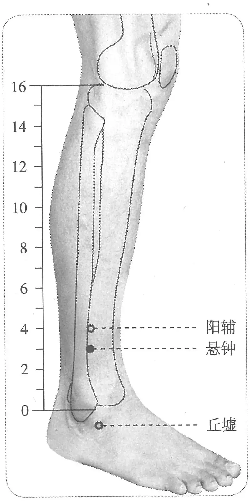

**图2-350　悬钟穴图**

〔p.1136 (인쇄 1108)〕

灸聚英》卷一、《古今医统》、《类经图翼》、《循经考穴编》、《针灸逢源》）

　6. 在足外踝上三寸脉中。广注：须细揣摸绝骨尖，如前三分而高寸许是阳辅，绝骨尖间筋骨缝中是悬钟，与三阴交对，足三阳之大络也。按之而阳明脉绝则取之。（《循经考穴编》下）

　7. 从阳辅下行三寸，外踝骨尖内动脉中，寻按取之。（《医宗金鉴·刺灸心法要诀》）

　8. 足外踝上三寸，腓骨前。（《针灸十四经穴位考订》）

　9. 统编针灸学教材

　　(1) 部位：足外踝上三寸。取穴：从外踝骨中线上三寸取之。（1957年南京《针灸学》）

　　(2) 部位：足外踝上三寸。取穴：从外踝尖直上，筋骨隙中取之。（1版《针灸学讲义》）

　　(3) 部位：在足外踝上三寸，动者脉中。取穴：外踝尖上三寸，当腓骨后缘与腓骨长、短肌腱之间凹陷处取之。（2版《针灸学讲义》）

　　(4) 外踝上3寸，腓骨后缘。（4版《针灸学》）

　　(5) 外踝高点上3寸，腓骨后缘。（5版《针灸学》）

　　(6) 在小腿外侧，当外踝尖上3寸，腓骨前缘。（6版《针灸学》）

　　(7) 外踝高点上3寸，腓骨前缘。（7版《针灸学》）

　　(8) 外踝高点上三寸，当腓骨后缘与腓骨长、短肌肌腱之间凹陷处。（《中国针灸学》）

#### 附：绝骨穴定位 

　1. 绝骨穴，在脚外踝上一夫，亦云四寸是。（《千金要方》卷七）

　2. 绝骨在外踝上三寸。（《千金要方》卷八、《太平圣惠方》卷五十五）

　3. 绝骨穴在外踝上三寸宛宛中。（《千金要方》卷十八）

　4. 辅骨前，绝骨端如前，足外踝上四指名绝骨穴，掐时与𫏋脉相应处。（敦煌卷子医方，编号：P.3596）

　5. 绝骨二穴，在外踝正上寻小骨头绝陷中是。（《医心方》卷八）

**按**：从宋代《太平圣惠方·明堂》所述悬钟穴定位，已经与《千金要方》卷十八所述之“绝骨”穴完全相同，但从该书所辑悬钟穴主治仍混有“阳辅”穴主治病症来看，当时人们仍然没有理清悬钟、阳辅二穴与“绝骨”穴的关系。

#### 【类属】 

足少阳胆经穴。

足三阳络。（《黄帝明堂经》）

**归经**：足少阳经。（《黄帝明堂经》、《产经》、《外台秘要》卷三十九、《铜人腧穴针灸图经》卷上）

**按**：本穴归经虽然历代皆无分歧，但并不合理。《黄帝明堂经》载悬钟穴作：“在足外踝上三寸动者中，足三阳络，按之阳明脉绝乃取之。主腹满，胃中有热，不嗜食。小儿腹满不能食饮。”如果仅仅根据“足三阳络”，将该穴归入足少阳经未尝不可，因为“足少阳”毕竟属足三阳之一。然而我们不可忽略“按之阳明脉绝乃取之”句，既然按“悬钟”穴而足背部阳明脉绝止，则说明该穴正当阳明脉上。除“悬钟”穴外，采用这种取穴法的还有“足三里”穴（见《素问·针解》王冰注及《全生指迷方》等书），既然“足三里”属于足阳明经，何以“悬钟”穴要归入他经呢？再验之于腧穴主治，“悬钟”主治病症乃典型的胃的病候，而且文中也点明了“胃中有热”，将这样一个位于阳明脉上而又主治阳明胃病的腧穴归入足少阳经，难以成立。

#### 【适应症】 

主治脾胃、局部病症。常用于腹满，不思饮食；半身不遂，下肢痿痹，足胫挛痛。

　1. 主腹满，胃中有热，不嗜食。小儿腹满不能食饮。（《黄帝明堂经》）

**按**：此穴今属于足少阳胆经穴，但《黄帝明堂经》此穴须“按之阳明脉绝乃取之”，或归于足阳明经更贴切，其主治也悉为脾胃病症。

〔p.1137 (인쇄 1109)〕

　2. 悬钟主五淋。（《千金要方》卷三十）

　3. 悬钟主湿痹流肿，髀筋急瘈，胫痛。（《千金要方》卷三十）

**按**：此为《黄帝明堂经》阳辅穴主治。

　4. 主腿胯连膝胫痹麻，屈伸难也。（《太平圣惠方·明堂》）

**按**：此悉为《黄帝明堂经》阳辅穴主治。

　5. 主膝胫连腰痛，筋挛急。足不收履，坐不能起。（《太平圣惠方·明堂》）

**按**：“膝胫连腰痛，筋挛急”为《明堂经》阳辅穴主治；“足不收履，坐不能起”见于《明堂经》“临泣”穴主治。

　6. 治心腹胀满，胃中热，不嗜食，膝胻痛，筋挛足不收履，坐不能起。（《铜人腧穴针灸图经》卷下）

　7. 窦太师针灸遗存

　　(1) 治浑身百节疼，左瘫右痪，两足不收，寒湿脚气，浑身生疮，水蛊，看症补泻。伤寒不退热，针曲池穴，泻此穴良。（《窦太师针经》）

　　(2) 主浑身百节痛，左瘫右痪，两足不随，寒湿脚气，遍身生疮，水肿，伤寒发热不退。（《针方六集》卷五）

　　(3) 主瘫痪两足不收，寒湿脚气，浑身疮癞，水蛊，伤寒大热不退。（《循经考穴编》下）

　8. 主脚气，逆气，虚劳寒损忧恚，心中咳逆，泄注，喉痹，颈项强，肠痔瘀血，阴急，鼻衄，脑疽，大小便涩，鼻中干，烦满，狂易，中风手足不遂。（《针灸聚英》卷一、《针灸大成》）

**按**：此乃从《针灸资生经》辑录《千金要方》“绝骨”穴主治。

　9. 统编针灸学教材

　　(1) 主治鼻衄，喉痹，颈项强，胸腹胀满，胃中热，不嗜食，肠痔，膝胻痛，脚气，腰痛，中风手足不遂。（1957年南京《针灸学》、1版《针灸学讲义》）

　　(2) 主治半身不遂，颈项强，胸腹胀满，胁痛，膝腿痛，脚气。（2版《针灸学讲义》）

　　(3) 主治腹满不嗜食，胁痛，足胫挛痛，痔血，脚气。（4版《针灸学》）

　　(4) 主治项强，胸胁胀痛，下肢痿痹，咽喉肿痛，脚气，痔疾。（5版《针灸学》）

　　(5) 主治项强，胸胁胀痛，下肢痿痹，咽喉肿痛，脚气，半身不遂，痔疾。（6版《针灸学》）

　　(6) 主治①痴呆、中风等髓海不足疾患；②颈项强痛、胸胁满痛、下肢痿痹。（7版《针灸学》）

　　(7) 主治中风，半身不遂，颈项痛，腹胀，胁痛，下肢痿痹，足胫挛痛，脚气。（《中国针灸学》）

**文献分析**：《黄帝明堂经》载本穴主症为“腹满，胃中有热，不嗜食，小儿腹满不能食饮”，均为胃的病症。唐以后此穴归入足少阳经，现代关于本穴的定位也偏离了足阳明经，主治病症也不再提胃病了。实际上《黄帝明堂经》的“悬钟”已经名存实亡了。

#### 附：临床应用举例 

　1. 腿脚病症

　　(1) 痿厥，身体不仁，手足偏小，先取京骨，后取中封、绝骨，皆泻之。（《针灸甲乙经》卷十）

　　(2) 第三十三，疗脚忽痹蹶不遂及冷痹方……又方：灸足两外踝上四指，名绝骨穴，掐时与𫏋脉相应处，灸五百壮。（敦煌卷子医方P3596）

　　(3) 脚气冲心烦闷方：又可常服香豉酒，灸三里穴、绝骨各三百壮。（《外台秘要》卷十九）

〔p.1138 (인쇄 1110)〕

　　(4) 黄帝问岐伯曰：凡人中风，半身不遂，如何灸之？岐伯答曰：凡人未中风时，一两月前，或三五个月前，非时，足胫上忽发酸重顽痹，良久方解，此乃将中风之候也。便须急灸三里穴与绝骨穴四处各三壮。（《太平圣惠方·明堂》）

　　(5) 中风半身瘫痪，疼痛麻木，不遂：针合谷、手三里、曲池、肩井、环跳、血海、阳陵泉、阴陵泉、足三里、绝骨、居髎、昆仑。（《窦太师秘传》）

　　(6) 治中风……又各分经针刺，无不愈也。治法：宜刺厥阴之井大敦以通其经，灸少阳之经绝骨以引其热，是针灸同象，治法之大体也。（《医学纲目》卷十）

　　(7) 悬钟环跳，华佗刺躄足而立行。（《标幽赋》）

　　(8) 脚细拳挛痛怎行，金针有法治悬钟。（《针灸玉龙歌》）

　　(9) 寒湿脚气痛难熬，先针三里及阴交，更兼一穴为奇妙，绝骨才针肿便消。（《针灸玉龙歌》）

　　(10) 脚疼膝肿针三里，悬钟二陵三阴交。（《席弘赋》）

　　(11) 伤寒四肢厥逆冷，脉气无时仔细看，神奇妙穴真有二，复溜半寸顺骨行。四肢回还脉气浮，须晓阴阳倒换求，寒则须补绝骨是，热则绝骨泻无忧。（《肘后歌》）

　2. 其他病症

　　(1) 逆气虚劳，寒损忧恚，筋骨挛痛，心中咳逆，泄注腹满，喉痹颈项强，肠痔，逆气，痔血隐急，鼻衄，骨痛，大小便涩，鼻中干，烦满，狂走易气，凡二十二病，皆灸绝骨五十壮，穴在外踝上三寸宛宛中。（《千金要方》卷十八）

　　(2) 身体烦热，针中府。又灸绝骨五十壮。（《千金翼方》卷二十七）

　　(3) 风毒起从皮外瘾疹，遍身瘙痒，抓把成疮：治法同上，更灸绝骨。（《针灸集要·盘石金直刺秘传》）

　　(4) 伤寒，胸腹膨胀，过经呕血泻血不止：灸期门，次针中脘，泻未愈，灸绝骨、行间，泻之；未愈，灸合谷、复溜。（《针灸集要·盘石金直刺秘传》）

　　(5) 肩背胛痛：昆仑、悬钟、肩井。（《医学纲目》卷二十七）

　　(6) 头痛：悬钟穴针刺。［吉林中医药，1987（4）：29］

　　(7) 枕大神经痛：悬钟穴治疗。［针灸临床杂志，1995，11（9）：42］

　　(8) 落枕：针刺悬钟穴治疗。［针灸临床杂志，1999，15（7）：56］

　　(9) 急性腰扭伤：针刺三阴交及悬钟治疗。［四川中医，2000，18（4）：56］

#### 【操作】 

直刺0.5~0.8寸。

　1. 刺入六分，留七呼，灸五壮。（《黄帝明堂经》）

　2. 灸三壮。（《太平圣惠方·明堂》）

　3. 窦太师针灸遗存

　　(1) 针入二寸半，灸三七壮。（《窦太师针经》、《针方六集》）

　　(2) 横卧，针透三阴交，灸二七壮。（《窦太师秘传》）

　4. 针五分，灸三壮。（《医学入门》卷一）

　5. 凌氏横针一寸。（《循经考穴编》下）

　6. 针六分，灸五壮。（《针灸十四经穴位考订》）

　7. 统编针灸学教材

　　(1) 针四至五分，灸三至七壮。（1957年南京《针灸学》、1版《针灸学讲义》）

〔p.1139 (인쇄 1111)〕

　　(2) 直刺4~5分，艾炷灸3~7壮，艾条灸3~7分钟。（2版《针灸学讲义》）

　　(3) 直刺1~1.5寸。（4、5版《针灸学》）

　　(4) 直刺0.8~1寸；可灸。（6版《针灸学》）

　　(5) 直刺0.5~0.8寸。（7版《针灸学》）

　　(6) 直刺0.3~0.5寸。可灸。（《中国针灸学》）

　8. 直刺1~2寸，可透三阴交。感应：局部酸胀或向足底放散。灸3~5壮；温灸5~10分钟。（上海《针灸学》）

### （四十）丘墟 Qiūxū GB40 出《灵枢》 

#### 【提要索隐】 

**穴名**：一名蹄溪。

**部位**：在踝区，外踝的前下方，趾长伸肌腱的外侧凹陷中。

**适应症**：主治胁部、目部病症。常用于胸胁痛、善太息，颈肿、腋下肿；疟疾；视物不清，目翳；小腿酸痛，外踝肿痛，足下垂。

**针刺操作**：直刺0.5~0.8寸。避免将针刺入关节腔内。

#### 【名实考】 

　1. 《曹氏灸经》曰，丘墟者，名为蹄溪，在外踝下少斜近前是也。人声室之房源。（《医心方》卷二）

**按**：传世腧穴文献中未载本穴治音哑之疾者。

　2. 胆出于窍阴……过于丘墟，丘墟，外踝之前下，陷者中也，为原……足少阳也。（《灵枢·本输》）

　3. 足少阳根于窍阴，溜于丘墟，注于阳辅，入于天容、光明也。（《灵枢·根结》）

　4. 过于丘墟，在足外踝下如前陷者中，去临泣三寸，足少阳脉之所过也，为原。（《黄帝明堂经》）

　5. 以在外踝前，外踝之骨打而圆，有丘象焉，其穴在前，有墟象焉，故曰丘墟。（《经穴解》）

#### 【定位】 

**部位**：在踝区，外踝的前下方，趾长伸肌腱的外侧凹陷中（图2-351）。

**取穴**：在外踝前下缘，当趾长伸肌腱的外侧凹陷处取之（第2~5趾抗阻力伸展，可显现趾长伸肌腱）。

　1. 丘墟，外踝之前下陷者中也。（《灵枢·本输》）

　2. 《黄帝明堂经》佚文

　　(1) 在足外廉踝下如前陷者中，去临泣一寸。（《针灸甲乙经》卷三）

　　(2) 在足外踝如前陷者中，去临泣三寸。（《千金要方》卷二十九、《千金翼方》、《外台秘要》、《素问·气穴论》王冰注、《医心方》、《太平圣惠方》、《铜人腧穴针灸图经》、《圣济总录》、《针灸资生经》、《扁鹊神应针灸玉龙经》、《十四经发挥》、《神应经》、《医学入门》、《针方六集》上、《循经考穴编》、《类经图翼》、《针灸逢源》）

　3. 丁曰在足外踝下微前是也。（《难经集注·六十六难》）

　4. 窦太师针灸遗存

　　(1) 在足外踝前三分。（《针灸玉龙歌》注）

〔p.1140 (인쇄 1112)〕

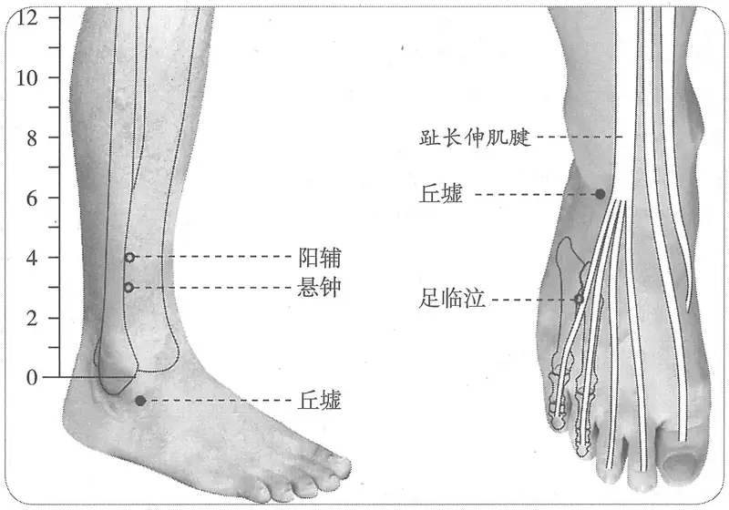

**图2-351　丘墟穴图**

　　(2) 在足外踝微近前三分陷中，去临泣穴三寸。（《窦太师针经》）

　　(3) 在足外踝微前三分陷中。（《窦太师秘传》）

　5. 足外踝下如前陷中，骨缝中，去临泣三寸。又侠溪穴中量上，外踝骨前五寸。（《针灸聚英》卷一、《古今医统》、《针灸大成》）

　6. 在外踝下如前陷者中，去临泣三寸。广注：踝骨尖下微前三分骨缝中，穴对商丘，自侠溪量上合五寸。（《循经考穴编》下）

　7. 足外踝下前方陷中。（《针灸十四经穴位考订》）

　8. 统编针灸学教材

　　(1) 部位：足外踝下微前陷中。取穴：从第四趾直上，外踝骨前横纹陷中取之。（1957年南京《针灸学》）

　　(2) 部位：足外踝下微前陷中。取穴：外踝骨前下方，胃经解溪穴与膀胱经申脉穴之间陷中取之。（1版《针灸学讲义》）

　　(3) 部位：在足外廉踝下如前陷者中。取穴：在外踝前下缘，当趾长伸肌腱的外侧凹陷处取之。（2版《针灸学讲义》）

　　(4) 外踝前下方，趾长伸肌腱外侧凹陷中。（4、5、7版《针灸学》，《中国针灸学》）

　　(5) 在足外踝的前下方，当趾长伸肌腱的外侧凹陷处。（6版《针灸学》）

**文献分析**：本穴定位于足外踝前下陷中，与《黄帝明堂经》关于足太阴经商丘穴的定位描述“足内踝下微前陷者中”之义完全相同，故大可不必拘于与临泣的折量分寸。

#### 【类属】 

足少阳经原穴。足少阳所溜。

足少阳根于窍阴，溜于丘墟，注于阳辅，入于天容、光明也。（《灵枢·根结》）

足少阳脉之所过也，为原。（《黄帝明堂经》）

#### 【适应症】 

主治胁部、目部病症。常用于胸胁痛、善太息，颈肿、腋下肿；疟疾；视物不清，目翳；小腿酸痛，外踝肿痛，足下垂。

　1. 主目视不明，振寒，目翳，瞳子不见，腰两胁痛，脚酸转筋。胸胁痛，善太息，胸满膨膨然。疟振寒，掖下肿。痿厥寒，足腕不收，躄，坐不能起，髀枢脚痛，大疝腹坚。寒热

〔p.1141 (인쇄 1113)〕

颈肿。狂疾。（《黄帝明堂经》）

　2. 主脚急肿痛，战掉不能久立，跗筋足挛。（《千金要方》卷三十）

**按**：未经宋改之宋刊本此条作“丘墟主脚酸转筋”，与《黄帝明堂经》同。

　3. 足胫偏细。（《太平圣惠方·明堂》）

　4. 治胸胁满痛不得息，久疟振寒，腋下肿，痿厥坐不能起，髀枢中痛，目生翳膜，腿胻酸转筋，卒疝少腹坚，寒热颈肿。（《铜人腧穴针灸图经》卷下）

　5. 窦太师针灸遗存

　　(1) 治穿踭风，脚气红肿，泻；脚无力，先补后泻。（《窦太师针经》）

　　(2) 麻木补之。如脚背红肿，出血甚妙。（《针灸玉龙歌》注）

　　(3) 主踭风，脚气红肿，阳厥无力。（《针方六集》卷五）

　　(4) 主瘫痪痿软，绕跟红肿，草鞋风痛。（《循经考穴编》下）

　　(5) 治绕脚风湿等症。有泻无补。（《窦太师秘传》）

　6. 统编针灸学教材

　　(1) 主治目生翳，寒热颈肿，腋肿，胸胁痛，臂枢、膝、胻酸痛，绕跟红肿转筋，疝气。（1957年南京《针灸学》）

　　(2) 主治目翳，颈肿，腋下肿，胸胁痛，臂枢、膝、胻酸痛，下肢痿厥，足踝痛。（1版《针灸学讲义》）

　　(3) 主治颈项痛，腋下肿，胸胁痛，下肢痿痹，外踝肿痛，疟疾。（2版《针灸学讲义》）

　　(4) 主治胸满胁痛，下肢痿痹，疟疾。（4、5版《针灸学》）

　　(5) 主治颈项痛，胸胁胀痛，下肢痿痹，疟疾。（6版《针灸学》）

　　(6) 主治①目赤肿痛、目翳等目疾；②颈项痛，腋下肿、胸胁痛、外踝肿痛等痛证；③足内翻、足下垂。（7版《针灸学》）

　　(7) 主治颈项痛，腋下肿，胸胁痛，呕吐，嗳酸，下肢痿痹，外踝肿痛，疟疾。（《中国针灸学》）

#### 附：临床应用举例 

　1. 胁部病症

　　(1) 两胁痛，针少阳经丘墟。（《素问病机气宜保命集》卷下）

　　(2) 腋下肿，马刀夹瘿，善自啮舌颊，天牖中肿，寒热：临泣、丘墟各一分，灸五壮、太冲一分，灸三壮。（《医学纲目》卷十九）

　　(3) 胁痛：针丘墟、中渎。（《杂病治例》）

　　(4) 胸胁损伤：丘墟穴、郄门穴，针刺治疗。［四川中医，1987，5（3）：42］

　　(5) 胆绞痛：针刺丘墟穴治疗。［中医中药杂志，1996，17（4）：33］

　　(6) 肋间神经痛：针刺丘墟穴治疗。［云南中医学院学报，2001，24（2）：46］

　2. 目疾

　　(1) 青盲，雀目，视物不明：丘墟灸，针泻，足三里、委中出血。（《针灸玉龙经·盘石金直刺秘传》）

　　(2) 肝痫面青反视，手足摇动：丘墟三壮，中封三壮。（《医学纲目》卷十一）

　3. 脚踝病症

　　(1) 脚腕疼痛，名曰绕踝风，亦名侧脚气：刺商丘、中封、丘墟、解溪诸穴，俱泻之；未愈，泻承浆。（《针灸集要·盘石金直刺秘传》）

〔p.1142 (인쇄 1114)〕

　　(2) 足弱不能行：丘墟、行间、昆仑、太冲。问曰：此证缘何而得？答曰：皆因醉后行房，肾经受亏，以致足弱无力，不能行动。治法如此不效，复刺后穴：三里、阳辅、三阴交、复溜。（《针灸集成》第四十一）

　　(3) 草鞋风：昆仑、丘墟、照海、商丘。问曰：此证缘何而得？答曰：皆因劳役过多，湿气流注，或因大热行路，凉水浸洗，故如此也。复刺后穴：太冲、解溪。（《针灸集成》第四十四）

　　(4) 足外踝红肿，名曰穿踝风：昆仑、丘墟、照海。（《针灸大成》卷五）

　　(5) 丘墟亦治脚跗疼，更刺行间疾便轻，再取解溪商丘穴，中间补泻要分明。（《针灸玉龙歌》）

　　(6) 外伤性踝内翻：丘墟穴、三阴交穴，针灸为主治疗。［上海针灸杂志，1987，6（2）：13］

#### 【操作】 

直刺0.5~0.8寸。避免将针刺入关节腔内。

　1. 刺入五分，留七呼，灸三壮。（《黄帝明堂经》）

　2. 凌氏云针带斜，或透申脉。（《循经考穴编》下）

**按**：此处“凌氏”是指明代针灸大家凌云。

　3. 统编针灸学教材

　　(1) 针三至五分，针尖对向内踝骨后面而进，灸三至五壮。（1957年南京《针灸学》、1版《针灸学讲义》）

　　(2) 直刺3~5分，艾条灸3~5分钟。（2版《针灸学讲义》）

　　(3) 直刺0.5~0.8寸。（4、5、6、7版《针灸学》，《中国针灸学》）

　4. 直刺1~1.5寸，对准内踝下缘。感应：局部酸胀。灸1~3壮；温灸5~10分钟。（上海《针灸学》）

### （四十一）足临泣 Zúlínqì GB41 出《灵枢》 

#### 【提要索隐】 

**穴名**：一名通里。

**部位**：在足背，第4、5跖骨底结合部的前方，第5趾长伸肌腱外侧凹陷中。

**适应症**：主治头部、胸胁部病症。常用于偏头痛，眩晕，胁痛，瘰疬；膝痛，足痛；疟疾；月经不调，乳痈。颅脑外科手术（后颅窝）的针麻用穴。

**备选适应症**：目疾。

**针刺操作**：直刺0.5~0.8寸。

#### 【名实考】 

本穴穴名宋以前文献作“临泣”，与头部“临泣”穴同名，宋代《针灸资生经》作“足临泣”，今从之。又《针经摘英集》“通里”穴定位并主治皆与“临泣”同，故作为本穴之别名。高武不辨，将此“通里”穴主治辑入手少阴经通里穴下；今人不察，又另立“通里”于奇穴类。

　1. 胆出于窍阴……注于临泣，临泣，上行一寸半陷者中也，为腧……足少阳也。（《灵枢·本输》）

　2. 注于临泣，临泣者木也，在足小指次指本节后间陷者中，去侠溪一寸五分，足少阳脉之所注也，为输。（《黄帝明堂经》）

　3. 临泣二穴，足少阳胆之经，在足小趾次趾本节后一寸陷中。一云：去侠溪一寸五分。令病人垂足取之，亦合于外关。（《针经指南》）

〔p.1143 (인쇄 1115)〕

　4. 治妇人经血过多不止并崩中者，毫针刺足太阴经三阴交二穴，次针足厥阴经行间二穴，次足少阳经通里二穴，在足小指间上二寸骨罅间。针入二分，各灸二七壮。（《针经摘英集》）

　5. 少阳有二临泣，在额上者，下临目之泣也，在足上者，目之临泣在下也。（《经穴解》）

#### 【定位】 

**部位**：在足背，第4、5跖骨底结合部的前方，第5趾长伸肌腱外侧凹陷中（图2-352）。

**取穴**：按取小趾、次趾本节后两歧骨间尽处陷中，小趾伸肌腱外侧凹陷中取之。

　1. 在足小指次指本节后间陷者中，去侠溪一寸五分。（《黄帝明堂经》、《太平圣惠方·明堂》、《铜人腧穴针灸图经》、《圣济总录》、《针灸资生经》、《窦太师针经》、《十四经发挥》、《神应经》、《针灸聚英》、《古今医统》、《针灸大成》、《针方六集》、《类经图翼》、《循经考穴编》、《针灸易学》、《针灸逢源》）

　2. 在侠溪上，三指、四指间。（《针灸玉龙歌》注）

　3. 从丘墟下行三寸，在足小指四指本节后，足跗间陷中。（《医宗金鉴·刺灸心法要诀》）

　4. 足小趾、次趾本节后，去侠溪一寸五分。（《针灸十四经穴位考订》）

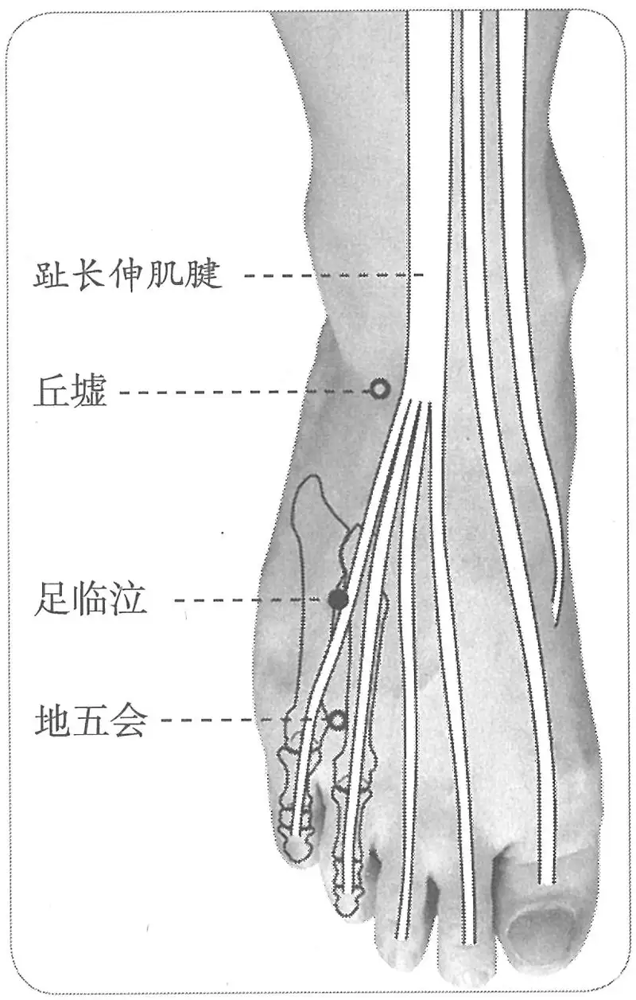

**图2-352　足临泣穴图**

　5. 统编针灸学教材

　　(1) 部位：在足小趾次趾本节后陷中，去侠溪一寸五分。取穴：按取小趾次趾本节后跖骨上踝前陷中取之。（1957年南京《针灸学》）

　　(2) 部位：侠溪穴后一寸五分。取穴：按取小趾次趾本节后两歧骨间尽处陷中取之。（1版《针灸学讲义》）

　　(3) 部位：在足小趾次趾本节后陷者中，去侠溪一寸五分。取穴：在第四、五跖骨结合部前方的凹陷内取之。（2版《针灸学讲义》）

　　(4) 第四、五跖骨间，侠溪上1.5寸。（4版《针灸学》）

　　(5) 在第四、五跖骨结合部前方，小趾伸肌腱外侧凹陷中。（5版《针灸学》、《中国针灸学》）

　　(6) 在足背侧，当足4趾本节第4跖趾关节的后方，小趾伸肌腱外侧凹陷处。（6版《针灸学》）

　　(7) 第四跖趾关节的后方，足小趾伸肌腱的外侧。（7版《针灸学》）

#### 【类属】 

足少阳胆经输穴。八脉交会穴。

　1. 足少阳脉之所注也，为输。（《黄帝明堂经》）

　2. 临泣二穴，足少阳胆之经……亦合于外关。（《针经指南》）

#### 【适应症】 

主治头部、胸胁部病症。常用于偏头痛，眩晕，胁痛，瘰疬；膝痛，足痛；疟疾；月经不调，乳痈。颅脑外科手术（后颅窝）的针麻用穴。

**备选适应症**：目疾。

〔p.1144 (인쇄 1116)〕

　1. 主厥，四逆，喘，气满，风身汗出而清，髋髀中痛，不得行，足外皮痛。胸中满，腋下肿，马刀瘘，善自啮颊，天牖中肿，淫泺胫酸，头眩，枕骨颌颅痛，目涩，身痹，洒淅振寒，季胁下支满，寒热，胸胁腰腹膝外廉痛。月水不利，见血而有身则败及乳肿。胸痹心痛不得息，痛无常处。大风目外眦痛，身热痱，缺盆中痛。疟，日西发。（《黄帝明堂经》）

**按**：以上主治除了“目外眦痛”、“头眩”、“季胁下支满”、“足外皮痛。胸中满，腋下肿，马刀瘘”、“疟，洒淅振寒”、“缺盆中痛”、“髋髀中痛”、“胸胁腰腹膝外廉痛”等典型的足少阳经病候外，还主治妇科病症及胸痹心痛。

　2. 治胸中满，缺盆中及腋下肿，马刀疡瘘，善啮颊，天牖中肿，淫泺胻酸，目眩，枕骨合颅痛，洒淅振寒，妇人月事不利，季胁支满，乳痈，心痛，周痹痛无常处，厥逆气喘不能行，痎疟日发。（《铜人腧穴针灸图经》卷下）

　3. 窦太师针灸遗存

　　(1) 治四肢肿满。此穴大能去水，通五藏气。又治目一切症候。又太师云：浑身蛊胀，亦可出水；脚气红肿，出血。余症同前穴。（《窦太师针经》）

　　(2) 主四肢肿满。此穴大能去水，导五脏气。又治患眼一切证候。一方云：浑身蛊胀可出水，脚气红肿可出血。放水针随皮过一寸。（《针方六集》卷五）

　　(3) 主诸般足疾，骺跗湿肿，浑身水气，此穴泄水，元气不损，能使五脏通利。（《循经考穴编》下）

　4. 统编针灸学教材

　　(1) 主治目外眦痛，目眩，季肋满痛，足跗湿肿，乳痈，腋下马刀。（1957年南京《针灸学》、1版《针灸学讲义》）

　　(2) 主治目外眦痛，目眩，瘰疬，胁肋痛，足跗肿痛，乳痈，疟疾。（2版《针灸学讲义》）

　　(3) 主治目外眦痛，瘰疬，胁肋痛，月经不调，遗溺，足跗肿痛，足趾挛痛。（4版《针灸学》）

　　(4) 主治目赤肿痛，胁肋疼痛，月经不调，遗溺，乳痈，瘰疬，疟疾，足跗疼痛。（5、6版《针灸学》）

　　(5) 主治①偏头痛、目赤肿痛，胁肋疼痛，足跗疼痛等痛证；②月经不调，乳痈；③瘰疬。（7版《针灸学》）

　　(6) 主治头痛，目眩，目外眦痛，瘰疬，胁肋痛，乳房胀痛，月经不调，足跗肿痛，足趾挛痛。（《中国针灸学》）

**文献分析**：《黄帝明堂经》载本穴主治多为足少阳经典型病症及妇科病症，金元窦太师针灸则突出了该穴的“去水”作用和治疗目疾的作用，但未见相应的临床应用，故现代针灸学教材未突出此方面的主治作用。

#### 附：临床应用举例 

　1. 膀胱发热，风攻两眼红肿，胬肉攀睛，拳毛倒睫，泻至阴，刺委中出血；未愈，泻足临泣、太阳出血，仍灸大小指骨空；未愈，泻睛明、行间，先补后泻。（《针灸集要·盘石金直刺秘传》）

　2. 两眼昏花，头晕，羞明，迎风冷眼，泻临泣，灸肝俞穴二七壮，泻合谷、委中出血。（《窦太师秘传》）

　3. 腋下肿，马刀夹瘿，善自啮舌颊，天牖中肿，寒热，临泣、丘墟各一分，灸五壮、太冲一分，灸三壮。（《医学纲目》卷十九）

　4. 脚背红肿，太冲、丘墟、冲阳弹针出血、临泣。（《医学纲目》卷二十二）

〔p.1145 (인쇄 1117)〕

　5. 耳暴聋，补足临泣。（《医学入门》卷一）

　6. 眼红或瞳仁肿痛，流泪出血，烂弦风，俱泻足临泣或太冲、合谷。（《医学入门》卷一）

　7. 坐牙风肿连面，泻手三里、颊车。满口牙痛牙酸，泻合谷、足临泣。下牙痛，泻合谷。（《医学入门》卷一）

　8. 脚背红肿痛，太冲、临泣、行间、内庭。（《针灸大成》卷五）

　9. 小腹胀满气攻心，内庭二穴刺须真。两足有水临泣泻，无水之时不用针。（《针灸玉龙歌》）

　10. 回乳，光明穴、足临泣穴，针灸疗法。［四川中医，1987，5（11）：48］

　11. 偏头痛，针刺足临泣、后太阳穴为主治疗。［中国针灸，1995（增刊）：79］

　12. 血管性偏头痛，针刺足临泣为主治疗。［中医外治杂志，2001，10（1）：49］

#### 【操作】 

直刺0.5~0.8寸。

　1. 刺入二分，留五呼，灸三壮。（《黄帝明堂经》）

　2. 窦太师针灸遗存

　　(1) 针三分，禁灸。可以出一身之水，泻用香油抹孔穴，则针孔不开。（《针灸玉龙歌》注）

　　(2) 针五分，灸七壮。（《窦太师针经》）

　　(3) 窦氏针入五分，出血水，针随皮过一寸。（《针方六集》卷一）

　　(4) 针一分，沿皮向前寸半。（《窦太师秘传》）

　3. 统编针灸学教材

　　(1) 针三至五分，灸三至五壮。（1957年南京《针灸学》）

　　(2) 针三至五分，针尖在筋骨间隙中斜向内侧刺，灸三至五壮。（1版《针灸学讲义》）

　　(3) 直刺3~5分，艾条灸3~5分钟。（2版《针灸学讲义》）

　　(4) 直刺0.3~0.5寸。（4、5、6版《针灸学》，《中国针灸学》）

　　(5) 直刺0.5~0.8寸。（7版《针灸学》）

　4. 直刺0.3~0.5寸。感应：局部酸胀，或向第四趾端扩散。灸1~3壮；温灸5~10分钟。（上海《针灸学》）

### （四十二）地五会 Dìwǔhuì GB42 出《黄帝明堂经》 

#### 【提要索隐】 

**部位**：在足背，第4、5跖骨间，第4跖趾关节近端凹陷中。

**适应症**：主治目疾、局部病症。常用于目赤肿痛，腋下肿；足背红肿；乳痈。**新增**：唾血，皮肤不泽。

**针刺操作**：直刺0.5~0.8寸。

#### 【名实考】 

　1. 地五会，在足小指次指本节后陷者中。（《黄帝明堂经》）

　2. 少阳之穴，在足者有五穴，而肝经之太冲穴，有络横连地五会，如木之有根在地。此穴乃肝经相会之地也，故曰地五会。（《经穴解》）

#### 【定位】 

**部位**：在足背，第4、5跖骨间，第4跖趾关节近端凹陷中（图2-353）。

〔p.1146 (인쇄 1118)〕

**取穴**：第4趾外侧本节之后陷中取之。

　1. 在足小指次指本节后陷者中。（《黄帝明堂经》、《铜人腧穴针灸图经》卷上、《十四经发挥》）

　2. 在足第二指本节后一寸。（《千金要方》卷十二、《千金翼方》）

　3. 在足小指次指本节后陷中，去侠溪一寸。（《铜人腧穴针灸图经》卷下、《圣济总录》、《针灸资生经》、《医学纲目》、《针灸聚英》、《古今医统》、《医学入门》、《针灸大成》、《针方六集》、《类经图翼》、《循经考穴编》、《针灸易学》、《针灸逢源》）

　4. 从临泣下行五分，足小指四指本节后间陷中。（《医宗金鉴·刺灸心法要诀》）

　5. 足小趾次趾本节后，去侠溪一寸。（《针灸十四经穴位考订》）

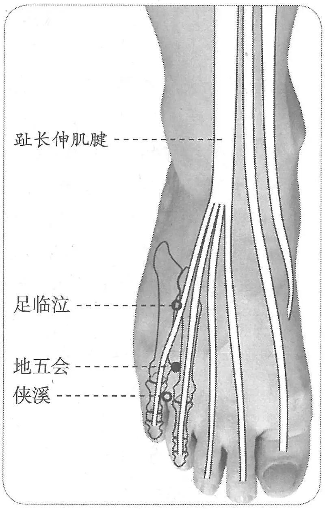

**图2-353　地五会穴图**

　6. 统编针灸学教材

　　(1) 部位：在足小趾次趾本节后陷中，去侠溪一寸。取穴：第四趾外侧本节之后陷中取之。（1957年南京《针灸学》）

　　(2) 部位：侠溪穴上一寸。取穴：第四趾外侧本节之后陷中，临泣穴下五分取之。（1版《针灸学讲义》）

　　(3) 部位：在足小指次指本节后陷者中。取穴：足第四、五跖骨间，当小趾伸肌腱的内侧缘取之。（2版《针灸学讲义》）

　　(4) 第四、五跖骨之间，侠溪穴上1寸。（4版《针灸学》）

　　(5) 在第四、五跖骨之间，当小趾伸肌腱内侧缘处。（5版《针灸学》、《中国针灸学》）

　　(6) 在足背外侧，当足4趾本节第4跖趾关节的后方，第4、第5跖骨之间，小趾伸肌腱的内侧缘。（6版《针灸学》）

　　(7) 第4、5跖骨间，第4跖趾关节稍后方，当小趾伸肌腱的内侧缘处。（7版《针灸学》）

#### 【类属】 

足少阳胆经穴。

#### 【适应症】 

主治目疾、局部病症。常用于目赤肿痛，腋下肿；足背红肿；乳痈。新增：唾血，皮肤不泽。

　1. 主内伤唾血不足，外无膏泽。（《黄帝明堂经》）

　2. 主腋下肿。（《千金要方》卷三十）

　3. 主乳肿。（《外台秘要》卷三十九）

　4. 治内伤唾血，足外皮肤不泽，乳肿。（《铜人腧穴针灸图经》卷下）

　5. 主腋痛，乳痈。（《针灸聚英》卷一、《古今医统》、《针灸大成》、《针方六集》、《类经图翼》）

　6. 五指肿痛。（《针方六集》卷五、《针灸逢源》）

　7. 主足背红肿，眼目赤疼。（《循经考穴编》下）

　8. 统编针灸学教材

　　(1) 目赤痛，腋肿，外损吐血，足背红肿，乳痈。（1957年南京《针灸学》、1版《针灸学讲义》）

〔p.1147 (인쇄 1119)〕

　　(2) 目赤痛，腋下肿，足背红肿，乳痈。（2版《针灸学讲义》）

　　(3) 内伤吐血，眼痒眼疼，耳鸣，乳肿，足跗肿痛。（4版《针灸学》）

　　(4) 头痛，目赤，耳鸣，胁痛，乳痈，内伤吐血，足背肿痛。（5、6版《针灸学》）

　　(5) ①头痛，目赤肿痛，胁痛，足跗肿痛等痛证；②耳鸣、耳聋；③乳痈。（7版《针灸学》）

　　(6) 主治目眦痛，耳鸣，乳房胀痛，足跗肿痛。（《中国针灸学》）

**文献分析**：《黄帝明堂经》载本穴主治“内伤唾血不足，外无膏泽”，此乃足少阳经“是动”病在足少阳胆经穴中的唯一体现，如不收录，则足少阳经病候便形同虚设，落不到实处，特此补录。又“耳鸣、耳聋”症未详所出，疑将下一穴“侠溪”主治误置于此，今去之。

#### 附：临床应用举例 

　1. 吐血内损，地五会三分，灸五壮、鱼际五分，泻、尺泽一寸，补。（《医学纲目》卷十七）

　2. 眼痒眼痛，泻光明与地五。（《标幽赋》）

　3. 耳内蝉鸣腰欲折，膝下明存三里穴。若能补泻五会间，且莫逢人容易说。（《席弘赋》）

#### 【操作】 

直刺0.5~0.8寸。

　1. 刺入三分，不可灸，使人瘦。（《黄帝明堂经》）

　2. 针入二分，不可灸，灸则使羸瘦，不出三年卒。（《铜人腧穴针灸图经》卷下）

　3. 针一分，禁灸。（《针灸十四经穴位考订》）

　4. 统编针灸学教材

　　(1) 针三至四分。（1957年南京《针灸学》、1版《针灸学讲义》）

　　(2) 直刺3~4分。（2版《针灸学讲义》）

　　(3) 直刺0.3~0.5寸。（4、5、6版《针灸学》，《中国针灸学》）

　　(4) 直刺0.5~0.8寸。（7版《针灸学》）

### （四十三）侠溪 Xiáxī GB43 出《灵枢》 

#### 【提要索隐】 

**部位**：在足背，第4、5趾间，趾蹼缘后方赤白肉际处。

**适应症**：主治头部、耳目部病症。常用于发热，头痛，眩晕，颊肿；耳聋、耳鸣，目赤肿痛；胁痛，膝股痛、足痛；乳痈。

**针刺操作**：直刺0.3~0.5寸。

#### 【名实考】 

本穴与曹氏“八冲”、窦氏奇穴“八风”之一相合，其主治与刺法皆可相参照。

　1. 胆出于窍阴，窍阴者，足小指次指之端也，为井金；溜于侠溪，侠溪，足小指次指之间也，为荥……足少阳也。（《灵枢·本输》）

　2. 流于侠谿，侠谿者，水也。在足小指次指歧骨间，本节前陷者中，足少阳脉之所流也，为荥。（《黄帝明堂经》）

　3. 穴在二指歧骨之间，故曰侠，所溜为荥水，故曰溪。（《经穴解》）

#### “侠溪”与“八风”穴关系 

　1. 其足十趾去趾奇一分，两足凡八穴，曹氏乃曰八冲，极下气有效。其足十趾端名曰气端，日灸三壮，并大神要。其八冲可日灸七壮。气下即止。病者非深相委悉，慎勿为人灸之。凡灸八冲艾炷须小作之。（《千金要方》卷七）

〔p.1148 (인쇄 1120)〕

　2. 八风八穴，在足五指歧骨间，两足共八穴，故名八风。治脚背红肿。（《奇效良方》卷五十五、《针灸大成》）

　3. 八风诸穴　在足十指缝中。针五分，各灸七壮。治脚气红肿，能散诸风。（《窦太师秘传》）

#### 【定位】 

**部位**：在足背，第4、5趾间，趾蹼缘后方赤白肉际处（图2-354）。

**取穴**：第4趾外侧本节前陷中取之。

　1. 在足小指次指歧骨间，本节前陷者中。（《黄帝明堂经》、《太平圣惠方·明堂》、《铜人腧穴针灸图经》、《圣济总录》、《针灸资生经》、《窦太师针经》、《十四经发挥》、《针灸聚英》、《古今医统》、《医学入门》、《针灸大成》、《针方六集》、《类经图翼》、《循经考穴编》、《医宗金鉴·刺灸心法要诀》、《针灸易学》、《针灸逢源》）

　2. 足小趾次趾合缝处陷中。（《针灸十四经穴位考订》）

　3. 统编针灸学教材

　　(1) 部位：足小趾次趾歧骨间，本节前陷中。取穴：第四趾外侧本节前陷中取之。（1957年南京《针灸学》）

　　(2) 部位：临泣穴下一寸五分。取穴：第四趾外侧本节前陷中取之。（1版《针灸学讲义》）

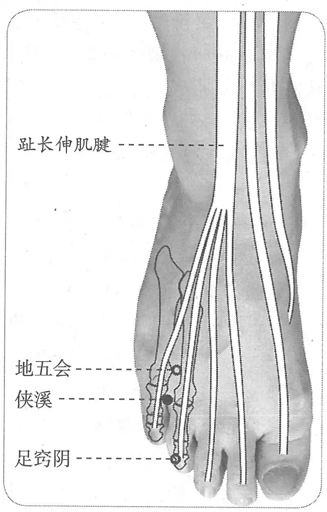

**图2-354　侠溪穴图**

　　(3) 部位：足小趾次趾歧骨间，本节前陷中。取穴：第四、五趾缝间，当趾蹼缘的上方取之。（2版《针灸学讲义》）

　　(4) 足背，第4、5趾间的缝纹端。（4、5版《针灸学》）

　　(5) 在足背外侧，当第4、第5趾间，趾蹼缘后方赤白肉际处。（6版《针灸学》）

　　(6) 足背，第4、5趾间，趾蹼缘后方赤白肉际处纹头上凹陷处。（7版《针灸学》）

　　(7) 足背，第4、5趾的趾缝间，趾蹼缘之后方。（《中国针灸学》）

#### 【类属】 

足少阳胆经荥穴。

　1. 胆出于窍阴……溜于侠溪，侠溪，足小指次指之间也，为荥……足少阳也。（《灵枢·本输》）

　2. 流于侠溪，侠溪者，水也……足少阳脉之所流也，为荥。（《黄帝明堂经》）

#### 【适应症】 

主治头部、耳目部病症。常用于发热，头痛，眩晕，颊肿；耳聋、耳鸣，目赤肿痛；胁痛，膝股痛、足痛；乳痈。

　1. 主胸胁支满，寒如风吹状。膝外廉痛。热病汗不出，目外眦赤痛，头眩，两颔痛，逆寒泣出，多汗，耳鸣聋，目痒，胸中痛不可反侧，痛无常处。痎疟。狂疾。（《黄帝明堂经》）

　2. 少腹坚痛，月水不通。（《千金要方》卷三十）

**按**：此乃《黄帝明堂经》“带脉”穴主治。

　3. 治胸胁支满，寒热汗不出，目外眦赤，目眩，颊颔肿，耳聋，胸中痛不可转侧，痛无常处。（《铜人腧穴针灸图经》卷下）

〔p.1149 (인쇄 1121)〕

　4. 窦太师针灸遗存

　　(1) 治脚背肿，五指拘挛，四肢肿满，脚底热。（《窦太师针经》）

　　(2) 脚气红肿，五指拘挛，痛痹，脚心烦热。（《针方六集》卷五）

　　(3) 主足背红肿，五指拳挛，指罅湿烂，足心发热，四肢浮肿，胁肋疼痛。（《循经考穴编》下）

　5. 统编针灸学教材

　　(1) 目外眦赤，目眩，耳鸣、聋，颊颔痛，胁肋疼痛，热病汗不出。（1957年南京《针灸学》、1版《针灸学讲义》）

　　(2) 外眦痛，头痛，目眩，耳鸣，耳聋，颊颔痛，胁肋痛，热病。（2版《针灸学讲义》）

　　(3) 头眩颔痛，耳鸣耳聋，胸胁支满，乳痈肿溃，经闭。（4版《针灸学》）

　　(4) 头痛，目眩，耳聋，耳鸣，目赤肿痛，胁肋疼痛，热病，乳痈。（5、6版《针灸学》）

　　(5) ①惊悸；②头痛，眩晕，颊肿、耳聋，耳鸣，目赤痛等头面五官病证；③胁肋疼痛，膝股痛、足跗肿痛等痛证；④乳痈；⑤热病。（7版《针灸学》）

　　(6) 头痛，眩晕，目外眦痛，耳鸣，耳聋，颊肿，胁肋痛，乳房胀痛，热病。（《中国针灸学》）

#### 附：临床应用举例 

　1. 灸寒热之法，先灸项大椎，以年为壮数……足小指次指间灸之。王冰注曰：侠溪穴也。（《素问·骨空论》）

　2. 治伤寒交汗不出，刺足少阳经风池二穴，侠溪二穴，在足小指次指歧骨间，本节前陷中，针入三分。（《针经摘英集》）

　3. 膀胱气，泻侠溪、然谷。小肠气，泻侠溪、三阴交。偏坠，泻照海、侠溪。（《医学入门》卷一）

　4. 红斑性肢痛病，侠溪穴、行间穴，针灸疗法。［江苏中医杂志，1985，6（8）：38］

　5. 足背特多寻常疣，侠溪穴、京骨穴，针灸疗法。［新中医，1987，19（9）：36］

#### 【操作】 

直刺0.3~0.5寸。

　1. 刺入三分，留三呼，灸三壮。（《黄帝明堂经》）

　2. 针入三分，灸七壮。（《窦太师针经》）

　3. 针三分，灸三壮。（《针灸十四经穴位考订》）

　4. 统编针灸学教材

　　(1) 针二至三分，灸二至三壮。（1957年南京《针灸学》、1版《针灸学讲义》）

　　(2) 斜刺2~3分，艾条灸2~3分钟。（2版《针灸学讲义》）

　　(3) 直刺0.3~0.5寸。（4、5、6、7版《针灸学》，《中国针灸学》）

### （四十四）足窍阴 Zúqiàoyīn GB44 出《灵枢》 

#### 【提要索隐】 

**穴名**：足窍阴，宋以前文献均作“窍阴”，与头部“窍阴”穴同名。

**部位**：在足趾，第4趾末节外侧，趾甲根角侧后方0.1寸（指寸）。

**适应症**：主治胸胁部、耳部病症。常用于头痛，目赤肿痛，胸胁痛；耳鸣、耳聋；足痛。

**针刺操作**：浅刺0.1寸，或点刺出血。

#### 【名实考】 

本穴穴名宋以前文献作“窍阴”，宋代《针灸资生经》作“足窍阴”，今从之。

〔p.1150 (인쇄 1122)〕

　1. 胆出于窍阴，窍阴者，足小指次指之端也，为井金……足少阳也。（《灵枢·本输》）

　2. 少阳根于窍阴，结于窗笼，窗笼者耳中也。（《灵枢·根结》）

　3. 足少阳根于窍阴，溜于丘墟，注于阳辅，入于天容、光明也。（《灵枢·根结》）

　4. 足少阳之本，在窍阴之间，标在窗笼之前。（《灵枢·卫气》）

　5. 厥阴之表，名曰少阳，少阳根起于窍阴，名曰阴中之少阳。（《素问·阴阳离合论》）

　6. 胆出于窍阴，窍阴者，金也……足少阳脉之所出也，为井。（《黄帝明堂经》）

　7. 窍阴二穴，金也。在足小指次指端，去爪甲如韭叶。注：窍阴有二，其一在此，其一在侧头部。此当为足窍阴也。（《针灸资生经》卷一）

　8. 少阳本也，木之井穴，如木之根生于地也，故曰阴，必有窍焉，以为生木之本，故曰窍阴。（《经穴解》）

#### 手足少阳井穴辨识失误例 

　1. 邪客于手少阳之络，令人喉痹舌卷，口干心烦，臂外廉痛，手不及头，刺手中指次指爪甲上去端如韭叶各一痏。（《素问·缪刺论》）

　2. 邪客于手少阳之络，令人喉痹舌卷，口干烦心，臂内廉痛，手不及头，刺小指次指爪甲上内去端如韭叶各一痏。（《黄帝内经太素·量缪刺》）

　3. 关冲，喉痹舌卷，口干烦心，臂表痛。（《医心方》）

　4. 关冲主舌卷，口干，心烦闷。关冲、窍阴、少泽主喉痹舌卷，口干。（《千金要方》）

　5. 喉痹舌卷，口中干，烦心心痛，臂内廉痛不可及头，取手小指次指爪甲下，去端如韭叶。（《灵枢·热病》）

　6. 喉痹舌卷，口干，烦心心痛，臂表痛不可及头，取关冲在手小指次指爪甲去端如韭叶许。（《针灸甲乙经》卷九第二）

　7. 窍阴，喉痹舌卷，口干，臂内廉痛不可及头。（《外台秘要》）

**按**：以上《素问》、《灵枢》所载针方也分别见于《针灸甲乙经》、《黄帝内经太素》，均明确取手少阳“关冲”穴治之，而《黄帝明堂经》作者却将其中一条辑入“关冲”，另一条归入足少阳“窍阴”，似欠妥。

#### 【定位】 

**部位**：在足趾，第4趾末节外侧，趾甲根角侧后方0.1寸（指寸）（图2-355）。

**取穴**：足第4趾外侧甲根角侧后方（即沿角平分线方向）0.1寸。相当于沿爪甲外侧画一直线与爪甲基底缘水平线交点处取穴。

　1. 足小指次指之端也。（《灵枢·本输》）

　2. 《黄帝明堂经》佚文

　　(1) 在足小指次指之端，去爪甲如韭叶。（《针灸甲乙经》卷三、《千金要方》、《外台秘要》、《医心方》、《铜人腧穴针灸图经》卷上及卷下、《圣济总录》、《针灸资生经》、《十四经发挥》、《针方六集》、《类经图翼》、《循经考穴编》）

　　(2) 在足小指次指之端去，去爪甲角如韭叶。（《黄帝内经太素·本输》杨上善注、《千金翼方》、《素问·气穴论》王冰注、《铜人腧穴针灸图经》卷下“穴腧都数”、《医学纲目》、《针灸聚英》、《古今医统》、《医学入门》）

　3. 在足小指次指端内侧，向大指边去爪甲如韭叶。（《窦太师针经》）

　4. 足第四指端外侧，去爪甲角如韭叶。（《医学入门》卷一、《针灸大成》、《循经考穴编》、《医宗金鉴·刺灸心法要诀》、《针灸易学》、《针灸逢源》）

　5. 足四趾外侧去爪甲角一分许。（《针灸十四经穴位考订》）

〔p.1151 (인쇄 1123)〕

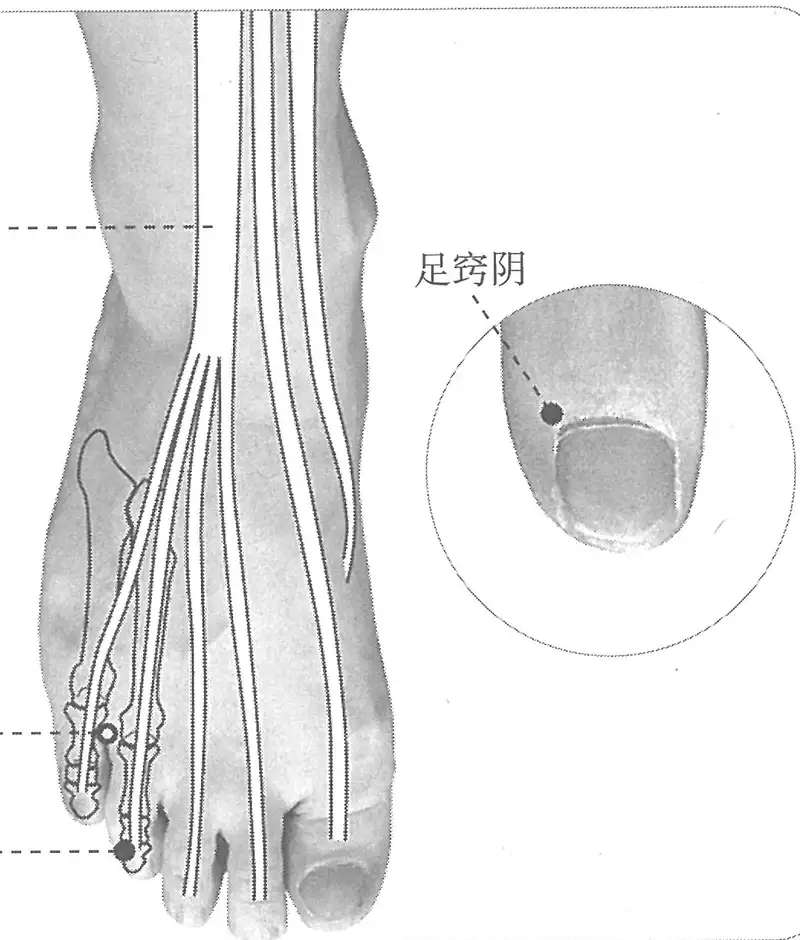

**图2-355　足窍阴穴图**

　6. 统编针灸学教材

　　(1) 部位：在足小趾次趾外侧，去爪甲角一寸许。取穴：第四趾外侧爪甲角一分许取之。（1957年南京《针灸学》）

　　(2) 部位：足小趾次趾外侧端。取穴：第四趾外侧爪甲角一分许取之。（1版《针灸学讲义》）

　　(3) 部位：足小趾次趾之端，去爪甲角如韭叶。取穴：第四趾外侧，距爪甲角后一分许取之。（2版《针灸学讲义》）

　　(4) 第四趾外侧趾甲角旁约0.1寸。（4、5版《针灸学》）

　　(5) 在足第4趾末节外侧，距趾甲角0.1寸（指寸）。（6版《针灸学》）

　　(6) 第4趾外侧趾甲根角旁0.1寸。（7版《针灸学》）

　　(7) 第四趾外侧趾甲角后一分许。（《中国针灸学》）

**文献分析**：本穴定位，现存《黄帝明堂经》佚文，“爪甲”下多无“角”字，而《素问·缪刺论》新校正引《针灸甲乙经》作窍阴“在足小指次指之端，去爪甲角如韭叶”；《黄帝内经太素·本输》杨上善引《明堂》文同。

#### 【类属】 

足少阳胆经井穴。足少阳所根。

　1. 足少阳根于窍阴，溜于丘墟，注于阳辅，入于天容、光明也。（《灵枢·根结》）

　2. 足少阳脉之所出也，为井。（《黄帝明堂经》）

#### 【适应症】 

主治胸胁部、耳部病症。常用于头痛，目赤肿痛，胸胁痛；耳鸣、耳聋；足痛。

　1. 主胁痛，咳逆不得息，窍阴主之即爪甲上与肉交者，左取右，右取左立已，不已复取之。手足清，烦热，汗不出，手肢转筋，头痛如锥刺之，循循然不可以动，动益烦心。喉痹，舌卷，口干，臂内廉痛不可及头，耳聋鸣。痈疽。（《黄帝明堂经》）

**按**：“喉痹，舌卷，口干，臂内廉痛不可及头”之症，见于《灵枢·热病》及《素问·缪刺论》，皆取手少阳井穴，而《黄帝明堂经》编者将《灵枢》原方主症归于足少阳井穴“窍阴”中，欠妥。

　2. 治胁痛，咳逆不得息，手足烦热，汗不出，转筋，痈疽，头痛心烦，喉痹舌强，口干，肘不可举，卒聋不闻人语。（《铜人腧穴针灸图经》卷下）

〔p.1152 (인쇄 1124)〕

　3. 窦太师针灸遗存

　　(1) 治胆寒不眠，补；胆热多睡，泻之。（《窦太师针经》）

　　(2) 主胆热多睡，宜泻，胆寒不寐，宜补。（《循经考穴编》下）

　4. 魇梦，目痛，小眦痛。（《针灸聚英》卷一、《针灸大成》）

　5. 统编针灸学教材

　　(1) 主治头痛，目痛，耳聋，喉痹，舌强，胁痛，梦魇，手足烦热汗不出。（1957年南京《针灸学》）

　　(2) 主治头痛，目痛，耳聋，喉痹，暴喑，胁痛，梦魇，热病汗不出。（1版《针灸学讲义》）

　　(3) 主治偏头痛，目痛，耳聋，胁痛，多梦，热病。（2版《针灸学讲义》）

　　(4) 主治头痛心烦，耳聋耳鸣，喉痹舌强，胁痛咳逆，月经不调。（4版《针灸学》）

　　(5) 主治头痛，目赤肿痛，耳聋，咽喉肿痛，热病，失眠，胁痛，咳逆，月经不调。（5、6版《针灸学》）

　　(6) 主治头痛，目赤肿痛，耳鸣、耳聋，咽喉肿痛等头面五官实热病证；胸胁痛，足跗肿痛。（7版《针灸学》）

　　(7) 主治偏头痛，耳聋，耳鸣，目痛，多梦，热病。（《中国针灸学》）

**文献分析**：教材中“喉痹，舌强”系承袭《黄帝明堂经》之误，今去之；“月经不调”未详所出，暂不收录。

#### 附：临床应用举例 

　1. 邪客于足少阳之络，令人胁痛不得息，咳而汗出，刺足小指次指爪甲上，与肉交者各一痏。（《素问·缪刺论》）

　2. 鸡痫，摇头反折，善惊目摇，至阴、窍阴、厉兑各灸三壮，刺一分。（《医学纲目》卷十一）

　3. 胆寒不得卧，窍阴一分，补之灸。（《医学纲目》卷十五）

　4. 高颅压头痛，足窍阴放血治疗。［中国针灸，2002，22（4）：227］

#### 【操作】 

浅刺0.1寸，或点刺出血。

　1. 刺入一分，留三呼，灸三壮。（《黄帝明堂经》）

　2. 针入一分，沿皮向后三分，禁灸。治胆寒不眠，补；胆热多睡，泻之。（《窦太师针经》）

　3. 针一分，灸三壮。（《针灸十四经穴位考订》）

　4. 统编针灸学教材

　　(1) 针一至二分，灸二至三壮。（1957年南京《针灸学》、1版《针灸学讲义》）

　　(2) 斜刺1~2分，艾条灸2~3分钟。（2版《针灸学讲义》）

　　(3) 浅刺0.1寸。（4版《针灸学》、《中国针灸学》）

　　(4) 浅刺0.1寸，或点刺出血。（5、6、7版《针灸学》）

### 延伸阅读 

　1. 黄龙祥．中国针灸学术史大纲［M］．北京：华夏出版社，2001．

　2. 黄龙祥．新编重绘十四经脉经穴图［M］．北京：中国中医药出版社，2010．

　3. 黄龙祥，黄幼民．元代珍稀针灸三种［M］．北京：人民卫生出版社，2008．

　4. 许平．风池穴的不同针刺方向运用体会［J］．实用中医药杂志，2000，16（8）：45．

〔p.1153 (인쇄 1125)〕

　5. 张建华，余安胜，赵英侠，等.风池穴的解剖结构和针刺深度[J].针刺研究，2003，28(2)：141-143.

　6. 杨凤琼，陈良金.浅谈环跳取穴[J].时珍国医国药，2006，17(6)：1068-1069.

　7. 管遵信.管正斋老医师运用环跳穴治疗前后阴病经验介绍[J].云南中医杂志，1982(3)：28-29.

　8. 朱国祥，程子刚.环跳穴不同深度刺法治疗坐骨神经痛疗效观察[J].中国针灸，1999，19(11)：679-680.

　9. 周炜.环跳穴的临床应用[J].针灸临床杂志，2002，18(6)：40-41.

　10. 王映辉.立位针刺“中跳”穴治疗坐骨神经痛的体会[J].针灸临床杂志，1995，11(11/12)：64-65.

　11. 王静，余曙光，唐勇.特殊针刺疗法治疗坐骨神经痛的临床进展[J].辽宁中医药大学学报，2009，11(2)：49-50.

　12. 刘芳，毕振宇.新环跳穴治疗坐骨神经痛150例疗效观察[J].中国厂矿医学，2004，17(3)：239-240.

　13. 高学全，赵克蕊.环跳穴浅析[J].天津中医药，2010(2)：123-124.

　14. 邱文兴，段淑香，侯林萍，等.环跳穴与坐骨神经的解剖学研究[J].针灸临床杂志，1999，15(4)：57-58.

　15. 孙正庭.下肢神经阻滞在骨科手术中的应用[J].中华麻醉学杂志，1981(1)：31-32.

　16. 曲成业，赵雅斌，赵俊.坐骨神经阻滞的入路及定位方法[J].疼痛学杂志，1996，4(3)：116-119.

　17. 黄利民.胆经头部20穴的定位[J].云南中医学院学报，1990，13(3)：23-26.

〔p.1154 (인쇄 1126)〕

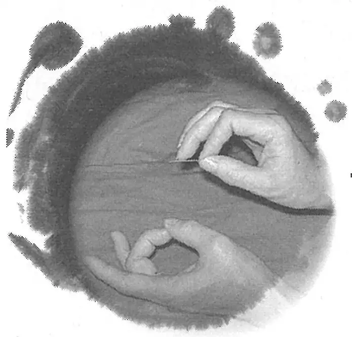

