# 《针灸腧穴通考》(下册) — 足厥阴肝经穴  · （一）大敦 Dàdūn LR1 出《灵枢》~（十四）期门 Qīmén LR14 出《黄帝明堂经》

> 분할본 20/25. 원서: 黄龙祥·黄幼民 编著, 《针灸腧穴通考——〈中华针灸穴典〉研究》(下册), 人民卫生出版社, 2011. 원서 스캔 OCR 판독본을 챗봇 검색용으로 나눈 것이며, 본문과 쪽 표시 〔p.PDF쪽 (인쇄 쪽)〕는 원본 그대로이다.

## 十二、足厥阴肝经穴 

### 概说 

足厥阴经的经脉循行、病候以及腧穴归经、经穴定位的古代文献记载变化不大。在穴名方面，宋以前文献足厥阴经“五里”，与手阳明经的“五里”同名；足厥阴郄穴本名“中郄”，一名“中都”，自宋代《铜人腧穴针灸图经》始，正名与别名正好颠倒。

最新的研究揭示：足厥阴脉“是动”病描述的是阴疝的症状，古人从阴疝发病部位特点及对该病的针灸诊疗经验中抽提出“足背-前阴-少腹-腰(舌)之间相关联系”的规律，而所谓“足厥阴脉”则是古人对这一规律的直觉解释。

足厥阴经与络，循行与病候，相关的脉口(诊脉部位)、经脉穴(治疗部位)、经脉(循行分布)等，均有较完整的早期形迹可考，是认识经络学说形成、演变的一个“活化石”。

#### 【经脉与经穴】 

#### 经脉循行与病候 

**新校正文字**：肝足厥阴之脉，起于大指丛毛之际，上循足跗上廉，去内踝一寸，上踝八寸，交出太阴之后，上腘内廉，循股阴入毛中，过阴器，抵小腹，挟胃属肝络胆，上贯膈，布胁肋，循喉咙之后，上入颃颡，连目系[^44-1]……其支者，从目系下颊里，环唇内[^45-2]……是动则病腰痛不可以俯仰，丈夫癞疝，妇人少腹肿，甚则嗌干，面尘脱色。是肝所生病者，胸满，呕逆，飧泄，狐疝，遗溺，闭癃。（《灵枢·经脉》）

厥阴脉，系于足大指丛毛之上，乘足跗上廉，去内踝一寸，上踝五寸而出太阴之后，上出鱼股内廉，触少腹，大渍旁。是动则病丈夫癞疝，妇人则少腹肿，腰痛，不可以仰，甚则嗌干，面疵，是厥阴脉主治。其所产病：癃，癞，偏疝，热中五病。又烦心，死，勿治也。有阳脉与之俱病，可治也。（《阴阳十一脉灸经》）

足厥阴脉，循大指间，以上出胻内廉，上八寸，交太阴脉，□股内，上入脞(腠)间。其病：病脞瘦，多溺，嗜饮，足跗肿，疾痹。诸病此物者，久厥阴脉。皆有此五病者，又烦心，死。三阴之病乱，不过十日死。循脉如三人参春，不过三日死。脉绝如食顷，不过三日死。烦心，又腹胀，死。不得卧，又烦心，死。溏泄恒出，死。三阴病杂以阳病，可治。阳病背如流汤，死。阳病折骨绝筋而无阴病，不死。（《足臂十一脉灸经》）

[^44-1]: 此后原有“上出额，与督脉会于巅”一句，原文出于《灵枢·营气》，然“上出额，与督脉会于巅”者，乃足太阳脉而不是“足厥阴脉”，所以改作“足厥阴者”，主要是为了实现十四经脉连环，故删之。

[^45-2]: 此后原有“其支者，复从肝别贯膈，上注肺”句，与前文重复，所以点出“上出肺”者，是为建立十二经脉连环。为构建这大小两个连环，在肝经中打了太多的“补丁”，反而失去了其本来面目。

〔p.1155 (인쇄 1127)〕

**所属经穴**：大敦　行间　太冲　中封　蠡沟　中都　膝关　曲泉　阴包　足五里　阴廉　急脉　章门　期门

#### 【归经与起止穴】 

《针灸甲乙经》足厥阴及股凡二十二穴：大敦、行间、太冲、中封、蠡沟、中都、膝关、曲泉、阴包、五里、阴廉；

唐代《千金要方》、《千金翼方》将此十一穴全部正式归入“足厥阴肝经十一穴”；《外台秘要》全部归入“肝人”；

六朝《产经》“足厥阴肝脉”穴，包含《针灸甲乙经》全部十一穴外，又增加“三阴交”一穴；

宋代《铜人腧穴针灸图经》重新厘定的“足厥阴肝经穴”共十三穴：大敦、行间、太冲、中封、蠡沟、中都、膝关、曲泉、阴包、五里、阴廉、章门、期门；

明代张介宾《类经图翼》将《素问·气府论》王冰注所引之“急脉”穴归入本经，至此十四穴齐备。

值得注意的是，六朝时期《产经》足厥阴经穴中在膝关与中郄(中都穴的本名)之间有“三阴交”一穴，与《灵枢·经脉》足厥阴脉“上踝八寸，交出太阴之后”相合。又五里穴，唐代杨上善归入足太阴脾经。

#### 【经穴定位与主治】 

足厥阴经穴定位的古代文献记载变化不大。然而后人对古代文献的理解有所不同，古代分歧较大的是大敦穴的定位。

#### 【脉口病候、经脉是动病候与经脉穴主治】 

足厥阴标脉：股内动脉(“急脉”、“阴廉”穴所在)。

足厥阴本脉：太冲脉(太冲穴所在)。

“足厥阴”穴：太冲。

关于足厥阴经脉的“是动”病(源出于足厥阴脉口的诊断病候)与“足厥阴”穴(太冲)主治的比较见表2-15。

**表2-15　足厥阴经脉是动病候与经脉穴主治的相关性**

| 《阴阳十一脉灸经》是动病候 | 《灵枢·经脉》是动病候 | 《黄帝明堂经》经脉穴主治 |
|---|---|---|
| 是动则病，丈夫则癞疝，妇人少腹肿；腰痛不可以仰，甚则嗌干，面疵，是厥阴脉主治。 | 是动则病腰痛不可以俯仰，丈夫癞疝，妇人少腹肿，甚则嗌干，面尘脱色。 | 太冲穴主治：男子癞疝，女子少腹肿，腰痛，嗌干，面尘黑。 |

可以看出，足厥阴脉口病候与“足厥阴”穴(相当于“太冲”穴)主治、足厥阴络脉病候与足厥阴络穴主治不仅病症相同，而且文字也一脉相承，足证《阴阳十一脉灸经》的古注文“是厥阴脉主治”显然是指足厥阴脉口“太冲脉”(相当于“太冲”、“行间”穴处)主治。

通过系统分析揭示：足厥阴脉“是动”病描述的是一组阴疝的症状，而对于阴疝症状的描述，无论是从文序还是从内容上，都以《阴阳十一脉灸经》更准确。古人从阴疝发病部位特点及对该病的针灸诊疗经验中抽提出“足背-前阴-少腹-腰(舌)之间相关联系”的规律，而所谓“足厥阴脉”则是古人对这一规律的直觉解释。《黄帝明堂经》载足厥阴经穴、络穴均治疝，而且对阴疝症状的描述非常详细，也就不足为怪了。

〔p.1156 (인쇄 1128)〕

#### 【诊络病候、络脉病候与络穴主治】 

足厥阴之别，名曰蠡沟。去内踝五寸，别走少阳；其别者，径胫上睾，结于茎。其病气逆则睾肿卒疝，实则挺长，虚则暴痒，取之所别也。（《灵枢·经脉》）

蠡沟，足厥阴之络，在内踝上五寸，别走少阳。实则挺长，虚则暴痒；气逆则睾肿卒疝。（《黄帝明堂经》）

足厥阴络脉病候与足厥阴络穴主治不仅病症相同，而且文字也一脉相承，有着明显的同源关系。足厥阴除了蠡沟外，还可见有其他具有络穴性质的腧穴：

邪客于足厥阴之络，令人卒疝暴痛，刺足大指爪甲上与肉交者各一痏。（《素问·缪刺论》）

曲泉穴：实则身热头痛，汗不出，目䀮然无所见，怒欲杀人，暴痛引髌下节……狂如新发。（《黄帝明堂经》）

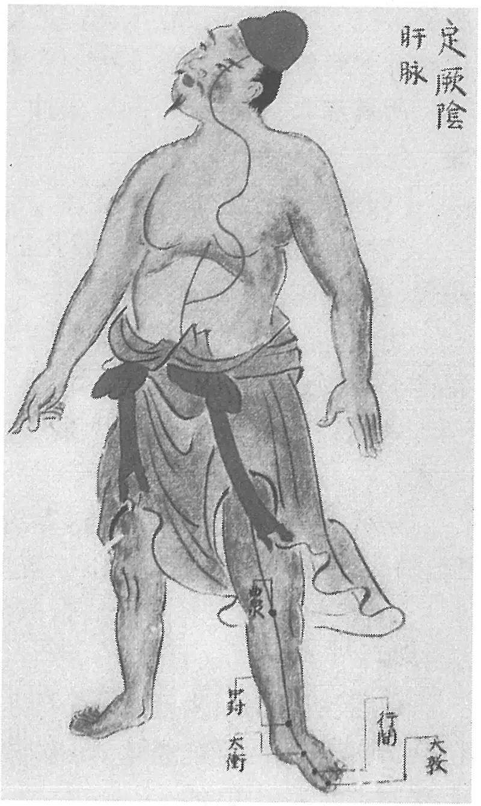

**图2-356　《环中图》足厥阴肝脉图**

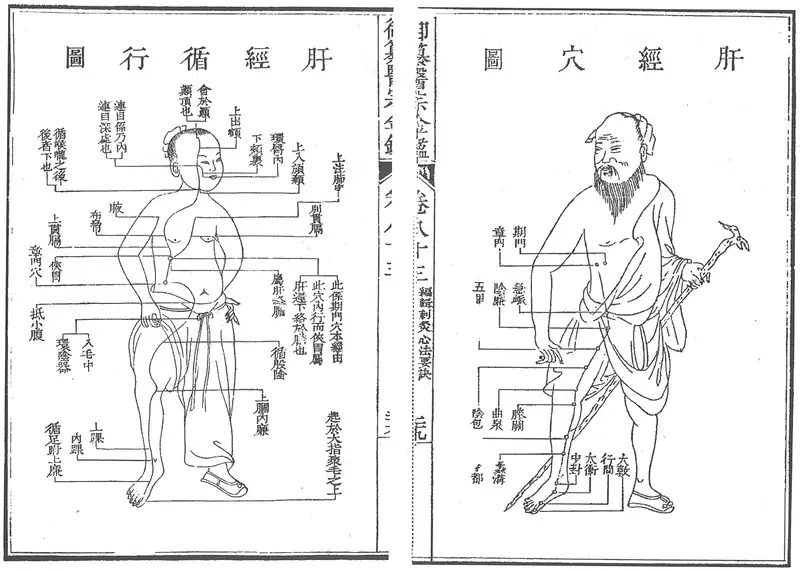

**图2-357　《医宗金鉴》足厥阴肝经脉、经穴分图**

〔p.1157 (인쇄 1129)〕

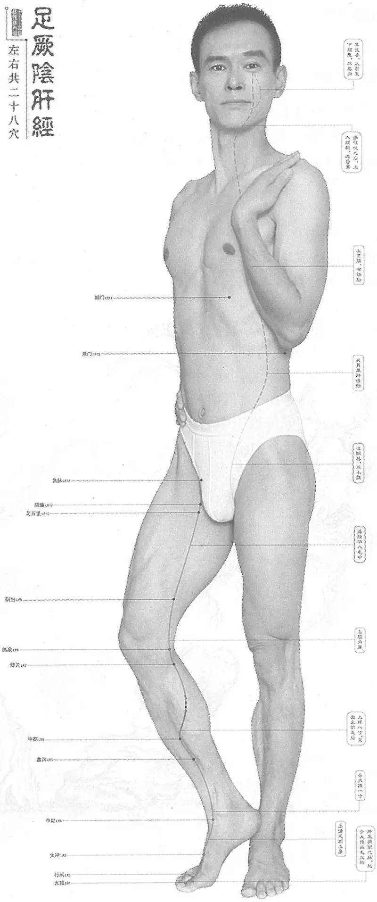

**图2-358　黄龙祥编足厥阴肝经脉、经穴合图**

〔p.1158 (인쇄 1130)〕

**按**：《灵枢·癫狂》曰：“狂而新发，未应如此者，先取曲泉左右动脉，及盛者见血，有顷已，不已，以法取之”，说明曲泉穴处也用作刺络部位。

### （一）大敦 Dàdūn LR1 出《灵枢》 

问题1：本穴名称，《西方子明堂灸经》皆称“大训”，是何缘故？

问题2：本穴定位，《黄帝明堂经》作“在足大指端，去爪甲如韭叶及三毛中”，如何理解，如何定位？后世定位发生了什么样的变化？为什么会出现这样的改变？

#### 【提要索隐】 

**穴名**：一名大训。

**部位**：在足趾，大趾末节外侧，趾甲根角侧后方0.1寸(指寸)。

**适应症**：主治前阴部、妇科病症。常用于疝气；睾丸肿痛、前阴痛、少腹疼痛，遗尿，癃闭；月经不调，子宫下垂；小儿惊风，癫痫；神昏。

**针刺操作**：浅刺0.1~0.2寸，或点刺出血。

#### 【名实考】 

大敦，宋代《西方子明堂灸经》为避宋光宗名讳改作“大训”。

关于本穴定位，《黄帝明堂经》作“足大指端，去爪甲如韭叶及三毛中”，杨上善认为两处皆为大敦，而后世医家多将“及”理解为“达”而不是“与”，即定位于足大趾爪甲后三毛中。例如《铜人腧穴针灸图经》文字描述作“去爪甲如韭叶及三毛中”与《黄帝明堂经》同，但明正统仿宋铜人“大敦”点在足大趾甲后缘正中之后如韭叶三毛中，并没有理解成两个穴点。这一理解与足厥阴经脉、经筋的循行是吻合的，也与唐以前针灸方取穴的实际相吻合。之所以之后定在足大趾端外侧，主要是为建立十二经脉连环，这从足厥阴经脉循行描述可以看得很清楚。今人则将原大敦穴“三毛”处定为奇穴！

本穴定位文字“三毛”，唐以前针灸方或作“丛毛”，或作“聚毛”，或作“廻(回)毛”，所指皆同。

#### 唐以前针灸方“大敦”穴定位 

　1. 猝癫，又灸足大趾上聚毛中七壮。（《千金要方》卷十四、《千金翼方》、《医心方》）

　2. 狂走癫厥如死人，灸足大趾三毛中九壮。一云灸大敦。（《千金要方》卷十四）

　3. 大便不通，又灸大敦四壮，在足大趾聚毛中。（《千金要方》卷十五）

　4. 辟魇方，又方两足大趾丛毛中各二七壮。《肘后》云华佗法，又救卒死中恶。（《千金要方》卷二十五）

5.《葛氏方》治卒大便下血方，灸两足大指廻毛中。（《医心方》卷十二）

#### 针灸铜人“大敦”穴定位 

　1. 明正统仿宋铜人、明嘉靖铜人　足大趾甲后缘正中之后三毛中。

　2. 清光绪铜人　足大趾端外侧爪甲角。

#### 经脉循行所示足厥阴所“起”处 

　1. 肝足厥阴之脉，起于大指丛毛之际……（《灵枢·经脉》）

　2. 足厥阴之筋，起于大指之上……（《灵枢·经筋》）

　3. 胆足少阳之脉……其支者，别跗上，入大指之间，循大指歧骨内出其端，还贯爪甲，出三毛。（《灵枢·经脉》）

　4. 肝出大敦，大敦者，足大趾之端及三毛之中也，为井。杨上善注：足大趾端及三毛皆是大

〔p.1159 (인쇄 1131)〕

敦，厥阴脉井也。（《黄帝内经太素·本输》）

　5. 杨上善曰三毛一名藂毛，在上节后毛中也。（《黄帝内经太素·经脉连环》卷八）

　6. 肝出大敦，大敦者，木也……足厥阴脉之所出也，为井。（《黄帝明堂经》）

　7. 木之根在下，须土而后茂，肝之井，即木之根也，而与脾土同出足大指，有土厚而木茂之义，故曰大敦。（《经穴解》）

　8. 石淋，脐下三十六种病不得小便，灸关元三十壮，又灸水泉三十壮，足大敦是也。（《千金要方》卷二十一）

**按**：水泉，与足少阴经“水泉”同名，《千金翼方》、《医心方》只作“大敦”，而无“水泉”之名，故暂不作为“大敦”穴别名。

#### 【定位】 

**部位**：在足趾，大趾末节外侧，趾甲根角侧后方0.1寸(指寸)(图2-359)。

**取穴**：足大趾外侧指甲根角侧后方(即沿角平分线方向)0.1寸。相当于沿爪甲外侧画一直线与爪甲基底缘水平线交点处取穴。

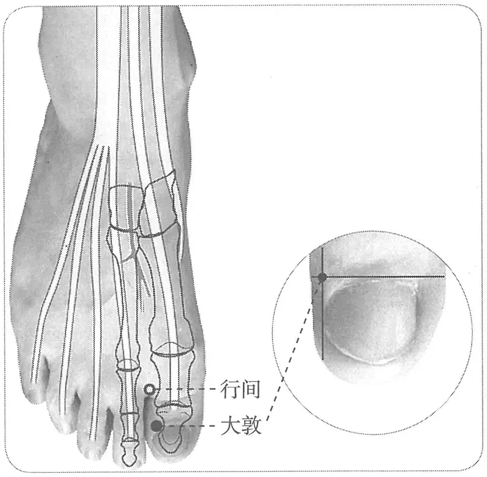

**图2-359　大敦穴图**

　1. 大敦者，足大指之端及三毛之中也。（《灵枢·本输》）

2.《黄帝明堂经》佚文

　　(1) 在足大指端，去爪甲如韭叶及三毛中。（《针灸甲乙经》卷三、《千金要方》、《千金翼方》、《外台秘要》、《医心方》、《铜人腧穴针灸图经》卷上及卷下、《圣济总录》、《针灸资生经》、《十四经发挥》、《针灸聚英》、《古今医统》、《医学入门》、《针灸大成》、《针方六集》、《类经图翼》、《循经考穴编》、《针灸易学》、《针灸逢源》）

　　(2) 足大指之端去爪甲角如韭叶。（《素问·缪刺论》王冰注、《铜人腧穴针灸图经》卷下“都数”）

　3. 两足大指甲后丛毛内。（《医心方》卷十四）

　4. 在足大指端去爪甲上如韭叶三毛之中。（《素问亡篇·刺法论》）

　5. 在足大指端。一云内侧为隐白，外侧为大敦。（《针灸聚英》卷一、《黄帝内经灵枢注证发微》、《类经图翼》、《循经考穴编》）

　6. 在足大指端正甲后，去爪甲如韭叶大，及三毛中。（《窦太师针经》、《针方六集》）

　7. 在足大指端去爪甲后如韭叶许，外侧聚毛中是其穴也。（《医宗金鉴·刺灸心法要诀》）

　8. 足大趾外侧去趾甲根后一分许。（《针灸十四经穴位考订》）

　9. 统编针灸学教材

　　(1) 部位：在足大趾端，去爪甲如韭叶。取穴：从蹈趾第一节之关节前，爪甲根部之后侧向外侧一分许取之。(1957年南京《针灸学》)

　　(2) 部位：足大趾外侧端。取穴：足大趾外侧爪甲角上后方三毛处取之。(1版《针灸学讲义》)

〔p.1160 (인쇄 1132)〕

　　(3) 部位：在足大指端，去爪甲角如韭叶。取穴：足大趾末节的外侧趾背上，当外侧爪甲根与趾关节之间取之。(2版《针灸学》、《中国针灸学》)

　　(4) 蹈趾外侧趾甲角旁约0.1寸。(4、5版《针灸学》)

　　(5) 在足大趾末节外侧，距趾甲角0.1寸。(6版《针灸学》)

　　(6) 足大趾外侧趾甲根角旁约0.1寸。(7版《针灸学》)

#### 【类属】 

足厥阴肝经井穴。

足厥阴脉之所出也，为井。（《黄帝明堂经》）

#### 【适应症】 

主治前阴部、妇科病症。常用于疝气；睾丸肿痛、前阴痛、少腹疼痛，遗尿，癃闭；月经不调，子宫下垂；小儿惊风，癫痫；神昏。

　1. 主卒心痛汗出，大敦主之，出血立已。阴跳遗溺，小便难而痛，阴上入腹中，寒疝阴挺出，偏大肿，腹脐痛，腹中悒悒不乐。小儿痫瘈，遗清溺，虚则病诸瘕癞，实则闭癃，小腹中热，善寐。尸厥死不知人，脉动如故。卒疝暴痛，灸刺之，男子立已。（《黄帝明堂经》）

**按**：以上病症多为前阴病症，且多为阴疝的症状：阴跳遗溺，小便难而痛，阴上入腹中，寒疝阴挺出，偏大肿，腹脐痛，腹中悒悒不乐，卒疝暴痛。其中“尸厥死不知人，脉动如故。卒疝暴痛”诸症出于《素问·缪刺论》，而后者治尸厥取隐白穴。

　2. 治卒疝，小便数，遗溺，阴头中痛，心痛汗出，阴上入腹，阴偏大，腹脐中痛，悒悒不乐，病左取右，右取左。腹胀肿满，少腹痛，中热喜寐，尸厥状如死，妇人血崩不止。（《铜人腧穴针灸图经》卷下）

　3. 窦太师针灸遗存

　　(1) 治一切疝气，木肾，中风不省人事，看症补泻。（《窦太师针经》）

　　(2) 治膀胱疝气，偏坠木肾等疾先补后泻。（《大本琼瑶神书》）

　　(3) 主七疝木肾，竖痃偏坠，中风不省人事。（《循经考穴编》下）

　　(4) 治小腹疝气，偏坠切疼，阴气上入腹，脐中疼痛。左取右，右取左。（《窦太师秘传》）

　4. 统编针灸学教材

　　(1) 主治血崩不止，阴挺，阴缩，睾丸偏大，阴头痛，五淋，七疝，小儿遗尿，尸厥。(1957年南京《针灸学》、1版《针灸学讲义》)

　　(2) 主治阴挺，疝气，崩漏，遗尿，大便不通。(2版《针灸学讲义》)

　　(3) 主治疝气，遗尿，阴肿，经闭，崩漏，阴挺，癫痫。(4版《针灸学》)

　　(4) 主治疝气，遗尿，经闭，崩漏，阴挺，癫痫。(5版《针灸学》)

　　(5) 主治疝气，遗尿，月经不调，经闭，崩漏，阴挺，癫痫。(6版《针灸学》)

　　(6) 主治①疝气，少腹痛；②遗尿、癃闭、五淋、尿血等泌尿系病证；③月经不调、崩漏、阴中痛、阴挺等月经病及前阴病证；④癫痫，善寐。(7版《针灸学》)

　　(7) 主治疝气，遗尿，崩漏，阴挺，痫证。（《中国针灸学》）

**文献分析**：古今腧穴文献及临床应用均提示本穴治疗的重点部位在前阴部。

#### 附：临床应用举例 

　1. 疝气

　　(1) 邪客于足厥阴之络，令人卒疝暴痛，刺足大指爪甲上，与肉交者各一痏，男子立已，女子有顷已，左取右，右取左。（《素问·缪刺论》）

〔p.1161 (인쇄 1133)〕

　　(2) 卒心疝暴痛汗出，刺大敦，左取右，右取左，男左女右，刺之出血立已。（《千金翼方》卷二十七）

　　(3) 气癞，灸足厥阴大敦，左灸右，右灸左，各一壮。小儿阴肿，灸大敦七壮。（《千金要方》卷五）

　　(4) 疗卒疝暴痛方：灸大敦，男左女右。三壮立已，穴在灸经图上。（《外台秘要》卷七）

　　(5) 男阴卵大癞病，灸大敦，在足大指三毛中随年壮。（《千金要方》卷二十四）

　　(6) 阴肿痛，灸大敦三壮。（《千金要方》卷二十四）

　　(7) 阴头中痛不可忍者，卒疝也，妇人阴中痛，皆刺足厥阴井大敦穴。（《素问病机气宜保命集》卷下）

　　(8) 治男子卒疝，少腹痛不可忍，刺足厥阴经大敦二穴，在足大指外侧端去爪甲角如韭叶及三毛中，针入三分，留六呼，可灸七壮。（《针经摘英集》）

　　(9) 疝气少腹偏痛：大敦二分，沿皮向后三分，泻之；灸，左取右，右取左，下同、三阴交一寸，泻十吸。（《医学纲目》卷十四）

　　(10) 若卒患小肠疝气，一切冷气连脐腹结痛，小便遗溺：大敦二穴在足大指外侧，去爪甲韭叶许及三毛丛中是穴，灸三壮。（《乾坤生意》下卷）

　　(11) 稽夫大敦去七疝之偏坠，王公谓此。（《通玄指要赋》）

　　(12) 由来七疝病多端，偏坠相兼不等闲，不问竖痃并木肾，大敦一泻即时安。（《针灸玉龙歌》）

　　(13) 水泉穴乃肾之原，脐腹连阴痛可蠲，更刺大敦方是法，下针速泻即安然。（《针灸玉龙歌》）

　　(14) 竖痃疝气发来频，气上攻心大损人，先向阁门施泻法，大敦复刺可通神。（《针灸玉龙歌》）

**按**：“阁门”乃“阑门”之误，考证详见急脉穴“名实考”。

　　(15) 大敦二穴主偏坠，水沟间使治邪癫。（《灵光赋》）

　　(16) 腹股沟疝及嵌顿疝：大敦穴针灸治疗。[中国针灸，1986，6(2)：2]

　　(17) 小儿狐疝：治疗时取左大敦穴，右独阴穴，用米粒大艾炷各灸一壮，不用任何药物，一月后复诊。[浙江中医杂志，1988，23(2)：90]

　2. 前阴、小便病症

　　(1) 癃，取之阴𫏋及三毛上及血络出血。（《灵枢·热病》）

　　(2) 治小儿遗尿方：遗尿，灸脐下一寸半，随年壮。又灸大敦三壮，亦治尿血。（《千金要方》卷五、《千金翼方》）

　　(3) 五淋，灸大敦三十壮。（《千金要方》卷二十）

　　(4) 小便失禁，灸大敦七壮，又灸行间七壮。（《千金要方》卷二十一）

　　(5) 石淋小便不得，灸水泉三十壮。足大敦是也。（《千金要方》卷二十一）

　　(6) 石淋不得小便：关元三七壮、气门、大敦各二七壮。（《医学纲目》卷十四）

　　(7) 遗尿失禁：阴陵泉、阳陵泉二寸半、大敦七壮。（《医学纲目》卷十四）

　　(8) 男子阴头痛，女子阴中痛：大敦。（《医学纲目》卷十四）

　3. 癫狂猝死

　　(1) 华佗：卒中恶，短气欲死。灸足两拇趾上甲后聚毛中，各十四壮即愈。未瘥，又灸十四壮。（《肘后备急方》卷一）

〔p.1162 (인쇄 1134)〕

　　(2) 治卒中邪魅恍惚振噤之方：灸鼻下人中，及两手足大指爪甲本。令艾丸半在爪上，半在肉上，各七壮，不止，至十四壮便愈。（《补辑肘后方》卷上）

　　(3) 治卒魇寐不寤方：灸两足大指聚毛中二十一壮。（《补辑肘后方》卷上）

　　(4) 治卒癫疾方：灸阴茎上宛宛中三壮，得小便通，则愈。又方：灸两乳头三壮。又灸足大指本聚毛中七壮，灸足小指本节七壮。（《千金要方》卷十四、《千金翼方》）

　　(5) 狂走癫厥如死人，灸足大指三毛中九壮亦云灸大敦。（《千金要方》卷十四、《千金翼方》）

　　(6) 狂症：大敦穴、少商穴，艾灸。[浙江中医杂志，1984，19(2)：64]

　4. 出血病症

　　(1) 治鼻出血不止方：衄时痒痒，便灸足大指节横理三毛中十壮，剧者百壮，衄不止灸之，并治阴卵肿。（《千金要方》卷六、《千金翼方》）

　　(2) 卒大便下血方：灸两足大指回毛中随年壮即愈。（《肘后备急方》）

　　(3) 血崩：点刺隐白、大敦二穴放血治疗。[青海医药杂志(中医药专辑)，1999，29(11)：7]

　　(4) 功能性子宫出血：取双侧大敦或隐白穴，均用麦粒炷直接灸，每次5~7壮，每日1次。分型：肝郁气滞型灸大敦穴，脾气虚型取隐白穴，肝脾失调型取大敦，隐白同时灸。[陕西中医，1988，9(4)：176]

　5. 其他病症

　　(1) 人有所堕坠，恶血留内，腹中满胀，不得前后，先饮利药，此上伤厥阴之脉，下伤少阴之络，刺足内踝之下，然骨之前，血脉出血，刺足跗上动脉，不已，刺三毛上各一痏，见血立已，左刺右，右刺左。（《素问·缪刺论》）

　　(2) 魇，灸两足大指聚毛中各二七壮。（《千金要方》卷二十五、《千金翼方》）

　　(3) 眼肉赤肿，睫溃烂连脑昏：泻攒竹，刺大敦泻之；未愈，灸大小指骨空数效。（《针灸集要·盘石金直刺秘传》）

　　(4) 腹胀脐突，缺盆中满，尻腰肿：大敦、天牖、昆仑。（《医学纲目》卷二十四）

　　(5) 大便闭涩大敦烧。（《席弘赋》）

#### 【操作】 

浅刺0.1~0.2寸，或点刺出血。

　1. 刺入三分，留十呼，灸三壮。（《黄帝明堂经》）

　2. 以手按穴，得动脉下针，可及三分，留六呼，如得气，急出之。先刺左，后刺右。（《素问亡篇·刺法论》）

　3. 可灸三壮，针入三分，留六呼。（《铜人腧穴针灸图经》卷下）

　4. 针入三分，留六呼，可灸七壮。（《针经摘英集》）

　5. 窦太师针灸遗存

　　(1) 针入一分，沿皮向后三分，灸二七壮。（《窦太师针经》）

　　(2) 针一分，沿皮向后三分。（《窦太师秘传》）

　　(3) 针一分，沿皮向后三分，留十呼，五十壮。（《大本琼瑶神书》）

　6. 针一分，灸三壮。（《针灸十四经穴位考订》）

　7. 统编针灸学教材

　　(1) 针一至二分，针尖直下，与其他趾端或指端之穴针尖斜进者不同，灸三至五壮。(1957年南京《针灸学》、1版《针灸学讲义》)

〔p.1163 (인쇄 1135)〕

　　(2) 斜刺1~2分，艾炷灸3~5壮。(2版《针灸学讲义》)

　　(3) 浅刺0.1~0.2寸。(4版《针灸学》)

　　(4) 浅刺0.1~0.2寸，或点刺出血。(5、6、7版《针灸学》)

　　(5) 浅刺0.1~0.2寸。可灸。（《中国针灸学》）

### （二）行间 Xíngjiān LR2 出《灵枢》 

问题1：本穴与曹氏“八冲”和窦氏“八风”穴的关系如何？

问题2：本穴与古穴名“足厥阴”关系如何？

#### 【提要索隐】 

**部位**：在足背，第1、2趾间，趾蹼缘后方赤白肉际处。

**适应症**：主治前阴部、咽部病症。常用于疝气，少腹疼痛；前阴痛，遗尿、癃闭；月经不调，带下；目赤肿痛，口干渴；胁痛，善怒，太息，癫痫；脚膝肿痛。**新增**：咽喉肿痛。

**针刺操作**：直刺0.5~0.8寸。

#### 【名实考】 

古穴名“足厥阴”是指整个足大趾间脉动处，包括行间、太冲二穴；本穴与曹氏“八冲”、窦氏奇穴“八风”之一相合，其主治与刺法皆可相参照。详见足少阳经侠溪穴“名实考”。

关于本穴定位，《灵枢》只说“足大指间”，晋唐间针灸方取穴或作“足大指歧间”，或“足大指奇间”，或“足大指歧间白黑肉际”，所说部位更明确，皆指第1、2趾缝间趾蹼缘。

　1. 肝出于大敦，大敦者，足大指之端及三毛之中也，为井木；溜于行间，行间，足大指间也，为荥。（《灵枢·本输》）

　2. 流于行间，行间者，火也……足厥阴脉之所流也，为荥。（《黄帝明堂经》）

　3. 以其穴在大指、次指歧骨间，为肝经初行之所，故曰行间。木生火，渐次而行，初至此地之义。（《经穴解》）

#### 【定位】 

**部位**：在足背，第1、2趾间，趾蹼缘后方赤白肉际处(图2-360)。

**取穴**：在足第一、二趾缝间，趾蹼缘趾后方取之。

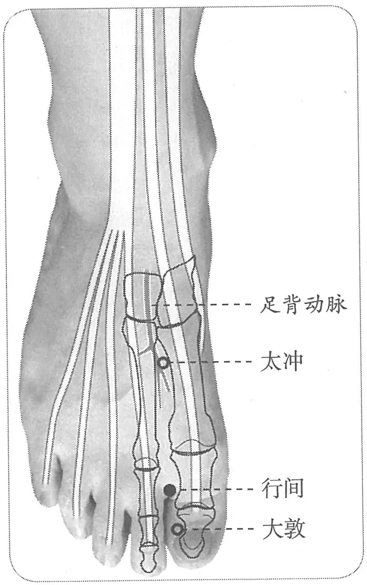

**图2-360　行间穴图**

　1. 足大指间也。（《灵枢·本输》）

2.《黄帝明堂经》佚文

　　(1) 在足大指间动脉陷者中。（《针灸甲乙经》卷三、《素问》王冰注、《铜人腧穴针灸图经》、《圣济总录》、《针灸资生经》、《针经摘英集》、《十四经发挥》、《类经图翼》）

　　(2) 在足大指间动应手陷中。（《备急千金要方》卷二十九、《千金翼方》、《外台秘要》、《医心方》）

　3. 在足大指歧中。（《千金要方》卷五、《千金翼方》）

4.《范汪方》足大指歧间白黑肉际。（《医心方》卷十）

　5. 窦太师针灸遗存

　　(1) 在足大指虎口两歧骨间，动脉应手陷中。（《窦太师针经》）

〔p.1164 (인쇄 1136)〕

　　(2) 在足大指次指歧骨陷中。（《窦太师秘传》）

　　(3) 在足大指间动脉应手，去虎口两歧骨间。（《大本琼瑶神书》）

　6. 在足大指本节前，上下有筋、前后有小骨尖，其穴正居陷中，有动脉应手。（《神应经》、《类经图翼》、《针灸逢源》）

　7. 足大指缝间动脉应手陷中。（《针灸聚英》卷一、《古今医统》、《针灸大成》、《针灸易学》）

　8. 从大敦上行，足大指次指歧骨缝间动脉应手陷中。（《医宗金鉴·刺灸心法要诀》）

　9. 足大趾、次趾之间陷中。（《针灸十四经穴位考订》）

　10. 统编针灸学教材

　　(1) 部位：足大趾次指歧骨间陷中。取穴：从蹈趾外侧，本节后离趾缝约五分处取之。(1957年南京《针灸学》)

　　(2) 部位：足大趾次指歧骨间陷中。取穴：足大趾外侧，本节前离趾缝约五分处取之。(1版《针灸学讲义》)

　　(3) 不为：在足大指间，动脉陷者中。取穴：在足第一、二趾缝间，趾蹼缘之后方取之。(2版《针灸学讲义》)

　　(4) 足背，第一、二趾间的缝纹端。(4、5版《针灸学》)

　　(5) 在足背侧，当第1、第2趾间，趾蹼缘的后方赤白肉际处。(6版《针灸学》)

　　(6) 足背，当第1、2趾间的趾蹼缘上方纹头处。(7版《针灸学》)

　　(7) 足背，第1、2趾的趾缝间，趾蹼缘之后方。（《中国针灸学》）

**文献分析**：本穴定位，历代文献描述字异而意同，皆定于：第1、第2趾间，趾蹼缘后方赤白肉际处。

#### 【类属】 

足厥阴肝经荥穴。

足厥阴脉之所流也，为荥。（《黄帝明堂经》）

#### 【适应症】 

主治前阴部、咽部病症。常用于疝气，少腹疼痛；前阴痛，遗尿、癃闭；月经不调，带下；目赤肿痛，口干渴，口㖞；胁痛，善怒，太息，癫痫；脚膝肿痛。新增：咽喉肿痛。

　1. 主咳逆上气，唾沫。溺难痛，白浊，卒疝，少腹肿，咳逆呕吐，卒阴跳腰痛不可以俯仰，面仓黑，热，腹中䐜满，身热厥痛。心痛色仓仓然如死灰状，终日不得太息，肝心痛也。月事不利，见血而有身反败，阴寒。腹痛上抢心，心下满，癃，茎中痛，怒瞋不欲视，泣出，长太息。癫疾，短气，呕血，胸背痛。善惊悲不乐，厥，胫足下热，面尽热，嗌干渴。喉痹气逆，口㖞，喉咽如扼状。（《黄帝明堂经》）

**按**：以上病症多为足厥阴经病候典型症状及肝病症状。此外还主妇科病症。

　2. 治溺难，又白浊，寒疝少腹肿，咳逆呕血，腰痛不可俯仰，腹中胀，心痛，色苍苍如死状，终日不得息，口㖞，四肢逆冷，嗌干烦渴，瞑不欲视，目中泪出，太息，癫疾，短气。（《铜人腧穴针灸图经》卷下）

　3. 窦太师针灸遗存

　　(1) 治目赤暴疼，膝红头肿，足跌肿，并泻，亦宜出血。脚弱无力，五指麻木，补。腹中胀满，四肢浮肿，泻补，亦宜针出水。脚气，脚背肿，泻多补少。（《窦太师针经》）

　　(2) 治脚跗红肿痛，泻宜出血；脚弱无力，五指麻木，宜补；腹胀，先泻后补；膝盖红肿痛，泻；赤痛，泻。（《大本琼瑶神书》）

〔p.1165 (인쇄 1137)〕

　　(3) 主眼赤暴痛，膝头红肿，足跗肿并宜出血，胀满浮肿宜出水。（《针方六集》卷五）

　　(4) 主目疾红肿泪出，膝头红肿疼痛，干湿脚气，指罅肿烂。（《循经考穴编》下）

　4. 主呕逆，洞泻，消渴嗜饮，善怒，四肢满转筋，胸胁痛，腹中胀，小肠气，中风，肝积肥气，发痎疟，妇人小腹肿，面尘脱色，经血过多不止，崩中，小儿急惊风。（《针灸聚英》卷一、《针灸大成》）

**按**：高武据其对“母子补泻”的理解，将足厥阴经病候(“呕逆，洞泻”，“妇人小腹肿，面尘脱色”等)归于本穴中。此外“消渴”、“小儿急惊风”症均系从《针灸资生经》辑录《千金要方》灸方及孔穴主对法。

　5. 统编针灸学教材

　　(1) 主治经血过多不止，茎中痛，遗溺，癃闭，消渴，口㖞，目赤红肿，胁痛，癫痫，不眠，疝，呕吐，洞泄。(1957年南京《针灸学》、1版《针灸学讲义》)

　　(2) 主治月经过多，尿道疼痛，遗溺，小便不通，疝气，口㖞，目赤红肿，胁痛，头痛，目眩，癫痫，瘛疭，不眠。(2版《针灸学讲义》)

　　(3) 主治胁痛腹满，头痛，目眩，雀目，口㖞疝痛，小便不利，月经不调，癫痫。(4版《针灸学》)

　　(4) 主治头痛，目眩，目赤肿痛，青盲，口㖞，胁痛，疝气，小便不利，崩漏，癫痫，月经不调，痛经，带下，中风。(5、6版《针灸学》)

　　(5) 主治①中风、癫痫、头痛、目眩、目赤肿痛、青盲、口歪等肝经风热头目病证；②月经不调、痛经、闭经、崩漏、带下等妇科经带病证；③阴中痛、疝气；④遗尿、癃闭、五淋等泌尿系病证；⑤胸胁满痛。(7版《针灸学》)

　　(6) 主治头痛，眩晕，雀目，口㖞，胁痛，腹胀，疝痛，小便不利，尿痛，月经不调，痫证，失眠，抽搐。（《中国针灸学》）

**文献分析**：《黄帝明堂经》载本穴主治中咽部症状言之甚详，此后的腧穴文献也多有描述，且为足厥阴经的典型病候，教材于此似有忽略，今补之。

#### 附：临床应用举例 

　1. 肝病

　　(1) 厥心痛，色苍苍如死状，终日不得太息，肝心痛也，取之行间、太冲。（《灵枢·厥病》）

　　(2) 邪在肝，则两胁中痛，寒中，恶血在内，行善掣，节时脚肿，取之行间以引胁下，补三里以温胃中，取血脉以散恶血。取耳间青脉，以去其掣。（《灵枢·五邪》、《千金要方》）

　　(3) 肝积名肥气，在左肋下：肝俞七壮、章门三七壮、行间七壮。（《窦太师秘传》）

　2. 前阴、水液病症

　　(1) 茎中痛，灸行间三十壮。（《千金翼方》卷二十八）

　　(2) 治小肠气，以毫针刺足厥阴经行间二穴，足阳明经三里二穴。（《针经摘英集》）

　　(3) 小便失禁，灸大敦七壮，又灸行间七壮。（《千金要方》卷二十）

　　(4) 水蛊，四肢浮肿：泻支沟；腹上泻水分、行间、足三里，仍灸关元、三阴交。（《针灸集要·盘石金直刺秘传》）

　3. 头面、五官病症

　　(1) 重舌，灸行间随年壮。穴在足大指歧中。（《千金要方》卷五、《千金翼方》）

　　(2) 伤寒，鼻衄汗不止：泻合谷、曲池，灸关元，泻之，泻行间。（《针灸集要·盘石金直刺秘传》）

〔p.1166 (인쇄 1138)〕

　　(3) 膀胱发热，风攻两眼红肿，胬肉攀睛，拳毛倒睫。泻至阴，刺委中出血；未愈，泻足临泣、太阳出血，仍灸大小指骨空；未愈，泻睛明、行间，先补后泻。（《针灸集要·盘石金直刺秘传》）

　　(4) 治双、单乳蛾：少商出血，合谷、委中、行间，俱泻。（《针灸集要·盘石金直刺秘传》）

　　(5) 羞明怕日：合谷、攒竹、行间、二间、睛明、小骨空。问曰：此证从何而得？答曰：皆因暴痛，未可在路迎风串入眼中，血不就舍，肝不藏血，风毒贯入，观灯光冷泪自出，见日影则疾涩痛疼难开，复刺后穴：睛明、行间。（《针灸集成》第十五方）

　　(6) 行间治膝肿目疾。（《通玄指要赋》）

　　(7) 鼻衄：针刺行间穴治疗。[中国针灸，1984，4(6)：5]

　4. 局部病症

　　(1) 足弱不能行：丘墟、行间、昆仑、太冲。问曰：此证缘何而得？答曰：皆因醉后行房，肾经受亏，以致足弱无力，不能行动。治法如此不效，复刺后穴：三里、阳辅、三阴交、复溜。（《针灸集成》第四十一方）

　　(2) 足跗肿痛，久不能消：行间二穴、申脉二穴。（《针灸大全》卷四）

　　(3) 丘墟亦治脚跗疼，更刺行间疾便轻，再取解溪商丘穴，中间补泻要分明。（《针灸玉龙歌》）

　　(4) 红斑性肢痛病：侠溪穴、行间穴，针刺治愈。[江苏中医杂志，1985，6(8)：38]

　5. 伤寒热病

　　(1) 热病烦心，足寒清，多汗，先取然谷，后取太溪、大指间动脉，皆先补之。（《针灸甲乙经》卷七）

**按**：大指间动脉即足厥阴穴，相当于行间、太冲穴分。

　　(2) 治伤寒结胸者……次针右伴，足厥阴经行间穴。在足大指间动脉应手陷中，卧而取之，针入六分。（《针经摘英集》）

　　(3) 伤寒伏阴，心胸闭闷，或时疼痛，走注不已：灸关元，针补之；次泻大陵、足三里、行间。（《针灸集要·盘石金直刺秘传》）

　　(4) 伤寒，胸腹膨胀，过经呕血泻血不止：灸期门，次针中脘，泻未愈，灸绝骨、行间，泻之；未愈，灸合谷、复溜。（《针灸集要·盘石金直刺秘传》）

　6. 疮痈

　　(1) 大人小儿痈肿，灸两足大拇指奇中立瘥，仍随病左右。（《千金要方》卷二十二）

　　(2) 一切痈疮，灸足大指奇间二七壮，灸大指头亦佳。（《千金要方》卷二十二）

　　(3) 红肿脚气生疮：行间、三里、照海、昆仑、绝谷、京骨、委中。问曰：脚气之证缘何而得？答曰：皆因劳役过多，热汤泡洗，气血不散，故如此也。但针之不宜灸。复刺后穴：丘墟、昆仑。（《针灸集成》第四十三方）

#### 【操作】 

直刺0.5~0.8寸。

　1. 刺入六分，留十呼，灸三壮。（《黄帝明堂经》）

　2. 窦太师针灸遗存

　　(1) 针半寸，灸二七壮。疼痛泻之，痒麻补之。（《针灸玉龙歌》注）

　　(2) 针入五分，灸二七壮。治目赤暴疼，膝红头肿，足跌肿，并泻，亦宜出血。脚弱无力，五指麻木，补。腹中胀满，四肢浮肿，泻补，亦宜针出水。脚气，脚背肿，泻多补少。（《窦太师针经》）

〔p.1167 (인쇄 1139)〕

　3. 针三分，灸三壮。（《针灸十四经穴位考订》）

　4. 统编针灸学教材

　　(1) 针三至四分，灸三至五壮。(1957年南京《针灸学》、1版《针灸学讲义》)

　　(2) 斜刺5分，艾条灸3~5分钟。(2版《针灸学讲义》)

　　(3) 直刺0.5~0.8寸。(4、5、6、7版《针灸学》)

　　(4) 斜刺0.3~0.5寸。可灸。（《中国针灸学》）

　5. 斜刺0.5~1寸。酸胀向足背。灸3壮；温灸5~15分钟。(上海《针灸学》)

### （三）太冲 Tàichōng LR3 出《灵枢》 

问题：“太冲”穴、“太冲脉”与“足厥阴”穴关系如何？

#### 【提要索隐】 

**部位**：在足背，第1、2跖骨间，跖骨底结合部前方凹陷中，或触及动脉搏动。

**适应症**：主治前阴、胁下、咽部病症。常用于阴疝，前阴痛，少腹肿；癃闭、遗尿；月经不调；黄疸、胁痛、腹胀、呕逆；小儿惊风；目赤肿痛、咽干，咽痛；下肢痿痹、足跗肿痛。**新增**：难产。颅脑外科手术、剖宫产等手术针麻用穴。

**针刺操作**：直刺0.5~0.8寸。

#### 【名实考】 

太冲既是穴名，又是脉名。作为脉，是指大指间动脉处，是谓“太冲脉”，为足厥阴脉口、足厥阴之本；作为穴名，古作“足厥阴”，是指足大指间整个脉动处，之后演为二穴：行间、太冲。实际上，不同文献对于太冲穴定位或作“本节后二寸”，或“本节后一寸半”，或“去大趾歧一寸”，正是反映了早期本穴以脉动处为穴的特征。

　1. 阴中之少阳，肝也，其原出于太冲，太冲二。（《灵枢·九针十二原》）

　2. 肝出于大敦……注于太冲，太冲，行间上二寸陷者之中也，为腧……足厥阴也。（《灵枢·本输》）

　3. 注于太冲，太冲者，土也……足厥阴脉之所注也，为输。（《黄帝明堂经》）

　4. 足厥阴之源，太冲穴也。在足大趾本节后二寸陷者中，乃肝脉所过为源。（《素问亡篇·刺法论》）

　5. 冲脉虽为血海，而行上行下，有气行于其间，故曰太冲。（《经穴解》）

#### “太冲”、“足厥阴”、“百息”穴辨 

　1. 刺足厥阴经治阴，在足大指间。即行间穴也。（《脉经》卷二）

　2. 足厥阴穴，在足大指歧间白肉际是。（《诸病源候论》卷四十一）

　3. 灸癞卵法……又灸足厥阴，在右灸左，在左灸右，各三壮。足厥阴在足大指本节间。（《千金翼方》卷二十八）

　4. 横产手出，针太冲入三分，急补百息，去足大趾奇一寸。（《千金翼方》卷二十六）

　5. 针间使百息。（《千金翼方》卷二十八）

　6. 治产生理不顺，或横或逆，胎死腹中，胞衣不下，刺足厥阴经太冲二穴，在足大指本节后二寸，或一寸半陷中。针入八分，补百息。（《针经摘英集》）

**按**：古穴名“足厥阴”包含了《黄帝明堂经》的“行间”、“太冲”二穴；而“百息”是指补法操作的时间，元代杜思敬《针经摘英集》的理解完全正确，而今人误解为穴名，于奇穴类另立“百息”一穴；又将《千金翼方》“足厥阴”穴的定位描述“足大指本节间”误解为“足背侧跖趾关节中点”，而于奇穴类另设“足厥阴”一穴，则太冲穴一穴而三出且不同，混乱不堪。

〔p.1168 (인쇄 1140)〕

#### 【定位】 

**部位**：在足背，第1、2跖骨间，跖骨底结合部前方凹陷中，或触及动脉搏动(图2-361)。

**取穴**：从第1、2跖骨间向后推移至底部的凹陷中取穴。

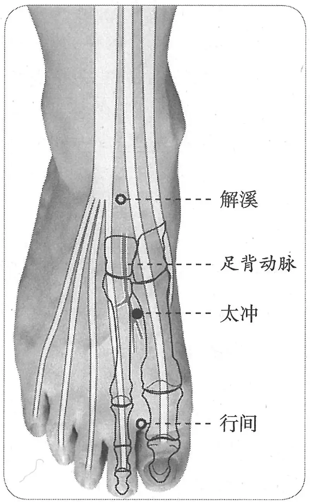

**图2-361　太冲穴图**

　1. 行间上二寸陷者之中也。（《灵枢·本输》）

　2. 在足大指本节后二寸，或曰一寸五分陷者中。（《黄帝明堂经》、《铜人腧穴针灸图经》、《圣济总录》、《针灸资生经》、《十四经发挥》、《针灸聚英》、《古今医统》、《针灸大成》、《针方六集》、《类经图翼》）

　3. 在足大指本节后二寸中动脉。（《千金要方》卷三十、《素问》王冰注、《太平圣惠方·明堂》、《针灸资生经》、《针灸大成》、《循经考穴编》、《针灸易学》、《针灸逢源》）

　4. 在足大指本节后二寸半，或一寸半陷者中。（《外台秘要》卷三十九）

**按**：紧接此条的前一条“太冲”定位作“在足大指本节后二寸半，或一寸半陷者中”，与其他《明堂经》传本同，则此条“二寸半”衍“半”字。

　5. 在足大指本节后二寸，骨罅间陷者中。（《太平圣惠方》卷五十五、卷一百）

　6. 窦太师针灸遗存

　　(1) 在足大指本节后二寸，或一寸半陷中。又云在行间穴上二寸两筋间。（《窦太师针经》）

　　(2) 在足大指行间上二寸两筋间陷中。（《大本琼瑶神书》）

　7. 在大指后内间，有络亘连，横至地五会二寸，骨缝罅间动脉应手陷中。（《神应经》、《类经图翼》）

　8. 从行间上行二寸许，足跗间动脉应手陷中，太冲穴也。（《医宗金鉴·刺灸心法要诀》）

　9. 足大趾本节后二寸。（《针灸十四经穴位考订》）

　10. 统编针灸学教材

　　(1) 部位：足大指外侧本节后寸半。取穴：按取第二跖骨连接部之直前陷中取之，或以指从蹈趾次趾之间循歧缝上压至尽处即是穴位。(1957年南京《针灸学》)

　　(2) 部位：足大指外侧本节后寸半。取穴：足大趾次趾本节后两歧骨间尽处陷中取之。(1版《针灸学讲义》)

　　(3) 部位：在足大指本节后二寸，或一寸半陷者中。取穴：第一、二跖骨结合部之前凹陷中取之。(2版《针灸学讲义》)

　　(4) 足背，第1、2跖骨底之间凹陷中。(4版《针灸学》)

　　(5) 足背，第1、2跖骨结合部之前凹陷中。(5、7版《针灸学》，《中国针灸学》)

　　(6) 在足背侧，当第1跖骨间隙的后方凹陷处。(6版《针灸学》)

**文献分析**：《黄帝明堂经》所说之“本节”是指包括指(趾)骨底和掌(跖)骨头在内的整个关节，如果“本节”前后皆有穴，一般的规律是荥穴在“前”，输穴在“后”，而不言具体折量分寸（无须折量），在“本节后”另说明折量分寸只见于“太冲”穴（足太阴经络穴公孙“本节后一寸”不属此例），而对阳经俞穴（位于“本节前”）；阴经输穴、阳经原穴（位于“本节后”）与指（趾）间穴位置关系者有如下两穴：陷谷者，木也，在足大指次指外间本节后陷者中去内庭二寸；临泣者，木也，在足小指次指本节后间陷者中去侠溪一寸五分。由此可以做出两点判断：第一，太冲穴的位置要比一般“本节后”的穴更靠后；第二，“行间后二寸”与“本节后二寸”是两个不同的概念。对于第一点，现代针灸教材的定位已经体现，而对于第二点，古代文献多不加区分。

〔p.1169 (인쇄 1141)〕

#### 【类属】 

足厥阴肝经输穴、原穴。

　1. 阴中之少阳，肝也，其原出于太冲，太冲二。（《灵枢·九针十二原》）

　2. 足厥阴脉之所注也，为输。（《黄帝明堂经》）

#### 【适应症】 

主治前阴、胁下、咽部病症。常用于阴疝，前阴痛，少腹肿；癃闭、遗尿；月经不调；黄疸、胁痛、腹胀、呕逆；小儿惊风；目赤肿痛、咽干，咽痛；下肢痿痹、足跗肿痛。**新增**：难产。颅脑外科手术、剖宫产等手术针麻用穴。

**备选适应症**：口干。

　1. 主腰痛少腹满，小便不利如癃状，羸瘦，意恐惧，气不足，腹中悒悒。狐疝。环脐痛，阴骞，两丸缩，腹坚痛不得卧。黄瘅，热中，善渴。女子疝及少腹肿，溏泄，癃，遗溺，阴痛，面尘黑，目下眦痛。暴胀，胸胁支满，足寒，大便难，面唇色白，时时呕血。男子瘭疝，精不足。女子漏血。乳难。呕，厥寒，时有微热，胁下支满，喉痹痛，嗌干，膝外廉痛，淫泺胫酸，腋下肿，马刀瘘，肩肿，吻伤痛。飧泄。（《黄帝明堂经》）

**按**：以上病症多为前阴、少腹、咽部、胸胁部等典型的足厥阴病候。此外还主妇科病症。其中“腰痛少腹满……腹中悒悒”一组病症见于《素问·刺疟》。

　2. 主淋不得尿，阴上痛。主痢泄，下血。主膝内踝前痛。（《千金要方》卷三十）

　3. 肝胀。心痛，色苍苍然如死状，终日不得太息者，肝心痛也。（《外台秘要》卷三十九）

　4. 主月水不通。（《太平圣惠方·明堂》）

　5. 今附 凡诊太冲脉可决男子病死生。足厥阴脉之所注也，为腧。治腰引少腹痛，小便不利，状如淋，瘭疝少腹肿，溏泄遗溺，阴痛，面目苍色，胸胁支满，足寒，大便难，呕血，女子漏血不止，小儿卒疝呕逆，发寒嗌干，胕肿，内踝前痛，淫泺胻酸，腋下肿，马刀疡瘘，唇肿。（《铜人腧穴针灸图经》卷下）

　6. 窦太师针灸遗存

　　(1) 治脚软无力，麻木，补；红肿，泻。脚重，脚气，弹针出血；五指拳挛，补泻。（《窦太师针经》）

　　(2) 治脚无力，脚趺麻木补，脚背红肿痛泻，行步难先泻后补。（《大本琼瑶神书》）

　　(3) 主惊风癫痫，咽肿，两目云朦，脚气趺肿，足指拳挛。（《针方六集》卷五）

　　(4) 治脚气红肿，宜弹针出血。脚软无力，五指拘挛，宜先补后泻。（《循经考穴编》下）

　　(5) 治脚背红肿，心内呆痴，颠狂之症。（《窦太师秘传》）

　7. 马黄瘟疫，虚劳，浮肿。（《针灸聚英》卷一、《针灸大成》）

**按**：此皆从《针灸资生经》辑自《千金要方》灸方主治。

　8. 统编针灸学教材

　　(1) 主治漏下不止，阴痛，阴缩，淋浊，瘭疝，遗溺，癃闭，马刀挟瘿，内踝前痛，小儿惊风。（1957年南京《针灸学》、1版《针灸学讲义》）

〔p.1170 (인쇄 1142)〕

　　(2) 主治崩漏，疝气，遗溺，小便不通，内踝前缘痛，胁痛，口㖞，小儿惊风，癫痫，头痛，目赤肿痛，眩晕，失眠。（2版《针灸学讲义》）

　　(3) 主治遗溺，疝气，崩漏，惊痫，头痛，目昏，口㖞，胁痛。（4版《针灸学》）

　　(4) 主治头痛，眩晕，目赤肿痛，口㖞，胁痛，遗尿，疝气，崩漏，月经不调，癫痫，呕逆，小儿惊风，下肢痿痹。（5、6版《针灸学》）

　　(5) 主治①中风、癫狂痫、小儿惊风；头痛、眩晕、耳鸣、目赤肿痛、口歪、咽痛等肝经风热病证；②月经不调、痛经、经闭、崩漏、带下等妇科经带病证；③黄疸、胁痛、腹胀、呕逆等肝胃病证；④癃闭、遗尿；⑤下肢痿痹，足跗肿痛。（7版《针灸学》）

　　(6) 头痛，眩晕，失眠，目赤肿痛，郁证，小儿惊风，口㖞，胁痛，崩漏，疝气，遗尿，小便不利，痫证，内踝前缘痛。（《中国针灸学》）

**文献分析**：本穴为治疗足厥阴“是动”病的要穴。太冲位于早期足厥阴脉的诊脉部位——太冲脉处，既是诊脉部位，又是治疗部位，犹如络穴既是诊络部位，又是络脉病候的治疗点一样，故《灵枢·经脉》所载之足厥阴经的全部“是动”病症均见于《黄帝明堂经》太冲穴主治中。《铜人腧穴针灸图经》谓“凡诊太冲脉可决男子病死生”，因早期足厥阴病候为男子阴疝病症。教材中列举了“痛经、经闭、崩漏”（与“月经不调”相重）；“带下”等古代文献未言及的症状，而对于《黄帝明堂经》明言之“乳难”（即难产）却均未收录。考此症古代临床有明确的应用，现代临床本穴还作为剖宫产的常用穴，皆提示了这一作用，今补之。又肝经病候有“嗌干”症，足厥阴经五输穴主治中也多主此症：嗌干嗜饮（中封）、嗌干渴（行间）、黄瘅，热中，善渴（太冲）。而且主“黄瘅”病的经穴主治也多伴渴症：消渴，黄瘅（然谷）、善渴，黄瘅（劳宫）等。因此，本穴主治当有渴症，然各版教材未收录，今附存备考。

#### 附：临床应用举例 

　1. 疝气

　　(1) 仓公治气疝方：灸其足厥阴之脉，左右各一所，即不遗尿而溲清，小腹痛止。（《史记·扁鹊仓公列传》）

　　(2) 淋病不得小便阴上痛，灸足太冲五十壮。（《千金要方》卷二十一）

　　(3) 小肠疝痛，当刺足厥阴肝经太冲穴。（《素问病机气宜保命集》卷下）

　　(4) 七疝，太冲出血，泻大敦，立止。（《医学入门》卷一）

　2. 肝胆病症

　　(1) 足厥阴之疟，令人腰痛少腹满，小便不利如癃状，非癃也，数便，意恐惧气不足，腹中悒悒，刺足厥阴。（《素问·刺疟》）

　　(2) 厥心痛，色苍苍如死状，终日不得太息，肝心痛也，取之行间、太冲。（《灵枢·厥病》）

　　(3) 黄疸……灸太冲七壮又云针灸随便。（《千金翼方》卷二十六）

　　(4) 儿童多动症：内关穴、曲池穴、太冲穴，针刺治疗。［新中医，1985，17(1)：29-30］

　　(5) 小儿舞蹈病：风池穴、太冲穴、阳陵泉穴，针灸治疗。［江西中医药，1985(4)：48］

　　(6) 雷头风：风池穴、太冲穴，针刺。［陕西中医，1987(1)：31］

　　(7) 偏头痛：针刺太冲穴治疗。［上海针灸杂志，1993，12(4)：157］

　　(8) 面瘫、呃逆、偏头痛，针刺太冲穴治疗。［江苏中医，1996，17(11)：29］

　3. 妇产科病症

　　(1) 横产手出，针太冲入三分，急补百息。（《千金翼方》卷二十六）

〔p.1171 (인쇄 1143)〕

　　(2) 产后出汗不止，针太冲，急补之。（《千金翼方》卷二十六）

　　(3) 治产生理不顺，或横或逆，胎死腹中，胞衣不下，刺足厥阴经太冲二穴，在足大指本节后二寸，或一寸半陷中，针入八分，补百息。（《针经摘英集》）

　　(4) 治女子漏下不止，刺足太阴经三阴交二穴、足厥阴经太冲二穴，并止。（《针经摘英集》）

　　(5) 妊娠恶阻：丰隆穴、太冲穴、足三里穴，针刺治疗。［中国针灸，1985，5(1)：10-11］

　　(6) 急性乳腺炎：梁丘穴、太冲穴、针刺治愈。［中国针灸，1985，5(5)：37］

　4. 头面五官病症

　　(1) 头痛不可忍，针足厥阴、太阳经原穴。（《素问病机气宜保命集》卷下）

　　(2) 眼红或瞳仁肿痛，流泪出血，烂弦风，俱泻足临泣或太冲、合谷。（《医学入门》卷一）

　　(3) 鼻痔鼻流浊涕者，泻太冲、合谷。（《医学入门》卷一）

　　(4) 心胀咽痛，针太冲而必除。（《标幽赋》）

　　(5) 咽喉最急先百会，太冲照海及阴交。（《席弘赋》）

　　(6) 咽喉肿烂：太冲穴、照海穴，针刺治疗。［四川中医，1985，3(9)：32］

　　(7) 鼻衄：针刺太冲穴。［新中医，1986，18(2)：35］

　　(8) 口腔流涎：大都穴、太冲穴，针刺治疗。［江苏中医杂志，1987，8(1)：19］

　5. 足部病症

　　(1) 脚步难行：曲池、承山，痛则针太冲。（《针灸玉龙经·盘石金直刺秘传》）

　　(2) 脚背疼痛难以行步：刺太冲泻之。（《针灸集要·盘石金直刺秘传》）

　　(3) 大拇指本节前骨疼：太冲弹针出血。（《医学纲目》卷二十二）

　　(4) 脚弱无力，行步艰难：太冲、厉兑补灸、风市灸。（《医学纲目》卷二十八）

　　(5) 且如行步难移，太冲最奇。（《通玄指要赋》）

　　(6) 脚步难移疾转加，太冲一穴保无它。（《针灸玉龙歌》）

　　(7) 脚痛膝肿针三里，悬钟二陵三阴交，更向太冲须引气，指头麻木自轻飘。（《席弘赋》）

　　(8) 腿脚有疾风府寻，胁肋腿痛后溪妙，股膝肿起泻太冲。（《肘后歌》）

　　(9) 类风湿性关节炎：合谷穴、太冲穴，针灸治疗。［上海针灸杂志，1984(3)：13］

　6. 其他病症

　　(1) 热病烦心，足寒清，多汗，先取然谷，后取太溪、大指间动脉，皆先补之。（《针灸甲乙经》卷七）

**按**：大指间动脉即足厥阴穴，相当于行间、太冲穴分。

　　(2) 凡上气冷发，腹中雷鸣，转听，呕逆不食，灸太冲不限壮数，从痛至不痛，从不痛至痛止。（《千金要方》卷十七、《千金翼方》）

　　(3) 下气，灸肺俞百壮，又灸太冲五十壮。（《千金要方》卷十七、《千金翼方》）

　　(4) 寒咳、支咳、肝咳，刺足太冲。（《千金要方》卷十八）

　　(5) 虚劳浮肿，灸太冲百壮。又灸肾俞。（《千金要方》卷二十一）

　　(6) 消渴口干烦闷，灸足厥阴百壮。又灸阳池五十壮。（《千金要方》卷二十一）

　　(7) 心痛，针少阴经太溪、涌泉及足厥阴原穴。（《素问病机气宜保命集》卷下）

　　(8) 尸厥：刺中极补之，灸关元、合谷、太冲。（《针灸集要·盘石金直刺秘传》）

〔p.1172 (인쇄 1144)〕

　　(9) 初得病，或先头痛身寒热，或啬啬欲守火，或腰背强直，面目如饮酒状。此伤寒初得一二日……又灸太冲，穴在足大指本节后二寸或一寸半陷中，三十壮，神验。（《世医得效方》卷一）

　　(10) 手连肩脊痛难忍，合谷针时要太冲。（《席弘赋》）

　　(11) 胃扭转：太冲穴、足三里穴，针灸疗法。［陕西中医，1987(7)：323］

　　(12) 呛咳：针刺天突、太冲穴治疗。［河北中医，1987(2)：47］

#### 【操作】 

直刺0.5~0.8寸。

　1. 刺入三分，留十呼，灸三壮。（《黄帝明堂经》）

　2. 灸五壮。（《太平圣惠方·明堂》）

　3. 窦太师针灸遗存

　　(1) 直针半寸，禁灸。（《针灸玉龙歌》注）

　　(2) 针五分，禁灸。治脚软无力，麻木，补；红肿，泻。脚重，脚气，弹针出血；五指拳挛，补泻。（《窦太师针经》）

　　(3) 入半寸，十呼；三壮，一曰禁灸。治脚无力、脚趺麻木，补。脚背红肿痛，泻。行步难，先泻后补。（《大本琼瑶神书》）

　4. 统编针灸学教材

　　(1) 针三至四分，灸三至五壮。（1957年南京《针灸学》、1版《针灸学讲义》）

　　(2) 直刺5分，艾条灸3~5分钟。（2版《针灸学讲义》）

　　(3) 直刺0.5~1寸。（4版《针灸学》）

　　(4) 直刺0.5~0.8寸。（5、7版《针灸学》）

　　(5) 直刺0.5~0.8寸；可灸。（6版《针灸学》）

　　(6) 直刺0.3~0.5寸。可灸。（《中国针灸学》）

　5. 斜刺1~1.5寸，可透涌泉。感应：局部酸胀，或麻电感向足底放散。3~5壮；温灸5~15分钟。（上海《针灸学》）

### （四）中封 Zhōngfēng LR4 出《灵枢》 

问题：本穴定位，《灵枢》作“内踝前一寸半”，《黄帝明堂经》作“内踝前一寸”；取穴法，《灵枢》作“使逆则宛，使和则通，摇足而得之”，《黄帝明堂经》作“仰足取之，伸足乃得之”，何者于义为得？又如何理解？

#### 【提要索隐】 

**穴名**：一名悬泉。

**部位**：在踝区，内踝前，胫骨前肌肌腱的内侧缘凹陷中。

**国标修订**：1990年国家标准文本：在足背侧，当足内踝前下方，商丘与解溪连线之间，胫骨前肌腱的内侧凹陷处。2006年国标修订版：在踝区，内踝前，胫骨前肌肌腱的内侧缘凹陷中。注：商丘与解溪中间。

**按**：本穴定位的严谨表述应作“内踝前下方，胫骨前肌腱与内侧楔状骨之间的凹陷处”。

**适应症**：主治前阴部病症。常用于疝气引腰痛、少腹痛；遗精，小便不利。

**针刺操作**：直刺0.5~0.8寸。针刺宜紧贴胫骨前肌腱内侧缘直刺。

#### 【名实考】 

中封，一名悬泉。传世两种传本《千金要方》，以及《千金翼方》皆记有“悬泉，一名中封”，据《医心方》卷十二引文，此出自陈延之《小品方》。

〔p.1173 (인쇄 1145)〕

　1. 五淋不得小便，灸悬泉十四壮。穴在内踝前一寸斜行小脉上是，中封之别名。（《千金要方》卷二十一）

　2. 《小品方》治淋病不得小便，阴上绞痛方，灸悬泉，一名中封，十四壮。中封在足内踝前一寸。（《医心方》卷十二）

关于本穴定位，《灵枢》谓内踝前“一寸半”，《黄帝明堂经》作“一寸”，虽然本穴定位主要依据体表标志，折量分寸可不拘，但考虑到足厥阴经脉循行的描述诸家文献皆无分歧，均作“去内踝一寸”，再结合早期针灸治疗的实际取穴来看，仍以《黄帝明堂经》作“一寸”为是，实际比量的结果也支持“一寸”说。这里需注意的是，不论是《灵枢》之“一寸半”，还是《黄帝明堂经》之“一寸”，说的都是内踝的“前下方”，而不是正前方。在正前方没有“一寸”的空间，更不用说“一寸半”。

关于本穴的体表标志定位，在早期的针灸治疗文献中有具体而明确的描述：中封在内踝前一寸大筋里宛宛中（《千金要方》卷十五、卷十一）。这里所说的“大筋”是指足内踝前显现的粗大的胫骨前肌腱。该肌腱，当足背屈、稍旋后时可明显显现，反复做背屈（仰足）、跖屈（伸足）动作时，更容易体会，故《黄帝明堂经》说“仰足而取之，伸足乃得之”；《灵枢》说“摇足而得之”。《千金要方》卷二十一还提供了另一个定位的体表标志：内踝前一寸斜行小脉上。这里所说的“斜行小脉”是指大隐静脉从内踝前下行，行至与胫骨前肌腱靠拢处的凹陷正是“中封”穴所在。由此可见，古人观察得极为细密。考虑到静脉走行存在较大的个体差异，此处最好置换为骨性标志表述：内踝前下方，胫骨前肌腱与内侧楔状骨之间的凹陷处。

至此，可以对《灵枢》、《黄帝明堂经》关于本穴取穴法的异同做具体分析：

　3. 内踝之前一寸半陷者之中。使逆则宛，使和则通，摇足而得之。（《灵枢·本输》）

　4. 在足内踝前一寸，仰足取之陷者中，伸足乃得之。（《黄帝明堂经》）

**按**：《灵枢》“使逆则宛”，其“逆”即《黄帝明堂经》所谓“仰足”之义；“宛”即俞穴定位描述最常说的“宛宛中”，也即《黄帝明堂经》所说“陷者中”也；而“和则通”应与“逆则宛”对举；“摇足”则是“和则通”与“逆则宛”相对应的动作，即由“背屈、旋后”到相反的“跖屈、旋前”往返运动，其目的在于体会肌腱由显现到消失，骨突由陷下到凸起的过程，这也是《内经》以肌腱为标志定穴的一种有效方法，例如以股二头肌腱定位的“委阳”穴，就采用“屈伸而索之”的取穴法（《灵枢·邪气藏府病形》）。由此可知，《黄帝明堂经》“伸足乃得之”系“摇足乃得之”之误。因为在“伸足”状态下，表现的是肌腱消失、骨突隆起的过程。后人不解“摇足”之义，见前有“仰足”，便想当然地改作“伸足”，正如《灵枢》“委阳”穴的取法“屈伸而索之”在《黄帝明堂经》也被改作“屈身而取之”，皆失经文本义。

至于宋校本《千金要方》注又说“在两足趺上曲尺宛宛中”，经考证为刊刻之误。

　5. 瘿，灸天瞿三百壮，横三间寸灸之。又灸中封，随年壮。在两足趺上曲尺宛宛中。（《千金要方》卷二十四）

　6. 曲尺二穴，《小品方》云在一脚趺上，胫之下，接腕曲屈处，对大指歧，当踝前两筋中央。（《医心方》卷二）

《产经》标于足阳明经穴“解溪”与“冲阳”之间。

**按**：“天瞿”、“曲尺”穴均见于《小品方》，并与中封不相干，且《千金翼方》此方下也无此部位的注文，未经宋人校改之《孙真人千金方》“曲尺”作“四分”，也未的确。

　7. 肝出于大敦……行于中封，中封，内踝之前一寸半，陷者之中，使逆则宛，使和则通，摇足而得之，为经……足厥阴也。（《灵枢·本输》）

〔p.1174 (인쇄 1146)〕

　8. 肝足厥阴之脉，起于大指丛毛之际，上循足跗上廉，去内踝一寸……（《灵枢·经脉》）

　9. 行于中封，中封者，金也……足厥阴脉之所行也，为经。（《黄帝明堂经》）

　10. 此“中”字盖指厥阴肝而言，以此经宜在足少阴之前、太阴之后，两经之中，而此穴乃在两经之前，恐人混乱不清，故指而名之曰中封。封者，经疆也。（《经穴解》）

#### 【定位】 

**部位**：在踝区，内踝前，胫骨前肌肌腱的内侧缘凹陷中（图2-362）。

**取穴**：在商丘穴与解溪穴中间取穴。

　1. 内踝之前一寸半陷者之中。使逆则宛，使和则通，摇足而得之。（《灵枢·本输》）

**按**：楼英注曰其穴使足逆仰则穴有宛陷可定，针使手足和，其穴有巷道可通，故曰使逆则宛，和则通也。（《医学纲目》卷八）

　2. 在内踝前一寸半。（《千金要方》卷三十、《素问·气穴论》王冰注）

　3. 《黄帝明堂经》佚文

　　(1) 在足内踝前一寸，仰足取之陷者中，伸足乃得之。（《针灸甲乙经》卷三、《千金要方》、《千金翼方》、《外台秘要》、《铜人腧穴针灸图经》卷下、《圣济总录》、《针灸资生经》）

　　(2) 在足内踝前一寸，仰足而取之陷者中。（《医心方》卷二、《铜人腧穴针灸图经》卷上、《十四经发挥》、《医学入门》、《循经考穴编》）

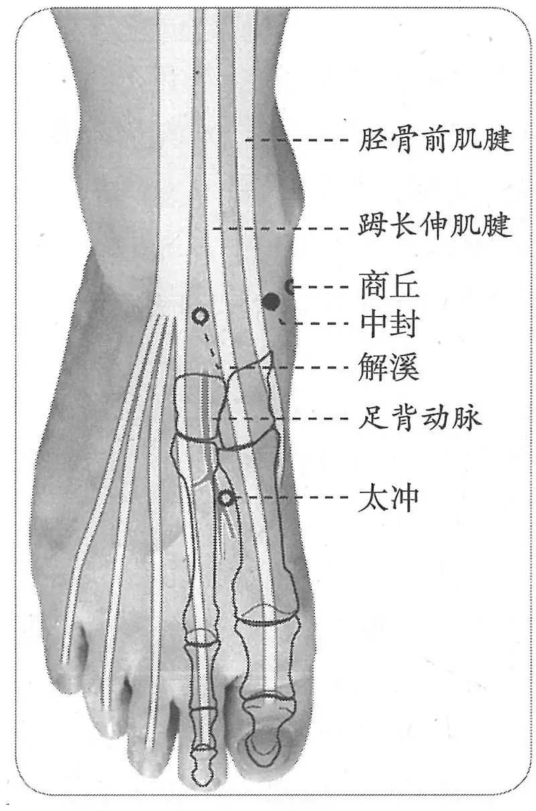

**图2-362　中封穴图**

　4. 在内踝前筋里宛宛中。（《千金要方》卷十一）

　5. 在内踝前一寸斜行小脉上。（《千金要方》卷二十一、《千金翼方》、《医心方》）

　6. 窦太师针灸遗存

　　(1) 在足内踝前一寸，仰足取之大筋间陷中。（《窦太师针经》）

　　(2) 在足内踝前一寸足腕上大筋陷中。（《大本琼瑶神书》）

　7. 在内踝前一寸，贴大筋后，仰足伸足取而得之。（《神应经》）

　8. 足内踝前一寸筋里宛宛中。（《针灸聚英》卷一、《针灸大成》、《针方六集》、《医宗金鉴·刺灸心法要诀》、《针灸易学》）

　9. 一云在内踝前一寸斜行小脉上，贴足腕上大筋陷中，仰足取之。（《类经图翼》卷八）

　10. 在足内踝前一寸陷中，仰而取之。广注：内踝骨尖平，过前来寸半，但于踝前来则一寸也，弯内两筋间，伸足乃得，屈而针之。（《循经考穴编》下）

**按**：以此法调和“寸半”与“一寸”二说，大可不必。

　11. 内踝骨前一寸筋间宛宛中。（《针灸十四经穴位考订》）

　12. 统编针灸学教材

　　(1) 部位：足内踝骨前一寸筋里宛宛中。取穴：内踝之前下方一寸陷中，与解溪平，相距四、五分处仰足取之，当解溪与商丘之间。（1957年南京《针灸学》）

　　(2) 部位：足内踝骨前一寸筋里宛宛中。取穴：在内踝前微下方陷中，大筋内侧当胃经解溪穴与脾经商丘穴之间取之。（1版《针灸学讲义》）

〔p.1175 (인쇄 1147)〕

　　(3) 部位：在足内踝前一寸，仰足取之陷者中，伸足乃得之。取穴：在内踝前方，当商丘（足太阴经）与解溪（足阳明经）之间，靠胫骨前肌腱之内侧凹陷处取之。（2版《针灸学讲义》）

　　(4) 内踝前1寸，胫骨前肌腱内缘。（4、5版《针灸学》）

　　(5) 在足背侧，当足内踝前，商丘与解溪连线之间，胫骨前肌腱的内侧凹陷处。（6版《针灸学》）

　　(6) 内踝前1寸，胫骨前肌腱内缘凹陷中。（7版《针灸学》）

　　(7) 内踝前1寸，当商丘与解溪之间，胫骨前肌腱的内侧凹陷中。（《中国针灸学》）

#### 【类属】 

足厥阴肝经经穴。《千金要方》又谓之“源”穴，别为一说。

　1. 足厥阴脉之所行也，为经。（《黄帝明堂经》）

　2. 肝出于大敦为井，足厥阴脉也，流于行间为荥，注于太冲为输，过于中封为源，行于中郄为经，入于曲泉为合。（《千金要方》卷二十九）

#### 【适应症】 

主治前阴部病症。常用于疝气引腰痛、少腹痛；遗精，小便不利。

**备选适应症**：难产，咽干。

　1. 主色苍苍然，太息，如将死状，振寒，溲白便难。痿厥，身体不仁，手足偏小，先取京骨，后取中封、绝骨，皆泻之。瘭疝，阴暴痛。疝，癃，脐少腹引痛，腰中痛。身黄，时有微热，不嗜食，膝内廉内踝前痛，少气身体重。女子少腹大，乳难，嗌干嗜饮。女子夹脐疝。（《黄帝明堂经》）

**按**：以上病症多为阴疝的症状。其中“色苍苍然，太息，如将死状”症状，在《素问·刺疟》曰“肝疟者，令人色苍苍然，太息，其状若死者，刺足厥阴见血。”

　2. 治失精，筋挛，阴缩入腹相引痛。（《千金要方》卷十一、《千金翼方》）

　3. 治痎疟，色苍苍振寒，少腹肿，食怏怏绕脐痛，足逆冷，不嗜食，身体不仁，寒疝引腰中痛，或身微热。（《铜人腧穴针灸图经》卷下）

　4. 五淋。（《针灸聚英》卷一、《古今医统》、《针灸大成》、《针方六集》）

**按**：此乃高武从《针灸资生经》辑录《千金要方》灸方，详见“附：临床应用举例”。

　5. 窦太师针灸遗存

　　(1) 治两足红肿生疮，弹针出血；足肿疼，无力，补之。（《窦太师针经》）

　　(2) 主脚上生疮出血为妙。（《循经考穴编》下）

　6. 统编针灸学教材

　　(1) 主治阴缩入腹引痛，遗精，五淋，不得小便，寒疝，腰痛，足厥冷，身黄有微热。（1957年南京《针灸学》）

　　(2) 主治阴缩，遗精，淋疾，小便不通，寒疝，腰痛，少腹痛，足厥冷，内踝前痛，身黄有微热。（1版《针灸学讲义》）

　　(3) 主治阴茎痛，遗精，小便不利，疝气。（2版《针灸学讲义》）

　　(4) 主治疝痛，遗精，小便不利，脐腹痛。（4、5版《针灸学》）

　　(5) 主治疝气，遗精，小便不利，腹痛，内踝肿痛。（6版《针灸学》）

　　(6) 主治①疝气；②遗精；③小便不利；④腰痛、少腹痛、内踝肿痛等痛证。（7版《针灸学》）

　　(7) 主治疝痛，阴部痛，遗精，小便不利，胁肋胀痛。（《中国针灸学》）

**文献分析**：下肢足厥阴五输穴主治多有妇科病症和咽部病症，本穴也不例外，教材皆未收录，今附存备考。参见“太冲”穴适应症按。

〔p.1176 (인쇄 1148)〕

#### 附：临床应用举例 

　1. 前阴肾系病症

　　(1) 失精筋挛，阴缩入腹相引痛，灸中封五十壮。（《千金要方》卷十八）

　　(2) 男子虚劳失精阴缩，灸中封五十壮。（《千金要方》卷十九）

　　(3) 五淋不得小便，灸悬泉十四壮。穴在内踝前一寸斜行小脉上。是中封之别名。（《千金要方》卷二十一）

　　(4) 梦泄精，灸中封五十壮。（《千金翼方》卷二十七）

　　(5) 虚劳失精，阴缩，茎中痛：大赫三七壮、中封灸。（《医学纲目》卷二十九）

　2. 足部病症

　　(1) 脚腕疼痛，名曰绕踝风，亦名侧脚气：刺商丘、中封、丘墟、解溪诸穴，俱泻之；未愈，泻承浆。（《针灸集要·盘石金直刺秘传》）

　　(2) 脚弱无力，行步艰难：太冲五分，泻八吸，忌灸、中封五分，泻八吸、三里一寸，泻十吸。（《医学纲目》卷二十八）

　　(3) 寒湿脚气，红肿生疮：中封五分，泻之、阳辅、绝骨各二寸半，泻之，灸。（《医学纲目》卷二十八）

　　(4) 脚步难移疾转加，太冲一穴保无它。中封三里皆奇妙，两穴针而并不差。（《针灸玉龙歌》）

　3. 肝胆病症

　　(1) 胁肋下痛：外关、行间、中封、支沟、阳陵泉、章门、期门。问曰：此证缘何而得？答曰：因怒气伤肝血不归，故如此也。亦有伤寒胁痛者，亦有推闪胁痛不可一列取之。宜详推治之，复刺后穴：支沟、外关、章门。（《针灸集成》第三十六方）

　　(2) 肝痫面青反视，手足摇动：丘墟三壮，中封三壮。（《医学纲目》卷十一）

　　(3) 紧张性头痛：合谷穴、中封穴，针灸疗法。［成都中医学院学报，1986(1)：45］

　　(4) 鼓胀，灸中封二百壮。（《千金翼方》卷二十八）

　4. 瘿，灸中封随年壮。（《千金要方》卷二十四）

#### 【操作】 

直刺0.5~0.8寸。针刺宜紧贴胫骨前肌腱内侧缘直刺。

　1. 刺入四分，留七呼，灸三壮。（《黄帝明堂经》）

　2. 针五分，灸七壮。治两足红肿生疮，弹针出血；足肿疼，无力，补之。（《窦太师针经》）

　3. 统编针灸学教材

　　(1) 针三至四寸，灸三至五壮。（1957年南京《针灸学》、1版《针灸学讲义》）

　　(2) 直刺3~5分，艾条灸3~5分钟。（2版《针灸学讲义》）

　　(3) 直刺0.5~0.8寸。（4、5、7版《针灸学》）

　　(4) 直刺0.5~0.8寸；可灸。（6版《针灸学》）

　　(5) 直刺0.3~0.5寸。可灸。（《中国针灸学》）

　4. 斜刺0.5~1寸。感应：局部酸胀。灸3壮；温灸5~15分钟。（上海《针灸学》）

### （五）蠡沟 Lígōu LR5 出《灵枢》 

问题：“蠡沟”、“交仪”定位相同，同见于《太平圣惠方·明堂》，是同一穴，还是不同的穴？

〔p.1177 (인쇄 1149)〕

#### 【提要索隐】 

**穴名**：一名交仪。

**部位**：在小腿内侧，内踝尖上5寸，胫骨内侧面的中央。

**适应症**：主治前阴部病症。常用于阴疝、睾丸肿痛，小便不利，遗尿；月经不调，赤白带下，阴痒。

**针刺操作**：平刺。

#### 【名实考】 

《千金要方》载“交仪”一穴，定位与本穴完全相同，主治也相合，《针灸资生经》注曰：“蠡沟二穴亦名交仪”，今从之。

　1. 足厥阴之别，名曰蠡沟。去内踝五寸，别走少阳；其别者，径胫（循胫）上睾，结于茎。其病气逆则睾肿卒疝，实则挺长，虚则暴痒，取之所别也。（《灵枢·经别》）

　2. 足厥阴之别，名曰蠡沟，杨上善注曰：蠡，力洒反，瓢勺也。胻骨之内，上下虚处，有似瓢勺渠沟，此因名曰蠡沟。（《黄帝内经太素·十五络脉》）

　3. 蠡沟，足厥阴之络，在足内踝上五寸，别走少阳。（《黄帝明堂经》）

　4. 此乃肝经之络，而通胆经者，此经与彼经通，必有窍焉以通之，故曰沟。蠡者，蠡也，所以凿木者，故曰蠡沟。（《经穴解》）

#### “蠡沟”、“交仪”穴辨 

　1. 女人漏下赤白，月经不调，灸交仪三十壮。穴在内踝上五寸。（《千金要方》卷四）

　2. 蠡沟二穴，在内踝上五寸陷者中，灸七壮。主卒疝，小腹肿，小便不利，脐下积气如卵石，足寒胫酸，屈伸难。（《太平圣惠方·明堂》）

　3. 交仪二穴，在内踝上五寸陷者中，灸五壮。主卒疝，少腹痛，小便不利。及妇人漏下赤白，月水不调。（《太平圣惠方·明堂》）

**按**：以上第三条交仪定位及主治症“及”字之前文字与前条“蠡沟”完全相同，而“及”字之后文字出《千金要方》交仪穴主治，可见在《太平圣惠方》编者看来，此二穴为同一穴。

#### 【定位】 

**部位**：在小腿内侧，内踝尖上5寸，胫骨内侧面的中央（图2-363）。

**取穴**：髌尖与内踝尖连线的上2/3与下1/3交点，胫骨内侧面的中央，横平筑宾穴。

　1. 去内踝五寸。（《灵枢·经脉》）

　2. 在足内踝上五寸。（《黄帝明堂经》、《太平圣惠方·明堂》、《铜人腧穴针灸图经》、《圣济总录》、《针灸资生经》、《窦太师针经》、《十四经发挥》、《针灸聚英》、《医学入门》、《针灸大成》、《针方六集》、《类经图翼》、《医宗金鉴·刺灸心法要诀》、《针灸易学》、《针灸逢源》）

　3. 内踝上五寸，胫骨内缘。（《针灸十四经穴位考订》）

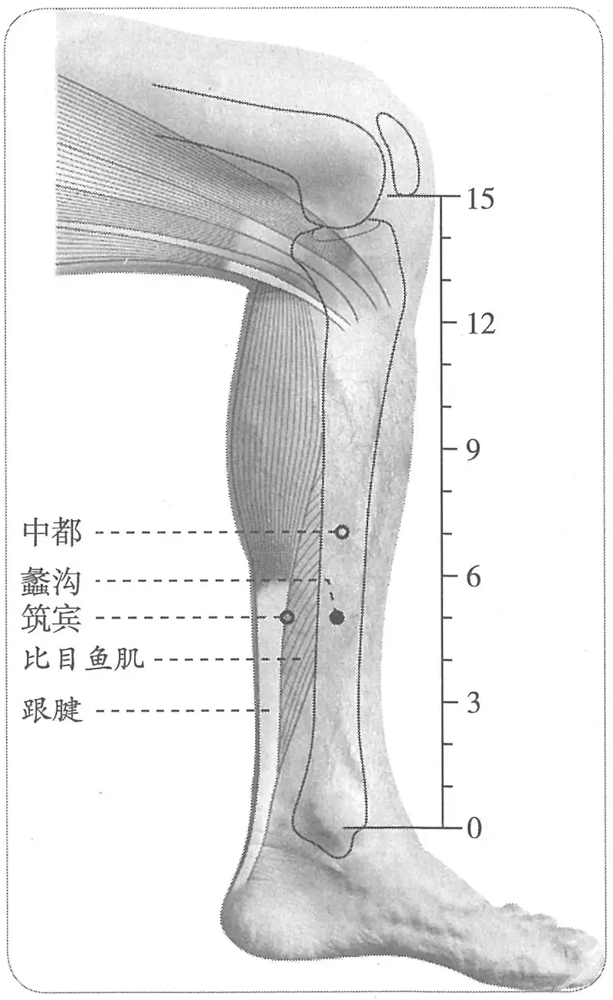

**图2-363　蠡沟穴图**

〔p.1178 (인쇄 1150)〕

　4. 统编针灸学教材

　　(1) 部位：内踝上五寸。取穴：内踝前上方五寸，下与中封对直当胫骨上。（1957年南京《针灸学》）

　　(2) 部位：内踝上五寸。取穴：在中封穴直上，胫骨内侧面取之。（1版《针灸学讲义》、1957年南京《针灸学》）

　　(3) 部位：在足内踝上五寸。取穴：内踝尖上五寸，胫骨内侧面，近内侧缘处取之。（2版《针灸学讲义》）

　　(4) 内踝上5寸，胫骨内侧面的中央。（4、5、7版《针灸学》）

　　(5) 在小腿内侧，当足内踝尖上5寸，胫骨内侧面的中央。（6版《针灸学》）

　　(6) 内踝高点直上五寸，胫骨内侧面近内缘处。（《中国针灸学》）

#### 【类属】 

足厥阴肝经络穴。

　1. 足厥阴之别，名曰蠡沟。去内踝五寸，别走少阳；其别者，径胫（循胫）上睾，结于茎。其病气逆则睾肿卒疝，实则挺长，虚则暴痒，取之所别也。（《灵枢·经别》）

　2. 蠡沟，足厥阴之络……别走少阳。（《黄帝明堂经》）

#### 【适应症】 

主治前阴部病症。常用于阴疝、睾丸肿痛，小便不利，遗尿；月经不调，赤白带下，阴痒。

　1. 主女子疝，小腹肿，赤白淫时多时少。阴跳腰痛，实则挺长，寒热，挛，阴暴痛，遗溺偏大，虚则暴痒，气逆，睾肿，卒疝。小便不利如癃状，数噫恐悸，气不足，腹中悒悒，少腹痛，嗌中有热如有瘜肉状，如著欲出，背挛不可俛仰。（《黄帝明堂经》）

**按**：以上病症多为前阴病症，特别是阴疝的症状。其中“小便不利如癃状，数噫恐悸，气不足，腹中悒悒”见于《素问·刺疟》。

　2. 主脐下积气如卵石，足寒胫酸，屈伸难。（《太平圣惠方·明堂》）

　3. 交仪主妇人漏下赤白，月水不调。（《太平圣惠方·明堂》）

　4. 治卒疝少腹肿，时少腹暴痛，小便不利如癃闭，数噫恐悸，少气不足，腹中痛，悒悒不乐，咽中闷如有息肉状，背拘急不可俯仰。（《铜人腧穴针灸图经》卷下）

　5. 治喉闭，肩背拘急。（《窦太师针经》）

　6. 统编针灸学教材

　　(1) 主治崩带，月事不调，睾丸痛，小便不利，寒疝，足胫寒酸。（1957年南京《针灸学》）

　　(2) 主治崩中，带下，月经不调，睾丸痛，小便不利，寒疝，足胫寒酸。（1版《针灸学讲义》）

　　(3) 主治月经不调，小便不利，疝气，胫部酸痛。（2版《针灸学讲义》）

　　(4) 主治小便不利，遗溺，月经不调，赤白带下，足胫痿痹。（4、5、6版《针灸学》）

　　(5) 主治①月经不调、赤白带下、阴挺、阴痒等妇科病证；②小便不利；③疝气，睾丸肿痛。（7版《针灸学》）

　　(6) 主治小便不利，遗尿，疝气，月经不调，赤白带下，外阴瘙痒，足胫痿痹。（《中国针灸学》）

**文献分析**：本穴主治足厥阴络病候。早期络脉病候的诊脉处即是相应病候的治疗点，同时也是相应络脉的起点。因此《黄帝明堂经》蠡沟穴主治病症中包含《灵枢》足厥阴络的全部病症。

#### 附：临床应用举例 

　1. 足厥阴之疟，令人腰痛少腹满，小便不利如癃状，非癃也，数便，意恐惧气不足，腹中悒悒，刺足厥阴。（《素问·刺疟》）

〔p.1179 (인쇄 1151)〕

　2. 女人漏下赤白，月经不调，灸交仪三十壮，穴在内踝上五寸。（《千金要方》卷四）

　3. 小儿鞘膜积液，针刺蠡沟穴治疗。［中医杂志，1986，27(9)：21］

#### 【操作】 

平刺。

　1. 刺入二分，留三呼，灸三壮。（《黄帝明堂经》）

　2. 灸七壮。（《太平圣惠方·明堂》）

　3. 横针入二寸半，灸二七壮。（《窦太师针经》）

　4. 窦氏针入二寸半，横透光明穴，灸二七壮。（《针方六集》卷一）

　5. 统编针灸学教材

　　(1) 针一至二分，针尖沿皮向下进，灸二至三壮。（1957年南京《针灸学》、1版《针灸学讲义》）

　　(2) 沿皮刺3~5分，艾条灸3~5分钟。（2版《针灸学讲义》）

　　(3) 平刺0.5~0.8寸。（4、5、7版《针灸学》）

　　(4) 平刺0.5~0.8寸；可灸。（6版《针灸学》）

　　(5) 横刺0.3~0.5寸。可灸。（《中国针灸学》）

　6. ①直刺0.5~1寸，沿胫骨后缘刺入。感应：局部酸胀。②斜刺，治躯干病时，沿胫骨后缘斜刺向上，进针1.5~3寸。感应：得气后，用大幅度捻转，酸胀感可扩散至膝，有时可扩散至外生殖器。灸1~3壮；温灸3~5分钟。（上海《针灸学》）

### （六）中都 Zhōngdū LR6 出《黄帝明堂经》 

问题：中都、中郄，何为正名，何为别名？

#### 【提要索隐】 

**穴名**：一名中郄。

**按**：《黄帝明堂经》载本穴名称作“中郄，一名中都”，传世本《针灸甲乙经》脱“中郄，一名”四字，而“中都”遂成正名，至宋代《铜人腧穴针灸图经》又于此加注“一名中郄”，这样原先的正名与别名正好颠倒了。今查明抄本《针灸甲乙经》及唐代苏敬《脚气论》引《针灸甲乙经》均未脱此四字。

**部位**：在小腿内侧，内踝尖上7寸，胫骨内侧面的中央。

**适应症**：主治前阴部病症。常用于疝气，少腹痛；泄泻；崩漏，恶露不绝。

**针刺操作**：平刺。

#### 【名实考】 

本穴乃肝经郄穴，名曰“中都”，与其他郄穴命名规律不合，且与神门穴别名相同，与脾经“大都”穴相类，一千年来为什么无人提出疑问？

　1. 中郄，一名中都。足厥阴郄，在内踝上七寸骱骨中。（《黄帝明堂经》）

　2. 此穴离上一寸，遂入足太阴之后，而得其中之位，故曰中都。（《经穴解》）

#### “中郄”与“中都”穴辨 

　1. 中郄，一名中都。（明抄本《针灸甲乙经》、宋校本《千金要方》、《外台秘要》、《医心方》）

　2. 《黄帝三部针灸经》中郄、一名中都，在内踝上七寸胻骨中央。（《外台秘要》卷十九）

　3. 中都，一名中郄。（《铜人腧穴针灸图经》卷上、卷下）

　4. 中都二穴，在阴陵泉、三阴交中间是。苏：一名太阴穴。（《外台秘要》卷十九、《医心方》卷八）

〔p.1180 (인쇄 1152)〕

　5. 太阴二穴，在内踝上八寸，骨下陷中是。徐同。（《外台秘要》卷十九，《医心方》卷八作“三阴”）

**按**：本穴为足厥阴郄穴，在宋以前文献皆名曰“中郄”，由于古医籍中“郄”字误写作“都”者，不乏其例（如甲抄本《窦太师针经》手少阴经“阴郄”，乙抄本即误作“阴都”），误字流传日广，于是被当作别名，故一些《黄帝明堂经》传本中遂录有“中郄，一名中都”字样。阴差阳错，明刊《针灸甲乙经》卷三“中郄，一名”四字脱失，于是“中都”便成了正名。宋代王惟一编《铜人腧穴针灸图经》将“中都”作正名，“中郄”作别名，不知是受《针灸甲乙经》影响，还是宋以后人根据《铜人腧穴针灸图经》妄改《针灸甲乙经》之文。然而，明刊本《针灸甲乙经》卷九、卷十一共三处皆作“中郄”无误，而这三处穴名被后人妄改的可能性极小，因而也就可靠得多。这是一例由传抄之误衍生别名，又以别名替代正名的奇特实例。

至于《外台秘要》、《医心方》所引唐代《三家脚气论》之“中都”穴，据苏敬注文，是“太阴”穴的别名，更早的文献《产经》载有此穴，归于足太阴经穴中，与《黄帝明堂经》的“三阴交”穴定位完全相同，而与“中郄”不同，切不可混淆。

#### 【定位】 

**部位**：在小腿内侧，内踝尖上7寸，胫骨内侧面的中央（图2-364）。

**取穴**：髌尖与内踝尖连线中点下0.5寸，胫骨内侧面的中央处取穴。

　1. 在内踝上七寸胻骨中。（《黄帝明堂经》、《铜人腧穴针灸图经》、《圣济总录》、《针灸资生经》、《十四经发挥》、《医学纲目》、《针灸聚英》、《古今医统》、《医学入门》、《针灸大成》、《针方六集》、《类经图翼》、《循经考穴编》、《针灸易学》、《针灸逢源》）

　2. 从蠡沟上行二寸，当胻骨中。（《医宗金鉴·刺灸心法要诀》）

　3. 蠡沟上二寸。（《针灸十四经穴位考订》）

　4. 统编针灸学教材

　　(1) 部位：内踝上七寸，胻骨中。取穴：在蠡沟穴直上二寸取之，在胫骨上。（1957年南京《针灸学》）

　　(2) 部位：内踝上七寸骨上。取穴：在蠡沟穴直上二寸取之。（1版《针灸学讲义》）

　　(3) 部位：内踝上七寸胻中。取穴：内踝尖上七寸，即蠡沟上二寸，胫骨内侧近内侧缘处取之。（2版《针灸学讲义》）

　　(4) 内踝上7寸，胫骨内侧面的中央。（4版《针灸学》）

　　(5) 内踝高点上7寸，胫骨内侧的中央。（5、7版《针灸学》）

　　(6) 在小腿内侧，当足内踝尖上7寸，胫骨内侧面的中央。（6版《针灸学》）

　　(7) 内踝高点直上七寸，胫骨内侧面近内缘处。（《中国针灸学》）

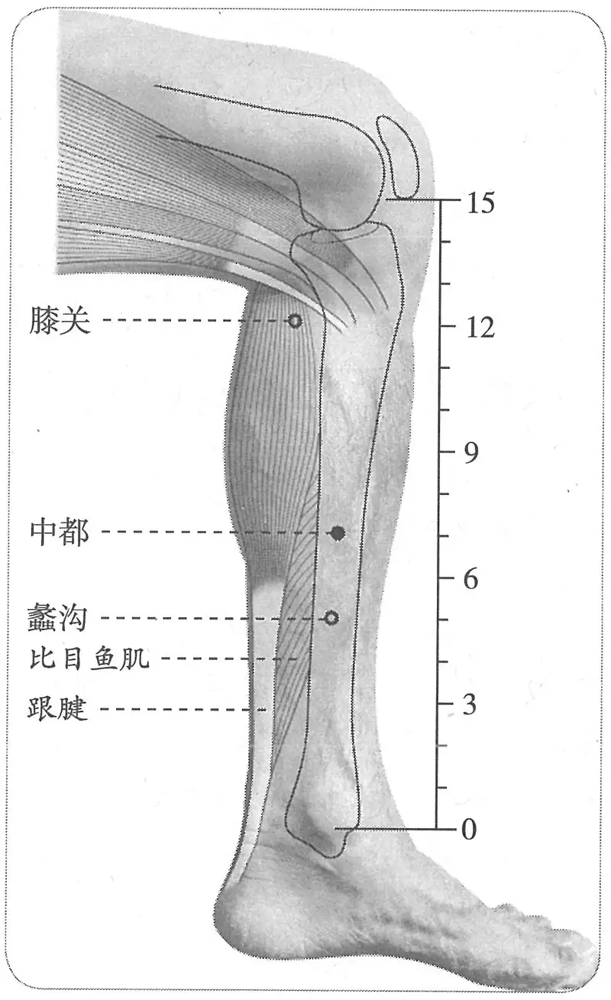

**图2-364　中都穴图**

#### 【类属】 

足厥阴肝经郄穴。《千金要方》又谓之“经”穴，别为一说也。

　1. 足厥阴郄。（《黄帝明堂经》）

〔p.1181 (인쇄 1153)〕

　2. 肝出于大敦为井，足厥阴脉也，流于行间为荥，注于太冲为输，过于中封为源，行于中郄为经，入于曲泉为合。（《千金要方》卷二十九）

#### 【适应症】 

主治前阴部病症。常用于疝气，少腹痛；泄泻；崩漏，恶露不绝。

　1. 主颓疝。崩中，腹上下痛。肠澼不止，泄精。（《黄帝明堂经》）

　2. 足下热，胫寒不能久立，湿痹不能行。（《千金要方》卷三十）

**按**：此乃《黄帝明堂经》三阴交主治。

　3. 治肠澼，颓疝少腹痛，妇人崩中，因产恶露不绝。（《铜人腧穴针灸图经》卷下）

　4. 妇人血瘕。（《针方六集》）

　5. 内廉红肿，泻之；脚软枯瘦，宜先补后泻。（《循经考穴编》下）

　6. 统编针灸学教材

　　(1) 主治崩中，产后恶露不绝，肠澼，瘭疝，少腹痛。（1957年南京《针灸学》）

　　(2) 主治崩中，产后恶露不绝，肠澼，睾丸肿痛，少腹痛。（1版《针灸学讲义》）

　　(3) 主治崩漏，恶露不绝，疝气，肠澼，少腹痛。（2版《针灸学讲义》）

　　(4) 主治腹痛，泄泻，疝气，崩漏，恶露不绝。（4、5、6版《针灸学》）

　　(5) 主治疝气，小腹痛；崩漏，恶露不尽；泄泻。（4、7版《针灸学》）

　　(6) 主治腹痛，胁痛，泄泻，疝气，崩漏，恶露不绝。（《中国针灸学》）

#### 附：临床应用举例 

　1. 四肢浮肿，中渚、液门、合谷、中都、曲池、三里、三阴交。问曰：此证缘何而得？答曰：只因醉饱乘风取快，有兼房事劳动脏腑，食饱不化，遂成痰饮，则注于四肢，故如此也。复刺后穴：中脘、丰隆、阴陵泉、行间。（《针灸集成》第四十八方）

　2. 中都原穴是肝阴，专治身麻痹在心，手足不仁心腹满，小肠疼痛便须针。（《针灸玉龙歌》）

#### 【操作】 

平刺。

　1. 刺入三分，灸五壮。（《黄帝明堂经》）

　2. 针一寸半，沿皮向上一寸，灸七壮。（《针灸玉龙歌》注）

　3. 窦氏针入二寸半，横透阳交穴。（《针方六集》卷一）

　4. 统编针灸学教材

　　(1) 针一至二分，针尖沿皮向下进，灸二至三壮。（1957年南京《针灸学》、1版《针灸学讲义》）

　　(2) 沿皮刺3~5分，艾条灸3~5分钟。（2版《针灸学讲义》）

　　(3) 平刺0.5~0.8寸。（4、5、7版《针灸学》）

　　(4) 平刺0.5~0.8寸；可灸。（6版《针灸学》）

　　(5) 横刺0.3~0.5寸。可灸。（《中国针灸学》）

### （七）膝关 Xīguān LR7 出《黄帝明堂经》 

问题1：膝关定位，《黄帝明堂经》只说“在犊鼻下二寸”，没有说旁开的距离，后世定位各不相同，现代的定位是如何确定的？

问题2：《黄帝明堂经》描述的本穴主治“膝内廉痛引髌，不可屈伸，连腹引咽喉痛”，是什么病？

〔p.1182 (인쇄 1154)〕

#### 【提要索隐】 

**部位**：在膝部，胫骨内侧髁的下方，阴陵泉穴后1寸。

**适应症**：主治局部病症。常用于阴疝所致的少腹痛引咽喉、膝内侧痛；膝部肿痛，下肢痿痹。

**针刺操作**：直刺1~1.5寸。

#### 【名实考】 

《窦太师针经》谓本穴“又名阴关”，是因为窦太师针灸，此穴定位于犊鼻旁（而不是下），适与足少阳经之“阳关”相对，故名“阴关”。鉴于：第一，此别名是基于不同穴位；第二，“阴关”之名在《黄帝明堂经》已经用作扶承穴、大赫穴的别名，一名对多穴，易致混乱，故不作为本穴别名。

关于本穴定位，《黄帝明堂经》只说“在犊鼻下二寸”，没有说旁开的距离，后世文献也只说“犊鼻下二寸旁陷中”，窦太师针灸则直接定于犊鼻穴内旁开二寸，凌云针法同，皆未的确。考诸古代针灸铜人与铜人图，明正统仿宋铜人：犊鼻下约二寸，向里旁开，下直中都穴；嘉靖铜人：在犊鼻与阴陵泉之间，近于内膝眼穴；明·靳贤修铜人：曲泉直下，约横平足三里；明·施沛《经穴指掌图》：犊鼻直下约二寸处，皆据各自理解点穴。而对于确定本穴位置参考价值最大的文献是足厥阴经筋的循行描述：结内辅之下。现代教材关于本穴的定位与之相合，极是。

　1. 膝关，在犊鼻下二寸陷者中，足厥阴脉气所发。（《黄帝明堂经》）

　2. 膝关二穴，在膝盖骨下，犊鼻穴内旁陷中。横针透膝眼穴，禁针。治膝肿疼，泻。又名阴关穴。（《窦太师针经》

　3. 膝眼二穴，在膝盖骨下，犊鼻穴外旁陷中。横针透膝关穴。治膝肿疼，泻。灸二七壮。（《窦太师针经》）

　4. 膝关二穴，一名阴关。在膝盖骨下内侧陷中，与犊鼻平，相去二寸。（《针方六集》卷一）

　5. 足厥阴之筋，起于大指之上，上结于内踝之前，上循胫，上结内辅之下……（《灵枢·经筋》）

　6. 肝经至此，上行将过膝而入股，上下骨节交折之所，有关之象焉，故曰膝关。（《经穴解》）

#### 【定位】 

**部位**：在膝部，胫骨内侧髁的下方，阴陵泉后1寸（图2-365）。

**取穴**：胫骨内踝后下方，屈膝，当腓肠肌内侧头直上部，阴陵泉后方1寸处取之。

　1. 在犊鼻下二寸陷者中。（《黄帝明堂经》、《铜人腧穴针灸图经》、《圣济总录》、《针灸资生经》、《十四经发挥》）

　2. 在犊鼻下三寸陷者中《甲乙》、《铜人经》云二寸。（《千金要方》卷二十九、《千

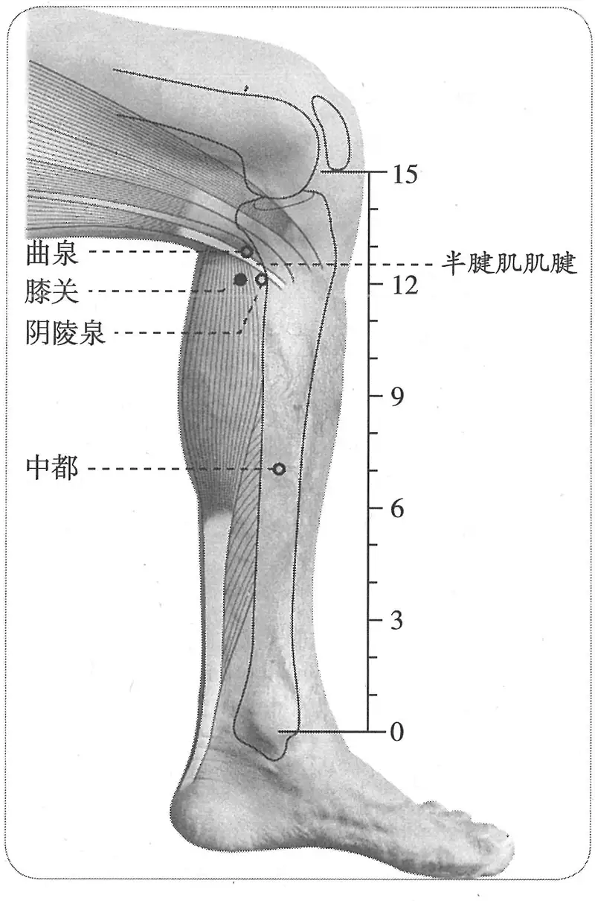

**图2-365　膝关穴图**

〔p.1183 (인쇄 1155)〕

金翼方》）

　3. 窦太师针灸遗存

　　(1) 在膝盖骨下，犊鼻穴内旁陷中。横针透膝眼。（《窦太师针经》）

　　(2) 在膝盖骨下犊鼻下二寸向里贴骨节。（《大本琼瑶神书》）

　　(3) 在膝盖骨下内侧陷中，与犊鼻平，相去二寸。（《针方六集》卷一）

　　(4) 穴在犊鼻内廉陷中。（《循经考穴编》下）

　4. 犊鼻下二寸旁陷中。（《医学纲目》卷八、《针灸聚英》、《古今医统》、《针灸大成》、《类经图翼》、《医宗金鉴·刺灸心法要诀》、《外科大成》、《针灸易学》、《针灸逢源》）

　5. 犊鼻下二寸向里陷中。（《医学入门》卷一）

　6. 犊鼻下二寸后方陷中，阴陵泉之下后方。（《针灸十四经穴位考订》）

　7. 统编针灸学教材

　　(1) 部位：在犊鼻下二寸旁陷中。取穴：正坐屈膝垂足，内髁膝眼下二寸，再向内开一寸五分，即膝关节内侧，曲泉穴之下约二寸处。（1957年南京《针灸学》）

　　(2) 部位：内辅骨后陷中。取穴：屈膝，当曲泉穴下，脾经阴陵泉穴后一横指处陷中取之。（1版《针灸学讲义》）

　　(3) 部位：在犊鼻下二寸陷者中。取穴：胫骨内髁后下方，屈膝，当腓肠肌内侧头之上部，阴陵泉（足太阴经）后方一寸处取之。（2版《针灸学讲义》）

　　(4) 阴陵泉穴后1寸。（4、5版《针灸学》）

　　(5) 在小腿内侧，当胫骨内上髁的后下方，阴陵泉后1寸，腓肠肌内侧头的上部。（6版《针灸学》）

　　(6) 胫骨内上髁后下方，阴陵泉穴后1寸。（7版《针灸学》）

　　(7) 在胫骨内髁后下方，当腓肠肌内侧头之上部，阴陵泉后一寸。（《中国针灸学》）

#### 【类属】 

足厥阴经穴。

　1. 足厥阴脉气所发。（《黄帝明堂经》）

　2. 足厥阴郄也。（《千金要方》卷二十九）

**按**：此系“中郄”穴文字错入于此。

#### 【适应症】 

主治局部病症。常用于阴疝所致的少腹痛引咽喉、膝内侧痛；膝部肿痛，下肢痿痹。

　1. 主膝内廉痛引髌，不可屈伸，连腹引咽喉痛。（《黄帝明堂经》）

　2. 治风痹，膝内痛引髌不可屈伸，喉咽中痛。（《铜人腧穴针灸图经》卷下）

　3. 窦太师针灸遗存

　　(1) 治膝肿疼，泻。（《窦太师针经》）

　　(2) 治膝眼红肿，脾家受湿，脚软无力。（《大本琼瑶神书》）

　　(3) 治鹤膝红肿无力。（《窦太师秘传》）

　　(4) 膝大红肿。（《针方六集》卷五）

　　(5) 主鹤膝风痹，腰脚不能动履。（《循经考穴编》下）

　4. 统编针灸学教材

　　(1) 主治膝内廉痛，风痹，咽喉痛。（1957年南京《针灸学》、1版《针灸学讲义》）

　　(2) 主治膝内侧痛，咽喉中痛，寒湿走注，历节风痛。（2版《针灸学讲义》）

〔p.1184 (인쇄 1156)〕

　　(3) 主治咽喉痛，寒湿走注，历节风痛。（4版《针灸学》）

　　(4) 主治膝部肿痛。（5版《针灸学》、《中国针灸学》）

　　(5) 主治膝髌肿痛，下肢痿痹。（6、7版《针灸学》）

**文献分析**：《黄帝明堂经》膝以下足厥阴经穴除本穴外，皆主阴疝，而本穴全部主治症状均见于“曲泉”穴，参照该穴主治（丈夫瘭疝，阴跳痛引篡中不得溺……暴痛引髌下节，时有热气，筋挛，膝痛不可屈伸，少腹痛引嗌），不难看出本穴这组仍为阴疝的典型症状，后世未能识此，而以治疗局部病症为主。

#### 附：临床应用举例 

　1. 舍弟行一、二里路膝必酸疼不可行，须坐定，以手抚摩久之而后能行，后因多服附子而愈。予冬月膝亦酸疼，灸犊鼻而愈。以此见药与灸不可偏废也。若灸膝关、三里亦得，但按其穴酸疼即是受病处，灸之不拘。（《针灸资生经》卷五）

　2. 两腿膝痛，内痛则膝关，外痛则膝眼，泻之。（《针灸集要·盘石金直刺秘传》）

　3. 两膝红肿疼痛，膝关、委中、三里。问曰：此证缘何而得？答曰：皆因痹经受湿，痰饮流注，或因痢后寒邪入于经络，及伤寒流注，故如此也。复刺后穴：阳陵泉、中脘、丰隆。（《针灸集成》第四十方）

　4. 腿膝内廉痛引膑，不可屈伸，连腹，引咽喉痛，太冲五分、中封、膝关。（《医学纲目》卷十二）

　5. 髋骨能医两腿痛，膝头红肿一般同。膝关膝眼皆须刺，针灸堪称劫病功。（《针灸玉龙歌》）

#### 【操作】 

直刺1~1.5寸。

　1. 刺入四分，灸五壮。（《黄帝明堂经》）

　2. 窦太师针灸遗存

　　(1) 横针透膝眼，灸二七壮，随病补泻。（《针灸玉龙歌》注）

　　(2) 横针透膝关穴。治膝肿疼，泻。灸二七壮。（《窦太师针经》）

　　(3) 窦氏横透阳关穴。（《针方六集》卷一）

　3. 《经神集》针一寸五分，与阳关针锋相透，形如八字。（《循经考穴编》下）

　4. 阳关，一法横针入一寸五分，透膝关，可灸七壮。凌氏针法：此与膝关及委中三穴，刺之须使针锋相向为妙。（《循经考穴编》下）

　5. 统编针灸学教材

　　(1) 针五至六分，灸三至七壮。（1957年南京《针灸学》、1版《针灸学讲义》）

　　(2) 直刺4~6分，艾条灸3~7分钟。（2版《针灸学讲义》）

　　(3) 直刺1~1.5寸。（4、5、6、7版《针灸学》）

　　(4) 直刺0.5~0.8寸。可灸。（《中国针灸学》）

**文献分析**：窦氏及凌氏针法皆是基于膝关在犊鼻穴内旁（与内膝眼相近处）的腧穴定位，故对于现代定位的“膝关”穴针灸法参考价值不大。

### （八）曲泉 Qūquán LR8 出《灵枢》 

问题1：本穴与“阴谷”同以“大筋”、“小筋”定位，为什么后人困惑不解，今人定位不相同？

问题2：本穴与“足五册”关系如何？

〔p.1185 (인쇄 1157)〕

#### 【提要索隐】 

**部位**：在膝部，腘横纹内侧端，半腱肌肌腱内缘凹陷中。

**适应症**：主治前阴部、少腹部病症。常用于疝气，前阴痛、少腹痛，小便不利；遗精，阳痿；月经不调，带下，子宫脱垂，阴痒；惊狂；膝肿痛，下肢痿痹。**新增**：妇人腹中包块。

**针刺操作**：直刺1~1.5寸。刺中神经时，不可反复提插。避免刺中腘动静脉。

#### 【名实考】 

曲泉，与“涌泉”一字之差，古医籍有混淆之例，详见涌泉穴“名实考”。

敦煌卷子灸方及《千金翼方》所载之“足五册”（又作“脚五册”）穴的内侧穴，定位与本穴相当，其主治及针灸之法并可参考。

本穴定位，须与阴谷穴合看：

　1. 曲泉，在膝内辅骨下，大筋上，小筋下陷者中，屈膝得之。（《黄帝明堂经》）

　2. 阴谷，在膝内辅骨后，大筋之下，小筋之上，按之应手，屈膝得之。（《黄帝明堂经》）

**文献分析**：此二穴定位文字中采用的术语相同，取穴体位也相同，只要破解一穴，另一穴也就迎刃而解。在“膝内辅骨”、“大筋”、“小筋”三个术语中，“大筋”是关键，此语一解，其余两个也随之而解。据现代解剖学知识可知，膝内侧最明显最大的肌腱即“半腱肌”，其与膝外侧的股二头肌腱共同构成膝窝的内外侧界。古人的认识也与此完全相同。唐代王冰注《素问·刺腰痛》篇曰：“膝后两旁，大筋双上”，即指此二肌腱。既知经文中“大筋”为半腱肌，则“小筋”为其深层两旁的“半膜肌腱”，该肌腱较半腱肌肌腱宽，行于其深层，故于半腱肌肌腱两旁均可触及，其中内侧较外侧清晰，外侧需重按且左右拨动方可触及，故经穴注明“按之应手”（唐代杨上善注曰“应手谓按之手下觉异也”）。至于“膝内辅骨”，据《灵枢·骨度》原文，很容易判定其即是“胫骨内侧髁”。至此，“曲泉”、“阴谷”二穴的定位变得十分明确而简单。然而由于长期以来人们没能正确理解原文献中的古代术语，对于此二穴，特别是对“曲泉”的定位出现了非常大的分歧，例如1990年版中国国家标准《经穴部位》关于曲泉穴的定位作：“在膝内侧，屈膝，当膝关节内侧面横纹内侧端，股骨内侧髁的后缘，半腱肌、半膜肌止端的前缘凹陷处”。

这一表述的问题不仅在于没有正确理解古典文献的本义（如前原文“膝内辅骨”误解为“股骨内侧髁”），而且此文所示之“膝关节内侧面横纹内侧端”、“股骨内侧髁的后缘”、“半腱肌止端”、“半膜肌止端”是四个不同的位置，而且相差颇大。也就是说根据这一表述所取“曲泉”穴，将变成4个穴点，而不是一个穴。这一失误从1954年版的《新针灸学》始至今已超过半个世纪，从未被国内外针灸学、解剖学专家发现而加以纠正。国外针灸学教材也沿袭此误。

　3. 入于曲泉，曲泉，辅骨之下，大筋之上也，屈膝而得之，为合，足厥阴也。（《灵枢·本输》）

　4. 入于曲泉，曲泉者，水也……足厥阴脉之所入也，为合。（《黄帝明堂经》）

　5. 以肝经之合穴为水，故有泉之名。曲者，乃以肝经初离膝而上股，正在曲折之地，故曰曲。又木曰曲直，木之水亦当名曲。（《经穴解》）

#### “曲泉”与“足五册”穴辨 

　1. 灸诸癫狂呆三十年者，当灸天窗，次两肩井，灸两风门，灸两肺俞，灸两心俞，灸两肾俞，灸两手五册，灸两足五册，灸两足心，二十一处各灸五百壮，觉消且□。（敦煌卷子佚名灸方）

　2. 癫狂二三十年者，灸天窗，次肩井，次风门，次肝俞，次肾俞，次手心主，次曲池，次足五册，次涌泉，各五百壮，日七壮。（《千金翼方·针灸中》卷二十七）

〔p.1186 (인쇄 1158)〕

　3. 猥退风，半身不遂，失音不语者，灸百会，次灸本神，次灸承浆，次灸风府，次灸肩髃，次灸心俞，次灸手五册，次灸手髓孔，次灸手少阳，次灸足五册，次灸足髓孔，次灸足阳明，各五百壮。（《千金要方》卷八）

　4. 灸猥退风半身不遂法，先灸天窗，次大门，脑后尖骨上一寸，次承浆，次风池，次曲池，次手髓孔腕后尖骨头宛宛中，次手阳明大指奇后，次脚五册屈两脚膝腕纹，次脚髓孔足外踝后一寸，次足阳明足拇指奇三寸，各灸百壮。若有手足患不遂，灸百会，次本神，次肩髃，次心俞，次手少阳，次足外踝下容爪外，并依左右百壮。（《千金翼方·针灸上》卷二十六）

　5. 张仲文传神仙灸法，疗腰重痛不可转侧，起坐难，及冷痹，脚筋挛急不可屈伸，灸曲脉两纹头。左右脚四处各三壮，每灸一脚，二火齐下。（《太平圣惠方·明堂》）

**按**：此“足五册”或“脚五册”为一对穴，其内侧穴即是“曲泉”，外侧穴为“委阳”。今人不识“足五册”，遂将上述《千金翼方》“足五册”改作“足五趾”，“脚五册”改作“脚五指”，又为《太平圣惠方》穴别起一名“膝旁”，归于“奇穴”类。

#### 【定位】 

**部位**：在膝部，腘横纹内侧端，半腱肌肌腱内缘凹陷中（图2-366）。

**取穴**：屈膝，在膝内侧横纹端最明显的肌腱内侧凹陷中取穴。

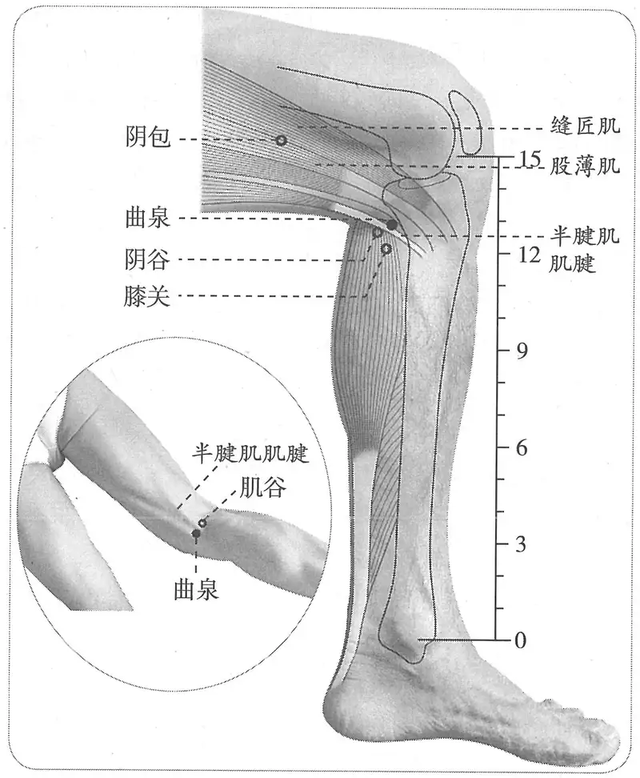

**图 2-366　曲泉穴图**

　1. 曲泉，辅骨之下，大筋之上也，屈膝而得之。（《灵枢·本输》）

　2. 在膝内辅骨下，大筋上，小筋下，陷者中，屈膝得之。（《黄帝明堂经》、《铜人腧穴针灸图经》、《圣济总录》、《针灸资生经》、《十四经发挥》中、《神应经》）

　3. 穴在膝内屈文头。（《千金要方》卷十九、《外台秘要》）

　4. 又云从三里上度一寸五分，又横向胫二寸，当脉中是也。（《外台秘要》卷十九）

　5. 又云正膝屈内外两筋间宛宛中。又在膝曲横纹头。（《铜人腧穴针灸图经》卷下、《圣济总录》、《针灸资生经》、《针灸聚英》、《古今医统》、《医学入门》、《针灸大成》、《针方六集》、《类经图翼》、《医宗金鉴·刺灸心法要诀》、《针灸易学》、《针灸逢源》）

　6. 广注又法，在阴谷后一寸。按：曲泉曰大筋上，小筋下；阴谷曰大筋下，小筋上。曲泉既间处两筋之间矣。则阴谷在下，与小筋无涉矣。宜竟曰：大筋之下为是，小筋之上则误也。焉有两筋而颠倒可换者乎？故前于阴谷条已僭去小筋上三字。若曲泉，则

〔p.1187 (인쇄 1159)〕

凌岑青先生曰：径取膝股内侧，屈膝缝尖为是。（《循经考穴编》下）

　7. 膝内辅后两筋间，阴谷穴之前上方凹陷中。（《针灸十四经穴位考订》）

　8. 统编针灸学教材

　　(1) 部位：在膝内辅骨下，大筋上小筋下。取穴：正坐屈膝，从膝关节内侧之中央部分，膝腘横纹之上端，沿关节边陷中取之。（1957年南京《针灸学》）

　　(2) 部位：膝上内辅骨后两筋间。取穴：屈膝，从膝内辅骨中央部分，膝腘横纹上端，两筋间陷中取之。（1版《针灸学讲义》）

　　(3) 部位：在膝内辅骨下，大筋上小筋下陷者中，屈膝得之。取穴：膝关节内侧，屈膝，在横纹头上方，当胫骨内髁之后，半膜肌、半腱肌止端之前取穴。（2版《针灸学讲义》）

　　(4) 屈膝，当膝内侧横纹头上方凹陷中。（4、5版《针灸学》）

　　(5) 在膝内侧，屈膝，当膝关节内侧面横纹内侧端，股骨内侧髁的后缘，半腱肌、半膜肌止端的前缘凹陷处。（6版《针灸学》）

　　(6) 屈膝，当膝内侧横纹头上方，半腱肌、半膜肌止端前缘凹陷中。（7版《针灸学》）

　　(7) 屈膝，当膝内侧横纹头上方凹陷中。在股骨内上髁的后缘，半膜肌半腱肌止端之前缘。（《中国针灸学》）

**文献分析**：由于“大筋”（半腱肌肌腱）之深层的“小筋”（半膜肌肌腱）不易触及，故直接以“大筋”定位可也。《循行考穴编》所出之疑问，正是由于不知“大筋”两边（上下）皆可触及“小筋”缘故。

#### 【类属】 

足厥阴肝经合穴。

足厥阴脉之所入也，为合。（《黄帝明堂经》）

#### 【适应症】 

主治前阴部、少腹部病症。常用于疝气；前阴痛、少腹痛；小便不利；遗精，阳痿；月经不调，带下，子宫脱垂，阴痒；惊狂；膝肿痛，下肢痿痹。**新增**：妇人腹中包块。

　1. 主女子疝瘕，按之如以汤沃两股中，少腹肿，阴挺出痛，经水来下，阴中肿或痒，漉青汗若葵羹，血闭无子，不嗜食。丈夫癞疝，阴跳痛引篡中不得溺，暴痛引髌下节，时有热气，筋挛，膝痛不可屈伸，少腹痛引嗌，足厥痛。腹䐜，胁下榰满，闭癃，阴痿，后时少泄，四肢不收，实则身热头痛汗不出，目䀮然无所见，怒欲杀人，狂如新发，衄，不食，喘呼。（《黄帝明堂经》）

**按**：“女子疝瘕，按之如以汤沃其股内至膝”又见于阴陵泉穴主治，原本是任脉的典型症状，也见于脾经病候，《灵枢·百病始生》对此有更详细的描述：其著孙络之脉而成积者，其积往来上下……其著于伏冲之脉者，揣之应手而动，发手则热气下于两股，如汤沃之状。描述的是妇人腹部肿块如正当腹主动脉（冲脉）之上，以手按之则应手而动，松开手则能感觉到一股热流沿两大腿内侧下行，如热水浇注一样。

　2. 病泄下血。（《外台秘要》卷三十九）

　3. 治女子血瘕，按之如汤沃股内，少腹肿，阴挺出，丈夫癞疝阴股痛，小便难，腹胁支满，癃闭，少气泄利，四肢不举。实即身热，目眩痛，汗不出，目䀮，膝痛筋挛不可屈伸，发狂，衄血，喘呼，少腹痛引喉咽。针入六分，灸三壮。又云：正膝屈内外两筋间宛宛中。又在膝曲横文头。治风劳失精，身体极痛，泄水，下利脓血，阴肿胻痛。（《铜人腧穴针灸图经》卷下）

　4. 窦太师针灸遗存

　　(1) 治膝头肿痛，筋挛，泻；阴囊湿痒，补。风劳失精，下利，体痛阴肿，疼，灸二七壮。（《窦太师针经》）

〔p.1188 (인쇄 1160)〕

　　(2) 脚腿疼痛，寒湿风痹。（《大本琼瑶神书》）

　　(3) 主膝头肿痛，筋挛，阴囊湿痒。（《针方六集》卷五）

　5. 茎痛，膝胫冷疼。（《针灸聚英》卷一、《针灸大成》）

　6. 统编针灸学教材

　　(1) 主治阴挺，少腹痛，小便难，阴痒，房劳失精，茎中痛，癞疝，下利脓血，阴股痛，目眩痛，狂疾，膝关节痛。（1957年南京《针灸学》）

　　(2) 主治阴挺，少腹痛，小便难，阴痒，房劳失精，茎中痛，睾丸肿痛，股内侧痛，目眩痛，膝痛，狂疾。（1版《针灸学讲义》）

　　(3) 主治阴挺，少腹痛，小便不利，阴痒，惊狂，遗精，外阴部痛，膝、股内侧痛。（2版《针灸学讲义》）

　　(4) 主治阴挺，小腹痛，小便不利，遗精，阴痒，膝痛。（4版《针灸学》）

　　(5) 主治腹痛，小便不利，遗精，阴痒，膝痛，月经不调，痛经，带下。（5、6版《针灸学》）

　　(6) 主治①月经不调、痛经、带下、阴挺、阴痒、产后腹痛等妇科病证；②遗精，阳痿、疝气；③小便不利；④膝髌肿痛，下肢痿痹。（7版《针灸学》）

　　(7) 主治小腹痛，小便不利，遗精，外阴疼痛，阴挺，阴痒，膝股内侧痛。（《中国针灸学》）

**文献分析**：《黄帝明堂经》载本穴主治中于“妇人胞中积聚”症状述之甚详，《脉经》卷八亦云：“诊得肝积，脉弦而细，两胁下痛，邪走心下，足肿寒，胁痛引少腹，男子积疝，女子瘕”，而各版教材于妇科病症列举颇多，却遗漏古代文献强调的这一症状，今补之。

丈夫癞疝，阴跳痛引篡中不得溺，腹中支，胁下榰满，闭癃阴痿，后时泄，四肢不收，实则身热头痛，汗不出，目䀮然无所见，怒欲杀人，暴痛引髌下节，时有热气，筋挛膝痛不可屈伸，狂如新发，衄，不食，喘呼，少腹痛引嗌，足厥痛，涌泉主之。（《针灸甲乙经》卷九第十一）

**按**：据《千金要方》卷三十、《医心方》卷二，参《灵枢·癫狂》，以上“涌泉主之”症，实系“曲泉”穴主治。王焘《外台秘要》“涌泉”穴下录有此条主治病症，那么该书“曲泉”穴下的相应主治病症必然是据《黄帝明堂经》传本补辑。同时提示，王寿所采用唐代《针灸甲乙经》传本原文已误作“涌泉主之”。

#### 附：临床应用举例 

　1. 狂而新发，未应如此者，先取曲泉左右动脉及盛者见血，有顷已，不已，以法取之，灸骨骶二十壮。（《灵枢·癫狂》）

　2. 病注下血，取曲泉。（《灵枢·厥病》）

　3. 男子失精，膝胫疼痛冷，灸曲泉百壮。（《千金要方》卷十九、《千金翼方》）

　4. 寒热，五般疝，偏坠，关门、归来、关元、大敦、曲泉、三阴。此证因劳伤或走受寒，故成此疾。若常发，只泻下；从上来，多补元气。若一时攻心欲死，先灸关门，绝赶下气；次下泻，灸立效。（《针灸集成》第七十一方）

　5. 膝曲筋急不能舒，曲泉一寸半。（《医学纲目》卷十二）

　6. 腰脊冷，溺多白浊，失精，脾募三七壮、曲泉灸。（《医学纲目》卷二十九）

　7. 若是七疝小肠痛，照海阴交曲泉针。（《席弘赋》）

　8. 风痹痿厥如何治，大杼曲泉真是妙。（《肘后歌》）

　9. 脐腹有病曲泉针。（《肘后歌》）

〔p.1189 (인쇄 1161)〕

#### 【操作】 

直刺1~1.5寸。刺中神经时，不可反复提插，避免刺中腘动静脉。

　1. 刺入六分，留十呼，灸三壮。（《黄帝明堂经》）

　2. 针五分或一寸半，灸二七壮。（《窦太师针经》）

　3. 窦氏针入一寸半。（《针方六集》卷一）

　4. 统编针灸学教材

　　(1) 针五至八分，灸三至七壮。（1957年南京《针灸学》、1版《针灸学讲义》）

　　(2) 直刺5~8分，艾条灸3~7分钟。（2版《针灸学讲义》）

　　(3) 直刺1~1.5寸（4、5、7版《针灸学》）

　　(4) 直刺1~1.5寸；可灸。（6版《针灸学》）

　　(5) 直刺0.5~0.8寸。可灸。（《中国针灸学》）

　5. 直刺1~1.5寸。感应：局部酸胀。灸3~5壮；温灸5~15分钟。（上海《针灸学》）

### （九）阴包 Yīnbāo LR9 出《黄帝明堂经》 

#### 【提要索隐】 

**部位**：在股前区，髌底上4寸，股薄肌与缝匠肌之间。

**国标修订**：1990年版国家标准文本：在大腿内侧，当股骨内上髁上4寸，股内肌与缝匠肌之间；2006年修订版：髌底上4寸，股薄肌与缝匠肌之间。

**按**：股骨内上髁上4寸，股内肌与缝匠肌之间，为足太阴经穴行处，本穴为足厥阴经穴，行于足太阴经穴之内侧，故作如上修订。

**适应症**：主治妇科、前阴部病症。常用于腰骶、少腹引痛；月经不调；小便不利，遗尿。

**针刺操作**：直刺0.8~1.5寸。

#### 【名实考】 

阴包，《太平圣惠方·明堂》作“阴胞”。这一改变不似将早期没有肉“月”旁的身体名词，直接加上肉“月”旁那么简单，例如“旁光”改作“膀胱”，“心包”改作“心胞”。因为该书对于穴名的改变与主治病症改变是相应的：较前代文献多出两条膀胱和胞宫的病症“小便不利及月水不调”。《黄帝明堂经》扶承穴下曰：“阴胞有寒，小便不利”，这里的“阴胞”似指膀胱。由此可以理解《太平圣惠方·明堂》编者认为本穴名称“阴包”之“包”字作“胞”解。

本穴定位，《黄帝明堂经》曰：膝上四寸，股内廉两筋间。可是此处膝上四寸股内侧有三条肌肉由内而外分别为：股薄肌、缝匠肌、股内侧肌，究竟是指哪“两筋”之间呢？《针灸聚英》给出了非常细密的描述，据此描述所设计的表面解剖学实验结果表明：这一沟形凹槽由股薄肌和缝匠肌形成。

　1. 阴包，在膝上四寸，股内廉两筋间，足厥阴别走。（《黄帝明堂经》）

　2. 膝上四寸，股内廉两筋间，蜷足取之。看膝内侧必有槽中。（《针灸聚英》卷一）

　3. 穴名阴包者，盖肝经过膝，而平乎两阴之中，为太阴、少阴所包，故曰阴包。又以穴在股之槽中，亦象包形。（《经穴解》）

#### 【定位】 

**部位**：在股前区，髌底上4寸，股薄肌与缝匠肌之间（图2-367）。

**取穴**：下肢稍屈，稍外展，略提起（或坐位，大腿稍外展，用力收缩肌肉），显露出明显的缝匠肌，在其后缘取穴。

〔p.1190 (인쇄 1162)〕

#### 相关解剖学基础 

股薄肌体表显示技法：①根据该肌的作用，当抗阻力收髋，屈膝时，均可显现或触及该肌的收缩。这是在体表显示、触诊股薄肌的经典方法。肌肉较发达的被检查者可以很容易地触诊到该肌的整体形态。②被动拉长肌肉法，当髋充分外展、外旋时，也能感觉到该肌的明显紧张。

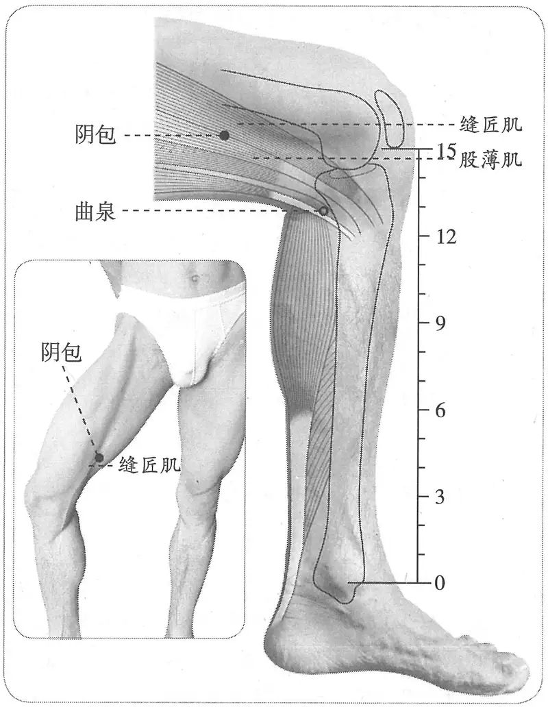

**图 2-367　阴包穴图**

　1. 在膝上四寸，股内廉两筋间。（《黄帝明堂经》、《铜人腧穴针灸图经》、《圣济总录》、《针灸资生经》、《十四经发挥》、《医学纲目》、《针灸大全》、《医学入门》）

　2. 阴胞二穴，在膝上四寸陷者中。（《太平圣惠方·明堂》）

　3. 膝上四寸，股内廉两筋间，蜷足取之。看膝内侧必有槽中。（《针灸聚英》卷一、《古今医统》、《针灸大成》、《针方六集》、《类经图翼》、《医宗金鉴·刺灸心法要诀》、《针灸易学》、《针灸逢源》）

　4. 穴在膝上四寸，股内廉两筋间。广注蜷足当有槽。《明堂》云在血海上一寸。（《循经考穴编》下）

　5. 膝上四寸，股之内侧两筋间。（《针灸十四经穴位考订》）

　6. 统编针灸学教材

　　(1) 部位：膝上四寸，股内廉两筋间。取穴：正坐垂足，从大腿骨内上髁直上四寸，股内廉两筋间取之。（1957年南京《针灸学》）

　　(2) 部位：膝上四寸，股内廉两筋间。取穴：屈膝，从曲泉穴直上，两筋间陷中取之。（1版《针灸学讲义》）

　　(3) 部位：膝上四寸，股内廉两筋间。取穴：在股骨内上髁上四寸，当股内肌与缝匠肌之间取之。（2版《针灸学讲义》）

　　(4) 股骨内上髁上4寸，缝匠肌后缘。（4、5、7版《针灸学》）

　　(5) 在大腿内侧，当股骨内上髁上4寸，股内肌与缝匠肌之间。（6版《针灸学》）

　　(6) 股骨内上髁上四寸，当股二头肌与缝匠肌之间。（《中国针灸学》）

**文献分析**：膝上四寸，股内廉两筋间，蜷足取之。看膝内侧必有槽中（《针灸聚英》）。当踝背屈，抗阻力屈膝，使股薄肌紧张，在股薄肌与缝匠肌之间呈现出一个明显的凹槽，证明古人的观察非常细致和准确。现代针灸学教材或误作“股内肌与缝匠肌之间”，或误作“股二头肌缝匠肌之间”。

#### 【类属】 

足厥阴肝经穴。

〔p.1191 (인쇄 1163)〕

足厥阴别走。（《黄帝明堂经》）

#### 【适应症】 

主治妇科、前阴部病症。常用于腰骶、少腹引痛；月经不调；小便不利，遗尿。

　1. 主腰痛，少腹痛。（《黄帝明堂经》）

**按**：腰痛引少腹，或少腹痛引腰，乃足厥阴腰痛之特点。

　2. 主小便不利及月水不调者也。（《太平圣惠方·明堂》）

　3. 治腰尻引少腹痛，遗溺不禁。（《铜人腧穴针灸图经》卷下）

　4. 妇人崩漏。（《针方六集》卷五）

　5. 两股生疮，妇人经病。（《循经考穴编》下）

　6. 统编针灸学教材

　　(1) 主治月经不调，小便难，遗溺，腰尻痛引少腹。（1957年南京《针灸学》、1版《针灸学讲义》）

　　(2) 主治月经不调，小便不利，腰骶引小腹痛。（2版《针灸学讲义》）

　　(3) 主治腰骶痛，腹痛，遗溺，月经不调。（4版《针灸学》）

　　(4) 主治腹痛，遗尿，小便不利，月经不调。（5、6版《针灸学》）

　　(5) 主治①月经不调；②小便不利，遗尿；③腰骶痛引少腹。（7版《针灸学》、《中国针灸学》）

#### 【操作】 

直刺0.8~1.5寸。

　1. 刺入六分，灸三壮。（《黄帝明堂经》、《针灸十四经穴位考订》）

　2. 灸七壮。（《太平圣惠方·明堂》）

　3. 统编针灸学教材

　　(1) 针六至七分，灸三至五壮。（1957年南京《针灸学》、1版《针灸学讲义》）

　　(2) 直刺6~7分，艾条灸3~5分钟。（2版《针灸学》）

　　(3) 直刺1~2寸。（4、5版《针灸学》）

　　(4) 直刺1~1.5寸；可灸。（6版《针灸学》）

　　(5) 直刺0.8~1.5寸。（7版《针灸学》）

　　(6) 直刺0.5~0.7寸。可灸。（《中国针灸学》）

### （十）足五里 Zúwǔlǐ LR10 出《黄帝明堂经》 

问题1：本穴距阴廉穴的距离，古代文献有三说：阴廉下；阴廉下二寸；阴廉下一寸。何者为得？

问题2：《黄帝明堂经》载本穴主治“少腹中满，热闭不得溺”，描述的是什么病？

#### 【提要索隐】 

**穴名**：宋以前文献均作“五里”，宋代改作“足五里”。

**部位**：在股前区，气冲直下3寸，动脉搏动处。

**国标修订**：1990年国家标准文本：在大腿内侧，当气冲直下3寸，大腿根部，耻骨结节的下方，长收肌的外缘；2006年国标修订版：在股前区，气冲直下3寸，动脉搏动处。

**按**：旧版国标的表述，用“气冲直下”、“耻骨结节下”、“长收肌外缘”三个坐标点描述本穴的横坐标位置，既重复，又容易出现矛盾。2006年版国标更简明些。然而“气冲直下”与“动脉搏动处”依然是重复表述，更重要的是，在活体实际比量的结果：动脉搏动处，并不在气冲穴直下，故应删去“直”字。

〔p.1192 (인쇄 1164)〕

**适应症**：主治前阴部病症。常用于少腹痛，小便不利，子宫脱垂，睾丸肿痛。

**针刺操作**：直刺0.8~1.5寸。

#### 【名实考】 

本穴穴名宋以前文献作“五里”，与手阳明经“五里”同名，宋代《针灸资生经》改作“足五里”，今从之。由于与手阳明经之“五里”同名，古今文献每将两者相混。

《内经》中以“一里”表“一寸”之意，杨氏解曰“去腹五寸，故曰五里”，甚得经旨。只是不知杨氏这里所说的“腹”以何者为界，若以腹股沟为界，则本穴去腹只四寸。

　1. 五里，在阴廉下，去气冲三寸，阴股中动脉。（《黄帝明堂经》）

　2. 杨上善注曰，去腹五寸，故曰之。（《医心方》卷二）

　3. 穴名五里者，言其远也，肝经自大敦起，过足指、足跗、足行、足膝、足股至此，乃有动脉应手，将入腹故曰五里。（《经穴解》）

**按**：此解未得古义，出于臆测。

#### 【定位】 

**部位**：在股前区，气冲穴下3寸，动脉搏动处（图2-368）。

**取穴**：气冲穴下3寸，有动脉搏动处取之。

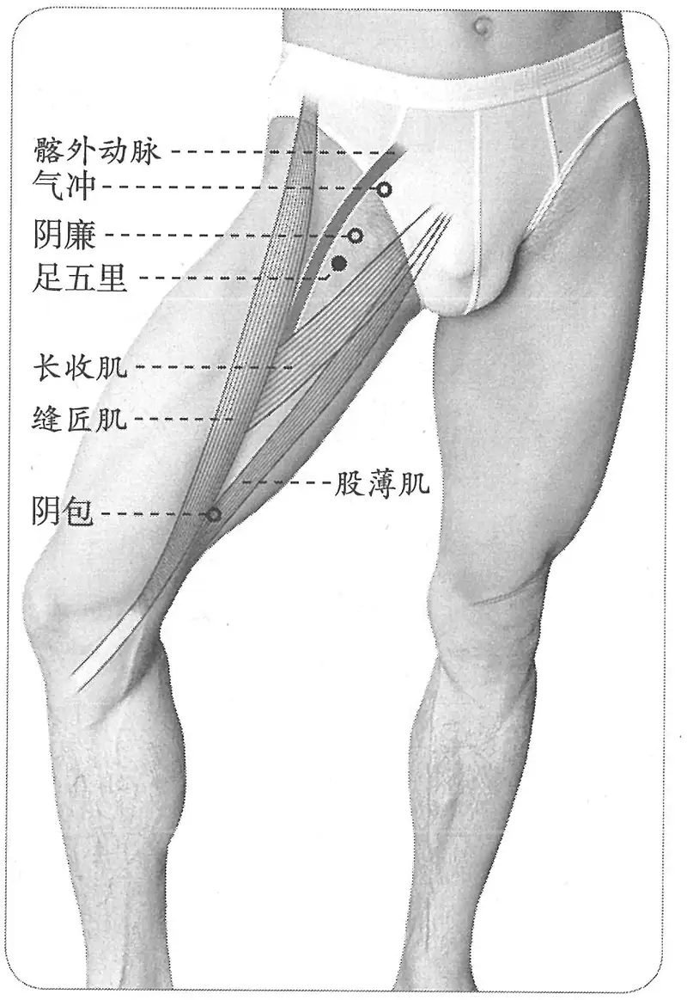

**图 2-368　足五里穴图**

　1. 《黄帝明堂经》佚文

　　(1) 在阴廉下去气冲三寸，阴股中动脉。（《针灸甲乙经》卷三）

　　(2) 在阴廉下二寸。（《千金要方》卷二十九、《千金翼方》、《外台秘要》）

　　(3) 在下去气街三寸，阴股中动脉也。（《医心方》卷二）

　2. 在气冲下三寸，阴股中动脉。（《铜人腧穴针灸图经》卷上、卷下）

　3. 在下去气冲三寸。（《铜人腧穴针灸图经》卷下“都数”）

　4. 在阴廉下一寸，去气冲三寸，去外廉二寸，阴股中动脉。（《针方六集》卷一）

　5. 从阴包上行，在足阳明胃经之气冲穴下三寸，阴股中动脉应手。（《医宗金鉴·刺灸心法要诀》）

　6. 统编针灸学教材

　　(1) 部位：阴廉穴下一寸。取穴：仰卧伸足，从气冲旁五分再下三寸取之，有动脉应手。（1957年南京《针灸学》）

　　(2) 部位：阴廉穴下一寸。取穴：仰卧，从胃经气冲穴下三寸有动脉搏动处取之。（1版《针灸学》）

　　(3) 部位：在阴廉下，去气冲三寸，阴股中动脉。取穴：在气冲足阳明经下约三横指取穴，当长收肌之外缘。（2版《针灸学》）

　　(4) 曲骨穴旁开2寸，直下3寸。（4、5版《针灸学》）

　　(5) 在大腿内侧，当气冲直下3寸，大腿根部，耻骨结节的下方，长收肌的外缘。（6版《针灸学》）

〔p.1193 (인쇄 1165)〕

　　(6) 气冲直下3寸，大腿根部，耻骨结节下方。（7版《针灸学》）

　　(7) 气冲直下3寸，当长收肌之外缘。（《中国针灸学》）

**文献分析**：本穴定位，现存《黄帝明堂经》已有异文，《针灸甲乙经》作“阴廉下去气冲三寸”，如果是气冲穴“直下”，那么“阴廉下”三字完全是多余文字；《千金要方》等书作“阴廉下二寸”，虽然避免了重复，但与“去气冲三寸”不合。确定本穴的定位，要特别注重“阴股中动脉”这一重要体表标志，在活体上实际比量的结果：腹股沟二寸（气冲下三寸）处的股动脉搏动不直对气冲，而是在气冲穴的外侧。《铜人腧穴针灸图经》的表述“气冲下三寸，阴股中动脉”，既不重复，又准确。因此，本穴的准确定位为：大腿内侧，腹股沟下二寸股动脉搏动处。或者直接采用《铜人腧穴针灸图经》的表述：气冲下三寸，股动脉搏动处。

#### 【类属】 

足厥阴经穴。

**归经：**

　1. 足太阴经。（《黄帝内经太素》卷十四、《医心方》）

　2. 足厥阴经。（《产经》、《千金要方》、《千金翼方》、《外台秘要》、《铜人腧穴针灸图经》）

　3. 刺阴股下阴三寸内陷，令人遗尿。杨上善注曰：阴股下三寸，当足太阴五里穴也。（《医心方》卷二）

#### 【适应症】 

主治前阴部病症。常用于少腹痛，小便不利，子宫脱垂，睾丸肿痛。

　1. 主少腹中满，热闭不得溺。（《黄帝明堂经》）

　2. 治肠中满，热闭不得溺。（《铜人腧穴针灸图经》卷下）

**按**：古医籍中“腹”与“肠”字常相混，此即一例也。

　3. 风劳，嗜卧。（《针灸聚英》卷一、《古今医统》、《针灸大成》、《针方六集》、《类经图翼》）

**按**：此症乃“手五里”穴主治症，高武误录于此。明以后针灸书皆承其误。

　4. 窦太师针灸遗存

　　(1) 治阴囊生疮，两股痒，肾藏风疮。（《窦太师针经》）

　　(2) 阴囊湿痒，两股生疮。（《针方六集》卷五）

　　(3) 肾风，阴囊湿痒。（《循经考穴编》下）

　5. 统编针灸学教材

　　(1) 主治肠中满，热闭不得尿。（1957年南京《针灸学》）

　　(2) 主治腹中满，热闭不得尿。（1版《针灸学讲义》）

　　(3) 主治小腹胀，小便不通，嗜卧，四肢倦怠，颈疬。（2版《针灸学讲义》、4版《针灸学》）

　　(4) 主治小腹痛，小便不通，阴挺，睾丸肿痛，嗜卧，瘰疬。（5、6版《针灸学》）

　　(5) 主治①小腹痛；②小便不通；③阴挺；④睾丸肿痛；⑤瘰疬。（7版《针灸学》）

　　(6) 主治小腹胀满，小便不通。（《中国针灸学》）

**文献分析**：《黄帝明堂经》曰：“少腹中满，热闭不得溺”；《素问·长刺节论》有云：“病在少腹，腹痛不得大小便，病名曰疝。得之寒，刺少腹两股间”，病状相同，取穴也相同。由此可知本穴描述的病症本义为疝，也是足厥阴经最核心的病症。只是该组病症，《素问》责之于寒，而《黄帝明堂经》归之于热也。

教材中“嗜卧”乃承高武《针灸聚英》之误；“四肢倦怠”、“瘰疬”则系教材编者新出现的错误，皆误将手阳明大肠经之“手五里”主治录于此也，今皆去之。

#### 【操作】 

直刺0.8~1.5寸。

〔p.1194 (인쇄 1166)〕

　1. 刺入六分，灸五壮。（《黄帝明堂经》）

　2. 禁针，灸之二七壮。又法针二寸半。（《窦太师针经》）

　3. 窦氏针入二寸五分。（《针方六集》卷一）

　4. 统编针灸学教材

　　(1) 针五至八分，灸三至五壮。（1957年南京《针灸学》、1版《针灸学讲义》）

　　(2) 直刺5~8分，艾条灸3~5分钟。（2版《针灸学讲义》）

　　(3) 直刺1~2寸。（4、5版《针灸学》）

　　(4) 直刺1~1.5寸；可灸。（6版《针灸学》）

　　(5) 直刺0.8~1.5寸。（7版《针灸学》）

　　(6) 直刺0.5~1.0寸。可灸。（《中国针灸学》）

### （十一）阴廉 Yīnlián LR11 出《黄帝明堂经》 

问题：关于本穴定位，新、旧国标皆忽略了什么？如何修订？

#### 【提要索隐】 

**定位**：在股前区，气冲直下2寸，股动脉搏动处。

**国标修订**：1990年国家标准文本：在大腿内侧，当气冲直下2寸，大腿根部，耻骨结节的下方，长收肌的外缘；2006年国标修订版：在股前区，气冲直下2寸。

**按**：旧版国标的表述，用“气冲直下”、“耻骨结节下”、“长收肌外缘”三个坐标点描述本穴的横坐标位置，既重复，又容易出现矛盾。2006年版国标更简明些，而在活体实际比量的结果：动脉搏动处，并不在气冲穴直下，故应删去“直”字，加上横坐标位置的说明“股动脉搏动处”。

**适应症**：主治妇科病症。常用于月经不调，不孕，少腹痛。

**针刺操作**：直刺0.8~1.5寸。

#### 【名实考】 

本穴在前阴之旁，故曰“阴廉”。

本穴定位，《黄帝明堂经》曰：“羊矢下，去气冲二寸动脉中”。“羊矢”也是穴名，观杨上善的解释，不能确定是说穴，还是说腹股沟这个部位。考《黄帝明堂经》在表达“腹股沟”这个概念多用“鼠鼷”（见“气冲”穴），或“横骨两端约中”的说法（见“冲门”穴）。本穴定位中所说之“羊矢”指穴名的可能性更大。因为本穴不在气冲穴直下，故需要加上“羊矢下”来限定；如指腹股沟，那么“羊矢下”出现在这里便毫无意义。后人不明此理，多误以为本穴是在气冲穴直下，遂补充注明：“羊矢下，斜里三分，直上”，大误。

有关“羊矢”穴的考证，详见急脉穴“名实考”。

　1. 在羊矢下，去气冲二寸动脉中。（《黄帝明堂经》

　2. 杨上善注云，羊矢亦曰鼠鼷，阴之两廉，腹与股相接之处。（《医心方》卷二）

　3. 肝经将入腹矣，廉者，言其隅也，锐也，离股而入腹，有廉直象焉，肝经为阴，故曰阴廉。（《经穴解》）

#### 【定位】 

**部位**：在股前区，气冲直下2寸，股动脉搏动处（图2-369）。

**取穴**：稍屈髋，屈膝，外展，大腿抗阻力内收时显露出长收肌，在其外缘取穴。

　1. 在羊矢下，去气冲二寸动脉中。（《黄帝明堂经》、《铜人腧穴针灸图经》、《圣济总录》、《针灸资生经》、《十四经发挥》、《医学纲目》、《针灸聚英》、《古今医统》、《医学入门》、

〔p.1195 (인쇄 1167)〕

《针灸大成》、《针方六集》、《针灸易学》）

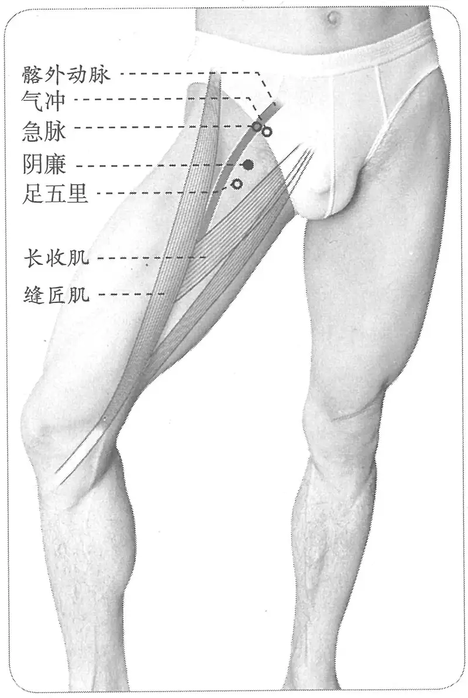

**图 2-369　阴廉穴图**

　2. 羊矢下一寸是也。（《针灸甲乙经》卷十二注）

　3. 阴廉穴在横纹胯。（《针灸聚英》卷四、《古今医统》、《针方六集》）

　4. 在羊矢下斜里三分，直上去气冲二寸动脉陷中羊矢，在阴旁股内约文缝中，皮肉间有核如羊矢。（《类经图翼》卷八、《医宗金鉴·刺灸心法要诀》、《针灸逢源》）

　5. 穴在羊矢下，去气冲二寸动脉中……按：羊矢，亦穴名，一本亦序之云在气冲下一寸。（《循经考穴编》下）

　6. 气冲外五分再下二寸。（《针灸十四经穴位考订》）

　7. 统编针灸学教材

　　(1) 部位：在气冲穴下二寸动脉中。取穴：仰卧，从气冲穴旁开五分，再下行二寸取之。（1957年南京《针灸学》）

　　(2) 部位：五里穴上一寸。取穴：仰卧，气冲穴下二寸取之。（1版《针灸学讲义》）

　　(3) 部位：在羊矢下，去气冲二寸动脉中。取穴：在气冲足阳明经下约二横指取穴，当内长收肌之外侧。（2版《针灸学讲义》）

　　(4) 曲骨穴旁开2寸，直下2寸。（4、5版《针灸学》）

　　(5) 在大腿内侧，当气冲直下2寸，大腿根部，耻骨结节的下方，长收肌的外缘。（6版《针灸学》）

　　(6) 气冲直下2寸，大腿根部，耻骨结节下方。（7版《针灸学》）

　　(7) 气冲直下2寸，当长收肌之外缘。（《中国针灸学》）

**文献分析**：本穴在腹股沟下动脉搏动处，此处并不正好与气冲穴直对，故《黄帝明堂经》用“羊矢下”限定，《类经图翼》说法显然误解了经文本义；《针灸聚英》等书之所载是明中期“十四经穴步穴歌”将本穴定于腹股沟中，此是依据《针灸甲乙经》“羊矢下一寸”，而明代文献又说“羊矢”在气冲穴旁，如此折算正好在腹股沟中。不知是否受此说影响，1918年日本文部省《改正孔穴》将本穴定于腹股沟中，早期针灸学教材从之。

#### 【类属】 

足厥阴肝经穴。

**归经：**

　1. 足太阴经。（《黄帝内经太素》卷十四、《医心方》卷二）

　2. 足厥阴经。（《产经》、《千金要方》、《千金翼方》、《外台秘要》、《铜人腧穴针灸图经》）

　3. 杨上善曰，下部之人，足太阴脉动，在中府、箕门、五里、阴廉、冲门、云门六处，以候脾气。（《黄帝内经太素》卷十四）

#### 【适应症】 

主治妇科病症。常用于月经不调，不孕，少腹痛。

　1. 主妇人绝产若未曾产。（《黄帝明堂经》）

〔p.1196 (인쇄 1168)〕

　2. 治妇人绝产，若未经生产者，可灸三壮即有子。（《铜人腧穴针灸图经》卷下、《圣济总录》、《针灸聚英》、《古今医统》、《针方六集》）

　3. 主木肾便毒。（《循经考穴编》下）

　4. 统编针灸学教材

　　(1) 主治妇人绝产，经期不调，腿股痛。（1957年南京《针灸学》、1版《针灸学讲义》）

　　(2) 主治月经不调，腿股痛。（2版《针灸学讲义》）

　　(3) 主治月经不调，带下，小腹痛，腿股痛。（4版《针灸学》、《中国针灸学》）

　　(4) 主治月经不调，带下，小腹痛。（5、6、7版《针灸学》）

#### 【操作】 

直刺0.8~1.5寸。

　1. 刺入八分，灸三壮。（《黄帝明堂经》）

　2. 可灸三壮……针入八分，留七呼。（《铜人腧穴针灸图经》卷下）

　3. 一法，针一寸，灸二七壮。（《循经考穴编》下）

　4. 针五分，灸三壮。《针灸十四经穴位考订》）

　5. 统编针灸学教材

　　(1) 针三至五分，灸三至五壮。（1957年南京《针灸学》、1版《针灸学讲义》）

　　(2) 直刺3~5分，艾条灸3~5分钟。（2版《针灸学讲义》）

　　(3) 直刺1~2寸。（4、5版《针灸学》）

　　(4) 直刺1~1.5寸；可灸。（6版《针灸学》）

　　(5) 直刺0.8~1.5寸。（7版《针灸学》）

　　(6) 直刺0.5~1.0寸。可灸。（《中国针灸学》）

### （十二）急脉 Jímài LR12 出《素问》王冰注 

问题：“急脉”与“羊矢”关系如何？

#### 【提要索隐】 

**部位**：在腹股沟区，横平耻骨联合上缘，前正中线旁开2.5寸。

**适应症**：主治前阴部病症。常用于疝气，前阴痛、少腹痛。

**针刺操作**：避开动脉，直刺0.5~1寸。

#### 【名实考】 

“急脉”见于《素问》王冰注，由明代张介宾归入足厥阴经穴。而早于王冰，《黄帝明堂经》已载有“羊矢”，先于张介宾，明初期以下众多文献皆已将“羊矢”穴归于足厥阴经。张氏之说经清代官修医典的传播大行于世，后来居上顶替了先被归经的“羊矢”。综合考察诸家论述，“急脉”与“羊矢”实为同一穴。之所以长期被视为两个不同的穴，是因为《黄帝明堂经》未言“羊矢”部位，杨上善注文也不详明，直到明代才说“气冲旁一寸”，与王冰所注“急脉”定位有半寸之差。之所以“急脉”与“羊矢”长期被归入“奇穴”类，主要是足厥阴经穴“阴廉”、“五里”皆在气冲“下”，而急脉穴在气冲“旁”，这也是对《黄帝明堂经》原文的误解。阴廉、五里二穴并不在气冲穴“直下”，而是在其外下方——约相当于气冲穴外约一寸下方的股动脉搏动处。

#### “羊矢”、“急脉”“泉阴”、“阑门”（蘭門、攔門、關門、閣門）辨 

　1. “羊矢”

　　(1) 下部天，足厥阴也；王冰注：谓肝脉也。在毛际外羊矢下一寸半陷中，五里之分，卧而取之，动应于手也。（《素问·三部九候》）

〔p.1197 (인쇄 1169)〕

　　(2) 注云羊矢亦曰鼠鼷，阴之两廉，腹与股相接之处。（《黄帝内经明堂》杨上善注，引自《医心方》卷二）

　　(3) 羊矢穴，气冲旁一寸内股上按文中，按皮肉间有核如羊矢是。三分，七壮。（《大本琼瑶神书》）

　　(4) 羊矢气冲旁一寸，股内横纹有核见。（《针灸问对》）

　　(5) 羊矢，气冲外一寸。（《医学入门》）

　　(6) 羊矢冲下一寸许。（《黄帝内经灵枢注证发微》）

　　(7) 羊矢气冲旁一寸，分明有穴君可问。（《经穴指掌图》）

**按**：以上诸书均归于足厥阴经，最早明确将羊矢穴序于足厥阴经者，是明初刘纯《医经小学》，但未注明部位。

　　(8) 羊矢二穴，在阴股内横纹中，有核如羊矢然。治横痃便□及阴股中痛。灸七壮。（明抄本《针灸秘法全书》）

　　(9) 羊矢，在会阴旁三寸，股内横纹中，按皮肉间有核如羊屎。可刺三分，灸七壮。（《类经图翼》卷十）

　　(10) 羊矢在阴旁股内约纹缝中，皮肉间有核如羊矢。（《类经图翼》卷八“阴廉穴注”）

　　(11) 按羊矢亦穴名，一本亦序之，云在气冲下一寸，灸五壮，主气攻两胁，小腹胀急。（《循经考穴编》）

　2. 急脉　急脉在阴髦中，阴上两旁相去同身寸之二寸半，按之隐指坚，然甚按则痛引上下也。其左者，中寒则上引少腹，下引阴丸，善为痛，为少腹急中寒。此两脉皆厥阴之大络通行其中，故曰厥阴急脉，即睾之系也。可灸而不可刺，病疝少腹痛，即可灸。（《素问·气府论》王冰注）

　3. 阑门

　　(1) 关门二穴，在曲骨穴微上两旁各开三寸。针入三寸，灸五十壮。治乳弦疝气，肚腹膨胀，泻；偏坠木肾，遗尿，先泻后补。（《窦太师针经》）

　　(2) 兰门二穴，在曲骨穴两旁各开三寸。针入一分半，灸三七壮。治膀胱七疝之气。（《窦太师针经》）

　　(3) 关门二穴，在茎毛际各去三寸。刺灸同前。（《窦太师针经》乙抄本）

　　(4) 蘭门二穴，在曲骨两旁各三寸，脉上是穴。（《针灸大全》卷四）

　　(5) 拦门二穴，在腹毛际内茎根旁开五寸，归来穴一寸，针刺入二寸半，灸七壮。治阴汗、偏坠、红肿三症。（《医经会元》）

　　(6) 兰门二穴，在曲泉两旁各三寸脉中。治膀胱七疝，奔豚。（《针灸大成》卷七）

　　(7) 兰门二穴，在曲骨穴两旁，各开二寸。针入一寸五分，灸三七壮。治膀胱七疝之气。（《针方六集》卷一）

　　(8) 竖痃疝气发来频，气上攻心大损人，先向阁门施泻法，大敦复刺可通神。注：阁门：在玉茎毛际两旁各三寸。针一寸半，泻之，灸五十壮。（《针灸玉龙经·玉龙歌》）

　　(9) 竖弦疝气发甚频，气上攻心似死人，关元兼刺大敦穴，此法亲传始得真。（《针灸大成·玉龙歌》卷三）

　　(10) 肾弦疝气发得频，气上冲心苦死人，法取气冲大敦穴，二穴须教认得真。气冲，穴在脐下横骨两端，去中行各二寸，动脉应手。（《针方六集·玉龙歌》卷六）

〔p.1198 (인쇄 1170)〕

　　(11) 脐豚息气乳弦，水道、关门、气海。注：关门，梁门下一寸，建里旁二寸，入八火五。（《针灸集成》第五十三方）

　　(12) 关门二穴，在王茎毛际各开三寸，直针入一寸半，可灸五十壮；又建里两傍各三寸，梁门下一寸。治乳弦疝气单泻，偏坠木肾先补后泻，肚膨单泻。（《医经会元·玉龙歌》注）

**按**：以上《针灸集成》穴位注文出自明初太医之手，显然其不详窦氏原方中“关门”（“阑门”之形误）；《医经会元》“又建里两旁各三寸，梁门下一寸”句，不见于《医学纲目》卷二十五引《针灸玉龙歌》注文，应是该书编者吴嘉言所添加，所注乃经穴“关门”部位，而经穴关门不治上述病症，显然吴氏对于经穴与奇穴“关门”也不能辨。

　　(13) 木肾，红肿阴汗偏坠：阑门毛际玉茎旁开二寸，针入二寸半、三阴交。（《医学纲目》卷十四）

**文献分析**：从以上各家文献所述来看，羊矢在气冲穴外一寸处，急脉在阴茎根旁二寸半，阑门在阴茎根旁二寸半或三寸，定位相同或极相近，皆主治阴疝，皆为同一穴。其中前二穴先后被归入足厥阴经穴，阑门见于窦太师针灸，被归入“奇穴”类。根据各家描述，急脉穴定位有两个要点：第一，在气冲与冲门穴之间，第二，在腹股沟上，折量分寸可不拘。羊矢穴所谓“在阴旁股内约纹缝中，皮肉间有核如羊矢”者，是按压腹股沟，指下触及腹股沟淋巴结的感觉，故名之曰“羊矢”；急脉穴所谓“按之隐指坚”，是按压腹股沟，指下触及腹股沟韧带的感觉，阴疝时此处紧张，疼痛牵引前阴与少腹部，故名之曰“急脉”；名曰“阑门”者，是中医经典将阴疝属之于小肠病（又名“小肠气”），而“阑门”为小肠下口；名曰“泉阴”者，与本穴的简易取穴法有关：牵阴茎向外腹股沟，阴头所止处。皆所出不同，各立其名，其穴一也。

其实，远早于元代窦太师大量应用“阑门”治疗阴疝之前，本穴早已用于针灸临床治疗阴疝，只不过没有提及“羊矢”或“急脉”穴名而已，更没有晚出的“阑门”之名：

　　(1) 病在少腹，腹痛不得大小便，病名曰疝，得之寒，刺少腹两股间，刺腰髁骨间，刺而多之，尽炅病已。（《素问·长刺节论》）

　　(2) 治卒癞，牵阴头正上，灸茎头所极；又牵下向谷道，又灸所极；又牵向左右髀直行，灸茎所极各随年壮。男阴卵偏大癞病，灸泉阴百壮，三报，在横骨边。（《千金要方》卷二十四）

　　(3) 癞卵偏大，灸玉泉百壮报之。又，灸泉阴百壮三报之，在横骨边三寸。（《千金翼方》卷二十八）

从以上文献的引证与分析可得如下两点判断：第一，羊矢、急脉、阑门、泉阴皆同一穴，所出不同，而各立其名；第二，元明文献中“閤门”、“關门”、“蘭门”、“攔门”皆“闌门”之形误，同出一源而传抄致误。对于上述穴名演变，特别是“阑门”及其与经穴“关门”的关系，明代诸太医已不能详，今人更难辨其原委，于是误名行于世，而正名隐而不彰。又明代《针灸大成》引录时，不仅穴名误作“兰门”，且将原文献定位文字中“曲骨”误抄作“曲泉”，今人也不辨真伪，于是原来的二穴变为四穴，大误。同时又以“关门”、“阁门”、“阑门”、“羊矢”、“急脉”、“泉阴”各立为不同穴，悉归入奇穴类。此乃因源流不辨，正误不分，所致一穴演为多穴的罕见实例。

〔p.1199 (인쇄 1171)〕

#### 【定位】 

**部位**：在腹股沟区，横平耻骨联合上缘，前正中线旁开2.5寸（图2-370）。

**取穴**：从曲骨穴旁开2.5寸，当气冲之外下方腹股沟处取之。

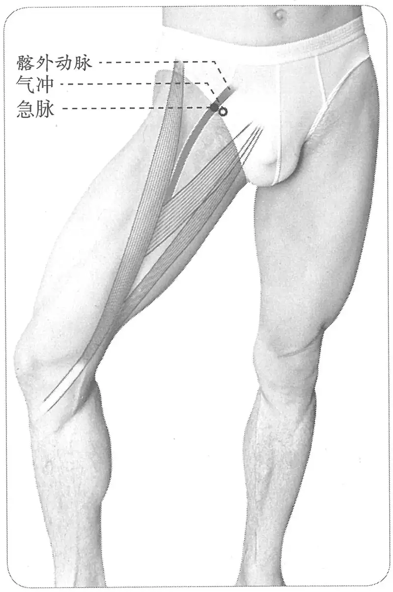

**图 2-370　急脉穴图**

　1. 在阴毛中，阴上两旁，相去同身寸之二寸半，按之隐指坚然，甚按则痛引上下也。（《素问·气府论》王冰注、《类经图翼》、《医宗金鉴·刺灸心法要诀》、《针灸逢源》）

　2. 曲骨旁二寸五分。（《针灸十四经穴位考订》）

　3. 统编针灸学教材

　　(1) 部位：阴旁二寸半。取穴：从曲骨穴旁开二寸五分处，当阴毛之际取之。（1957年南京《针灸学》）

　　(2) 部位：阴旁二寸五分。取穴：在阴茎上缘从中线旁开二寸五分处取之。（1版《针灸学讲义》）

　　(3) 部位：在阴上两旁相去二寸半。取穴：在耻骨结节之下外侧，距任脉二寸半，当气冲足阳明经之外下方腹股沟处。（2版《针灸学讲义》）

　　(4) 耻骨联合下旁开2.5寸，在阴毛中。（4版《针灸学》）

　　(5) 耻骨联合下旁开2.5寸，当气冲穴外下方腹股沟处。（5、7版《针灸学》）

　　(6) 在耻骨结节的外侧，当气冲外下方腹股沟股动脉搏动处，前正中线旁2.5寸。（6版《针灸学》）

　　(7) 耻骨结节之下外侧，距任脉二寸五分，当气冲外下方腹股沟处。（《中国针灸学》）

#### 【类属】 

足厥阴肝经穴。

厥阴毛中急脉各一。（《素问·气府论》）

#### 【适应症】 

主治前阴部病症。常用于疝气，前阴痛、少腹痛。

　1. （疝）上引少腹，下引阴丸。（《素问·气府论》王冰注）

　2. 统编针灸学教材

　　(1) 主治阴茎痛，癞疝。（1957年南京《针灸学》）

　　(2) 主治阴茎痛，睾丸肿痛。（1版《针灸学讲义》）

　　(3) 主治外阴部痛，疝气，阴下脱，少腹痛。（2版《针灸学讲义》）

　　(4) 主治小腹痛，疝气，阴挺。（4、5、6、7版《针灸学》）

　　(5) 主治少腹痛，阴部痛，疝气。（《中国针灸学》）

#### 附：临床应用举例 

　1. 治偏坠红肿二百五十九法，阑门穴取又盘寻，左取盘盘提出针，海底二分针头用，大敦出血灸如金。（《琼瑶神书》卷二）

　2. 膀胱七疝、贲豚等证，大敦二穴、蘭门二穴、丹田一穴、三阴交穴、涌泉二穴、章门二穴、大陵二穴。（《针灸大全》）卷四）

〔p.1200 (인쇄 1172)〕

　3. 偏坠水肾，肿大如升，大敦二穴、曲泉二穴、然谷二穴、三阴交穴、归来二穴、蘭门二穴在曲骨两旁各三寸，脉上是穴、膀胱俞穴、肾俞二穴。（《针灸大全》）卷四）

　4. 脐豚息气乳弦，水道、关门、气海。问曰：此证从何而得？答曰：皆因酒色过多，肾水枯竭，积气耗散，阳气不兴，勉强为之，精不能泄，外流入胞中，或偏坠疼痛，或作鸡子之状，坠下疼痛，按上腹中则不痛，否则浑身不知，如入腹中则作声，以为乳弦疝气也。善治者当推详而治之。刺前穴不效，复刺后穴。前穴：水道、关门、气海。后穴：归来、关门、三阴交。关门，梁门下一寸，建里旁二寸，入八火五。（《针灸集成》第五十三方）

　5. 寒热五般疝偏坠，关门、归来、关元、大敦、曲泉、三阴。此证因劳伤或走受寒，故成此疾。若常发，只泻下；从上来，多补元气。若一时攻心欲死，先灸关门，绝赶下气；次下泻，灸立效。关门，梁门下一寸，建里旁各二寸，入八，火五。（《针灸集成》第七十一方）

　6. 木肾，红肿阴汗偏坠，阑门毛际玉茎旁开二寸，针入二寸半、三阴交。（《医学纲目》卷十四）

　7. 〔《玉》〕疝气冲心欲死，关门在玉茎旁二寸，针入二寸半，灸二七壮。（《医学纲目》卷二十五）

　8. 竖痃疝气发来频，气上攻心大损人，先向阁门施泻法，大敦复刺可通神。（《针灸玉龙歌》）

#### 【操作】 

避开动脉，直刺0.5~1寸。

　1. 可灸而不可刺。（《素问·气府论》王冰注）

　2. 羊矢，三分七壮。（《大本琼瑶神书》、《类经图翼》）

　3. 阑门，针一寸半，泻之，灸五十壮。（《针灸玉龙歌》注）

　4. 可灸之，禁刺。（《针灸逢源》）

　5. 禁针，灸三壮。（《针灸十四经穴位考订》）

　6. 统编针灸学教材

　　(1) 灸三至五壮。（1957年南京《针灸学》、1版《针灸学讲义》）

　　(2) 艾条灸3~5分钟。（2版《针灸学讲义》）

　　(3) 避开动脉，直刺0.5~0.8寸。（4、5、6版《针灸学》）

　　(4) 避开动脉，直刺0.5~1寸。（7版《针灸学》）

　　(5) 可灸。（《中国针灸学》）

### （十三）章门 Zhāngmén LR13 出《黄帝明堂经》 

#### 【提要索隐】 

**穴名**：一名长平，一名胁窌。

**部位**：在侧腹部，在第11肋游离端的下际。

**归经**：足厥阴肝经。**按**：宋以前归经有分歧。

**适应症**：主治肝脾、胃肠病症。常用于黄疸，胁痛，痞块；腹痛，腹胀，肠鸣，呕吐。

**针刺操作**：直刺0.8~1寸。针刺不宜过深，不宜刺向上方，以防损伤肝脏和脾脏。

〔p.1201 (인쇄 1173)〕

#### 【名实考】 

　1. 章门，脾募也，一名长平，一名胁窌……足厥阴、少阳之会。（《黄帝明堂经》）

　2. 章者何？草曰章，肝阴木，胆阳木也，胁肋正肝胆所治之部分，故曰章门。（《经穴解》）

　3. 别名　肘尖、胁髎、肋髎、胁窌、脾募、季胁、季肋。（1957年南京《针灸学》）

**按**：“肘尖”是奇穴名，正当肘骨尖处；胁髎、肋髎、胁窌，乃同一穴的异写；脾募，是指穴的属性，而不是穴名；季肋、季胁，是指部位，也不是穴名，此皆传日本针灸学教材之误。

#### 【定位】 

**部位**：在侧腹部，当第11肋游离端的下际（图2-371）。

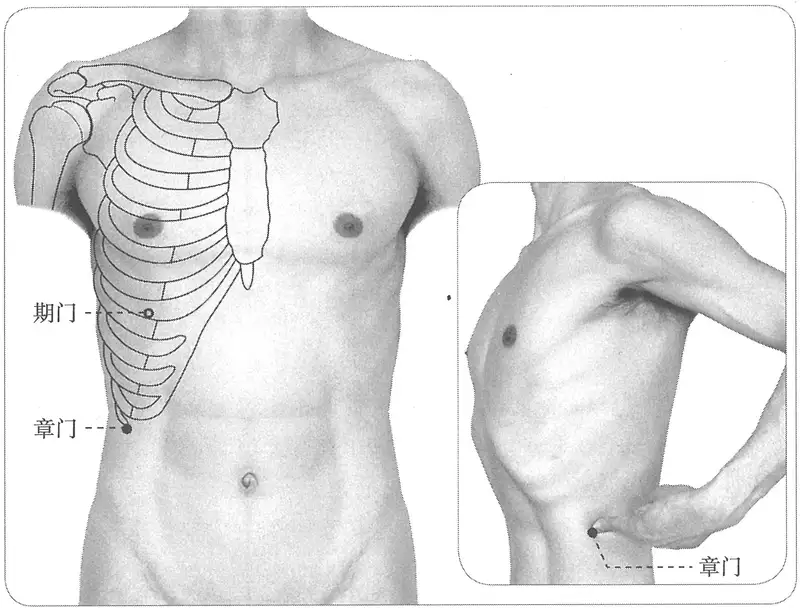

**图 2-371　章门穴图**

**取穴**：侧卧举臂，从腋前线的肋弓软骨缘下方向前触摸第11肋骨游离端，在其下际取穴。

　1. 在大横外，直脐季胁端……侧卧屈上足，伸下足，举臂取之。（《黄帝明堂经》、《太平圣惠方》、《铜人腧穴针灸图经》、《圣济总录》、《针灸资生经》、《十四经发挥》、《医学纲目》）

　2. 脏会季胁。丁曰脏会季胁，软筋之名，其端有穴，直脐，章门穴……虞曰：是章门穴……直脐，季胁端。侧卧，屈上足伸下足，齐臂取之。（《难经集注》）

　3. 长平……在夹脐相去五寸。（《千金翼方》卷二十八）

4.《难疏》脏会季胁……是胁下短肋，在脐上二寸，两旁九寸。（《针灸资生经》）

　5. 窦太师针灸遗存

　　(1) 在大横外直脐季胁端。肘向下，肘头点到处是穴。侧卧，屈上足，伸下足，举臂取之。（《窦太师针经》）

　　(2) 在胁下平脐外肋端。侧卧，屈上足，伸下足，举臂中指点耳珠，肘尖点到是穴。（《窦太师秘传》）

〔p.1202 (인쇄 1174)〕

　　(3) 穴在大横外，直季胁端。侧卧屈上足，伸下足，举臂取之。广注：侧卧，屈伸上下足，以手中指点著耳坠，取肘尖尽处。一法：脐上二寸。旁开六寸，肥人须八寸。（《循经考穴编》）

　6. 在脐上二寸，两旁各六寸。其寸用胸前两乳间横折八寸，内之六寸。侧卧，屈上足，取动脉。（《神应经》、《医学入门》）

　7. 大横外，直季胁肋端，当脐上二寸，两旁九寸，侧卧屈上足，伸下足，举臂取之。又云肘尖尽处是穴。（《针灸聚英》卷一、《古今医统》、《针方六集》）

　8. 大横外，直季胁肋端，当脐上二寸，两旁六寸。侧卧，屈上足，伸下足，举臂取之。又云：肘尖尽处是穴。（《针灸大成》卷七、《医宗金鉴·刺灸心法要诀》、《针灸易学》、《针灸逢源》）

　9. 在大横外，直脐季胁端，侧卧屈上足，伸下足，举臂取之。一云肘尖尽处是穴。一云在脐上一寸八分，两旁各八寸半季胁端。一云在脐上二寸，两旁各六寸。寸法以胸前两乳间横折八寸约取之。（《类经图翼》卷八）

　10. 按章门直季胁肋端为的，旧本章门下有“大横外”三字，误。◎章门之开中六寸，期门之开中五寸半，寸法以两乳间折为八寸取之。（《针灸逢源》）

　11. 第十一肋骨之端。（《针灸十四经穴位考订》）

　12. 统编针灸学教材

　　(1) 部位：直季胁之端。取穴：侧卧，从脐上二寸旁开六寸，屈上足，伸下足，适当十一肋软骨尖端之部取之。（1957年南京《针灸学》）

　　(2) 部位：十一肋端。取穴：侧卧，从腋窝中央直下，按取十一肋端陷中，或以臂紧挟胁肋部，于肘尖尽处取之。（1版《针灸学讲义》）

　　(3) 部位：在大横外，直脐季胁端。取穴：在侧腹部，第十一浮肋游离端之下际取之。（2版《针灸学讲义》）

　　(4) 第十一肋端。（4、5版《针灸学》）

　　(5) 在侧腹部，当第11肋游离端的下方。（6版《针灸学》）

　　(6) 第11肋游离端下际。（7版《针灸学》）

　　(7) 在侧腹部，第十一浮肋端之下际。（《中国针灸学》）

**文献分析**：本穴定位，体表标志定位法准确而明显：季肋端（第十一肋游离端）下际取穴。其折量分寸可不拘。又后世所说这简便取穴法，由于体位与姿势的不一致易产生较大出入，只能供参考，不宜直接以此定穴。

#### 【类属】 

脾之募穴。足厥阴肝经穴。

**脉气所发**：足厥阴、少阳之会。（《黄帝明堂经》）

**归经：**

　1. 足少阳。（《外台秘要》卷三十九、《黄帝内经明堂》、《素问》王冰注）

　2. 足厥阴。（《铜人腧穴针灸图经》卷上）

**按**：章门穴为“足厥阴、少阳之会”，而在侧胁部没有形成两行腧穴，故对于足厥阴、少阳交会穴，难以判定归于何经更合理。宋以后多从《铜人腧穴针灸图经》之说，归入足厥阴经。

#### 【适应症】 

主治肝脾、胃肠病症。常用于黄疸，胁痛，痞块；腹痛，腹胀，肠鸣，呕吐。

　1. 主腹中肠鸣盈盈然，食不化，胁痛不得卧，烦热，口干燥不嗜食，胸胁榰满，喘息而冲

〔p.1203 (인쇄 1175)〕

鬲，呕，心痛及伤饱，身黄，酸痟，羸瘦。腰痛不得转侧。奔肫，腹肿。腰清脊强，四肢懈堕，善怒，咳，少气郁郁然不得息，厥逆，肩不可举，马刀肿瘘，身瞤。石水。（《黄帝明堂经》）

**按**：《黄帝明堂经》载此脾之募穴主治与脾俞穴颇相近，所不同者本穴主治更多一些“腰痛”、“奔肫”、“善怒”等肝病症状。

　2. 胃胀。（《外台秘要》卷三十九）

　3. 主膀胱气，癖疝瘕气，膀胱气痛，状如雷声，积聚气。（《太平圣惠方·针经》）

　4. 腹胀如鼓，两胁积气如卵石也。（《太平圣惠方·明堂》）

　5. 治肠鸣盈盈然，食不化，胁痛不得卧，烦热口干，不嗜食，胸胁支满，喘息心痛，腰痛不得转侧，伤饱，身黄羸瘦，贲豚腹肿，脊强，四肢懈惰，善恐，少气厥逆，肩臂不举。（《铜人腧穴针灸图经》卷中）

　6. 窦太师针灸遗存

　　(1) 治脾虚不食，腹内一切虚气胀满。（《窦太师针经》）

　　(2) 治胸胁痛支满，腰背胁间痛。（《大本琼瑶神书》）

　　(3) 二便秘涩，气逆攻刺。（《循经考穴编》下）

　　(4) 治大便闭结，胁疼不得转侧。（《窦太师秘传》）

　7. 尿多，白浊。（《针灸聚英》卷一、《针灸大成》）

　8. 一传治久泻不止，癖块胀疼。（《类经图翼》卷八）

　9. 统编针灸学教材

　　(1) 主治呕吐，肠鸣腹胀，食不化，溺多白浊，腰背冷痛。（1957年南京《针灸学》）

　　(2) 主治呕吐，肠鸣腹胀，食不化，溺多白浊，胸、胁、腰、背痛。（1版《针灸学讲义》）

　　(3) 主治呕吐，泄泻，脾胃虚弱，腰背胁肋痛。（2版《针灸学讲义》）

　　(4) 主治腹胀，肠鸣，胁痛，痞块，呕吐，泄泻。（4版《针灸学》）

　　(5) 主治腹胀，泄泻，胁痛，痞块。（5版《针灸学》）

　　(6) 主治腹痛，腹胀，泄泻，胁痛，痞块。（6版《针灸学》）

　　(7) 主治①腹痛、腹胀、肠鸣、腹泻、呕吐等胃肠病证；②胁痛、黄疸、痞块（肝脾肿大）等肝脾病证。（7版《针灸学》）

　　(8) 主治胁痛，腹胀，肠鸣，呕吐，泄泻，完谷不化。（《中国针灸学》）

#### 附：临床应用举例 

　1. 肝胆胸胁病症

　　(1) 卒中风……若不识人，灸季肋头七壮。（《千金要方》卷八、《千金翼方》）

　　(2) 积聚坚满，灸脾募百壮，穴在章门季肋端。（《千金要方》卷十一、《千金翼方》）

　　(3) 狂走癫痫，灸季肋端三十壮。（《千金要方》卷十四、《千金翼方》）

　　(4) 奔豚腹肿，灸章门百壮。（《千金要方》卷十七、《千金翼方》）

　　(5) 胁肋下痛：外关、行间、中封、支沟、阳陵泉、章门、期门。问曰：此证缘何而得？答曰：因怒气伤肝血不归，故如此也。亦有伤寒胁痛者，亦有推闪胁痛不可一列取之。宜详推治之，复刺后穴：支沟、外关、章门。（《针灸集成》第三十六方）

　　(6) 吐宿汁、吞酸：章门、神光。（《医学纲目》卷二十二）

　　(7) 胸胁痛不堪：期门四分、章门六分，灸七壮至七七壮、行间、丘墟、涌泉。（《医学纲目》卷十六）

〔p.1204 (인쇄 1176)〕

　2. 脾胃病症

　　(1) 脾病，其色黄，饮食不消，腹苦胀满，体重节痛，大便不利……又当灸章门五十壮。（《千金要方》卷十五）

　　(2) 吐逆饮食却出，灸脾募百壮，三报章门穴也。（《千金要方》卷十六、《千金翼方》）

　　(3) 中焦痞满，两胁刺痛：支沟二穴、章门二穴、膻中一穴。（《针灸大全》卷四）

　　(4) 饥不能食，饮食不下，呕而雷鸣：大迎、中极、食窦。又法：期门、章门。（《医学纲目》卷二十一）

　　(5) 治肠鸣食不化，胸胁痛不得卧，积聚痞块，多灸左边；肾积，灸两边；小儿疝，灸三壮愈。（《针灸逢源》）

　　(6) 慢性腹泻：脾俞、三阴交穴、章门穴，针灸疗法。［上海针灸杂志，1984(3)：8］

　　(7) 食道癌、胃癌：章门穴、中脘穴，针刺治疗。［中国针灸，1987(2)：7-8］

　3. 其他病症

　　(1) 热病先头重颜痛，烦闷身热，热争则腰痛不可以俯仰，腹满，两颔痛甚，暴泄，善饥而不欲食，善噫，热中，足清，腹胀，食不化，善呕泄，有脓血，苦呕无所出，先取三里，后取太白、章门主之。（《针灸甲乙经》卷七）

　　(2) 治少腹坚大如盘，胸中胀，食不消，妇人瘦瘠者方……并灸胁端。（《千金要方》卷十一）

　　(3) 男子腰脊冷疼，尿多白浊，灸脾募百壮。（《千金要方》卷十九、《千金翼方》）

　　(4) 虚劳尿白浊，灸脾俞一百壮。又灸三焦俞百壮。又灸肾俞百壮。又灸章门百壮，在季肋端。（《千金要方》卷二十）

　　(5) 胞衣不出，或腹中积聚……又针章门，入一寸四分。（《千金翼方》卷二十六）

　　(6) 石水，灸然谷、气冲、四满、章门。（《千金翼方》卷二十八）

　　(7) 虚劳尿血……又灸章门百壮。（《千金翼方》卷二十八）

　　(8) 灸石水法：灸章门、然谷。（《外台秘要》卷二十）

#### 【操作】 

直刺0.8~1寸。针刺不宜过深，不宜刺向上方，以防损伤肝脏和脾脏。

　1. 刺入八分，留六呼，灸三壮。（《黄帝明堂经》）

　2. 禁针，灸二七壮。（《窦太师针经》）

　3. 针六分，灸三壮。（《针灸十四经穴位考订》）

　4. 统编针灸学教材

　　(1) 针八分至一寸，灸三至七壮。（1957年南京《针灸学》、1版《针灸学》）

　　(2) 直刺5~8分，艾条灸3~7分钟。（2版《针灸学》）

　　(3) 直刺0.8~1寸。（4、5、7版《针灸学》）

　　(4) 斜刺0.5~0.8寸；可灸。（6版《针灸学》、《中国针灸学》）

　5. 直刺或斜刺0.8~1寸。感应：侧腹部有胀感，并向腹后壁传导。灸3壮；温灸10~30分钟。注意：内部右侧肝右叶前缘，左侧当脾下方，肝脾肿大病人，不宜深刺。（上海《针灸学》）

〔p.1205 (인쇄 1177)〕

### （十四）期门 Qīmén LR14 出《黄帝明堂经》 

#### 【提要索隐】 

**部位**：在胸部，第6肋间隙，前正中线旁开4寸。

**归经**：足厥阴肝经。**按**：宋以前本穴归经有分歧。

**适应症**：主治肝脾、胸胁部病症。常用于胁下积聚、气喘，呃逆，胸胁胀痛；呕吐，腹胀，泄泻；乳痈。

**针刺操作**：斜刺或平刺。不宜深刺和直刺，以免损伤壁胸膜和肺脏。

#### 【名实考】 

期门，音、形与足太阴脾经穴“箕门”相近，古医籍中有相混之例，详见箕门穴“名实考”。

本穴定位，《黄帝明堂经》作“在第二肋端，不容旁各一寸五分，上直两乳”。所有《黄帝明堂经》传本皆序本穴于腹部第四行第一穴，特别是《黄帝内经明堂》说得更加明确。然而有一个疑问：“不容旁各一寸五分”，已经是一个很明确的定位，为何还要进一步说明“上直两乳”、“第二肋端”，特别是还要强调“举臂取之”呢？因为在不容穴旁一寸半处，无论是取穴还是针刺，都不需要“举臂”。合理的解释只有一个：此穴原本可能在手臂有碍取穴的地方。

现存所有《黄帝明堂经》传本佚文对本穴定位的描述相同，按现有的文字可给出如下的解释：乳下第二肋端，不容穴旁一寸五分。可能是这样的理解还是不很自然，后世医家给出各种各样的不同理解，特别是针灸治疗文献。

　1. 期门在乳下二肋间。（《千金要方》卷十七）

　2. 穴在第二肋端乳直下一寸半。（《千金要方》卷十三）

　3. 穴直两乳下第二肋端旁一寸五分。（《千金要方》卷十七、《千金翼方》）

　4. 第二肋间名期门。（《千金翼方》卷二十七）

　5. 期门穴在乳直下筋骨近腹处是也。（《妇人大全良方》卷六）

对于这种种分歧，明代《针灸秘法全书》给出了看似合理的解释：

　6. 足厥阴肝经期门□□□乳第二肋端。今详此穴在乳下二肋三肋之间，去中行各四寸半，若是足阳明之乳根则在直乳下第一肋端也。或有云期门在乳下一寸五分，又云在乳下四寸与巨阙平，何也？盖人之肋骨从胸斜行着胁，若以直乳下二肋端量之约三寸有余，与巨阙相为上下，以从肋循缝到穴量之不出二寸，故所疑有不同也。（明抄本《针灸秘法全书》）

　7. 期门，肝募也……足太阴、厥阴、阴维之会。（《黄帝明堂经》）

　8. 在第二肋端，不容旁各一寸五分，上直两乳，去巨阙各三寸五分。举臂取之。（《医心方》卷二）

　9. 穴名期门者，与太阴脾经、阴维相会，阴维自足少阴筑宾穴发脉，循股内廉上行入腹，既会足太阴、厥阴、少阴、阳明于府舍，而又会太阴、厥阴于此，若有所期约而然也，故曰期门。（《经穴解》）

#### 相关穴及刺激点 

　1. 肝房　位于胸部，乳头直下，策七肋骨上缘处。在乳根穴下一肋间，第七肋骨上缘。主治肝、胆、脾病。针斜向外侧沿肋间皮下刺1~1.5寸，针感局部麻、胀。（《针灸经外奇穴图谱（续集）》）

〔p.1206 (인쇄 1178)〕

　2. 肝室　位于锁骨中线，肝房穴下一肋间，第八肋骨上缘处。主治肝、胆、脾病。针斜向外侧沿肋间皮下刺1~1.5寸，针感局部麻、胀。（《针灸经外奇穴图谱（续集）》）

**按**：肝房穴相当于期门处。

#### 【定位】 

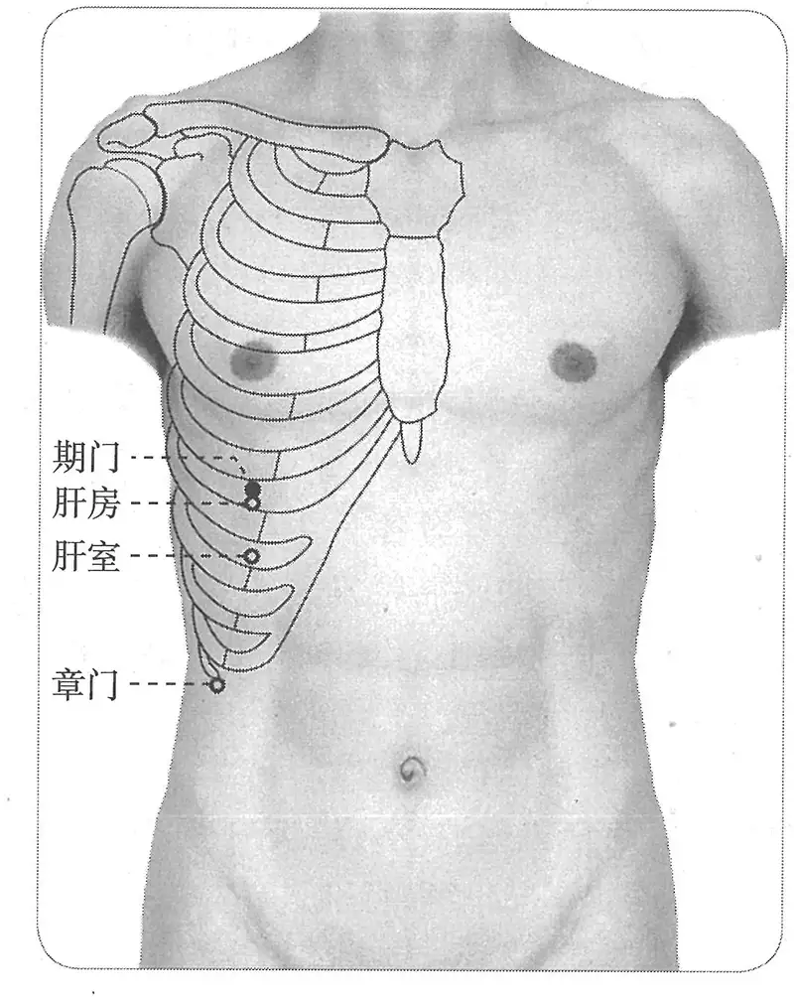

**图 2-372　期门穴与相关穴图**

**部位**：在胸部，第6肋间隙，前正中线旁开4寸（图2-372）。

**取穴**：当乳头直下，不容旁开2寸处取穴。女性在锁骨中线与第6肋间隙交点处。

　1. 在第二肋端，不容旁各一寸五分，上直两乳……举臂取之。（《黄帝明堂经》、《铜人腧穴针灸图经》、《圣济总录》、《针灸资生经》、《十四经发挥》、《针灸聚英》、《古今医统》、《医学入门》、《针灸大成》、《针方六集》、《类经图翼》、《循经考穴编》、《医宗金鉴·刺灸心法要诀》、《针灸易学》）

　2. 在第二肋端，不容旁各一寸五分，上直两乳，去巨阙各三寸五分。举臂取之。（《医心方》卷二）

　3. 窦太师针灸遗存

　　(1) 在乳下四寸，第二肋端，不容穴旁一寸五分。（《窦太师针经》）

　　(2) 在两乳下第二肋端，乳直下是穴。（《窦太师秘传》）

　　(3) 在乳根下一分即乳中直下寸半各向外第二肋端缝中。（《大本琼瑶神书》）

　　(4) 在乳下四寸第三肋端。（《针灸玉龙经》）

　　(5) 在乳旁一寸半，直下又一寸半，第二肋端缝中，其寸用胸前寸折量。（《神应经》、《针灸大成》、《循经考穴编》）

　4. 在乳旁一寸半，直下又一寸半，第二肋端缝中，平乳根穴。旧云：不容旁一寸半，误。（《针灸逢源》）

　5. 乳下约当八九肋端去中行约三寸五分。按：“期门”穴之位置，说法不一，而以不容旁一寸五分，去中行三寸半之说法较多。然因各人肋骨高低不同，似不妨因势取定，分寸勿须拘持。《针灸大成》云在乳外寸半再直下一寸，又为独特一说。（《针灸十四经穴位考订》）

　6. 统编针灸学教材

　　(1) 部位：直乳下二肋端。取穴：仰卧，直乳下二肋端，适当第六、第七肋骨之间取之。（1957年南京《针灸学》）

　　(2) 部位：乳下二肋间。取穴：平卧，从乳头直下，二肋间取之。（1版《针灸学讲义》）

　　(3) 部位：在第二肋端不容旁，各一寸五分，上直两乳。取穴：在乳中线上，乳头下二肋，当第六肋间隙取之。（2版《针灸学讲义》）

　　(4) 乳头直下，第六肋间隙。（4、5版《针灸学》，《中国针灸学》）

〔p.1207 (인쇄 1179)〕

　　(5) 在胸部，当乳头直下，第6肋间隙，前正中线旁开4寸。（6版《针灸学》）

　　(6) 乳头直下，第6肋间隙，前正中线旁开4寸。（7版《针灸学》）

**文献分析**：本穴定位，根据《黄帝明堂经》描述，直接采用体表标志定位法，折量分寸不拘：乳直第二肋间，即第六肋间隙处。

#### 【类属】 

足厥阴肝经穴。肝之募穴。

**脉气所发**：足太阴、厥阴、阴维之会。（《黄帝明堂经》）

**归经：**

　1. 足太阴脾经。（《外台秘要》卷三十九）

　2. 足厥阴肝经。（《铜人腧穴针灸图经》卷上）

**按**：期门穴为“足太阴、厥阴、阴维之会”，故宋以前归经有所不同。从该穴部位看，似与足太阴脉更相近，但该穴为肝之募穴，故宋以后多从《铜人腧穴针灸图经》之说，将该穴归属于足厥阴经。

#### 【适应症】 

主治肝脾、胸胁部病症。常用于胁下积聚、气喘，呃逆，胸胁胀痛；呕吐，腹胀，泄泻；乳痈。

　1. 主妇人产余疾，食饮不下，胸胁榰满，眩目，足寒，心切痛，善噫，闻酸臭，胀痹，腹满，少腹尤大。奔肫胁下气上下，胸中有热。目青而呕。霍乱泄注。痓，腹大坚不得息。咳，胁下积聚，喘逆，卧不安席，时寒热。心下大坚。伤食，胁下满，不能转展反侧，瘖不能言。（《黄帝明堂经》）

　2. 癃，遗尿，鼠鼷痛，小便难而白。（《外台秘要》卷三十九）

**按**：此乃《黄帝明堂经》“箕门”穴主治，王焘承袭唐代传本《针灸甲乙经》之误，将此条主治归于本穴下，另据别本《黄帝明堂经》将相同的主治归于“箕门”穴下。

　3. 治胸中烦热，贲豚上下，目青而呕，霍乱泄利，腹坚硬，大喘不得安卧，胁下积气，女子产余疾，食饮不下，胸胁支满，心中切痛，善噫。若伤寒过经不解，当针期门，使经不传。（《铜人腧穴针灸图经》卷中）

　4. 窦太师针灸遗存

　　(1) 治伤寒过经不解，胸膈胀，嗽逆气喘，两胁疼痛，看症补泻。（《窦太师针经》）

　　(2) 治伤寒气喘宜泻，胸腹胀满泻，伤寒多汗补。（《大本琼瑶神书》）

　　(3) 主肝积肥气，肾积奔豚。（《针方六集》卷五）

　　(4) 治腹内寒，胸腹膨胀，气攻心胁。（《窦太师秘传》）

　5. 男子、妇人血结胸满，面赤火燥，口干消渴，胸中痛不可忍，热入血室，男子则由阳明而伤，下血谵语，妇人月水适来，邪乘虚而入。（《针灸聚英》卷一、《针灸大成》）

　6. 统编针灸学教材

　　(1) 主治女子热入血室，伤寒过经不解，胸胁疼痛，胸满目青，呕吐酸水，饮食不下。（1957年南京《针灸学》）

　　(2) 主治女子热入血室，伤寒过经不解，胸胁痛，胸满，目青，呕吐酸水，饮食不下。（1版《针灸学讲义》）

　　(3) 主治胸胁疼痛，腹胀，胸满，呕吐，呃逆，乳痈。（2版《针灸学讲义》）

　　(4) 主治胸满腹胀，呕逆吐酸，胁下积聚。（4版《针灸学》）

　　(5) 主治胸胁胀痛，腹胀，呕吐，乳痈。（5、6版《针灸学》）

　　(6) 主治①胸胁胀痛、呕吐、吞酸、呃逆、腹胀、腹泻等肝胃病证；②奔豚气；③乳痈。（7版《针灸学》）

〔p.1208 (인쇄 1180)〕

　　(7) 主治胁痛，腹胀，呃逆，吐酸，乳痈，郁证，热病。（《中国针灸学》）

#### 附：临床应用举例 

　1. 肝脾、胸胁部病症

　　(1) 伤寒腹满而谵语寸口脉浮而紧者，此为肝乘脾，名纵，当刺期门。（《伤寒论》卷四）

　　(2) 肝病，其色青，手足拘急，胁下苦满……又当灸期门百壮。（《千金要方》卷十一）

　　(3) 胸胁满，心痛，灸期门随年壮。（《千金要方》卷十三、《千金翼方》）

　　(4) 奔豚，灸期门百壮。（《千金要方》卷十七、《千金翼方》）

　　(5) 上气咳逆，胸满短气牵背痛，灸巨阙、期门各五十壮。（《千金要方》卷十八、《千金翼方》）

　　(6) 治男子妇人血结胸，面赤大燥，口干消渴，胸中疼痛不可忍者。刺足厥阴经期门二穴。次针任脉关元一穴。若妊娠，不得刺关元穴，刺之胎死不出，子母俱亡，切须慎之。（《针经摘英集》）

　　(7) 胁肋下痛：外关、行间、中封、支沟、阳陵泉、章门、期门。问曰：此证缘何而得？答曰：因怒气伤肝血不归，故如此也。亦有伤寒胁痛者，亦有推闪胁痛不可一列取之。宜详推治之，复刺后穴：支沟、外关、章门。（《针灸集成》第三十六方）

　　(8) 饥不能食，饮食不下，呕而雷鸣：大迎、中极、食窦。又法：期门、章门。（《医学纲目》卷二十一）

　　(9) 期门罢胸满血膨而可已。（《通玄指要赋》）

　　(10) 伤寒痞结胁积痛，宜用期门见深功。（《肘后歌》）

　　(11) 急慢性胆囊炎：期门刺血为主治疗。［针灸临床杂志，1997，13(8)：41］

　2. 伤寒杂病

　　(1) 少阴脉不至，肾气微，少精血，奔气促迫，上入胸膈，宗气反聚，血结心下，阳气退下，热归阴股，与阴相动，令身不仁，此为尸厥。当刺期门、巨阙。（《伤寒论》卷一）

　　(2) 七八日热除而脉迟，胸胁满，如结胸状，谵语者，此热入血室，刺期门。（《伤寒治例》）

　　(3) 伤寒，胸腹膨胀，过经呕血泻血不止：灸期门，次针中脘，泻未愈，灸绝骨、行间，泻之；未愈，灸合谷、复溜。（《针灸集要·盘石金直刺秘传》）

　　(4) 肺喘水肿，从胸起，水白：肺俞、肝募。（《医学纲目》卷二十四）

　　(5) 过经未解病沉沉，须向期门穴上针，忽然气喘攻胸胁，三里泻之须用心。（《针灸玉龙歌》）

　　(6) 伤寒过经期门应。（《灵光赋》）

　　(7) 期门穴主伤寒患，六日过经犹未汗。（《席弘赋》）

　3. 其他病症

　　(1) 水痓口中涌水。经云肺来乘肾，食后吐水。灸肺俞，又灸三阴交，又灸期门。期门在乳下二肋间，泻肺补肾也，各随年壮。（《千金要方》卷十七、《千金翼方》）

　　(2) 心烦短气，灸小肠俞。又灸巨阙、期门各一百壮，针入五分。又灸心俞百壮，针入五分。（《千金翼方》卷二十七）

　　(3) 凡妇人病，法当刺期门，不用行子午法，恐缠脏膜引气上，但下针令病人吸五吸，停针良久，徐徐出针，此是平泻法也。（《妇人大全良方》卷六）

　　(4) 闭经-溢乳综合征：期门穴，针灸治疗。［广州中医学院学报，1991，8(2)：201-203］

#### 【操作】 

斜刺或平刺。不宜深刺和直刺，以免损伤壁胸膜和肺脏。

〔p.1209 (인쇄 1181)〕

　1. 刺入四分，灸五壮。（《黄帝明堂经》）

　2. 凡针期门，必泻勿补。可肥人二寸，瘦人寸半深也。（《妇人大全良方》卷六）

　3. 窦太师针灸遗存

　　(1) 针入一分，沿皮向外一寸半，灸三七壮。（《窦太师针经》）

　　(2) 针一分，沿皮向外寸半，灸七壮。（《窦太师秘传》）

　　(3) 针一分，沿皮向外一寸五分，先补后泻，灸二七壮。（《针灸玉龙歌》注）

　　(4) 窦氏针入二分，沿皮向外一寸半。（《针方六集》卷一）

4.《经神集》针入八分。（《循经考穴编》下）

**按**：《经神集》为明代针灸大家凌云针书中的一集，原书佚。

　5. 统编针灸学教材

　　(1) 取五分长针，刺入三分，灸三至五壮。（1957年南京《针灸学》）

　　(2) 取五分毫针，刺入三分，灸三至五壮。（1版《针灸学讲义》）

　　(3) 斜刺3分，艾条灸3~5分钟。（2版《针灸学讲义》）

　　(4) 斜刺或平刺0.5~0.8寸。（4、5版《针灸学》）

　　(5) 斜刺或平刺0.5~0.8寸，可灸。（6版《针灸学》）

　　(6) 斜刺或平刺0.5~0.8寸，不可深刺，以免伤及内脏。（7版《针灸学》）

　　(7) 斜刺0.3~0.5寸。可灸。（《中国针灸学》）

　6. 斜刺0.5寸。感应：微痛有时向腹后壁放散。灸5壮；温灸5~15分钟。（上海《针灸学》）

### 延伸阅读 

　1. 黄龙祥．中国针灸学术史大纲［M］．北京：华夏出版社，2001.

　2. 黄龙祥．新编重绘十四经脉经穴图［M］．北京：中国中医药出版社，2010.

　3. 黄龙祥，黄幼民．元代珍稀针灸三种［M］．北京：人民卫生出版社，2008.

　4. 黄龙祥．从“厥阴脉”概念的形成过程看经络学说的意义与价值［J］．针刺研究，2003，28(4)：280-287.

　5. 张善忱．对几个经穴定位之我见［J］．山东中医学院学报，1982，6(1)：48-56.

〔p.1210 (인쇄 1182)〕

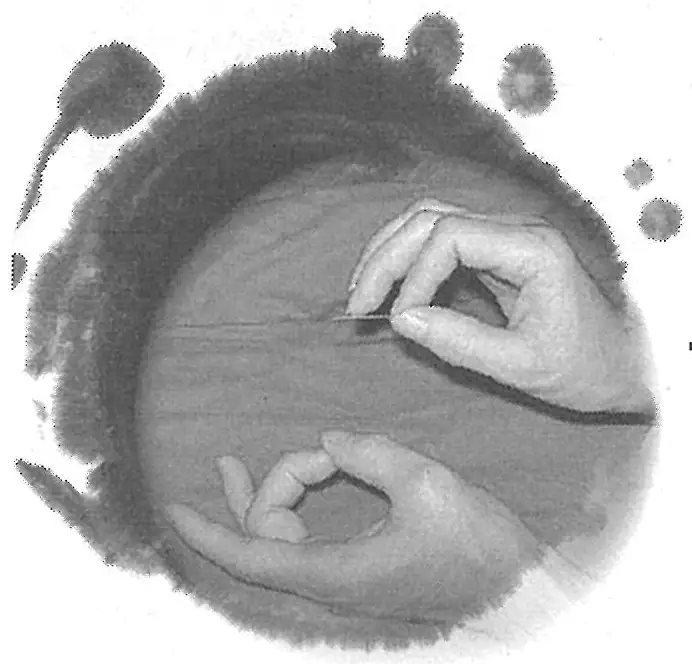

