# 《针灸腧穴通考》(下册) — 督脉穴 (1/2) · （一）长强 Chángqiáng GV1 出《素问》、《灵枢》~（十五）哑门 Yǎmén GV15 出《素问》

> 분할본 21/25. 원서: 黄龙祥·黄幼民 编著, 《针灸腧穴通考——〈中华针灸穴典〉研究》(下册), 人民卫生出版社, 2011. 원서 스캔 OCR 판독본을 챗봇 검색용으로 나눈 것이며, 본문과 쪽 표시 〔p.PDF쪽 (인쇄 쪽)〕는 원본 그대로이다.

## 十三、督脉穴 

### 概说 

关于督脉循行、病候的论述，《内经》散见于诸篇，且不完整和统一，需要参考《难经》、《脉经》之文，才能看清完整的面目；

关于督脉穴定位，影响最大的变动在于前后发际的“神庭”、“哑门”二穴，此二穴定位的改变对于整个头部穴的定位都产生了连带影响。与督脉穴定位关系最大的关键问题，在于对“大椎”的理解；

关于督脉穴的归经，分歧较大，现行的督脉二十八穴一直到明代《类经图翼》中才确立。

#### 【督脉循行与病候】 

关于督脉循行，散见于诸书，较为完整的记载见于《难经》的早期传本“督脉者，起于下极之俞，并于脊里，上至风府”，而传世本《针灸甲乙经》卷二引《八十一难》曰：“督脉者，起于下极之俞，并于脊里，上至风府，入属于脑，上巅循额至鼻柱”。其中续添文字已见于《素问·骨空论》和《灵枢·营气》，当有所本，今从之。又《灵枢·经脉》谓督脉之别“夹膂上项，散头上，下当肩胛左右，别走太阳，入贯膂”，与《素问·骨空论》“别下项，循肩髆内，夹脊抵腰中”相合，今补之。并按统一的循行方向，及干、支关系，形成一个统一、完整的描述。

**新校正文字**：督脉者，起于下极之俞，并于脊里，上至风府，入属于脑；其直者，从项中上巅，循额，至鼻柱；其别者，当肩胛左右，别走太阳，入贯膂。（综合《内经》、《难经》、《针灸甲乙经》之文）

**督脉病候**：脊强反折；大人癫，小儿痫。（《素问·骨空论》、《脉经》）

**按**：《素问》载督脉病候中无头部病症，提示此病候原本是针对《难经》所载之督脉而言。根据督脉之络的病候，应当有头部的病候，此从《脉经》督脉病候补辑，以与督脉循行相应。

**所属经穴**：龈交　兑端　水沟　素髎　神庭　上星　囟会　前顶　百会　后顶　强间　脑户　风府　哑门　大椎　陶道　身柱　神道　灵台　至阳　筋缩　中枢　脊中　悬枢　命门　腰阳关　腰俞　长强　印堂

#### 【归经与起止穴】 

唐代《外台秘要》附于足太阳经穴下督脉穴二十二穴：素髎、神庭、上星、囟会、前顶、百会；后顶、强间、脑户、风府、哑门；大椎、陶道、身柱、神道、至阳、筋缩、脊中、悬枢、命门、腰俞、长强。

〔p.1211 (인쇄 1183)〕

宋代《铜人腧穴针灸图经》在此基础上增加五穴：水沟、兑端、龈交、灵台、阳关。

明代《医经小学》、《针灸问对》、《经穴指掌图》增加“接脊”一穴，共二十八穴，与《素问·气府论》督脉气所发二十八穴之数合；

明代《经穴指掌图》又增“中枢”一穴，凡二十九穴；

明代《类经图翼》去“接脊”，增“中枢”，重定督脉二十八穴，后经清代官修医典《医宗金鉴》的传播，张氏之说被普遍接受。

需要说明的是，督脉之穴，宋以前文献或归于奇经八脉，或附于足太阳经脉，宋代王惟一虽然于督脉下辑入27穴，然却分“鼻柱下”、“额上行”、“顶后至项”、“背脊下”4部排列，各部之穴次序不相接续，因此严格说来还算不上归经。《铜人腧穴针灸图经》上卷收录了王冰《素问》注中的2个穴，是因为该卷编者在前代文献中特别注重王冰之说，但下卷“都数”的编者就不那么看重王冰说，“阳关”一穴干脆就没有收录。之后的《圣济总录》督脉穴与《铜人腧穴针灸图经》上卷同，只是增加了一段归经的说明：

上自素髎至龈交四穴，系鼻柱下，神庭至百会五穴，系额上，后顶至哑门五穴，属顶后至项，大椎以下一十二穴，属背脊，以上为督脉所发二十七穴按内经督脉所发者，二十八穴，据法第十椎下一穴名中枢，阴尾尻骨两旁二穴，名会阳，共有二十九穴，今多龈交一穴，少中枢一穴，会阳二穴，则系督脉别络，与少阴会，故只载二十七穴。（《圣济总录》）

值得注意的是，这里说没有收录“会阳”穴的理由是：此穴为“督脉别络与少阴会”，然而包括《圣济总录》在内的所有腧穴文献都谓该穴为“督脉气所发”，即便是“督脉别络与少阴会”，那也最多是归入足少阴经，为何却归入足太阳经呢？

另一个值得思考的问题是：阳关一穴，虽然早在宋代就归入督脉，但主治阙如，后世文献虽有补辑，但皆系错录自“膝阳关”穴主治。灵台与中枢二穴的主治后世虽补辑有主治，但经考证皆有疑问，一个缺少主治病症的穴收入腧穴书并被归经，在古人是为了凑足某个特定的数（对督脉而言，为“二十八穴”；对整个经穴而言，或为“三百六十五”），那么对今人而言，其意义又何在？建议针灸穴典中暂不收录此三穴，等临床积累足够多可靠的经验后，再考虑纳入穴典。

#### 【经穴定位与主治】 

督脉穴定位演变中有两个穴和一个关键问题：即“大椎”的理解、前后发际的“神庭”和“哑门”定位的变化。经考证，古代文献所述之“大椎”是指第一胸椎，而不是我们以往所理解的第七颈椎。

前后发际处腧穴部位的改变是由“神庭”、“哑门”二穴部位的变动所引起的。此二穴原在前后发际正中，宋代王惟一编《铜人腧穴针灸图经》时，正式将此二穴定于前后发际上五分处，宋以后医书皆从之，所有以此二穴为基准的腧穴部位也随之而变动。那么，为什么王惟一要将此二穴的定位加以修订呢？这有一个长期的演变过程。首先，对于“发际”的理解不尽相同。敦煌卷子佚名灸方称“神庭”穴为“发际”，《医心方》卷二引《黄帝内经太素》注云：“发际在上星下一寸，毛内之”。故神庭穴部位便由原《黄帝明堂经》“在发际”变作“入发际”（《千金要方》卷十四）、“入发际二分许”（《千金要方》卷五）、“入发际三分”（《太平圣惠方·明堂》）、“入发际五分”（《太平圣惠方》卷五十五）。王惟一即采纳了《太平圣惠方》卷五十五的定位法。同样，对于后发际的理解也不一致。例如《小品方》曰：“风府一穴在项后发际下小入发中（转引自《医心方》卷十六）；《千金要方》卷五则谓“风府当项中央发际，亦可与风池三处高下相等”。而《黄帝明堂经》谓风府“入发际一寸”，风池穴“在后发际陷中”，则对后发际以上一寸宽处均理解为“发际”。故《太平圣惠方·明堂》风池下曰：“如后发际亦有项脚长者，其毛直至头骨；亦有无项脚者，毛齐至天牖穴，穴无毛根，何而取穴也？答曰，其毛不可辄定，大约如此，若的的定，中（风）府正相当，即是侧相去二寸，此之定穴。”此外，《铜人腧穴针灸图经·修明堂诀式》载前后发际之间的分寸与《灵枢·骨度》不同，这也许是王惟一将“神庭”、“哑门”二穴定于前后发际上半寸的重要因素。了解这一变化，有助于准确理解宋代前后的针灸方。

〔p.1212 (인쇄 1184)〕

#### 【诊络病候、络脉病候与络穴主治】 

督脉之别，名曰长强，夹膂上项，散头上，下当肩胛左右，别走太阳，入贯膂。实则脊强，虚则头重，高摇之，夹脊之有过者，取之所别也。（《灵枢·经脉》

长强，一名气之阴郄，督脉别络。在脊骶端，少阴所结。刺入二寸，留七呼，灸三壮。主痓，反折，心痛，形气短，尻月直清，小便黄闭。寒热。腰痛上寒，实则脊急强。癫疾发如狂，面皮敦敦厚者，不治；虚则头重，洞泄，癃，痔，大小便难，腰尻重，难起居。小儿惊痫，瘛疭，脊强互相引。（《黄帝明堂经》）

督脉之络病候悉见于《黄帝明堂经》督脉络穴长强主治中，有着明显的同源关系。

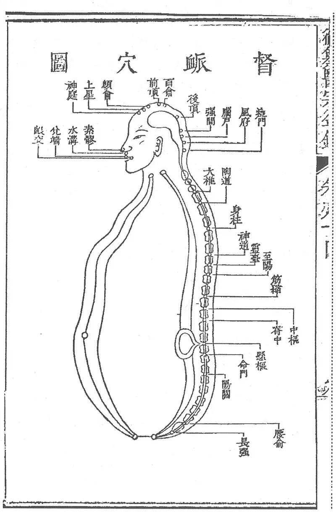

**图 2-373　《医宗金鉴》督脉穴图**

〔p.1213 (인쇄 1185)〕

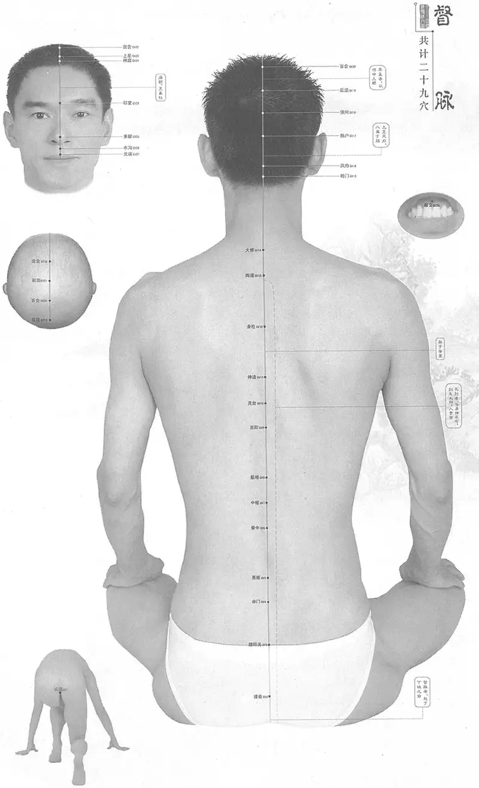

**图 2-374　黄龙祥编督脉、经穴合图**

〔p.1214 (인쇄 1186)〕

### （一）长强 Chángqiáng GV1 出《素问》、《灵枢》 

#### 【提要索隐】 

“长强”之名虽未见于《内经》，而长强穴已见于《素问》、《灵枢》。

**穴名**：一名气之阴郄。

**部位**：在会阴区，尾骨下方，尾骨端与肛门连线的中点处。

**适应症**：主治肛肠部、督脉病症。常用于泄泻，便秘，便血，痔疮，脱肛；癫狂，小儿惊风；腰脊、尾骶部痛。

**针刺操作**：紧靠尾骨前面斜刺0.8~1寸，不宜直刺，以免伤及直肠。

#### 【名实考】 

本穴在脊骶端，骶骨又名穷骨、撅骨、阴尾骨、龟尾、尾翠骨、尾闾骨。日本针灸教材皆归入本穴别名。

　1. 督脉气所发者二十八穴……大椎以下至尻尾及旁十五穴。至骶下凡二十一节，脊椎法也。（《素问·气府论》）

　2. 治癫疾者……灸穷骨二十壮。穷骨者，骶骨也。（《灵枢·癫狂》）

　3. 狂而新发，未应如此者，先取曲泉左右动脉，及盛者见血，有顷已，不已，以法取之，灸骨骶二十壮。（《灵枢·癫狂》）

　4. 杨上善曰督脉诸阳脉长，其气强盛，穴居其处，故曰长强也。（《黄帝内经太素·十五络脉》）

　5. 长强，一名气之阴郄，督脉别络。在脊骶端，少阴所结。（《黄帝明堂经》）

　6. 身长之骨，莫过于脊骨，故曰长，而此穴正当其下最锐处，故曰强。又为足少阴肾、足少阳胆会督脉之处。（《经穴解》）

　7. 别名　龟尾、尾骨下空、橛骨、尾闾、尾蛆骨、骶骨、穷骨、为之、阴郄、龙虎穴、曹溪路、三分间、河车路、名朝天岭、上天梯、气三阴郄、气郄、骶上、骨骶、尾翠骨、脊骶骨、龟尾长疆。（1957年南京《针灸学》）

**按**：此皆传自日本针灸教材，后者将骶骨之别名以及从《东医宝鉴》转引之道家术语皆作为“长强”穴别名。

#### 相关穴及刺激点 

回气穴：五痔便血失屎，灸回气百壮，在脊穷骨上。（《千金翼方》卷二十七）

**按**：《千金翼方》卷二十八、《太平圣惠方·针经》、《太平圣惠方·明堂》载“长强”穴主治并与此同。

#### 【定位】 

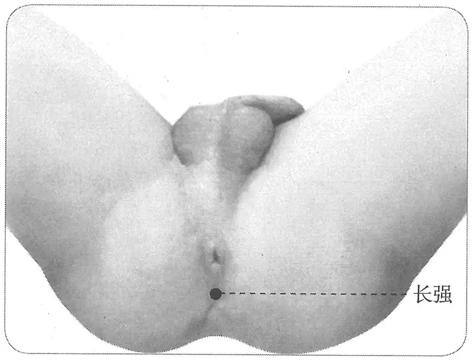

**图 2-375　长强穴图**

**部位**：在会阴区，尾骨下方，尾骨端与肛门连线的中点处（图2-375）。

**取穴**：病人取俯卧位或膝胸位，于尾骨尖端与肛门之中点取之。

　1. 在脊骶端。（《黄帝明堂经》、《太平圣惠方》、《铜人腧穴针灸图经》卷上、《圣济总录》、《针灸资生经》、《十四经发挥》、《医学纲目》、《循

〔p.1215 (인쇄 1187)〕

经考穴编》）

　2. 在穷骨下宛宛中。伏地取之。（《千金翼方》卷二十八、《太平圣惠方·针经》）

　3. 在腰俞下脊骶端陷者中。（《太平圣惠方·明堂》）

　4. 在脊骶端。计三分。（《针灸资生经》卷一。

**按**：“计三分”系“针三分”之误。

　5. 窦太师针灸遗存

　　(1) 在背部尾闾骨尖脊底端。（《窦太师针经》）

　　(2) 在尾闾骨尖是穴。（《针方六集》卷一）

　　(3) 在二十一椎骨尖尾闾骨是穴。（《窦太师秘传》）

　　(4) 在尾闾脊骶骨尖。（《大本琼瑶神书》）

　　(5) 在背部尾闾骨尖脊底端。（《循经考穴编》下）

　6. 脊骶骨端计三分，伏地取之乃得。（《针灸聚英》卷一、《古今医统》、《针灸大成》、《针灸易学》、《针灸逢源》）

　7. 背脊骶尾骨下陷中，趺坐地上取之。（《医学入门》）

　8. 尾骶骨端下陷中。（《针灸十四经穴位考订》）

　9. 统编针灸学教材

　　(1) 部位：脊骶骨端五分处。取穴：伏卧，按取尾闾骨下端与肛门之间凹陷中取之。（1957年南京《针灸学》）

　　(2) 部位：尾闾骨端下五分处。取穴：伏卧，按取尾闾骨下端与肛门之间凹陷中取之。（1版《针灸学讲义》）

　　(3) 部位：在脊骶端。取穴：俯卧，于尾骨尖端与肛门之中点取之。（2版《针灸学讲义》）

　　(4) 尾骨尖下0.5寸。（4版《针灸学》）

　　(5) 尾骨尖下0.5寸，约当尾骨尖端与肛门的中点。（5版《针灸学》）

　　(6) 在尾骨端下，当尾骨端与肛门连线的中点处。（6版《针灸学》）

　　(7) 跪伏或胸膝位，当尾骨尖端与肛门连线的中点处。（7版《针灸学》）

　　(8) 尾骨尖端与肛门之间的中点，伏卧取之。（《中国针灸学》）

**文献分析**：本穴在尾骨尖下凹陷处取穴，分寸不拘。《千金翼方》所载之取穴法与臀膝位相当，《医学入门》作“趺坐地上取之”，传写之误。《针灸聚英》“计三分”系断句失误。

#### 【类属】 

督脉络穴。

**脉气所发：**

　1. 督脉别络。少阴所结。（《针灸甲乙经》卷三、《外台秘要》）

　2. 督脉别络，少阴二脉所结。（《素问·气府论》王冰注）

　3. 督脉络别。足少阴、少阳所结会。（《铜人腧穴针灸图经》卷中）

**按**：《素问·骨空论》言督脉与足少阴、足太阳会，而与少阳不会。

**归经**：督脉。（《外台秘要》卷三十九、《铜人腧穴针灸图经》卷上）

#### 【适应症】 

主治肛肠部、督脉病症。常用于泄泻，便秘，便血，痔疮，脱肛；癫狂、小儿惊风，腰脊、尾骶部痛。

　1. 实则脊强，虚则头重，高摇之，夹脊之有过者，取之所别也。（《灵枢·经脉》）

　2. 主腰痛上寒，实则脊急强。癫疾发如狂，面皮敦敦厚者，不治；虚则头重，洞泄，癃痔，大小便难，腰尻重，难起居。寒热。痓，反折，心痛，形气短，尻脽清，小便黄闭。小儿惊痫，瘛疭，脊强互相引。（《黄帝明堂经》）

〔p.1216 (인쇄 1188)〕

　3. 主淋癃。（《千金要方》卷三十）

　4. 主下漏五痔，甘虫食下部。（《千金翼方》卷二十八、《太平圣惠方·针经》）

　5. 主五淋久痔。（《太平圣惠方·明堂》）

　6. 治肠风下血，五种痔，疳蚀下部。（《铜人腧穴针灸图经》卷中）

　7. 窦太师针灸遗存

　　(1) 治九般痔漏，便血，藏毒，小便不通。（《窦太师针经》）

　　(2) 治九般痔漏，脏毒，腰偻脊痛。（《针方六集》卷五）

　　(3) 主肠风脏毒，尸痨。（《循经考穴编》下）

　　(4) 治肠风痔漏下血等症。（《窦太师秘传》）

　8. 主小儿囟陷，惊痫瘛疭，呕血，惊恐失精，瞻视不正。（《针灸聚英》卷一、《针灸大成》）

　9. 统编针灸学教材

　　(1) 肠风下血，洞泄，大小便难，痔漏，五淋，失精，腰脊痛，癫狂。（1957年南京《针灸学》、1版《针灸学讲义》）

　　(2) 便血，脱肛，泄泻，便秘，痔疾，腰脊痛。（2版《针灸学讲义》、4版《针灸学》）

　　(3) 泄泻，便血，便秘，痔疾，脱肛，癫狂痫。（5版《针灸学》）

　　(4) 泄泻，便血，便秘，痔疾，脱肛，癫狂痫，腰脊和尾骶部疼痛。（6版《针灸学》）

　　(5) ①腹泻、痢疾、便血、便秘、痔疮、脱肛等肠腑病证；②癫狂痫；③腰脊和尾骶部疼痛。（7版《针灸学》）

　　(6) 泄泻，便血，痔疾，脱肛，便秘，腰脊痛，痫证。（《中国针灸学》）

**文献分析**：督脉在循行及主病方面与足太阳经皆密切相关，其主病以“脊强反折，癫疾”等脑、髓病症为主，别主“癃、痔、遗溺”等二阴病症。而《黄帝明堂经》督脉络穴“长强”主治正反映了督脉的主病特点。至初唐本穴的主治更偏于主前后二阴，特别是后阴的病症，并有相应的临床应用的经验，现代针灸学教材反映了这一转变的特点。

《针灸聚英》“小儿囟陷，惊痫瘛疭，呕血，惊恐失精，瞻视不正”条，系从《针灸资生经》转录《千金要方》主治，后者原文作“瘈脉、长强主小儿惊痫、瘛疭、呕吐、泄注、惊恐、失精、瞻视不明”，据《千金要方》卷三十“孔穴主对法”体例，多穴主治条文为多穴中第一穴主治原文，此条即是录自《黄帝明堂经》瘈脉穴主治原文。

#### 附：临床应用举例 

　1. 肛肠病症

　　(1) 小儿脱肛方：灸顶上旋毛中三壮，即入。又灸尾翠骨三壮。（《千金要方》卷五下）

　　(2) 赤白下痢，灸穷骨，以灸数多为佳。（《千金要方》卷十五）

　　(3) 脱肛历年不愈，灸横骨百壮。又灸龟尾七壮。龟尾即后穷骨是也。（《千金要方》卷二十四）

　　(4) 岐伯灸法：疗小儿脱肛泻血，秋深不较。灸龟尾一壮，炷如小麦大，脊端穷骨也。（《太平圣惠方》卷一百）

　　(5) 脱肛，肠风痔漏：灸百劳、承浆，补长强。（《针灸集要·盘石金直刺秘传》）

　　(6) 九般痔疾最伤人，穴在承山妙入神，纵饶大痛呻吟者，一刺长强绝病根。（《针灸玉龙歌》）

〔p.1217 (인쇄 1189)〕

　　(7) 慢性结肠炎：长强穴，针刺治疗。［湖北中医杂志，1986(4):40］

　　(8) 直肠脱垂：长强穴、大肠俞，针刺治疗。［内蒙古中医药，1987(4):41］

　　(9) 习惯性便秘：深刺长强穴治疗。［中国针灸，1994(增刊):231］

　　(10) 婴幼儿腹泻：长强穴温和灸治疗。［中国针灸，1996(11):55］

　2. 癫、痫

　　(1) 治癫疾者，常与之居，察其所当取之处。病至，视之有过者泻之，置其血于瓠壶之中，至其发时，血独动矣，不动，灸穷骨二十壮。穷骨者，骶骨也。（《灵枢·癫狂》）

　　(2) 小儿癫痫瘛疭，脊强互相引，灸长强穴三十壮，在脊底端伏地取之乃得。（《卫生宝鉴》卷十九）

　3. 其他病症

　　(1) 大杼若连长强寻，气滞腰疼不能立。（《席弘赋》）

　　(2) 阴囊瘙痒：长强穴、会阴穴，针刺治疗。［福建中医药，1985，16(4):51］

　　(3) 继发性闭经：针刺长强穴治疗。［中国针灸，1986，6(3):56］

#### 【操作】 

紧靠尾骨前面斜刺0.8~1寸，不宜直刺，以免伤及直肠。

　1. 刺入二寸，留七呼，灸三壮。（《黄帝明堂经》）

　2. 刺入二分，留七呼，灸三壮。（《素问·水热穴》王冰注）

　3. 针入三寸，伏地取之，以大痛为度，灸亦良，不及针，灸日三十壮，至七日止。（《千金翼方》卷二十八）

　4. 灸五壮。（《太平圣惠方·明堂》）

　5. 窦太师针灸遗存

　　(1) 针入三分，大痛无喜是穴。灸二七壮。治九般痔漏便血，藏毒，小便不通。先补后泻。（《窦太师针经》）

　　(2) 针一寸，大痛方是穴，灸二七壮，泻之。（《针灸玉龙歌》注）

　6. 针三至五分，灸五壮。（《针灸十四经穴位考订》）

　7. 统编针灸学教材

　　(1) 针五分至一寸，依取穴法进针，灸三至十五壮。（1957年南京《针灸学》、1版《针灸学讲义》）

　　(2) 直刺5~10分，艾条灸3~5分钟。（2版《针灸学讲义》）

　　(3) 紧靠尾骨前面斜刺0.8~1.2寸。直刺易伤直肠。（4、5版《针灸学》）

　　(4) 斜刺，针尖向上与骶骨平行刺入0.5~1寸，不得刺穿直肠，以防感染；不灸。（6版《针灸学》）

　　(5) 紧靠尾骨前面斜刺0.8~1寸；不宜直刺，以免伤及直肠。（7版《针灸学》）

　　(6) 直刺0.5~1寸。可灸。（《中国针灸学》）

　8. ①沿尾骨与直肠之间直刺0.5~1寸，进针宜缓慢，得气后，用捻转补泻，局部酸胀可扩散至肛门，治疗便血、痔疾、脱肛。②斜刺：针尖向上与骶骨平行刺入0.5~1寸，得气后用提插补泻，使针感向肛门扩散，治疗腰脊及尾骶部疼痛。注意：针尖前邻直肠，后邻骶尾骨，针刺时应避免针尖朝前刺入，以防刺入直肠，引起感染。若发生感染，将导致严重后果。

〔p.1218 (인쇄 1190)〕

### （二）腰俞 Yāoshū GV2 出《素问》 

#### 【提要索隐】 

**穴名**：一名背解，一名髓空，一名腰注，一名腰户。

**定位**：在骶区，正对骶管裂孔，后正中线上。

**适应症**：主治局部、妇科病症。常用于腰背痛；月经不调；下肢痿痹。

**针刺操作**：向上斜刺0.5~1寸。

#### 【名实考】 

腰俞，《千金要方》、《医心方》作“腰输”；《铜人腧穴针灸图经》作“腰腧”。

《素问·骨空论》曰：“脊骨下空，在尻骨下空”，本穴正当此尻骨下空处（骶管裂孔），故名“腰俞”（腰之下孔也），又名“髓空”（“髓孔”同）；王冰曰：“腰尻骨间曰解，当中有腰俞”，故又名“背解”，义即骶尾关节，犹如“肩解”表肩关节之义也；头之髓空曰“脑户”，腰之髓空曰“腰户”；脊骨下空，乃腰髓所注处，故名“腰注”，与“空”（孔）、“解”、“户”皆合，或作“腰柱”者（如《医心方》、《铜人腧穴针灸图经》），皆失本义。后人不辨，又以《铜人腧穴针灸图经》之文妄改古书（如明刊本《外台秘要》即被改作“腰柱”）。

本穴的穴名向我们透露了两个重要信息：第一，虽然腧穴定位主要依据活体的观察与触诊，但早期也有过尸体解剖（或许当时的目的不是为定穴用）；第二，《黄帝明堂经》所收录的穴位别名，是不同时间、不同地域的医家，从不同角度，对共同发现，或分别发现的同一穴的不同命名。

　1. 脊骨下空，在尻骨下空。（《素问·骨空论》）

　2. 腰痛引少腹控眇，不可以仰，刺腰尻交者，两髁胂上，以月生死为痏数，发针立已，左取右，右取左。（《素问·刺腰痛》）

　3. 邪客于足太阴之络，令人腰痛，引少腹控眇，不可以仰息，刺腰尻之解，两胂之上，是腰俞，以月死生为痏数，发针立已，左刺右，右刺左。（《素问·缪刺论》）

**按**：此条较《素问·刺腰痛》多“是腰俞”三字，《针灸甲乙经》同，林亿新校正谓全元起本无此三字，《黄帝内经太素》也无。今核查《黄帝明堂经》腰俞穴下的确辑录有该条主治病症，说明其所据版本也有“是腰俞”三字。

　4. 腰俞，一名背解，一名髓空，一名腰注，一名腰户，在第二十一椎节下间，督脉气所发。（《黄帝明堂经》）

　5. 穴名腰腧者，腰中至要之穴也，再合其四名之义而思之，则此穴更可知也。二十一椎之下，椎尽矣，背解者，脊之上通于背者至此而尽，故曰背解。脑为髓海，而脊通之，至此而下输，故曰髓孔。此椎下接于横骨，犹柱之立于壁也，故曰腰柱。风寒湿由此穴而入，遂成腰痛之症，故曰腰户。而图以腰腧名之，尽概上四名之义，故曰至要之穴也。（《经穴解》）

　6. 别名　背鲜、髓俞、髓府。（1957年南京《针灸学》）

**按**：此传自日本针灸教材，其中“背鲜”出《针灸大全》，系“背解”之形误，其另一传本《杨敬斋针灸全书》无误；“髓俞”也出自《针灸大全》，《针灸大成》又引作“髓府”，与四满穴的别名相重，皆未详其所据，不作本穴别名。

#### 【定位】 

**部位**：在骶区，正对骶管裂孔，后正中线上（图2-376）。

**取穴**：在臀裂正上方的小凹陷即骶管裂孔中，俯卧取之。

〔p.1219 (인쇄 1191)〕

　1. 《黄帝明堂经》佚文

　　(1) 在第二十一椎节下间。（《针灸甲乙经》卷三、《千金要方》、《外台秘要》、《素问》王冰注、《医心方》、《太平圣惠方·明堂》、《铜人腧穴针灸图经》卷上及卷下“都数”、《圣济总录》、《窦太师针经》、《十四经发挥》、《医学纲目》、《针灸聚英》、《古今医统》、《医学入门》、《针灸大成》、《类经图翼》、《针灸易学》、《针灸逢源》）

　　(2) 在第二十一椎下节间。（《千金要方》卷二十九、《千金翼方》）

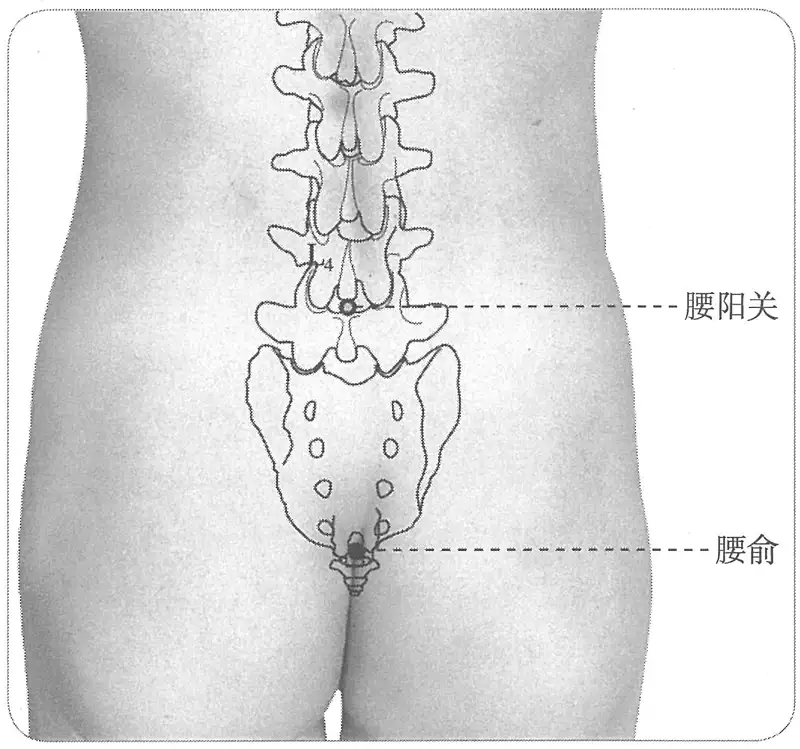

**图2-376　腰俞穴图**

　2. 在第二十一椎节下陷者宛宛中是穴，挺腹地，舒身，两手相重支额，纵四体，然后乃取其穴。（《太平圣惠方·针经》、《铜人腧穴针灸图经》卷中、《针灸资生经》）

　3. 尾骶骨上，二十一椎之下。（《针灸十四经穴位考订》）

　4. 统编针灸学教材

　　(1) 部位：第二十一椎宛宛中。取穴：伏卧，按取荐骨第四腰椎下取之。（1957年南京《针灸学》）

　　(2) 部位：第二十一椎下。取穴：伏卧，按取尾间骨与骶骨结合处，与下髎平陷中取之。（1版《针灸学讲义》）

　　(3) 部位：在第二十一椎节下间。取穴：第四骶椎下，骶管裂孔中，俯卧取之。（2版《针灸学讲义》）

　　(4) 当骶管裂孔处。（4、5、7版《针灸学》，《中国针灸学》）

　　(5) 在骶部，当后正中线上，适对骶管裂孔。（6版《针灸学》）

#### 【类属】 

督脉穴。

督脉气所发。（《黄帝明堂经》）

#### 【适应症】 

主治局部、妇科病症。常用于腰背痛；月经不调；下肢痿痹。全子宫切除术、剖宫产手术的针麻用穴。

　1. 主腰痛引少腹控眇，不可俛仰。腰已下至足清不仁，不可以坐起，尻不举。寒热。女子闭溺，脊强互引反折，汗不出。乳子下赤白。（《黄帝明堂经》）

**按**：“腰痛引少腹控眇，不可俛仰”为阴疝的典型症状，分别见于《素问·刺腰痛》、《素问·缪刺论》。

　2. 主腰髋疼，腰脊强不得回转，温疟，痎疟。（《太平圣惠方·针经》、《铜人腧穴针灸图经》卷中）

　3. 主伤寒四肢热不已。妇人月水闭，尿赤。（《针灸聚英》卷一、《针灸大成》）

**按**：“伤寒四肢热不已”辑自《针经摘英集》针灸方主治，详见“附：临床应用举例”；“妇人月水闭，尿赤”乃从《针灸资生经》辑自《千金要方》，原文作“月闭，溺赤”，源自《黄帝明堂经》“女子闭溺”，本指妇人尿闭，非指闭经。

〔p.1220 (인쇄 1192)〕

　4. 主治腰脊重痛，不得俯仰举动，腰以下至足冷痹不仁，强急不能坐卧，灸随年壮，温疟汗不出，妇人经闭溺赤，灸后忌房劳强力。（《类经图翼》卷八）

　5. 主一切腰痛，脊膂强疼，淋浊尿赤，妇人月病。（《循经考穴编》下）

　6. 统编针灸学教材

　　(1) 月经不调，淋浊，腰脊强痛，温疟汗不出。（1957年南京《针灸学》、1版《针灸学讲义》）

　　(2) 月经不调，腰脊强痛，痔疾，下肢痿痹。（2版《针灸学讲义》、4版《针灸学》）

　　(3) 月经不调，痔疾，腰脊强痛，下肢痿痹，癫痫。（5、6版《针灸学》，《中国针灸学》）

　　(4) ①腹泻、痢疾、便血、便秘、痔疮、脱肛等肠腑病证；②月经不调、经闭等月经病；③腰脊强痛，下肢痿痹；④痫证。（7版《针灸学》）

**文献分析**：教材中“腹泻，痢疾、便血，便秘，痔疮，脱肛”诸症未详所出，疑将前一穴“长强”主治误置于此。

#### 附：临床应用举例 

　1. 寒湿腰痛，灸腰俞穴五十壮。（《扁鹊心书》卷上）

　2. 腰痛，肾俞二穴、中膂俞二穴、腰俞一穴，各灸五壮。（《卫生宝鉴》卷十五）

　3. 治伤寒四肢热不已，泻手太阴经云门二穴，次针手阳明经肩髃二穴，次太阳经委中二穴。次督脉腰俞一穴。（《针经摘英集》）

　4. 虚损湿滞，腰痛行动无力，脊中一穴、腰俞一穴、肾俞二穴、委中二穴。（《针灸大全》卷四）

　5. 腰背强，不可俯仰，腰俞一穴、膏肓二穴、委中二穴决紫脉出血。（《针灸大全》卷四）

　6. 尿失禁，针刺腰俞穴治愈。［吉林中医药，1999(3):40］

#### 【操作】 

向上斜刺0.5~1寸。

　1. 刺入二寸，留七呼，灸三壮。（《黄帝明堂经》）

　2. 针入八分，留三呼，泻五吸，灸亦得，日灸七壮至七七壮止。（《太平圣惠方·针经》）

　3. 针三分，灸五壮。（《针灸十四经穴位考订》）

　4. 统编针灸学教材

　　(1) 针五分，针尖斜向上而进，灸三至十五壮。（1957年南京《针灸学》、1版《针灸学讲义》）

　　(2) 向上斜刺5分，艾条灸5~10分钟。（2版《针灸学讲义》）

　　(3) 向上斜刺0.5~1寸。（4、5、7版《针灸学》）

　　(4) 向上斜刺0.5~1寸；可灸。（6版《针灸学》、《中国针灸学》）

　5. 沿尾骨和直肠之间直刺0.5~1寸。感应局部酸胀，可扩散至肛门。灸3~7壮；温灸5~15分钟。（上海《针灸学》）

### （三）腰阳关 Yāoyángguān GV3 出《素问·气府论》王冰注 

问题：本穴早在宋代已收于腧穴专书并归入督脉穴，然而清代以前主治症一直空缺，也未见临床应用，而且唯一载录的主治还不可靠，那么本穴收入腧穴书的意义何在？

#### 【提要索隐】 

**穴名**：又作背阳关。

〔p.1221 (인쇄 1193)〕

**定位**：在脊柱区，第4腰椎棘突下凹陷中，后正中线上。

**适应症**：主治局部、妇科、男科病症。常用于腰骶痛；月经不调；遗精，阳痿。

**针刺操作**：直刺0.5~1寸。

#### 【名实考】 

腰阳关，古代文献皆作“阳关”，与足少阳经“阳关”同名，《针灸大全》以“背阳关”、“足阳关”以别之。

北宋王惟一编《铜人腧穴针灸图经》时，将王冰《素问》注文中腰“阳关”一穴纳入督脉穴，但未能补出该穴的主治症。至《西方子明堂灸经》一书，将《千金要方》卷三十载膝“阳关”主治症“胫痹不仁”误录于腰“阳关”穴下，而《针灸聚英》将《针灸资生经》中膝“阳关”主治症同时归于腰“阳关”与膝“阳关”二穴中。后世文献多承袭其误。

现代针灸学教材确定本穴主治的唯一依据是《循经考穴编》，而今查其所载之主治又全见于肾俞穴下。再查得明抄本《针灸秘法全书》所载本穴一条主治又毫无特异性可言。

　1. 阳关在第十六椎节下间，坐而取之。（《素问·气府论》王冰注）

　2. 阳关，在第十六椎节下间，督脉气所发，刺可入同身寸之五分，若灸者可灸三壮。（《素问·骨空论》王冰注）

　3. 阳关一穴，在第十六椎节下间，伏而取之。针入五分，可灸三壮。缺疗病法。（《铜人腧穴针灸图经》卷中）

　4. 阳关一穴，在十六椎节下间。诸书缺疗病法。今人灸五壮能治脊胃疼痛。针三分亦良。（明抄本《针灸秘法全书》）

　5. 阳关者，督经之阳气，自腰腧而上行者，十六椎而至此穴，有关之象焉，故曰阳关。（《经穴解》）

#### 腰“阳关”与膝“阳关”穴辨 

　1. 阳关，在第十六椎下节间，伏而取之。灸三壮。主胫痹不仁。（《西方子明堂灸经》卷四）

　2. 阳关，十六椎节下间，坐取之。《铜人》：针五分，灸三壮。主膝外不可屈伸，风痹不仁，筋挛不行。（《针灸聚英》卷一、《古今医统》、《针灸大成》）

**按**：第一条《西方子明堂灸经》系辑自《千金要方》膝阳关穴主治。第二条高武不知《针灸资生经》中“阳关”主治悉为膝阳关穴主治，而误抄其中三条主治于“腰阳关”下，明以后针灸书多承其误。

#### 【定位】 

**部位**：在脊柱区，第4腰椎棘突下凹陷中，后正中线上（图2-377）。

**取穴**：伏卧取之。

　1. 阳关在第十六椎节下间，坐而取之。（《素问·气府论》王冰注、《医学纲目》、《针灸聚英》、《古今医统》、《针灸大成》、《针方六集》、《针灸易学》下、《针灸逢源》）

　2. 阳关一穴，在第十六椎节下间，伏而取之。（《铜人腧穴针灸图

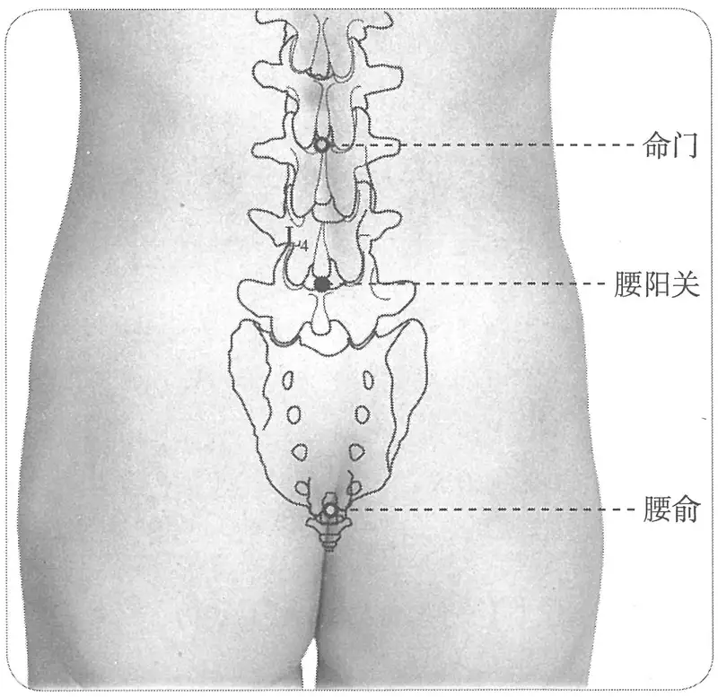

**图2-377　腰阳关穴图**

〔p.1222 (인쇄 1194)〕

经》卷中、《圣济总录》、《针灸资生经》、《类经图翼》、《循经考穴编》）

　3. 第十六椎，即第四腰椎之下。（《针灸十四经穴位考订》）

　4. 统编针灸学教材

　　(1) 部位：第十六椎下。取穴：伏卧，按取第十六椎之下陷中取之，即第四腰椎之下。（1957年南京《针灸学》）

　　(2) 部位：第十六椎下。取穴：按取椎间陷中，伏而取之。（1版《针灸学讲义》）

　　(3) 部位：在第十六椎节下间。取穴：第四腰椎棘突下凹陷中，俯卧取之，约与髂嵴相平。（2版《针灸学讲义》）

　　(4) 第四腰椎棘突下。（4、5版《针灸学》）

　　(5) 在腰部，当后正中线上，第4腰椎棘突下凹陷中。（6版《针灸学》）

　　(6) 后正中线上，第4腰椎棘突下凹陷中，约与髂嵴相平。（7版《针灸学》、《中国针灸学》）

#### 【类属】 

督脉穴。

**归经**：督脉。（《铜人腧穴针灸图经》卷中）

#### 【适应症】 

主治局部、妇科、男科病症。常用于腰骶痛；月经不调，遗精，阳痿。

　1. 主劳损腰胯痛，遗精，白浊，妇人月病带下。（《循经考穴编》下）

　2. 统编针灸学教材

　　(1) 月经病，带下，遗精，白浊，腰胯痛，下肢不仁，膝外廉痛。（1957年南京《针灸学》、1版《针灸学讲义》）

　　(2) 腰骶痛，下肢痿痹，月经不调，遗精，阳痿。（2版《针灸学讲义》，4、5、6版《针灸学》，《中国针灸学》）

　　(3) ①腰骶痛，下肢痿痹；②月经不调、赤白带下等妇科病证；③遗精，阳痿等男科病证。（7版《针灸学》）

**文献分析**：教材中“下肢不仁，膝外廉痛”诸症明显受高武错误的影响，将膝阳关穴主治误置于此。实际上现代针灸教材确定本穴主治的唯一依据是《循经考穴编》，而后者所载之主治又全见于《针方六集》肾俞穴下。在这样的情形下，确定本穴主治正确思路应当是：参照大肠俞、十五椎下极俞、十七椎主治，在临床积累并检验，成熟后再加以总结。

#### 【操作】 

直刺0.5~1寸。

　1. 可刺入同身寸之五分，可灸三壮。（《素问·气府论》王冰注）

　2. 针五分，灸五壮。（《针灸十四经穴位考订》）

　3. 统编针灸学教材

　　(1) 针五至八分，灸三至七壮。（《1957年南京《针灸学》、1版《针灸学讲义》）

　　(2) 直刺5~8分，艾条灸3~7分钟。（2版《针灸学讲义》）

　　(3) 向上斜刺0.5~1寸。（4、5、7版《针灸学》）

　　(4) 向上斜刺0.6~1寸，可灸。（6版《针灸学》）

　　(5) 直刺0.5~1寸。可灸。（《中国针灸学》）

### （四）命门 Mìngmén GV4 出《黄帝明堂经》 

#### 【提要索隐】 

**穴名**：一名属累。

〔p.1223 (인쇄 1195)〕

**定位**：在脊柱区，第2腰椎棘突下凹陷中，后正中线上。

**适应症**：主治局部、妇科、男科病症。常用于腰痛、少腹痛，脊强，下肢痿痹；赤白带下；阳痿，遗精，尿频。

**备选适应症**：痔漏下血。

**针刺操作**：直刺0.5~1.5寸。

#### 【名实考】 

《难经》曰：“左者为肾，右者为命门”，本穴在两肾俞之间，故曰“命门”。《黄帝明堂经》曰：“命门，一名属累”。《窦太师针经》又曰“一名精宫”者，乃据《难经》之说立论，而《难经》所说之“命门”非指穴名，《医学入门》又有奇穴名“精宫”者，故不作“命门”之别名。

需要特别注意的是，“命门”既是穴名，又是脏器名，且《内经》与《难经》“命门”概念不同。后人不辨，每有混淆者。

关于本穴定位，由于古代文献谓肾俞前平脐，后人遂将《肘后备急方》所载之以竹杖量脐取腰椎法定为取命门穴法，甚至将此法作为确定第十四椎的折量法。人体实际测量的结果表明：在标准体型的成人，第3腰椎棘突应通过脐平面。略低于命门穴点，但考虑到古人所述标记是在竹杖上方，则此点与命门穴相当。由于《千金翼方》所载之此法采用的是一种特殊的灸法——横三间寸灸法，后人及今人皆不识，于奇穴中列“竹杖”穴外，另立“肠风”一穴，大误；新穴中又别有“十四椎”一穴，也属多余。

　1. 命门，一名属累。在第十四椎节下间，督脉气所发，伏而取之。（《黄帝明堂经》）

　2. 命门一穴，一名精宫。（《窦太师针经》）

　3. 三十六难曰藏各有一耳，肾独有两者，何也？然：肾两者，非皆肾也，其左者为肾，右者为命门。命门者，诸神精之所舍，原气之所系也，男子以藏精，女子以系胞，故知肾有一也。（《难经》）

　4. 精宫，专主梦遗。十四椎下，各开三寸，灸七壮，效。（《医学入门》卷一）

　5. 此穴与脐对，正在内两肾之中间，而足太阳两肾腧穴之内，乃人至命之地，故曰命门。（《经穴解》）

#### “命门”同名异穴辨 

　1. 刺肝俞与命门，使瞽士视秋毫之末。吴崑注曰：命门，非督之命门，亦非任之命门。《灵枢·根结》论曰：“命门者，目也”，谓睛明穴，此治外障法也。（《针方六集·标幽赋》卷二）

　2. 《标幽赋》云兼肝俞，能使瞽士视秋毫之末。（《类经图翼》卷八）

　3. 肝俞穴，主治左胁积聚疼痛，气短不语。若同命门穴一并灸之，即两目昏暗者，可使复明。（《医宗金鉴·刺灸心法要诀》）

**按**：窦太师原文中“命门”是睛明穴，吴崑注解极是，然张介宾及清代《医宗金鉴·刺灸心法要诀》将其误解为督脉穴“命门”。有意思的是，吴崑虽然此处正确理解了窦氏原文，却于命门穴下辑录了“目眩不明”的主治症。

#### “命门”、“竹杖”、“肠风”、“十四椎”穴辨 

　1. 肾俞，主五脏虚劳，少腹弦急胀热，灸五十壮，老小损之。若虚冷，可至百壮，横三间寸灸之。腰痛不得动者，令病人正立，以竹杖拄地度至脐，取杖度背脊，灸杖头处，随年壮，良。灸讫，藏竹杖，勿令人得之。丈夫痔下血脱肛，不食，长泄痢，妇人崩中去血，带下淋露，去赤白杂汁，皆灸之。此夹两旁各一寸横三间寸灸之。（《千金翼方》卷二十七）

〔p.1224 (인쇄 1196)〕

　2. 治痔、肠风、脏毒，平立量脊骨与脐平处，椎上灸七壮，或年深，更一椎骨两旁各一寸灸，如上数，无不除根者。（《是斋百一选方》卷十四、《世医得效方》、《外科大成》）

　3. 灸肠风诸痔，十四椎下各开一寸，年深者最效。（《医学入门》卷一）

　4. 十四椎，位于腰部正中线，第2腰椎棘突之高点处，即命门穴上方。主治小腹胀痛，阳痿，遗精，腰腿痛。针0.5~1寸，针感局部胀麻，灸5~7壮。（《针灸经外奇穴图谱（续集）》）

**按**：所谓“横三间寸灸”是指一穴之中置三炷，每炷三分而为一寸。此为隋唐间较为流行的一种灸法。宋人已不能辨，误以为三穴。今人则将竹杖折量穴定名为“竹杖”，另据晚出的《医学入门》，将古人曲解之穴定名为“肠风”，一并归入奇穴类；新穴类又设“十四椎”一穴。这几穴正确的理解应是：竹杖所取之穴即“命门”；“十四椎”略高于命门穴，大可不必另立一穴；“肠风”则是出于古人对《千金翼方》所载竹杖取穴灸法的误解。结论：“竹杖”、“肠风”、“十四椎”皆可归入命门穴下，而不能别出新穴。

#### 【定位】 

**部位**：在脊柱区，第2腰椎棘突下凹陷中，后正中线上（图2-378）。

**取穴**：俯卧取穴。

　1. 在十四椎节下间……伏而取之。（《黄帝明堂经》、《太平圣惠方》、《铜人腧穴针灸图经》、《圣济总录》、《针灸资生经》、《十四经发挥》、《医学纲目》、《针灸聚英》、《古今医统》、《针灸大成》、《针方六集》、《类经图翼》、《循经考穴编》、《医宗金鉴·刺灸心法要诀》、《针灸易学》）

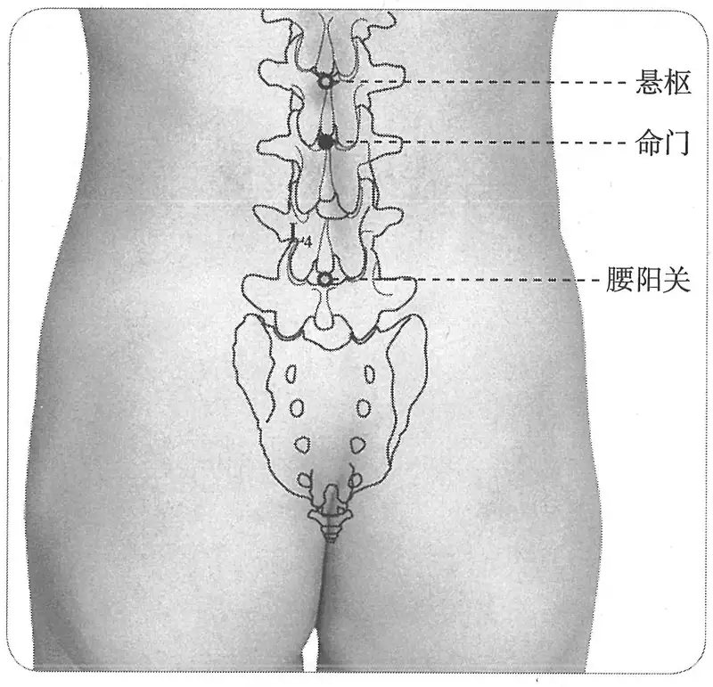

**图2-378　命门穴图**

　2. 窦太师针灸遗存

　　(1) 在背部第十四椎骨尖下间，伏而取之。（《窦太师针经》）

　　(2) 在十四椎骨下陷中，与脐相对是穴。（《窦太师秘传》）

　　(3) 在背脊十四椎下与脐平。（《针灸玉龙歌》注）

　3. 命门与脐相对，若取可正身立，用一杖自地量至脐，截断，却移向后量脊，杖头截处是穴也。（《医学纲目》卷八、《类经图翼》、《针灸逢源》）

　4. 第十四椎，即第二腰椎之下。（《针灸十四经穴位考订》）

　5. 统编针灸学教材

　　(1) 部位：第十四椎之下。取穴：伏卧，按取第十四椎下陷中取之，即第二腰椎之下。又法：左右两中指按其脐心，同时向左右移至背脊正中是穴位，肥胖之人则不准确。（1957年南京《针灸学》）

　　(2) 部位：第十四椎之下。取穴：按取椎间下陷中，伏而取之。或以左右两手中指按其脐心，同时向背部移行至脊中是穴，但肥胖之人则不易准确。（1版《针灸学讲义》）

〔p.1225 (인쇄 1197)〕

　　(3) 部位：第十四椎节下间。取穴：第二腰椎棘突下凹陷中，俯卧取之。（2版《针灸学讲义》）

　　(4) 第二腰椎棘突下。（4、5版《针灸学》，《中国针灸学》）

　　(5) 在腰部，当后正中线上，第2腰椎棘突下凹陷中。（6版《针灸学》）

　　(6) 后正中线上，第2腰椎棘突下凹陷中。（7版《针灸学》）

#### 【类属】 

督脉穴。

督脉气所发。（《黄帝明堂经》）

#### 【适应症】 

主治局部、妇科、男科病症。常用于腰痛、少腹痛，脊强，下肢痿痹；赤白带下；阳痿，遗精，尿频。全子宫切除术、剖宫产手术的针麻用穴。

**备选适应症**：痔漏下血。

　1. 主头痛如破，身热如火，汗不出，瘛疭里急，腰腹相引痛。（《黄帝明堂经》）

　2. 寒热痎疟。（《太平圣惠方·明堂》）

　3. 治头痛不可忍，身热如火，汗不出，瘛疭里急，腰腹相引痛。（《铜人腧穴针灸图经》卷中）

　4. 窦太师针灸遗存

　　(1) 治肾虚腰痛，补。小便多，灸二七壮。小便不通，泻；男子遗精，女人赤白带下，看证补泻。（《窦太师针经》）

　　(2) 主肾虚腰痛，目眩不明，男子遗精，女子赤白带下。（《针方六集》卷五）

　　(3) 主一切虚损腰痛，脊强不能屈伸，久痔远血，男子遗精白浊，女子赤白带下。（《循经考穴编》下）

　5. 骨蒸，五脏热。小儿发痫张口摇头，身反折角弓。（《针灸聚英》卷一、《针灸大成》）

**按**：“骨蒸，五脏热”未详所出，疑有误；“小儿发痫张口摇头，身反折角弓”从《针灸资生经》辑自《太平圣惠方》“仆参”穴主治。

　6. 一俗传以此穴灸寒热，多效。（《类经图翼》卷八）

　7. 《经神集》云灸肠风神效。（《循经考穴编》下）

**按**：《经神集》是明代针灸大家凌云针灸书中的一集。

　8. 统编针灸学教材

　　(1) 头痛如破，身热如火，汗不出，小儿发痫，角弓反折，脊强，腰痛，赤白带下，遗精，白浊，肠风，久痔。（1957年南京《针灸学》）

　　(2) 头痛，身热汗不出，小儿发痫，角弓反张，脊强，腰痛，赤白带下，阳痿，遗精，白浊，肠风，下焦阳气虚弱。（1版《针灸学讲义》）

　　(3) 脊强，腰痛，带下，阳痿，遗精，泄泻。（2版《针灸学讲义》、4版《针灸学》）

　　(4) 阳痿，遗精，带下，月经不调，泄泻，腰脊强痛。（5版《针灸学》）

　　(5) 阳痿，遗精，带下，遗尿，尿频，月经不调，泄泻，腰脊强痛，手足逆冷。（6版《针灸学》）

　　(6) ①腰脊强痛，下肢痿痹；②月经不调、赤白带下、痛经、经闭、不孕等妇科病证；③阳痿、遗精、精冷不育、小便频数等男性肾阳不足性病证；④小腹冷痛，腹泻。（7版《针灸学》）

　　(7) 脊强，腰痛，阳痿，遗精，月经不调，泄泻，完谷不化，带下。（《中国针灸学》）

**文献分析**：教材中“小儿发痫，角弓反折”乃承袭高武《针灸聚英》之误，今去之。

〔p.1226 (인쇄 1198)〕

#### 附：临床应用举例 

　1. 腰痛

　　(1) 腰痛不得动者，令病人正立，以竹杖拄地度至脐，取杖度背脊，灸杖头处，随年壮，良。灸讫，藏竹杖，勿令人得之。丈夫痔下血脱肛，不食，长泄痢，妇人崩中去血，带下淋露，去赤白杂汁，皆灸之。此夹两旁各一寸横三间寸灸之。（《千金翼方》卷二十七）

　　(2) 腰痛不得屈伸：灸白环腧；少愈，灸命门、曲池。（《针灸集要·盘石金直刺秘传》）

　　(3) 腰强痛：命门，灸二七壮，昆仑，泻之，灸亦泻。（《医学纲目》卷二十八）

　　(4) 肾虚腰痛：命门、肾俞、腰俞、次髎、委中。［陕西中医，1984，5(2):44］

　2. 二便病症

　　(1) 治下血不止及肠风脏毒败症。（《备急灸法》）

　　(2) 小便多：命门随年壮灸、肾俞一分，沿皮向外六分，补六呼，泻一吸。（《医学纲目》卷十四）

　　(3) 老人肾弱小便多，夜间起动若如何，命门若得金针助，肾俞加艾疾皆和。（《针灸玉龙歌》）

　　(4) 肾泻：然谷，用补法，气海、命门用艾灸。［上海针灸杂志，1982(4):20］

#### 【操作】 

直刺0.5~1.5寸。

　1. 刺入五分，灸三壮。（《黄帝明堂经》）

　2. 可灸七壮。（《千金翼方》）

　3. 窦太师针灸遗存

　　(1) 针三分，灸二七壮。治肾虚腰痛，补。小便多，灸二七壮。小便不通，泻；男子遗精，女人赤白带下，看证补泻。（《窦太师针经》）

　　(2) 灸二七壮，禁针，针则愈甚，宜补不宜泻。（《针灸玉龙歌》注）

　4. 针五分，灸五壮。（《针灸十四经穴位考订》）

　5. 统编针灸学教材

　　(1) 针五至八分，针尖平进，灸三至十五壮。（1957年南京《针灸学》、1版《针灸学讲义》）

　　(2) 直刺5~8分；艾炷灸5~15分钟，艾条灸5~15分钟。（2版《针灸学讲义》）

　　(3) 向上斜刺0.5~1寸。（4、5、7版《针灸学》）

　　(4) 向上斜刺0.5~1寸；可灸。（6版《针灸学》、《中国针灸学》）

　6. 针尖稍向上直刺1~1.5寸。感应局部发胀，至深部时两下肢有麻电感向两下肢放射。灸3~7壮，温灸5~20分钟。（上海《针灸学》）

**刺法的解剖学基础**：腰椎棘突连接时呈水平位，故进针宜直刺。由于成人第1腰椎以下已经没有脊髓，所以有时在治疗需要的前提下，医者在严格针体消毒的情况下，可适当深刺。

### （五）悬枢 Xuánshū GV5 出《黄帝明堂经》 

#### 【提要索隐】 

**定位**：在脊柱区，第1腰椎棘突下凹陷中，后正中线上。

〔p.1227 (인쇄 1199)〕

**适应症**：主治腰部、腹部病症。常用于腰脊痛，腹痛；泄泻。

**针刺操作**：从后方微向上斜刺0.5~1寸。

#### 【名实考】 

脊骨之中曰“中枢”，本穴在中枢之下，且在成人至本穴以下没有脊髓，故曰“悬枢”。

需要注意的是，《太平圣惠方》“接脊”、“脊中”与“悬枢”三穴有相混之处。

　1. 悬枢，在第十三椎节下间，督脉气所发，伏而取之。（《黄帝明堂经》）

　2. 脊中之穴，平分二十一椎之中，而此穴乃在其下。枢者，所以司开合之轴也。脊中司俯仰屈伸，亦犹门之阖，在于枢也，此穴在脊中之下，有枢之象焉。曰悬者，以其横悬为俯仰之枢，而非若门之枢，立而司开合者也。（《经穴解》）

#### “接脊”、“脊中”与“悬枢”穴辨 

《太平圣惠方》卷一百载“接脊”穴部位与卷九十九的“悬枢”穴同；而卷九十九所载“脊中”穴部位与卷一百的“悬枢”穴同，原文如下：

接脊：小儿痢下赤白……灸第十二椎下节间，名接脊穴。（卷一百）

接脊一穴，在背当中心。（卷五十五）

脊中：脊俞一穴，一名神宗，一名脊中，在第十一椎中央是穴。（卷九十九）

悬枢：悬枢一穴，在第十二椎下节间是穴。（卷九十九）

悬枢一穴，在第十一椎节下陷者中。（卷一百）

**按**：历代文献均谓“脊中”穴在第十一椎下，而“脊中”之下名“接脊”，自当位于第十二椎下，卷五十五谓“在背当中心”实乃唐人定“脊中”穴的简易法：从大椎度至穷骨，中折即脊中穴，“脊中”穴名也由此而来。至于《太平圣惠方》两处悬枢穴定位文字中“十一”、“十二”均系“十三”之误。

#### 【定位】 

**部位**：在脊柱区，第1腰椎棘突下凹陷中，后正中线上（图2-379）。

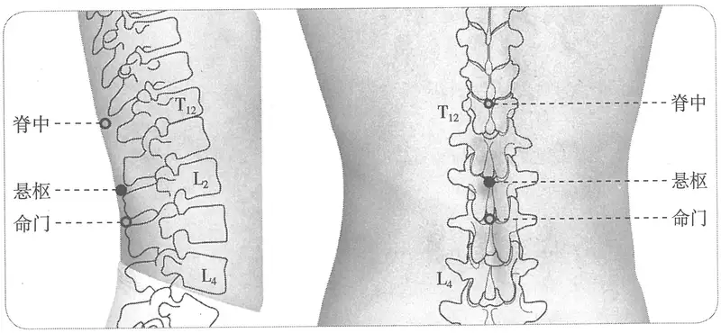

**图2-379　悬枢穴图**

**取穴**：先定第12胸椎棘突，往下1个棘突即第1腰椎。

　1. 《黄帝明堂经》佚文

　　(1) 在第十三椎节下间……伏而取之。（《针灸甲乙经》卷三、《外台秘要》、《素问》王冰注、《医心方》、《铜人腧穴针灸图经》、《圣济总录》、《针灸资生经》、《十四经发挥》、《医学纲目》、《针灸聚英》、《针灸问对》、《古今医统》、《针灸大成》、《针方六集》、《类经图翼》、《循经考穴编》、《医宗金鉴·刺灸心法要诀》、《针灸易学》、《针灸逢源》）

〔p.1228 (인쇄 1200)〕

　　(2) 在第十三椎下节间。（《千金要方》卷二十九、《千金翼方》）

　2. 悬枢一穴，在第十二椎下节间。（《太平圣惠方·针经》）

　3. 悬枢一穴，在第十一椎节下，陷者中。（《太平圣惠方·明堂》）

　4. 《铜人》云“悬枢在十三椎节下间”，《明堂上经》作“十二椎节间”，《下经》作“十一椎下”。脊中穴既在十一椎下，不应悬枢又在十一椎下，固知其误矣。考之《素问》亦与《铜人》同，当以《铜人》为正。《明堂上经》亦误“三”字作“二”字也。要之，接脊穴在十二椎节下尔。（《针灸资生经》卷一）

　5. 第十三椎，即第一腰椎之下。（《针灸十四经穴位考订》）

　6. 统编针灸学教材

　　(1) 部位：第十三椎之下。取穴：伏卧，按取十三椎下陷中取之，即第一腰椎之下际。（1957年南京《针灸学》）

　　(2) 部位：第十三椎之下。取穴：按取椎间下陷中，伏而取之。（1版《针灸学讲义》）

　　(3) 部位：在第十三椎节之间。取穴：第一腰椎棘突下凹陷中，俯卧取之。（2版《针灸学讲义》）

　　(4) 第一腰椎棘突下。（4、5版《针灸学》，《中国针灸学》）

　　(5) 在腰部，后正中线下，第1腰椎棘突下凹陷中。（6版《针灸学》）

　　(6) 后正中线上，第1腰椎棘突下凹陷中。（7版《针灸学》）

#### 【类属】 

督脉穴。

督脉气所发。（《黄帝明堂经》）

#### 【适应症】 

主治腰部、腹部病症。常用于腰脊痛，腹痛，泄泻。

　1. 主腹中积气上下行。不仁。（《黄帝明堂经》）

　2. 腰脊痛，腹中上下积气。（《太平圣惠方·针经》）

　3. 治积气上下行，水谷不化，下利，腰脊强不得屈伸，腹中留积。（《铜人腧穴针灸图经》卷中）

　4. 主一切聚气上下，腹中留积及贲豚，疝气，囊缩。（《循经考穴编》下）

　5. 治心气痛疼，便毒便红不忍者。（《窦太师秘传》）

　6. 统编针灸学教材

　　(1) 水谷不化，下利，腰脊强痛。（1957年南京《针灸学》、1版《针灸学讲义》）

　　(2) 脾胃虚弱，泄泻，腰脊强痛。（2版《针灸学讲义》、4版《针灸学》）

　　(3) 泄泻，腹痛，腰脊强痛。（5、6版《针灸学》）

　　(4) 腰脊强痛；腹胀、腹痛、完谷不化、腹泻、痢疾等胃肠疾患。（7版《针灸学》）

　　(5) 腰脊强痛，泄泻，完谷不化。（《中国针灸学》）

**文献分析**：《黄帝明堂经》描述的本穴主治病症与“贲豚”、“厥疝”相类。提示：腹中积气，既可取腹部任脉之中脘、气海、阴交、中极穴，也可取背部穴。

气积于肾，而气下上游走，如豚之奔，故曰贲豚。（《诸病源候论》卷十二）

有积气在腹中，有厥气，名曰厥疝。（《素问·五脏生成》）

#### 【操作】 

从后方微向上斜刺0.5~1寸。

〔p.1229 (인쇄 1201)〕

　1. 刺入三分，灸三壮。（《黄帝明堂经》）

　2. 可五壮。（《千金翼方》）

　3. 统编针灸学教材

　　(1) 针三至五分，针尖微上斜入，灸三至五壮。（1957年南京《针灸学》、1版《针灸学讲义》）

　　(2) 直刺3~5分。艾条灸3~5分钟。（2版《针灸学讲义》）

　　(3) 向上斜刺0.5~1寸。（4、5、7版《针灸学》）

　　(4) 向上微斜刺0.5~1寸；可灸。（6版《针灸学》、《中国针灸学》）

### （六）脊中 Jǐzhōng GV6 出《黄帝明堂经》 

#### 【提要索隐】 

“脊中”之名见于《素问》，并有具体的取穴法，然系指部位，王冰注作“阳关”穴，非本穴也。故本穴出处为《黄帝明堂经》。

**穴名**：一名脊俞，一名神宗。

**部位**：在脊柱区，第11胸椎棘突下凹陷中，后正中线上。

**适应症**：主治脾、腰背部病症。常用于腰脊痛；癫痫；黄疸；泄泻。

**针刺操作**：略向上斜刺0.5~1寸，不宜深刺，以免损伤脊髓。

#### 【名实考】 

《西方子明堂灸经》以“脊腧”为正名，以“神宗”、“脊中”为别名。

《太平圣惠方》卷五十五谓脊中穴“在背当中心”，实乃唐人定“脊中”穴的简易法：从大椎度至穷骨，中折即脊中穴，“脊中”穴名也由此而来。

　1. 失枕，在肩上横骨间，折使揄臂，齐肘，正灸脊中。王冰注曰：揄读为摇，摇谓摇动也。然失枕非独取肩上横骨间，乃当正形灸脊中也。欲而验之，则使摇动其臂，屈折其肘，自项之下，横齐肘端，当其中间，则其处也，是曰阳关，在第十六椎节下间，督脉气所发，刺可入同身寸之五分，若灸者可灸三壮。（《素问·骨空论》）

　2. 从大椎度至穷骨，中屈，更从大椎度之，灸度下头，是督脊也。（《千金要方》卷五）

　3. 脊中，从大椎度至穷骨中折则是也。（《医心方》卷十一）

　4. 脊腧，在第十一椎。又名神宗、脊中。（《西方子明堂灸经》卷四）

　5. 脊俞一穴，一名神宗，一名脊中。在第十一椎中央是穴。督脉气所发。（《太平圣惠方·针经》）

　6. 脊中，在第十一椎节下间，督脉气所发，俯而取之。（《黄帝明堂经》）

　7. 脊共二十一椎……此穴在十一椎之下，区处其中，故为脊中。（《经穴解》）

#### 相关穴及刺激点 

胸12：位于背部正中线，第12胸椎棘突上缘，即脊中穴下方。主治胃炎，胃痉挛，胃溃疡，肝炎，胰腺炎，胆道蛔虫症。针刺时，病人端坐，两臂交叉于胸前，两肩下垂，头尽量前倾，使背部皮肤紧张，针与脊柱成30°~40°角刺入皮肤，然后使针尖向下，沿真皮层与皮下组织之间，以均匀力量刺入，深1.5~2寸。（《针灸经外奇穴图谱（续集）》）

#### 【定位】 

**部位**：在脊柱区，第11胸椎棘突下凹陷中，后正中线上（图2-380）。

**取穴**：先定第12胸椎棘突，往上1个棘突即第11胸椎。

〔p.1230 (인쇄 1202)〕

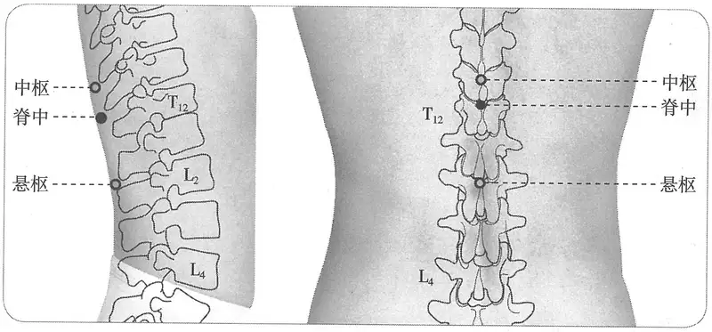

**图2-380　脊中穴图**

　1. 《黄帝明堂经》佚文

　　(1) 在第十一椎节下间……俯而取之。（《针灸甲乙经》卷三、《外台秘要》、《素问》王冰注、《医心方》、《铜人腧穴针灸图经》、《圣济总录》、《针灸资生经》、《窦太师针经》、《医学纲目》、《针灸聚英》、《古今医统》、《针灸大成》、《针方六集》、《类经图翼》、《循经考穴编》、《针灸易学》、《针灸逢源》）

　　(2) 在第十一椎下节间。（《千金要方》卷二十九、《千金翼方》、《十四经发挥》、《医宗金鉴·刺灸心法要诀》）

　2. 在第十一椎中央。（《太平圣惠方·针经》）

　3. 脊中十一节。（《医学入门》卷一）

　4. 第十一椎胸椎之下。（《针灸十四经穴位考订》）

　5. 统编针灸学教材

　　(1) 部位：第十一椎之下。取穴：正坐略向前俯，按取第十一椎下陷中取之。（1957年南京《针灸学》）

　　(2) 部位：第十一椎之下。取穴：按取椎间下陷中，伏而取之。（1版《针灸学讲义》）

　　(3) 部位：在第十一椎节下间。取穴：第十一胸椎棘突下凹陷中，俯卧取之。（2版《针灸学讲义》）

　　(4) 第十一胸椎棘突下。（4、5版《针灸学》，《中国针灸学》）

　　(5) 在背部，后正中线上，第11胸椎棘突下凹陷中。（6版《针灸学》）

　　(6) 后正中线上，第11胸椎棘突下凹陷中。（7版《针灸学》）

#### 【类属】 

督脉穴。

督脉气所发。（《黄帝明堂经》）

#### 【适应症】 

主治脾、腰背部病症。常用于腰脊痛；癫痫；黄疸，泄泻。全子宫切除术、剖宫产手术的针麻用穴。

　1. 主腰脊强，不得俛仰。黄瘅。腹满不能食。（《黄帝明堂经》）

**按**：以上主治均见于其相邻的“脾俞”穴。二穴均主督脉病症和脾病症，当参看。

　2. 治风痫癫邪，温病积聚，下痢。（《太平圣惠方·针经》）

　3. 治风痫癫邪，温病，积聚，下利。禁不可灸，灸则令人腰背伛偻。（《铜人腧穴针灸图经》卷中）

〔p.1231 (인쇄 1203)〕

　4. 主五痔，便血，小儿脱肛。（《针灸聚英》卷一、《针灸大成》、《针方六集》）

**按**：“五痔，便血”乃从《针灸资生经》辑自《千金要方》灸方，详见“附：临床应用举例”；“小儿脱肛”乃高武从《针灸资生经》误录《太平圣惠方》“接脊”穴主治。

　5. 窦太师针灸遗存

　　(1) 治一切翻胃，呕吐红血，脊痛，看症补泻。（《窦太师针经》）

　　(2) 主翻胃吐血。（《循经考穴编》下）

　6. 《经神集》云主癫及翻胃吐血，小儿积块亦灸之。（《循经考穴编》下）

　7. 统编针灸学教材

　　(1) 反胃，吐血，黄疸，下利，小儿脱肛，癫痫。（1957年南京《针灸学》、1版《针灸学讲义》）

　　(2) 黄疸，腹泻，癫痫，痔疮便血，小儿脱肛。（2版《针灸学讲义》、4版《针灸学》）

　　(3) 泄泻，黄疸，痔疾，癫痫，小儿疳积，脱肛。（5版《针灸学》）

　　(4) 泄泻，黄疸，痔疾，癫痫，小儿疳积，脱肛，腰脊强痛。（6版《针灸学》）

　　(5) ①癫痫；②黄疸；③腹泻、痢疾、痔疮、脱肛、便血等肠腑病证；④腰脊强痛；⑤小儿疳积。（7版《针灸学》）

　　(6) 主治胃脘痛，腹泻，黄疸，痫证，腰脊强痛。（《中国针灸学》）

**文献分析**：本穴与脾俞、意舍皆位于十一椎水平，三穴的主治由正中向外侧，其督脉病症依次递减，脾的症状依次递增（至意舍穴主治，已悉为脾病症状）。

#### 附：临床应用举例 

　1. 久冷五痔便血，灸脊中百壮。（《千金要方》卷二十三、《千金翼方》）

　2. 眼暗，灸大椎下数节第十当脊中安灸二百壮，惟多为佳，至验。（《千金要方》卷六、《千金翼方》）

**按**：从大椎（第一胸椎）下数节第十适当第十一椎，与脊中穴相当。

　3. 闪挫腰痛，起止艰难，脊中一穴、腰俞一穴、肾俞二穴、委中二穴。（《针灸大全》卷四）

　4. 虚损湿滞，腰痛行动无力，脊中一穴、腰俞一穴、肾俞二穴、委中二穴。（《针灸大全》卷四）

　5. 外伤性截瘫，脊中穴、腰阳关穴，针刺治愈。［南京中医学院学报，1984(4):28］

　6. 腹痛，针灸接脊、脊中穴治疗。［中国运动医学杂志，1998，17(4):371］

#### 【操作】 

略向上斜刺0.5~1寸，不宜深刺，以免损伤脊髓。

　1. 刺入五分，不可灸，灸则令人偻。（《黄帝明堂经》、《铜人腧穴针灸图经》卷中）

　2. 禁针，灸二七壮。（《窦太师针经》）

　3. 禁针灸。误用令人伛偻。（《医学入门》卷一）

　4. 针三分，灸三壮。《铜人》禁灸。（《针灸十四经穴位考订》）

　5. 统编针灸学教材

　　(1) 针三至五分，针尖微向上斜入之。（1957年南京《针灸学》、1版《针灸学讲义》）

　　(2) 直刺3~5分。（2版《针灸学讲义》）

　　(3) 向上斜刺0.5~1寸。（4、5、6、7版《针灸学》，《中国针灸学》）

〔p.1232 (인쇄 1204)〕

### （七）中枢 Zhōngshū GV7 出《素问·气府论》王冰注 

#### 【提要索隐】 

**定位**：在脊柱区，第10胸椎棘突下凹陷中，后正中线上。

**适应症**：主治局部病症。常用于腰背痛。

**针刺操作**：从后方微向上斜刺0.5~1寸，不宜深刺，以免损伤脊髓。

#### 【名实考】 

“中枢”见于《素问·气府论》王冰注，然其注《气穴论》“背与心相控而痛，所治天突与十椎及上纪”曰：“按今《甲乙经》、《经脉流注孔穴图经》当脊十椎下并无穴目，恐是七椎也，此则督脉气所主之”，故本穴的来历不能无疑。且无临床应用及相关主治病症的积累，收录腧穴书并归入督脉显得勉强。

#### 【定位】 

**部位**：在脊柱区，第10胸椎棘突下凹陷中，后正中线上（图2-381）。

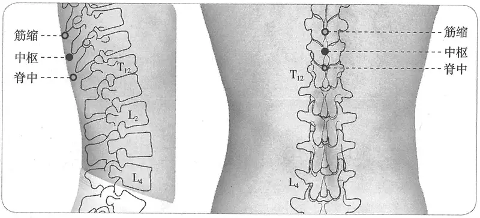

**图2-381　中枢穴图**

**取穴**：先定第12胸椎棘突，往上2个棘突即第10胸椎。

　1. 中枢在第十椎节下间，俯而取之。（《素问·气府论》王冰注、《类经图翼》、《医宗金鉴·刺灸心法要诀》）

　2. 在十椎下，俯而取之。按：中枢穴，诸书皆无，据气穴论曰：背与心相控而痛，所治天突与十椎及上。……《王注》中枢在十椎下脊间，故《图翼》有中枢穴也。（《针灸逢源》）

　3. 第十椎之下。（《针灸十四经穴位考订》）

　4. 统编针灸学教材

　　(1) 部位：第十椎之下。取穴：正坐微俯，按第十椎之下取之。（1957年南京《针灸学》）

　　(2) 部位：第十椎之下。取穴：按取椎间下陷中，伏而取之。（1版《针灸学讲义》）

　　(3) 部位：在第十椎节下间。取穴：第十胸椎棘突下凹陷中，俯卧取之。（2版《针灸学讲义》

　　(4) 第十胸椎棘突下。（4、5版《针灸学》，《中国针灸学》）

　　(5) 在背部，当后正中线上，第10胸椎棘突下凹陷中。（6版《针灸学》）

　　(6) 后正中线上，第10胸椎棘突下凹陷中。（7版《针灸学》）

〔p.1233 (인쇄 1205)〕

#### 【类属】 

督脉穴。

**归经**：督脉。（《类经图翼》卷八）

#### 【适应症】 

主治局部病症。常用于腰背痛。

　1. 一传云此穴能退热进饮食，可灸三壮，常用常效。（《类经图翼》卷八）

　2. 统编针灸学教材

　　(1) 腰腿不能俯仰，视力减退。（1957年南京《针灸学》）

　　(2) 腰腿不能俯仰，目疾。（1版《针灸学讲义》）

　　(3) 腰痛，脊强，俯仰不利。（2版《针灸学讲义》）

　　(4) 腹满，腰痛，脊强。（4版《针灸学》）

　　(5) 黄疸，呕吐，腹满，腰脊强痛。（5、6版《针灸学》）

　　(6) ①黄疸；②呕吐、腹满、胃痛、食欲不振等脾胃病证；③腰背疼痛。（7版《针灸学》）

　　(7) 胃脘痛，腰痛，脊强。（《中国针灸学》）

#### 附：临床应用举例 

背与心相控而痛，所治天突与十椎及上纪，上纪者胃脘也，下纪者关元也。（《素问·气穴论》）

#### 【操作】 

沿棘突的倾斜角向上斜刺0.5~1寸，不宜深刺，以免损伤脊髓。

　1. 针三分，灸三壮。（《针灸十四经穴位考订》）

　2. 统编针灸学教材

　　(1) 针三至五分，灸三至五壮。（1957年南京《针灸学》）

　　(2) 针三至五分，灸三至七壮。（1版《针灸学讲义》）

　　(3) 直刺3~5分，艾条灸3~5分钟。（2版《针灸学讲义》）

　　(4) 向上斜刺0.5~1寸。（4、5、6、7版《针灸学》）

　　(5) 直刺0.5~1寸。可灸。（《中国针灸学》）

### （八）筋缩 Jīnsuō GV8 出《黄帝明堂经》 

#### 【提要索隐】 

**穴名**：又作缩筋。

**定位**：在脊柱区，第9胸椎棘突下凹陷中，后正中线上。

**适应症**：主治脑病。常用于小儿惊风，抽搐；癫痫，目上视，脊强，癫狂。

**针刺操作**：沿棘突的倾斜角向上斜刺0.5~1寸，不宜深刺，以免损伤脊髓。

#### 【名实考】 

本穴主治筋缩互引之疾，且与肝俞平，肝主筋，故名“筋缩”。筋缩，宋本《外台秘要》及《针灸甲乙经》卷十二第十一均作“缩筋”；《针灸甲乙经》卷十一第二作“筋俞”，《医学入门》作“筋束”，皆声误。

　1. 筋缩，在第九椎节下间，督脉气所发，俯而取之。（《黄帝明堂经》）

　2. 人之俯仰，在乎脊筋之伸缩，伸而不缩，则脊强矣，缩而不伸，则伛偻矣，此穴正在脊中之上，当脊筋伸缩之际，故曰筋缩。（《经穴解》）

#### 【定位】 

**部位**：在脊柱区，第9胸椎棘突下凹陷中，后正中线上（图2-382）。

**取穴**：从至阳向下2个棘突，其下方凹陷中。

〔p.1234 (인쇄 1206)〕

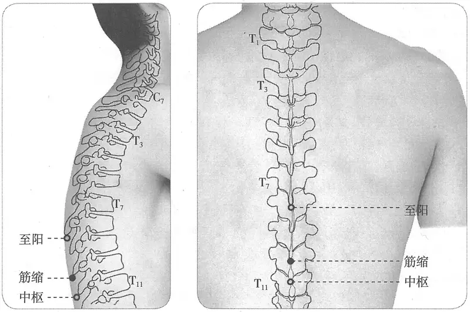

**图2-382　筋缩穴图**

　1. 《黄帝明堂经》佚文

　　(1) 在第九椎节下间……俯而取之。（《针灸甲乙经》卷三、《外台秘要》、《素问》王冰注、《医心方》、《太平圣惠方》、《铜人腧穴针灸图经》、《圣济总录》、《针灸资生经》、《医学纲目》、《针灸聚英》、《古今医统》、《针灸大成》、《针方六集》、《类经图翼》、《循经考穴编》、《针灸易学》、《针灸逢源》）

　　(2) 在第九椎下节间。（《千金要方》卷二十九、《千金翼方》、《十四经发挥》、《医宗金鉴·刺灸心法要诀》）

　2. 第九椎之下。（《针灸十四经穴位考订》）

　3. 统编针灸学教材

　　(1) 部位：第九椎之下。取穴：正坐微俯，从第九椎下取之。（1957年南京《针灸学》、1版《针灸学讲义》）

　　(2) 部位：在第九椎节下间。取穴：从第九胸椎棘突下凹陷中，俯卧取之。（2版《针灸学讲义》）

　　(3) 第九胸椎棘突下。（4、5版《针灸学》，《中国针灸学》）

　　(4) 在背部，当后正中线上，第9胸椎棘突下凹陷中。（6、7版《针灸学》）

#### 【类属】 

督脉穴。

督脉气所发。（《黄帝明堂经》）

#### 【适应症】 

主治脑病。常用于小儿惊风、抽搐、目上视，脊强，癫狂。全子宫切除术的针麻用穴。

　1. 主小儿惊痫，瘛疭。狂走，癫疾，脊急强，目转上插。（《黄帝明堂经》）

**按**：插，又作“臿”，杨上善注曰：“臿，目上掩也”。目转上插，即眼转动上翻，是小儿惊痫的典型症状。

　2. 主癫病多言，两目转上及目瞪也。（《太平圣惠方·明堂》）

　3. 治惊痫狂走，癫疾，脊急强，目转上垂。（《铜人腧穴针灸图经》卷中）

**按**：上垂，系“上臿”之形误。

〔p.1235 (인쇄 1207)〕

　4. 主心痛。（《针灸聚英》卷一、《针灸大成》、《针方六集》）

**按**：此症未详所出，疑有误。

　5. 主寒热进退，四肢拘挛。（《针方六集》卷五）

　6. 主手足不收，或拳挛不举，怒气伤肝，皮黄气闭，癫痫瘛疭，心疼脊强。（《循经考穴编》下）

　7. 统编针灸学教材

　　(1) 癫痫，脊强，目上视，心痛。（1957年南京《针灸学》）

　　(2) 癫痫，脊强，心痛。（1版《针灸学讲义》）

　　(3) 癫痫，脊强，胃痛。（2版《针灸学讲义》，4、5版《针灸学》，《中国针灸学》）

　　(4) 癫痫，抽搐，背强，胃痛。（6版《针灸学》）

　　(5) ①癫狂痫；②抽搐、脊强、四肢不收、筋挛拘急等筋病；③胃痛；④黄疸。（7版《针灸学》）

**文献分析**：《黄帝明堂经》载本穴主治悉见于其旁的肝俞穴。教材中“胃痛”、“黄疸”系从《针灸聚英》“心疼”和《循经考穴编》“皮黄”而来，然皆未详所出，暂不收录于本穴主治。

#### 附：临床应用举例 

　1. 小儿羊痫，目瞪吐舌羊鸣也，灸第九椎下节间三壮，炷如小麦大。（《太平圣惠方·明堂》）

　2. 风湿相搏，脊膂连腰强痛，痛则灸筋缩，麻木补肩井。（《针灸玉龙经·盘石金直刺秘传》）

　3. 踝阵挛、胃痉挛、面肌痉挛：针刺筋缩穴为主治疗。［上海针灸杂志，1998，17（2）：34］

#### 【操作】 

沿棘突的倾斜角向上斜刺0.5~1寸，不宜深刺，以免损伤脊髓。

　1. 刺入五分，灸三壮。（《黄帝明堂经》）

　2. 灸五壮。（《太平圣惠方·明堂》）

　3. 针三分，灸二七壮。（《窦太师秘传》）

　4. 统编针灸学教材

　　(1) 针三至五分，灸三至七壮。（1957年南京《针灸学》、1版《针灸学讲义》）

　　(2) 直刺3~5分，艾条灸3~7分钟。（2版《针灸学讲义》）

　　(3) 向上斜刺0.5~1寸。（4、5、6、7版《针灸学》）

　　(4) 直刺0.5~1寸。可灸。（《中国针灸学》）

### （九）至阳 Zhìyáng GV9 出《黄帝明堂经》 

#### 【提要索隐】 

**定位**：在脊柱区，第7胸椎棘突下凹陷中，后正中线上。

**适应症**：主治脾部病症。常用于黄疸；四肢重痛；腰背痛。

**针刺操作**：沿棘突的倾斜角向上斜刺0.5~1寸，不宜深刺，以免损伤脊髓。

#### 【名实考】 

　1. 至阳，在第七椎节下间，督脉气所发，俯而取之。（《黄帝明堂经》）

　2. 此穴之旁，为足太阳之膈腧穴，膈之上乃纯气之府，血为阴，气为阳，故曰至阳。言督经自下而上行者，至此则入于阳分也。（《经穴解》）

　3. 别名　肺底。（1957年南京《针灸学》）

〔p.1236 (인쇄 1208)〕

#### 相关穴及刺激点 

　1. 胸8　位于背部正中线，第8胸椎棘突上缘，即至阳穴下方。主治神经性头痛，神经官能症，三叉神经痛，精神分裂症，高血压，肝炎，外伤性白内障，眼底动脉硬化，斜视。针刺时，病人端坐，两臂交叉于胸前，两肩下垂，头尽量前倾，使背部皮肤紧张，针与脊柱成30°~40°角刺入皮肤，然后使针尖向下，沿真皮层与皮下组织之间，以均匀力量刺入，深1.5~2寸。（《针灸经外奇穴图谱（续集）》）

　2. 肾热　位于第7、8胸椎棘突间，两侧旁开0.5寸，即至阳穴旁开0.5寸。主治肾炎，尿路感染。针0.5~1寸，针感局部胀、麻。隔蒜灸3~7壮。（《针灸经外奇穴图谱（续集）》）

#### 【定位】 

**部位**：在脊柱区，第7胸椎棘突下凹陷中，后正中线上（图2-383）。

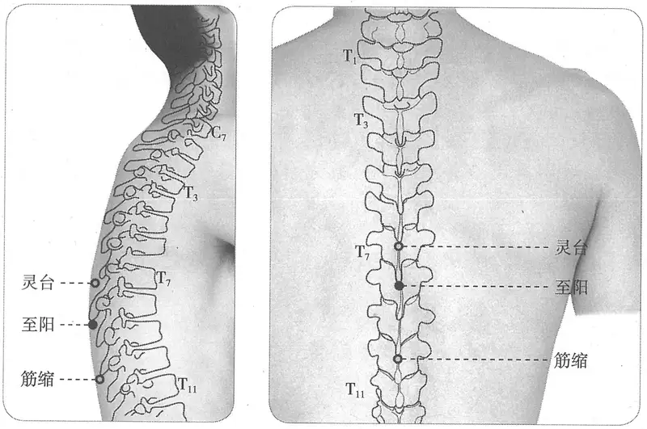

**图2-383　至阳穴图**

**取穴**：第7胸椎棘突下凹陷中，俯卧取之，约与肩胛骨下角相平。

　1. 《黄帝明堂经》佚文

　　(1) 在第七椎节下间……俯而取之。（《针灸甲乙经》卷三、《外台秘要》、《素问》王冰注、《医心方》、《太平圣惠方》、《铜人腧穴针灸图经》、《圣济总录》、《针灸资生经》、《医学纲目》、《针灸聚英》、《古今医统》、《针灸大成》、《针方六集》、《类经图翼》、《循经考穴编》、《针灸易学》、《针灸逢源》）

　　(2) 在第七椎下节间。（《千金要方》卷二十九、《千金翼方》、《十四经发挥》、《医宗金鉴·刺灸心法要诀》）

　2. 第七椎之下。（《针灸十四经穴位考订》）

　3. 统编针灸学教材

　　(1) 部位：第七椎之下。取穴：正坐略向前俯，于第七椎下陷中取之。（1957年南京《针灸学》）

　　(2) 部位：第七椎之下。取穴：按取椎间下陷中，伏而取之。（1版《针灸学讲义》）

〔p.1237 (인쇄 1209)〕

　　(3) 部位：在第七椎节下间。取穴：第七胸椎棘突下凹陷中，俯卧取之，约与肩胛骨下角相平。（2版《针灸学讲义》）

　　(4) 第七胸椎棘突下。（4、5版《针灸学》）

　　(5) 在背部，当后正中线上，第7胸椎棘突下凹陷中。（6、7版《针灸学》）

　　(6) 第七胸椎棘突下，约与肩胛骨下角相平。（《中国针灸学》）

#### 【类属】 

督脉穴。

督脉气所发。（《黄帝明堂经》）

#### 【适应症】 

主治脾部病症。常用于黄疸；四肢重痛；腰背痛。全子宫切除术的针麻用穴。

　1. 主寒热解烂一本作懒，淫泺胫酸，四肢重痛，少气难言。（《黄帝明堂经》）

　2. 杨上善注曰风成为寒热，为疮解烂。（转引自《医心方》卷二）

　3. 主脊急强。（《太平圣惠方·明堂》）

　4. 治寒热解散，淫泺胫酸，四肢重痛，少气难言。（《铜人腧穴针灸图经》卷中）

　5. 主腰脊痛，胃中寒气，不能食，胸胁支满，身羸瘦，背中气上下行，腹中鸣。卒疰忤，攻心胸。（《针灸聚英》卷一、《古今医统》、《针灸大成》）

**按**：“腰脊痛……腹中鸣”乃高武从《针灸资生经》误录《太平圣惠方》“胃俞”穴主治；“卒疰忤，攻心胸”乃从《针灸资生经》辑自《千金要方》灸方主治，详见“附：临床应用举例”。

　6. 窦太师针灸遗存

　　(1) 治浑身发寒，黄汗，多泻少补；脊背强痛，难伸屈，泻之。（《窦太师针经》）

　　(2) 浑身发黄，黄汗，先泻后补；脊骨强痛屈身难，宜泻。（《大本琼瑶神书》）

　　(3) 主黄疸湿热，遍身发黄，胸背引痛。（《循经考穴编》下）

　　(4) 治浑身发热，黄瘦骨蒸等症。（《窦太师秘传》）

　7. 统编针灸学教材

　　(1) 主治喘咳，胃寒不思食，肠鸣，黄疸，胸引背痛。（1957年南京《针灸学》、1版《针灸学讲义》）

　　(2) 主治咳嗽，气喘，黄疸，胸背痛，脊强。（2版《针灸学讲义》）

　　(3) 主治黄疸，喘咳，四肢重痛，脊强。（4版《针灸学》）

　　(4) 主治黄疸，胸胁胀满，咳喘，脊强，背痛。（5、6版《针灸学》）

　　(5) 主治黄疸、胸胁胀满等肝胆病证；咳嗽，气喘；腰背疼痛，脊强。（7版《针灸学》）

　　(6) 主治黄疸，咳喘，脊强，背痛。（《中国针灸学》）

**文献分析**：《黄帝明堂经》载本穴主治多为脾病症状，至《太平圣惠方》增补“脊急强”督脉症状，而金元窦太师针灸载本穴主治重在治黄，当时及后世的临床应用不断增多，现代针灸学教材从之。又教材中“胃寒不思食，肠鸣”、“胸胁胀满”诸症皆承袭高武《针灸聚英》错误，将“胃俞”的主治误置于本穴中，今去之。

#### 附：临床应用举例 

　1. 主卒疰忤攻心胸，灸第七椎随年壮。（《千金要方》卷十七、《千金翼方》）

　2. 黄疸，灸第七椎七壮，黄汗出。（《千金翼方》卷二十七）

　3. 浑身发黄，至阳灸、委中出血。（《针灸玉龙经·盘石金直刺秘传》）

　4. 至阳亦医黄疸病，先泻后补妙通神。（《针灸玉龙歌》）

　5. 胆道蛔虫痛，针刺至阳穴治疗。［福建中医药，1985，16（1）：31］

　6. 心肌缺血，艾灸至阳穴。［针灸临床杂志，1998，14（5）：36］

〔p.1238 (인쇄 1210)〕

　7. 嵌顿性腹股沟斜疝，针刺至阳穴治疗。［辽宁中医杂志，1989，13（11）：29］

#### 【操作】 

沿棘突的倾斜角向上斜刺0.5~1寸，不宜深刺，以免损伤脊髓。

　1. 刺入五分，灸三壮。（《黄帝明堂经》）

　2. 灸十壮。（《太平圣惠方》）

　3. 窦太师针灸遗存

　　(1) 针入三分，灸二七壮。治浑身发寒，黄汗，多泻少补；脊背强痛，难伸屈，泻之。（《窦太师针经》）

　　(2) 针三分，灸二七壮。（《窦太师秘传》）

　　(3) 针三分，灸七壮，看虚实补泻。（《针灸玉龙歌》注）

　4. 统编针灸学教材

　　(1) 针五至六分，针尖向上略斜进，灸三至五壮。（1957年南京《针灸学》、1版《针灸学讲义》）

　　(2) 向上斜刺5~6分；艾炷灸3~5壮，艾条灸3~5分钟。（2版《针灸学讲义》）

　　(3) 向上斜刺0.5~1寸。（4、5、7版《针灸学》）

　　(4) 向上微斜刺0.5~1寸；可灸。（6版《针灸学》、《中国针灸学》）

　5. 斜刺0.7~1寸。感应酸胀向下背或向前胸放散。灸3~5壮；温灸5~15分钟。（上海《针灸学》）

### （十）灵台 Língtái GV10 出《素问·气府论》王冰注 

#### 【提要索隐】 

**定位**：在脊柱区，第6胸椎棘突下凹陷中，后正中线上。

**适应症**：主治肺部、局部病症。常用于咳嗽，气喘；脊痛，颈项强痛。

**备选适应症**：疔疮。

**针刺操作**：沿棘突的倾斜角向上斜刺0.5~1寸，勿深刺，以免刺伤脊髓。

#### 【名实考】 

本穴见于《素问》王冰注，宋代《铜人腧穴针灸图经》归入督脉穴，然皆缺刺灸法及主治病症，直到《类经图翼》、《循行考穴编》始载有主治症，然经核查悉见于肺俞穴，不能无疑。

　1. 灵台一穴，在第六椎节下间，俯而取之。督脉气所发。（《铜人腧穴针灸图经》卷中）

　2. 督经自下而上行，至阳之穴，既过膈矣。膈之上有空虚之处，任脉为膻中，膻中，虚空之象也，在督脉既过膈，五脏皆系于背。心为人身至灵之官在上，穴在其下，有台之象，状脊之内载其心之象也。（《经穴解》）

**按**：灵台一穴，诸书缺主治，《针灸资生经》集《铜人腧穴针灸图》、《千金要方》、《外台秘要》、《黄帝明堂经》亦无考，惟曰见《素问》。考之《素问》，经文无所载，王冰注中惟言髎穴所在而已，主治亦未之见。窃意诸书，岂因灵道、灵墟名治相混，而泯没欤？先儒谓心曰灵台；《经》谓：心者君主之官，神明出焉。岂主病同手少阴神门，而针刺浅深，艾壮多寡，同至阳、神道欤？或曰：手少阴神门主心矣，于督脉何与？而六椎节下，又属之心，心之所出何多耶？曰：督为阳脉之都纲，犹五藏既有俞在背，而督又处太阳之中，故太阳有肾俞，而督有命门，灵台为心无疑。如紫微垣有天皇大帝矣，心中星又为帝星。大微垣又有帝座，天市垣又有帝星，盖心为一身之主，如帝王警跸所至，日行在所也。曰：《论语》示阙义，《春秋》存夏，五子何僭妄若此？曰：安国以郭公为虢公，晦庵补格致于《大学》，将以明经也。（《针灸聚英》卷一）

〔p.1239 (인쇄 1211)〕

#### 【定位】 

**部位**：在脊柱区，第6胸椎棘突下凹陷中，后正中线上（图2-384）。

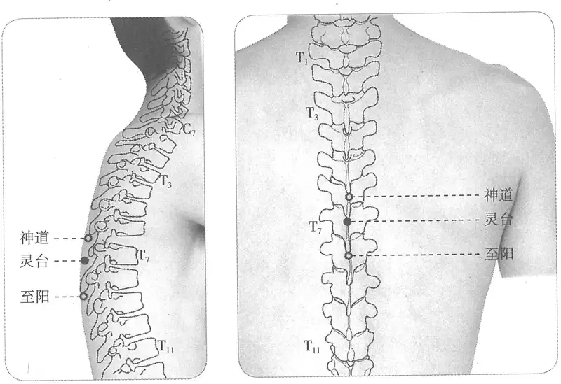

**图2-384　灵台穴图**

**取穴**：从至阳向上1个棘突，其上方凹陷中。

　1. 六椎下间。（《素问·刺热》王冰注、《十四经发挥》、《医学入门》、《针方六集》、《医宗金鉴·刺灸心法要诀》）

　2. 灵台在第六椎节下间，俯而取之。（《素问·气府论》王冰注、《铜人腧穴针灸图经》、《圣济总录》、《针灸资生经》、《医学纲目》、《针灸聚英》、《古今医统》、《针灸大成》、《类经图翼》、《循经考穴编》、《针灸易学》、《针灸逢源》）

　3. 第六椎之下。（《针灸十四经穴位考订》）

　4. 统编针灸学教材

　　(1) 部位：第六椎之下。取穴：正坐略向前俯，于第六椎下陷中取之。（1957年南京《针灸学》）

　　(2) 部位：第六椎之下。取穴：按取椎间下陷中，伏而取之。（1版《针灸学讲义》）

　　(3) 部位：在第六椎节下间。取穴：第六胸椎棘突下凹陷中，俯伏取之。（2版《针灸学讲义》）

　　(4) 第六胸椎棘突下。（4、5版《针灸学》、《中国针灸学》）

　　(5) 在背部，当后正中线上，第6胸椎棘突下凹陷中。（6、7版《针灸学》）

#### 【类属】 

督脉穴。

督脉气所发。（《铜人腧穴针灸图经》卷中）

#### 【适应症】 

主治肺部、局部病症。常用于咳嗽，气喘；脊痛，颈项强痛。

**备选适应症**：疔疮。

　1. 今俗以灸气喘不能卧及风冷久嗽，火到便愈。（《类经图翼》卷八）

　2. 《铜人》缺证治，《甲乙》无灸刺。近世以治哮喘久嗽，靡不奏效。亦治背痛项强，骨蒸劳瘵。（《循经考穴编》下）

〔p.1240 (인쇄 1212)〕

　3. 统编针灸学教材

　　(1) 喘哮久咳，背痛项强。（1957年南京《针灸学》）

　　(2) 哮喘久咳，背痛项强，疔疮。（1版《针灸学讲义》）

　　(3) 咳嗽，气喘，背痛项强，疔疮。（2版《针灸学讲义》，4、5、6版《针灸学》，《中国针灸学》）

　　(4) ①咳嗽，气喘；②脊痛、项强；③疔疮。（7版《针灸学》）

**文献分析**：教材“疔疮”一症未详所出，附存备考。

#### 附：临床应用举例 

　1. 寒痰嗽，肺俞、膏肓、灵台九壮，不可多、至阳、合谷、列缺。（《类经图翼》卷十一）

　2. 痤疮，大椎、灵台刺血拔罐为主治疗。［四川中医，2001，19（2）：74］

　3. 解除平滑肌痉挛，针刺拔罐灵台穴。［中国针灸，2001，21（9）：547］

　4. 神经性皮炎，大椎、灵台，针刺治疗。［新中医，1993（8）：30-31］

　5. 牛皮癣，针刺神道、灵台治疗。［天津中医，1993（4）：38-39］

　6. 淋巴管炎，灵台穴、内关穴，针刺治疗。［内蒙古中医药，1985（1）：30］

#### 【操作】 

沿棘突的倾斜角向上斜刺0.5~1寸，勿深刺，以免刺伤脊髓。

　1. 禁针，灸五壮。（《医学入门》卷一）

　2. 禁不可灸。（《针方六集》卷一）

　3. 刺三分，灸三壮。（《类经图翼》卷八）

　4. 不宜针，灸三壮。（《针灸十四经穴位考订》）

　5. 统编针灸学教材

　　(1) 灸三至五壮。（1957年南京《针灸学》、1版《针灸学讲义》）

　　(2) 艾炷灸3~5壮，艾条灸3~5分钟。（2版《针灸学讲义》）

　　(3) 向上斜刺0.5~1寸。（4、5、7版《针灸学》）

　　(4) 向上微斜刺0.5~1寸；可灸。（6版《针灸学》）

　　(5) 禁针，灸三至七壮。（《中国针灸学》）

　6. 向椎体方向斜刺0.7~1寸。感应局部酸胀，有时可扩散至胁肋及前胸部。3~5壮；温灸5~10分钟。（上海《针灸学》）

### （十一）神道 Shéndào GV11 出《黄帝明堂经》 

#### 【提要索隐】 

**定位**：在脊柱区，第5胸椎棘突下凹陷中，后正中线上。

**适应症**：主治心神、局部病症。常用于多愁善悲，惊悸，健忘；脊强、脊痛；小儿惊风。

**针刺操作**：沿棘突的倾斜角向上斜刺0.5~1寸，不宜深刺，以免损伤脊髓。

#### 【名实考】 

　1. 神道，在第五椎节下间，督脉气所发，俯而取之。（《黄帝明堂经》）

　2. 此穴在足太阳经两心腧之中，正在心之后，心为主宰之官，神明出焉，故曰神道。（《经穴解》）

〔p.1241 (인쇄 1213)〕

#### 相关穴及刺激点 

　1. 中喘　位于背部，第5、6胸椎棘突之间点，旁开各3分，即神道穴旁开三分。主治支气管哮喘。针1.5寸，针感抽、胀沿脊柱放散，上至肩，下至尾骨。灸3~7壮。（《针灸经外奇穴图谱（续集）》）

　2. 肝热　位于背部，第5、6胸椎棘突之间点，左右旁开各5分处，即神道穴旁开各5分。主治肝炎，胆囊炎，哮喘，支气管炎，背痛，胸痛。针3~5分，针感局部胀、麻，隔蒜灸3~7壮。（《针灸经外奇穴图谱（续集）》）

　3. 忠阳　位于背部，第5胸椎棘突下凹陷两侧旁开1横指，即神道穴微上方两侧约一横指。主治哮喘，咳喘。针尖向椎体刺0.8~1.5寸，针感局部胀。（《针灸经外奇穴图谱（续集）》）

#### 【定位】 

**部位**：在脊柱区，第5胸椎棘突下凹陷中，后正中线上（图2-385）。

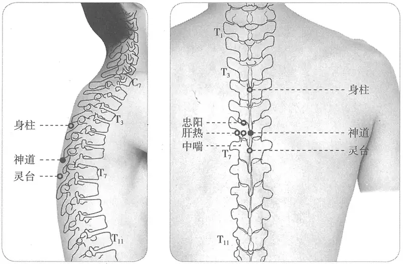

**图2-385　神道穴与相关穴图**

**取穴**：从至阳向上2个棘突，其上方凹陷中。

　1. 在第五椎节下间……俯而取之。（《针灸甲乙经》卷三、《外台秘要》、《素问》王冰注、《医心方》、《太平圣惠方》、《铜人腧穴针灸图经》、《圣济总录》、《针灸资生经》、《十四经发挥》、《医学纲目》、《针灸聚英》、《古今医统》、《针灸大成》、《针方六集》、《类经图翼》、《循经考穴编》、《医宗金鉴·刺灸心法要诀》、《针灸易学》、《针灸逢源》）

　2. 神道在第五椎下节间。（《千金要方》卷二十九、《千金翼方》）

　3. 第五椎之下。（《针灸十四经穴位考订》）

　4. 统编针灸学教材

　　(1) 部位：第五椎之下。取穴：正坐略向前俯，从第五椎下陷中取之。（1957年南京《针灸学》）

　　(2) 部位：第五椎之下。取穴：按取椎间下陷中，伏而取之。（1版《针灸学讲义》）

〔p.1242 (인쇄 1214)〕

　　(3) 部位：在第五腰椎节下间。取穴：第五胸椎棘突下凹陷中，俯伏取之。（2版《针灸学讲义》）

　　(4) 第五胸椎棘突下。（4、5版《针灸学》，《中国针灸学）》

　　(5) 在背部，当正中线上，第5胸椎棘突下凹陷中。（6、7版《针灸学》）

#### 【类属】 

督脉穴。

督脉气所发。（《黄帝明堂经》）

#### 【适应症】 

主治心神、局部病症。常用于多愁善悲，惊悸，健忘；脊强、脊痛；小儿惊风。

　1. 主身热头痛，进退往来。痎疟，悲愁恍惚，肩痛腹满，腰背急强。（《黄帝明堂经》）

　2. 治寒热头痛，进退往来，痎疟，恍惚悲愁，健忘惊悸。小儿风痫，瘛疭。（《铜人腧穴针灸图经》卷中）

　3. 失欠，牙车蹉张口不合。（《针灸聚英》卷一、《针灸大成》）

**按**：此乃从《针灸资生经》辑自《千金翼方》灸方主治。详见“附：临床应用举例”。

　4. 主七情过伤，痨瘵。（《循经考穴编》下）

　5. 统编针灸学教材

　　(1) 伤寒发热头痛，恍惚悲愁，健忘，惊悸，脊膂强痛，卒得咳嗽。（1957年南京《针灸学》）

　　(2) 发热头痛，恍惚悲愁，健忘，惊悸，背痛项强，咳嗽。（1版《针灸学讲义》）

　　(3) 健忘，惊悸，脊背强痛，咳嗽。（2版《针灸学讲义》，4、5、6版《针灸学》）

　　(4) ①心痛、心悸、怔忡等心疾；②失眠、健忘、中风不语、痫证等精神、神志病；③咳嗽，气喘；④腰脊强、肩背痛。（7版《针灸学》）

　　(5) 健忘，惊悸，脊背强痛，咳嗽，心痛。（《中国针灸学》）

#### 附：临床应用举例 

　1. 牙车失欠蹉跌，灸第五椎，日二七壮，满三百壮。（《千金翼方》卷二十六）

　2. 乏气，灸第五椎下，随年壮。（《千金翼方》卷二十七）

　3. 牛皮癣，针刺神道、灵台治疗。［天津中医，1993（4）：38-39］

#### 【操作】 

沿棘突的倾斜角向上斜刺0.5~1寸，不宜深刺，以免损伤脊髓。

　1. 刺入五分，留五呼，灸三壮。（《黄帝明堂经》）

　2. 可灸七七壮至百壮止。小儿风痫瘛疭，可灸七壮。（《铜人腧穴针灸图经》卷中）

　3. 禁针，灸三壮。（《医学入门》卷一）

　4. 一云灸七壮，累至百壮。（《针方六集》卷一）

　5. 不宜针，灸五壮。（《针灸十四经穴位考订》）

　6. 统编针灸学教材

　　(1) 灸三至七壮。（1957年南京《针灸学》、1版《针灸学讲义》）

　　(2) 艾炷灸3~7壮，艾条灸3~7分钟。（2版《针灸学讲义》）

　　(3) 向上斜刺0.5~1寸。（4、5、7版《针灸学》）

　　(4) 向上微斜刺0.5~1寸；可灸。（6版《针灸学》、《中国针灸学》）

### （十二）身柱 Shēnzhù GV12 出《黄帝明堂经》 

#### 【提要索隐】 

**定位**：在脊柱区，第3胸椎棘突下凹陷中，后正中线上。

〔p.1243 (인쇄 1215)〕

**适应症**：主治心神、肺部病症。常用于发热，癫狂；惊风、抽搐；腰背痛；咳嗽，气喘。

**针刺操作**：沿棘突的倾斜角向上斜刺0.5~1寸。不宜深刺，以免损伤脊髓。

#### 【名实考】 

关于本穴主治，《太平圣惠方·明堂》引秦丞祖《明堂》云“主小儿惊痫也”，或受此启发，日本针灸将本穴广泛应用于小儿病的治疗与预防上，并赋予“身柱”特定的内涵。1957年南京《针灸学》记载了一串很奇怪的别名，皆间接传自日本针灸教材。

　1. 别名　尘气、智利毛、知利气、知利介。（1957年南京《针灸学》）

　2. 身柱，俗云“知利介”。（《和汉三才图绘》）

那么，“知利介”是什么意思？南京《针灸学》中其他3个别名又是怎么回事？查得日本相关文献如下：

　3. 此穴邦俗呼“散气”（乡语“窒チ栗リ结ケ”）。言小儿胎热郁肺部分，灸此能散通其气。肺主气故也。（日本《校定引经诀》）

　4. 和名“尘气”，以治“尘气”名之。梶原性全《顿医抄》曰“尘气发于肺脏”是也。《医门摘要》曰“和俗谓之尘气（ちりけ）。预灸则不生诸病。病气积于此而伤其身。犹尘气积柱下。生湿气。而破家宅。故即名此穴谓之尘气”。释西忍所著方书训疳为“知利气”。（日本《经穴汇解》）

可知“知利介”、“窒栗结”之类都是“散气”一词的读音，日本假名为“ちりけ”，转换成汉语拼音=Qi Li Kai。

这与本题有什么关系？日本专用名词的发音很复杂，不查工具书，有时日本文学教授也读不对。查得《广辞苑》ちり条目下汉字有：散り、尘、智利、知里；け目下的汉字有：毛、气、介；ちりけ条目下的汉字为：身柱。

日本文献明言“尘气”是日本穴名，日本18世纪末期《穴法纪闻》一书中也特意注明：“释里气，系中国俗称，非唐人所名”[^46-1]。至此，这宗50年的悬案水落石出：《针灸学》所载之4个别名，几乎用尽了“散气”、“尘气”一名日语发音ちりけ所有可能的对应汉字——却唯独没有收录其本字“散气”或“尘气”。用一个更通俗的例子，可能更容易明白：我们知道汉字“药”，日语发音くすり，如果用汉字来注日语发音，现代说普通话的中国人可能选的词有：酷似梨、酷似里、枯丝丽、酷势力、库私立……如果是一个南方人（比如我的家乡南京人）则多半会选：哭死你、苦似泥、苦死你……之类——看上去有点义译的味道。我们在处理身柱穴别名的做法，就好像是没有收录“药”这个词，而收录了一堆“酷似梨”、“苦死你”之类的音译词（按着这个做法，这样的音译词还可一直往下续增，这穴位别名还有止境吗？）。

应当指出的是，1957年南京《针灸学》所载本穴别名皆传自日本针灸教材（早期的中国针灸学的教材更有将“尘气”误作“坐气”，“知利气”误作“和利气”，“知利介”误作“和利介”者），韩国针灸人也不明真相，又从中国教材重复了这一错误。现代日本编纂的针灸书中，于身柱穴下，也将上述“知利气”、“尘气”、“知利介”、“散气”悉数收录，甚至还可见有对这些汉译字所做的十分牵强的医理解释。这些都表明对于上述穴名的源流，现代日本人也不能详[^47-2]。

[^46-1]: 这里所说的“中国”是指日本区划，指日本本州岛西部的山阳道、山阴道地区，包含鸟取县、岛根县、冈山县、广岛县、山口县5个县。

[^47-2]: 有意思的是，在日本朋友提醒我之前，我已经注意到了《引经诀》这条文献，只是当时有一大堆日本文献要尽快读完，没能细推敲，甚至没有看出“窒チ栗リ结ケ”是对“散气”一词的日、汉双重注音，更没能把它与《针灸学》的4个别名联系起来。待我再次回看这条文献，4年前随手做的记号——黄色的即时帖让我永远记住它！进一步考察，还发现关于“散气”这一穴名许多故事，因与本书关系不大，不详述。

〔p.1244 (인쇄 1216)〕

　5. 身柱，在第三椎节下间，督脉气所发，俯而取之。（《黄帝明堂经》）

#### 相关穴及刺激点 

　1. 结核　位于背部，第2、3胸椎棘突旁开5分处各一穴。主治肺结核。针3~5分，针感局部酸、胀。（《针灸经外奇穴图谱（续集）》）

　2. 肺热　位于背部，第3、4胸推棘突之间点，左右旁开各5分处，即身柱穴左右旁开各5分处。主治肺炎，支气管炎，肺结核。针3~5分，针感局部胀、麻。隔蒜灸3~7壮。（《针灸经外奇穴图谱（续集）》）

　3. 肺募　位于背部，第3、4胸椎棘突之间点，左右旁开各2寸，即肺俞穴内侧5分。主治气管炎，哮喘，肺结核，胸膜炎，癔病，癫痫，眼病，肩背痛，脑炎，脑膜炎，肥大性脊柱炎。针向下沿皮下斜刺5~8分，针感局部胀、痛。（《针灸经外奇穴图谱（续集）》）

**按**：若按照隋唐时流行的“横三间寸灸”法的概念，上述“肺热”穴即身柱穴。

#### 【定位】 

**部位**：在脊柱区，第3胸椎棘突下凹陷中，后正中线上（图2-386）。

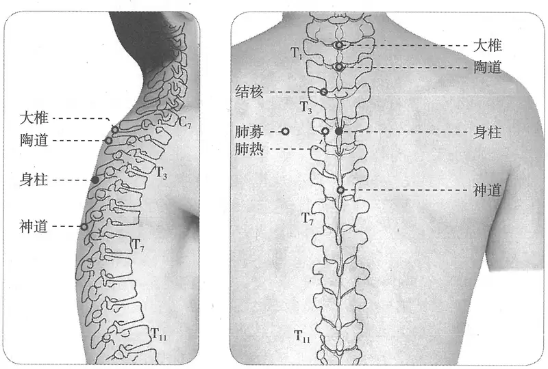

**图2-386　身柱穴与相关穴图**

**取穴**：第三胸椎棘突下凹陷中，俯伏取之。

　1. 《黄帝明堂经》佚文

　　(1) 在第三椎节下间……俯而取之。（《针灸甲乙经》卷三、《外台秘要》、《素问》王冰注、《医心方》、《太平圣惠方》、《铜人腧穴针灸图经》、《窦太师针经》、《医学纲目》、《针灸聚英》、《古今医统》、《针灸大成》、《针方六集》、《类经图翼》、《循经考穴编》、《针灸易学》）

　　(2) 在第三椎下节间。（《千金要方》卷二十九、《千金翼方》）

　2. 第三椎之下。（《针灸十四经穴位考订》）

　3. 统编针灸学教材

　　(1) 部位：第三椎之下。取穴：正坐，从第三椎下陷中取之。（1957年南京《针灸学》）

〔p.1245 (인쇄 1217)〕

　　(2) 部位：第三椎之下。取穴：按取椎间下陷中，正坐俯头取之。（1版《针灸学讲义》）

　　(3) 部位：在第三椎节下间。取穴：第三胸椎棘突下凹陷中，俯伏取之。（2版《针灸学讲义》）

　　(4) 第三胸椎棘突下。（4、5版《针灸学》，《中国针灸学》）

　　(5) 在背部，当后正中线上，第3胸椎棘突下凹陷中。（6版《针灸学》）

　　(6) 后正中线上，第3胸椎棘突下凹陷中，约与两侧肩胛冈高点相平。（7版《针灸学》）

#### 【类属】 

督脉穴。

督脉气所发。（《黄帝明堂经》）

#### 【适应症】 

主治心神、肺部病症。常用于发热、癫狂，惊风、抽搐，腰背痛；咳嗽，气喘。

　1. 主身热狂走，谵语见鬼，瘛疭。癫疾，怒欲杀人。（《黄帝明堂经》）

　2. 秦丞祖《明堂》云：主小儿惊痫也。（《太平圣惠方·明堂》）

　3. 治癫疾，瘛疭，怒欲杀人，身热狂走，谵言见鬼。（《铜人腧穴针灸图经》卷中）

　4. 窦太师针灸遗存

　　(1) 治一切咳嗽等症，先补后泻；哮喘，腰脊强痛，先补后泻。（《窦太师针经》）

　　(2) 治咳嗽，先补后泻。（《大本琼瑶神书》）

　　(3) 咳嗽哮喘。（《针方六集》卷五）

　5. 主腰脊痛。《难经》云治洪长伏三脉，风痫惊痫发狂，恶人与火，灸三椎、九椎。（《针灸聚英》卷一、《针灸大成》）

　6. 统编针灸学教材

　　(1) 小儿癫痫，瘛疭，腰脊强痛，虚劳咳喘。（1957年南京《针灸学》、1版《针灸学讲义》）

　　(2) 咳嗽，气喘，癫痫，腰脊强痛。（2版《针灸学讲义》，4、5、6版《针灸学》）

　　(3) ①身热、头痛、咳嗽、气喘等外感病证；②惊厥、癫狂痫等神志病证；③腰脊强痛；④疔疮发背。（7版《针灸学》）

　　(4) 咳嗽，气喘，痫证，腰脊强痛，疔疮。（《中国针灸学》）

**文献分析**：《黄帝明堂经》载本穴主治悉为督脉病症，至金元窦太师针灸则突出治疗肺部症状的作用，并有相应的临床应用，现代针灸学教材从之。“疔疮发背”未详所出，暂不采录。

#### 附：临床应用举例 

　1. 忽然咳嗽腰脊痛，身柱由来穴更真，至阳亦医黄疸病，先泻后补妙通神。（《针灸玉龙歌》）

　2. 脾寒发疟，后溪、间使、大椎、身柱、三里、绝骨、合谷、膏肓。（《针灸大成》卷九）

　3. 癔病失语，身柱穴针灸疗法。［山西中医，1985，1（3）：28］

　4. 破伤风后遗症，大椎穴、身柱穴，针刺治疗。［中国针灸，1985，5（1）：7］

　5. 疟疾，身柱穴针灸疗法。［中国针灸，1985，5（4）：8］

#### 【操作】 

沿棘突的倾斜角向上斜刺0.5~1寸。不宜深刺，以免损伤脊髓。

　1. 刺入五分，留五呼，灸五壮。（《黄帝明堂经》）

　2. 针入五分，灸七七壮。（《铜人腧穴针灸图经》卷中）

　3. 窦太师针灸遗存

〔p.1246 (인쇄 1218)〕

　　(1) 针入三分，灸七壮。治一切咳嗽等症，先补后泻；哮喘，腰脊强痛，先补后泻。（《窦太师针经》）

　　(2) 针三分，灸七壮。（《窦太师秘传》）

　　(3) 针三分，灸七壮，泻之。（《针灸玉龙歌》注）

　4. 针三至五分，灸五壮。（《针灸十四经穴位考订》）

　5. 统编针灸学教材

　　(1) 针三至五分，灸三至五壮。（1957年南京《针灸学》、1版《针灸学讲义》）

　　(2) 向上斜刺3~5分；艾炷灸3~5壮，艾条灸3~5分钟。（2版《针灸学讲义》）

　　(3) 向上斜刺0.5~1寸。（4、5、7版《针灸学》）

　　(4) 向上微斜刺0.5~1寸；可灸。（6版《针灸学》、《中国针灸学》）

　6. 针尖略向上斜刺0.7~1寸。感应酸胀或沉重感，向背下方扩散。灸3~5壮；温灸10~20分钟。（上海《针灸学》）

### （十三）陶道 Táodào GV13 出《黄帝明堂经》 

#### 【提要索隐】 

**定位**：在脊柱区，第1胸椎棘突下凹陷中，后正中线上。

**适应症**：主治热病。常用于疟疾；脊强。

**针刺操作**：从后略向上斜刺1~1.5寸，不宜深刺，以免伤及脊髓。

#### 【名实考】 

　1. 陶道，在项大椎节下间，督脉、足太阳之会，俯而取之。（《黄帝明堂经》）

　2. 陶者，窑也，中虚而能容物之象也。胸与腹在下与前而中虚，此穴在其上之最高处，有陶之象焉，故曰陶道。（《经穴解》）

#### 相关穴及刺激点 

胸3：位于第3胸椎棘突上缘，即陶道穴下方。主治哮喘，支气管炎，风湿性心脏病。针刺时病人端坐，两臂交叉于胸前，两肩下垂，头尽量前倾，使背部皮肤紧张，针与脊柱成30°~40°角刺入皮肤，然后使针尖向下，沿真皮层与皮下组织之间，以均匀力量刺入，深1.5~2寸。（《针灸经外奇穴图谱（续集）》）

#### 【定位】 

**部位**：在脊柱区，第1胸椎棘突下凹陷中，后正中线上（图2-387）。

**取穴**：从第7颈椎向下1个棘突，当棘突下凹陷中。

　1. 《黄帝明堂经》佚文

　　(1) 在大椎节下间……俯而取之。（《针灸甲乙经》卷三、《千金要方》、《千金翼方》、《外台秘要》、《素问》王冰注、《医心方》、《太平圣惠方》、《铜人腧穴针灸图经》、《针灸资生经》、《十四经发挥》、《医学纲目》、《针灸聚英》、《古今医统》、《针灸大成》、《类经图翼》、《循经考穴编》、《医宗金鉴·刺灸心法要诀》、《针灸易学》、《针灸逢源》）

　　(2) 陶道在大椎下节间。（《千金要方》卷二十九、《千金翼方》）

　2. 第一椎之下。（《针灸十四经穴位考订》）

　3. 统编针灸学教材

〔p.1247 (인쇄 1219)〕

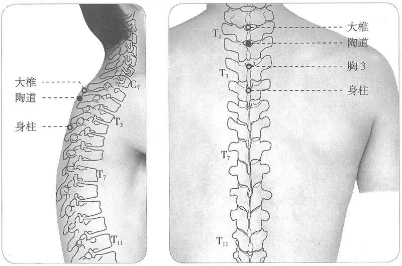

**图2-387　陶道穴与相关穴图**

　　(1) 部位：第一椎下陷中。取穴：正坐，在第一胸椎下，俯而取之。（1957年南京《针灸学》）

　　(2) 部位：第一椎下陷中。取穴：按取椎间下陷中，正坐俯头取之。（1版《针灸学讲义》）

　　(3) 部位：在大椎节下间。取穴：第一胸椎棘突下凹陷中，伏取之。（2版《针灸学讲义》）

　　(4) 第一胸椎棘突下。（4、5版《针灸学》，《中国针灸学》）

　　(5) 在背部，当后正中线上，第1胸椎棘突下凹陷中。（6、7版《针灸学》）

#### 【类属】 

督脉穴。

**脉气所发**：督脉、足太阳之会。（《黄帝明堂经》）

**归经**：督脉。（《外台秘要》卷三十九、《铜人腧穴针灸图经》卷上）

#### 【适应症】 

主治热病。常用于疟疾；脊强。

　1. 主头重目瞑，凄厥寒热，项强难以反顾，汗不出。（《黄帝明堂经》）

　2. 脊强，以头汗不出也。（《太平圣惠方·针经》）

　3. 主痎疟，寒热洒淅矣。（《太平圣惠方·明堂》）

　4. 治头重目瞑，洒淅寒热，脊强，汗不出。（《铜人腧穴针灸图经》卷中）

　5. 烦满。瘛疭，恍惚不乐。（《针灸聚英》卷一、《针灸大成》、《针方六集》、《类经图翼》）

　6. 治男子诸虚百损，五痨七伤等症。（《窦太师秘传》）

　7. 一传此穴善退骨蒸之热。（《类经图翼》卷八）

　8. 统编针灸学教材

　　(1) 瘛疭，恍惚，脊强头痛，疟疾，寒热，骨蒸。（1957年南京《针灸学》、1版《针灸学讲义》）

　　(2) 脊强，头痛，疟疾，热病。（2版《针灸学讲义》，4、5、6版《针灸学》，《中国针灸学》）

　　(3) ①热病、疟疾，恶寒、发热、咳嗽、气喘等外感病证；②骨蒸潮热；③癫狂；④脊强。（7版《针灸学》）

〔p.1248 (인쇄 1220)〕

**文献分析**：《针灸聚英》二条主治乃高武从《针灸资生经》误录《千金要方》之文；《窦太师秘传》、《类经图翼》载主治乃《太平圣惠方》“大椎”穴主治。教材中“瘛疭，恍惚”乃承袭高武《针灸聚英》之误，今去之；“咳嗽、气喘”系肺痨症的描述，“癫狂”症未详所出，暂不收录。

#### 附：临床应用举例 

　1. 治久风，卒风，缓急诸风，卒发动不自觉知，或心腹胀满，或半身不遂，或口噤不言，涎唾自出，目闭耳聋，或举身冷直，或烦闷恍惚，喜怒无常，或唇青口白戴眼，角弓反张……次灸陶道。（《千金要方》卷八、《千金翼方》）

　2. 疟疾，大椎穴、内关穴、陶道穴，针刺治疗。［湖南中医学院学报，1987，7（3）：37-38］

#### 【操作】 

沿棘突的倾斜角向上斜刺0.5~1寸。不宜深刺，以免损伤脊髓。

　1. 刺入五分，留五呼，灸五壮。（《黄帝明堂经》）

　2. 针二分，灸二七壮。（《窦太师秘传》）

　3. 统编针灸学教材

　　(1) 针五分，灸三至七壮。（1957年南京《针灸学》、1版《针灸学讲义》）

　　(2) 向上斜刺5分；艾炷灸3~7壮，艾条灸3~7分钟。（2版《针灸学讲义》）

　　(3) 向上斜刺0.5~1寸。（4、5、7版《针灸学》）

　　(4) 向上微斜刺0.5~1寸；可灸。（6版《针灸学》、《中国针灸学》）

　4. 微斜向上直刺1~1.5寸。灸3~5壮；温灸5~15分钟。（上海《针灸学》）

### （十四）大椎 Dàzhuī GV14 出《黄帝明堂经》 

问题1：大椎究竟是哪一椎？

问题2：百劳与大椎穴是什么关系？

问题3：大椎与大杼有何关联？

问题4：崇骨与大椎穴是什么关系？

#### 【提要索隐】 

“大椎”之名见于《素问》，然皆指骨名，而非穴名。

**穴名**：又作大颐。一名百劳。

**定位**：在脊柱区，第7颈椎棘突下凹陷中，后正中线上。

**适应症**：主治热病、局部病症。常用于热病，疟疾、寒热；咳嗽，气喘；骨蒸；颈项强痛，脊痛。

**针刺操作**：沿棘突的倾斜角向上斜刺0.5~1寸。不宜深刺，以免损伤脊髓。

#### 【名实考】 

第一胸椎名“大椎”，穴在椎上陷中，故曰“大椎”。切不可将“大椎”穴与“大椎”骨相混。

“大椎”之“椎”字，《灵枢·背腧》作“焦”；《铜人腧穴针灸图经》作“颐”，并注曰：“一本作‘椎’，今从‘页’，作‘颐’，余皆仿此”。

　1. 椎，直追反；又槌，反同；槌；俗作“颐”。（《医心方》卷二）

　2. 大椎，在第一椎上陷者中，三阳督脉之会。（《黄帝明堂经》）

　3. 百劳一穴，一名大椎。（《窦太师针经》）

　4. 别名　百劳。（1957年南京《针灸学》）

〔p.1249 (인쇄 1221)〕

#### “大椎”与“大杼”辨 

　1. 大椎以下至尻二十节间各一，骶下凡二十一节，脊椎法。杨上善注：骶，竹尸反，此经音低，尾穷骨，从骨为正。大椎至骶二十一节，有二十间，间有一穴，则二十六穴也。《明堂》从兑端上项，下至喑门，有十三穴，大椎以下，至骶骨长强，二十一节，有十一穴，凡二十四穴，督脉气所发。与此不同，未详也。（《黄帝内经太素·气府》）

　2. 胸中大输在杼骨之端，杨上善注：杼骨，一名大杼，在于五脏六腑输上，故是胸之膻中气之大输者也。（《黄帝内经太素·气穴》）

　3. 《华佗针灸经》法　第一椎名大椎。（转引自《医心方》卷二）

　4. 第一椎名大杼。（《千金翼方》卷二十七）

　5. 《小品方》云大椎上节以上属颈崇骨也。大椎与崇骨相接处，其节最高硕也。（《医心方》卷十六脚注）

　6. 《甲乙经》云大椎下至尾骶骨二十一椎长三尺，折量取腧穴。（《铜人腧穴针灸图经》卷中）

　7. 王执中曰：或云第一椎上更有大椎在宛宛陷中，非有骨也。有骨处即是第一椎……大椎虽无骨，实是穴名。既曰自大椎下至二十一椎，岂可不量大椎以下。或者之说于是不通矣。（《针灸资生经》卷二）

　8. 肺俞穴从大椎数第三椎……（《千金要方》卷十、《千金翼方》）

　9. 太阳与少阳并病，头痛，或眩冒，如结胸，心下痞而坚，当刺肺俞、肝俞、大椎第一间，大椎，平肩斜齐高大者是也。仍不得侵项分，［侵项分］取之则非也。上接项骨，下肩齐在椎骨节上是，余穴尽在节下。出《黄帝针灸经》。（《外台秘要》卷一）

　10. 大杼上两旁各一，凡二穴。（《黄帝内经太素·气穴》）

**按**：《素问》“大杼”作“大椎”。

　11. 骨会大杼。骨病治此。注曰：骨会大杼，骨者髓所养，髓自脑下注于大杼，大杼渗入脊心，下贯尾骶，渗诸骨节，故骨之气皆会于此。（《难经本义·四十五难》）

　12. 今人灸大椎者，俱是项骨高起者，见其骨高而大，误以为大椎，而取之。愚今除项骨三节，则大椎又数为第一椎，其两旁即大杼穴，乃足太阳膀胱经穴名也。新校正以为大椎旁无穴，意者亦若今人以项之高骨为大椎耳。（《素问注证发微·气穴论》）

　13. 有言人之脊骨连项骨共有二十四节，应二十四气，亦有理。凡灸大椎，当以上项骨三节不算，但项骨比大椎更高，今人误取高骨为大椎，则灸项骨，非灸大椎也，往往俱误。（《素问注证发微·气府论》）

　14. 如其人骨节分明，则以椎数为准；若脊背肥厚，骨节难寻，须以大椎至尾骶，量分三尺折取之；不然则以平脐十四命门为则，逐椎分寸取之，则穴无不真。然取大椎之法，除项骨三节不在内，或人亦有项骨短而无可寻者，但当以平肩之处为第一椎，以次求之，可无差也。（《类经图翼》卷八）

　15. 背中大俞。在杼骨之端。张志聪注曰：先言大杼者。乃项后大骨之端。督脉循于脊骨之第一椎也。（《黄帝内经灵枢集注·背腧》）

　16. 崇骨一穴，在大椎上，第一小椎是也。大椎在小骨下、第一椎节下（上）陷中。（朝鲜《针灸经验方》）

〔p.1250 (인쇄 1222)〕

　17. 定大椎法，先探定项骨三椎，当第四椎是第一大椎，大抵与肩相对。又令人头回顾俯仰，指下不动摇者为大椎。如三小椎，随回顾俯仰隐显不定。（日本《校订引经诀》）

**文献分析**：从以上大量古代文献描述可得如下判断：第一，作为骨名，“大椎”又作“大杼”（“椎骨”也作“杼骨”），是指第一胸椎；第二，作为穴名，“大椎”在第一胸椎棘突上陷中；第三，“骨会大杼”、“大椎第一间”皆为骨名，即第一胸椎。古籍中或曰“大椎，一名百劳”，或曰“大杼，一名百劳”，皆源于此；第四，古人通过在活体触摸的方法确定椎节，颈椎只辨出三椎，称项骨，又曰“柱骨”、“天柱骨”或“崇骨”，第四椎高大者为第一椎，名“大椎”，而最高大者为与大椎骨相邻的崇骨——即第七颈椎。朝鲜许任《针灸经验方》据此将大椎上第一小椎（第七颈椎）称作“崇骨穴”（相当于第七颈椎棘突尖），然而无主治病症及相关刺灸法，后面的临床治疗篇中也无应用，可见并非出自许任的临床实践。关于第一胸椎与第七颈椎的辨识，虽然中国古医籍早有论述，但日本古书记载的方法更实用。

#### 【定位】 

**部位**：在脊柱区，第7颈椎棘突下凹陷中，后正中线上（图2-388）。

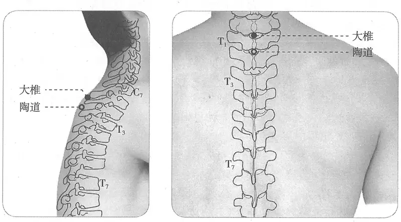

**图 2-388　大椎穴图**

**取穴**：第7颈椎与第1胸椎棘突之间，俯伏取之，约与肩相平。

　1. 《黄帝明堂经》佚文

　　(1) 大椎在第一椎陷者中。（《针灸甲乙经》卷三）

　　(2) 大椎，在第一椎上陷中。（《千金要方》卷二十九、《千金翼方》、《外台秘要》、《素问》王冰注、《医心方》、《太平圣惠方》、《铜人腧穴针灸图经》、《圣济总录》、《针灸资生经》、《十四经发挥》、《神应经》、《针灸聚英》、《古今医统》、《针灸大成》、《类经图翼》、《循经考穴编》、《针灸逢源》）

　2. 在项第一椎下陷者中。（《太平圣惠方·明堂》、《针方六集》、《针灸易学》）

　3. 第一椎之上第七颈椎之下。（《针灸十四经穴位考订》）

　4. 统编针灸学教材

　　(1) 部位：第一椎上陷者宛宛中。取穴：正坐，从第一胸椎上陷中取之，此穴适与肩平。

〔p.1251 (인쇄 1223)〕

（1957年南京《针灸学》）

　　(2) 部位：第一椎上陷者宛宛中，适与肩平。取穴：按取椎间下陷中，正坐俯头取之。（1版《针灸学讲义》）

　　(3) 部位：在第一椎上陷者中。取穴：第七颈椎与第一胸椎棘突之间，俯伏取之，约与肩相平。（2版《针灸学讲义》）

　　(4) 第七颈椎棘突下。（4、5版《针灸学》）

　　(5) 在后中线上，第7颈椎棘突下凹陷中。（6、7版《针灸学》）

　　(6) 第七颈椎棘突下，约与肩相平。（《中国针灸学》）

#### 【类属】 

督脉穴。

**脉气所发**：三阳、督脉之会。（《黄帝明堂经》）

**归经**：督脉。（《外台秘要》卷三十九、《铜人腧穴针灸图经》卷上）

#### 【适应症】 

治疗各种发热的要穴。主治热病、局部病症。常用于热病，疟疾、寒热；咳嗽，气喘，骨蒸；颈项强痛，脊痛。颅脑外科手术的针麻用穴。

　1. 主伤寒热盛，烦呕。（《黄帝明堂经》）

　2. 主寒热。（《外台秘要》卷三十九）

**按**：此系误录《素问·骨空论》针灸方主治。

　3. 疗五劳七伤，温疟痎疟，痓，背膊闷，项强不得回顾。（《太平圣惠方·针经》）

　4. 疗五劳七伤，温疟痎疟，气疰，背膊拘急，颈项强不得回顾，风劳食气。（《铜人腧穴针灸图经》卷中）

　5. 窦太师针灸遗存

　　(1) 治一切虚劳发热，盗汗，先补后泻。一切脾寒等症，灸之立效。治脊膂强痛，泻；一切诸虚，潮热，百损，看症补泻。（《窦太师针经》）

　　(2) 骨蒸发热，盗汗，咳嗽，瘰疬，诸虚潮热。（《针方六集》卷五）

　　(3) 主诸虚百损，骨蒸盗汗，往来寒热，咳嗽，一切项背强，肩膊急，百节酸疼，吐血失力。（《循经考穴编》下）

　　(4) 治浑身发热，疟症。（《窦太师秘传》）

　6. 主肺胀胁满，呕吐，上气，乏力，骨热，前板齿燥，癫疾。（《针灸聚英》卷一、《针灸大成》）

**按**：“肺胀胁满，呕吐，上气”乃高武从《针灸资生经》辑自《千金要方》灸方主治，详见“附：临床应用举例”；“骨热，前板齿燥”辑自《洁古云岐针法》“针之撮要”篇，原文作“骨热不可治，前板齿干燥，当灸骨会大椎”。

　7. 统编针灸学教材

　　(1) 羊痫惊风，五劳七伤，疟疾，寒热，咳嗽，肺胀胁痛，项强背膊拘急。（1957年南京《针灸学》、1版《针灸学讲义》）

　　(2) 热病，疟疾，感冒，骨蒸潮热，咳嗽，气喘，项强，脊背强急，癫痫。（2版《针灸学讲义》）

　　(3) 头痛项强，疟疾，热病，癫痫，骨蒸潮热，咳嗽，气喘。（4版《针灸学》）

　　(4) 热病，疟疾，咳嗽，气喘，骨蒸盗汗，癫痫，头痛项强，风疹。（5版《针灸学》）

　　(5) 热病，疟疾，咳嗽，气喘，骨蒸盗汗，癫痫，头痛项强，肩背痛，腰脊强痛，风疹。（6版《针灸学》）

　　(6) ①热病、疟疾、恶寒发热、咳嗽、气喘等外感病证；②骨蒸潮热；③癫狂痫证、小儿惊风等神志病证；④项强，脊痛；⑤风疹，痤疮。（7版《针灸学》）

〔p.1252 (인쇄 1224)〕

　　(7) 头痛项强，疟疾，热病，癫痫，骨蒸潮热，咳嗽，气喘，感冒，脊背强急。（《中国针灸学》）

**文献分析**：《外台秘要》载本穴主治：“主寒热，以年为壮数。伤寒热甚，烦呕。”今检《针灸甲乙经》卷七并《医心方》卷二、《千金要方》卷三十载“大椎”穴主治均只“伤寒热甚，烦呕”一条。王焘所录第一条主治实辑自《针灸甲乙经》卷八第一上（原文见《素问·骨空论》）：“灸寒热之法：先取项大椎，以年为壮数，次灸撅骨，以年为壮数……凡当灸二十九处”。杨上善《黄帝内经太素·灸寒热法》于此方“大椎”穴下注曰：“《明堂》大椎有疗伤寒病，不疗寒热。”可见杨上善所据《黄帝明堂经》底本所载“大椎”穴主治也与其他传本相同。又上述《素问》所载灸寒热病方，共取二十九穴，而王焘仅将此症辑入“大椎”、“侠溪”、“三里”、“阳辅”穴下，其他诸穴或未能辨识而皆不录，也欠妥。

教材中“风疹、痤疮”未详所出。“癫痫”一症未见各源头文献，疑将《针灸聚英》等书中“大杼”穴主治录于此，暂不收录。

又，《圣济总录》卷一九四谓：“两腋外纹头尖处上曲池穴，不可伤，伤即令人手臂不举，宜针大椎、相夹脑骨缝四穴，深半寸。”提示，本穴在治疗上肢神经或肌肉损伤方面有明显的作用，古代腧穴文献没有记载，现代临床有零星报道，今后应注意观察，总结积累。

#### 附：临床应用举例 

　1. 热病

　　(1) 诸烦热时气温病，灸大椎百壮，针入三分泻之，横三间寸灸之。（《千金翼方》卷二十七）

　　(2) 崔氏疗伤寒始得一二日方，便可灸顶三壮，又灸大椎三壮，各加至五壮益良，用之验。（《外台秘要》卷一）

　　(3) 伤寒大热不退：曲池、绝骨、三里、大椎、涌泉、合谷俱宜泻。（《针灸大成》）

　　(4) 小儿高热：大椎穴、少商穴，穴位点刺治疗。［四川中医，1985，3（6）：49］

　　(5) 高热惊厥：大椎穴、合谷穴，针刺治疗。［上海针灸杂志，1987，6（2）：47］

　　(6) 流行性出血热：大椎穴、阴交穴，灸法治疗。［中医临床，1988，9（2）：174-175］

　2. 颈项病症

　　(1) 灸瘿法：灸风池夹项两边两穴、耳上发际百壮，又大椎百壮。（《千金翼方》卷二十八）

　　(2) 伤寒项强，腠理不密，风邪流注经络，以致不得位：泻人中，灸百劳、合谷、风池。（《针灸集要·盘石金直刺秘传》）

　　(3) 头痛眩冒，如结胸，心下痞硬，或谵语，刺肺俞、肝俞。如头项强，刺大椎。（《伤寒治例》）

　　(4) 椎-基底动脉供血不足：七星针打刺大椎穴治疗。［四川中医，1987，5（9）：50］

　　(5) 颈椎病：大椎穴、天宗穴，推拿结合针刺治疗。［吉林中医药，1987（1）：14］

　3. 疟疾

　　(1) 疟，灸上星及大椎，至发时令满百壮，灸艾炷如黍米粒。俗人不解取穴。务大炷也。（《千金要方》卷十）

　　(2) 凡疟有不可瘥者，从未发前灸大椎，至发时满百壮，无不瘥。（《千金翼方》卷二十六）

〔p.1253 (인쇄 1225)〕

　　(3) 五种疟疾：刺间使，寒多补之，热多泻之；未愈灸百劳，未发前已发后效。（《针灸集要·盘石金直刺秘传》）

　　(4) 疟疾：大椎穴、内关穴、陶道穴，针刺治疗。［湖南中医学院学报，1987，7（3）：37-38］

　4. 风证

　　(1) 肝风占候其口不能言，当灸鼻下人中，次灸大椎，次灸肝输，第九椎下是，五十壮。余处随年壮。（《千金要方》卷八）

　　(2) 破伤风后遗症：大椎穴、身柱穴，针刺治疗。［中国针灸，1985，5（1）：7］

　　(3) 破伤风：大椎穴、风府穴，针刺治疗。［中国针灸，1987（4）：2］

　　(4) 荨麻疹：大椎穴、膈俞，针刺放血拔罐治愈。［黑龙江中医药，1987（3）：36］

　　(5) 中风偏瘫：大椎穴、列缺穴，针刺为主治疗。［山东中医杂志，1987（4）：17］

　5. 肺、心部病症

　　(1) 短气不得语，灸天井百壮，穴在肘后两筋间。又灸大椎随年壮。（《千金要方》卷十七）

　　(2) 肺胀胁满，呕吐上气等，灸大椎并两乳上第三肋间各三壮。（《千金要方》卷十七、《千金翼方》卷二十七）

　　(3) 小儿咳喘病：大椎穴针灸疗法。［中国针灸，1984，4（4）：18］

　　(4) 百日咳：大椎穴、合谷穴、列缺穴、足三里穴，针罐治疗。［黑龙江中医药，1986（6）：37-38］

　　(5) 慢性支气管炎及肺气肿：肺俞穴、大椎穴，方法：急性发作期取肺俞，大椎，定喘拔火罐，后悬灸双侧丰隆，尺泽，足三里。每穴5分钟，每日1次，7次为1疗程。［中国针灸，1988，8（2）：20］

　6. 其他病症

　　(1) 治水积入胃，名曰溢饮。滑泄，渴能饮水，水下腹泻而又渴，此无药证，当灸大椎。（《素问病机气宜保命集》卷中）

　　(2) 治水渍入胃为溢饮滑泄，渴能饮水，水下复泄，泄而大渴，此无药症，当灸大椎。（《医学纲目》卷二十二）

　　(3) 脑发育不全：哑门穴、大椎穴，针刺治疗。［辽宁中医杂志，1984，8（5）：33］

　　(4) 痛经：大椎穴针刺。［陕西中医，1985，6（3）：130］

　　(5) 急性腰扭伤：针刺大椎穴治疗。［陕西中医，1985，6（8）：364］

　　(6) 鼻衄：大椎穴，针刺治疗。［山东中医杂志，1986（6）：38］

　　(7) 偏瘫：大椎穴、命门穴，交替针刺健患侧治疗。［江苏中医杂志，1986，7（11）：24］

　　(8) 小儿麻痹：大椎穴、曲池穴，针灸疗法。［中国针灸，1986，6（6）：1-3］

　　(9) 风湿病：大椎穴、命门穴，温和灸法治疗。［中国针灸，1986，6（6）：3］

　　(10) 精神分裂症：大椎穴、强间穴，针刺治疗。［实用中医内科杂志，1987，1（3）：131］

　　(11) 外伤性截瘫：人中穴、大椎穴，针刺为主治疗。［浙江中医杂志，1988，23（3）：130］

　　(12) 腰椎管狭窄症：大椎穴艾炷灸。［医道之日本，1988，47（3）：12-15］

〔p.1254 (인쇄 1226)〕

　　(13) 腰腿软组织损伤：针刺大椎、腕骨治疗。［浙江中医杂志，1991，26（10）：452］

#### 【操作】 

沿棘突的倾斜角向上斜刺0.5~1寸。不宜深刺，以免损伤脊髓。

　1. 刺入五分，灸九壮。（《黄帝明堂经》）

　2. 针入五分，留三呼，泻五吸，灸亦得。日灸七壮至七七壮罢。（《太平圣惠方》）

　3. 窦太师针灸遗存

　　(1) 针一分，灸二七壮。治一切虚劳发热，盗汗，先补后泻。一切脾寒等症，灸之立效。治脊膂强痛，泻；一切诸虚，潮热，百损，看症补泻。（《窦太师针经》）

　　(2) 针三分，灸二七壮。（《针灸玉龙歌》注）

　4. 针五分，灸五壮。（《针灸十四经穴位考订》）

　5. 统编针灸学教材

　　(1) 针五分，灸三至十五壮。（1957年南京《针灸学》、1版《针灸学讲义》）

　　(2) 直刺5分；艾炷灸5~15壮，艾条灸5~15分钟。（2版《针灸学讲义》）

　　(3) 向上斜刺0.5~1寸。（4、5、7版《针灸学》）

　　(4) 直刺0.5~1寸；可灸。（6版《针灸学》、《中国针灸学》）

　6. 微斜向上直刺1~1.5寸。感应局部酸胀向下或向两肩部扩散。灸3~7壮；温灸5~15分钟。在一般情况下不宜深刺。如有肢体麻电感，应立即退针，切勿再作提插捻转。（上海《针灸学》）

**刺法解剖学基础**：由于颈胸部椎骨棘突呈叠瓦状，故进针后针尖方向宜稍向上。

### （十五）哑门 Yǎmén GV15 出《素问》 

#### 【提要索隐】 

**穴名**：一名舌横，一名舌厌。

**定位**：在颈后区，第2颈椎棘突上际凹陷中，后正中线上。

**适应症**：主治咽喉部、头项部病症。常用于失音，舌缓或舌强不语；头痛，颈项强痛；鼻衄。

**针刺操作**：针尖朝向耳垂或下颌方向缓慢刺入0.5~1寸，不可向上深刺，以免损伤脊髓。

#### 【名实考】 

宋以前文献均作“瘖门”，至宋代《铜人腧穴针灸图经》作“痖门”，并注曰“一作瘖”。现代简化字，统一作“哑”。

本穴定位，古代文献以后发际为基准，然而古人早就注意到，后发际的位置存在明显的个体差异。关于后发际的判定可参照下法：

方法一：部分人群后发际形状不规则，或偏高，或偏低，特别是发际正中下缘偏低，正是由于这个原因，现代针灸教科书对于古典针灸文献中以后发际定位的腧穴换用骨性标志定位。然而对于多数后发际正常的人群来说，用后发际定位更简单，故在现代临床上仍有较广的应用。对此古典针灸文献有明确论述：

问曰：如后发际亦有项脚长者，其毛直至头骨，亦有无项脚者，毛齐至天牖穴，即无毛根，何而取穴也？答曰：其毛不可辄定，大约如此，若的的定，与风府正相当，即是侧相去各二寸，此之定穴。（《太平圣惠方》卷九十九）

基于此，可得判别后发际的第一种方法：不论其下缘如何的低，只要将两侧发缘处的风池穴（斜方肌外侧缘）连成一线，其中点处下半寸定一点，沿此三点划一条自然弧度的线即为后发际线。

〔p.1255 (인쇄 1227)〕

方法二：将前发际至第7颈椎棘突折为15寸，第7颈椎棘突上3寸处即为后发际。

　1. 喑门，一名舌横，一名舌厌。在项后发际宛宛中，入系舌本。督脉、阳维之会，仰头取之。（《黄帝明堂经》）

　2. 哑门之名，著戒垂后，误灸之，则必哑也。（《经穴解》）

　3. 别名　舌根、厌舌、横舌、舌肿。（1957年南京《针灸学》）

**按**：此传自日本针灸教材。其中“舌根”疑将风府穴别名“舌本”混于此；厌舌、横舌系“舌厌”、“舌横”之误倒；“舌肿”出自《东医宝鉴》，原书注明引自《铜人腧穴针灸图经》，今查《铜人腧穴针灸图经》作“舌横”，无误。

#### “哑门”与“五处”相混例 

　1. 喑门……脉旁，去上星一寸五分，灸三壮。此以泻诸阳气热，衄，善噫，风头痛，汗不出，寒热，痓，脊强反折，瘛疭，癫疾，头重。（《外台秘要》卷三十九）

　2. 五处在督脉旁，去上星一寸半，足太阳脉气所发，灸三壮。主痓，脊强反折，瘛疭，癫疾，头重，寒热。（《外台秘要》卷三十九）

　3. 五处，此以泻诸阳气热，衄，善嚏，风头痛，汗出寒热，痓，脊强反折，头重。（《医心方》卷二）

**按**：《外台秘要》“喑门”条下文字均系“五处”穴内容，其文序及文字均与“五处”条下辑自《针灸甲乙经》者明显不同，而与《医心方》卷二文序相同，显然系录自某种《明堂经》传本。可能王焘当时所据之《针灸甲乙经》传本卷三“喑门”穴处有残缺，故王焘直接从一种《明堂经》抄录，而恰好这个抄本“喑门”穴下有脱文，以致与其下“五处”穴文字相混，王焘抄录时未加甄别，一并抄入，而导致了上述奇特的错误。宋代王惟一竟不加考察，将其中“五处”穴部位、灸法文字删去，而仍将其主治症，即“诸阳热气……头重”一节抄于“哑门”穴下，后人遂无法识别这一原本十分明显的错误。

#### 【定位】 

**部位**：在颈后区，第2颈椎棘突上际凹陷中，后正中线上（图2-389）。

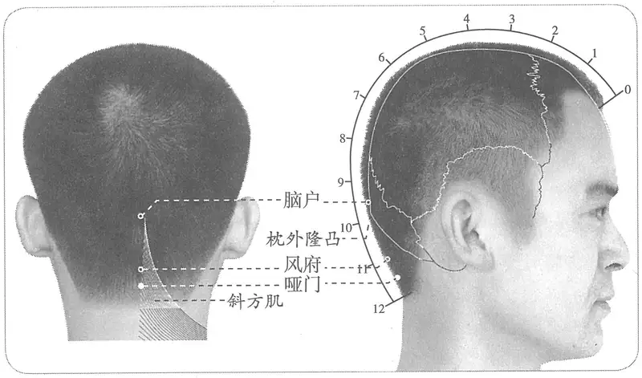

**图 2-389　哑门穴图**

**取穴**：于风府下0.5寸取本穴。后发际正常者，可于后发际正中直上0.5寸处取穴。

#### 第2颈椎棘突触诊技法 

当手指在中线从枕外隆凸向下摸时，所遇到的第一个骨性隆起是第2颈椎棘突。

〔p.1256 (인쇄 1228)〕

检查者手指位于寰椎后结节的下方，所触摸到的骨性结构即为枢椎棘突。如果令被检查者的颈部做轻微的屈伸运动，则有助于触诊。

　1. 在后发际宛宛中，入系舌本……仰头取之。（《黄帝明堂经》、《太平圣惠方》、《医宗金鉴·刺灸心法要诀》）

　2. 一云在脑户下三寸，又名哑门。（《千金翼方》卷二十六）

　3. 在项发际宛宛中，去风府同身寸之一寸……仰头取之。（《素问·气府论》王冰注、《针灸资生经》）

　4. 在风府后五分，入发际五分，入系舌本，仰头取之。（《铜人腧穴针灸图经》、《圣济总录》、《针灸资生经》、《神应经》、《医学纲目》、《古今医统》、《医学入门》、《针灸大成》、《针方六集》、《类经图翼》、《循经考穴编》、《针灸易学》、《针灸逢源》）

　5. 在头后项中央入发际五分两筋间陷中。（《窦太师针经》）

　6. 在项风府后一寸，入发际五分，项中央宛宛中，仰头取之。（《针灸聚英》卷一）

　7. 入后发际五分，大椎上三寸五分。（《针灸十四经穴位考订》）

　8. 统编针灸学教材

　　(1) 部位：在项后发际内五分宛宛中。取穴：项后入发际五分宛宛中，仰头取之。（1957年南京《针灸学》）

　　(2) 部位：风府下五分。取穴：于颈后入发际五分大筋内陷中取之。（1版《针灸学讲义》）

　　(3) 部位：在后发际宛宛中。取穴：在颈后正中，风府下五分，入后发际的凹陷中取之。（2版《针灸学讲义》）

　　(4) 后发际正中直上0.5寸。（4、5版《针灸学》）

　　(5) 在项部，当后发际正中直上0.5寸，第1颈椎下。（6版《针灸学》）

　　(6) 第1颈椎下，后发际正中直上0.5寸。（7版《针灸学》）

　　(7) 后发际正中直上五分，第一颈椎下凹陷中。（《中国针灸学》）

**文献分析**：自宋代《铜人腧穴针灸图经》始，本穴定于后发际上五分处，这样哑门与风府的距离只五分，高武忽略了这个变化，既说哑门穴“入发际五分”，又说“风府后一寸”，而其风府穴的定位仍在发际上一寸处，出现了前后矛盾。

#### 【类属】 

督脉穴。

**脉气所发**：督脉、阳维之会。（《黄帝明堂经》）

**归经**：督脉。（《外台秘要》卷三十九、《铜人腧穴针灸图经》卷上）

#### 【适应症】 

主治咽喉部、头项部病症。常用于失音，舌缓或舌强不语；头痛，颈项强痛，鼻衄。颅脑外科手术（后颅窝）的针麻用穴。

**按**：本穴的作用正如其穴名所提示的，主要治疗多种原因所致的失音。

　1. 主项强。舌缓，喑不能言。（《黄帝明堂经》）

　2. 主头风脑痛，舌急。（《太平圣惠方·针经》）

　3. 治颈项强，舌缓不能言，诸阳热气盛，鼻衄血不止，头痛风汗不出，寒热风痉脊强反折，瘛疭，癫疾，头重。（《铜人腧穴针灸图经》卷中）

　4. 主重舌。（《针灸聚英》卷一、《针灸大成》）

　5. 统编针灸学教材

　　(1) 癫狂瘛疭，脊强反折，鼻衄，暴喑，舌强不能言。（1957年南京《针灸学》、1版《针灸学讲义》）

〔p.1257 (인쇄 1229)〕

　　(2) 癫狂，痫证，暴喑，中风，舌强不能言。（2版《针灸学讲义》、4版《针灸学》）

　　(3) 暴喑，舌强不语，癫狂痫，头痛项强。（5、6版《针灸学》）

　　(4) ①暴喑，舌缓不语；②癫狂痫、癔病等神志病证；③头痛，颈项强痛。（7版《针灸学》）

　　(5) 癫狂，痫证，聋哑，暴喑，中风，舌强不语，后头痛，项强，鼻衄。（《中国针灸学》）

**文献分析**：《黄帝明堂经》载本穴主治失音症作“舌缓”，而《太平圣惠方》作“舌强”，教材则二说并见。针灸治疗针对部位，呈双向性调节作用，故“舌缓”、“舌强”所致之不能言皆可治之。又教材明显受《外台秘要》、《铜人腧穴针灸图经》错误的影响，将“五处”穴的主治混于本穴中，今去之。

#### 附：临床应用举例 

　1. 失语

　　(1) 中风失音，舌缩，泻哑门穴；舌缓不语，泻风府穴；如不应，泻合谷、液门穴。（《针灸集要·盘石金直刺秘传》）

　　(2) 哑门一穴两筋间，专治失音言语难。（《针灸玉龙歌》）

　　(3) 中风不语，少商二穴、前顶一穴、人中一穴、膻中一穴、合谷二穴、哑门一穴。（《针灸大全》卷四）

　　(4) 乙脑后失语，哑门穴针刺治疗。［陕西中医，1987（6）：267］

　　(5) 假性球麻痹综合征，风池穴、哑门穴，针刺治疗。［陕西中医，1986，7（2）：75］

　　(6) 百日咳脑病所致失语，廉泉穴、哑门穴，针刺治愈。［上海针灸杂志，1987，6（2）：42］

　2. 脑病

　　(1) 脑发育不全，大椎穴、哑门穴，针刺治疗。［辽宁中医杂志，1984，8（5）：33］

　　(2) 癫痫，风府穴、哑门穴，针灸疗法。［内蒙古中医药，1987（3）：22-23］

　　(3) 蛛网膜下腔出血，针刺哑门穴。［实用内科杂志，1987，7（7）：355］

　　(4) 脑出血，以风府、哑门为主穴，针刺治疗。［中国针灸，1987（3）：1-4］

　　(5) 脑出血，风府穴、哑门穴，针刺治疗。［中医杂志，1988，29（5）：350-352］

　3. 其他病症

　　(1) 治脊强反折，刺督脉哑门一穴，应时立愈。（《针经摘英集》）

　　(2) 徐德占教衄者，急灸项后发际两筋间宛宛中，三壮，立定。（《洪氏集验方》卷四、《医说》）

**按**：《医说》卷二引此方下曰：“盖血自此入脑注鼻中，常人以线勒颈后尚可止衄，此灸决效无疑。”

　　(3) 闪腰，哑门穴、后溪穴，针灸疗法。［福建中医药，1988，19（4）：16-17］

　　(4) 中风病，哑门穴、风府穴，针刺治疗。［山西中医，1988，4（3）：37-38］

#### 【操作】 

针尖朝向耳垂或下颌方向缓慢刺入0.5~1寸，不可向上深刺，以免损伤脊髓。

　1. 刺入四分，不可灸，灸之令人喑。（《黄帝明堂经》）

　2. 脑后痖门穴不可伤，伤即令人哑。宜针人中、扶突二穴，可二分。（《圣济总录》）

　3. 针三分，不可深，深则令人哑，亦不可灸。（《窦太师针经》）

　4. 针二分，禁灸。不可深针。（《针灸十四经穴位考订》）

　5. 统编针灸学教材

〔p.1258 (인쇄 1230)〕

　　(1) 针三至四分，不宜深刺，禁灸。（1957年南京《针灸学》、1版《针灸学讲义》）

　　(2) 直刺3~4分，不宜深刺。（2版《针灸学讲义》）

　　(3) 直刺或向下斜刺0.5~1寸，不可向上斜刺或深刺。（4、5版《针灸学》）

　　(4) 直刺或向下斜刺0.5~1寸，不可向上斜刺或深刺。因为深部接近延髓，必须严格掌握针刺的角度和深度。（6版《针灸学》）

　　(5) 正坐位，头微前倾，项部放松，以免刺入枕骨大孔，伤及延髓。（7版《针灸学》）

　　(6) 直刺0.5~0.8寸，不可向上斜刺或深刺，深部接近延髓，必须严格掌握针刺的角度和深度。（《中国针灸学》）

　6. 直刺1~2寸。对准口部与耳垂水平进针，不宜提插、捻转。感应局部发胀。深部刺及脊髓时，可有触电感向四肢放射。注意：深刺时必须注意针尖方向，掌握适当深度，不宜向内上方深刺，恐伤延脑。刺入深部如病人有触电感时，应立即退针，切勿提插和捻转。（上海《针灸学》）

