# 《针灸腧穴通考》(下册) — 督脉穴 (2/2) · （十六）风府 Fēngfǔ GV16 出《素问》、《灵枢》~（二十九）印堂 Yìntáng GV29 出《针灸玉龙歌》

> 분할본 22/25. 원서: 黄龙祥·黄幼民 编著, 《针灸腧穴通考——〈中华针灸穴典〉研究》(下册), 人民卫生出版社, 2011. 원서 스캔 OCR 판독본을 챗봇 검색용으로 나눈 것이며, 본문과 쪽 표시 〔p.PDF쪽 (인쇄 쪽)〕는 원본 그대로이다.

## 十三、督脉穴 (계속)

### （十六）风府 Fēngfǔ GV16 出《素问》、《灵枢》 

#### 【提要索隐】 

**穴名**：一名舌本；一名鬼穴；一名鬼枕。

**定位**：在颈后区，枕外隆凸直下，两侧斜方肌之间凹陷中。

**适应症**：主治脑病及相关目、鼻、舌部病症。常用于中风不语；癫狂；头痛，颈项强痛；咽喉肿痛，眩晕，鼻衄。

**针刺操作**：针尖朝向下颌或喉结方向缓慢刺入0.5~1寸，不可向上深刺，以免损伤脊髓。缓慢进针，严禁提插和大幅度捻转。

#### 【名实考】 

《灵枢·海论》曰：“脑为髓之海，其输上在于其盖，下在风府”，以其通于脑，故治鼻、眼、脑部病症；又与舌根相通，故又名“舌本”。《千金要方》又谓“一名鬼穴”；另十三鬼穴中之“鬼枕”穴与本穴定位相同。

　1. 大风颈项痛，刺风府，风府在上椎。（《素问·骨空论》）

　2. 颈中央之脉，督脉也，名曰风府。（《灵枢·本输》）

　3. 暴瘖气鞕，取扶突与舌本出血。（《灵枢·寒热病》）

　4. 第六针，大椎上入发际一寸，名鬼枕。（《千金要方》卷十四）

　5. 邪病卧瞑瞑不自知，风府主之。一名鬼穴。（《千金要方》卷十四）

　6. 一作曹溪。（《普济本事方》卷二）

　7. 岐伯对黄帝伤寒之问曰巨阳者，诸阳之属也。其脉连于风府，故为诸阳主气也。然则风府者，固伤寒所自起也，北人皆以毛裹之，南人怯弱者，亦以帛护其项，俗谓三角是也。予少怯弱，春冬须数次感风，自用物护后无此患矣。凡怯弱者，须护项后可也。今妇人用帛蔽项，名护项，乃云蔽垢腻。其名虽存，其义亡矣。《针灸资生经》卷一）

　8. 风府，一名舌本，在项上发际一寸大筋内宛宛中起肉，疾言其肉立起，言休其肉立下，督脉阳维之会。（《黄帝明堂经》）

　9. 风自后来者，此穴先受之，故曰风府。（《经穴解》）

　10. 别名　曹溪、惺惺、鬼林。（1957年南京《针灸学》）

**按**：曹溪，见于《普济本事方》，系道家术语；惺惺，非出自医书；鬼林，系“鬼牀”之形误，其穴在“耳垂下五分”，与风府穴无关。

〔p.1259 (인쇄 1231)〕

#### “风府”与“风门”相混例 

　1. 风府穴也，在项上入发际同身寸之一寸大筋内宛宛中，督脉阳维二经之会，疾言其肉立起，言休其肉立下，刺可入同身寸之四分，留三呼，灸之不幸使人瘖。（《素问·气穴论》王冰注）

　2. 风府穴也，在项上入发际同身寸之一寸宛宛中，督脉足太阳之会，刺可入同身寸之四分，若灸者可灸五壮。（《素问·骨空论》王冰注）

　3. 风门热府，在第二椎下两傍各同身寸之一寸半，督脉、足太阳之会，刺可入同身寸之五分，留七呼，若灸者可灸五壮。（《素问·刺疟论》王冰注）

**按**：对比王冰不同篇的注文，可知其于《骨空论》所注风府穴中混入了“风门热府”的内容。

#### “风府”同名异穴辨 

　1. 风府，在项后两相宛宛中。（敦煌卷子佚名灸方，编号为S.6168、S.6262）

　2. 灸人面上浮风如似虫扬习习，起则癫旋眼□□□□□□□□［灸］天窗，灸板眉，灸曲眉，灸两风府，［灸手阳明］，［灸］足阳明，凡十处，左右灸二百［壮］。（敦煌卷子佚名灸方，编号为S.6168、S.6262）

**按**：敦煌卷子此灸方下谓“凡十处”，而实际灸处为十一处，因为无论从此灸方的文字还是附图上看，“风府”穴都是左右两穴，与《黄帝明堂经》督脉穴“风府”不同，这种“同名异穴”的现象在隋唐流行的腧穴文献中同样普遍存在。

#### 【定位】 

**部位**：在颈后区，枕外隆凸直下，两侧斜方肌之间凹陷中（图2-390）。

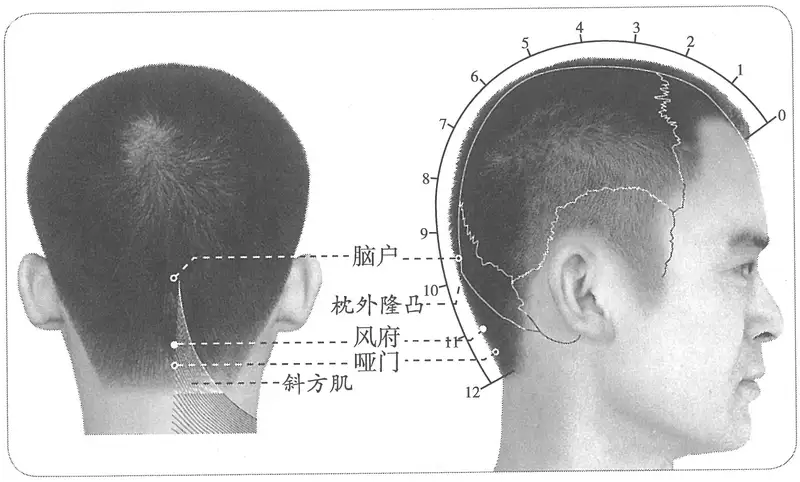

**图 2-390　风府穴图**

**取穴**：正坐，头稍仰，使项部斜方肌松弛，从项后发际正中上推至枕骨而止即是本穴。

　1. 在项上入发际一寸，大筋内宛宛中起肉。疾言其肉立起，言休其肉立下。（《黄帝明堂经》、《太平圣惠方》、《铜人腧穴针灸图经》、《圣济总录》、《针灸资生经》、《十四经发挥》、《医学纲目》、《针灸聚英》、《古今医统》、《针灸大成》、《针方六集》、《类经图翼》、《循经考穴编》、《针灸易学》、《针灸逢源》）

**按**：经反复实验，细心体会，均未发觉后头至项部肌肉的紧张度受快速说话的影响。留待进一步研究。

〔p.1260 (인쇄 1232)〕

　2. 当项中央发际，亦可与风池三处高下相等。（《千金要方》卷五）

　3. 在项后入发际一寸，去上骨一寸（《千金要方》卷十）

　4. 入项发际一寸，脑户后一寸五分，项大筋内宛宛中。（《铜人腧穴针灸图经》卷上及卷下“穴腧都数”、《医学入门》、《针方六集》）

　5. 在项后，上入发际一寸，发际高者七分宛宛中是穴，言疾其肉即起。（《乾坤生意》）

　6. 哑门上五分。（《针灸十四经穴位考订》）

　7. 统编针灸学教材

　　(1) 部位：在项后入发际一寸。取穴：正坐，从项后发际以指头上压至后头骨而止即是穴位。（1957年南京《针灸学》）

　　(2) 部位：脑户下一寸五分。取穴：正坐，从项后发际内一寸后头骨下缘凹陷中取之。（1版《针灸学讲义》）

　　(3) 部位：在项上，入发际一寸，大筋内宛宛中。取穴：在枕后正中枕骨下缘，两侧斜方肌之间凹陷中取之。（2版《针灸学讲义》）

　　(4) 后发际正中直上1寸。（4、5版《针灸学》）

　　(5) 枕外隆凸直下，两侧斜方肌之间凹陷中。（6版《针灸学》）

　　(6) 正坐，头微前倾，后正中线上，入后发际上1寸。（7版《针灸学》）

　　(7) 后发际正中直上一寸，在枕骨粗隆直下，两侧斜方肌之间的凹陷中取之。（《中国针灸学》）

**文献分析**：本穴的定位，古代文献均以后发际为基准折量定穴，然发际有高低之个体差异，古人也注意到这一点，于是有“七分”与“一寸”之调整。其中《千金要方》卷十谓“项后入发际一寸，去上骨一寸”，这里的“上骨”应指枕外隆凸点，是后头部的显著骨性标志。再结合其他文献“大筋内宛宛中”，现代将此穴定于枕外隆凸直下，两侧斜方肌之间凹陷中。

#### 【类属】 

督脉穴。

**脉气所发**：督脉阳维之会。（《黄帝明堂经》）

**归经**：督脉。（《外台秘要》卷三十九、《铜人腧穴针灸图经》卷上）

#### 【适应症】 

主治脑病及相关目、鼻、舌部病症。常用于中风不语；癫狂，头痛，颈项强痛；咽喉肿痛，眩晕、鼻衄。

　1. 主头痛项急，不得顾侧，目眩，鼻不得喘息，舌急难言。狂易，多言不休，及狂走欲自杀，目反妄见。暴瘖不能言，喉嗌痛。足不仁。（《黄帝明堂经》）

　2. 治头中百病、马黄黄疸等病。（《千金要方》卷十）

　3. 主舌缓，喑不能言，舌急语难。（《千金要方》卷三十）

　4. 主多悲恐，惊悸。（《太平圣惠方·明堂》）

　5. 治头痛，颈项急不得回顾，目眩，鼻衄，喉咽痛，狂走，目妄视。（《铜人腧穴针灸图经》卷中）

　6. 窦太师针灸遗存

　　(1) 中风不言，补泻；头项强痛，头重如石，看症补泻。（《窦太师针经》）

　　(2) 治中风不语，头项强痛，头重如石，先补后写，禁灸；头重石，泻之。（《大本琼瑶神书》）

　　(3) 主头重如石。（《针方六集》卷五）

〔p.1261 (인쇄 1233)〕

　7. 主中风，伤风，疠风，风痹，一切风疾及头中凡头风偏正，肢体偏枯，眩晕，颠瘐，舌缓强，颈急戾，目疾，疸证。（《循经考穴编》下）

　8. 统编针灸学教材

　　(1) 癫狂，中风偏枯，头痛，项强，目眩，鼻衄，咽喉肿痛，舌缓不语。（1957年南京《针灸学》）

　　(2) 癫狂，中风偏枯，头痛，项强，目眩，鼻衄，咽喉肿痛，暴喑。（1版《针灸学讲义》）

　　(3) 头痛，项强，目眩，鼻衄，咽喉肿痛，中风不语，癫狂，半身不遂。（2版《针灸学讲义》、4版《针灸学》、《中国针灸学》）

　　(4) 头痛，项强，眩晕，咽喉肿痛，失音，癫狂，中风。（5、6版《针灸学》）

　　(5) ①中风、癫狂痫、癔病等内风为患的神志病证；②头痛、眩晕、颈项强痛、咽喉肿痛、失音、目痛、鼻衄等内、外风为患者。（7版《针灸学》）

**文献分析**：本穴通于脑，故主治脑病及与脑相关的眼、鼻之病；又本穴通于舌，故主治喉舌之病。《圣济总录》曰：“囟会一穴，只可针五分，过即令人头旋目暗，急针百会及风府二穴救之”，说明本穴有突出的治疗头晕目眩的作用。

#### 附：临床应用举例 

　1. 脑病

　　(1) 膈痫之为病，目反，四肢不举，灸风府；又灸顶上鼻人中下唇承浆，皆随年壮。马痫之为病，张口摇头，马鸣欲反折，灸项风府、脐中三壮，病在腹中，烧马蹄末，服之良。（《千金要方》卷五上）

　　(2) 猥退风，半身不遂，失音不语者，灸百会，次灸本神，次灸承浆，次灸风府，次灸肩髃，次灸心输，次灸手五册，次灸手髓孔，次灸手少阳，次灸足五册，次灸足髓孔，次灸足阳明各五百壮。（《千金要方》卷八、《千金翼方》、《敦煌卷子S.6168》）

　　(3) 风寒头痛，则发热恶寒，鼻塞，肢节痛……若患头风兼头晕者，刺风府穴……向左耳横纹针下，入三、四分，留去来二十呼，觉头中热麻是效。（《扁鹊心书》卷下）

　　(4) 舌缓不语，刺风府一穴，在项发际上一寸，大筋内宛宛中，针入三分。（《针经摘英集》）

　　(5) 中风暴失音，或言语蹇者：先针合谷，次针风府，俱泻之。（《针灸集要·盘石金直刺秘传》）

　　(6) 中风失音，舌缩：泻哑门穴；舌缓不语：泻风府穴；如不应，泻合谷、液门穴。（《针灸集要·盘石金直刺秘传》）

　　(7) 浑头风，头痛如破，重如石，胃寒则热，过热则散：灸百会、上星，刺风府；未愈，次丰隆泻之。（《针灸集要·盘石金直刺秘传》）

　　(8) 狂言盗汗如见鬼，惺惺间使便下针。（《肘后歌》）

**按**：惺惺，即风府穴。

　　(9) 阻塞性及交通性脑积水：风池穴、风府穴，针灸疗法。［中国针灸，1986，6（3）：13-15］

　　(10) 癫痫：风府穴、哑门穴，针刺补法。［内蒙古中医药，1987（3）：22-23］

　　(11) 脑出血：风府穴、哑门穴，针刺治疗。［中国针灸，1987（3）：1-4］

〔p.1262 (인쇄 1234)〕

　　(12) 中毒性脑病后遗症：百会穴、风府穴，针刺治疗。［浙江中医杂志，1987，22（4）：163］

　　(13) 破伤风：大椎穴、风府穴，针刺治疗。［中国针灸，1987（4）：2］

　　(14) 脑出血：风府穴、哑门穴，针刺治疗。［中医杂志，1988，29（5）：350-352］

　2. 眼、鼻、舌病症

　　(1) 暴喑气鞕，取扶突与舌本出血。（《灵枢·寒热病》）

**按**：《黄帝内经太素·寒热杂说》杨上善注云：“舌本，一名风府，在项入发际一寸督脉上”。

　　(2) 治鼻出血不止方：又灸风府一穴四壮。不止，又灸。（《千金要方》卷六上）

　　(3) 鼻流清涕：上星、人中、风府。问曰：此证缘何而得？答曰：皆因伤风不解，食肉饮酒不早，表里不解，痰涎及脑，塞脑痛，故得此证，复刺后穴：百劳、风池、百会、风门。（《针灸集成》第十八方）

　　(4) 鼻塞不闻香臭：灸神庭，刺迎香泻之。鼻生息灸前二穴，鼻衄不止灸风府。（《针灸集要·盘石金直刺秘传》）

　　(5) 项强兼头四顾难，牙疼并作不能宽。先向承浆明补泻，后针风府即时安。（《针灸玉龙歌》）

　　(6) 口干舌燥症：针刺风府治疗。［中国针灸，1999（1）：38］

　3. 颈项病症

　　(1) 腰胵项强不能舒：风府、风池、人中。金陵仓巷刘，十年前入川，与客择行，冒水暑下水取凉遏腠理，流入经络，深至筋骨，故成此疾。针之汗出遍身，即时关外畅通，腰直身舒，四顾左右。（《针灸集成》第六十九方）

　　(2) 风伤项急，始求于风府。（《通玄指要赋》）

　　(3) 颈项强痛，不能回顾，承浆一穴、风池二穴、风府一穴。（《针灸大全》卷四）

　4. 伤寒

　　(1) 太阳病，初服桂枝汤，反烦不解者，先刺风池、风府，却与桂枝汤，则愈。（《伤寒论》卷二）

　　(2) 伤风感寒，咳嗽喘满，膻中一穴、风门二穴、合谷二穴、风府一穴。（《针灸大全》卷四）

　　(3) 风府风池寻得到，伤寒百病一时消。（《席弘赋》）

　　(4) 阳明二日寻风府，呕吐还须上脘疗。（《席弘赋》）

　5. 其他病症

　　(1) 邪病卧瞑瞑不自知，风府主之，一名鬼穴。（《千金要方》卷十四）

　　(2) 腿脚有疾风府寻，胁肋腿痛后溪妙，股膝肿起泻太冲。（《肘后歌》）

#### 【操作】 

针尖朝向下颌或喉结方向缓慢刺入0.5~1寸，不可向上深刺，以免损伤脊髓。缓慢进针，严禁提插和大幅度捻转。

　1. 禁不可灸，灸之令人喑，刺入四分，留三呼。（《黄帝明堂经》）

　2. 禁不可灸，灸之令哑。针入三分。（《铜人腧穴针灸图经》卷中）

　3. 针只可一寸以下，过度即令人哑。（《圣济总录》卷一九四）

　4. 按风府禁灸矣，项疽发于脑之下，项之上，此正风府穴分也，东垣先用火攻之策，以大炷艾如两核许者，攻之至百壮，岂疮家与诸病异治欤？（《针灸聚英》卷一）

　5. 针三分，禁灸。（《针灸十四经穴位考订》）

〔p.1263 (인쇄 1235)〕

　6. 统编针灸学教材

　　(1) 针三至五分，仰头取上，不宜深刺。（1957年南京《针灸学》、1版《针灸学讲义》）

　　(2) 直刺3~5分，不宜深刺。（2版《针灸学讲义》）

　　(3) 直刺或向下斜刺0.5~1寸，不可深刺。（4、5版《针灸学》）

　　(4) 直刺或向下斜刺0.5~1寸，不可深刺，以免伤及深部延髓。（6版《针灸学》）

　　(5) 正坐位，头微前倾、项部放松、向下颌方向缓慢刺入0.5~1寸，不可向上深刺，以免刺入枕骨大孔，伤及延髓。（7版《针灸学》）

　　(6) 直刺0.5~0.8寸，不可深刺，深部为延髓，针刺注意安全。（《中国针灸学》）

**刺法及主治的解剖学基础**：延髓，为脑干的最下部分，内有各种内脏活动的调节中枢，所以，该穴位在施行针刺时，须注意两点，第一则不宜深刺，严禁提插和大幅度捻转。据统计表明，针刺最深不超过1.5寸。第二为针刺方向的选择，朝下颌隆凸较为安全，若针尖朝向鼻尖方向，深层正对延髓，后果严重。

### （十七）脑户 Nǎohù GV17 出《黄帝明堂经》 

#### 【提要索隐】 

**穴名**：一名匝风，一名会颅，一名合颅。

**定位**：在头部，枕外隆凸的上缘凹陷中。

**适应症**：主治脑病。常用于癫，狂，痫；失音；眩晕；颈项强痛。

**针刺操作**：平刺。

#### 【名实考】 

天窗与脑户、天门，说的都是出入脑的门户。而脑又与目、鼻相通，故凡脑之门户穴除主治脑病外，还治目、鼻之疾。需要特别注意的是，“脑户”既是穴名，也是部位名，切不可相混。

　1. 一在脊骨上空，在风府上。王冰注曰：上谓脑户穴也，在枕骨上大羽后同身寸之一寸五分宛宛中。（《素问·骨空论》王冰注）

　2. 脑户，一名匝风，一名会颅，在枕骨上，强间后一寸五分，督脉、足太阳之会，此别脑三会。（《黄帝明堂经》）

　3. 别名　会额、西风。（1957年南京《针灸学》）

**按**：“会额”见明刊本《针灸甲乙经》，系“会颅”之形误；“西风”系“匝风”之形误。

#### “脑户”与“脑户”穴辨 

刺头，中脑户，入脑立死。（《素问·刺禁》）

太阳之胜……热反上行，头项囟顶脑户中痛，目如脱。（《素问·至真要大论》）

**按**：“脑户”穴下是坚硬的枕骨，因此《刺禁》描述的情况最大的可能是发生在刺风府穴时，如果针刺过深的确可出现“入脑立死”的危险发生；而《素问·至真要大论》所述乃足太阳经脉病候，原文为“头项囟顶脑户中痛，目如脱”，可见这里的“脑户中痛”是指后头部痛，而不能理解为“脑户”穴痛。

#### “脑户”与“天门”穴辨 

灸猥退风半身不遂法：先灸天窗，次大（天）门，脑后尖骨上一寸……各灸百壮。（《千金翼方·针灸上》卷二十六）

**按**：“大门”，敦煌卷子佚名灸方作“天门”，是。这里的“脑后尖骨”，即《素问·骨空论》所谓脑后三分的“颅际锐骨”，也即枕外隆凸，其上一寸处，正与脑户穴相当。

〔p.1264 (인쇄 1236)〕

#### “风府”与“脑户”相混例 

暴喑气哽，刺扶突与舌本出血。喑不能言，刺脑户。（《针灸甲乙经》卷十二第二）

**按**：以上“暴喑气哽，刺扶突与舌本出血”系《灵枢》之文；“喑不能言，刺脑户”乃《黄帝明堂经》原文。因《针灸甲乙经》原书中此两条文字紧相邻，王焘皆误作《黄帝明堂经》之文而一并辑录，而且辑录时还出现了断句错误，将“舌本出血，喑不能言，刺脑户”作为一条辑入“脑户”穴下，大误。

#### 【定位】 

**部位**：在头部，枕外隆凸的上缘凹陷中（图2-391）。

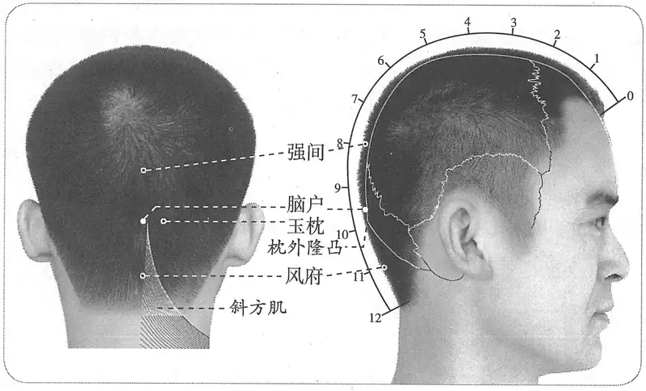

**图 2-391　脑户穴图**

**取穴**：后正中线与枕外隆凸的上缘交点处的凹陷中，横平玉枕穴。

　1. 在枕骨上强间后一寸五分。（《黄帝明堂经》、《太平圣惠方》、《铜人腧穴针灸图经》、《圣济总录》、《针灸资生经》、《十四经发挥》、《古今医统》、《医学纲目》、《针灸聚英》、《医学入门》、《针灸大成》、《针方六集》、《类经图翼》、《循经考穴编》、《针灸易学》、《针灸逢源》）

　2. 一曰在发际上二寸。（《类经图翼》卷八）

　3. 循风府上行一寸五分，枕骨上，脑户穴也。（《医宗金鉴·刺灸心法要诀》）

　4. 后头结节之下陷中。（《针灸十四经穴位考订》）

　5. 统编针灸学教材

　　(1) 部位：在枕骨上，强间穴后一寸五分。取穴：从风府上一寸五分取之。（1957年南京《针灸学》）

　　(2) 部位：枕骨上强间穴后一寸五分。取穴：从风府穴上行一寸五分枕骨之上骨陷中取之。（1版《针灸学讲义》）

　　(3) 部位：在枕骨上，强间后一寸五分。取穴：头部正中线上，在风府上一寸五分，当枕骨粗隆上缘取之。（2版《针灸学讲义》）

　　(4) 风府穴直上1.5寸。（4、5版《针灸学》）

　　(5) 在头部，后发际正中直上2.5寸，风府上1.5寸，枕外隆凸的上缘凹陷处。（6版《针灸学》）

　　(6) 风府穴直上1.5寸，枕骨粗隆上缘凹陷处。（7版《针灸学》）

〔p.1265 (인쇄 1237)〕

　　(7) 头部正中线上，风府直上一寸五分，当枕外粗隆的上方取之。（《中国针灸学》）

**文献分析**：教材关于本穴定位“风府上一寸五分”，是基于《铜人腧穴针灸图经》风府穴的定位“脑户后一寸五分”；《类经图翼》引一说“在发际上二寸”，则差之甚远，不可从。要之本穴定位直以骨性标志可也，折量分寸不拘。

#### 【类属】 

督脉穴。

**脉气所发**：督脉、足太阳之会。（《黄帝明堂经》）

**归经**：督脉。（《外台秘要》卷三十九、《铜人腧穴针灸图经》卷上）

#### 【适应症】 

主治脑病。常用于癫，狂，痫；失音，眩晕，颈项强痛。颅脑外科手术（后颅窝）的针麻用穴。

　1. 主头重项痛，目不明，风则脑中寒，重衣不热，汗出，头中恶风。癫疾，骨酸，眩，狂，瘛疭，口噤，羊鸣。瘖不能言。痓，目不明。寒热。（《黄帝明堂经》）

　2. 主目赤痛不可视；面赤肿；舌本出血，风眩。（《外台秘要》卷三十九）

**按**：“目赤痛不可视；面赤肿”此二条主治乃王焘不明《千金要方》体例，而误引其文；“舌本出血”乃王焘对《针灸甲乙经》原文断句错误，将前一条“扶突主之”病症录于本穴中。

　3. 治目睛痛不能远视，面赤目黄，头肿。（《铜人腧穴针灸图经》卷中）

　4. 主面痛头重，肿痛，瘿瘤。（《针灸聚英》卷一、《针灸大成》、《针方六集》）

　5. 主颈项强痛，头风目泪。（《循经考穴编》下）

　6. 统编针灸学教材

　　(1) 癫痫，头风，颈项强痛，睛痛不能远视。（1957年南京《针灸学》）

　　(2) 癫痫，头风，颈项强痛，目痛，视物模糊。（1版《针灸学讲义》）

　　(3) 癫痫，喑不能言，头晕，颈项强痛。（2、4版《针灸学》）

　　(4) 头晕，项强，失音，癫痫。（5、7版《针灸学》）

　　(5) 头痛，头晕，项强，失音，癫痫。（6版《针灸学》）

　　(6) 痫证，头晕，颈项强痛。（《中国针灸学》）

#### 附：临床应用举例 

　1. 狂癫惊走，风恍惚嗔喜，骂笑歌哭鬼语，悉灸脑户、风池、手阳明、太阳、太阴、足阳明、阳𫏋、少阳、太阴、阴𫏋、足跟，皆随年壮。（《千金要方》卷十四）

　2. 头重风劳，灸脑户五壮。针入三分，补之。（《千金翼方》卷二十七）

#### 【操作】 

平刺。

　1. 刺入二分，留二呼，不可灸令人喑。（《黄帝明堂经》）

　2. 不可妄灸，灸之不幸，令人瘖，刺可入同身寸之三分，留三呼。（《素问·骨空论》王冰注）

　3. 禁不可针，针之令人哑不能言。可灸七壮，亦不可妄灸，令人失喑。（《铜人腧穴针灸图经》卷中）

**按**：王惟一此处误将《素问·刺禁》脑户之刺禁与《黄帝明堂经》脑户穴刺灸法混为一谈，遂致不可解。

　4. 按脑户一穴，《资生》、《明堂》、《素问》所论深针妄灸，医家当知所戒矣。（《针灸聚英》卷一）

　5. 禁针，禁灸。（《针灸十四经穴位考订》）

　6. 统编针灸学教材

　　(1) 灸一至三壮。（1957年南京《针灸学》、1版《针灸学讲义》）

　　(2) 艾条灸1~3分钟。（2版《针灸学讲义》）

〔p.1266 (인쇄 1238)〕

　　(3) 平刺0.5~0.8寸。（4、5、6、7版《针灸学》）

　　(4) 横刺0.3~0.5寸。可灸。（《中国针灸学》）

### （十八）强间 Qiángjiān GV18 出《黄帝明堂经》 

#### 【提要索隐】 

**穴名**：一名大羽。

**定位**：在头部，后发际正中直上4寸。

**适应症**：主治脑病。常用于癫，狂，痫；头痛，颈项强痛。

**针刺操作**：平刺。

#### 【名实考】 

　1. 强间，一名大羽，在后顶后一寸五分，督脉气所发。（《黄帝明堂经》）

　2. 穴在脑户之上，后顶之下，最坚固之所，故曰强间。（《经穴解》）

#### 【定位】 

**部位**：在头部，后发际正中直上4寸（图2-392）。

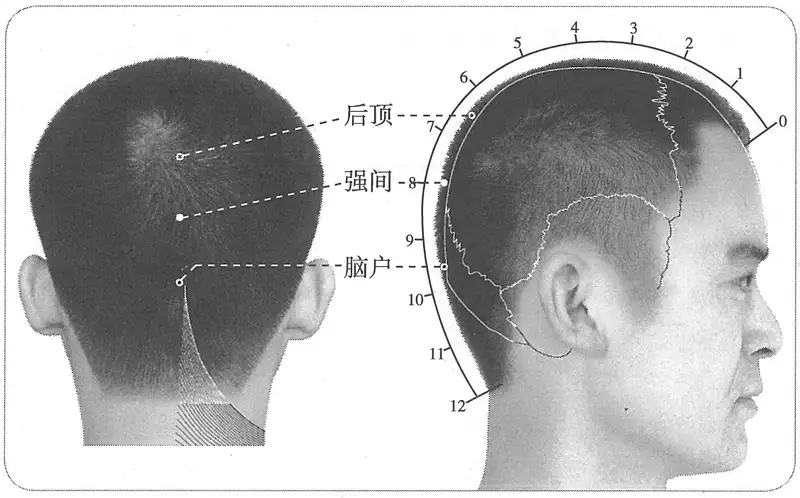

**图 2-392　强间穴图**

**取穴**：脑户穴直上1.5寸凹陷中。

　1. 在后顶后一寸五分。（《黄帝明堂经》、《太平圣惠方》、《铜人腧穴针灸图经》、《圣济总录》、《针灸资生经》、《十四经发挥》、《医学纲目》、《针灸聚英》、《古今医统》、《医学入门》、《针灸大成》、《针方六集》、《类经图翼》、《循经考穴编》、《针灸易学》、《针灸逢源》）

　2. 在后顶后一寸半，脑户前一寸半。（《千金翼方》卷二十六）

　3. 从脑户上行一寸五分，强间穴也。（《医宗金鉴·刺灸心法要诀》）

　4. 在后顶后一寸半当作百会后三寸。（《针灸逢源》）

　5. 百会后三寸。（《针灸十四经穴位考订》）

　6. 统编针灸学教材

　　(1) 部位：后顶穴后一寸五分。取穴：从脑户穴之上一寸五分，正坐取之。（1957年南京《针灸学》）

〔p.1267 (인쇄 1239)〕

　　(2) 部位：后顶穴后一寸五分。取穴：从脑户穴之上一寸五分，正坐取之。（1版《针灸学讲义》）

　　(3) 部位：后顶穴后一寸五分。取穴：头部正中线上，在脑户上一寸五分，当风府与百会之中点取之。（2版《针灸学讲义》）

　　(4) 脑户穴直上1.5寸。（4、5版《针灸学》）

　　(5) 在头部，当后发际正中直上4寸脑户上1.5寸。（6版《针灸学》）

　　(6) 脑户穴直上1.5寸，或当风府穴与百会穴连线的中点处。（7版《针灸学》）

　　(7) 头部正中线上，脑户直上一寸五分，当风府与百会之中点。（《中国针灸学》）

#### 【类属】 

督脉穴。

督脉气所发。（《黄帝明堂经》）

#### 【适应症】 

主治脑病。常用于癫，狂，痫；头痛，颈项强痛。

　1. 主癫疾狂走，瘛疭摇头，口㖞，戾颈强。（《黄帝明堂经》）

　2. 主头痛如针刺，不可以动。项如拔，不可左右顾。（《外台秘要》卷三十九）

**按**：此二条主治乃王焘不明《千金要方》体例，而误引其文。

　3. 岐伯云兼治风痫病。（《太平圣惠方·明堂》）

　4. 治脑眩目运，头痛不可忍，烦心，呕吐涎沫，发即无时，颈项强，左右不得回顾。（《铜人腧穴针灸图经》卷中）

　5. 窦太师针灸遗存

　　(1) 治项颈强痛，偏正头风，目中冷泪。（《窦太师针经》）

　　(2) 主头风，目中冷泪。（《针方六集》卷五）

　6. 统编针灸学教材

　　(1) 癫疾狂走，头痛脑旋，目眩，烦心，呕吐，项强。（1957年南京《针灸学》）

　　(2) 癫狂，头痛项强，目眩，心烦，呕吐。（1版《针灸学讲义》）

　　(3) 癫狂，头痛，目眩，项强。（2版《针灸学讲义》，4、5、6、7版《针灸学》，《中国针灸学》）

**文献分析**：关于癫痫的症状，《黄帝明堂经》天井、阳溪、温溜主治有如下描述：“癫疾，吐舌，沫出，羊鸣，戾颈”（天井）；“吐舌，戾颈，妄言，癫疾，狂言，善笑见鬼”（阳溪）；“癫疾，吐舌，鼓颔，狂言见鬼，狂仆”（温溜），由此可知“强间”穴主治中“瘛疭，摇头，口㖞，戾颈强”皆为癫痫的一组症状。《太平圣惠方》卷一百引岐伯云文字更指明了“治风痫病”。又，教材不同程度上受《外台秘要》错误的影响。当依据《黄帝明堂经》确定本穴主治。

#### 【操作】 

平刺。

　1. 刺入三分，灸五壮。（《黄帝明堂经》）

　2. 灸五壮，针入二分。（《太平圣惠方·针经》）

　3. 灸三壮。（《太平圣惠方·明堂》）

　4. 可灸七壮，针入二分。（《铜人腧穴针灸图经》卷中）

　5. 针三分，禁灸。（《医学入门》卷一）

　6. 针二分，灸五壮。（《针灸十四经穴位考订》）

　7. 统编针灸学教材

　　(1) 针二至三分，针尖向上或向下沿皮而进，灸三五壮。（1957年南京《针灸学》、1版《针灸学讲义》）

〔p.1268 (인쇄 1240)〕

　　(2) 向后沿皮刺2~3分，艾条灸3~5分钟。（2版《针灸学讲义》）

　　(3) 平刺0.5~0.8寸。（4、5、6、7版《针灸学》）

　　(4) 横刺0.3~0.5寸。可灸。（《中国针灸学》）

### （十九）后顶 Hòudǐng GV19 出《黄帝明堂经》 

#### 【提要索隐】 

**穴名**：一名交冲。

**定位**：在头部，后发际正中直上5.5寸。

**适应症**：主治脑病、头项部病症。常用于头痛，眩晕；癫，狂，痫；颈项强痛。

**针刺操作**：平刺。

#### 【名实考】 

　1. 后顶，一名交冲，在百会后一寸五分，枕骨上，督脉气所发。（《黄帝明堂经》）

　2. 穴在百会之后，百会为顶也，故曰后顶。（《经穴解》）

#### 【定位】 

**部位**：在头部，后发际正中直上5.5寸（图2-393）。

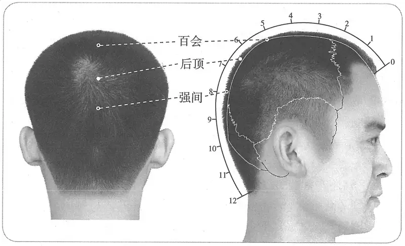

**图 2-393　后顶穴图**

**取穴**：百会穴向后1.5寸处。

　1. 在百会后一寸五分，枕骨上。（《黄帝明堂经》、《太平圣惠方》、《铜人腧穴针灸图经》、《圣济总录》、《针灸资生经》、《窦太师针经》、《十四经发挥》、《医学纲目》、《针灸聚英》、《古今医统》、《医学入门》、《针灸大成》、《针方六集》、《类经图翼》、《循经考穴编》、《针灸易学》、《针灸逢源》）

　2. 从强间上行一寸五分，后顶穴也。（《医宗金鉴·刺灸心法要诀》）

　3. 百会后一寸五分。（《针灸十四经穴位考订》）

　4. 统编针灸学教材

　　(1) 部位：百会穴后一寸五分。取穴：从强间穴直上一寸五分，正坐取之。（1957年南京《针灸学》）

〔p.1269 (인쇄 1241)〕

　　(2) 部位：百会穴后一寸五分。取穴：从强间穴直上一寸五分取之。（1版《针灸学讲义》）

　　(3) 部位：在百会后一寸五分，枕骨上。取穴：头部正中线上，在强间上一寸五分取之。（2版《针灸学讲义》）

　　(4) 强间穴直上1.5分。（4、5版《针灸学》）

　　(5) 在头部，当后发际正中直上5.5寸脑户上3寸。（6版《针灸学》）

　　(6) 强间穴直上1.5寸，或百会穴直上后1.5寸。（7版《针灸学》）

　　(7) 头部正中线上，强间直上一寸五分。（《中国针灸学》）

#### 【类属】 

督脉穴。

督脉气所发。（《黄帝明堂经》）

#### 【适应症】 

主治脑病、头项部病症。常用于头痛，眩晕；癫，狂，痫；颈项强痛。颅脑外科手术（后颅窝）的针麻用穴。

　1. 主风眩目眩，颅上痛。癫疾，瘛疭狂走，项直颈痛。（《黄帝明堂经》）

　2. 目䀮不明，恶风寒。眩，头偏痛。（《外台秘要》卷三十九）

**按**：此二条主治录自《千金要方》卷三十“肾俞、内关、心俞、复溜、太渊、腕骨、中渚、攒竹、精明、百会、委中、昆仑、天柱、本神、大杼、颔厌、通谷、曲泉、后顶、丝竹空、胃俞，主目䀮不明，恶风寒”；“前顶、后顶、颔厌主风眩，偏头痛”，该篇所载多穴主治一般为多穴中的第一穴主治原文，或多穴主治相加的主治总和，王焘不明体例，而误引其文。

　3. 治目䀮，颈项恶风寒，目眩，头偏痛。（《铜人腧穴针灸图经》卷中）

**按**：此乃承袭王焘之误。

　4. 窦太师针灸遗存

　　(1) 治真头痛，肾厥头风痛，泻补；头后顶心痛，泻。（《窦太师针经》）

　　(2) 主如顶心痛，刺之。须泻涌泉，使上下相通易愈也。（《循经考穴编》下）

　5. 主历节汗出。（《针灸聚英》卷一、《针灸大成》、《针方六集》）

**按**：此条主治乃高武不明《千金要方》卷三十体例，而误引其文。

　6. 统编针灸学教材

　　(1) 癫疾狂走，痫发瘛疭，头风眩晕，顶心痛，项强，偏头痛。（1957年南京《针灸学》）

　　(2) 癫狂，痫发瘛疭，头风眩晕，顶心痛，项强。（1版《针灸学讲义》）

　　(3) 癫狂，痫证，头痛，眩晕。（2版《针灸学讲义》，4、5、6、7版《针灸学》，《中国针灸学》）

**文献分析**：教材“偏头痛”一症乃承袭《外台秘要》、《铜人腧穴针灸图经》之误，今去之。

#### 附：临床应用举例 

　1. 头顶痛，风池、后顶、合谷、百会、中脘、三里。问曰：头顶痛针之不效，再有何穴可治？答曰：此乃阴阳不分，风邪串入脑门，故刺不效，先取其痰，后去其风，自然效也。（《针灸集成》第八方）

　2. 治头风，灸后顶穴，在百会后一寸五分，强间穴前一寸五分，灸五壮。兼治癫疾，并摇头口㖞者。（《圣济总录》卷一九二）

#### 【操作】 

平刺。

　1. 刺入四分，灸五壮。（《黄帝明堂经》）

〔p.1270 (인쇄 1242)〕

　2. 灸三壮。（《太平圣惠方》）

　3. 灸五壮，针入三分。（《铜人腧穴针灸图经》卷中）

　4. 针入一分，灸七壮。治真头痛，肾厥头风痛，泻补；头后顶心痛，泻。（《窦太师针经》）

　5. 针二分，灸五壮。（《针灸十四经穴位考订》）

　6. 统编针灸学教材

　　(1) 针二至三分，沿皮刺入，灸三至五壮。（1957年南京《针灸学》、1版《针灸学讲义》）

　　(2) 向后沿皮刺2~3分，艾条灸3~5分钟。（2版《针灸学讲义》）

　　(3) 平刺0.5~0.8寸。（4、5、6、7版《针灸学》）

　　(4) 横刺0.3~0.5寸。可灸。（《中国针灸学》）

### （二十）百会 Bǎihuì GV20 出《黄帝明堂经》 

问题：“百会”与“神聪”四穴关系如何？古人在百会与神聪穴的针法实践，为当代“穴位”概念提出了什么样的新问题？

#### 【提要索隐】 

**穴名**：一名三阳五会；一名天满。

**定位**：在头部，前发际正中直上5寸。

**适应症**：主治头目、心神病症。常用于头痛，目痛，眩晕，耳鸣，鼻塞；中风，神昏；癫，狂，痫，小儿惊风，痴呆；脱肛，子宫脱垂。

**针刺操作**：斜刺或平刺。

#### 【名实考】 

一名三阳五会（《黄帝明堂经》）；一名天满（《针灸资生经》）。后世文献，特别是日本针灸教材另载有诸多本穴别名，经考证或有误，或不确；宋以前针灸方中“顶上回毛”、“顶上旋毛”、“顶上回发”等，均指本穴，今人不识，以为别是一穴，归入奇穴类。

窦太师针灸关于本穴的透刺法，以及《太平圣惠方》所反映的“百会”与“神聪四穴”的关系，给当代“穴位”概念提出了新问题：由一点向四边透刺与由四边向中心点透刺，其中心点与四旁四点是分别属于五个不同的穴，还是属于同一穴范畴？

　1. 百会，一名三阳五会，在前顶后一寸五分，顶中央旋毛中，陷可容指，督脉、足太阳之会。（《黄帝明堂经》）

　2. 一名天满。（《针灸资生经》卷一）

　3. 泥丸宫、泥丸即顶心是也，名百会。（《普济本事方》卷二）

　4. 百会，亦名维会穴，又名神阙穴。（《窦太师针经》）

　5. 太子暴死为尸厥，越人针维会而得醒。吴崑注曰：太子，虢太子。越人，卢医秦越人也。史称，虢太子病尸厥，扁鹊为之刺三阳五会，有间，太子苏，则百会穴也，此云维会，则非百会。《针经》云：脐中，一名维会。谓扁鹊当时取此穴耳。盖人之生，尝以此穴受母之气，刺家能取此穴，调其厥逆，使之冲和，亦何嫌于刺哉！脐中为是，古之神良，固未尝以禁刺胶鼓也。（《针方六集·标幽赋》卷二）

　6. 神阙一穴，一名气舍。在脐孔中是穴。禁针，灸一百壮。又名维会穴。（《窦太师针经》、《针方六集》、《循经考穴编》）

　7. 一名巅上。（《针灸聚英》卷一）

　8. 别名　岭上、五会、三阳、三阳五会、泥丸宫、维会、天满、岭上天满、巅上。（1957年南

〔p.1271 (인쇄 1243)〕

京《针灸学》）

**文献分析**：《普济本事方》录“泥丸宫”、“泥丸”乃道家术语；《窦太师针经》“维会”者见于窦氏《标幽赋》和《通玄指要赋》，乃“脐中”穴别名，吴崑注极是。现存甲抄本两见于“神阙”与本穴下，误也，乙抄本无误录；《针灸聚英》所说“巅上”乃本穴之部位；至于1957年南京《针灸学》所录诸别名悉传自日本针灸教材，据其标注之出处或知：“岭上”系“巅上”之误，“岭上天满”系“巅上天满”之误，又“三阳五会”是一整体，不能拆分成“三阳”和“五会”。

#### 相关穴及刺激点 

　1. 百会一穴，在头中心陷者中。灸七壮。主脑重，鼻塞，头目眩疼，少心力，忘前失后，心神恍惚，及大人小儿脱肛也。（《太平圣惠方·明堂》）

　2. 百会一穴，窦氏针入二分，前病者沿皮向前一寸，后病者沿皮向后一寸，左右如法，灸七壮。（《针方六集》卷一）

　3. 神聪四穴，在百会四面各相去同身寸一寸是穴。理头风目眩，狂乱风痫。左主如花，右主如果。针入三分。（《太平圣惠方·针经》）

**按**：“左主如花，右主如果”是指目眩症状的描述。

　4. 前神聪　去前顶五分，自神庭至此穴共四寸。主治中风、风痫，灸三壮。后神聪，去百会一寸。主治中风、风痫，灸三壮。（《类经图翼》卷十）

　5. 百会　顶上旋发中陷容指，足太阳会，四向各透有穴，随证迎随，入三火七或三七；百会，顶中旋发中陷容指，足太阳，入三火七，四向四针，神聪四穴，头风眩狂乱痫。（《针灸集成》）

**文献分析**：“百会”与“神聪四穴”同见于《太平圣惠方》，而主治相近；明代张介宾从“神聪四穴”中又分出前后二穴，然主治完全相同；特别值得注意的是，窦太师针灸中百会穴的刺法“前病者沿皮向前一寸，后病者沿皮向后一寸，左右如法”，也就是说在窦氏针法中，百会穴前后左右各一寸范围内皆属于“百会”穴区。元代另一部与窦氏相关的针灸书《针灸集成》更是明言刺百会“四向四针神聪四穴”。古人的临床实践提出了一个新的问题：以百会为中心向四向透刺，与从四周向百会透刺，治疗作用有何异同？从《太平圣惠方》来看，似乎看不出差别。以现代“穴位”的概念，从百会向四周透刺，属于同一穴；而从四周向中心刺则属于四个不同的穴，而古人的实践却用这个概念无法说明。急需从临床上和理论上重新审视“穴位”的概念。

#### 【定位】 

**部位**：在头部，前发际正中直上5寸（图2-394）。

**取穴**：当前、后发际正中连线的中点向前1寸凹陷中。或折耳，两耳尖向上连线的中点。

　1. 在前顶后一寸五分，顶中央旋毛中，陷可容指。（《黄帝明堂经》、《太平圣惠方》、《铜人腧穴针灸图经》、《圣济总录》、《针灸资生经》、《十四经发挥》、《医学纲目》、《针灸聚英》、《古今医统》、《医学入门》、《针灸大成》、《针方六集》、《类经图翼》、《针灸易学》）

　2. 当鼻中，入发际五寸。（《肘后备急方》卷一、《外台秘要》）

　3. 穴在当顶上正中央是。（《千金要方》卷八）

　4. 在顶上旋毛中。（《医心方》卷三）

　5. 在顶当心。（《太平圣惠方》卷五十五）

　6. 在头中心陷者中。（《太平圣惠方》卷九十九）

　7. 窦太师针灸遗存

〔p.1272 (인쇄 1244)〕

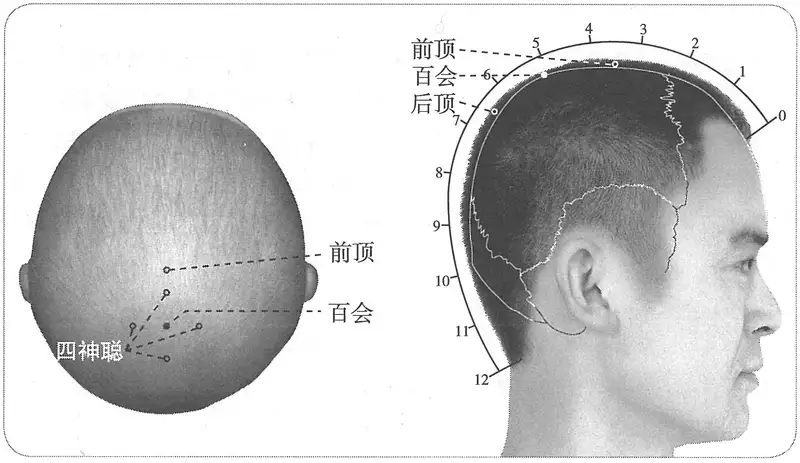

**图 2-394　百会穴与相关穴图**

　　(1) 在头正顶旋毛中。用线量前眉间至后顶上发际量，折当中是穴。（《窦太师针经》）

　　(2) 在顶后寸半顶中旋毛中央可容豆。有取法：用线量前眉间后于项上发际，折断当中是穴。（《大本琼瑶神书》）

　　(3) 穴在顶心旋中。取法：自两耳尖量当中是穴。（《窦太师秘传》）

　　(4) 顶中央旋毛中取，眉间印堂至发际折中是穴。（《针灸玉龙歌》注）

　8. 在顶中陷中容豆许，去前发际五寸，后发际七寸。（《神应经》、《循经考穴编》、《针灸逢源》）

　9. 直两耳尖，性理北溪陈氏曰：略退些子犹天之极星居北。（《针灸聚英》卷一）

　10. 从后顶上行一寸五分，直两耳尖顶陷中。（《医宗金鉴·刺灸心法要诀》）

　11. 两耳尖直上颅顶中央。（《针灸十四经穴位考订》）

　12. 统编针灸学教材

　　(1) 部位：前顶后一寸五分。取穴：正坐，从两耳尖直上，当头之正中取之。（1957年南京《针灸学》）

　　(2) 部位：后顶穴前一寸五分。取穴：正坐，从两耳尖直上，当头之正中入前发际五寸取之。（1版《针灸学讲义》）

　　(3) 部位：在前顶后一寸五分，顶中央旋毛中，陷可容指。取穴：距后发际上七寸，当两耳廓尖连线之中点取之。（2版《针灸学讲义》）

　　(4) 后发际直上7寸。（4、5版《针灸学》）

　　(5) 在头部，每当前发际正中直上5寸，或两耳尖连线的中点处。（6版《针灸学》）

　　(6) 后发际正中直上7寸，或当头部正中下与两耳尖连线的交点处。（7版《针灸学》）

　　(7) 头部正中线上，后发际直上七寸，约当两侧耳廓尖连线之中点取之。（《中国针灸学》）

**文献分析**：此穴的部位，《黄帝明堂经》曰“顶中央旋毛中，陷可容指”，后世文献也作“陷容豆”，今实际观察发现：头顶旋毛处确有明显的凹陷（也有个体不明显）。古今定位虽均有用骨度折量的方法，但此穴定位的体表标志明显，应当优先采用体表标志定位。即按寻头顶部的凹陷处，而不必拘于折量寸数。如明代医家吴崑所言“诸穴有眉发、筋骨、约纹陷下、肉际者，即取之，不必度也”。如果被检者有两个旋毛和凹陷者，以靠近中线者为准。其折量及简便取穴法可用于体表标志不明显者。

〔p.1273 (인쇄 1245)〕

#### 【类属】 

督脉穴。

**脉气所发**：督脉、足太阳之会。（《黄帝明堂经》）

**归经**：督脉。（《外台秘要》卷三十九、《铜人腧穴针灸图经》卷上）

#### 【适应症】 

主治头目、心神病症。常用于头痛，目痛，眩晕，耳鸣，鼻塞；中风，神昏；癫，狂，痫，小儿惊风，痴呆；脱肛，子宫脱垂。

　1. 主痎疟。癫疾。耳鸣。痓。顶上痛，风头重，目如脱，不可左右顾。热病汗出而善呕。小儿惊痫。（《黄帝明堂经》）

　2. 百会、玉枕主卒起僵仆，恶见风寒。（《千金要方》卷三十）

**按**：此乃《黄帝明堂经》“囟会”穴主治，孙思邈误录于此。

　3. 疗脱肛，风痫，青风，心风，角弓反张，羊鸣多哭，言语不择，发时即死。吐沫，心中热闷，头风。多睡心烦，惊悸无心力，忘前失后，吃食无味，头重，饮酒面赤鼻塞。（《太平圣惠方·针经》）

　4. 主头目眩痛，心神恍惚。（《太平圣惠方·明堂》）

　5. 治小儿脱肛久不瘥，风痫，中风，角弓反张，或多哭，言语不择，发即无时，盛即吐沫，心烦惊悸，健忘，痎疟，耳鸣耳聋，鼻塞不闻香臭。（《铜人腧穴针灸图经》卷中）

　6. 窦太师针灸遗存

　　(1) 治五藏中风，不省人事，头风眩昏，妇人发红丹，血风等症。治头痛，泻。（《窦太师针经》）

　　(2) 治中风不后，泻；头疼，泻。（《大本琼瑶神书》）

　7. 主中风，言语蹇涩，口噤不开，偏风，半身不遂，心烦闷。（《针灸聚英》卷一、《针灸大成》、《针方六集》）

**按**：此乃从《针灸资生经》辑自《太平圣惠方》卷一百灸方主治，详见“附：临床应用举例”。

　8. 主中风尸厥，癫痫狂邪，一切僵仆，不省人事，口噤语謇，㖞斜眩运，脑漏鼻塞之证。最主脱肛偏坠，针法须用升提。（《循经考穴编》下）

　9. 统编针灸学教材

　　(1) 癫狂，尸厥，惊悸，健忘，中风，头痛，目眩，鼻塞，耳鸣，脱肛。（1957年南京《针灸学》、1版《针灸学讲义》）

　　(2) 癫狂，中风，头痛，头晕，耳鸣，目眩，鼻塞，脱肛，阴挺。（2版《针灸学》）

　　(3) 头痛，目眩，鼻塞，耳鸣，中风失语，癫狂，脱肛，阴挺。（4版《针灸学》）

　　(4) 头痛，眩晕，中风失语，癫狂，脱肛，阴挺，不寐。（5版《针灸学》）

　　(5) 头痛，眩晕，中风失语，癫狂，脱肛，泄泻，阴挺，健忘，不寐。（6版《针灸学》）

　　(6) ①痴呆、中风、失语、瘛疭、失眠、健忘，癫狂痫证、癔病等神志病证；②头风、头痛、眩晕、耳鸣等头面病证；③脱肛、阴挺、胃下垂、肾下垂等气失固摄而致的下陷性病证。（7版《针灸学》）

　　(7) 头痛，眩晕，耳鸣，鼻塞，中风失语，昏厥，癫狂，脱肛，阴挺。（《中国针灸学》）

**文献分析**：针灸穴位的作用主要针对部位，与中药的作用不完全相同，不能因为本穴有治疗“脱肛”作用，就类推出：凡是脏器下垂的病症皆可治疗。因此7版教材中“胃下垂、肾下垂”二症暂不收录。又《圣济总录》曰：“囟会一穴，只可针五分，过即令人头旋目暗，急针百会及风府二穴救之”，说明本穴有突出的治疗头晕目眩的作用。

〔p.1274 (인쇄 1246)〕

#### 附：临床应用举例 

　1. 心神病症

　　(1) 治小儿暴痫……若目反上视，眸子动，当灸囟中……次灸当额上入发二分许，直望鼻为正。次灸顶上回毛中。（《千金要方》卷五）

　　(2) 仓公法：狂痫不识人，癫病眩乱，灸百会九壮。（《千金要方》卷十四）

　　(3) 小儿惊痫者，先惊怖啼叫，后乃发也。灸顶上旋毛中三壮，及耳后青络脉，炷如小麦大。（《太平圣惠方·明堂》）

　　(4) 太子暴死为厥，越人针维会而复醒。（《标幽赋》）

　　(5) 以见越人治尸厥于维会，随手而苏。（《通玄指要赋》）

　　(6) 神经官能症：百会穴、内关穴，针刺治疗。［辽宁中医杂志，1984，8（2）：48］

　　(7) 癔病：百会穴、人中穴，针刺治疗。［福建中医药，1985，16（5）：26-27］

　　(8) 多寐症：百会穴、三阴交穴、足三里穴，针刺治疗。［新中医，1986，18（11）：33］

　　(9) 狂症：百会穴、神门穴，针刺治疗。［中医药学报，1987（2）：36］

　　(10) 抑郁状态：百会，印堂。［北京中医，1988（4）：40-41］

　　(11) 神经衰弱：百会穴、神门穴，针刺治疗。［新疆中医药，1988（2）：44］

　　(12) 失眠：灸百会、涌泉穴治疗。［云南中医中药杂志，1996，17（2）：47］

　2. 头痛眩晕

　　(1) 患头旋暗风，兼生头痛白屑，头心上灸百会穴二七壮。（敦煌卷子《新集备急灸经》）

　　(2) 灸头风方，《百病针灸》云灸百会。穴在顶上旋毛中。（《医心方》卷三）

　　(3) 中风后头痛如破：灸百会，仍用三棱针四旁刺之出血，泻合谷、攒竹。（《针灸集要·盘石金直刺秘传》）

　　(4) 浑头风，头痛如破，重如石，胃寒则热，过热则散：灸百会、上星，刺风府；未愈，次丰隆泻之。（《针灸集要·盘石金直刺秘传》）

　　(5) 头顶痛：风池、后顶、合谷、百会、中脘、三里。问曰：头顶痛针之不效，再有何穴可治？答曰：此乃阴阳不分，风邪串入脑门，故刺不效，先取其痰，后去其风，自然效也。（《针灸集成》第八方）

　　(6) 颅脑外伤后综合征：百会穴、肾俞，针刺治疗。［云南中医杂志，1986，7（1）：28］

　　(7) 头痛：百会穴、合谷穴，针灸治疗。［福建中医药，1986，17（6）：24］

　　(8) 头痛：针刺率谷、百会治疗。［云南中医中药杂志，1999，20（6）：29］

　　(9) 中毒性脑病后遗症：百会穴、风府穴，针刺治疗。［浙江中医杂志，1987，22（4）：163］

　　(10) 原发性闭经合并厥阴头痛：肝俞、太冲穴、百会穴，针刺治疗。［上海针灸杂志，1987，6（1）：46］

　　(11) 脑动脉硬化性麻木症：百会穴，针刺治疗。［中医杂志，1988，29（6）：431］

　　(12) 高血压病：百会、风池，针刺治疗。［陕西中医，1993，14（5）：224］

　　(13) 痰浊中阻型眩晕：百会压灸治疗。［成都中医药大学学报，1995，18（4）：25］

　　(14) 美尼尔氏综合征：艾绒压灸百会治疗。［中国针灸，2001，21（1）：10］

　　(15) 眩晕：风池穴、百会穴，辨证针治。［江苏中医杂志，1986，7（7）：30］

〔p.1275 (인쇄 1247)〕

　　(16) 脑外伤：针刺百会治疗。［中国医刊，2000，35（6）：58］

　3. 五官病症

　　(1) 鼻流清涕：上星、人中、风府。问曰：此证缘何而得？答曰：皆因伤风不解，食肉饮酒不早，表里不解，痰涎及脑，塞脑痛，故得此证，复刺后穴：百劳、风池、百会、风门。（《针灸集成》第十八方）

　　(2) 口噤不开，唇吻不收，喑不能言：百会、人中。（《医学纲目》卷十）

　　(3) 咽喉最急先百会，太冲照海及阴交。（《席弘赋》）

　　(4) 失语：百会穴、合谷穴，针刺治愈。［陕西中医，1985，6（11）：512］

　　(5) 过敏性鼻炎：百会穴、上星穴、印堂穴，针刺治疗。［中国针灸，1987（3）：29］

　　(6) 视神经萎缩症：百会穴、合谷穴，针刺治疗。［中医杂志，1988，29（5）：354］

　　(7) 重度耳鸣：百会穴，针刺治疗。［中国针灸，1988，8（3）：23-24］

　4. 中风

　　(1) 猥退风，半身不遂，失音不语者，灸百会，次灸本神，次灸承浆，次灸风府，次灸肩髃，次灸心输，次灸手五册，次灸手髓孔，次灸手少阳，次灸足五册，次灸足髓孔，次灸足阳明各五百壮。（《千金要方》卷八、《千金翼方》、《敦煌卷子S.6168》）

　　(2) 治大风，灸百会七百壮。（《千金要方》卷八）

　　(3) 忽中此风，言语謇涩，半身不遂，宜于七处一齐下火灸三壮。如风在左灸右，在右灸左。一百会穴，二耳前发际，三肩井穴，四风市穴，五三里穴，六绝骨穴，七曲池穴。右件七穴，神效极多，不能具录，依法灸之，无不获愈。（《太平圣惠方·明堂》）

　　(4) 治中风，手足不遂，针百会，穴在前项后一寸五分顶中央旋毛中可容豆，督脉、足太阳交会于巅上，针入二分。（《针经摘英集》）

　　(5) 治中风，气塞涎上不语昏危者，针百会。（《针经摘英集》）

　　(6) 中风不语最难医，顶门发际亦堪施，百会穴中明补泻，即时苏醒免灾危。（《针灸玉龙歌》）

　　(7) 中风症：百会穴、水沟穴，针灸疗法。［新中药（台湾），1984（42）：28-30］

　　(8) 半身不遂：百会穴针灸治疗。［山西中医，1985，1（3）：27-28］

　　(9) 中风偏瘫：百会穴、天窗穴，艾灸治疗。［山东中医杂志，1987（6）：12］

　　(10) 偏瘫：百会穴、曲池穴，针灸疗法。［中医杂志，1987，28（7）：51-52］

　5. 小儿病症

　　(1) 小儿未满月，瘦怯者，先灸其脐，然后灸百会，则令儿壮而少疾。（《医方类聚》卷二百六十六）

　　(2) 婴儿惊风：百会穴、十宣穴、印堂穴，针刺加按摩治疗。［中国针灸，1984，4（6）：10］

　　(3) 遗尿症：针刺关元、百会穴治疗。［中国针灸，1985，5（6）：34］

　　(4) 遗尿：百会温和灸治疗。［福建中医药，1996，27（2）：39］

　6. 妇人病症

　　(1) 妇人虚损形瘦，赤白带下，百会一穴、肾俞二穴、关元一穴、三阴交二穴。（《针灸大全》卷四）

　　(2) 产后便秘：针刺百会治疗。［山东中医杂志，1984，5（5）：47］

〔p.1276 (인쇄 1248)〕

　　(3) 习惯性流产：百会、外关、三阴交针灸疗法。［陕西中医，1993，14（6）：273］

　　(4) 崩漏致脱：重灸百会抢救。［安徽中医临床杂志，1996，8（1）：43］

　7. 脱肛

　　(1) 小儿脱肛方：灸顶上旋毛中三壮，即入。（《千金要方》卷五下）

　　(2) 小儿脱肛泻血，每厕脏腑撮痛不可忍者，灸百会一穴三壮，在头中心陷者是也，炷如小麦大。（《太平圣惠方·明堂》）

　　(3) 大便艰难，用力脱肛，照海二穴、百会一穴、支沟二穴。（《针灸大全》卷四）

　　(4) 小儿脱肛患多时，先灸百会次鸠尾。（《席弘赋》）

　　(5) 小儿脱肛：灸百会穴。［云南中医杂志，1984（6）：29］

　　(6) 儿童虚性脱肛症：百会穴、长强穴、会阳穴，针灸治疗。［中国针灸，1985，5（6）：7-8］

　　(7) 脱肛：百会穴、长强穴、鸠尾穴，艾卷灸。［中国针灸，1985，5（6）：45］

　　(8) 小儿脱肛：艾灸百会，长强穴治疗。［黑龙江中医药，1988（4）：25］

　8. 其他病症

　　(1) 百会鸠尾治痢疾。（《灵光赋》）

　　(2) 阴核发来如升大，百会妙穴真可骇。（《肘后歌》）

　　(3) 足底痛：针刺百会穴治疗。［山西中医，1986，2（2）：36-37］

　　(4) 阴缩证：百会穴、关元穴，针灸治疗。［陕西中医函授，1986（3）：53］

　　(5) 急性腰扭伤：针刺百会穴治疗。［陕西中医函授，1991（5）：37］

　　(6) 坐骨神经痛：大椎配百会、人中穴治疗。［中国针灸，1995（增刊）：101］

　　(7) 平刺百会、列缺，治疗排尿困难。［中国针灸，1999（11）：680］

#### 【操作】 

斜刺或平刺。

　1. 刺入三分，灸五壮。（《黄帝明堂经》）

　2. 针入二分，得气即泻，加灸数至一百壮，即停，三五日讫，绕四畔以三棱针刺，令出血，以井华水淋，令气宣通，不得一向火灸，若频灸，恐拔气上，令人眼暗。（《太平圣惠方·针经》）

　3. 灸七壮。（《太平圣惠方·明堂》）

　4. 针入二分，得气即泻。可灸七壮至七七壮即止。（《铜人腧穴针灸图经》卷中）

　5. 窦太师针灸遗存

　　(1) 针入一分，灸七壮。治头痛，泻。针微出血，立愈，不可多灸。（《窦太师针经》）

　　(2) 窦氏针入二分，前病者沿皮向前一寸，后病者沿皮向后一寸，左右如法，灸七壮。（《针方六集》卷一）

　　(3) 针一分许，中风先补后泻、多补少泻，灸七壮无补。（《针灸玉龙歌》注）

　6. 针三分，灸五壮。宜多灸。（《针灸十四经穴位考订》）

　7. 统编针灸学教材

　　(1) 针三分，沿皮刺，灸五至七壮。（1957年南京《针灸学》、1版《针灸学讲义》）

　　(2) 向后沿皮刺3分；艾炷灸5~7壮，艾条灸5~7分钟。（2版《针灸学讲义》）

　　(3) 平刺0.5~0.8寸。（4、5、7版《针灸学》）

　　(4) 平刺0.5~0.8寸；可灸。（6版《针灸学》）

　　(5) 横刺0.3~0.5寸。可灸。（《中国针灸学》）

〔p.1277 (인쇄 1249)〕

　8. 可向前后或左右横刺0.5~1.5寸。感应局部胀痛。灸3~7壮；温灸5~20分钟。注意：针刺时如小儿囟门未合，以及脑积水思考，均宜谨慎。（上海《针灸学》）

### （二十一）前顶 Qiándǐng GV21 出《黄帝明堂经》 

#### 【提要索隐】 

**定位**：在头部，前发际正中直上3.5寸。

**适应症**：主治头面部病症。常用于头痛，眩晕；小儿惊风；鼻渊，面肿。

**针刺操作**：平刺。

#### 【名实考】 

　1. 前顶，在囟会后一寸五分骨陷中，督脉气所发。（《黄帝明堂经》）

　2. 百会为顶，此穴在百会之前，故曰前顶。（《经穴解》）

#### 【定位】 

**部位**：在头部，前发际正中直上3.5寸（图2-395）。

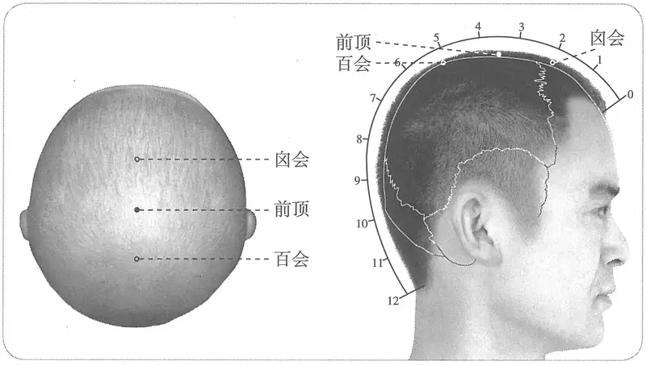

**图 2-395　前顶穴图**

**取穴**：百会与囟会连线的中点。

　1. 在囟会后一寸五分骨间陷者中。（《黄帝明堂经》《太平圣惠方》《铜人腧穴针灸图经》、《圣济总录》、《窦太师针经》、《十四经发挥》、《医学纲目》、《针灸聚英》、《古今医统》、《医学入门》、《针灸大成》、《针方六集》、《类经图翼》、《针灸易学》、《针灸逢源》）

　2. 在囟会上一寸五分骨陷中是穴。据甄权《针经》，一寸是穴，今依《素问》一寸五分为定。（《太平圣惠方·针经》、《铜人腧穴针灸图经》卷中、《针灸资生经》）

　3. 在囟会后一寸，直鼻中央陷者中。（《太平圣惠方·明堂》）

　4. 在百会前一寸。（《太平圣惠方·小儿明堂》）

　5. 从百会前行一寸五分，前顶穴也。（《医宗金鉴·刺灸心法要诀》）

　6. 百会前一寸五分。（《针灸十四经穴位考订》）

　7. 统编针灸学教材

　　(1) 部位：囟会后一寸五分。取穴：从百会向前一寸五分取之。（1957年南京《针灸学》）

〔p.1278 (인쇄 1250)〕

　　(2) 部位：百会穴前一寸五分。取穴：正坐，入前发际三寸五分处取之。（1版《针灸学讲义》）

　　(3) 部位：在囟会后一寸五分，骨间陷者中。取穴：头部正中线上，在百会前一寸五分处，当百会与囟会之间取之。（2版《针灸学讲义》）

　　(4) 百会穴前1.5寸。（4、5版《针灸学》）

　　(5) 在头部，当前发际正中直上3.5寸百会前1.5寸。（6版《针灸学》）

　　(6) 百会穴前1.5寸，或前发际正中直上3.5寸处。（7版《针灸学》）

　　(7) 头部正中线上，百会前一寸五分。（《中国针灸学》）

**文献分析**：本穴定位，《太平圣惠方·小儿明堂》作“百会前一寸”，此与前神聪穴相重，非是。

#### 【类属】 

督脉穴。

督脉气所发。（《黄帝明堂经》）

#### 【适应症】 

主治头面部病症。常用于头痛，眩晕；小儿惊风；鼻渊，面肿。

　1. 主风眩目瞑，恶风寒，面赤肿。小儿惊痫。（《黄帝明堂经》）

　2. 疗头风目眩，面赤肿，小儿惊痫，风痫瘛疭，发即无时，鼻多清涕，顶肿痛。（《铜人腧穴针灸图经》）

　3. 主鼻塞鼻痔。（《针方六集》卷五）

　4. 统编针灸学教材

　　(1) 小儿惊痫，瘛疭，头风，目眩，顶中痛，鼻多清涕，面肿。（1957年南京《针灸学》、1版《针灸学讲义》）

　　(2) 癫痫，头晕，目眩，头顶痛，鼻渊。（2版《针灸学讲义》、4版《针灸学》、《中国针灸学》）

　　(3) 头痛，眩晕，鼻渊，癫痫。（5、6、7版《针灸学》）

#### 附：临床应用举例 

　1. 灸头风，《百病针灸》又灸前顶。穴在囟会后一寸五分。（《医心方》卷三）

　2. 治风，灸上星及百会各二百壮、前顶二百四十壮、脑户及风府各三百壮。（《千金要方》卷八）

　3. 小儿急惊风，灸前顶一穴三壮，在百会前一寸。若不愈，须灸两眉头，及鼻下人中一穴，炷如小麦大。（《太平圣惠方·明堂》）

　4. 若鼻涕多，宜灸囟会、前顶，大人、小儿之病初无以异焉耳。（《针灸资生经》卷六）

　5. 鬼魇着人昏闷，灸前顶穴五十壮。（《扁鹊心书》卷上）

　6. 头风鼻塞等症，灸上星；少愈，灸前顶，次迎香穴。（《针灸集要·盘石金直刺秘传》）

#### 【操作】 

平刺。

　1. 刺入四分，灸五壮。（《黄帝明堂经》）

　2. 针入三分，留七呼，泻五吸，大肿极，即以三棱针刺之，绕四方一寸以下，其头痛肿立瘥，复以盐末和麻油揩发际。灸亦得，日灸二壮，以渐增至七壮，总至八十一壮罢，其风即瘳，忌如前法。（《太平圣惠方·针经》）

　3. 针一分，可灸三壮至七七壮即止。（《铜人腧穴针灸图经》卷中）

　4. 不针，灸七壮，至七七壮。治目眩头风，鼻多清涕。针至一分，详虚实补泻。（《窦太师秘传》）

〔p.1279 (인쇄 1251)〕

　5. 针三分，灸五壮。（《针灸十四经穴位考订》）

　6. 统编针灸学教材

　　(1) 针一分，灸三壮。（1957年南京《针灸学》、1版《针灸学讲义》）

　　(2) 向后沿皮刺3分，艾条灸3分钟。（2版《针灸学讲义》）

　　(3) 平刺0.5~0.8寸。（4、5、6、7版《针灸学》）

　　(4) 横刺0.3~0.5寸。可灸。（《中国针灸学》）

### （二十二）囟会 Xìnhuì GV22 出《黄帝明堂经》 

#### 【提要索隐】 

**穴名**：一名天窗；一名鬼门；一名顶门。

**定位**：在头部，前发际正中直上2寸。

**适应症**：主治头面部病症。常用于头痛，眩晕；癫痫，小儿惊风；鼻塞，鼻衄。

**备选适应症**：去头皮屑。

**针刺操作**：三岁以下、囟门未合者禁针刺。

#### 【名实考】 

囟，古字作“顖”。本穴正名为囟会，别名为天窗。然而宋以前针灸方却多用“天窗”之名，后人不详其故，皆误作颈部小肠经之“天窗”。及至敦煌文献出土佚名灸方，所载天窗一穴，有文有图，皆非常清楚地标注于前头部，然而戴着习惯的有色眼镜，人们看到的却依然是小肠经的“天窗”，真可谓“视而不见”。

　1. 囟会，一名天窗，在上星后一寸陷者中，督脉气所发。（《黄帝明堂经》）

　2. 邪病鬼癫，四肢重，囟上主之。一名鬼门。（《千金要方》卷十四）

　3. 中风不语最难医，顶门发际亦堪施。注曰：顶门即囟会穴，上星后一寸。禁不可刺，灸七壮，针泻之。（《针灸玉龙歌》）

　4. 乃人之囟门，以与督脉会，故曰囟会。（《经穴解》）

　5. 别名　顖上、顖门。（1957年南京《针灸学》）

**按**：此皆部位名，非穴名。

#### 宋以前文献“天窗”穴辨 

　1. 灸头风方　《千金方》云灸天窗穴，在上星后一寸。（《医心方》卷三）

　2. 囟会，一名天窗。（《医心方》卷二）

　3. 天窗一穴，在鼻直上入发际二寸。（《太平圣惠方》卷五十五）

　4. 伤寒……若病者三四日以上，宜先灸胸上二十壮。以绳度鼻正上尽发际，中屈绳断去半，便从发际入发中，灸绳头名天聪。（《千金要方》卷十）

　5. 若病者三四日以上，宜先灸囟上二十壮，以绳度鼻正上尽发际中，屈绳断去半，便从发际度入发中灸绳头名天窗。（《千金翼方》卷二十六）

**按**：据《千金翼方》，可知《千金要方》“胸上”系“囟上”之误；“天聪”系“天牕”之形误。鼻根至前发际四寸，中折入发际正当二寸处囟会，即“天窗”穴处。

　6. 小儿暴痫……若目反上视，眸子动，当灸囟中，取之法，横度口尽两吻际，又横度鼻下亦尽两边，折去鼻度半，都合口为度，以额上发际上行度之。灸度头一处，正在囟上未合骨中，随手动者是，此最要处也。（《千金要方》卷五）

　7. 灸人面上浮风如似虫扬习习，起则癫旋眼□□□□□□□□［灸］天窗，灸板眉，灸曲眉，灸两风府，［灸手阳明］，［灸］足阳明，凡十处，左右灸二百［壮］。（敦煌卷子）

〔p.1280 (인쇄 1252)〕

　8. 面上游风如虫行习习然，起则头旋眼暗，头中沟垄起，灸天窗，次两肩上一寸当瞳仁，次曲眉在两眉间，次手阳明，次足阳明，各灸二百壮。（《千金翼方》）

　9. 灸诸癫狂呆［三十年］者，当灸天窗，次两肩井，灸两风门，灸两肺俞，灸两心俞，灸两肾俞，灸两手五册，灸两足五册，灸两足心，二十一处各灸五百壮，觉消且□。（敦煌卷子）

　10. 癫狂二三十年者，灸天窗，次肩井，次风门，次肝俞，次肾俞，次手心主，次曲池，次足五趾，次涌泉，各五百壮，日七壮。（《千金翼方·针灸中》卷二十七）

**按**：此灸方以敦煌卷子文字为佳，《千金翼方》所以有误者，盖后人不识“手五册”、“足五册”穴而妄改。另一方面，敦煌卷子残缺三字却可据《千金翼方》补齐。值得注意的是，此方灸二十一处，其中“手五册”、“足五册”各四处，而“天窗”一处，显然这里“天窗”穴不是我们所熟知的颈部手太阳小肠经穴“天窗”。从该灸方的取穴图所标示的位置看（图2–396），属于头部正中穴。

　11. 灸猥退风半身不遂法：先灸天窗，次大门，脑后尖骨上一寸，次承浆，次风池，次曲池，次手髓孔腕后尖骨头宛宛中，次手阳明大指奇后，次脚五册屈两脚膝腕纹，次脚髓孔足外踝后一寸，次足阳明足拇指奇三寸，各灸百壮。若有手足患不遂，灸百会，次本神，次肩髃，次心俞，次手少阳，次足外踝下容爪外，并依左右百壮。（《千金翼方·针灸上》卷二十六）

**按**：敦煌卷子存有此方的残文。

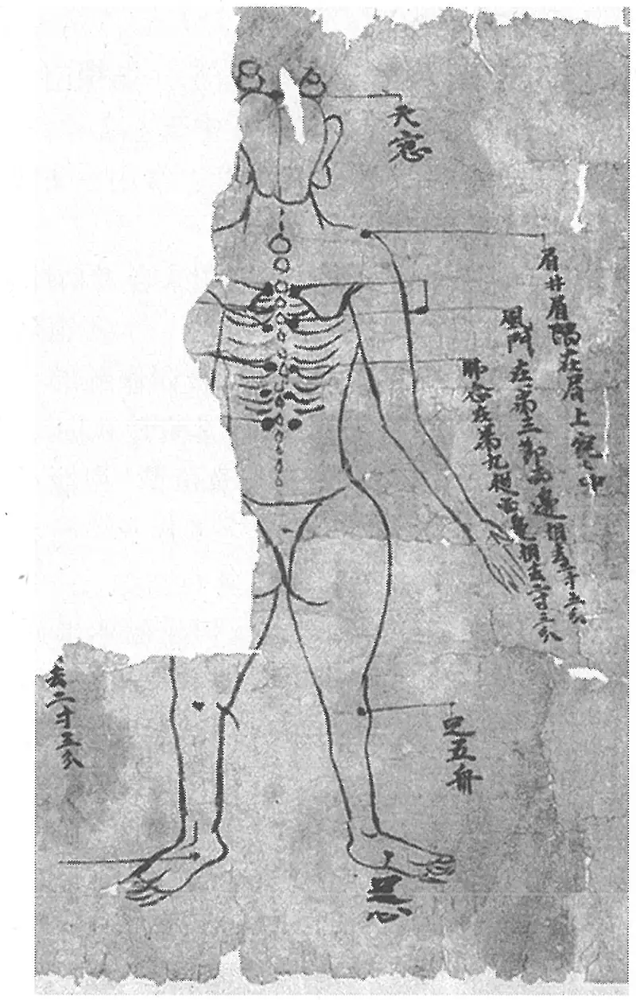

**图 2-396　敦煌卷子“天窗”穴**

从以上腧穴文献《医心方》和《太平圣惠方》已经确知，“天窗”为囟会穴的别名。其中《医心方》卷二系节录自杨上善注本《黄帝内经明堂》，所载“囟会”穴别名即使不是《黄帝明堂经》原文，至晚也是唐以前文字；《太平圣惠方》卷五十五也是录自唐代文献《点烙三十六黄经》，而且《医心方》引《千金要方》灸方也明言“天窗穴，在上星后一寸”，说明至少在隋唐时期将“囟会”穴称作“天窗”是较为普遍的现象。又已知敦煌卷子佚名灸方“天窗”一穴在穴图上标注于前头正中当督脉穴，则见于《千金翼方》相关灸方中之“天窗”可确认为“囟会”穴别名。据笔者考察《千金要方》、《千金翼方》针灸方中“天窗”穴凡可确认者，均指“囟会”穴，而不是手太阳经穴“天窗”。由于传世本《千金要方》“天牕”穴名误作“天聪”，今人不识，别做一穴，归入奇穴类。

#### 【定位】 

**部位**：在头部，前发际正中直上2寸（图2-397）。

**取穴**：在头正中线上，百会向前3寸处取之。

〔p.1281 (인쇄 1253)〕

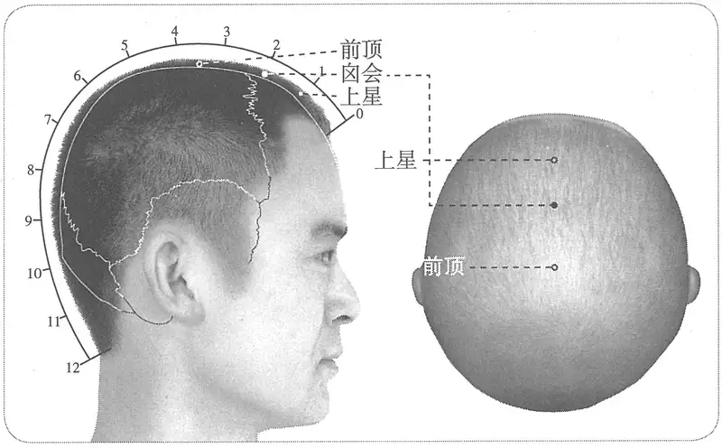

**图 2-397　囟会穴图**

　1. 在上星后一寸骨间陷者中。（《黄帝明堂经》、《太平圣惠方》、《铜人腧穴针灸图经》、《圣济总录》、《针灸资生经》、《十四经发挥》、《医学纲目》、《针灸聚英》、《古今医统》、《医学入门》、《针灸大成》、《针方六集》、《类经图翼》、《针灸易学》、《针灸逢源》）

　2. 窦太师针灸遗存

　　(1) 在头上上星上一寸可容豆许。（《窦太师针经》）

　　(2) 在上星后一寸骨间中。（《大本琼瑶神书》）

　3. 在百会下三寸，有陷可容豆许是穴。（《乾坤生意》）

　4. 囟会，上至前顶一寸半。（《医宗金鉴·刺灸心法要诀》）

　5. 百会前三寸，上星后一寸。（《针灸十四经穴位考订》）

　6. 统编针灸学教材

　　(1) 部位：上星后一寸陷中。取穴：正坐，从百会前三寸取之。（1957年南京《针灸学》）

　　(2) 部位：前顶穴前一寸五分。取穴：正坐，入前发际二寸取之。（1版《针灸学讲义》）

　　(3) 部位：在上星后一寸，骨间陷者中。取穴：头部正中线上，去百会前三寸，前额骨与两顶骨缝合处取之。（2版《针灸学讲义》）

　　(4) 前发际正中直上2寸。（4、5版《针灸学》）

　　(5) 在头部，当前发际正中直上2寸（百会前3寸）。（6版《针灸学》）

　　(6) 前顶穴前1.5寸，或前发际正中直上2寸。（7版《针灸学》）

　　(7) 前发际正中直上二寸，即百会前三寸。（《中国针灸学》）

#### 【类属】 

督脉穴。

督脉气所发。（《黄帝明堂经》）

#### 【适应症】 

主治头面部病症。常用于头痛，眩晕；癫痫，小儿惊风；鼻塞，鼻衄。颅脑外科手术（颞顶枕）的针麻用穴。

**备选适应症**：去头皮屑。

　1. 主风眩，善呕烦满，头痛颜青。目泣出。痓。寒热，喘喝，目不能视。癫疾呕沫，暂起僵仆，恶见风寒，面赤肿。（《黄帝明堂经》）

〔p.1282 (인쇄 1254)〕

　2. 主鼻塞不闻香气。（《千金翼方》卷二十六、《太平圣惠方·针经》）

　3. 疗头风痛，白屑起，多睡。（《太平圣惠方·针经》）

　4. 主头目眩，头皮肿，生白屑。（《太平圣惠方·明堂》）

　5. 治目眩面肿，鼻塞不闻香臭，惊痫，戴目上不识人。可灸二七壮至七七壮。初灸即不痛，病去即痛，痛即罢灸。若是鼻塞，灸至四日渐退，七日顿愈。针入二分，留三呼，得气即泻。头风，生白屑，多睡，针之弥佳。（《铜人腧穴针灸图经》卷中）

　6. 窦太师针灸遗存

　　(1) 治真头痛，此症大恶，旦发夕死，夕发旦死。泻火毒，用三棱针出血大效，治一切头风等症，看症补泻。（《窦太师针经》）

　　(2) 主头风头痛，风热上攻宜出血。（《针方六集》卷五）

　　(3) 若真头痛，宜三棱针于此穴出血。（《循经考穴编》下）

　　(4) 治偏正头风，鼻寒，中风不省人事。（《窦太师秘传》）

　7. 主脑虚冷，或饮食酒过多，脑疼如破，衄血。（《针灸聚英》卷一、《针灸大成》）

**按**：此辑自《针灸资生经》王执中医案。

　8. 统编针灸学教材

　　(1) 主治小儿暴痫，惊风，脑痛如破，头眩，鼻衄鼻塞。（1957年南京《针灸学》）

　　(2) 主治小儿惊风，头痛，头眩，鼻衄，鼻塞。（1版《针灸学讲义》）

　　(3) 主治头痛，头眩，鼻渊，小儿惊痫。（2版《针灸学讲义》）

　　(4) 主治头痛，目眩，鼻渊，小儿惊痫。（4版《针灸学》、《中国针灸学》）

　　(5) 主治头痛，眩晕，鼻渊，癫痫。（5、6、7版《针灸学》）

**文献分析**：本穴通脑，故主治脑病及与脑相通的眼、鼻病症。又《黄帝明堂经》载本穴主治与上星、神庭穴主治颇相近，当参看。

#### 附：临床应用举例 

　1. 风眩，善呕烦满，神庭主之……如头痛颜青者，囟会主之。（《针灸甲乙经》卷十）

　2. 狂邪鬼语，灸天窗九壮。（《千金要方》卷十四）

**按**：天窗，囟会穴别名。

　3. 中风失喑不能言语，缓纵不随，先灸天窗五十壮，息火仍移灸百会五十壮，毕还灸天窗五十壮者。始发先灸百会，则风气不得泄。内攻五脏，喜闭伏仍失音也。所以先灸天窗，次百会佳。一灸五十壮悉泄火势，复灸之，视病轻重，重者一处三百壮大效。凡中风服药益剧者，但是风穴悉皆灸之三壮，无不愈也。（《千金要方》卷八、《千金翼方》）

**按**：此方又见于敦煌卷子佚名灸方。

　4. 卒癫，又灸天窗、百会各渐灸三百壮，炷惟小作。（《千金要方》卷十四）

　5. 鼻塞不闻香气，日灸二七至七百壮，初灸时痛，五十壮已去不痛，七百壮还痛即止，至四百壮渐觉鼻轻。（《千金翼方》卷二十六）

　6. 灸头风方，《千金方》云灸天窗穴，在上星后一寸。（《医心方》卷三）

　7. 《千金方》治卒失音方，灸天窗，百会穴。（《医心方》卷三）

　8. 小儿多涕者，是脑门被风拍着及肺寒也。灸囟会一穴三壮，炷如小麦大，在上星上一寸，直鼻。（《太平圣惠方·明堂》）

　9. 予少刻苦，年逾壮则脑冷，或饮酒过多则脑疼如破。后因灸此穴，非特脑不复冷，他

〔p.1283 (인쇄 1255)〕

日酒醉脑亦不疼矣。凡脑冷者宜灸此。（《针灸资生经》卷一）

　10. 脑虚冷脑衄，风寒入脑，久晕头疼等疾，宜灸囟会。（《针灸资生经》卷三）

　11. 鼻酸多嚏，常流清涕，灸囟会、风门二穴。（《针灸集要·盘石金直刺秘传》）

　12. 脑虚冷衄，风入脑久远成疾，宜灸囟会。（《针灸玉龙经·灸法杂抄切要》）

　13. 治一切诸风鼻塞，不闻香臭，时流清涕。一切偏正头风及生白屑，惊痫目上视不识人，口眼㖞斜。囟会一穴在百会下三寸，有陷可容豆许是穴，宜灸二七壮。（《乾坤生意》下卷）

　14. 中风不语最难医，顶门发际亦堪施，百会穴中明补泻，即时苏醒免灾危。（《针灸玉龙歌》）

　15. 鼻衄，上星透囟会。［中国针灸，1990，10（2）：52］

　16. 新生儿破伤风，灸神阙、囟会为主治疗。［中国针灸，1999（12）：724］

　17. 紧张性头痛，灸囟会为主治疗。［山东中医杂志，2001，20（8）：479］

#### 【操作】 

三岁以下、囟门未合者禁针刺。

　1. 刺入四分，灸五壮。（《黄帝明堂经》）

　2. 刺入二分，留三呼，得气即泻。（《太平圣惠方·针经》）

　3. 八岁以上得针，八岁以下不得针。缘囟门未合。若针，不幸令人死矣。（《太平圣惠方·针经》）

　4. 可灸二七壮至七七壮。初灸即不痛，病去即痛，痛即罢灸。若是鼻塞，灸至四日渐退，七日顿愈。针入二分，留三呼，得气即泻。头风，生白屑，多睡，针之弥佳。针讫以末盐、生麻油相和，揩发根下，头风即永除。若八岁以下，即不得针，盖缘囟门未合，刺之不幸令人夭。（《铜人腧穴针灸图经》卷中）

　5. 囟会一穴，只可针五分，过即令人头眩目暗，急针百会及风府穴救之。（《圣济总录》卷一九四）

　6. 窦太师针灸遗存

　　(1) 禁针，灸七壮，或三壮……泻火毒，用三棱针出血大效。（《窦太师针经》）

　　(2) 禁不可刺，灸七七壮，针泻之。（《针灸玉龙歌》注）

　7. 禁针，灸二七壮。（《医学入门》卷一）

　8. 针二分，灸五壮。小儿八岁以下禁针。（《针灸十四经穴位考订》）

　9. 统编针灸学教材

　　(1) 灸三至七壮。（1957年南京《针灸学》、1版《针灸学讲义》）

　　(2) 向后沿皮刺2分，艾条灸3~7分钟。（2版《针灸学讲义》）

　　(3) 平刺0.5~0.8寸。（4、5、7版《针灸学》）

　　(4) 平刺0.5~0.8寸，小儿前囟未闭者禁针；可灸。（6版《针灸学》）

　　(5) 横刺0.3~0.5寸。小儿前囟未闭者禁针。可灸。（《中国针灸学》）

### （二十三）上星 Shàngxīng GV23 出《黄帝明堂经》 

#### 【提要索隐】 

**穴名**：一名明堂；一名鬼堂。

**定位**：在头部，前发际正中直上1寸。

〔p.1284 (인쇄 1256)〕

**适应症**：主治头面部病症。常用于鼻渊，鼻衄；头痛，眩晕，目痛；癫狂；疟疾，热病。

**针刺操作**：平刺。

#### 【名实考】 

上星，一名明堂，一名鬼堂。《太平圣惠方·针经》同时载有“明堂”、“上星”各一穴，所出不同，其实一穴也。

　1. 上星，在颅上，直鼻中央入发际一寸陷容豆，督脉气所发。（《黄帝明堂经》）

　2. 明堂一穴，在鼻直上入发际一寸。（《太平圣惠方》卷五十五）

　3. 别名　神堂、名堂。（1957年南京《针灸学》）

**按**：此皆录自日本针灸教材，其“神堂”一名云出自《类经图翼》，实则已先见于《针灸聚英》；“名堂”系“明堂”之误。

　4. 直鼻上入发际一寸，名鬼堂。即上星穴也。（《千金要方》卷十四）

　5. 此穴在额之最高处陷中如豆大，如星以悬于天者然，故曰上星。（《经穴解》）

#### “上星”与“明堂”穴辨 

现将有关原文对照如下：

**上星**

上星一穴，在额颅上直鼻中央入发际一寸陷容豆是穴……主疗头风头肿，皮肿面虚，鼻塞，头痛。（《太平圣惠方·针经》）

上星一穴，在直鼻上入发际一寸陷者中……主头风目眩，鼻塞不闻香臭。（《太平圣惠方·明堂》）

**明堂**

明堂一穴，在鼻直上入发际一寸。（《太平圣惠方》卷五十五）

明堂一穴，在鼻直上入发际一寸是穴。理风头，多鼻涕，鼻塞。（《太平圣惠方·针经》）

明堂一穴，在鼻直上入发际一寸，理头风，多鼻涕，鼻塞。三日一报针二分。按《铜人》、《明堂》及诸家针灸经鼻直上入发际一寸皆云上星穴《明堂经》于此复云明堂穴不知何所据且附入于此所谓疑以传疑也。◎今以诸经校勘上星穴者是。（《针灸资生经》卷一）

**按**：从上文看，所载“明堂”穴的部位，与“上星”穴同，两者的主治症也很相近，显然是同一穴。“明堂”穴名早见于敦煌卷子《新集备急灸经》，而《太平圣惠方》所载“明堂”穴内容采自《山眺针灸经》，该书编者未明此穴与“上星”穴的关系，而一并录之。南宋王执中也不知“明堂”穴何所据，故“疑以传疑”，附于“神聪”穴后。

#### 【定位】 

**部位**：在头部，前发际正中直上1寸（图2-398）。

　1. 在颅上，直鼻中央入发际一寸陷者中，可容豆。（《黄帝明堂经》、《太平圣惠方·针经》、《铜人腧穴针灸图经》卷中、《圣济总录》、《针灸资生经》、《神应经》、《十四经发挥》、《医学纲目》、《针灸聚英》、《古今医统》、《针灸大成》、《针方六集》、《类经图翼》、《针灸易学》、《针灸逢源》）

　2. 明堂一穴，在鼻直上入发际一寸。（《太平圣惠方·针经》）

　3. 在神庭后入发际一寸。（《铜人腧穴针灸图经》卷上）

　4. 窦太师针灸遗存

　　(1) 在头入发际二寸，神庭穴上一寸半陷中。（《窦太师针经》）

　　(2) 在神庭后入发际一寸陷中容豆。有取法用大陵穴与鼻尖齐中指尽处是穴。（《大

〔p.1285 (인쇄 1257)〕

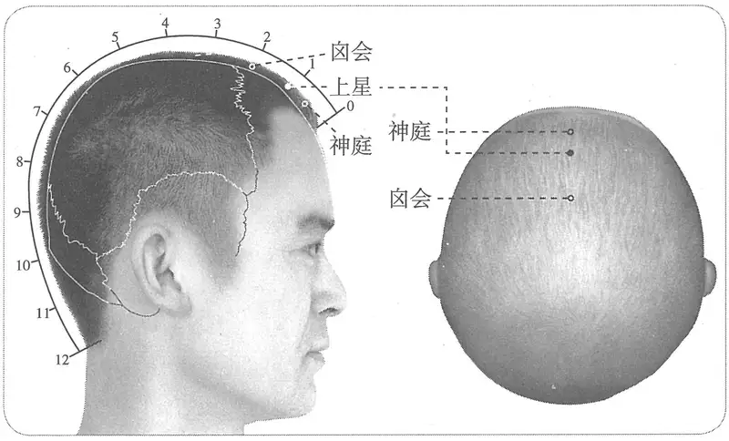

**图 2-398　上星穴图**

本琼瑶神书》）

　　(3) 在头入发际一寸。取法：用手掌后纹按与鼻尖齐，中指点到处是穴。（《窦太师秘传》、《针方六集》）

　　(4) 在发际一寸半，取穴以手掌后横纹按鼻尖中指头尽处是穴。（《针灸玉龙歌》注）

　5. 穴在神庭后五分陷中，广注入发际当一寸。（《循经考穴编》下）

　6. 从囟会又前行一寸，上星穴也。（《医宗金鉴·刺灸心法要诀》）

　7. 入前发际一寸。（《针灸十四经穴位考订》）

　8. 统编针灸学教材

　　(1) 部位：前发际入发一寸。取穴：正坐，从前发际入发一寸取之。（1957年南京《针灸学》）

　　(2) 部位：囟会穴前一寸。取穴：正坐，入前发际一寸取之。（1版《针灸学讲义》）

　　(3) 部位：在颅上直鼻中央，入发际一寸陷者中，可容豆。取穴：头部正中线上，在百会前四寸取之。（2版《针灸学讲义》）

　　(4) 前发际正中直上1寸。（4、5版《针灸学》，《中国针灸学》）

　　(5) 在头部，当前发际正中直上1寸。（6版《针灸学》）

　　(6) 囟会穴前1寸或前发际正中直上1寸。（7版《针灸学》）

**文献分析**：本穴定位，距前发际的折量分寸，传世之窦太师针灸佚文所说有分歧：一作“一寸”，一作“一寸半”，一作“二寸”。其“二寸”说与囟会穴定位相重，显然有误；作“一寸半”者，可能是折衷之说。

#### 【类属】 

督脉穴。

督脉气所发。（《黄帝明堂经》）

#### 【适应症】 

主治头面部病症。常用于鼻渊，鼻衄；头痛，眩晕，目痛，癫狂；疟疾，热病。颅脑外科手术针麻用穴。

　1. 主风眩，善呕烦满，颜青。癫疾。面胕肿。鼻鼽衄。头痛引颔痛。痎疟。热病汗不出。目中痛不能视。（《黄帝明堂经》）

　2. 主疗头风、头肿、皮肿，面虚，鼻塞，头痛。（《太平圣惠方·针经》）

〔p.1286 (인쇄 1258)〕

　3. 主头风目眩，鼻塞不闻香臭。（《太平圣惠方·明堂》）

　4. 治头风面虚肿，鼻塞不闻香臭，目眩，痎疟振寒，热病汗不出，目睛痛不能远视。（《铜人腧穴针灸图经》卷中）

　5. 《普济针灸经》云主鬼魅惊恐哭泣。（《圣济总录》卷一九四）

　6. 窦太师针灸遗存

　　(1) 治鼻塞不闻香臭，先补后泻，泻多；治鼻流清涕臭，先泻后补，补多。鼻流浊涕臭，名鼻渊，泻；鼻衄不止，先补后泻。目痛头风，泻，宜三棱针出血。（《窦太师针经》）

　　(2) 鼻渊则补，不闻香臭则泻。（《针灸玉龙经》）

　　(3) 主头生白屑。棱针出血，能宣泄诸阳热气。（《循经考穴编》下）

　　(4) 治头风面肿，鼻塞目痛，痎疟寒热。（《窦太师秘传》）

　7. 鼻中息肉，口鼻出血不止。（《针灸聚英》卷一、《针灸大成》）

**按**：此乃高武从《针灸资生经》辑自《千金要方》灸方主治。

　8. 统编针灸学教材

　　(1) 主治头风头痛，头皮肿，目痛不能远视，鼻塞鼻衄。（1957年南京《针灸学》）

　　(2) 主治头风，头痛，头皮肿，目赤肿痛，鼻塞鼻衄。（1版《针灸学讲义》）

　　(3) 主治头痛，目痛，鼻渊，鼻衄，癫狂。（2版《针灸学讲义》、《中国针灸学》）

　　(4) 主治头痛，目痛，鼻衄，疟疾，热病，癫狂。（4版《针灸学》）

　　(5) 主治头痛，目痛，鼻渊，鼻衄，癫狂，疟疾，热病。（5、6、7版《针灸学》）

**文献分析**：《黄帝明堂经》载本穴主治偏于风头痛，而自《太平圣惠方》始，本穴主治开始偏于鼻部病症。临床应用也多在鼻部病症。

#### 附：临床应用举例 

　1. 鼻部病症

　　(1) 鼻中息肉，灸上星三百壮，穴在直鼻入发际一寸。（《千金要方》卷六、《千金翼方》）

　　(2) 凡口鼻出血不止，名脑衄。灸上星五十壮，入发际一寸是。（《千金要方》卷十二、《千金翼方》）

　　(3) 头风鼻塞等症：灸上星；少愈，灸前顶，次迎香穴。（《针灸集要·盘石金直刺秘传》）

　　(4) 鼻流清涕：上星、人中、风府。问曰：此证缘何而得？答曰：皆因伤风不解，食肉饮酒不早，表里不解，痰涎及脑，塞脑痛，故得此证，复刺后穴：百劳、风池、百会、风门。（《针灸集成》第十八方）

　　(5) 脑寒鼻出臭秽：上星、合谷、曲池、曲差。问曰：此证缘何而得？答曰：皆因鼻衄不止，用药吹入脑，伤损脑户，毒气攻上，故鼻流臭也。复刺后穴：人中、迎香。（《针灸集成》第十九方）

　　(6) 鼻衄不止：合谷、百会、上星。问曰：此证缘何而得？答曰：血气上壅，阴阳不能升降，血不宿肝，心主血，肝纳血，故气血不顺也。血盛而妄行于口，针前穴未效，复刺后穴：迎香、人中、印堂。（《针灸集成》第二十方）

　　(7) 鼻流清涕名鼻渊，先泻后补疾可痊。若更头风并眼痛，上星一穴刺无偏。（《针灸玉龙歌》）

　　(8) 鼻衄：上星。［四川中医，1985，3（3）：34］

〔p.1287 (인쇄 1259)〕

　2. 头、目病症

　　(1) 风眩，善呕烦满，神庭主之；如颜青者，上星主之，取上星者，先取譩譆，后取天牖、风池；如头痛颜青者，囟会主之。（《针灸甲乙经》卷十）

　　(2) 癫疾，上星主之，先取譩譆，后取天牖、风池。癫疾，互引，口㖞，喘悸者，大迎主之，及取阳明、太阴，候手足变血而止。（《针灸甲乙经》卷十一）

　　(3) 浑头风，头痛如破，重如石，胃寒则热，过热则散：灸百会、上星，刺风府；未愈，次丰隆泻之。（《针灸集要·盘石金直刺秘传》）

　　(4) 头风目眩：合谷、上星、风池、三里、丰隆、解溪。问曰：此证针效复发何也？答曰：乃房事过多，醉饱不避风寒而卧，贼风入经络之证，再发复刺后穴：风池、上星、三里。（《针灸集成》第七方）

　　(5) 眩晕：上星透百会，百会透枕外粗隆，神门，安眠4胫骨内侧缘三阴交上二寸。［中国针灸，1988，8（6）：11］

　3. 其他病症

　　(1) 面胕肿，上星主之，先取譩譆，后取天牖、风池。（《针灸甲乙经》卷八）

　　(2) 疟，灸上星及大椎，至发时令满百壮，灸艾炷如黍米粒。俗人不解取穴。务大炷也。（《千金要方》卷十）

#### 【操作】 

平刺。

　1. 刺入三分，留六呼，灸五壮。（《黄帝明堂经》）

　2. 针入二分，留十呼，泻五吸，针下气尽，便停针引之，得气即泻，灸亦得；然不及眼暗，故不用相续。加灸满五十壮，即以细三棱针刺头上，令宣通热气，若热不止，热气上冲之痛也。慎酒麦荞麦。（《太平圣惠方·针经》）

　3. 以细三棱针刺之，即宣泄诸阳热气，无令上冲头目。可灸七壮，不宜多灸，若频灸即拔气上，令人目不明。（《铜人腧穴针灸图经》卷中）

　4. 窦太师针灸遗存

　　(1) 针入三寸（分），灸七壮。治鼻塞不闻香臭，先补后泻，泻多；鼻流清涕臭，先泻后补，补多。鼻流浊涕臭，名鼻渊，泻；鼻衄不止，先补后泻。目痛头风，泻，宜三棱针出血。（《窦太师针经》）

　　(2) 入三分，三壮，治鼻不闻香臭，先补后泻，泻多；鼻流清涕烂臭，先泻后补，补多；治目赤痛并头风等证，泻，亦宜三棱针，针出血最妙，泻阳热气。（《大本琼瑶神书》）

　　(3) 针入三分，灸二七壮。（《窦太师秘传》）

　5. 针三分，灸三壮。不宜多灸。（《针灸十四经穴位考订》）

　6. 统编针灸学教材

　　(1) 针三至四分，针尖沿皮向下方，灸三至五壮。（1957年南京《针灸学》、1版《针灸学讲义》）

　　(2) 向上沿皮刺3~4分，或三棱针点刺出血；艾条灸3~5分钟。（2版《针灸学讲义》）

　　(3) 平刺0.5~0.8寸，或点刺出血。（4、7版《针灸学》）

　　(4) 平刺0.5~1寸。（5、6版《针灸学》）

　　(5) 横刺0.3~0.5寸，或点刺出血，小儿前囟未闭者禁针。可灸。（《中国针灸学》）

　7. 斜刺0.5~1寸。感应局部胀痛。灸3壮；温灸5~10分钟。（上海《针灸学》）

〔p.1288 (인쇄 1260)〕

### （二十四）神庭 Shéntíng GV24 出《黄帝明堂经》 

#### 【提要索隐】 

**穴名**：一名督脉；一名发际。

**定位**：在头部，前发际正中直上0.5寸。

**适应症**：主治神志病、头鼻部病症。常用于癫，狂，痫；头痛，眩晕，呕吐；鼻渊，鼻衄。

**针刺操作**：平刺。

#### 【名实考】 

神庭，一名督脉；一名发际。需要注意的是，“督脉”又为印堂穴的别名。

本穴定位，有一个从“在发际”，到发际上“一分”、“二分”、“五分”的演变过程，加上宋以前文献中关于本穴的名称不一，今人不识而误断为别穴，归入奇穴类。日本江户时期腧穴考证的代表作《经穴汇解》引《千金要方》一条本穴针灸方时，引文有错，中国当代所有有关奇穴的书皆直接或间接沿袭此误。

　1. 神庭，在发际直鼻，督脉、足太阳、阳明之会。（《黄帝明堂经》）

　2. 神庭一穴，在鼻直上入发际五分。（《太平圣惠方》卷五十五）

　3. 额之上乃人神所游之所，而此穴乃其庭也。（《经穴解》）

#### “神庭”与“发际”、“督脉”、“额上”穴辨 

　1. 神庭在发际直鼻。不刺。一云入发际一分。（《千金翼方》卷二十六）

　2. 治小儿暴痫，若目反上视，眸子动……次灸当额上入发二分许，直望鼻为正。（《千金要方》卷五）

　3. 小儿风痫者，先屈手指如数物乃发也。灸鼻柱上发际宛宛中三壮，炷如小麦大。（《太平圣惠方》卷一百）

　4. 额上（千金），次灸当额上入发际二寸许，直望鼻为正。（日本原昌克《经穴汇解》卷七）

　5. 卒癫，又灸督脉三十壮，三报。穴在直鼻中上入发际。（《千金要方》卷十四、《千金翼方》卷二十七）

　6. 神庭一穴，在发际直鼻上，督脉上一夫发际是也。（《太平圣惠方·针经》）

　7. 八素注云发际在上星下一寸毛内之分。（《医心方》卷二）

　8. 或饮食不节，酒色过度，忽中此风，言语謇涩，半身不遂，宜于七处一齐下火灸三壮。如风在左灸右，在右灸左。一百会穴，二耳前发际，三肩井穴，四风市穴，五三里穴，六绝骨穴，七曲池穴。（《太平圣惠方·明堂》）

　9. 范子默记崇宁中凡两中风，始则口眼㖞斜，次则涎潮闭塞，左右共灸十二穴得气通，十二穴者，谓听会、颊车、地仓、百会、肩髃、曲池、风市、足三里、绝骨、发际、大椎、风池也，根据而用之，无不立效。发际，即神庭穴，在直鼻上额入发际五分。（《普济本事方》卷一）

**按**：神庭穴定位，《黄帝明堂经》曰“在发际”，第一条作“入发际一分”；第二、第三条主治同，而一作“鼻柱上发际”，一作“入发二分许”，所说皆“神庭”穴也。日本《经穴汇解》引录第二条文献时，将“二分许”误写作“二寸许”，因而别立“额上”一穴归入奇穴类，中国奇穴类书皆沿袭其误；第五条“督脉”穴，与神庭穴定位相同，而第六条“督脉”则显然是印堂穴的别名，切不可相混；第七条“发际”穴与神庭穴定位相同，并与敦煌卷子佚名灸方取穴图同，而第八条“耳前发际”则不同，第九条则先将此“耳前发际”改作“发际”，再将其与神庭穴相混，非是。

#### 【定位】 

**部位**：在头部，前发际正中直上0.5寸（图2-399）。

〔p.1289 (인쇄 1261)〕

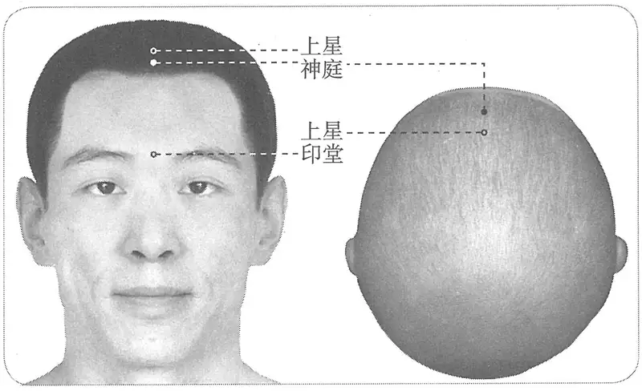

**图 2-399　神庭穴图**

**取穴**：发际不明或变异者，从眉心直上3.5寸处取穴。

　1. 在发际直鼻。（《针灸甲乙经》卷三、《千金要方》、《千金翼方》、《外台秘要》、《素问·气府论》王冰注、《医心方》）

**按**：明刊本《外台秘要》“在发际”后有“五分”二字，乃宋以后人所加。

　2. 一云入发际一分。（《千金翼方》卷二十六）

　3. 在发际直鼻上，督脉上一夫发际是也。（《太平圣惠方·针经》）

　4. 在鼻直上入发际五分。（《太平圣惠方》卷五十五）

　5. 直鼻上入发际五分。（《铜人腧穴针灸图经》卷上、《圣济总录》、《针灸资生经》、《针灸玉龙经》、《十四经发挥》、《医学纲目》、《针灸聚英》、《古今医统》、《医学入门》、《针灸大成》、《针方六集》、《循经考穴编》、《针灸易学》）

　6. 直鼻入发际五分，发高者发际是穴，发低者加二、三分。（《类经图翼》卷八）

　7. 从上星至前发际，神庭穴也。（《医宗金鉴·刺灸心法要诀》）

　8. 在直鼻上，入发际五分，如发际不明者，取以眉心上三寸五分。（《针灸逢源》）

　9. 入前发际五分。（《针灸十四经穴位考订》）

　10. 统编针灸学教材

　　(1) 部位：鼻直上，入发际五分。取穴：从前额上入发际五分取之。（1957年南京《针灸学》）

　　(2) 部位：上星穴前五分。取穴：从前额正中入发际五分取之。（1版《针灸学讲义》）

　　(3) 部位：在发际直鼻。取穴：头部正中线上，入前发际五分取之。（2版《针灸学讲义》）

　　(4) 前伏击正中直上0.5寸。（4、5版《针灸学》）

　　(5) 在头部，当前发际正中直上0.5寸。（6版《针灸学》）

　　(6) 前发际正中直上0.5寸。（7版《针灸学》）

　　(7) 前发际正中直上五分。（《中国针灸学》）

**文献分析**：《铜人腧穴针灸图经》将《黄帝明堂经》前后发际穴“神庭”、“哑门”皆作“入发际五分”，修订的原因详见本章概说。张介宾不知其复杂、漫长的演变过程，欲用发际的高低来调和各家之说，非是。

#### 【类属】 

督脉穴。

**脉气所发**：督脉、足太阳、阳明之会。（《黄帝明堂经》）

〔p.1290 (인쇄 1262)〕

**归经**：督脉。（《外台秘要》卷三十九、《铜人腧穴针灸图经》卷上）

#### 【适应症】 

主治神志病、头鼻部病症。常用于癫、狂、痫；头痛，眩晕，呕吐；鼻渊、鼻衄。

　1. 主头脑中寒，鼻衄，目泣出。癫疾呕沫。风眩，善呕，烦满。痎疟。寒热头痛，喘喝，目不能视。（《黄帝明堂经》）

　2. 主疗肿气，风痫，癫风不识人，羊鸣角弓反张，披发而上歌下哭，多学人言语，惊悸不得安寝。（《太平圣惠方·针经》）

　3. 主登高而歌，弃衣而走，角弓反张，羊痫吐舌也。（《太平圣惠方·明堂》）

　4. 治癫疾风痫，戴目上不识人，头风目眩，鼻出清涕不止，目泪出，惊悸不得安寝。（《铜人腧穴针灸图经》卷中）

　5. 窦太师针灸遗存

　　(1) 治头风痛，补泻，泻多；头昏恶吐痛，补泻；鼻塞，两眉尖痛，补泻。（《窦太师针经》）

　　(2) 治头风痛，先补后泻，泻多；治头晕恶心吐痰，后泻。（《大本琼瑶神书》）

　6. 统编针灸学教材

　　(1) 主治癫痫惊悸，不得安卧，头眩痛，目泪出，目翳，鼻渊。（1957年南京《针灸学》）

　　(2) 主治癫痫，惊悸，头痛，目眩，泪出，目翳，鼻渊。（1版《针灸学讲义》）

　　(3) 主治癫痫，惊悸，不眠，头痛，眩晕，鼻渊。（2版《针灸学讲义》、4版《针灸学》、《中国针灸学》）

　　(4) 主治头痛，眩晕，失眠，鼻渊，癫痫。（5、6版《针灸学》）

　　(5) 主治癫狂痫，失眠，惊悸等神志病证；头痛、目眩、目赤、目翳、鼻渊、鼻衄等头面五官病证。（7版《针灸学》）

**文献分析**：《太平圣惠方》所载本穴主治“惊悸，不得安寝”是惊痫的伴随症状，而不是两个独立病症，现代文献将其主治归纳为三个独立的病症：“癫痫，惊悸，不眠”，欠妥。

#### 附：临床应用举例 

　1. 头、鼻、眼部病症

　　(1) 小儿癫痫，惊风目眩，灸神庭一穴七壮，在鼻上入发际五分。（《卫生宝鉴》卷十九）

　　(2) 鼻塞不闻香臭：灸神庭，刺迎香泻之。鼻生息灸前二穴，鼻衄不止灸风府。（《针灸集要·盘石金直刺秘传》）

　　(3) 正头风大痛及脑痛：神庭、合谷、太阳、上星、百会。问曰：此证针后或一日、二日再发，痛甚如前，何也？答曰：诸阳聚于头，合先补后泻，宜泻多补少。其证再发愈重如前，依前穴法再针泻之，无不效也。复刺后穴。（《针灸集成》第五方）

　　(4) 眼暴赤肿：神庭、内庭、囟门、前顶、百会各出血立愈。（《医学纲目》卷十三）

　　(5) 鼻流清涕，腠理不密，喷涕不止，神庭一穴、肺俞二穴、太渊二穴、三里二穴。（《针灸大全》卷四）

　　(6) 凡目暴赤肿起羞明隐涩，泪出不止，暴寒目𥇒𥇒，大热之所为也，在针则神庭、上星、囟会、前顶，百会，翳者可使立退，肿者可使立消，惟小儿不可刺囟会。（《针灸聚英》卷二）

　　(7) 头风呕吐眼昏花，穴在神庭刺不瘥，子女惊风皆可治，印堂刺入艾来加。（《针灸玉龙歌》）

〔p.1291 (인쇄 1263)〕

　2. 其他病症

　　(1) 治久风卒风缓急诸风，卒发动不自觉知。或心腹胀满，或半身不遂，或口噤不言，涎唾自出，目闭耳聋，或举身冷直，或烦闷恍惚，喜怒无常，或唇青口白戴眼，角弓反张，始觉发动，即灸神庭一处七壮。穴在当鼻直上发际是……（《千金要方》卷八）

　　(2) 考场综合征：百会穴、神庭穴，针刺补泻。［中国针灸，1986，6（6）：14-17］

#### 【操作】 

平刺。

　1. 禁不可刺，灸三壮。（《黄帝明堂经》）

　2. 禁不可刺，若刺之令人巅疾，目失睛，若灸者可灸三壮。（《素问·气府论》王冰注）

　3. 刺之主发狂，灸之则愈癫疾。（《千金翼方》卷二十六）

　4. 日灸二七壮至百壮，病即止。禁不可针，若针即发其病。举火之时，忌猪鱼羊肉酒麦热食，不宜热衣，怕餐冷食、醋滑等物。（《太平圣惠方·针经》）

　5. 禁不可刺，刺即发狂，忌生冷鸡猪酒麦动风物等。（《铜人腧穴针灸图经》卷中）

　6. 窦太师针灸遗存

　　(1) 针三分，灸七壮。（《窦太师针经》）

　　(2) 针三分，先补后泻，泻多补少。（《针灸玉龙歌》注）

　7. 统编针灸学教材

　　(1) 针二至三分，沿皮向上刺，灸三至五壮。（1957年南京《针灸学》、1版《针灸学讲义》）

　　(2) 向上沿皮刺2~3分，艾条灸3~5分钟。（2版《针灸学讲义》）

　　(3) 平刺0.5~0.8寸，或点刺出血。（4、5、6、7版《针灸学》）

　　(4) 横刺0.3~0.5寸，或点刺出血。可灸。（《中国针灸学》）

### （二十五）素髎 Sùliáo GV25 出《黄帝明堂经》 

#### 【提要索隐】 

**穴名**：一名面王。

**定位**：在面部，鼻尖的正中央。

**适应症**：主治鼻部病症。常用于鼻塞，鼻衄，鼻渊，鼻息肉，酒渣鼻。

**针刺操作**：直刺或向上斜刺0.3~0.5寸。

#### 【名实考】 

《尔雅·释兽》注曰：素，鼻茎也。本穴正当鼻茎端陷中，故曰“素髎”；又，鼻茎又名“鼻准”、“鼻柱”、“面王”，故本穴“一名面王”（后世文献作“面正”、“面玉”者，皆形误也），又名“鼻准”、“鼻柱”。明初官修医书《奇效良方》不辨原委，将“鼻准”误归人奇穴类，后世皆沿袭。

　1. 素髎，一名面王，在鼻柱端，督脉气所发。（《黄帝明堂经》）

　2. 面王以上者，小肠也：面王以下者，膀胱子处也。注曰：面王者，鼻隧之端也。（《黄帝内经灵枢注证发微·五色》）

　3. 鼻之骨曰鼻柱，曰明堂骨。（《释骨》）

　4. 鼻孔之界骨名曰鼻梁骨，下至鼻之尽处名曰准头。（《医宗金鉴》卷八十八）

　5. 素者，始也，顺也，洁也。人之生也先鼻，有始之义焉，自山根而下，至此而止，有顺之义也，穴在面中最高处，有洁之义焉，故曰素髎。（《经穴解》）

〔p.1292 (인쇄 1264)〕

**按**：此解牵强，未得古义也。

#### “素髎”、“鼻准”、“鼻柱”穴辨 

　1. 素髎，一名面王，在鼻柱端。督脉气所发。刺入三分。主鼽衄洟出，中有悬痈宿肉，窒洞不通，不知香臭。（《黄帝明堂经》）

　2. 鼻准一穴，在鼻柱尖上。是穴专治鼻上生酒酢风，宜用三棱针出血，立效。（《奇效良方》）

　3. 鼻柱一穴，在鼻柱尖上。专治鼻上酒醉风。宜三棱针出血。（《针方六集》）

**按**：以上“素髎”、“鼻准”、“鼻柱”定位相同，主治相近，实为一穴也。需要注意的是，现代奇穴类书所收之“鼻柱”穴，实为水沟穴，勿与本穴相混。详见水沟穴“名实考”。

#### 【定位】 

**部位**：在面部，鼻尖的正中央（图2-400）。

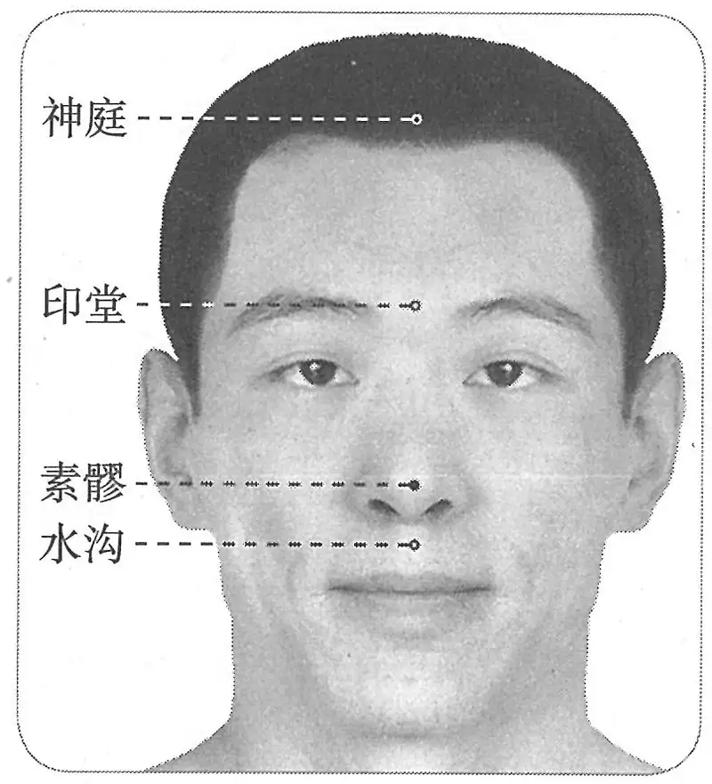

**图 2-400　素髎穴图**

　1. 在鼻柱端。（《黄帝明堂经》、《铜人腧穴针灸图经》、《圣济总录》、《针灸资生经》、《十四经发挥》、《医学纲目》、《针灸聚英》、《古今医统》、《针灸大成》、《类经图翼》、《针灸易学》、《针灸逢源》）

　2. 鼻准上陷中。（《医学入门》卷一、《针方六集》）

　3. 在鼻柱上端，广注鼻准尖上也。（《循经考穴编》卷下、《医宗金鉴·刺灸心法要诀》）

　4. 鼻端准头。（《针灸十四经穴位考订》）

　5. 统编针灸学教材

　　(1) 部位：鼻柱上端。取穴：于鼻尖端取之。（1957年南京《针灸学》）

　　(2) 部位：鼻柱上端。取穴：在鼻尖端，骨边下陷中取之。（1版《针灸学讲义》）

　　(3) 部位：鼻柱上端。取穴：于鼻尖端中央取之。（2版《针灸学讲义》）

　　(4) 鼻尖正中。（4、5、7版《针灸学》、《中国针灸学》）

　　(5) 在面部，当鼻尖的正中央。（6版《针灸学》）

#### 【类属】 

督脉穴。

督脉气所发。（《黄帝明堂经》）

#### 【适应症】 

主治鼻部病症。常用于鼻塞，鼻衄，鼻渊，鼻息肉，酒渣鼻。

　1. 主鼽衄洟出，中有悬痈宿肉，窒洞不通，不知香臭。（《黄帝明堂经》）

　2. 此穴诸方阙治疗法。《外台》云不宜灸。《千金》治鼻塞息肉不消，多涕生疮。针入一分。（《铜人腧穴针灸图经》卷中）

　3. 主鼻窒喘息不利，鼻㖞僻，鼽衄。（《针灸聚英》卷一、《针灸大成》）

　4. 主酒风鼻赤，鼻痔鼻疽，鼻衄不止，亦主眼丹。法须以手从印堂按下至鼻尖数次，出血即愈。（《循经考穴编》下）

　5. 统编针灸学教材

　　(1) 鼻塞，鼻衄，鼻中息肉，鼻疮，鼻赤，酒风鼻。（1957年南京《针灸学》、1版《针灸学讲义》）

　　(2) 鼻塞，鼻衄，酒风鼻，鼻中息肉。（2版《针灸学》）

〔p.1293 (인쇄 1265)〕

　　(3) 鼻塞，衄血，多涕，鼻中息肉，鼻渊，昏迷。（4版《针灸学》）

　　(4) 鼻渊，鼻衄，喘息，昏迷，惊厥，新生儿窒息。（5、6版《针灸学》）

　　(5) ①昏迷、惊厥、新生儿窒息、休克、呼吸衰竭等急危重证；②鼻渊，鼻衄等鼻病。（7版《针灸学》）

　　(6) 昏厥，鼻塞，鼻衄，鼻渊，酒渣鼻。（《中国针灸学》）

**文献分析**：本穴主治，《针灸甲乙经》、《外台秘要》皆有明文，而王惟一却说“此穴诸方阙治疗法”，遂从《千金要方》补辑一条：“曲差、上星、迎香、素髎、水沟、龈交、通天、禾髎、风府，主鼻窒喘息不利，鼻㖞僻多涕，鼽衄有疮”，经考此条主治系从《黄帝明堂经》曲差、迎香二穴主治原文的集合，王氏不辨直录于本穴下；明代《针灸聚英》载“主鼻窒喘息不利，鼻㖞僻，鼽衄”一条，乃高武从《针灸资生经》转录上述《千金要方》之文；《循经考穴编》所多出的主治当直接出自“鼻准”穴主治。

教材中“昏迷，惊厥，新生儿窒息、休克、呼吸衰竭”未详所出，疑将下一穴“水沟”主治误置于此，今去之。

#### 附：临床应用举例 

　1. 风痫，神庭、素髎、涌泉。（《针灸大成》卷九）

　2. 目赤肿痛结膜炎、红眼病，素髎，艾条点灸。［江西中医药，1990，21（3）：61］

　3. 呃逆，针刺素髎、太溪治疗。［北京中医杂志，1994（2）：64］

　4. 颅脑术后呃逆，针刺素髎穴治疗。［中国针灸，1994（增刊）：213］

　5. 呕吐，针刺素髎穴治疗。［中国针灸，1994（增刊）：297］

　6. 过敏性鼻炎，针刺素髎治疗。［苏州医学院学报，2000，20（8）：713］

#### 【操作】 

直刺或向上斜刺0.3~0.5寸。

　1. 刺入三分。（《黄帝明堂经》）

　2. 刺入三分，禁灸。（《针灸甲乙经》卷三）

　3. 不宜灸。（《外台秘要》）

　4. 针入一分。（《铜人腧穴针灸图经》卷中）

　5. 宜禁针灸。（《医学纲目》卷八）

　6. 针一分，禁灸。（《针灸十四经穴位考订》）

　7. 统编针灸学教材

　　(1) 针一至二分，针尖从鼻尖端直入。（1957年南京《针灸学》、1版《针灸学讲义》）

　　(2) 直刺1~2分。（2版《针灸学讲义》）

　　(3) 向上斜刺0.3~0.5寸，或点刺出血。（4、7版《针灸学》）

　　(4) 向上斜刺0.3~0.5寸。（5版《针灸学》）

　　(5) 直刺0.2~0.3寸，或点刺出血。（《中国针灸学》）

　8. 斜刺，针尖从鼻尖端斜向上刺入，深0.5~1寸。感应酸麻向上至鼻根、鼻腔部。（上海《针灸学》）

### （二十六）水沟 Shuǐgōu GV26 出《黄帝明堂经》 

问题1：经穴“水沟”与奇穴“鼻柱”有何关系？

问题2：穴名曰“鼻柱”者有几？其源流如何？

〔p.1294 (인쇄 1266)〕

#### 【提要索隐】 

**穴名**：一名人中；一名鬼宫；一名鬼客厅。

**定位**：在面部，人中沟的上1/3与中1/3交点处。

**适应症**：主治急症。常用于一切神昏之急救；中风、口眼㖞斜、流涎，口噤；鼻塞，鼻衄；癫，狂，痫；水肿，消渴；腰脊强痛。

**针刺操作**：向上斜刺0.3~0.5寸。

#### 【名实考】 

本穴名称，《黄帝明堂经》“水沟”，金元以前腧穴文献皆从之，而宋以前针灸方中穴名皆作“人中”，不用“水沟”之正名，窦太师针灸始以“人中”作正名，而以“水沟”作别名。

本穴定位，《黄帝明堂经》谓在“鼻柱下人中”，原意是指在人中沟中靠近鼻柱端，故《千金要方》卷六直言“人中近鼻柱”，今人未详此演变关系，将《千金要方》此条视为另一穴，命曰“鼻柱”，归入“奇穴”类。考作为奇穴之“鼻柱”确有其穴，见于《针方六集》，为“鼻准”的别名，与经穴“素髎”同穴异名。

　1. 水沟，在鼻柱下人中，督脉、手阳明之会，直唇取之。（《黄帝明堂经》）

　2. 水沟，一名人中。（《铜人腧穴针灸图经》）

　3. 人中一穴，一名水沟。（《窦太师针经》）

　4. 扁鹊曰百邪所病，针有十三穴，凡针先从鬼宫起……第一针人中名鬼宫，从左边下针右边出。（《千金要方》卷十四）

　5. 鼻下人中，一名鬼客厅。（《千金要方》卷二十五）

　6. 邪病语不止及诸杂候，人中主之。一名鬼市。（《千金翼方》卷二十七）

**按**：《千金要方》卷十四曰“第八针承浆，名鬼市”，又见于《千金翼方》卷二十七，二穴均名“鬼市”，疑有误。

　7. 以其形有水沟之象，而治水病者，必取此穴出水，故曰水沟。（《经穴解》）

　8. 别名　鼻人中、人中、鬼宫、鬼客厅、鬼市。（1957年南京《针灸学》）

#### 本穴定位的古代文献分析 

　1. 水沟，在鼻柱下人中。直唇取之。（《针灸甲乙经》卷三）

　2. 灸客忤方，灸鼻人中三十壮，令切鼻柱下也。（《肘后备急方》卷三、《医心方》卷十四）

　3. 风痒赤痛，灸人中近鼻柱二壮，仰卧灸之。（《千金要方》卷六）

　4. 水沟，在鼻柱下宛宛中（《太平圣惠方·明堂》、《铜人腧穴针灸图经》）

　5. 水沟，鼻下三分，衔水突起处。（《针灸玉龙经》）

　6. 水沟一穴，在鼻柱下人中，近鼻孔陷中。（《医学纲目》卷八、《针灸聚英》）

　7. 水沟，在鼻柱下沟中央。（《神应经》）

　8. 水沟，在鼻柱下沟中央，近鼻孔。（《针灸大成》）

**按**：从以上古代文献对本穴定位的描述来看，除第七条外，皆定于人中沟近鼻柱端。这里要特别注意《针灸甲乙经》所说的本穴取穴法“直唇取之”，《外台秘要》、《素问》王冰注同，《医心方》作“低唇取之”，皆指绷紧拉长上唇取穴，试想如果本穴定于人中沟中央，这个取穴动作便显得完全多余。之所以有将“鼻柱下人中”理解为“人中沟中央”，《神应经》的表述“鼻柱下沟中央”可能是一个重要因素，然而《针灸大成》明确说：“鼻柱下沟中央，近鼻孔”。综合考察各种证据，《神应经》此处的“沟中央”只能理解为沟左右中点而不是上下中点。不然原文直言“人中沟中央”可也，无须说“鼻柱下”，取穴也不须“直唇”，更不用说“近鼻孔”。今人不解此演变源流，误将上第三条“人中”穴别立一穴曰“鼻柱”，归人奇穴类，大误。

〔p.1295 (인쇄 1267)〕

#### 相关穴及刺激点 

面神经刺激点口轮匝肌点（上点）：距上唇缘中点0.8cm处。主治面神经麻痹，闭口无力。向患侧方向平刺1.0~1.5cm。（《实用神经干电刺激疗法》）

#### 【定位】 

**部位**：在面部，人中沟的上1/3与中1/3交点处（图2-401）。

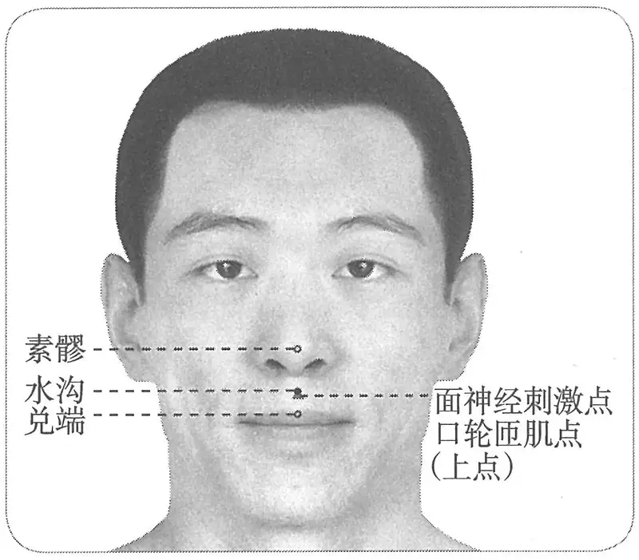

**图 2-401　水沟穴及相关刺激点图**

　1. 在鼻柱下人中……直唇取之。（《黄帝明堂经》、《太平圣惠方》、《铜人腧穴针灸图经》、《圣济总录》、《针灸资生经》、《十四经发挥》、《类经图翼》）、《循经考穴编》

　2. 水沟一穴，在鼻柱下宛宛中。（《太平圣惠方·明堂》）

　3. 窦太师针灸遗存

　　(1) 在鼻柱下三分，口含水，凸珠上是穴。（《窦太师针经》）

　　(2) 在鼻柱下三分，口含水，凸上处是穴。直唇取之。（《针方六集》卷一、《循经考穴编》）

　　(3) 在鼻下三分，衔水突起处是穴。（《针灸玉龙歌》注）

　4. 在鼻柱下沟中央。（《神应经》）

　5. 鼻柱下人中近鼻孔陷中。（《医学纲目》卷八、《针灸聚英》、《古今医统》、《类经图翼》、《针灸易学》、《针灸逢源》）

　6. 鼻准下人中中。（《医学入门》）

　7. 水沟在鼻柱下沟中央，近鼻孔。（《针灸大成》）

　8. 鼻下沟之正中。（《针灸十四经穴位考订》）

　9. 统编针灸学教材

　　(1) 部位：鼻柱下，沟中央，近鼻孔陷中。取穴：于鼻中隔之直下，唇沟俗名人中之上段约三分之一，接近鼻柱根处取之。（1957年南京《针灸学》）

　　(2) 部位：鼻柱下人中。取穴：在鼻柱下，人中上三分之一处取之。（1版《针灸学讲义》）

　　(3) 部位：鼻柱下人中。取穴：在鼻唇沟的上1/3与中1/3连接点处取之。（2版《针灸学讲义》）

　　(4) 人中沟中央近鼻孔处。（4版《针灸学》）

　　(5) 在人中沟的上1/3与中1/3交界处。（5、6、7版《针灸学》）

　　(6) 人中沟中，近鼻孔处。（《中国针灸学》）

#### 【类属】 

督脉穴。

**脉气所发**：督脉、手阳明之会，直唇取之。（《黄帝明堂经》）

**归经**：督脉。（《铜人腧穴针灸图经》卷上）

#### 【适应症】 

急救要穴，主治急症。常用于一切神昏之急救；中风、口眼㖞斜、流涎，口噤；鼻塞，鼻衄；癫，狂，痫；水肿，消渴；腰脊强痛。输卵管结扎术、剖宫产手术、胃大部切除术的针麻用穴。

〔p.1296 (인쇄 1268)〕

　1. 主寒热头痛。癫疾互引。水肿，人中尽满，唇反者死。口不禁水浆，㖞僻。睊目。鼻鼽不得息，鼻不收洟，不知香臭及衄不止。振寒，手卷前僵。（《黄帝明堂经》）

　2. 疗消渴，饮水无多少，水气遍身肿，失笑无时节，癫痫，语不识尊卑，乍喜乍哭，牙关不开，叶叶肺风状如虫行。（《太平圣惠方·针经》）

　3. 治消渴，饮水无度，水气遍身肿，失笑无时，癫痫语不识尊卑，乍喜乍哭，牙关不开，面肿唇动状如虫行，卒中恶。风水面肿，针此一穴出水尽即顿愈。（《铜人腧穴针灸图经》卷中）

　4. 窦太师针灸遗存

　　(1) 治一切腰背强痛，补泻，泻多；挫闪腰疼泻；中风不省人事，补泻；口眼㖞斜，先泻后补，禁灸。（《窦太师针经》）

　　(2) 治脊强膂痛，一切腰痛，唇瞤，㖞僻，戏笑。（《针方六集》卷五）

　　(3) 治脊背强痛，昏迷不省人事，一切腰痛。决生死。（《窦太师秘传》）

　5. 主鬼击，黄疸马黄，瘟疫，通身黄。（《针灸聚英》卷一、《针灸大成》）

**按**：以上二条皆从《针灸资生经》辑录《千金要方》灸方主治，其中“黄疸马黄，瘟疫，通身黄”乃侠人中穴主治，非本穴主治。

　6. 统编针灸学教材

　　(1) 癫痫发狂，中风口噤，口眼㖞斜，面肿唇动，状如虫行，消渴饮水无度，脊强腰痛，小儿惊风。并为一切昏迷不省人事之急救穴。（1957年南京《针灸学》）

　　(2) 癫狂，小儿惊风，中风，口噤，口眼歪斜，面肿唇动，消渴，脊强腰痛。并为一切昏迷不省人事之急救穴。（1版《针灸学讲义》）

　　(3) 癫狂，痫证，小儿惊风，中风昏迷，牙关紧闭，口眼㖞斜，面肿，腰脊强痛。（2版《针灸学讲义》、4版《针灸学》）

　　(4) 癫狂痫，小儿惊风，昏迷，口眼㖞斜，腰脊强痛。（5版《针灸学》）

　　(5) 昏迷，晕厥，癫狂痫，小儿惊风，口角㖞斜，腰脊强痛。（6版《针灸学》）

　　(6) ①昏迷、晕厥、中风、中暑、休克、呼吸衰竭等急危重症，为急救要穴之一；②癔病、癫狂痫证、急慢惊风等神志病证；③鼻塞、鼻衄、面肿、口歪、齿痛、牙关紧闭等面鼻口部病证；④闪挫腰痛。（7版《针灸学》）

　　(7) 癫狂，痫证，脏躁，小儿惊风，中风昏迷，昏厥，牙关紧闭，口眼歪斜，面肿，腰脊强痛。（《中国针灸学》）

**文献分析**：本穴主治较广，然正如其穴名所示，既可治水肿，又可治消渴；因其在口鼻之间，故可治面瘫伴口部症状者，并可治鼻部病症；因其为督脉穴，自然可治惊痫，腰脊强痛等督脉病症。并可与手阳明经经穴禾髎、奇穴鼻流主治参看。又《圣济总录》：“耳后宛处不可伤，伤即令人口颊㖞斜，宜治人中、承浆二穴。”提示本穴是治疗面瘫的要穴。

#### 附：临床应用举例 

　1. 急证

　　(1) 治卒中邪魅恍惚振噤之方：灸鼻下人中，及两手足大指爪甲本。令艾丸半在爪上，半在肉上，各七壮，不止，至十四壮便愈。（《补辑肘后方》卷上）

　　(2) 治卒死尸厥方：灸鼻下人中七壮。又灸阴囊下，去下部一寸，百壮。若妇人灸两乳中间，又云爪刺入中良久，又针入中至齿，立起。此亦全是魏大夫传中扁鹊法，即赵太子之患。（《补辑肘后方》上卷）

〔p.1297 (인쇄 1269)〕

　　(3) 治卒得鬼击方：鼻下人中，一壮，立愈。不瘥，可加数壮。（《补辑肘后方》上卷）

　　(4) 灸客忤方：灸鼻人中三十壮，令切鼻柱下也。（《肘后备急方》卷三、《医心方》卷十四）

　　(5) 患癫风，心狂乱，加兼卒不语良久，取鼻孔下名人中穴，灸七壮，立差。（敦煌卷子《新集备急灸经》）

　　(6) 小儿急惊风，灸前顶一穴三壮，在百会前一寸。若不愈，须灸两眉头，及鼻下人中一穴，炷如小麦大。（《太平圣惠方·明堂》）

　　(7) 治中恶，刺督脉水沟一穴，任脉中脘、气海三穴。凡刺胸腹者，必以布缴，乃单布上刺。（《针经摘英集》）

　　(8) 救魇寐一切卒死，及诸暴绝证。用药或不效，急于人中穴及两脚大拇指内离甲一韭叶许，各灸三五壮，即活。脐中灸百壮，亦效。（《世医得效方》卷十）

　　(9) 水沟间使治邪癫。（《灵光赋》）

　　(10) 人中治癫功最高，十三鬼穴不须饶。（《席弘赋》）

　　(11) 高烧抽搐昏迷不醒：十宣穴、水沟穴，针治。[江西中医药，1984(4)：15]

　　(12) 抢救心脏骤停：针刺水沟、十宣。[天津中医，1994，11(5)：22]

　　(13) 癔症性失语：针刺水沟治疗。[江苏中医，1996，17(10)：40]

　2. 中风

　　(1) 肝风占候其口不能言，当灸鼻下人中，次灸大椎，次灸肝俞，第九椎下是，五十壮，余处随年壮。（《千金要方》卷八）

　　(2) 治中风，口噤，牙关不开，刺督脉水沟一穴，在鼻柱下，一名人中。手阳明之会，针入四分。（《针经摘英集》）

　　(3) 中风，口噤齿紧，牙关不开，昏闷不省人事：先针中冲泻之，次针人中亦泻之，略醒可治，百病百得生也。（《针灸集要·盘石金直刺秘传》）

　　(4) 中风口眼歪斜：针人中，灸七壮；次针地仓、颊车。左灸右，右灸左，先灸后针。无病处补之，有病处泻之。（《针灸集要·盘石金直刺秘传》）

　　(5) 中风症：百会穴、水沟穴，中国针灸治疗。[新中药(台湾)，1984(42)：28-30]

　3. 头面病症

　　(1) (目)风痒赤痛，灸人中近鼻柱二壮，仰卧灸之。（《千金要方》卷六）

　　(2) 上齿生疮：泻人中、关元；下齿生疮：泻承浆。（《针灸集要·盘石金直刺秘传》）

　　(3) 口烂生疮，齿出血：刺人中、大陵泻之。（《针灸集要·盘石金直刺秘传》）

　　(4) 牙齿两颔肿痛，人中一穴、合谷二穴、吕细二穴即太溪穴也。（《针灸大全》卷四）

　　(5) 水沟，针灸治目睛直视。（《古今医统》卷六十一）

　　(6) 口气由来最可憎，只因用意苦劳神，大陵穴共人中泻，心藏清凉口气清。（《针灸玉龙歌》）

　　(7) 复发性口腔溃疡：针刺水沟、大陵治疗。[中医外治杂志，1997(5)：24]

　　(8) 口腔溃疡：针刺水沟治疗。[中国针灸，2002，22(11)：763]

　4. 腰痛

　　(1) 气满腰痛不可俯仰，或剉气腰痛，一切暴痛：刺人中泻之、委中出血、承浆泻之，立痊。（《针灸集要·盘石金直刺秘传》）

〔p.1298 (인쇄 1270)〕

　　(2) 腰脊反折，痛连两臂，或风劳气痛：泻人中、肩井、曲池、委中宜弹针出血。（《针灸集要·盘石金直刺秘传》）

　　(3) 腰脊项背疼痛，肾俞二穴、人中一穴、肩井二穴、委中二穴。（《针灸大全》卷四）

　　(4) 人中除脊膂之强痛。（《通玄指要赋》）

　　(5) 脊膂强痛泻人中，挫闪腰疼亦可针，委中也是腰疼穴，任君取用两相通。（《针灸玉龙歌》）

　　(6) 急性腰扭伤：针刺水沟、后溪穴治疗。[中国民间疗法，2001，9(1)：19]

#### 【操作】 

向上斜刺0.3~0.5寸。

　1. 刺入三分，留六呼，灸三壮。（《黄帝明堂经》）

　2. 灸五壮。（《太平圣惠方·明堂》）

　3. 针入四分，留五呼，得气即泻，徐徐出入，灸亦得，然不及针，雀粪大为艾炷，日灸三壮，至二百壮即罢。（《太平圣惠方·针经》）

　4. 针三分，不宜灸。（《针灸十四经穴位考订》）

　5. 统编针灸学教材

　　(1) 针二至三分，针尖略向上斜进，以剧痛为度，灸不及针。（1957年南京《针灸学》、1版《针灸学讲义》）

　　(2) 向上斜刺2~3分。（2版《针灸学讲义》）

　　(3) 向上斜刺0.3~0.5寸。（4、5版《针灸学》，《中国针灸学》）

　　(4) 向上斜刺0.3~0.5寸，或用指甲按掐。（6版《针灸学》）

　　(5) 向上斜刺0.3~0.5寸，强刺激；或指甲掐按。（7版《针灸学》）

　6. 从前下向后上方斜刺0.3~0.5寸。感应局部胀痛。灸3~5壮；温灸5~10分钟。（上海《针灸学》）

### （二十七）兑端 Duìduān GV27 出《黄帝明堂经》 

#### 【提要索隐】 

**定位**：在面部，上唇结节的中点。

**适应症**：主治神志病、口齿部病症。常用于癫痫、呕沫、口噤；齿痛；口臭。

**针刺操作**：向上斜刺0.2~0.3寸。

#### 【名实考】 

兑者，锐也。穴在上唇之锐端，故曰兑端，即《医心方》所说“唇上尖锐之端”义。

需要注意的是，本穴与“承浆”穴相邻，古代文献有相混之例。

　1. 兑端，在唇上端，手阳明脉气所发。（《黄帝明堂经》）

　2. 兑者，口也，穴在唇正中之端，故曰兑端。（《经穴解》）

**按**：此解未得本穴名之本义，非是。

　3. 别名　唇上端、壮骨。（1957年南京《针灸学》）

**按**：此辑录自日本针灸教材，云出自《针灸甲乙经》。今核查，“唇上端”乃部位描述，非穴名；明刊本《针灸甲乙经》卷三作“兑骨”，而卷七第十二仍作“兑端”，无误；又明抄本《针灸甲乙经》卷三也作“兑端”，与其他《黄帝明堂经》佚文皆合，足证明刊本《针灸甲乙经》“兑骨”字误。而“壮骨”则不见于《针灸甲乙经》，日本教材误记。韩国针灸教材未详察，又从中国教材重复了日本教材的错误。

〔p.1299 (인쇄 1271)〕

#### “兑端”与“承浆”穴相混例 

　1. 兑端，在唇上端，手阳明脉气所发，灸三壮。主寒热鼓颔，口噤，癫疾，吐沫；寒热互引，唇吻强，上齿龋；消渴嗜饮，目瞑，身汗出，衄血不止。（《外台秘要》卷三十九）

　2. 兑端一穴，在颐前下唇之下，开口取之宛宛中。灸三壮。主口噤鼓颔，癫疾吐沫，及衄血不止。（《太平圣惠方·明堂》）

**按**：第一条斜体字皆“承浆”穴主治；第二条则定位与主治悉为承浆穴内容，此误又经王惟一《铜人腧穴针灸图经》的转录，对宋以后针灸文献造成较大影响。

#### 【定位】 

**部位**：在面部，上唇结节的中点（图2-402）。

1.《黄帝明堂经》

　　(1) 在唇上端。（《针灸甲乙经》卷三、《千金要方》、《千金翼方》、《外台秘要》、《铜人腧穴针灸图经》、《圣济总录》、《针灸资生经》、《十四经发挥》、《医学纲目》、《针灸聚英》、《古今医统》、《针灸大成》、《针方六集》、《类经图翼》、《医宗金鉴·刺灸心法要诀》、《针灸易学》、《针灸逢源》）

　　(2) 在唇上尖锐之端。（《医心方》卷二）

　2. 兑端，上唇中央尖尖上。（《医学入门》卷一）

　3. 上唇边缘之正中。（《针灸十四经穴位考订》）

　4. 统编针灸学教材

　　(1) 部位：在唇上尖端。取穴：上唇之尖端，外皮与黏膜之中间取之。（1957年南京《针灸学》）

　　(2) 部位：上唇尖端。取穴：上唇之尖端，赤白肉际取之。（1版《针灸学讲义》）

　　(3) 部位：在唇上端。取穴：上唇尖端，当鼻唇沟与口唇接连处取之。（2版《针灸学讲义》）

　　(4) 上唇尖端，红唇与皮肤相接处。（4、5版《针灸学》，《中国针灸学》）

　　(5) 在明补，当上唇的尖端，人中沟下端的皮肤与唇的移行部。（6版《针灸学》）

　　(6) 上唇正中的尖端，红唇与皮肤移行处。（7版《针灸学》）

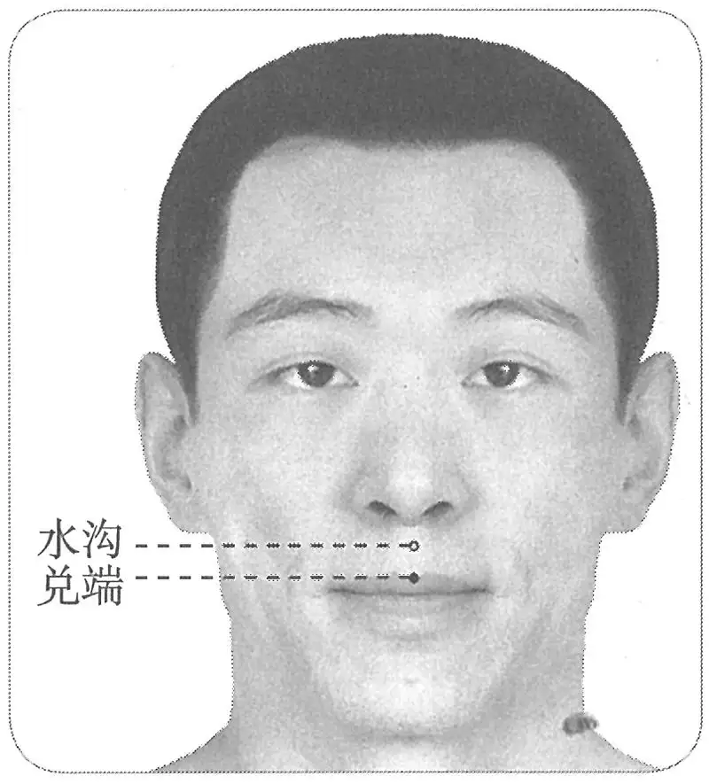

**图2-402　兑端穴图**

#### 【类属】 

督脉穴。

**脉气所发**：手阳明脉气所发。（《黄帝明堂经》）

**归经：**

　1. 手阳明。（《外台秘要》卷三十九、《黄帝内经明堂》）

　2. 督脉。（《铜人腧穴针灸图经》卷上）

**按**：兑端穴，《针灸甲乙经》及《外台秘要》均注作“手阳明脉气所发”，唐代杨上善、王焘皆将此穴归入“手阳明经”，以与手阳明经“交人中，左之右，右之左”相合；而王惟一将此穴归入督脉，盖以督脉“上颐环唇”之故，然比较而言，归于手阳明的依据更为充分。

#### 【适应症】 

主治神志病、口齿部病症。常用于癫痫、呕沫、口噤；齿痛；口臭。

　1. 主癫疾呕沫。寒热。痓互引，唇吻强。上齿龋痛。（《黄帝明堂经》）

　2. 主寒热，鼓颔，口噤，渴嗜饮，目瞑，身汗出，衄血不止。（《外台秘要》卷三十九）

〔p.1300 (인쇄 1272)〕

**按**：此乃王焘误将《针灸甲乙经》“承浆”穴主治归于本穴中。

　3. 主癫疾吐沫，小便黄，舌干，消渴，衄血不止，唇吻强，齿龈痛。（《铜人腧穴针灸图经》卷中）

**按**：王惟一承袭了王焘的部分错误。

　4. 治口臭不可近；使心过度；颠邪风症。（《窦太师针经》乙抄本、《类经图翼》）

　5. 四白瞤动，鼻塞，牙宣。（《针方六集》卷五）

　6. 主唇反、唇肿。（《循经考穴编》下）

　7. 统编针灸学教材

　　(1) 癫疾，鼻塞，息肉，衄血，唇吻强，齿龈痛，消渴，目翳。（1957年南京《针灸学》）

　　(2) 癫痫，鼻塞，衄血，唇吻强，齿龈痛，消渴，目翳。（1版《针灸学讲义》）

　　(3) 癫狂，唇吻抽搐，齿龈痛，鼻中息肉。（2版《针灸学讲义》）

　　(4) 癫狂，口㖞唇动，齿龈肿痛，鼻中息肉。（4版《针灸学》）

　　(5) 癫狂，齿龈肿痛，口㖞，鼻衄。（5、6版《针灸学》）

　　(6) ①昏迷、晕厥、癫狂、癔病等神志病证；②口歪、口噤、口臭、齿痛等口部病证。（7版《针灸学》）

　　(7) 癫狂，口㖞瞤动，唇吻强，齿龈肿痛。（《中国针灸学》）

**按**：教材中“消渴，目翳”、“鼻衄”诸症乃承袭《外台秘要》、《铜人腧穴针灸图经》之误，今去之。

#### 附：临床应用举例 

　1. 治唇吻强齿龈痛，兑端一穴，在唇上端，针入二分，可灸三壮。（《类编朱氏集验医方》卷九）

　2. 口臭不可近者，金津、玉溪、人中、兑端、大陵在脉门中纹是。（《针灸捷径》卷之下）

　3. 口内生疮，名曰枯曹风，兑端一穴、支沟二穴、承浆一穴、十宣十穴。（《针灸大全》卷四）

#### 【操作】 

向上斜刺0.2~0.3寸。

　1. 刺入二分，留六呼，灸三壮。（《黄帝明堂经》）

　2. 针入二分，可灸三壮，炷如大麦。（《铜人腧穴针灸图经》卷中）

　3. 针入一分，禁灸。治口臭不可近，泻；使心过度，补；颠邪风症，泻，弹针出血妙。（《窦太师针经》乙抄本）

　4. 针入一分，略斜向上，弹针出血。（《循经考穴编》下）

　5. 针三分，不宜灸。（《针灸十四经穴位考订》）

　6. 统编针灸学教材

　　(1) 针二至三分，不灸。（1957年南京《针灸学》、1版《针灸学讲义》）

　　(2) 直刺2~3分。（2版《针灸学讲义》）

　　(3) 向上斜刺0.2~0.3寸。（4、5、6、7版《针灸学》，《中国针灸学》）

### （二十八）龈交 Yínjiāo GV28 出《黄帝明堂经》 

#### 【提要索隐】 

**穴名**：一名悬命；一名鬼禄。

**定位**：在上唇内，上唇系带与上牙龈的交点。

**归经**：本穴，《黄帝明堂经》未注明“脉气所发”之经，宋以前文献关于本穴的归经不统一。

〔p.1301 (인쇄 1273)〕

**适应症**：主治神志病、口齿鼻部病症。常用于癫狂；牙龈肿痛、出血，鼻塞，鼻息肉。**新增**：小儿面部疮癣。

**针刺操作**：刺0.1~0.3寸；或点刺出血。

#### 【名实考】 

经考察，《千金要方》所载之“悬命”、“鬼禄”与本穴相同，故列入本穴别名。

　1. 任脉之气所发者二十八穴……龂交一。（《素问·气府论》）

**按**：其定位不详。

　2. 龈交，在唇内齿上龈缝。（《黄帝明堂经》）

　3. 龈者，齿根也，为三阳交会之所，故曰龈交。（《经穴解》）

　4. 别名　龈缝筋中。（1957年南京《针灸学》）

**按**：此传自日本针灸教材，云出自《针灸资生经》，实先见于《铜人腧穴针灸图经》，为本穴的部位描述，而非穴名。韩国针灸教材不察，又从中国针灸教材重复了日本教材的错误。

#### “龈交”、“悬命”、“鬼禄”穴辨 

　1. 邪鬼妄语，灸悬命十四壮。穴在口唇里中央弦弦者是，一名鬼禄，又以刚力决断弦乃佳。（《千金要方》卷十四）

　2. 黄帝灸法，疗神邪鬼魅及发狂癫，语不择尊卑，灸上唇里面中央肉弦上一壮，炷如小麦大。又用钢刀决断更佳也。（《太平圣惠方·明堂》）

　3. 小儿惊痫，灸鬼禄穴一壮，在上唇内中央结上，炷如小麦大，用钢刀决断更佳。（《太平圣惠方·小儿明堂》）

**按**：以上“悬命”穴，一名鬼禄，定位与龈交穴同，主治相近，故列为龈交穴别名。

#### 【定位】 

**部位**：在上唇内，上唇系带与上牙龈的交点（图2-403）。

**取穴**：正坐仰头，提起上唇，于上唇系带与齿龈的移行处取穴。

　1. 在唇内齿上龈缝中。（《黄帝明堂经》、《铜人腧穴针灸图经》卷下“穴腧都数”、《十四经发挥》、《医学纲目》、《针灸聚英》、《古今医统》、《医学入门》、《针灸大成》、《针方六集》、《类经图翼》、《循经考穴编》、《医宗金鉴·刺灸心法要诀》、《针灸易学》、《针灸逢源》）

　2. 在唇内齿上龈缝筋中。（《铜人腧穴针灸图经》卷中、《圣济总录》、《针灸资生经》）

　3. 唇内，齿上龈缝中央。（《针灸十四经穴位考订》）

　4. 统编针灸学教材

　　(1) 部位：在唇内齿上龈缝中。取穴：于上唇之内，从门牙缝之上三分处，龈内略凹处取之。（1957年南京《针灸学》）

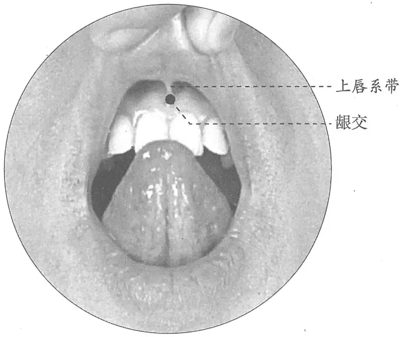

**图2-403　龈交穴图**

〔p.1302 (인쇄 1274)〕

　　(2) 部位：上唇内齿龈缝中。取穴：在上唇之内，从门齿缝之上约三分，龈内略凹处取之。（1版《针灸学讲义》）

　　(3) 部位：在唇内齿上龈缝中。取穴：在上唇与上齿龈中间，上唇系带与齿龈之连接处取之。（2版《针灸学讲义》）

　　(4) 上唇系带与齿龈相接处。（4、5、7版《针灸学》，《中国针灸学》）

　　(5) 在上唇内，唇系带与上齿龈的相接处。（6版《针灸学》）

#### 【类属】 

督脉穴。

**脉气所发：**

　1. 督脉、任脉二经之会。（《素问·气府论》王冰注、《铜人腧穴针灸图经》卷上）

　2. 任、督、足阳明之会。（《医学纲目》卷八）

**归经：**

　1. 督脉。（《铜人腧穴针灸图经》卷上）

　2. 足阳明。（《黄帝内经明堂》）

　3. 手阳明。（《外台秘要》卷三十九）

**文献分析**：龈交穴，《黄帝明堂经》未注明“脉气所发”之经，故后世归经多据该穴的部位与邻近经脉的关系，然而不同的医家对于两者关系的理解并不相同，因而归经也各异。杨氏将“龈交”归入胃经，是因“龈交在唇内齿上龈缝”，而胃经正好“入上齿中”，故归“龈交”穴于胃脉。而王焘归经方法是将《针灸甲乙经》四肢经脉与头面躯干部相关行线拼接而成。因为，“水沟”（督脉、手阳明之会）、“兑端”（手阳明脉气所发）、“龈交”在同一线上，故均归入“手阳明经”。王冰归经方法与杨氏基本相似，他认为任督脉同源，“龈交”穴正位于任、督脉的结合部，故分别归入任督二脉。王惟一遵从王冰之说，但只将该穴归属于督脉一经，而不分别归入任、督二经。

#### 【适应症】 

主治神志病、口齿鼻部病症。常用于癫狂；牙龈肿痛、出血，鼻塞，鼻息肉。

**新增**：小儿面部疮癣。

　1. 主痓，烦满。寒热。口僻。癫疾互引。齿间出血者，有伤酸，齿床落痛，口不可开引鼻中。鼻中息肉不利，鼻头额頞中痛，鼻中有蚀疮。目痛不明。（《黄帝明堂经》）

　2. 治面赤心烦痛，颈项急不得回顾。新附：治小儿面疮癣久不除。点烙亦佳。鼻塞不利，目泪眵汁，内眦赤痒痛。生白肤翳，鼻中息肉蚀疮。（《铜人腧穴针灸图经》卷中）

　3. 马黄黄疸，寒暑温疫。（《针灸聚英》卷一）

**按**：此乃高武从《针灸资生经》辑录《千金要方》“唇里”穴主治。

　4. 主两腮生疮，名骨槽风。岐伯曰治鬼魅癫狂，宜以刀决断更佳。（《循经考穴编》下）

**按**：所引“岐伯曰”文字出于《太平圣惠方》，原文作“黄帝灸法：疗神邪鬼魅及发狂癫，语不择尊卑，灸上唇里面中央肉弦上一壮，炷如小麦大。又用钢刀决断更佳也”。

　5. 统编针灸学教材

　　(1) 癫狂，目翳，鼻塞，息肉，牙疳肿痛。（1957年南京《针灸学》）

　　(2) 癫狂，目翳，鼻塞，牙疳肿痛。（1版《针灸学讲义》）

　　(3) 癫狂，鼻渊，牙龈肿痛，鼻塞不利，鼻中息肉。（2版《针灸学讲义》）

　　(4) 癫狂，齿龈肿痛，鼻渊，鼻中息肉。（4版《针灸学》）

　　(5) 癫狂，齿龈肿痛，鼻渊。（5版《针灸学》、《中国针灸学》）

　　(6) 癫狂，齿龈肿痛，口㖞，口臭，鼻渊。（6版《针灸学》）

〔p.1303 (인쇄 1275)〕

　　(7) 口歪、口噤、口臭、齿衄、齿痛、鼻衄、面赤颊肿等面口部病证；癫狂。（7版《针灸学》）

#### 附：临床应用举例 

　1. 邪鬼妄语，灸悬命十四壮。穴在口唇里中央弦弦者是，一名鬼禄，又以刚力决断弦乃佳。（《千金要方》卷十四）

　2. 黄帝灸法，疗神邪鬼魅及发狂癫，语不择尊卑，灸上唇里面中央肉弦上一壮，炷如小麦大。又用钢刀决断更佳也。（《太平圣惠方·明堂》）

　3. 小儿惊痫，灸鬼录穴一壮，在上唇内中央结上，炷如小麦大，用钢刀决断更佳。（《太平圣惠方·小儿明堂》）

　4. 急性腰扭伤，挑刺龈交穴反应点，配合针刺治疗。[针灸临床杂志，1995，11(11、12)：70]

　5. 面瘫，挑刺龈交穴治疗。[山东医药，1997，37(3)：63]

　6. 遗尿症，龈交穴刺血治疗。[青海医药杂志(中医药专辑)，1999，29(11)：48]

　7. 痔漏，龈交穴，挑刺或割治法治疗。[中国针灸，1986，6(6)：19]

　8. 内痔，剪刺龈交穴治疗。[中国针灸，2002，22(7)：457-458]

#### 【操作】 

刺0.1~0.3寸；或点刺出血。

　1. 刺入三分，灸三壮。（《黄帝明堂经》）

　2. 针三分，不宜灸。（《针灸十四经穴位考订》）

　3. 统编针灸学教材

　　(1) 针一至二分。（1957年南京《针灸学》、1版《针灸学讲义》）

　　(2) 向上斜刺1~2分，或三棱针点刺出血。（2版《针灸学讲义》）

　　(3) 向上斜刺0.2~0.3寸，或带内刺出血。（4、5、6版《针灸学》）

　　(4) 向上斜刺0.2~0.3寸。（7版《针灸学》）

　　(5) 向上斜刺0.1~0.2寸。（《中国针灸学》）

### （二十九）印堂 Yìntáng GV29 出《针灸玉龙歌》 

#### 【提要索隐】 

**定位**：在头部，两眉毛内侧端中间的凹陷中。

**适应症**：主治头面部病症。常用于小儿惊风；头痛，眩晕；鼻衄，鼻渊；失眠。

**刺灸法**：平刺。

#### 【名实考】 

关于本穴的判定，需要正确理解古代针灸文献所说“两眉间”的不同含义：第一，指两眉之间，即相当“印堂”部位；第二，指眉毛的中央，即相当于“鱼腰”穴部位。后人及今或不加考辨，多有相混处。

　1. 子女惊风皆可治，印堂刺入艾来加。注曰：印堂：在两眉间宛宛中。斜一分，沿皮先透左攒竹，补泻后转归元穴，退右攒竹，依上补泻，可灸七壮。（《针灸玉龙歌》）

　2. 刺疟者，必先问其病之所先发者，先刺之。先头痛及重者，先刺头上及两额两眉间出血。王冰注曰：两眉间，谓攒竹等穴也。（《素问·刺疟》篇）

　3. 灸猥退风半身不遂法：先灸天窗……次曲眉在两眉间。（《千金翼方》卷二十六）

　4. 患大风病，两眉中名光明穴，灸随年。（敦煌卷子《新集备急灸经》）

　5. 鱼腰二穴，一名印堂。在两眉中。主眼疾。针入二分。（《东医宝鉴》）

〔p.1304 (인쇄 1276)〕

　6. 鱼腰二穴，在两眉中间是穴。针入一分，沿皮向外透鱼尾穴。治眼红肿痛，泻之，禁灸。（《窦太师针经》）

**文献分析**：本穴的部位，《素问》已记有“两眉间”，但不能判定是否指“两眉之间”，王冰注作“攒竹”穴；又《千金翼方》载有“曲眉”一穴，所注部位曰“在两眉间”，现代针灸书多将其作为“印堂”的别名，但载有同样灸方的敦煌卷子却注作“在两眉间眉毛头是”，又相当于“攒竹”穴，从所附之取穴图上也难以判定，究竟是“印堂”，还是“攒竹”，故暂不将“曲眉”视为“印堂”的同穴异名；窦太师针灸所述“鱼腰”部位“两眉中间”，是指左右各一穴，均在眉毛的中间，而不是两眉之间，故《东医宝鉴》理解有误。后世通用的穴名及相关主治、刺法为窦太师针灸所述之“印堂”。

#### 相关穴及刺激点 

　1. 面神经刺激点皱眉肌点　两眉头的中点。主治面神经麻痹皱眉障碍。刺法：向患侧眉弓方向平刺1.0cm。（《实用神经干电刺激疗法》）

　2. 天护　印堂上五分取之。三棱针点刺出血；或上透天灵、神庭、上星，下透印堂。局部有麻胀感。主治前头痛、小儿惊厥、面神经痉挛。（《针灸经外奇穴图谱(续集)》）

**按**：本穴刺法作“下透印堂”，正在印堂刺法所及范围内，实为同一穴，不宜另立名目。

#### 【定位】 

**部位**：在头部，两眉毛内侧端中间的凹陷中（图2-404）。

**取穴**：左右攒竹穴连线的中点。

　1. 在两眉中间是穴。（《窦太师针经》、《针灸大成》、《针方六集》）

　2. 在两眉间宛宛中。（《针灸玉龙歌》注）

　3. 统编针灸学教材

　　(1) 在两眉头中间陷中。（1957年南京《针灸学》、1版《针灸学讲义》）

　　(2) 在眉头的中间。正坐，仰面取穴。（2版《针灸学讲义》）

　　(3) 两眉头连线的中点。（4、5版《针灸学》，《中国针灸学》）

　　(4) 在额部，当两眉头的中间。（6、7版《针灸学》）

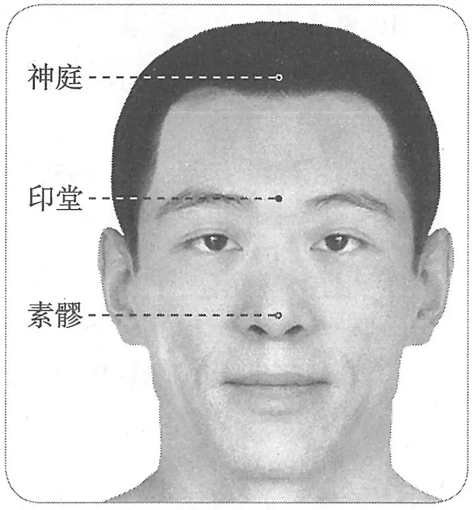

**图2-404　印堂穴图**

#### 【类属】 

督脉穴。

#### 【适应症】 

主治头面部病症。常用于小儿惊风；头痛，眩晕；鼻衄，鼻渊；失眠。

　1. 窦太师针灸遗存

　　(1) 治小儿中急慢惊风；及大人中风不省；头重。（《窦太师针经》）

　　(2) 治眼目头风，顶脑昏闷，一切惊风等症。（《窦太师秘传》）

　　(3) 小儿惊风。（《针灸玉龙歌》注）

　2. 统编针灸学教材

　　(1) 急慢惊风，抽搦，鼻疾。（1957年南京《针灸学》、1版《针灸学讲义》）

　　(2) 头痛，小儿惊风，产妇血晕。（2版《针灸学讲义》）

　　(3) 头痛头重，鼻衄鼻渊，小儿惊风，产妇血晕。（4版《针灸学》）

〔p.1305 (인쇄 1277)〕

　　(4) 头痛，眩晕，鼻衄，鼻渊，小儿惊风，失眠。（5、6版《针灸学》）

　　(5) ①痴呆、痫证、失眠、健忘等神志病证；②头痛，眩晕；③鼻衄，鼻渊；④小儿惊风，产后血晕，子痫。（7版《针灸学》）

　　(6) 头痛，头重，鼻衄，鼻渊，小儿惊风，前额疼痛，失眠。（《中国针灸学》）

#### 附：临床应用举例 

　1. 头风呕吐眼昏花，穴在神庭刺不差。子女惊风皆可治，印堂刺入艾来加。（《针灸玉龙歌》）

　2. 醉头风痛，中脘、风门、三里、印堂、攒竹、胆中。问曰：此证针不效，何也？此证亦有痰饮滞饮滞于胃脘，口吐清涎，眩晕不省人事，或三五日不省者，不进饮食，有委名醉头风，先去其气化痰调脾进饮食，然后去其风痛也，复刺后穴：中脘、胆中、三里、风门。（《针灸集成》第九方）

　3. 鼻衄不止，合谷、百会、上星。问曰：此证缘何而得？答曰：血气上壅，阴阳不能升降，血不宿肝，心主血，肝纳血，故气血不顺也。血盛而妄行于口，针前穴未效，复刺后穴：迎香、人中、印堂。（《针灸集成》第二十方）

　4. 灸法，治急慢惊风，危极不可救者，先当两乳头上，男左女右灸三壮。次灸发际、眉心、囟会三壮。手足大指当甲角，以物缚两手作一处，以艾骑缝灸，男近左边，女近右边，半甲半肉之间灸三壮，先脚后手。亦可治阴阳诸痫病。艾炷如麦子大。（《世医得效方》卷十一）

5.《撮》头重如石，印堂。（《医学纲目》卷十五）

　6. 治一切中风不省人事、风痫、瘛疭等证，印堂一穴在两眉中心，针一分，灸七壮。（《乾坤生意》下卷）

　7. 两眉角痛不已，攒竹二穴、阳白二穴、印堂一穴两眉中间、合谷二穴、头维二穴。（《针灸大全》卷四）

　8. 鼻生息肉，闭塞不通，印堂一穴、迎香二穴、上星一穴、风门二穴。（《针灸大全》卷四）

　9. 小儿急惊风，手足搐搦，印堂一穴、百会一穴、人中一穴、中冲二穴。（《针灸大全》卷四）

　10. 太阳、印堂放血治疗美尼尔氏病，三棱针点刺出血。每日1次，6次为一疗程。[中国针灸，1994(增刊)：37]

　11. 独刺印堂治疗过敏性鼻炎，10次为一疗程，一般治疗1~2个疗程。[中国针灸，1998(6)：360]

#### 【操作】 

平刺。

　1. 针三分，灸七壮，治小儿中急慢惊风，灸之则啼哭有效。及大人中风不省，灸二七壮；头重，针三分泻之。（《窦太师针经》）

　2. 针一分，沿皮先透左攒竹，补泻后转归原穴；透右攒竹，依上补泻。可灸七壮，小儿惊风灸七壮，大哭者为效。不哭者难治。随证急慢补泻，急者慢补，慢者急补，通神之穴也。（《针灸玉龙歌》注）

　3. 针一分，沿皮透攒竹，先左后右，弹针出血。（《医学纲目》卷十五）

　4. 统编针灸学教材

　　(1) 针一分。（1957年南京《针灸学》、1版《针灸学讲义》）

　　(2) 针1分，灸3壮。（2版《针灸学讲义》）

　　(3) 平刺0.3~0.5寸。（4、5版《针灸学》）

〔p.1306 (인쇄 1278)〕

　　(4) 提捏局部皮肤，平刺0.3~0.5寸，或用三棱针点刺出血。（6、7版《针灸学》）

　　(5) 横刺0.3~0.5寸。可灸。（《中国针灸学》）

　5. 横刺，从上向下，夹持刺入，或向左、右攒竹、睛明等穴处透刺，进针0.5~1寸。感应：局部酸胀，有时可扩散至鼻尖部。（上海《针灸学》）

**文献分析**：《针灸玉龙歌》所述之针刺原治小儿惊风，现则多用于主治面神经麻痹皱眉障碍（本穴与面神经刺激点皱眉肌点相当），治疗鼻部病症，可向下刺，使针感传至鼻部。

### 延伸阅读 

　1. 黄龙祥.中国针灸学术史大纲[M].北京：华夏出版社，2001.

　2. 黄龙祥.新编重绘十四经脉经穴图[M].北京：中国中医药出版社，2010.

　3. 黄龙祥，黄幼民.元代珍稀针灸三种[M].北京：人民卫生出版社，2008.

　4. 严君白.大椎求源[J].上海针灸杂志，1989，8(4)：33-34.

〔p.1307 (인쇄 1279)〕

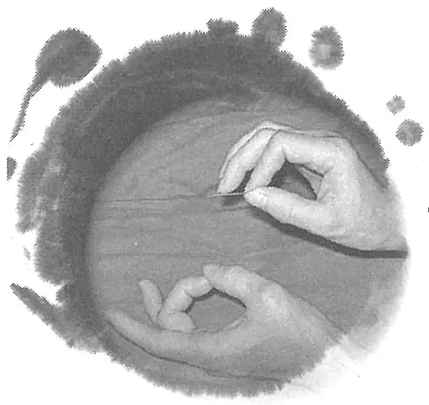

