# 《针灸腧穴通考》(下册) — 任脉穴 (1/2) · （一）会阴 Huìyīn CV1 出《黄帝明堂经》~（十一）建里 Jiànlǐ CV11 出《黄帝明堂经》

> 분할본 23/25. 원서: 黄龙祥·黄幼民 编著, 《针灸腧穴通考——〈中华针灸穴典〉研究》(下册), 人民卫生出版社, 2011. 원서 스캔 OCR 판독본을 챗봇 검색용으로 나눈 것이며, 본문과 쪽 표시 〔p.PDF쪽 (인쇄 쪽)〕는 원본 그대로이다.

## 十四、任脉穴 

### 概说 

关于任脉循行，《内经》与《难经》不尽相同，而对于病候的描述二书相同；

关于任脉穴定位，分歧最大的在于任脉的络穴“鸠尾”与“会阴”之争；

关于任脉穴的归经，除“承浆”一穴外，历代文献无分歧；其排列次序，《铜人腧穴针灸图经》自上而下，自《圣济总录》始改作自下而上排列。

#### 【任脉循行与病候】 

从《难经》所言任脉循行看，任脉与妇人胞宫密切相关；从功能上看，《素问·上古天真论》言妇人生理发育过程，独重任、冲二脉，故王冰谓“任主胞胎”；从文字学角度考察：“任”即“妊”或“姙”的古字，如传世本《素问·平人气象论》曰“妇人手少阴脉动甚者，妊子也”，《黄帝内经太素·尺寸诊》卷十五“妊”字即作“任”字；《医心方》卷二十二引《产经》之文所有“妊”字均作“任”可证。

**新校正文字**：任脉者，起于中极之下，以上毛际，循腹里，上关元，至咽喉，上颐循面入目。（《素问·骨空论》）

**任脉病候**：任脉为病，男子内结七疝，女子带下瘕聚。（《素问·骨空论》）

**按**：《难经》载任脉病候与《素问》同，而所言循行除了上述《素问》一说外，还记有另一说：“任脉起于胞门、子户，夹脐上行至胸中”，与《灵枢·五音五味》的说法同源，突出了任脉与胞宫的初始联系。又林亿新校正谓《难经》、《针灸甲乙经》无“上颐循面入目”六字，《黄帝内经太素·任脉》卷十杨上善引《针灸甲乙经》之文也无此六字，可见传世本《针灸甲乙经》此六字系宋以后人添补，所补内容也有据可考，只是不见于传世本《内经》而已。

**所属经穴**：会阴　曲骨　中极　关元　石门　气海　阴交　神阙　水分　下脘　建里　中脘　上脘　巨阙　鸠尾　中庭　膻中　玉堂　紫宫　华盖　璇玑　天突　廉泉　承浆

#### 【归经与起止穴】 

唐代《外台秘要》附于足少阴经穴下任脉穴二十三穴：鸠尾、巨阙、上管、中管、建里、下管、水分、脐中、阴交、气海、石门、关元、中极、曲骨、会阴、廉泉、天突、璇玑、华盖、紫宫、玉堂、膻中、中庭；

宋代《铜人腧穴针灸图经》在此基础上增加“承浆”一穴，排列次序自上而下。

宋以后针灸文献皆从《铜人腧穴针灸图经》。

〔p.1308 (인쇄 1280)〕

凡此任脉之行，从胞中上注目，长四尺五寸，总二十四穴按内经任脉所发者二十八穴，经阙一穴，实有二十七穴，内龈交一穴，属督脉，承泣二穴，属足阳明𫏋脉，故载二十四穴，自会阴至脐中，为少腹之分，共八穴。（《圣济总录》卷一九一）

需要说明的是，承浆穴为“足阳明、任脉之会”，故王焘归入足阳明胃经，而王惟一归入任脉穴。

#### 【经穴定位与主治】 

《黄帝内经明堂》杨上善注曰：“鸠尾，在臆前蔽骨下五分。人有无鸠尾者，当从臆前骨歧下一寸为鸠尾骨，鸠尾骨下更取五分为鸠尾穴”；《针灸甲乙经》作“鸠尾，在臆前蔽骨下五分。鸠尾盖心上，人无蔽骨者，当从上歧骨下行一寸半”，文异义同，而后人多有误解。

值得注意的是，《太平圣惠方·针经》同时载有“鸠尾”、“巨骨”二穴，其鸠尾骨下际一穴名“巨骨”（此穴在《千金要方》多有应用，主治与《针经》相合），巨骨穴下五分为“鸠尾”穴。对此，宋代王执中已不能辨，宋以后人也多相混淆。

对于任脉穴定位影响最大的，还在于上腹部骨度折量的变化：

髑骬以下至天枢长八寸。（《灵枢·骨度》）

人若无心蔽骨者，取歧骨下至脐心，共折九寸取之。（《神应经》）

上取歧骨，下至脐心，共折作九寸取穴。（《针方六集》卷一）

歧骨至脐折八寸。（《古今医统》卷六）

由于“蔽骨”（剑突）的个体差异较大，《神应经》将《灵枢·骨度》上腹部骨度折量的起点由“蔽骨”改为“歧骨”，并将这一段骨度换算为“九寸”。这样处理既便于临床取穴，又有充分可靠的文献依据。而明代徐春甫同样将起点改作“歧骨”，但骨度折量分寸未作调整，实际上等于改变了《灵枢》的骨度分寸，现代采用的正是徐氏法，难以回改。

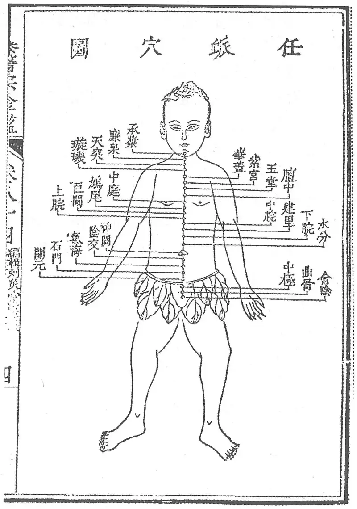

**图2-405 《医宗金鉴》任脉穴图**

廉泉穴主治的演变，是由于同名异穴的鉴别失误所致。在《内经》中以“廉泉”为名的穴位有二，《黄帝明堂经》编者未能详察，已有混淆，后人更不能明辨。

#### 【诊络病候、络脉病候与络穴主治】 

任脉之别，名曰尾翳，下鸠尾，散于腹。实则腹皮痛，虚则痒搔，取之所别也。（《灵枢·经脉》

膏之原，出于鸠尾，鸠尾一。（《灵枢·九针十二原》）

鸠尾，一名尾翳，一名髑骬。在臆前蔽骨下五分，任脉之别。不可灸刺。主心中寒，胀满不得食，息贲，时唾血，血瘀，热病，胸中痛不得卧，心腹痛不可按，善哕，心疝，太息，面赤，心背相引而痛，

〔p.1309 (인쇄 1281)〕

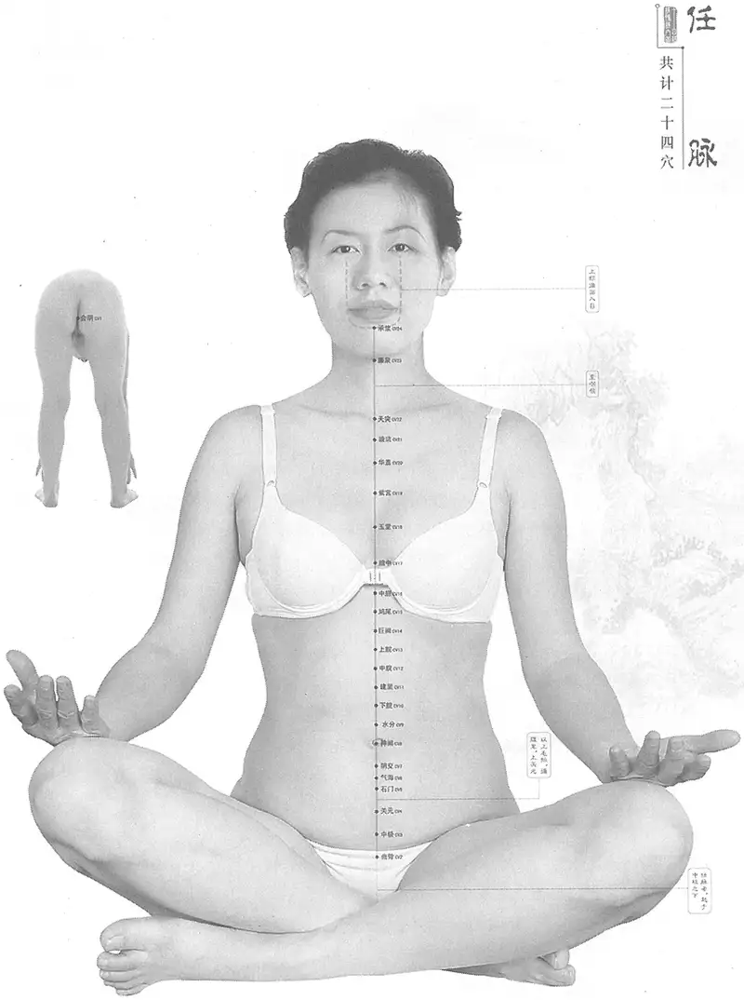

**图2-406　黄龙祥编任脉经脉、经穴合图**

〔p.1310 (인쇄 1282)〕

数噫喘息，胸满咳呕，腹皮痛，瘙痒。喉痹，食不下。（《黄帝明堂经》）

会阴，一名屏翳。在大便前，小便后两阴之间，任脉别络，夹督脉、冲脉之会。刺入二寸，留七呼，灸三壮。主小便难，窍中热，实则腹皮痛，虚则痒搔。痔，阴中诸病，前后相引痛，不得大小便。痹。男子阴端寒，上冲心中佷佷。女子血不通。（《黄帝明堂经》）

盖因鸠尾穴一名“尾翳，与任脉之络同名。上述“腹皮痛，瘙痒”症辑自任脉络病候。由于《经脉》篇所载之任脉之络未言明其所别之处，故《黄帝明堂经》编者只好将任脉之络病候归于与“尾翳”相关的腧穴“鸠尾”、“会阴”二穴之中，这是一种不得已的处理方法。

### （一）会阴 Huìyīn CV1 出《黄帝明堂经》 

#### 【提要索隐】 

**穴名**：一名屏翳；一名金门。

**定位**：在会阴区，男性在阴囊根部与肛门连线的中点，女性在大阴唇后联合与肛门连线的中点。

**归经**：会阴穴为“任脉别络，夹督脉、冲脉之会”，律以其他络穴归经，归入任脉可也。宋以后腧穴书皆从《铜人腧穴针灸图经》之说，归入任脉。

**适应症**：主治前后阴病症。常用于大小便不利，阴痛，阴痒，阴肿，痔疮，遗精；月经不调。

**针刺操作**：直刺0.5~1寸。

#### 【名实考】 

会阴，既是穴名，又是脉名，穴与脉是两个完全不同的概念。

宋代《太平圣惠方》载有“灸囊后缝十字纹”治疗小儿疝气，元代窦太师针灸名其曰“海底”，作为其治疗疝气的常用穴，吴崑认为此与会阴为同一穴，清代王宏翰《医学原始》从之。今考察，海底一穴，即《奇效良方》之“囊底”穴，其定位与主治皆与会阴穴不同，不可作为本穴的别名。而《千金要方》所载之“金门”穴，其定位与本穴同，故列入本穴别名。

　1. 会阴，一名屏翳。在大便前、小便后两阴之间，任脉别络，夹督脉、冲脉之会。（《黄帝明堂经》）

　2. 会阴之脉令人腰痛，痛上漯漯然汗出，汗干令人欲饮，饮已欲走，刺直阳之脉上三痏，在𫏋上郄下五寸横居，视其盛者出血。（《素问·刺腰痛》）

　3. 以其处在二阴之间，又为冲、任、督相会之所，故曰会阴。（《经穴解》）

　4. 一云女为会阴，男为海底，其实一也。（《医学原始》卷九）

　5. 别名　平翳、屏翳、下极、金门、下阴别、海底。（《针灸学》）

#### “会阴”、“金门”、“海底”穴辨 

　1. 小儿痫……次灸金门，金门在谷道前，囊之后，当中央是也。从阴囊下度至大孔前，中分之。（《千金要方》卷五上）

　2. 小儿胎疝，卵偏重者，灸囊后缝十字纹当上三壮。春灸夏较，夏灸秋较，秋灸冬较，冬灸春较，炷如小麦大。（《太平圣惠方·明堂》）

　3. 海底一穴，在阴囊坠下中缝是穴。针三分出水，灸二七壮。又法：囊坠下十字纹中。治囊肿疝气，出水妙。（《窦太师针经》）

4.《怪穴》阴中湿痒，外肾生疮，海底。在脬囊底十字文缝中，灸泻二十七壮。（《医学纲目》卷十四）

　5. 囊底一穴，在阴囊十字纹中。治肾藏风疮，及小肠疝气，肾家一切证候，悉皆治之。

〔p.1311 (인쇄 1283)〕

可灸七壮，艾炷如鼠矢大。（《奇效良方》卷五十五）

　6. 会阴一穴，一名屏翳，一名海底，在两阴之间。男人取阴囊后尽处中缝是穴。任、督、冲三脉所会。（《针方六集》卷一）

　7. 会阴一穴，主前后二阴引痛，不得大小便，主阴汗阴肿阴痛，阴寒冲心，阴蚀阴痔，阴中一切诸痛。阴囊肿大如斗，刺之出水愈。（《针方六集》卷五）

**按**：第一条“金门”定位与会阴穴完全相同，故为同穴异名；《窦太师针经》“海底”出自《太平圣惠方》灸小儿疝气方，其定位明显较会阴穴靠近阴囊部，主治也不相类，故别是一穴，吴崑不辨，误作同一穴，故不仅于会阴穴注曰“一名海底”，而且将海底穴的主治与刺法皆混入会阴穴下。

#### 【定位】 

**部位**：在会阴区，男性当阴囊根部与肛门连线的中点，女性当大阴唇后联合与肛门连线的中点（图2-407）。

**取穴**：胸膝位或侧卧位，在前后二阴中间。

　1. 在大便前，小便后，两阴之间。（《黄帝明堂经》、《铜人腧穴针灸图经》、《圣济总录》、《针灸资生经》、《十四经发挥》、《医学纲目》、《针灸聚英》、《古今医统》、《医学入门》、《针灸大成》、《类经图翼》、《循经考穴编》、《针灸易学》、《针灸逢源》）

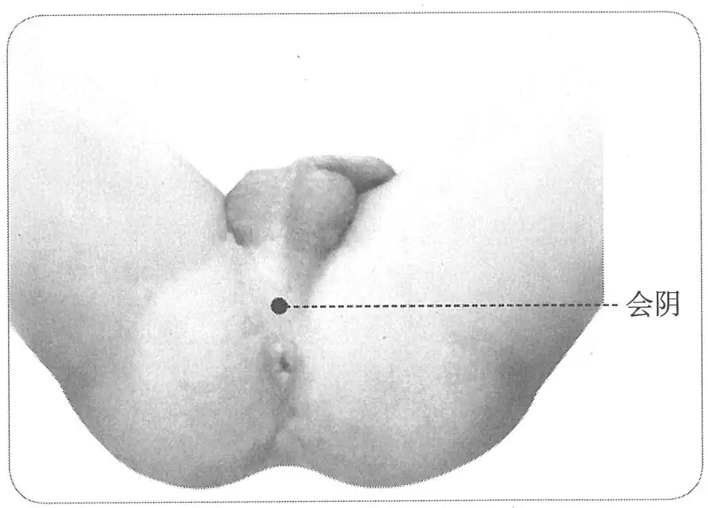

**图2-407　会阴穴图**

　2. 自曲骨下至阴，阴之下两阴之间。（《素问·气府论》王冰注）

　3. 前后两阴间缝中，即前后阴之中间。（《针灸十四经穴位考订》）

　4. 统编针灸学教材

　　(1) 部位：两阴之间。取穴：跪取，男子于阴囊后端与肛门之间取之，女子于大阴唇后连合部与肛门之间取之。（1957年南京《针灸学》）

　　(2) 部位：两阴之间。取穴：在前后二阴之间，仰卧，屈膝取之。（1版《针灸学讲义》）

　　(3) 部位：在大便前，小便后，两阴之间。取穴：在会阴部正中，男子当肛门与阴囊之间，女子当肛门与阴唇后联合之间，屈膝仰卧或跪伏体位取之。（2版《针灸学讲义》）

　　(4) 男性在阴囊根部与肛门的中间，女性在大阴唇后联合与肛门的中间。（4、5版《针灸学》，《中国针灸学》）

　　(5) 在会阴部，男性当阴囊根部与肛门连线的中点，女性当大阴唇后联合与肛门连线的中点。（6、7版《针灸学》）

#### 【类属】 

任脉络穴。

**脉气所发：**

　1. 任脉别络，夹督脉、冲脉之会。（《黄帝明堂经》）

　2. 任、督、冲三脉所起，督由会阴而行背，任由会阴而行腹，冲由气冲行足少阴。（《针灸聚英》卷一）

〔p.1312 (인쇄 1284)〕

**归经：**

　1. 足少阴经穴。（《千金要方》卷二十九、《千金翼方》、《外台秘要》）

　2. 任脉穴。（《铜人腧穴针灸图经》卷上）

#### 【适应症】 

主治前后阴部病症。常用于大小便不利，阴痛，阴痒，阴肿，痔疮，遗精；月经不调。

　1. 任脉之别，名曰尾翳，下鸠尾，散于腹。实则腹皮痛，虚则痒搔，取之所别也。（《灵枢·经脉》）

　2. 主痹。小便难，窍中热，实则腹皮痛，虚则痒搔。痔凡痔与阴相通者死，阴中诸病，前后相引痛不得大小便。女子血不通。男子阴端寒，上冲心中佷佷。（《黄帝明堂经》）

　3. 治小便难，窍中热，皮痛，谷道搔痒，久痔相通者死。阴中诸病，前后相引痛，不得大小便，女子经不通，男子阴端寒，冲心佷佷。（《铜人腧穴针灸图经》卷中）

　4. 阴汗，阴门肿痛。卒死者，针一寸补之；溺死者，令人倒拖出水，针补，尿屎出则活，余不可针。（《针灸聚英》卷一、《古今医统》、《针灸大成》）

　5. 主阴肿，阴痛，阴浊，阴痔，阴中一切诸痛，阴囊肿大如斗，刺之出水愈。（《针方六集》卷五）

　6. 一传治妇人产后昏迷，不省人事。（《类经图翼》卷八）

　7. 统编针灸学教材

　　(1) 阴汗，阴头痛，经水不调，阴挺，阴门肿痛，久痔，大小便不得，遗精，溺死。（1957年南京《针灸学》）

　　(2) 阴汗，阴痛，阴肿，阴挺，遗精，月经不调，久痔，大小便不得，溺死。（1版《针灸学讲义》）

　　(3) 阴痒，月经不调，肛门肿痛，小便不通，遗精，癫狂。（2版《针灸学讲义》）

　　(4) 二便不利，痔疾，遗精，经闭，惊痫，溺水窒息。（4版《针灸学》）

　　(5) 二便不利，阴痛，痔疾，遗精，月经不调，久痔，大小便不得，溺死。（5、6版《针灸学》）

　　(6) ①溺水窒息、昏迷、癫狂痫等急危症、神志病证；②小便不利、遗尿、阴痛、阴痒、脱肛、阴挺、痔疮等前后二阴疾患；③遗精；④月经不调。（7版《针灸学》）

　　(7) 阴痒，小便不利，痔疾，遗精，遗尿，月经不调，癫狂。（《中国针灸学》）

**文献分析**：《针方六集》将“海底”穴主治混入本穴主治中。

#### 附：临床应用举例 

　1. 疗小便不通，又方，灸大便孔前一寸，玉茎后即是，灸一七即通瘥。（《杂疗病药方》敦煌卷子P3378）

**按**：本方所述灸疗部位相当于会阴穴处。

　2. 有贵人内子产后暴卒，急呼其母为办后事。母至，为灸会阴、三阴交各数壮而苏。母盖名医女也。（《针灸资生经》卷五）

　3. 阴忽红肿及小便不通病，百劳、会阴、风门、中极、膏肓、绝谷(骨)、曲池、肾俞、三阴。妇人经事正行，却与男子交感，得败血不止。渐渐尫羸瘦弱，外感寒邪，内伤于精，外思于情，寒热往来，精血相争，内不纳精，外不受血，毒气冲动子宫，风邪串入肺中，咳嗽痰涎。今时师不明脉气虚实，便作虚劳治之，非也。比乃两情交感，百脉错乱，荣卫不能归元，以致如此。复刺后穴：三阴交、百劳、中极、肾俞、膏肓、风门、曲池、绝骨。

〔p.1313 (인쇄 1285)〕

（《针灸集成》第五十五方）

　4. 梦遗，取会阴。心肾不交配心俞、神门、内关；肾虚配肾俞、太溪、足三里；湿热下注配阴陵泉、内庭。［内蒙古中医药，1985(1):29］

　5. 阴囊瘙痒，长强穴、会阴穴，针刺治疗。［福建中医药，1985，16(4):51］

　6. 会阴—阴道疼痛，刺灸会阴穴治疗。［法国针灸医生月刊，1988(129):175-177］

　7. 小儿遗尿，会阴。针灸并用。［浙江中医杂志，1988，23(6):246］

　8. 顽固性遗精，针刺会阴穴治疗。［河南中医药学刊，1994，9(5):46］

　9. 子宫脱垂，针刺百会、曲骨穴为主治疗。［湖南中医杂志，1997，13(4):26］

#### 【操作】 

直刺0.5~1寸。

　1. 刺入二寸，留七呼，灸三壮。（《黄帝明堂经》）

　2. 禁针，灸三至五壮。《大成》云卒死者可针一寸。（《针灸十四经穴位考订》）

　3. 统编针灸学教材

　　(1) 针五至八分，灸三至七壮。（1957年南京《针灸学》、1版《针灸学讲义》）

　　(2) 直刺5~8分，艾条灸3~7分钟。（2版《针灸学讲义》）

　　(3) 直刺0.5~1寸。（4、5版《针灸学》，《中国针灸学》）

　　(4) 直刺0.5~1寸；可灸。孕妇慎用。（6、7版《针灸学》）

### （二）曲骨 Qūgǔ CV2 出《黄帝明堂经》 

#### 【提要索隐】 

**穴名**：一名尿胞、一名屈骨端、屈骨；一名回骨。

**定位**：在下腹部，耻骨联合上缘，前正中线上。

**适应症**：主治前阴部、妇科病症。常用于小便不利，遗尿，阴疝，遗精，阳痿；月经不调，带下。

**针刺操作**：直刺1~1.5寸；孕妇慎用。

#### 【名实考】 

穴在曲骨之上，故名“曲骨”。需要注意的是，“曲骨”既是穴名，又是骨名。作为骨名，又名“横骨”，又名“屈骨”。《千金要方》、《千金翼方》针灸方中相对于“曲骨”，更多采用的是“屈骨端”和“屈骨”之名。

　1. 曲骨，在横骨上，中极下一寸毛际陷者中，动脉应手，任脉、足厥阴之会。（《黄帝明堂经》）

　2. 腹中满小便数起，灸玉泉下一寸，名尿胞。一名屈骨端。灸二七壮。（《千金要方》卷二十一）

**按**：“玉泉”为中极穴别名。

　3. 赤白沃，阴中干痛，恶合阴阳，少腹䐜坚，小便闭，刺屈骨入一寸半，灸三壮，在中极下一寸。（《千金要方》卷三十）

　4. 屈骨在脐下五寸屈骨端。（《千金要方》卷二十）

　5. 失精，五脏虚竭，灸屈骨端五十壮。阴上横骨中央，宛曲如却月，中央是也。此名横骨。（《千金要方》卷十九）

　6. 横骨在脐下，横门骨是。（《千金要方》卷二十）

　7. 曲骨一穴，一名回骨。在横骨之上陷毛际中。（《铜人腧穴针灸图经》卷上）

〔p.1314 (인쇄 1286)〕

　8. 中行自鸠尾，竖悬与上，此穴横置骭上中行之中，余无骨焉。曰曲者，其形弯曲非直也。（《经穴解》）

#### 相关穴及刺激点 

膀胱丛刺激点：耻骨联合上1cm处。主治夜尿，尿潴留，尿失禁，尿道痛。刺法：向下斜刺3.0~4.0cm。针刺前排空小便，尿潴留者不宜深刺，孕妇禁刺。（《实用神经干电刺激疗法》）

#### 【定位】 

**部位**：在下腹部，耻骨联合上缘，前正中线上（图2-408）。

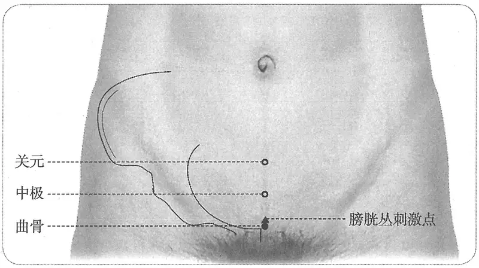

**图2-408　曲骨穴与相关刺激点图**

　1. 曲骨，在横骨上，中极下一寸毛际陷者中，动脉应手。（《黄帝明堂经》、《太平圣惠方》、《铜人腧穴针灸图经》、《圣济总录》、《针灸资生经》、《窦太师针经》、《十四经发挥》、《医学纲目》、《针灸聚英》、《古今医统》、《医学入门》、《针灸大成》、《针方六集》、《类经图翼》、《循经考穴编》、《针灸逢源》）

　2. 在脐下横骨上。（《太平圣惠方》卷五十五）

　3. 脐下五寸，耻骨上方。（《针灸十四经穴位考订》）

　4. 统编针灸学教材

　　(1) 部位：在横骨上，中极下一寸，毛际陷者中。取穴：仰卧，从脐之中心按下至横骨边而止，其处即是穴位。自脐至此作五寸计算，下腹部诸穴分寸以此推算。（1957年南京《针灸学》）

　　(2) 部位：脐下五寸。取穴：仰卧，在横骨上缘，中级穴之下一寸，毛际陷中取之。（1版《针灸学讲义》）

　　(3) 部位：在横骨上，中极下一寸，毛际陷者中。取穴：在脐下五寸，腹部正中线上，当耻骨联合之上缘，仰卧取之。（2版《针灸学讲义》）

　　(4) 耻骨联合上缘的中点处。（4、5版《针灸学》，《中国针灸学》）

　　(5) 在下腹部，当前正中线上，耻骨联合上缘的中点处。（6版《针灸学》）

　　(6) 前正中线上，脐下5寸，当耻骨联合上缘的中点处。（7版《针灸学》）

#### 【类属】 

任脉穴。

**脉气所发**：任脉、足厥阴之会。（《黄帝明堂经》）

〔p.1315 (인쇄 1287)〕

**归经**：任脉。（《外台秘要》卷三十九、《铜人腧穴针灸图经》卷上）

#### 【适应症】 

主治前阴部、妇科病症。常用于小便不利，遗尿，阴疝，遗精，阳痿；月经不调，带下。

　1. 主膀胱胀。小便难，水胀满，溺出少，胞转不得溺。妇人下赤白淫，绝嗣，阴中干痛，恶合阴阳，少腹䐜坚，小便闭。癫疾。（《黄帝明堂经》）

　2. 主小腹胀，血癃。（《千金要方》卷三十）

　3. 脚屈，尿涩。（《外台秘要》卷三十九）

　4. 五淋，小便黄。但是虚乏冷极者，皆宜灸之。（《太平圣惠方·明堂》）

　5. 治少腹胀满，小便淋涩不通，癞疝少腹痛，妇人赤白带下，恶合。（《铜人腧穴针灸图经》卷上）

　6. 窦太师针灸遗存

　　(1) 治七疝等症，偏坠木肾，小腹急胀坚缩，阴囊湿痒，专能兴阳。妇人阴门生疮及痒，看症补泻。（《窦太师针经》）

　　(2) 主阳萎。（《针方六集》卷五）

　　(3) 主七疝，木肾偏坠，小腹急痛茎缩，阴囊湿痒。（《循经考穴编》下）

　7. 主失精，五脏虚弱。（《针灸聚英》卷一、《针灸大成》、《针方六集》）

**按**：此从《针灸资生经》辑自《千金要方》灸方主治，详见“附：临床应用举例”。

　8. 统编针灸学教材

　　(1) 失精，五脏虚弱，赤白带下，阴痿，癃闭，疝痛。（1957年南京《针灸学》）

　　(2) 遗精，赤白带下，阳痿，癃闭，小便淋漓，疝痛。（1版《针灸学讲义》）

　　(3) 遗精，阳痿，带下，尿闭，疝气。（2版《针灸学讲义》）

　　(4) 小便淋漓不通，遗尿，遗精，阳痿，赤白带下，月经不调。（4版《针灸学》）

　　(5) 小便不利，遗尿，遗精，阳痿，月经不调，带下。（5版《针灸学》）

　　(6) 小便不利，遗尿，遗精，阳痿，痛经，月经不调，带下。（6版《针灸学》）

　　(7) ①小便不利，遗尿；②遗精、阳痿、阴囊湿痒等男科病证；③月经不调、痛经、赤白带下等妇科经带病证。（7版《针灸学》）

　　(8) 主治小便淋沥，不通，遗尿，遗精，阳痿，赤白带下，月经不调，痛经，疝气。（《中国针灸学》）

**文献分析**：本穴主治多为前阴，特别是小便病症，其别名“一名尿胞”很准确地反映了这一特征。

#### 附：临床应用举例 

　1. 前阴、肾系病症

　　(1) 失精，五脏虚竭，灸屈骨端五十壮，阴上横骨中央宛曲如却月中央是也。此名横骨。（《千金要方》）

　　(2) 小便不利，大便数泄注，灸屈骨端五十壮。（《千金翼方》卷二十七）

　　(3) 主腹中满，小便数起，灸玉泉下一寸名尿胞，一名屈骨端，灸二七壮。小儿以意减之。（《千金要方》卷二十一）

**按**：“玉泉”为中极穴别名。

　　(4) 水肿胀，灸曲骨百壮。（《千金翼方》卷二十八）

　　(5) 小便热痛，目赤，尿如血：列缺沿皮一寸、大陵、承浆各五分。又法：曲骨灸二七壮、阴阳二陵泉各二寸五分。（《医学纲目》卷十四）

〔p.1316 (인쇄 1288)〕

　　(6) 遗尿失禁：阴陵泉、阳陵泉二寸半、大敦七壮。又方：曲骨、阴阳二陵泉各二寸半。（《医学纲目》卷十四）

　　(7) 射精不能症：大敦穴、曲骨穴、阴廉穴，针灸治疗。［中医杂志，1984，25(4):60］

　　(8) 遗尿症：针刺曲骨穴治疗。［中国针灸，1985，5(6):18］

　　(9) 男子性功能障碍：大敦穴、曲骨穴、神阙穴、阴廉穴，针灸治疗。［上海针灸杂志，1985(3):4］

　　(10) 前列腺肥大症和前列腺炎：会阴穴、气冲穴、曲骨穴，针灸疗法。［安徽中医学院学报，1987(2):60］

　　(11) 阳痿症：曲骨穴，针灸治疗。［中医杂志，1988，29(3):214］

　2. 妇人病症

　　(1) 产后癃闭：关元穴、曲骨穴、中极穴，针灸治疗。［湖北中医杂志，1984(1):33］

　　(2) 子宫肌瘤：横骨穴、曲骨穴、子宫穴，针刺治疗。［中国针灸，1986，6(1):27］

　　(3) 女阴白色病变：会阴穴、曲骨穴，电热针治疗。［中医杂志，1987，28(9):48-49］

　　(4) 产后尿潴留：曲骨穴、阴陵泉穴、足三里穴，针灸拔罐治疗。［内蒙古中医药，1987(2):31］

　　(5) 带下：针刺曲骨穴治疗。［山西中医，1989，5(3):35］

#### 【操作】 

直刺1~1.5寸；孕妇慎用。

　1. 刺入一寸五分，留七呼，灸三壮。（《黄帝明堂经》）

　2. 窦太师针灸遗存

　　(1) 针入二寸半，灸三七壮。（《窦太师针经》）

　　(2) 针三寸，灸十壮。（《窦太师秘传》）

　3. 针五分，灸五壮。孕妇禁针灸。（《针灸十四经穴位考订》）

　4. 统编针灸学教材

　　(1) 针三分至一寸，灸七至十五壮。（1957年南京《针灸学》、1版《针灸学讲义》）

　　(2) 直刺3~10分，艾条灸7~15分钟。（2版《针灸学讲义》）

　　(3) 直刺1~1.5寸。（4、5版《针灸学》）

　　(4) 直刺1~1.5寸，内为膀胱，应在排尿后进行针刺；可灸。孕妇慎用。（6版《针灸学》）

　　(5) 直刺1~1.5寸；孕妇慎用。（7版《针灸学》）

　　(6) 直刺0.5~1寸，本经曲骨至上脘诸穴，孕妇针刺慎用。可灸。（《中国针灸学》）

### （三）中极 Zhōngjí CV3 出《黄帝明堂经》 

#### 【提要索隐】 

**穴名**：一名气原，一名玉泉。

**定位**：在下腹部，脐中下4寸，前正中线上。

**适应症**：主治妇科、前阴部病症。常用于月经不调，崩漏，子宫脱垂，阴痒，不孕，恶露不尽，带下；遗尿，小便不利，疝气，遗精，阳痿。

**针刺操作**：直刺1~1.5寸；孕妇慎用。针前让患者排尿。

〔p.1317 (인쇄 1289)〕

#### 【名实考】 

《黄帝明堂经》以“中极”为正名，以“玉泉”为别名，而《太平圣惠方》卷五十五是以“玉泉”作本穴的正名，这与《千金要方》、《千金翼方》所载唐以前针灸方用“玉泉之名远多于中极”之名的现象是吻合的。

　1. 中极，膀胱募也。一名气原，一名玉泉，在脐下四寸，足三阴、任脉之会。（《黄帝明堂经》）

　2. 玉泉穴，在脐下四寸。（《太平圣惠方》卷五十五）

　3. 名玉泉者，以为膀胱募也；玉泉者，为水而言也。名气原者，为生气之源也。名中极者，中指任脉在腹之中也，极者，自承浆而下，此为极处也。又自下而上，曲骨犹在骨，此则初入腹之第一穴也，故曰中极。（《经穴解》）

　4. 别名　膀胱募、玉泉、气原、气鱼。（《针灸学》）

#### 相关穴及刺激点 

中极下：脐下四寸五分，即中极穴下0.5寸。主治尿失禁。（《针灸经外奇穴图谱（续集）》）

**按**：本穴完全在中极穴的刺法范围之内，主治病症也未出中极穴的主治范围，完全可视为同一穴。只是在治疗尿失禁时，借鉴“中极下”的刺法即可。

#### 【定位】 

**部位**：在下腹部，脐中下4寸，前正中线上（图2-409）。

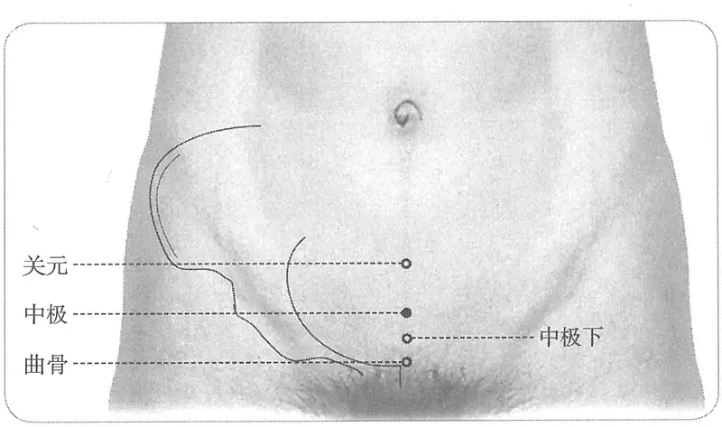

**图2-409　中极穴与相关穴图**

　1. 在脐下四寸。（《黄帝明堂经》、《太平圣惠方·明堂》、《铜人腧穴针灸图经》卷上及卷下“穴腧都数”、《窦太师秘传》、《针灸玉龙经》、《医学入门》、《针方六集》、《类经图翼》、《循经考穴编》、《医宗金鉴·刺灸心法要诀》、《针灸逢源》）

　2. 穴在关元下一寸，大人从心下度取八寸是玉泉穴，小儿斟酌以取之。（《千金要方》卷二十）

　3. 在关元下一寸。（《千金翼方》卷二十六、《素问》王冰注、《太平圣惠方·针经》、《铜人腧穴针灸图经》卷中、《圣济总录》、《针灸资生经》、《十四经发挥》、《医学纲目》）

　4. 关元下一寸，脐下四寸。（《针灸聚英》卷一、《古今医统》、《针灸大成》、《针灸易学》）

　5. 脐下四寸，曲骨上一寸。（《针灸十四经穴位考订》）

　6. 统编针灸学教材

　　(1) 部位：脐下4寸。取穴：仰卧，于脐下四寸取之。（1957年南京《针灸学》）

〔p.1318 (인쇄 1290)〕

　　(2) 部位：脐下4寸。取穴：仰卧，曲骨穴上一寸取之。（1版《针灸学讲义》）

　　(3) 部位：脐下4寸。取穴：于腹部正中线上，曲骨上一寸，仰卧取之。（2版《针灸学讲义》）

　　(4) 脐下4寸。（4、5版《针灸学》）

　　(5) 在下腹部，前正中线上，当脐中下4寸。（6、7版《针灸学》，《中国针灸学》）

#### 【类属】 

任脉穴；膀胱募穴。

**脉气所发：**

　1. 足三阴之会。（《素问·气府论》王冰注、《铜人腧穴针灸图经》卷上）

　2. 膀胱之募，任脉、足三阴之会。（《黄帝明堂经》、《外台秘要》卷三十九、《太平圣惠方·针经》、《铜人腧穴针灸图经》卷中）

**归经**：任脉。（《外台秘要》卷三十九、《铜人腧穴针灸图经》卷上）

#### 【适应症】 

妇科病要穴。主治妇科、前阴部病症。常用于月经不调，崩漏，子宫脱垂，阴痒，不孕、产后恶露不尽，带下；遗尿、小便不利，阴疝，遗精，阳痿等。

　1. 主女子禁中，腹热痛，子门不端，少腹苦寒，阴痒及痛，经闭不通。乳余疾，绝子，内不足。奔肫上抢心，甚则不得息，忽忽少气，尸厥，心烦痛，饥不能食，善寒中腹胀，引䏚而痛，小腹与脊相控暴痛，时窘之后。小便不利。丈夫失精。（《黄帝明堂经》）

　2. 主少腹积聚坚如石，小腹满。（《千金要方》卷三十）

　3. 主拘挛，腹疝，月水不下。（《千金要方》卷三十）

　4. 崩中带下，因产恶露不止。妇人断绪最要穴。（《千金翼方》卷二十六）

　5. 主淋，小便赤，尿道痛，脐下结块如覆杯，或因产得恶露不止，遂成疝瘕，或因月事不调，血结成块。（《太平圣惠方·针经》）

　6. 主冷气积聚，时上冲心，积聚，坚如石，失精，绝子，面干也。（《太平圣惠方·明堂》）

　7. 治五淋，小便赤涩，失精，脐下结如覆杯，阳气虚惫，疝瘕水肿，贲豚抢心，甚则不得息，恍惚尸厥，妇人断绪，四度针，针即有子，故却时任针也，因产恶露不止，月事不调，血结成块。（《铜人腧穴针灸图经》卷中）

　8. 窦太师针灸遗存

　　(1) 专疗女人血气虚损。无子者，针灸三度立有孕。（《窦太师针经》）

　　(2) 治尸厥不省人事，先补后泻；专治妇人下元虚损血崩等证，补；妇人无子，针灸三度立效如有子。八分十呼，七至百壮。（《大本琼瑶神书》）

　　(3) 妇人无子，宜刺灸，则有子，先泻后补；血气攻心，先补后泻。（《针灸玉龙歌》注）

　　(4) 治男子腹冷，妇人不受胎气，月水不调，气血凝滞等症。（《窦太师秘传》）

　9. 主下元虚惫，一切遗精，梦泄，四肢倦怠。（《循经考穴编》下）

　10. 主阴汗，小便频数，胎衣不下，临经行房羸瘦，寒热。（《针灸聚英》卷一、《针灸大成》）

　11. 统编针灸学教材

　　(1) 月经不调，胞衣不下，产后恶露不止，阴痒，阴痛，失精，白浊，尿频数或不得尿，疝瘕，水肿，绕脐痛冲胸，阳气虚惫。（1957年南京《针灸学》）

　　(2) 月经不调，胞衣不下，产后恶露不止，遗精，白浊，阴挺，阴痒，阴痛，尿频数或小便不利，疝溲，水肿，绕脐痛。（1版《针灸学讲义》）

　　(3) 遗精，遗尿，小便不通，小便频数，淋证，小腹痛。（2版《针灸学讲义》）

　　(4) 遗尿，遗精，阳痿，疝气，尿闭崩漏，月经不调，带下，阴挺，不孕，产后恶露不止。

〔p.1319 (인쇄 1291)〕

（4版《针灸学》）

　　(5) 遗尿，小便不利，疝气，遗精，阳痿，月经不调，崩漏带下，阴挺，不孕。（5、6版《针灸学》）

　　(6) ①遗尿、小便不利、癃闭等泌尿系病证；②遗精、阳痿、不育等男科病证；③月经不调、崩漏、阴挺、阴痒、不孕、产后恶露不尽、带下等妇科病证。（7版《针灸学》）

　　(7) 遗尿，遗精，阳痿，疝气，崩漏，月经不调，痛经，带下，小便频数，小便不通，小腹痛，阴挺，阴痒。（《中国针灸学》）

**文献分析**：《黄帝明堂经》载本穴主治以妇科病症为主，几乎包括了妇人经、带、胎、产、产后病等各方面。《千金翼方》更谓本穴“妇人断绪最要穴”。

#### 附：临床应用举例 

　1. 前阴、肾系病症

　　(1) 玉茎中痛：中极、三阴交、太溪、复溜。问曰：此证缘何而得？答曰：因少年之时，过用金石之药，有伤茎孔，使阴阳交感不能发泄，故如此也。宜刺后穴：中极、阴陵泉、关元、血海。（《针灸集成》第五十二方）

　　(2) 夜梦鬼交，遗精不禁，中极一穴、膏肓二穴、心俞二穴、然谷二穴、肾俞二穴。（《针灸大全》卷四）

　　(3) 前列腺肥大症：关元穴、中极穴，针灸治疗。［河北中医，1984(2):48］

　　(4) 精子异常：关元穴、中极穴，针灸治疗。［浙江中医杂志，1985，20(11):495］

　　(5) 不育症：天枢穴、中极穴，针灸治疗。［福建中医药，1986，17(1):39］

　　(6) 顽固性遗尿症：中极、三阴交，针灸疗法。［陕西中医，1989，10(11):513］

　　(7) 慢性前列腺炎：针刺中极、秩边穴治疗。［针灸临床杂志，1999，15(5):26］

　　(8) 阳痿：以中极、会阳穴为主治疗。［福建中医学院学报，2000，10(4):36］

　2. 妇人病症

　　(1) 妇人赤白带：中极、气海、白环俞、肾俞。问曰：此证从何而得？答曰：不惜身体，恣意房事，内伤于血，外伤于情。或经事正行，或产暇未满，恶露未尽，与男交感，则内不纳精，遗下白水。复刺后穴：三阴交、三阳交、气海、中极。（《针灸集成》第五十四方）

　　(2) 妇人经绝不来：中极、三阴交、合谷。问曰：此证缘何而得？答曰：止用此穴法，无不效也。医者当详证审视诊候，参考诸医书，明法泻定则，定实虚，分浅深。然非一言可尽，一时可疗也。（《针灸集成》第五十六方）

　　(3) 胞衣不下：三阴交、中极各泻之。（《医学纲目》卷三十五）

　　(4) 妇人子宫久冷，不受胎孕，中极一穴、三阴交穴、子宫二穴在中极两旁各三寸。（《针灸大全》卷四）

　　(5) 妇人白带亦难治，须用金针取次施，下元虚惫补中极，灼艾尤加仔细推。（《针灸玉龙歌》）

　　(6) 慢性外阴瘙痒症：会阴穴、中极穴，针刺治疗。［中国针灸，1985，5(3):7-9］

　　(7) 白带增多：针刺关元中极穴治疗。［中国针灸，1994(增刊):253-254］

　3. 腹部病症

　　(1) 胀满气如水肿状，小腹坚如石，灸膀胱募百壮，穴在中极，脐下四寸。（《千金要方》卷十六）

〔p.1320 (인쇄 1292)〕

　　(2) 奔肫抢心不得息，灸中极五十壮，中极一名玉泉，在脐下四寸。（《千金要方》卷十七）

　　(3) 饥不能食，饮食不下，呕而雷鸣：大迎、中极、食窦。又法：期门、章门。（《医学纲目》卷二十一）

　　(4) 奔豚抢心不得息，并疝：玉泉三寸，即中极穴、章门五十壮。（《医学纲目》卷二十五）

　　(5) 自痢不止：天枢、中极。（《医学纲目》卷二十二）

#### 【操作】 

直刺1~1.5寸；孕妇慎用。针前让患者排尿。

　1. 刺入二寸，留七呼，灸三壮。（《黄帝明堂经》）

　2. 针入八分，留十呼，得气即泻。灸亦得，然不及针，日灸三七壮，至三百壮止。（《太平圣惠方·针经》）

　3. 窦太师针灸遗存

　　(1) 针入二寸半，灸五十壮。（《窦太师针经》、《针方六集》）

　　(2) 针二寸五分，灸二七壮。（《窦太师秘传》）

　4. 孕妇不可灸。（明刊本《外台秘要》卷三十九、《类经图翼》）

　5. 针五分，灸五壮。孕妇禁针灸。（《针灸十四经穴位考订》）

　6. 统编针灸学教材

　　(1) 针八分至寸余，灸七至数十壮。（1957年南京《针灸学》、1版《针灸学讲义》）

　　(2) 直刺8分；艾炷灸3~7壮，艾条灸3~7分钟。（2版《针灸学讲义》）

　　(3) 直刺1~1.5寸。（4、5版《针灸学》）

　　(4) 直刺1~1.5寸；可灸。孕妇慎用。（6、7版《针灸学》）

　　(5) 直刺0.5~1寸；可灸。（《中国针灸学》）

　7. 直刺1~2寸。感应：局部酸胀，可放散至外生殖器及会阴部。灸3~7壮；温灸15~20分钟。（上海《针灸学》）

### （四）关元 Guānyuán CV4 出《灵枢》 

#### 【提要索隐】 

**穴名**：一名次门。

**定位**：在下腹部，脐中下3寸，前正中线上。

**适应症**：主治前阴部、妇科病症。常用于疝气，少腹疼痛；癃闭，尿频，遗精，阳痿；月经不调，痛经，经闭，崩漏，带下，子宫脱垂，恶露不尽，不孕；泄泻；虚劳诸疾。保健灸的常用穴。

**针刺操作**：直刺1~1.5寸。孕妇慎用。针前让患者排尿。

#### 【名实考】 

本穴一名丹田。需要注意的是，道家与针灸家所说之“丹田”不同，后人不辨，多有相混处。又《针灸大成》抄录《玉龙歌》时误将原文“关门”（正确穴名为“阑门”）抄成“关元”，注意鉴别。

　1. 三结交者，阳明、太阴也，脐下三寸关元也。（《灵枢·寒热病》）

　2. 灸寒热之法……齐下关元三寸灸之。（《素问·骨空论》）

　3. 《曹氏灸经》曰关元者，下焦阴阳宗气之奥室也。（《医心方》卷二）

　4. 关元，小肠募也，一名次门，在脐下三寸，足三阴、任脉之会。（《黄帝明堂经》）

　5. 足三阴上行入腹者，必会于此处，有关之象焉，以任脉在中，而三阴共会之，有元之义

〔p.1321 (인쇄 1293)〕

焉，故曰关元。（《经穴解》）

#### 道家与针家“丹田”辨 

　1. 《圣记经》云人身中有三无宫也，当两眉却入三寸为泥丸宫，此上丹田也；中有赤子字符先，一名帝卿人，长三寸，紫衣也。中心为绛宫，此中丹田也；其中真人字子丹，一名光坚，赤衣也。脐下三寸为命门宫，此下丹田也。（《医心方》卷二十七）

　2. 脐下二寸名石门，《明堂》载《甲乙经》云一名丹田。《千金》、《素问》注亦谓丹田在脐下二寸。世医因是，遂以石门为丹田误矣。丹田乃在脐下三寸，《难经疏》论之详而有据，当以《难经疏》为正详见关元。《铜人》云针之绝子，《千金》云灸之绝孕。要之，妇人不必针灸此。论丹田穴，当以脐下二寸为是。（《针灸资生经》卷一）

　3. 关元，乃丹田也。诸经不言，惟《难经疏》云：丹田在脐下三寸，方员四寸，著脊梁两肾间中央赤是也。左青右白，上黄下黑，三寸法三光，四寸法四时，五色法五行。两肾间名大海，而贮其血气，亦名大中极。言取人身之上下四向最为中也。老医与人灸，皆从此说，多者千余壮，少亦三二百。不知全活者几何人。（《针灸资生经》卷一）

　4. 《难经》云丹田亦名大中极。言丹田取人之身上下四向最为中间也，故名为极，此亦曰中极。其去丹田只一寸，虽未若丹田之最中，然不中不远矣。（《针灸资生经》卷三）

　5. 关元一穴，即丹田穴。（《窦太师针经》）

**按**：以上王执中论丹田皆道家之“丹田”而与针家概念相混，引起长时期的混乱。

#### “关元”、“关门”、“阎门”、“气冲”穴辨 

竖弦疝气发甚频，气上攻心似死人，关元兼刺大敦穴，此法亲传始得真。（《针灸大成·玉龙歌》卷三）

竖痃疝气发来频，气上攻心大损人，先向阎门施泻法，大敦复刺可通神。阎门：在玉茎毛际两旁各三寸。（《针灸玉龙经·玉龙歌》）

肾弦疝气发得频，气上冲心苦死人，关门复刺大敦穴，二穴须教认得真。关门二穴，在玉茎毛际各开三寸。（《针灸原枢·玉龙歌》）

肾弦疝气发得频，气上冲心苦死人，法取气冲大敦穴，二穴须教认得真。气冲，穴在脐下横骨两端，去中行各二寸，动脉应手。（《针方六集·玉龙歌》卷六）

兰门二穴，在曲骨穴两旁，各开二寸。针入一寸五分，灸三七壮。治膀胱七疝之气。（《针方六集》卷一）

**按**：《针灸大成》所录之“关元”，即《针灸原枢》之“关门”，皆系“阑门”之误。考证详见足厥阴经急脉穴“名实考”。至于《针方六集》改作“气冲”者，是因为吴崑抄录“兰门”穴时，将原书的“各开三寸”误抄作“各开二寸”，这样便与“气冲”穴定位相同，于是便将原歌穴名“阑门”径改作“气冲”。

#### 【定位】 

**部位**：在下腹部，脐中下3寸，前正中线上（图2-410）。

　1. 脐下三寸关元也。（《灵枢·寒热病》、《脉经》、《黄帝明堂经》、《肘后备急方》、《黄帝内经太素》、《太平圣惠方·针经》、《铜人腧穴针灸图经》、《窦太师针经》、《琼瑶神书》、《针灸玉龙经》、《十四经发挥》、《神应经》、《医学纲目》、《针灸聚英》、《古今医统》、《医学入门》、《针灸大成》、《针方六集》、《类经图翼》、《循经考穴编》、《医

〔p.1322 (인쇄 1294)〕

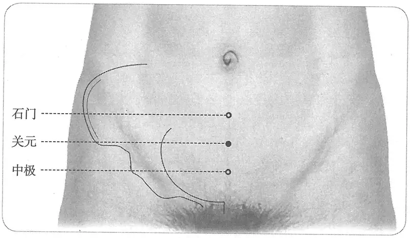

**图2-410　关元穴图**

宗金鉴·刺灸心法要诀》、《针灸易学》、《针灸逢源》）

　2. 在石门下一寸。（《千金翼方》卷二十六、《太平圣惠方·明堂》）

　3. 脐下四指。（《千金翼方》卷二十七）

　4. 脐下三寸，曲骨上二寸。（《针灸十四经穴位考订》）

　5. 统编针灸学教材

　　(1) 部位：脐下3寸。取穴：仰卧，脐下三寸取之。（1957年南京《针灸学》）

　　(2) 部位：脐下3寸。取穴：仰卧，中极穴上一寸取之。（1版《针灸学讲义》）

　　(3) 部位：脐下3寸。取穴：于腹部正中线上，曲骨上二寸，仰卧取之。（2版《针灸学讲义》）

　　(4) 脐下3寸。（4、5版《针灸学》）

　　(5) 在下腹部，前正中线上，当脐中下3寸。（6版《针灸学》）

　　(6) 前正中线上，脐下3寸。（7版《针灸学》、《中国针灸学》）

#### 【类属】 

任脉穴。小肠募穴。

**脉气所发**：小肠募也。足三阴、任脉之会。（《黄帝明堂经》）

**归经**：任脉。（《外台秘要》卷三十九、《铜人腧穴针灸图经》卷上）

#### 【适应症】 

主治前阴部、妇科病症。常用于疝气、少腹疼痛；癃闭，尿频，遗精，阳痿；月经不调，痛经，经闭，崩漏，带下，子宫脱垂，恶露不尽，不孕；泄泻，虚劳诸疾。保健灸常用穴。

　1. 石水，痛引胁下胀。头眩痛，身尽热。气癃溺黄。胞转不得溺，少腹满。奔肫，寒气入小腹，时欲呕伤中溺血，小便数，腰背脐痛引阴，腹中窘急欲凑，后泄不止。暴疝痛，少腹大热。女子绝子，衃血在内不下。（《黄帝明堂经》）

　2. 主胞闭塞，小便不通，劳热石淋。（《千金要方》卷三十）

　3. 主断绪产道冷。（《千金翼方》卷十七）

　4. 甄权云主小便处痛状如散火，癞。身所伤血出多，及中风寒，若有所堕坠，四肢解㑊，名曰体解。（《外台秘要》卷三十九）

**按**：“身所伤血出多……名曰体解”辑自《灵枢·寒热病》，详见“附：临床应用举例”。

　5. 主小便赤淋，不觉遗沥，小便处痛，状如散火，尿如血色，脐下结血，状如覆杯，妇人带下，因产恶露不止，并妇断绪，产道冷。（《太平圣惠方·针经》）

〔p.1323 (인쇄 1295)〕

　6. 岐伯云：但是积冷虚乏病，皆宜灸之。（《太平圣惠方·明堂》）

**按**：此条主治又见于该书曲骨穴下。

　7. 治脐下㽲痛，小便赤涩，不觉遗沥，小便处痛，状如散火，溺血，暴疝痛，脐下结血状如覆杯，转胞不得尿，妇人带下瘕聚，因产恶露不止，月脉断绝，下经冷。（《铜人腧穴针灸图经》卷中）

　8. 窦太师针灸遗存

　　(1) 治下元虚损，血崩白带等症，补；尸劳，不省人事，补。妇人下元虚损，男子藏精，女子生血，下虚，遗精白浊，疝气冲心欲死，宜泻；夜梦鬼交，妇人经事不来，宜补之。（《窦太师针经》）

　　(2) 男子藏精，女子藏血，治下元虚损，遗精，白浊；治膀胱疝气，充心欲死，泻之立效；夜梦鬼交，妇人经水或来不来，宜补；赤白带下，先泻后补；一切虚损，看证补泻。孕妇勿针。（《大本琼瑶神书》）

　　(3) 治夜梦鬼交。（《针方六集》卷五）

　9. 主失精，白浊，五淋，胎漏下血。（《针灸聚英》卷一、《针灸大成》）

　10. 一传治妇人产后血虚痛，子宫不成胎。（《类经图翼》卷八）

　11. 统编针灸学教材

　　(1) 带下经病，不妊，恶露不止，失精，无子，淋浊，泄利，脐下绞痛，疝，溺血，尿数或不得尿，卒中脱证，诸虚百损。（1957年南京《针灸学》）

　　(2) 经病带下，不妊，恶露不止，遗精，淋浊，泄利，脐下绞痛，疝气，溺血，尿数或不得尿，卒中脱证，诸虚百损。（1版《针灸学讲义》）

　　(3) 遗精，阳痿，遗尿，小便频数，尿闭，月经不调，经闭，带下，崩漏，阴挺，产后出血，疝气，小腹痛，泄泻，脱肛，中风脱证。（2版《针灸学讲义》）

　　(4) 遗尿，遗精，小便频数，疝气，月经不调，带下，不孕，产后恶露不止，虚劳羸瘦。（4版《针灸学》）

　　(5) 遗尿，小便频数，尿闭，泄泻，腹痛，遗精，阳痿，疝气，月经不调，带下，不孕，虚劳羸瘦。（5版《针灸学》）

　　(6) 遗尿，小便频数，尿闭，泄泻，腹痛，遗精，阳痿，疝气，月经不调，带下，不孕，中风脱证，虚劳羸瘦。（6版《针灸学》）

　　(7) ①中风脱证，虚劳冷惫，羸瘦无力等元气虚损病证；②少腹疼痛、疝气；③腹泻、痢疾，脱肛，便血等肠腑病证；④五淋、尿血，尿闭，尿频等泌尿系病证；⑤遗精，阳痿，早泄、白浊等男科病证；⑥月经不调，痛经、经闭、崩漏、带下，阴挺、恶露不尽、胞衣不下等妇科病证。（7版《针灸学》）

　　(8) 遗尿，遗精，小便频数，小便不通，疝气，月经不调，带下，痛经，崩漏，产后出血，小腹痛，完谷不化，泄泻，脱肛，中风脱证。（《中国针灸学》）

#### 附：临床应用举例 

　1. 妇人病症

　　(1) 妇人伤胎怀身，腹满，不得小便，从腰以下重，如有水气状，怀身七月，太阴当养不养，此心气实，当刺泻劳宫及关元，小便微利则愈。（《金匮要略》卷下）

　　(2) 妇人无子绝嗣，灸关元七壮，穴在脐下三寸。炷如半枣核大。（《圣济总录》卷一百九十四）

〔p.1324 (인쇄 1296)〕

　　(3) 妇人产后脐腹痛，恶露不已，水分一穴、关元一穴、膏肓二穴、三阴交穴。（《针灸大全》卷四）

　　(4) 老年性阴道炎：复溜穴、关元穴，针刺治疗。［河北中医，1985(3):44］

　　(5) 白带增多：针刺关元、中极穴治疗。［中国针灸，1994(增刊):253］

　　(6) 痛经：艾灸关元治疗。［中国民间疗法，2001，9(12):18］

　　(7) 功能性子宫出血：艾灸关元穴治疗。［甘肃中医，2001，14(5):55］

　2. 前阴、肾系病症

　　(1) 凡脐下绞痛流入阴中发作无时，此冷气。灸关元百壮，穴在脐下三寸。（《千金要方》卷十七）

　　(2) 气淋，灸关元五十壮。又灸夹玉泉相去一寸半三十壮。石淋脐下三十六种病不得小便，灸关元三十壮。（《千金要方》卷二十一）

　　(3) 男阴卵偏大癞病，灸关元百壮。（《千金要方》卷二十四）

　　(4) 水肿膨胀，小便不通，气喘不卧，此乃脾气大损也。先灸命关二百壮，以救脾气，再灸关元三百壮，以扶肾水，自运消矣。（《扁鹊心书》卷上）

　　(5) 遗精白浊，小便频数，关元一穴、白环俞穴、太溪二穴、三阴交穴。（《针灸大全》卷四）

　　(6) 冲心肾疝最难为，须用神针病自治，若得关元并带脉，功成处处显良医。（《针灸玉龙歌》）

　　(7) 小便不禁关元好，大便闭涩大敦烧。（《席弘赋》）

　　(8) 若是七疝小腹痛，照海阴交曲泉针，又不应时求气海，关元同泻效如神。小肠气撮痛连脐，速泻阴交莫再迟。（《席弘赋》）

　　(9) 前列腺肥大症：关元穴、中极穴，针灸治疗。［河北中医，1984(2):48］

　　(10) 男子无精症与死精症：关元穴、三阴交穴、肾俞，针灸治疗。［中国针灸，1985，5(2):43］

　　(11) 新生儿无尿：葱、姜外敷关元穴治疗。［河北中医，1995，17(5):19］

　　(12) 前列腺炎：针刺关元、秩边穴为主治疗。［针灸临床杂志，1995，11(11、12):27］

　　(13) 小儿神经性尿频：针刺关元穴治疗。［浙江中西医结合杂志，2001，11(12):780］

　　(14) 尿潴留：艾灸关元穴治疗。［现代中西医结合杂志，2002，11(19):1908-1909］

　3. 脾胃、腹部病症

　　(1) 治霍乱绕脐痛急者：灸脐下三寸，三七壮，名关元，良。（《补辑肘后方》上卷）

　　(2) 中消病多食而四肢羸瘦，困倦无力，乃脾、胃、肾虚也，当灸关元穴五壮。（《扁鹊心书》卷上）

　　(3) 霍乱吐泻，乃冷物伤胃，灸中脘五十壮，若四肢厥冷，六脉微细者，其阳欲脱也，急灸关元三百壮。（《扁鹊心书》卷上）

　　(4) 脾泄注下乃脾、肾气损，二、三日能损人性命，亦灸命关、关元各二百壮。（《扁鹊心书》卷上）

　　(5) 治小腹疼痛不可忍者，刺任脉关元一穴，次针足阳明经三里二穴。（《针经摘英集》）

　　(6) 呕逆霍乱，烦闷气促欲死：灸中脘、关元、气海、复溜等穴，看虚实补泻。（《针灸集要·盘石金直刺秘传》）

〔p.1325 (인쇄 1297)〕

　4. 虚、寒病症

　　(1) 身有所伤血出多，及中风寒，若有所堕坠，四肢懈惰不收，名曰体惰。取其小腹脐下三结交。三结交者，阳明、太阴也，脐下三寸关元也。（《灵枢·寒热病》）

　　(2) 若肾气虚脱，寒精自出者，灸关元六百壮，而愈。（《扁鹊心书》卷下）

　　(3) 腰足不仁，行步少力，乃房劳损肾以致骨痿，急灸关元五百壮。（《扁鹊心书》卷上）

　　(4) 耳轮焦枯，面色渐黑，乃肾劳也，灸关元五百壮。（《扁鹊心书》卷上）

　　(5) 中风，半身不遂，语言蹇涩，乃肾气虚损也，灸关元五百壮。（《扁鹊心书》卷上）

　　(6) 中风失音，乃肺、肾气损，金水不生，灸关元五百壮。（《扁鹊心书》卷上）

　　(7) 一切沉寒涸冷，气滞，心酸，面黄肌瘦，四肢无力：灸中脘、关元，次灸足三里泻之。（《针灸集要·盘石金直刺秘传》）

　5. 伤寒病症

　　(1) 凡伤寒谵语，属少阴……急灸关元三百壮。若灸后仍不止者死。（《扁鹊心书》卷中）

　　(2) 伤寒战战不已：补曲池；未愈，灸关元，刺补之。（《针灸集要·盘石金直刺秘传》）

　　(3) 伤寒伏阴，心胸闭闷，或时疼痛，走注不已：灸关元，针补之；次泻大陵、足三里、行间。（《针灸集要·盘石金直刺秘传》）

　　(4) 伤寒，小腹痛，手足冷，恶寒谵语：灸关元，补之；小腹胀，刺内庭、照海。（《针灸集要·盘石金直刺秘传》）

　　(5) 背恶寒，口中和，须灸关元。（《伤寒治例》）

　6. 其他病症

　　(1) 疗石水痛引胁下胀，头眩痛，身尽热。灸法：灸关元。（《外台秘要》卷二十）

　　(2) 破伤风，牙关紧急，项背强直，灸关元穴百壮。（《扁鹊心书》卷上）

　　(3) 治男子妇人血结胸，面赤大燥，口干消渴，胸中疼痛不可忍者。刺足厥阴经期门二穴。次针任脉关元一穴。若妊娠，不得刺关元穴，刺之胎死不出，子母俱亡，切须慎之。（《针经摘英集》）

　　(4) 脑衄不止：刺关元，灸二七壮。（《针灸集要·盘石金直刺秘传》）

　　(5) 上齿生疮：泻人中、关元；下齿生疮：泻承浆。（《针灸集要·盘石金直刺秘传》）

　　(6) 一切气症，攻注疼痛：灸关元，刺足三里、三阴交并泻之，大敦、申脉。（《针灸集要·盘石金直刺秘传》）

　　(7) 治呃逆，于脐下关元穴灸七壮，立愈，累验。（《医学纲目》卷二十二）

#### 【操作】 

直刺1~1.5寸。孕妇慎用。针前让患者排尿。

　1. 刺入二寸，留七呼，灸七壮。（《黄帝明堂经》）

　2. 针入八分，留三呼，泻五吸。若怀胎必不针，若针而落胎，胎多不出，而针外昆仑立出。灸亦良，然不及针，日灸三十壮，至三百止。（《太平圣惠方·针经》）

　3. 针入八分，留三呼，泻五吸。灸亦良，可灸百壮，至三百壮止。慎如常法。

**按**：此据《太平圣惠方·针经》改编，后者原作“日灸三十壮，至三百壮止”，即十天为一疗程，总灸量为“三百壮”，经王惟一改编后，遂与原文之义不合。

〔p.1326 (인쇄 1298)〕

　4. 窦太师针灸遗存

　　(1) 针入二寸半，灸五十壮。（《窦太师针经》）

　　(2) 针二寸五分，灸二七壮。（《窦太师秘传》）

　5. 针八分至一寸，灸七至十五壮。孕妇禁针灸。（《针灸十四经穴位考订》）

　6. 统编针灸学教材

　　(1) 针八分至寸余，灸七壮至百数十壮。（1957年南京《针灸学》、1版《针灸学讲义》）

　　(2) 直刺8~12分；艾炷灸5~15壮，艾条灸5~15分钟。（2版《针灸学讲义》）

　　(3) 直刺1~2寸。（4、5版《针灸学》）

　　(4) 直刺1~2寸；可灸。孕妇慎用。（6版《针灸学》）

　　(5) 直刺1~1.5寸；多用灸法。孕妇慎用。（7版《针灸学》）

　　(6) 直刺0.5~0.8寸，本穴有强壮作用，为保健要穴。可灸。（《中国针灸学》）

　7. 斜刺，向下，进针1.5~2寸。感应：局部酸胀，有时可放射至外生殖器。灸3~7壮；温灸10~20分钟。（上海《针灸学》）

### （五）石门 Shímén CV5 出《黄帝明堂经》 

#### 【提要索隐】 

**穴名**：一名利机，一名精露，一名丹田，一名命门。

**定位**：在下腹部，脐中下2寸，前正中线上。

**适应症**：主治前阴部、妇科病症。常用于疝气，小便不利，遗精，阳痿；妇人腹中包块，不孕，月经不调，产后恶露不尽；水肿，泄泻；腹痛。

**针刺操作**：直刺1~1.5寸；孕妇慎用。

#### 【名实考】 

石门，一名利机，一名精露，一名丹田，一名命门。以上四个别名中“丹田”之名多见于宋以前针灸腧穴及治疗文献中，“命门”则与腰部督脉穴同名，“利机”之名又见于会阳穴的别名。

古谓不育之女曰“石女”，刺灸致不育之穴曰“石门”。《黄帝明堂经》曰：“女子禁不可灸”，孙思邈又曰：“针关元主妇人无子。针石门。则终身绝嗣”，后世针灸书则曰：“女子禁不可刺灸，令人绝子”。然而，《黄帝明堂经》载本穴主治病即有“绝子”一症，后世也有类似的应用，故本穴对于女性生殖的影响，还需经临床严格、系统的观察。

　1. 石门，三焦募也，一名利机，一名精露，一名丹田，一名命门，在脐下二寸，任脉气所发。（《黄帝明堂经》）

　2. 此穴在脐下仅二寸，故以丹田名之，乃人身最要之地，故又以命门名之。其曰利机、曰精露者，皆言其下为总筋，乃一身机关发动之本，而精之下出者，于此已为露，此穴之贵要如此，故命曰石门，着其禁也，其言此穴之不可轻针也。（《经穴解》）

　3. 别名　绝孕、俞门。（1957年南京《针灸学》）

**按**：此传自日本针灸教材，其“绝孕”之名云出自“千金”，今查得《千金要方》有如下一条：“腹满疝积，乳余疾，绝子阴痒，奔豚上腹，少腹坚痛，下引阴中，不得小便，刺石门入五分。在脐下二寸，忌灸，绝孕”，这里的“绝孕”根本不是穴名；其“俞门”之名云出自“针灸集书”，今查日本藏抄本卷下目录石门穴下别名确作“俞门”，对照日本抄本的底本明刊本，发现原书“命门”二字漫涣，酷似“俞门”，故日本藏抄本中辨作“俞门”。

〔p.1327 (인쇄 1299)〕

#### “丹田”、“石门”与绝孕辨 

　1. 石门、关元二穴，在带脉下相去一寸之间，针关元主妇人无子，针石门则终身绝嗣。（《千金翼方》卷二十六）

　2. 石门主疝积，乳余疾，绝子，阴痒。（《黄帝明堂经》）

　3. 凡妇人怀孕，不论月数及生产后未满百日，不宜灸之。若绝子，灸脐下二寸、三寸间动脉中三壮。（《太平圣惠方》卷一百）

　4. 石门一穴，在脐下二寸。禁针，灸五十壮。治症同气海穴。但妇人无故不可灸此穴，若灸，终身绝胎无子。（《窦太师针经》）

　5. 妇人禁针禁灸，犯之终身绝子。（《针灸聚英》卷八）

　6. 一传欲绝产，灸脐下二寸三分，阴动脉中三壮。（《类经图翼》卷八）

　7. 《经神集》云久闭精不孕者，灸之又能使宣通而有孕也。（《循经考穴编》）

**按**：《千金翼方》“针石门则终身绝嗣”对后世影响很深，然而早在《黄帝明堂经》就明言石门穴主治“绝子”（不孕），《太平圣惠方·明堂》及明代针灸大家凌云指明了这一点。可见，所谓“针石门则终身绝嗣”之说，可能只是从穴名本身推测，而非来自临床实践的经验。又，《太平圣惠方·明堂》两处之所以说“脐下二寸、三寸间动脉中”，主要是因为丹田穴的定位有“脐下二寸”和“脐下三寸”两说，此为调和二说。在脐下二三寸间，特别是瘦人在仰卧位时，可触及腹主动脉的搏动，故曰“动脉中”。明代张介宾不知所以而将原文改作“脐下二寸三分”，并用于“欲绝产”，与原方之义正好相反，大误。

#### 【定位】 

**部位**：在下腹部，脐中下2寸，前正中线上（图2-411）。

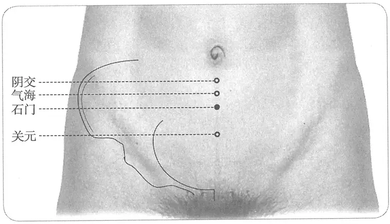

**图2-411　石门穴图**

　1. 在脐下二寸。（《黄帝明堂经》、《太平圣惠方》、《铜人腧穴针灸图经》、《圣济总录》、《针灸资生经》、《窦太师针经》、《十四经发挥》、《医学纲目》、《针灸聚英》、《医学入门》、《针灸大成》、《针方六集》、《类经图翼》、《循经考穴编》、《医宗金鉴·刺灸心法要诀》、《针灸易学》、《针灸逢源》）

　2. 在气海下一寸。（《千金翼方》卷二十六）

　3. 脐下二寸，曲骨上三寸。（《针灸十四经穴位考订》）

　4. 统编针灸学教材

　　(1) 部位：脐下二寸。取穴：从脐下二寸处取之。（1957年南京《针灸学》）

〔p.1328 (인쇄 1300)〕

　　(2) 部位：脐下二寸。取穴：仰卧，从关元穴上一寸取之。（1版《针灸学讲义》）

　　(3) 部位：脐下二寸。取穴：于腹部正中线上，曲骨上三寸，仰卧取之。（2版《针灸学讲义》）

　　(4) 脐下二寸。（4、5版《针灸学》）

　　(5) 在下腹部，前正中线上，当脐中下2寸。（6版《针灸学》）

　　(6) 前正中线上，脐下2寸。（7版《针灸学》）

　　(7) 在腹正中线上，脐下二寸。（《中国针灸学》）

**文献分析**：本穴定位，《千金翼方》作“气海下一寸”，这是因为该书气海穴定位有作“脐下一寸”，这样气海下一寸，仍然是“脐下二寸”，与诸书相合。

#### 【类属】 

任脉穴。三焦募穴。

任脉气所发。（《黄帝明堂经》）

#### 【适应症】 

主治前阴部、妇科病症。常用于疝气；小便不利，遗精，阳痿；妇人腹中包块，不孕，月经不调，产后恶露不尽；水肿，泄泻，腹痛。

　1. 主脐疝绕脐痛。三焦胀。水肿腹大，水胀，水气行皮中。心腹中卒痛而汗出。气癃，小便黄，气满，虚则遗溺，身时寒热，吐逆，溺难，腹满。疝积，乳余疾，绝子，阴痒。奔肫气上，腹㽲痛，口强不能言，茎肿先引腰，后引小腹，腰髋少腹坚痛，下引阴中，不得小便，两丸骞。（《黄帝明堂经》）

　2. 主不欲食，谷入不化。（《千金要方》卷三十）

　3. 主妇人气痛坚硬，产后恶露不止，遂成结块，崩中断绪。（《千金翼方》卷二十六、《太平圣惠方·针经》）

　4. 甄权云主妇人因产恶露不止。（《外台秘要》卷三十九）

　5. 主腹大坚，气淋，小便黄，身寒热，咳逆上气，呕吐血，卒疝。（《太平圣惠方·明堂》）

　6. 治腹胀坚硬，水肿支满，妇人因产恶露不止，遂结成块，崩中漏下。（《铜人腧穴针灸图经》卷中）

　7. 窦太师针灸遗存

　　(1) 治一切冷气疼，先泻后补。（《大本琼瑶神书》）

　　(2) 一切男妇老弱，下元虚冷。（《循经考穴编》下）

　8. 主伤寒，泄利不禁，阴囊入小腹，血淋，小腹皮敦敦然。（《针灸聚英》卷一、《针灸大成》）

　9. 一传欲绝产，灸脐下二寸三分，阴动脉中三壮。（《类经图翼》卷八）

**按**：此误解《太平圣惠方》原文。

　10. 《经神集》云久闭精不孕者，灸之又能使宣通而有孕也。（《循经考穴编》）

　11. 统编针灸学教材

　　(1) 癥瘕崩中，经闭，泄利不止，食谷不化，伤寒阴证，阴囊上缩，卒疝绕脐，小腹绞痛，水肿，气淋，血淋，产后恶露不止。（1957年南京《针灸学》）

　　(2) 经闭，崩中，产后恶露不止，癥瘕，淋证，疝气，阴囊上缩，少腹绞痛，水肿，泄利，水谷不化。（1版《针灸学讲义》）

　　(3) 崩漏，带下，经闭，产后出血，疝气，腹痛，泄泻，尿闭，遗尿，水肿。（2版《针灸学讲义》）

　　(4) 腹痛，水肿，疝气，小便不利，经闭，带下，崩漏，产后恶露不止。（4版《针灸学》）

〔p.1329 (인쇄 1301)〕

　　(5) 腹痛，水肿，疝气，小便不利，泄泻，经闭，带下，崩漏。（5、6版《针灸学》）

　　(6) ①腹胀，腹泻、痢疾，绕脐疼痛等肠腑病证；②奔豚气，疝气；③水肿，小便不利；④遗精，阳痿；⑤经闭，带下，崩漏，产后恶露不尽等妇科病证。（7版《针灸学》）

　　(7) 腹痛，泄泻，水肿，疝气，尿闭，遗尿，闭经，带下，崩漏，产后出血。（《中国针灸学》）

#### 附：临床应用举例 

　1. 前阴、肾系病症

　　(1) 阴证小便不利，必阴囊缩入小腹，痛欲死者，灸石门穴。（《伤寒治例》）

　　(2) 尿闭症：针刺石门配合加压治疗。［中国针灸，1984，4(5)：6］

　　(3) 小儿肾病综合征：石门穴、阳池穴，针刺治疗。［新疆中医药，1985(4)：38］

　　(4) 顽固性尿潴留：大巨穴、石门穴、中极穴，针刺治疗。［中国针灸，1986，6(6)：32］

　2. 妇人病症

　　(1) 凡妇人怀孕，不论月数及生产后未满百日，不宜灸之。若绝子，灸脐下二寸、三寸间动脉中三壮。（《太平圣惠方·明堂》）

　　(2) 内损真气，致任脉崩损，故血大下，卒不可止，如山崩之骤也。治宜阿胶汤、补宫丸……若势来太多，其人作晕，急灸石门穴，其血立止。（《扁鹊心书》卷下）

　　(3) 一贵人妻，为鬼所着，百法不效……余令服睡圣散三钱，灸巨阙穴五十壮，又灸石门穴一百壮至二百壮，病人开眼如故，服姜附汤、镇心丹，五日而愈。（《扁鹊心书》卷中）

　　(4) 小产出血过多，或早于房事，或早作劳动，致损真气，乃成虚劳，脉弦而紧，咳嗽发热，四肢常冷，或咯血吐血，灸石门穴三百壮，服延寿丹、金液丹……（《扁鹊心书》卷下）

　　(5) 不孕症：石门穴治疗。［针灸临床杂志，1995，11(5)：45］

　3. 其他病症

　　(1) 大便闭塞，气结心坚满，灸石门百壮。（《千金要方》卷十五）

**按**：“灸石门”，《千金翼方》同，《医心方》作“灸石关”，从主治病症看，“灸石关”是。

　　(2) 人中满唇肿及水肿大水，灸脐中、石门各百壮。（《千金翼方》卷二十八）

　　(3) 小儿秋深冷痢不止者，灸脐下二寸、三寸间动脉中三壮，炷如小麦大。（《太平圣惠方·明堂》）

　　(4) 单蛊胀：水分、石门、气海、中脘。问曰：此证缘何而得？答曰：因风寒暑湿串入脏腑，以致食物不能化，脾败胃虚，故如此也。复刺后穴：三里、脾俞、行间、内庭。（《针灸集成》第四十九方）

#### 【操作】 

直刺1~1.5寸；孕妇慎用。

　1. 刺入五分，留十呼，灸三壮，女子禁不可灸。（《黄帝明堂经》）

　2. 禁针，灸五十壮。但妇人无故，不可灸此穴。若灸，终身绝胎无子。（《窦太师针经》）

　3. 针二寸半，灸二七壮。男女无故不可灸，灸之永绝嗣。（《窦太师秘传》）

　4. 入二寸半，灸五十壮，妇人不可针灸此穴。（《大本琼瑶神书》）

　5. 针八分。孕妇禁针灸；古人说：妇人禁针灸。（《针灸十四经穴位考订》）

　6. 统编针灸学教材

　　(1) 针八分至寸余，灸七至十五壮。（1957年南京《针灸学》、1版《针灸学讲义》）

　　(2) 直刺5~10分；艾炷灸7~15壮，艾条灸5~15分钟。（2版《针灸学讲义》）

〔p.1330 (인쇄 1302)〕

　　(3) 直刺1~2寸。（4、5版《针灸学》）

　　(4) 直刺1~2寸；可灸。孕妇慎用。（6版《针灸学》）

　　(5) 直刺1~1.5寸；孕妇慎用。（7版《针灸学》）

　　(6) 直刺0.5~1寸。可灸。（《中国针灸学》）

### （六）气海 Qìhǎi CV6 出《黄帝明堂经》 

#### 【提要索隐】 

“气海”之名见于《灵枢》，然非指穴名，本穴别名“脖胦”见于《灵枢》，且用作穴名。

**穴名**：一名脖胦，一名下肓。

**定位**：在下腹部，脐中下1.5寸，前正中线上。

**适应症**：主治虚劳、前阴部、妇科病症。常用于虚脱，泄泻，虚劳羸瘦；疝气，腹痛；小便不利，遗尿，遗精，阳痿；月经不调，带下，子宫脱垂，恶露不尽。保健灸的常用穴。

**针刺操作**：直刺1~1.5寸，孕妇慎用。

#### 【名实考】 

　1. 肓之原，出于脖胦，脖胦一。（《灵枢·九针十二原》

　2. 气海，一名脖胦，一名下肓，在脐下一寸五分，任脉气所发。（《黄帝明堂经》）

　3. 杨上善注曰胦，脐也。（《医心方》卷二）

　4. 气海者，是男子生气之海也。（《铜人腧穴针灸图经》）

**按**：王执中注曰：此经以气海为生气之海，《难经疏》以为元气之海。则气海者，盖人之元气所生也。故柳公度曰：吾养生无它术，但不使元气佐喜怒，使气海常温尔。（《针灸资生经》卷一）

　5. 当为人身生气之海，人身之气生于此穴，而会于膻中。（《经穴解》）

　6. 别名：季胦、下气海。（1957年南京《针灸学》）

**按**：“季胦”系“孛胦”之形误；“下气海”见于马莳《黄帝内经灵枢注证发微》，与在上之“膻中”相对而言。

#### 【定位】 

**部位**：在下腹部，脐中下1.5寸，前正中线上（图2-412）。

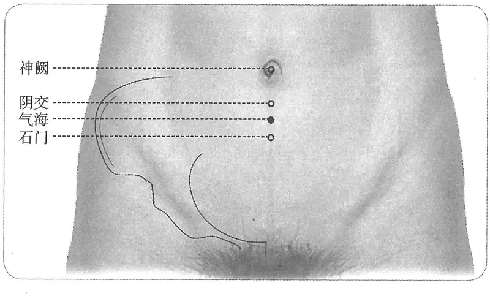

**图2-412　气海穴图**

〔p.1331 (인쇄 1303)〕

　1. 脐下一寸五分。（《黄帝明堂经》、《太平圣惠方》、《铜人腧穴针灸图经》、《圣济总录》、《针灸资生经》、《窦太师针经》、《针灸玉龙经》、《十四经发挥》、《医学纲目》、《针灸聚英》、《古今医统》、《医学入门》、《针灸大成》、《针方六集》、《类经图翼》、《循经考穴编》、《医宗金鉴·刺灸心法要诀》、《针灸易学》、《针灸逢源》）

　2. 在脐下一寸。（《千金要方》卷十六、《千金翼方》卷二十七、《太平圣惠方》卷五十五）

　3. 阴交下五分。（《铜人腧穴针灸图经》）

　4. 脐下一寸五分。（《针灸十四经穴位考订》）

　5. 统编针灸学教材

　　(1) 部位：脐下一寸五分。取穴：仰卧，从脐下一寸五分取之。（1957年南京《针灸学》）

　　(2) 部位：脐下一寸五分。取穴：仰卧，石门穴上五分取之。（1版《针灸学讲义》）

　　(3) 部位：脐下一寸五分。取穴：腹正中线上，当关元与神阙之间取之。（2版《针灸学讲义》）

　　(4) 脐下1.5寸。（4、5版《针灸学》）

　　(5) 在下腹部，前正中线上，当脐中下1.5寸。（6版《针灸学》）

　　(6) 前正中线上，脐下1.5寸。（7版《针灸学》）

　　(7) 在腹正中线上，脐下一寸五分。（《中国针灸学》）

**文献分析**：本穴定位，作“脐下一寸”者，与阴交穴定位相混，显然有误。

#### 【类属】 

任脉穴。肓之原穴。

任脉气所发。（《黄帝明堂经》）

#### 【适应症】 

保健要穴。主治虚劳、前阴部、妇科病症。常用于虚脱，泄泻，虚劳羸瘦；疝气，腹痛；小便不利，遗尿，遗精，阳痿；月经不调，带下，子宫脱垂，恶露不尽。保健灸的常用穴。

　1. 主少腹疝气游行五藏，腹中切痛，卧善惊。（《黄帝明堂经》）

　2. 甄权云主下热，小便赤，气痛状如刀搅。（《外台秘要》卷三十九）

　3. 主冷病，面黑，肌体羸瘦，四肢力弱，小腹气积聚，贲豚腹坚，脱阳欲死不知人，五脏气逆上攻也。（《太平圣惠方·明堂》）

　4. 治脐下冷气上冲，心下气结成块，状如覆杯，小便赤涩，妇人月事不调，带下崩中，因产恶露不止，绕脐疞痛。针入八分，得气即泻，泻后宜补之，可灸百壮。今附：气海者，是男子生气之海也，治脏虚惫，真气不足，一切气疾久不瘥，悉皆灸之，慎如常法。（《铜人腧穴针灸图经》卷中）

　5. 窦太师针灸遗存

　　(1) 治小腹胀，一切冷气痛，泻补；妇人气血损，补。血崩漏带下，赤者泻，白者补。（《窦太师针经》）

　　(2) 诸气病，皆先泻后补；妇人气血虚损，补。（《大本琼瑶神书》）

　　(3) 治诸般气疾，肚腹疼不住等症。（《窦太师秘传》）

　6. 主伤寒饮水过多，腹肿胀，气喘，心下痛，面赤，肌体羸瘦，四肢力弱，七疝，小肠、膀胱、肾余。癥瘕结块，状如覆杯，腹暴胀按之不下，脐下冷气痛，中恶，大便不通，卒心痛，妇人临经行房羸瘦，崩中，赤白带下，月事不调，产后恶露不止，闪着腰痛，小儿遗尿。（《针灸聚英》卷一）

〔p.1332 (인쇄 1304)〕

**按**：以上病症多辑自《针经摘英集》、《千金要方》针灸方主治，详见“附：临床应用举例”。“小肠、膀胱、肾余”后脱“疝气”二字。

　7. 一传治小肠气痛，伤寒腹痛，气胀，水鼓，黄肿，四时宜多灸。（《类经图翼》卷八）

　8. 统编针灸学教材

　　(1) 崩中，赤白带下，月事不调，恶露不止，伤寒绕脐冷痛，阴证卵缩脱阳，四肢厥冷，脏虚，真气不足，腰痛，疝痛，小儿遗尿，大便不通，肚痛，心痛，水肿，卒中虚脱。（1957年南京《针灸学》）

　　(2) 崩中，赤白带下，月经不调，恶露不止，睾丸上缩，小儿遗尿，大便不通，腰痛，疝痛，肚痛，绕脐冷痛，心痛，水肿，卒中虚脱，真气不足，五脏虚弱，四肢厥冷。（1版《针灸学讲义》）

　　(3) 崩漏，带下，阴挺，月经不调，经闭，产后出血，疝气，遗尿，尿闭，遗精，腹痛，泄泻，便秘，脱肛，水肿，喘证，中风脱证。（2版《针灸学》）

　　(4) 小腹痛，遗尿，遗精，疝气，泄利，崩漏，月经不调，阴挺，产后恶露不止，不孕，中风脱证。（4版《针灸学》）

　　(5) 主治腹痛，泄泻，便秘，遗尿，疝气，遗精，月经不调，经闭，虚脱。（5版《针灸学》）

　　(6) 腹痛，泄泻，便秘，遗尿，疝气，遗精，阳痿，月经不调，经闭，崩漏，虚脱，形体羸瘦（本穴有强壮作用，为保健要穴）。（6版《针灸学》）

　　(7) ①虚脱，形体羸瘦，脏气衰惫，乏力等气虚病证；②水谷不化，绕脐疼痛，腹泻，痢疾，便秘等肠腑病证；③小便不利；④遗尿；遗精，阳痿，疝气；⑤月经不调，痛经、经闭，崩漏，带下，阴挺，产后恶露不止，胞衣不下等妇科病证。（7版《针灸学》）

　　(8) 腹痛，遗尿，遗精，阳痿，疝气，水肿，泄泻，痢疾，崩漏，月经不调，痛经，闭经，带下，产后出血，便秘，中风脱证，气喘。（《中国针灸学》）

**文献分析**：《黄帝明堂经》载本穴主治为气逆上冲的病症，后世的治疗范围不断扩大，《铜人腧穴针灸图经》更是强调“气海者，是男子生气之海也，治脏虚惫，真气不足，一切气疾久不瘥，悉皆灸之”。

#### 附：临床应用举例 

　1. 妇人病症

　　(1) 妇人水泄痢，灸气海百壮，三报。（《千金要方》卷二）

　　(2) 癥瘕，灸内踝后宛宛中随年壮。又灸气海百壮。（《千金要方》卷十一）

　　(3) 治妇人产后，忽小腹胀如蛊，大小便不通：气海、三里、关元、三阴交、阴谷主之。（《医学纲目》卷二十三）

　　(4) 月经不调、痛经、带下：气海穴、三阴交穴，针灸治疗。［上海针灸杂志，1986，5(2)：20-22］

　　(5) 功能性子宫出血：关元穴、气海穴、三阴交穴，针刺治疗。［中医杂志，1987，28(4)：43-44］

　2. 虚劳病症

　　(1) 由于肾气虚寒，凝集下焦，服草神丹、灸气海穴自愈。（《扁鹊心书》卷中）

　　(2) 治男子脏气虚惫，真气不足，一切气疾久不瘥，不思饮食，全无气力，燔针针任脉气海一穴，针入五分，可灸百壮。次以毫针针足阳明经三里二穴。（《针经摘英集》）

〔p.1333 (인쇄 1305)〕

　　(3) 治肾与膀胱俱虚痼冷，灸肾俞、三阴交、气海，百壮愈妙。（《古今医统》卷二十二）

　3. 奔肫疝气

　　(1) 奔肫，灸气海百壮，穴在脐下一寸半。（《千金要方》卷十七）

　　(2) 治腹暴胀按之不下，刺任脉中脘、气海二穴，次针足阳明经三里二穴。（《针经摘英集》）

　　(3) 一切气逆气喘，肠鸣走注攻心：灸膻中，刺大陵、足三里俱泻之、内庭、气海。（《针灸集要·盘石金直刺秘传》）

　　(4) 腰连胯痛急必大，便于三里攻其隘。下针一泻三补之，气上攻噎只管在。噎不住时气海灸，定泻一时立便瘥。（《席弘赋》）

　　(5) 治男子元脏发动，脐下痛不可忍，刺任脉气海一穴，次针足太阴经三阴交二穴立愈。（《针经摘英集》）

　　(6) 治肾气外肾肿小肠气痛腹内虚鸣，灸风市穴五七壮，灸气海穴七壮，灸脐左右各去一寸半两穴各七壮。（《普济本事方续集》卷三）

　　(7) 治痃癖，小肠、膀胱、肾余、疝气等疾，刺任脉气海一穴。次针五区二穴，在气海两旁相去各三寸三分，一并三穴，燔针刺五分，可灸百壮即止。次以毫针刺足阳明经三里二穴，足太阴经三阴交二穴。（《针经摘英集》）

　　(8) 若是七疝小腹痛，照海阴交曲泉针，又不应时求气海，关元同泻效如神。（《席弘赋》）

　　(9) 奔豚气：气海穴、太冲穴，针灸疗法。［上海针灸杂志，1986，5(2)：37］

　4. 肾、膀胱病症

　　(1) 气海血海疗五淋，中脘下脘治腹坚。（《灵光赋》）

　　(2) 气海专能治五淋，更针三里随呼吸。（《席弘赋》）

　　(3) 精虫异常型男性不孕症：气海穴、三阴交穴，针刺治疗。［山东中医杂志，1984，5(1)：44］

　　(4) 遗尿症：关元穴、气海穴、中极穴，电针治疗。［湖北中医杂志，1985(6)：37］

　　(5) 尿潴留：关元穴、气海穴，针灸治疗。［河北中医，1986(1)：45］

　　(6) 阳痿：关元穴、气海穴、中极穴，针刺治疗。［中国针灸，1987(6)：53］

#### 【操作】 

直刺1~1.5寸，孕妇慎用。

　1. 刺入一寸二分，灸五壮。（《黄帝明堂经》）

　2. 针入八分，得气即泻，泻后宜补之，可灸百壮。（《铜人腧穴针灸图经》卷中）

　3. 窦太师针灸遗存

　　(1) 针入二寸半，灸五十壮。（《窦太师针经》）

　　(2) 针二寸半，灸二七壮。（《窦太师秘传》）

　4. 孕妇不可灸。（明刊本《外台秘要》卷三十九、《类经图翼》）

　5. 针八分至一寸，灸七至十五壮。孕妇禁针灸。（《针灸十四经穴位考订》）

　6. 统编针灸学教材

　　(1) 针八分至寸余，灸五至十五壮。（1957年南京《针灸学》、1版《针灸学讲义》）

　　(2) 直刺8~12分；艾炷灸5~15壮，艾条灸5~15分钟。（2版《针灸学讲义》）

　　(3) 直刺1~2寸。（4、5版《针灸学》）

　　(4) 直刺1~2寸；可灸。孕妇慎用。（6版《针灸学》）

〔p.1334 (인쇄 1306)〕

　　(5) 直刺1~1.5寸；多用灸法。孕妇慎用。（7版《针灸学》）

　　(6) 直刺0.5~1.2寸，本穴有强壮作用，为保健要穴。可灸。（《中国针灸学》）

　7. 向下斜刺2~3寸。感应：局部酸胀，并可向外生殖器扩散。灸3~7壮；温灸15~30分钟。注意：内为小肠，孕妇不宜刺灸。膀胱充盈时，不宜向下针刺过深。关元、中极同。（上海《针灸学》）

### （七）阴交 Yīnjiāo CV7 出《黄帝明堂经》 

#### 【提要索隐】 

**穴名**：一名少因，一名横户。

**定位**：在下腹部，脐中下1寸，前正中线上。

**适应症**：主治妇科、水液病症。常用于疝气、腹痛；月经不调，带下，不孕，产后诸症；水肿、小便不利。

**针刺操作**：直刺1~1.5寸。孕妇慎用。

#### 【名实考】 

需要特别注意的是，甄权针灸所述之“阴交”穴，其定位与会阴穴相近，而与本穴大不同，切不可相混。

　1. 阴交，一名少因，一名横户，在脐下一寸，任脉、阴冲之会。（《黄帝明堂经》）

　2. 以足少阴通冲脉自下而上，共会于此穴，故曰阴交。（《经穴解》）

**按**：《外台秘要》卷三十九引甄权云：“穴在阴茎下，附底宛宛中”，乃同名异穴。

#### 【定位】 

**部位**：在下腹部，脐中下1寸，前正中线上（图2-413）。

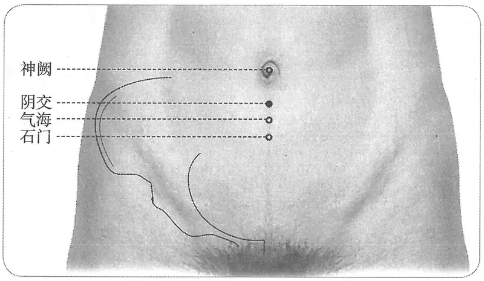

**图2-413　阴交穴图**

　1. 脐下一寸。（《黄帝明堂经》、《太平圣惠方》、《铜人腧穴针灸图经》、《圣济总录》、《针灸资生经》、《窦太师针经》、《十四经发挥》、《医学纲目》、《针灸聚英》、《针灸问对》、《古今医统》、《医学入门》、《针灸大成》、《针方六集》、《类经图翼》、《循经考穴编》、《医宗金鉴·刺灸心法要诀》、《针灸易学》、《针灸逢源》）

　2. 统编针灸学教材

　　(1) 仰卧，从脐下一寸取之。（1957年南京《针灸学》）

〔p.1335 (인쇄 1307)〕

　　(2) 部位：脐下一寸。取穴：仰卧，气海穴上五分取之。（1版《针灸学讲义》）

　　(3) 部位：脐下一寸。取穴：腹正中线上，石门与神阙之间取之。（2版《针灸学讲义》）

　　(4) 脐下一寸。（4、5版《针灸学》）

　　(5) 在下腹部，前正中线上，当脐中下1寸。（6版《针灸学》）

　　(6) 前正中线上，脐下1寸。（7版《针灸学》）

　　(7) 在腹正中线上，脐下一寸。（《中国针灸学》）

#### 【类属】 

任脉穴。

**脉气所发**：任脉、阴冲之会。（《黄帝明堂经》）

**归经**：任脉。（《外台秘要》卷三十九、《铜人腧穴针灸图经》卷上）

#### 【适应症】 

主治妇科、水液病症。常用于疝气、腹痛；月经不调，带下，不孕，产后诸症；水肿、小便不利。

　1. 主水胀，水气行皮中。阴疝引睾。惊不得眠，善痏，水气上下，五藏游气。女子手脚拘挛，腹满，疝，月水不下，乳余疾，绝子，阴痒。贲肫气上，腹䐜坚痛引阴中，不得小便，两丸骞。（《黄帝明堂经》）

　2. 主肠鸣濯濯如有水声。（《千金要方》卷三十）

　3. 主脐下热，小便赤，气痛，状如刀搅，作块状如覆杯，妇人断绪，月事不调，带下，崩中，因产后恶露不止，绕脐冷痛。（《太平圣惠方·针经》）

　4. 治脐下疞痛，寒疝引少腹痛，腰膝拘挛，腹满，女子月事不绝，带下，产后恶露不止，绕脐冷痛。（《铜人腧穴针灸图经》卷中）

　5. 若妇人断胎，灸三度，则有子。妇女下元虚损血结成块，看症补泻。（《窦太师针经》）

　6. 阴汗湿痒；鬼击，鼻出血；小儿陷囟。（《针灸聚英》卷一、《针灸大成》）

　7. 统编针灸学教材

　　(1) 崩漏带下，月经不调，阴痒，疝痛，绕脐冷痛，产后恶露不止。（1957年南京《针灸学》、1版《针灸学讲义》）

　　(2) 崩漏，带下，月经不调，阴痒，脐周围痛，疝气，产后出血。（2版《针灸学》）

　　(3) 腹满，水肿，疝气，经闭，崩漏，带下，阴痒，产后恶露不止。（4版《针灸学》）

　　(4) 腹痛，水肿，疝气，月经不调，带下。（5、6版《针灸学》）

　　(5) ①腹痛，疝气；②水肿，小便不利；③月经不调，崩漏，带下等妇科经带病证。（7版《针灸学》）

　　(6) 腹胀，水肿，疝气，月经不调，崩漏，带下，阴痒，产后出血，脐周痛。（《中国针灸学》）

**文献分析**：以上《窦太师针经》载本穴主治见于《太平圣惠方》、《铜人腧穴针灸图经》中极穴主治，现存其他窦太师针灸传本皆无此类文字，应是此本误辑；《针灸聚英》所辑三条主治皆系从《针灸资生经》一书转录：

　1. 中极、阴𫏋、腰尻交、阴交、曲泉主阴痒《千》。（《针灸资生经》卷三）

　2. 鬼击，鼻出血灸人中并水分、阴交见鬼击。（《针灸资生经》卷六）

　3. 小儿囟开不合，灸脐上下各五分二穴各三壮；灸疮未合囟先合矣《下》。（《针灸资生经》卷六）

**按**：以上第一条在“阴汗湿痒”篇，高武遂作如上改动；第二条主治症则根本不是“阴交”穴的主治，原书注明阴交穴的主治见于“鬼击”，而传世本已无是篇，高武的处理完全错误；第三条主治显然也不是阴交穴的主治，高武处理失误。

〔p.1336 (인쇄 1308)〕

#### 附：临床应用举例 

　1. 水肿气上下，灸阴交百壮。（《千金翼方》卷二十八）

　2. 小便闭不通，阴陵泉、阴谷、三阴交、气海、关元灸三十壮，刺二寸五分。不已，取下穴：太溪、阴交。（《医学纲目》卷十四）

　3. 经脉不通，变成瘕症，饮食如常，腹渐大如蛊，气海用针通管去其泻水恶物、阴交取法亦如上，去其恶物。（《医学纲目》卷三十四）

　4. 女人经水正行，头晕小腹痛，阴交一穴、内庭二穴、合谷二穴。（《针灸大全》卷四）

　5. 阴交阳别而定血晕，阴𫏋阳维而下胎衣。（《标幽赋》）

　6. 水病之疾最难熬，腹满虚胀不肯消，先灸水分并水道，后针三里及阴交。（《针灸玉龙歌》）

　7. 若是七疝小肠痛，照海阴交曲泉针。（《席弘赋》）

　8. 痹证，水分穴、天枢穴、阴交穴，针灸疗法。［中医杂志，1987，28(9)：50-51］

　9. 流行性出血热，大椎穴、阴交穴，灸法治疗。［中医临床，1988，9(2)：174-175］

　10. 泄泻，针刺阴交透气海治疗。［中国针灸，1998(6)：349］

#### 【操作】 

直刺1~1.5寸。孕妇慎用。

　1. 刺入八分，灸五壮。（《黄帝明堂经》）

　2. 阴交灸多绝孕。（《千金翼方》卷二十八）

　3. 针入二寸半，灸五十壮。（《窦太师针经》）

　4. 孕妇不可灸。（明刊本《外台秘要》、《类经图翼》）

　5. 针八分至一寸，灸七壮。孕妇禁针灸。（《针灸十四经穴位考订》）

　6. 统编针灸学教材

　　(1) 针八分至寸余，灸五至十五壮。（1957年南京《针灸学》、1版《针灸学讲义》）

　　(2) 直刺8~12分，艾条灸5~15分钟。（2版《针灸学讲义》）

　　(3) 直刺1~2寸。（4、5版《针灸学》）

　　(4) 直刺1~2寸；可灸。孕妇慎用。（6版《针灸学》）

　　(5) 直刺1~1.5寸。孕妇慎用。（7版《针灸学》）

　　(6) 直刺0.8~1.2寸。可灸。（《中国针灸学》）

### （八）神阙 Shénquè CV8 出《素问》 

#### 【提要索隐】 

**穴名**：一名脐中；一名气合。

**定位**：在脐区，脐中央。

**适应症**：主治腹部、水液病症。常用于脐周痛，腹胀，肠鸣，泄泻；水肿，小便不利；中风脱证。

**针刺操作**：临床多用灸法。

#### 【名实考】 

神阙，宋以前文献均作“脐中”，自宋代《铜人腧穴针灸图经》始改作“神阙”。明刊本《外台秘要》脐中穴下注有“神阙穴也，一名气舍”字样，而宋刊本无，当系宋以后人据《铜人腧穴针灸图经》所加之注文。又窦太师《标幽赋》曰“太子暴死为尸厥，越人针维会而得醒”，《窦太师针经》神阙穴下曰“又名维会穴”，明代吴崑据此将《标幽赋》句中“维会”注作“脐中”。然另一传本《窦太师针经》神阙穴下无“又名维会穴”，也未查及其他的旁证确认“维会”与“脐中”的关系，故暂不作本穴的别名。

〔p.1337 (인쇄 1309)〕

　1. 脐一穴。（《素问·气穴论》）

　2. 脐中，禁不可刺，刺之令人脐中恶疡，溃矢出者死不治。（《黄帝明堂经》）

　3. 神阙一穴，一名气合。当脐中是也。《铜人腧穴针灸图经》

　4. 脐中，神阙也，一名气舍。（明刊本《外台秘要》卷三十九）

　5. 神阙一穴，一名气合。在脐孔中是穴。禁针，灸一百壮。又名维会穴。（《窦太师针经》）

　6. 神阙，一名气舍。（《针灸聚英》卷一）

　7. 太子暴死为尸厥，越人针维会而得醒。吴崑注曰：太子，虢太子。越人，卢医秦越人也。史称，虢太子病尸厥，扁鹊为之刺三阳五会，有间，太子苏，则百会穴也，此云维会，则非百会。《针经》云：脐中，一名维会。谓扁鹊当时取此穴耳。盖人之生，尝以此穴受母之气，刺家能取此穴，调其厥逆，使之冲和，亦何嫌于刺哉！脐中为是，古之神良，固未尝以禁刺胶鼓也。（《针方六集·窦太师标幽赋》卷二）

**按**：此处所说“针经”即指《窦太师针经》。

　8. 此穴以名气舍，乃腹之中上下气所舍之地。名神阙者，以任脉上直乎心，心之所藏者神，此穴有隙焉，如王者宫门之有阙，故曰神阙。（《经穴解》）

#### 相关穴及刺激点 

**腹泻穴**：在任脉上，位于神阙穴下5分处，即气海穴上1寸（因对腹泻症的疗效显著，故暂名“腹泻穴”）。针刺3~8分深，采用补法，补留针。如针刺一次不愈者，可配足三里、天枢、中脘等穴。［针刺“腹泻穴”为主治疗腹泻55例．上海中医药杂志，1965(10)：23］

**按**：所述“腹泻穴”如果是脐心下五分处，则正当神阙穴处，其主治病症也是神阙的重点主治病症之一，故完全可视为同一穴。

#### 【定位】 

**部位**：在脐区，脐中央（图2-414）。

　1. 在脐中。（《黄帝明堂经》、《铜人腧穴针灸图经》、《圣济总录》、《十四经发挥》、《神应经》、《医学纲目》、《针灸聚英》、《针灸问对》、《古今医统》、《医学入门》、《针灸大成》、《针方六集》、《类经图翼》、《医宗金鉴·刺灸心法要诀》、《针灸易学》、《针

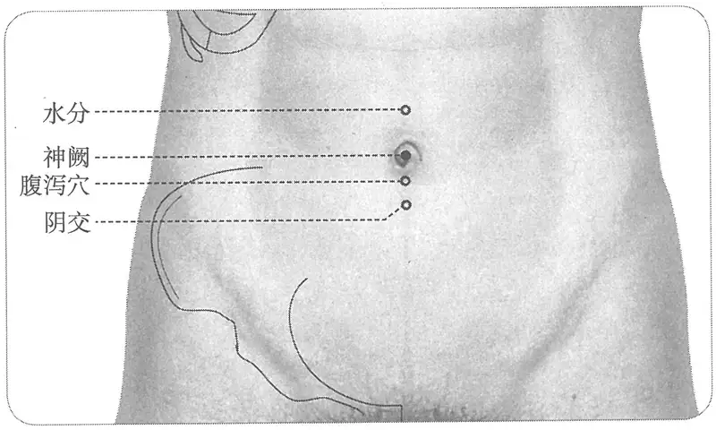

**图2-414　神阙穴与相关穴图**

〔p.1338 (인쇄 1310)〕

灸逢源》）

　2. 在脐孔中是穴。（《窦太师针经》）

　3. 脐孔中央。（《针灸十四经穴位考订》）

　4. 统编针灸学教材

　　(1) 部位：当脐正中央。取穴：仰卧，脐之正中取。（1957年南京《针灸学》）

　　(2) 当脐正中央。（1版《针灸学讲义》）

　　(3) 部位：脐中。取穴：在脐窝正中，仰卧取之。（2版《针灸学讲义》）

　　(4) 脐的中间。（4、5版《针灸学》）

　　(5) 在腹中部，脐中央。（6版《针灸学》）

　　(6) 脐窝中央。（7版《针灸学》、《中国针灸学》）

#### 【类属】 

任脉穴。

**归经**：任脉。（《外台秘要》卷三十九、《铜人腧穴针灸图经》卷上）

#### 【适应症】 

主治腹部、水液病症。常用于脐周痛，腹胀，肠鸣，泄泻；水肿，小便不利；中风脱证。

　1. 主水肿，大脐平腹，无理不治。绝子。脐疝绕脐痛，冲胸不得息。肠中常鸣，时上冲心。（《黄帝明堂经》）

　2. 甄权云主水肿臌胀，肠鸣，状如雷声时，上冲心口，灸七壮至四百壮。（《外台秘要》卷三十九）

　3. 治泄痢不止，小儿奶痢不绝，腹大绕脐痛，水肿，鼓胀，肠中鸣，状如流水声，久冷伤惫。（《铜人腧穴针灸图经》）

　4. 窦太师针灸遗存

　　(1) 治大便久泄，小便频数之。（《窦太师针经》）

　　(2) 主小便不通，大便久泄。（《循经考穴编》下）

　5. 主中风不苏，久冷伤败脏腑，泄利不止，脱肛，风痫，角弓反张。（《针灸聚英》卷一、《针灸大成》）

　6. 治腹中百病，诸般冷气，水肿，元气衰败，遗精不禁，梦鬼交。（《针灸穴法》）

　7. 统编针灸学教材

　　(1) 中风，尸厥，不省人事，肠鸣腹痛，泄利不止，脱肛，小儿乳利。（1957年南京《针灸学》、1版《针灸学讲义》）

　　(2) 中风脱证，肠鸣，腹痛，泄泻不止，脱肛。（2版《针灸学讲义》、《中国针灸学》）

　　(3) 腹痛肠鸣，水肿鼓胀，泄利脱肛，中风脱证。（4版《针灸学》）

　　(4) 腹痛，泄泻，脱肛，水肿，虚脱。（5、6版《针灸学》）

　　(5) ①虚脱、中风脱证等元阳暴脱；②腹痛、腹胀、腹泻、痢疾、便秘、脱肛等肠腑病证；③水肿、小便不利。（7版《针灸学》）

**文献分析**：《针灸聚英》载本穴主治“中风不苏，久冷伤败脏腑，泄利不止”，系辑自《针灸资生经》；“脱肛，风痫，角弓反张”条，乃高武从《针灸资生经》误录《太平圣惠方》百会穴主治。现代针灸学教材也在一定程度受高武失误的影响。

#### 附：临床应用举例 

　1. 脐腹胃肠病症

　　(1) 老人滑肠困重，乃阳气虚脱，小便不禁，灸神阙三百壮。（《扁鹊心书》卷上）

〔p.1339 (인쇄 1311)〕

　　(2) 虚劳人及老人与病后，大便不通，难服利药，灸神阙一百壮，自通。（《扁鹊心书》卷上）

　　(3) 久冷伤惫藏府，泄利不止，中风不省人事等，宜灸神阙。旧传有人年老而颜如童子者，盖每岁以鼠粪灸脐中一壮故也。予尝久患溏利，一夕灸三七壮，则次日不如厕，连数夕灸，则数日不如厕。足见经言主泄利不止之验也。又予年逾壮，觉左手足无力，偶灸此而愈。后见同官说中风人多灸此，或百壮或三五百壮皆愈。而经不言主中风，何也？（《针灸资生经》卷三）

　　(4) 予旧苦脐中疼，则欲溏泻，常以手中指按之，少止或正泻下亦按之，则不疼。它日，灸脐中遂不疼矣。后又当溏利不已，灸之则止。凡脐疼者宜灸神阙。（《针灸资生经》卷五）

　　(5) 急性菌痢：神阙穴、天枢穴，针刺拔火罐治疗。［中国针灸，1985，5(3)：44］

　　(6) 胆道术后腹胀：艾灸神阙、双天枢穴治疗。［中华护理杂志，1998，33(6)：349］

　　(7) 胃下垂：艾灸神阙、足三里治疗。［中国民间疗法，1999(12)：9］

　　(8) 急腹痛：针刺神阙治疗。［中国针灸，1999(8)：466-467］

　　(9) 肠激惹综合征：隔药灸神阙治疗。［针灸临床杂志，2000，16(7)：51］

　　(10) 围产期产妇腹泻：艾灸神阙治疗。［上海针灸杂志，2002，21(6)：43］

　2. 水液病症

　　(1) 遗尿症：神阙穴中药外敷。［中医杂志，1984，25(4)：59］

　　(2) 尿潴留：隔盐灸神阙为主治疗。［中医外治杂志，1995(1)：45］

　　(3) 腹水：神阙穴葱白合剂外敷治疗。［浙江中医杂志，1987，22(11)：497］

　3. 其他病症

　　(1) 急性腰痛：灸治神阙穴治疗。［上海针灸杂志，1988，7(4)：45］

　　(2) 荨麻疹：神阙穴火罐疗法治疗。［上海针灸杂志，1991，10(3)：21］

　　(3) 女子肾虚不孕症：药灸神阙治疗。［陕西中医，1993，14(6)：274］

　　(4) 新生儿破伤风：灸神阙、囟会为主治疗。［中国针灸，1999(12)：724］

#### 【操作】 

临床多用灸法。

　1. 禁不可刺，刺之令人脐中恶疡溃，矢出者，死不治，灸三壮。（《黄帝明堂经》）

　2. 禁针，灸一百壮。（《窦太师针经》）

　3. 禁针，灸三至三十壮。孕妇禁针灸。（《针灸十四经穴位考订》）

　4. 统编针灸学教材

　　(1) 此穴禁针，灸七至二、三百壮，灸时用盐填脐心上，置艾炷灸之，霍乱衰脱多灸，有回阳救急之功。（1957年南京《针灸学》）

　　(2) 禁针，灸可七至二、三百壮。回阳救急可隔盐灸之。（1版《针灸学讲义》）

　　(3) 禁针；大艾炷灸5~15壮，艾条灸5~15分钟。（2版《针灸学讲义》、4版《针灸学》）

　　(4) 因消毒不便，所以一般不针，多用艾条或艾炷隔盐灸。（5、6、7版《针灸学》）

　　(5) 禁针，可灸。（《中国针灸学》）

　5. 灸7~14壮（隔盐、隔姜灸）；温灸20~30分钟。禁针。（上海《针灸学》）

**文献分析**：关于本穴的刺灸法，古代文献多曰“禁针”，古代临床应用也多为灸法。若欲针刺，可参照相关穴及刺激点中“腹泻穴”刺法，于脐周上缘或下缘针刺。

〔p.1340 (인쇄 1312)〕

### （九）水分 Shuǐfēn CV9 出《黄帝明堂经》 

#### 【提要索隐】 

**穴名**：一名中守；一名分水。

**定位**：在上腹部，脐中上1寸，前正中线上。

**适应症**：主治腹部、水液病症。常用于腹痛、胀满坚硬、不思饮食；水肿，小便不利。

**针刺操作**：直刺1~1.5寸。

#### 【名实考】 

本穴下正当大小肠之会阑门处，所以分水谷也，故曰“水分”。

《千金要方》载“中守”穴与本穴为同一穴；“水分”，《太平圣惠方》又作“分水”，且书中“针经”、“明堂”、“小儿明堂”三篇皆同，故可排除二字误倒的可能性，《针灸资生经》归于本穴别名，今从之。

令人困惑的是，《医学纲目》载有“水分”一穴，定位与《黄帝明堂经》不同，然其主治又与窦太师针灸“水分”穴临床应用经验完全相同，因此在没有其他可靠旁证之前，无法排除传世本《医学纲目》文字脱、误的可能，暂不作为本穴的同名异穴。

　1. 水分，在下脘下一寸，脐上一寸，任脉气所发。（《黄帝明堂经》）

　2. 腹胀满，绕脐结痛坚，不能食，灸中守百壮。穴在脐上一寸，一名水分。（《千金要方》卷十六）

　3. 《修明堂诀式》云大小肠会为阑门，脐上一寸水分穴是也。（《铜人腧穴针灸图经》卷下）

　4. 水分穴，一名分水。能分水谷故也。（《针灸资生经》卷三）

　5. 水分，一名分水。穴在脐上一寸，内为阑门，正当小肠下口。凡饮食入胃，至是而泌别清浊，水液入膀胱，渣滓入大肠，故曰水分。（《循经考穴编》下）

　6. 此穴当小肠下口，小肠为受盛之官，至是而始泌别清浊，水液入膀胱，渣滓入大肠，故曰水分。（《经穴解》）

#### “水分”穴辨 

　1. 单蛊胀，气喘，水分，在分水旁各一寸半，针入二寸半，灸五十壮。（《医学纲目》卷二十四）

　2. 病称水肿实难调，腹胀膨脝不可消。先灸水分通水道，后针三里及阴交。注曰：水分：在脐上五分。灸五十壮，单腹胀宜泻；气满腹疼，先补后泻。（《针灸玉龙歌》）

　3. 水病之症最难熬，满腹膨煎不得消，先灸水分通水道，复针三里及阴交。吴崑注：水分，穴在脐上一寸。针入二寸半，可灸五十壮。单腹胀，宜泻；气满腹痛，先补后泻。（《针方六集·玉龙歌》卷六）

　4. 水分一穴，在下脘下一寸。又法：在脐上一寸，任脉气所发。针入二寸，水蛊病不可针，针则水尽死矣。腹胀，泻。馀症看虚实补泻。（《窦太师针经》）

　5. 单腹胀痛，双蛊腹胀：刺内庭，泻足三里；少愈，灸水分、中脘补之。（《针灸集要·盘石金直刺秘传》）

　6. 水蛊，四肢浮肿，泻支沟；腹上泻水分、行间、足三里，仍灸关元、三阴交。（《针灸集要·盘石金直刺秘传》）

**按**：《医学纲目》所述之“水分”穴，今人以其定位与《黄帝明堂经》不同而归入“奇穴类”，然而其主治及刺灸法与窦太师针灸的水分穴内容相同，因此暂不作为“水分”的同名异穴。另一个疑问：《四库全书》传本《针灸玉龙经》所载之“水分”定位作“脐上五分”，与诸书不合。

〔p.1341 (인쇄 1313)〕

#### 【定位】 

**部位**：在上腹部，脐中上1寸，前正中线上（图2-415）。

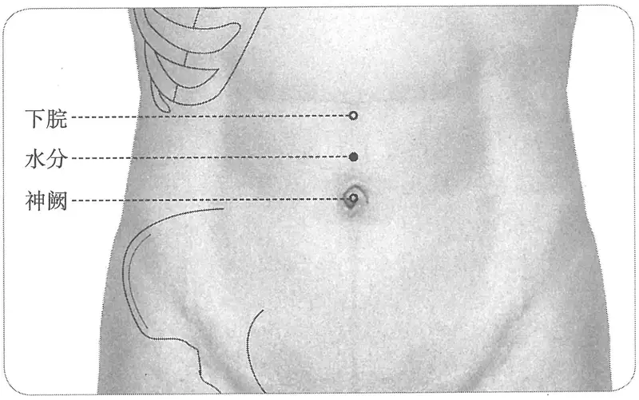

**图2-415　水分穴图**

　1. 在下脘下一寸，脐上一寸。（《黄帝明堂经》、《太平圣惠方》、《铜人腧穴针灸图经》、《圣济总录》、《针灸资生经》、《窦太师针经》、《十四经发挥》、《医学纲目》、《针灸聚英》、《古今医统》、《针灸大成》、《针方六集》、《类经图翼》、《循经考穴编》、《医宗金鉴·刺灸心法要诀》、《针灸易学》）

　2. 在下管下脐上一寸。（《千金翼方》卷二十六、《医心方》、《太平圣惠方》）

　3. 在下管下一寸陷者中。（《太平圣惠方·明堂》）

　4. 脐上五分。（《针灸玉龙歌》注）

　5. 鸠尾下六寸。（《医学入门》卷一）

　6. 脐上一寸。（《针灸十四经穴位考订》）

　7. 统编针灸学教材

　　(1) 部位：在下脘下一寸，脐上一寸。取穴：仰卧，脐上一寸取之。自胸部歧骨间直至脐心作八寸半计算之，上腹部诸穴分寸依此推算。（1957年南京《针灸学》）

　　(2) 部位：脐上一寸。取穴：仰卧，下脘穴下一寸取之。（1版《针灸学讲义》）

　　(3) 部位：在下脘下一寸，脐上一寸。取穴：于腹部正中线上，仰卧取之。（2版《针灸学讲义》）

　　(4) 在上腹部，前正中线上，当脐中上1寸。（6版《针灸学》）

　　(5) 脐上一寸。（4、5版《针灸学》）

　　(6) 脐正中线上，脐上1寸。（7版《针灸学》）

　　(7) 在腹正中线上，脐上一寸。（《中国针灸学》）

**文献分析**：关于本穴定位，《四库全书》本《针灸玉龙经》所载之“玉龙歌”注本穴定位作“脐上五分”，而现存其他传本《玉龙歌》皆作“脐上一寸”；《医学入门》作“鸠尾下六寸”，与“下脘下一寸”义同。

#### 【类属】 

任脉穴。

任脉气所发。（《黄帝明堂经》）

#### 【适应症】 

主治腹部、水液病症。常用于腹痛、胀满坚硬、不思饮食；水肿，小便不利。

〔p.1342 (인쇄 1314)〕

　1. 主痓，脊强里急，腹中拘急痛。（《黄帝明堂经》）

　2. 主水肿，胀满不能食，坚硬，灸日七壮至四百壮即止。（《千金翼方》卷二十八）

**按**：此条所述症状与肝硬化腹水类似。也即《灵枢·胀论》所述之“鼓胀”证：腹胀身皆大，大与肤胀等也，色苍黄，腹筋起，此其候也。

　3. 甄权云主水病腹肿。（《外台秘要》卷三十九）

　4. 主腹肿，不能食，肠坚腹痛，胃胀不调，坚硬……若是水病，灸之大良。（《太平圣惠方·针经》卷九十九）

　5. 主水病腹胀，绕脐痛冲胸中，不得息。甄权云：主水气浮肿，鼓胀，肠鸣，状如雷声，时上冲心。（《太平圣惠方·明堂》）

　6. 治腹坚如鼓，水肿肠鸣，胃虚胀不嗜食，绕脐痛，冲胸不得息。（《铜人腧穴针灸图经》卷中）

　7. 窦太师针灸遗存

　　(1) 腹胀，泻。余症看虚实补泻。（《窦太师针经》）

　　(2) 治腹胀气满。（《大本琼瑶神书》）

　　(3) 单腹胀宜泻；气满腹疼，先补后泻。（《针灸玉龙经》）

　　(4) 治男女血水蛊等症。（《窦太师秘传》）

　8. 主腰脊急强，鬼击，鼻出血，小儿陷囟。（《针灸聚英》卷一、《针灸大成》）

　9. 统编针灸学教材

　　(1) 肠鸣，绕脐痛，水肿，臌胀。（1957年南京《针灸学》、1版《针灸学讲义》）

　　(2) 肠鸣，泄泻，腹痛，水肿，小便不通，头面浮肿。（2版《针灸学》）

　　(3) 腹痛肠鸣，水肿鼓胀，小便不通，反胃吐食。（4版《针灸学》）

　　(4) 水肿，小便不通，腹痛，泄泻，翻胃吐食。（5、6版《针灸学》）

　　(5) 水肿，小便不利等水液输布失常病证；腹痛，腹泻，反胃吐食等胃肠病证。（7版《针灸学》）

　　(6) 腹痛肠鸣，水肿，小便不通，泄泻。（《中国针灸学》）

**文献分析**：《黄帝明堂经》载本穴主治为“痓”、“腹痛”，自初唐《千金翼方》所载本穴主治为“鼓胀”的典型症状，且所述治法颇详，唐以后文献也皆有阐发，其中《太平圣惠方》引甄权文还直接指明“鼓胀”的病名，“下脘”穴中也有明确的相关症状描述，值得重视。《灵枢》对于鼓胀的针灸治疗为“先泻其胀之血络，后调其经，刺去其血络也”，现代针灸临床多从肝、胆、胃经穴论治，对于腹部任脉穴此方面的作用尚未引起重视。现代针灸学教材除1版、4版教材外，其他教材似未注意本穴主治的这一特点。今重新表述。

#### 附：临床应用举例 

　1. 腹胀腹痛

　　(1) 腹胀满，绕脐结痛，坚不能食，灸中守百壮。穴在脐上一寸，一名水分。（《千金要方》卷十六、《千金翼方》）

　　(2) 水肿肠鸣，胃虚胀，不嗜食，绕脐痛，冲胸不得息者，水分主之。穴在下脘下一寸，神阙上一寸，任脉气所发。甄权云：日灸七壮，至四百壮止。（《圣济总录》卷一百九十二）

　　(3) 有老妇人患反胃，饮食至晚即吐出，见其气绕脐而转，予为点水分，气海并夹脐边两穴，他日只灸水分、气海即愈，神效。（《针灸资生经》卷三）

〔p.1343 (인쇄 1315)〕

　　(4) 单腹胀痛，双蛊腹胀：刺内庭，泻足三里；少愈，灸水分、中脘补之。（《针灸集要·盘石金直刺秘传》）

　　(5) 脐腹胀满，气不消化，天枢二穴、水分一穴、内庭二穴。（《针灸大全》卷四）

　　(6) 病称水肿实难调，腹胀膨脝不可消，先灸水分通水道，后针三里及阴交。（《针灸玉龙歌》）

　　(7) 肚腹浮肿胀膨膨，先针水分泻建里。（《长桑君天星秘诀歌》）

　2. 水肿、腹泄

　　(1) 身重，灸水分百壮，针入一寸补之。（《千金翼方》卷二十七）

　　(2) 小儿水气，四肢尽肿及腹大，灸脐上一寸三壮，炷如小麦大，分水穴也。（《太平圣惠方·明堂》）

　　(3) 水蛊，四肢浮肿：泻支沟；腹上泻水分、行间、足三里，仍灸关元、三阴交。（《针灸集要·盘石金直刺秘传》）

　　(4) 水蛊四肢浮肿：支沟泻、水分、关元。（《针灸玉龙经·盘石金直刺秘传》）

　　(5) 浑身浮肿生水：曲池、合谷、三里、三阴交、行间、内庭。问曰：此证缘何而得？答曰：皆因暴雨陵风，寒湿串于经络，或醉后、房事后乘凉恣快，致使肾经受虚败，故如此也。宜刺后穴：中脘、肾俞、水分。（《针灸集成》第四十七方）

　　(6) 劳宫医行身劳倦，水肿水分灸即安。（《灵光赋》）

　　(7) 水肿水分兼气海，皮内随针气自消。（《席弘赋》）

　　(8) 婴幼儿腹泻：针刺水分穴治疗。［承德医学院学报，1999，16(3)：250］

#### 【操作】 

直刺1~1.5寸。

　1. 刺入一寸，灸五壮。（《黄帝明堂经》）

　2. 灸日七壮，至四百即止；忌针，针水出尽即死。水病灸至瘥止。（《千金翼方》卷二十八）

　3. 针入八分，留三呼，泻五呼。若是水病，灸之大良，日灸七壮，至四百止。针入五分，留三呼。（《太平圣惠方·针经》）

　4. 针入八分，留三呼，泻五吸。若水病灸之大良，可灸七壮，至百壮止。禁不可针，针水尽即毙。（《铜人腧穴针灸图经》卷中）

　5. 《明堂》云若是水病，灸之大良，针入五分；而《铜人》云若是水病灸之大良，禁不可针，针水尽即毙。是又不可针矣，恐人但知《明堂》之可针，不知《铜人》不可针也，于是书之以示世医云。水分穴校之不针为是。（《针灸资生经》卷一）

　6. 水肿，惟得针水沟，若针余穴水尽即死，此《明堂》、《铜人》所戒也，庸医多为人针水分，杀人多矣。若其它穴亦有针得瘥者，特幸焉耳，不可为法也。或用药则禹余粮元为第一（见《既效方》），予屡见人服验，故书于此。然灸水分则最为要穴也，有里医为李生治水肿，以药饮之，久之不效，以受其延待之勤，一日忽为灸水分与气海穴，翌早观面如削矣。信乎水分之能治水肿也。《明堂》固云若是水病，灸大良，盖以此穴能分水不使妄行云焉耳，但不知《明堂》又云针四分者，岂治其他病当针四分耶？（《针灸资生经》卷四）

　7. 窦太师针灸遗存

　　(1) 针入二寸，水蛊病不可针，针则水尽死矣。（《窦太师针经》）

　　(2) 针入二寸半，可灸五十壮。单腹胀，宜泻；气满腹痛，先补后泻。（《针方六集·玉龙歌》卷六）

〔p.1344 (인쇄 1316)〕

　　(3) 针二寸半，灸二七壮。（《窦太师秘传》）

　8. 针五至八分，灸三至十五壮。水肿病禁针；孕妇五月以上禁针灸。（《针灸十四经穴位考订》）

　9. 统编针灸学教材

　　(1) 针五分至一寸，灸七至百余壮，肿胀病禁针。（1957年南京《针灸学》、1版《针灸学讲义》）

　　(2) 直刺5~10分；艾炷灸5~15壮，艾条灸5~15分钟。（2版《针灸学讲义》）

　　(3) 直刺1~2寸。（4、5版《针灸学》）

　　(4) 直刺1~2寸；可灸。（6版《针灸学》）

　　(5) 直刺1~1.5寸；水病多用灸法。（7版《针灸学》）

　　(6) 直刺0.5~1寸。可灸。（《中国针灸学》）

### （十）下脘 Xiàwǎn CV10 出《黄帝明堂经》 

#### 【提要索隐】 

**穴名**：一名下管。

**定位**：在上腹部，脐中上2寸，前正中线上。

**适应症**：主治腹部病症。常用于呕吐、食入即出；腹满、腹硬、腹中包块、不思饮食、消瘦。

**针刺操作**：直刺0.5~1.5寸。对肝脾肿大和胃、十二指肠溃疡患者，针刺方向以斜向下方刺为好。

#### 【名实考】 

胃，又称“胃管”，分为上、中、下三部，其上部为上管、中部为中管，下部为下管。所对应的穴位也以同名称之作“上管”，宋以后文献“管”作“脘”，故传世宋人校勘的《素问》、《灵枢》、《针灸甲乙经》皆作“脘”需要特别注意的是，“胃管”（或“胃脘”）既是部位名，也是穴名——中脘穴的别名，而不是上脘、中脘、下脘三穴的总称。

　1. 饮食不下，膈塞不通，邪在胃脘，在上脘则刺抑而下之，在下脘则散而去之。小腹痛肿，不得小便，邪在三焦约，取之太阳大络，视其络脉与厥阴小络结而血者，肿上及胃脘，取三里。（《灵枢·四时气》）

**按**：此段文字前一个“胃脘”是指胃，后一个“胃脘”应是穴名——中脘穴别名。

　2. 下脘，在建里下一寸，足太阴、任脉之会。（《黄帝明堂经》）

　3. 杨上善曰脘，胃府也。脘，音管也。（《黄帝内经太素·经脉连环》卷八）

　4. 杨上善曰脘，古缓反，胃腑也。下脘，胃下口也。（《黄帝内经太素·虚实所生》）

　5. 下脘一穴在建里下一寸。足太阴、任脉之会，为幽门。（《铜人腧穴针灸图经》卷上）

　6. 下脘一穴，亦名幽门。（《圣济总录》卷一九二）

**按**：《铜人腧穴针灸图经》原文“为幽门”是指下脘穴之下为幽门处，《圣济总录》误解《铜人腧穴针灸图经》之文错为本穴别名。

　7. 《二景图》曰胃下口，即小肠上口，下脘穴之分也。《修明堂诀式》云胃下口谓之贲门。《难经》曰太仓下口，为幽门者是也。（《循经考穴编》上）

　8. 下脘，穴在建里下一寸，脐上二寸，内为幽门，当胃下口，小肠上口，水谷于是入焉。（《循经考穴编》下）

〔p.1345 (인쇄 1317)〕

　9. 胃有三脘，此穴正当其内下脘……故曰。（《经穴解》）

#### 【定位】 

**部位**：在上腹部，脐中上2寸，前正中线上（图2-416）。

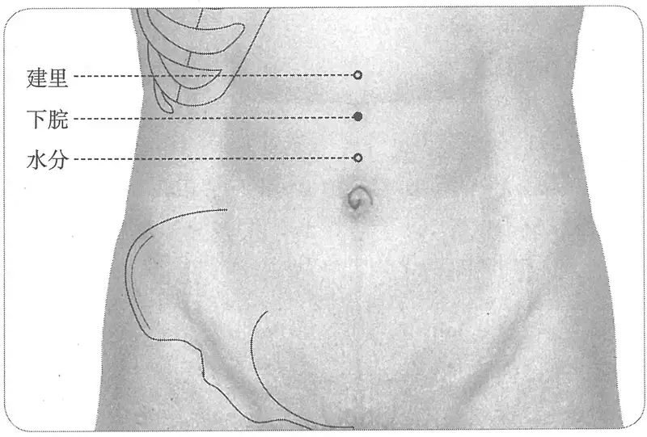

**图2-416　下脘穴图**

　1. 在建里下一寸。（《黄帝明堂经》、《铜人腧穴针灸图经》、《圣济总录》、《针灸资生经》、《十四经发挥》、《医学纲目》、《针灸聚英》、《古今医统》、《针灸大成》、《针方六集》、《针灸易学》）

　2. 下管一穴，在中管下二寸。（《太平圣惠方》卷五十五）

　3. 窦太师针灸遗存

　　(1) 在建里下一寸。又法：在脐上二寸。（《窦太师针经》）

　　(2) 在脐上二寸。（《窦太师秘传》）

　　(3) 在建里下一寸，脐上二寸。（《针方六集》）

　4. 尾下五寸下脘中。（《医学入门》卷一）

　5. 建里下一寸，脐上二寸。（《针灸聚英》卷一、《古今医统》、《针灸大成》、《类经图翼》、《循经考穴编》、《医宗金鉴·刺灸心法要诀》、《针灸易学》、《针灸逢源》）

　6. 脐上二寸。（《针灸十四经穴位考订》）

　7. 统编针灸学教材

　　(1) 部位：在建里下一寸，脐上二寸。取穴：仰卧，从脐上二寸取之。（1957年南京《针灸学》）

　　(2) 部位：脐上二寸。取穴：仰卧，建里穴下一寸取之。（1版《针灸学讲义》）

　　(3) 部位：在建里下一寸。取穴：脐上二寸，腹正中线上，仰卧取之。（2版《针灸学讲义》）

　　(4) 脐上二寸。（4、5版《针灸学》）

　　(5) 在上腹部，前正中线上，当脐中上2寸。（6版《针灸学》）

　　(6) 前正中线上，脐上2寸。（7版《针灸学》）

　　(7) 在腹正中线上，脐上二寸。（《中国针灸学》）

#### 【类属】 

任脉穴。

〔p.1346 (인쇄 1318)〕

**脉气所发**：足太阴、任脉之会。（《黄帝明堂经》）

**归经**：任脉。（《外台秘要》卷三十九、《铜人腧穴针灸图经》卷上）

#### 【适应症】 

主治腹部病症。常用于呕吐、食入即出；腹满、腹硬、腹中包块、不思饮食、消瘦。

　1. 主食饮不化，入腹还出。（《黄帝明堂经》）

**按**：此乃“气膈”证，又称“上膈”，《灵枢·上膈》论之甚详。杨上善注曰：“六腑水气使谷不化，故令食还出”。（转引自《医心方》卷二）

　2. 主六腑之谷气不转。甄权云：主小便赤，腹坚硬。（《外台秘要》卷三十九）

**按**：“六腑之谷气不转”乃杨上善对《明堂经》“食饮不化，入腹还出”的注文，王焘不察而录作正文。

　3. 主腹胃不调，腹内痛不能食，小便赤，腹坚硬癖块，脉厥厥动。（《太平圣惠方·针经》）

**按**：此与同书“水分”穴主治极相近。

　4. 治腹痛，六腑之气寒，谷不转，不嗜食，小便赤，腹坚硬癖块，脐上厥气动，日渐羸瘦。（《铜人腧穴针灸图经》卷中）

　5. 窦太师针灸遗存

　　(1) 治单蛊胀。余症同中脘穴治病。（《窦太师针经》）

　　(2) 治男妇气血凝滞不调，心腹满闷。（《窦太师秘传》）

　6. 统编针灸学教材

　　(1) 胃胀，腹痛，肠鸣，六腑寒气，完谷不化，呕吐不嗜食。（1957年南京《针灸学》、1版《针灸学讲义》）

　　(2) 胃痛，腹胀，痢疾，肠鸣，呕吐，脾胃虚弱。（2版《针灸学讲义》）

　　(3) 腹痛肠鸣，食饮不化，呕吐反胃，脾胃虚弱。（4版《针灸学》）

　　(4) 腹痛，腹胀，泄泻，呕吐，食谷不化，痞块。（5、6版《针灸学》）

　　(5) ①腹痛，腹胀，腹泻，呕吐，食谷不化，小儿疳积等脾胃病证；②痞块。（7版《针灸学》）

　　(6) 胃脘痛，腹痛，肠鸣，饮食不化，呕吐，泄泻。（《中国针灸学》）

**文献分析**：《黄帝明堂经》所载本穴主治为“气隔”（又称“上膈”），详见《灵枢·上膈》。而《太平圣惠方》所载之病症则是对下腹部肿瘤的非常形象的描述。正常人用力深按可触及深部腹主动脉的轻弱搏动（胖人则很难触及），如果下腹部肿瘤正对腹主动脉，由于肿瘤的介导，不仅可以很容易地触及腹主动脉的明显搏动，甚至可从腹表看到脉的跳动。对于这种现象，《黄帝明堂经》也有非常形象的描述。

现代针灸教材所述本穴主治“六腑寒气，完谷不化”症乃承袭王焘之误，将杨上善注文误置于此。今去之。

#### 附：临床应用举例 

　1. 凡食饮不化，入腹还出，先取下院，后取三里泻之。（《千金要方》卷三十）

　2. 吐食不化，上脘、中脘、下脘。（《医学纲目》卷二十二）

　3. 治喉肿厥逆。五脏所苦，鼓胀。灸下脘各五十壮。老人加之。小儿随年壮。（《普济方》卷四百一十九）

　4. 女人血分，单腹气喘，下脘一穴、膻中一穴、气海一穴、三里二穴、行间二穴。（《针灸大全》卷四）

　5. 中脘下脘治腹坚。（《灵光赋》）

〔p.1347 (인쇄 1319)〕

　6. 外伤性截瘫，关元穴、气海穴、下脘穴，针灸疗法。［中国针灸，1985，5(5)：3-4］

　7. 胃不完全性扭转，下脘穴、中脘穴，针刺治愈。［安徽中医学院学报，1985(4)：42］

　8. 细菌性痢疾：关元穴、天枢穴、下脘穴，针灸治疗。［中国针灸，1987(4)：3-6］

　9. 呃逆，下脘穴、鸠尾穴，针刺治疗。［河北中医，1987(3)：30］

#### 【操作】 

直刺0.5~1.5寸。对肝脾肿大和胃、十二指肠溃疡患者，针刺方向以斜向下方刺为好。

　1. 刺入一寸，灸五壮。（《黄帝明堂经》）

　2. 针入八分，留三呼，泻五吸。灸亦良，日灸二七壮，至二百罢。（《太平圣惠方·针经》）

　3. 窦太师针灸遗存

　　(1) 针入二寸半，灸五十壮。（《窦太师针经》、《针方六集》）

　　(2) 针二寸半。灸二七壮。（《窦太师秘传》）

　4. 针五至八分，灸三至十五壮。孕妇五月以上禁针灸。（《针灸十四经穴位考订》）

　5. 统编针灸学教材

　　(1) 针八分至寸余，灸五至十五壮。（1957年南京《针灸学》、1版《针灸学讲义》）

　　(2) 直刺8~12分，艾条灸5~15分钟。（2版《针灸学讲义》）

　　(3) 直刺1~2寸。（4、5、6版《针灸学》）

　　(4) 直刺1~1.5寸。（7版《针灸学》）

　　(5) 直刺0.5~1.2寸。可灸。（《中国针灸学》）

### （十一）建里 Jiànlǐ CV11 出《黄帝明堂经》 

#### 【提要索隐】 

**定位**：在上腹部，脐中上3寸，前正中线上。

**适应症**：主治腹部病症。常用于胃脘痛，呕吐，不思饮食；腹胀，腹痛，肠鸣；身肿。

**针刺操作**：直刺0.5~1.5寸。对肝脾肿大和胃、十二指肠溃疡患者，针刺方向以斜向下方刺为宜。

#### 【名实考】 

里者，土也，厚之之义。以内所当者，正在胃中脘之下，恐其弱也，故命建里。（《经穴解》）

#### 【定位】 

**部位**：在上腹部，脐中上3寸，前正中线上（图2-417）。

　1. 在中脘下一寸。（《黄帝明堂经》、《太平圣惠方》、《铜人腧穴针灸图经》、《圣济总录》、《针灸资生经》、《十四经发挥》）

　2. 窦太师针灸遗存

　　(1) 在中脘下一寸。又法：在脐上三寸。（《窦太师针经》）

　　(2) 在脐上三寸。（《窦太师秘传》）

　3. 鸠尾下四寸。（《医学入门》卷一）

　4. 在中脘下一寸，脐上三寸。（《针灸聚英》卷一、《古今医统》、《针灸大成》、《针方六集》、《类经图翼》、《循经考穴编》、《针灸易学》、《针灸逢源》）

　5. 脐上三寸。（《针灸十四经穴位考订》）

〔p.1348 (인쇄 1320)〕

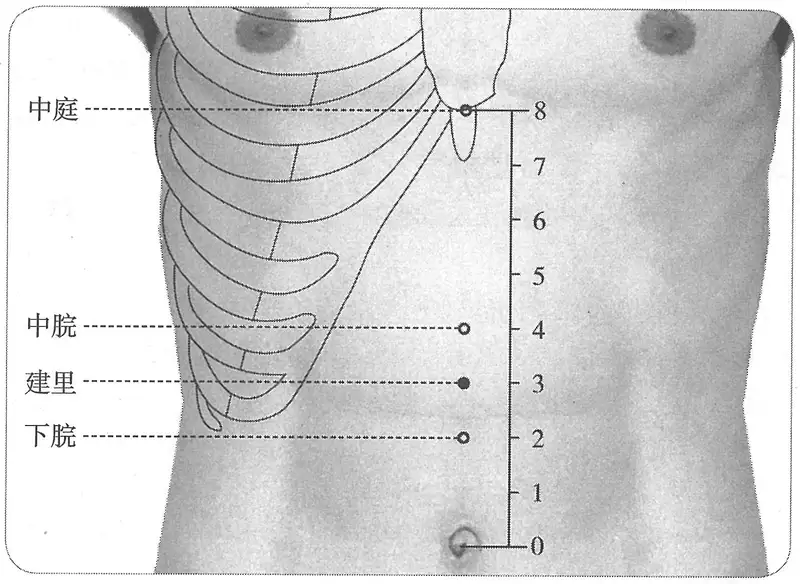

**图2-417　建里穴图**

　6. 统编针灸学教材

　　(1) 部位：中脘下一寸脐上三寸。取穴：仰卧，从脐上三寸取之。（1957年南京《针灸学》）

　　(2) 部位：脐上三寸。取穴：仰卧，中脘穴下一寸取之。（1版《针灸学讲义》）

　　(3) 部位：在中脘下一寸。取穴：脐上三寸，腹正中线上，仰卧取之。（2版《针灸学讲义》）

　　(4) 脐上3寸。（4、5版《针灸学》）

　　(5) 在上腹部，前正中线上，当脐中上3寸。（6、7版《针灸学》，《中国针灸学》）

**文献分析**：本穴定位，《千金翼方》作“脐上四指”，《医学入门》“鸠尾下四寸”，与“脐上三寸”义同。

#### 【类属】 

任脉穴。

**归经**：任脉。（《外台秘要》卷三十九、《铜人腧穴针灸图经》卷上）

#### 【适应症】 

主治腹部病症。常用于胃脘痛，呕吐，不思饮食；腹胀，腹痛，肠鸣；身肿。

　1. 主心痛上抢心，不欲食，支痛斥膈。（《黄帝明堂经》）

　2. 霍乱肠鸣，腹痛胀满，弦急上气。（《千金翼方》卷二十七）

　3. 甄权云主腹胀，逆气上，并霍乱。（《外台秘要》卷三十九）

　4. 治肠中疼痛，呕逆上气，心痛，身肿。（《太平圣惠方·针经》）

　5. 治心下痛不欲食，呕逆上气，腹胀身肿。（《铜人腧穴针灸图经》卷中）

　6. 治蛊胀，气喘急，脐腹疼痛，看症补泻。（《窦太师针经》）

　7. 统编针灸学教材

　　(1) 呕逆，不思食，腹胀，身肿，肠中痛。（1957年南京《针灸学》）

　　(2) 呕吐，不思食，腹胀，腹痛，身肿。（1版《针灸学讲义》）

　　(3) 胃痛，呕吐，食欲不振，腹胀，水肿。（2版《针灸学讲义》，5、6版《针灸学》）

　　(4) 胃痛，呕吐，腹胀，肠鸣，水肿，食欲不振。（4版《针灸学》、《中国针灸学》）

　　(5) ①胃痛，呕吐，食欲不振，腹胀，腹痛等脾胃病症；②水肿。（7版《针灸学》）

〔p.1349 (인쇄 1321)〕

#### 附：临床应用举例 

　1. 治瘕癖，又灸脐上四指五十壮。（《千金翼方》卷二十七）

　2. 癖块，针中脘、建里、石关、商曲。（《杂病治例》）

　3. 肚腹浮肿胀膨膨，先针水分泻建里。（《长桑君天星秘诀歌》）

　4. 小儿腹泻，建里穴、中脘穴，针刺治疗。［中医杂志，1985，26(4)：51］

#### 【操作】 

直刺0.5~1.5寸。对肝脾肿大和胃、十二指肠溃疡患者，针刺方向以斜向下方刺为宜。

　1. 刺入五分，留十呼，灸五壮。（《黄帝明堂经》）

　2. 通灸，针入一寸二分。（《太平圣惠方·针经》）

　3. 窦太师针灸遗存

　　(1) 针入二寸半，灸五十壮。（《窦太师针经》、《针方六集》）

　　(2) 针二寸半，灸二七壮。（《窦太师秘传》）

　4. 针六分，禁灸。（《医学入门》卷一）

　5. 一云宜针不宜灸，孕妇尤忌之。（《类经图翼》卷八）

　6. 针五至八分，灸三至十五壮。孕妇五月以上禁针灸。（《针灸十四经穴位考订》）

　7. 统编针灸学教材

　　(1) 针八分至一寸，灸五至十五壮。（1957年南京《针灸学》、1版《针灸学讲义》）

　　(2) 直刺8~12分，艾条灸5~15分钟。（2版《针灸学讲义》）

　　(3) 直刺1~2寸。（4、5、6版《针灸学》）

　　(4) 直刺1~1.5寸。（7版《针灸学》）

　　(5) 直刺0.5~1.2寸。可灸。（《中国针灸学》）

