# 《针灸腧穴通考》(下册) — 任脉穴 (2/2) · （十二）中脘 Zhōngwǎn CV12 出《黄帝明堂经》~（二十四）承浆 Chéngjiāng CV24 出《黄帝明堂经》

> 분할본 24/25. 원서: 黄龙祥·黄幼民 编著, 《针灸腧穴通考——〈中华针灸穴典〉研究》(下册), 人民卫生出版社, 2011. 원서 스캔 OCR 판독본을 챗봇 검색용으로 나눈 것이며, 본문과 쪽 표시 〔p.PDF쪽 (인쇄 쪽)〕는 원본 그대로이다.

## 十四、任脉穴 (계속)

### （十二）中脘 Zhōngwǎn CV12 出《黄帝明堂经》 

> **(12) 중완(中脘) Zhōngwǎn (CV12) — 『황제명당경(黃帝明堂經)』에 처음 보임**

#### 【提要索隐】 

> **【요점 정리(提要索隱)】**

“太仓”、“胃管”（胃脘）之名皆见于《内经》，但前者是指胃，而非穴名；后者似穴名，但不能确认是否与《黄帝明堂经》所载之“中脘”穴相同。

> “태창(太倉)”과 “위관(胃管)”（위완(胃脘)）이라는 이름은 모두 『내경(內經)』에 보이지만, 앞의 것은 위(胃)를 가리키지 혈 이름이 아니고, 뒤의 것은 혈 이름인 듯하지만 『황제명당경』에 실린 “중완” 혈과 같은 것인지는 확인할 수 없다.

**穴名**：一名太仓；一名中管；一名胃管。

> **혈명**: 일명 태창, 일명 중관(中管), 일명 위관.

**定位**：在上腹部，脐中上4寸，前正中线上。

> **위치**: 상복부, 배꼽 중심[臍中] 위 4촌, 앞정중선 위에 있다.

**适应症**：常用于胃脘痛，腹胀，腹中包块，泄泻，便秘，不思饮食，呕吐；黄疸。

> **적응증**: 위완통(胃脘痛), 복창(腹脹), 뱃속의 덩어리[腹中包塊], 설사, 변비, 식욕 부진[不思飮食], 구토, 황달(黃疸)에 자주 쓴다.

**针刺操作**：直刺0.5~1.5寸。对肝脾肿大和胃、十二指肠溃疡患者，不宜向左右侧上方透刺。

> **자침 조작**: 직자(直刺) 0.5~1.5촌. 간·비장이 부은[肝脾腫大] 환자와 위·십이지장 궤양 환자에게는 좌우 옆 위쪽을 향해 투자(透刺)하지 않는 것이 좋다.

#### 【名实考】 

> **【이름과 실체 고증(名實考)】**

胃之上、中、下三部分别称作“上脘”、“中脘”、“下脘”，本穴正当中脘部，故名“中脘”。胃，又名“太仓”，又名“胃管”，故本穴又名“太仓”，又名“胃管”。

> 위의 위·가운데·아래 세 부분을 각각 “상완(上脘)”·“중완”·“하완(下脘)”이라 하는데, 이 혈이 바로 중완 부위에 있으므로 “중완”이라 하였다. 위는 “태창”이라고도 하고 “위관”이라고도 하므로, 이 혈도 “태창”이라고도 하고 “위관”이라고도 한다.

在宋以前文献中，“中脘”皆作“中管”，宋代王惟一编《铜人腧穴针灸图经》将其统一改作“中脘”，与宋代校正医书局校改宋以前古医籍的做法相同——将“胃管”、“中管”等词语中之“管”字皆改作“脘”。只是当时读音相同，皆读作“guǎn”。

> 송(宋) 이전 문헌에서는 “중완”을 모두 “중관”으로 썼는데, 송대 왕유일(王惟一)이 엮은 『동인수혈침구도경(銅人腧穴鍼灸圖經)』에서 이를 “중완”으로 통일해 고쳤다. 이는 송대 교정의서국(校正醫書局)이 송 이전 옛 의서를 교정하면서 “위관”·“중관” 등의 낱말에 든 “관(管)” 자를 모두 “완(脘)”으로 고친 방식과 같다. 다만 당시에는 독음이 같아 모두 “guǎn”으로 읽었다.

需要特别注意的是，“胃管”既是部位名，又是穴名，需注意鉴别，切不可相混。例如《脉经》“寸口脉数，即为吐，以有热在胃管熏胸中，宜服药吐之，及针胃管”，前一个“胃管”是指部位，后一个为穴名。又穴名“胃管下输”中之“胃管”也是指部位。

> 특히 주의할 것은 “위관”이 부위 이름이기도 하고 혈 이름이기도 하므로 반드시 가려서 혼동하지 말아야 한다는 점이다. 예를 들어 『맥경(脈經)』의 “촌구맥이 삭(數)하면 토하니, 열이 위관에 있어 가슴속을 훈증하기 때문이다. 약을 먹여 토하게 하고, 아울러 위관에 침을 놓아야 한다.”에서 앞의 “위관”은 부위를, 뒤의 것은 혈 이름을 가리킨다. 또 혈 이름 “위관하수(胃管下輸)”의 “위관”도 부위를 가리킨다.

〔p.1350 (인쇄 1322)〕

　1. 胃者，太仓也。（《灵枢·胀论》

> 1. 위는 태창이다.（『영추(靈樞)』 「창론(脹論)」）

　2. 上纪者，胃脘也。王冰注曰：谓中脘也。中脘者，胃募也。（《素问·气穴论》）

> 2. 상기(上紀)는 위완이다. 왕빙(王冰)의 주(注)에서 “중완을 말한다. 중완은 위의 모혈(募穴)이다.”라고 하였다.（『소문(素問)』 「기혈론(氣穴論)」）

**按**：此处“胃脘”，据上下文应指穴名，但不能确认此“胃脘”是否就是中脘穴的别名“胃脘”。

> **안(按)**: 여기의 “위완”은 앞뒤 문맥으로 보아 혈 이름을 가리킨다고 보아야 하지만, 이 “위완”이 곧 중완혈의 별명 “위완”인지는 확인할 수 없다.

　3. 中脘，一名太仓，胃募也。在上脘下一寸，居心蔽骨与脐之中。手太阳、少阳、足阳明所生，任脉之会。（《黄帝明堂经》）

> 3. 중완은 일명 태창이며, 위의 모혈이다. 상완 아래 1촌, 심폐골(心蔽骨)과 배꼽의 한가운데 있다. 수태양(手太陽)·수소양(手少陽)·족양명(足陽明)이 나오는 곳[所生]이며, 임맥(任脈)과 만나는 곳이다.（『황제명당경』）

　4. 吕广撰《募腧经》云太仓在脐上三寸，非也。（《针灸甲乙经》卷三注）

> 4. 여광(呂廣)이 지은 『모수경(募腧經)』에서 태창이 배꼽 위 3촌에 있다고 하였는데, 옳지 않다.（『침구갑을경(鍼灸甲乙經)』 권3 주）

**按**：《募腧经》这一说法在后世文献中仍有所反映，例如《千金要方》卷十七曰：“太仓在脐上三寸，一夫是也”。

> **안(按)**: 『모수경』의 이 설은 후대 문헌에도 여전히 반영되어 있다. 예를 들어 『천금요방(千金要方)』 권17에서 “태창은 배꼽 위 3촌에 있으니, 1부(一夫)가 그것이다.”라고 하였다.

　5. 此穴在任之中行，而实为在内胃之中脘，乃胃气所结之地，故曰胃募。（《经穴解》）

> 5. 이 혈은 임맥의 중행(中行)에 있으나 실은 안에 있는 위의 중완 자리로, 위기(胃氣)가 맺히는 곳이므로 위의 모혈이라 한다.（『경혈해(經穴解)』）

#### “胃管”与“中管”穴辨 

> **“위관”과 “중관” 혈 변별(“胃管”與“中管”穴辨)**

《太平圣惠方》卷五十五“中管”与“胃管”是作为两个不同的穴辑录：

> 『태평성혜방(太平聖惠方)』 권55에서는 “중관”과 “위관”을 서로 다른 두 혈로 수록하였다.

　1. 中管一穴，在上管下一寸；胃管一穴，在鸠尾下四寸；阴都二穴，在胃管两旁各一寸半。（《太平圣惠方》卷五十五）

> 1. 중관 1혈은 상관(上管) 아래 1촌에 있다. 위관 1혈은 구미(鳩尾) 아래 4촌에 있다. 음도(陰都) 2혈은 위관 양옆으로 각 1촌 반에 있다.（『태평성혜방』 권55）

**按**：既然阴都穴在“胃管”旁，则胃管穴只能理解为中脘穴。之所以该书编者将“胃管”与“中脘”理解为两个不同的穴，很可能是二穴所出不同，胃管穴的“鸠尾下四寸”中之“鸠尾”是骨名，而不是穴名，抄录者不察而误作穴名，故视为二穴。以下大量证据表明：“胃管”即中脘穴的别名。

> **안(按)**: 음도혈이 “위관” 옆에 있다고 했으니 위관혈은 중완혈로밖에 이해할 수 없다. 이 책의 편자가 “위관”과 “중완”을 서로 다른 두 혈로 본 까닭은 아마 두 혈의 출처가 달랐기 때문일 것이다. 위관혈의 “구미 아래 4촌”에서 “구미”는 뼈 이름이지 혈 이름이 아닌데, 베껴 쓴 사람이 이를 살피지 못하고 혈 이름으로 잘못 알았으므로 두 혈로 본 것이다. 다음의 많은 증거가 “위관”이 곧 중완혈의 별명임을 보여 준다.

　2. 伤寒初得一二日，但列火灸心下三处，第一处去心下一寸，名巨阙，第二处去心下二寸，名上管，第三处去心下三寸，名胃管，各灸五十壮，然或人形大小不同，恐寸数有异，可绳度，随其长短寸数最佳取绳从心头骨名鸠尾头度，取脐孔，中屈绳取半，当绳头名胃管。又中屈半绳更分为二分，从胃管向上度一分即是上管，又上度取一分即是巨阙。（《千金要方》卷九）

> 2. 상한(傷寒)에 걸린 지 1~2일이면 명치 아래 세 곳에 나란히 뜸을 뜨기만 한다. 첫째 곳은 명치 아래 1촌으로 거궐(巨闕)이라 하고, 둘째 곳은 명치 아래 2촌으로 상관이라 하며, 셋째 곳은 명치 아래 3촌으로 위관이라 한다. 각각 뜸 50장을 뜬다. 그러나 사람마다 몸의 크기가 달라 촌수가 다를 수 있으니 끈으로 재되, 그 길이에 따라 촌수를 정하는 것이 가장 좋다. 끈을 가지고 구미두(鳩尾頭)라 하는 명치뼈 끝에서 배꼽 구멍까지 재어, 끈을 가운데서 접어 절반을 취하면 끈 끝이 닿는 곳이 위관이다. 다시 절반 끈을 가운데서 접어 두 몫으로 나누어, 위관에서 위로 한 몫을 재면 상관이고, 또 위로 한 몫을 재면 거궐이다.（『천금요방』 권9）

　3. 积聚坚大如盘，冷胀，灸胃管二百壮，三报之，穴在巨阙下二寸。（《千金要方》卷十一）

> 3. 적취(積聚)가 소반만큼 단단하고 크며 차갑고 부을 때는 위관에 뜸 200장을 뜨고 세 번 거듭 뜬다[三報之]. 혈은 거궐 아래 2촌에 있다.（『천금요방』 권11）

　4. 胀满气聚寒冷，灸胃脘百壮，三报。穴在鸠尾下三寸。（《千金要方》卷十六）

> 4. 창만(脹滿)하고 기가 뭉치며 차가울 때는 위완에 뜸 100장을 뜨고 세 번 거듭 뜬다. 혈은 구미 아래 3촌에 있다.（『천금요방』 권16）

胃管、三焦俞，主少腹积聚，坚大如盘，胃胀，食饮不消。（《千金要方》卷三十）

> 위관·삼초수(三焦兪)는 아랫배의 적취가 소반만큼 단단하고 큰 것, 위창(胃脹), 음식이 소화되지 않는 것을 주치한다.（『천금요방』 권30）

　5. 灸心厌下三寸七壮，名胃管。（《外台秘要》卷六）

> 5. 심염(心厭) 아래 3촌에 뜸 7장을 뜨니, 위관이라 한다.（『외대비요(外臺秘要)』 권6）

　6. 灸胃管，穴在心鸠尾下三寸（《外台秘要》卷七）

> 6. 위관에 뜸을 뜬다. 혈은 명치 구미 아래 3촌에 있다（『외대비요』 권7）

　7. 肺胀气抢胁下热痛，灸阴都，随年壮，穴在挟胃脘两边相去一寸，胃脘在心下三寸。（《千金要方》卷十七）

> 7. 폐창(肺脹)으로 기가 옆구리 아래로 치받으며 뜨겁고 아플 때는 음도에 나이 수만큼 뜸을 뜬다[隨年壯]. 혈은 위완 양옆을 끼고 서로 1촌 떨어져 있으며, 위완은 명치 아래 3촌에 있다.（『천금요방』 권17）

　8. 小肠热满灸阴都，随年壮，穴在挟中管两边相去一寸是。（《千金要方》卷十四）

> 8. 소장에 열이 차서 그득할 때는 음도에 나이 수만큼 뜸을 뜬다. 혈은 중관 양옆을 끼고 서로 1촌 떨어진 곳이 그것이다.（『천금요방』 권14）

侠中管两边相去半寸，名曰阴都，灸随年壮，主小肠热病；肺胀，气抢胁下热痛，灸侠胃管两边相去一寸，名阴都，随年壮。（《千金翼方》卷二十七）

> 중관 양옆을 끼고 서로 반 촌 떨어진 곳을 음도라 하며, 나이 수만큼 뜸을 뜨고 소장 열병을 주치한다. 폐창으로 기가 옆구리 아래로 치받으며 뜨겁고 아플 때는 위관 양옆을 끼고 서로 1촌 떨어진 곳에 뜸을 뜨니, 음도라 하며 나이 수만큼 뜬다.（『천금익방(千金翼方)』 권27）

　9. 五毒疰不能饮食百病，灸心下三寸胃脘十壮。（《千金要方》卷十七）

> 9. 오독주(五毒疰)로 음식을 먹지 못하는 온갖 병에는 명치 아래 3촌 위완에 뜸 10장을 뜬다.（『천금요방』 권17）

　10. 上管、胃管、建里、下管、水分、脐中各五十壮，三报之。（《千金翼方》卷二十八）

> 10. 상관·위관·건리(建里)·하관(下管)·수분(水分)·제중(臍中)에 각각 뜸 50장을 뜨고 세 번 거듭 뜬다.（『천금익방』 권28）

　11. 胃管一穴，在鸠尾下四寸。（《太平圣惠方》卷五十五）

> 11. 위관 1혈은 구미 아래 4촌에 있다.（『태평성혜방』 권55）

#### 相关穴及刺激点 

> **관련 혈과 자극점(相關穴及刺激點)**

胃丛刺激点：胸骨剑突与肚脐连线的中点。主治胃痛。直刺3.0~4.0cm。（《实用神经干电刺激疗法》）

> 위총 자극점(胃叢刺激點): 흉골 검상돌기(劍狀突起)와 배꼽을 잇는 선의 중점. 위통을 주치한다. 직자 3.0~4.0cm.（『실용 신경간 전기자극 요법[實用神經幹電刺激療法]』）

#### 【定位】 

> **【위치(定位)】**

**部位**：在上腹部，脐中上4寸，前正中线上（图2-418）。

> **부위**: 상복부, 배꼽 중심 위 4촌, 앞정중선 위에 있다（그림 2-418）.

**取穴**：剑胸结合与脐中连线的中点处。

> **취혈**: 흉검결합(胸劍結合)과 배꼽 중심을 잇는 선의 중점에서 취한다.

〔p.1351 (인쇄 1323)〕

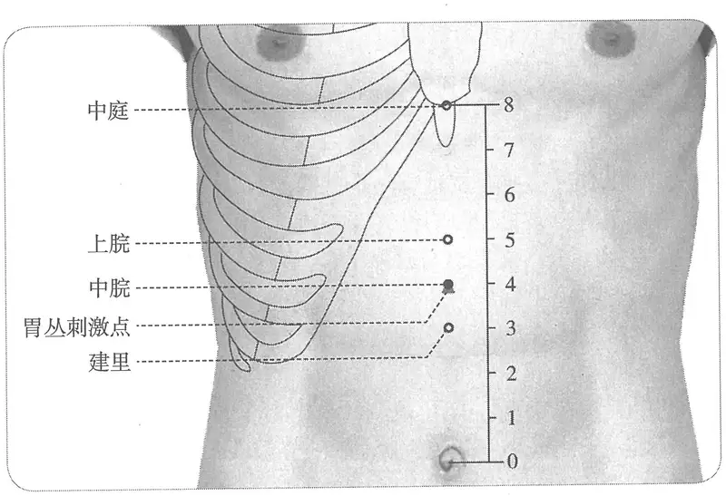

**图2-418　中脘穴与相关刺激点图**

> **그림 2-418　중완혈과 관련 자극점 그림**

　1. 在上脘下一寸，居心蔽骨与脐之中。（《黄帝明堂经》、《针灸聚英》、《针灸大成》、《针方六集》、《类经图翼》、《循经考穴编》）

> 1. 상완 아래 1촌, 심폐골과 배꼽의 한가운데 있다.（『황제명당경』, 『침구취영(鍼灸聚英)』, 『침구대성(鍼灸大成)』, 『침방육집(鍼方六集)』, 『유경도익(類經圖翼)』, 『순경고혈편(循經考穴編)』）

　2. 府会太仓。虞注在心前鸠尾下四寸是也。（《难经集注·四十五难》）

> 2. 부회(府會)는 태창이다. 우씨(虞氏)의 주(注)에서 명치 앞 구미 아래 4촌이 그것이라 하였다.（『난경집주(難經集注)』 「사십오난(四十五難)」）

　3. 在心厌下四寸。（《肘后备急方》卷二、《千金要方》、《千金翼方》、《外台秘要》）

> 3. 심염 아래 4촌에 있다.（『주후비급방(肘後備急方)』 권2, 『천금요방』, 『천금익방』, 『외대비요』）

　4. 太仓，穴在心厌下四寸，脐上一夫。（《千金要方》卷二十、《千金翼方》）

> 4. 태창은 혈이 심염 아래 4촌, 배꼽 위 1부에 있다.（『천금요방』 권20, 『천금익방』）

　5. 在上管下一寸。（《千金要方》、《千金翼方》、《外台秘要》、《太平圣惠方》、《铜人腧穴针灸图经》卷中、《圣济总录》、《针灸资生经》、《十四经发挥》）

> 5. 상관 아래 1촌에 있다.（『천금요방』, 『천금익방』, 『외대비요』, 『태평성혜방』, 『동인수혈침구도경』 권중, 『성제총록(聖濟總錄)』, 『침구자생경(鍼灸資生經)』, 『십사경발휘(十四經發揮)』）

　6. 中管，在上管下一寸。名太仓。（《千金翼方》卷二十七）

> 6. 중관은 상관 아래 1촌에 있다. 태창이라 한다.（『천금익방』 권27）

　7. 在脐上四寸。（《铜人腧穴针灸图经》卷上、《针灸玉龙经》、《循经考穴编》、《医宗金鉴·刺灸心法要诀》、《针灸易学》）

> 7. 배꼽 위 4촌에 있다.（『동인수혈침구도경』 권상, 『침구옥룡경(鍼灸玉龍經)』, 『순경고혈편』, 『의종금감(醫宗金鑑)』 「자구심법요결(刺灸心法要訣)」, 『침구이학(鍼灸易學)』）

　8. 窦太师针灸遗存

> 8. 두태사(竇太師)가 남긴 침구 자료[竇太師鍼灸遺存]

　　(1) 在脐上四寸是穴。（《窦太师针经》、《窦太师秘传》）

> (1) 배꼽 위 4촌이 이 혈이다.（『두태사침경(竇太師鍼經)』, 『두태사비전(竇太師秘傳)』）

　　(2) 上脘下一寸，脐上四寸。（《大本琼瑶神书》）

> (2) 상완 아래 1촌, 배꼽 위 4촌.（『대본경요신서(大本瓊瑤神書)』）

　9. 《灵枢》云：髑骬即歧骨也以下至天枢天枢，足阳明经穴，挟脐二寸，盖与脐平直也长八寸，而中脘居中是也。然人胃有大小，亦不可拘以身寸，但自髑骬至脐中，以八寸为度，各依部分取之。（《十四经发挥》中、《神应经》）

> 9. 『영추』에서 “갈우(髑骬)〔갈우는 곧 기골(歧骨)이다〕에서 아래로 천추(天樞)〔천추는 족양명경의 혈로, 배꼽 양옆 2촌에 있으니 대개 배꼽과 수평이다〕까지 길이가 8촌이며, 중완이 그 가운데 있다.”라고 하였다. 그러나 사람의 위는 크고 작음이 있으니 신촌[身寸]에 얽매일 수 없고, 다만 갈우에서 배꼽 중심까지를 8촌으로 삼아 각 부분에 따라 취한다.（『십사경발휘』 권중, 『신응경(神應經)』）

　10. 在上脘下一寸五分。（《医学纲目》）

> 10. 상완 아래 1촌 5푼에 있다.（『의학강목(醫學綱目)』）

　11. 在上脘下一寸，蔽骨尖下四寸，脐上亦四寸。（《针灸逢源》）

> 11. 상완 아래 1촌, 폐골(蔽骨) 끝 아래 4촌, 배꼽 위로도 4촌에 있다.（『침구봉원(鍼灸逢源)』）

　12. 脐上四寸即脐与歧骨之中央。（《针灸十四经穴位考订》）

> 12. 배꼽 위 4촌, 곧 배꼽과 기골의 한가운데.（『침구 십사경 혈위 고정[鍼灸十四經穴位考訂]』）

　13. 统编针灸学教材

> 13. 통편(統編) 침구학 교재

　　(1) 部位：上脘下一寸，脐上四寸。取穴：仰卧，于脐上四寸取之。（1957年南京《针灸学》）

> (1) 부위: 상완 아래 1촌, 배꼽 위 4촌. 취혈: 반듯이 누워 배꼽 위 4촌에서 취한다.（1957년 난징(南京) 『침구학[鍼灸學]』）

　　(2) 部位：脐上四寸。取穴：仰卧，上脘穴下一寸取之。（1版《针灸学讲义》）

> (2) 부위: 배꼽 위 4촌. 취혈: 반듯이 누워 상완혈 아래 1촌에서 취한다.（1판 『침구학 강의[鍼灸學講義]』）

　　(3) 部位：在上脘下一寸，居心蔽骨与脐之中。取穴：脐上四寸，腹正中线上，仰卧当歧骨与神阙之间取穴。（2版《针灸学讲义》）

> (3) 부위: 상완 아래 1촌, 심폐골과 배꼽의 한가운데 있다. 취혈: 배꼽 위 4촌, 배 정중선 위로, 반듯이 누워 기골과 신궐(神闕) 사이에서 취한다.（2판 『침구학 강의』）

〔p.1352 (인쇄 1324)〕

　　(4) 脐上4寸。（4、5版《针灸学》）

> (4) 배꼽 위 4촌.（4·5판 『침구학』）

　　(5) 在上腹部，前正中线上，当脐中上4寸。（6版《针灸学》）

> (5) 상복부, 앞정중선 위, 배꼽 중심 위 4촌에 있다.（6판 『침구학』）

　　(6) 前正中线上，脐上4寸，或脐与胸剑联合连线的中点处。（7版《针灸学》）

> (6) 앞정중선 위, 배꼽 위 4촌, 또는 배꼽과 흉검결합을 잇는 선의 중점.（7판 『침구학』）

　　(7) 在腹正中线上，脐上四寸。（《中国针灸学》）

> (7) 배 정중선 위, 배꼽 위 4촌에 있다.（『중국 침구학[中國鍼灸學]』）

**文献分析**：关于本穴定位，所有文献有一个共同点：位于鸠尾骨与脐连线的中点处。但由于对于鸠尾骨的理解有分歧（详见鸠尾穴“名实考”），因而实际定位有所不同。至于《医学纲目》作“上脘下一寸五分”，文字也与诸书不合，显然有误。因为该书明言上脘穴距鸠尾骨“三寸”，则中脘穴只能是“上脘下一寸”。

> **문헌 분석**: 이 혈의 위치에 대해서는 모든 문헌에 공통점이 하나 있다. 구미골(鳩尾骨)과 배꼽을 잇는 선의 중점에 있다는 것이다. 그러나 구미골을 이해하는 데 견해가 갈리므로（구미혈의 “이름과 실체 고증” 참조） 실제 위치는 서로 다르다. 『의학강목』에서 “상완 아래 1촌 5푼”이라 한 것은 글자도 여러 책과 맞지 않으니 분명히 잘못이다. 그 책에서 상완혈이 구미골에서 “3촌” 떨어져 있다고 밝혔으므로, 중완혈은 “상완 아래 1촌”일 수밖에 없기 때문이다.

#### 【类属】 

> **【분류(類屬)】**

任脉穴；胃之募穴；八会穴之腑会。

> 임맥의 혈, 위의 모혈, 팔회혈(八會穴) 가운데 부회(腑會).

**脉气所发：**

> **맥기가 나오는 곳(脈氣所發):**

　1. 手太阳、少阳、足阳明所生，任脉之会。（《黄帝明堂经》）

> 1. 수태양·수소양·족양명이 나오는 곳이며, 임맥과 만나는 곳이다.（『황제명당경』）

　2. 三阳、任脉之会，谓上纪也。（《铜人腧穴针灸图经》卷上）

> 2. 삼양(三陽)과 임맥이 만나는 곳으로, 상기라 한다.（『동인수혈침구도경』 권상）

　3. 上纪者，中脘也。（《铜人腧穴针灸图经》卷中）

> 3. 상기는 중완이다.（『동인수혈침구도경』 권중）

**归经**：任脉。（《外台秘要》卷三十九、《铜人腧穴针灸图经》卷上）

> **귀경**: 임맥.（『외대비요』 권39, 『동인수혈침구도경』 권상）

#### 【适应症】 

> **【적응증(適應症)】**

主治腹部病症。常用于胃脘痛，腹胀，腹中包块，泄泻，便秘，不思饮食，呕吐；黄疸。

> 복부 병증을 주치한다. 위완통, 복창, 뱃속의 덩어리, 설사, 변비, 식욕 부진, 구토, 황달에 자주 쓴다.

　1. 主心下大坚。胃胀。霍乱，泄出不自知，先取太溪，后取太仓之原。溢饮，胁下坚痛。腹胀不通，寒中伤饱，食饮不化。头热，鼻鼽衄，目黄振寒，噫，烦满。伤忧悁思，气积。痓，先取太溪，后取太仓之原。积聚，腹中胀，暴满。心痛身寒，难以俛仰，心疝冲冒，死不知人。心腹痛，发作肿聚往来上下行，痛有休止，腹中热，善渴，涎出，是蛔咬也，鼻闻焦臭，大便难。小肠有热，溺赤黄。（《黄帝明堂经》）

> 1. 명치 아래가 크게 단단한 것을 주치한다. 위창. 곽란(霍亂)으로 설사가 나와도 스스로 알지 못하면 먼저 태계(太溪)를 취하고 뒤에 태창의 원혈[太倉之原]을 취한다. 일음(溢飮)으로 옆구리 아래가 단단하고 아픈 것. 배가 붓고 통하지 않는 것, 한중(寒中)과 과식으로 상한 것[傷飽], 음식이 소화되지 않는 것. 머리가 뜨겁고 코가 막히고 코피가 나는 것[鼻鼽衄], 눈이 누렇고 떨며 추운 것, 트림, 번만(煩滿). 근심과 걱정으로 상한 것[傷憂悁思], 기적(氣積). 치(痓)에는 먼저 태계를 취하고 뒤에 태창의 원혈을 취한다. 적취, 뱃속이 붓는 것, 갑자기 그득해지는 것. 심통(心痛)으로 몸이 차고 몸을 굽히고 펴기 어려운 것, 심산(心疝)으로 기가 치밀어 어지러운 것[衝冒], 까무러쳐 사람을 알아보지 못하는 것. 가슴과 배가 아프고, 발작하면 덩이가 뭉쳐 위아래로 오가며, 통증이 그쳤다 일어났다 하고, 뱃속이 뜨겁고 갈증이 잘 나며 침이 흐르는 것은 회충이 무는 것[蛔咬]이고, 코에서 탄 냄새가 나며 대변이 어려운 것. 소장에 열이 있어 소변이 붉고 누런 것.（『황제명당경』）

**按**：以上主治包括“胃胀”、“霍乱”、“溢饮”、“痓”、“积聚”、“心疝”、“蛔咬”等多种病症，但多伴有胃、腹部的胀、满、痛、积及饮食、大便症状。所谓“胃胀者，腹满，胃脘痛，鼻闻焦臭，妨于食，大便难”（《灵枢·胀论》）；蛔虫腹痛则症见：“心肠痛，膭作痛，肿聚，往来上下行，痛有休止，腹热喜渴涎出者，是蛟蛕也”（《灵枢·厥病》）

> **안(按)**: 위의 주치에는 “위창”·“곽란”·“일음”·“치”·“적취”·“심산”·“회충이 묾” 등 여러 병증이 들어 있으나, 대개 위·복부가 붓고[脹] 그득하고[滿] 아프고[痛] 뭉치는[積] 증상과 음식·대변 증상을 동반한다. 이른바 “위창은 배가 그득하고 위완이 아프며, 코에서 탄 냄새가 나고, 먹는 데 지장이 있으며, 대변이 어렵다.”（『영추』 「창론」）라는 것이고, 회충 복통은 증상이 “가슴과 배가 아프고, 괴롭게 아프며[膭作痛], 덩이가 뭉쳐 위아래로 오가고, 통증이 그쳤다 일어났다 하며, 배가 뜨겁고 갈증이 잘 나며 침이 흐르는 것은 교회(蛟蛕)이다.”（『영추』 「궐병(厥病)」）라는 것이다.

　2. 奔豚冷气，心间伏梁，状如覆杯，冷结诸气。（《千金翼方》卷二十七）

> 2. 분돈(奔豚)의 냉기, 명치 사이의 복량(伏梁)으로 모양이 엎어 놓은 잔 같은 것, 냉기가 맺힌 여러 기병.（『천금익방』 권27）

　3. 心腹诸病，坚满烦痛，寒冷，霍乱吐下，肠鸣，泄痢，灸百壮。（《千金翼方》卷二十七、《外台秘要》）

> 3. 가슴과 배의 온갖 병으로 단단하고 그득하며 번열과 통증이 있는 것, 한랭, 곽란으로 토하고 설사하는 것, 장명(腸鳴), 설리(泄痢)에는 뜸 100장을 뜬다.（『천금익방』 권27, 『외대비요』）

　4. 甄权云主因读书得贲豚气积聚，腹中胀，暴满，病温汗不出，有血溢水。（《外台秘要》卷三十九）

> 4. 견권(甄權)은 “책을 읽다가 생긴 분돈기(賁豚氣)와 적취, 뱃속이 붓는 것, 갑자기 그득해지는 것, 온병(溫病)에 땀이 나지 않는 것, 피가 넘치고 물이 있는 것[有血溢水]을 주치한다.”라고 하였다.（『외대비요』 권39）

　5. 主治心悪，反胃，温疟，天行伤寒。因读书得奔豚气，心闷，伏梁气状如覆杯，冷结气。（《太平圣惠方·针经》）

> 5. 속이 메스꺼운 것[心惡], 반위(反胃), 온학(溫瘧), 천행상한(天行傷寒)을 주치한다. 책을 읽다가 생긴 분돈기, 가슴이 답답한 것, 모양이 엎어 놓은 잔 같은 복량기, 냉기가 맺힌 것.（『태평성혜방』 「침경(鍼經)」）

　6. 治心下胀满，伤饱食不化，霍乱出泄不自知，心痛，温疟，伤寒，饮水过多，腹胀气喘，因读书得贲豚气上攻，伏梁心下状如覆杯，寒癖结气。（《铜人腧穴针灸图经》卷中）

> 6. 명치 아래가 붓고 그득한 것, 과식으로 상해 음식이 소화되지 않는 것, 곽란으로 설사가 나와도 스스로 알지 못하는 것, 심통, 온학, 상한, 물을 너무 많이 마셔 배가 붓고 숨이 찬 것, 책을 읽다가 생긴 분돈기가 위로 치받는 것, 명치 아래 엎어 놓은 잔 같은 복량, 한벽(寒癖)으로 기가 맺힌 것을 치료한다.（『동인수혈침구도경』 권중）

　7. 窦太师针灸遗存

> 7. 두태사가 남긴 침구 자료

　　(1) 治心痛，泻；番胃吐食，补；痰涎，补泻。（《窦太师针经》）

> (1) 심통을 치료할 때는 사(瀉)하고, 번위(番胃)로 먹은 것을 토하면 보(補)하며, 담연(痰涎)에는 보사(補瀉)한다.（『두태사침경』）

　　(2) 心痛，泻；翻胃吐食，补；痰饮，先补后泻；六腑皆治。（《大本琼瑶神书》）

> (2) 심통에는 사하고, 번위(翻胃)로 먹은 것을 토하면 보하며, 담음(痰飮)에는 먼저 보하고 뒤에 사한다. 육부의 병을 모두 치료한다.（『대본경요신서』）

　　(3) 治翻胃吐食，心腹胀满，气疼吐血，积块等症。（《窦太师秘传》）

> (3) 번위로 먹은 것을 토하는 것, 가슴과 배가 붓고 그득한 것, 기로 인한 통증[氣疼], 토혈, 적괴(積塊) 등의 증을 치료한다.（『두태사비전』）

　8. 主五膈，喘息不止，腹暴胀，中恶，脾疼，赤白痢，寒癖，心膨胀，先腹疼先泻，气发噎。

> 8. 오격(五膈), 숨 가쁨이 그치지 않는 것, 배가 갑자기 붓는 것, 중악(中惡), 비통(脾疼), 적백리(赤白痢), 한벽, 명치가 불러 오르는 것[心膨脹], 먼저 배가 아프고 먼저 설사하는 것, 기가 일어나 목이 메는 것[氣發噎]을 주치한다.

〔p.1353 (인쇄 1325)〕

（《针灸聚英》卷一、《针灸大成》）

> （『침구취영』 권1, 『침구대성』）

　9. 统编针灸学教材

> 9. 통편 침구학 교재

　　(1) 心痛，腹胀，翻胃吞酸，饮食难化，赤白痢疾。（1957年南京《针灸学》）

> (1) 심통, 복창, 번위와 탄산(呑酸), 음식이 잘 소화되지 않는 것, 적백 이질.（1957년 난징 『침구학』）

　　(2) 胃痛，腹胀，反胃吞酸，呕吐，饮食不化，赤白痢疾。（1版《针灸学讲义》）

> (2) 위통, 복창, 반위와 탄산, 구토, 음식이 소화되지 않는 것, 적백 이질.（1판 『침구학 강의』）

　　(3) 主治胃痛，腹胀，反胃吞酸，呕吐，泄泻，痢疾，黄疸，脾胃虚弱。（2版《针灸学讲义》）

> (3) 위통, 복창, 반위와 탄산, 구토, 설사, 이질, 황달, 비위허약(脾胃虛弱)을 주치한다.（2판 『침구학 강의』）

　　(4) 胃痛，腹胀，肠鸣，呕吐，泄泻，痢疾，黄疸，脾胃虚弱。（4版《针灸学》）

> (4) 위통, 복창, 장명, 구토, 설사, 이질, 황달, 비위허약.（4판 『침구학』）

　　(5) 胃痛，呕吐，吞酸，腹胀，泄泻，黄疸，癫狂。（5版《针灸学》）

> (5) 위통, 구토, 탄산, 복창, 설사, 황달, 전광(癲狂).（5판 『침구학』）

　　(6) 胃痛，呕吐，吞酸，呃逆，腹胀，泄泻，黄疸，癫狂。（6版《针灸学》）

> (6) 위통, 구토, 탄산, 애역(呃逆), 복창, 설사, 황달, 전광.（6판 『침구학』）

　　(7) ①胃痛，腹胀、纳呆、呕吐，吞酸，呃逆，小儿疳积等脾胃病证；②黄疸；③癫狂，脏躁。（7版《针灸学》）

> (7) ① 위통, 복창, 납매(納呆), 구토, 탄산, 애역, 소아 감적(疳積) 등 비위 병증 ② 황달 ③ 전광, 장조(臟躁).（7판 『침구학』）

　　(8) 胃痛，腹胀，肠鸣，翻胃，吞酸，呕吐，泄泻，痢疾，黄疸，饮食不化，失眠。（《中国针灸学》）

> (8) 위통, 복창, 장명, 번위, 탄산, 구토, 설사, 이질, 황달, 음식이 소화되지 않는 것, 불면.（『중국 침구학』）

#### 附：临床应用举例 

> **부: 임상 응용 예(臨床應用擧例)**

　1. 脾胃、脘腹病症

> 1. 비위·완복(脘腹) 병증

　　(1) 大便干，骨立者方：灸胃管穴千炷。（《医心方》卷十二）

> (1) 대변이 마르고 뼈만 앙상한 사람을 치료하는 방법: 위관혈에 뜸 1,000장[千炷]을 뜬다.（『의심방(醫心方)』 권12）

　　(2) 吐泻，脉沉细，手足冷者，灸脐下一百五十壮。慢惊吐泻，灸中脘五十壮。（《扁鹊心书》卷下）

> (2) 토하고 설사하며 맥이 침세(沈細)하고 손발이 찬 경우에는 배꼽 아래에 뜸 150장을 뜬다. 만경풍(慢驚風)으로 토하고 설사하면 중완에 뜸 50장을 뜬다.（『편작심서(扁鵲心書)』 권하）

　　(3) 若脾虚发搐，或吐泻后发搐，乃慢惊风也。灸中脘三十壮，服姜附汤而愈。（《扁鹊心书·惊风》卷下）

> (3) 비허(脾虛)로 경련이 일어나거나[發搐] 토하고 설사한 뒤 경련이 일어나면 만경풍이다. 중완에 뜸 30장을 뜨고 강부탕(薑附湯)을 먹였더니 나았다.（『편작심서』 「경풍(驚風)」 권하）

　　(4) 治腹暴胀按之不下，刺任脉中脘，气海二穴，次针足阳明经三里二穴。（《针经摘英集》）

> (4) 배가 갑자기 붓고 눌러도 꺼지지 않는 것을 치료할 때는 임맥의 중완·기해(氣海) 두 혈을 찌르고, 다음으로 족양명경의 삼리(三里) 두 혈에 침을 놓는다.（『침경적영집(鍼經摘英集)』）

　　(5) 饮食不消，心腹胀，面色萎黄，世谓之脾肾病，宜灸中脘。（《针灸玉龙经·灸法杂抄切要》）

> (5) 음식이 소화되지 않고 가슴과 배가 부으며 얼굴빛이 위황(萎黃)한 것을 세상에서는 비신병(脾腎病)이라 하는데, 중완에 뜸을 떠야 한다.（『침구옥룡경』 「구법잡초절요(灸法雜抄切要)」）

　　(6) 寒气攻灌心脾疼痛，时口吐酸水，饮食不进：灸中脘，刺大陵泻之。（《针灸集要·盘石金直刺秘传》）

> (6) 한기가 심비(心脾)로 치밀어 들어 아프고, 때때로 신물을 토하며 음식을 먹지 못할 때: 중완에 뜸을 뜨고, 대릉(大陵)을 찔러 사한다.（『침구집요(鍼灸集要)』 「반석금직자비전(盤石金直刺秘傳)」）

　　(7) 气攻心胸连腹疼痛：泻公孙；未愈，灸中脘、足三里、内关，各灸七壮泻之。（《针灸集要·盘石金直刺秘传》）

> (7) 기가 가슴으로 치밀어 배까지 이어서 아플 때: 공손(公孫)을 사한다. 낫지 않으면 중완·족삼리(足三里)·내관(內關)에 뜸을 뜨되, 각각 뜸 7장을 뜨고 사한다.（『침구집요』 「반석금직자비전」）

　　(8) 单腹胀痛，双蛊腹胀：刺内庭，泻足三里；少愈，灸水分、中脘补之。（《针灸集要·盘石金直刺秘传》）

> (8) 단복창(單腹脹)으로 아프거나 쌍고(雙蠱)로 배가 부을 때: 내정(內庭)을 찌르고 족삼리를 사한다. 조금 나으면 수분·중완에 뜸을 떠서 보한다.（『침구집요』 「반석금직자비전」）

　　(9) 伤寒，胸腹膨胀，过经呕血泻血不止：灸期门，次针中脘，泻未愈，灸绝骨、行间，泻之；未愈，灸合谷、复溜。（《针灸集要·盘石金直刺秘传》）

> (9) 상한으로 가슴과 배가 불러 오르고, 경을 지나서도[過經] 토혈·하혈이 그치지 않을 때: 기문(期門)에 뜸을 뜨고, 다음으로 중완에 침을 놓아 사한다. 낫지 않으면 절골(絶骨)·행간(行間)에 뜸을 뜨고 사한다. 그래도 낫지 않으면 합곡(合谷)·부류(復溜)에 뜸을 뜬다.（『침구집요』 「반석금직자비전」）

　　(10) 单蛊胀：水分、石门、气海、中脘。问曰：此证缘何而得？答曰：因风寒暑湿串入脏腑，以致食物不能化，脾败胃虚，故如此也。复刺后穴：三里、脾俞、行间、内庭。（《针灸集成》第四十九方）

> (10) 단고창(單蠱脹): 수분·석문(石門)·기해·중완. 묻기를 “이 증은 무엇 때문에 생기는가?” 하니, 답하기를 “풍한서습(風寒暑濕)이 장부로 스며들어 음식을 소화하지 못하게 되고, 비가 무너지고 위가 허해져서[脾敗胃虛] 이렇게 된다.” 하였다. 다시 다음 혈을 찌른다: 삼리·비수(脾兪)·행간·내정.（『침구집성(鍼灸集成)』 제49방）

　　(11) 九般心痛及脾疼，上脘穴中宜用针。脾败还将中脘泻，两针成败免灾侵。（《针灸玉龙歌》）

> (11) 아홉 가지 심통과 비통(脾疼)에는 상완혈에 침을 써야 한다. 비가 무너졌으면 다시 중완을 사하니, 두 침으로 성패를 갈라 재앙을 면한다.（『침구옥룡가(鍼灸玉龍歌)』）

　　(12) 中脘下脘治腹坚。（《灵光赋》）

> (12) 중완·하완은 배가 단단한 것을 치료한다.（『영광부(靈光賦)』）

　　(13) 伤寒腹痛虫寻食，吐蛔乌梅可难攻，十日九日必定死，中脘回还胃气通。（《肘后歌》）

> (13) 상한에 배가 아프고 회충이 먹을 것을 찾아, 회충을 토하는데 오매(烏梅)로도 다스리기 어려우면 열흘이나 아흐레 만에 반드시 죽는다. 중완으로 되살리면 위기가 통한다.（『주후가(肘後歌)』）

〔p.1354 (인쇄 1326)〕

　　(14) 呕吐不食，灸中脘五十壮。（《扁鹊心书》卷上）

> (14) 구토하고 먹지 못하면 중완에 뜸 50장을 뜬다.（『편작심서』 권상）

　　(15) 霍乱吐泻，乃冷物伤胃，灸中脘五十壮，若四肢厥冷，六脉微细者，其阳欲脱也，急灸关元三百壮。（《扁鹊心书》卷上）

> (15) 곽란으로 토하고 설사하는 것은 찬 음식이 위를 상한 것이니 중완에 뜸 50장을 뜬다. 사지가 싸늘하고[厥冷] 육맥이 미세(微細)하면 양기가 빠져나가려는 것이니 서둘러 관원(關元)에 뜸 300장을 뜬다.（『편작심서』 권상）

　　(16) 胃气不和，心胸注闷，噫气不时：泻中脘、内关、足三里，灸二七壮。（《针灸集要·盘石金直刺秘传》）

> (16) 위기가 조화롭지 못해 가슴이 막혀 답답하고 트림이 수시로 날 때: 중완·내관·족삼리를 사하고, 뜸 14장[二七壯]을 뜬다.（『침구집요』 「반석금직자비전」）

　　(17) 呕逆霍乱，烦闷气促欲死：灸中脘、关元、气海、复溜等穴，看虚实补泻。（《针灸集要·盘石金直刺秘传》）

> (17) 구역과 곽란으로 번민하고 숨이 가빠 죽을 듯할 때: 중완·관원·기해·부류 등의 혈에 뜸을 뜨고, 허실을 보아 보사한다.（『침구집요』 「반석금직자비전」）

　　(18) 一切沉寒涸冷，气滞，心酸，面黄肌瘦，四肢无力：灸中脘、关元，次灸足三里泻之。（《针灸集要·盘石金直刺秘传》）

> (18) 온갖 침한(沈寒)·고랭(涸冷), 기체(氣滯), 명치가 시큰한 것[心酸], 얼굴이 누렇고 몸이 여윈 것, 사지에 힘이 없는 것: 중완·관원에 뜸을 뜨고, 다음으로 족삼리에 뜸을 떠서 사한다.（『침구집요』 「반석금직자비전」）

　　(19) 中满不快，翻胃吐食，中脘一穴、太白二穴、中魁二穴一名阳溪。（《针灸大全》卷四）

> (19) 중만(中滿)으로 불편하고 번위로 먹은 것을 토할 때: 중완 1혈, 태백(太白) 2혈, 중괴(中魁) 2혈〔일명 양계(陽溪)〕.（『침구대전(鍼灸大全)』 권4）

　　(20) 脾家之疾有多般，翻胃多因吐食餐。黄疸亦须腕骨灸，金针中脘必痊安。（《针灸玉龙歌》）

> (20) 비(脾)의 병은 여러 가지인데, 번위는 대개 먹은 음식을 토하는 것이다. 황달에도 완골(腕骨)에 뜸을 떠야 하고, 금침(金鍼)으로 중완을 찌르면 반드시 낫는다.（『침구옥룡가』）

　　(21) 胃扩张合并贲门痉挛：中脘穴、足三里穴，针治。［新中医，1984(7)：30］

> (21) 위확장에 분문 경련[賁門痙攣]이 겹친 경우: 중완혈·족삼리혈에 침 치료.［『신중의(新中醫)』, 1984(7): 30］

　　(22) 急性胃肠炎：内关穴、中脘穴，针灸治疗。［陕西中医，1985，6(9)：414］

> (22) 급성 위장염: 내관혈·중완혈에 침구 치료.［『섬서중의(陝西中醫)』, 1985, 6(9): 414］

　　(23) 小儿泄泻：上脘穴、中脘穴，针刺治疗。［中国针灸，1986，6(3)：48］

> (23) 소아 설사: 상완혈·중완혈에 자침 치료.［『중국침구(中國鍼灸)』, 1986, 6(3): 48］

　　(24) 小儿单纯性消化不良：天枢穴、中脘穴，针刺补泻。［中国针灸，1986，6(2)：36］

> (24) 소아 단순성 소화불량: 천추혈·중완혈에 자침하여 보사.［『중국침구』, 1986, 6(2): 36］

　　(25) 麻痹性肠梗阻：神阙穴、中脘穴，针刺。［江西中医药，1987(6)：36］

> (25) 마비성 장폐색: 신궐혈·중완혈에 자침.［『강서중의약(江西中醫藥)』, 1987(6): 36］

　　(26) 慢性腹泻：中脘穴，灸法治疗。［四川中医，1987，5(9)：57］

> (26) 만성 설사: 중완혈에 뜸 치료.［『사천중의(四川中醫)』, 1987, 5(9): 57］

　　(27) 胃痉挛：中脘穴，鸠尾穴，针刺。［浙江中医杂志，1988，23(2)：90］

> (27) 위경련: 중완혈·구미혈에 자침.［『절강중의잡지(浙江中醫雜誌)』, 1988, 23(2): 90］

　　(28) 胃扭转：足三里、中脘，针灸治疗。［陕西中医学院学报，1990，13(3)：32-33，24］

> (28) 위염전(胃捻轉): 족삼리·중완에 침구 치료.［『섬서중의학원학보(陝西中醫學院學報)』, 1990, 13(3): 32-33, 24］

　　(29) 慢性胃炎：针刺中脘穴治疗。［上海针灸，1999，18(1)：12］

> (29) 만성 위염: 중완혈에 자침하여 치료.［『상해침구(上海鍼灸)』, 1999, 18(1): 12］

　2. 身黄

> 2. 신황(身黃)

　　(1) 主身体痿黄，灸百壮，治十，瘥。忌针。（《千金翼方》卷十八）

> (1) 몸이 위황(痿黃)한 것을 주치한다. 뜸 100장을 뜨면 열이면 열 모두 낫는다[治十，瘥]. 침은 금한다.（『천금익방』 권18）

　　(2) 黄疸（黄病），四肢无力，不问久近：灸中脘，泻足三里、腕骨。（《针灸集要·盘石金直刺秘传》）

> (2) 황달（황병(黃病)）로 사지에 힘이 없을 때는 오래되었든 얼마 안 되었든: 중완에 뜸을 뜨고, 족삼리·완골을 사한다.（『침구집요』 「반석금직자비전」）

　　(3) 感冒寒气，饮食不化，呕吐酸水，身黄腹胀：灸中脘、关元，次灸足三里泻之，各二七壮。（《针灸集要·盘石金直刺秘传》）

> (3) 한기에 감모(感冒)되어 음식이 소화되지 않고 신물을 토하며 몸이 누렇고 배가 부을 때: 중완·관원에 뜸을 뜨고, 다음으로 족삼리에 뜸을 떠서 사하되, 각각 14장을 뜬다.（『침구집요』 「반석금직자비전」）

　3. 晕、厥、惊病症

> 3. 훈(暈)·궐(厥)·경(驚) 병증

　　(1) 妇人无故风搐发昏，灸中脘五十壮。（《扁鹊心书》卷上）

> (1) 부인이 까닭 없이 풍으로 경련하며[風搐] 정신이 흐려지면 중완에 뜸 50장을 뜬다.（『편작심서』 권상）

　　(2) 尸厥，不省人事，又名气厥，灸中脘五十壮。（《扁鹊心书》卷上）

> (2) 시궐(尸厥)로 인사불성이 된 것을 기궐(氣厥)이라고도 하는데, 중완에 뜸 50장을 뜬다.（『편작심서』 권상）

　　(3) 产后血晕，灸中脘五十壮。（《扁鹊心书》卷上）

> (3) 산후 혈훈(血暈)에는 중완에 뜸 50장을 뜬다.（『편작심서』 권상）

　　(4) 急慢惊风，灸中脘四百壮。（《扁鹊心书》卷上）

> (4) 급경풍·만경풍에는 중완에 뜸 400장을 뜬다.（『편작심서』 권상）

　　(5) 气厥尸厥，灸中脘五百壮。（《扁鹊心书》卷上）

> (5) 기궐·시궐에는 중완에 뜸 500장을 뜬다.（『편작심서』 권상）

　　(6) 凡无故昏倒，乃胃气闭也。灸中脘即愈。（《扁鹊心书》卷下）

> (6) 까닭 없이 혼절해 쓰러지는 경우는 모두 위기가 막힌 것이다. 중완에 뜸을 뜨면 곧 낫는다.（『편작심서』 권하）

　　(7) 醉头风发时，口吐清涎，二三日昏迷不省人事，不进饮食，如大醉人：先泻中脘，次解溪、足三里。（《针灸集要·盘石金直刺秘传》）

> (7) 취두풍(醉頭風)이 발작할 때 맑은 침을 토하고, 2~3일 혼미하여 인사불성이며 음식을 먹지 못하는 것이 몹시 취한 사람 같을 때: 먼저 중완을 사하고, 다음으로 해계(解溪)·족삼리를 사한다.（『침구집요』 「반석금직자비전」）

　　(8) 眩晕证：针刺中脘，足三里，丰隆，内关，阳陵泉，百会，头维，太阳均双侧。平补平泻手法，留针20分钟，每日1次。［中医函授通讯，1988(2)：40］

> (8) 현훈증: 중완, 족삼리, 풍륭(豐隆), 내관, 양릉천(陽陵泉), 백회(百會), 두유(頭維), 태양(太陽)에 자침하되 모두 양쪽에 놓는다. 평보평사(平補平瀉) 수법, 유침 20분, 하루 1회.［『중의함수통신(中醫函授通訊)』, 1988(2): 40］

　4. 其他病症

> 4. 기타 병증

　　(1) 治五膈气喘息不止，刺任脉中脘一穴，一名太仓，胃之募也。（《针经摘英集》）

> (1) 오격기(五膈氣)로 숨 가쁨이 그치지 않는 것을 치료할 때는 임맥의 중완 1혈을 찌른다. 일명 태창이며 위의 모혈이다.（『침경적영집』）

〔p.1355 (인쇄 1327)〕

　　(2) 鼻中无时出血不止：泻风门；不止灸中脘，仍刺泻之。（《针灸集要·盘石金直刺秘传》）

> (2) 코에서 수시로 피가 나며 그치지 않을 때: 풍문(風門)을 사한다. 그치지 않으면 중완에 뜸을 뜨고, 이어서 찔러 사한다.（『침구집요』 「반석금직자비전」）

　　(3) 寒气伤积于心，痛不可忍，或伤生冷即发：灸心俞、刺中脘、足三里泻之；未愈，灸内关。（《针灸集要·盘石金直刺秘传》）

> (3) 한기가 심(心)을 상하고 쌓여 통증을 참을 수 없거나, 날것·찬 것에 상하면 곧 발작할 때: 심수(心兪)에 뜸을 뜨고, 중완·족삼리를 찔러 사한다. 낫지 않으면 내관에 뜸을 뜬다.（『침구집요』 「반석금직자비전」）

　　(4) 浑身浮肿生水：曲池、合谷、三里、三阴交、行间、内庭。问曰：此证缘何而得？答曰：皆因暴雨陵风，寒湿串于经络，或醉后、房事后乘凉恣快，致使肾经受虚败，故如此也。宜刺后穴：中脘、肾俞、水分。（《针灸集成》第四十七方）

> (4) 온몸이 붓고 물이 찰 때: 곡지(曲池)·합곡·삼리·삼음교(三陰交)·행간·내정. 묻기를 “이 증은 무엇 때문에 생기는가?” 하니, 답하기를 “모두 폭우와 거센 바람을 맞아 한습이 경락으로 스며들거나, 술 취한 뒤나 방사 뒤에 서늘한 바람을 마음껏 쐬어 신경(腎經)이 허해지고 무너져서 이렇게 된다.” 하였다. 다음 혈을 찔러야 한다: 중완·신수(腎兪)·수분.（『침구집성』 제47방）

　　(5) 诸痰为病，头风喘嗽，一切痰饮：丰隆、中脘。（《医学纲目》卷二十一）

> (5) 온갖 담(痰)으로 생긴 병, 두풍(頭風)과 천수(喘嗽), 일체의 담음: 풍륭·중완.（『의학강목』 권21）

　　(6) 妇人五旬，经断后再行，或多或少，或瘀或红，并下腹中气满如胎孕：天枢、中脘、气海各五分，立愈。（《医学纲目》卷三十四）

> (6) 부인이 쉰 살에 월경이 끊겼다가 다시 나오는데, 양이 많기도 하고 적기도 하며, 검붉게 엉기기도 하고 붉기도 하며, 아울러 아랫배 속에 기가 그득해 임신한 것 같을 때: 천추·중완·기해에 각각 5푼 자침하면 곧 낫는다.（『의학강목』 권34）

#### 【操作】 

> **【조작(操作)】**

直刺0.5~1.5寸。对肝脾肿大和胃、十二指肠溃疡患者，不宜向左右侧上方透刺。

> 직자 0.5~1.5촌. 간·비장이 부은 환자와 위·십이지장 궤양 환자에게는 좌우 옆 위쪽을 향해 투자하지 않는 것이 좋다.

　1. 刺入一寸二分，灸七壮。（《黄帝明堂经》）

> 1. 1촌 2푼 찌르고, 뜸 7장을 뜬다.（『황제명당경』）

　2. 针入八分，留七呼，泻五吸，疾出针。灸亦良，日灸二七壮，至四百壮止。（《太平圣惠方·针经》）

> 2. 침을 8푼 넣고 7호(呼) 동안 유침하며, 5흡(吸) 동안 사한 뒤 빨리 침을 뺀다. 뜸도 좋으니, 하루에 14장씩 떠서 400장에 이르면 그친다.（『태평성혜방』 「침경」）

　3. 窦太师针灸遗存

> 3. 두태사가 남긴 침구 자료

　　(1) 针入二寸半，灸三七壮。（《窦太师针经》）

> (1) 침을 2촌 반 넣고, 뜸 21장을 뜬다.（『두태사침경』）

　　(2) 针二寸五分，灸五七壮。（《窦太师秘传》）

> (2) 침 2촌 5푼, 뜸 35장.（『두태사비전』）

　4. 针五至一寸，灸三至十五壮。孕妇五月以上禁针灸。（《针灸十四经穴位考订》）

> 4. 침은 5[푼]에서 1촌까지, 뜸은 3~15장. 임신 5개월 이상인 임부는 침과 뜸을 금한다.（『침구 십사경 혈위 고정』） 〔역주: 원서의 「针五至一寸」은 「针五分至一寸」에서 「分」이 빠진 것으로 보인다.〕

　5. 统编针灸学教材

> 5. 통편 침구학 교재

　　(1) 针一寸至二寸，灸七至十五壮。（1957年南京《针灸学》、1版《针灸学讲义》）

> (1) 침 1~2촌, 뜸 7~15장.（1957년 난징 『침구학』, 1판 『침구학 강의』）

　　(2) 直刺10~15分；艾炷灸5~15壮，艾条灸5~15分钟。（2版《针灸学讲义》）

> (2) 직자 10~15푼. 애주구(艾炷灸) 5~15장, 애조구(艾條灸) 5~15분.（2판 『침구학 강의』）

　　(3) 直刺1~2寸。（4、5版《针灸学》）

> (3) 직자 1~2촌.（4·5판 『침구학』）

　　(4) 直刺1~1.5寸。（6、7版《针灸学》）

> (4) 직자 1~1.5촌.（6·7판 『침구학』）

　　(5) 直刺0.5~1.2寸。可灸。（《中国针灸学》）

> (5) 직자 0.5~1.2촌. 뜸을 뜰 수 있다.（『중국 침구학』）

　6. 直刺，深1~2寸。并可向四周邻穴斜刺。感应：上腹部闷胀沉重或胃部有收缩感。灸量：灸3~7壮；温灸10~20分钟。注意：中脘穴深部有胃、胰腺、腹主动脉等，直刺不宜过深，瘦弱病人尤宜谨慎；如有肝、脾肿大病人，不宜向左右侧上方透刺。（上海《针灸学》）

> 6. 직자로 1~2촌 깊이 찌른다. 주위의 이웃 혈을 향해 사자(斜刺)할 수도 있다. 감응: 상복부가 답답하고 붓고 묵직하거나 위에 수축하는 느낌이 든다. 뜸 양: 뜸 3~7장, 온구(溫灸) 10~20분. 주의: 중완혈 깊은 곳에 위·췌장·복대동맥 등이 있으므로 직자를 너무 깊게 하지 않는 것이 좋고, 여위고 허약한 환자는 더욱 조심해야 한다. 간·비장이 부은 환자에게는 좌우 옆 위쪽을 향해 투자하지 않는 것이 좋다.（상하이(上海) 『침구학』）

### （十三）上脘 Shàngwǎn CV13 出《黄帝明堂经》 

#### 【提要索隐】 

“上脘”、“上管”之名虽见于《灵枢》，但皆为部位名，而非穴名。

**穴名**：一名上管。

**定位**：在上腹部，脐中上5寸，前正中线上。

**适应症**：主治胃、腹部病症。常用于胃脘痛，呕吐，呕血，呃逆，不思饮食，腹胀，腹中包块；癫痫。

**针刺操作**：直刺0.5~1.5寸。对肝脾肿大和胃、十二指肠溃疡患者，不宜向左右侧上方透刺。

〔p.1356 (인쇄 1328)〕

#### 【名实考】 

脘，音义同“管”，故宋以前文献多写作“管”（也有写作“腕”者，以音通）。上脘、中脘、下脘，总称胃脘，既是穴名，也是部位名，穴以部位得名。从部位言，分言之有上、中、下之别，统言之则皆属胃脘。

　1. 上脘一穴，在巨阙下一寸当一寸五分，去蔽骨三寸。任脉、足阳明、手太阳之会。（《黄帝明堂经》）

　2. 脘，胃府也。脘，音管也。（《黄帝内经太素·经脉连环》卷八杨上善注）

　3. 此穴在内为饮食初入胃之际，故曰上脘。（《经穴解》）

　4. 别名　胃脘、上纪、上管、胃管。（1957年南京《针灸学》）

**按**：胃脘、胃管、上纪皆“中脘”穴之名也。此传自日本针灸教材，后者也重见于中脘穴。

#### 【定位】 

**部位**：在上腹部，脐中上5寸，前正中线上（图2-419）。

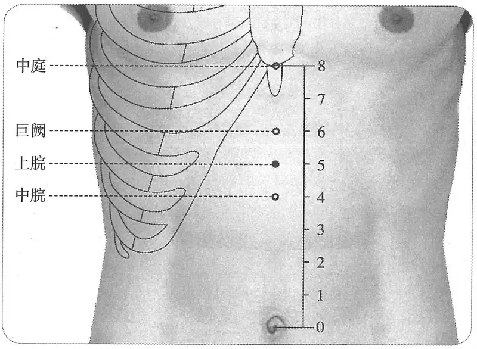

**图2-419　上脘穴图**

　1. 在巨阙下一寸五分，去蔽骨三寸。（《黄帝明堂经》、《铜人腧穴针灸图经》卷上）

　2. 上管穴，在心下二寸。（《千金要方》卷十、《千金翼方》）

　3. 心蔽骨下三寸。（《千金要方》卷二十、《千金翼方》、《外台秘要》）

　4. 在巨阙下一寸，去蔽骨三寸。（《千金要方》卷二十九、《千金翼方》）

　5. 上管穴，在巨阙下一寸许。（《千金要方》卷十一、《医心方》、《太平圣惠方·明堂》）

　6. 上管一穴，在巨阙下一寸，去巨骨三寸。（《太平圣惠方·针经》）

　7. 在巨阙下一寸当一寸五分，去蔽骨三寸。（《铜人腧穴针灸图经》卷中、《圣济总录》、《针灸资生经》、《十四经发挥》）

　8. 窦太师针灸遗存

　　(1) 在巨阙穴下一寸。又法：在脐上五寸是穴。（《窦太师针经》）

　　(2) 上脘在巨阙下一寸，脐上五寸。（《窦太师秘传》）

　　(3) 巨阙下一寸五分，脐上五寸。（《大本琼瑶神书》）

　9. 巨阙下一寸，当一寸五分，去蔽骨三寸，脐上五寸。（《针灸聚英》卷一、《古今医统》、

〔p.1357 (인쇄 1329)〕

《针方六集》、《类经图翼》）

　10. 在巨阙下一寸五分，去鸠骨下二寸。（《医学纲目》卷八）

　11. 巨阙下一寸，脐上五寸。（《针灸大成》卷七、《针灸易学》）

　12. 在巨阙下一寸五分，蔽骨下三寸，广注：合脐上五寸。（《循经考穴编》下、《针灸逢源》）

　13. 按旧本上脘在巨阙下一寸。《图翼》曰当作一寸半，正合蔽骨尖至脐八寸之数也。（《针灸逢源》卷四）

　14. 脐上五寸。（《针灸十四经穴位考订》）

　15. 统编针灸学教材

　　(1) 部位：巨阙下一寸，脐上五寸。取穴：仰卧，从中脘上行一寸取之。（1957年南京《针灸学》）

　　(2) 部位：脐上五寸。取穴：仰卧，巨阙穴下一寸取之。（1版《针灸学讲义》）

　　(3) 部位：在巨阙下一寸五分今作一寸，去蔽骨三寸。取穴：脐上五寸，腹正中线上，仰卧取穴。（2版《针灸学讲义》）

　　(4) 脐上5寸。（4、5版《针灸学》）

　　(5) 在上腹部，前正中线上，当脐中上5寸。（6版《针灸学》）

　　(6) 前正中线上，脐上5寸。（7版《针灸学》）

　　(7) 在腹正中线上，脐上五寸。（《中国针灸学》）

**文献分析**：本穴的定位，宋以前文献记载不同，这种分歧是由于对“巨阙”穴定位中“鸠尾”（既是骨名，又是穴名）的理解不同所致。《铜人腧穴针灸图经》卷上及卷下“穴腧都数”据《针灸甲乙经》、《外台秘要》作“巨阙下一寸五分”，而卷中所载“上脘”穴内容录自《太平圣惠方·针经》，其部位作“巨阙下一寸”，但抄录者认为此说不当，故又注曰：“当一寸五分”（这一观点是正确的），只是为了忠实于原文而未径改，“正统铜人”中该穴的定位采取了“巨阙下一寸五分”的说法。

#### 【类属】 

任脉穴。

**脉气所发**：任脉、足阳明、手太阳之会。（《黄帝明堂经》）

**归经**：任脉。（《外台秘要》卷三十九、《铜人腧穴针灸图经》卷上）

#### 【适应症】 

主治胃、腹部病症。常用于胃脘痛，呕吐，呕血，呃逆，不思饮食，腹胀，腹中包块；癫痫。

　1. 主寒中伤饱，食饮不化，五藏腹胀，心腹满，胸胁榰满，脉虚则生百病。心下有隔，呕血。头眩痛，身热汗不出。心痛有三虫，多涎，不得反侧。（《黄帝明堂经》）

　2. 主心下坚积聚冷胀。（《千金要方》卷三十）

　3. 甄权云主心风惊悸不能食，心下有膈，呕血，目眩，腹中满暴痛汗出。（《外台秘要》卷三十九）

　4. 心中热烦，贲豚，气胀满，霍乱心痛，不可眠卧，吐利，心风惊悸，心中闷，发哕，伏梁气状如覆杯，若是风痫热痛，宜可泻之后补。（《太平圣惠方·针经》）

　5. 主呕吐，心忪惊悸，痰多吐涎也。（《太平圣惠方·明堂》）

　6. 治心中热烦，贲豚气，胀不能食，霍乱吐利，身热汗不出，三虫多涎，心风惊悸，心痛不可忍，伏梁气状如覆杯。针入八分，先补后泻之，神验。如风痫热病，宜先泻后补，其疾立愈。（《铜人腧穴针灸图经》卷中）

〔p.1358 (인쇄 1330)〕

　7. 窦太师针灸遗存

　　(1) 治九种心疼等症。风痫热症，泻。（《窦太师针经》）

　　(2) 治心痛，先补后泻，泻多；风痫热病，先补后泻。（《大本琼瑶神书》）

　　(3) 主九种心痛。（《针方六集》卷五）

　8. 主腹中雷鸣相逐，食不化；马黄黄疸；积聚坚大如盘，虚劳吐血，五毒疰不能食。（《针灸聚英》卷一、《针灸大成》）

**按**：此三条主治皆见于《千金要方》，第一条为“太仓”（中脘）穴主治；第三条为“胃管”穴主治，高武误录于此。

　9. 统编针灸学教材

　　(1) 胃痛，肠鸣，反胃呕吐，奔豚，积聚，风痫，心痛。（1957年南京《针灸学》）

　　(2) 胃痛，肠鸣，反胃呕吐，奔豚，积聚，惊悸，风痫。（1版《针灸学讲义》）

　　(3) 胃痛，反胃，呕吐，痫证。（2版《针灸学讲义》）

　　(4) 胃痛，腹胀，反胃，呕吐，痫证。（4版《针灸学》）

　　(5) 胃痛，呕吐，腹胀，癫痫。（5版《针灸学》）

　　(6) 胃痛，呕吐，呃逆，腹胀，癫痫。（6、7版《针灸学》）

　　(7) 胃痛，腹胀，翻胃，呕吐，痫证，失眠。（《中国针灸学》）

#### 附：临床应用举例 

　1. 脘腹、脾胃病症

　　(1) 心下坚，积聚冷，胀，灸上管百壮，三报之。（《千金要方》卷十一、《千金翼方》）

　　(2) 诸痞癖块：只就块上灸七壮，针泻之，更灸百壮。块在上脘穴，宜灸不宜针，刺中五藏报死有日，并宜泻足三里。（《针灸集要·盘石金直刺秘传》）

　　(3) 心胃痛：内关、大陵、曲泽。问曰：此证缘何而得？答曰：皆因饮食胃脘冷积作心痛，非一种，亦有虫食痛者，有痰注痛者，有心脾痛者，有阴阳不升降者，怒气冲心，以致如此。医者仔细推详而治，复刺后穴：中脘、上脘、三里。（《针灸集成》第三十五方）

　　(4) 九般心痛及脾痛，上脘穴中宜用针。（《针灸玉龙歌》）

　　(5) 吐食不化：上脘、中脘、下脘。（《医学纲目》卷二十二）

　　(6) 阳明二日寻风府，呕吐还须上脘疗。（《席弘赋》）

　　(7) 胆道蛔虫症：胆俞、上脘穴，电针治疗。［中国针灸，1984，4(6)：13］

　　(8) 腹痛证：上脘穴、中脘穴，沿皮下透刺四穴。［陕西中医，1984，5(10)：34］

　　(9) 小儿脾虚泄泻：上脘穴、中脘穴，针刺治疗。［中国针灸，1986，6(3)：48］

　　(10) 急性胰腺炎：上脘穴、中脘穴，针刺治疗。［中国针灸，1987(6)：33］

　2. 其他病症

　　(1) 治风痫，热病，心风惊悸，霍乱吐痢，伏梁气状如覆杯，刺任脉上脘一穴，次针足阳明经三里二穴。（《针经摘英集》）

　　(2) 食道癌：廉泉穴、上脘穴，针刺治疗。［中国针灸，1988，8(1)：23-24］

#### 【操作】 

直刺0.5~1.5寸。对肝脾肿大和胃、十二指肠溃疡患者，不宜向左右侧上方透刺。

　1. 刺入八分，灸五壮。（《黄帝明堂经》）

　2. 针入八分，得气先补而后泻之可为神验。若是风痫热痛，宜可泻之后补，可谓应其病。灸亦良，日灸二七壮至一百壮止，不瘥更倍之。（《太平圣惠方·针经》）

〔p.1359 (인쇄 1331)〕

　3. 窦太师针灸遗存

　　(1) 宜针入二寸半，灸五十壮。（《窦太师针经》）

　　(2) 针二寸五分，灸七壮。（《窦太师秘传》）

　　(3) 入二寸，灸五十壮。（《大本琼瑶神书》）

　4. 针五至一寸，灸三至十五壮。（《针灸十四经穴位考订》）

　5. 统编针灸学教材

　　(1) 针八分至寸余，灸五至十五壮，多可百壮。（1957年南京《针灸学》、1版《针灸学讲义》）

　　(2) 直刺8~12分，艾条灸5~15分钟。（2版《针灸学讲义》）

　　(3) 直刺1~1.5寸。（4、5、7版《针灸学》）

　　(4) 直刺1~1.5寸；可灸。（6版《针灸学》）

　　(5) 直刺0.5~1.2寸。可灸。（《中国针灸学》）

　6. 直刺，深1.5~2寸。感应：上腹部胀重感。3~5壮；温灸5~15分钟。（上海《针灸学》）

### （十四）巨阙 Jùquè CV14 出《黄帝明堂经》 

#### 【提要索隐】 

丰隆与本穴祛痰之效，同为窦太师针灸总结并倡导，同时代的《针经摘英集》也谓“此穴化气除涎大妙”。然而今人针灸祛痰似乎只“丰隆”一穴而已。

**定位**：在上腹部，脐中上6寸，前正中线上。

**适应症**：主治心胸部、腹部病症。常用于胸痛、气喘、心烦、心悸；腹痛，呕吐，吞酸；癫，狂，痫。

**针刺操作**：直刺0.5~1寸。肝肿大及心脏扩大病人，不宜深刺，更不能针尖向上斜刺。

#### 【名实考】 

关于本穴的定位，《黄帝明堂经》不同传本已有分歧，其根本原因在于：第一，对于本穴折量骨度的起点“心蔽骨”的理解；第二，对于其定位描述的基准点“鸠尾”究竟是穴名，还是骨名的认识。综合考察诸家文献可知：“心蔽骨”即鸠尾骨，相当现代解剖学上的“剑突”。而要对于剑突下至脐上的任脉穴的定位达成共识，还必须基于所有文献所具有的一个共识：即中脘穴位于剑突与脐连线的中点。实际上这也是《黄帝明堂经》反复强调的关键点，除了中脘穴外，在上脘穴下也明确了其与蔽骨的位置关系。基于这一共识，可以得出如下的结论：蔽骨（剑突）下五分处为“鸠尾”穴，“鸠尾”穴下一寸为“巨阙”穴，再下一寸五分为上脘，再下一寸为中脘——当蔽骨与脐连线的中点处。

　1. 巨阙，心募也，在鸠尾下一寸，任脉气所发。（《黄帝明堂经》）

　2. 心为一身之主，在乎上之内，此穴在胸之下，两胁在其旁，有阙象焉，故曰巨阙。巨者，大也，尊称也。（《经穴解》）

#### 【定位】 

**部位**：在上腹部，脐中上6寸，前正中线上（图2-420）。

　1. 《黄帝明堂经》佚文

　　(1) 在鸠尾下一寸。（《针灸甲乙经》卷三、《千金要方》、《千金翼方》、《外台秘要》、《太平圣惠方》、《铜人腧穴针灸图经》卷上、《圣济总录》、《针灸资生经》、《窦太师针经》、《十四经发挥》、《医学纲目》、《针灸聚英》、《古今医统》、《医学入门》、《针

〔p.1360 (인쇄 1332)〕

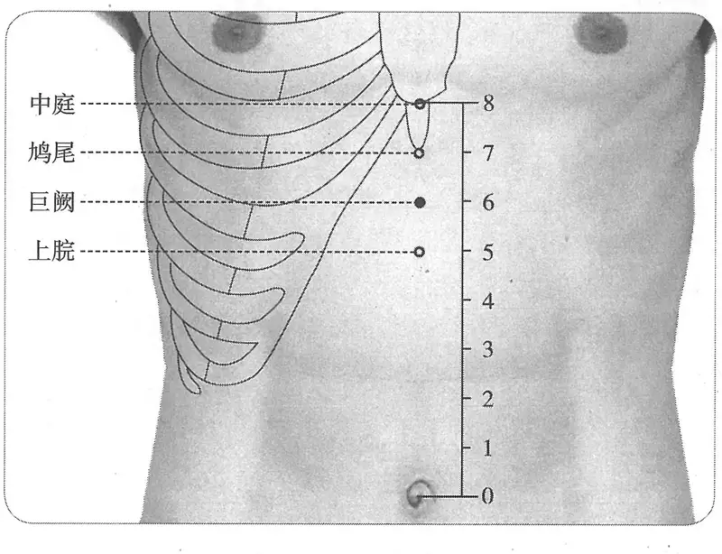

**图2-420　巨阙穴图**

灸大成》、《针方六集》、《类经图翼》、《针灸易学》、《针灸逢源》）

　　(2) 在鸠尾穴下五分，去鸠尾骨端一寸。（《医心方》卷二）

　2. 在龙头骨下一寸是也。（《医心方》卷二十眉注）

**按**：龙头骨即鸠尾骨。

　3. 在心鸠尾下一寸五分。（《医心方》卷二十二）

　4. 在鸠尾下一寸。鸠尾拒者少令强一寸。中人有鸠尾拒之。（《铜人腧穴针灸图经》卷中）

**按**：意即若鸠尾骨短者，则本穴在鸠尾穴一寸稍多些。

　5. 在鸠尾下一寸，中脘上二寸五分。（《循经考穴编》）

　6. 从上脘上行在两歧骨下二寸。（《医宗金鉴·刺灸心法要诀》）

**按**：此将“蔽骨”（剑突）理解为“歧骨”（剑胸联合），非是。

　7. 针灸方腧穴定位

　　(1) 正心厌尖下一寸是也。（《肘后备急方》卷二、《外台秘要》）

**按**：心厌尖，即“心蔽骨”尖，也即剑突尖下。

　　(2) 巨阙，大人去鸠尾下一寸，小儿去脐作六分分之，去鸠尾下一寸是也。（《千金要方》卷五上）

　　(3) 在心下一寸。（《千金要方》卷十、卷二十，《千金翼方》）

　　(4) 取绳从心头骨名鸠尾头度取脐孔，中屈绳取半，当绳头名胃管。又中屈半绳更分为二分，从胃管向上度一即是上管，又上度取一分即是巨阙。（《千金要方》卷九）

　　(5) 从心厌骨向下一寸半名巨阙，取患人中指节为寸，灸三十壮。若无心厌骨，则以中指节前量横括心上，至歧骨上两头筑着骨，当横量下，以前一寸当中直下，则是巨阙也。（《外台秘要》卷三）

　　(6) 在臆前蔽骨下一寸五分，鸠尾下一寸。（《针经摘英集》）

　8. 脐上六寸。（《针灸十四经穴位考订》）

〔p.1361 (인쇄 1333)〕

　9. 统编针灸学教材

　　(1) 部位：脐上六寸。取穴：仰卧，从鸠尾下一寸取之。（1957年南京《针灸学》）

　　(2) 部位：脐上六寸。取穴：仰卧，鸠尾穴下一寸取之。（1版《针灸学讲义》）

　　(3) 部位：在鸠尾下一寸。取穴：脐上六寸，腹正中线上，仰卧取之。（2版《针灸学讲义》）

　　(4) 脐上六寸。（4、5版《针灸学》）

　　(5) 在上腹部，前正中线上，当脐中上6寸。（6版《针灸学》、《中国针灸学》）

　　(6) 前正中线上，脐上6寸，或胸剑联合下2寸。（7版《针灸学》）

**文献分析**：古代文献关于本穴定位的分歧，其主要原因有二：其一，本穴定位基准穴“鸠尾”穴本身的分歧；其二，文字描述本身即可以有不同理解。如果文字描述如《针经摘英集》作“蔽骨下一寸五分，鸠尾下一寸”，恐怕就不会产生如此多的分歧。确定本穴部位，需要一个前提和一个共识。前提：蔽骨＝鸠尾骨＝剑突。若人无蔽骨，则以一寸当之；一个共识：上脘穴距蔽骨三寸，中脘在蔽骨与脐之中点。基于此，只能得出这样的结论：巨阙在鸠尾穴下一寸（距蔽骨一寸半）。

#### 【类属】 

心之募穴。任脉穴。

任脉气所发。（《黄帝明堂经》）

#### 【适应症】 

主治心胸部、腹部病症。常用于胸痛、气喘、心烦、心悸；腹痛，呕吐，吞酸；癫，狂，痫。

　1. 主心痛不可按，烦心。热病，胸中澹澹，腹满暴痛，恍惚不知人，手清，少腹满，瘛疭，心痛，气满不得息。息贲时唾血。心腹胀满。噫，烦热善呕，膈中不通利。霍乱。狂，妄言，怒恐恶火，善骂詈。狐疝，惊悸少气。胸胁榰满，瘛疭引脐腹痛，短气烦满，呕吐。（《黄帝明堂经》）

**按**：从《黄帝明堂经》载心之俞、募穴主治特点来看，两者皆主心病，但募穴“巨阙”更偏于治疗心神病症。

　2. 主疗心中烦闷，热风，风痫，浪言或作鸟声，不能食，无心力，凡心痛有数种，冷痛，蛔虫心痛，虫毒，霍乱不识人。（《太平圣惠方·针经》）

　3. 霍乱吐利不止，困顿不知人。（《太平圣惠方·明堂》）

　4. 治心中烦满，热病，胸中痰饮，腹胀暴痛，恍惚不知人，息贲时唾血，蛔虫心痛，蛊毒，霍乱，发狂不识人，惊悸少气。（《铜人腧穴针灸图经》卷中）

　5. 窦太师针灸遗存

　　(1) 治九种心疼，番胃吐食疾，涎盛，五噎，七疝等症，看症补泻。（《窦太师针经》）

　　(2) 主九种心疼，翻胃隔食，痰涎壅塞，惊悸健忘，五噎不顺，七疝冲心。（《循经考穴编》下）

　6. 此穴化气除涎大妙。（《针经摘英集》）

　7. 主上气咳逆，背痛，胸痛，痞塞；胸中痰饮；黄疸，急疸，急疫；五脏气相干；卒心痛，尸厥，妊娠子上冲心昏闷，刺巨阙。（《针灸聚英》卷一、《针灸大成》）

　8. 统编针灸学教材

　　(1) 心痛，反胃，膈食，吞酸，呕吐，癫狂，痫厥，惊悸，健忘。（1957年南京《针灸学》、1版《针灸学讲义》）

　　(2) 心胸痛，反胃，吞酸，噎膈，呕吐，癫狂，痫证，心悸。（2版《针灸学讲义》、4版《针灸学》、《中国针灸学》）

〔p.1362 (인쇄 1334)〕

　　(3) 胸痛，心悸，呕吐，吞酸，癫狂痫。（5、7版《针灸学》）

　　(4) 胸痛，心痛，心悸，呕吐，癫狂痫。（6版《针灸学》）

**文献分析**：窦太师针灸载本穴主治强调了“祛痰”之效；《针经摘英集》也谓“此穴化气除涎大妙”，并有相应的临床应用，而现代针灸临床尚未注意本穴的这一主治特点；此外，本穴与心俞所主心痛的特点是伴有“气短”、“心烦”的症状，各版针灸学教材未收录，今补之。

#### 附：临床应用举例 

　1. 心、胸部病症

　　(1) 少阴脉不至，肾气微，少精血，奔气促迫，上入胸膈，宗气反聚，血结心下，阳气退下，热归阴股，与阴相动，令身不仁，此为尸厥。当刺期门、巨阙。（《伤寒论》卷一）

　　(2) 治心疝发作有时激痛难忍方：灸心鸠尾下一寸，名巨阙，及左右一寸。并百壮。（《补辑肘后方》上卷）

　　(3) 人心痛欲死，灸巨阙，在心一寸，三壮即瘥。（敦煌卷子P2666《单药方》）

　　(4) 上气咳逆，胸满短气牵背痛，灸巨阙、期门各五十壮。（《千金要方》卷十八）

　　(5) 心闷痛上气牵引小肠，灸巨阙二七壮。（《千金要方》卷十三）

　　(6) 心痛暴恶风，灸巨阙百壮。（《千金要方》卷十三）

　　(7) 当心下一寸，名巨阙。主心闷痛，上气，引少腹冷，灸二七壮。（《千金要方》卷十三、《千金翼方》）

　　(8) 心烦短气，灸小肠俞。又灸巨阙、期门各一百壮，针入五分。（《千金翼方》卷二十七）

　　(9) 如灸冷心痛，燔针针任脉巨阙穴。（《针经摘英集》

　　(10) 治胸中痰饮，蛊毒，霍乱，惊悸，腹胀暴痛，恍惚不止，吐逆不食，刺任脉巨阙一穴，心之募也，在臆前蔽骨下一寸五分，鸠尾下一寸，用毫针，针入六分。即止，此穴化气除涎大妙。次针足阳明经三里二穴，应时立愈。（《针经摘英集》）

　　(11) 心剧痛：①心俞、巨阙、心平；②厥阴俞、膻中、内关。两组交替使用，并随症加取配穴。［中级医刊，1981(12)：34］

　2. 心神病症

　　(1) 诸痫病如尸厥吐沫，灸巨阙穴三壮，在鸠尾下一寸陷者中，炷如小麦大。（《太平圣惠方·明堂》）

　　(2) 风狂妄语，乃心气不足，为风邪客于包络也，先服睡圣散，灸巨阙穴七十壮，灸疮发过，再灸三里五十壮。（《扁鹊心书》卷上）

　　(3) 鬼邪着人，灸巨阙五十壮，脐下三百壮。（《扁鹊心书》卷上）

　　(4) 昏默不省人事，饮食欲进不进，或卧或不卧，或行或不行，莫知病之所在，乃思虑太过，耗伤心血故也，灸巨阙五十壮。（《扁鹊心书》卷上）

　3. 胃脘部病症

　　(1) 吐逆不得食，灸巨阙五十壮。（《千金要方》卷十六）

　　(2) 治卒哕，灸或中、中府、胃管各数十壮，灸尺泽、巨阙各七壮。（《千金翼方》卷二十七）

〔p.1363 (인쇄 1335)〕

　　(3) 胃脘停痰，口吐清水，巨阙一穴、厉兑二穴、中脘一穴。（《针灸大全》卷四）

　　(4) 胃下垂：巨阙穴、肓俞，长针治疗。［上海针灸杂志，1985(2)：7］

　4. 其他病症

　　(1) 治产子上逼心：病人正坐，用人抱头抱腰微偃，以毫针刺任脉巨阙一穴。举手下针，刺至即止，令人立苏不闷。次针补手阳明经合谷二穴，泻足太阴经三阴交二穴，应针而落。（《针经摘英集》）

　　(2) 妇人产难，子掬母心不能下，巨阙一穴、合谷二穴、三阴交穴、至阴二穴灸效。（《针灸大全》卷四）

#### 【操作】 

直刺0.5~1寸。肝肿大及心脏扩大病人，不宜深刺，更不能针尖向上斜刺。

　1. 刺入六分，留七呼，灸五壮。（《黄帝明堂经》）

　2. 巨阙、鸠尾虽是胸腹之穴，灸之不过四七，艾炷不须大作，只依竹箸头大，但令正当脉灸之。艾炷若大，复灸多，其人永无心力。（《太平圣惠方·针经》）

　3. 针入六分，留七呼，得气即泻。灸亦得，日灸七壮，至七七壮。（《太平圣惠方·针经》）

　4. 窦太师针灸遗存

　　(1) 针入二寸半，灸五十壮。（《窦太师针经》）

　　(2) 窦氏针入二寸五分，针头向下施。（《针方六集》卷一）

　5. 针五至一寸，灸三至十五壮。（《针灸十四经穴位考订》）

　6. 统编针灸学教材

　　(1) 针三至八分，灸五至十五壮。（1957年南京《针灸学》、1版《针灸学讲义》）

　　(2) 直刺3~5分，艾条灸5~15分钟。（2版《针灸学讲义》）

　　(3) 向下斜刺0.5~1寸。（4、5版《针灸学》）

　　(4) 向下斜刺0.5~1寸，不可深刺，以免损伤肝脏；可灸。（6、7版《针灸学》）

　　(5) 直刺0.3~0.8寸。可灸。（《中国针灸学》）

　7. 直刺，深约1.5~2寸。感应：局部胀闷，有时可向上下扩散。灸3~5壮；温灸5~15分钟。注意：肝脏左叶肿大及心脏扩大病人，不宜深刺，也不要针尖向上斜刺。（上海《针灸学》）

**文献分析**：窦太师针灸所述本穴针刺深度明显比现代针灸教材深，但此为向下斜刺。现代针灸临床也常采用向下斜刺的方法。

### （十五）鸠尾 Jiūwěi CV15 出《灵枢》 

问题1：鸠尾骨与鸠尾穴的关系如何？

问题2：“鸠尾”与“巨骨”穴有何异同？

#### 【提要索隐】 

**穴名**：一名尾翳，一名髑骬。

**定位**：在上腹部，剑胸结合下1寸，前正中线上。

**适应症**：主治胸部、腹部病症。常用于胸痛，气喘；腹胀，呃逆；癫，狂，痫。

**针刺操作**：向下斜刺0.5~1寸。勿直刺或向上斜刺，以免刺伤心、肺、肝脏。

#### 【名实考】 

本穴在鸠尾骨下，故曰“鸠尾”。又鸠尾骨正名为“髑骬”，故本穴又名“髑骬”，后人因不识“骬”字，多误写作“骭”字。

〔p.1364 (인쇄 1336)〕

本穴在巨骨下，《太平圣惠方》另载有“巨骨”一穴，后世引用多有混淆二穴者。

鸠尾，既是骨名，又是穴名。作为骨名，曰“鸠尾骨”，又称“蔽骨”、“心蔽骨”、“心厌骨”、“龙骨头”、“髑骬”、“巨骨”，皆指剑突，骨下五分是为鸠尾穴。需要注意的是，《太平圣惠方》巨骨穴下“心蔽骨”误作“心髀骨”，这一误写，让王执中困惑不解。

又《医心方》引《曹氏灸经》谓“神府”、“龙头”即是鸠尾。经考证，三者定位不同，故不作为本穴别名。

　1. 膏之原，出于鸠尾，鸠尾一。（《灵枢·九针十二原》）

　2. 鸠尾，一名尾翳，一名髑骬，在臆前蔽骨下五分，任脉之别。（《黄帝明堂经》）

　3. 任冲之别，名曰尾翳，下鸠尾，散于腹。实则腹皮痛，虚则痒搔，取之所别。杨上善注曰：尾则鸠尾，一名尾翳，是心之蔽骨。此之络脉，起于尾翳，故得其名。（《黄帝内经太素·十五络》）

　4. 鸠尾，心前穴名也。其正当心蔽骨之端，言其骨垂下如鸠鸟尾形，故以为名也。（《素问·气府论》王冰注）

　5. 以其骨之下垂如鸠尾也。（《经穴解》）

　6. 别名　曷曷、臆前、神府、干于。（1957年南京《针灸学》）

**按**：曷曷、干于皆“髑骬”形误；“臆前”之名录自日本针灸教材，根本就不是一个完整的词语，更不是穴名，录于此，大误；“神府”与本穴定位不同，考证详见于下。

#### “鸠尾”骨辨 

　1. 无髑骬者心高，髑骬小短举者心下。髑骬长者心下坚，髑骬弱小以薄者心脆。髑骬直下不举者心端正，髑骬倚一方者心偏倾也。（《灵枢·本藏》）

　2. 鸠尾盖心上人无蔽骨者当从上歧骨下行一寸半。《气府论》注云：一寸为鸠尾处，若不为鸠尾处，则针巨阙者中心。人有鸠尾短者，少饶令强一寸。（《针灸甲乙经》卷三）

　3. 鸠尾，在臆前，蔽骨下同身寸之五分。人无蔽骨者，从岐骨际下行同身寸之一寸。（《素问·气府论》王冰注）

　4. 有无鸠尾者，当从臆前骨歧下一寸为鸠尾骨。骨下更取五分为鸠尾穴。（《医心方》卷二）

　5. 鸠尾一穴在蔽骨之端言其骨垂下如鸠尾形，故以为名，臆前蔽骨下五分。人无蔽骨者，从歧骨之际下行一寸是。（《铜人腧穴针灸图经》卷上）

**按**：以上文献表明：“髑骬”即“蔽骨”，“鸠尾”、“鸠尾骨”。而且从所述其在不同的个体，或有或无，其形态或长或短，或偏或正等情形来看，其为“剑突”无疑。后世文献乃至现代针灸教材或将其理解“歧骨”（剑胸联合），非是。由于这一误解，不仅导致本穴定位的差错，而且造成上腹部折量骨度的起点的改变，引起基于这一骨度定位的众多穴的位置在不知不觉发生了改变，至今难以回改。

关于鸠尾骨的长度，《医心方》所辑录《黄帝内经明堂》传本佚文最为明确：为一寸。由于王冰注没有明确“一寸”是鸠尾骨，还是鸠尾穴，后人遂各有不同理解，引起定位的分歧。

#### “鸠尾”、“神府”、“龙头”穴辨 

　1. 鸠尾，在臆前蔽骨下五分。（《黄帝明堂经》）

　2. 神府者，人神之明堂也……此则鸠尾，一名龙头是也。（《医心方》卷二引自《曹氏灸经》）

〔p.1365 (인쇄 1337)〕

　3. 心痛暴绞急绝欲死，灸神府百壮，在鸠尾，正心有忌。（《千金要方》卷十三）

　4. 心痛暴绞，急欲绝，灸神府百壮。附鸠尾正当心，有忌。（《千金翼方》卷二十七）

　5. 心痛暴绞急绝欲死：灸神府百壮。附心鸠尾，正心有忌。（《医心方》卷六）

　6. 心痛冷气，上灸龙颔百壮，在鸠尾头上行一寸半，不可刺之。（《千金要方》卷十三）

　7. 心痛冷气，上鸠尾上一寸半，名龙颔，灸百壮，不针。（《千金翼方》卷二十七）

　8. 心痛冷气上，灸龙头百壮。在心鸠尾头上行一寸半。（《医心方》卷六）

　9. 巨阙，在龙头骨下一寸是也。（《医心方》卷二十眉注）

**按**：第三、四、五条“神府”穴定位文字中之“鸠尾”皆系骨名，而非穴名。所述之神府穴与下述之“巨骨”穴相近，而与“鸠尾”穴不同；而“龙头”穴更是在鸠尾穴之上方，而绝非同一穴。又，鸠尾骨又名“龙头骨”，其上方之穴名“龙头”，较“龙颔”义长。所以将“神府”、“龙头”穴与鸠尾穴相混者，盖将骨名与穴名相混之故也。

#### “鸠尾”与“巨骨”穴辨 

　1. 巨骨一穴，在心脾骨头是穴。日灸三壮，至七壮止。主惊痫，破心吐血。禁不可针，针则倒悬一食顷，然后乃得下针。针入四分，浮之勿补，针出始得正卧。忌酒、面、热食、猪、鱼，不慎生冷等。（《太平圣惠方·针经》

　2. 鸠尾一穴，在臆前巨骨下五分是穴。主心惊痫，发状如鸟鸣，被心吐血，心中气闷，不喜闻人语，心痛腹胀。宜针即大良。虽然此处是大难针，非是大好手方可下针，如其不然，取气多，不幸令人死。针入四分，留三呼，泻五吸，肥人可倍之。忌如前法。（《太平圣惠方·针经》）

　3. 巨骨二穴，在肩端上行两叉骨间陷中。灸五壮，针寸半。《明》云：巨骨一穴，在心脾骨头，日灸三壮至七壮，禁针，针则倒悬一食顷乃得下针，针入四分，泻之勿补，针出始得正卧，忌同。《铜人》云：巨骨一穴，在肩端上两叉骨间，《明堂下经》亦同。但《明堂上经》云巨骨一穴在心脾骨头，不特“一穴”字不同，而穴在心脾骨头亦异，岂其所谓一穴在心脾头者，非巨骨耶？不然，即是误写“二”字作“一”字，“肩胛”为“心脾”也。（《针灸资生经》卷一）

**按**：通过对照不难发现，巨骨穴与前述之“神府”穴很相近，而与“鸠尾”穴不同。然而由于“心蔽骨”因音同而被抄作“心脾骨”，加之“巨骨”作为“蔽骨”一名不为人所熟知，致使王执中编《资生经》时难以判定，而误当于手阳明经“巨骨”穴下，明代高武也因此将此二“巨骨”穴相混，明以后针灸书多承其误。

今查《千金要方》一书，其鸠尾骨头下凹陷处也为常用之穴，后人不识，多误作鸠尾穴：

　　(1) 小儿囟陷，灸脐上下各半寸，及鸠尾骨端。又足太阴各一壮。（《千金要方》卷五）

　　(2) 少年房多短气，灸鸠尾头五十壮。（《千金要方》卷十七）

　　(3) 牛痫之为病，目正直视腹胀，灸鸠尾骨及大椎各二壮。烧牛蹄末，服之良。（《千金要方》卷五上）

　　(4) 小儿牛痫，目直视腹胀乃发也，灸鸠尾一穴三壮，在胸蔽骨下五分陷者中，炷如小麦大。（《太平圣惠方·明堂》）

　　(5) 小儿食痫者，先寒热洒淅乃发也，灸鸠尾上五分三壮，炷如小麦大。（《太平圣惠方·明堂》）

　　(6) 漏，灸鸠尾骨下宛宛中七十壮。（《千金要方》卷二十三）

#### 【定位】 

**部位**：在上腹部，剑胸结合下1寸，前正中线上（图2-421）。

〔p.1366 (인쇄 1338)〕

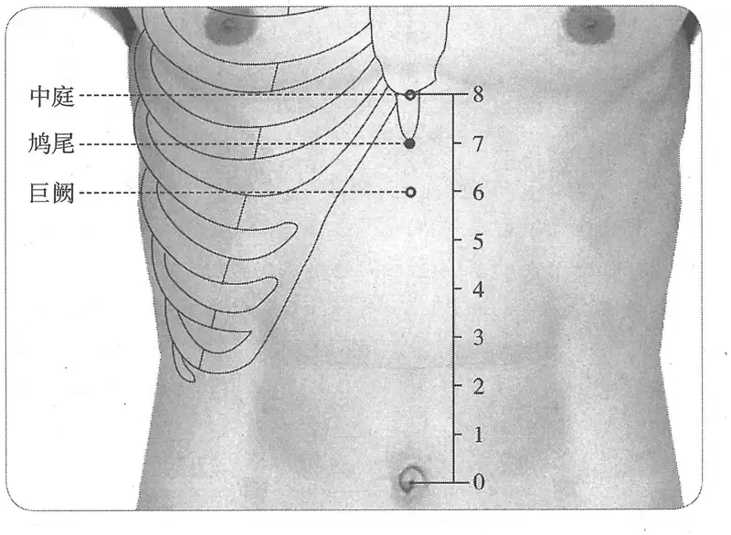

**图2-421　鸠尾穴图**

　1. 在臆前蔽骨下五分。（《黄帝明堂经》、《太平圣惠方》、《铜人腧穴针灸图经》、《圣济总录》、《针灸资生经》、《窦太师针经》、《十四经发挥》、《医学纲目》、《针灸聚英》、《古今医统》、《医学入门》、《针方六集》、《类经图翼》、《循经考穴编》、《针灸逢源》）

　2. 有无鸠尾者，当从臆前骨歧下一寸为鸠尾骨。骨下更取五分为鸠尾穴。（《医心方》卷二）

　3. 在臆前巨骨下五分。（《太平圣惠方·针经》、《针灸资生经》）

　4. 窦太师针灸遗存

　　(1) 在巨阙上一寸，脐上七寸是穴。（《窦太师秘传》）

　　(2) 在臆前蔽骨下五分，无蔽骨者从歧骨之际下行一寸半，中庭骨下五分。（《大本琼瑶神书》）

　　(3) 在臆蔽骨下五分。广注若人蔽骨难得者，取歧骨下行一寸五分……此穴正当心之尽处。（《循经考穴编》下）

　5. 无蔽骨者，从歧骨际下行一寸取之，言其骨垂下如鸠尾之形也。（《医学入门》卷一、《针方六集》）

　6. 两歧骨下一寸。（《针灸大成》卷七、《针灸易学》）

　7. 人无蔽骨者，从歧骨际下行一寸。《甲乙经》曰一寸半。（《类经图翼》卷八）

　8. 从巨阙上行一寸。（《医宗金鉴·刺灸心法要诀》）

　9. 在歧骨下一寸五分中庭下五分……按……《甲乙经》曰：人无蔽骨者，从歧骨际下行一寸半与歧骨下五分为蔽骨。蔽骨至脐共得八寸之数相合。旧本作歧骨下一寸，误。（《针灸逢源》卷四）

　10. 脐上七寸，胸歧骨下一寸。（《针灸十四经穴位考订》）

　11. 统编针灸学教材

　　(1) 部位：胸前蔽骨下五分。取穴：仰卧，从蔽骨下五分取之，无蔽骨者，从歧骨际下行一寸取之。（1957年南京《针灸学》）

　　(2) 部位：脐上七寸。取穴：仰卧，从歧骨间下行一寸取之。（1版《针灸学讲义》）

　　(3) 部位：在臆前，蔽骨下五分。取穴：剑突下，当脐中七寸，仰卧，两臂上举取之。（2版《针灸学讲义》）

〔p.1367 (인쇄 1339)〕

　　(4) 剑突下，脐上7寸。任脉“络穴”。（4、5版《针灸学》）

　　(5) 在上腹部，前正中线上，当胸剑联合部下1寸。（6版《针灸学》）

　　(6) 前正中线，脐上7寸，或剑突下，胸剑联合下1寸。（7版《针灸学》）

　　(7) 剑突下，脐上7寸，仰卧，两臂上举取穴。（《中国针灸学》）

#### 【类属】 

任脉穴。膈之原穴。

任脉之别。（《黄帝明堂经》）

#### 【适应症】 

主治胸部、腹部病症。常用于胸痛，气喘；腹胀，呃逆；癫，狂，痫。

　1. 主心中寒，胀满不得食，息贲时唾血，血瘀，热病，胸中痛不得卧，心腹痛不可按，善哕，心疝，太息，面赤，心背相引而痛，数噫喘息，胸满咳呕，腹皮痛，瘙痒。喉痹，食不下。（《黄帝明堂经》）

　2. 主心惊痫，发状如鸟鸣，破心吐血，心中气闷，不喜闻人语，心痛腹胀。（《太平圣惠方·针经》）

　3. 主神气耗散，癫痫病，狂歌不择言也。（《太平圣惠方·明堂》）

　4. 治心风，惊痫发癫，不喜闻人语，心腹胀满，胸中满，咳逆数噫，喘息，喉痹咽壅，水浆不下。（《铜人腧穴针灸图经》卷中）

　5. 窦太师针灸遗存

　　(1) 五痫症候，泻；心火虚惊，补。（《窦太师针经》）

　　(2) 五痫证，灸泻；心痛，泻；虚怕，补。（《大本琼瑶神书》）

　6. 主偏头痛引目外眦。喉鸣，咽肿水浆不下。少年房多短气少气。（《针灸聚英》卷一、《针灸大成》）

**按**：“偏头痛引目外眦。喉鸣，咽肿水浆不下”此二条主治乃高武从《针灸资生经》误录《千金要方》之文。“少年房多短气少气”乃辑自《千金要方》灸方主治，详见“附：临床应用举例”。

　7. 主哮喘，五噎翻胃。（《循经考穴编》下）

　8. 统编针灸学教材

　　(1) 胸满咳逆，哮喘，心痛，反胃，癫狂病。（1957年南京《针灸学》、1版《针灸学讲义》）

　　(2) 心胸痛，反胃，癫狂，痫证。（2、4版《针灸学》，《中国针灸学》）

　　(3) 胸痛，腹胀，癫狂痫。（5版《针灸学》）

　　(4) 胸痛，呃逆，腹胀，癫狂痫。（6、7版《针灸学》）

**文献分析**：盖因本穴一名“尾翳”，与任脉之络同名，同时由于《经脉》篇所载之任脉之络未言明其所别之处，故《黄帝明堂经》编者只好将任脉之络病候归于与“尾翳”相关的腧穴“鸠尾”、“会阴”二穴之中，这是一种不得已的处理方法。

#### 附：临床应用举例 

　1. 心神病症

　　(1) 癫痫心风：灸鸠尾，刺后溪、神门，泻足三里。（《针灸集要·盘石金直刺秘传》）

　　(2) 失志痴呆：神门、鬼眼、百会、鸠尾。（《针灸大成》卷九）

　　(3) 五痫之证不寻常，鸠尾之中仔细详，若非明师真老手，临时犹恐致深伤。（《针灸玉龙歌》）

　　(4) 鸠尾能治五般痫，若下涌泉人不死。（《席弘赋》）

　　(5) 气郁木僵症、气痫昏厥症、顽固性呃逆症、噎膈症：针刺鸠尾穴。［针灸临床杂志，2002，18(3)：35］

〔p.1368 (인쇄 1340)〕

　2. 其他病症

　　(1) 痨瘵四肢消瘦，面色痿黄，筋寒骨热，皮肉干枯，黄疸，并皆治之：灸百劳、膏肓、肺俞、鸠尾、关元、绝骨、足三里，每日灸二七壮，至半月灸毕。然后灸绝骨、足三里，各灸七七壮。（《针灸集要·盘石金直刺秘传》）

　　(2) 百会鸠尾治痢疾。（《灵光赋》）

　　(3) 小儿脱肛患多时，先灸百会次鸠尾。（《席弘赋》）

　　(4) 脱肛：百会穴、长强穴、鸠尾穴，艾卷灸。［中国针灸，1985，5(6)：45］

　　(5) 胆蛔之心下痛：针刺鸠尾穴治疗。［四川中医，1984，2(6)：42］

　　(6) 急性腰部扭伤：鸠尾穴留针治疗。［中医骨伤科杂志，1986，2(3)：45］

　　(7) 呃逆：下脘穴、鸠尾穴，针刺治疗。［河北中医，1987(3)：30］

　　(8) 胃痉挛：针刺鸠尾穴治疗。［浙江中医杂志，1988，23(2)：90］

#### 【操作】 

向下斜刺0.5~1寸。勿直刺或向上斜刺，以免刺伤心、肺、肝脏。

　1. 不可灸刺。（《黄帝明堂经》）

　2. 巨阙、鸠尾虽是胸腹之穴，灸之不过四七，艾炷不须大作，只依竹箸头大，但令正当脉灸之。艾炷若大，复灸多，其人永无心力。（《太平圣惠方·针经》）

　3. 宜针即大良。虽然，此处是大难针，非是大好手方可下针，如其不然，取气多，不幸令人死。针入四分，留三呼，泻五吸，肥人可倍之。（《太平圣惠方·针经》）

　4. 窦太师针灸遗存

　　(1) 针二寸半，灸二七壮。此穴非高手良医不可下，此针有损无益，不宜多灸。（《窦太师针经》）

　　(2) 针二寸半，灸二七壮。此穴大难针，取气多令人夭，断不可针。（《窦太师秘传》）

　　(3) 窦氏针入一寸五分，针头向下施，禁不宜直入。（《针方六集》卷一）

　5. 此穴正当心之尽处，凡下针，须以冷水噀患者面，使其心急缩，随噀下针。《经神集》云：欲刺鸠尾，先针涌泉。（《循经考穴编》下）

**按**：此法见于《席弘赋》：“鸠尾能治五般痫，若下涌泉人不死。”

　6. 针三至五分，灸三壮。《铜人》：禁灸，针时高举二手抱头，然后下针。（《针灸十四经穴位考订》）

　7. 统编针灸学教材

　　(1) 针五分，针锋微向下成四十五度角，先使两手上举，然后进针，灸三至五壮。（1957年南京《针灸学》、1版《针灸学讲义》）

　　(2) 向下斜刺5分，艾条灸3~5分钟。（2版《针灸学讲义》）

　　(3) 向下斜刺0.4~0.6寸。（4、5版《针灸学》）

　　(4) 向上斜刺0.5~1寸。（6版《针灸学》）

　　(5) 向下斜刺0.5~1寸。（7版《针灸学》）

　　(6) 向下斜刺0.4~0.6寸。可灸。（《中国针灸学》）

**文献分析**：窦太师针灸，本穴针刺深度明显较现代针灸学教材为深，然其非直刺，而是向下斜刺的长度。并明言“不宜直入”，切记！《经神集》是明代针灸大家凌云针书之一集，其针法经验也可供临床借鉴。

〔p.1369 (인쇄 1341)〕

### （十六）中庭 Zhōngtíng CV16 出《黄帝明堂经》 

#### 【提要索隐】 

**定位**：在胸部，剑胸结合中点处，前正中线上。

**适应症**：主治胸膈部病症。常用于胸胁胀满，噎膈，呕吐。

**针刺操作**：平刺。

#### 【名实考】 

　1. 中庭，在膻中下一寸六分陷者中，任脉气所发，仰而取之。（《黄帝明堂经》）

　2. 中庭者，为心之庭也，心在内，而此穴为外见之庭。（《经穴解》）

#### 【定位】 

**部位**：在胸部，剑胸结合中点处，前正中线上（图2-422）。

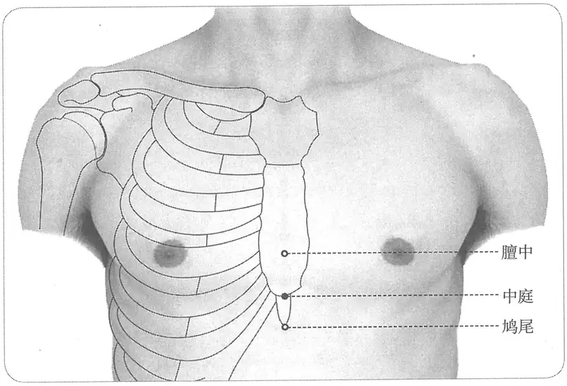

**图2-422　中庭穴图**

　1. 在膻中下一寸六分陷者中。（《黄帝明堂经》、《太平圣惠方·针经》、《铜人腧穴针灸图经》、《圣济总录》、《针灸资生经》、《窦太师针经》、《十四经发挥》、《医学纲目》、《针灸聚英》、《针灸问对》、《古今医统》、《针灸大成》、《针方六集》、《类经图翼》、《循经考穴编》、《针灸易学》、《针灸逢源》）

　2. 在膻中下一寸宛宛中。（《太平圣惠方·明堂》、《针灸资生经》）

　3. 从鸠尾上行一寸陷中。（《医学入门》卷一、《医宗金鉴·刺灸心法要诀》）

　4. 胸中下约一寸六分，正对胸骨体下端。（《针灸十四经穴位考订》）

　5. 统编针灸学教材

　　(1) 部位：在膻中下一寸六分陷中。取穴：仰卧，从两乳中间膻中穴之下方一寸六分取之，或循左右第五肋间隙，按至胸骨中央取之自天突至膻中以六寸八分计算，如以肋间取之，较为正确。（1957年南京《针灸学》）

　　(2) 部位：仰卧，从第五肋间按至胸骨中央取之。取穴：仰卧，从第五肋间按至胸骨中央取之。（1版《针灸学讲义》）

〔p.1370 (인쇄 1342)〕

　　(3) 部位：在膻中下一寸六分陷者中。取穴：在胸骨正中线上，平第五肋间隙，仰卧取之。（2版《针灸学讲义》）

　　(4) 胸剑联合的中点。（4、5版《针灸学》）

　　(5) 在胸部，当前正中线上，平第五肋间，即胸剑结合部。（6、7版《针灸学》）

　　(6) 在胸骨正中线上，平第五肋间隙。（《中国针灸学》）

**文献分析**：本穴定位“膻中穴下一寸六分”，是依据《灵枢·骨度》“缺盆以下至髑骬长九寸”折算而来，《太平圣惠方·明堂》作“膻中下一寸”者，非是；《医学入门》作“鸠尾上一寸”，也不相合。现代临床一般都以肋间比量，而不拘于分寸。

#### 【类属】 

任脉穴。

任脉气所发。（《黄帝明堂经》）

#### 【适应症】 

主治胸膈部病症。常用于胸胁胀满，噎膈，呕吐。

　1. 主胸胁榰满，膈塞，心下响响然，饮食不下，呕吐，食入腹还出。（《黄帝明堂经》）

**按**：“饮食不下，呕吐，食入腹还出”乃“气膈”证，又称“上膈”，《灵枢·上膈》论之甚详。下脘穴也主此证，当参看。

　2. 治胸胁支满，噎塞，食饮不下，呕吐食还出。（《铜人腧穴针灸图经》卷中、《圣济总录》）

　3. 窦太师针灸遗存

　　(1) 治胸膈痛，吐涎沫。（《窦太师针经》）

　　(2) 呕吐痰涎。（《针方六集》卷五）

　　(3) 主呕吐翻胃，咽喉噎塞，状如梅核。（《循经考穴编》下）

　4. 小儿吐奶。（《针灸聚英》卷一、《古今医统》、《针灸大成》）

　5. 统编针灸学教材

　　(1) 胸胁支满，咽痛，噎塞，饮食不下，呕吐。（1957年南京《针灸学》）

　　(2) 胸胁支满，噎塞，饮食不下，呕吐。（1版《针灸学讲义》）

　　(3) 胸胁胀满，噎膈吐逆，小儿吐乳。（2版《针灸学讲义》）

　　(4) 胸胁胀满，饮食不下，呕吐反胃，小儿吐乳。（4版《针灸学》）

　　(5) 胸胁胀满，心痛，呕吐，小儿吐乳。（5、6版《针灸学》）

　　(6) ①胸胁胀满，噎膈，呕吐等胃气上逆病证；②心痛；③梅核气。（7版《针灸学》）

　　(7) 胸胁胀满，噎膈，翻胃，饮食不下。（《中国针灸学》）

#### 附：临床应用举例 

　1. 小儿呕吐奶汁，灸中庭一穴一壮。（《太平圣惠方·明堂》）

　2. 赵运使夫人，年五十八岁，于至元甲戌三月中，病脐腹冷疼，相引胁下痛不可忍，反复闷乱，不得安卧。予以当归四逆汤主之，先灸中庭穴。（《卫生宝鉴》卷十八）

#### 【操作】 

平刺。

　1. 刺入三分，灸五壮。（《黄帝明堂经》）

　2. 禁针，灸七壮。（《窦太师针经》）

　3. 针三分，灸五壮。沿皮横针，不是直刺。（《针灸十四经穴位考订》）

　4. 统编针灸学教材

　　(1) 针三至四分，针尖沿皮向下方，灸三至五壮。（1957年南京《针灸学》、1版《针灸学讲义》）

　　(2) 向下沿皮刺3~4分，艾条灸3~5分钟。（2版《针灸学讲义》）

〔p.1371 (인쇄 1343)〕

　　(3) 平刺0.3~0.5寸。（4、5、7版《针灸学》）

　　(4) 平刺0.3~0.5寸；可灸。（6版《针灸学》、《中国针灸学》）

### （十七）膻中 Dànzhōng CV17 出《黄帝明堂经》 

问题1：为什么心包募穴直到现代才补上？

问题2：巨阙为心之募，何以背俞穴中于心俞之外，另有巨阙俞？

#### 【提要索隐】 

在形成经脉学说的早期，与心相关联的经脉是手心主脉（即后来的“手厥阴心包经”），相应的俞、募穴即为巨阙、心俞，而在《灵枢·经脉》中，与心相关联的经脉是手少阴脉，心之俞、募穴巨阙、心俞自然也随之归属之。这样原先的手心主脉便无俞、募穴与之相配。后来《千金翼方》载有“巨阙俞”，即《千金要方》所载之“厥阴俞”，宋代《铜人针灸腧穴图经》将厥阴俞归入足太阳经，而将其定为心包之背俞则见于明代《针灸聚英》。这样手厥阴有了背俞穴；又在《内经》中“膻中”（部位名）与心包相关，《素问亡篇》更是明言膻中为“手厥阴包络之所居”，今人则以“膻中”穴为心包之募。

**穴名**：膻中，宋以前文献多作“亶中”。一名元儿。

**定位**：在胸部，横平第4肋间隙，前正中线上。

**适应症**：主治心、胸部病症。常用于胸闷、心痛；咳嗽，气喘；噎膈；产后缺乳。

**备选适应症**：乳痛，乳癖。

**针刺操作**：平刺。

#### 【名实考】 

膻，胸脯也。本穴在胸脯之中央，故曰“膻中”。

膻中，《千金要方》、《千金翼方》、《外台秘要》均作“亶中”。明刊本《针灸甲乙经》卷三作“膻中”，卷九第三仍作“亶中”。《大本琼瑶神书》载本穴别名有“一名胸堂”，检《千金要方》卷十七有谓胸堂穴“在两乳间”，与膻中穴相当，然《千金要方》载针灸方中有“胸堂”与“膻中”同见于一方者，故暂不将“胸堂”作为膻中穴的别名。

　1. 膻中，一名元儿，在玉堂下一寸六分，直两乳间陷者中，任脉气所发，仰而取之。（《黄帝明堂经》）

　2. 膻中穴，一名元儿，一名胸堂，在玉堂下六分，两乳中间，仰卧取穴。（《大本琼瑶神书》）

　3. 膻中，一名元儿，一名上气海。（《类经图翼》）

**按**：此将《灵枢》论部位之“膻中”与穴位之相混，不从。

　4. 此穴内直心包络，故心之包络，一名膻中，为臣使之官。（《经穴解》）

　5. 别名　元见、上气海、胸堂。（1957年南京《针灸学》）

**按**：“元见”系“元兒”之形误。

#### “膻中”辨异 

既是穴名，又是部位名。《内经》中“膻中”一词皆为部位名，而非穴名：

　1. 三焦手少阳之脉，起于小指次指之端，上出两指之间，循手表腕，出臂外两骨之间，上贯肘，循臑外上肩，而交出足少阳之后，入缺盆，布膻中，散落心包。（《灵枢·经脉》

　2. 夫胸腹，藏府之郭也。膻中者，心主之官城也。（《灵枢·胀论》）

**按**：这里的“心主”是指心，而不是心包。杨上善曰：“膻中有心肺之气，故是脏腑之官也”。

〔p.1372 (인쇄 1344)〕

　3. 厥阴根于大敦，结于玉英，络于膻中。（《灵枢·根结》

　4. 膻中者为气之海。（《灵枢·海论》）

　5. 黄帝问曰：愿闻十二藏之相使，贵贱何如？岐伯对曰：悉乎哉问也！请遂言之。心者，君主之官也，神明出焉。肺者，相傅之官，治节出焉。肝者，将军之官，谋虑出焉。胆者，中正之官，决断出焉。膻中者，臣使之官，喜乐出焉。（《素问·灵兰秘典论》）

**按**：这里的“膻中”为五官之一。

　6. 右外以候肺，内以候胸中；左外以候心，内以候膻中。（《素问·脉要精微》）

**按**：犹如“胸中”为“肺”之宫城，“膻中”为“心”之宫城。

　7. 膻中者为气之海，其输上在柱骨之上下，前在于人迎。杨上善注：膻，胸中也，音檀。食入胃已，其气分为三道，有气上行经隧，聚于胸中，名曰气海，为肺所主。手阳明是肺府脉，行于柱骨上下，入缺盆，支者上行至鼻，为足阳明，循颈下人迎之前，皆是膻中气海之输也。（《黄帝内经太素·四海合》）

　8. 膻中者，在胸两乳间，为气海，手厥阴包络之所居。（《素问亡篇·刺法论》）

**按**：此时，“膻中”已经从“心主”之所居，演变成“心包”之所居了。

#### 【定位】 

**部位**：在胸部，横平第4肋间隙，前正中线上（图2-423）。

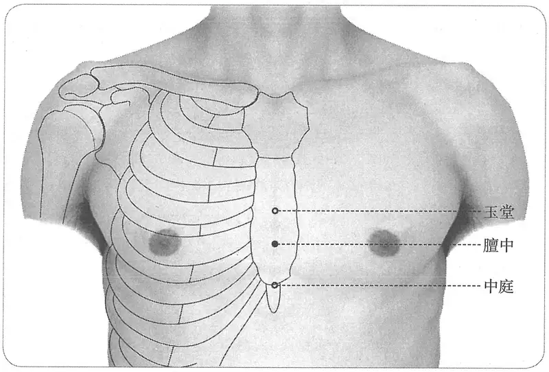

**图2-423　膻中穴图**

　1. 在玉堂下一寸六分，直两乳间陷者中。（《黄帝明堂经》、《太平圣惠方》、《铜人腧穴针灸图经》、《圣济总录》、《针灸资生经》、《十四经发挥》、《医学纲目》、《针灸聚英》、《古今医统》、《医学入门》、《针灸大成》、《针方六集》、《类经图翼》、《循经考穴编》、《针灸易学》、《针灸逢源》）

　2. 在胸前两边对乳，胸压骨解间，指按觉气翕翕尔是也。一云正胸中一穴也。（《肘后备急方》卷三）

　3. 穴在鸠尾上一寸。（《千金要方》卷十三、《外台秘要》）

**按**：《新雕孙真人千金要》“一寸”作“二寸”，义长。

〔p.1373 (인쇄 1345)〕

　4. 在乳两间折中而取之，有陷是穴，仰而取之。（《神应经》）

　5. 从中庭上行一寸六分。（《医宗金鉴·刺灸心法要诀》）

　6. 两乳之间，正对第五肋骨之端。（《针灸十四经穴位考订》）

　7. 统编针灸学教材

　　(1) 部位：玉堂下一寸六分，横量两乳间陷中。取穴：仰卧，于胸骨中央当两乳中间取之，妇女按取第五肋骨间隙之中间取之。（1957年南京《针灸学》）

　　(2) 部位：玉堂穴下一寸六分。取穴：仰卧，在两乳中间取穴，妇女从第四肋间隙按至胸骨中央取之。（1版《针灸学讲义》）

　　(3) 部位：在玉堂下一寸六分陷者中。取穴：胸骨中线上，平第四肋间隙，适当两乳之间，仰卧取之。（2版《针灸学讲义》）

　　(4) 前正中下，平第四肋间隙。（4、5版《针灸学》）

　　(5) 在胸部，当前正中线上，平第4肋间，两乳头连线的中点。（6版《针灸学》、《中国针灸学》）

　　(6) 前正中线上，平第4肋间隙；或两乳头连线与前正中线的交点处。（7版《针灸学》）

#### 【类属】 

任脉穴。心包募穴。八会穴之气会。

任脉气所发，仰而取之。（《黄帝明堂经》）

直到宋代才将“厥阴俞”归入足太阳经，至明代高武提出“厥阴俞”即为心包之背俞穴，吴崑从其说，将“厥阴俞”改作“心包俞”，以与其他脏腑背俞穴命名法一致。然而，对于心包经的募穴，古代腧穴文献中均无记载[^48-1]。

#### 【适应症】 

主治心、胸部病症。常用于胸闷、心痛；咳嗽，气喘；噎膈；产后缺乳。

**备选适应症**：乳痛、乳癖。

　1. 主胸痹心痛，烦满，咳逆上气，唾，喘，短气不得息，口不能言。（《黄帝明堂经》）

　2. 主肺痈咳嗽，上气吐脓，不得下食，胸中气满如塞。（《太平圣惠方·针经》）

　3. 主胸陷满闷，咳嗽气短，喉中鸣，妇人奶脉滞，无汗，下火立愈。岐伯云：积气成干噎。（《太平圣惠方·明堂》）

　4. 治肺气咳嗽，上喘唾脓，不得下食，胸中如塞。可灸七七壮。今附：疗膈气呕吐涎沫，妇人乳汁少。（《铜人腧穴针灸图经》卷中）

　5. 窦太师针灸遗存

　　(1) 治一切痰饮，哮喘嗽等症。治五噎番胃，七伤所感，怒气冲心，喉中气闭如核，妇人乳汁少，不可针。亦治腹中痰块。（《窦太师针经》）

　　(2) 治一切气痰，哮喘咳嗽等证，看证补泻；又治五噎反胃最妙。（《大本琼瑶神书》）

　6. 一传治伤寒，风痰壅盛。（《类经图翼》卷八）

　7. 统编针灸学教材

　　(1) 哮喘短气，噎膈，胸痛，妇人乳少。（1957年南京《针灸学》、1版《针灸学讲义》）

　　(2) 气喘，噎膈，胸痛，产妇乳汁少。（2版《针灸学讲义》、4版《针灸学》）

　　(3) 咳嗽，气喘，胸痛，心悸，乳少，呕吐，噎膈。（5、6版《针灸学》）

　　(4) ①咳嗽，气喘，胸闷，心痛，噎膈、呃逆等胸中气机不畅的病证；②产后乳少，乳痛、乳癖等胸乳病证。（7版《针灸学》）

[^48-1]: 近人有以“膻中”穴为手厥阴之募穴者，其依据是《灵枢·胀论》“膻中者，心主之宫城也”经文，想当然地将句中“心主”理解为“心包”，据此得出上述结论。其实《灵枢》此文中之“心主”乃指心脏而言，根本不是说“心包”。

〔p.1374 (인쇄 1346)〕

　　(5) 气喘，胸痛，胸闷，心悸，乳汁少，呃逆，噎膈。（《中国针灸学》）

**文献分析**：《黄帝明堂经》载本穴主治为胸痹心痛，自《太平圣惠方》新补妇人乳少症，并经《铜人腧穴针灸图经》强调后，临床应用较广。

#### 附：临床应用举例 

　1. 心肺、胸部病症

　　(1) 胸痹心痛，灸膻中百壮。（《千金要方》卷十三、《千金翼方》）

　　(2) 上气咳逆，灸膻中五十壮。（《千金要方》卷十八、《圣济总录》）

　　(3) 中气初发，其形似伤寒，头热面赤，心肺脉皆浮，痰涎壅盛，气喘不能安卧：先针膻中，次针足三里，治与中风同。（《针灸集要·盘石金直刺秘传》）

　　(4) 伤风、暴咳嗽、吐痰涎：泻列缺、膻中。（《针灸集要·盘石金直刺秘传》）

　　(5) 一切气逆气喘，肠鸣走注攻心：灸膻中，刺大陵、足三里，俱泻之，内庭、气海。（《针灸集要·盘石金直刺秘传》）

　　(6) 痰膈涎闷，胸中隐痛，劳宫二穴、膻中一穴、间使二穴。（《针灸大全》卷四）

　　(7) 哮喘一症最难当，夜间无睡气惶惶。天突寻得真穴在，膻中一灸便安康。（《针灸玉龙歌》）

　　(8) 冠心病心绞痛：艾灸膻中、膈俞穴治疗。［江苏中医杂志，1987(8)：15］

　　(9) 快速型房颤：内关穴、心俞、膻中穴，针灸治疗。［四川中医，1987，5(12)：51］

　　(10) 肋软骨炎：内关穴、膻中穴，针刺治愈。［中国针灸，1984，4(6)：2］

　　(11) 胸痛：针刺膻中穴治疗。［中原医刊，1986(5)：27］

　　(12) 突发性心动过速：单刺膻中治疗。［四川中医，1985，3(2)：32］

　　(13) 突发性呼吸急速症：针刺膻中穴治疗。［中国中西医结合急救杂志，2002，9(2)：75］

　2. 乳腺病症

　　(1) 乳痈红肿痛，小儿吹乳，中府二穴、膻中一穴、少泽二穴、大敦二穴。（《针灸大全》卷四）

　　(2) 妇人血沥，乳汁不通，少泽二穴、大陵二穴、膻中一穴、关冲二穴。（《针灸大全》卷四）

　　(3) 乳头生疮，名曰妒乳，乳根二穴、少泽二穴、肩井二穴、膻中一穴。（《针灸大全》卷四）

　　(4) 急性乳腺炎：肩井穴、膻中穴、乳根穴，针灸拔火罐治疗。［上海针灸杂志，1988，7(1)：22-23］

　　(5) 乳汁缺少症：针刺膻中、乳根治疗。［山东中医杂志，1995，14(11)：520］

　3. 呃逆噎膈

　　(1) 气噎，灸膻中。（《太平圣惠方》卷一百）

　　(2) 有男子忽气出不绝声，病数日矣，以手按其膻中穴而应，微以冷针频频刺之而愈，初不之灸，何其神也。（《针灸资生经》卷四）

　　(3) 治气逆发呃：膻中、中脘先补后泻。不已，再取下穴：三里、肺俞、行间。（《医学纲目》卷二十二）

　　(4) 气膈五噎，饮食不下，膻中一穴、三里二穴、太白二穴。（《针灸大全》卷四）

〔p.1375 (인쇄 1347)〕

　　(5) 顽固性呃逆：膻中穴埋针治疗。［针灸临床杂志，2001，17(3)：43］

#### 【操作】 

平刺。

　1. 刺入三分，灸五壮。（《黄帝明堂经》）

　2. 宜灸之，日灸七壮，至七七止。其穴禁不可针，针不幸令人死矣。（《太平圣惠方·针经》）

　3. 禁针，灸二七壮。忌猪鱼酒面之类。（《窦太师针经》）

　4. 针三分，灸三壮。沿皮横针，不宜直刺。（《针灸十四经穴位考订》）

　5. 统编针灸学教材

　　(1) 针三至五分，针尖沿皮向下方，灸三至七壮。（1957年南京《针灸学》、1版《针灸学讲义》）

　　(2) 向下沿皮刺3~5分；艾炷灸3~7壮，艾条灸3~7分钟。（2版《针灸学讲义》）

　　(3) 平刺0.3~0.5寸。（4、5、7版《针灸学》）

　　(4) 平刺0.3~0.5寸；可灸。（6版《针灸学》、《中国针灸学》）

　6. 横刺，针尖向上或向乳房两侧，进针0.5~1.5寸。感应：局部酸胀，或前胸沉重。灸3~5壮；温灸5~15分钟。（上海《针灸学》）

### （十八）玉堂 Yùtáng CV18 出《黄帝明堂经》 

#### 【提要索隐】 

**穴名**：一名玉英。

**定位**：在胸部，横平第3肋间隙，前正中线上。

**适应症**：主治胸、肺部病症。常用于咳嗽，气喘，胸闷，胸痛，乳房胀痛；呕吐。

**针刺操作**：平刺。

#### 【名实考】 

　1. 厥阴根于大敦，结于玉英，络于膻中。（《灵枢·根结》）

　2. 廉泉玉英者，津液之道也。（《灵枢·胀论》）

**按**：杨上善注曰：廉泉乃是涎唾之道，玉英复为溲便之路，故名津液道也。可见，《灵枢》所说之“玉英”，与《黄帝明堂经》玉堂穴别名“玉英”完全不同，不可相混。

　3. 玉堂，一名玉英，在紫宫下一寸六分陷者中，任脉气所发，仰头取之。（《黄帝明堂经》）

　4. 玉堂者，心之堂，心在内，而此其堂也。（《经穴解》）

#### 【定位】 

**部位**：在胸部，横平第3肋间隙，前正中线上（图2-424）。

　1. 在紫宫下一寸六分陷者中。（《黄帝明堂经》、《太平圣惠方》、《铜人腧穴针灸图经》、《圣济总录》、《针灸资生经》、《十四经发挥》、《医学纲目》、《针灸聚英》、《针灸问对》、《古今医统》、《医学入门》、《针灸大成》、《针方六集》、《类经图翼》、《循经考穴编》、《医宗金鉴·刺灸心法要诀》、《针灸易学》、《针灸逢源》）

　2. 膻中上一寸六分，正对第四肋骨之端。（《针灸十四经穴位考订》）

　3. 统编针灸学教材

　　(1) 部位：紫宫下一寸六分。取穴：仰卧，于膻中上一寸六分取之，或取按左右第三肋骨内端之中间取之。（1957年南京《针灸学》）

　　(2) 部位：仰卧，从第三肋间隙按至胸骨中央取之。取穴：仰卧，从第三肋间隙按至胸

〔p.1376 (인쇄 1348)〕

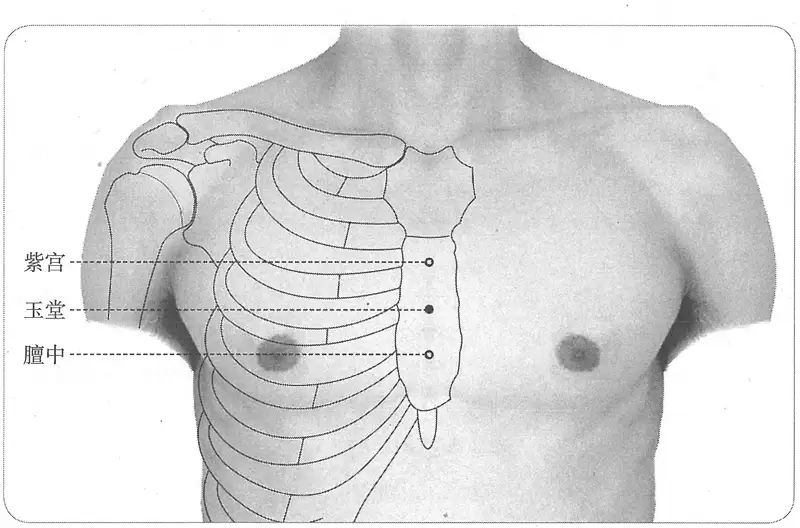

**图2-424　玉堂穴图**

骨中央取之。（1版《针灸学讲义》）

　　(3) 部位：在紫宫下一寸六分陷者中。取穴：在胸骨正中线上，平第三肋间隙，仰卧取之。（2版《针灸学讲义》）

　　(4) 前正中线，平第三肋间隙处。（4、5、7版《针灸学》）

　　(5) 在胸部，当前正中线上平第3肋间。（6版《针灸学》、《中国针灸学》）

#### 【类属】 

任脉穴。

任脉气所发。（《黄帝明堂经》）

#### 【适应症】 

主治胸、肺部病症。常用于咳嗽，气喘，胸闷，胸痛，乳房胀痛；呕吐。

　1. 主胸中满，不得息，胁痛骨疼，喘逆上气，呕吐烦心。（《黄帝明堂经》）

　2. 治胸满不得喘息，胸膺骨疼，呕吐寒痰，上气烦心。（《铜人腧穴针灸图经》卷中）

　3. 窦太师针灸遗存

　　(1) 治乳疼，胸膈胀满，气逆喘嗽，看症补泻。（《窦太师针经》）

　　(2) 两乳肿痛。（《循经考穴编》下）

　4. 主喉痹咽壅，水浆不入。（《类经图翼》卷八）

**按**：此乃误录《针灸大成》“鸠尾”穴主治。

　5. 统编针灸学教材

　　(1) 咳逆喘满，呕吐寒痰，胸膺疼痛。（1957年南京《针灸学》）

　　(2) 咳逆喘满，胸膺疼痛。（1版《针灸学讲义》）

　　(3) 咳嗽，气喘，胸痛，喉痹咽塞，呕吐寒痰。（2版《针灸学讲义》）

　　(4) 胸痛，咳嗽，气喘，呕吐。（4、5、6版《针灸学》，《中国针灸学》）

　　(5) 咳嗽，气喘，胸闷、胸痛，乳房胀痛、呕吐等气机不畅为患者。（7版《针灸学》）

**文献分析**：2版教材“喉痹咽塞”症乃承袭《类经图翼》之误，今去之。

#### 【操作】 

平刺。

　1. 刺入三分，灸五壮。（《黄帝明堂经》）

〔p.1377 (인쇄 1349)〕

　2. 针入三分，灸二七壮。（《窦太师针经》）

　3. 针三分，灸三壮。沿皮横针，不是直刺。（《针灸十四经穴位考订》）

　4. 统编针灸学教材

　　(1) 针二至三分，针尖沿皮向下，灸三至五壮。（1957年南京《针灸学》、1版《针灸学讲义》）

　　(2) 向下沿皮刺2~3分，艾条灸3~5分钟。（2版《针灸学讲义》）

　　(3) 平刺0.3~0.5寸（4、5、7版《针灸学》）

　　(4) 平刺0.3~0.5寸；可灸。（6版《针灸学》、《中国针灸学》）

### （十九）紫宫 Zǐgōng CV19 出《黄帝明堂经》 

#### 【提要索隐】 

**定位**：在胸部，横平第2肋间隙，前正中线上。

**适应症**：主治胸、肺部病症。常用于胸痛，咳嗽，气喘。

**针刺操作**：平刺。

#### 【名实考】 

　1. 紫宫，在华盖下一寸六分陷者中，任脉气所发，仰头取之。（《黄帝明堂经》）

　2. 紫宫者，紫微之宫也，心正在内，此穴为宫。（《经穴解》）

#### 【定位】 

**部位**：在胸部，横平第2肋间隙，前正中线上（图2-425）。

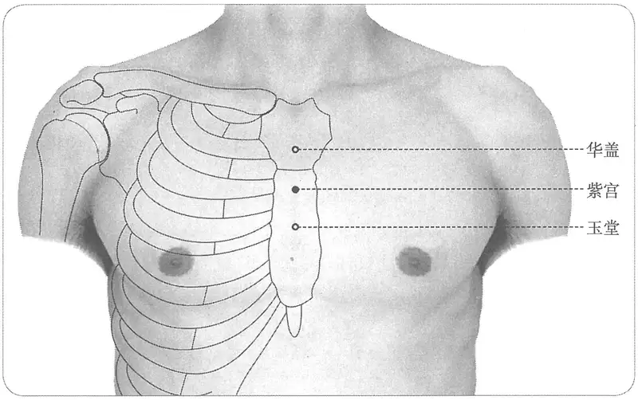

**图 2-425　紫宫穴图**

　1. 在华盖下一寸六分陷者中。仰而取之。（《黄帝明堂经》、《太平圣惠方》、《铜人腧穴针灸图经》、《圣济总录》、《针灸资生经》、《十四经发挥》、《医学纲目》、《针灸聚英》、《古今医统》、《医学入门》、《针灸大成》、《针方六集》、《类经图翼》、《循经考穴编》、《医宗金鉴·刺灸心法要诀》、《针灸逢源》）

〔p.1378 (인쇄 1350)〕

　2. 在华盖下一寸陷者中，仰而取之。（《太平圣惠方·明堂》）

　3. 玉堂上约一寸六分，正对第三肋骨之端。（《针灸十四经穴位考订》）

　4. 统编针灸学教材

　　(1) 部位：在华盖下一寸六分陷者中。取穴：仰卧，于膻中穴向上三寸二分，或按取第二肋骨内端之中间取之。（1957年南京《针灸学》）

　　(2) 部位：仰卧，从第二肋间按至胸骨中央取之。取穴：仰卧，从第二肋间按至胸骨中央取之。（1版《针灸学讲义》）

　　(3) 部位：在华盖下一寸六分陷者中。取穴：在胸骨正中线上，平第二肋间隙，仰卧取之。（2版《针灸学讲义》）

　　(4) 前正中线，平第二肋间隙处。（4、5、7版《针灸学》，《中国针灸学》）

　　(5) 在胸部，当前正中线上，平第2肋间。（6版《针灸学》）

**文献分析**：本穴定位“华盖下一寸六分”，是依据《灵枢·骨度》“缺盆以下至𩩲骭长九寸”折算而来，《太平圣惠方·明堂》作“华盖下一寸”者，非是。现代临床一般都以肋间比量，而不拘于分寸。

#### 【类属】 

任脉穴。

任脉气所发。（《黄帝明堂经》）

#### 【适应症】 

主治胸、肺部病症。常用于胸痛，咳嗽，气喘。

**备选适应症**：吐血。

　1. 主胸胁榰满。痹痛骨疼，饮食不下，咳逆上气，烦心。（《黄帝明堂经》）

　2. 上气吐血，及唾如白胶也。（《太平圣惠方·明堂》）

　3. 治胸胁支满，胸膺骨疼，饮食不下，呕逆上气，烦心。（《铜人腧穴针灸图经》卷中）

　4. 治乳痈气满。（《窦太师针经》）

　5. 主治膺痛，喉痹咽壅，水浆不入。（《类经图翼》卷八）

**按**：此乃误录《针灸大成》“鸠尾”穴主治。

　6. 统编针灸学教材

　　(1) 咳逆，胸膺满痛，饮食不下。（1957年南京《针灸学》、1版《针灸学讲义》）

　　(2) 咳嗽，气喘，胸痛，喉痹咽塞。（2版《针灸学讲义》、4版《针灸学》）

　　(3) 咳嗽，气喘，胸痛。（5、6、7版《针灸学》）

　　(4) 胸痛，咳嗽，气喘。（《中国针灸学》）

**文献分析**：2版《针灸学讲义》、4版教材“喉痹咽塞”症乃承袭《类经图翼》之误，今去之。

#### 【操作】 

平刺。

　1. 刺入三分，灸五壮。（《黄帝明堂经》）

　2. 针三分，灸三壮。沿皮横针，不是直刺。（《针灸十四经穴位考订》）

　3. 统编针灸学教材

　　(1) 针二至三分，灸三至五壮。（1957年南京《针灸学》、1版《针灸学讲义》）

　　(2) 向下沿皮刺2~3分，艾条灸3~5分钟。（2版《针灸学讲义》）

　　(3) 平刺0.3~0.5寸。（4、5、7版《针灸学》）

　　(4) 平刺0.3~0.5寸；可灸。（6版《针灸学》、《中国针灸学》）

〔p.1379 (인쇄 1351)〕

### （二十）华盖 Huágài CV20 出《黄帝明堂经》 

#### 【提要索隐】 

**定位**：在胸部，横平第1肋间隙，前正中线上。

**适应症**：主治胸、肺部病症。常用于胸胁痛，咳嗽，气喘。

**针刺操作**：平刺。

#### 【名实考】 

　1. 华盖，在璇玑下一寸陷者中，任脉气所发，仰头取之。（《黄帝明堂经》）

　2. 此穴则在心之上，故为华盖。（《经穴解》）

#### 【定位】 

**部位**：在胸部，横平第1肋间隙，前正中线上（图2-426）。

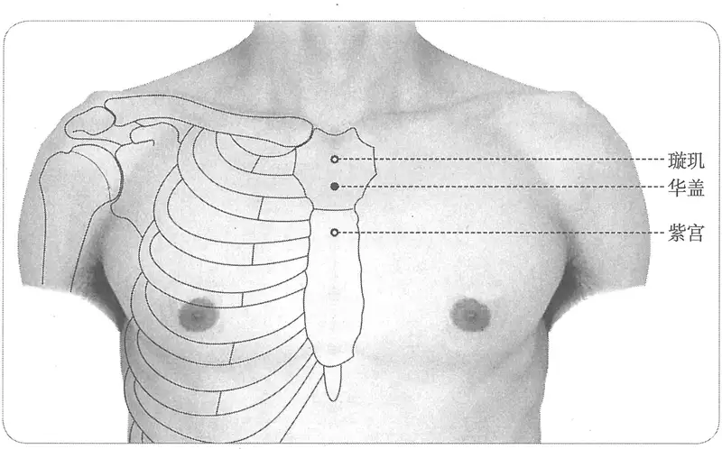

**图 2-426　华盖穴图**

　1. 在璇玑下一寸陷者中。仰头取之。（《黄帝明堂经》、《太平圣惠方》、《铜人腧穴针灸图经》、《圣济总录》、《针灸资生经》、《窦太师针经》、《医学纲目》、《针灸聚英》、《古今医统》、《针方六集》、《类经图翼》）

　2. 在璇玑下二寸。（《十四经发挥》中）

　3. 璇玑下一寸六分陷中。（《医学入门》卷一、《针灸大成》、《针灸易学》、《针灸逢源》）

　4. 穴在璇玑下一寸陷者中，仰面取之，合天突下二寸，膻中上四寸八分。（《循经考穴编》下）

　5. 紫宫上约一寸六分，正对第二肋骨之端。（《针灸十四经穴位考订》）

　6. 统编针灸学教材

　　(1) 部位：在璇玑下一肋陷中。取穴：璇玑穴之下方，约一横指，平对第二肋骨端取之。（1957年南京《针灸学》）

　　(2) 部位：膻中穴上四寸八分。取穴：仰卧，从第一肋间按至胸骨中央取之。（1版《针灸学讲义》）

〔p.1380 (인쇄 1352)〕

　　(3) 部位：在璇玑下一寸陷者中。取穴：在胸骨正中线上，胸骨角处，仰卧取之。（2版《针灸学讲义》）

　　(4) 前正中线，胸骨角的中点。（4、5版《针灸学》）

　　(5) 在胸部，当前正中线上，平第1肋间。（6版《针灸学》）

　　(6) 前正中线上，胸骨角的中点处，平第1肋间隙。（7版《针灸学》、《中国针灸学》）

**文献分析**：本穴定位“璇玑下一寸”，是依据《灵枢·骨度》“缺盆以下至𩩲骭长九寸”折算而来，《十四经发挥》作“璇玑下二寸”，《医学入门》作“璇玑下一寸六分”者，非是。现代临床一般都以肋间比量，而不拘于分寸。

#### 【类属】 

任脉穴。

任脉气所发。（《黄帝明堂经》）

#### 【适应症】 

主治胸、肺部病症。常用于胸胁痛，咳嗽，气喘。

　1. 主胸胁榰满，骨痛引胸中。咳逆上气，喘不能言。（《黄帝明堂经》）

　2. 治胸胁支满，痛引胸中，咳逆上气，喘不能言。（《铜人腧穴针灸图经》卷中）

　3. 主喉痹，咽肿，水浆不下，胸皮痛。（《针灸聚英》卷一、《针灸大成》、《针方六集》）

**按**：此条主治系高武从《针灸资生经》转录《铜人腧穴针灸图经》璇玑主治，原文出自《太平圣惠方》卷九十九作“胸皮满痛，喉痹咽痛，水浆不下”，其中“胸皮满痛”系“胸支满痛”之误。

　4. 统编针灸学教材

　　(1) 哮喘咳嗽，胸胁痛。（1957年南京《针灸学》、1版《针灸学讲义》）

　　(2) 气喘，咳嗽，胸胁满痛。（2版《针灸学讲义》，4、5、6版《针灸学》，《中国针灸学》）

　　(3) 咳嗽，气喘，胸痛。（7版《针灸学》）

#### 【操作】 

平刺。

　1. 刺入三分，灸五壮。（《黄帝明堂经》）

　2. 针三分，灸三壮。沿皮横针，不是直刺。（《针灸十四经穴位考订》）

　3. 统编针灸学教材

　　(1) 针二至三分，灸三至五壮。（1957年南京《针灸学》、1版《针灸学讲义》）

　　(2) 向下沿皮刺2~3分，艾条灸3~5分钟。（2版《针灸学讲义》）

　　(3) 平刺0.3~0.5寸。（4、5、7版《针灸学》）

　　(4) 平刺0.3~0.5寸；可灸。（6版《针灸学》）

　　(5) 横刺0.3~0.5寸。可灸。（《中国针灸学》）

### （二十一）璇玑 Xuánjī CV21 出《黄帝明堂经》 

#### 【提要索隐】 

**穴名**：宋以前文献或写作“旋机”、“琁玑”。

**定位**：在胸部，胸骨上窝下1寸，前正中线上。

**适应症**：主治胸、肺部病症。常用于咳嗽，气喘，胸痛；咽喉肿痛。

**备选适应症**：食积。

**针刺操作**：平刺。

#### 【名实考】 

《千金要方》、《黄帝内经太素》杨上善注、《素问》王冰注、《医心方》皆作“旋机”；《千金翼方》、《外台秘要》作“琁玑”；《铜人腧穴针灸图经》卷上作“旋玑”，卷中及卷下作“璇玑”。

〔p.1381 (인쇄 1353)〕

　1. 璇玑，在天突下一寸中央陷者中，任脉气所发，仰头取之。（《黄帝明堂经》）

　2. 璇玑者，乃紫微垣之星，在华盖之上，此穴亦在华盖之上，故曰。（《经穴解》）

#### 【定位】 

**部位**：在胸部，胸骨上窝下1寸，前正中线上（图2-427）。

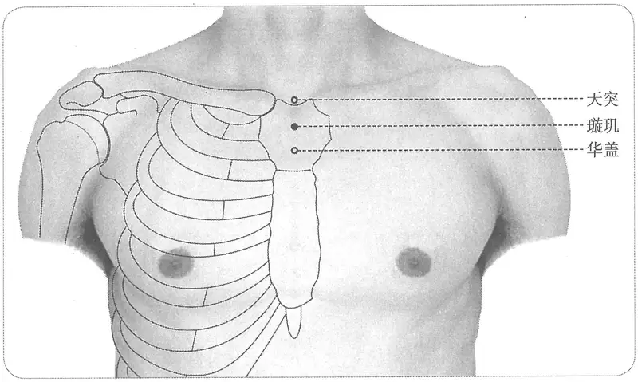

**图 2-427　璇玑穴图**

**取穴**：在前正中线，天突穴下1寸。

　1. 在天突下一寸中央陷者中……仰头取之。（《黄帝明堂经》、《太平圣惠方》、《铜人腧穴针灸图经》、《圣济总录》、《针灸资生经》、《窦太师针经》、《十四经发挥》、《医学纲目》、《针灸聚英》、《古今医统》、《医学入门》、《针方六集》、《类经图翼》、《循经考穴编》、《医宗金鉴·刺灸心法要诀》）

　2. 在天突下二寸。（《针灸玉龙经》）

　3. 天突下一寸六分陷中，仰头取之。（《针灸大成》卷七、《针灸易学》、《针灸逢源》）

　4. 华盖上约一寸，正对第一肋骨之端。（《针灸十四经穴位考订》）

　5. 统编针灸学教材

　　(1) 部位：天突穴下一寸陷中。取穴：天突穴之下方，约一横指陷中，头稍仰取之。（1957年南京《针灸学》）

　　(2) 部位：天突穴下一寸陷中。取穴：仰卧，从华盖穴上一寸六分取之。（1版《针灸学讲义》）

　　(3) 部位：在天突穴下一寸中央陷者中。取穴：在胸骨正中线上，胸骨柄中央，天突与华盖之间，仰卧取之。（2版《针灸学讲义》）

　　(4) 前正中线，胸骨柄的中央。（4、5、7版《针灸学》）

　　(5) 在胸部，当前正中线上，天突下1寸。（6版《针灸学》）

　　(6) 前正中线上，胸骨柄中央，天突下一寸。（《中国针灸学》）

#### 【类属】 

任脉穴。

任脉气所发。（《黄帝明堂经》）

〔p.1382 (인쇄 1354)〕

#### 【适应症】 

主治胸、肺部病症。常用于咳嗽，气喘，胸痛；咽喉肿痛。

**备选适应症**：食积。

　1. 主胸满痛。喉痹咽痛，水浆不下。（《黄帝明堂经》）

　2. 治胸皮满痛，喉痹咽痛，水浆不下。（《太平圣惠方·针经》）

**按**：“胸皮满痛”系“胸支满痛”之误，王惟一不察而传其误。

　3. 主胸胁支满，咳逆，上喘，喉中鸣也。（《太平圣惠方·明堂》）

　4. 治胸皮满痛，喉痹咽痛，水浆不下。（《铜人腧穴针灸图经》卷中）

　5. 窦太师针灸遗存

　　(1) 治胸膈闷痛，痰盛五噎等症，并皆治之。（《窦太师针经》）

　　(2) 治哮喘咳嗽，热泻；冷，先泻后补。（《大本琼瑶神书》）

　　(3) 治膺胁满痛，久嗽不愈，痰盛噎塞。（《针方六集》卷五）

　6. 主喘不能言，胃中有积。（《针灸聚英》卷一、《针灸大成》）

　7. 统编针灸学教材

　　(1) 咳逆上气，胸胁痛，咽肿喉痹。（1957年南京《针灸学》、1版《针灸学讲义》）

　　(2) 咳嗽，气喘，胸痛，喉痹咽肿。（2版《针灸学讲义》，4、5、6版《针灸学》）

　　(3) ①咳嗽，气喘，胸痛；②咽喉肿痛；③积食。（7版《针灸学》）

　　(4) 胸痛，咳嗽，气喘。（《中国针灸学》）

#### 附：临床应用举例 

　1. 小儿喉中鸣，咽乳不利，灸璇玑一穴三壮，炷如小麦大。（《太平圣惠方·明堂》）

　2. 气喘吁吁不得眠，何当日夜苦相煎。若取璇玑真个妙，更针气海保安然。（《针灸玉龙歌》）

　3. 若是胃中停宿食，后寻三里起璇玑。（《长桑君天星秘诀歌》）

　4. 胃中有积刺璇玑，三里功多人不知。（《席弘赋》）

　5. 内伤食积针三里，璇玑相应块亦消。不针璇玑者，针手足三里，俱能消食积痞块。（《医学入门》卷一）

　6. 全麻术后复苏：针刺人中、璇玑穴。［中国中西医结合外科杂志，2000，6（5）：353］

#### 【操作】 

平刺。

　1. 刺入三分，灸五壮。（《黄帝明堂经》）

　2. 窦太师针灸遗存

　　(1) 针入一分，灸二七壮。（《窦太师针经》）

　　(2) 平针入一分，卧针一寸半。左肩病，针向左；右肩病，针向右。（《窦太师针经》乙抄本）

　　(3) 直针入三分，泻之，灸七壮。（《针灸玉龙歌》注）

　　(4) 窦氏刺入一分，沿皮向外一寸半。禁灸。（《针方六集》卷一）

　3. 针三分，灸三壮。沿皮横针，不是直刺。（《针灸十四经穴位考订》）

　4. 统编针灸学教材

　　(1) 针二至三分，灸三至五壮。（1957年南京《针灸学》、1版《针灸学讲义》）

　　(2) 向下沿皮刺2~3分，艾条灸3~5分钟。（2版《针灸学讲义》）

　　(3) 平刺0.3~0.5寸。（4、5、7版《针灸学》）

　　(4) 平刺0.3~0.5寸；可灸。（6版《针灸学》）

〔p.1383 (인쇄 1355)〕

　　(5) 横刺0.3~0.5寸。可灸。（《中国针灸学》）

　5. 横刺，针尖向下，深0.5~1寸。感应：局部酸胀。灸3~5壮；温灸5~15分钟。（上海《针灸学》）

### （二十二）天突 Tiāntū CV22 出《素问》、《灵枢》 

问题1：本穴距结喉的分寸为何有“五寸”、“四寸”之别？

问题2：何谓“横三间寸灸”？

问题3：本穴与“天瞿”、“天瞿旁穴”关系如何？

#### 【提要索隐】 

**穴名**：一名玉户；一名五户。

**定位**：在颈前区，胸骨上窝中央，前正中线上。

**适应症**：主治胸、肺、咽喉部病症。常用于咳嗽，气喘，胸痛，咳血；咽喉肿痛，失音；瘿瘤；噎膈。

**针刺操作**：先刺进0.2寸，然后将针尖转向下方，紧靠胸骨后面刺入1~1.5寸。

#### 【名实考】 

本穴别名，现在《黄帝明堂经》传本已见有异文：《医心方》卷二、《外台秘要》卷三十九及《黄帝虾蟆经》皆作“五户”，盖以“结喉下五寸”而得名；《针灸甲乙经》卷三作“玉户”，寓意不详。按：“玉”与“五”字形相近，传抄易混，然难以判定原文究竟作“五户”，还是“玉户”，故皆收作本穴别名。“天瞿”穴名见《小品方》引自《曹氏灸经》，与天突属同穴异名。《千金要方》载有该穴的特殊灸法——横三间寸灸法，日本医家不解，将其视为另一穴，以“天瞿旁”为名归入经外奇穴，后世日本、中国奇穴书皆传此误。

关于本穴定位，《黄帝明堂经》作“结喉下五寸”，其中“五寸”二字，后世文献因传抄之误有作“三寸”、“五分”者；王冰注《素问》作“结喉下同身寸之四寸”，盖因《灵枢·骨度》篇曰“结喉以下至缺盆中长四寸”，而王冰注《素问》恪守“注不破经”之训。“四寸”也谓之“一夫”，故后世文献又作“一夫”，因传抄之误又有作“一寸”者。其实，结喉的位置可因仰头、低头而有较大的变化，因此定位最简单，也最可能的方法是直接依据固定的解剖标志——结喉下中央宛宛中，即胸骨上窝中央，骨度分寸可不拘。

这里，需要特别指出的是，《灵枢·骨度》是成于一时一人之手，而《明堂经》孔穴尺寸则不然，腧穴并不是一时一人所发现的，显然其中有些腧穴的发现时间要早于《骨度》篇成书时间，有些与之同时，有些则较之为晚。不同时期所用的尺度自然不尽相同，天突穴定位的骨度差异即是典型的例子。

　1. 缺盆之中，任脉也，名曰天突。（《灵枢·本输》）

　2. 天突一穴。（《素问·气穴论》）

　3. 天突，一名玉户，在颈结喉下五寸中央宛宛中，阴维、任脉之会。（《黄帝明堂经》）

　4. 天突，一名五户。（《黄帝虾蟆经》、《医心方》卷二、《外台秘要》卷三十九、《铜人腧穴针灸图经》）

　5. 《曹氏灸经》曰天突者名为天瞿，复名身道，是体精之衢路也。（引自《医心方》卷二）

　6. 上气气闭，咳逆咽冷声破喉猜，灸天瞿五十壮。一名天突。（《千金要方》卷十八）

　7. 王冰注天突在颈结喉下同身寸之四寸中央宛宛中，阴维任脉之会，低针取之，刺可入同身寸之一寸，留七呼，若灸者可灸三壮。新校正云：按《甲乙经》“天突在结喉下五寸”。（《素问·气穴论》）

〔p.1384 (인쇄 1356)〕

　8. 天突在颈结喉下同身寸之四寸中央宛宛中，阴维任脉之会，低针取之，刺可入同身寸之一寸，留七呼，若灸者可灸三壮。（《素问·气府论》王冰注）

　9. 突，犹曲突徙薪之突，乃实而有隙通气之称。天者，言其高处也，任脉入胸穴者在于骨，至此穴乃为空隙之处，而所在又甚高，故曰天突。（《经穴解》）

#### “天突”、“天瞿旁”穴辨 

　1. 瘿，灸天瞿三百壮，横三间寸灸之。（《千金要方》卷二十四）

　2. 天瞿旁穴，瘿，灸天瞿三百壮。横三间寸灸之。（《千金》）按：天瞿即天突一名。（《经穴汇解》）

**按**：日本原昌克显然是将《千金要方》所说天瞿穴的“横三间寸灸”理解为天瞿穴旁的另一穴，故别起一名曰“天瞿旁”，归于奇穴编。所谓“横三间寸灸法”实际上是一种特定的灸法。《千金要方·灸例第六》曰：“凡经云‘横三间寸’者，则是三灸两间。一寸有三灸，灸有三分，三壮之处即为一寸”。意即：灸某穴，当中置一艾炷，两旁再各置一艾炷，每个艾炷底宽三分，三炷之间为一寸。此法常用于背俞穴及任、督脉穴。

“横三间寸”法取背俞穴的记载，在现存文献中，最早见于《小品方》引《曹氏灸经》文，又见于《医心方》引《龙衔素针经》。该法除了用于取背俞穴外，还可见《小品方》用于取任脉“天突”穴（见《千金要方》卷二十四）。又见《千金要方》、《千金翼方》中用于取督脉穴“大椎”。在阅读《千金要方》、《千金翼方》中大量的这类处方时，切不可以今天的背俞定位法去理解。由于人们对“横三间寸”灸法原意的误解，这一古代灸法失传已久。此法的临床价值有待于进一步研究。

#### 【定位】 

**部位**：在颈前区，胸骨上窝中央，前正中线上（图2-428）。

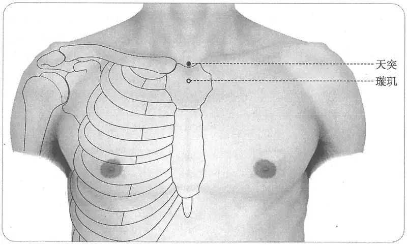

**图 2-428　天突穴图**

**取穴**：两侧锁骨中间凹陷中。

　1. 在颈结喉下二寸中央宛宛中……低头取之。（《针灸甲乙经》卷三、《循经考穴编》）

**按**：《素问·气穴论》新校正云：按《甲乙经》“天突在结喉下五寸”，说明宋本《针灸甲乙经》无误，与其他《黄帝明堂经》传本佚文相合。

　2. 在颈结喉下五寸宛宛中。（《黄帝虾蟆经》、《千金要方》卷二十九、《千金翼方》、《外

〔p.1385 (인쇄 1357)〕

台秘要》、《医心方》）

　3. 在颈结喉下同身寸之四寸中央宛宛中。（《素问·气穴论》王冰注、《铜人腧穴针灸图经》卷上及卷下“穴腧都数”、《针灸资生经》、《医学纲目》、《针灸聚英》、《古今医统》、《针灸大成》）

　4. 在结喉下一夫陷者宛宛中。（《太平圣惠方·针经》、《铜人腧穴针灸图经》卷中、《圣济总录》、《针灸资生经》、《针方六集》、《类经图翼》、《针灸逢源》）

**按**：“一夫”，明正统石刻《铜人腧穴针灸图经》拓片被挖改作“四寸”，五卷本《铜人腧穴针灸图经》误作“一寸”；《针灸资生经》引作“夫”，旁注有“一”字；明抄本《普济方》卷一五八引作“一夫”，无误；《圣济总录》卷一九一同。

　5. 在颈结喉下五分中央宛宛中（《太平圣惠方·明堂》、《针灸资生经》）

　6. 在结喉下一寸宛宛中。（《十四经发挥》、《医学纲目》、《医学入门》、《针灸易学》）

　7. 窦太师针灸遗存

　　(1) 在结喉下四寸宛宛中。（《窦太师针经》）

　　(2) 在结喉下一寸宛宛中是穴。（《窦太师秘传》）

　8. 结喉下其骨如半环，穴居环屈中，仰取云宛宛中央。（《大本琼瑶神书》）

　9. 从璇玑上行一寸。（《医宗金鉴·刺灸心法要诀》）

　10. 结喉下，胸骨柄上缘之凹陷中。（《针灸十四经穴位考订》）

　11. 统编针灸学教材

　　(1) 部位：璇玑上行一寸，喉结下，宛宛中。取穴：仰卧，于胸骨端半月状截痕之上缘，约三分陷凹中取之。（1957年南京《针灸学》）

　　(2) 部位：璇玑穴上一寸。取穴：在胸骨上窝正中，仰头取之。（1版《针灸学讲义》）

　　(3) 部位：在颈喉结下四寸。取穴：仰卧，胸骨上缘，结喉下宛宛中取之。（2版《针灸学讲义》）

　　(4) 胸骨上窝正中。（4、5、7版《针灸学》，《中国针灸学》）

　　(5) 在颈部，当前正中线上，胸骨上窝中央。（6版《针灸学》）

#### 【类属】 

任脉穴。

**脉气所发**：阴维、任脉之会。（《黄帝明堂经》）

**归经**：任脉。（《外台秘要》卷三十九、《铜人腧穴针灸图经》卷上）

#### 【适应症】 

主治胸、肺、咽喉部病症。常用于咳嗽，气喘，胸痛，咳血；咽喉肿痛，失音；瘿瘤；噎膈。

　1. 主咳逆上气，喘，暴喑不能言及舌下夹缝青脉，颈有大气，喉痹，咽中干急，不得息，喉中鸣，翕翕寒热，颈肿肩痛，胸满腹皮热，衄，气哽，心痛，隐疹，头痛，面皮赤热，身肉尽不仁。（《黄帝明堂经》）

**按**：此条主治“咳逆上气，喘，暴喑不能言，取天突及舌下夹缝青脉”，其中“舌下夹缝青脉”即《内经》中所谓少阴舌下之“廉泉”脉，《灵枢·刺节真邪》载该脉主治如下：

“黄帝曰：其咳上气穷诎胸痛者，取之奈何？岐伯曰：取之廉泉。黄帝曰：取之有数乎？岐伯曰：取天容者，无过一里，取廉泉者，血变而止。帝曰：善哉。”《黄帝明堂经》编者如此处理，很容易将“舌下夹缝青脉”理解为天突穴的主治症，《铜人腧穴针灸图经》即因此而误。

　2. 主咳嗽上气，噎胸中气，喉内状如水鸡声，肺痈唾脓血，气壅不通，喉中热疮，不得下食。（《太平圣惠方·针经》）

〔p.1386 (인쇄 1358)〕

　3. 主胸中气鲠鲠也。（《太平圣惠方·明堂》）

　4. 治咳嗽上气，胸中气噎，喉中状如水鸡声，肺壅咯唾脓血，气咽干，舌下急，喉中生疮不得下食。（《铜人腧穴针灸图经》卷中）

　5. 窦太师针灸遗存

　　(1) 治哮喘嗽，发热，泻；冷哮补。（《窦太师针经》）

　　(2) 治哮喘咳嗽，热，泻；冷，先补后泻。（《大本琼瑶神书》）

　6. 主咽肿，咽冷，声破。瘿瘤。背与心相控而痛。五噎，黄瘅，醋心多睡，呕吐不止。（《针灸聚英》卷一、《针灸大成》）

**按**：此上病症乃高武从《针灸资生经》辑自《千金要方》灸方主治；“背与心相控而痛”辑自《素问》；“五噎，黄瘅，醋心多睡，呕吐不止”辑自《针经摘英集》。皆详见“附：临床应用举例”。

　7. 统编针灸学教材

　　(1) 咳逆暴喘，咯脓血，暴喑，咽肿，喉中如水鸡声。（1957年南京《针灸学》、1版《针灸学讲义》）

　　(2) 咳嗽，哮证，气喘，暴喑，咽喉肿痛，瘿气，噎膈。（2版《针灸学讲义》）

　　(3) 哮喘，咳嗽，喉痹，咽干，噎嗝，暴喑，瘿瘤。（4版《针灸学》）

　　(4) 咳嗽，气喘，胸痛，咽喉肿痛，暴喑，瘿气，梅核气，噎膈。（5、6版《针灸学》）

　　(5) ①咳嗽、哮喘、胸痛、咽喉肿痛、暴喑等肺系病证；②瘿气、梅核气、噎膈等气机不畅病证。（7版《针灸学》）

　　(6) 哮喘，咳嗽，咽喉肿痛，咽干，呃逆，暴喑，瘿瘤，噎膈。（《中国针灸学》）

**文献分析**：《圣济总录》卷一九四曰：“脑后喑门穴，不可伤，伤即令人哑，宜针人中、天突二穴，可二分”；“风府一穴，在喑门上人发际一寸五分，针只可一寸以下，过度即令人哑，亦针人中、天突穴救之”；“白气不可伤，伤即令人失音，宜治天突”。说明治疗暴哑失音是本穴的重点主治。

#### 附：临床应用举例 

　1. 咽喉病症

　　(1) 人之卒然忧恚而言无音者……取之天突，其厌乃发。（《灵枢·忧恚无言》）

　　(2) 小儿急喉痹。灸天突穴一壮，在项结喉下三寸两骨间。炷如小麦大。（《太平圣惠方·明堂》）

　　(3) 急喉痹，颐粗，颔肿，水谷不下，此乃胃气虚，风寒客肺也，灸天突穴五十壮。（《扁鹊心书》卷上）

　　(4) 一人患喉痹，痰气上攻，咽喉闭塞，灸天突穴五十壮，即可进粥，服姜附汤，一剂即愈，此治肺也。（《扁鹊心书》卷中）

　　(5) 治失音，刺任脉天突一穴，在结喉下一寸宛宛中，阴维之会，针入五分。（《针经摘英集》）

　　(6) 颊肿如升，咽喉闭塞，水粒不下：刺少商，灸天突，泻液门、合谷。（《针灸集要·盘石金直刺秘传》）

　　(7) 急缠喉风：刺少商，灸天突、合谷、中渚，俱泻。（《针灸集要·盘石金直刺秘传》）

　　(8) 咽喉闭塞，水粒不下，天突一穴、商阳二穴、照海二穴、十宣十穴。（《针灸大全》卷四）

　　(9) 单鹅风，喉中肿痛，肺三焦经热，关冲二穴、天突一穴、合谷二穴。（《针灸大全》卷四）

〔p.1387 (인쇄 1359)〕

　　(10) 谁知天突治喉风。（《席弘赋》）

　　(11) 功能性失语：内关穴、天突穴，针刺治疗。［河北中医，1985（3）：43］

　　(12) 吞咽困难：内关穴、天突穴针刺治疗。［北京中医，1985（2）：45］

　　(13) 功能性失音：合谷穴、天突穴、涌泉穴，针刺治疗。［上海针灸杂志，1987，6（4）：9］

　2. 肺部病症

　　(1) 积于上，泻人迎、天突、喉中；积于下者，泻三里与气街。（《灵枢·卫气失常》）

　　(2) 上气，气闭，咳逆，咽冷声破，喉猜猜，灸天瞿五十壮，一名天突。（《千金要方》卷十八、《千金翼方》）

　　(3) 咳嗽病因形寒饮冷水消肺气，灸天突穴五十壮。（《扁鹊心书》卷上）

　　(4) 此证，方书名为哮喘……喉常如风吼，声若作劳，则气喘而满，须灸天突穴五十壮。（《扁鹊心书》卷下）

　　(5) 气喘气急促，不能卧，言语无声：灸华盖、膻中、乳根、天突、通里、足三里，各灸七壮。（《针灸集要·盘石金直刺秘传》）

　　(6) 气促喘：天突。（《医学纲目》卷二十七）

　　(7) 吼喘胸膈急痛，或中二穴、天突一穴、肺俞二穴、三里二穴。（《针灸大全》卷四）

　　(8) 哮喘一症最难当，夜间无睡气遑遑，天突寻之真妙穴在，膻中一灸便安康。（《针灸玉龙歌》）

　　(9) 天突宛中治喘痰。（《灵光赋》）

　　(10) 呛咳：太冲穴、天突穴，针刺。［河北中医，1987（2）：47］

　3. 其他病症

　　(1) 背与心相控而痛，所治天突与十椎及上纪，上纪者胃脘也，下纪者关元也。（《素问·气穴论》）

　　(2) 治五噎，黄瘅，醋心多睡，呕吐不止，刺任脉天突一穴，在结喉下一寸宛宛中，阴维任脉之会，针入五分，留三呼，得气即泻。（《针经摘英集》）

　　(3) 梅核气：天突穴，针灸疗法。［中国针灸，1988，8（1）：44］

　　(4) 神经性呕吐：天突穴，针灸疗法。［中医药学报，1988（6）：27-28］

#### 【操作】 

先刺进0.2寸后，然后将针尖转向下方，紧靠胸骨后面刺入1~1.5寸。

　1. 刺入一寸，留七呼，灸三壮。（《黄帝明堂经》）

　2. 低针取之。（《素问·气穴论》王冰注）

　3. 针入五分，留三呼，得气即泻。灸亦得，然不及针。其下针直横下，不得低手，即五藏之气伤，令人短寿。（《太平圣惠方·针经》）

　4. 斜针向下一寸或五分，灸二七壮。治哮喘嗽，发热，泻；冷哮补。灸天突，半在骨，半在空，若全在空处，则令人喘。（《窦太师针经》）

　5. 灸二七壮，不及针。凡针一寸，直横下，不得低手。（《大本琼瑶神书》）

　6. 针头宜向下施，所谓直下是也。（《针方六集》卷一）

　7. 针三至五分，灸三壮。针尖进皮后斜向下方针入，避免刺中气管。（《针灸十四经穴位考订》）

　8. 统编针灸学教材

　　(1) 针五分，针尖向喉管刺进约一至二分，于是将针柄竖起，针尖斜向下方刺入，灸三至七壮。（1957年南京《针灸学》、1版《针灸学讲义》）

〔p.1388 (인쇄 1360)〕

　　(2) 针向胸骨后下方斜刺3~5分，艾条灸3~7分钟。（2版《针灸学讲义》）

　　(3) 先刺进0.2寸，然后将针尖转向下方，紧靠胸骨后面刺入1~1.5寸。（4、5、6版《针灸学》，《中国针灸学》）

　　(4) 先刺进0.2寸，然后将针尖转向下方，紧靠胸骨后面刺入1~1.5寸。必须严格掌握针刺的角度和深度，以防刺伤肺和有关动、静脉。（7版《针灸学》）

　9. ①横刺，先直刺进针0.2~0.3寸后，改向下横刺，沿胸骨柄后缘、气管前缘刺入，深约1~1.5寸。感应：局部酸胀，咽部似有发紧阻塞不畅样感觉。②直刺，深0.3~0.5寸。感应：局部酸胀。灸3~5壮；温灸5~15分钟。注意：沿胸骨柄后缘针刺不宜过深，恐刺中主动脉或无名动脉；直刺也不可过深，以免刺伤气管；也不宜向左向右深刺，特别是肺气肿病人尤宜谨慎，以防刺伤肺尖及锁骨下动静脉。（上海《针灸学》）

**文献分析**：本穴的刺法，王冰指出须“低针取之”，《太平圣惠方》补充“直横下”，至窦太师针灸则进一步明确“斜针向下”、“针头宜向下施”。现代针刺法即基于古法描述。

### （二十三）廉泉 Liánquán CV23 出《黄帝明堂经》 

问题：“廉泉”穴有几？《内经》中“取廉泉者，血变而已”之“廉泉”与《黄帝明堂经》所载之“廉泉”是否为同一穴？

#### 【提要索隐】 

**穴名**：一名本池。

**定位**：在颈前区，喉结上方，舌骨上缘凹陷中，前正中线上。

**适应症**：主治舌咽部病症。常用于中风失语、吞咽困难、舌缓、流涎；舌下肿痛，咽喉肿痛。

**针刺操作**：向舌根斜刺0.5~0.8寸。

#### 【名实考】 

《黄帝明堂经》载本穴别名为“本池”，《铜人腧穴针灸图经》作“舌本”，与风府穴别名重，不能排除王惟一误解经文的可能性，故不作为本穴的别名。

需要特别注意的是，《内经》中所说之“廉泉”为足少阴经之舌下两脉，用于刺血，与任脉穴“廉泉”大不同，古今医家皆混为一穴，大误。

又，《医心方》录《华佗传》之“中矩”穴，其定位与主治皆与“廉泉”同，而日本针灸教材却误定于口腔内，之后的奇穴书皆传此误；现代新穴“上廉泉”与本穴实为同一穴，不当另立穴名，归入新穴内。

　1. 廉泉，一名本池，在颔下结喉上舌本。阴维、任脉之会。（《黄帝明堂经》）

　2. 廉泉一穴，一名舌本。在颔下结喉上。阴维、任脉之会。（《铜人腧穴针灸图经》卷中）

**按**：“舌本”已用作“风府”穴别名，再用作他穴别名，易混淆。对照《铜人腧穴针灸图经》与《黄帝明堂经》的定位描述，前者恰好较后者少了“舌本”一词，很可能王惟一是将《黄帝明堂经》定位描述“舌本”误解成别名。

　3. 乃舌下生津液之本也，舌下津液，由此而生，乃任脉自下行者，入交于舌之下，而生津液，有泉之象也……故曰廉泉。（《经穴解》）

#### 诸“廉泉”辨 

　1. 少阴根于涌泉，结于廉泉。（《灵枢·根结》）

　2. 所谓五十九刺者……巅上一，囟会一，发际一，廉泉一，风池二，天柱二。（《灵

〔p.1389 (인쇄 1361)〕

枢·热病》）

　3. 胃缓则廉泉开，故涎下。补足少阴。（《灵枢·口问》）

　4. 廉泉玉英者，津液之道也。（《灵枢·胀论》）

　5. 黄帝曰其咳上气穷诎胸痛者，取之奈何？岐伯曰：取之廉泉。黄帝曰：取之有数乎？岐伯曰：取天容者，无过一里，取廉泉者，血变而止。帝曰：善哉。（《灵枢·刺节真邪》）

　6. 黄帝曰其咳上气穷诎胸痛者，取之奈何？岐伯曰：取之廉泉也。杨上善注：廉泉，在颔下结喉上也。（《黄帝内经太素·五节刺》）

　7. 十二疟者，其发各不同时，察其病形，以知其何脉之病也。先其发时如食顷而刺之，一刺则衰，二刺则知，三刺则已。不已，刺舌下两脉出血；不已，刺郄中盛经出血，又刺项已下夹脊者，必已。舌下两脉者，廉泉也。王冰注曰：廉泉，穴名。在颔下结喉上舌本下，阴维任脉之会，刺可入同身寸之三分，留三呼，若灸者可灸三壮。（《素问·刺疟》）

　8. 足少阴舌下，厥阴毛中急脉各一。（《素问·气府论》）

　9. 善骂詈，日夜不休，治之取手阳明、太阳、太阴、舌下少阴。（《灵枢·癫狂》）

**按**：今考《内经》言及“廉泉”者，凡八处，只有《灵枢·热病》所载之“廉泉”与《黄帝明堂经》同。然而传世本《灵枢》此处“廉泉”一穴，《黄帝内经太素》、《脉经》、《针灸甲乙经》皆无，则很可能不是《灵枢》原文。其他七处言“廉泉”者多指舌下两脉，并属于“足少阴”，而不是“任脉”穴。其刺法也明确为“出血”、“血变而止”的刺血法，然而由于强大的习惯思维，人们一见“廉泉”二字，想到的只有任脉穴，于是杨上善、王冰皆以任脉之“廉泉”注之，其实早于杨、王二人的汉代《黄帝明堂经》编者也不能幸免——将汉以前针灸方中“廉泉”（至少有一部分是足少阴“廉泉”，而不是任脉“廉泉”穴）主治不加考辨地皆辑录于任脉“廉泉”穴下，这也提示编纂《黄帝明堂经》时，“舌下两脉”的临床应用已很少，而不为时人所知。

由此可见，《黄帝明堂经》编者所见之汉以前针灸方中“廉泉”至少有一部分是指“廉泉脉”，而不是“廉泉”穴，也就是说《黄帝明堂经》“廉泉”穴主治病症中至少有一部分不属于该穴主治。从所载两条主治症看，第二条“咳逆上气，喘息呕沫，齿噤”与《灵枢·刺节真邪》很相似，可能来自“廉泉脉”主治。

#### “廉泉”、“上廉泉”、“中矩”穴辨 

　1. 中矩一穴，一名垂矩，在颐下骨里曲骨中。此一穴出《华佗传》也。主中风舌强不能言，及舌干燥。（《医心方》卷二）

　2. 《范汪方》治风舌强不语方，又方灸廉泉穴，在颐下结喉上舌本。今按：《华佗传》云中矩穴主中风舌强不语。在颐下骨里曲骨中。（《医心方》卷三）

　3. 上廉泉，位于廉泉穴上1.5寸。主治流涎，急、慢性咽炎，口腔炎症，舌强，语言不清，哑，舌下神经瘫痪。（《针灸经外奇穴图谱（续集）》）

**按**：《千金要方》并《千金翼方》治中风“灸廉泉一处七壮，穴在当颐直下骨后陷者中是”，与“中矩”的定位及主治均相当。今人传日本针灸教材之误，将“中矩”定于口腔内，非是。

其实，廉泉和上廉泉在体表定位完全是可以一致的，只是施针者根据疾病的不同，采取不同的进针方向而已。之所以另起一穴“上廉泉”，可能因为当时“廉泉”穴定位，有定于舌骨下缘者。

#### 【定位】 

**部位**：在颈前区，喉结上方，舌骨上缘凹陷中，前正中线上（图2-429）。

**取穴**：男子直接于喉结上触及的第一个骨性突起上缘正中处取穴；女性则于颏下第一个骨性突起上缘正中处取穴。

　1. 在颔下，结喉上，舌本下。（《黄帝明堂经》、《太平圣惠方》、《铜人腧穴针灸图经》、《圣

〔p.1390 (인쇄 1362)〕

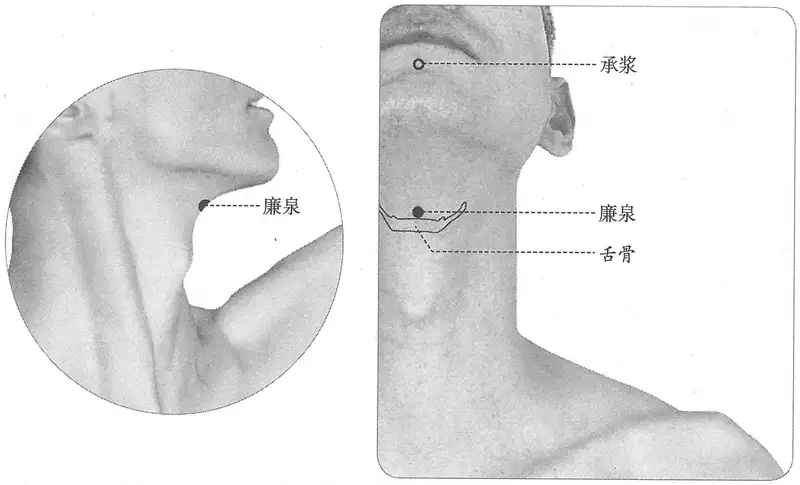

**图 2-429　廉泉穴图**

济总录》、《针灸资生经》、《十四经发挥》、《医学入门》、《针方六集》）

　2. 颈下结喉下四寸中央，仰面取之。（《针灸聚英》卷一、《古今医统》）

　3. 颔下，结喉上中央，舌本下，仰面取之。（《针灸大成》卷七、《循经考穴编》、《类经图翼》、《医宗金鉴·刺灸心法要诀》、《针灸易学》、《针灸逢源》）

　4. 颔下结喉上中央舌本间。（《针灸十四经穴位考订》）

　5. 统编针灸学教材

　　(1) 部位：颈下结喉上中央陷中。取穴：按取结喉上方，颈横纹中央之微上二分处，仰头取之。（1957年南京《针灸学》、1版《针灸学讲义》）

　　(2) 部位：在颔下结喉上，舌本下。取穴：喉结上方，当舌骨的上缘凹陷中，仰头取之。（2版《针灸学讲义》）

　　(3) 舌骨体上缘的中点处。（4、5版《针灸学》）

　　(4) 在颈部，当前正中线上，结喉上方，舌骨上缘凹陷处。（6版《针灸学》、《中国针灸学》）

　　(5) 微仰头，在喉结上方，当舌骨体上缘的中点处。（7版《针灸学》）

**文献分析**：《针灸聚英》关于本穴定位描述，系将王冰注“天突”穴文字混入，其他古代文献无分歧，但对于定位于舌骨上缘还是下缘认识不一，经过各方讨论，形成共识，定位于舌骨上缘。

#### 【类属】 

任脉穴。

**脉气所发**：阴维、任脉之会。（《黄帝明堂经》）

**归经**：任脉。（《外台秘要》卷三十九、《铜人腧穴针灸图经》卷上）

#### 【适应症】 

主治舌咽部病症。常用于中风失语、吞咽困难、舌缓、流涎；舌下肿痛，咽喉肿痛。

　1. 主舌下肿，难以言，舌纵涎出。咳逆上气，喘息呕沫，齿噤。（《黄帝明堂经》）

〔p.1391 (인쇄 1363)〕

　2. 上气穷屈胸满。（《外台秘要》卷三十九）

**按**：此条主治录自《灵枢·刺节真邪》，原文作“黄帝曰：其咳上气穷诎胸痛者，取之奈何？岐伯曰：取之廉泉。黄帝曰：取之有数乎？岐伯曰：取天容者，无过一里，取廉泉者，血变而止”，此处“廉泉”为舌下两脉，与本穴同名而异穴，王焘不察而误录于此。

　3. 治舌下肿难言，舌纵涎出，咳嗽上气，喘息呕沫，口噤，舌根急缩，下食难。（《铜人腧穴针灸图经》卷中）

　4. 口疮。（《针灸聚英》卷一、《古今医统》、《针灸大成》、《针灸逢源》）

**按**：此乃辑自《针经摘英集》针灸方主治，详见“附：临床应用举例”。

　5. 窦太师针灸遗存

　　(1) 舌本强，不语，咽喉闭，泻补。（《窦太师针经》）

　　(2) 主舌强，舌卷短缩，舌肿满口，重舌，喉痹。（《针方六集》卷五）

　　(3) 主舌强，喉闭。（《循经考穴编》下）

　6. 统编针灸学教材

　　(1) 舌下肿难言，舌根结缩，舌纵，上气咳逆，咽食困难，流涎，消渴。（1957年南京《针灸学》）

　　(2) 舌下肿，暴喑，舌根结缩，舌纵，上气咳逆，咽食困难，流涎，消渴。（1版《针灸学讲义》）

　　(3) 舌下痛，舌缓流涎，中风舌强不语，暴喑，咽食困难。（2版《针灸学讲义》，4、5版《针灸学》，《中国针灸学》）

　　(4) 舌下肿痛，舌纵流涎，舌强不语，暴喑，喉痹，吞咽困难。（6版《针灸学》）

　　(5) 中风失语、暴喑、吞咽困难、舌缓流涎、舌下肿痛、口舌生疮、喉痹等咽喉口舌病证。（7版《针灸学》）

#### 附：临床应用举例 

　1. 治口疮，舌下肿难言，舌纵涎出，及舌根急缩，刺任脉廉泉一穴，一名舌本，在颔下结喉上。阳维之会，可灸三壮，针入三分，得气即泻，次针足少阴经涌泉二穴。（《针经摘英集》）

　2. 口内生疮，承浆，合谷、人中、廉泉。问曰：此证缘何而得？答曰：皆因上盛下虚，心火炎上焦壅热，故口生疮，乃脾胃俱败，以成此疾。复刺后穴：长强、人中、金津、玉液。（《针灸集成》第二十二方）

　3. 舌肿难语，廉泉、金津、玉液。问曰：此证缘何而得？答曰：皆因顽痰滞于上焦，壅上舌根，肿不能言语也。不愈，复刺后穴：天突、少商。（《针灸集成》第二十四方）

　4. 失语症，廉泉穴、哑门穴，针刺。［安徽中医学院学报，1985（3）：47-48］

　5. 舌缩，廉泉穴、人迎穴，针灸疗法。［山东中医杂志，1986（6）：37］

　6. 百日咳，廉泉穴、哑门穴，针刺治愈。［上海针灸杂志，1987，6（2）：42］

　7. 喉返神经损伤，透刺廉泉为主治疗。［上海针灸杂志，1997，16（5）：22］

　8. 假性球麻痹，针刺风池配廉泉治疗。［天津中医，1999，16（5）：26］

　9. 翼外肌痉挛，针刺廉泉治疗。［中国针灸，2002，22（5）：323］

#### 【操作】 

向舌根斜刺0.5~0.8寸。

　1. 刺入二分，留三呼，灸三壮。（《黄帝明堂经》）

　2. 用针头斜向上沿皮针入三分，或一分，禁灸。（《窦太师针经》）

〔p.1392 (인쇄 1364)〕

　3. 针三至五分，灸三壮。（《针灸十四经穴位考订》）

　4. 统编针灸学教材

　　(1) 针五分，按取穴法，针尖斜向上方而进，灸二至三壮。（1957年南京《针灸学》、1版《针灸学讲义》）

　　(2) 向上直刺5分，艾条灸2~3分钟。（2版《针灸学讲义》）

　　(3) 向舌根斜刺0.5~0.8寸。（4、5、6、7版《针灸学》）

### （二十四）承浆 Chéngjiāng CV24 出《黄帝明堂经》 

#### 【提要索隐】 

**穴名**：一名天池；一名悬浆；一名鬼市。

**定位**：在面部，颏唇沟的正中凹陷处。

**适应症**：主治口部病症。常用于口眼㖞斜，口噤，齿龈肿痛；失音；癫，狂，痫。**新增**：消渴多饮；头项强痛。

**针刺操作**：斜刺0.3~0.5寸。

#### 【名实考】 

口，一名华池、一名玉池，本穴在口之下，故曰“承浆”。

　1. 胃足阳明之脉……入上齿中，还出挟口环唇，下交承浆……（《灵枢·经脉》）

　2. 承浆，一名天池，在颐前下唇之下，足阳明、任脉之会，开口取之。（《黄帝明堂经》）

　3. 一名悬浆。（《铜人腧穴针灸图经》卷中）

　4. 扁鹊曰百邪所病，针有十三穴，凡针先从鬼宫起……第八针承浆，名鬼市，从左出右。（《千金要方》卷十四）

　5. 名承浆者，口中饮食所余，而在外者，此穴其承之之地，故曰承浆。（《经穴解》）

　6. 别名　天地、垂浆、重奖。（《针灸学》

**按**：此传自日本针灸教材，“天地”云出《甲乙》，今检《针灸甲乙经》作“天池”，无误；“重奖”云出《圣济》，今检《圣济总录》作“垂浆”，与“悬浆”字异义同。

#### 相关穴及刺激点 

　1. 地合　位于下颌部，颏之正中向前突出之高点是穴，即承浆穴直下方。主治前发际疔、太阳疔、插花疔、大头疔、山根疔、眉中疔、鼻节疔、鼻环疔、穿鼻疔、迎香疔、散笑疔、鼻尖疔、面岩疔、牙咬疔、下反唇疔、人中疔、锁口疔、正对口疔、偏对口疔、肩井疔、头面疔疮、牙痛、下齿痛。针二分，局部有酸胀感觉。（《针灸经外奇穴图谱》）

　2. 侠承浆　位于头面颏部，颏唇沟中点两旁约一寸处，即承浆穴左右旁开约一寸处。主治马黄急疫、齿龈溃烂、口角㖞斜、唇口疔疽，面颊浮肿。针一至三分，得气时酸胀感向四外放散。灸三壮。（《针灸经外奇穴图谱》）

　3. 面神经刺激点口轮匝肌点（下点）　距下唇缘中点0.8cm处。主治面神经麻痹闭口无力。刺法：向患侧方向平刺1.0~1.5cm。（《实用神经干电刺激疗法》）

#### 【定位】 

**部位**：在面部，颏唇沟的正中凹陷处（图2-430）。

　1. 在颐前唇之下。开口取之。（《黄帝明堂经》、《太平圣惠方》、《铜人腧穴针灸图经》、《圣济总录》、《针灸资生经》、《神应经》、《医学纲目》、《类经图翼》）

〔p.1393 (인쇄 1365)〕

　2. 在唇下交脉中。（《黄帝虾蟆经》）

　3. 在颐前唇棱下宛宛中。（《太平圣惠方》卷五十五、卷一百）

　4. 颐前下唇之下宛宛中。（《太平圣惠方·针经》、《铜人腧穴针灸图经》、《十四经发挥》、《医学纲目》、《医学入门》）

　5. 窦太师针灸遗存

　　(1) 在颐前唇下五分宛宛中。（《窦太师针经》）

　　(2) 下唇五分宛宛中。（《大本琼瑶神书》）

　6. 在口下唇稜下宛宛中，动脉应手是穴。（《乾坤生意》）

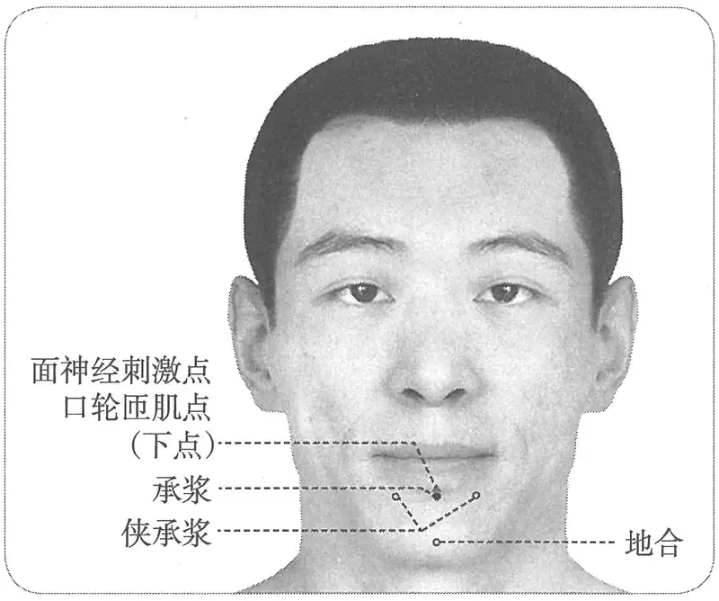

**图 2-430　承浆穴与相关穴及刺激点图**

　7. 唇棱下陷中，开口取之。（《针灸聚英》卷一、《古今医统》、《针灸大成》、《针方六集》、《类经图翼》、《循经考穴编》、《医宗金鉴·刺灸心法要诀》、《针灸易学》、《针灸逢源》）

　8. 下唇下陷凹中。（《针灸十四经穴位考订》）

　9. 统编针灸学教材

　　(1) 部位：颐前唇下宛宛中。取穴：在颏唇沟正中凹陷处取之。（1957年南京《针灸学》）

　　(2) 部位：颐前唇下陷中。取穴：在颐之中央陷中开口取之。（1版《针灸学讲义》）

　　(3) 部位：颐前唇下陷中。取穴：在颏唇沟正中凹陷处取之。（2版《针灸学讲义》）

　　(4) 颏唇沟的中点。（4、5版《针灸学》）

　　(5) 在面部，当颏唇沟的正中凹陷处。（6版《针灸学》）

　　(6) 颏唇沟的中央凹陷处。（7版《针灸学》、《中国针灸学》）

#### 【类属】 

任脉穴。

**脉气所发**：足阳明、任脉之会。（《黄帝明堂经》）

**归经**：任脉。（《铜人腧穴针灸图经》卷上）

#### 【适应症】 

主治口部病症。常用于口眼㖞斜，口噤，齿龈肿痛；失音；癫，狂，痫。**新增**：消渴多饮；头项强痛。输卵管结扎术、剖宫产手术、胃大部切除术的针麻用穴。

　1. 主寒热悽厥鼓颔。癫疾呕沫呕沫。痓，口噤互引，口干，小便赤黄或时不禁。消渴嗜饮。目瞑，身汗出。衄血不止。（《黄帝明堂经》）

　2. 上齿龋。（《外台秘要》卷三十九）

　3. 偏风口㖞

　　(1) 主疗偏风口㖞，面肿消渴，面风口不开，口中生疮。（《太平圣惠方·针经》）

　　(2) 主偏风口眼㖞斜，消渴，饮水不休，口噤不开，及暴哑不能言也。（《太平圣惠方·明堂》）

　　(3) 疗偏风口㖞，面肿，消渴，口齿疳蚀生疮。（《铜人腧穴针灸图经》卷中）

　4. 窦太师针灸遗存

　　(1) 治头项强痛，下片牙疼，补泻；唇吻舌不收，补之，舌肿难言，泻之。（《窦太师针经》）

〔p.1394 (인쇄 1366)〕

　　(2) 治头项强痛，不能回头，先补后泻；下片牙痛，先补后泻。（《大本琼瑶神书》）

　5. 统编针灸学教材

　　(1) 偏风，口眼㖞斜，面肿，龈肿牙痛，暴喑，消渴。（1957年南京《针灸学》、1版《针灸学讲义》）

　　(2) 口眼㖞斜，面肿，龈肿，齿痛，流涎，癫狂。（2版《针灸学讲义》）

　　(3) 口㖞，面肿，龈肿，齿痛，流涎，暴喑，癫狂。（4版《针灸学》）

　　(4) 口㖞，齿龈肿痛，流涎，暴喑，癫狂。（5、6版《针灸学》）

　　(5) ①口㖞，齿龈肿痛、流涎等口部病证；②暴喑、癫狂。（7版《针灸学》）

　　(6) 面肿，龈肿，齿肿，流涎，癫狂，口眼㖞斜。（《中国针灸学》）

**文献分析**：《黄帝明堂经》载本穴主治有“消渴嗜饮”、“口干”症，此后几乎所有针灸名著皆载录此主治，元代针灸方名著《针灸集成》更详载相关的临床应用。本穴穴名“承浆，一名天池”来看，也正提示本穴此方面的突出作用。而除1版教材外，其他各版皆未录此症，今补之。

《太平圣惠方·针经》地仓穴下曰：“灸壮若大，口转㖞，可灸承浆七七壮”；《圣济总录》曰：“耳后宛处不可伤，伤即令人口颊㖞斜，宜治人中、承浆二穴”，皆说明本穴是治疗面瘫的要穴。

#### 附：临床应用举例 

　1. 口面部病症

　　(1) 紧唇，灸虎口，男左女右。又灸承浆三壮。（《千金要方》卷六）

　　(2) 治口齿蚀生疮，承浆一穴，左颐前唇下宛宛中，可灸。（《类编朱氏集验医方》卷九）

　　(3) 小儿新生二七日内，若噤不吮奶，多啼者，是客风中于脐，循流至心脾二脏之经，遂使舌强，唇痉，啪奶不得。此疾所施方药，不望十全尔，大底以去客风无过。灸承浆一穴七壮，在下唇棱下宛宛中是也。次灸颊车二穴各七壮，在耳下曲颊骨后，炷并如雀屎大。（《太平圣惠方·明堂》）

　　(4) 上齿生疮：泻人中、关元；下齿生疮：泻承浆。（《针灸集要·盘石金直刺秘传》）

　　(5) 下牙生疮：承浆泻。（《针灸玉龙经·盘石金直刺秘传》）

　　(6) 头风，满面疼痛，项强不得回顾：泻合谷，刺承浆、委中出血。（《针灸集要·盘石金直刺秘传》）

　　(7) 面瘫：地仓、合谷、承浆、人中、颊车、翳风、听会。问曰：此证用前穴针效，或一月、半月，再发，何也？答曰：必是有犯禁忌，房事不节，饮食过多，痰饮复生，证再作矣。再刺已。上穴法复刺后穴无不效。㖞左，泻左补右；㖞右，补左泻右。（《针灸集成》第二方）

　　(8) 口眼㖞斜：承浆、太阳、人中、合谷、颊车、地仓。问曰：此证缘何而得？答曰：醉后睡卧当风，不避贼风，串入经络，痰饮灌注，或目怒气伤肝，房事不节，故得此证。复刺后穴：承浆、合谷、童子髎、地仓。（《针灸集成》第二十一方）

　　(9) 口内生疮：承浆，合谷、人中、廉泉。问曰：此证缘何而得？答曰：皆因上盛下虚，心火炎上焦壅热，故口生疮，乃脾胃俱败，以成此疾。复刺后穴：长强、人中、金津、玉液。（《针灸集成》第二十二方）

　　(10) 口眼歪斜：承浆穴、地仓穴、人中穴，针刺治疗。[湖北中医杂志，1985(6)：7]

　　(11) 面神经麻痹：承浆穴、人中穴，针刺治疗。[浙江中医杂志，1987，22(3)：8]

〔p.1395 (인쇄 1367)〕

　2. 颈项部病症

　　(1) 睡熟落枕，项痛不能回顾：刺少商出血、承浆，灸合谷、曲池，泻之。气满腰痛不可俯仰，或㨄气腰痛，一切暴痛：刺人中泻之、委中出血、承浆泻之，立痊。（《针灸集要·盘石金直刺秘传》）

　　(2) 脾经受湿，十二经络受寒湿之气，流注攻于颈项，以致不得回顾：泻承浆、合谷，次泻足三里、委中出血。（《针灸集要·盘石金直刺秘传》）

　　(3) 头项红肿强痛，承浆一穴、风池二穴、肩井二穴、风府一穴。（《针灸大全》卷四）

　　(4) 颈项强痛，不能回顾，承浆一穴、风池二穴、风府一穴。（《针灸大全》卷四）

　　(5) 腰疼头项强，不得回顾，承浆一穴、腰俞一穴、肾俞二穴、委中二穴。（《针灸大全》卷四）

　　(6) 头项强承浆可保。（《流注通玄指要赋》）

　　(7) 项强兼头四顾难，牙疼并作不能宽。先向承浆明补泻，后针风府即时安。（《针灸玉龙歌》）

　　(8) 落枕：承浆穴、风府穴，针灸疗法。[四川中医，1985，3(1)：7]

　3. 癫、痫、狂

　　(1) 患邪气鬼气疰，风痫等病，下唇下名承浆穴，灸二七壮，立差。（敦煌卷子《新集备急灸经》）

　　(2) 膈痫之为病，目反，四肢不举，灸风府；又灸顶上、鼻人中、下唇承浆，皆随年壮。（《千金要方》卷五上）

　　(3) 卒狂鬼语，针其足大拇指爪甲下，入少许即止。风邪，灸间使随年壮；又灸承浆七壮；又灸心俞七壮，及灸三里七壮。（《千金要方》卷十四）

　　(4) 爱吐逆，舌不住，名蛇惊，于承浆穴中灸三七壮。（《幼幼新书》卷十）

　4. 其他病症

　　(1) 猥退风，半身不遂，失音不语者，灸百会，次灸本神，次灸承浆，次灸风府，次灸肩髃，次灸心输，次灸手五册，次灸手髓孔，次灸手少阳，次灸足五册，次灸足髓孔，次灸足阳明各五百壮。（《千金要方》卷八、《千金翼方》、敦煌卷子S.6168）

　　(2) 风邪，灸间使随年壮；又灸承浆七壮；又灸心俞七壮，及灸三里七壮。（《千金要方》卷十四）

　　(3) 哕，灸承浆七壮，炷如麦大。（《千金要方》卷十六）

　　(4) 脱肛，肠风痔漏：灸百劳、承浆，补长强。（《针灸集要·盘石金直刺秘传》）

　　(5) 消渴：金津、玉液、承浆。问曰：此证缘何而得？答曰：因房事过多，肾水枯竭，水火不济，脾败肾虚。久不治，发成痈疽，则难疗也。然此症非一，详见《局方》，今不具载。复刺别穴，无不效也：人中、廉泉、气海、肾俞。（《针灸集成》第五十一方）

　　(6) 痛经：针刺承浆、大椎治疗。[陕西中医，1986，7(5)：18]

　　(7) 小儿厌食：针刺承浆穴治疗。[中医药学报，2000(3)：5]

#### 【操作】 

斜刺0.3~0.5寸。

　1. 刺入二分，留六呼，灸三壮。（《黄帝明堂经》）

　2. 直针入三分，灸七壮。（《窦太师针经》）

　3. 《经神集》云针一分，竖针向下三分，须口衔尺方可下针。（《循经考穴编》下）

　4. 统编针灸学教材

〔p.1396 (인쇄 1368)〕

　　(1) 针二至三分，灸是那至五壮。（1957年南京《针灸学》、1版《针灸学讲义》）

　　(2) 向上斜刺2~3分；艾炷灸3~5壮，艾条灸3~5分钟。（2版《针灸学讲义》）

　　(3) 斜刺0.3~0.5寸。（4、5、6、7版《针灸学》）

　　(4) 斜刺0.2~0.3寸。可灸。（《中国针灸学》）

### 延伸阅读 

　1. 黄龙祥.中国针灸学术史大纲[M].北京：华夏出版社，2001.

　2. 黄龙祥.新编重绘十四经脉经穴图[M].北京：中国中医药出版社，2010.

　3. 黄龙祥，黄幼民.元代珍稀针灸三种[M].北京：人民卫生出版社，2008.

　4. 杨威.任脉络穴考[J].北京中医，1996(3)：12-13.

　5. 金新海，沈丕安.针刺风池、气海穴的感应方向[J].上海中医药杂志，1964(3)：34-35.

〔p.1397 (인쇄 1369)〕

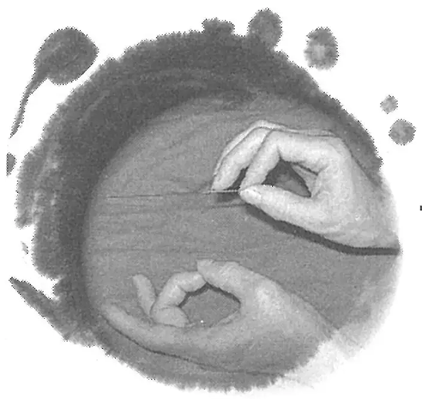

