# 《针灸腧穴通考》(下册) — 经外奇穴·附录·后记  · （一）四神聪　Sìshéncōng（EX-HN1）　出《太平圣惠方》~（十七）膝眼　Xīyǎn（EX-LE4）　出《华佗针灸经》

> 분할본 25/25. 원서: 黄龙祥·黄幼民 编著, 《针灸腧穴通考——〈中华针灸穴典〉研究》(下册), 人民卫生出版社, 2011. 원서 스캔 OCR 판독본을 챗봇 검색용으로 나눈 것이며, 본문과 쪽 표시 〔p.PDF쪽 (인쇄 쪽)〕는 원본 그대로이다.

## 十五、经外奇穴 

### 概说 

“奇穴”作为一个专门的腧穴门类概念，见于明代《奇效良方》，之后《针灸大成》作“经外奇穴”。这里“经”的本义是指《针灸甲乙经》或《铜人腧穴针灸图经》，即“经典”之义，现代的概念是指“经穴”，即十四经穴之外的穴称作“经外奇穴”，或“经外穴”。

经穴的第一部经典《黄帝明堂经》是系统整理、研究包括《黄帝内经》在内的汉以前针灸文献的规范化产物。奇穴第一次系统整理乃《窦太师针经》，该书之于奇穴，犹如《黄帝明堂经》之于经穴。

《窦太师针经》所总结的奇穴，在反映窦太师针灸临床经验的《针灸玉龙歌》、《针灸集成》、《盘石金直刺秘传》等书记载的针灸方有着非常广泛的应用，说明这些奇穴有着确实的临床实践基础。

唐代《千金要方》是研究奇穴的源泉，它与《窦太师针经》的关系，犹如《黄帝内经》与《黄帝明堂经》的关系。《窦太师针经》总结的奇穴，大多能在《千金要方》中找到直接或间接的源头。

#### 【文献源流】 

收录唐以前《黄帝明堂经》之外诸名医“明堂”文献最多的古籍，为唐代孙思邈《千金要方》一书，此外《肘后备急方》、《千金翼方》、《外台秘要》、《医心方》等书也有散在记载。载录奇穴第一次系统整理成果的《窦太师针经》中的奇穴，多半能在《千金要方》找到它的源头——有些是直接的，有些是间接的。

在“明堂”类腧穴文献中，《千金要方·明堂》附录膏肓俞一穴，《外台秘要·明堂》“胆人”穴下附录8穴（其中“前腋”一穴脱穴名）、“膀胱人”穴下附膏肓俞一穴，共载录9穴；《太平圣惠方·针经·明堂》则以甄权《针经》为主，兼收各家“明堂”之穴，《针灸资生经》则将《太平圣惠方·针经·明堂》不见于《铜人腧穴针灸图经》之穴，附录于相关穴下。

以上文献只是辑录前代文献中有关《黄帝明堂经》之外“明堂孔穴”（即今之所谓“经外奇穴”），并没有直接从治疗文献转化到腧穴文献的加工整理。对于经外奇穴的系统整理出现在金元时，已知传世的文献有：《针灸玉龙歌》注（有多种传本流传，年代较早的为元代王国瑞《针灸玉龙经》收录）、《窦太师针经》（甲本、乙本），以及该书的其他传本《针方六集》、《大本琼瑶神书》、《循经考穴编》等。此外，以“怪穴”为题的针灸书（原书已佚，书名全称不详），所载穴名及定位与传统经穴书大不同，是较早的经外奇穴的文献，在明初《医学纲目》中还能见到较多该书的佚文。其中尤以《窦太师针经》的整理更加系统而规范，从穴位的名称、定位、主治及刺灸法，均按统一的体例编排。而且该书所载之“奇穴”与同时期的针灸方书《盘石金直刺秘传》、《针灸玉龙歌》、《针灸集成》等书的治疗选穴特点完全相合，提示这些穴大都是当时临床实际应用，而不是简单地辑录自前代文献。

〔p.1398 (인쇄 1370)〕

明代《奇效良方》卷五十五“奇穴”篇，是传世文献中最早的奇穴专集，所辑24穴中有15穴见于《窦太师针经》。

《针方六集》所附之“《针经》不载诸家奇穴”一篇即辑自《窦太师针经》和《奇效良方》。所说《针经》是指《针灸甲乙经》，所说“诸家”实即二家而已。

杨继洲、靳贤《针灸大成》卷七载有“经外奇穴”专篇，这里的“经外”，据杨继洲的解释，是指《铜人腧穴针灸图经》之外的穴。根据卷三杨氏“穴有奇正策”所言奇穴总数为“七十有九”，今检卷七“经外奇穴”篇从第一穴“内迎香”至“四关”，再加上后面的“四缝”穴，共27穴名，81穴，悉出自《奇效良方》卷五十五“奇穴”篇，所以多出2穴，盖将其中某一四穴奇穴误算成二穴。由此可推断：该篇其他奇穴当系后来续增。究竟是杨继洲本人补辑，还是靳贤续补，难以断定，然而对照明刊吴文炳《针灸大成》“经外奇穴”篇，除少“兰门”一穴，其他皆与杨继洲、靳贤《针灸大成》相同。

此外，明代《针灸原枢·漏经穴法》（收录于《医经会元》）、《针灸秘法全书》、清代《医学原始》也皆载有“奇穴”专篇。

《学古诊则》是一部未完之作，后经清人整理，其“详引庄季裕别传之膏肓穴法”一篇错误较多，以往多以为所集之三十九穴皆出自宋代庄绰而看重，实则价值不大。

明代《医学入门》、《类经图翼》，特别是后者虽收录奇穴较多，但大多是简单地从前代文献（主要是《千金要方》、《千金翼方》）中辑录相关条文，没有进行相应的加工整理，不能算作真正意义上的“奇穴”文献。

关于奇穴临床应用的文献主要有：唐代晋代《肘后备急方》（但该书不同时代的文字已相混）；唐代《千金要方》、《千金翼方》；宋代《太平圣惠方》；元代《针灸玉龙歌》、《盘石金直刺秘传》、《针灸集成》；明代《医学纲目》、《针灸大全》，其中最重要的为《千金要方》、《针灸玉龙歌》、《盘石金直刺秘传》、《针灸集成》、《医学纲目》。

朝鲜《东医宝鉴》、《针灸经验方》通过《勉学堂针灸集成》对中国的奇穴研究有间接的影响。

日本江户后期以下针灸文献收录奇穴的很多，但值得一提的有两种：第一，日本松元四郎平《针灸孔穴类聚·奇俞编》（公元1920年）下卷，该书收录奇穴最多，且增加了解剖学定位。但由于该书是日文，且对所收之穴没有考证，加上中国一直没有引进，因而几乎对中国的奇穴文献没有直接的影响。第二，日本原南阳《经穴汇解》（公元1803年）。该书有如下特点：①有汇辑、有注解、有考辨，载奇穴259个；②全中文书写；③在中国多次翻印，流传很广。遗憾的是，这部书考证错误也不少，这些错误差不多毫无例外地一直影响到之后日本、中国的奇穴文献，成为奇穴研究绕不开的一部文献。

最后，要特别提及《医经小学》一书，几乎所有中国、日本奇穴类书都会提到这本书，（日本书或引用“医经国小”），然而我调查了国内许多图书馆的各类《医经小学》版本，皆不见眼下流行的种种奇穴专书及针灸工具书称引的相关文字！功夫不负有心人，经过五六年的走访，我终于找到了这本书——《重编医经小学》，并且很快理清了它的来历——系明末人据明代吴嘉言的《医经会元》改编，其与明代刘纯的《医经小学》的成书年代相差近三百年！寻找此书的经历太苦，特将《重编医经小学·漏经穴法》，及其母本《针灸原枢·漏经穴法》全文附于后，以免后来奇穴研究者再受二遍苦。

〔p.1399 (인쇄 1371)〕

#### 【存在问题与解题思路】 

　1. 基础薄弱

俗话说：“巧妇难为无米之炊”，目前奇穴研究的现状正是“无米”或“劣质米”充斥而不自知，奇穴研究自然是错误随处，漏洞百出。首先，奇穴的源头文献《窦太师针经》长期不为学术界所知；《针灸原枢》、足本《医学原始》等书国内早佚而无法利用；《医学纲目》由于其在奇穴研究方面的重要价值长期不为学术界所认识，因而未获得有效的利用。其次，为日本、中国奇穴研究频繁引用的常用文献《重编医经小学》，一直被误作明代刘纯的《医经小学》而称引，造成的奇穴文献源流研究上的混乱，积重难返。

中国、日本，特别是中国现代编辑的奇穴专书，以及针灸工具书中，关于奇穴的出处，错误极多，原因有多种，而对《窦太师针经》的失察与《重编医经小学》的误用是其中的最重要因素之一！

　2. 方法失当

　　(1) 源流不清

“中魁”穴名见于《针灸玉龙歌》，而其穴早见于《千金翼方》灸牙疼方。《针灸玉龙歌》各传本也用此穴于治牙疼方，然除《窦太师针经》乙抄本、吴崑、吴嘉言注《玉龙歌》外，其他文献皆以《玉龙歌》牙疼方兼症“翻胃吐食”作为本穴的主治，非是。此外，“中魁”与手阳明经“阳溪”穴别名相同，后人不辨常将此二穴相混，例如明代《针灸大全》、《针灸捷径》皆将窦太师针灸方中“中魁”穴注以“阳溪”穴的部位，张介宾也难辨是非，只好让“观者辨之”。

又如“膝眼”穴，早期文献多作“膝目”，定位于膝盖骨下（髌底下）两旁凹陷中，与髌底正下之“犊鼻”穴是完全不同的穴。现代针灸教材中“犊鼻”与“外膝眼”已同为一穴。此外，朝鲜许任编《针灸经验方》时，将《东医宝鉴》“膝眼”、“血郄”两穴合为一穴，非是。国际标准《标准针灸穴名》第二部修订版（STANDARD ACUPUNCTURE NOMENCLATURE，PART 2 REVISED EDITION）将内、外膝眼分别命名为“内膝眼”、“膝眼”，并给予不同的编码代号，作为两个独立的穴出现，这样“膝眼”便与足阳明经“犊鼻”穴完全相同了。如果同一个穴而有不同的主治及刺灸法描述，并归属不同的类，只能引起混乱。

　　(2) 名实不辨

第一，同名异穴之不分。《千金要方》、《千金翼方》针灸方中“天窗”，有一处误抄作“天聪”，又作“囟中”，实乃督脉穴“囟会”的别名，日本《经穴汇解》未察名实、真伪，而将“天聪”，又作“囟中”误作两个不同的穴，皆归入奇穴类；又如《千金要方》载一穴作“额上入发二分许”，《经穴汇解》引录时，将“二分许”误写作“二寸许”，因而别立“额上”一穴归入奇穴类。诸如此类传抄之误、考辨之失，之后的日本、中国奇穴书皆以讹传讹。又如敦煌卷子《新集备急灸法》载“光明”穴，定位与“鱼腰”同，《银海精微》也将此穴名曰“光明”。今人不明“鱼腰”与“光明”二穴的关系，作为两个不同的穴，归入奇穴类。此外，又在本穴直上半寸处另立一新穴“鱼上”，主治近视，实为同一穴。

第二，同名异穴之不辨。《银海精微》将百会四边各开二寸半处定为“神聪”穴，主治也与《太平圣惠方》不尽相同，今人皆混为一穴；又《银海精微》所说“耳尖”为足少阴胆经“率谷”穴别名，今人则与奇穴“耳尖”相混。

〔p.1400 (인쇄 1372)〕

第三，以讹传讹。“阑门”一穴，传世文献中除《医学纲目》、《琼瑶神书》、《医学原始》外，大多误作“蘭门”、“攔門”、“澜门”、“阁门”、“闢门”、“关元”等。对于上述穴名演变及其与经穴“关门”的关系，明代诸太医已不能详，今人更难辨其原委，于是误名行于世，而正名隐而不彰。特别是明代《针灸大成》引录时，不仅穴名误作“蘭门”，且将原文献定位文字中“曲骨”误抄作“曲泉”，今人也不辨真伪，于是原来的二穴变为四穴，归入下肢部奇穴类，大误。

　3. 解题思路及本编凡例

之所以在奇穴研究上存在如此严重的问题，关键在于学术界对于奇穴研究的价值认识不足。

经穴文献，早在汉代就有系统总结汉以前针灸文献并按统一体例规范表达的成果《黄帝明堂经》，之后历代不断修订、重编而日趋完善。而奇穴文献除了元代《窦太师针经》的首次整理外，接续的只有明代《奇效良方》的续修。当前，首要工作是研究不同时代，或相同时代不同医家奇穴的相互关系，求同存异；同时考察奇穴与经穴的关系，考明源流。在此基础上，编成像《黄帝明堂经》那样“综合百家，归于一统”的奇穴经典，并同时设计制作相应的图谱。这样才能结束奇穴研究长期存在的混乱局面，才能使奇穴发挥它真正的作用。

本节的总体设计如下：凡与经穴相关联的奇穴，或经考证与相关经穴为异名同穴者，皆附于相关经穴下；如“羊矢”、“泉阴”、“蘭门”、“攔門”、“澜门”、“闢门”、“阁门”诸穴，经考证，皆与足厥阴经“急脉”为同源穴，故附于该穴下。如果这类奇穴临床应用较广，则于“经外奇穴”这一节重出，重点突出其“临床应用举例”部分。

经外奇穴的问题太多，以往国内在此方面的研究基础又较差，故本节只能举其典型实例以示问题之严重、研究之紧迫，完整的研究成果结集则非专书而不能详赅。

**表 2-16　古代奇穴文献收录穴数**

|  |  |
|---|---|
| 《外台秘要》 | 7个穴（其中“前腋”穴脱失穴名） |
| 《窦太师针经》（综合现存两种抄本） | 35个穴（其甲本“关门”与“兰门”实为一穴而两出之 |
| 《奇效良方·奇穴》卷五十五 | 24个穴，其中不见于《窦太师针经》者，9个穴 |
| 《医学入门》 | 17个穴 |
| 《针灸大成》 | 36个穴，其中不见于《窦太师针经》和《奇效良方·奇穴》者，2个：高骨、睛中 |
| 《针方六集》 | 除“睛中”一穴见于《针灸大成》外，均见于《窦太师针经》、《奇效良方》 |
| 《医经会元·针灸原枢》 | 31个穴，其中不见于《窦太师针经》和《奇效良方·奇穴》者，10个穴，另有同穴异名者3穴：龙虎（同龙渊）、独会（同独阴，别有独阴穴）、拦门（同“阑门”） |
| 《类经图翼》 | 76个穴 |
| 《针灸秘法全书》 | 67个穴 |
| 《医学原始》 | 26个穴 |

注：《医经会元》记载而不见于《窦太师针经》和《奇效良方·奇穴》者：骑竹马、腋气、哮喘、食仓、血门、手、足鬼哭、驮骨空、独阴、横梁法。

〔p.1401 (인쇄 1373)〕

**表 2-17　原始奇穴文献载穴一览**

|  | 《针灸玉龙歌》 | 《窦太师针经》甲本 | 《窦太师针经》乙本 | 《奇效良方》 |
|---|---|---|---|---|
| 1. 内迎香（迎香） | √ | √ |  | √ |
| 2. 子宫 |  | √ | √ |  |
| 3. 关门 |  | √ |  |  |
| 4. 海底 |  | √ | √ |  |
| 5. 鱼腰 |  | √ | √ | √ |
| 6. 腋缝 |  | √ | √前腋缝 |  |
| 7. 兰门 |  | √ | （穴名脱） |  |
| 8. 胛缝 | √ | √ | √ |  |
| 9. 龙渊（龙玄） |  | √ | √ |  |
| 10. 大、小骨空 | √ | √ | √ | √ |
| 11. 中魁 | √ | √ | √ | √ |
| 12. 髋骨 | √ | √（宽骨） | √ | √ |
| 13. 百虫窠（血郄） |  | √ | √ |  |
| 14. 膝眼 | √ | √ | √ |  |
| 15. 上都 |  | √ |  | √ |
| 16. 中都 |  | √ | √ |  |
| 17. 二白 | √ | √ | √ | √ |
| 18. 肘尖 |  | √ | √（阳络） | √ |
| 19. 手、足鬼眼 |  | √ | √ | √ |
| 20. 五虎 |  | √ | √ | √ |
| 21. 十宣 |  | √ | √ | √ |
| 22. 海泉 |  | √ | √ | √ |
| 23. 金津、玉液 |  | √ |  | √ |
| 24. 瘿俞 |  | √ |  |  |
| 25. 四花 |  | √ | √ |  |
| 26. 天应穴（不定穴） | √ | √ | √ |  |
| 27. 太阳 | √ | √ | √ | √ |
| 28. 独阴 |  | √ | √ | √ |
| 29. 鹤顶 |  | 梁丘别名 | √ |  |
| 30. 鼻准 |  |  |  | √ |
| 31. 耳尖 |  |  |  | √ |
| 32. 聚泉 |  |  |  | √ |
| 33. 八邪 |  |  |  | √ |
| 34. 八风 |  |  |  | √ |
| 35. 肩柱骨 |  |  |  | √ |
| 36. 内、外踝尖 |  |  |  | √ |
| 37. 四缝 |  |  |  | √ |
| 38. 中泉 |  |  |  | √ |

〔p.1402 (인쇄 1374)〕

#### 头颈部穴 

### （一）四神聪　Sìshéncōng（EX-HN1）　出《太平圣惠方》 

#### 【名实考】 

“神聪四穴”之名见于宋代《太平圣惠方·针经》，而其临床应用早见于《千金要方》。《针灸孔穴及其疗法便览》称作“四神聪”。明代《类经图翼》将百会前、后二穴单独析出作“前神聪”和“后神聪”。今人则于“神聪四穴”之外，另立“前神聪”、“后神聪”二穴，非是。

需要注意的是，《银海精微》将百会四边各开二寸半，定为“神聪”穴，主治也与《太平圣惠方》不尽相同，故本穴下不辑录该书的相关内容。

“四神聪”说的是，在百会四周各一寸刺向中央百会穴，针尖所及之处同，故主治也同，视为同一穴；而窦太师针灸刺百会穴，随病前后，刺前后左右各一寸，也为同一穴。这个实例对于传统的“穴位”概念提出了新的思考：穴位是点还是区？

本穴与督脉百会穴的关系，详见百会穴“名实考”。

　1. 风眩灸法，其法以绳横度口至两边，既得口度之寸数，便以其绳一头更度鼻，尽其两边两孔间，得鼻度之寸数，中屈之，取半，合于口之全度中屈之。先觅头上回发，当回发灸之；以度度四边左右前后，当绳端灸。（《千金要方》卷十四、《千金翼方》）

　2. 百会一穴，在前顶后一寸半顶中心。督脉、足太阳之会。主疗脱肛，风痫，青风心风，角弓反张，羊鸣多哭，言语不择，发时即死，吐沫，心中热闷，头风，多睡心烦，惊悸无心力，忘前失后，吃食无味，头重，饮酒面赤，鼻塞。针入二分，得气即泻，加灸数至一百五即停。三五日讫，绕四畔以三棱针刺令出血，以井华水淋，淋令气宣通。不得一向火灸，若频灸恐拔气上，令人眼暗。（《太平圣惠方·针经》）

　3. 百会，顶上旋发中陷容指，足太阳会，四向各透有穴，随证迎随，入三，火七，或三七。（《针灸集成》明初补注本）

　4. 百会穴，窦氏针入二分，前病者沿皮向前一寸，后病者沿皮向后一寸，左右如法，灸七壮。（《针方六集》卷一）

**文献分析**：以上“风眩灸法”的折量寸法不好理解，所幸的是，同样的折量法又见于《千金要方》卷五的囟会穴折量：“若目反上视，眸子动，当灸囟中，取之法，横度口尽两吻际，又横度鼻下亦尽两边，折去鼻度半，都合口为度，以额上发际上行度之。灸度头一处，正在囟上未合骨中，随手动者是，此最要处也。”由此可知，这种折量寸数为二寸，其一半为一寸，所定之法及所主之病皆与《太平圣惠方》所载之“神聪四穴”相合，可见此穴之用由来久矣。

从《太平圣惠方》引甄权《针经》文字来看，其针百会穴法，已然“绕四畔以三棱针刺令出血”，神聪四穴已在其中，而且同篇所载之“神聪四穴”主治病症也悉见于“百会”穴下；又，依窦氏百会穴刺法，则神聪四穴皆在百会穴针尖所及处。

从以上分析可以看出，所谓“神聪四穴”犹如百会穴的四颗“伴星”一样，作为一个整体用于临床的，而不是四颗或五颗独立的“星”。从理论上说，每个经穴都有一定范围的功能区，只是因其所处部位及结构的不同，这个区域的半径不同而已。

〔p.1403 (인쇄 1375)〕

#### 【定位、主治与操作】 

**部位**：在头部，百会穴前后左右各旁开1寸，共4穴（图2-431）。

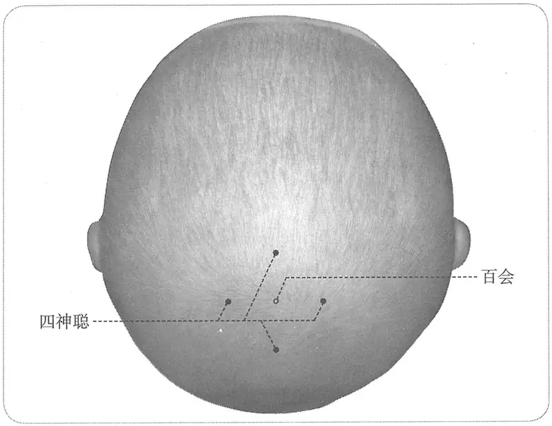

**图 2-431　四神聪穴图**

**取穴**：后神聪在前后发际正中连线的中点处，前顶穴后0.5寸为前神聪。

**适应症**：常用于头痛、眩晕；失眠，健忘；癫痫。

**操作**：平刺。

　1. 在百会四面各相去同身寸一寸是穴。理头风目眩，狂乱风痫。左主如花，右主如果。针入三分。（《太平圣惠方·针经》、《针灸资生经》）

　2. 前神聪，去前顶五分，自神庭至此穴共四寸。主治中风、风痫，灸三壮；后神聪，去百会一寸。主治中风、风痫，灸三壮。（《类经图翼》卷十）

　3. 统编针灸学教材

　　(1) 定位：在头顶部百会的前、后、左、右各一寸处是穴。主治：中风，头风目眩，风痫狂乱。操作：沿皮刺二、三分。（1957年南京《针灸学》）

　　(2) 定位：百会穴的前后左右各一寸处。主治：头痛，癫、狂、痫。操作：针二分，灸五至七壮。（1版《针灸学》）

　　(3) 定位：百会穴的前后左右各一寸处。主治：中风，头痛目眩，痫狂。操作：针2~3分，沿皮刺。（2版《针灸学》）

　　(4) 定位：百会穴的前后左右各一寸处。主治：头痛、眩晕，失眠，健忘，癫痫。操作：平刺0.5~0.8寸。（4、5版《针灸学》）

　　(5) 定位：在头顶部，当百会前后左右各1寸，共4穴。主治：头痛、眩晕，失眠，健忘，癫痫。操作：平刺0.5~0.8寸；可灸。（6版《针灸学》）

　　(6) 在头顶部，当百会前后左右各1寸，共4穴。主治：头痛、眩晕，失眠，健忘，癫痫等神志病证；目疾。操作：平刺0.5~0.8寸。（7版《针灸学》）

　　(7) 定位：百会穴的前后左右各一寸处。主治：头痛、眩晕，失眠，健忘，痫证。操作：横刺0.5~1.0寸。可灸。（《中国针灸学》）

〔p.1404 (인쇄 1376)〕

**文献分析**：《太平圣惠方》所谓“左主如花，右主如果”是对目眩的症状描述。后世所增“中风”一症可能是对“头风”一症的推演，所增“失眠、健忘”症或是据本穴的名称推测，或是从百会穴主治推导而来。

关于本穴的针刺方向，古今文献皆没有详细的说明，然而既是四个穴点作为一个穴看待，主治相同的病症，那么应当是由四穴点刺向中央百会穴，因针尖到达位置相同，因而可主治相同的病症。

又《针方六集》吴崑注曰：“神聪四穴，亦太医所传，累用神良，今并存之”，至少说明本穴在明代仍应用较广。

#### 【临床应用举例】 

　1. 欲灸头风宜先囟会、百会、前顶等穴，其头风连目痛者，当灸上星、神聪、后顶等穴。予尝自灸验。教人灸亦验云。（《针灸资生经·头风》卷六）

　2. 狂证取风府、间使、四神聪、大陵。[云南中医杂志，1983，4(4)：43]

　3. 尿失禁，取穴四神聪（针尖向百会透刺）。治老年人尿失禁。[中医药信息，1990，7(3)：27]

　4. 颈椎病眩晕，针刺四神聪穴。每日1次，10天为1个疗程，一般需2~3个疗程。[内蒙古中医药，2001，20(增刊)：66]

### （二）鱼腰　Yúyāo（EX-HN4）　出敦煌卷子《新集备急灸法》 

#### 【名实考】 

鱼腰，一名光明；一名吊睛。眉尾处名“鱼尾”，眉中名“鱼腰”，眉头名“攒竹”，皆取象形之义。本穴定位明确，皆定于眉毛中央。

敦煌卷子《新集备急灸法》载“光明”穴，定位与“鱼腰”同，而主治大不同。《银海精微》也将此穴名曰“光明”。今人不明“鱼腰”与“光明”二穴的关系，作为两个不同的穴，归入奇穴类。此外，又在本穴直上半寸处另立一新穴“鱼上”，主治近视，实为同一穴。

《窦太师针经》载“攒竹”、“鱼腰”皆主眼疾，且攒竹穴刺法“沿皮透鱼腰”，可见此二穴关系密切。《奇效良方》所载“鱼腰”穴主治更接近《眼论》灸方，且刺法上更指明“沿皮向两旁”，向内可透攒竹穴，向外可透鱼尾穴。

需要特别注意的是，古代文献关于印堂穴的定位描述为“两眉中”，是指两眉头之中间；而鱼腰穴定位“两眉中”，是指眉毛的中央。后人不辨，将“印堂”与“鱼腰”穴相混。

关于本穴与“攒竹”、“印堂”穴的关系，详见后二穴“名实考”。

　1. 患大风病，两眉中名光明穴，灸随年。（敦煌卷子《新集备急灸法》）

　2. 光明穴　对瞳仁上眉中，是光明穴。（《银海精微》卷下）

　3. 鱼腰二穴，一名吊睛。（《针方六集》卷一）

　4. 鱼腰二穴，一名印堂。在两眉中。主眼疾。针入二分。（《东医宝鉴》）

#### 【定位、主治与操作】 

**部位**：在头部，瞳孔直上，眉毛中（图2-432）。

**适应症**：常用于目赤肿痛，视物不清，目翳；眼睑瞤动或下垂，口眼㖞斜。

**操作**：平刺。

　1. 鱼腰二穴，在两眉中间是穴。针入一分，沿皮向外透鱼尾穴。治眼红肿痛，泻之，禁灸。（《窦太师针经》）

〔p.1405 (인쇄 1377)〕

　2. 对瞳人上眉中，是光明穴。（《银海精微》下）

　3. 鱼腰二穴，在眉中间。是穴治眼生垂帘翳膜，针入一分，沿皮向两旁是也。（《奇效良方》卷五十五、《针灸大成》）

　4. 鱼腰二穴　在眉中央是穴。治目疼，针入一分，沿皮或向攒竹、丝竹。（《针灸原枢》）

　5. 鱼腰二穴，一名吊睛。在两眉中间。针入一分，沿皮向外透鱼尾穴。禁灸。治眼红肿疼痛，泻之良。（《针方六集》卷一）

　6. 鱼腰二穴，在眉毛中间。治赤眼暴痛，目生翳膜，眉棱骨痛。针二分，禁灸。（《针灸秘法全书》）

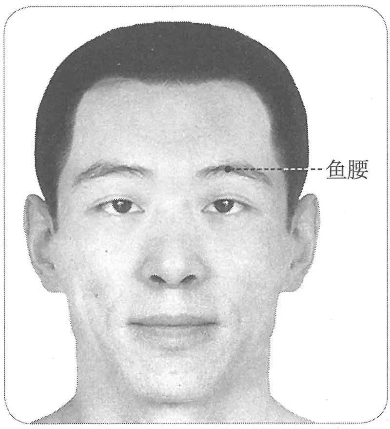

**图 2-432　鱼腰穴图**

　7. 统编针灸学教材

　　(1) 定位：在眉中间是穴。主治：目翳，红眼。操作：针一分，沿皮向两旁刺入。（1957年南京《针灸学》、1版《针灸学讲义》）

　　(2) 定位：在眉中间。正坐，于眉毛中央取穴。主治：眉棱骨痛，眼睑瞤动，目翳，目赤肿痛。操作：针2~3分，沿皮刺。（2版《针灸学讲义》）

　　(3) 定位：眉毛的中心。主治：眉棱骨痛，眼睑瞤动，眼睑下垂，目翳，目赤肿痛。操作：平刺0.3~0.5寸。（4、5版《针灸学》，《中国针灸学》）

　　(4) 定位：在额部，瞳孔直上，眉毛中。主治：眉棱骨痛，眼睑瞤动，眼睑下垂，目赤肿痛、口眼歪斜、目翳。操作：平刺0.3~0.5寸。（6版《针灸学》）

　　(5) 定位：在额部，瞳孔直上，眉毛中。主治：眉棱骨痛，眼睑瞤动，眼睑下垂，目赤肿痛、目翳、口眼㖞斜等眼部病证。操作：平刺0.3~0.5寸。（7版《针灸学》）

　8. 在眉毛正中，眼平视，下对瞳孔处。主治近视，急性结膜炎，眼肌麻痹，面神经麻痹，眶上神经痛。横刺，治疗眶上神经痛时，可沿皮向两旁刺入，透至攒竹或丝竹空，进针0.5~1寸。感应：局部酸胀，有时可扩散至眼球发胀。（上海《针灸学》）

#### 【临床应用举例】 

　1. 患大风病，两眉中名光明穴，灸随年。（敦煌卷子《新集备急灸法》）

　2. 《眼论》又云治眼生淫肤覆瞳子上方，随眼痛左右，灸眉当中瞳子七壮，便愈。（《医心方》卷二十七）

**按**：“眉当中瞳子”，据文义当作“眉中当瞳子”。

　3. 呃逆，按摩、针刺鱼腰穴，针刺平补平泻。[针灸临床杂志，1997，13(4、5)：71]

　4. 鱼腰合谷刺治疗上胞下垂，脾虚者加足三里、三阴交、陷谷；兼表症者加风池、曲池。[云南中医中药杂志，1998，19(3)：35]

### （三）太阳　Tàiyáng（EX-HN5）　出《太平圣惠方》 

#### 【名实考】 

《太平圣惠方》载有“前关”、“太阳”穴，而无“瞳子髎”穴，宋臣校《千金要方》则认为此三穴为同一穴。

太阳穴现代定位为“眉梢与目外眦之间，向后一寸”。实际上是综合了《千金要方》“颞颥”与《圣济总录》“太阳”穴的定位描述，然而主治病症采用的却是窦太师针灸。在窦氏针法中，太阳一穴主治实热眼疾，多用三棱针刺血，故其描述的穴位并不是一个固定的点，这与《千金要方》所述之“颞颥”及“当容”穴定位相似。可见，现代教材所说之“太阳”已非《太平圣惠方》所述之“太阳”，为避免混淆，“太阳”不作为瞳子髎穴的别名。

〔p.1406 (인쇄 1378)〕

瞳子髎穴“一名太阳”的说法对后世有较大的影响，例如元代《针灸集成》一书针灸方中大量应用“太阳”穴，明初医家则以太阳与瞳子髎为同一穴，直接将原方中的“太阳”穴名替换为“瞳子髎”。

关于本穴与“瞳子髎”与“前关”穴的关系，详见瞳子髎穴“名实考”。

　1. 瞳子窌，一名太阳、一名前关。（《千金要方》卷二十九注）

　2. 前关二穴，在目后半寸是穴，亦名太阳之穴。（《太平圣惠方·针经》）

**按**：从这两条文字看，《太平圣惠方·针经》所载“前关”（一名太阳）穴部位与“瞳子窌”完全相同，故《千金要方》注文无误。然而，关于“太阳”穴定位，古代文献有不同的描述：

　3. 颞颥穴，在眉眼尾中间上下有来去络脉是。针灸之，治四时寒暑所苦疸气温病等。（《千金要方》卷十）

　4. 肝劳邪气眼赤，灸当容百壮，两边各尔，穴在眼小眦近后当耳前，三阳三阴之会处，以两手按之，有上下横脉，则是与耳门相对是也。（《千金要方》卷六）

　5. 太阳二穴，在眉外五分。（《太平圣惠方》卷五十五）

　6. 眼小眦后一寸，太阳穴。（《圣济总录》卷一九四）

#### 【定位、主治与操作】 

**部位**：在头部，眉梢与目外眦之间，向后约一横指的凹陷中（图2-433）。

**取穴**：丝竹空与瞳子髎连线中点向外约一横指处。

**适应症**：常用于头痛；目赤肿痛，目涩，口眼㖞斜。

**操作**：直刺时，切忌大力提插、捻转。

　1. 前关二穴，在目后半寸是穴，亦名太阳之穴。理风，赤眼，头痛，目眩目涩。不灸，针入三分。（《太平圣惠方·针经》）

　2. 在目外眦五分。主偏正头痛；烂弦，风牵㖞斜。（《银海精微》下）

　3. 太阳二穴，在额角际发下紫脉是穴。治目疼羞明，用三棱针出血。（《窦太师针经》）

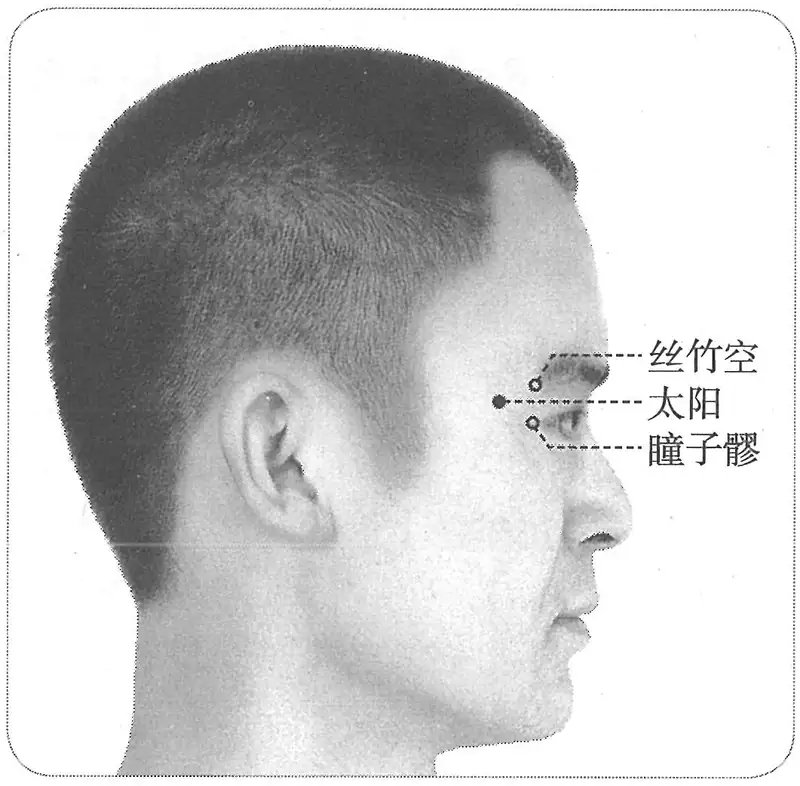

**图 2-433　太阳穴图**

　4. 太阳二穴在眉后陷中，太阳紫脉上。是穴治眼红肿及头痛，宜用三棱针出血。出血之法，用帛一条，紧缠其项，紫脉即见，刺见血立愈。又法以手紧扭其领，令紫脉见，却于紫脉上刺见血，立愈。（《奇效良方》卷五十五、《针灸大成》）

　5. 太阳二穴，在头额角发际下紫脉上。用三棱针出血，治目疼。（《针方六集》卷一）

　6. 统编针灸学教材

　　(1) 定位：在眉梢与外眼角之间向后移约一寸，以指甲掐之有凹陷之处。主治：眼红肿，头痛。操作：针二、三分，或刺出血。（1957年南京《针灸学》、1版《针灸学讲义》）

〔p.1407 (인쇄 1379)〕

　　(2) 定位：在瞳子髎（足少阳经）外上方。在眉梢与目外眦的中央，向后约一横指处取穴。主治：偏头痛，目赤红肿。操作：针3~5分，或点刺出血。（2版《针灸学讲义》）

　　(3) 定位：在眉梢与目外眦之间向后约1寸处凹陷中。主治：头痛，目疾。操作：直刺或斜刺0.3~0.5寸，或点刺出血。（4、5版《针灸学》）

　　(4) 定位：在颞部，当眉梢与目外眦之间，向后约1横指的凹陷处。主治：头痛，目疾。操作：直刺或斜刺0.3~0.5寸，或点刺出血。（6版《针灸学》）

　　(5) 定位：在颞部，当眉梢与目外眦之间，向后约1横指的凹陷处。主治：头痛；目疾；面瘫。操作：直刺或斜刺0.3~0.5寸，或点刺出血。（7版《针灸学》）

　　(6) 定位：眉梢与目外眦之间向后约一寸处凹陷中。主治：头痛，目疾，口眼歪斜。操作：直刺0.3~0.5寸，或点刺出血。（《中国针灸学》）

　7. 在眉梢与外眼角中间，向后约1寸凹陷处。主治头痛，偏头痛，感冒，面神经麻痹，三叉神经痛，眼病等。操作：①直刺，深0.5~1寸。感应：局部酸胀。②横刺，治疗偏头痛时，可向后沿皮透率谷，进针1~2寸。感应：酸胀扩散至同侧颞部。③治疗面神经麻痹时，可向下沿皮透颊车，进针3寸。感应：酸胀可扩散至舌部。④治疗急性结膜炎或头痛时，可点刺出血。（上海《针灸学》）

#### 【临床应用举例】 

　1. 风牵㖞斜，可灸颊车、耳门穴，开口取之，太阳、人中、承浆，㖞左灸右，㖞右灸左。（《银海精微》）

　2. 偏头风痛，丝竹空、太阳、率谷、风池、大渊、申脉。（《针灸捷径》卷之下）

　3. 胬肉攀睛，攒竹、睛明、风池、太阳、合谷。（《针灸捷径》卷之下）

　4. 眼睛红肿痛难熬，怕日羞明心自焦。但刺睛明鱼尾穴，太阳出血病全消。（《针灸玉龙歌》）

　5. 忽然眼痛血贯睛，隐涩羞明最可憎。若是太阳出毒血，不须针刺自和平。注曰：太阳，在额紫脉上。出血，三棱针刺之。应睛明穴。（《针灸玉龙歌》）

　6. 眼目暴赤肿痛，眼巢红，太阳出血，大小骨空灸。（《针灸玉龙经·盘石金直刺秘传》）

　7. 眼目红肿取血出，再取出血要搓摩，太阳出血真奇妙，三里升阳气下和，再取骨空多提泻，合骨即下要取搓，攒竹多提补三次，诸穴上下病安多。（《琼瑶神书》地部）

　8. 忽然眼痛血贯睛，提刮加弹真穴难，搓得太阳出毒血，不取气上即自安。（《琼瑶神书》地部）

　9. 两眼暴赤肿，疼皮者眼皮如脱，刺太阳穴，用三棱针出血，委中出血。大小指骨空灸二七壮。（《针灸集要·盘石金直刺秘传》）

　10. 正头风大痛及脑痛，神庭、合谷、太阳、上星、百会。问曰：此证针后或一日、二日再发，痛甚如前，何也？答曰：诸阳聚于头，合先补后泻，宜泻多补少。其证再发愈重如前，依前穴法再针泻之，无不效也。复刺后穴。正头痛旦发夕死，夕发旦死，医者当心救疗，如不然难治。端的正头风十死，又名肾厥头痛。（《针灸集成》第五方）

　11. 目中生膜，睛明、太阳、合谷、四白、光明。问曰：已上穴法刺之不效，何也？答曰：此证受病既深，未可一时便能针愈，须是三次针之方可效。复刺后穴：睛明、合谷、四白。（《针灸集成》第十方）

〔p.1408 (인쇄 1380)〕

　12. 问曰此证从何而得？用此法针之不效，何也？答曰：怒气伤肝，血不就舍，骨水枯竭，血气耗散，初患时不能节，将恣意房室，用心过多，故得证者难治，可刺后穴：太阳、合谷、临泣、睛明、光明、风池、天府。（《针灸集成》第十二方）

　13. 眼外障，太阳、睛明、合谷、小谷空。问曰：此证从何而得？答曰：头风灌注瞳人，血气涌溢，上盛下虚，故得此证也。刺前穴不效，复刺后穴：临泣、攒竹、三里。（《针灸集成》第十三方）

　14. 眼暴赤肿痛，太阳、睛明、合谷、三里。问曰：此证从何而得？答曰：时气壅滞，当风卧睡，饥饱劳役，复刺后穴，不宜补：攒竹、丝竹空、太阳。（《针灸集成》第十六方）

　15. 眼红肿疼痛，睛明、合谷、四白、临泣。问曰：此证从何而得？答曰：或因伤寒未解，却有房室之事，上盛下虚，气血上壅，或头风不早治，则血灌瞳人，或暴赤肿痛，或因怒气伤肝，心火炎上，故不散，及妇人产后怒气所伤，产眼未满房事，触毒心肝二经，饮食不节，饥饱醉劳，皆有此证也。证非一时可疗，渐而为之，无不效也。复刺后穴：风池、行间、期门、太阳。（《针灸集成》第十七方）

　16. 口眼㖞斜，承浆、太阳、人中、合谷、颊车、地仓。问曰：此证缘何而得？答曰：醉后睡卧当风，不避贼风，串入经络，痰饮灌注，或目怒气伤肝，房事不节，故得此证。复刺后穴：承浆、合谷、童子髎、地仓。（《针灸集成》第二十一方）

　17. 太阳透角孙治疗偏头痛，留针2小时，每隔20分钟行针1次。隔日针1次。[河北中医药学报，1997，12(2)：39]

　18. 太阳、耳尖放血治疗急性结膜炎。[中国针灸，2001，21(10)：612]

　19. 三棱针点刺太阳、耳尖放血治疗麦粒肿，每日1次，3次为一个疗程。[甘肃中医，2001，14(3)：69]

### （四）耳尖　Ěrjiān（EX-HN6）　出《奇效良方》 

#### 【名实考】 

需要注意的是，《银海精微》所说“耳尖”为足少阳胆经率谷穴别名，切不可相混。

　1. 耳尖二穴，在耳尖上，卷耳取之，尖上是穴。（《奇效良方》卷五十五）

　2. 耳尖穴（即率骨穴），将耳折转，尖上一寸半尽处是率骨穴。（《银海精微》）

　3. 率谷二穴，在耳尖上入发际一寸五分。针入五分，沿皮向前一寸，灸七壮。治眼目痛，头痛等症。（《窦太师秘传》）

#### 【定位、主治与操作】 

**部位**：在耳区，在外耳轮的最高点（图2-434）。

**取穴**：折耳向前时，耳郭上方的尖端处。

**适应症**：常用于目疾；头痛；咽喉肿痛，热病。

**操作**：直刺0.1~0.2寸。

　1. 在耳尖上，卷耳取之，尖上是穴。治眼生翳膜，宜灸七壮，不宜灸多。（《奇效良方》卷五十五）

　2. 耳尖二穴，在耳尖上，卷耳取尖上是穴。治眼生翳膜，用小艾炷五壮。（《针灸大成》卷七、《针方六集》）

〔p.1409 (인쇄 1381)〕

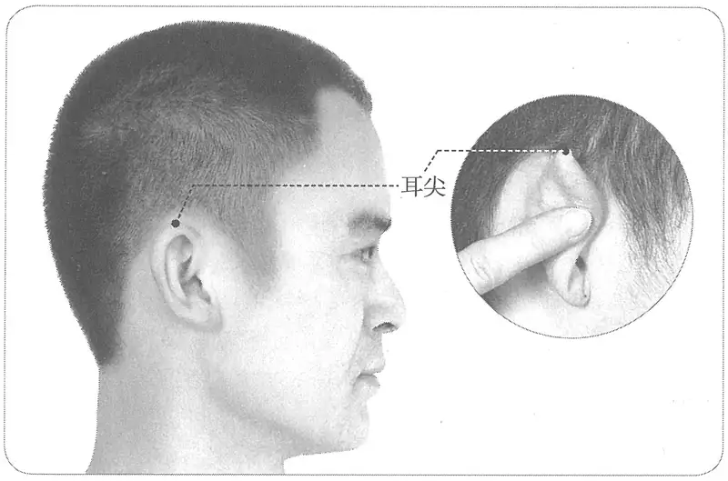

**图2-434　耳尖穴图**

　3. 耳尖二穴，在耳上卷耳取之。治目生翳障，胬肉攀睛。灸二壮，禁针。（《针灸秘法全书》）

　4. 统编针灸学教材

　　(1) 定位：在耳廓的上方，当折耳向前，耳廓上方的尖端处。主治：目疾；头痛；咽喉肿痛。操作：直刺0.1~0.2寸。（7版《针灸学》）

　　(2) 定位：折耳时，耳壳上方之尖端。主治：目赤肿痛，热病，目翳。操作：直刺0.1~0.2寸，或点刺出血。可灸。（《中国针灸学》）

#### 【临床应用举例】 

　1. 三棱针点刺耳尖放血治疗痄腮。[安徽中医临床杂志，1994，6(1)：34]

　2. 三棱针或6号注射用针头点刺耳尖放血治疗高血压。[上海针灸杂志，1997，16(2)：21]

　3. 三棱针点刺耳尖放血配合针刺风池穴治疗麦粒肿。[湖北中医杂志，1998，20(3)：17]

　4. 三棱针点刺耳尖放血治疗急性扁桃体炎。[湖北中医杂志，2000，22(4)：47]

　5. 耳尖放血疗法治疗小儿发热。[中医外治杂志，2001，10(2)：53]

　6. 耳尖放血治疗鼻衄，隔日1次，3次为一疗程。[中国针灸，2001，21(9)：546]

　7. 三棱针点刺耳尖、大椎出血治疗痤疮，2~3日1次，10次为1个疗程。[上海针灸杂志，2002，21(1)：29]

### （五）内迎香　Nèiyíngxiāng（EX-HN9）　出《儒门事亲》 

#### 【名实考】 

内迎香之穴见于《儒门事亲》，“内迎香”穴名及定位、主治、刺法见于《针灸玉龙歌》。类似的刺法虽见于《千金要方》，《外台秘要》曰“此扁鹊法”，然用于卒死中恶，金元腧穴文献所载之“内迎香”与之无直接关系。

需要特别注意的是，“内迎香”，古代文献亦作“迎香”，与手阳明经穴“迎香”同名，后人不辨，常有混淆之处。例如明代李梴、张介宾便将“内迎香”主治混入手阳明经“迎香”穴下。

关于本穴与手阳明经迎香穴的关系及鉴别方法，详见迎香穴“名实考”。

〔p.1410 (인쇄 1382)〕

内迎香：在鼻孔内。用芦叶或箬叶作卷搐之，血出为好。应合谷穴。（《针灸玉龙歌》注）

#### 内、外“迎香”相混例 

　1. 迎香，禾髎上一寸，鼻旁陷中。针入三分，禁灸。主眼目赤肿，鼻塞不闻香臭。（《医学入门》卷一）

　2. 搐迎香于鼻内，消眼热之红。（《玉龙赋》）

　3. 内迎香二穴，在鼻孔内。用箬叶做一箬管，搐动出血，治眼红肿。一法：在鼻柱两旁珠上陷中是穴。针入二分。治鼻中息肉，不闻香臭。（《针方六集》卷一）

**按**：第一条“迎香”穴主治“眼目赤肿”系奇穴“内迎香”主治，李梴不辨而混入经穴“迎香”下；第二条《玉龙赋》中“迎香”为奇穴“内迎香”，张介宾不辨而归入手阳明经“迎香”穴下，大误；第三条“内迎香”文字，吴崑也不辨内外，直接将经穴“迎香”内容作为“一法”附于奇穴“内迎香”下，大误。

#### 【定位、主治与操作】 

**部位**：在鼻孔内，鼻翼软骨与鼻甲交界的黏膜处。（图2-435）

**适应症**：目痛赤肿。

**操作**：用三棱针点刺出血。

　1. 内迎香二穴，在鼻孔内是穴。用箬叶做一箬管，搐动出血。治眼红肿痛，出血尤妙。（《窦太师针经》）

　2. 迎香二穴，在鼻内是穴。治眼红痛，用芦叶或箬叶削尖，鼻内搐动出血即效。（《窦太师针经》乙抄本）

　3. 迎香二穴，在鼻内凸肉上。治目痛赤肿。以针刺出血效。（《针灸秘法全书》）

　4. 内迎香二穴，在鼻孔中。治目热暴痛，用芦管子搐出恶血，效。（《奇效良方》卷五十五、《针灸大成》）

　5. 在鼻孔内，鼻黏膜上。主治中恶、目热暴痛、卒死、喉闭。三棱针刺出血。（《针灸经外奇穴图谱》）

　6. 在鼻孔内，当鼻翼软骨与鼻甲交界的黏膜上。主治：①目赤肿痛，热病，中暑；②鼻疾，喉痹；③眩晕。用三棱针点刺出血。（7版《针灸学》）

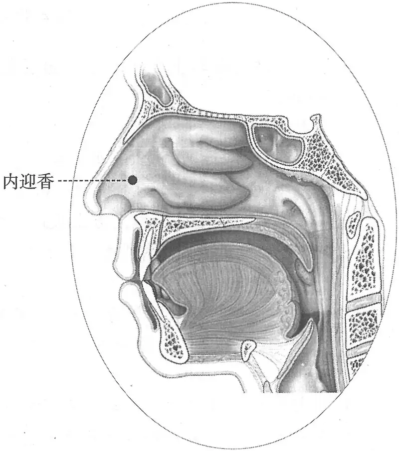

**图2-435　内迎香穴图**

#### 【临床应用举例】 

　1. 救卒死，或先病痛，或常居寝卧，奄忽而绝，皆是中死，救之方：一方 取葱黄心刺其鼻，男左、女右，入七八寸。若使目中血出，佳。扁鹊法同。（《肘后备急方》卷一）

　2. 治中恶方，葱心黄刺鼻孔中，血出愈。《肘后方》云：使目中血出佳。崔云：男左女右。（《千金要方》卷二十五）

　3. 余尝病目赤，或肿或翳，作止无时，偶至亲息帅府间，病目百余日，羞明隐涩，肿痛不已。忽眼科姜仲安云：宜上星至百会，速以铍针刺四、五十刺，攒竹穴、丝竹穴上兼眉际一十刺，反鼻两孔内，以草茎弹之出血。三处出血如泉，约二升许。来日愈大半，三日平复如故。《儒门事亲·目疾头风出最急说》

〔p.1411 (인쇄 1383)〕

　4. 赤眼迎香出血奇，临泣太冲合谷侣。（《医学入门》卷一）

　5. 目暴赤肿及疼痛，攒竹二穴、合谷二穴、迎香二穴。（《针灸大全》卷四）

### （六）金津　Jīnjīn（EX-HN12）　玉液　Yùyè（EX-HN13）　出《窦太师针经》 

#### 【名实考】 

金津、玉液，在《内经》中称“廉泉”（与任脉穴“廉泉”同名），属足少阴经穴，可治疟、狂、咳。至元代针灸书始左右分别命名，在左者名“金津”，在右者名“玉液”。从古今腧穴命名规律看，左右对称的两穴多以相同的名称命名，而且该穴针灸处方中也很少单独出现，似无分别命名的必要。

足少阴肾经“夹舌本”，而《灵枢·卫气》又明确指出足少阴标脉为“舌下两脉”，故将此穴归于足少阴经有很充足的理由。只是由于第一部腧穴经典《黄帝明堂经》未收录此穴，后人不知其所出，而误入经外穴也。建议：将此穴重新归入足少阴经穴。并注意在临床观察该穴对躁狂证的疗效，以检验《灵枢》、《素问》的经验并积累新的临床数据。

　1. 别名　廉泉（《素问·刺疟》）；舌下穴。（《千金要方》）

　2. 先其发时如食顷而刺之，一刺则衰，二刺则知，三刺则已，不已，刺舌下两脉出血。舌下两脉者，廉泉也。（《素问·刺疟》）

　3. 少阴根于涌泉，结于廉泉。（《灵枢·根结》）

　4. 足少阴之本，在内踝下上三寸中，标在背腧与舌下两脉也。（《灵枢·卫气》）

　5. 舌下两脉者，廉泉也。（《素问·刺疟》）

　6. 足少阴舌下，厥阴毛中急脉各一。（《素问·气府论》）

　7. 黄帝曰其咳上气穷诎胸痛者，取之奈何？岐伯曰：取之廉泉。黄帝曰：取之有数乎？岐伯曰：取天容者，无过一里，取廉泉者，血变而止。帝曰：善哉。（《灵枢·刺节真邪》）

　8. 狂始发，少卧不饥，自高贤也，自辨智也，自尊贵也，喜骂詈，日夜不休，治之取手阳明、太阳、太阴、舌下少阴，视脉之盛者皆取之，不盛者释之。（《灵枢·癫狂》）

　9. 舌下穴挟舌两边，针治黄疸等病。（《千金要方》卷十）

#### 相关穴及刺激点 

　1. 舌柱　重舌，刺舌柱以铍针。杨上善注：重舌，谓舌下重肉生也。舌柱，舌下柱。以针刺去血也。（《黄帝内经太素·三刺》）

　2. 治舌卒肿满口，溢出如吹猪胞，气息不得通，须臾不治杀人方　刺舌下两边大脉血出，勿使刺著舌下中央脉，血出不止杀人。不愈，血出数升，则烧铁篦令赤，熨疮数过以绝血也。（《千金要方》卷六）

　3. 《集验方》治重舌方，以铍针刺舌下肿者，令血出，愈。勿刺大脉也。（《医心方·治重舌方》卷五）

　4. 海泉一穴，在舌底当中是穴。用三棱针刺出血。治重舌胀肿，牙肿难言等症。（《窦太师针经》）

海泉一穴，在舌下中央脉上是穴。治消渴，用三棱针出血。（《奇效良方》卷五十五）

　5. 海泉一穴，在口舌底根，当中紫脉上是穴。宜三棱针出血，禁灸。治舌上诸病，针不宜深。（《针方六集》卷一）

**按**：海泉、舌柱，定位相同，皆主治重舌，实为异名同穴。

〔p.1412 (인쇄 1384)〕

#### 【定位、主治与操作】 

**部位**：在口腔内，当舌系带静脉上，左侧穴名金津，右侧穴名玉液。（图2-436）

**适应症**：舌肿；口疮；口干。**拟新增**：失语症。

**操作**：三棱针点刺出血。勿刺伤舌动脉。

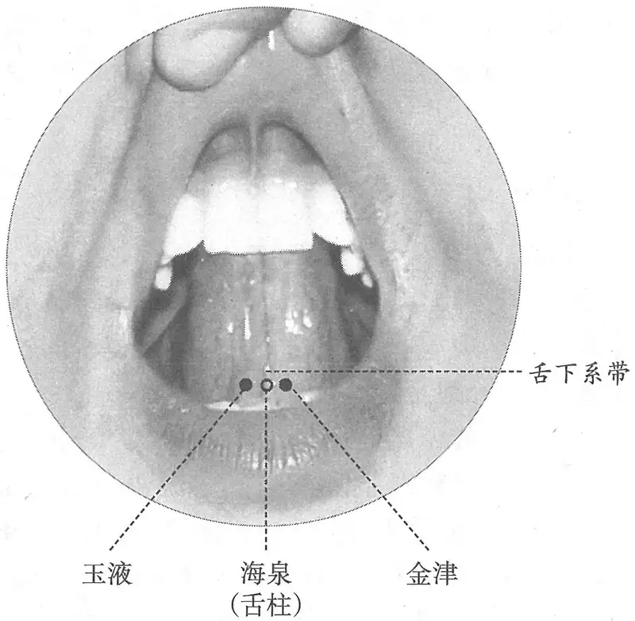

**图2-436　金津、玉液与相关穴图**

　1. 金津一穴，在口舌底左紫脉上是穴。宜三棱针出血，禁灸。治小儿重舌，大人乳蛾等症，皆出血妙。玉液一穴，在舌底右紫脉上是穴。宜三棱针出血。治五瘿症。余病同前二穴。（《窦太师针经》）

　2. 金津一穴，在舌底，在左紫脉上是穴。禁灸。宜用三棱针出血。治小儿重舌，大人乳蛾等症，出血妙。玉液一穴，在口舌底，右紫脉上是穴。禁灸。宜用三棱针出血。治五瘖、重舌、乳蛾等症。（《针方六集》卷一）

　3. 金津，一在舌下左紫脉上是穴。三棱针出血。治口干无津，言语喉热。玉液，一在舌下右紫脉上是穴。三棱针出血。治舌强，大热不退，口干消渴之症。（《窦太师秘传》）

　4. 左金津右玉液二穴，在舌下两旁紫脉上是穴，卷舌取之。治重舌肿痛，喉闭，用白汤煮三棱针出血。（《奇效良方》卷五十五、《针灸大成》）

　5. 左金津、右玉液，在舌下两旁紫脉上。主治消渴口疮，舌肿喉痹，三棱针出血。（《类经图翼》卷十）

　6. 金津玉液二穴，在舌底紫脉，左金津，右玉液。治口舌生疮，咽喉热症，及治渴。俱以三棱针出血妙。（《医经会元·针灸原枢》卷十）

　7. 左金津、右玉液，在舌下两旁紫脉上。主治消渴口疮，舌肿喉痹，三棱针出血。（《类经图翼》卷十）

　8. 统编针灸学教材

　　(1) 定位：在舌下系带两侧，舌底部紫筋上，卷舌取之。左名金津，右名玉液。主治：消渴，口疮，舌肿，喉痹，呕吐。操作：三棱针刺出血。（1957年南京《针灸学》、1版《针灸学讲义》）

　　(2) 定位：在舌下系带两侧，舌底部紫筋上，卷舌取之。左名金津，右名玉液。主治：舌强，消渴，呕吐不止，口疮。操作：浅刺出血。（2版《针灸学讲义》）

　　(3) 定位：舌系带两侧紫脉上，左为金津，右为玉液。主治：口疮，舌肿，呕吐。操作：点刺出血。（4版《针灸学》）

　　(4) 定位：舌系带两侧紫脉上，左为金津，右为玉液。主治：口疮，舌肿，呕吐，消渴。操作：点刺出血。（5版《针灸学》）

　　(5) 定位：在口腔内，当舌系带两侧静脉上，左为金津，右为玉液。主治：口疮，舌强，舌肿，呕吐，消渴。操作：点刺出血。（6、7版《针灸学》）

〔p.1413 (인쇄 1385)〕

　　(6) 定位：在口腔内，当舌系带两侧静脉上，左为金津，右为玉液。主治：舌肿，呕吐不止，舌强不语。操作：点刺出血。（《中国针灸学》）

**文献分析**：腧穴文献以金津、玉液主治的记载集中在舌病与热病。古代治疗文献以金津、玉液为主的针灸方主治口舌病症：舌肿、舌强；口疮，口臭；消渴，口干。现代临床报道与古代针灸治疗文献的记载吻合度较高，特别是对失语的治疗，现代临床应用范围更广。

#### 【临床应用举例】 

　1. 消渴，金津、玉液、承浆。问曰：此证缘何而得？答曰：因房事过多，肾水枯竭，水火不济，脾败肾虚。久不治，发成痈疽，则难疗也。然此症非一，详见《局方》，今不具载。复刺别穴，无不效也：人中、廉泉、气海、肾俞。（《针灸集成》第五十一方）

　2. 口疮，舌下肿，语言蹇滞，舌缓涎出，舌根急缩，刺金津出血、合谷泻之、委中出血。（《针灸集要·盘石金直刺秘传》）

　3. 口舌干燥，发渴不止，刺金津、玉液出血。（《针灸集要·盘石金直刺秘传》）

　4. 口内生疮，承浆、合谷、人中、廉泉。问曰：此证缘何而得？答曰：皆因上盛下虚，心火炎上焦壅热，故口生疮，乃脾胃俱败，以成此疾。复刺后穴：长强、人中、金津、玉液。（《针灸集成》第二十二方）

　5. 两颊红肿生疮，合谷、列缺、地仓、颊车。问曰：此证缘何而得？答曰：血气上壅，痰滞中焦，肿而不散，故口内两颊红肿生疮，如不早治，恐难治也。复刺后穴：人中、承浆、三里、金津、玉液。（《针灸集成》第二十三方）

　6. 舌肿难语，廉泉、金津、玉液。问曰：此证缘何而得？答曰：皆因顽痰滞于上焦，壅上舌根，肿不能言语也。不愈，复刺后穴：天突、少商。（《针灸集成》第二十四方）

　7. 消渴，经百日以上者，不可刺灸，刺灸则疮口病水不止，玉液一分，泻见血讫，取下穴、三里泻讫如前，补玉液一分，再取下穴、关元泻讫再取廉泉。（《医学纲目》卷二十一）

　8. 男女口气腥臭一百十一法，口气腥臭热可增，口中刺上用金津，心经此穴多气下，肾经穴内停气匀。（《琼瑶神书》卷二）

　9. 男女三焦邪气一百八十四法，三焦邪气壅上焦，口苦舌干出血高，金津关冲多出血，少商提利泻三焦。（《琼瑶神书》卷二）

　10. 重舌肿胀，热极难言，十宣十穴、海泉一穴在舌理中、金津一穴在舌下左边、玉液一穴在舌下右边。（《针灸大全》卷四）

　11. 双蛾风，喉闭不通，少商、金津、玉液、十宣。（《针灸大成》卷五）

　12. 口内生疮，臭秽不可近，十宣、人中、金津、玉液、承浆、合谷。（《针灸大成》卷五）

　13. 三焦极热，舌上生疮，关冲、外关、人中、迎香、金津、玉液、地仓。（《针灸大成》卷五）

　14. 口气冲人，臭不可近，少冲、通里、人中、十宣、金津、玉液。（《针灸大成》卷五）

　15. 音哑，金津、玉液。点刺放血。[贵州医药，1984，8(1)：57]

　16. 中风等病伴失语症，配金津、玉液，均用三棱针放血。[中国针灸，1984(5)：13]

　17. 消渴，肺俞泻，肾俞补，照海补，金津、玉液均出血。[上海针灸杂志，1984(4)：29]

　18. 老年性味觉障碍，金津、玉液，刺后少量出血，舌尖边缘也作点刺，再以足三里、三阴交为配穴，交替针刺。[中国针灸，1985(1)：49]

　19. 舌肿，金津、玉液放血。[中国针灸，1994(2)：50]

　20. 咽喉症，取金津、玉液、玉泉，点刺放血。[中国针灸，1994(4)：64]

　21. 口疮，取舌针心穴、脾穴；金津、玉液。均用三棱针点刺出血。[上海针灸杂志，1995，14(3)：125]

〔p.1414 (인쇄 1386)〕

　22. 用无菌注射针头点刺金津或玉液，治疗周围性面神经麻痹，隔日1次，10次为一疗程。注：面瘫伴有面肌痉挛者禁用。[中国针灸，1996(6)：382]

　23. 取三棱针直刺金津、玉液出血，治疗急性扁桃体炎，每日1次，连刺4次。[中国针灸，2000(10)：619]

　24. 三棱针点刺金津、玉液出血，治疗各种原因的失语。[中医外治杂志，2001，10(6)：56]

#### 胸腹部经外穴 

### （七）阑门(附：蘭门、攔門、澜门、閤门、關门、關元)　Lánmén　出《窦太师针经》 

#### 【名实考】 

名曰“阑门”者，是中医经典将阴疝属之于小肠病（又名“小肠气”），而“阑门”为小肠下口。传世文献中除《医学纲目》、《琼瑶神书》、《医学原始》外，大多误作“蘭门”、“攔門”、“澜门”、“闗门”、“閤门”。对于上述穴名演变及其与经穴“关门”的关系，明代诸太医已不能详，今人更难辨其原委，于是误名行于世，而正名隐而不彰。特别是明代《针灸大成》引录时，不仅穴名误作“蘭门”，且将原文献定位文字中“曲骨”误抄作“曲泉”，今人也不辨真伪，于是原来的二穴变为四穴，归入下肢部奇穴类，大误。

其实，远早于元代窦太师大量应用“阑门”治疗阴疝之前，本穴早已用于针灸临床治疗阴疝，只不过没有提及“阑门”穴名而已。

关于本穴与“羊矢”、“急脉”、“气冲”穴的关系，详见急脉穴“名实考”。

#### 【定位、主治与操作】 

**部位**：曲骨穴旁开三寸（图2-437）。

**适应症**：阴疝。

**操作**：直刺0.5~2.0寸。

　1. 关门二穴，在曲骨穴微上两旁各开三寸。针入三寸，灸五十壮。治乳弦疝气，肚腹膨胀，泻；偏坠木肾，遗尿，先泻后补。（《窦太师针经》）

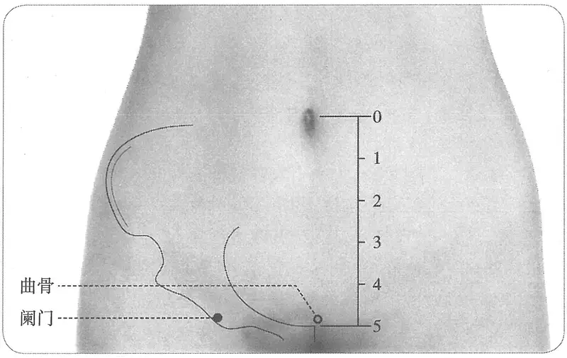

**图2-437　阑门穴图**

〔p.1415 (인쇄 1387)〕

　2. 兰门二穴，在曲骨穴两旁各开三寸。针入一分半，灸三七壮。治膀胱七疝之气。（《窦太师针经》）

　3. 关门二穴，在茎毛际各去三寸。刺灸同前。（《窦太师针经》乙抄本）

　4. 蘭门二穴，在曲骨两旁各三寸，脉上是穴。（《针灸大全》卷四）

　5. 拦门二穴，在腹毛际内茎根旁开五寸，归来穴一寸，针刺入二寸半，灸七壮。治阴汗、偏坠、红肿三症。（《医经会元·针灸原枢》）

　6. 兰门二穴，在曲泉两旁各三寸脉中。治膀胱七疝，奔豚。（《针灸大成》卷七）

　7. 兰门二穴，在曲骨穴两旁，各开二寸。针入一寸五分，灸三七壮。治膀胱七疝之气。（《针方六集》卷一）

　8. 阁门，在玉茎毛际两旁各三寸。针一寸半，泻之，灸五十壮。（《针灸玉龙歌》注）

　9. 澜门二穴，在曲骨傍三寸。治七疝疼痛，奔豚上攻脐腹。灸九壮。（《针灸秘法全书》）

　10. 脐豚息气乳弦，水道、关门、气海。注：关门，梁门下一寸，建里旁二寸，入八火五。（《针灸集成》第五十三方）

　11. 木肾，红肿阴汗偏坠，阑门毛际玉茎旁开二寸，针入二寸半、三阴交。（《医学纲目》卷十四）

　12. 关门二穴，在王茎毛际各开三寸，直针入一寸半，可灸五十壮；又建里两傍各三寸，梁门下一寸。治乳弦疝气，单泻；偏坠木肾，先补后泻；肚膨，单泻。（《医经会元·玉龙歌》注）

**文献分析**：以上《针灸集成》穴位注文出自明初太医之手，显然其不详窦氏原方中“关门”（“阑门”之形误）；《医经会元》“又建里两傍各三寸，梁门下一寸”句，不见于《医学纲目》卷二十五引《针灸玉龙歌》注文，应是该书编者吴嘉言所添加，所注乃经穴“关门”部位，而经穴关门不治上述病症，显然吴氏对于经穴与奇穴“关门”也不能辨。

#### 【临床应用举例】 

　1. 脐豚息气乳弦，水道、关门、气海。问曰：此证从何而得？答曰：皆因酒色过多，肾水枯竭，积气耗散，阳气不兴，勉强为之，精不能泄，外流入胞中，或偏坠疼痛，或作鸡子之状，坠下疼痛，按上腹中则不痛，否则浑身不知，如入腹中则作声，以为乳弦疝气也。善治者当推详而治之。刺前穴不效，复刺后穴。前穴：水道、关门、气海。后穴：归来、关门、三阴交。关门，梁门下一寸，建里旁二寸，入八火五。（《针灸集成》第五十三方）

　2. 寒热五般疝偏坠，关门、归来、关元、大敦、曲泉、三阴。此证因劳伤或走受寒，故成此疾。若常发，只泻下；从上来，多补元气。若一时攻心欲死，先灸关门，绝赶下气；次下泻，灸立效。（《针灸集成》第七十一方）

　3. 木肾，红肿阴汗偏坠，阑门毛际玉茎旁开二寸，针入二寸半、三阴交。（《医学纲目》卷十四）

　4. [《玉》]疝气冲心欲死，关门在玉茎旁二寸，针入二寸半，灸二七壮。（《医学纲目》卷二十五）

　5. 肾弦疝气发得频，气上冲心苦死人，关门复刺大敦穴，二穴须教认得真。关门二穴，在玉茎毛际各开三寸。（《针灸原枢·玉龙歌》）

　6. 竖痃疝气发来频，气上攻心大损人，先向阁门施泻法，大敦复刺可通神。阁门：在玉茎毛际两旁各三寸。针一寸半，泻之，灸五十壮。（《针灸玉龙经·玉龙歌》）

　7. 治偏坠红肿二百五十九法，阑门穴取又盘寻，左取盘盘提出针，海底二分针头用，大敦出血灸如金。（《琼瑶神书》卷二）

〔p.1416 (인쇄 1388)〕

　8. 膀胱七疝、贲豚等证，大敦二穴、蘭门二穴、丹田一穴、三阴交穴、涌泉二穴、章门二穴、大陵二穴。（《针灸大全》卷四）

　9. 偏坠水肾，肿大如升，大敦二穴、曲泉二穴、然谷二穴、三阴交穴、归来二穴、蘭门二穴在曲骨两旁各三寸，脉上是穴、膀胱俞穴、肾俞二穴横纹可灸七壮。（《针灸大全》卷四）

### （八）子宫　Zǐgōng（EX-CA1）　出《窦太师针经》 

#### 【名实考】 

子宫，与《千金要方》所载之“胞门”、“子户”义同，又有“气门”一穴，在关元旁3寸，然主治皆相同。张介宾又以左侧“气门”为子宫，右侧“气门”为子户。《针灸原枢》则谓“子宫”穴在关元旁三寸半。由此看来，不能排除元代文献中之“子宫”穴由前代文献中“胞门”、“子户”、“气门”演化而来。

　1. 子宫二穴，在中极穴两旁各开三寸，针入二寸半。疗血崩漏下，及男子妇人无子，灸三七壮，看虚实补泻。（《窦太师针经》）

　2. 子宫二穴，在关元两旁各开三寸半。灸二七壮，针入二寸半。治妇人白水淋沥。（《医经会元·针灸原枢》卷十）

　3. 左子宫，右子户，在关元旁各开三寸，《千金翼》以三寸为气门穴。（《类经图翼·妇人病》卷十一）

#### 相关穴及刺激点 

　1. 妇人妊子不成，若隋落，腹痛，漏见赤，灸胞门五十壮，在关元左边二寸是也，右边二寸名子户。妇人绝嗣不生，灸气门穴，在关元旁三寸，各百壮。妇人子脏闭塞，不受精，疼，灸胞门五十壮。（《千金要方·妇人方》卷二）

　2. 妊胎不成，若堕胎腹痛，漏胞见赤，灸胞门五十壮，关元左边二寸是也。右边名子户。又灸气门穴，在关元旁三寸，各五十壮。《千金》云百壮。子脏闭塞不受精，灸胞门五十壮。（《千金翼方》卷二十六）

#### 【定位、主治与操作】 

**部位**：在下腹部，脐中下4寸，前正中线旁开3寸（图2-438）。

**取穴**：胃经线与脾经线中间，横平中极穴。

**适应症**：常用于月经不调，痛经，崩漏；不孕；子宫脱垂。

**操作**：针刺不宜太深，禁止穿过壁腹膜。

　1. 子宫二穴，在中极穴两旁各开三寸，针入二寸半。疗血崩漏下，及男子妇人无子，灸三七壮，看虚实补泻。（《窦太师针经》、《针方六集》卷一）

　2. 子宫在中极旁各开三寸。针三寸半，灸二七壮。治妇人腹冷无子，赤白带下，月水不调。（《窦太师秘传》）

　3. 子宫二穴，在中极两旁各开三寸。针二寸，灸二七壮。治妇人久无子嗣。（《针灸大成》卷七、《针灸易学》）

　4. 子宫二穴，在中极傍三寸。治妇人子宫寒冷不能受胎。灸九壮。（《针灸秘法全书》）

　5. 子宫，中极两旁，各开三寸，经至灸起，连三日止，可以受胎，验过。（《针灸易学》）

　6. 统编针灸学教材

　　(1) 定位：在中极穴两旁各三寸处。主治：妇人不孕。操作：针二寸，灸十五壮。（1957

〔p.1417 (인쇄 1389)〕

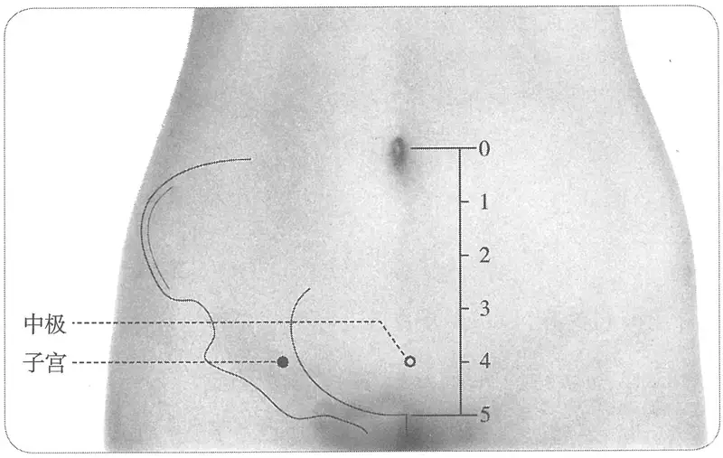

**图2-438　子宫穴图**

年南京《针灸学》）

　　(2) 定位：中极穴旁开3寸。主治：子宫脱垂，月经不调，不孕。操作：直刺0.8~1.2寸。（4版《针灸学》）

　　(3) 定位：中极穴旁开3寸。主治：阴挺，月经不调，不孕。操作：直刺0.8~1.2寸。（5版《针灸学》）

　　(4) 定位：在下腹部，当脐中下4寸，中极旁开3寸。主治：阴挺，月经不调，痛经，崩漏，不孕。操作：直刺0.8~1.2寸。（6、7版《针灸学》）

　　(5) 定位：中极穴旁开3寸。主治：阴挺，月经不调。操作：直刺0.8~1.2寸。可灸。（《中国针灸学》）

　7. 位于脐下4寸，中极穴旁开3寸。主治子宫脱垂，月经不调，痛经，盆腔炎，妇女不孕，肾盂肾炎，膀胱炎，睾丸炎，阑尾炎等。操作：直刺或向耻骨联合处横刺，进针1.5~2.5寸。感应：下腹部酸胀，有时可向外生殖器放散。（上海《针灸学》）

#### 【临床应用举例】 

　1. [《集》]血崩并漏下，中极补、子宫二寸半。败血不止，三阴交、百劳、风门、中极、肾俞、膏肓、曲池、绝骨。（《医学纲目》卷三十四）

　2. [《集》]妇人无子又法，子宫在中极旁各开三寸，针入二寸，灸三七壮、中极。（《医学纲目》卷三十五）

　3. 妇人白浊日夜流，满身黄瘦百劳忧，白浊子宫中极用，双盘双穴在手头，中极圆盘多取热，子宫双用理中收，三里三阴双阴上，双穴升阴血气周。（《琼瑶神书》卷二）

　4. 妇人子宫久冷，不受胎孕，中极一穴、三阴交穴、子宫二穴在中极两旁各三寸。（《针灸大全》卷四、《针灸大成》卷五）

　5. [第九十二]妇女无子，子宫、中极。（《针灸大成·治症总要》卷九）

　6. [第九十六]血崩漏下，中极、子宫。（《针灸大成·治症总要》卷九）

　7. [第一百一]妇女血崩不止，丹田、中极、肾俞、子宫。问曰：此症因何而得？答曰：乃经行与男子交感而得，人渐羸瘦，外感寒邪，内伤于精，寒热往来，精血相搏，内不纳精，外不受血，毒气冲动子宫，风邪串入肺中，咳嗽痰涎，故得此症。如不明脉之虚实，作虚劳治之，非也。或有两情交感，百脉错乱，血不归元，以致如期者。再刺后穴：百劳、风池、膏肓、曲池、绝骨、三阴交。（《针灸大成·治症总要》卷九）

〔p.1418 (인쇄 1390)〕

　8. 温针灸“子宫穴”治疗女性不孕症，于月经干净后即可施术，取二侧“子宫穴”，直刺进针，深度为1.5~2寸。平补平泻，待得气后施灸。[针灸临床杂志，1999(15)：3]

#### 背部经外穴 

### （九）夹脊　Jiájǐ（EX-B2）　出《华佗针灸经》 

#### 【名实考】 

唐以前，关于背俞穴取穴法，除了《黄帝明堂经》一家之外，还流行着诸家名医“明堂”诸说，《华佗针灸经》即其中之一。唐以后，其他各家取背俞穴法皆不传，《黄帝明堂经》作为“正经”盛行于世，华佗取背俞穴法便被归入奇穴。可见，所谓“华佗夹脊”，实际上就是华佗取背俞穴法！

　1. 《华佗针灸经》法，第一椎名大椎，第三椎名云门输，第四椎名神输，第五椎名脉输，第六椎名心输，第八椎名肝输，第九椎名胆输，第十椎名脾输，第十一椎名胃输，第十二椎名肠输，第十三椎名大仓输，第十五椎阳结输，第十六椎名裂结输，第十七椎小肠输，第十八椎名三焦输，第二十椎名手少阴输，第二十一椎名胃输，第二十二椎名尽肠输，第二十三椎名下极输。凡诸椎夹脊相去一寸也。（《医心方》卷二）

　2. 有人病脚躄不能行，佗切脉，点背数十处，相去一寸，或五寸，灸各七壮，灸创愈即行也。后灸愈，灸处夹脊一寸上下行，端直均调如引绳。（《后汉书·华佗传》）

　3. 别名　华佗夹脊（《中国针灸学》）；华佗夹脊、佗脊。（《上海《针灸学》）

#### 【定位、主治与操作】 

**部位**：在脊柱区，第1胸椎至第5腰椎棘突下两侧，后正中线旁开0.5寸，一侧17穴（图2-439）。

**适应症**：上胸部夹脊穴常用于心肺、上肢疾病；下胸部夹脊穴常用于肝、胆、脾、胃肠疾病；腰部夹脊穴常用于腰腹及下肢疾病。

**操作**：针尖向脊柱方向斜刺，直刺不宜过深。

　1. 统编针灸学教材

　　(1) 定位：自第一胸椎之下至第五腰椎之下为止，每椎从脊中旁开五分，每侧十七穴，左右合计三十四穴。主治：痨瘵，咳嗽，喘息，一切慢性疾患。操作：灸七至十五壮。（1957年南京《针灸学》）

　　(2) 定位：自第一胸椎之下至第五腰椎之下为止，每椎从脊中旁开五分，每侧十七穴，左右合计三十四穴。主治：痨瘵，咳嗽，喘息，一切虚寒慢性疾患。操作：灸七至十五壮。（1版《针灸学讲义》）

　　(3) 定位：第一胸椎至第五腰椎，各棘突下旁开0.5寸。主治：上胸部的穴位治疗上肢疾患和胸部疾患；下胸部和腰部的穴位治疗腹部及下肢疾患。操作：向外斜刺0.5~1寸。（4、5版《针灸学》）

　　(4) 定位：在背腰部，当第1胸椎至第5腰椎棘突下两侧，后正中线旁开0.5寸，一侧17穴，左右共34穴。主治：适应范围较广，其中上胸部的穴位治疗心肺、上肢疾病；下胸部的穴位治疗胃肠疾病；腰部的穴位治疗腰腹及下肢疾病。操作：直刺

〔p.1419 (인쇄 1391)〕

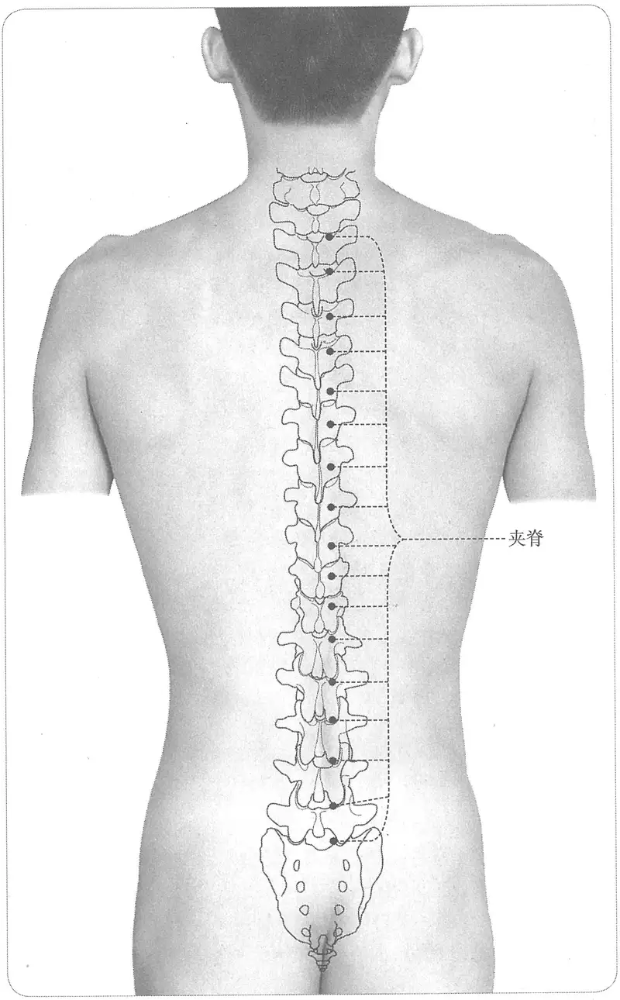

**图2-439　夹脊穴图**

0.3~0.5寸，或用梅花针叩刺；可灸。（6版《针灸学》）

　　(5) 定位：在背腰部，当第1胸椎至第5腰椎棘突下两侧，后正中线旁开0.5寸，一侧17穴，左右共34穴。主治：适应范围较广，其中上胸部的穴位治疗心肺、上肢疾病；下胸部的穴位治疗胃肠疾病；腰部的穴位治疗腰腹及下肢疾病。操作：斜刺0.3~0.5寸。（7版《针灸学》）

　　(6) 定位：第一胸椎至第五腰椎，脊柱棘突下旁开五分，左右共三十四穴。主治：上胸部的穴位治疗上肢和胸部疾病；下胸部的穴位治疗腹部疾病；腰部的穴位治疗腹部及下肢疾病。操作：颈胸部直刺0.5~1.0寸，腰部直刺1.0~1.5寸。可灸。（《中国针灸学》）

〔p.1420 (인쇄 1392)〕

　2. 定位：第一颈椎起至第五腰椎止，每椎棘突旁开0.5~1寸。左右共48穴（第一骶椎至第四骶椎两旁夹脊穴，可以八髎代之）。主治：上颈部穴主治头部疾病，下颈部穴主治上肢疾病，颈部穴可治疗颈部疾病；中下颈部穴和上中胸部穴可治疗胸廓及胸腔内脏疾病，中下胸部和腰部穴可治疗腹腔内脏疾病；下胸部和腰部、上骶部穴主治腰骶部疾病，腰骶部穴主治盆腔内脏疾病，腰部和上骶部穴主治下肢疾病。操作：①直刺，刺神经根时，稍偏向内侧，进针1.5寸（颈、胸椎），2.5寸（腰椎）。感应：局部酸胀，活麻电感向四肢或肋间放散。②斜刺，治疗脊椎关节炎时，向棘突间韧带进针1~1.5寸；或横刺向下透穴，进针2~3寸。感应：酸胀向四周扩散。灸量：灸3~7壮；温灸5~20分钟。（上海《针灸学》）

#### 【临床应用举例】 

　1. 治疗腰椎间盘突出，以腰夹脊为主，配以秩边、环跳、殷门、委中、阳陵泉。针刺得气后艾条灸。每日一次，十次为一个疗程。[中国针灸，1993(5)：16]

　2. 治疗颈腰椎骨质增生，主穴为颈部5~7夹脊穴，腰2~5夹脊穴，配穴根据颈腰椎骨质增生的部位来取，通常为：曲池、外关、合谷；秩边、环跳、委中、阳陵泉、昆仑。每天一次，5次为一个疗程。[中国针灸，1994(5)：15]

　3. 治疗急性感染性多发性神经根炎，主穴取华佗夹脊15、16、17穴，配以风池、阳陵泉、涌泉穴。留针60分钟，每隔20分钟行针一次，采用平补平泻手法。双侧交替使用，每日一次，10次为一个疗程。[中国针灸，1994(7)：42]

　4. 治疗颈椎病，针刺风池、颈夹脊。得气留针30分钟后，以梅花针叩刺颈夹脊，不出血为度。每天或隔天一次，15次为一个疗程。[江西中医药，1995，26(2)：48]

### （十）痞根　Pǐgēn（EX-B4）　出《医经入门》 

#### 【名实考】 

痞根穴，一般据明代《医学入门》定于十三椎旁三寸半处。若按《针灸资生经》、《神应经》、《类经图翼》等书关于足太阳经背俞穴皆“除脊”折量的话，那么痞根穴便与肓门穴完全相同，日本《和汉三才图会》（1713年）正是与上述诸书一样主张背俞穴“除脊”折量，因而认为痞根与肓门为同一穴，日本针灸教材遂将痞根穴主治归入肓门穴下，中国针灸学教材也受此影响。有意思的是，承淡安《中国针灸学》将痞根穴与意舍穴等同，盖因痞为脾之积故也。

早于《医学入门》，明代《古今医统》于命门旁开四指治久痞，明代《针灸秘法全书》即以此处定为“痞根”穴，《窦太师秘传》附篇以此处灸治“积聚痞块”，承淡安《中国针灸学》将此处定名为“积聚痞块”穴。实则两者为同一穴也。

关于本穴与肓门、意舍二穴的关系，详见肓门穴“名实考”。

　1. 久痞，背脊中即命门穴离开四指。痞在左，灸右；在右，灸左。（《古今医统》卷三十三）

　2. 痞根二穴，在脊命门穴外三寸五分。治积聚，奔豚痞块，攻冲不己。灸九壮。（《针灸秘法全书》）

　3. 积聚痞块，灸背脊中命门穴两旁各四指许，痞在左灸右，在右灸左。（《窦太师秘传》）

　4. 积聚痞块，第二腰椎之下，命门穴旁开四寸。病在左灸左七壮，病在右灸右七壮。（承

〔p.1421 (인쇄 1393)〕

淡安《中国针灸学》）

　5. 一法曰凡治痞者，须治痞根，无不获效。其法于十三椎下，当脊中点墨为记，墨之两旁，各开三寸半，以指揣摸，自有动处，即点穴灸之，大约穴与脐平，多灸左边，或左右俱灸，此痞根也。或患左灸右，患右灸左，亦效。（《类经图翼·积聚痞块》卷十一）

**按**：所以“多灸左边”者，以痞为脾积，脾在左故也。

#### 【定位、主治与操作】 

**部位**：在腰区，横平第1腰椎棘突下，后正中线旁开5.5寸（图2-440）。

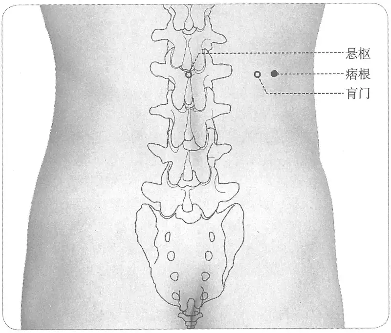

**图2-440　痞根穴图**

**取穴**：肓门穴外0.5寸取之。

**适应症**：痞块。

**操作**：斜刺0.3~0.8寸。不宜深刺，宜向脊椎方向斜刺。

　1. 痞根穴专治痞块。十三椎下各开三寸半，多灸左边。如左右俱有，左右俱灸。（《医学入门》卷一、《类经图翼》）

　2. 统编针灸学教材

　　(1) 定位：在背部第十三椎旁各开三寸半。主治：痞块久不愈者。操作：灸七至十五壮。（1957年南京《针灸学》、1版《针灸学讲义》）

　　(2) 定位：在第一腰椎旁开三寸五分。俯伏，在肓门(足太阳经)外侧五分取穴。主治：腹中痞块。操作：艾炷灸7~15壮。（2版《针灸学讲义》）

　　(3) 定位：第一腰椎棘突下，旁开3.5寸。主治：肝脾肿大，肾下垂，腰痛。操作：直刺0.8~1.2寸。（4版《针灸学》）

　　(4) 定位：第一腰椎棘突下，旁开3.5寸。主治：腹内痞块，腰痛。操作：直刺0.8~1.2寸。（5版《针灸学》）

　　(5) 定位：在腰部，当第1腰椎棘突下，旁开3.5寸。主治：痞块，腰痛。操作：直刺0.5~1寸；可灸。（6版《针灸学》）

〔p.1422 (인쇄 1394)〕

　　(6) 定位：第一腰椎棘突下，旁开3.5寸。主治：腹内痞块，腰痛。操作：直刺0.5~0.6寸。可灸。（《中国针灸学》）

#### 【临床应用举例】 

　1. 一法曰，凡灸痞者，须灸痞根，无有不效。其法在脊背十三椎下，当脊中点墨记之，此非灸穴，却于墨之各开三寸半，以指揣摸，觉微有动脉，即点穴灸之，大约穴与脐平。多灸左边，或左右俱灸，此即痞根也。患左灸右，患右灸左，亦效。（《景岳全书·杂证谟·积聚》卷二十二）

　2. 久痞，背脊中即命门穴离开四指。痞在左，灸右；在右，灸左。（《古今医统》卷三十三）

### （十一）腰眼　Yāoyǎn（EX-B7）　出《小品方》 

#### 【名实考】 

早期文献作“腰目”。《医说》载灸瘵疾方，以本穴于癸亥夜灸治，后人遂以“癸亥”作本穴别名，非是；《医学入门》则名为“鬼眼”，而此为奇穴手足大指部穴名。

关于本穴部位，古今文献皆说在腰骶部凹陷处，然而对于这两个凹陷的定位描述却各不相同。要确定腰眼穴的定位问题，必须首先确认骶髂后两个凹陷与髂后上棘的关系；其次搞清两髂后上棘间距是否存在着性别差异；如果存在，两者的比例关系如何，这样才能给出准确的解剖学定位描述。为此，我们设计了相关的人体测量学、表面解剖学、影像解剖学实验。

　1. 《小品方》，腰目，小邪在尻上左右陷处是也。（《医心方》卷六）

　2. 病在少腹，腹痛不得大小便，病名曰疝，得之寒，刺少腹两股间，刺腰髁骨间，刺而多之，尽炅病已。王冰注曰：腰髁骨者，腰房侠脊平立陷者中，按之有骨处也。（《素问·长刺节论》

　3. 灸瘵疾，当以癸亥夜二更六神皆聚之时，解去下体衣服，于腰上两旁微陷处，针灸家谓之腰眼，直身平立用笔点定，然后上床合面而卧，每灼小艾炷七壮。劳蛊，或吐出，或泻下，实时平安。（《医说》卷二）

#### 【定位、主治与操作】 

**部位**：在腰区，横平第4腰椎棘突下，后正中线旁开约3.5寸凹陷中（图2-441）。

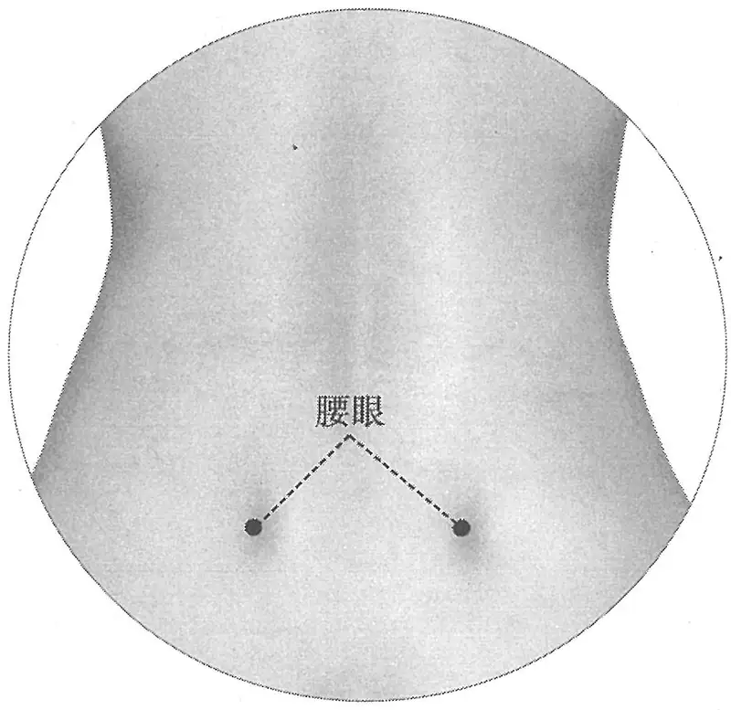 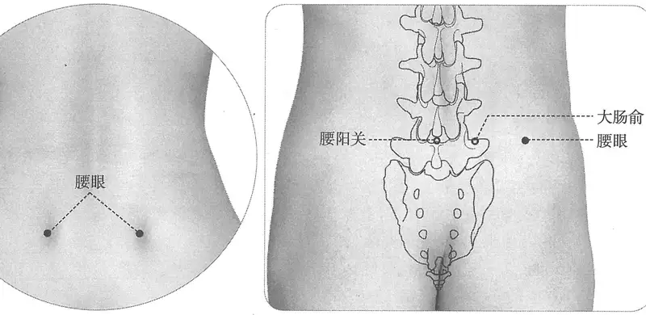

**图2-441　腰眼穴图**

〔p.1423 (인쇄 1395)〕

**取穴**：直立时，约横平腰阳关穴两侧呈现的圆形凹陷中。

**适应症**：常用于腰痛。

**操作**：直刺1~1.5寸。

　1. 腰目，在肾俞下三寸。（《千金要方》卷二十一）

　2. 鬼眼穴，专祛痨虫。令病人举手向上略转后些，则腰上有两陷可见，即腰眼也，以墨点记。于六月癸亥夜亥时灸，勿令人知。（《医学入门》卷一）

　3. 腰眼，其法令病人平眠，以笔于两腰眼宛宛中点二穴，各灸七壮。此穴诸书所无，而《居家必用》载之，云其累试累验。（《类经图翼》卷十）

　4. 统编针灸学教材

　　(1) 定位：令病人平卧，于两腰眼宛宛中，相当于第十六椎和第十七椎之间两旁处。主治：痨瘵，腰痛，妇人诸疾，消渴，小腹疾患。操作：针二、三分，灸七至十五壮。（1957年南京《针灸学》、1版《针灸学讲义》）

　　(2) 定位：在第四、五腰椎之间的旁侧。俯伏，两腿伸直，当第四腰椎棘突下的两侧，出现微凹处取穴。主治：衰弱，羸瘦，虚劳，腰痛，妇科疾患。操作：艾炷灸7~14壮。（2版《针灸学讲义》）

　　(3) 定位：第四腰椎棘突下，旁开3~4寸凹陷处。主治：腰痛，肾下垂，妇科病。操作：直刺1~1.5寸。（4版《针灸学》）

　　(4) 定位：第四腰椎棘突下，旁开3~4寸凹陷处。主治：腰痛，月经不调，带下。操作：直刺1~1.5寸。（5版《针灸学》）

　　(5) 定位：在腰部，当第4腰椎棘突下，旁开约3.5寸凹陷中。主治：腰痛，月经不调，带下。操作：直刺1~1.5寸；可灸。（6版《针灸学》）

　　(6) 定位：在腰部，当第4腰椎棘突下，旁开约3.5寸凹陷中。主治：腰痛；月经不调，带下；虚劳。操作：直刺1~1.5寸。（7版《针灸学》）

　　(7) 定位：第四腰椎棘突下两侧（旁开约三寸半），俯卧时出现凹陷处。主治：腰痛，尿频，月经不调。操作：直刺0.8~1.2寸。可灸。（《中国针灸学》）

　5. 定位：第三腰椎棘突旁开3~4寸凹陷处。主治：腰部软组织损伤，肾下垂，睾丸炎，妇科病等。操作：直刺或横刺，深1.5~2.5寸。感应：腰部酸胀感，有时可向臀部放散。灸量：5~7壮；温灸：5~15分钟。（上海《针灸学》）

**文献分析**：关于本穴的定位描述，古代文献不一致，但古今文献的共同点是：位于骶部两个凹陷。然而对于这两个凹陷，现代解剖学没有给出定位描述，为此我们进行了相关人体测量学、表面解剖学、影像解剖学实验研究。表面解剖学实验发现，在发育良好人体，不论男妇老幼，均可见髂后上棘处皮肤呈浅窝状——腰眼。总体而言，女性更明显，而且在男性这两凹陷的间距小于女性的间距，男女两髂后上棘间的距离比值为6：7；X线片测量的具体数值略小于活体表面测量的结果，这是由于X线片不能显示软组织所致的差异，但男女间的比值与表面解剖学结果完全一致，为6：7。结论：腰眼应当像乳中穴一样，直接以体表标志定位，而不宜再以折量寸定位。

#### 【临床应用举例】 

　1. 治肾腰痛，灸腰眼中七壮。（《肘后备急方》卷四）

　2. 《小品方》灸腰痛法，又灸腰目，小邪在尻上左右陷处是也。（《医心方》卷六）

　3. 《范汪方》治概腰方，又灸腰目十丸。（《医心方》卷六）

〔p.1424 (인쇄 1396)〕

　4. 腰痛，灸脚跟上横纹中白肉际十壮良。又灸足巨阳七壮。巨阳在外踝下。又灸腰目窌七壮。在尻上约左右是。（《千金要方·肾脏》卷十九）

　5. 消渴小便数，灸两手小指头及两足小趾头……又灸肾俞二处。又灸腰目，在肾俞下三寸，亦挟脊骨两旁各一寸半，以指按陷中。其肾俞、腰目、关元、水道，此可灸三十壮，五日一报，各得一百五十壮，佳。（《千金要方》卷二十一）

　6. 治疗坐骨神经痛，主穴腰眼，配穴环跳、委中、承山、殷门、昆仑、阳陵泉。腰眼穴进针2~3寸，反复向左右呈扇形提插，留针30分钟，每隔10分钟行针一次。每日一次，10次为一个疗程。[河北中医，1994，16(5)：42]

#### 上肢经外穴 

### （十二）肘尖　Zhǒujiān（EX-UE1）　出《窦太师针经》 

#### 【名实考】 

“肘尖”用于临床早见于《千金要方》，然而“肘尖”有大小之别，小“肘尖”者指肱骨内上髁，为小海穴；大“肘尖”者指尺骨鹰嘴，有时指天井穴。灸肘尖治疗瘰疬，见于宋代《百一选方》，明确载于腧穴文献者，则见于明代《奇效良方》，而在窦太师针灸，以天井穴治瘰疬，以肘尖治眼疾，《医学纲目》所载之金元针灸书同此。明代吴崑将《窦太师针经》肘尖穴下增入《奇效良方》的主治，折衷作“与肩髃并灸治瘰疬”。之所以这样处理，一方面是因为《千金要方》有类似的灸方，更重要的是，《奇效良方》载“肩柱骨”穴明确主治“瘰疬”。

　1. 瘰疬由来瘾疹同，疗之还要择医工，肘尖有穴名天井，一用金针便有功。天井：在肘尖骨上陷中。取法用手叉腰，方可下针，内少海穴，外小海穴。三分，泻之。（《针灸玉龙歌》）

　2. 天井二穴，土也，在手肘尖骨上后一寸，两筋间陷中，屈肘取之。手少阳脉所入为合。针入五分，灸二七壮。治小腹冷痛，先泻后补；一切疬核疮肿，宜泻之。（《窦太师针经》）

　3. 肘尖二穴，在手肘大骨尖上是穴。灸七壮，禁针。治眼目疼痛，翳膜冷泪，风沿眼烂。与肩髃并灸治瘰疬。（《针方六集》卷一）

　4. [扁]瘰疬：天井、肩井；《撮》瘰疬：天井半寸，灸七壮，泻之。（《医学纲目》卷十九）

　5. 于耳后下连顶肿起，令人头痛之甚，有偏头痛者不治，如此疾者，当灸肘尖二七壮。愚按：诸书肘尖穴无载，盖秘法也，又治肠痈已成脓即下，未成脓即消，或下瘀血。孙真人云肠痈之症，人多不识，治之错则杀人，其证小腹肿而硬，抑乏则小便如淋，时或汗出而恶寒，皮肤错纵，腹皮鼓急，甚者转侧有水声，或脐生疮，或脐孔出脓，或大便下脓血。凡有此证宜速灸两臂肘尖各一百壮，如绿豆大，则大便当大下脓血立愈。观孙真人云，然愈知此法之妙。又云治瘰疬，连灸三次可除病根。治霍乱欲死诸药不效者，急灸两肘尖百馀壮如绿豆大，有回生之功。此法令患人端坐，叉手平胸，肘后突出尖骨是穴。医人在患人后，灼艾，屡用屡效。（《痈疽神秘灸经》）

　6. 所云肘尖穴在臂内侧小尖骨间，前图见外侧腕骨乃画之误也，故复具此图以便用者。二穴以指目按之，若患处酸麻方是真穴。（《痈疽神秘灸经》）

　7. 小海在肘大骨外，去肘端五分内，与少海隔一小肘尖，外与肘髎隔一大肘尖，相去不远，又当知肘髎在曲肘外，曲池在曲肘里，以骨为界是。（《针灸秘法全书》）

　8. 此乃大肘尖之旁小肘尖。仰手与小指对直者是也。按此骨尖小指即麻为验。（清代《外科大成》卷一）

〔p.1425 (인쇄 1397)〕

**按**：此言按之酸麻至小指，显然为小海穴。

#### 【定位、主治与操作】 

**部位**：在肘后区，尺骨鹰嘴的尖端（图2-442）。

**适应症**：常用于瘰疬，痈疽。

**操作**：艾灸。

　1. 肘尖二穴，在手尖肘大骨尖上是穴。禁针，灸七壮。治眼目疼痛，上星翳膜，冷泪常流，风沿烂眼。（《窦太师针经》、《针灸大成》、《针灸易学》）

　2. 肘尖二穴，在手肘骨尖上，是穴屈肘得之。治瘰疬，可灸七壮。（《奇效良方》卷五十五）

　3. 肘尖穴，治瘰疬。左患灸右，右患灸左。如初生时，男左女右，灸风池尤妙。又法：用秆心比患人口两角为则，折作两段于手腕窝中量之，上下左右四处尽头是穴。灸之亦效。（《医学入门》卷一）

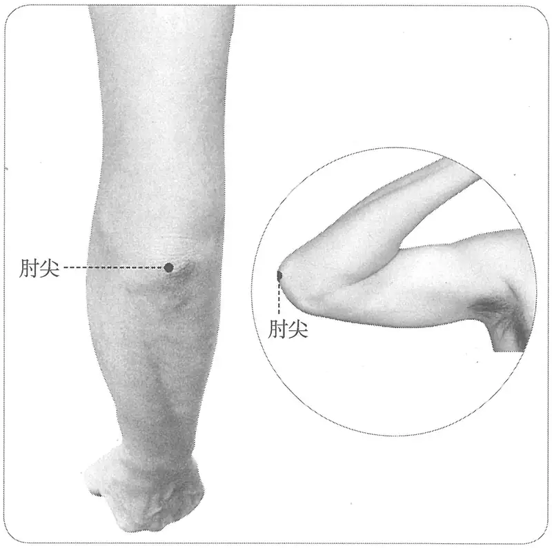

**图2-442　肘尖穴图**

　4. 统编针灸学教材

　　(1) 定位：屈两肘尖骨头处。主治：瘰疬，痈疔恶疡等。操作：灸七至十五壮。（1957年南京《针灸学》）

　　(2) 定位：屈肘时之肘骨尖端。主治：瘰疬，疔疮。操作：灸七至十五壮。（1版《针灸学讲义》）

　　(3) 定位：两肘骨尖。主治：瘰疬，痈疔恶疡等。操作：艾炷灸7~15壮，艾条灸5~15分钟。（2版《针灸学讲义》）

　　(4) 定位：屈肘，当尺骨鹰嘴的尖端。主治：瘰疬。操作：艾炷灸7~15壮。（4、5版《针灸学》）

　　(5) 定位：在肘后部，屈肘当尺骨鹰嘴的尖端。主治：瘰疬，痈疽，肠痈。操作：艾炷灸7~15壮。（6、7版《针灸学》）

　　(6) 定位：屈肘，当尺骨鹰嘴的尖端。主治：瘰疬。操作：艾炷灸7~14壮。（《中国针灸学》）

#### 【临床应用举例】 

　1. 治肠痈，屈两肘尖头骨，各灸百壮，则下脓血者愈。又云正灸肘头锐骨。（《千金要方》卷二十二、《千金翼方》）

　2. 灸瘰疬法，以手仰置肩上，微举肘取之，肘骨尖上是穴。随所患处。左即灸左。右即灸右，艾炷小箸头许，三壮即愈。复作，即再灸如前，不过三次，永绝根本。（《百一选方》卷十六、《世医得效方》）

〔p.1426 (인쇄 1398)〕

　3. 葛仙翁治霍乱已死，诸般符药不效者，云：此法特异起死回生，不在方药，大抵理趣精玄，非凡俗所知。急灸两肘尖，各十四炷，炷如绿豆大，依图取穴。（《备急灸法》、《痈疽神秘灸经》）

　4. 项生瘰疬，绕颈起核，名曰蟠蛇疬，天井二穴、风池二穴、肘尖二穴、缺盆二穴、十宣十穴。（《针灸大全》卷四）

　5. 左耳根肿核者，名曰惠袋疬，翳风二穴、后溪二穴、肘尖二穴。（《针灸大全》卷四）

　6. 目风肿痛，胬肉攀睛，和髎、睛明、攒竹、肝俞、委中、合谷、肘尖、照海、列缺、十宣。（《针灸大全》卷四）

### （十三）二白　Èrbái（EX-UE2）　出《针灸玉龙经》 

#### 【名实考】 

二白，一侧二穴，共四穴，故《循经考穴编》又称作“四白”。在掌横纹上四寸，一在两筋间，一在筋之外侧。在两筋间者与手厥阴经“郄门”穴相同，故《奇效良方》曰“二白四穴，即郄门也”，实则只是在内侧穴相当，在外侧穴不相当。

明代张介宾不识“二白”，将《玉龙赋》原文“二白医痔漏”改作“痔漏须寻太白”，附于“太白”穴下，大误。

#### 【定位、主治与操作】 

**部位**：在前臂前区，腕掌侧远端横纹上4寸，桡侧腕屈肌腱的两侧，一肢2穴（图2-443）。

**取穴**：屈腕，显现两条肌腱，其中一个穴点在间使穴后1寸两腱间，另一穴点在桡侧腕屈肌腱的桡侧。

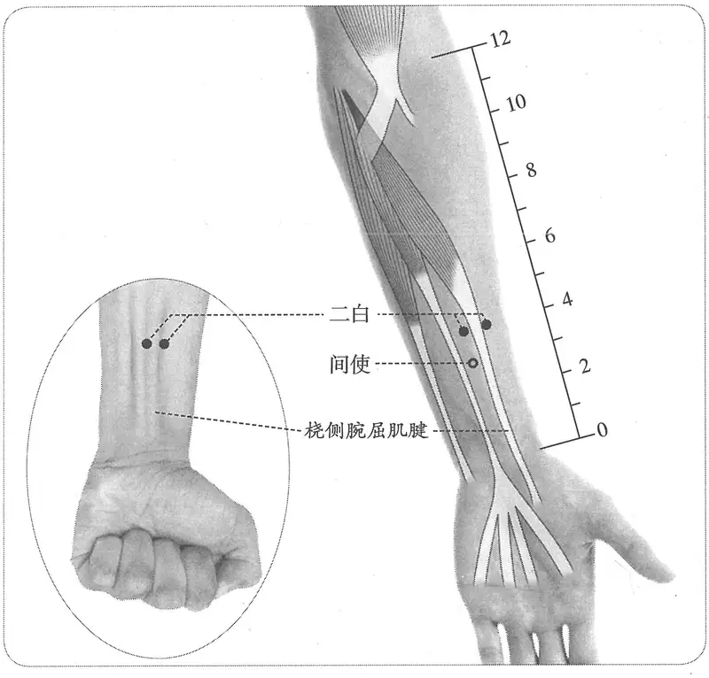

**图2-443　二白穴图**

〔p.1427 (인쇄 1399)〕

**适应症**：常用于痔疮、便血、脱肛。

**操作**：直刺0.5~1寸。

　1. 二白在掌后横纹上四寸，两穴对并，一穴在筋中间，一穴在大筋外。有一法：用草从项后转至结喉骨尖骨尽，折了；将草折于两中，对大指虎口缝，双圈转两头点掌后臂上，草尽处是穴。灸二七壮，泻之，禁刺。（《针灸玉龙歌》）

　2. 二白四穴，在手腕上四寸，有一穴在大筋内，有一穴在大筋外。针入五分，灸七壮。又法：用线量转胫间，除下，将于手虎口度量，到两头点尽处是穴。治五种痔漏，便血。（《窦太师针经》、《针方六集》卷一）

　3. 二白四穴，即郄门也，在掌后横纹中，直上四寸。一手有二穴，一穴在筋内两筋间，即间使后一寸；一穴在筋外，与筋内之穴相并。治久痔脱肛。（《奇效良方》卷五十五、《针灸大成》）

　4. 二白穴，在掌后横纹上四寸，两穴相对，一穴在两筋中间，一穴在大筋外。有一取法：用草从项后围转至喉结突骨尽，折了取中，对大拇指虎口缝，双围转两头点到掌后臂上，草尽是穴，禁刺，可灸二七，泻之。应穴承上。（《医经会元·针灸原枢》卷十）

　5. 统编针灸学教材

　　(1) 定位：掌后大陵穴直上四寸，一穴在大筋外，一穴在两筋间，两侧计四穴。主治：痔疮下血。操作：针三分至六分。（1957年南京《针灸学》、1版《针灸学讲义》）

　　(2) 定位：均位于腕横纹上四寸，一穴在桡侧腕屈肌腱与掌长肌腱之间，一穴在掌长肌腱的尺侧。在间使上一横指处取穴。主治：痔疮下血。操作：针3~6分。（2版《针灸学讲义》）

　　(3) 定位：腕横纹上四寸，桡侧腕屈肌腱两侧，一手两穴。主治：痔疮，脱肛。操作：直刺0.5~1寸。（4、5版《针灸学》）

　　(4) 定位：在前臂掌侧，腕横纹上4寸，桡侧腕屈肌腱两侧，一侧各1穴，一臂2穴，左右两臂共4穴。主治：痔疾、脱肛、前臂痛、胸胁痛。操作：直刺0.5~0.8寸；可灸。（6、7版《针灸学》）

　　(5) 定位：前臂掌面，腕横纹上4寸，桡侧腕屈肌腱两侧，各一穴。主治：痔疮疼痛，脱肛。操作：直刺0.5~1.0寸。可灸。（《中国针灸学》）

#### 【临床应用举例】 

　1. 痔瘘之疾亦可针，里急后重最难禁。或痒或痛或下血，二白穴从掌后寻。（《针灸玉龙歌》、《医学纲目》卷二十八）

　2. 痔漏之病亦可针，里急后重最难禁，或痛或痒或下吐，二白穴从掌上珍。（《琼瑶神书》卷二）

　3. ［第七十一］脱肛久痔，二白、百会、精宫、长强。（《针灸大成·治症总要》卷九）

### （十四）中魁　Zhōngkuí（EX-UE4）　出《针灸玉龙歌》 

#### 【名实考】 

“中魁”穴名见于《针灸玉龙歌》，而其穴早见于《千金翼方》灸牙疼方。《针灸玉龙歌》各传本也用此穴于治牙疼方，然除《窦太师针经》乙抄本、吴崑、吴嘉言注《玉龙歌》外，其他文献皆以《玉龙歌》牙疼方兼症“翻胃吐食”作为本穴的主治，非是。

〔p.1428 (인쇄 1400)〕

此外，“中魁”与手阳明经“阳溪”穴别名相同，后人不辨常将此二穴相混，例如明代《针灸大全》、《针灸捷径》皆将窦太师针灸方中“中魁”穴注以“阳溪”穴的部位，张介宾也难辨是非，只好让“观者辨之”。

　1. 牙齿疼，灸两手中指背第一节前有陷处七壮，下火立愈。（《千金翼方》卷二十六）

　2. 中满不快，翻胃吐食，中脘一穴、太白二穴、中魁二穴一名阳溪。（《针灸大全》卷四）

　3. 牙疼附呕吐，牙疼阵阵痛相煎，针灸还须觅二间，翻呕不禁兼吐食，中魁奇穴试看看。注曰：中魁，在中指第二节尖。灸二七壮，泻之。禁针。（《针灸玉龙经·玉龙歌》）

　4. 牙疼阵阵痛相煎，二间妙穴莫轻传，若还翻胃并吐食，中魁奇穴亦相便。吴崑注：中魁，穴在手中指第二节尖。灸七壮，治翻胃五噎，一切牙疼。禁针。（《针方六集》卷六）

　5. 中魁，在手中指第二节前骨尖上，屈指得之。《捷法》又云在手腕中上侧两筋间陷中。灸二七壮。盖此以阳溪言也，观者辨之。主治五隔反胃。（《类经图翼》卷十）

**按**：《捷法》全名为《针灸捷法》，又作《针灸捷法大全》，为徐凤《针灸大全》的别名。

#### 【定位、主治与操作】 

**部位**：在手指，中指背面，近侧指间关节的中点处（图2-444）。

**适应症**：常用于噎膈、呕吐、呃逆等脾胃病症。

**操作**：针刺0.2~0.3寸。

　1. 中魁：在中指第二节尖。灸二七壮，泻之。禁针。（《针灸玉龙歌》注）

　2. 中魁二穴，在手中指二节尖。灸七壮，禁针。治翻胃吐食，补之；心疼，补泻之。（《窦太师针经》）

**按**：据乙抄本，此处“心疼”应是“牙疼”之误。

　3. 中魁二穴，在手中指第二节尖，灸七壮，治翻胃先泻后补，五噎等症，单泻，一切牙疼，禁灸。（《窦太师针经》乙本）

　4. 中魁二穴，在中指第二节骨尖，屈指得之。治五噎反胃吐食，可灸七壮，宜泻之。（《奇效良方》卷五十五、《针灸大成》、《类经图翼》）

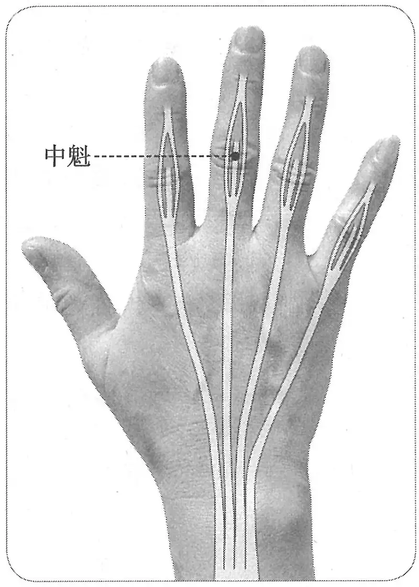

**图2-444　中魁穴图**

　5. 中魁二穴，在手中指第一节尖。灸七壮，禁针。治翻胃吐食，眼疾，心疼痛。（《针方六集》卷一）

**按**：此作“手中指第一节尖”，独与《千金翼方》原文相同。

　6. 中魁穴在手中指第二节尖。灸七壮，治翻胃五噎，一切牙疼。禁针。（《针方六集》卷六）

　7. 中魁二穴在手中指第二节尖。灸七壮，治翻胃先泻后补；五噎等症单泻；一切牙疼牙疼禁灸。（《医经会元·针灸原枢》卷十）

　8. 统编针灸学教材

　　(1) 定位：在手中指二节骨尖上，屈指取之。主治：五噎，翻胃，吐食。操作：灸三壮。（1957年南京《针灸学》）

　　(2) 定位：手中指中节背侧中间。主治：反胃，噎膈，呕吐。操作：灸三壮。（1版《针灸学讲义》）

　　(3) 定位：在中指中节骨尖上。握拳，于中指第一、二节关节端取穴。主治：噎膈，反胃，衄血，崩漏。操作：艾炷灸3壮。（2版《针灸学讲义》）

〔p.1429 (인쇄 1401)〕

　　(4) 定位：手背，中指近端指关节的中点。主治：噎膈，反胃，呕吐。操作：艾炷灸5~7壮。（4版《针灸学》）

　　(5) 定位：手背，中指近端指关节的中点。主治：呕吐，食欲不振，呃逆。操作：艾炷灸5~7壮，针刺0.2~0.3寸。（5版《针灸学》）

　　(6) 定位：在中指背侧近侧指间关节的中点处。主治：噎膈、呕吐、食欲不振，呃逆。操作：艾炷灸5~7壮，针刺0.2~0.3寸。（6版《针灸学》）

　　(7) 定位：在中指背侧近侧指间关节的中点处。握拳取穴。主治：噎膈、呕吐、食欲不振、呃逆等脾胃病证。操作：直刺0.2~0.3寸。（7版《针灸学》）

　　(8) 定位：手背，中指近端指关节的中点。主治：翻胃，呕吐，呃逆。操作：艾炷灸3壮。（《中国针灸学》）

#### 【临床应用举例】 

　1. 牙疼阵阵痛相煎，二间妙穴莫轻传，若还翻胃并吐食，中魁奇穴亦相便。（《针方六集·玉龙歌》卷六）

　2. 《玉》翻胃吐食，中魁中指第三节，灸泻之。（《医学纲目》卷二十二）

　3. 中满不快，翻胃吐食，中脘、太白、中魁。（《针灸大成》卷五）

　4. ［第七十七］翻胃吐食，中脘、脾俞、中魁、三里。（《针灸大成·治症总要》卷九）

　5. ［第七十八］饮水不能进，为之五噎，劳宫、中魁、中脘、三里、大陵、支沟、上脘。问曰：翻胃之症，从何而得？针法所能疗否？答曰：此症有可治，有不可治者。病初来时，皆因酒色过度，房事不节，胃家受寒，呕吐酸水。或食物即时吐出，或饮食后一日方吐者，二、三日方吐者。随时吐者可疗，三两日吐者，乃脾绝胃枯，不能克化水谷。故有五噎者：气噎、水噎、食噎、劳噎、思噎，宜推详治之。复刺后穴：脾俞、胃俞（以上补多泻少）、膻中、太白、下脘、石关。（《针灸大成·治症总要》卷九）

　6. 治疗顽固性呃逆，双侧中魁，用1.5寸不锈钢毫针从近端指间关节沿皮刺向掌指关节，进针1寸许。行较强捻转手法，病人出现强烈胀痛感。留针30分钟，其间每隔10分钟行针1次。［山西中医，1998，14（4）：34］

　7. 治疗神经性呕吐，主穴中魁、中脘、足三里、内关、公孙。中魁穴斜刺，余直刺。10次为一个疗程。［针灸临床杂志，2000，16（4）：50］

### （十五）腰痛点　Yāotòngdiǎn（EX-UE7）　出《常用新医疗法手册》[^49-1] 

#### 【名实考】 

“腰痛点”是新医疗法总结的一对新穴，专门治疗急性腰痛。其定位与小儿推倒用穴位“威灵”、“精灵”相同，但主治病症大不同。后来人们在手背，进而在其他部位发现了越来越多的治疗腰痛的新穴和传统穴位，不同穴位治疗腰痛的疗效相似，这样一来这些穴位治疗腰痛的特异性便受到了挑战。

腰痛点治疗腰痛，从一开始就有一个特殊的治法：即在针刺的同时或之后，要求病人活动患处，活动幅度由小到大，速度由慢到快。以往人们一直以为，活动的目的在于检验针刺的效果，直到有一天现代医学意外地发现刺激脑运动皮质（而不是感觉皮质）治疗顽固性疼痛的效果最好，发明了运动皮层刺激（motor cortex stimulation，MCS）疗法，人们似乎才理解了针灸运动治痛的实践经验的意义，不仅在于对中国针灸的“运动针法”提供了强有力的科学证明。

[^49-1]: 《常用新医疗法手册》，人民卫生出版社，1970年

〔p.1430 (인쇄 1402)〕

在针刺治疗痛证，特别是急性痛时，越来越多的针灸医生会要求患者活动疼痛部位，特别是浮针疗法更是在整个操作过程都始终配合患部的被动运动，结束操作后还接着患者的主动活动。不同部位的活动方法与技巧被总结，形成了一种专门的针法或针术，如“动气针法”、“针灸运动疗法”、“互动式针刺法”、“头针运动疗法”等。那么，针刺治痛过程中患部活动的意义究竟是什么？是为了检验针刺效验，还是本身就是治痛的重要或关键环节？长期以来人们没有明确提出，更没有认真思考这一问题。只是随着实践经验的不断积累，越来越多的针灸医生治疗痛证时，要求配合患部活动。这个现象终于引起国内外一些实验研究人员的注意，开始自觉地设计实验来检验，并初步探索其作用机制。到20世纪70年代末终于中国针灸临床医生有人开始明确提出活动患部是针刺治疗痛证的重要环节，而不是可有可无的动作，并在临床上自觉地应用。此后，耳针、头针、皮内针、腕踝针、浮针、平衡针、腹针、电员针等新兴针法都在治疗疼痛中自觉地应用这一经验，甚至连自称科学针灸的“干针疗法”的最新研究也表明，治疗肌肉的“牵张疗法”是治疗肌筋膜疼痛最主要的因素。进一步的研究还发现，活动患部已经不局限于疼痛病症，而且在不少非疼痛病症的治疗也得到越来越多的应用。

另外，实验研究也解开了强刺激腰痛点治疗腰痛的机理：当给予穴位的刺激强度超过一定的阈值时，其作用范围表现出一种超神经节段的广泛效果。这就使得可以在远离腰部的区域选穴针刺，从而便于腰部活动。

正如“条口透承山治疗肩周炎”一样，腰痛点治疗急性腰扭伤痛有效，但疗效的取得主要在于其特殊的针刺方法：强刺激＋活动患处（针刺前后及针刺过程中），换言之，只要选择针感较好且便于腰部活动的部位针刺，都能取得相同或相似的疗效。在这一特定的情形下，针刺的作用主要是提高痛阈，让病人得以活动患处。认识到这一点非常重要！

关于对“腰痛点”治疗腰痛的有效性与非特异性的理解，可参照足阳明经“条口”穴下对“条口透承山治疗肩周炎”原理的分析。如需系统了解这方面的进展，可参考以下文献：

李鼎．从“腰痛穴”的应用谈起——急性腰扭伤的远道取穴，见李鼎《中医针灸基础论丛》，人民卫生出版社，2009年

何广新，曲延华．针灸运动疗法与疼痛治疗，学苑出版社，2005年

王朝阳，瞧明河，王争．头针运动疗法，科学技术文献出版社，2006年

杨维杰．董氏奇穴针灸发挥，乐群文化事业有限公司出版，1993年

威灵穴，在虎口下两旁歧有圆骨处。遇卒死证，摇掐即醒，有声则生，无声则死；精灵穴，在四、五指夹界下半寸。治痰壅、气促、气攻。（《小儿推拿秘旨》卷一）

腰腿点手背肮横纹前1.5寸，第二伸指肌腱桡侧及第四伸指肌腱尺侧处，共两点。主治腰腿痛，以急性扭伤效果最好。（《常用新医疗法手册》）

#### 【定位、主治与操作】 

**部位**：在手背，第2、3掌骨间及第4、5掌骨间，腕背侧远端横纹与掌指关节的中点处，一手2穴（图2-445）。

**适应症**：常用于急性腰扭伤。

**操作**：由两侧向掌中斜刺0.5~0.8寸。

〔p.1431 (인쇄 1403)〕

　1. 定位：位于手背，腕背横纹前一寸五分，第二伸指肌腱桡侧一穴，第四伸指肌腱尺侧一穴。左右计四穴。主治：腰腿庯，扭伤。针灸：向肌腱下斜刺三至五分，酸至指尖。灸三至七壮。（《针灸经外奇穴图谱》续集）

　2. 统编针灸学教材

　　(1) 定位：手背，指总伸肌腱的两侧，腕背横纹下1寸处，一手两穴。主治：急性腰扭伤。操作：由两侧向掌中斜刺0.5~0.8寸。（4、5版《针灸学》）

　　(2) 定位：在手背侧，当第2、第3掌骨及第4、第5掌骨之间，当腕背横纹与掌指关节中点处，一侧2穴，左右共4穴。主治：急性腰扭伤。操作：由两侧向掌中斜刺0.5~0.8寸。（6、7版《针灸学》）

　　(3) 定位：手背，腕横纹与掌指关节的中点，第二、三掌骨及第四、五掌骨之间，左右手共四穴。主治：腰扭伤。操作：由两侧向掌中斜刺0.5~1.0寸。（《中国针灸学》）

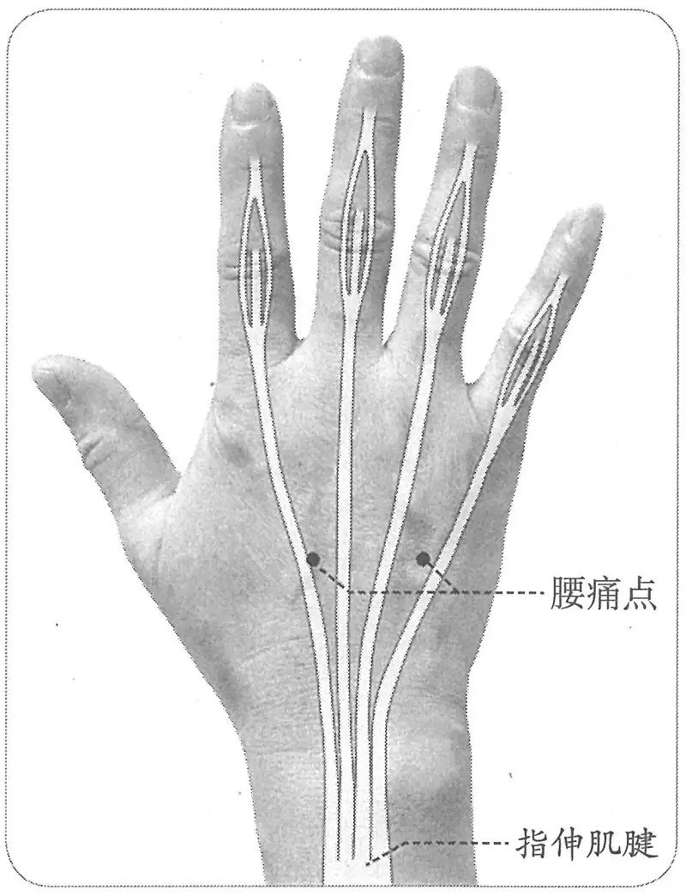

**图2-445　腰痛点图**

#### 下肢经外穴 

### （十六）鹤顶　Hèdǐng（EX-LE2）　出《窦太师针经》 

#### 【名实考】 

鹤顶，《痈疽神妙灸经》作“膝顶”。穴当髌底上，如鹤之顶，又治鹤膝风，故曰“鹤顶”；穴当膝盖骨尖上，故曰“膝顶”。《外科大成》曰：“鹤膝风，两膝内外皆肿，寒热间作，痛如虎咬，股渐细而膝愈大是也”。

古代文献多将本穴与足阳明经穴“梁丘”相混，考证详见梁丘穴“名实考”。

一名膝顶。（《外科大成》）

#### 【定位、主治与操作】 

**部位**：在膝前区，髌底中点的上方凹陷中（图2-446）。

**适应症**：常用于膝肿痛，足胫无力。

**操作**：直刺1~1.5寸。

　1. 梁丘二穴，即鹤顶。在膝盖上两筋间陷中。又法在膝盖上二寸。针入五分，灸二七壮。治鹤膝风，膝头风红肿，泻；膝头屈曲不伸，筋紧难开，泻补，宜三棱针出血。（《窦太师针经》）

　2. 梁丘二穴，在膝盖上二寸。治鹤膝风，两膝红肿，大痛。直针入半寸，灸七壮。脚气，俱弹针出血为妙。鹤顶二穴：在膝上陷中。禁刺，灸二七壮。治风湿，腿脚膝腰疼痛，步履艰难，先泻后补。（《窦太师针经》乙抄本）

　3. 梁丘二穴，时名鹤顶穴。在膝盖上两筋间陷中，去膝盖二寸。足阳明郄。《针经》刺入三分，灸三壮。窦氏针入五分，灸二七壮。一方云宜三棱针出血。（《针方六集》卷一）

〔p.1432 (인쇄 1404)〕

　4. 梁丘穴在膝上二寸两筋间。广注屈膝取之，在膝盖骨上尽处陷中。曰膝盖骨尽处，是连膝盖骨尽处也。若阴市、伏兔则除膝盖骨矣。（《循经考穴编》上）

　5. 鹤顶二穴，在膝盖骨尖上。治两腿无力。针五分，灸七壮。（《针灸秘法全书》）

　6. 鹤顶二穴，在膝盖骨尖上。可灸七壮。治两腿无力，两足瘫痪。（《医学原始》卷九）

　7. 统编针灸学教材

　　(1) 定位：在膝盖骨上缘中央。主治：瘫痪，膝痛，下肢乏力。操作：灸七壮。（1957年南京《针灸学》，1、2版《针灸学讲义》）

　　(2) 定位：髌骨上缘正中凹陷处。主治：膝痛，足胫无力，瘫痪。操作：直刺1~1.5寸。（4、5版《针灸学》）

　　(3) 定位：在膝上部，髌底的中点上方凹陷处。主治：膝痛，足胫无力，瘫痪。操作：直刺1~1.5寸；可灸。（6版《针灸学》）

　　(4) 定位：在膝上部，髌底的中点上方凹陷处。主治：膝痛，足胫无力，瘫痪。操作：直刺0.8~1寸。（7版《针灸学》）

　　(5) 定位：髌骨上缘正中凹陷处。主治：膝痛，足胫无力，瘫痪。操作：直刺0.3~0.5寸。可灸。（《中国针灸学》）

**文献分析**：关于本穴定位与主治，传世本《窦太师针经》、《针方六集》等文献皆与足阳明经穴“梁丘”相混。从吴崑的注文可知，明人已将梁丘穴直接称为“鹤顶”，然而二穴的定位毕竟不同，为了消除这个矛盾，《循经考穴编》所引“广注”对梁丘定位“膝上二寸”作了特殊的解释，乃错上加错。

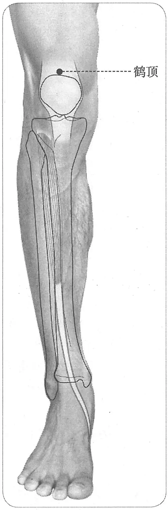

**图2-446　鹤顶穴图**

#### 【临床应用举例】 

　1. 鹤膝风，在膝内股当膝肿疼，甚者见青筋，引足心痛是也。当灸三阴交七壮，甚则二七壮，待膝伸直为住。再甚则当膝顶灸七壮。脚气亦灸此穴。愚按：针灸经云三阴交二穴在内踝上三寸骨下陷中；膝顶诸书无载盖秘法也。（《痈疽神妙灸经》）

　2. ［怪穴］两足瘫痪，两腿无力，鹤顶在膝盖骨尖上，灸七壮。（《医学纲目》卷二十八）

　3. 两膝红肿疼痛，名曰鹤膝风，膝关二穴、行间二穴、鹤顶二穴、阳陵泉二穴。（《针灸大全》卷四）

### （十七）膝眼　Xīyǎn（EX-LE4）　出《华佗针灸经》 

#### 【名实考】 

本穴位于膝下犊鼻两旁陷中，如猴孙眼，故曰“膝眼”。膝眼，早期文献多作“膝目”，定位于膝盖骨下（髌底下）两旁凹陷中，与髌底正下之“犊鼻”穴是完全不同的穴。然而自唐代，已见有犊鼻穴定位与外侧的“膝眼”相同或相近的记载，现代针灸教材中“犊鼻”与“外膝眼”已同为一穴。

〔p.1433 (인쇄 1405)〕

此外，朝鲜许任编《针灸经验方》时，将《东医宝鉴》“膝眼”、“血郄”两穴合为一穴，非是。

国际标准《标准针灸穴名》第二部修订版（STANDARD ACUPUNCTURE NOMENCLATURE，PART 2 REVISED EDITION）将内、外膝眼分别命名为“内膝眼”、“膝眼”，并给予不同的编码代号，作为两个独立的穴出现，这样“膝眼”便与足阳明经“犊鼻”穴完全相同了。如果同一个穴而有不同的主治及刺灸法描述，并归属不同的类，只能引起混乱，故2006年版国标《针灸腧穴名称与定位》删去了经外奇穴“膝眼”一穴。

关于本穴与犊鼻穴的关系，详见后者的“名实考”。

　1. 膝目四穴，华佗云在膝盖下两边宛宛中。主膝弱痉疼冷，胫痛矣。《小品方》云“膝内外目”，一膝有二穴，各在犊鼻两旁陷者中，如猴孙眼是也。（《医心方》卷二）

　2. 膝眼四穴，在膝盖头骨下两旁陷中。主膝髌酸痛；血郄二穴，即百虫窠，在膝内廉上膝三寸陷中。主肾脏风疮。（《东医宝鉴·别穴》）

　3. 膝眼二穴，一名百虫窠，又名血郄。在膝盖下两旁陷中。主治肾脏风疮及膝髌酸痛。（《针灸经验方·别穴》）

#### 【定位、主治与操作】 

**部位**：在膝部，髌韧带内、外侧凹陷中（图2-447）。

**适应症**：膝部疼痛。

**操作**：向膝中斜刺0.5~2寸，或透刺对侧膝眼。

　1. 膝眼穴，在膝头骨下两旁陷者宛宛中是。（《千金要方》卷七、《千金翼方》）

　2. 膝目二穴，在膝盖下两边宛宛中是。（《外台秘要》卷十九、《医心方》卷八）

　3. 膝眼二穴，在膝盖骨下，犊鼻穴外旁陷中。横针透膝关穴。治膝肿疼，泻。灸二七壮。（《窦太师针经》）

　4. 膝眼，犊鼻上两旁深陷，量疾深浅刺。（《针灸集成》注）

　5. 膝眼四穴，在膝盖骨下，犊鼻穴内外陷中。针入五分，灸七壮。治膝红肿疼痛，鹤膝风。（《针方六集》卷一）

　6. 膝眼，在膝头骨下两旁陷中。刺五分，禁灸。主治膝冷痛不已。昔有人膝痛灸此，遂致不起，以禁灸也。（《类经图翼》卷十）

　7. 膝眼四穴，在膝盖下两傍陷中。治膝痛不能屈伸，腿□□软无力。针八分，禁灸。（《针灸秘法全书》）

　8. 统编针灸学教材

　　(1) 定位：膝盖之下两旁陷中。主治：膝冷痛，脚气，中风。操作：针五分，灸七壮。（1957年南京《针灸学》、1版《针灸学讲义》）

　　(2) 部位：在膝髌下缘下两侧陷中。取穴：屈

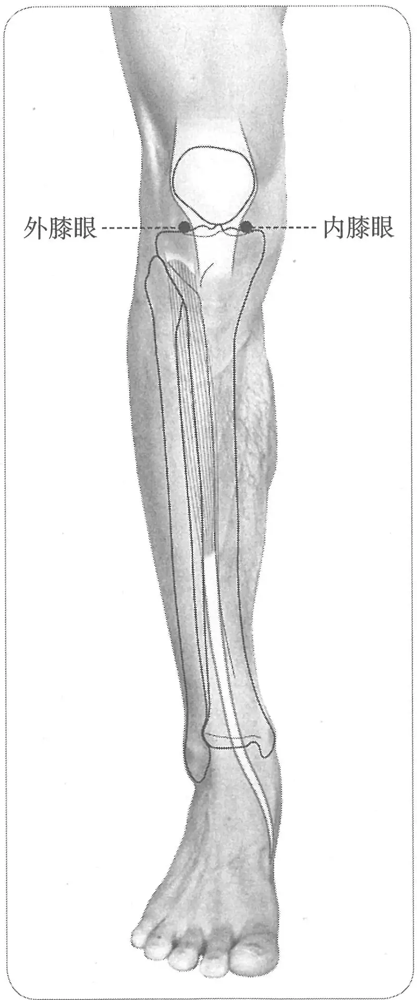

**图2-447　膝眼穴图**

〔p.1434 (인쇄 1406)〕

膝垂足，当髌韧带两侧之凹陷部取穴。主治：膝冷痛，脚气，中风，瘫痪。操作：针5分；艾炷灸7壮，艾条灸5~7分钟。（2版《针灸学讲义》）

　　(3) 定位：髌尖两侧凹陷中。主治：膝痛，腿脚重痛，脚气。操作：向膝中斜刺0.5~1寸，或透刺对侧膝眼。（4、5、6版《针灸学》）

　　(4) 定位：屈膝，在髌韧带两侧凹陷处。主治：①膝痛，腿痛；②脚气。操作：向膝中斜刺0.5~2寸，或透刺对侧膝眼。（7版《针灸学》）

　　(5) 定位：屈膝，髌韧带两侧凹陷中，分别称内、外膝眼。主治：膝痛，下肢无力。操作：直刺0.5~1.0寸。可灸。（《中国针灸学》）

**文献分析**：本穴定位，元以前文献皆定于髌尖下两旁凹陷中，元代窦太师针灸则以犊鼻穴为定位标志：犊鼻穴在髌尖正下陷中，其内旁凹陷为膝关，外侧凹陷为膝眼，其刺法：膝关穴横刺透膝眼；膝眼穴横刺透膝关。此为窦太师针灸特有的定穴法及刺法。

#### 【临床应用举例】 

　1. 脚气，初灸风市，次伏菟，次犊鼻，次膝目，次三里，次上廉，次下廉，次绝骨。（《千金翼方》卷二十六）

　2. 脚气，又若心腹气定，而两髀外连膝闷者，宜灸膝眼七炷，在膝头骨下相接处，在筋之外陷中是。若后更发，复灸三炷。（《外台秘要》卷十九）

　3. 髋骨能医两腿疼，膝头红肿一般同，膝关膝眼皆须刺，针灸堪称劫病功。（《针灸玉龙歌》）

　4. 两腿膝痛，内痛则膝关，外痛则膝眼，泻之。（《针灸集要·盘石金直刺秘传》）

　5. 独刺膝眼治疗膝关节炎136例。毫针针尖向膝关节中心刺入1.2~1.8寸，行捻转泻法，得气后同侧内外膝眼接电针治疗仪正负极，连续波，强度以患者能耐受为度，留针30分钟，隔日1次，5次为一个疗程。疗程间休息3天［中国针灸，2000（7）：417］

　6. 膝眼合谷刺治疗膝关节炎57例。在膝眼穴上加刺2根，向上斜刺，行提插捻转，得气后同时留针。［实用医技杂志，2002，9（11）：864］

　7. 针刺膝眼穴治疗痛经60例。选穴：取内外膝眼穴，左右交替针刺。选用28号3.5寸长毫针，于内外膝眼穴垂直进针约3寸，行提插捻转补法，中等强度刺激，针感达到要求后出针，每日1次，3次为一疗程，每疗程以痛经发作当天开始，治疗连续3个月经周期。［中国针灸，2001，21（11）：670］

### 延伸阅读 

　1. 黄龙祥．中国针灸学术史大纲［M］．北京：华夏出版社，2001.

　2. 黄龙祥．新编重绘十四经脉经穴图［M］．北京：中国中医药出版社，2010.

　3. 黄龙祥，黄幼民．元代珍稀针灸三种［M］．北京：人民卫生出版社，2008.

　4. 原昌克．经穴汇解［M］．李顺保，等译注．北京：学苑出版社，2008.

　5. 松元四郎平．针灸孔穴类聚·奇俞编（下卷）［M］．绩文堂出版株式会社，1998年6月复刻版．

　6. 单宝枝，李鼎．经外奇穴常见错误原因例析［J］．江苏中医药，2005，25（8）：40-42.

　7. 单宝枝，李鼎．经外奇穴研究概况［J］．上海中医药杂志，2006，40（1）：65-67.

　8. 吴九伟．浅论经外奇穴范畴和整理［J］．上海中医药杂志，1996，15（4）：36-37.

　9. 王茎．经外奇穴溯源［J］．安徽中医学院学报，2003，22（6）：31-32.

　10. 叶明柱，杨文彩．“经外奇穴”小议［J］．上海中医药杂志，2009，28（2）：71.

〔p.1435 (인쇄 1407)〕

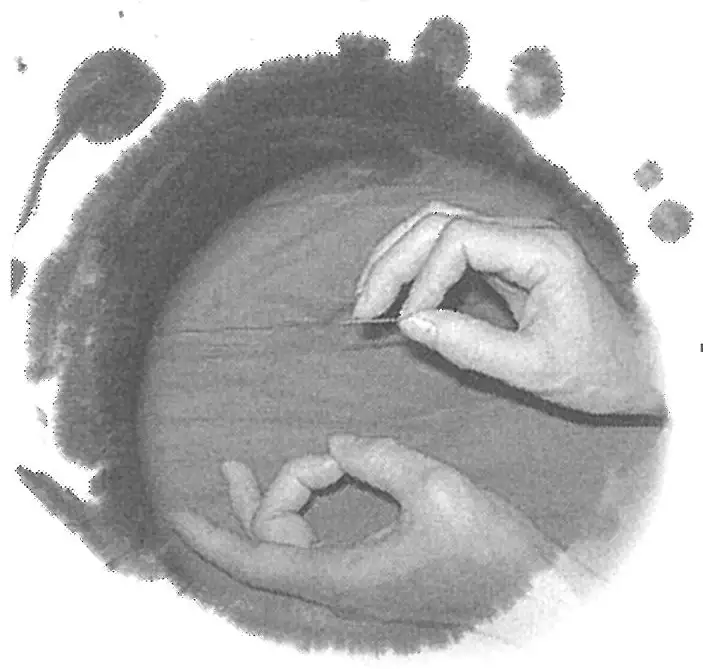

# 附录 

## 附一：《针灸原枢·漏经穴法》 

吴梅坡家传神效针灸原枢卷之十

增入漏经穴法：此系三百六十五穴之外者，即天（此下有脱页）

度四分度之一者，是也。

骑竹马二穴：治一切痈疽外科等症。就于四花脾一穴分分出脊中各一寸是穴。灸七壮，宜服乳香真菉荳粉托里散，所以防火气入于心也。骑竹马分取亦同，病人倘患病重，何可骑取，在第八椎下分分出一寸。

腋气二穴：在腋下毛中，用京墨浓涂腋下，墨内有一点白处则是气出源处。用艾炷如米大，不可针。治信臭。

哮喘二穴：在脊中，以线双至两乳头尖，拿定转于背后，引线至于双尽之处，当中脊骨上下。灸之七壮，禁针。治小儿盐水冷风哮喘，长久咳嗽等症。

大阳二穴：在两眉毛上边，离眉五六分或一寸许。沿皮向后针一寸半，泻出血或三棱针出血，灸三壮，不灸尤妙。专治眼红肿，赤眼，头痛，两太阳角疼。

食仓二穴：又名食关，在中脘旁一寸半。灸七壮，针入一分，沿皮向后一寸半。治脾胃家一切等症。

血门二穴：在中脘旁各开三寸。灸七壮。治妇人血凝、血块，左有灸左，右有灸右穴。

横梁法：就于所发肿毒上灸七壮；针以纸卷了，用香油浸火点着，令稍久，针头通红，就于红肿尖上乘热刺入即出针，其夜即消。

肘尖二穴：在手肘尖上。灸七壮，又灸肩髃七壮。四穴专治瘰疬。

手鬼哭一穴，足鬼哭一穴，此二穴治心痴呆。在手大指，两手缚合，半在甲，半在肉。灸七壮。两足并大指。

二白四穴：转手取之。在手腕四寸，一穴筋内，一穴大筋外。灸七壮，针二寸。治痔漏，去血并黄水，及手臂痛。在间使上一寸。

印堂一穴：在鼻柱直上，两眉横中央是穴。治惊风、中风，针三分，可灸七壮。小儿惊风，急慢灸之，号哭方效。治大人中风不省，可灸二七壮，立效。治头重，刺入三分，先补后泻。

鱼腰二穴：在眉中央是穴。治目疼，针入一分，沿皮或向攒竹、丝竹。

百劳一穴：在大椎上是穴。治浑身发热，疟疾，针入一分，男子沿皮向左，女子沿皮向右一寸半。

驮骨空二穴：在手大指本节后横纹中，灸七壮。

〔p.1436 (인쇄 1408)〕

中魁二穴：在手中指第二尖节，灸七壮。治翻胃吐食、吐血不止，心痛，泻。

龙虎二穴：在手腕侧腕上，交叉紫脉中。灸七壮。治满口牙疼。

八邪八穴：在手十指歧缝中是穴。针一分，沿皮向后三寸，治病。

大骨空二穴：在手大指第二节尖是穴。灸七壮。治眼目冷泪长流。

小骨空二穴：在手小指第二节尖。灸，眼目红肿疼痛。

五虎四穴：在手第二指背第二节尖上，第四指背第二节尖上。灸七壮，治。

十宣十穴：在手十指端，去甲一分。针刺出血。

阑门二穴：在腹毛际内，茎根旁开五寸，归来穴一寸。针刺入二寸半，灸七壮。治阴汗，偏坠，红肿三症。

子宫二穴：在关元两旁各开三寸半。灸二七壮，针入二寸半。治妇人白水淋沥。

八风八穴：在足十指歧缝中是穴。直针入五分，灸七壮。治脚气。

两踝穴：在足下内，两踝骨尖上。灸七壮。治牙疼。

独会二穴：在足第二指下横纹中间。灸七壮，禁针。治难产。

腕骨左右四穴：在梁丘旁各开一寸半。治腿痛难行。取梁丘，在膝盖一寸半。

独阴二穴：在足第三指下横纹。灸七壮。治外肾肿。

金津、玉液二穴：在舌底紫脉，左金津、右玉液。治口舌生疮，咽喉热症及治渴，俱以三棱针出血妙。

四花穴：治男女五劳七伤，骨蒸虚热，二十二种痨瘵。用细绳一条，以黄蜡打直，取男子以左足大拇指头按蜡绳齐贴脚底心至后跟，皆贴肉上至曲脉胭横纹截断。辟中分开头发，将取脚上蜡绳，齐鼻准尖贴肉，笔直由眉心入发际上而下，循后发际一直下脊中，绳尽处以墨点之。另以好稻秆心一条折作人字样，上尖顶着鼻根，两垂下口两边吻，即口角也，以墨记截断。于背上脚绳点墨处横量此秆心折中，两头草尽处以墨之，此是灸之二穴也。又将蜡绳一条按在顶上椎骨，线齐两贴肉向前至结喉，并贴肉下至弊骨，如法向背后椎骨下脊心，绳尽处墨记之，以草心横量口角，即于背上墨记，横量两头是穴。此四花也。若将后横量草心在两穴当中真下，又灸二穴下者，十字灸。共六花，此大四花也。

〔p.1437 (인쇄 1409)〕

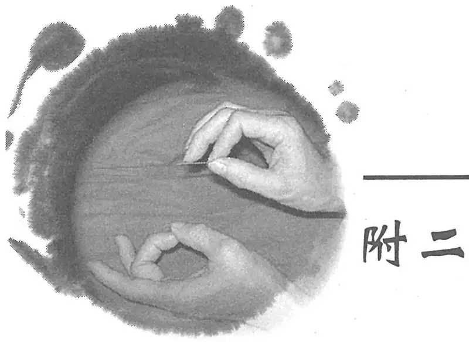

## 附二：《重编医经小学·漏经穴法》 

#### 漏经穴法 

膏肓胛骨肋间空，患门四花灸劳功，骑竹马穴骑竹取，痈疽恶疮风证攻，癸亥之穴腰眼同，一十四壮去劳虫，五指一寸灸心气，鱼腰眉中治目疾，肿毒发处横梁法，阿是穴法起异蜀，哮喘二穴在脊中，肘尖二穴治瘰疬，太阳两眉毛上旁，眼红肿痛太阳当，血门中脘旁三寸，鼻柱直上取印堂，二白四穴转手取，百劳一穴大椎上，龙虎侧腕紫脉中，满口牙痛灸七壮，拦门二穴归来下，茎根毛内旁五寸，子宫二穴治妇淋，关元两旁三寸半，舌底紫脉有二穴，左为金津右玉液，腋气在腋下毛中，治心痴呆取鬼哭，食仓食开治脾胃，在中脘旁寸半位，十宣十穴手十指，指端去甲一分是，驮骨空穴手大指，本节之后横纹取，中魁二穴手中指，第二尖节治翻胃，大小骨空大小指，第二节尖眼目治，五虎四穴次指背，二节尖上七壮宜，八邪八穴手十指，歧缝中是治病痹，八风八穴足十指，歧缝中也治脚气，独会在足二指下，横纹中间难产宁，独阴在足三指下，横纹灸处肾肿平，两踝穴在足下内，踝骨尖下牙疼差，腕（髋）骨四穴梁丘旁，各开寸半腿痛退，精宫鬼眼与痞根，痓忤疝痛翻胃穴，肿满卒死并癫风，肠风诸痔有灸法。

〔p.1438 (인쇄 1410)〕

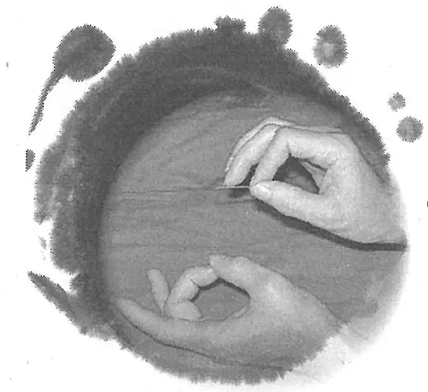

## 附三：主要参考文献 

　1. 足臂十一脉灸经［M］．北京：文物出版社《五十二病方》本，1979.

　2. 阴阳十一脉灸经［M］．北京：文物出版社《五十二病方》本，1979.

　3. 五十二病方［M］．北京：文物出版社，1979.

　4. 脉书［M］．北京：文物出版社《张家山汉墓竹简》本，2001.

　5. 黄帝内经素问［M］．北京：人民卫生出版社影印明·顾从德翻宋刻本，1956.

　6. 灵枢经［M］．北京：人民卫生出版社影印明·赵府居敬堂刊本，1956.

　7. 汉·张机．伤寒论［M］．重庆：重庆人民出版社铅印明万历二十七年赵开美校刊本，1955.

　8. 汉·司马迁．史记·扁鹊仓公列传［M］．北京：北京中华书局出版社，1959.

　9. 汉·佚名氏．黄帝虾蟆经［M］．北京：中医古籍出版社据日本文政六年《卫生汇编》本影印本，1984.

　10. 黄龙祥．黄帝明堂经辑校［M］．北京：中国医药科技出版社，1987.

　11. 魏晋·王叔和．脉经［M］．北京：人民卫生出版社影印元·广勤书堂本，1956.

　12. 魏晋·皇甫谧．针灸甲乙经［M］．北京：华夏出版社《针灸名著集成》本，1996.

　13. 魏晋·皇甫谧．针灸甲乙经（明抄本）［M］．《东洋医学善本丛书》本，日本オリエント出版社，1981.

　14. 晋·葛洪．肘后备急方［M］．北京：人民卫生出版社影印江户医学本，1966.

　15. 南北朝·陈延之撰，高文柱辑．小品方（辑校本）［M］．北京：中国中医药出版社，1995.

　16. 南北朝·师道兴著．张金鼎，孔靖校注．龙门石刻药方［M］．济南：山东科学技术出版社，1993.

　17. 隋·杨上善．黄帝内经太素［M］．日本内经医学会校点本，2010.

　18. 隋·杨上善．黄帝内经明堂［M］．日本尊经阁文库藏卷子本，日本北里研究所，1992.

　19. 敦煌卷子．佚名灸方［M］．成都：四川人民出版社《英藏敦煌文献》，1990.

　20. 唐·孙思邈．千金要方［M］．北京：人民卫生出版社影印江户医学本，1955.

　21. 唐·孙思邈．孙真人千金方［M］．《东洋医学善本丛书》影宋本，日本オリエント出版社，1981.

　22. 唐·孙思邈．千金翼方［M］．北京：人民卫生出版社影印江户医学本，1955.

　23. 唐·王焘．外台秘要［M］．《东洋医学善本丛书》影宋本，日本オリエント出版社，1981.

　24. 唐·王焘．外台秘要［M］．北京：人民卫生出版社影印经余居本，1958.

　25. 唐·王冰注．黄帝内经素问［M］．北京：人民卫生出版社影印明·顾从德刻本，1956.

　26. 日·丹波康赖．医心方［M］．北京：人民卫生出版社影印本，1955.

　27. 宋·王怀隐，等．太平圣惠方（卷90—100）［M］．北京：人民卫生出版社铅印本，1959.

　28. 宋·王惟一．铜人腧穴针灸图经（三卷本）［M］．明正统石刻拓本．

　29. 宋·王惟一．新刊补注铜人腧穴针灸图经（五卷本）［M］．北京：中国书店影印本，1987.

〔p.1439 (인쇄 1411)〕

　30. 宋·赵佶．圣济总录［M］．日本文化十三年（1816）活字本．

　31. 宋·朱肱．类证活人书［M］．元刊本．

　32. 宋·朱肱．伤寒百问经络图［M］．元刊本．

　33. 宋·许叔微．普济本事方［M］．上海：上海科学技术出版社铅印本，1959.

　34. 宋·王璆．是斋百一选方［M］．上海：上海中医学院出版社，1991.

　35. 宋·窦材．扁鹊心书［M］．北京：中医古籍出版社点校本，1992.

　36. 宋·王执中．针灸资生经［M］．北京：华夏出版社《针灸名著集成》本，1996.

　37. 宋·闻人耆年．备急灸法［M］．北京：人民卫生出版社影印十瓣同心室仿宋本，1956.

　38. 宋·佚名氏．西方子明堂灸经［M］．元刊本．

　39. 金·窦杰．针经指南［M］．北京：华夏出版社《针灸名著集成》本，1996.

　40. 金·阎明广辑，李鼎等评注．子午流注针经［M］．上海：上海科学技术出版社，1998.

　41. 金·张子和．儒门事亲［M］．北京：中医古籍出版社《儒门事亲研究》本，1998.

　42. 元·罗天益．卫生宝鉴［M］．北京：人民卫生出版社铅印本，1987.

　43. 元·窦杰．窦太师流注指微赋（见《济生拔萃》卷二）［M］．北京：华夏出版社《针灸名著集成》本，1996.

　44. 元·杜思敬辑．针经摘英集（见《济生拔萃》卷三）［M］．北京：华夏出版社《针灸名著集成》本，1996.

　45. 金·张壁（云岐子）撰．元·杜思敬辑．云岐子论经络迎随补泻法（见《济生拔萃》卷三）［M］．北京：华夏出版社《针灸名著集成》本，1996.

　46. 元·佚名氏．盘石金直刺秘传［M］．北京：人民卫生出版社《元代珍稀针灸三种》本，2008.

　47. 元·王国瑞．针灸玉龙经［M］．北京：华夏出版社《针灸名著集成》本，1996.

　48. 元·窦太师传，佚名氏编，明·佚名氏重编补注．窦太师针经［M］．北京：人民卫生出版社《元代珍稀针灸三种》本，2008.

　49. 窦太师秘传［M］．据《针灸集要》清抄本．

　50. 元·滑寿．十四经发挥［M］．北京：华夏出版社《针灸名著集成》本，1996.

　51. 元·胡元庆．痈疽神妙灸经［M］．明刊《简易普济良方》本．

　52. 明·朱橚．普济方［M］．北京：人民卫生出版社铅印本，1959.

　53. 明·刘纯．医经小学［M］．明正统刻本．

　54. 明·陈会．神应经［M］．中国中医科学院据正保二年翻刻本抄本，1959.

　55. 明·刘纯．伤寒治例［M］．北京：人民卫生出版社点校本《刘纯医学全集》本，1986.

　56. 明·楼英编纂．医学纲目［M］．北京：人民卫生出版社，1987.

　57. 明·朱权．乾坤生意［M］．明刊本．

　58. 旧题宋·琼瑶真人．琼瑶神书［M］．北京：中医古籍出版社铅印本，1999.

　59. 元·佚名氏撰，明·佚名氏补注节抄．针灸集成（补注节抄本）［M］．北京：人民卫生出版社《元代珍稀针灸三种》本，2008.

　60. 明·佚名氏．针灸捷径［M］．北京：人民卫生出版社影印明刊本《日本现存中国稀觏古医籍丛书》本，1999.

　61. 明·方贤．奇效良方［M］．明刊本．

　62. 明·徐凤撰．针灸大全［M］．北京：华夏出版社《针灸名著集成》本，1996.

　63. 明·朱鼎臣．徐氏针灸全书［M］．日本オリエント出版社《临床针灸古典全书》本．

　64. 明·朱鼎臣．徐氏铜人全书［M］．日本オリエント出版社《临床针灸古典全书》本．

　65. 明·杨珣．针灸集书［M］．北京：华夏出版社《针灸名著集成》本，1996.

　66. 明·佚名氏．神农针灸经［M］．日本江户时期抄本．

〔p.1440 (인쇄 1412)〕

　67. 明·汪机．针灸问对［M］．上海：上海科学技术出版社铅印本，1959.

　68. 明·高武．针灸聚英［M］．北京：华夏出版社《针灸名著集成》本，1996.

　69. 明·徐春甫．古今医统大全［M］．明嘉靖三十六年丁巳（1557）古吴陈长卿梓行．

　70. 大本琼瑶神书［M］．明刊本．

　71. 明·何柬．医学统宗［M］．北京：人民卫生出版社影印明刊本《日本现存中国稀觏古医籍丛书》本，1999.

　72. 明·李梴．医学入门［M］．上海：上海科学技术出版社，1997.

　73. 明·吴嘉言．针灸原枢［M］．日本オリエント出版社《临床针灸古典全书》本．

　74. 明·李时珍．王罗珍，李鼎校注．奇经八脉考［M］．上海：上海科学技术出版社，1990.

　75. 明·马莳．黄帝内经灵枢注证发微［M］．北京：人民卫生出版社，1994.

　76. 明·杨继洲，靳贤．针灸大成［M］．北京：华夏出版社《针灸名著集成》本，1996.

　77. 明·吴文炳．针灸大成［M］．日本オリエント出版社《临床针灸古典全书》本．

　78. 明·陈言．杨敬斋针灸全书［M］．上海：上海卫生出版社影印明万历原刊本，1957.

　79. 明·吴崑．针方六集［M］．北京：华夏出版社《针灸名著集成》本，1996.

　80. 明·张介宾．类经［M］．北京：人民卫生出版社影印本，1957.

　81. 明·张介宾．类经图翼［M］．北京：人民卫生出版社影印本，1957.

　82. 明·施沛．经穴指掌图［M］．北京：人民卫生出版社《海外回归中医善本古籍丛书》本，2003.

　83. 针灸秘法全书［M］．明抄本．

　84. 重编医经小学［M］．北京：中医古籍出版社影印本，1987.

　85. 旧题孙思邈．银海精微［M］．北京：华夏出版社《中医必读百部名著》丛书本，2008.

　86. 明·傅仁宇．审视瑶函［M］．上海：上海卫生出版社铅印本，1958.

　87. 清·严振．循经考穴编［M］．北京：华夏出版社《针灸名著集成》本，1996.

　88. 清·王宏翰．医学原始［M］．上海：上海科学技术出版社影印（康熙刊本残卷）本，1989.

　89. 清·王宏翰．医学原始［M］．北京：中医古籍出版社《海外回归中医古籍善本集粹》丛书本，2005.

　90. 清·佚名氏．勉学堂针灸集成［M］．北京：中国书店影印本，1986.

　91. 清·岳含珍．经穴解［M］．北京：人民卫生出版社排印本，1990.

　92. 清·吴谦，等．刺灸心法要诀［M］．北京：人民卫生出版社点校本，1987.

　93. 清·李守先．针灸易学［M］．清刊本．

　94. 清·李学川．针灸逢源［M］．北京：古籍出版社影印本，1989.

　95. 清·张希纯原著，苏元箴重编绘图．针灸便用［M］．光绪刊本．

　96. 清·周树冬．金针梅花诗钞［M］．合肥：安徽科学技术出版社，1982.

　97. ［日］江户时期·寺岛良安．和汉三才图绘［M］．江户刊本．

　98. ［日］江户时期·饗庭東庵．経脈発揮［M］．日本オリエント出版社，《临床针灸古典全书》本．

　99. ［日］江户时期·村上宗占．骨度正誤図説［M］．日本オリエント出版社，《临床针灸古典全书》本．

　100. ［日］文化·原昌克．经穴汇解［M］．北京：中医古籍出版社影印本，1982.

　101. ［日］江户时期·村上宗占．校定引经诀［M］．日本オリエント出版社《临床针灸古典全书》本．

　102. ［日］文化·小坂元祐．经穴纂要（《皇汉医学丛书》本）．北京：人民卫生出版社，1955.

　103. ［朝鲜］许浚．东医宝鉴［M］．北京：人民卫生出版社影印本，1982.

　104. ［朝鲜］许任．针灸经验方［M］．韩国科学技术史资料大系医药学篇第38卷，骊江出版社，1988.

　105. 焦会元．古法新解会元针灸学［M］．泰山堂书庄，1937.

　106. 赵尔康．中华针灸学［M］．中华针灸学社，1955.

　107. 王野枫．针灸十四经穴位考订［M］．上海：上海卫生出版社，1956.

〔p.1441 (인쇄 1413)〕

　108. 承淡安.中国针灸学[M].北京:人民卫生出版社,1956.

　109. 朱琏.新针灸学[M].北京:人民出版社,1951.

　110. 朱琏.新针灸学[M].北京:人民卫生出版社,1954.

　111. 常用经穴解剖学定位[M].上海:上海科学技术出版社,1960.

　112. 江苏省中医学校针灸教研组.针灸学[M].南京:江苏人民出版社,1957.

　113. 中华人民共和国卫生部中医研究院编著.针灸学简编[M].北京:人民卫生出版社,1959.

　114. 上海中医学院.针灸学[M].北京:人民卫生出版社,1974.

　115. 南京中医学院针灸教研组.针灸学讲义（第1版）[M].北京:人民卫生出版社,1961.

　116. 南京中医学院针灸教研组.针灸学讲义（第2版）[M].上海:上海科学技术出版社,1964.

　117. 南京中医学院.针灸学（第4版）[M].上海:上海科学技术出版社,1979.

　118. 邱茂良.针灸学（第5版）[M].上海:上海科学技术出版社,1985.

　119. 孙国杰.针灸学（第6版）[M].上海:上海科学技术出版社,1997.

　120. 石学敏.针灸学（第7版）[M].北京:中国中医药出版社,2002.

　121. 程莘农.中国针灸学[M].北京:人民卫生出版社,2001.

　122. 国家标准《经穴部位》（GB 12346-90）[M].北京:中国标准出版社,1990.

　123. 国家标准《腧穴名称与定位》（GB/T 12346-2006）[M].北京:中国标准出版社,2006.

　124. WHO STANDARD ACUPUNCTURE POINT LOCATIONS IN THE WESTERN PACIFIC REGION World Health Organization Western Pacific Region,2009.

　125. 河北省中医研究院.河北省针灸技术经验交流会议资料汇编[M].石家庄:河北省卫生工作者协会,1959.

　126. 天津市公共卫生局.河北省针灸技术经验交流会议天津市经验资料选集[M].1960.

　127. 黄伟达,杨鸿星等.民间灵验便方[M].天津:河北人民出版社,1960年第二次印刷.

　128. 河北省卫生厅.针灸（试行本）[M].北京:人民卫生出版社,1970年第一版第8次印刷.

　129. 北京中医学院革委会教育革命组.新针灸学（内部试用讲义）[M].1971.

　130. 中国人民解放军第四七九三部队后勤医院.新医疗法与针灸奇穴汇编（附土、单、验方）[M].1969.

　131. 河北新医大学.针灸（赤脚医生和初学中医人员参考丛书）[M].北京:人民卫生出版社,1975.

　132. [韩]全国韩医科大学针灸·经穴学教研室.针灸学（上下）[M].集文堂,2001.

　133. [韩]全国韩医科大学经穴学教研室.图解经穴学[M].6版.正文阁,2003.

　134. [韩]大邱汉医科大学安荣基.经穴学丛书[M].成辅社,2002.

　135. [日]柳谷素灵.针灸医学全书（经穴学）[M].东洋针灸专门学校出版部,1940.

　136. [日]代田文誌.针灸真髓[M].南京:江苏人民出版社,1958.

　137. [日]户部宗七郎.中国传来针灸经穴铜人形写真说明书[M].医道の日本社,1977.

　138. [日]竹之内诊佐夫.针灸医学[M].南山堂,1977.

　139. 日本经穴委员会.标准经穴学[M].医齿药出版株式会社,1995.

　140. [日]東洋療法学校協会.経絡経穴概論（教科書）[M].医道の日本社,2001.

　141. 黄龙祥.针灸名著集成[M].北京:华夏出版社,1996.

　142. 黄龙祥.中国针灸学术史大纲[M].北京:华夏出版社,2001.

　143. 黄龙祥等.中国针灸刺灸法通鉴[M].青岛:青岛出版社,2004.

　144. 邓良月,黄龙祥.中国针灸证治通鉴[M].青岛:青岛出版社,2004.

　145. 王德深等.中国针灸穴位通鉴（上下册）[M].青岛:青岛出版社,2004.

　146. 黄龙祥等.中国针灸史图鉴[M].青岛:青岛出版社,2005.

〔p.1442 (인쇄 1414)〕

　147. 黄龙祥,黄幼民.实验针灸表面解剖学——针灸学与表面解剖学影像学的结合[M].北京:人民卫生出版社,2007.

　148. 黄龙祥,黄幼民.元代珍稀针灸三种[M].北京:人民卫生出版社,2008.

　149. 黄龙祥等.新编重绘十四经脉经穴图[M].北京:中国中医药出版社,2010.

　150. GB中医病证分类与代码[M].北京:中国标准出版社,1995.

　151. GB中医临床诊疗术语疾病部分[M].北京:中国标准出版社,1997.

　152. 张正治,等.临床解剖学图谱全集——口腔颌面及颈部临床解剖学图谱[M].济南:山东科学技术出版社,2005.

　153. Frank H.Netter.奈特人体解剖彩色图谱 Atlas of Human Anatomy [M].北京:人民卫生出版社,2005.

　154. R.Putz R.Pabst,等.Sobotta人体解剖学图谱[M].北京:北京大学医学出版社,2005.

　155. 郃浩清.穴位解剖学[M].北京:北京科学技术出版社,2005.

　156. THIEME,等.THIEME Atlas of Anatomy-General Anatomy and Musculoskeletal System[M].英文影印版.北京:中国医药科技出版社,2006.

　157. 石崇俭.疼痛·阻滞与解剖彩色图谱[M].北京:人民卫生出版社,2006.

　158. 屈勇.实用神经干电刺激疗法[M].北京:人民军医出版社,2008.

　159. Susan,Standring.GRAY'S（Fortieth Edition）[M].北京:CHURCHILL LIVINGSTONE ELSEVIER,2008.

　160. 郝金凯.针灸经外奇穴图谱[M].西安:陕西人民出版社,1963.

　161. 郝金凯.针灸经外奇穴图谱（续集）[M].西安:陕西人民出版社,1974.

### 附：针灸歌赋出处 

1.《标幽赋》　引自《针经指南》

2.《通玄指要赋》　引自《针经指南》

3.《流注指微赋》　引自《流注指微针赋》

4.《针灸玉龙歌》　引自《针灸玉龙经》

5.《四总穴歌》　引自《针灸大全》

6.《千金十一穴歌》　引自《针灸大全》

7.《治病十一证歌》　引自《针灸大全》

8.《长桑君天星秘诀歌》　引自《针灸大全》

9.《灵光赋》　引自《针灸大全》

10.《席弘赋》　引自《针灸大全》

11.《肘后歌》　引自《针灸聚英》

12.《行针指要歌》　引自《针灸聚英》

13.《玉龙赋》　引自《针灸聚英》

14.《拦江赋》　引自《针灸聚英》

15.《天元太乙歌》　引自《针灸聚英》

16.《杂病穴法歌》　引自《医学入门》

17.《十二经治证主客原络诀》　引自《针灸大成》

〔p.1443 (인쇄 1415)〕

## 附四：本书原序 

### 序言：针灸明堂的发现与修建 

腧穴，在针灸学这座古老而又现代的大厦中处于什么地位？地基！没有相对特异的腧穴作用——特别是对四肢肘膝以下腧穴的远隔治疗效应的发现，就不会有经络学说的产生；没有经络学说这个“脚手架”，针灸学这座大厦便不会建成。一座大厦无论多么壮观，多么华丽，多么诱人，一旦地基松动，它随时都会坍塌。正因为这个缘故，“经穴作用特异性”这个曾被学术界广泛关注的问题，眼下再次成为全世界关注的焦点。在这个特定背景下，一部针灸腧穴的大典——《中华人民共和国针灸穴典》的编纂启动了。

《中华人民共和国针灸穴典》研究课题于2002年正式启动，而“编典”的想法却萌生于20世纪80年代，我参与编纂大型类编型针灸文献工具书中国针灸四大通鉴的过程中。及至1995年，当这套大型针灸工具书刚刚编完时（当时我主编的其中最后一本《中国针灸刺灸法通鉴》尚未出版），已有读者反馈曰“鉴”应当是一种标准，一种规范，一种模板，而不是简单的资料类编。这一建议引起我心中的强烈共鸣，遂立志待时机成熟时编一部真正的“针灸通鉴”，并另拟一书名曰“针灸腧穴通考”。

在当时这只是藏在我心底的一个心愿或梦想，因为那时还不具备足够的实力和必要的客观条件。不曾想接下来的一个又一个的新发现，以及对这些新发现的深入思考，使得“编典”这一念头不时被唤起、不断被强化，直至欲罢不能。

从1995年起编纂大型针灸古典丛书《针灸古典聚珍》和《针灸古典聚珍书目考》。在这一漫长而艰难的过程中发现了金元针灸大师窦太师的针灸遗存，这为后来的经穴主治国家标准的研究提供了非常珍贵的文献依据，并最终为理清针灸腧穴文献的发展脉络补上了重要的一环。

1996年校明代高武《针灸聚英》时，发现该书虽然在采用文献类型与数量方面世称集大成者，然而对于腧穴主治的总结中所依据的最主要文献《铜人腧穴针灸图经》，实际上是依据宋代王执中《针灸资生经》改编过的文字重新辑录的，该书这一先天的严重缺陷使得高武总结出的腧穴主治出现了许多严重的错误，例如：

主飧泄；劳瘵；小腹满；小便黄；便血；狂言；偏风，热风，冷痹不遂，风湿痹；小肠气不足，面无颜色，痃癖，腹痛若刀刺不可忍；飧泄，腹胁痛满，狂走，夹脐痛，食不化，喘息不能行；唇干涎出，乳痈。（《针灸聚英》）

〔p.1444 (인쇄 1416)〕

上述手阳明经穴“下廉”主治症中除“小便黄”一症出自《铜人腧穴针灸图经》手“下廉”穴主治外，其他各条均系足“下廉”、足“上廉”以及与“下廉”、“上廉”无关的奇穴主治症。

如果腧穴理论出现如此大的误差，如何有效地指导临床？更为严重的是，该书归纳的腧穴主治经《针灸大成》的传承对后世产生了极为深远的影响，例如全国高等中医药院校统编教材《针灸学》的前身——1957年江苏中医学校编《针灸学》时，即将《针灸大成》作为6种文献依据之一。那么《针灸大成》所传承的《针灸聚英》的错误在多少程度上被现行的统编教材《针灸学》所沿袭？除了《针灸聚英》之外，其他5种古代文献中还存在哪些严重的错误？这些错误又有多少被《针灸学》不自觉地讹传、放大？这一令人惊讶的发现促使我对传世腧穴文献进行了系统的史源学考察与文献学梳理，理清了传世针灸腧穴文献的源流，特别是理清了统编教材《针灸学》与《腧穴学》中腧穴主治的出典。

在2001年编《中国针灸史图鉴》、从事“明正统铜人”的鉴定与仿制工作中，我又惊讶地发现：关于足太阳经委阳穴的定位，古代腧穴文献的文字描述皆遵从中国第一部腧穴经典《黄帝明堂经》，然而对于该穴的实际定位，不同时代不同医家却差异很大，以至于在传世的中国古代“明堂图”、“铜人图”及针灸铜人中，找不出两种“委阳”穴定位相同的图与模型。这个极端的实例提示：对于相同的腧穴定位文本，不同的人会有不同的理解，而且这种不同的理解还直接影响了人们对于大腿后部骨度折量分寸的不同理解，从而导致更多的腧穴定位的新分歧。那么，对于古代针灸腧穴定位文献，我们今天究竟正确理解了多少？又有多少误解经过一环环地放大之后，已与原文原意大相径庭？如何才能保证我们今天制订出的腧穴定位标准文本最大限度或者完全避免被误解的可能性？正是基于这些发现后的深入思考，在接下来的针灸腧穴定位国家标准的修订和国际标准的制订过程中，才能够提出更加严谨、科学的腧穴定位的表述体例。

其实，2000年编《中国针灸学术史大纲》过程中，已初步查明在传世的针灸腧穴文献中存在着不同的骨度折量系统，这些不同的折量系统是造成腧穴定位分歧的重要因素。及至2003年，进行国际标准经穴定位研究中，发现不同的国家以及同一个国家的不同时期，不同骨度系统在人们无意识的情况下影响着腧穴定位的变化。就中国而言，今天腧穴定位的骨度折量就与20世纪50年代明显不同，经穴图也不同，那么腧穴定位从什么时候起因什么原因发生哪些变化直到今天的样子呢？

以上两个发现促使我结合古今中外的“明堂图”与经穴图、铜人图与铜人模型，对于腧穴定位及其骨度折量系统进行了深入的研究，发现并理清了许多以往被忽略或难以解决的难题，从而为针灸腧穴定位的国家标准的修订，特别是国际标准的制订提供了可靠的文献分析数据。

从1999年、2003年先后两次参加国家重大基础理论研究“973”针灸项目申报与答辩过程中，发现在“经穴特异性”这一针灸学最基本的问题上，国内外研究报告存在很大差异，系统分析这方面的文献后，我得出如下的基本判断：

以往的研究结果已经提示：同一个腧穴在不同刺激量下，表现为不同的作用，当刺激量超出一定的阈值时，连作用的性质也发生改变。如果不考虑初始条件的一致，实验结果就不具可比性。只有当我们掌握了腧穴刺激表现为特异性作用的刺激量规律，才能在“腧穴作用特异性研究”上取得共识，也只有在这个前提下，才有可能进一步研究“针灸作用机制”。

这一基本判断成为后来形成并提出针灸腧穴“基础主治”概念的主要依据。

〔p.1445 (인쇄 1417)〕

2000年编纂《国际针灸学教程》，我们所做的最大的探索性工作是关于“针灸诊疗模式的改建”。经研究发现，现行的针灸诊疗体系基本上是20世纪50年代末至60年代初直接从中药的诊疗模式移植而来的。经半个世纪的实践检验，不难发现这一诊疗模式并没有反映针灸诊疗的客观规律，没能很好地指导临床实践。其中用于描述中药适应证的“功能”与“主治”的定式对于针灸的影响最大，争论也最多。那么这一模式究竟是否适合描述针灸腧穴的治疗作用？如果不适合，又如何为针灸腧穴这一特定的“脚”量身定做一双新“鞋”呢？为此我们不断探索，并就探索的结果征求针灸界老前辈的意见，再不断修订。这些探索性的研究工作后来成为形成“腧穴主治规范化表述”方案的基础。

带着对上述这些问题的思考与初步研究的结果，在2001年“经穴主治国家标准研究”全国专家论证会上，我正式提出了编纂“中华人民共和国针灸穴典”的研究目标，引起与会专家和主管领导的高度重视。在接下来的将近一年的时间内，国家中医药管理局先后多次组织来自全国不同地区和领域的专家进行论证，于2002年，“中华人民共和国针灸穴典研究”作为国家中医药管理局重大项目正式启动。

接下来几年中的进一步研究，获得了更多的新发现，同时引发新的追求和更新的思考，在不断思考中，《中华针灸穴典》的框架越来越清晰。这一阶段最重要的发现有两个：

第一，发现针灸腧穴的经典《黄帝明堂经》对于腧穴主治的描述常常是一组或若干组有内在联系的症状，这与中药经典《神农本草经》明显不同。这一发现使得我们在进行腧穴主治标准化研究过程中，能够正确地理解以《黄帝明堂经》为代表的早期“明堂”类文献。

第二，也是最激动人心的是发现了一座蕴藏于两千多年前的针灸明堂文献中的表面解剖学宝藏。其初步研究成果《实验针灸表面解剖学》于2007年获中国首届“三个一百”科技原创著作奖，给我们艰难的探索以极大的鼓励。当第一次用一种全新的角度——表面解剖学（surface anatomy）与人体测量学（anthropometry）对以《黄帝明堂经》为主体的古代针灸腧穴定位体系进行重新审视时，我第一次感受到了从未有过的震撼与激动。以往中医界总是与西医竞争解剖学的“发明奖”与“贡献奖”。殊不知在中医的土壤里生长的是一种与传统西医解剖不同的解剖学，它是基于活体、动态，不用解剖刀的解剖学——表面解剖学。可以说针灸腧穴定位既是表面解剖学的最早应用，同时也是迄今为止表面解剖学应用最广的领域。因此，这一发现不仅为正确理解评价古代腧穴定位文献提供了强有力的工具，并且通过进一步的实证性研究赋予中国古代表面解剖学新的生命。中国古代表面解剖学还可为现代表面解剖学的发展提供最大的需求动力和建设素材。换言之，针灸腧穴定位既需要表面解剖学的支撑，同时又最有希望为表面解剖学这门年轻的学科做出最大贡献。在这一新发现的激励、推动下，我又开始了一系列新的探索。

当今针灸学一方面正以更快更大的步伐走向世界，另一方面针灸学理论系统与临床实践之间的距离越来越大。造成这一现状的重要因素之一就在于长期以来人们对于上述问题的无意识与不自觉，而整个《中华人民共和国针灸穴典》的编纂从构思到整体框架的构建，实际上正是对上述问题层层揭示的过程和不断思考的过程。

在《中华人民共和国针灸穴典》研究的最后阶段，国家中医药管理局领导提出，整个研究过程中的设计思路、专题研究等背景和基础资料可能难以进入最后的标准文本《中华人民共和国针灸穴典》，但这些具有历史意义的探索与发现非常重要，应当记录下来，反映出来，先行出版。这个建议给我很大的启示，《中华人民共和国针灸穴典》是第一个针灸腧穴典，一方面编纂者缺乏经验，另一方面整个编纂、审批、出版的程序复杂、周期较长，如果能在正式的《中华人民共和国针灸穴典》出版之前，能先期推出其基础性研究工作的成果，不仅可以为未来的《中华人民共和国针灸穴典》被行业理解与接受提供一个很好的铺垫，同时也提供一次更广泛征求意见的机会和渠道，从而可以使中国第一部针灸腧穴典在出版之前能够得到最大限度的完善与提高，能够以较高的成熟度呈现给学术界和广大读者。

〔p.1446 (인쇄 1418)〕

最后一个，有时也是一本书编后最难的一个问题——为一本书想一个合适的名字。如果没有特定的背景，可直接采用我十多年前拟定的书名“针灸腧穴通考”，但本书实为《中华人民共和国针灸穴典》而生而长，如何在书名中反映出这种关系？苦思而不得，且以一个副标题说明：《针灸腧穴通考》——《中华针灸穴典》研究。

看中央电视台《大家》栏目，听吴文俊先生谈他的数学人生。作为世界著名数学大师，吴先生的科学研究硕果累累，然而他最自豪、最看重的却是“对中国古代数学过去与未来的认识”。他在中国古代数学思想的启发下，创立了《数学机械学》这门新的学科，并且坚信中国数学是数学未来的发展方向。他自豪地说“我是认识中国数学的第一人”。可是在他之前，中国古代数学是不被承认的。

看完这期节目，一个声音在我的心间再一次回响、再一次激荡：“中医学的吴文俊在哪里？”我至少在七八年前就在多种场合、以多种形式发出过这样的呼喊，但回声太弱。也正是从那时起，我才认识到，最重要的是“做出示范”，而不是“发出呼喊”。从那时至今的七八年间，为了认识中医针灸的今天，我一次次地回到她的昨天，一遍遍地梳理中医针灸学术发展的历史轨迹，总结其发展规律；为了认识中医针灸的未来，我花了大量的时间与精力追踪现代西医学以及现代基础科学的最新发展，特别是2007年我在剑桥大学李约瑟研究所的半年访学，给我提供了一个从西医学“山峰”观察中医学“山峰”的难得机会。待我以新的视角重新审视中医针灸学时，便有了不一样的印象、不一样的认识。正是在这样一次次地来回的“出入”考察中，我一点点地发现了中医、认识了中医。同时为了使自己的认识不仅为中国学术界所认识，而且能为国际学术界所共享，我又花了大量时间复习英文（有些同道好友甚至说我“不务正业”）。经过七八年的准备——虽然还不能说已然真正完整地认识了中医的过去与未来——这是我今后的奋斗目标，但至少可以说在针灸腧穴方面认识得比别人要多一些、深一些、真一些，而这本《针灸腧穴通考》可以说是将自己已经认识了的传达给别人的一次初步的尝试。

期待着读者的批评。

黄龙祥

2006年6月16日初稿

2007年8月28日修订

〔p.1447 (인쇄 1419)〕

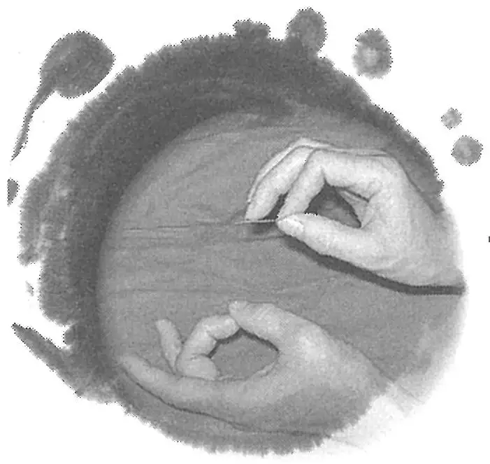

## 附五：本书原后记 

### 后记：中医标准化我们准备好了吗？ 

从1989年做第一个针灸腧穴定位的国家标准开始，我就发现这样一个现象：无论是中医界内还是界外的人们，总是有意或无意地用西医的框架来规范或审视中医的标准。而一些中医专家凭经验、凭直觉感到中医针灸有许多东西与西医的标准框架格格不人，于是不断呼吁要按照中医的自身规律发展中医，要按照中医自身的特点制定标准。那么，什么是中医的自身规律和自身特点，什么样的标准才能真正代表着中医的发展方向，却始终无人说得清楚。于是在接下来的针灸标准化研究的过程中，我特别注意区分研究对象的不同属性。

例如腧穴的体表定位强调相邻结构相互作用所形成的体表“凹陷”处，而不是绝对的、静止的平面纵横坐标式的体表定点；腧穴折量定位采用的是“骨度折量系统”相对值的比值概念。而西医解剖学采用绝对的、静止的尺度测量定位，因此在西医解剖计量定位表述中，看到的几乎都是“厘米”、“毫米”绝对值的度量单位。

针刺深度的计量同样存在着绝对与相对的问题，对于一个胖人来说，刺2cm还太浅，而对于一个瘦人来说，刺1cm就可能已经太深。因此，用绝对数值规定针刺的深度在临床上很难实施。再如对于中国人适宜的针刺刺激量、刺激参数可能对其他国家，特别是西方人就不合适——人的痛阈存在着个体、种族与地域的差异，如果规定为统一的国际标准，恐怕很难推广。

关于刺血的放血量，传统的针灸临床根据不同的情况而有“血出而止”和“血变而止”的不同规定，以西医传统的量化眼光看，很不规范（其实西医的测量标准中也早就有这种所谓“很不规范”的规定，例如血压的测量，以肱动脉搏动音的出现作为计量收缩压的位点，而以声音的突然减弱作为计量舒张压的位点（这简直就是对“血出而止”和“血变而止”的最生动的注脚），然而这一规定恰恰是对千百年针灸刺血临床经验的总结，具有坚实的实践基础。

从这些例子不难看出，针灸腧穴定位的标准度量单位是相对的，针刺深度是相对的，针刺刺激量也是相对的，相对性是针灸诊疗的一个重要特征，如果在标准化的过程中，针灸学的这些重要特征都被“化”掉了，那么针灸的魂与根也就不存在了。实践是检验真理的唯一标准，虽然用现代西方解剖学的体表定位方法在针灸临床上行不通，也定不了穴，但由于强大的习惯思维的惯性，人们一提到测量，就只知道绝对概念的标准计量单位——厘米（cm），就习惯地要用这一标准的“鞋”来削针灸这双“脚”。

〔p.1448 (인쇄 1420)〕

如今，西医经过漫长的探索也越来越清楚地认识到某些疾病（比如SARS、癌症）的诊疗规范并不能放之四海而皆准，因而不宜作为国际标准。因此，在标准化的进程中，我们必须始终保持清醒的头脑：哪些可以作标准，哪些不宜作标准，哪些不可作标准；哪些可以作国际标准，哪些不可以作国际标准等。不然的话，我们就会走弯路、走错路，就会对学科的发展产生负面影响。这部书记下了我在针灸腧穴标准化研究方面多年不断探索的足迹——一步一个脚印。

从古今标准化的经验教训中，我深深体会到标准化研究的艰难与紧张（用如履薄冰来形容一点也不夸张），曾多次向主管部门建议：标准化工作——特别是影响很广的基础标准一定要有一流的学者参与。对于这一点，曾经随我一道参加此项研究的研究生们也有切身体会，他们越干胆子越小、信心越少——尽管他们对于历史上在腧穴标准化过程中所出现错误的敏感性比别人要高得多，然而所有这些错误还是经他们之手一次次地重现了！最后连资料整理——这个在他人眼中最简单的环节也没有勇气与自信做了——在我看来这是成熟的开始，作为一个在这一领域摸爬滚打多年的年轻的老兵，我比其他人更能理解他们的选择，然而在为他们的成长感到高兴的同时，也为这一领域各级人才的奇缺感到深深的担忧——但愿我的这种担忧是多余的。

对于从事中医标准化研究的人而言，有一个经常被问及的问题：标准化对中医学发展究竟起什么作用？既然穴位是动态的、可变的，为什么还要制定腧穴定位标准呢？我曾反问一位记者道：现代医学对于人体结构（脏腑、神经、血管、肌肉等）的变异，比中医了解得更清楚，怎么就没有人质问现代解剖学为什么要如此重视这些结构的体表定位的标准？这里且引一段我于2006年10月在日本筑波举行的世界卫生组织西太区针灸经穴定位国际标准扩大会议期间答记者问的话作为对此问题的回答：

常规方法的建立对于任何一门技术的传播都是必不可少的，然而对于任何一门技艺，当你达到一定的境界之后，就会突破常规方法的框架。因此我们常常会见到这样的情形：钢琴老师往往一丝不苟地纠正每一个学生的每一个指法，而钢琴大师却告诉你弹琴时根本不要想着琴键；书法老师会要求你一笔一画结构与运笔的中规中矩，而书法大师却让你随心所欲，道法自然。如果一个标准出自大师级的专家之手，它绝不会限制大师们的创造力，而是缩短初学者从入门到大师的成长过程！

这部凝聚着十多年心血的《针灸腧穴通考》虽然结集成书了，但我深深地懂得：中医针灸标准化的路还很长，甚至可以说我们还没有找到，或者说没有建成这条大道！我愿做中医标准化路基上的一颗标准的小石子。

黄龙祥

2008年11月1日

〔p.1449 (인쇄 1421)〕

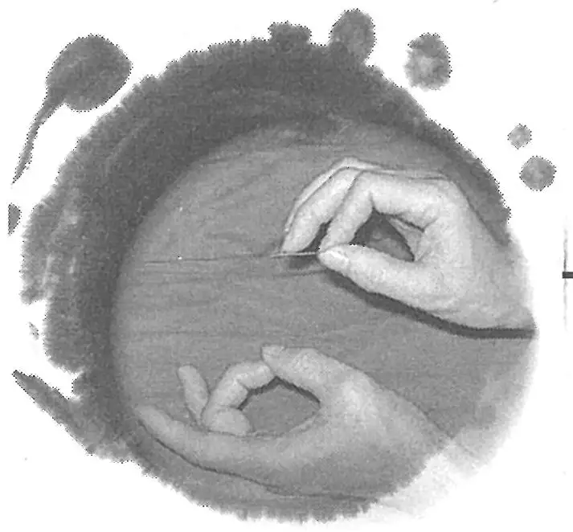

## 附六：穴名索引 

二画

丁肿 877

二白 1398

二间 165

人迎 278

三画

三阳络 930

三阴交 427

三间 168

上天柱 610

上巨虚 369

上关 988

上合谷（鼻痛点） 172

上后溪 524

上曲池 198

上迎香 236

上齿槽神经后支刺激点 567

上星 1255

上脘 1327

上颌神经刺激点 271

上廉 192

上睛明 582

上髎 678

下风池 1036

下巨虚 376

下关 270

下听会 985

下侠白 115

下脘 1316

下颌神经刺激点 271

下廉 188

下髎 685

口禾髎 232

大包 473

大巨 328

大肠俞 661

大迎 263

大杼 614

大钟 802

大都 413

大陵 888

大敦 1130

大椎 1220

大赫 828

大横 459

子宫 1388

小肠俞 666

小海 540

飞扬 750

四画

不容 306

中平 894

中冲 897

中极 1288

中极下 1289

中府 97

中枢 1204

中注 835

中封 1144

中庭 1341

中桡 930

中都 1151

中渎 1086

中渚 911

中脘 1321

中喘 1213

中跳 1071

中魁 1400

中膂俞 672

中髎 683

丰隆 379

云门 102

五处 597

五枢 1059

仆参 761

公孙 421

内关 884

内关下 884

内阳池 889

内迎香 1381

内肩髃 216

内庭 394

内秩边穴 739

内眦点 236, 256

内睛明 582

天井 934

天冲 1008

天池 868

天护 1276

天宗 549

天府 108

天枢 321

天柱 610

天泉 870

天突 1355

天容 563

天梁 1036

天窗 560

天鼎 224

天溪 467

天牖 949

天髎 947

太乙 316

太白 417

太冲 1139

太阳 1377

太渊 138

太溪 795

孔最 123

少冲 510

少府 507

少泽 518

少海 487

少商 148

尺泽 118

心俞 629

心悸点 508

手三里 194

手五里 207

支正 538

支沟 922

日月 1052

止痒2 443

气户 290

气穴 830

气冲 336

气舍 285

气海 1302

气海俞 659

水分 1312

水沟 233, 1265

水泉 805

水突 282

水道 330

见明穴 212

长强 1186

〔p.1450 (인쇄 1422)〕

风门 617

风市 1082

风池 1036

风府 1230

巨骨 222

巨阙 1331

巨髎 256

五画

丘墟 1111

东风 564

东明6 582

丝竹空 971, 982

兰门 451

厉兑 398

四白 252

四神聪 1374

四渎 932

四满 832

外心俞 630

外丘 1098

外关 918

外劳宫 894

外陵 326

外睛明 582

头临泣 1024

头窍阴 1013

头维 275

归来 333

本神 1019

正营 1029

玉枕 607

玉堂 1347

玉液 1383

申脉 763

白环俞 674

白喉穴 953

目窗 1028

石门 1298

石关 841

印堂 1275

六画

交信 816

伏兔 346

会阳 687

会阴 1282

会宗 926

光明 1100

关门 313

关元 1292

关元俞 664

关冲 905

冲门 451

冲阳 388

冲间 451

列缺 127

动脉跳动点 873

华盖 1351

合阳 741

合谷 171

后顶 1240

后腋 481, 544

后溪 524

后聪 961

向农 103

回气穴 1186

囟会 1251

地五会 1117

地仓 259

地合 1364

地机 435

夹脊 1390

年府 216

曲池 198

曲泽 873

曲垣 553

曲差 595

曲泉 1156

曲骨 1285

曲鬓 1003

次髎 681

池前 1037

百会 1242

耳大神经刺激点 1017

耳门 965

耳后发际 952

耳后静脉三条 958

耳尖 1380

耳和髎 969

耳颞神经刺激点 966

至阳 1207

至阴 775

舌下神经刺激点 564

舌咽神经刺激点 953

舌柱 1383

血海 442

行间 1135

阳白 1022

阳白内一寸 1022

阳交 1096

阳池 915

阳纲 724

阳谷 532

阳陵泉 1090

阳辅 1102

阳溪 178

阴包 1161

阴市 349

阴交 1306

阴谷 821

阴郄 498

阴都 844

阴陵泉 438

阴廉 1166

七画

兑端 1270

劳宫 893

听穴 570

听会 984

听灵 570, 985

听灵1 570, 985

听灵2 570, 985

听宫 569

听聪 985

呃逆 1052

坐骨神经压痛点 1072

完骨 1016

库房 293

志室 733

扶突 228

束骨 771

条口 373

极泉 481

极泉上 481

步廊 852

灵台 1210

灵道 492

灵墟 856

肓门 730

肓俞 837

肘尖 1396

肘俞 204

肘髎 204

肝房 1177

肝俞 638

肝室 1178

肝热 1213

角孙 963

足三里 360

足五里 1163

足临泣 1114

足窍阴 1121

足通谷 773

身柱 1214

迎香 235

间使 879

附分 706

鸠尾 1335

八画

乳中 300

乳根 303

京门 1055

京骨 768

侠白 114

侠承浆 1364

侠溪 1119

周荣 471

命门 1194

夜尿 826

委中 700

委阳 696

居髎 1064

府舍 454

建里 1319

忠阳 1213

承山 746

承光 600

承扶 690

承灵 1031

承泣 248

承浆 1364

承筋 743

承满 309

抬腿穴 343

昆仑 756

枕大神经刺激点 610

枕小神经刺激点 1037

治聋3 569

治鼻1 236

治鼻3 271

治瘫1 216

泽田 198

环跳 1067

环跳1 1072

秉风 551

经渠 134

肩中俞 558

〔p.1451 (인쇄 1423)〕

肩井 1042

肩内俞 216

肩内陵 216

肩内髃 98

肩外俞 556

肩尖 216

肩贞 543

肩周炎P1点 103

肩俞 103, 216

肩胛下肌前刺点 103

肩痛2 554

肩髃 215

肩髎 216, 945

肺俞 621

肺热 622, 1216

肺募 1216

肾俞 655

肾热 1208

虎边 172

视神经刺激点 583

郄门 876

金门 766, 877

金津 1383

青灵 484

鱼上 1022

鱼际 143

鱼腰 588, 1376

鱼腹 144

九画

俞府 861

养老 534

前谷 521

前肩髃 216

前顶 1249

前神聪 1243

前腋 481

哑门 1226

复溜 812

屋翳 295

带脉 1057

幽门 849

急脉 1168

扁桃体穴 564, 953

盆神经刺激点 739, 1072

眉冲 593

神门 501

神封 854

神庭 1260

神堂 714

神道 1212

神阙 1308

神聪 1243

神藏 857

结核 622, 1216

络却 605

胃仓 728

胃丛刺激点 1322

胃俞 649

胃热穴 626

胆俞 643

胆囊 1091

背缝 544

胛缝 544

胞肓 736

荐强 738

迷走神经刺激点 953

面神经刺激点口轮匝肌点 1267, 1364

面神经刺激点耳前点 570

面神经刺激点乳突后点 953

面神经刺激点乳突前点 953

面神经刺激点皱眉肌点 1276

面神经刺激点眼轮匝肌点 249

面神经刺激点颊肌点 259

面神经刺激点额肌点 1022

面巌 567

食窦 465

十画

彧中 859

健明 248, 582

健明1 248

健明2 248

健明5 639

旁劳宫 894

殷门 692

浮白 1011

浮郄 694

消泺 940

涌泉 787

秩边 738

素髎 1263

缺盆 287

胸12 1201

胸3 1218

胸8 1208

胸乡 469

脊中 1201

脑户 1235

脑空 1033

通天 602

通里 495

通经 457

通便 322, 460

陵下 1091

陶道 1218

陷谷 392

十一画

偏历 183

副神经刺激点 561, 564

商丘 424

商曲 839

商阳 162

悬枢 1198

悬厘 1001

悬钟 1106

悬颅 998

梁门 311

梁丘 352

液门 908

清泠渊 937

渊腋 1048

率谷 1005

球后 248

理便 688

眶下点 256

眶下神经刺激点 252

章门 1172

维宫 452, 1063

维胞 1063

维道 1062

辄筋 1049

隐白 408

颅息 961

颈丛刺激点 561

颈交感神经干刺激点 285

颈横神经刺激点 229

颈臂 285, 288

十二画

厥阴俞 626

喉返神经刺激点 282

喉感 873

喙突滑囊注射点 103

强间 1238

提宫 457

期门 1177

温溜 185

滑车上神经刺激点 588

滑肉门 319

然谷 792

犊鼻 356

琵琶 103

痞根 1392

筋缩 1205

筑宾 819

紫宫 1349

脾俞 645

腋神经刺激点 544

腋神经刺激点三角肌点 217, 945

腕骨 528

跗阳 753

锁骨上神经总干刺激点 561

阑门 1386

阑尾穴 370

颊车 266

十三画

廉泉 1360

意舍 726

新义 1017

新止喘 889

新伏兔 347

新阳溪 180

新明2 1022

新环跳 1071

新环跳1 1071

新秩边 738

新攒竹 588

照海 807

睛光 582

睛明 582

督俞 633

睫状神经节刺激点 249

〔p.1452 (인쇄 1424)〕

腰阳关 1192

腰俞 1190

腰眼 1394

腰痛点 1401

腹泻穴 1309

腹哀 462

腹结 457

腹通谷 847

腹腔丛刺激点 652

解溪 384

颔厌 992

魂门 721

鼠蹊 452

十四画

漏谷 433

瘈脉 957

箕门 446

膀胱丛刺激点 1286

膀胱俞 669

膈关 719

膈俞 635

膈神经刺激点 225

膏肓 711

閤门 1386

骶神经后支刺激点 678

魄户 708

鼻环 236

鼻流 233

鼻通 236

龈交 1272

十四画以上

横门 889

横骨 824

澜门 1386

璇玑 1352

膝内外目 356

膝关 356, 1153

膝阳关 1088

膝眼 356, 1405

蝶腭 271

鹤顶 354, 1403

颞颥 969

瞳子髎 981

翳风 952

翳明 952

膺窗 298

膻中 1343

臀中 1071

臂丛4 481

臂丛5 285

臂丛刺激点肌间沟刺激点 225

臂丛刺激点锁骨上刺激点 288

臂丛神经刺激点 103

臂丛喙突下刺激点 98

臂丛腋窝刺激点 481

臂臑 211

髀关 341

臑会 942

臑俞 546

髃前 216

攒竹 587

闗门 1386

闗元 1386

髋骨 354

攔門 1386

蘭门 1386

蠡沟 1148

颧肌点 256

颧点 256

颧髎 566

〔p.1453 (인쇄 1425)〕

# 后记 

——三易其稿只为“通考”二字

“通考”，是一个不能随便用的书名，对于这一点，我可能比其他人有更多、更深的体悟。且不说将几千年的针灸腧穴源流理清，就算把近一个甚至半个世纪内的腧穴发展的眉目描像了也是一件十分困难的事。例如对于针灸的大穴、要穴——环跳穴的取穴法，学针灸者莫不耳熟能详，然而古典文献关于此穴的定位描述只“髀枢中”三字，现代的定位描述是何时确定的？如何确定的？现代描述与古典之义是否契合？能有几人对得上？若是再问：日本针灸教材关于环跳穴的定位是何时确定的？如何确定的？如何判定中日两种取穴法哪个更合理？又有谁想过？像这样以及大量比这更复杂的疑案如果不能一一考得水落石出，又如何配得上“通考”之名？本书编纂历时7年，书成之后又推倒重写3次，小修已难计其数，回望一路爬过的山——原本无路，真是感慨万千，谨摘其一二记于下：

## 实地考察 

对于“读万卷书，行万里路”这句话，早就听说过，想必大家也都不会陌生，但不远万里的实地考察和人物专访，对于类书编纂的意义，真有切身体会还是近几年的事。最初我对此有所认识还是在20世纪90年代，读明代针灸家吴崑的书，他为了完成针灸全书《针方六集》的编纂，“未及壮年，负笈万里，虚衷北面，不减七十二师”。未读全书，此言已先动我心，读完之后便爱不释手，始悟出《针方六集》的成功与作者在编纂方法上的独辟蹊径密切相关。可惜书中内容哪些出自访师，哪些来自民间，编者没有一一注明。及至读同一时代的文献大家张介宾的《类经图翼》时，才更加感受到实地调查对于文献考证是多么的重要。如果没有张氏的实地调查与记录，只是通过代代相传的文献，我们今天很难了解当时针灸医生临床操作与当时记载的针灸补泻法式有多么大的差距，也无法知道民间关于穴位的治疗经验与明代文献记载有哪些不同。从此我开始了对针灸临床人物专访和针灸医院、诊所的考察之旅，先国内后国外，已坚持了十多年。拜师访友，观诊试针，得一分收获便得一分激励，一直走到今天。

如果不是与临床一线专家广泛、深入地接触，就不知当今的针灸临床实际与针灸教材的距离有多大，也就不会花费那么长的时间去反思现行的针灸诊疗程式；

如果没有与外国专家面对面的交流，就无法确认哪些穴位的定位，日本、韩国与中国存在着真正的分歧，就不会探究分歧是如何产生的，以及如何解决这些分歧，也就不会接下来去做经穴定位的表面解剖学研究；如果没有对邻国日本、韩国以及西方国家一次次的深入考察，就不知道针灸在邻国的真实现状，以及它们与中国针灸的根本差异在哪里？就不会花大气力、长时间进行中国与日本、韩国针灸的比较研究，就不会深入研究现代针灸教育及临床的发展史，就不会悟出“生态环境”对于针灸发展的重大影响，就不会萌生保护针灸健康发展或营造其适宜“生态环境”的意识。

〔p.1454 (인쇄 1426)〕

今后我将投入更多的时间与人力，进行更大范围的实地考察与人物专访。

## 实验求证 

欲通古今之变，先求文献之真。而多年史学研究的经验告诉我：有时历史真相很难单从文献求得，需要像大侦探破案那样从尽可能多的方面采集种类、性质尽可能全的证据。相信读过本书的读者已经无需我再费笔墨就此再作说明了。以下的文字是为像我一样的读者预备的——读书先看前言、目录和后记，再决定是接着读正文还是就此打住。

如果只考文字，那么你会轻易地得出这样的结论：足太阳经穴委阳历代文献记载无分歧，皆与《黄帝内经》、《黄帝明堂经》的定位相同。可是当你锲而不舍寻得一张张中国不同时代的明堂图、一个个针灸经穴铜人放在一起作比较，便会十分惊讶地发现，对于委阳穴的定位，几乎很难找到完全相同的两套图或两个针灸铜人，其中正确理解《黄帝内经》原文本义的仅明代施沛《经穴指掌图》一图而已！

如果不是发现了明正统仿宋铜人，我们依然会按照现代人想当然的理解去解释宋代《铜人腧穴针灸图经》的经穴定位文本，依然是谬之千里而浑然不觉。

这充分说明文字是有局限性的，特别是对于人体这种不规则体的定点描述尤为困难，很容易产生不同的理解。因此本书在研究方法上，特别注重文字资料与相关的图形证据互相印证。

为了使研究结论更接近真相，此次通考，除了图文并重，并与实地考察相结合外，还更多地引入了实验求证的方法。

在文献研究中引入实验方法的思路，最初是在经穴定位文献研究中，发现一些古今中外的争论不下的分歧，通过非常简单的实验就能得到解决，远比一味地纠缠文献的分析和考证来得便捷，于是就有目的地开展了表面解剖学、人体测量学、影像学实验研究。

最简单——同时也是最难的，是设计了许多思想实验，特别是在反思“穴位的定义”过程中，以及考察现代人关于穴位临床应用的新经验时。例如，在透穴疗法中，手太阴经穴经渠、太渊相距一寸，既可从太渊透经渠，也可从经渠透太渊，那么在这两种情形下，主治是相同还是不同？如果相同，它们是同一个穴，还是不同的穴？我现在能够回答的是：在汉代以前的很长一段时间内，它们被视为同一个穴！再如，“迎香透四白治疗胆道蛔虫症”是现代人的经验，那么“四白透迎香”是不是有相同的疗效？如果相同的话，那么为什么大多数针灸学教材只在迎香穴的主治项下记有“胆道蛔虫症”？当然，思想实验还要与其他方法综合应用，才能给出更令人信服的结论。

在自身做得最多的实验还是关于刺法的：刺静脉、刺动脉、刺神经以及刺其他不同组织结构的实验。例如为了掌握准确刺入动脉而又不刺穿的技术，还专门向护士学习多种不同的方法，并通过实际操作，选择一种适合自己的方法。由于针刺特殊感觉往往在特定的病理状态下才容易体会，因此一方面充分利用自己得病的机会，另一方面也人为地制造所需的病理状态，以重复、检验他人关于针感与针效的经验。例如为了体验治疗软组织损伤的骨骼肌刺法的特殊针感，我反复比较在自然和人为的病理状态下，针刺有病肌肉和正常肌肉的不同针感，积累亲身体验。我想，有没有这样的体验，以及体验是否真切和完整，写出来的文献分析一定会不同，为了能给读者不一样的期待，一切付出都值得！

〔p.1455 (인쇄 1427)〕

以上研究新思路及具体的做法，在本书的总论皆有专论。

## 鉴往知来 

通古今之变，不只是为了理清千百年来针灸发生了哪些变化，还要探明为什么会有这些变化，以便有可能判断明天的针灸将会向何处去。

针灸经数千年的积累才发现穴位数百，而为什么“文革”十年发现的穴位就过千？为什么腧穴定位稳定而刺法却出现巨变？为什么短短几十年内出现了这多新的疗法？最重要的因素是有了现代解剖学的知识背景，以及那个特殊时期冲破一切禁区的风尚，再加上针具的演变。细细深究，你会发现这些新的疗法、新的穴位大多出自西医或西学中医生之手！

同样源于中国针灸，你会发现日本、韩国与中国针灸有明显不同的特征；东方与西方的针灸也有不同风格。为什么？特殊的环境加上特殊的背景使然！

同样是在国内，你会发现中医院和西医院的针灸有明显的不同，在这里你甚至可以大致感受到中国针灸与西方针灸的不同；同样毕业于中医药大学针灸专业毕业生，如果毕业后分别在中医院、西医院、个人诊所等不同环境下临证，也都会有明显不同的发展状态。为什么？环境使然！

有的时候，中国人发明的一种针灸疗法，在本国并不被看好，在国外却很受重视，中国针灸之林一棵无人知道的小草，在国外却长成了大树，形成了树林；相反，国外的一种新疗法，可能在当地不受重视，而在中国却很受欢迎。道理很简单，特定的国情与环境的选择！

从针灸腧穴千百年传承中发现古今之变，需要细密的观察和不懈的坚持，而要从古今之变中寻出规律以成一家之言，则需要熟悉不同时代（或时期）的知识背景与社会环境。

## 走出误圈 

凭着一份真诚与坚持，寻得一份份缺失的文献，通过对历代文献的分析，再结合实地考察、实验方法求证，将杂乱无章的针灸腧穴的发展脉络理出头绪，将一段段被长期扭曲的历史恢复真相，将长期混杂于“鱼目”中的一颗颗“珍珠”拾起，真有一种说不出的喜悦。然而发现古今腧穴文献中那一串串触目惊心的错误，更带给我一种内心的震撼和沉重感。相信读了本书的人，一定也会感到震动。只是对于不同的人来说，可能有不同的关注点。

在所有的错误中，我更关注的是像“迎香透四白治胆道蛔虫”这类错误，以及“条口透承山治肩周炎”之类的失误。还没读本书的读者一定宁可认为是我搞错了，也不敢怀疑我举的例子本身有问题，因为这些都是现代人总结的针灸临床经验，有大量的临床报道，没有文献传抄的中间环节，怎么可能出错呢！其实最让我感到可怕的是，正是那些因文献的传承或文献理解环节上的差错形成的错误认识，却不时见到临床用之有效的报道。

此外，腧穴的部位、解剖、主治、刺法分离的现象，还没有被认识。例如，现行针灸教材中“箕门”穴的主治病症与汉代的《黄帝明堂经》相同，而经穴的位置却有四五寸之差，可我迄今未见有人提出教材之穴不治《黄帝明堂经》之症，而且可以预料的是，这个错误还将继续下去——尽管我在2006年出版的国家标准《腧穴名称与定位》中已经纠正了此穴的定位错误，在相当长的时间内，针灸书中关于“箕门”穴的层次解剖、刺法内容依然会沿袭未改正之前的内容——也就是说关于腧穴的部位、解剖、刺法分离的现象在短期内还难以从根本上得到纠正。

〔p.1456 (인쇄 1428)〕

你在纠正前人错误的同时，一次又一次地目睹了你自己参与或主持的文献研究项目出现新错，防不胜防，不时会惊出一身冷汗，时间长了，越做胆子越小。于是我花了大量时间考察这些错误是如何发生的，为什么能几十年，乃至千百年流传而不被察觉？而且一个错误往往会引导更多、更大的错误。我归纳了多种原因，其中最重要的原因在于：不读原书，不查原文。这种不良学风的形成固然与编书人的责任心有关，而客观上的原因是：第一，长时段、大跨度的文献整理，一个人难以承受，往往出于众人之手；第二，一种错误如果经过像教材这类权威性著作的转载，就很少有人会对这一说法再去查对文献，考辨真伪。

读到这里，可能读者会理解，我为什么要将已经完成、即将出版的书，又3次推倒重来——不是修修补补！最主要是我对类书的副作用比其他人体会更多，也更真切。此外，一个无意间的发现也更让我平添了几分不安：我近年出版的类书被越来越多的人引用——不注明出处的直接采用，特别是被一些有影响力的“作者”以这种方式采用。对此我想的最多的是，担心由于自己一个小小的疏忽而出现的错误，经这些名人之手被极度放大，造成短期内难以消除的负面影响。

7年来，在一部部针灸文献中，我苦苦地探寻着腧穴的本来面目——求真；

7年来，在听当代针灸大家讲述中，我苦苦地思索着精彩背后的简单至理——明理；

7年间，付出很多，为了这份坚持也放弃很多，能不能配得上“通考”二字？要历史来回答，待后人来评判，但在此时此刻，真的有一种解脱的感觉，尽管我知道要真正达到自己的要求，可能再给我一个或几个7年，也未必能成。但至少已将个人能为之事，在7年之内，做到了极致。

黄龙祥记于知竹斋

2010年8月28日
