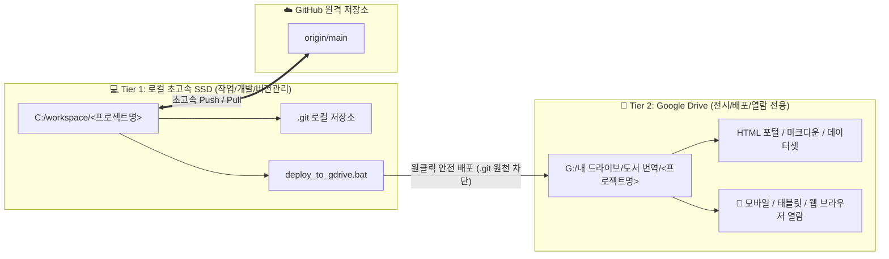
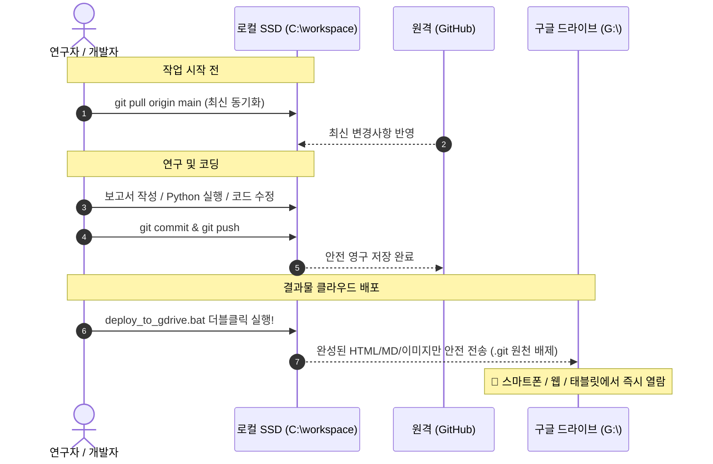

# 🛠️ Google Drive 연동 Git 저장소의 로컬 분리(Local Separation) 표준 설정 가이드

> **문서 버전**: v1.0 (2026-10-24 제정)  
> **적용 대상**: `acupoint_anatomy`, `huanglongxiang-scholar` 및 향후 구글 드라이브 연계 Git 프로젝트  
> **목적**: 다른 PC(연구실, 자택, 노트북 등)에서 구글 드라이브 동기화 충돌 및 대량 파일 삭제 알림 폭탄을 영구 차단하고, 초고속 로컬 개발 환경과 실시간 클라우드 열람 환경을 이원화 구축.

---

## 1. 배경 및 분리 필요성 (Why Local Separation?)

### 🚨 기존 방식의 치명적 문제점
Google Drive, Dropbox, OneDrive 등 클라우드 가상 드라이브(`G:\`) 내에 Git 저장소(`.git/`)를 직접 두고 작업할 경우 다음과 같은 문제가 필연적으로 발생합니다:

1. **대량 삭제 알림 폭탄 및 공포감 유발**:
   * Git은 커밋, 푸시, 가비지 컬렉션(`git gc`) 시 수백~수천 개의 2자리 16진수 오브젝트 폴더(`47/`, `98/`, `1e/`...)와 임시 락 파일(`*.lock`)을 생성했다가 수 초 만에 일괄 자동 삭제합니다.
   * 구글 드라이브 앱은 이를 **"사용자가 중요 파일과 폴더를 대량 삭제했다"**고 오인하여 클라우드 휴지통으로 이동시키고, 윈도우 트레이에 알림을 지속적으로 띄웁니다.
2. **파일 시스템 잠금 충돌 (`Error 0x91`, `WinError 5`)**:
   * Git이 파일을 생성/삭제하는 찰나에 구글 드라이브가 동기화 락을 걸어, `디렉터리가 비어 있지 않습니다` 또는 `액세스가 거부되었습니다` 에러가 발생하며 Git 작업이 중단됩니다.
3. **입출력 지연 및 속도 저하**:
   * 클라우드 가상 드라이브의 네트워크 I/O 오버헤드로 인해 스크립트 실행과 Git 명령어가 로컬 디스크 대비 5~10배 이상 느려집니다.

---

## 2. 2-Tier 아키텍처 개요 (Architecture)



* **Tier 1 (로컬 작업소, `C:\workspace`)**: 순수 로컬 고속 SSD에 위치하며, Git 커밋/푸시, 파이썬 분석, 소스코드 수정이 이루어지는 **개발 전용 공간**.
* **Tier 2 (드라이브 전시장, `G:\내 드라이브`)**: `.git`과 임시 파일이 전혀 없는 **순수 배포 공간**. 연구 산출물(HTML 웹 리포트, 마크다운 정본, 엑셀)을 언제 어디서나 안전하게 열람.

---

## 3. 다른 PC에서의 5단계 설정 절차 (Step-by-Step Setup)

새로운 PC에서 최초 1회만 아래 5단계를 수행하면 완벽한 분리 환경이 구축됩니다.

### [Step 1] 로컬 작업 폴더 생성
윈도우 터미널(PowerShell)을 열고 로컬 작업용 디렉토리를 만듭니다:
```powershell
New-Item -ItemType Directory -Path 'C:\workspace' -Force
```

---

### [Step 2] GitHub에서 프로젝트 클론 (Clone)

#### 1) 경혈 해부생리학 (`acupoint_anatomy`)
```powershell
cd C:\workspace
git clone https://jaehyokim-sketch@github.com/jaehyokim-sketch/acupoint_anatomy.git
```

#### 2) 황룡상 스킬 (`huanglongxiang-scholar`)
```powershell
cd C:\workspace
git clone https://jaehyokim-sketch@github.com/jaehyokim-sketch/huanglongxiang-scholar.git
```

> **인증 안내**: 최초 클론/푸시 시 브라우저 또는 GitHub 자격 증명 창이 뜨면 로그인/토큰을 1회 승인합니다. Windows Credential Manager가 자격 증명을 자동 기억합니다.

---

### [Step 3] Git 사용자 정보 설정
클론된 저장소에 사용자 정보를 설정합니다:
```powershell
# acupoint_anatomy
git -C 'C:\workspace\acupoint_anatomy' config user.name 'jaehyokim'
git -C 'C:\workspace\acupoint_anatomy' config user.email 'jaehyo.kim@gmail.com'
git -C 'C:\workspace\acupoint_anatomy' config credential.helper manager

# huanglongxiang-scholar
git -C 'C:\workspace\huanglongxiang-scholar' config user.name 'jaehyokim'
git -C 'C:\workspace\huanglongxiang-scholar' config user.email 'jaehyo.kim@gmail.com'
git -C 'C:\workspace\huanglongxiang-scholar' config credential.helper manager
```

---

### [Step 4] 구글 드라이브 폴더의 `.git` 디렉토리 안전 제거
구글 드라이브 동기화 폴더 안에 남아 있는 `.git` 디렉토리를 제거하여 드라이브의 오인 감시를 원천 차단합니다:

```powershell
# 경혈해부 드라이브 폴더 내 .git 제거
Remove-Item -LiteralPath 'G:\내 드라이브\도서 번역\acupoint_anatomy\.git' -Force -Recurse -ErrorAction SilentlyContinue

# 황룡상 스킬 드라이브 폴더 내 .git 제거
Remove-Item -LiteralPath 'G:\내 드라이브\도서 번역\01_황룡상 스킬\.git' -Force -Recurse -ErrorAction SilentlyContinue
```
> **안전 보장**: 이미 로컬 `C:\workspace` 및 GitHub에 전체 이력과 코드가 100% 보존되어 있으므로, 구글 드라이브 쪽의 `.git`만 제거해도 소스코드 손실은 0%입니다.

---

### [Step 5] 대용량 미디어/삽화 파일 동기화 확인
Git 저장소에는 용량 제한(`.gitignore`)으로 마크다운 텍스트만 관리되고 대용량 이미지/PDF는 구글 드라이브에 보존되는 경우가 있습니다 (예: 황룡상 도서 삽화 656장).  
로컬 저장소에서도 이를 온전히 활용하려면 구글 드라이브에서 로컬로 미디어를 1회 동기화합니다:

```powershell
# 황룡상 도서 코퍼스 삽화 이미지 복사 (최초 1회)
Copy-Item -Path 'G:\내 드라이브\도서 번역\01_황룡상 스킬\황룡상 도서 코퍼스 DB\*_images' -Destination 'C:\workspace\huanglongxiang-scholar\황룡상 도서 코퍼스 DB\' -Recurse -Force -ErrorAction SilentlyContinue
```

---

## 4. 일상 작업 표준 루틴 (Daily Workflow)

다른 PC에서 작업하실 때는 항상 아래 순서만 기억하시면 됩니다:



### 💡 요약:
1. **작업 시작 시**: `git pull origin main` (다른 PC에서 수정한 내용 가져오기)
2. **작업 완료 시**: `git commit` 후 `git push origin main` (GitHub 백업)
3. **드라이브 반영 시**: `deploy_to_gdrive.bat` **더블클릭**!

---

## 5. 원클릭 배포 도구 세부 규격 (`deploy_to_gdrive`)

각 프로젝트 루트에 포함된 `deploy_to_gdrive.py` 및 `deploy_to_gdrive.bat`은 다음과 같이 안전하게 설계되어 있습니다:

### 🛡️ 자동 필터링 (Ignore) 목록:
* **디렉토리**: `.git`, `__pycache__`, `.pytest_cache`, `node_modules`, `.venv`, `.vscode`, `.idea`
* **파일 확장자**: `*.pyc`, `*.pyo`, `*.lock`, `*.tmp`, `*.swp`, `*.bak`, `~$*` (임시 잠금 파일)
* **결과**: 구글 드라이브에는 순수 연구 문서, HTML 포털, 고해상도 도표, 데이터셋만 복사되므로 휴지통 오인 알림이 영구 발생하지 않습니다.

### ⚙️ PC별 구글 드라이브 경로가 다른 경우:
만약 특정 PC에서 구글 드라이브가 `G:\`가 아니라 다른 드라이브 문자(예: `H:\`)나 다른 경로로 마운트되어 있다면,  
`deploy_to_gdrive.py` 상단의 한 줄만 수정하시면 됩니다:
```python
# deploy_to_gdrive.py 상단
GDRIVE_DEST = r"H:\내 드라이브\도서 번역\acupoint_anatomy"  # 해당 PC 경로에 맞춤
```

---

## 6. 자주 묻는 질문 (FAQ)

### Q1. 구글 드라이브 휴지통에 기존에 쌓인 수천 개의 Git 파일들은 어떻게 하나요?
* 웹 브라우저로 [Google Drive 휴지통](https://drive.google.com/drive/trash)에 접속하신 후,
* 삭제된 파일 이름이 `47`, `98`, `1e` 같은 2글자 폴더나 `index.lock`, 영문/숫자 난수 해시 파일인 것을 확인하시고 **[휴지통 비우기]**를 진행하시면 구글 드라이브 용량이 즉시 확보됩니다.
* 혹시 실수로 버려진 본인 문서가 있다면 우클릭 후 **[복원]**하시면 됩니다.

### Q2. 구글 드라이브의 삭제 알림 팝업을 아예 끄고 싶습니다.
* 윈도우 작업표시줄 우측 하단 구글 드라이브 아이콘 클릭 → ⚙️(설정) → **환경설정**
* ⚙️(고급 설정)으로 이동 후 **"항목이 휴지통으로 이동될 때 알림"** 체크 해제.

### Q3. 실수로 구글 드라이브 폴더에서 파일을 수정했습니다. 로컬로 어떻게 가져오나요?
* 구글 드라이브의 해당 파일을 로컬 `C:\workspace\<프로젝트>`로 복사해 넣으신 후 `git commit` 하시면 됩니다.
* 하지만 혼선을 방지하기 위해 **"수정은 항상 로컬 C: 드라이브에서 하고, 구글 드라이브로는 배포만 한다"**는 원칙을 권장합니다.

---

> **문의 및 유지보수**: Google DeepMind Antigravity IDE Workspace  
> **마스터 코드베이스**: [GitHub jaehyokim-sketch](https://github.com/jaehyokim-sketch)
