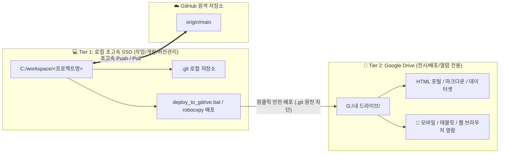
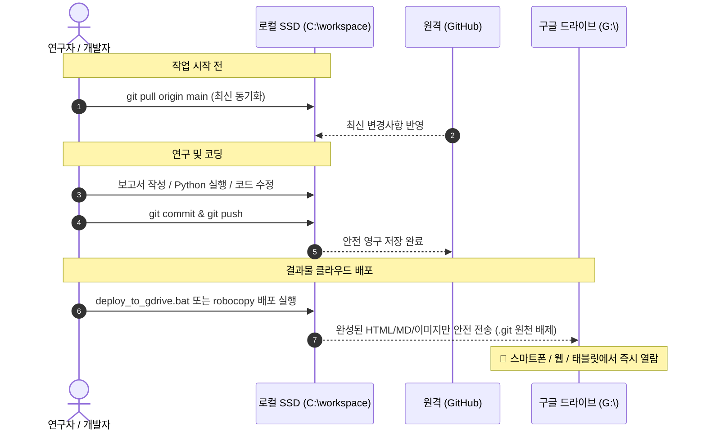

# 🛠️ Google Drive 연동 Git 저장소의 로컬 분리(Local Separation) 표준 설정 가이드

> **문서 버전**: v1.1 (2026-10-24 제정, 2026-10-25 개정 — 분리 대상 3개 추가, 다른 PC 데이터 복사·점검 절차 보강)  
> **적용 대상**: `acupoint_anatomy`, `huanglongxiang-scholar`, `amari-gl-dmn`, `IPE-Report`, `km-healthcare-stats` 및 향후 구글 드라이브 연계 Git 프로젝트  
> **목적**: 다른 PC(연구실, 자택, 노트북 등)에서 구글 드라이브 동기화 충돌 및 대량 파일 삭제 알림 폭탄을 영구 차단하고, 초고속 로컬 개발 환경과 실시간 클라우드 열람 환경을 이원화 구축.

---

## 1. 배경 및 분리 필요성 (Why Local Separation?)

### 🚨 기존 방식의 치명적 문제점
Google Drive, Dropbox, OneDrive 등 클라우드 가상 드라이브(`G:\`) 내에 Git 저장소(`.git/`)를 직접 두고 작업할 경우 다음과 같은 문제가 필연적으로 발생합니다:

1. **대량 삭제 알림 폭탄 및 공포감 유발**:
   * Git은 커밋, 푸시, 가비지 컬렉션(`git gc`) 시 수백~수천 개의 2자리 16진수 오브젝트 폴더(`47/`, `98/`, `1e/`...)와 임시 락 파일(`*.lock`)을 생성했다가 수 초 만에 일괄 자동 삭제합니다.
   * 구글 드라이브 앱은 이를 **"사용자가 중요 파일과 폴더를 대량 삭제했다"**고 오인하여 클라우드 휴지통으로 이동시키고, 윈도우 트레이에 알림을 지속적으로 띄웁니다.
2. **파일 시스템 잠금 충돌 (`Error 0x91`, `WinError 5`)**:
   * Git이 파일을 생성/삭제하는 찰나에 구글 드라이브가 동기화 락을 걸어, `디렉터리가 비어 있지 않습니다` 또는 `액세스가 거부되었습니다` 에러가 발생하며 Git 작업이 중단됩니다.
3. **입출력 지연 및 속도 저하**:
   * 클라우드 가상 드라이브의 네트워크 I/O 오버헤드로 인해 스크립트 실행과 Git 명령어가 로컬 디스크 대비 5~10배 이상 느려집니다. (2026-10-25 실측: Drive 위에서 `git status` 1회에 수십 초~수 분 소요)
4. **자격 증명 유출 위험**:
   * `.git/config`에 토큰이 포함된 원격 URL(`https://ghp_...@github.com/...`)이 저장되어 있으면, 그 파일이 그대로 클라우드에 동기화됩니다. (2026-10-25 `한의 의료서비스 통계`에서 실제 발견 → 7절 참조)

---

## 2. 2-Tier 아키텍처 개요 (Architecture)



* **Tier 1 (로컬 작업소, `C:\workspace`)**: 순수 로컬 고속 SSD에 위치하며, Git 커밋/푸시, 파이썬 분석, 소스코드 수정이 이루어지는 **개발 전용 공간**.
* **Tier 2 (드라이브 전시장, `G:\내 드라이브`)**: `.git`과 임시 파일이 전혀 없는 **순수 배포 공간**. 연구 산출물(HTML 웹 리포트, 마크다운 정본, 엑셀)을 언제 어디서나 안전하게 열람.

### 📋 분리 완료 프로젝트 목록 (2026-10-25 기준)

| 로컬 폴더 (`C:\workspace\…`) | GitHub 저장소 | Drive 위치 (`G:\내 드라이브\…`) | Drive 반영 방식 | GitHub에 없는 데이터 |
|---|---|---|---|---|
| `acupoint_anatomy` | `jaehyokim-sketch/acupoint_anatomy` | `도서 번역\acupoint_anatomy` | `deploy_to_gdrive.bat` | 없음 |
| `huanglongxiang-scholar` | `jaehyokim-sketch/huanglongxiang-scholar` | `도서 번역\01_황룡상 스킬` | `deploy_to_gdrive.bat` | 도서 삽화 이미지 (Step 5-1) |
| `amari-gl-dmn` | `jaehyokim-sketch/amari-gl-dmn` (+ 원격 `repo-joint`) | `논문작업\비평형열역학` | robocopy (§5-2) | **약 7.7GB, 503개 파일** (Step 5-2) |
| `IPE-Report` | `jaehyokim-sketch/-IPE-Report` | `강의\02_IPE\.deploy_ipe_report` | robocopy (§5-2) | 없음 |
| `km-healthcare-stats` | `jaehyokim-sketch/km-healthcare-stats` | `한의 의료서비스 통계` | robocopy (§5-2) | `.gitignore` 제외 자료 (Step 5-3) |

> **⚠️ 의도적으로 Drive에 남겨 둔 `.git` (삭제 금지)**  
> `한의 의료서비스 통계\04_CLI_대화세션_아카이브\antigravity-cli\brain\*\` 아래의 Antigravity 세션 아카이브 저장소 **20개**는 원격도 로컬 원본도 없어 **Drive가 유일한 클라우드 백업**입니다. 2026-07-08 이후 변경이 없는 비활성 아카이브라 동기화 충돌도 거의 없으므로 `.git`을 그대로 유지합니다. 아래 Step 4의 점검에서 이 경로는 제외합니다.

---

## 3. 다른 PC에서의 5단계 설정 절차 (Step-by-Step Setup)

새로운 PC에서 최초 1회만 아래 5단계를 수행하면 완벽한 분리 환경이 구축됩니다.

> **참고**: `setup_local_separation.bat`은 v1.0 기준으로 `acupoint_anatomy`, `huanglongxiang-scholar` 2개만 자동 처리합니다. 2026-10-25에 추가된 3개 프로젝트는 아래 PowerShell 명령으로 설정하십시오.

### [Step 1] 로컬 작업 폴더 생성
윈도우 터미널(PowerShell)을 열고 로컬 작업용 디렉토리를 만듭니다:
```powershell
New-Item -ItemType Directory -Path 'C:\workspace' -Force
```

---

### [Step 2] GitHub에서 프로젝트 클론 (Clone)

#### 1) 경혈 해부생리학 (`acupoint_anatomy`)
```powershell
cd C:\workspace
git clone https://jaehyokim-sketch@github.com/jaehyokim-sketch/acupoint_anatomy.git
```

#### 2) 황룡상 스킬 (`huanglongxiang-scholar`)
```powershell
cd C:\workspace
git clone https://jaehyokim-sketch@github.com/jaehyokim-sketch/huanglongxiang-scholar.git
```

#### 3) 비평형열역학 논문 (`amari-gl-dmn`)
```powershell
cd C:\workspace
git clone https://jaehyokim-sketch@github.com/jaehyokim-sketch/amari-gl-dmn.git
# 보조 원격(경혈-관절 역학 저장소)도 원 PC와 동일하게 등록
git -C 'C:\workspace\amari-gl-dmn' remote add repo-joint https://github.com/jaehyokim-sketch/acupoint-joint-mechanics.git
```

#### 4) IPE 보고서 배포 저장소 (`IPE-Report`)
GitHub 저장소 이름이 하이픈(`-IPE-Report`)으로 시작하므로, 로컬 폴더명을 `IPE-Report`로 명시해 클론합니다:
```powershell
cd C:\workspace
git clone https://jaehyokim-sketch@github.com/jaehyokim-sketch/-IPE-Report.git IPE-Report
```

#### 5) 한의 의료서비스 통계 (`km-healthcare-stats`)
```powershell
cd C:\workspace
git clone https://jaehyokim-sketch@github.com/jaehyokim-sketch/km-healthcare-stats.git
```

> **인증 안내**: 최초 클론/푸시 시 브라우저 또는 GitHub 자격 증명 창이 뜨면 로그인/토큰을 1회 승인합니다. Windows Credential Manager가 자격 증명을 자동 기억합니다.  
> **🚫 금지**: 원격 URL에 토큰을 직접 넣지 마십시오 (`https://ghp_xxx@github.com/...` 형식). 토큰이 `.git/config`에 평문 저장됩니다. 항상 `https://jaehyokim-sketch@github.com/...` + `credential.helper manager` 방식을 사용합니다.

---

### [Step 3] Git 사용자 정보 설정
클론된 저장소에 사용자 정보를 설정합니다. 커밋 작성자 이력이 섞이지 않도록 **원 PC에서 쓰던 저장소별 설정을 그대로** 맞춥니다:
```powershell
# acupoint_anatomy
git -C 'C:\workspace\acupoint_anatomy' config user.name 'jaehyokim'
git -C 'C:\workspace\acupoint_anatomy' config user.email 'jaehyo.kim@gmail.com'
git -C 'C:\workspace\acupoint_anatomy' config credential.helper manager

# huanglongxiang-scholar
git -C 'C:\workspace\huanglongxiang-scholar' config user.name 'jaehyokim'
git -C 'C:\workspace\huanglongxiang-scholar' config user.email 'jaehyo.kim@gmail.com'
git -C 'C:\workspace\huanglongxiang-scholar' config credential.helper manager

# amari-gl-dmn
git -C 'C:\workspace\amari-gl-dmn' config user.name 'jaehyokim-sketch'
git -C 'C:\workspace\amari-gl-dmn' config user.email 'medicdog@wku.ac.kr'
git -C 'C:\workspace\amari-gl-dmn' config credential.helper manager

# IPE-Report
git -C 'C:\workspace\IPE-Report' config user.name 'Jaehyo Kim'
git -C 'C:\workspace\IPE-Report' config user.email 'jaehyo.kim@gmail.com'
git -C 'C:\workspace\IPE-Report' config credential.helper manager

# km-healthcare-stats
git -C 'C:\workspace\km-healthcare-stats' config user.name 'jaehyokim-sketch'
git -C 'C:\workspace\km-healthcare-stats' config user.email 'jaehyokim-sketch@users.noreply.github.com'
git -C 'C:\workspace\km-healthcare-stats' config credential.helper manager
```

---

### [Step 4] 구글 드라이브 폴더의 `.git` 디렉토리 점검 및 제거
**원 PC에서 2026-10-25에 5개 프로젝트의 Drive 쪽 `.git` 제거를 완료**했습니다. 구글 드라이브는 삭제도 동기화하므로, 다른 PC에서는 보통 **점검만** 하면 됩니다.

#### 4-1) 점검: Drive에 남은 `.git` 찾기 (보존 대상 아카이브 제외)
```powershell
# Drive 전체를 훑으므로 수 분 걸릴 수 있습니다.
Get-ChildItem -LiteralPath 'G:\내 드라이브' -Directory -Recurse -Force -Filter '.git' -ErrorAction SilentlyContinue |
    Where-Object { $_.FullName -notlike '*04_CLI_대화세션_아카이브*' } |
    Select-Object FullName
```
* 결과가 비어 있으면 정상입니다.
* 삭제 직후에는 안이 빈 `.git` 폴더 껍데기가 잠시 목록에 보이며 `액세스가 거부되었습니다`가 뜰 수 있습니다. 드라이브가 삭제를 처리하는 중인 상태이므로 시간이 지나면 사라집니다.

#### 4-2) 제거: 점검에서 남은 `.git`이 발견된 경우에만
**제거 전 반드시** 해당 프로젝트가 Step 2에서 로컬로 클론되었고, Drive 쪽 저장소에 푸시하지 않은 커밋이 없는지(`git -C '<Drive 경로>' status -sb`에 `ahead`가 없는지) 확인합니다.
```powershell
Remove-Item -LiteralPath 'G:\내 드라이브\도서 번역\acupoint_anatomy\.git' -Force -Recurse -ErrorAction SilentlyContinue
Remove-Item -LiteralPath 'G:\내 드라이브\도서 번역\01_황룡상 스킬\.git' -Force -Recurse -ErrorAction SilentlyContinue
Remove-Item -LiteralPath 'G:\내 드라이브\논문작업\비평형열역학\.git' -Force -Recurse -ErrorAction SilentlyContinue
Remove-Item -LiteralPath 'G:\내 드라이브\강의\02_IPE\.deploy_ipe_report\.git' -Force -Recurse -ErrorAction SilentlyContinue
# 한의 의료서비스 통계: 최상위 .git 하나만 제거 (brain\ 아래 아카이브 .git 20개는 건드리지 않음)
Remove-Item -LiteralPath 'G:\내 드라이브\한의 의료서비스 통계\.git' -Force -Recurse -ErrorAction SilentlyContinue
```
> **안전 보장**: 로컬 `C:\workspace` 및 GitHub에 전체 이력과 코드가 보존되어 있으므로, 구글 드라이브 쪽의 `.git`만 제거해도 소스코드 손실은 없습니다. (`km-healthcare-stats`는 2026-10-25 GitHub와 동기화(`dac11f7`) 후 제거됨)

---

### [Step 5] GitHub에 없는 데이터를 Drive에서 로컬로 1회 복사
Git 저장소에는 용량 제한(`.gitignore`) 또는 미추적 상태로 일부 파일만 관리되고, 나머지 대용량 자료는 구글 드라이브에만 보존되는 프로젝트가 있습니다. 로컬 저장소에서도 이를 온전히 활용하려면 Drive에서 로컬로 1회 복사합니다.

> robocopy의 `/XC /XN /XO` 옵션은 **로컬에 이미 있는 파일은 건너뛰고 없는 파일만 복사**하므로, 방금 클론한 Git 추적 파일을 덮어쓰지 않습니다. robocopy 종료 코드 **0~7은 정상**(1 = 복사 성공)입니다.

#### 5-1) 황룡상 도서 코퍼스 삽화 이미지 (`huanglongxiang-scholar`, 656장)
```powershell
Copy-Item -Path 'G:\내 드라이브\도서 번역\01_황룡상 스킬\황룡상 도서 코퍼스 DB\*_images' -Destination 'C:\workspace\huanglongxiang-scholar\황룡상 도서 코퍼스 DB\' -Recurse -Force -ErrorAction SilentlyContinue
```

#### 5-2) 비평형열역학 연구 데이터 (`amari-gl-dmn`, 약 7.7GB)
GitHub에는 파일 3개만 추적되고, 데이터·그림 등 **503개 파일(약 7.7GB)은 Drive에만** 있습니다. 클론만으로는 작업 환경이 완성되지 않으므로 반드시 복사합니다 (원 PC 기준 약 5분, 다른 PC는 Drive 다운로드 시간이 추가됨):
```powershell
robocopy 'G:\내 드라이브\논문작업\비평형열역학' 'C:\workspace\amari-gl-dmn' /E /XC /XN /XO /XD .git /R:2 /W:2 /NP /NFL /NDL
```
> **원 PC 할 일**: 2026-10-25 기준 원 PC의 `amari-gl-dmn`에 `README.md`, `index.html` 등 **미커밋 수정 3건**이 남아 있습니다. 다른 PC와 내용이 갈라지지 않도록 원 PC에서 먼저 커밋·푸시하십시오.

#### 5-3) 한의 의료서비스 통계 미추적 자료 (`km-healthcare-stats`)
`.gitignore`로 제외된 자료(`step_*.txt`, `scratch_*.txt`, `.agents\` 등)가 필요할 때만 복사합니다. 세션 아카이브(`04_CLI_대화세션_아카이브`)는 Drive 보존 전용이므로 복사하지 않습니다:
```powershell
robocopy 'G:\내 드라이브\한의 의료서비스 통계' 'C:\workspace\km-healthcare-stats' /E /XC /XN /XO /XD .git 04_CLI_대화세션_아카이브 __pycache__ /R:2 /W:2 /NP /NFL /NDL
```

#### 5-4) 설정 완료 확인
```powershell
foreach ($r in 'acupoint_anatomy','huanglongxiang-scholar','amari-gl-dmn','IPE-Report','km-healthcare-stats') {
    "== $r"; git -C "C:\workspace\$r" status -sb | Select-Object -First 1; git -C "C:\workspace\$r" remote -v | Select-Object -First 1
}
```
모든 저장소가 `## main...origin/main`으로 표시되고, 원격 URL에 `ghp_`가 없으면 완료입니다.

---

## 4. 일상 작업 표준 루틴 (Daily Workflow)

다른 PC에서 작업하실 때는 항상 아래 순서만 기억하시면 됩니다:



### 💡 요약:
1. **작업 시작 시**: `git pull origin main` (다른 PC에서 수정한 내용 가져오기)
2. **작업 완료 시**: `git commit` 후 `git push origin main` (GitHub 백업)
3. **드라이브 반영 시**: `acupoint_anatomy`·`huanglongxiang-scholar`는 `deploy_to_gdrive.bat` **더블클릭**, 나머지 3개는 §5-2의 robocopy 배포 명령 실행

> **`amari-gl-dmn` 주의**: 대용량 데이터가 GitHub에 없으므로 `git pull`만으로는 다른 PC의 데이터 변경이 전달되지 않습니다. 데이터를 갱신한 PC에서 §5-2 명령으로 Drive에 배포하고, 다른 PC에서는 Step 5-2 명령으로 다시 가져옵니다.

---

## 5. 배포 도구 세부 규격

### 5-1. 원클릭 배포 도구 (`deploy_to_gdrive`) — `acupoint_anatomy`, `huanglongxiang-scholar`

각 프로젝트 루트에 포함된 `deploy_to_gdrive.py` 및 `deploy_to_gdrive.bat`은 다음과 같이 안전하게 설계되어 있습니다:

#### 🛡️ 자동 필터링 (Ignore) 목록:
* **디렉토리**: `.git`, `__pycache__`, `.pytest_cache`, `node_modules`, `.venv`, `.vscode`, `.idea`
* **파일 확장자**: `*.pyc`, `*.pyo`, `*.lock`, `*.tmp`, `*.swp`, `*.bak`, `~$*` (임시 잠금 파일)
* **결과**: 구글 드라이브에는 순수 연구 문서, HTML 포털, 고해상도 도표, 데이터셋만 복사되므로 휴지통 오인 알림이 영구 발생하지 않습니다.

#### ⚙️ PC별 구글 드라이브 경로가 다른 경우:
만약 특정 PC에서 구글 드라이브가 `G:\`가 아니라 다른 드라이브 문자(예: `H:\`)나 다른 경로로 마운트되어 있다면,  
`deploy_to_gdrive.py` 상단의 한 줄만 수정하시면 됩니다:
```python
# deploy_to_gdrive.py 상단
GDRIVE_DEST = r"H:\내 드라이브\도서 번역\acupoint_anatomy"  # 해당 PC 경로에 맞춤
```

### 5-2. robocopy 배포 명령 — `amari-gl-dmn`, `IPE-Report`, `km-healthcare-stats`

이 3개 프로젝트에는 아직 `deploy_to_gdrive` 도구가 없으므로, 아래 명령으로 로컬 → Drive 배포합니다. 5-1과 같은 필터링 목록을 적용합니다:
```powershell
$xd = '.git','__pycache__','.pytest_cache','node_modules','.venv','.vscode','.idea'
$xf = '*.pyc','*.pyo','*.lock','*.tmp','*.swp','*.bak','~$*'

# 비평형열역학
robocopy 'C:\workspace\amari-gl-dmn' 'G:\내 드라이브\논문작업\비평형열역학' /E /XD $xd /XF $xf /R:2 /W:2 /NP /NFL /NDL

# IPE 보고서
robocopy 'C:\workspace\IPE-Report' 'G:\내 드라이브\강의\02_IPE\.deploy_ipe_report' /E /XD $xd /XF $xf /R:2 /W:2 /NP /NFL /NDL

# 한의 의료서비스 통계 (Drive 보존 아카이브는 제외)
robocopy 'C:\workspace\km-healthcare-stats' 'G:\내 드라이브\한의 의료서비스 통계' /E /XD $xd 04_CLI_대화세션_아카이브 /XF $xf /R:2 /W:2 /NP /NFL /NDL
```
* `/MIR`(미러링)을 쓰지 않으므로 Drive의 기존 파일은 삭제되지 않습니다. 로컬에서 지운 파일은 Drive에서 직접 정리합니다.
* 다른 PC에서 Drive 경로가 다르면 두 번째 인자의 `G:\내 드라이브` 부분만 바꿉니다.

---

## 6. 자주 묻는 질문 (FAQ)

### Q1. 구글 드라이브 휴지통에 기존에 쌓인 수천 개의 Git 파일들은 어떻게 하나요?
* 웹 브라우저로 [Google Drive 휴지통](https://drive.google.com/drive/trash)에 접속하신 후,
* 삭제된 파일 이름이 `47`, `98`, `1e` 같은 2글자 폴더나 `index.lock`, 영문/숫자 난수 해시 파일인 것을 확인하시고 **[휴지통 비우기]**를 진행하시면 구글 드라이브 용량이 즉시 확보됩니다.
* 혹시 실수로 버려진 본인 문서가 있다면 우클릭 후 **[복원]**하시면 됩니다.

### Q2. 구글 드라이브의 삭제 알림 팝업을 아예 끄고 싶습니다.
* 윈도우 작업표시줄 우측 하단 구글 드라이브 아이콘 클릭 → ⚙️(설정) → **환경설정**
* ⚙️(고급 설정)으로 이동 후 **"항목이 휴지통으로 이동될 때 알림"** 체크 해제.

### Q3. 실수로 구글 드라이브 폴더에서 파일을 수정했습니다. 로컬로 어떻게 가져오나요?
* 구글 드라이브의 해당 파일을 로컬 `C:\workspace\<프로젝트>`로 복사해 넣으신 후 `git commit` 하시면 됩니다.
* 하지만 혼선을 방지하기 위해 **"수정은 항상 로컬 C: 드라이브에서 하고, 구글 드라이브로는 배포만 한다"**는 원칙을 권장합니다.

### Q4. 점검에서 `brain\` 아래 `.git`이 잔뜩 보이는데 지워도 되나요?
* **안 됩니다.** 2절의 "의도적으로 Drive에 남겨 둔 `.git`"에 해당하는 20개 세션 아카이브이며, 원격 백업이 없어 Drive가 유일한 사본입니다. 4-1 점검 명령은 이 경로를 자동 제외합니다.

### Q5. 새로운 Drive 프로젝트에서 Git을 쓰고 싶으면 어떻게 하나요?
1. `C:\workspace\<프로젝트명>`에서 `git init` 또는 GitHub에서 클론합니다. Drive 안에서 `git init` 하지 않습니다.
2. 이미 Drive 안에 `.git`이 생겼다면: 폴더 전체를 `robocopy '<Drive 경로>' 'C:\workspace\<이름>' /E /COPY:DAT /DCOPY:T`로 복사 → 로컬 사본에서 `HEAD`·`git fsck`·`git status`가 Drive와 일치하는지 확인 → 푸시하지 않은 커밋을 GitHub에 푸시 → Drive 쪽 `.git` 제거 순서로 진행합니다.
3. 2절 프로젝트 목록 표와 3절 Step 2·3에 새 프로젝트를 추가합니다.

---

## 7. 적용 이력 (Change Log)

| 일자 | 버전 | 내용 |
|---|---|---|
| 2026-10-24 | v1.0 | 가이드 제정. `acupoint_anatomy`, `huanglongxiang-scholar` 로컬 분리 및 `deploy_to_gdrive` 도입. |
| 2026-10-25 | v1.1 | `G:\내 드라이브` 전체 점검 결과 미분리 `.git` 25개 발견 → 아래와 같이 처리. |

**2026-10-25 처리 내역** (모든 로컬 사본은 `HEAD` 일치·`git fsck` 통과·미커밋 변경 목록 일치를 확인한 뒤 Drive 쪽 `.git` 제거)

| Drive 경로 | 처리 결과 |
|---|---|
| `논문작업\비평형열역학` | `C:\workspace\amari-gl-dmn`으로 분리 (작업 트리 7.7GB와 미커밋 변경 전부 이전) |
| `강의\02_IPE\.deploy_ipe_report` | `C:\workspace\IPE-Report`로 분리 |
| `한의 의료서비스 통계` | `C:\workspace\km-healthcare-stats`로 분리. GitHub와 갈라진 상태(로컬 2커밋 / 원격 2커밋)였던 것을 `origin/main` 위로 rebase 후 푸시(`1ca3a60..dac11f7`)한 뒤 Drive `.git` 제거. rebase 이전 상태는 로컬 브랜치 `backup/pre-sync-2026-10-25`로 보존 (원 PC에만 존재) |
| `행정\한의학 교육과 의료 통합\km_repo_clean2` | `km-healthcare-stats`의 중복 클론(커밋 전부 GitHub에 존재) → 로컬 사본 없이 Drive `.git`만 제거. 같은 폴더의 `sync_d_drive_repo.py`는 `index.html`만 읽으므로 영향 없음 |
| `행정\한의학 교육과 의료 통합\km_repo_clean` | `HEAD`·`config`가 없는 중단된 중복 클론 → Drive `.git`만 제거 |
| `한의 의료서비스 통계\04_CLI_대화세션_아카이브\...\brain\*` (20개) | 원격·로컬 원본이 없는 비활성 아카이브 → **의도적으로 Drive에 유지** |

**보안 사고 기록**: `한의 의료서비스 통계\.git\config`의 원격 URL에 GitHub 개인 액세스 토큰이 평문으로 포함되어 Drive로 동기화되고 있었습니다. 로컬 사본은 토큰 없는 URL과 `credential.helper manager`로 교체했고, Drive 쪽 `.git`은 제거했습니다. **해당 토큰은 GitHub → Settings → Developer settings → Personal access tokens에서 폐기해야 합니다.**

---

> **문의 및 유지보수**: Google DeepMind Antigravity IDE Workspace  
> **마스터 코드베이스**: [GitHub jaehyokim-sketch](https://github.com/jaehyokim-sketch)
