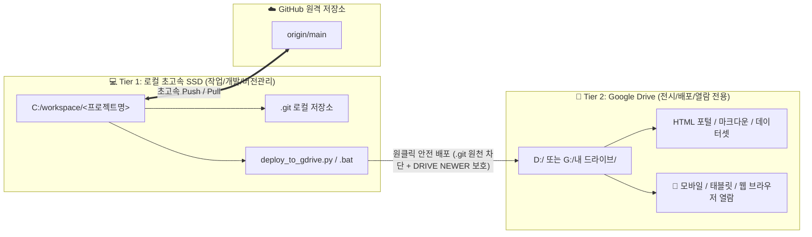
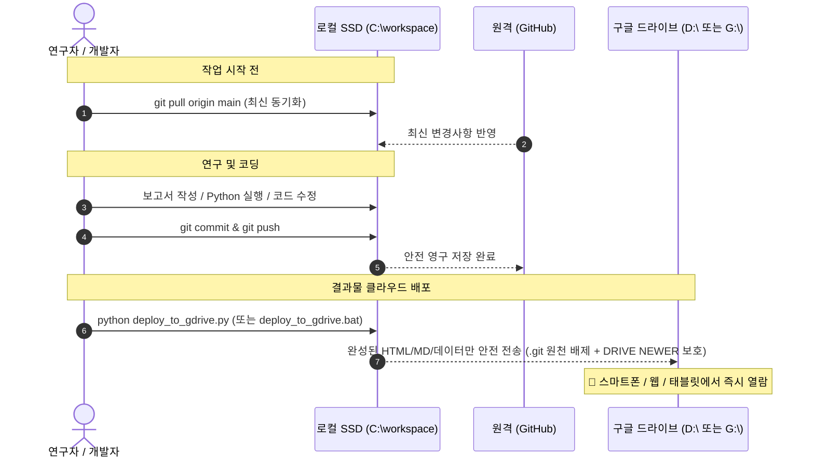

# 🛠️ Google Drive 연동 Git 저장소의 로컬 분리(Local Separation) 표준 설정 가이드

> **문서 버전**: v1.4 (2026-10-24 제정, 2026-10-29 개정 — 9개 전 프로젝트 `deploy_to_gdrive` 표준화, `D:\`/`G:\` 자동 경로 감지, `통풍_침구치료지침_보고서`의 `acupoint_anatomy` 하위 통합 반영)  
> **적용 대상**: `acupoint_anatomy`, `huanglongxiang-scholar`, `amari-gl-dmn`, `IPE-Report`, `km-healthcare-stats`, `proxy-form-system`, `anatomy-act-reform-2026`, `km-integrated-education`, `anthropic-claude-integration` (총 9개 프로젝트) 및 향후 구글 드라이브 연계 Git 프로젝트  
> **목적**: 복수 PC(연구실, 자택, 노트북 등)에서 구글 드라이브 동기화 충돌 및 대량 파일 삭제 알림 폭탄을 영구 차단하고, 초고속 로컬 개발 환경(`C:\workspace`)과 실시간 클라우드 열람·정본 환경(`D:\` 또는 `G:\내 드라이브`)을 이원화 구축.

---

## 1. 배경 및 분리 필요성 (Why Local Separation?)

### 🚨 기존 방식의 치명적 문제점
Google Drive, Dropbox, OneDrive 등 클라우드 동기화 드라이브(`D:\` 또는 `G:\내 드라이브`) 내에 Git 저장소(`.git/`)를 직접 두고 작업할 경우 다음과 같은 문제가 필연적으로 발생합니다:

1. **대량 삭제 알림 폭탄 및 공포감 유발**:
   * Git은 커밋, 푸시, 가비지 컬렉션(`git gc`) 시 수백~수천 개의 2자리 16진수 오브젝트 폴더(`47/`, `98/`, `1e/`...)와 임시 락 파일(`*.lock`)을 생성했다가 수 초 만에 일괄 자동 삭제합니다.
   * 구글 드라이브 앱은 이를 **"사용자가 중요 파일과 폴더를 대량 삭제했다"**고 오인하여 클라우드 휴지통으로 이동시키고, 윈도우 트레이에 알림을 지속적으로 띄웁니다.
2. **파일 시스템 잠금 충돌 (`Error 0x91`, `WinError 5`)**:
   * Git이 파일을 생성/삭제하는 찰나에 구글 드라이브가 동기화 락을 걸어, `디렉터리가 비어 있지 않습니다` 또는 `액세스가 거부되었습니다` 에러가 발생하며 Git 작업이 중단됩니다.
3. **입출력 지연 및 속도 저하**:
   * 클라우드 가상 드라이브의 네트워크/동기화 I/O 오버헤드로 인해 스크립트 실행과 Git 명령어가 로컬 디스크 대비 5~10배 이상 느려집니다. (2026-10-25 실측: Drive 위에서 `git status` 1회에 수십 초~수 분 소요)
4. **자격 증명 및 API 키 유출 위험**:
   * `.git/config`에 토큰이 포함된 원격 URL(`https://ghp_...@github.com/...`)이나 `.env` 파일이 저장되어 있으면, 그 파일이 그대로 클라우드에 동기화됩니다. (2026-10-25 `한의 의료서비스 통계` 토큰 및 2026-10-27 `anthropic-claude-integration` `.env` 격리 조치 완료 → 7절 참조)

---

## 2. 2-Tier 아키텍처 개요 (Architecture)



* **Tier 1 (로컬 작업소, `C:\workspace`)**: 순수 로컬 고속 SSD에 위치하며, Git 커밋/푸시, 파이썬 분석, 소스코드 수정이 이루어지는 **개발·버전관리 전용 공간**입니다. 모든 `.git/` 디렉토리는 이곳에만 존재합니다.
* **Tier 2 (드라이브 전시장, `D:\` 또는 `G:\내 드라이브`)**: `.git`과 임시 파일(`*.lock`, `__pycache__`, `.venv`)이 전혀 없는 **순수 배포·열람 공간**입니다. 연구 산출물(HTML 웹 리포트, 마크다운 정본, 엑셀·JSON 데이터셋)을 언제 어디서나 안전하게 열람합니다.
  * **참고 (PC별 Drive 문자 자동 감지)**: 현재 주 작업 PC에서는 Google Drive가 `D:\` 루트에 직접 매핑되어 있으며(`G:\`에는 `내 드라이브.lnk` 바로가기 존재), 다른 PC에서는 `G:\내 드라이브\` 등으로 마운트될 수 있습니다. 모든 프로젝트의 `deploy_to_gdrive.py`는 `resolve_gdrive_dest()`를 통해 `G:\내 드라이브\...`와 `D:\...` 경로를 **자동 감지**합니다.

### 📋 분리 완료 프로젝트 목록 (2026-10-29 현재 기준, 총 9개 프로젝트)

| # | 로컬 폴더 (`C:\workspace\…`) | GitHub 원격 저장소 | Google Drive 위치 (`D:\…` 또는 `G:\내 드라이브\…`) | Drive 반영 방식 | 비고 및 특이사항 |
| :---: | :--- | :--- | :--- | :--- | :--- |
| 1 | `acupoint_anatomy` | `jaehyokim-sketch/acupoint_anatomy` | `도서 번역\acupoint_anatomy` | `deploy_to_gdrive.py` (`.bat`) | 하위 `04_번역원고_및_임상매트릭스\통풍_침구치료지침_보고서` 통합 완료(루트 중복 제거) |
| 2 | `huanglongxiang-scholar` | `jaehyokim-sketch/huanglongxiang-scholar` | `도서 번역\01_황룡상 스킬` | `deploy_to_gdrive.py` (`.bat`) | 도서 삽화 이미지(`*_images`, 656장)는 `.gitignore` 대상 (Step 5-1) |
| 3 | `amari-gl-dmn` | `jaehyokim-sketch/amari-gl-dmn` | `논문작업\비평형열역학` | `deploy_to_gdrive.py` (`.bat`) | 대용량 연구 데이터(**약 7.7GB, 503개 파일**)는 Drive 보존 (Step 5-2) |
| 4 | `IPE-Report` | `jaehyokim-sketch/-IPE-Report` | `강의\02_IPE\.deploy_ipe_report` | `deploy_to_gdrive.py` (`.bat`) | GitHub 저장소명 `-IPE-Report` |
| 5 | `km-healthcare-stats` | `jaehyokim-sketch/km-healthcare-stats` | `한의 의료서비스 통계` | `deploy_to_gdrive.py` (`.bat`) | `04_CLI_대화세션_아카이브`는 Drive 전용 보존 (Step 5-3) |
| 6 | `proxy-form-system` | 로컬 Git 관리 (필요시 원격 연동) | `행정\위임장_작성_시스템` | `deploy_to_gdrive.py` (`.bat`) | 로컬 `.git/` 분리 및 자동 배포기 구축 완료 |
| 7 | `anatomy-act-reform-2026` | 로컬 Git 관리 (필요시 원격 연동) | `행정\2026-시체해부법` | `deploy_to_gdrive.py` (`.bat`) | 로컬 `.git/` 분리 및 자동 배포기 구축 완료 |
| 8 | `km-integrated-education` | 로컬 Git 관리 (필요시 원격 연동) | `행정\한의학 교육과 의료 통합` | `deploy_to_gdrive.py` (`.bat`) | 중복 클론(`km_repo_clean*`) 정리 완료 |
| 9 | `anthropic-claude-integration` | 로컬 Git 관리 (필요시 원격 연동) | `anthropic-claude-integration` | `deploy_to_gdrive.py` (`.bat`) | **API 키(`.env`) 및 `.venv` 로컬 전용 격리** (Drive 평문 제거) |

> **⚠️ 의도적으로 Drive에 남겨 둔 `.git` (삭제 금지)**  
> `한의 의료서비스 통계\04_CLI_대화세션_아카이브\antigravity-cli\brain\*\` 아래의 Antigravity 세션 아카이브 저장소 **20개**는 원격도 로컬 원본도 없어 **Drive가 유일한 클라우드 백업**입니다. 2026-07-08 이후 변경이 없는 비활성 아카이브라 동기화 충돌이 없으므로 `.git`을 그대로 유지합니다. 아래 Step 4의 점검에서 이 경로는 자동 제외합니다.

---

## 3. 다른 PC에서의 5단계 설정 절차 (Step-by-Step Setup)

새로운 PC에서 최초 1회만 아래 5단계를 수행하면 동일한 로컬 분리 환경이 구축됩니다.

### [Step 1] 로컬 작업 폴더 생성
윈도우 터미널(PowerShell)을 열고 로컬 작업용 디렉토리를 만듭니다:
```powershell
New-Item -ItemType Directory -Path 'C:\workspace' -Force
```

---

### [Step 2] 프로젝트 클론(Clone) 및 로컬 작업소 구성

#### A. GitHub 원격 연동 5개 프로젝트 클론
```powershell
cd C:\workspace

# 1) 경혈 해부생리학 (acupoint_anatomy)
git clone https://jaehyokim-sketch@github.com/jaehyokim-sketch/acupoint_anatomy.git

# 2) 황룡상 스킬 (huanglongxiang-scholar)
git clone https://jaehyokim-sketch@github.com/jaehyokim-sketch/huanglongxiang-scholar.git

# 3) 비평형열역학 논문 (amari-gl-dmn)
git clone https://jaehyokim-sketch@github.com/jaehyokim-sketch/amari-gl-dmn.git

# 4) IPE 보고서 배포 저장소 (IPE-Report: 원격 저장소명이 하이픈 -IPE-Report로 시작)
git clone https://jaehyokim-sketch@github.com/jaehyokim-sketch/-IPE-Report.git IPE-Report

# 5) 한의 의료서비스 통계 (km-healthcare-stats)
git clone https://jaehyokim-sketch@github.com/jaehyokim-sketch/km-healthcare-stats.git
```

#### B. 로컬 Git 관리 4개 프로젝트 구성 (다른 PC에서 작업 시)
GitHub 원격 저장소 없이 로컬 Git + Google Drive 배포로 운영 중인 4개 프로젝트(`proxy-form-system`, `anatomy-act-reform-2026`, `km-integrated-education`, `anthropic-claude-integration`)를 다른 PC에서 작업해야 할 경우, Drive 폴더를 `C:\workspace\<프로젝트명>`으로 복사한 뒤 `git init`으로 로컬 저장소를 생성합니다(Drive 폴더 안에서는 절대 `git init` 금지):
```powershell
# $DriveRoot는 PC 환경에 따라 'D:' 또는 'G:\내 드라이브'로 지정
$DriveRoot = if (Test-Path 'D:\도서 번역') { 'D:' } else { 'G:\내 드라이브' }

$localProjects = @{
    'proxy-form-system'            = "$DriveRoot\행정\위임장_작성_시스템"
    'anatomy-act-reform-2026'      = "$DriveRoot\행정\2026-시체해부법"
    'km-integrated-education'      = "$DriveRoot\행정\한의학 교육과 의료 통합"
    'anthropic-claude-integration' = "$DriveRoot\anthropic-claude-integration"
}

foreach ($ kv in $localProjects.GetEnumerator()) {
    $dst = "C:\workspace\$($kv.Key)"
    if (-not (Test-Path $dst) -and (Test-Path $kv.Value)) {
        robocopy $kv.Value $dst /E /XD .git __pycache__ .venv node_modules /R:2 /W:2 /NP /NFL /NDL
        git -C $dst init -b main
        git -C $dst config user.name 'jaehyokim'
        git -C $dst config user.email 'jaehyo.kim@gmail.com'
        git -C $dst add -A
        git -C $dst commit -m "Initial local workspace sync from Google Drive"
    }
}
```

> **인증 안내**: 최초 클론/푸시 시 브라우저 또는 GitHub 자격 증명 창이 뜨면 로그인/토큰을 1회 승인합니다. Windows Credential Manager가 자격 증명을 자동 기억합니다.  
> **🚫 금지**: 원격 URL에 토큰을 직접 넣지 마십시오 (`https://ghp_xxx@github.com/...` 형식). 토큰이 `.git/config`에 평문 저장됩니다. 항상 `https://jaehyokim-sketch@github.com/...` + `credential.helper manager` 방식을 사용합니다.

---

### [Step 3] Git 사용자 정보 설정
클론된 저장소에 사용자 정보를 설정합니다. 커밋 작성자 이력이 섞이지 않도록 **원 PC에서 쓰던 저장소별 설정을 그대로** 맞춥니다:
```powershell
# acupoint_anatomy, huanglongxiang-scholar, proxy-form-system, anatomy-act-reform-2026, km-integrated-education, anthropic-claude-integration
foreach ($r in 'acupoint_anatomy','huanglongxiang-scholar','proxy-form-system','anatomy-act-reform-2026','km-integrated-education','anthropic-claude-integration') {
    if (Test-Path "C:\workspace\$r\.git") {
        git -C "C:\workspace\$r" config user.name 'jaehyokim'
        git -C "C:\workspace\$r" config user.email 'jaehyo.kim@gmail.com'
        git -C "C:\workspace\$r" config credential.helper manager
    }
}

# amari-gl-dmn
git -C 'C:\workspace\amari-gl-dmn' config user.name 'jaehyokim-sketch'
git -C 'C:\workspace\amari-gl-dmn' config user.email 'medicdog@wku.ac.kr'
git -C 'C:\workspace\amari-gl-dmn' config credential.helper manager

# IPE-Report
git -C 'C:\workspace\IPE-Report' config user.name 'Jaehyo Kim'
git -C 'C:\workspace\IPE-Report' config user.email 'jaehyo.kim@gmail.com'
git -C 'C:\workspace\IPE-Report' config credential.helper manager

# km-healthcare-stats
git -C 'C:\workspace\km-healthcare-stats' config user.name 'jaehyokim-sketch'
git -C 'C:\workspace\km-healthcare-stats' config user.email 'jaehyokim-sketch@users.noreply.github.com'
git -C 'C:\workspace\km-healthcare-stats' config credential.helper manager
```

---

### [Step 4] 구글 드라이브 폴더의 `.git` 디렉토리 점검 및 제거
**원 PC에서 9개 프로젝트 전체의 Drive 쪽 `.git` 제거 및 검증을 완료(2026-10-29 재검증: 활성 `.git` 0개)**했습니다. 구글 드라이브는 삭제도 동기화하므로, 다른 PC에서는 보통 **점검만** 하면 됩니다.

#### 4-1) 점검: Drive에 남은 `.git` 찾기 (보존 대상 아카이브 제외)
```powershell
# 현재 PC의 Google Drive 경로('D:\' 또는 'G:\내 드라이브') 자동 선택
$DriveRoot = if (Test-Path 'D:\도서 번역') { 'D:\' } else { 'G:\내 드라이브' }

Get-ChildItem -LiteralPath $DriveRoot -Directory -Recurse -Force -Filter '.git' -ErrorAction SilentlyContinue |
    Where-Object { $_.FullName -notlike '*04_CLI_대화세션_아카이브*' } |
    Select-Object -ExpandProperty FullName
```
* **결과가 비어 있으면(0건) 정상**입니다.
* 삭제 직후에는 안이 빈 `.git` 폴더 껍데기가 잠시 목록에 보이며 `액세스가 거부되었습니다`가 뜰 수 있습니다. 드라이브가 삭제를 처리하는 중인 상태이므로 시간이 지나면 사라집니다.

#### 4-2) 제거: 점검에서 남은 `.git`이 발견된 경우에만
**제거 전 반드시** 해당 프로젝트가 `C:\workspace`에 존재하고, Drive 쪽 저장소에 미반영 커밋이 없는지 확인한 뒤 제거합니다.
```powershell
$DriveRoot = if (Test-Path 'D:\도서 번역') { 'D:' } else { 'G:\내 드라이브' }

$driveGitPaths = @(
    "$DriveRoot\도서 번역\acupoint_anatomy\.git",
    "$DriveRoot\도서 번역\01_황룡상 스킬\.git",
    "$DriveRoot\논문작업\비평형열역학\.git",
    "$DriveRoot\강의\02_IPE\.deploy_ipe_report\.git",
    "$DriveRoot\한의 의료서비스 통계\.git",
    "$DriveRoot\행정\위임장_작성_시스템\.git",
    "$DriveRoot\행정\2026-시체해부법\.git",
    "$DriveRoot\행정\한의학 교육과 의료 통합\.git",
    "$DriveRoot\anthropic-claude-integration\.git"
)
foreach ($g in $driveGitPaths) {
    if (Test-Path -LiteralPath $g) {
        Remove-Item -LiteralPath $g -Force -Recurse -ErrorAction SilentlyContinue
        Write-Host "Removed Drive .git: $g"
    }
}
```

---

### [Step 5] GitHub에 없는 데이터를 Drive에서 로컬로 1회 복사
Git 저장소에는 용량 제한(`.gitignore`) 또는 미추적 상태로 일부 파일만 관리되고, 나머지 대용량 자료는 구글 드라이브에만 보존되는 프로젝트가 있습니다. 새 PC의 로컬 저장소에서도 이를 온전히 활용하려면 Drive에서 로컬로 1회 복사합니다.

> robocopy의 `/XC /XN /XO` 옵션은 **로컬에 이미 있는 파일은 건너뛰고 없는 파일만 복사**하므로, 방금 클론한 Git 추적 파일을 덮어쓰지 않습니다. robocopy 종료 코드 **0~7은 정상**(1 = 복사 성공)입니다.

#### 5-1) 황룡상 도서 코퍼스 삽화 이미지 (`huanglongxiang-scholar`, 656장)
```powershell
$DriveRoot = if (Test-Path 'D:\도서 번역') { 'D:' } else { 'G:\내 드라이브' }
Copy-Item -Path "$DriveRoot\도서 번역\01_황룡상 스킬\황룡상 도서 코퍼스 DB\*_images" -Destination 'C:\workspace\huanglongxiang-scholar\황룡상 도서 코퍼스 DB\' -Recurse -Force -ErrorAction SilentlyContinue
```

#### 5-2) 비평형열역학 연구 데이터 (`amari-gl-dmn`, 약 7.7GB)
GitHub에는 핵심 코드·문서만 추적되고, 데이터·그림 등 **503개 파일(약 7.7GB)은 Drive에만** 있습니다. 클론만으로는 작업 환경이 완성되지 않으므로 반드시 복사합니다:
```powershell
$DriveRoot = if (Test-Path 'D:\도서 번역') { 'D:' } else { 'G:\내 드라이브' }
robocopy "$DriveRoot\논문작업\비평형열역학" 'C:\workspace\amari-gl-dmn' /E /XC /XN /XO /XD .git /R:2 /W:2 /NP /NFL /NDL
```

#### 5-3) 한의 의료서비스 통계 미추적 자료 (`km-healthcare-stats`)
`.gitignore`로 제외된 자료가 필요할 때만 복사합니다. 세션 아카이브(`04_CLI_대화세션_아카이브`)는 Drive 보존 전용이므로 복사하지 않습니다:
```powershell
$DriveRoot = if (Test-Path 'D:\도서 번역') { 'D:' } else { 'G:\내 드라이브' }
robocopy "$DriveRoot\한의 의료서비스 통계" 'C:\workspace\km-healthcare-stats' /E /XC /XN /XO /XD .git 04_CLI_대화세션_아카이브 __pycache__ /R:2 /W:2 /NP /NFL /NDL
```

#### 5-4) 전체 9개 프로젝트 설정 완료 확인
```powershell
$repos = @(
    'acupoint_anatomy','huanglongxiang-scholar','amari-gl-dmn','IPE-Report','km-healthcare-stats',
    'proxy-form-system','anatomy-act-reform-2026','km-integrated-education','anthropic-claude-integration'
)
foreach ($r in $repos) {
    Write-Host "== $r ==" -ForegroundColor Cyan
    git -C "C:\workspace\$r" status -sb | Select-Object -First 1
    git -C "C:\workspace\$r" remote -v | Select-Object -First 1
}
```
GitHub 연동 5개 저장소가 `## main...origin/main`으로 표시되고(로컬 전용 4개는 `## main`), 원격 URL에 `ghp_`가 없으면 완료입니다.

---

## 4. 일상 작업 표준 루틴 (Daily Workflow)

작업하실 때는 항상 아래 순서만 기억하시면 됩니다:



### 💡 요약:
1. **작업 시작 시**: `git pull origin main` (다른 PC에서 수정한 내용 가져오기)
2. **작업 완료 시**: `git commit` 후 `git push origin main` (GitHub 백업)
3. **드라이브 반영 시**: **9개 프로젝트 모두** 각 폴더의 `deploy_to_gdrive.bat`을 더블클릭하거나 `python deploy_to_gdrive.py`를 실행합니다.

### 🚀 `C:\workspace` 9개 프로젝트 전체 일괄 Google Drive 동기화 명령어
PowerShell에서 아래 명령 한 줄로 9개 프로젝트를 한 번에 Google Drive로 동기화할 수 있습니다:
```powershell
Get-ChildItem -Path "C:\workspace" -Filter "deploy_to_gdrive.py" -Recurse -Depth 2 | ForEach-Object { python $_.FullName }
```

---

## 5. 배포 도구 세부 규격 (`deploy_to_gdrive.py` / `deploy_to_gdrive.bat`)

현재 **9개 프로젝트 전부**에 표준 배포 스크립트(`deploy_to_gdrive.py` 및 `deploy_to_gdrive.bat`)가 구축되어 있습니다.

### 5-1. 핵심 안전 기능 3가지
1. **자동 필터링 (Ignore) 목록**:
   * **제외 디렉토리**: `.git`, `__pycache__`, `.pytest_cache`, `.mypy_cache`, `node_modules`, `.venv`, `venv`, `.vscode`, `.idea` (`km-healthcare-stats`는 `04_CLI_대화세션_아카이브` 추가 제외)
   * **제외 파일**: `*.pyc`, `*.pyo`, `*.lock`, `*.tmp`, `*.swp`, `*.bak`, `~$*`(오피스 임시 잠금 파일), `.env`(API 키 보호), `.claude/settings.local.json`
2. **Google Drive 정본 보호 원칙 (`[DRIVE NEWER]` 덮어쓰기 방지, 2026-10-26 도입)**:
   * Drive 쪽 파일의 수정 시각이 로컬보다 2초 이상 새로우면(다른 PC나 Drive에서 직접 수정한 파일), 덮어쓰지 않고 건너뛴 뒤 종료 시 `[주의] Drive 쪽이 더 새로운 파일 N개는 덮어쓰지 않았습니다: [DRIVE NEWER] ...` 목록을 출력합니다.
   * 내용이 동일한 파일(CRLF/LF 줄바꿈 차이 포함)은 복사하지 않고 타임스탬프만 맞춰 다음 동기화 속도를 극대화합니다.
3. **PC별 드라이브 문자 자동 감지 (`resolve_gdrive_dest()`)**:
   * 기본 경로(`G:\내 드라이브\...`)가 없으면 `D:`, `G:`, `H:`, `E:`, `F:` 순으로 탐색하여 현재 PC처럼 Google Drive가 `D:\` 루트에 마운트된 환경(`D:\도서 번역\...`, `D:\행정\...` 등)을 수정 없이 자동 인식합니다.
   * 변경 사항만 미리 확인하려면 `--dry-run` 옵션을 사용합니다:
     ```powershell
     python C:\workspace\acupoint_anatomy\deploy_to_gdrive.py --dry-run
     ```

---

## 6. 자주 묻는 질문 (FAQ)

### Q1. 구글 드라이브 휴지통에 기존에 쌓인 수천 개의 Git 파일들은 어떻게 하나요?
* 웹 브라우저로 [Google Drive 휴지통](https://drive.google.com/drive/trash)에 접속하신 후,
* 삭제된 파일 이름이 `47`, `98`, `1e` 같은 2글자 폴더나 `index.lock`, 영문/숫자 난수 해시 파일인 것을 확인하시고 **[휴지통 비우기]**를 진행하시면 구글 드라이브 용량이 즉시 확보됩니다.

### Q2. 구글 드라이브의 삭제 알림 팝업을 아예 끄고 싶습니다.
* 윈도우 작업표시줄 우측 하단 구글 드라이브 아이콘 클릭 → ⚙️(설정) → **환경설정**
* ⚙️(고급 설정)으로 이동 후 **"항목이 휴지통으로 이동될 때 알림"** 체크 해제.

### Q3. 구글 드라이브 폴더에서 직접 파일을 수정했는데 `deploy_to_gdrive.py`를 실행하면 날아가나요?
* **날아가지 않습니다.** `deploy_to_gdrive.py`의 `[DRIVE NEWER]` 보호 로직이 Drive 쪽 파일이 더 새로운 것을 감지하여 덮어쓰기를 자동 보류하고 경로를 알려줍니다. Drive에서 수정한 내용을 유지하려면 해당 파일을 `C:\workspace\<프로젝트>`로 가져와 반영한 뒤 커밋·배포하시면 됩니다.

### Q4. 점검에서 `brain\` 아래 `.git`이 보이는데 지워도 되나요?
* **안 됩니다.** 2절의 "의도적으로 Drive에 남겨 둔 `.git`"에 해당하는 20개 세션 아카이브이며, 원격 백업이 없어 Drive가 유일한 사본입니다. 4-1 점검 명령은 이 경로를 자동 제외합니다.

### Q5. 새로운 주제의 보고서나 프로젝트를 시작할 때는 어디에 만들어야 하나요?
* 기존 프로젝트의 하위 주제인 경우(예: `통풍_침구치료지침_보고서` → `C:\workspace\acupoint_anatomy\04_번역원고_및_임상매트릭스\통풍_침구치료지침_보고서`), `C:\workspace` 루트에 별도 폴더를 만들지 않고 **해당 상위 프로젝트의 하위 디렉토리**로 생성하여 단일 Git 저장소 및 단일 `deploy_to_gdrive.py` 파이프라인으로 통합 관리합니다.
* 완전히 독립된 신규 프로젝트인 경우에만 `C:\workspace\<신규프로젝트명>`에서 `git init` 또는 클론 후 `deploy_to_gdrive.py`를 구성합니다.

---

## 7. 적용 이력 (Change Log)

| 일자 | 버전 | 내용 |
| :--- | :---: | :--- |
| 2026-10-24 | v1.0 | 가이드 제정. `acupoint_anatomy`, `huanglongxiang-scholar` 로컬 분리 및 `deploy_to_gdrive` 도입. |
| 2026-10-25 | v1.1 | `G:\내 드라이브` 전체 점검 결과 미분리 `.git` 25개 발견 → 3개 프로젝트(`amari-gl-dmn`, `IPE-Report`, `km-healthcare-stats`) 추가 분리 및 Drive `.git` 제거. |
| 2026-10-26 | v1.2 | `D:\행정` 내 개발/스크립트 3개 프로젝트(`proxy-form-system`, `anatomy-act-reform-2026`, `km-integrated-education`) 로컬 분리 및 배포기 구축. 전 프로젝트 `deploy_to_gdrive.py`에 `[DRIVE NEWER]` 정본 보호 로직 및 `resolve_gdrive_dest()` 자동 드라이브 감지 도입. |
| 2026-10-27 | v1.3 | `anthropic-claude-integration` 로컬 분리(`C:\workspace`), Git 초기화(`3d36b34`), API 키 격리(Drive 내 `.env`·평문키 삭제, 로컬 전용 보존), Drive 내 `.venv`(6,425개) 삭제 및 `deploy_to_gdrive` 배포기 구축. |
| 2026-10-29 | v1.4 | ① 9개 전 프로젝트 `deploy_to_gdrive.py` 구축 완료 상태를 본문(2~5절) 전체에 반영(구버전 robocopy 수동 배포 서술 현행화). ② `C:\workspace\통풍_침구치료지침_보고서`를 `C:\workspace\acupoint_anatomy\04_번역원고_및_임상매트릭스\통풍_침구치료지침_보고서` 하위로 완전 통합(루트 중복 폴더 제거). ③ `D:\`(Google Drive 루트 직결) 및 `G:\내 드라이브` 양방향 호환 스크립트로 Step 2~5 갱신 및 `D:\` 전체 `.git` 0건(보존 아카이브 제외) 실측 검증 완료. |

### 2026-10-25 ~ 2026-10-29 주요 분리·정리 내역 요약

| Drive 경로 (`D:\...` / `G:\내 드라이브\...`) | 로컬 작업소 (`C:\workspace\...`) | 처리 결과 |
| :--- | :--- | :--- |
| `도서 번역\acupoint_anatomy` | `C:\workspace\acupoint_anatomy` | 로컬 `.git` 분리 및 `deploy_to_gdrive.py` 동기화. `04_번역원고_및_임상매트릭스\통풍_침구치료지침_보고서` 하위 통합(2026-10-29 루트 중복 제거) 및 `SP06_삼음교` 172편 전수 분석·마스터 DB 동기화 완료 |
| `도서 번역\01_황룡상 스킬` | `C:\workspace\huanglongxiang-scholar` | 로컬 `.git` 분리 및 `deploy_to_gdrive.py` 동기화 완료 |
| `논문작업\비평형열역학` | `C:\workspace\amari-gl-dmn` | 작업 트리 7.7GB 이전 및 `deploy_to_gdrive.py` 구축 완료 (존재하지 않는 원격 `repo-joint` 제거) |
| `강의\02_IPE\.deploy_ipe_report` | `C:\workspace\IPE-Report` | 로컬 `.git` 분리 및 `deploy_to_gdrive.py` 구축 완료 |
| `한의 의료서비스 통계` | `C:\workspace\km-healthcare-stats` | `origin/main` rebase 푸시(`dac11f7`) 후 Drive `.git` 제거 및 `deploy_to_gdrive.py` 구축 완료 |
| `행정\위임장_작성_시스템` | `C:\workspace\proxy-form-system` | 로컬 `.git` 분리 및 `deploy_to_gdrive.py` 구축 완료 |
| `행정\2026-시체해부법` | `C:\workspace\anatomy-act-reform-2026` | 로컬 `.git` 분리 및 `deploy_to_gdrive.py` 구축 완료 |
| `행정\한의학 교육과 의료 통합` | `C:\workspace\km-integrated-education` | 중복 클론(`km_repo_clean*`) Drive `.git` 제거, 로컬 `.git` 분리 및 `deploy_to_gdrive.py` 구축 완료 |
| `anthropic-claude-integration` | `C:\workspace\anthropic-claude-integration` | 로컬 `.git` 분리, `.env` API 키 로컬 전용 격리, Drive `.venv` 제거 및 `deploy_to_gdrive.py` 구축 완료 |
| `한의 의료서비스 통계\04_CLI_대화세션_아카이브\...\brain\*` (20개) | — (Drive 전용 보존) | 원격·로컬 원본이 없는 비활성 아카이브 → **의도적으로 Drive에 유지** |

**보안 조치 기록**:
1. `한의 의료서비스 통계\.git\config`의 원격 URL에 포함되었던 평문 토큰을 제거하고 `credential.helper manager`로 교체했으며, Drive 쪽 `.git`을 삭제했습니다(2026-10-25).
2. `anthropic-claude-integration`의 `.env` 및 평문 API 키를 Drive에서 완전 제거하고 `C:\workspace\anthropic-claude-integration` 로컬에만 격리 보존했습니다(2026-10-27).

---

> **문의 및 유지보수**: Google DeepMind Antigravity IDE Workspace  
> **마스터 코드베이스**: [GitHub jaehyokim-sketch](https://github.com/jaehyokim-sketch)
