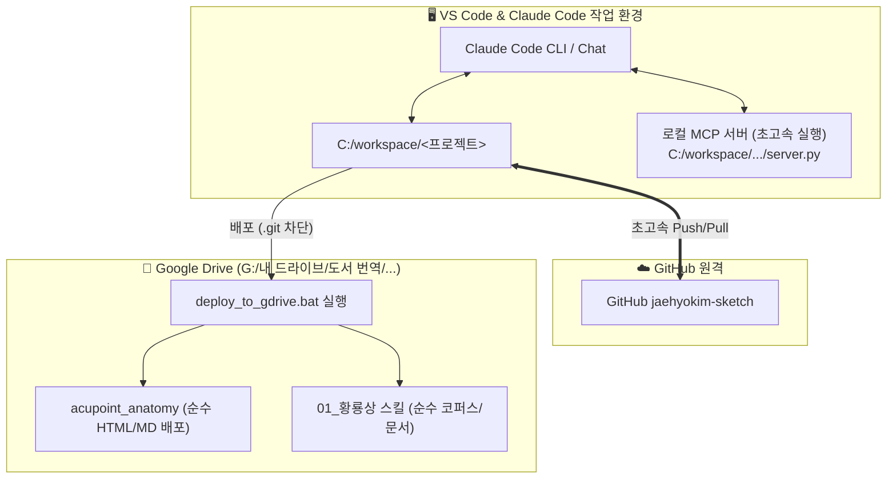

# 🛠️ VS Code & Claude Code 환경: [경혈해부]·[황룡상] Git 저장소 로컬 분리 연동 가이드

> **문서 버전**: v1.0 (2026-10-24 제정)  
> **적용 도구**: VS Code, Claude Code CLI, Claude Code Extension, Antigravity IDE  
> **대상 프로젝트**:  
> 1. `acupoint_anatomy` (경혈 해부생리학 실체 판명 스킬)  
> 2. `huanglongxiang-scholar` (황룡상 학술 고증 및 코퍼스 분석 스킬)  
> **목적**: 다른 PC에서도 구글 드라이브 동기화 충돌을 100% 차단하고, VS Code Claude Code에서 초고속 로컬 Git 저장소(`C:\workspace`)를 매끄럽게 연결하여 작업·커밋·배포할 수 있도록 설정.

---

## 1. 아키텍처 개요 및 핵심 원칙

VS Code와 Claude Code 환경에서 **「로컬 작업소(C:)」와 「구글 드라이브 전시장(G:)」**의 역할 분리는 다음과 같이 동작합니다:



### 💡 핵심 원칙
1. **코드 및 스크립트 실행은 로컬(`C:\workspace`)에서 수행**:  
   Git 커밋, Python 스크립트 실행, 대량 파일 생성 시 구글 드라이브의 잠금 에러(`Error 0x91`)와 휴지통 팝업 알림을 원천 방지합니다.
2. **MCP 서버도 로컬 SSD 경로를 우선 실행**:  
   Claude Code가 호출하는 `acupoint-anatomy` 및 `huanglongxiang-scholar` MCP 서버를 로컬 `C:\workspace\...`에서 실행시켜 응답 속도를 5~10배 향상시킵니다.
3. **최종 산출물은 드라이브로 배포**:  
   작업이 끝나면 `deploy_to_gdrive.bat`을 통해 구글 드라이브로 배포하여 스마트폰/태블릿 및 웹 포털 열람 환경을 유지합니다.

---

## 2. 다른 PC에서의 3단계 원클릭 설정

새로운 PC에서 VS Code와 Claude Code를 실행할 때 최초 1회만 설정합니다.

### [Step 1] 원클릭 로컬 분리 스크립트 실행
구글 드라이브 폴더 최상단에 있는 설정 스크립트를 더블클릭합니다:
* **실행 파일**: [G:\내 드라이브\도서 번역\setup_local_separation.bat](file:///G:/내%20드라이브/도서%20번역/setup_local_separation.bat)
* **동작 내용**:
  * `C:\workspace` 폴더 생성
  * GitHub에서 `acupoint_anatomy` 및 `huanglongxiang-scholar` 초고속 클론
  * Git 사용자(`jaehyokim`) 및 Windows 자격증명 자동 등록
  * 구글 드라이브 내 충돌 유발 `.git` 폴더 자동 정리

---

### [Step 2] VS Code MCP 서버 설정 (`.vscode/mcp.json`)

VS Code에서 로컬 고속 SSD의 MCP 서버를 직접 실행할 수 있도록 워크스페이스의 [`.vscode/mcp.json`](file:///G:/내%20드라이브/도서%20번역/.vscode/mcp.json)을 다음과 같이 설정합니다.  
(로컬 경로 `C:/workspace/...`를 우선 탐색하되, 환경에 맞게 자동 작동합니다):

```json
{
  "servers": {
    "kordoc": {
      "type": "stdio",
      "command": "npx.cmd",
      "args": ["-y", "kordoc", "mcp"]
    },
    "acupoint-anatomy": {
      "type": "stdio",
      "command": "C:/Python314/python.exe",
      "args": [
        "C:/workspace/acupoint_anatomy/mcp_server/server.py"
      ],
      "env": {
        "PYTHONIOENCODING": "utf-8"
      }
    },
    "huanglongxiang-scholar": {
      "type": "stdio",
      "command": "C:/Python314/python.exe",
      "args": [
        "C:/workspace/huanglongxiang-scholar/mcp_server/server.py",
        "--mode",
        "research"
      ],
      "env": {
        "PYTHONIOENCODING": "utf-8"
      }
    },
    "huanglongxiang-scholar-public": {
      "type": "stdio",
      "command": "C:/Python314/python.exe",
      "args": [
        "C:/workspace/huanglongxiang-scholar/mcp_server/server.py",
        "--mode",
        "public"
      ],
      "env": {
        "PYTHONIOENCODING": "utf-8"
      }
    }
  }
}
```

> **장점**: 구글 드라이브 경로(`g:/내 드라이브/...`) 대신 로컬 SSD 경로(`C:/workspace/...`)를 지정하면, Claude Code가 도구를 호출할 때 I/O 지연이 전혀 없고 파일 락 충돌이 발생하지 않습니다.

---

### [Step 3] Claude Code 전역 MCP 설정 (선택 사항)

만약 VS Code 외부의 독립 터미널에서 Claude Code CLI(`claude`)를 직접 사용하시는 경우,  
`~/.claude.json` 또는 `%APPDATA%\Claude\claude_desktop_config.json`에 동일하게 로컬 경로를 등록해 두시면 어떤 폴더에서 터미널을 열어도 두 스킬을 즉시 사용할 수 있습니다:

```bash
# Claude Code CLI에서 MCP 서버 등록 (최초 1회)
claude mcp add acupoint-anatomy C:/Python314/python.exe C:/workspace/acupoint_anatomy/mcp_server/server.py
claude mcp add huanglongxiang-scholar C:/Python314/python.exe C:/workspace/huanglongxiang-scholar/mcp_server/server.py --mode research
```

---

## 3. Claude Code 작업 워크플로우 (권장 방식 2가지)

### 📌 방식 A: 개별 프로젝트 로컬 창 열기 (가장 추천하는 모범 사례)
* **방법**: VS Code에서 `C:\workspace\acupoint_anatomy` 또는 `C:\workspace\huanglongxiang-scholar` 폴더를 직접 엽니다.
* **장점**:
  * 완벽한 로컬 Git 상태 표시(Source Control 패널, 브랜치, 커밋 그래프).
  * Claude Code가 해당 프로젝트의 전체 소스와 테스트 스크립트를 초고속으로 인덱싱.
  * 작업 종료 시:
    ```bash
    git add .
    git commit -m "feat: ..."
    git push origin main
    .\deploy_to_gdrive.bat   # 더블클릭 또는 터미널 실행 -> 구글 드라이브로 즉시 배포
    ```

---

### 📌 방식 B: 멀티루트 워크스페이스 (`.code-workspace`) 활용
두 프로젝트와 구글 드라이브 문서 폴더를 한 화면에서 동시에 보면서 작업하고 싶을 때 사용합니다.

1. VS Code 메뉴에서 **[파일] → [작업 영역을 다른 이름으로 저장...]** 선택.
2. `도서번역_통합작업.code-workspace` 파일 생성 후 아래와 같이 구성:

```json
{
  "folders": [
    {
      "name": "01. 도서 번역 (Google Drive 원문/배포)",
      "path": "G:/내 드라이브/도서 번역"
    },
    {
      "name": "02. 경혈해부 로컬작업소 (Git)",
      "path": "C:/workspace/acupoint_anatomy"
    },
    {
      "name": "03. 황룡상 로컬작업소 (Git)",
      "path": "C:/workspace/huanglongxiang-scholar"
    }
  ],
  "settings": {
    "terminal.integrated.defaultProfile.windows": "PowerShell"
  }
}
```

---

## 4. Claude Code 프롬프트 활용 가이드

VS Code 내 Claude Code 터미널에서 다음과 같이 명령하시면 Claude Code가 로컬 분리 구조를 스스로 인식하여 완벽하게 작업을 완수합니다:

### 1) 경혈 해부생리 보고서 작업 예시
> **프롬프트**:  
> `[경혈해부] ST36 족삼리 해부생리 보고서를 검토하고 영문본(_en.md, _en.html)에 번체자(繁體字) 병기를 확인해줘. 작업이 끝나면 C:\workspace\acupoint_anatomy에서 git commit & push하고 deploy_to_gdrive.py를 실행해서 구글 드라이브로 배포해줘.`

### 2) 황룡상 스킬 코퍼스 고증 작업 예시
> **프롬프트**:  
> `[황룡상] '사총혈' 구성원리에 대한 고증 분석을 수행해줘. C:\workspace\huanglongxiang-scholar 로컬 저장소를 기반으로 분석하고, 완료 후 GitHub 동기화 및 드라이브 배포까지 진행해줘.`

---

## 5. 트러블슈팅 및 점검 체크리스트

| 증상 | 원인 | 해결 방법 |
| :--- | :--- | :--- |
| **구글 드라이브에서 '항목이 휴지통으로 이동됨' 알림 발생** | 구글 드라이브 폴더(`G:\...`) 내부에 `.git` 폴더가 아직 남아있음 | PowerShell에서 `Remove-Item 'G:\내 드라이브\도서 번역\acupoint_anatomy\.git' -Force -Recurse` 실행 |
| **Claude Code MCP 호출 시 타임아웃/지연** | MCP 경로가 `g:/내 드라이브/...`로 설정되어 클라우드 네트워크 I/O 지연 발생 | `.vscode/mcp.json`의 경로를 `C:/workspace/...`로 변경 |
| **Git 푸시 시 인증 실패** | Windows 자격 증명 매니저 미등록 | `git config credential.helper manager` 실행 후 최초 1회 브라우저 로그인 |
| **구글 드라이브 웹에서 최신 보고서가 안 보임** | 로컬 작업 후 배포 스크립트 미실행 | 로컬 폴더에서 `deploy_to_gdrive.bat` 더블클릭 실행 |

---

> **연계 문서**:  
> • [Git_저장소_로컬_분리_설정_가이드.md](file:///G:/내%20드라이브/도서%20번역/Git_저장소_로컬_분리_설정_가이드.md) (전체 시스템 원리 및 FAQ)  
> • [.claude/CLAUDE.md](file:///G:/내%20드라이브/도서%20번역/.claude/CLAUDE.md) (Claude Code 프로젝트 공식 지침)
