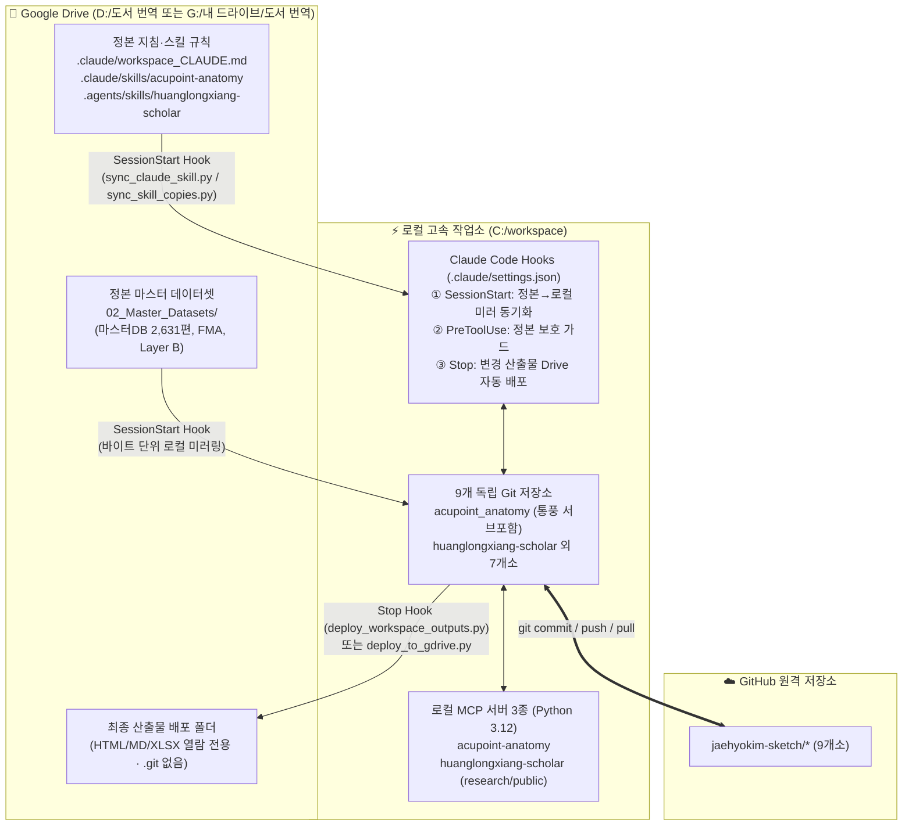

# 🛠️ VS Code & Claude Code 환경: Antigravity IDE 변경 내역 반영 및 로컬 분리 통합 지침서

> **문서 버전**: v1.4 (2026-10-24 제정 / 2026-10-29 전면 현행화)  
> **적용 도구**: VS Code, Claude Code CLI (`claude`), Claude Code VS Code Extension, Antigravity IDE  
> **기준 환경**: 편집 PC (`김재효연구실`, Google Drive = `D:\`) ⇄ 미러 PC (`GOYANGSOON`, Google Drive = `G:\내 드라이브`)  
> **대상 로컬 저장소 (`C:\workspace` 9개소 + 통합 서브 프로젝트 1개소)**:  
> 1. `acupoint_anatomy` ([경혈해부] 실체 판명 스킬 및 마스터 DB — 산하 `04_번역원고_및_임상매트릭스/통풍_침구치료지침_보고서` 서브 프로젝트 통합 포함)  
> 2. `huanglongxiang-scholar` ([황룡상] 학술 고증 및 코퍼스 분석 스킬)  
> 3. `amari-gl-dmn` (비평형열역학 및 정보기하학 논문 작업)  
> 4. `IPE-Report` (전문직간 교육 IPE 보고서)  
> 5. `km-healthcare-stats` (한의약 보건의료 통계분석 및 대시보드)  
> 6. `proxy-form-system` (위임장 자동 취합 시스템)  
> 7. `anatomy-act-reform-2026` (시체해부법 일부개정법률안 대응)  
> 8. `km-integrated-education` (통합한의학교육과정 개편)  
> 9. `anthropic-claude-integration` (Claude Assistant MCP 서버 및 서브에이전트 연동 도구)

---

## 0. [핵심 요약] 2026-10-29 기준 Antigravity IDE 수행·변경 내역 및 VS Code Claude Code 반영 현황

이 PC(`김재효연구실`, `C:\workspace`)의 Antigravity IDE에서 수행된 최신 변경 사항과, 이를 VS Code Claude Code에서 그대로 이어받아 작업하기 위한 핵심 반영 포인트는 다음과 같습니다.

### 📌 1) 아키텍처 및 폴더 구조 변경 내역
1. **전사적 9개 Git 저장소 로컬 분리 체제 확립 (`C:\workspace\<저장소>`)**  
   - 초기 2개(`acupoint_anatomy`, `huanglongxiang-scholar`)에서 총 **9개 프로젝트**로 로컬 Git 분리가 확대 완료되었습니다.
   - 구글 드라이브(`D:\` 또는 `G:\내 드라이브`) 내 모든 프로젝트 폴더에는 `.git` 디렉토리가 **0개**로 완전 제거되어 클라우드 파일 잠금(`Error 0x91`) 및 휴지통 알림 충돌이 원천 차단되어 있습니다.
2. **`통풍_침구치료지침_보고서`의 `acupoint_anatomy` 산하 서브 프로젝트 단일화 (2026-10-29)**  
   - 기존 `C:\workspace\통풍_침구치료지침_보고서` 루트 중복 폴더를 제거하고, **`C:\workspace\acupoint_anatomy\04_번역원고_및_임상매트릭스\통풍_침구치료지침_보고서\`** 하위로 완전 단일화했습니다(총 17개 파일, 1.38 MB, SHA-256 100% 일치 검증).
   - 이제 통풍 침구치료지침 보고서 수정 시 별도 배포 없이 `acupoint_anatomy`의 Git 커밋/푸시 및 `deploy_to_gdrive.py`로 일괄 관리·배포됩니다.
3. **Google Drive 정본 원칙 및 4대 자동화 Hook 체제 (`C:\workspace\.claude\settings.json`)**  
   - **정본 위치**: 스킬 규칙·지침(`workspace_CLAUDE.md` → `C:\workspace\CLAUDE.md`) 및 마스터 DB(`02_Master_Datasets`)의 정본은 **Google Drive(`D:\도서 번역`)** 입니다.
   - **자동 동기화 Hook**:
     - `SessionStart`: VS Code Claude Code 세션 시작 시 `sync_claude_skill.py` 및 `sync_skill_copies.py --apply`가 자동 실행되어 Drive 정본 규칙과 마스터 DB를 `C:\workspace` 로컬 미러로 단방향 동기화합니다.
     - `PreToolUse`: `drive_canonical_guard.py`가 실행되어 편집 PC(`김재효연구실`)에서는 정본 수정을 허용하고, 미러 PC(`GOYANGSOON`)에서는 정본/미러 임의 수정을 자동 차단합니다.
     - `Stop`: 매 응답 종료 시 `deploy_workspace_outputs.py`가 실행되어 변경된 저장소의 `deploy_to_gdrive.py`를 자동 호출하고 Google Drive 배포본을 최신화합니다(`Drive 쪽이 더 새로운 파일`은 `[DRIVE NEWER]`로 보호하여 덮어쓰지 않음).

### 📌 2) 학술 데이터베이스(Master DB v3.0) 및 보고서(SP06 v2.7.7) 최신 변경 내역
1. **생의학 신경반사 마스터 DB (`경혈_생의학_신경반사_마스터DB.json` / `.xlsx`) 업데이트**  
   - **통풍(Gout) 논문 72편**(`papers.id` `2607`~`2678`) 및 **삼음교(SP6) 실험·임상 논문 101편**(`papers.id` `2506`~`2606`) 전수 분석·병합 완료 → 전체 수록 논문 **2,631편** (`acupoint_inverted_index["SP6"]` 역색인 총 **172편**).
   - 정본(`D:\도서 번역\02_Master_Datasets\`) 및 로컬 미러(`C:\workspace\acupoint_anatomy\data\`) 양쪽 모두 최신 상태로 동기화되어 있습니다.
2. **SP06 삼음교 해부생리 실체판명 보고서 (한·영 `.md` 및 `.html` 4종) v2.7.7 정밀 고도화**  
   - 경로: `C:\workspace\acupoint_anatomy\01_경혈별_해부생리_분석보고서\SP_족태음비경\SP06_삼음교\`
   - 반영 내용:
     - 마스터 DB SP6 역색인 **172편 전수 대조**(직접 기전 입증 **36편** Table 8-① 수록 + 간접·중복·식물추출물 등 **136편** 배제 사유 명시).
     - 황룡상(黃龍祥)의 **‘일수다점 다모식 조공(一輸多點多模式調控)’** 다층 해부 기질 총괄 원리(천층 은백신경, 중층 경골골막·가자미근 근막, 심층 경골신경 간·후경골동맥 혈관주위신경총) 명시.
     - 샴 대조군(`非穴淺刺` vs 심층 `分刺法`) 설계 전제조건 및 **월경통 진통 기전과 임신 금침(`孕婦禁針`) 문헌사적(오문헌 『동인』 등)·생의학적 분리 검증** 반영.
     - 인용 검증(`verify_quotes.py` 불일치 `0건`) 및 원천 파일명/로컬 경로 비노출 검증(`0건`) 통과, Google Drive 배포 완료.

---

## 1. 아키텍처 개요 및 데이터 흐름도

VS Code Claude Code와 Antigravity IDE가 **`C:\workspace`(로컬 SSD 작업소)**와 **`D:\`(구글 드라이브 정본/전시장)**을 공유하는 구조는 다음과 같습니다.



---

## 2. VS Code Claude Code에서 즉시 반영·연동하는 방법 (Step-by-Step)

### [Step 1] VS Code에서 작업 폴더 여는 법 (중요)

VS Code Claude Code가 `C:\workspace\CLAUDE.md` 지침과 `C:\workspace\.claude\settings.json`의 **자동 동기화 Hook (`SessionStart`, `PreToolUse`, `Stop`)**을 100% 인식하도록 다음 중 하나로 엽니다.

1. **통합 워크스페이스 루트로 열기 (권장 — 모든 Hook 자동 작동)**:
   - VS Code 실행 → **[파일(File)] → [폴더 열기(Open Folder...)]** → **`C:\workspace`** 선택.
   - 이렇게 열면 새 Claude Code 대화를 시작할 때마다 `SessionStart` 훅이 자동으로 돌아 Drive 정본(`D:\도서 번역`)의 최신 스킬 규칙과 마스터 DB를 로컬(`C:\workspace`)에 맞춥니다.
2. **멀티루트 워크스페이스 파일로 열기**:
   - [`C:\workspace\도서번역_통합작업.code-workspace`](file:///C:/workspace/도서번역_통합작업.code-workspace) 더블클릭.
3. **개별 저장소 폴더로 열기 (`C:\workspace\acupoint_anatomy` 등)**:
   - 단일 프로젝트 Git 이력 관리에 유리합니다. 단, 개별 폴더에서 열었을 때는 세션 시작 전 아래 `[Step 2]`의 동기화 확인 명령을 1회 실행해 주거나 `C:\workspace` 루트에서 Claude Code를 실행하는 것이 가장 안전합니다.

---

### [Step 2] 스킬 규칙·지침·마스터 DB 동기화 상태 점검 명령

VS Code 터미널(PowerShell) 또는 Claude Code 창에서 아래 명령으로 Antigravity IDE에서 변경된 정본 규칙과 DB가 VS Code Claude Code 미러에 완벽히 반영되었는지 확인합니다:

```powershell
# 1. [경혈해부] 스킬 규칙·CLAUDE.md·마스터 DB(2,631편) 동기화 점검 및 즉시 반영
python "C:\workspace\acupoint_anatomy\scripts\sync_claude_skill.py"

# 2. [황룡상] 스킬 규칙 동기화 점검 및 즉시 반영
python "C:\workspace\huanglongxiang-scholar\scripts\sync_skill_copies.py" --apply
```

> **참고**: 지침서(`C:\workspace\CLAUDE.md`)나 스킬 본문을 수정할 때는 로컬 파일(`C:\workspace\CLAUDE.md`)을 직접 고치지 말고, 반드시 **편집 PC(`김재효연구실`)에서 Google Drive 정본(`D:\도서 번역\.claude\workspace_CLAUDE.md` 등)을 수정한 뒤 위 동기화 스크립트를 실행**하십시오. (로컬 미러를 직접 수정하면 다음 `SessionStart` 때 백업 후 Drive 정본으로 덮어써집니다.)

---

### [Step 3] MCP 서버 연결 확인 (`.vscode/mcp.json` 및 `~/.claude.json`)

이 PC(`김재효연구실`)의 Python 경로는 `C:/Users/meddo/AppData/Local/Programs/Python/Python312/python.exe`이며, 다음 두 곳에 모두 로컬 SSD 경로(`C:/workspace/...`)로 등록 완료되어 있습니다.

1. **Claude Code 사용자 전역 설정 (`C:\Users\meddo\.claude.json`)**:
   - `acupoint-anatomy` (동의보감 보조문헌 `D:/도서 번역/01_도서_번역_및_원전/동의보감` 연동 포함)
   - `huanglongxiang-scholar` (`--mode research`)
   - `huanglongxiang-scholar-public` (`--mode public`)
   - `kordoc`, `korean-law`, `korean-stats`, `korean-dart`
2. **VS Code 워크스페이스 설정 ([`C:\workspace\.vscode\mcp.json`](file:///C:/workspace/.vscode/mcp.json))**:
   - VS Code 내장 MCP 클라이언트가 `C:/Python314`(미설치 경로)를 찾지 않도록 `Python312` 절대경로 및 `D:/도서 번역` 경로로 현행화 완료했습니다.

만약 다른 PC에서 새로 설정하거나 Python 경로가 바뀌었을 때는 하드코딩된 JSON을 수동 편집할 필요 없이 아래 자동 등록 스크립트를 실행하면 현재 PC의 `sys.executable`과 `ACUPOINT_DRIVE_ROOT`를 자동 감지하여 등록합니다:

```powershell
# [경혈해부] MCP 서버 자동 등록 (Claude Code 사용자 범위)
python "C:\workspace\acupoint_anatomy\scripts\register_mcp.py"

# [황룡상] MCP 서버 2종(연구/공개) 자동 등록 (Claude Code + Antigravity 동시 갱신)
python "C:\workspace\huanglongxiang-scholar\deploy\register_mcp.py"
```

---

### [Step 4] 현재 `C:\workspace\acupoint_anatomy` Git 상태 및 커밋 가이드

Antigravity IDE에서 오늘(2026-10-29) 완료한 SP06 삼음교 보고서 고도화 및 마스터 DB 갱신 내역은 현재 `C:\workspace\acupoint_anatomy` 워킹 트리에 반영되어 있으며(Google Drive 배포는 이미 완료됨), Git 커밋 대기 상태인 파일은 다음과 같습니다:

| 구분 | 경로 (`C:\workspace\acupoint_anatomy\` 기준) | 변경 내용 요약 |
| :--- | :--- | :--- |
| **Modified** | `01_경혈별_해부생리_분석보고서/SP_족태음비경/SP06_삼음교/SP06_삼음교_해부생리_실체판명_보고서.md` (외 `_en.md`, `.html`, `_en.html` 총 4종) | SP6 논문 172편 전수 대조, 황룡상 다층 기질 원리, 샴 대조군 기준 및 임신 금침 문헌/생의학 분리 반영 (v2.7.7) |
| **Modified** | `data/경혈_생의학_신경반사_마스터DB.json` 및 `.xlsx` | 통풍 72편 + SP6 101편 추가 병합 (총 2,631편, SP6 역색인 172편) |
| **Modified** | `docs/Git_저장소_로컬_분리_설정_가이드.md` 및 `docs/VSCode_ClaudeCode_Git_로컬분리_설정가이드.md` | 9개 로컬 저장소 체제, `통풍_침구치료지침_보고서` 서브 통합, v1.4 현행화 |
| **Untracked** | `data/Anatomy image DB/`, `data/biomedical_reflex_master.db` | 로컬 해부학 이미지 폴더 및 SQLite 캐시 DB (대용량/캐시 여부에 따라 `.gitignore` 추가 또는 선택적 관리) |

VS Code Claude Code에서 이를 커밋·푸시할 때는 다음 명령(또는 아래 3절의 프롬프트)을 사용하십시오:

```powershell
cd C:\workspace\acupoint_anatomy
git add 01_경혈별_해부생리_분석보고서/SP_족태음비경/SP06_삼음교/ data/경혈_생의학_신경반사_마스터DB.* docs/
git commit -m "feat(SP06,db): SP06 삼음교 172편 전수 대조 고도화(v2.7.7) 및 로컬 분리 가이드 v1.4 현행화"
git push origin main
```

---

## 3. VS Code Claude Code 첫 실행 시 복사해 붙여넣을 프롬프트

VS Code에서 Claude Code 패널을 열고 아래 프롬프트를 그대로 붙여넣으시면, Claude Code가 Antigravity IDE에서 변경된 모든 사항을 즉시 파악하고 동기화·검증을 수행합니다:

```text
현재 C:\workspace에서 Antigravity IDE를 통해 다음 작업들이 완료·변경되었어.
1. 9개 Git 저장소 로컬 분리 체제 확립 및 D:\(구글 드라이브) 내 .git 폴더 완전 제거 확인
2. C:\workspace\통풍_침구치료지침_보고서를 C:\workspace\acupoint_anatomy\04_번역원고_및_임상매트릭스\통풍_침구치료지침_보고서 산하 서브 디렉토리로 단일화
3. 경혈_생의학_신경반사_마스터DB(JSON/XLSX) 2,631편(통풍 72편 + SP6 101편 추가, SP6 역색인 172편) 업데이트 및 SP06_삼음교 한·영 보고서(.md/.html 4종) v2.7.7 정밀 고도화 완료
4. Git_저장소_로컬_분리_설정_가이드.md 및 VSCode_ClaudeCode_Git_로컬분리_설정가이드.md v1.4 현행화 완료

다음 3가지를 순서대로 확인하고 보고해줘:
1) `python C:\workspace\acupoint_anatomy\scripts\sync_claude_skill.py --check` 및 `python C:\workspace\huanglongxiang-scholar\scripts\sync_skill_copies.py --check`를 실행해 Drive 정본과 로컬 미러 간 차이가 0건인지 확인
2) `acupoint-anatomy` 및 `huanglongxiang-scholar` MCP 도구가 정상 응답하는지 확인
3) `C:\workspace\acupoint_anatomy`와 `C:\workspace\huanglongxiang-scholar`의 `git status -s` 상태를 점검해 커밋할 대상 파일 목록을 정리해줘.
```

---

## 4. 9개 로컬 저장소 ↔ Google Drive 배포 경로 일람표

VS Code Claude Code에서 어느 저장소를 작업하든 **Stop Hook(`deploy_workspace_outputs.py`)** 또는 각 폴더의 `python deploy_to_gdrive.py`가 아래 매핑에 따라 Google Drive(`D:\` 또는 `G:\내 드라이브`)로 자동 배포합니다.

| 번호 | 로컬 Git 작업소 (`C:\workspace\<폴더>`) | Google Drive 배포 경로 (`D:\` 또는 `G:\내 드라이브\`) | 비고 |
| :---: | :--- | :--- | :--- |
| **1** | `C:\workspace\acupoint_anatomy` | `D:\도서 번역\acupoint_anatomy` | `04_번역원고_및_임상매트릭스\통풍_침구치료지침_보고서` 포함 |
| **2** | `C:\workspace\huanglongxiang-scholar` | `D:\도서 번역\01_황룡상 스킬` | 황룡상 도서·논문 코퍼스 및 Q&A/Reports |
| **3** | `C:\workspace\amari-gl-dmn` | `D:\논문작업\비평형열역학` | 지침 파일은 Drive 정본 유지 |
| **4** | `C:\workspace\IPE-Report` | `D:\원광대 한의대\교육과정개편\전문직간교육(IPE)` | IPE 보고서 및 참고문헌 |
| **5** | `C:\workspace\km-healthcare-stats` | `D:\통계분석\한의약의료이용` | GitHub Pages 대시보드 배포 병행 |
| **6** | `C:\workspace\proxy-form-system` | `D:\한의학회\위임장 취합` | Apps Script + 프론트엔드 |
| **7** | `C:\workspace\anatomy-act-reform-2026` | `D:\한의학회\시체해부법 개정안 대응_2026` | 법안 비교 및 전략 보고서 |
| **8** | `C:\workspace\km-integrated-education` | `D:\원광대 한의대\통합한의학교육` | 교육과정 개편 문서 |
| **9** | `C:\workspace\anthropic-claude-integration` | `D:\anthropic-claude-integration` | `.venv` 제외 후 소스/스크립트만 배포 |

---

## 5. 트러블슈팅 및 주의사항

| 증상 / 상황 | 원인 | 해결 방법 |
| :--- | :--- | :--- |
| **`C:\workspace\CLAUDE.md`를 수정했는데 다음 세션에서 원래대로 돌아감** | `SessionStart` 훅이 Drive 정본(`D:\도서 번역\.claude\workspace_CLAUDE.md`)으로 로컬 미러를 덮어씀 | 반드시 정본인 [`D:\도서 번역\.claude\workspace_CLAUDE.md`](file:///D:/도서%20번역/.claude/workspace_CLAUDE.md)를 수정한 뒤 `python C:\workspace\acupoint_anatomy\scripts\sync_claude_skill.py` 실행 |
| **Stop Hook 실행 시 `[DRIVE NEWER]` 알림 출력** | Google Drive 쪽 파일의 수정 시각이 로컬 파일보다 더 최신이어서 역방향 덮어쓰기를 방지함 | Drive에서 직접 수정한 파일이라면 로컬로 가져오고, 로컬 파일이 맞다면 확인 후 수동 반영 |
| **VS Code에서 MCP 서버 시작 실패 (`C:/Python314/python.exe` 없음)** | 다른 PC(`GOYANGSOON`) 기준 Python 경로가 적힌 `.vscode/mcp.json`을 참조함 | [`C:\workspace\.vscode\mcp.json`](file:///C:/workspace/.vscode/mcp.json) 사용 또는 `register_mcp.py` 재실행 |
| **Antigravity IDE에서 `datacloud_telemetry` PreToolUse Hook 에러 발생** | `hooks.json` 내 경로 이중 따옴표(`\"C:\...\"`) 이스케이프 버그 | `C:\Users\meddo\.gemini\config\plugins\googlecloudtools.datacloud_telemetry\hooks.json`에서 내부 `\"` 제거 및 읽기 전용(`IsReadOnly = $true`) 잠금 유지 (2026-10-29 조치 완료) |

---

> **연계 문서**:  
> - [`D:\Git_저장소_로컬_분리_설정_가이드.md`](file:///D:/Git_저장소_로컬_분리_설정_가이드.md) (전체 9개 저장소 아키텍처 및 원클릭 구축 가이드 v1.4)  
> - [`C:\workspace\acupoint_anatomy\docs\스킬규칙_Drive정본_PC설정_가이드.md`](file:///C:/workspace/acupoint_anatomy/docs/스킬규칙_Drive정본_PC설정_가이드.md) (편집 PC ⇄ Drive 정본 → 미러 PC 동기화 정책 상세)  
> - [`C:\workspace\CLAUDE.md`](file:///C:/workspace/CLAUDE.md) (Claude Code 워크스페이스 공식 지침)
