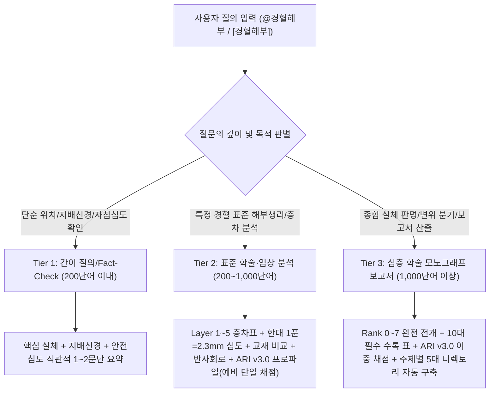
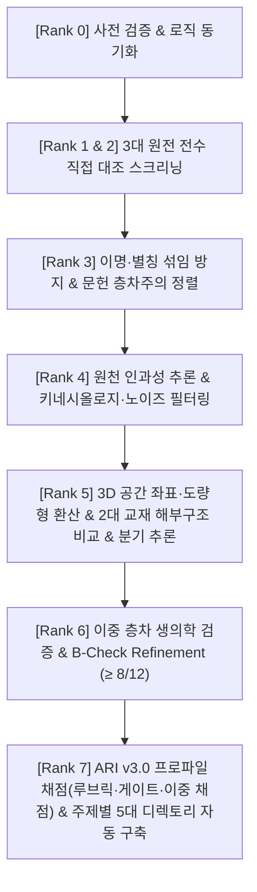

# 경혈 해부학적 실체 판명 로직 체계 (Acupoint Substrate Identification Logic Framework)

> **공식 버전**: Version 2.7 (2026-10-04 개정) — 본 문서가 로직의 **정본**이며, `.agents/skills/acupoint-anatomy/references/` 사본과 마스터 원칙 xlsx가 본 문서와 다르면 본 문서를 우선한다.
> **v2.7 개정 요지**: ① Rank 7 ARI v3.0(ARI-Core 3요인 + 안전지수 SI, 5단계 루브릭, 비보상형 게이트, 이중 채점) ② Rank 6 Layer A 통합 DB v3.0(공용 동기화 스크립트, 필수 외부 실증 검색) ③ Rank 6 Layer B 4계층 참조 등록부와 B-Check 6항목 채점(종전 67% 기준 승계) ④ 보고서 필수 요소 8·10항 갱신. 상세는 6절 문서 이력.
> **마스터 근거 원칙 문서**: [`경혈의 해부학적 실체를 판명하기 위한 로직(logic) 원칙.xlsx`](file:///g:/내%20드라이브/도서%20번역/02_Master_Datasets/%EA%B2%BD%ED%98%88%EC%9D%98%20%ED%95%B4%EB%B6%80%ED%95%99%EC%A0%81%20%EC%8B%A4%EC%B2%B4%EB%A5%BC%20%ED%8C%90%EB%AA%85%ED%95%98%EA%B8%B0%20%EC%9C%84%ED%95%9C%20%EB%A1%9C%EC%A7%81%28logic%29%20%EC%9B%90%EC%B9%99.xlsx) (Version 2.7 마스터 준거 완료: ARI v3.0 산출식 및 B-Check 6항목 전면 동기화)
> **보조 문서**: 통합 DB 동기화 설계·구현 기록 [`biomedical_master_db_sync_design.md`](file:///g:/내%20드라이브/도서%20번역/01_Framework/biomedical_master_db_sync_design.md) · Layer B 참조 등록부 [`layer_b_reference_registry.md`](file:///g:/내%20드라이브/도서%20번역/01_Framework/layer_b_reference_registry.md)(기계용 [`layer_b_reference_registry.json`](file:///g:/내%20드라이브/도서%20번역/02_Master_Datasets/layer_b_reference_registry.json)) · 공용 동기화 스크립트 [`.agents/skills/acupoint-anatomy/scripts/sync_master_db.py`](file:///g:/내%20드라이브/도서%20번역/.agents/skills/acupoint-anatomy/scripts/sync_master_db.py)
> **기준 마스터 데이터셋 (7대 핵심 데이터셋)**:
> 1. [`361_Acupoints_Refined_Master_DB_v2.csv`](file:///g:/내%20드라이브/도서%20번역/02_Master_Datasets/361_Acupoints_Refined_Master_DB_v2.csv) (361개 표준 경혈 정제 마스터)
> 2. [`경혈명_비교_정리_KJH.xlsx`](file:///g:/내%20드라이브/도서%20번역/02_Master_Datasets/%EA%B2%BD%ED%98%88%EB%AA%85_%EB%B9%84%EA%B5%90_%EC%A0%95%EB%A6%AC_KJH.xlsx) (이명·별칭 검증 대조 DB)
> 3. [`침구문헌별 자침깊이 정리_AI 분석용.xlsx`](file:///g:/내%20드라이브/도서%20번역/02_Master_Datasets/%EC%B9%A8%EA%B5%AC%EB%AC%B8%ED%97%8C%EB%B3%84%20%EC%9E%90%EC%B9%A8%EA%B9%8A%EC%9D%B4%20%EC%A0%95%EB%A6%AC_AI%20%EB%B6%84%EC%84%9D%EC%9A%A9.xlsx) / [`.gsheet`](file:///g:/내%20드라이브/도서%20번역/02_Master_Datasets/%EC%B9%A8%EA%B5%AC%EB%AC%B8%ED%97%8C%EB%B3%84%20%EC%9E%90%EC%B9%A8%EA%B9%8A%EC%9D%B4%20%EC%A0%95%EB%A6%AC_AI%20%EB%B6%84%EC%84%9D%EC%9A%A9.gsheet) (문헌별 자침법·심도 DB)
> 4. [`경혈학공통교재 경혈_해부구조_데이터셋_refine.xlsx`](file:///g:/내%20드라이브/도서%20번역/02_Master_Datasets/%EA%B2%BD%ED%98%88%ED%95%99%EA%B3%B5%ED%86%B5%EA%B5%90%EC%9E%AC%20%EA%B2%BD%ED%98%88_%ED%95%B4%EB%B6%80%EA%B5%AC%EC%A1%B0_%EB%8D%B0%EC%9D%B4%ED%84%B0%EC%85%8B_refine.xlsx) (공통교재 표준 해부구조 데이터셋)
> 5. [`김재효 수업_경혈_해부구조_데이터셋.xlsx`](file:///g:/내%20드라이브/도서%20번역/02_Master_Datasets/%EA%B9%80%EC%9E%AC%ED%9A%A8%20%EC%88%98%EC%97%85_%EA%B2%BD%ED%98%88_%ED%95%B4%EB%B6%80%EA%B5%AC%EC%A1%B0_%EB%8D%B0%EC%9D%B4%ED%84%B0%EC%85%8B.xlsx) (김재효 교수 경혈 해부구조 정밀 데이터셋)
> 6. [`경혈_생의학_신경반사_마스터DB.json`](file:///g:/내%20드라이브/도서%20번역/02_Master_Datasets/%EA%B2%BD%ED%98%88_%EC%83%9D%EC%9D%98%ED%95%99_%EC%8B%A0%EA%B2%BD%EB%B0%98%EC%82%AC_%EB%A7%88%EC%8A%A4%ED%84%B0DB.json) & [`.xlsx`](file:///g:/내%20드라이브/도서%20번역/02_Master_Datasets/%EA%B2%BD%ED%98%88_%EC%83%9D%EC%9D%98%ED%95%99_%EC%8B%A0%EA%B2%BD%EB%B0%98%EC%82%AC_%EB%A7%88%EC%8A%A4%ED%84%B0DB.xlsx) (통합 생의학 신경반사 & 로컬 논문 전수 역색인 실증 마스터 DB: 국제 랜드마크 PMID/DOI + 로컬 논문 전수 역색인 + 외부 API 수집 논문을 단일 `papers` 레지스트리와 5개 시트로 통합, 건수는 `_metadata.counts`에서 매 동기화마다 재계산)
> 7. [`中国针灸穴位通鉴 분석데이터셋`](file:///g:/내%20드라이브/도서%20번역/02_Master_Datasets/%E4%B8%AD%E5%9B%BD%E9%92%88%E7%81%B8%E7%A9%B4%E4%BD%8D%E9%80%9A%E9%89%B4%20%EB%B6%84%EC%84%9D%EB%8D%B0%EC%9D%B4%ED%84%B0%EC%85%8B) (《中国针灸穴位通鉴》 기반 12종 특화 분석 데이터셋: 361표준경혈 정제마스터, 24경혈쌍 주치증 임상공통점·혼용분석, 동일별명 공유경혈 목록 등)

---

## 🏛️ 1. 핵심 목적 및 3대 원전 데이터 소스

본 로직 체계는 전통 침구 문헌의 경혈(腧穴)을 관념적·사변적 설명에 머무르지 않고, **핵심 3대 원전 직접 대조**, **2대 공인 해부구조 교재(공통교재 vs 김재효 교재) 비교**, **로컬·외부 생의학 학술 DB 연동(Layer A)**, **4계층 참조 등록부와의 B-Check 대조(Layer B)**를 통해 **체표 하부의 실제 해부학적 구조물(Substrates)**과 **현대 생의학적 반사 기전(Somato-visceral / Somato-autonomic Reflex)**을 정밀 규명하고, 그 신뢰도를 **ARI v3.0 프로파일**로 정량화한다.

### 📚 핵심 3대 원전 매핑 및 권별 정제 데이터 검색 경로

| 원전 도서명 (원제) | 정제 원전문헌 디렉토리 | 편별 파일 구성 및 규모 | 주요 역할 및 문헌별 특성 |
| :--- | :--- | :--- | :--- |
| **《中国针灸穴位通鉴》** | [`01_도서_번역_및_원전/중국침구혈위통감(中国针灸穴位通鉴)`](file:///g:/내%20드라이브/도서%20번역/01_도서_번역_및_원전/중국침구혈위통감(中国针灸穴位通鉴)) | 총론·14경맥·경외혈·부편 41개 `.md` 파일 | 개별 경혈의 위치, 취혈 체위, 해부학적 구조 및 시대 순서에 따른 정위 변천사 종합. 해당 경맥 파일 직접 대조 및 디렉토리 검색. (파생 분석데이터셋 12종은 `02_Master_Datasets/中国针灸穴位通鉴 분석데이터셋/`으로 이관 관리) |
| **《中国针灸证治通鉴》** | [`01_도서_번역_및_원전/중국침구증치통감(中国针灸证治通鉴)`](file:///g:/내%20드라이브/도서%20번역/01_도서_번역_및_원전/중국침구증치통감(中国针灸证治通鉴)) | 총 30편 원문 및 한글번역 62개 `.md` 파일 | 병증·징후·선혈·배오 기재 전수 추출, 처방 전체 효과와 경혈 자체 고유 효능($P_{single}$) 분리. |
| **《针灸腧穴通考》** | [`01_도서_번역_및_원전/침구수혈통고(针灸腧穴通考)`](file:///g:/내%20드라이브/도서%20번역/01_도서_번역_및_원전/침구수혈통고(针灸腧穴通考)) | 상·하권 총론 및 경맥별 25개 `.md` 파일 | 역대 침구 문헌의 전사 착오, 취혈 체위 왜곡, 이명 변천을 황룡상 교수의 출토문헌 실증주의에 기반하여 비판·교감. |

---

## 🎚️ 2. 질문 수준/깊이별 응답 계층 체계 (Tiered Inquiry Architecture)

질문의 수준과 목적에 따라 검증 범위와 보고서 형식을 3단계로 차등화한다.



### [Tier 1] 간이 사실 질의 (Quick Fact-Check, 200단어 이내)
- **적용 대상**: 특정 경혈의 기본 위치, 주요 지배 신경, 표재 혈관, 안전 자침 깊이 등 단순 사실 확인 질의.
- **답변 원칙**:
  - 분량: **200단어 이내**의 직관적 요약.
  - 단계별 프로토콜 전개를 생략하고, **핵심 결론(해부학적 실체, 표준 정위, 지배신경, 안전 자침 심도)을 1~2문단으로 제시**.
  - 근거가 되는 핵심 해부 랜드마크 및 자침 주의사항 1~2행 명시.

### [Tier 2] 표준 학술·임상 해부생리 분석 (Standard Anatomical Evaluation, 200~1,000단어)
- **적용 대상**: 특정 경혈의 층차별 구조, 근육·신경·혈관 주행로, 고전 주치와 신경반사 기전 연계, 안전성 평가 등 표준 학술 질의.
- **답변 원칙**:
  - 분량: **200단어 ~ 1,000단어**의 표준 학술 보고서 포맷.
  - **Layer 1~5 정밀 층차 분석 표** 수록.
  - 한대(漢代) 기준 **1푼 = 2.3mm 환산 자침 심도**($z = \text{푼} \times 2.3\text{mm}$) 명시.
  - **공통교재 vs 김재효 교재 해부구조 비교** 요약 제시.
  - **체성-내장/자율신경 반사 회로(Somato-autonomic reflex)** 핵심 기전 기술. Rank 6-3의 필수 외부 실증 검색을 수행한다.
  - **ARI v3.0 프로파일**(ARI-Core + SI) 요약 제시. Tier 2는 단일 채점이므로 **예비(Preliminary)** 표지를 붙이며, 이중 채점·민감도 분석은 Tier 3에서 수행한다.

### [Tier 3] 심층 학술 모노그래프 & 종합 실체 보고서 (In-Depth Monograph & Full Report, 1,000단어 이상)
- **적용 대상**: 경혈의 해부생리학적 실체 전면 규명, 고전 원전점 vs 현대 WHO점 공간 변위 분기 추론($\Delta > 15\text{mm}$), 3대 원전 전수 문헌 스크리닝 및 이명 교감, 복합 처방 배오 주치 분리, 공통교재/김재효 교재 비교 대조, 논문 원고 및 종합 보고서 작성 요청.
- **답변 원칙**:
  - 분량: **1,000단어 이상의 체계적 종합 학술 보고서**.
  - **Rank 0 ~ 7 통합 표준 분석 프로토콜 100% 완전 전개**.
  - 3대 원전 전수 사료 편년체 대조표 수록.
  - 필요 시 **공간 변위 분기 추론(Dual-Target Bifurcation: Target 1 vs Target 2)** 독립 비교 분석 수록.
  - **경혈학 공통교재 vs 김재효 교재 해부구조 전수 비교·대조 분석 및 도식 표기**.
  - **Layer A(실측 논문, `papers.id` 인용) + Layer B(4계층 참조 등록부 B1~B4)** 대조와 **B-Check 6항목 채점(≥ 8/12 = 67%)** 상세 기술, 외부 API 검색 로그 표 수록.
  - **ARI v3.0 이중 채점**(평균 ± 반범위, 등가중치 민감도, 게이트·표지) 수록.
  - **필수 10대 구성 요소 전수 수록**(5절).
  - 주제 및 내용에 따라 **[`acupoint_anatomy`](file:///g:/내%20드라이브/도서%20번역/acupoint_anatomy)** 하위 전용 디렉토리에 **엑셀 DB(.xlsx), 마크다운(.md), HTML 웹리포트(.html)** 3종 세트 동시 구축.

---

## 🎯 3. 작업 순위(Rank 0~7) 기반 통합 표준 분석 프로토콜

Tier 2 및 Tier 3 질의 시 아래 8단계 절차를 준수하여 분석을 전개한다.



### [Rank 0] 사전 검증 및 로직 동기화 (Pre-Analysis Synchronization)
- 모든 경혈 분석 시작 전 [`경혈의 해부학적 실체를 판명하기 위한 로직(logic) 원칙.xlsx`](file:///g:/내%20드라이브/도서%20번역/02_Master_Datasets/%EA%B2%BD%ED%98%88%EC%9D%98%20%ED%95%B4%EB%B6%80%ED%95%99%EC%A0%81%20%EC%8B%A4%EC%B2%B4%EB%A5%BC%20%ED%8C%90%EB%AA%85%ED%95%98%EA%B8%B0%20%EC%9C%84%ED%95%9C%20%EB%A1%9C%EC%A7%81%28logic%29%20%EC%9B%90%EC%B9%99.xlsx)의 최신 변경 내역을 확인한다. 원칙 xlsx와 본 문서가 다르면 **본 문서(v2.7)를 우선**하고, 차이를 보고서 감사 기록과 6절 문서 이력에 남긴다.
- 본 문서를 편집기에서 열어 둔 채 다른 도구가 갱신한 경우 **저장 전 디스크 버전을 다시 불러온다**(옛 버퍼 저장으로 최신본이 덮어써지는 사고 방지).
- **두 IDE 간 스킬 설정 동기화**: 분석 시작 시 `python .agents/skills/acupoint-anatomy/scripts/sync_skill_settings.py --check`로 프레임워크·참조 등록부·설계 문서·양쪽 스킬 파일(`.agents/skills/acupoint-anatomy/SKILL.md`, `.claude/skills/acupoint-anatomy/SKILL.md`)·라우팅 규칙의 변경 여부와 구판 표현 잔존을 점검하고, `--apply`로 `.agents/.../references/` 사본과 버전 표기를 본 문서에 맞춘다. 상대 IDE에서 추가된 규칙은 본 문서와 충돌하지 않는 한 그대로 적용하고, 충돌 시 본 문서를 우선하며 점검 보고에 남긴다.
- **다른 PC에서의 사용**: 모든 경로는 프로젝트 루트 기준 상대경로로 해석한다(드라이브 문자 무관). 첫 사용 시 `python .agents/skills/acupoint-anatomy/scripts/check_environment.py`로 Python·패키지·논문 폴더·환경변수·주간 배치 등록 여부를 점검한다.

### [Rank 1 & 2] 핵심 3대 원전 직접 대조 및 스크리닝 (Textual Screening)
- **분석 범위**: 《中国针灸穴位通鉴》, 《中国针灸证治通鉴》, 《针灸腧穴通考》 3대 문헌별 원문과 파싱 데이터를 직접 대조하여 원문 텍스트 정합성을 엄격히 확보.
- **파싱 데이터 검색 절차**:
  - 《穴位通鉴》: `01_도서_번역_및_원전/중국침구혈위통감(中国针灸穴位通鉴)` 내 해당 경맥 파일(예: `中国针灸穴位通鉴_31_足太阴脾经(1).md`) 및 디렉토리 전수 검색.
  - 《证治通鉴》: `01_도서_번역_및_원전/중국침구증치통감(中国针灸证治通鉴)` 내 해당 경맥 편(예: `中国针灸证治通鉴_05_第壹编_第七篇_足太阴脾经...md`) 및 내·외과 병증 편 검색.
  - 《腧穴通考》: `01_도서_번역_및_원전/침구수혈통고(针灸腧穴通考)` 내 해당 경맥 파일(예: `针灸腧穴通考_09_上_足太阴脾经穴.md`) 및 총론 편 검색.
- **문헌별 역할 분담**:
  - 《穴位通鉴》: 표면 지표, 촉진 감각, 시대별 정위 변화 데이터 추출.
  - 《证治通鉴》: 주치증, 병증 징후, 단독 선혈, 복합 배오 처방 전수 추출.
  - 《腧穴通考》: 역대 의서 전사 오류, 취혈 체위 오류, 이명 혼동을 교정하는 최종 교감 준거로 활용.

### [Rank 3] 이명·별칭 섞임 방지 및 문헌 층차 정렬 (Alias Disambiguation & Stratification)
- **경혈 섞임 방지 대책**: [`경혈명_비교_정리_KJH.xlsx`](file:///g:/내%20드라이브/도서%20번역/02_Master_Datasets/%EA%B2%BD%ED%98%88%EB%AA%85_%EB%B9%84%EA%B5%90_%EC%A0%95%EB%A6%AC_KJH.xlsx)와 3대 원전을 대조하여 명칭으로 인한 경혈 정보 섞임 가능성이 높은 경우, 경혈의 명칭 또는 별칭(이명, 일명)을 문헌 연대순으로 재정렬하고 명칭 유사성으로 인해 발생한 혼용 정보(위치, 해부학 구조, 주치 관련)를 엄격히 분리하여 분석하고 기술한다.
- **문헌 층차주의 편년체 정렬**: 선진·한대 ➔ 위진·수당 ➔ 송·금·원 ➔ 명·청 ➔ 현대 5개 시기로 정렬하여 정보의 누적, 전이, 주석 혼입을 추적.
- **원문/해석 구분 원칙**: 처음으로 기술된 내용(원천 자료)과 재인용·주석·해석된 기술(간접 자료)을 분리하고, 처음으로 기술된 내용을 최우선 근거로, 재인용·주석은 보조 근거로 취급.
- **단독 효능과 배오 분리**: 개별 경혈의 주치가 처방 전체의 선택·배합에서 파생된 경우, 경혈 자체 고유 효능($P_{single}$)과 처방 전체 효과를 엄격히 분리해 평가.

### [Rank 4] 원천 인과성 추론 및 임상 바이어스·노이즈 필터링 (Inference & Noise Filtering)
- **시대적 변천 반영**: 경혈학 및 침구의학이 시대에 따라 축적·변화된 역사적 학문 체계임을 고려하여 분석.
- **인과성 vs 상관성 구분**: 최초 기술(Description)을 기준으로 인과성을 최우선 평가하며 단순 상관성은 후순위로 평가.
- **필사 오류 훈고학적 감별**: 동아시아 전통사회의 필사 문화에서는 원본과 주석이 구분되지 않고 원천 기술에 혼입되는 사례가 빈번하므로 《针灸腧穴通考》를 근거로 감별·교정.
- **배오 주치 전이 배제**: 개별 경혈의 주치가 침구치료 배오(선혈, 배혈) 복합 처방에서 파생된 경우는 후순위로 평가.
- **병증 통합 왜곡(Bias) 방지**: 개별 주치증이 동일 상병에 포함되지 않는 경우 주치증에 따른 위치와 구조 패턴 차이를 분석에 고려하며, 경혈 중심으로 병증을 통합시켜 해석하는 편향(Bias)을 엄격히 제한.
- **환각 및 노이즈 제거**: 원주 혼입, 음양오행 사변적 조작, 도가(道家)적 과장, 경락론적 과잉 확장, 현상과 경험에 기반하지 않는 설명을 배제하고, 해부생리학·병태생리학 수준에서 검증 가능한 기술만 강조 표기.
- **동태적 키네시올로지(Kinesiology) 반영**: 인체의 자세·운동에 따른 동태적 변동성을 반영하여 3D 구조의 해부학적 후보군 범위를 설정.

### [Rank 5] 3D 공간 좌표·도량형 환산, 공간 변위 분기 추론 및 2대 교재 해부구조 비교 (3D Spatial, Textbooks Comparison & Bifurcation)
- **자침 깊이 기준 데이터셋**: [`침구문헌별 자침깊이 정리_AI 분석용.xlsx`](file:///g:/내%20드라이브/도서%20번역/02_Master_Datasets/%EC%B9%A8%EA%B5%AC%EB%AC%B8%ED%97%8C%EB%B3%84%20%EC%9E%90%EC%B9%A8%EA%B9%8A%EC%9D%B4%20%EC%A0%95%EB%A6%AC_AI%20%EB%B6%84%EC%84%9D%EC%9A%A9.xlsx) (또는 `.gsheet`).
- **자침 깊이 값 해석 규칙**:
  - `'0'` 값 = **금침(禁鍼)** ➔ Rank 7 SI 루브릭 0점 조건
  - `'blank'` = **기술하지 않음** ➔ SI 채점에서 결측 처리(금침과 구분하여 문헌 출처 명시)
  - **정수값** = **푼(分)**으로 해석.
- **도량형 환산 공식**: 한대(漢代) 기준 **1푼 = 2.3mm** ($z = \text{푼} \times 2.3\text{mm}$) 정량 환산 및 비례 골도법 병행.
- **촉진 표현 실체화**: "動脈中", "陷中", "脈中", "前緣", "兩筋間", "骨隙", "窩" 등을 실제 체표 해부 구조로 간주하고 동맥 박동, 근육, 근막, 신경, 혈관, 골막 구조와 직접 연결해 해석.
- **3D 공간 좌표계**:
  - **X축 (내외측)**: midline을 기준으로 medial to lateral
  - **Y축 (근위원위)**: cephalic to caudal (장축 방향)
  - **Z축 (깊이)**: 체표면으로부터의 심도 (mm)
- **Layer 1~5 층차 안전성 평가**:
  - **Layer 1 (피부·피하)**: 표재 감각신경, 피정맥 (체표 수용기 자극, Safe)
  - **Layer 2 (표층근육·근막)**: 표층 근막, 근복 (근막 발통점 MTrP 이완, Safe)
  - **Layer 3 (심층근육·신경천지)**: 심층 근육, 건막 간극, 운동신경 지배분지 (체성-운동 조절, Moderate)
  - **Layer 4 (신경혈관속)**: 주요 신경간, 동맥 박동부, 동맥주위 자율신경총 (체성-내장 반사 구동, Cautious)
  - **Layer 5 (골막·심부장기)**: 골막, 관절낭 (골막 감각 진통 반사 및 심부 손상 절대 회피 안전선)
- **공간 변위 분기 추론 원칙 (Dual-Target Bifurcation)**:
  - 고전 원전 정위와 현대 WHO 정위 간 3D 편차가 $\Delta_{discrepancy} > 15\text{mm}$인 경우, **Target 1(고전 원전 위치)과 Target 2(현대 WHO 위치)로 독립 분기하여 비교 분석**을 수행하고, 우위 판정은 Rank 7의 분기 판정 규칙(ΔARI-Core ≥ 10, ± 구간 비중첩)을 따른다.
- **★ 해부학 구조의 공통교재 vs 김재효 교재 비교 대조 및 FMA ID 표준 실체화**:
  - [`경혈학공통교재 경혈_해부구조_데이터셋_refine.xlsx`](file:///g:/내%20드라이브/도서%20번역/02_Master_Datasets/%EA%B2%BD%ED%98%88%ED%95%99%EA%B3%B5%ED%86%B5%EA%B5%90%EC%9E%AC%20%EA%B2%BD%ED%98%88_%ED%95%B4%EB%B6%80%EA%B5%AC%EC%A1%B0_%EB%8D%B0%EC%9D%B4%ED%84%B0%EC%85%8B_refine.xlsx) 와
  - [`김재효 수업_경혈_해부구조_데이터셋.xlsx`](file:///g:/내%20드라이브/도서%20번역/02_Master_Datasets/%EA%B9%80%EC%9E%AC%ED%9A%A8%20%EC%88%98%EC%97%85_%EA%B2%BD%ED%98%88_%ED%95%B4%EB%B6%80%EA%B5%AC%EC%A1%B0_%EB%8D%B0%EC%9D%B4%ED%84%B0%EC%85%8B.xlsx)
  - 두 교재의 경혈별 해부학 구조 분석 결과를 대조하여 **공통점과 차이점을 정밀 분석하고 기술하며 도식에 표기**한다. 두 교재의 일치 여부는 Rank 7 $S_{clarity}$ 루브릭의 입력이다.
  - **FMA 온톨로지(Foundational Model of Anatomy v5.1.0) 연동**: [`02_Master_Datasets/FMA/acupoint_fma_mapping.json`](file:///g:/내%20드라이브/도서%20번역/02_Master_Datasets/FMA/acupoint_fma_mapping.json)(361개 표준 경혈 6,122행)을 연동하여, 두 교재의 해부학적 구조(근육·신경·혈관)를 국제 공인 해부 온톨로지 ID(`FMA:ID`)로 1:1 고정한다. 교재 간 명칭 불일치(예: 긴엄지굽힘근 vs 깊은엄지굽힘근)는 FMA ID(`FMA:38481`)를 기준으로 동일 실체 여부(`exact`, `exact+muscle/nerve`, `parent(branch_of)`, `none`)를 판별하여 이명·오기를 해소하며, Layer 1~5 층차표에 공인 `FMA:ID` 및 구획(`contained_in`)을 명기한다.

### [Rank 6] 이중 층차 생의학적 검증 및 B-Check Refinement (Dual-Layer Biomedical Refinement)

Layer A(실측 논문 실증 DB + 필수 외부 검색)와 Layer B(4계층 참조 등록부)를 대조하여 **B-Check 6항목(12점)**으로 생의학적 반사 기전의 부합도를 채점하고, 그 결과를 Rank 7 $S_{reflex}$ 루브릭과 게이트 2의 입력으로 넘긴다. 종전의 "67% 부합" 기준은 B-Check **≥ 8/12**로 분모·분자를 명시하여 승계한다.

#### 6-1. Layer A — 통합 생의학 실증 DB (Single Source of Truth)
- 단일 소스는 [`02_Master_Datasets/경혈_생의학_신경반사_마스터DB.json`](file:///g:/내%20드라이브/도서%20번역/02_Master_Datasets/%EA%B2%BD%ED%98%88_%EC%83%9D%EC%9D%98%ED%95%99_%EC%8B%A0%EA%B2%BD%EB%B0%98%EC%82%AC_%EB%A7%88%EC%8A%A4%ED%84%B0DB.json)이며, [`.xlsx`](file:///g:/내%20드라이브/도서%20번역/02_Master_Datasets/%EA%B2%BD%ED%98%88_%EC%83%9D%EC%9D%98%ED%95%99_%EC%8B%A0%EA%B2%BD%EB%B0%98%EC%82%AC_%EB%A7%88%EC%8A%A4%ED%84%B0DB.xlsx)는 JSON에서 전면 재생성되는 파생물이다(직접 편집 금지). 보고서는 논문을 **`papers.id`**로 인용한다.
- xlsx 5개 시트(v3.0, 건수 접미사 없음):
  1. `생의학_신경반사_마스터DB`: 경혈별 해부·신경지배, 반사회로, 대표 랜드마크 논문, 소장·외부수집 논문 수, 최종 API 동기화 일시
  2. `로컬_논문_역색인`: 로컬 소장 논문함(`G:\내 드라이브\학습자료\실험 및 연구 논문`, 하위 폴더 포함)의 경혈별 역색인(`acupoint_inverted_index`)
  3. `논문_전수_색인`: 로컬·외부 통합 레지스트리(`papers`) 전수 — 서지, DOI/PMID, 감지 경혈, 초록 스니펫, 출처(`origin`), 상태(`active`/`missing`/`duplicate`/`superseded`), 콘텐츠 해시
  4. `외부_수집_논문`: PubMed·OpenAlex·Crossref·Europe PMC 수집 논문 — 소스, 서지, MeSH, 수집 쿼리·일시, URL, 중국어 원제
  5. `동기화_로그`: `_metadata.sync_log` — 일시, 트리거, 동작, 소스, 경혈, 쿼리, HTTP 상태, 수집·중복제거·신규 건수
- 현재 규모(2026-10-04): 레지스트리 1,806편(로컬 active 1,765·duplicate 5, 외부 36편), 경혈 291개 색인. 건수는 파이프라인 실행마다 `_metadata.counts`로 재계산된다.
- 인용 제외 규칙: `status`가 `duplicate`(동일 DOI 중복 PDF)·`missing`(파일 유실)·`superseded`(병합·재등록 대체)인 레코드는 역색인과 인용 대상에서 제외한다.

#### 6-2. Layer A — 갱신 파이프라인 (Master DB Sync v3.0)
- 로컬 폴더 변경(추가·수정·이동·삭제)과 외부 API 수집 메타데이터는 공용 스크립트 [`.agents/skills/acupoint-anatomy/scripts/sync_master_db.py`](file:///g:/내%20드라이브/도서%20번역/.agents/skills/acupoint-anatomy/scripts/sync_master_db.py)(Claude Code·Antigravity 공용 단일 진입점, 설계·구현 기록: [`biomedical_master_db_sync_design.md`](file:///g:/내%20드라이브/도서%20번역/01_Framework/biomedical_master_db_sync_design.md))로만 통합 DB에 반영한다. 구 스크립트 `sync_biomedical_papers.py`·`build_local_papers_index.py`는 호출하지 않는다.
- 원칙: JSON 단일 진실원천 · 논문 ID 영구(기존 1~1673 보존, 신규 순차) · `papers` 레지스트리에 로컬·외부 논문 통합 보관(`origin`) · 파일 단위 `file_manifest`로 증분 감지 · 역색인과 경혈 항목 파생값은 매 실행 재계산 · 저장은 원자적이며 직전본을 `02_Master_Datasets/backup/`에 보관.
- 실행 순서(`all`): `scan-local`(manifest 비교 증분 스캔, 260자 초과 경로·HWP 포함, 동일 DOI 중복 PDF duplicate 표시) ➔ `sync-api --code <경혈>` ➔ `export-xlsx`(5개 시트 재생성) ➔ `validate`(ID 유일성, 역색인 참조, manifest 일치, DOI/PMID 중복, 시트 행수; 실패 시 백업 롤백·종료코드 1).
- 트리거 3중: ① Rank 6 진입 자동 실행(`--trigger rank6`, 6-3) ② 수동 CLI ③ 주 1회 배치([`.agents/skills/acupoint-anatomy/scripts/weekly_sync.cmd`](file:///g:/내%20드라이브/도서%20번역/.agents/skills/acupoint-anatomy/scripts/weekly_sync.cmd), 작업 스케줄러 `AcupointMasterDB_WeeklySync`, 일요일 03:00, `--trigger batch scan-local --enrich`, 로그 `sync_logs/batch_YYYYMMDD.log`).
- 전환 이력(2026-10-04): `migrate-v3`로 0 패딩 경혈 키 106건 병합, 문자열화 레코드 교정, landmark 32편 레지스트리 이관(신규 27·로컬 PDF 병합 5), 이어 `scan-local`로 미색인 101편(PDF 97·HWP 4) 적재. 구형 HWP 3.0은 본문 추출이 불가하여 파일명 메타만 색인된다.

#### 6-3. Layer A — 필수 외부 실증 검색 (Mandatory External Evidence Retrieval)
- Tier 2·3 분석에서는 통합 DB 보유 편수와 **무관하게 매회** 아래 명령을 실행한다. 통합 DB만으로 Layer A를 구성하는 것은 허용하지 않는다.
  ```bash
  # 1) 결과 확인 (디스크 미기록)
  python .agents/skills/acupoint-anatomy/scripts/sync_master_db.py --dry-run --trigger rank6 all --code <경혈코드> --name-kr <한글명> --name-cn <한자명> --pinyin <병음>
  # 2) 실제 반영: scan-local → sync-api → export-xlsx → validate
  python .agents/skills/acupoint-anatomy/scripts/sync_master_db.py --trigger rank6 all --code <경혈코드> --name-kr <한글명> --name-cn <한자명> --pinyin <병음>
  ```
- 소스 구성과 역할:
  1. **로컬 역색인**(시트 2·3 즉시 조회, 추가 수집 없음)
  2. **PubMed (NCBI Entrez) — 1차 필수**: 일반 쿼리(경혈 코드·병음·한자 × 침·전침 × 신경·반사·자율신경·기전) + 중국 핵심 저널 쿼리(`"Zhongguo Zhen Jiu"[Journal] OR "Zhen Ci Yan Jiu"[Journal]`). 《中国针灸》·《针刺研究》는 MEDLINE 색인 저널이라 이 경로가 **중국 저널 1차 검색 경로**다. efetch로 영문 구조화 초록·MeSH·키워드·DOI를 받는다.
  3. **OpenAlex·Crossref — 2차 보완**: OpenAlex는 `doi_starts_with:10.13703`(《中国针灸》)·`10.13702`(《针刺研究》) + `title_and_abstract.search`를 저널별로 호출(접두 `|` OR 결합 불가, venue 필터 금지)하여 권·호·쪽·초록을 보강하고, 일반 쿼리로 비MEDLINE 문헌을 보완한다. Crossref는 Crossref 등록 저널만 대상이며, 제목·초록에 경혈 코드·병음이 실제로 포함된 결과만 채택한다(느슨한 서지 매칭 차단).
  4. **Europe PMC — 폴백**: PubMed 실패 시 동일 MEDLINE 레코드를 JSON으로 조회한다.
  5. **중국어 원제·초록 보강(선택, 검색 불가·DOI 단위)**: ChinaDOI 핸들러(`chndoi.org/Resolution/Handler?doi=<DOI>`: 중국어 제목·저자·CNKI 링크), 《针刺研究》 `zhenciyanjiu.cn/zh/article/doi/<DOI>/`(중국어 제목·키워드·초록, `/en/`은 영문 citation 메타), 《中国针灸》 `sciopen.com/article/<DOI>`(영문 citation 메타, RSS 제공).
- 중복 제거와 병합: 후보는 레지스트리 **전체**를 대상으로 ① 정규화 `DOI` ② `PMID` ③ `Title Slug + First Author + Year` 해시 순으로 대조한다. 기존 로컬 PDF와 DOI가 일치하면 새 레코드를 만들지 않고 PMID·초록·MeSH를 **병합**하여 소장본과 외부 메타를 한 레코드로 연결한다.
- 성공 판정과 실패 처리: 소스별 HTTP 200 + 파싱 성공을 성공으로 본다. 실패 시 1회 재시도 후에도 실패하면 `sync_log`에 소스·쿼리·상태·건수·일시를 기록한다(무음 건너뜀 금지).
  - **PubMed 실패** ➔ Layer A 수집 불완전 ➔ $S_{reflex}$ 채점 **보류**, 결론 "외부 검색 미완" 유보.
  - **OpenAlex·Crossref 실패** ➔ 채점 진행하되 **"보완 검색 미완" 표지**.
  - 전 소스 성공 + 전 소스 0건 ➔ Layer A 0편 확정 ➔ Rank 7 게이트 2(H 표지).
  - `validate` 실패(롤백) ➔ "DB 갱신 실패" 기록 후 $S_{reflex}$ 채점 보류.
- 커버리지 실측(2026-10-04): 두 중국 저널 DOI(접두 `10.13703`·`10.13702`)의 등록기관은 CNKI라 **Crossref 404**(doi.org ➔ chndoi.org ➔ CNKI 해석). PubMed `[Journal]` 필터 2020~2026년 《中国针灸》 1,722편·《针刺研究》 1,190편, OpenAlex `doi_starts_with` 1,722편·1,189편으로 1:1 일치(전편 PMID 보유). OpenAlex venue 필터는 2020년 이후 0건. Semantic Scholar는 무키 429 제한으로 미채택. 저널 공식 사이트는 검색 엔드포인트 차단(403)·SPA라 보강 전용.
- 운영 요건: `OPENALEX_MAILTO`(polite pool 연락처, 설정 완료)와 `NCBI_API_KEY`(미설정 시 초당 3회, 설정 시 10회; 사용자 발급 필요)를 사용자 환경변수로 둔다. 요청 timeout 15초, 실패 1회 재시도.
- 근거 수준 선별: 수집 논문은 Oxford CEBM 설계 수준으로 인체 연구·동물 연구·종설을 구분해 `evidence_level`에 기록하며, 종설·데이터마이닝 논문은 기전 근거 편수에 산입하지 않는다.

#### 6-4. Layer B — 4계층 참조 등록부 (Four-Tier Reference Registry)
- 참조 문헌은 [`layer_b_reference_registry.md`](file:///g:/내%20드라이브/도서%20번역/01_Framework/layer_b_reference_registry.md)(기계용 사본 [`layer_b_reference_registry.json`](file:///g:/내%20드라이브/도서%20번역/02_Master_Datasets/layer_b_reference_registry.json), 논문 30편 PMID 전수 확인)에 등록된 것만 사용하고, 보고서에는 **참조 ID**(예: B3-17)로 인용한다. 종전 "Gray's·Snell·Sato·Ma 4대 모델"은 규범 해부서 2종과 동물 기전 연구 2계열에 불과하여 경혈 특이 해부 실증과 인체 전환 근거가 비어 있었으므로 아래 4계층으로 확장한다.
  - **B1 규범 해부 표준**: Gray's Anatomy 42판, Snell 임상신경해부학 8판, Moore 임상해부학, Bergman 해부 변이 백과, WHO 표준 경혈 위치(2008), Lumley 체표해부 ➔ 신경·혈관 주행, 분절, 변이 빈도, 표준 정위.
  - **B2 경혈 특이 해부 실증**: Heine(1988) 신경혈관속 관통점, Langevin & Yandow(2002) 결합조직면, 발통점–경혈 대응 논쟁(Melzack 1977 / Birch 2003 / Dorsher 2008), Travell & Simons, 严振国 《经穴断面解剖图解》, 영상·사체 기반 자침 심도 연구, 2대 국내 교재(Rank 5) ➔ 경혈 위치의 해부 실체와 심도.
  - **B3 일반 신경생리 기전 체계**: 내장-체성 수렴·연관통(Head 1893, Ruch 1947, Foreman 1999), 체성-자율신경 반사(Sato & Schmidt 1973, Sato·Sato·Schmidt 1997, Kagitani·Uchida·Hotta 2010), 관문조절·DNIC(Melzack & Wall 1965, Le Bars 1979), 내인성 아편계(Pomeranz 1976, Han 2003, Zhao 2008), 심혈관 반사(Tjen-A-Looi·Longhurst 2004, Li·Longhurst 2010), 콜린성 항염증·미주-부신 축(Tracey 2002, Torres-Rosas 2014, Liu 2020·2021), 국소 퓨린·아데노신(Goldman 2010, Burnstock 2009), 분절 침술 체계(Filshie·White·Cummings 2016) ➔ 구심 섬유, 중추 중계, 원심 경로.
  - **B4 인체 전환·임상 근거 및 반증**: fMRI(Hui 2000, Dhond·Napadow 2008, Chae 2013 메타분석), 개인환자자료 메타분석(Vickers 2018), 혈위 특이성 논쟁(Choi·Longhurst 2012), STRICTA(2010), GRADE(Guyatt 2008) ➔ 동물 기전의 인체 전환 여부와 혈위 특이성 반증.
- 적용 원칙: ① 연구자 이름이 아닌 **출판물 단위**로 인용한다("Ma 모델" 대신 B3-17 Liu et al. Nature 2021). ② 각 참조의 **적용 범위**(종, 마취 여부, 검증 경혈, 표적 장기)를 명시하고 범위 밖 경혈에는 "유추(1점)"를 넘는 점수를 주지 않는다(예: PROKR2 미주-부신 축은 ST36 심부 사지 근막 검증, 복부·두면부 경혈에는 미적용). ③ B4의 반증(비특이성·가침 동등)을 반드시 검토하여 기전이 비경혈점에서도 성립하면 "경혈 특이 실체" 주장에서 제외하고 "부위 비특이 기전"으로 기술한다. ④ 등록부 밖 문헌은 먼저 등록부에 추가하고 PMID를 확인한 뒤 사용한다. ⑤ 책은 판·장·쪽을 함께 적는다.

#### 6-5. 생의학적 Refinement — B-Check 6항목 채점
- Layer A 실측 결과와 Layer B 참조를 아래 6항목에 대해 각 **0**(근거 없음·상충) / **1**(간접·유추·동물 한정) / **2**(명시적 문헌 근거 일치)로 채점한다(만점 12). 각 항목에 Layer B 참조 ID와 Layer A `papers.id`를 병기한다.
  - ① 자침 심도의 말초신경·혈관 실체 (B1·B2): 교재 해부구조가 FMA 표준 실체(`exact`, `exact+muscle/nerve`)와 일치하는지 교차 검증
  - ② 척수 분절 정합: 피절·근절·골절 ↔ 표적 장기 내장절 (B1·B3): FMA의 `segmental_supply` 및 신경 줄기 사슬(`spinal nerve`) 상향 순회 그래프 탐색에서 도출된 **척수 분절 합집합(segment_union)**을 $P_{single}$ 표적 장기의 척수 분절과 대조
  - ③ 구심 섬유형·수용체: Aβ/Aδ/C, PROKR2, 기계수용기, 아데노신 등 (B3)
  - ④ 중추 중계·경로: 후각 수렴, NTS, rVLM, PAG, 시상하부 등 (B3)
  - ⑤ 원심 경로와 표적 장기 효과 방향이 고전 주치($P_{single}$)와 일치 (B3)
  - ⑥ 인체 전환 근거: 신경영상·자율신경 지표·임상 (B4)
- 부합 판정: 합계 **≥ 8/12(67%)** 이고 항목 ①·②가 각각 ≥ 1일 때만 최종 생의학적 반사 기전으로 analogue 기술한다. 항목 ③~⑤가 모두 동물 근거뿐이고 ⑥ = 0이면 **"(동물 한정)"** 표지를 붙인다. 어느 항목이든 상충 근거(0점·반증)가 있으면 등급을 **"가설"**로 제한한다.

#### 6-6. Rank 7 및 보고서 연계
- $S_{reflex}$ 루브릭(4.2절)의 "Layer B 모델 부합" 조건은 B-Check ≥ 8/12로 판정하고, Layer A 논문의 설계 수준·편수는 루브릭 단계와 게이트 2(Layer A 0편 ➔ H 표지)에 그대로 사용한다.
- 보고서 8항(5절)에는 ① 외부 API 검색 로그 표(`sync_log`의 해당 경혈 행: 소스·쿼리·HTTP 상태·수집·중복제거·신규 건수·일시) ② B-Check 채점표(항목별 점수·참조 ID·`papers.id`·합계·표지)를 함께 수록한다.

### [Rank 7] ARI v3.0 프로파일 채점 및 주제별 5대 디렉토리 자동 구축 (ARI v3.0 Scoring & Deliverables)
- **ARI v3.0 구조 분리 (Profile, not a single composite)**: "실체 판명 신뢰도"와 "자침 안전성"은 서로 다른 구성개념이므로 합산하지 않고 **프로파일로 병기**한다.
  - **ARI-Core (실체 판명 신뢰도, 0~100)**:
    $$\text{ARI-Core} = (S_{orig} \times 0.40) + (S_{clarity} \times 0.35) + (S_{reflex} \times 0.25)$$
  - **SI (Safety Index, 자침 안전지수, 0~100)**: $\text{SI} = S_{safety}$ (합산하지 않고 별도 표기)
  - 가중치 0.40/0.35/0.25는 v2.6 비율을 3요인으로 재정규화한 **잠정값(미검증)**이며, Delphi/AHP 도출 전까지 보고서에 "잠정 가중치"로 명기한다.
- **5단계 앵커 루브릭 채점**: 모든 하위 점수($S_{orig}$, $S_{clarity}$, $S_{reflex}$, $S_{safety}$)는 **0 / 25 / 50 / 75 / 100 의 5단계 중 하나만** 부여한다(임의 중간값 금지). 각 단계 조건은 **4절 루브릭 표**를 따르며, 선택한 단계와 근거 포인터(원전 chunk ID, Layer A `papers.id`, Layer B 참조 ID, 교재 데이터셋 행)를 분석 `.xlsx`에 기록한다.
  - $S_{orig}$는 4개 하위 항목(① 최초 기술 명확성 ② 후대 문헌 일치율 ③ 이명 혼용 해소 ④ 《针灸腧穴通考》 교감에 의한 전사 오류 교정)을 각각 5단계로 채점한 뒤 **평균**한다. 종전의 별도 $S_{tongkao}$ 항목은 ④로 흡수되어 **폐지**한다(이중 계산·순환 평가 방지).
- **비보상형 게이트 (Veto Gates)**: 합산 전 아래 규칙을 먼저 적용하여 치명적 결손이 가중 평균으로 가려지는 것을 차단한다.
  1. $S_{orig} < 50$ 또는 $S_{clarity} < 50$ ➔ ARI-Core 값과 무관하게 **최고 등급 C로 제한**.
  2. Layer A 실측 논문(PMID/DOI) **0편** ➔ $S_{reflex} \le 25$ 로 고정하고 등급 뒤에 **가설 표지 (H)** 를 강제.
  3. $\text{SI} \le 25$ (금침 문헌 존재 또는 심부 장기 10mm 이내) ➔ 등급과 무관하게 **⚠ 안전주의 표지** 강제.
- **등급 구간 (고정)**: **A ≥ 85 "확정(Definitive)"** / **B 70~84 "개연(Probable)"** / **C 55~69 "가능·가설(Possible)"** / **D < 55 "미판정(Indeterminate)"**. 등급은 ARI-Core에만 부여하고 SI에는 부여하지 않는다.
- **이중 채점 및 불확실성 표기 (Tier 3 필수)**:
  - 독립 2회 채점(별도 세션 또는 분석자 + 전문가)을 수행하고, 하위 점수 간 **15점 이상 불일치 시 조정(adjudication)** 후 확정한다.
  - ARI-Core는 두 채점의 평균을 점수로, **반범위(half-range)를 ± 로 병기**한다 (예: `ARI-Core 78 ± 4`).
  - **가중치 민감도**: 등가중치(1/3씩)로 재계산한 값을 1행 추가하고, 등급이 바뀌면 **"가중치 민감" 표지**를 단다.
  - 10개 혈위 이상 누적 시 ICC(2,1)를 산출하여 **0.75 이상**(Koo & Li 2016 기준 "good")을 유지한다. 미달 시 루브릭 앵커를 개정한다.
  - Tier 2는 단일 채점만 허용하되 반드시 **"예비(Preliminary)"** 표지를 붙인다.
- **공간 변위 분기(Dual-Target) 판정 규칙**: Target 1·2의 ARI-Core 차이가 **ΔARI ≥ 10** 이고 두 ± 구간이 **겹치지 않을 때만** 우위 Target을 선언한다. 그 외에는 두 Target을 병기하고 우위를 선언하지 않는다.
- **표준 표기 형식**: `ARI v3.0 | ARI-Core 78 ± 4 (B·H) | SI 75 | 잠정 가중치 0.40/0.35/0.25 | 민감도(등가중치): 76 (B, 등급 불변)`
- **버전 명기 및 구판 처리**: 모든 보고서는 산출식 버전(`ARI v3.0`)을 명기한다. v2.6 이전(4요인 또는 5요인 $S_{tongkao}$ 변형) 점수는 v3.0과 **비교 불가**로 간주하며, 기존 보고서 갱신 시 v3.0 루브릭으로 **재채점**한다.
- **상호 검증 및 정제 (Refine)**: 최종 보고서, DB, 정량 점수, 결론이 상호 일치하는지 정밀 점검하고 불일치가 있으면 재검토 또는 결론 보류를 원칙으로 한다. 단, 동일 산출물 간(.md ↔ .xlsx) 수치 대조는 **정합성 감사**일 뿐 **신뢰도 근거가 아니며**, 신뢰도는 위 이중 채점으로만 입증한다.
- **📂 주제별 자동 분류 저장 프로토콜 (Automatic Topic-Based Classification & Storage)**:
  산출물의 주제와 성격에 따라 아래 **[`acupoint_anatomy`](file:///g:/내%20드라이브/도서%20번역/acupoint_anatomy)** 내 5대 전용 디렉토리 중 정확한 위치에 자동 분류하여 저장한다.
  1. **개별 경혈 해부생리 분석**:
     - 목적지: `01_경혈별_해부생리_분석보고서\<경맥명>\<경혈코드_경혈명>\`
     - 14경맥 매핑 (`LU_수태음폐경`, `ST_족양명위경`, `GB_족소양담경` 등) 및 기혈(`EX_경외기혈`)
     - 필수 3종 세트 동시 생성:
       - `📄 <경혈코드>_<경혈명>_해부생리_실체판명_보고서.md`
       - `🌐 <경혈코드>_<경혈명>_해부생리_실체판명_보고서.html` (공용 빌더 `build_report_html.py`로 마크다운에서 변환 구축. 문자 도식 및 Mermaid 다이어그램을 PNG로 사전 렌더링 삽입하여 브라우저 글꼴 폭 불일치 왜곡 방지)
       - `📊 <경혈코드>_<경혈명>_해부생리_분석데이터.xlsx`
  2. **3대 침구 원전 비교·대조 분석**:
     - 목적지: `02_3대침구원전_통합비교분석\`
     - 혈위통감·증치통감·수혈통고 3대 문헌 간 정밀 비교/대조 보고서 및 데이터셋 (`.md`, `.xlsx`, `.csv`)
  3. **특정 혈위·쟁점별 고증 및 가설 검증**:
     - 목적지: `03_주제별_경혈고증_연구보고서\<혈위명_또는_주제명>_고증\`
     - 현종혈, 대추·도도, 숭골, 부돌, 중도·요유·위중 등 혈위별 고증 보고서, 피어리뷰, 문헌 통계 DB
  4. **의서 번역 원고 및 임상 해부 매트릭스**:
     - 목적지: `04_번역원고_및_임상매트릭스\<의서명_또는_주제명>_매트릭스\`
     - 동의보감 두통 침구해부 매트릭스, 경혈 해부구조 학습데이터셋 등
  5. **의료행정 및 법제도·정책 보고서**:
     - 목적지: `05_의료행정_및_법제도_정책보고서\`
     - 의료행정, 한의학 제도, 의료법령 및 건강보험 급여/정책 분석 보고서 (`.md`, `.html`)
- **🌐 HTML 웹리포트 생성 및 도식 PNG 렌더링 규칙**:
  - 마크다운 보고서(.md) 작성 후 HTML 웹리포트(.html)는 수동 변환을 금지하고, 반드시 공용 빌더 스크립트를 실행하여 생성한다:
    ```bash
    python .agents/skills/acupoint-anatomy/scripts/build_report_html.py <보고서경로.md>
    ```
  - **도식 왜곡 원천 차단 (PNG 렌더링 파이프라인)**: 브라우저 글꼴에서 한글·한자(전각)와 상자 선(┌─│ 등) 간 폭 비율(2:1) 불일치로 인해 발생하는 문자 도식의 줄바꿈·선 어긋남 깨짐을 해결하기 위해, 빌더가 도식을 PNG 이미지(Data URI)로 변환 삽입한다:
    1. **문자 도식(Box-drawing & ASCII Art)**: ┌─│ 등 상자 선, 화살표, 층차도, 단면 모식도 등 텍스트 블록을 고정 격자(한글·한자 2칸, 영문·기호 1칸, 선분 직접 드로잉) 기반 고해상도 PNG로 렌더링.
    2. **Mermaid 다이어그램**: 로컬 Playwright 브라우저 엔진으로 사전 렌더링하여 고해상도 PNG로 캡처 삽입 (미설치/실패 시 클라이언트 Mermaid.js로 안전 폴백).
    3. **수식($...$, $$...$$)**: KaTeX auto-render로 수학 기호 및 분수식 보존 렌더링.
    4. **독립성 유지**: 모든 렌더링 이미지는 Base64 Data URI로 HTML에 내장되어 단일 완전 독립 파일로 완결된다.
  - **문자 도식 작성 규칙 (원본 정렬)**: PNG 렌더링은 원본의 열 위치를 그대로 그리므로, 원본 .md 도식 자체가 **표시 폭 기준(한글·한자·전각 괄호 2칸, 영문·숫자·상자 선·화살표 1칸)**으로 정렬되어 있어야 한다. 같은 세로선(│·┼·┬·┴)과 교차점은 모든 줄에서 같은 열에 두고, 도식 블록은 언어 지정 없이(또는 ` ```diagram `) 펜스로 감싼다. 빌드 후 세로선 열이 1~3칸씩 엇갈리는 도식이 있으면 원본을 고친 뒤 다시 빌드한다(2026-10-04 개정 시 GB39·LU03-04·LU06 도식 3건을 이 규칙으로 재정렬).
- **중복성 50% 이상 시 통합(Merge)**: 동일 경혈/주제의 기존 분석 문서와 내용 유사도가 50% 이상일 경우 별도 분산 생성하지 않고 기존 보고서와 통합하여 단일 권위본으로 갱신한다. 이때 구판 ARI 점수는 v3.0으로 재채점한다.
- **🌐 영어 버전 보고서 작성 및 한의학 용어 번체자(繁體字) 병기 규정**:
  - **Tier 3 필수 동시 구축**: 국제 학술 교류 및 글로벌 데이터 호환성을 위해 한국어 보고서와 1:1 대조되는 완전한 영어 버전(`*_en.md` 및 `*_en.html`)을 함께 산출한다.
  - **한의학 용어 번체자(繁體字) 병기 원칙**: 영어 버전 작성 시 모든 한의학 고유명사, 경혈명, 경락명, 의서 원전 서명, 전통 한의학 개념 및 고전 주치증은 반드시 **한자 번체자(繁體字, Traditional Chinese)**를 괄호 내에 병기한다. (간체자 표기 엄격 배제)
    1. **경혈명**: 영문명/병음 표기 뒤에 번체자 한자와 표준 코드를 병기.
       - 예: `Zusanli (足三里, ST36)`, `Hegu (合谷, LI4)`, `Chize (尺澤, LU5)`, `Taichong (太衝, LR3)`, `Baihui (百會, GV20)`, `Zhongwan (中脘, CV12)`
    2. **경락명**: 영문 표준 경락명 뒤에 번체자 한자와 약칭을 병기.
       - 예: `Stomach Meridian of Foot-Yangming (足陽明胃經, ST)`, `Lung Meridian of Hand-Taiyin (手太陰肺經, LU)`, `Governor Vessel (督脈, GV)`, `Conception Vessel (任脈, CV)`
    3. **고전 의서 원전 서명**: 영문 발음 표기 뒤에 번체자 원전서명을 병기.
       - 예: `Zhen Jiu Jia Yi Jing (《針灸甲乙經》)`, `Huangdi Neijing Lingshu (《黃帝內經·靈樞》)`, `Zhongguo Zhenjiu Xuewei Tongjian (《中國針灸穴位通鑑》)`, `Zhongguo Zhenjiu Zhengzhi Tongjian (《中國針灸證治通鑑》)`, `Zhenjiu Shuxue Tongkao (《針灸腧穴通考》)`
    4. **전통 한의학 이론 및 생리/병리 개념**: 영문 개념 뒤에 번체자 한자를 병기.
       - 예: `Qi (氣)`, `Blood (血)`, `Deqi sensation (得氣)`, `Yin-Yang (陰陽)`, `Zang-Fu organs (臟腑)`, `Exterior-Interior relationship (表裏)`, `Original Qi (元氣)`
    5. **고전 주치증 ($P_{single}$)**: 영문 증상/질환명 뒤에 번체자 고전 병증명을 병기.
       - 예: `Epigastric / Stomach pain (胃痛)`, `Abdominal distension (腹脹)`, `Diarrhea (泄瀉)`, `Cough and Dyspnea (咳嗽氣喘)`, `Hemiplegia (半身不遂)`, `Facial paralysis (口眼喎斜)`
    6. **서양 해부학 및 온톨로지 구조물 표기**: 서양 해부학 구조는 표준 영문명(FMA label)과 `FMA:ID`를 기본으로 표기하며, 한중 교재의 전통 해부명이 대응될 경우 번체자를 함께 표기한다.
       - 예: `Tibialis anterior muscle (前脛骨筋, FMA:22532)`, `Deep fibular nerve (深腓骨神經, FMA:44771)`
    7. **HTML 웹리포트 빌드**: 영문 마크다운 보고서(`*_en.md`) 완성 후 `build_report_html.py <보고서경로_en.md>`를 실행하여 영문 웹리포트(`*_en.html`)를 자동 변환 생성한다.

---

## 📊 4. ARI v3.0 정량 평가 체계 (가중치·루브릭·게이트)

### 4.1 구성 요인 및 가중치

| 지표 | 소속 | 가중치 | 측정 대상 |
| :--- | :---: | :---: | :--- |
| **$S_{orig}$ (원전문헌 정합성)** | ARI-Core | **0.40 (잠정)** | 4개 하위 항목 평균: ① 최초 기술 명확성 ② 후대 문헌 일치율 ③ 이명·별칭 혼용 해소(KJH DB) ④ 《针灸腧穴通考》 교감에 의한 전사 오류 교정 |
| **$S_{clarity}$ (해부학적 실체 명확성)** | ARI-Core | **0.35 (잠정)** | 촉진 랜드마크(골절(骨節) 간극, 근건 간, 동맥 박동 등)의 해부 실체 부합도, 3D 좌표 명확성, 공통교재 vs 김재효 교재 정합성, 혈위 특이 실측 근거 유무 |
| **$S_{reflex}$ (신경반사 기전 실증성)** | ARI-Core | **0.25 (잠정)** | Layer A 실측 논문(PMID/DOI)의 연구 설계 수준 + Layer B 참조 등록부(B1~B4) 대조 B-Check ≥ 8/12 |
| **$S_{safety}$ (자침 심도 안전성)** | **SI (별도)** | 합산 안 함 | 1푼=2.3mm 환산 심도의 Layer 1~5 적합성, 주요 혈관·신경·장기와의 여유 거리, 금침(禁鍼) 문헌 유무 |

> 가중치 근거: v2.6 가중치(0.35/0.30/0.20)를 3요인으로 재정규화한 잠정값. 경혈학 교수진 대상 **Delphi(2~3라운드, 합의 기준 ≥70%)** 또는 **AHP 쌍대비교(일관성비 CR < 0.10)** 로 재도출하기 전까지 "미검증"으로 명기한다. 민감도 분석 기준치는 등가중치(1/3씩)이다.

### 4.2 5단계 앵커 루브릭 (각 하위 점수는 아래 5단계 중 하나만 부여)

| 점수 | $S_{orig}$ 하위 항목 (각각 채점 후 평균) | $S_{clarity}$ (해부 실체) | $S_{reflex}$ (반사 기전) | $S_{safety}$ → SI |
| :---: | :--- | :--- | :--- | :--- |
| **100** | ① 선진·한대 최초 기술이 위치·심도를 명확히 지정 / ② 후대 문헌 일치율 ≥ 80% / ③ 이명 혼용 완전 분리 / ④ 전사 오류 없음 또는 《通考》로 완전 교정 | 해당 혈위의 **사체해부·초음파·MRI 실측 논문(PMID)** 이 구조와 심도를 확인 **+** 2대 교재 일치 | **인체 생리실험 또는 RCT ≥ 2편** (STRICTA 준수) **+** B-Check ≥ 10 (⑥ = 2) | 표준 심도 범위 전체가 Layer 1~3에 머물고 주요 신경혈관·장기와 **≥ 10mm** 여유 |
| **75** | ① 최초 기술 명확하나 심도 미기재 / ② 일치율 60~79% / ③ 혼용 있으나 연대순 정렬로 해소 / ④ 경미한 전사 이문(異文) 교정 | 2대 교재 일치 **+** 표준 해부학서(B1) 확인, 혈위 특이 실측 없음 | **인체 연구 1편** 또는 **동물 연구 다수** **+** B-Check ≥ 8 | Layer 4 도달 가능하나 **사자·횡자로 회피 가능**, 문헌에 각도·심도 제한 명시 |
| **50** | ① 최초 기술 모호, 후대 재인용으로 보완 / ② 일치율 40~59% / ③ 혼용 일부 미해소 / ④ 전사 오류 교정 근거 불충분 | 2대 교재 **불일치**를 추론으로 조정 | **동물 연구만** 존재, B-Check 6~7 | 직자 시 Layer 4 신경혈관속 **직접 접촉**, 심도 상한 명시 필수 |
| **25** | ① 후대(송 이후) 문헌만 존재 / ② 일치율 < 40% / ③ 혼용으로 정보 분리 불가 / ④ 전사 오류 의심되나 미교정 | **추론만** 존재(교재·실측 모두 결여) | **Layer B 참조만** 존재, Layer A **0편** (게이트 2 적용) | Layer 5 심부 장기(폐·안구·척수강·복강 등) **10mm 이내**, 체형 변수 큼 |
| **0** | ① 원전 기술 부재 / ② 문헌 간 상충 / ③ 타 혈위와 동일시 / ④ 전사 오류로 정위 불능 | 교재·문헌 간 **상충 미해결** | 근거 없음 또는 참조와 **상충**(B-Check 상충 항목 존재) | **금침(禁鍼) 문헌 존재**(자침깊이 DB `'0'`) 또는 치명 손상 사례 보고 |

- 자침깊이 DB의 `'blank'`(미기술)는 SI 채점에서 결측으로 처리하고 금침과 구분하여 출처를 명기한다.
- Layer A 논문의 설계 수준 판정은 Oxford CEBM Levels of Evidence(2011)를 따르고, 동물 연구 비뚤림은 SYRCLE, 인체 RCT는 RoB 2 기준으로 확인한 뒤 루브릭 단계를 결정한다.

### 4.3 게이트·등급·불확실성 요약

| 구분 | 규칙 |
| :--- | :--- |
| **게이트 1** | $S_{orig} < 50$ 또는 $S_{clarity} < 50$ ➔ 최고 등급 **C**로 제한 |
| **게이트 2** | Layer A 0편 ➔ $S_{reflex} \le 25$, 등급에 **(H) 가설 표지** |
| **게이트 3** | SI ≤ 25 ➔ **⚠ 안전주의 표지** (등급과 독립) |
| **등급 구간** | A ≥ 85 확정 / B 70~84 개연 / C 55~69 가능·가설 / D < 55 미판정 (ARI-Core에만 부여) |
| **이중 채점** | Tier 3 필수. 15점 이상 불일치 시 조정. 점수 = 평균 ± 반범위 |
| **민감도** | 등가중치 재계산값 병기, 등급 변동 시 "가중치 민감" 표지 |
| **신뢰도 관리** | 10개 혈위 누적마다 ICC(2,1) 산출, 목표 ≥ 0.75, 미달 시 루브릭 앵커 개정 |
| **분기 판정** | ΔARI-Core ≥ 10 **그리고** ± 구간 비중첩일 때만 우위 Target 선언 |
| **방법론 준거** | GRADE(강등식 비보상 평가), Oxford CEBM 2011, COSMIN·Terwee 2007(천장효과 15% 기준), ISPOR MCDA Task Force 2016(명시적 기준·가중치 도출·민감도), Koo & Li 2016(ICC 해석), Saaty AHP, Delphi(Hasson 2000) |

---

## 📋 5. 최종 보고서 필수 수록 10대 구성 요소 (Tier 3 보고서)

Tier 3 종합 보고서 작성 시 다음 10개 섹션을 반드시 세트로 포함한다.
1. **문헌 스크리닝 표**: 3대 원전 원문 발췌 및 한중 대조 (`중국침구혈위통감(中国针灸穴位通鉴)`, `중국침구증치통감(中国针灸证治通鉴)`, `침구수혈통고(针灸腧穴通考)` 권별 파일 직접 대조)
2. **원천/재인용 구분 표**: 최초 기술과 후대 주석의 분리 분석
3. **이명·별칭 검증 표**: KJH DB 대조를 통한 혼용 차단 기록
4. **3D 공간 좌표 및 Layer 1~5 층차 구조도**: X·Y·Z 좌표 및 단면 모식도
5. **자침 깊이 계산표**: 고전 푼수 ➔ 한대 2.3mm 환산 심도 및 Layer 도달 안전 범위 ('0'=금침, 'blank'=미기술 명시)
6. **해부학 구조 교재 비교표 및 FMA 표준 실체 매핑**: 경혈학 공통교재 vs 김재효 교재 해부구조 공통점/차이점 분석, FMA:ID 표준 실체 매핑, 및 척수 분절 합집합 도출 (Tier 3 필수 부록 A에 FMA 프로파일 표 전수 수록)
7. **공간 변위 분기 추론도 (필요 시)**: $\Delta_{discrepancy} > 15\text{mm}$ 시 Target 1 vs Target 2 분기 비교 및 ΔARI-Core 판정
8. **생의학적 반사 기전도 및 외부 검색 로그**: Layer A 논문 메타데이터(`papers.id`) 및 Layer B 신경회로 매핑 + B-Check 6항목 채점표(항목별 점수·참조 ID·`papers.id`, 합계 ≥ 8/12 부합 판정, 동물 한정/가설 표지) + 외부 API 검색 로그 표(PubMed·OpenAlex·Crossref 소스별 쿼리·HTTP 상태·수집 건수·중복 제거 건수·실행 일시)
9. **주치증 분리 표**: 단독 자침($P_{single}$) 효능 vs 복합 배오 처방 파생 효과
10. **ARI v3.0 프로파일 평가표 및 최종 결론**: 하위 점수별 루브릭 단계·근거 포인터, 게이트 적용 내역, ARI-Core(평균 ± 반범위)·등급·표지(H/⚠), SI, 등가중치 민감도, 산출식 버전 명기 및 감사 기록

---

## 🗂️ 6. 문서 이력 (Change Log)

| 버전 | 일자 | 변경 요지 |
| :--- | :--- | :--- |
| 2.6 | 2026-10-03 | 3대 원전·2대 교재·Layer A/B 이중 검증 체계, 4요인 가중 합산 ARI, 통합 DB 3시트 스냅샷(로컬 1,673편) |
| 2.7 | 2026-10-04 | Rank 7 ARI v3.0(ARI-Core 3요인 + SI 분리, 5단계 루브릭, 게이트 3종, 등급 구간, 이중 채점·민감도, $S_{tongkao}$ 폐지) · Rank 6 재구성(Layer A 통합 DB v3.0 5시트·공용 동기화 스크립트·주간 배치·필수 외부 실증 검색·중국 저널 경로 실측, Layer B 4계층 참조 등록부·B-Check 6항목) · 5절 8·10항 갱신 · 정본 우선 규칙(Rank 0) · 용어 통일(골절(骨節) 간극, 로컬 논문 전수) · HTML 빌더(`build_report_html.py`) 도식 PNG 렌더링 파이프라인 구축 |
| 2.7.1 | 2026-10-23 | 3대 원전 데이터 소스 경로 현대화 동기화: `중국침구혈위통감(中国针灸穴位通鉴)`(41개편) · `중국침구증치통감(中国针灸证治通鉴)`(62개편) · `침구수혈통고(针灸腧穴通考)`(25개편) 정제 마크다운 디렉토리 기반 전수 검색 체계로 갱신 |
| 2.7.2 | 2026-10-23 | 《中国针灸穴位通鉴》 12종 파생 분석데이터셋을 원전문헌 디렉토리(`01_도서_번역_및_원전/중국침구혈위통감(中国针灸穴位通鉴)`)에서 `02_Master_Datasets/中国针灸穴位通鉴 분석데이터셋/`으로 완전 이관하여 7대 마스터 데이터셋 체계 확립 및 원전문헌 디렉토리의 정본성 정제 |
| 2.7.3 | 2026-10-23 | 산출물 디렉토리 명칭 정합성 정제(4대 → 5대 디렉토리 전수 통일: 05_의료행정_및_법제도_정책보고서 포함) 및 ari_analyzer.py 기본 점수 로직의 5단계 루브릭({0, 25, 50, 75, 100}) 엄격 준수 보정(85·87.5 비루브릭 기본값 제거, S_reflex Layer A 근거 기반 100/75 분기 및 검증 스냅 함수 도입) |
| 2.7.4 | 2026-10-24 | FMA 해부 온톨로지(Foundational Model of Anatomy v5.1.0, 361개 경혈 6,122행 매핑 DB) 정본 연동 공식화: Rank 5 Layer 1~5 구조 FMA:ID 고정 및 2대 교재 이명 통합 판별, Rank 6 B-Check ①(말초실체 exact 일치)·②(상위 신경 줄기 순회 기반 척수 분절 합집합 segment_union 대조) 정본 명시, Tier 3 필수 부록 A(FMA 프로파일 표) 요강 정식화 |
| 2.7.5 | 2026-10-24 | Tier 3 종합 보고서 산출물에 영문 버전(English Version: *_en.md 및 *_en.html) 필수화(5종 세트 완비) 및 한의학 고유명사(경혈·경락·원전서명·이론개념·주치증) 한자(번체자 繁體字) 병기 표준 규정 제정 |

> **미반영 후속 항목**: 기존 보고서 7건의 ARI v3.0 재채점과 Layer B 참조 ID 재인용 · ARI 가중치 Delphi/AHP 도출. (※ 마스터 원칙 xlsx v2.7 갱신, `NCBI_API_KEY` 및 `OPENALEX_MAILTO` 환경변수 설정·실시간 검증 완료, 3대 원전 권별 마크다운 디렉토리 동기화 완료)
